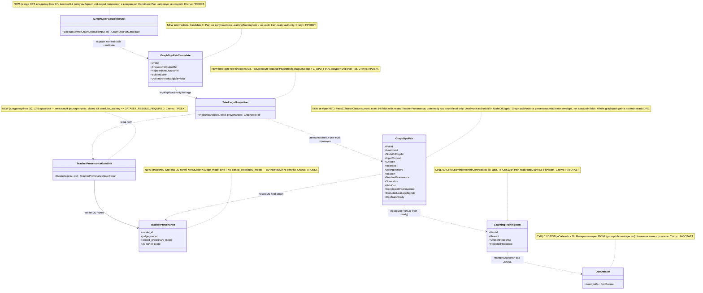
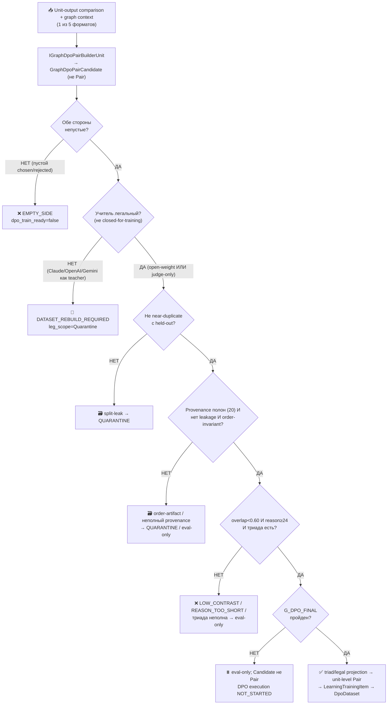

## Current Code-First Reconciliation Overlay (2026-07-14)

current_implementation_authorization: YES_CODE_FIRST_ONLY
teacher_dpo_training_authorization: NO_TEACHER_DPO_TRAINING_UNTIL_G_DPO_FINAL
dpo_status: NOT_STARTED
dpo_priority: LAST
current_counters: 12 phases / 27 subphases / 64 substeps

## Historical Fable Coverage Repair Overlay (2026-07-05)

historical_fable_plan_readiness: PLAN_NOT_READY / FABLE_GAP_REPAIR_QUEUE
historical_fable_implementation_authorization: NO until fresh Luba approval after review
historical_fable_verdict_basis: Newer-at-that-time Fable coverage evidence `claude-fable-plan-check-v1.md` and attachment `98cbe69a` superseded the previous final-readiness overlay. Fable reported 127 findings: 91 COVERED, 30 PARTIAL, 6 MISSING. This is historical plan-repair evidence only, not current execution authority and not product/test/build/runtime/provider/training/checkpoint/git proof.
historical_fable_verdict_classes: DESIGN_BLOCKER_AT_THAT_TIME=FABLE_MISSING_AND_PARTIAL_ITEMS; REPAIR_QUEUE_AT_THAT_TIME=FABLE_RB_RG_AND_PARTIAL_REPAIR; FABLE_EVIDENCE=claude-fable-plan-check-v1.md lines 35-153 and attachment 98cbe69a lines 32-79; IMPLEMENTATION_AUTHORIZATION_GATE_AT_THAT_TIME=NO until fresh Luba approval after review.
historical_fable_classification_rule: Any older line in this file saying PLAN_READY_FOR_LUBA_REVIEW, Final Readiness Review Overlay, no unresolved design/dependency blocker, CURRENT_REPAIR_QUEUE=NONE_IDENTIFIED_BY_FINAL_READINESS_REVIEW, or parent final-readiness acceptance before this overlay is historical/pre-Fable evidence only unless it cites later authority.
historical_fable_gap_repair_addendum: active-codex-execution-42-fable-gap-repair-additions-20260705.md was the historical repair map for R-B/R-G and partial contract/readability/lifecycle additions; it is not current authority.
## Historical Pre-Fable Final Readiness Review Overlay (2026-07-05)
historical_pre_fable_plan_readiness: PLAN_READY_FOR_LUBA_REVIEW
historical_pre_fable_implementation_authorization: NO until fresh Luba approval after review
historical_pre_fable_final_readiness_review_scope: one bounded planning/governance readiness review only; no product implementation, tests, builds, runtime, browser, provider/API, model/training/checkpoint, git, branch, mergeability, PR, or product-readiness proof was run.
historical_pre_fable_current_verdict_basis: This final review read the required governance/skill gate markers, the two unique original-task/reference attachments, the minimum Claude baseline surfaces, the active-codex plan/board/matrix/source-map/legal/gate/ledger surfaces, and current status/search evidence. End-to-end mental simulation from the active plan found no unresolved design/dependency decision that an executor would have to choose before coding/testing. The prior PLAN_NOT_READY / PLAN_PARTIAL_REPAIR_QUEUE state after 0aa/Laplace/Kepler/Singer was retained for parent final-review acceptance; this overlay supplies that final bounded review. Remaining items are execution or approval gates only: fresh Luba implementation approval, local self-authored seed file creation, code implementation, tests/builds/runtime/training/checkpoint/fresh-load/ablation proof, same-scenario Path A/Path B host proof, mock/replacement-ledger proof, branch/mergeability/git proof if later authorized, final product review, and route-specific hosted TogetherAI/Qwen3 terms/output-use proof before hosted train/common use.
historical_pre_fable_current_verdict_classes: DESIGN_BLOCKER_CURRENT=NONE_IDENTIFIED_BY_FINAL_READINESS_REVIEW; CURRENT_REPAIR_QUEUE=NONE_IDENTIFIED_BY_FINAL_READINESS_REVIEW; CURRENT_LEDGER_ACCEPTANCE_BOUNDED_EVIDENCE=50/50 accepted planning sections after 2026-07-05 Pass37-Pass50/Singer repair, not 50 cycles, not 50 product reviews, not product proof, not test/build/runtime/provider/training/checkpoint/git proof; HOSTED_PROVIDER_PRE_USE_GATE_ROUTE_SPECIFIC=TogetherAI/Qwen3 proof required before hosted train/common use only, not a local self-authored v1 planning blocker; IMPLEMENTATION_AUTHORIZATION_GATE=NO until fresh Luba approval after review.
historical_pre_fable_classification_rule: Any older line in this file saying PLAN_NOT_READY / PLAN_PARTIAL_REPAIR_QUEUE, current verdict remains PLAN_NOT_READY, CURRENT_REPAIR_QUEUE, parent must run final readiness review, or no-go boundaries before this overlay is historical/pre-final-readiness-review evidence only unless it cites later authority.
# Гайд 01 — Как строить DPO-пары (для ILearningDynamicGraph)

**Версия:** 1.0 (claude namespace; улучшенная версия бенчмарка `codex-guide-01`)
**Автор-роль:** автор `claude-*` гайда (Opus 4.8 MAX). Бенчмарк
`codex-guide-01-how-to-build-dpo.md` использован как **только-чтение evidence**:
я не копировал его дословно, а усиливал слабые места (полнота Part A, точность
цитат `file:line`, консистентность канона с остальными `claude-*`, тест-стратегия).
**Применимо к:** план ILearningDynamicGraph — авто-построение DPO для
`ILearningUnit` / `ILearningFlow` / `ILearningOrchestrator` / `ILearningDynamicGraph`
(CANON-маппинг на реальную иерархию репозитория `ILogicalUnit` / `ILogicalFlow` /
`ILogicalOrchestrator` / `ILearningMachine` / `ILearningMachinePair`, мастер §A.3).
**Язык:** русский (первичный, человеческим языком); имена типов/полей и код —
английский.
**Статус:** PLAN-ONLY. Это документация-гайд внутри плана, **НЕ** разрешение на
реализацию продукта/кода, тренировку, билд, запуск раннеров, git или вызов
внешних AI/API/моделей. Исполнение — только после свежего явного approve Luba в
текущем ходе (R2/R3, CLAUDE.md «Continuous role loop»).
**Скилы-основания:** `docs/skills/trainable-architecture-decision-SKILL.md`
(Legal Teacher / Provenance Gate, Graph-Style Reconstruction Gate, Graph-DPO
Artifact Triad Gate), `docs/skills/plan-review-SKILL.md` (DPO/distillation legal
teacher provenance review gate, deterministic-masquerade firewall),
`docs/skills/implementation-doc-uml-SKILL.md` (§0/§1 формат),
`docs/skills/dpo-triple-format-SKILL.md`, `docs/skills/planning-dpo-authoring-SKILL.md`.

**Канонические инварианты (сохранены, синхронны со всеми `claude-*`):** 12 фаз /
27 подфаз / 64 подшага; нумерация `Ф<P>.<SP>.<SS>`; `GraphDpoPair` current canon
is exactly 14 fields owned by active/Claude plan-07. Train-ready use is
**unit-level only**: `Level="unit"` and unit identity in `NodeOrEdgeId`; graph/path
order data stays context/provenance, not whole-graph DPO. `TeacherProvenance` is
nested in the pair and owned by active/Claude plan-08 as 20 fields. Any older
wording below about graph/edge-level train-ready pairs or sidecar-only provenance
is historical/pre-Pass37 evidence only and is superseded by active plan-07 §3.2.
Current construction boundary is stricter than the old helper shorthand:
`IGraphDpoPairBuilderUnit -> GraphDpoPairCandidate -> triad/legal projection ->
GraphDpoPair`. Candidate is never a trainable Pair; only the authorized hard-gate
projection may produce the unit-level 14-field Pair. Phase order is
`CODE_FIRST -> TP1_LOCAL_EVAL_ONLY -> TP2_HOSTED_EVAL_ONLY (G-TP-4) ->
G_DPO_FINAL -> DPO_TRAINING`; DPO execution has not started and remains last.
A-LM-12 (L5, без 6-го уровня); легальный teacher-гейт (closed =
только judge при `used_for_training=false`); запрет скрытого детерминизма
(A-LM-09/A-LM-13).

---

## 0. Якорь задачи и где этот claude-гайд улучшает бенчмарк

```text
CURRENT TASK: написать МОЙ (claude-namespace) улучшенный гайд «как строить
              DPO-пары» — план-документ, человеческим русским, Part A-формат,
              с сохранением структуры бенчмарка (8 разделов: назначение → концепт
              → код сейчас → рецепт → примеры → гейты → пробелы → ссылки) и
              канонических счётчиков/инвариантов. Записать ровно в
              claude-guide-01-how-to-build-dpo.md.
NOT THE TASK: исполнять/тестировать/билдить код, запускать раннеры, тренировать,
              вызывать внешние AI/API/модели, git; править/создавать любые codex-*
              (только чтение), продолжать чужой codex-план или claude-00..07 каркас.
EVIDENCE-ONLY: codex-guide-01 (бенчмарк гайда), codex-recon-* (рекон-сводки),
              claude-04/05 (моя политика/гайд измерения), claude-plan-07/08 (канон
              GraphDpoPair/TeacherProvenance), claude-ILEARNINGDYNAMICGRAPH-PLAN-v1
              §A.4 (канон полей/счётчиков), реальный код llm_mvp_core (читается для
              цитат), скилы plan-review / trainable-architecture-decision /
              implementation-doc-uml.
```

> **Якорь фазы (доска `claude-EXECUTION-CONTROL-BOARD`, evidence-only).** Этот
> гайд — методическая опора фазы **Ф3 «DPO-строитель»** (рецепт §4 = алгоритм
> `IGraphDpoPairBuilderUnit -> GraphDpoPairCandidate -> triad/legal projection`
> блока 07/08, подшаги Ф3.1.1–Ф3.1.3, Ф3.2.1–Ф3.2.2),
> легального гейта **Ф2.1** (§6.2 = блок 08) и измерения **Ф11** (§6.4 = блок 11).
> Канонические счётчики: **12 фаз (Ф0…Ф11) / 27 подфаз / 64 подшага**, нумерация
> `Ф<P>.<SP>.<SS>`. Доска и блоки-владельцы — evidence-only, здесь не правятся.

**Где этот claude-гайд осознанно лучше бенчмарка `codex-guide-01` (delta-нота, не
слепая копия).** Бенчмарк — добротный методический гайд (597 строк) с честными
цитатами кода и правильным рецептом, но как **самостоятельный Part A-артефакт** у
него есть конкретные дыры. Я их чиню:

| # | Слабое место бенчмарка `codex-guide-01` | Улучшение в этом claude-гайде |
|---|---|---|
| D1 | **Нет §0 UML и §1 флоучарта.** По `implementation-doc-uml-SKILL` и Part A Completeness Contract документация-решение обязана начинаться с §0 classDiagram (`note for` на каждый класс + таблица симуляции каждой связи) и §1 flowchart с симуляцией каждой ветки. У бенчмарка ни диаграммы, ни флоучарта. | Добавил **§9 §0 UML** (classDiagram с `note for` + per-connection симуляции) и **§9 §1 flowchart** рецепта построения пары с per-branch симуляциями. |
| D2 | **Предложенный канон `GraphDpoPair` (§6.5) противоречит фиксированному канону `claude-*`.** Бенчмарк предлагает «объединить» ~25 разнородных полей (`target_level`, `curriculum_tier`, плоские provenance-поля вперемешку). Но мой sibling-канон (мастер §A.4, блок 07/08) фиксирует **ровно 14 полей** с **вложенным** `TeacherProvenance` (20 полей; 13+5+2 RR6 `service_mode`/`grounding_used`). Плоские provenance-поля в строке создают класс ошибки «train-ready без полного провенанса». | Выровнял на **канон 14/20** (§6.5): `teacher_provenance` — **вложенная** запись, провенанс не размазан по верхнему уровню; лишние поля бенчмарка либо переехали внутрь provenance, либо помечены как не-канон. Это синхрон с блоком 07 §3.2 и блоком 08 §3.1. |
| D3 | **Вердикты сформулированы свободным текстом.** Бенчмарк говорит `QUARANTINE_DO_NOT_TRAIN`, `DATASET_REBUILD_REQUIRED`, `dpo_train_ready=false`, но не сводит их в **единый канон-enum** строки. | Зафиксировал канон-enum вердикта строки (§6.6): `ACCEPT | QUARANTINE | BLOCK | DATASET_REBUILD_REQUIRED | BLOCK_FOR_COMMON | EVAL_ONLY` (6 значений, владелец — блок 08) и `LegScope` (4 значения). Это убирает разнобой формулировок. |
| D4 | **Нет тест-стратегии (axis верификации).** Бенчмарк даёт гейты-исходы (§6), но не план тестов untrained/trained по слоям (`plan-review` FC-26 / OP-55). | Добавил **§8 тест-стратегию** по слоям (U/NEG/BL/INT/QA/REG + UH/TA раздельно) и явную двух-PASS ноту: строитель — honest scaffold, а `PASS_AS_TRAINED_FEATURE` достигает обучаемый юнит ребра после блоков 10/11. |
| D5 | **Teacher-семейства/лицензии не сведены с каноном блока 08.** Бенчмарк перечисляет Qwen3/DeepSeek/Kimi/GLM/Mistral и лицензии MIT/Apache, но без привязки к реальному license-хелперу и к allowlist/denylist-реестру блока 08. | Привязал к реальному `IsAllowedCommonLicense` (`ResultGapDpoWriters.cs:192-196`, проверено чтением) и к `AllowedTeacherRegistry` (allowlist/denylist, блок 08 §3.5); добавил правило R2 «идентичность важнее флага». |
| D6 | **Счётчики/фазы не привязаны.** Бенчмарк не связывает рецепт с `Ф<P>.<SP>.<SS>` (12/26/59). | Явный якорь фаз (Ф3/Ф2.1/Ф11), счётчики 12/26/59 (historical/pre-PASS26 Claude-baseline; текущий канон 12/27/64), связь шагов рецепта ↔ подшаги доски. |

CANON-инварианты сохранены: маппинг ролей Luba → реальные контракты (мастер §A.3);
5 закрытых уровней (A-LM-12); легальный teacher-гейт (closed = только judge при
`used_for_training=false`, контаминация → `DATASET_REBUILD_REQUIRED`); запрет
скрытого детерминизма (A-LM-09/A-LM-13). Все цитаты кода — реально существующие,
перепроверены прямым чтением главного чекаута `C:/Projects/llm_mvp_core`. NEW-типы
помечены `NEW`; существующие — с `file:line`.

---

## 1. Назначение гайда

Этот гайд отвечает на один практический вопрос: **как из сравнений выходов
конкретного L2-юнита машинно получить Candidate, а затем законно спроецировать
его в unit-level DPO-пару (chosen / rejected / `[WRONG:]`)**, которую можно
подать в обучение L5-машины, и при этом не нарушить три класса правил:

1. **Анти-leakage** — пара не должна учить модель «угадывать по утечке».
   Нормативный leakage-6 ровно `[candidate_index, source_path, source_id,
   file_order, correlation_id, exact_prompt]`; target-label запрещён отдельно.
2. **Легальный teacher-гейт** — chosen/rejected как обучающая **цель** допустимы
   только от open-weight permissive teacher или из first-party/permissive
   источников; запрещены выводы Claude/OpenAI/Gemini как distillation-цели
   (только judge при `used_for_training=false`).
3. **Запрет скрытого детерминизма** — DPO-пара существует, чтобы обучаемый юнит
   **ПЕРЕКРЫЛ** детерминированный keyword/regex/lookup-baseline, а не закрепил его.

Гайд: (а) фиксирует, как DPO строится в коде репозитория **СЕЙЧАС**, с точными
ссылками `file:line`; (б) перечисляет **РАЗНЫЕ** форматы пар, реально найденные в
коде и на диске, и сводит их через не-trainable `GraphDpoPairCandidate` к
**единому канону `GraphDpoPair` (14 полей)**; (в) даёт пошаговый рецепт для
unit-output сравнений (данные узла/ребра остаются context/provenance); (г) даёт
гейты, тест-стратегию и список пробелов, которые план обязан закрыть.

Этот документ **не разрешает** менять код, данные, чекпойнты. Любая DPO-строка,
батч или claim о качестве модели проверяется против этого гайда, против
`trainable-architecture-decision-SKILL.md` и против гайдов измерения, и не может
попасть в `Train*` без source/license-гейта, teacher-provenance, анти-leakage и
held-out разделения.

**Граница ответственности (CANON R5/R6).** Гайд описывает логику, которая живёт в
ядре `llm_mvp_core`, а не в агентном слое: обучаемый
`IGraphDpoPairBuilderUnit` выбирает unit-level сравнение и возвращает Candidate;
детерминированные triad/legal правила отдельно решают, допустима ли проекция в
Pair. Агент/расширение это не дублирует (R6 — тонкий агент: только вызовы API).

---

## 2. Концепт простыми словами (без кода)

**Аналогия: экзамен с двумя ответами.**

Представь, что мы учим стажёра-архитектора принимать одно решение (например:
«какой ретривер выбрать для вопроса по wiki-проекту» — это решение на одном
**узле** графа). Мы не объясняем стажёру правило словами. Вместо этого мы кладём
перед ним один и тот же вопрос и **два готовых ответа**:

- **chosen** — правильный ответ (что и почему правильно);
- **rejected** — правдоподобно-неправильный ответ (выглядит разумно, но содержит
  одну конкретную ошибку);
- **`[WRONG: ...]`** — короткая подпись на полях rejected: какая именно ошибка и
  чем она плоха.

Стажёр много раз видит такие тройки и постепенно начинает сам предпочитать
chosen. В этом вся суть DPO (Direct Preference Optimization, прямая оптимизация
предпочтений): модель учится не на «правильном тексте», а на **разнице** между
хорошим и почти-хорошим.

**Три важных уточнения аналогии:**

- **«Почти-хорошо» важнее «совсем плохо».** Если rejected — это явный мусор
  («не знаю», пустой ответ, бред), стажёр выучит только «не будь мусором» — это
  бесполезно. Сильный сигнал даёт *near-miss*: rejected отличается от chosen ровно
  одной осмысленной ошибкой (выбрал семантический ретривер там, где нужен точный
  лексический; пропустил проверку версии; ответил без доказательств).

- **Граф = много таких экзаменов, соединённых трубами.** У нас не один узел, а
  поток узлов (splitter → translator → planner → processor → applier →
  result-translator → arbiter → formatter), где выход одного узла = вход
  следующего. Поэтому DPO-пары бывают двух видов:
  - **пара на узле** — «для входа X этого узла правильный выход chosen, а не
    rejected»;
  - **пара на ребре** — «при таком выходе предыдущего узла правильно
    передать/смаршрутизировать в узел A (chosen), а не в узел B (rejected)»;
    то есть тестируется само решение о маршруте/передаче между узлами.

- **Учитель эталона и судья — разные роли.** Кто написал «правильный образец»
  (chosen) — это **teacher** (учитель эталона). Кто только сказал «этот образец
  лучше того» — это **judge** (судья). Закрытую модель (Claude/OpenAI/Gemini)
  можно звать **только судьёй** и **только** когда её вывод не идёт в обучение;
  как автора эталона — никогда. Это и есть легальный teacher-гейт (§6.2).

**Что НЕ является DPO-парой.** Пара «вход → правильный выход» без rejected — это
supervised (teacher-forcing), а не DPO. Такие ряды (формат `A → узел → B` из
`learning-sets`) — это сырьё; чтобы стать DPO, к ним надо ДОстроить rejected по
правилам ниже (§4 шаг 4, §7 пункт 7).

---

## 3. Как это реализовано в нашем коде СЕЙЧАС (точные ссылки)

Здесь — что **РАБОТАЕТ** и что **ЗАГЛУШКА**. Все ссылки перепроверены прямым
чтением файлов главного чекаута `C:/Projects/llm_mvp_core`.

### 3.1. Движок одного DPO-шага — РАБОТАЕТ (но это не построитель пар)

`11.DPO` — низкоуровневый тренировочный движок. Он **НЕ** строит пары; ему пары
подают извне.

- Контракт пары: `11.DPO/Models/DpoPair.cs:3-8` — `record DpoPair { Prompt;
  Chosen; Rejected; }` (проверено: ровно три строки `init`, по умолчанию пустые).
  **Нет** полей source / license / teacher / near-miss / domain. Это минимальный
  «голый» формат.
- Загрузка набора: `11.DPO/DpoDataset.cs:18-26` — `Load(path)` читает JSONL по
  строке на `DpoPair`, пустые строки пропускает, `null` → исключение;
  `Shuffle(seed)` (строки 28-38) — Fisher-Yates, исходник не мутируется.
- Лосс и шаг обучения — РЕАЛЬНЫЕ: `11.DPO/DpoTrainer.cs:31-70` (`Step`), проверено
  чтением:
  - `chosenReward = Beta*(polChosenLogP − refChosenLogP)`,
    `rejectedReward = Beta*(polRejectedLogP − refRejectedLogP)` (строки 42-43);
  - `margin = chosenReward − rejectedReward` (строка 44);
  - `loss = −log(σ(margin)+1e-8)` (строка 47);
  - ручной backward `gradMargin = σ(margin) − 1` (строка 50), затем
    `_optimizer.Step(..., lr: _learningRate)` (строка 54);
  - метрики `DpoMetrics { Loss, ChosenReward, RejectedReward, RewardMargin,
    Accuracy = margin>0 ? 1f : 0f }` (строки 57-65).
- ЗАГЛУШКА/ПРОБЕЛ движка: нет сохранения весов как checkpoint/manifest/locator,
  нет export/import, fresh-load, continue-training, held-out, нет CPU/RAM/hash в
  метриках. Прямых вызовов `DpoTrainer` из боевого рантайма (15/42/43) не найдено —
  пары пока строятся, но в этот движок в проде не подаются.

**Вывод по 3.1:** `DpoTrainer` — честный «кирпич» применения сигнала
(`OK_INTERNAL_DETAIL` / `OK_MODEL_COMPONENT` по скилу), НО он диктует, что
авто-построитель графа обязан выдавать именно `(Prompt, Chosen, Rejected)` в
токенизируемом виде. Поэтому **конечная точка** канона `GraphDpoPair` — проекция в
`LearningTrainingItem` → JSONL `DpoPair` → `DpoDataset.Load` (§4 шаг 7).

### 3.2. Legacy/raw source-format на узле — РАБОТАЕТ (не current Pair authority)

Канонический работающий пример — `WikiContextRoutingDpoGenerator`
(`42.ProjectWikiDomain/WikiContextRoutingDpoGenerator.cs`). Это узел
«контекст-роутинг wiki» (выбор Mode2 semantic / Mode3 BM25 / abstain).

Как строится пара (метод `BuildBatchAsync`, строки 17-94):
1. Из seed-вопроса собирается `ProjectWikiUserQuestion`, прогоняется через
   `ProjectWikiQueryPlanningFlow.PlanAsync` и `WikiContextRoutingUnit.Route`
   (строки 46-62) — то есть **chosen берётся из реального выхода юнита**, а не
   придумывается.
2. `BuildChosen(...)` (строки 96-212) — формирует chosen как строки `key: value`
   (например `route_kind`, `requires_semantic_retriever`, `prechecks_complete:
   true`, `answer_before_retrieval: false`).
3. `BuildRejected(rejectedType, ...)` (строки 214-290) — формирует
   правдоподобно-неверный ответ по типу ошибки и добавляет подпись
   `[WRONG: <type> <последствие>]`. Реальные типы rejected в коде: `always_bm25`,
   `always_semantic`, `answer_instead_of_abstain`, `ignore_wrong_project`,
   `ignore_stale_version`, `no_pre_checks`.
4. Гейты качества батча (строки 75-86): `wrongAnnotationRate` (доля пар с
   `[WRONG:`) должна быть = 1.0; иначе варнинг `wrong_annotation_rate_below_gate`;
   контроль `batch_row_count_not_50` и `developer_reasoning_rows_below_40_percent`.

В `42.ProjectWikiDomain` есть 12 таких `*DpoGenerator.cs` (по Glob):
`CodeTraceBuilderDpoGenerator`, `WikiContextRoutingDpoGenerator`,
`ProjectWikiAnswerComposerDpoGenerator`, `StackAndVersionDpoGenerator`,
`SystemBoundaryMapperDpoGenerator`, `ProjectWikiQueryPlanningDpoGenerator`,
`CrossStackBusinessFlowGraphDpoGenerator`, `WikiTraceAggregatorDpoGenerator`,
`DocumentationGeneratorDpoGenerator`, `ProjectAnswerVerifierDpoGenerator`,
`EntityImpactMapperDpoGenerator`, `ProjectWikiRequestRoutingDpoGenerator` — это по
сути «узлы графа wiki», каждый со своим построителем пар.

**Вывод по 3.2:** legacy/raw пара на узле уже строится детерминированным
fixture-builder. Это `OK` только как входной формат/fixture: current chain сначала
нормализует его в `GraphDpoPairCandidate`, а не принимает за `GraphDpoPair`. Chosen здесь — self-label
(выход того же детерминированного юнита), значит teacher-источник истинности
детерминирован — это требует ablation/no-shortcut и легального teacher при
переходе к семантическому claim (см. §6.3, §7 п.4).

### 3.3. Legacy/raw routing corpus — РАБОТАЕТ (не edge-level `GraphDpoPair`)

`OrchestrationCorpusBuilder` (`42.ProjectWikiDomain/OrchestrationCorpusBuilder.cs`)
строит raw пары для маршрутно-grounding-решений (это edge-context evidence,
но не разрешение на edge-level train-ready `GraphDpoPair`):

- Запись пары: `OrchestrationTrainingPair`
  (`42.ProjectWikiDomain/OrchestrationPlanContracts.cs:110-122`) — поля `PairId,
  Mode, Prompt, Chosen (OrchestrationPlanChosen), RejectedText, ExpectedRouteMode,
  ExpectedBoundarySource, ExpectedMlGenerated, ExpectedIntentKind, FlowRef,
  SourceBundleId, IsHeldOut`.
- Три режима (`PairMode`): `Mode1LearnedFlowGrounding`, `Mode2Generalization`,
  `Mode3HumanExplanation` (методы `AddMode1Pairs`/`AddMode2Pairs`/`AddMode3Pairs`,
  строки 128-241). Пример rejected (строка 144): `Rejected route uses
  deterministic lookup instead of learned grounding.`
- Анти-leakage в корпусе: `NoExactPromptOverlap` (строки 243-254) + нормализация
  промпта `NormalizePrompt` (строки 256-262) — train/eval не должны делить
  одинаковые промпты; дополнительно проверяется disjoint по `SourceBundleId` и
  `FlowRef` (строки 75-77).
- Гейт корпуса `MeetsCorpusGate` (строки 81-93): минимальные счётчики по режимам +
  все overlap-флаги.

**Вывод по 3.3:** edge/grounding-пары и их анти-overlap-гейты уже реализованы.
ПРОБЕЛ: `OrchestrationTrainingPair` не несёт teacher-provenance и license-полей.
Канон `GraphDpoPair` (§6.5) добавляет их именно поверх таких форматов.

### 3.4. KNN-память узла — РАБОТАЕТ как компонент (не финальная authority)

`OrchestrationKnnStore` (`42.ProjectWikiDomain/OrchestrationKnnStore.cs`):
`FindNearestWithScore` (строки 32-43) ищет ближайшую обучающую пару по **Jaccard**
над токенами промпта (`Tokenize` строки 45-50, `Jaccard` 52-62); есть
`ExportPairs`/`ImportPairs` (строки 19-27).

Классификация по скилу: KNN — audit-triggered, не запрещён. Это допустимый
**компонент памяти** обучаемого узла (`OK_MODEL_COMPONENT`), пока он не становится
**единственной финальной authority** вместо обученного юнита. Для графа:
nearest-память поддерживает решение, но не заменяет обучаемый сигнал (и не
переносит source-path как сигнал — §6.1).

### 3.5. Легальный гейт источника и анти-leakage схемы — РАБОТАЕТ (самый зрелый код)

Самая зрелая легальная реализация — `43.SmartSkillsDomain/ResultGapDpoWriters.cs`
(узел ResultGap «обнаружение недостающей способности после ответа»):

- Дескриптор источника: `ResultGapSourceDescriptor` (`ResultGapDpoWriters.cs:7-14`)
  — `SourceKind, LicenseExpression, PrivacyScope, SourceRef, SourceSha256,
  SourceVersionId, UserApprovalRecorded`. Это реальный прецедент провенанса в
  проекте; канон `TeacherProvenance` (20 полей, блок 08) его **расширяет**, а не
  дублирует.
- Роутер приватности/лицензии `ResultGapSourcePrivacyRouter.Classify` (строки
  111-153): пустой источник → quarantine `source_identity_missing`;
  vendor/external/unknown → quarantine `external_vendor_or_unapproved_source`
  (правило `IsExternalOrVendor` строки 182-186); `forbidden`/`raw_private` privacy
  → quarantine `privacy_scope_forbidden` (правило `IsForbiddenPrivacy` строки
  188-190); private/correction → `adaptive_only`; approved common + разрешённая
  лицензия → `trainable_common`.
- Разрешённые common-лицензии `IsAllowedCommonLicense` (строки 192-196, проверено
  чтением): **MIT, Apache-2.0, ProjectInternal, Synthetic** (через
  `OrdinalIgnoreCase`). Это **точка расширения** шага 1 рецепта (§4) и шага 4
  гейта блока 08.
- Схема-валидатор анти-leakage `ResultGapDpoSchemaValidator.Validate` (строки
  241-266, проверено чтением): требует `chosen_ref`/`rejected_ref`/`skill_ids`, и
  явно ловит утечку — `Require(!ChosenTargetContainsRawPrivateOrVendorOutput,...)`,
  `!ContainsRawPrivateText`, `!ContainsRawVendorOutput`,
  `!CommonCheckpointMutationClaimed`, `TechnicalExecutionRefsExcluded`,
  `!SourceIdUsedAsTrainingFeature`, near-miss-таксономия train-ready,
  `RejectedWhyPlausible.Length >= 24` (строки 250-257); `CheckedFieldCount: 14`
  (строка 262).
- Near-miss таксономия `ResultGapNearMissTaxonomy` (строки 199-235, проверено
  чтением): коды `missing_required_capability_after_output`,
  `false_done_with_gap_remaining`, `correction_overfit_to_raw_answer`
  (`TrainReady: true`) и `generic_bad_output` (`TrainReady: false`, только
  quarantine).

**Вывод по 3.5:** анти-leakage и license-роутер реализованы и являются **образцом**
для графа. ПРОБЕЛ: здесь нет полей teacher-провенанса (`teacher_access_mode`,
`closed_proprietary_model`, `judge_model` и т.д.) — см. §6.2 и §7 п.1.

### 3.6. Что на диске (реальные форматы строк)

Проверены первые строки файлов (рекон-сводки `codex-recon-*`, evidence):

- `training-data/orchestration-reasoning/orchestration-reasoning-dpo-pairs.jsonl`:
  **ref-only** формат — `pair_id, source_row_id, approved_pair_ref, error_code,
  chosen_ref, rejected_ref, source_ref, source_sha256, model_leg,
  abstraction_layer, universal_reasoning_pattern, excluded_technical_execution_refs,
  raw_private_text_copied:false, technical_execution_leakage:false,
  dpo_binding_ready, dpo_materialized, dpo_train_ready:false, training_started:false`.
  Строка несёт SHA256 источника и `excluded_technical_execution_refs`, а
  `dpo_train_ready=false` — честное «ещё не обучаемо».
- `training-data/smart-skills/semantic-quality/seed-v1/smart-skills-dpo-seed.jsonl`:
  формат с `prompt_input_task_context` + `chosen_ref/chosen_summary/rejected...`,
  `source_quality:"gold"`, `machine_target:"PromptToTaskMachine"`,
  `private_or_project_specific_text_copied:false`.
- `training-data/orchestration-reasoning/orchestration-reasoning-dpo-trainer-payloads.jsonl`:
  payload-формат с `chosen_scenario_plan_features` (intent_signals, reasoning_steps,
  evidence_expectations, decision_guards) — то есть пара, разложенная в признаки, а
  не в сырой текст.

> **КЛЮЧЕВОЙ ФАКТ (рекон, evidence-only).** Поля `teacher_access_mode`,
> `closed_proprietary_model`, `hosting_provider`, `teacher_output_used_for_training`
> встречаются в файлах скилов/гайдов (`docs/skills/*`) и **отсутствуют** в `.cs` и
> в строках `training-data/*.jsonl`. То есть легальный teacher-гейт пока существует
> как ПРАВИЛО, но не как поле данных — это обязательный пробел плана (§7 п.1).
> **Честность по доказательствам (CLAUDE.md «No Dishonest Answers»):** я не запускал
> live-grep в этой сессии для пере-подсчёта вхождений; число «19 файлов/72» из
> рекона держу как benchmark-sourced ориентир, а не как текущий факт диска —
> Ф2.1.3 обязан пере-сканировать на момент исполнения (синхрон с блоком 08 §6.3).

---

## 4. Пошаговый рецепт авто-построения DPO-пары

Рецепт един для unit-level сравнений; узел/ребро/путь определяют контекст и unit id,
но не уровень Pair. Это **методическая** проекция current chain
`IGraphDpoPairBuilderUnit -> GraphDpoPairCandidate -> triad/legal projection`
(блоки 07/08, NEW). Соответствие подшагам доски:
шаги 1-6 ↔ Ф3.1.1–Ф3.1.3 (адаптеры+гейты), шаг 7 ↔ Ф3.2.1–Ф3.2.2 (триада+
материализация).

**Шаг 0. Классифицировать цель по разрешённому уровню.**
Назвать узкую способность и сопоставить её ровно одному разрешённому уровню:
`ILogicalUnit` (узел), `ILogicalFlow` / `ILogicalOrchestrator`
(последовательность/маршрут), `ILearningMachine` / `ILearningMachinePair`
(владелец обучения). scorer/selector/router/KNN/regex — **НЕ** уровень, только
деталь внутри уровня (`trainable-architecture-decision-SKILL.md`, allowed levels;
A-LM-12 — закрытый список из 5 уровней).

**Шаг 1. Зафиксировать и проверить источник (legal gate ПЕРЕД построением).**
Заполнить дескриптор источника (как `ResultGapSourceDescriptor`,
`ResultGapDpoWriters.cs:7-14`): `source_ref`, `source_sha256`, `license`,
`privacy_scope`, плюс teacher-provenance (§6.2, 20 полей). Прогнать через
`TeacherProvenanceGateUnit.Evaluate` (блок 08) → вердикт `ACCEPT / QUARANTINE /
BLOCK / DATASET_REBUILD_REQUIRED / BLOCK_FOR_COMMON / EVAL_ONLY`. Если не ACCEPT — пара **не
строится для общего обучения** (но честно помечается, не выбрасывается молча).

**Шаг 2. Сформировать A (unit-level вход).**
- Узел: реальный рантайм-вход узла (для роутинга — пользовательский вопрос; для
  array-узла — один элемент). Правило `learning-sets`: НЕ класть строку документа,
  если человек так бы не написал.
- Ребро: unit-output `EdgeAuthorityUnit` + контекст маршрутизации
  (`candidateUnitIds`, `requiredDirection`, флаги вроде
  `UseKnowledgeEdgeDetection`). Это всё ещё Pair уровня `unit`, не edge-level Pair.
- Анти-leakage: A **не должен** содержать нормативный leakage-6
  `[candidate_index, source_path, source_id, file_order, correlation_id,
  exact_prompt]`.

**Шаг 3. Получить `GraphDpoPairCandidate`.**
Предпочтительно — из легального teacher (open-weight permissive) или из first-party
канона (выход проверенного юнита, как в `WikiContextRoutingDpoGenerator`). chosen
конкретен: реальное решение/маршрут/выход, не «составь план». Learned
`IGraphDpoPairBuilderUnit` возвращает unit refs/score/reason как Candidate;
`DpoTrainReadyEligible` — только подсказка, не право на train-ready.

**Шаг 4. Построить rejected как near-miss + `[WRONG:]`.**
Выбрать один тип ошибки из таксономии узла (например `always_semantic`,
`ignore_stale_version`, `no_pre_checks`). rejected отличается от chosen **РОВНО
одной** осмысленной ошибкой и остаётся правдоподобным. Добавить `[WRONG: <код>
<короткое функциональное последствие>]`.
Запрет: rejected-мусор; отрицание-шаблон («Do not generate a capability for
sub-phase X» — именно он дал провал калибровки 2026-05-06, overlap ~0.70,
loss=ln2; см. `codex-recon-mvp-internal-learn.md`).

**Шаг 5. Проверить overlap и инвариантность.**
- `overlap_ratio(chosen, rejected) < 0.60` (порог из внешнего реестра пар; синхрон
  с блоком 07 §3.3 шаг 5).
- train/eval не делят промпт (`NoExactPromptOverlap`,
  `OrchestrationCorpusBuilder.cs:243-254`), а для ребра-выбора —
  permutation-инвариантность: chosen стабилен при перестановке кандидатов
  (`candidate_order_invariant=true`), иначе `QUARANTINE`
  (`rejected_origin="order-artifact"`, `dpo-triple-format-SKILL.md`).

**Шаг 6. Прогнать triad/legal projection и схема-валидатор anti-leakage.**
Как `ResultGapDpoSchemaValidator` (`ResultGapDpoWriters.cs:241-266`): запретить raw
private/vendor текст в chosen-цели, `source_id` как признак, technical execution
refs; near-miss код обязан быть пригоден для проверки; `RejectedWhyPlausible.Length >= 24`.
Только эта граница после legal/split/authority/leakage/overlap может создать
unit-level `GraphDpoPair`; любой провал оставляет Candidate quarantine/eval-only.

**Шаг 7. Разложить авторизованный Pair в обучаемую форму и измерить.**
После `G_DPO_FINAL` свести к токенизируемой паре: проекция канона `GraphDpoPair` →
`LearningTrainingItem` (`00.Core/LearningMachineContracts.cs:30`,
`ItemId←pair_id`, `Prompt←input_context`, `ChosenResponse←chosen`,
`RejectedResponse←rejected`) → JSONL `DpoPair` → `DpoDataset.Load`
(`11.DPO/DpoDataset.cs:18`). Считать `reward_margin = logP(chosen) − logP(rejected)`
≥ 0 и `loss` < 0.685 (≥0.693 = random-guess = брак,
`TEACHING-MEASUREMENT-GUIDANCE-v6`). Held-out 50+50 disjoint по источнику
(`dcm-dpo-construction-GUIDE.md` §7).

**Шаг 8. Статус честно (двух-PASS и DPO-last).**
Пока нет held-out метрик + ablation + fresh-load + continue-training через
checkpoint/manifest/locator — статус строки `dpo_train_ready=false` /
`PASS_AS_HONEST_UNTRAINED_SCAFFOLD`, **НЕ** `PASS_AS_TRAINED_FEATURE` (CLAUDE.md
«Untrained honesty vs trained readiness pattern»).
До завершения code-first, TP1/TP2 eval-only и `G_DPO_FINAL` никакая Candidate/Pair
не запускает DPO training; текущий статус DPO execution = `NOT_STARTED`.

---

## 5. Конкретные примеры с реальными значениями

### 5.1. Пара на УЗЛЕ (контекст-роутинг wiki) — реальный шаблон из кода

Вход A (узел `WikiContextRoutingUnit`, вопрос разработчика):
> "I want to add DiscountCode to CampaignCreateDto. Where does it travel and what
> can break?"

chosen (compact-форма из `BuildChosen`, строки 161-170):
```text
context_route_verdict: correct_project_wiki_context_route
route_kind: Mode2SemanticHybrid
intent: EntityImpactTrace
requires_semantic_retriever: True
allows_lexical_fallback: True
prechecks_complete: true
answer_before_retrieval: false
```

rejected + `[WRONG:]` (тип `always_bm25`, строка 233):
```text
context_route_verdict: wrong_project_wiki_context_route
route_kind: Mode3LexicalEvidence
requires_semantic_retriever: false
[WRONG: always_bm25 misses multi-hop developer reasoning where semantic
expansion is required after the query plan identifies many evidence families.]
```

Чему учит пара: для multi-hop entity-impact вопроса нужен семантический ретривер;
выбор «всегда BM25» — правдоподобная, но неверная экономия. Анти-leakage: chosen и
rejected отличаются режимом ретривера, а не id вопроса/порядком кандидатов.

### 5.2. Пара на РЕБРЕ (grounding-маршрут оркестрации) — из OrchestrationCorpusBuilder

Запись `OrchestrationTrainingPair` (Mode1, строки 134-146):
```text
PairId:   mode1-train-flow-33
Mode:     Mode1LearnedFlowGrounding
Prompt:   "learned grounding plan FLOW-33 flow 33 33-star canonical orchestration"
Chosen:   <OrchestrationPlanChosen для FLOW-33>
Rejected: "Rejected route uses deterministic lookup instead of learned grounding."
FlowRef:  FLOW-33   IsHeldOut: false
```
Чему учит: на этом ребре правильно выбрать обученный grounding, а не
детерминированный lookup. Это прямой анти-shortcut-сигнал (R4 / запрет скрытого
детерминизма / A-LM-09). В каноне `GraphDpoPair` такой rejected получает
`rejected_origin="baseline-loser"` (§6.5, блок 07 §3.4).

### 5.3. Ref-only строка на диске (orchestration-reasoning) — реальная первая строка
```text
pair_id: or-dpo-pair:or01u-sonnet-clinerules-001
chosen_ref:  or01u:chosen:governance-intent-risk-linkage
rejected_ref: or01u:rejected:surface-summary-without-evidence
source_ref:  sonnet-local-analyzes:.clinerules-analysis.md
source_sha256: af174a555ca9...fb05
model_leg: common
excluded_technical_execution_refs: [exact_repo_paths, patch_steps, host_specific_commands, code_bound_file_edits]
raw_private_text_copied: false   technical_execution_leakage: false
dpo_train_ready: false   training_started: false
```
Замечание: имя источника содержит `sonnet` — это сигнал, что происхождение
chosen/rejected надо проверить teacher-гейтом (§6.2) ДО `dpo_train_ready=true`.
Если `sonnet` использован как teacher (`used_for_training=true`) → вердикт
**`DATASET_REBUILD_REQUIRED`** (блок 08 §6.2, ветка C3).

### 5.4. Negative-пример (что НЕ принимать)
```text
chosen:   route_kind: Mode2SemanticHybrid ... (правильно)
rejected: "I don't know."                 <-- МУСОР, не near-miss
```
Вердикт: `QUARANTINE` (`rejected_origin="generic_bad_output"`, train-ready=false по
`ResultGapNearMissTaxonomy`, `ResultGapDpoWriters.cs:221-226`). rejected не
правдоподобен, overlap почти 0, ничему не учит, кроме «не будь пустым».

---

## 6. Гейты и правила

### 6.1. Анти-leakage (обязательные запреты в признаках/целях)

Нормативный leakage-6 запрещённых обучающих признаков — ровно
`[candidate_index, source_path, source_id, file_order, correlation_id,
exact_prompt]`. Дополнительно запрещены target-label напрямую, имена
пользователей/проектов/сессий и raw private/vendor текст в chosen-цели.
Реализованные проверки-образцы: `ResultGapDpoWriters.cs:250-257`
(privacy/raw/source-id), `OrchestrationCorpusBuilder.cs:243-262` (exact-prompt
overlap), permutation-инвариантность из `dpo-triple-format-SKILL.md`.

> **Образец «как надо» (проверено в мастере §A.4.2).** `SubPhaseRouterSourceDocument`
> объявлен с полем `SourcePath` (`21.AgentInfrastructure/Logical/SubPhaseRouterUnit.cs:6`),
> а действующий роутер уже **намеренно исключает** этот путь из скоринга
> (`MultiSubPhaseRouterUnit.cs:293` «Join semantic document fields while
> deliberately excluding SourcePath»). То есть инвариант «не учить по пути
> источника» уже частично реализован; вход обучаемого юнита ребра обязан наследовать
> его как **контракт**, а не как комментарий.

Допустимы: нормализованный вход, абстрагированные дефекты/признаки,
nearest-память без утечки пути (§3.4).

### 6.2. Легальный teacher-гейт (provenance) — обязателен, в коде ОТСУТСТВУЕТ

chosen/rejected как обучающая **цель** допустимы только когда teacher — разрешённая
open-weight permissive модель ИЛИ first-party/permissive источник, и проверены
provider terms + лицензия.

- **Разрешённые teacher-семейства (allowlist, open-weight, нейтральные провайдеры):**
  Qwen3 (Apache-2.0), DeepSeek (MIT), Kimi K2 (modified-MIT), GLM, Mistral. Канон
  allowlist/denylist хранится как **данные** в `AllowedTeacherRegistry` (блок 08
  §3.5), решение по идентичности `IsClosedByDenylist(model_id)` читает denylist, не
  хардкодит бренды в логике.
- **ЗАПРЕЩЕНЫ как distillation-teacher (denylist):** Claude, OpenAI/GPT, Gemini,
  Gemini Grounding. Если `closed_proprietary_model=true` (выведен из denylist) И
  `teacher_output_used_for_training=true` → вердикт **`DATASET_REBUILD_REQUIRED`**,
  **без** легальных исключений (`trainable-architecture-decision-SKILL.md` Legal
  Teacher Gate; `plan-review-SKILL.md` DPO/distillation review gate; никакое
  «разрешение Luby» это не снимает). Закрытые модели допустимы только как
  **judge/eval/критика** при `teacher_output_used_for_training=false`, не как
  chosen/rejected-цель.
- **Правило R2 (идентичность важнее флага):** «закрытость» выводится из denylist по
  `model_id`, а **не** из входного флага `closed_proprietary_model`. Отсутствие
  маркера ≠ open_weight; пустой провенанс ≠ ACCEPT (минимум QUARANTINE).
- **Обязательные provenance-поля строки (канон 20 полей, владелец — блок 08; сейчас
  их нет ни в коде, ни в jsonl):**
  ```text
  13 базовых: teacher_access_mode; hosting_provider; model_id; model_license;
              model_version; request_id; provider_terms_checked;
              teacher_output_used_for_training; closed_proprietary_model;
              source_ref; source_sha256; contamination_markers; judge_model
  5 NEW:      terms_snapshot_ref; geography_export_constraint; source_category;
              raw_private_text_copied; redaction_policy_ref
  2 RR6:      service_mode; grounding_used
  ```
  `judge_model` — поле **ВНУТРИ** `TeacherProvenance`, не отдельное верхнеуровневое
  поле пары (канон блока 08 §3.1).
- Двухэтапный teacher-маршрут (владелец — overlay two-phase; §6 G1 / блок 08):
  - Этап 1 `TP1_LOCAL` (локальный self-hosted open-weight, профиль `qwen35-local-v1`): ToS-оси
    нет (`TermsBasis=SELF_HOSTED_NO_PROVIDER_TERMS`), обязательны per-release лицензия весов +
    retention-policy + запиненный `sha256`-digest + deployment proof; при неполноте →
    `QUARANTINE(self_hosted_retention_or_pin_missing)` (C6 self-hosted-нога).
  - Этап 2 `TP2_HOSTED` (hosted `qwen3-together-v1`): обычная C6-нога с `ProviderTermsProof`.
  - `teacher_access_mode` — enum из 6 значений (владелец plan-08 §3.1); принадлежность этапу
    ВЫВОДИТСЯ из `hosting_provider` + `teacher_access_mode`, 21-е поле НЕ создаётся.
  - Сентинел `judge_model="__deterministic_domain_scorer__"`: teacher остаётся
    `source_category=open_weight`, scorer-sidecar несёт `scorer_category=deterministic_baseline`,
    `scorer_id`, `scorer_version`, `threshold_set_id` (alias owner-поля plan-10 `threshold_set`).
    Registered+complete scorer лишь продолжает eval, но не даёт auto-ACCEPT/train-ready; missing/unregistered → C18
    `QUARANTINE(scorer_ref_missing)`, Candidate false, no projection. Self-score учителя,
    замаскированный sentinel, → `forbidden_self_label` → C14.
    C15/C15b выполняются раньше C18. Enum-домены не расширяются: `LegalVerdict` = 6,
    `SourceCategory` = 8; `first_party_deterministic` остаётся только `chosen_origin`.
- Лицензии общего корпуса (совпадают с кодом `IsAllowedCommonLicense`,
  `ResultGapDpoWriters.cs:192-196`): MIT, Apache-2.0, ProjectInternal, Synthetic.
  CC BY 4.0 — только с атрибуцией в метаданных. Запрещены для общего корпуса: CC
  BY-SA, GPL/AGPL, unknown/unlicensed. Instruction-tuning с model-output риском
  (ShareGPT/WizardLM/Alpaca/Dolly/UltraChat/FLAN-raw) — evidence-only/quarantine
  (`codex-recon-mvp-external-sources.md`).
- Правило first-party: ассистент-ответ внешнего чат-корпуса даёт только
  A-side-форму запроса (`a_side_style_only`); chosen ВСЕГДА строится из
  XIIGen-контрактов/кода/одобренных стандартов, не копируется из чужой модели.
- Источники приватных правок Любы/проектов = user-adaptive (personal leg), не
  common (R5). Hosted + raw private text без редакции → `BLOCK_FOR_COMMON` (только
  adaptive leg, блок 08 §8.5).

### 6.3. Запрет скрытого детерминизма (R4 / A-LM-09 / A-LM-13)

DPO-пара обязана учить обучаемый юнит **ПЕРЕКРЫТЬ** детерминированный baseline, а
не закрепить его. Системный риск зафиксирован реконом: `26.TrainableRouter`
(`KeywordUnitScorer.Score`) — это keyword-counter под именем «Trainable router»
(`codex-recon-core-26-router.md`, вердикт `FORBIDDEN_RUNTIME_SHORTCUT`).
Дополнительно `MultiSubPhaseRouterUnit` (`MultiSubPhaseRouterUnit.cs:283`,
фикс-веса 0.55/0.25/0.20/0.02, обученного состояния нет) — корректная
классификация `BASELINE_MUST_BE_LABELLED` (мастер §A.2.1).

Правило: keyword/regex/lookup допустимы **только** помеченными eval-only/baseline;
на каждом ребре графа назвать владельца финальной authority (`EdgeAuthorityUnit`,
NEW) и приложить ablation/no-shortcut тест. Строки данных не должны учить тому, что
запрещено в рантайме: пара с `order-artifact` → карантин.

### 6.4. Гейты измерения (что = «обучилось»)

- `reward_margin ≥ 0` и растёт; `loss < 0.685` (≥0.693 = random = брак).
- `overlap_ratio(chosen, rejected) < 0.60`; train/eval disjoint по промпту и
  источнику (50+50, disjoint by source).
- Для семантического claim обязательны: held-out accuracy, ablation без checkpoint,
  permutation/leakage-проверки, fresh-load воспроизведение, continue-training из
  существующего checkpoint. Иначе статус — `PASS_AS_HONEST_UNTRAINED_SCAFFOLD` /
  `OPEN`, не `PASS_AS_TRAINED_FEATURE` (CLAUDE.md «Untrained honesty vs trained
  readiness pattern»; детали — `claude-05` и блок 11).
- Anti-masquerade: недоступные числа = `UNKNOWN`, не выдуманные (образец —
  `ProjectWikiTrainingFlowAdapter`, рекон core-42). Захардкоженный `RewardMargin`
  (литерал 0.03 в `27.TranslationDomain/TranslationMachine.cs:70/125/187`) —
  сломанный эталон, устраняется (R-19, блок 10/11).

### 6.5. Канон формата DPO для графа (РАЗНЫЕ форматы → один `GraphDpoPair`, 14 полей)

**PASS02 current R-OT-02 override.** Train-ready `GraphDpoPair` is not a whole
graph/path comparison. It is a unit-level comparison row for the selected
`ILearningUnit` / `ILogicalUnit`: unit input/context ref, chosen unit output ref,
rejected unit output ref, plus graph path/order/source/provenance metadata as an
envelope. Whole-graph, edge-level, or path-level preference text may remain only
as context, orchestration evidence, eval-only evidence, or sidecar provenance; it
cannot replace the unit-level chosen/rejected output pair.

Найдены **5 разных** форматов: (1) голый `DpoPair{Prompt,Chosen,Rejected}`
(`11.DPO/Models/DpoPair.cs:3`); (2) `RoutingDpoPair`
(`26.TrainableRouter/Models/RoutingModels.cs:75`); (3) `OrchestrationPromptDpoPair`
(`26.TrainableRouter/Training/OrchestrationPromptDpoPairBuilder.cs:54`); (4)
`CodeTraceBuilderDpoPair` с `[WRONG:]` (`42.../CodeTraceBuilderDpoGenerator.cs:35`);
(5) `CrossStackBusinessFlowGraphDpoPair` с `RejectedType`/`EvidenceIds`
(`42.../ProjectWikiDomainModels.cs:918`).

> **Исправление D2 (консистентность канона).** Бенчмарк `codex-guide-01` §6.5
> предлагал «объединить» ~25 разнородных полей с **плоским** `teacher_provenance_ref`
> и полями вроде `target_level`/`curriculum_tier`. Это **противоречит** фиксированному
> канону всех `claude-*` (мастер §A.4, блок 07 §3.2). Я выравниваю на **канон 14
> полей** с **вложенным** `TeacherProvenance` (20 полей; 13+5+2 RR6 `service_mode`/`grounding_used`) — это убирает класс ошибки
> «строка train-ready, а провенанс не полон».

**КАНОН `GraphDpoPair` — ровно 14 полей (владелец — active/Claude block 07; провенанс вложен):**
```text
1  PairId
2  Level                       // train-ready requires "unit"
3  NodeOrEdgeId                // unit id for train-ready rows
4  InputContext
5  Chosen
6  Rejected
7  WrongMarkers[]              // [WRONG: code consequence] (канон dpo-triple)
8  Reason                      // почему chosen лучше (≥24 символа)
9  TeacherProvenance           // nested 20-field active/Claude block-08 canon
10 SourceIds[]
11 HeldOut
12 CandidateOrderInvariant     // выбор устойчив к перестановке кандидатов?
13 ExcludedLeakageSignals[]    // [candidate_index, source_path, source_id, file_order, correlation_id, exact_prompt]
14 DpoTrainReady               // GATE: true только при пройденной триаде (§6.6)
```
Сопутствующие рабочие поля строителя (`rejected_origin`, `leg_scope`,
`overlap_score`, `row_rejection_reason`, `split_proof_ref`, path/order refs) —
это поля черновика/вердикта строителя (блок 07 §3.2), не часть 14-польного
канона строки; в финальной строке они отражены через `DpoTrainReady`,
`TeacherProvenance`, `SourceIds`, sidecar/manifest proof и журнал строителя.
Graph/path/order data is an envelope around the unit event, not a replacement
for unit-level chosen/rejected output refs.

**Хранение без правки контрактов 00.Core:** проекция `chosen/rejected/input_context`
на `LearningTrainingItem` (`00.Core/LearningMachineContracts.cs:30`) + боковой
DPO-манифест для остальных полей, связанный через `SourceIds`
(`00.Core/LearningMachineContracts.cs:26`).

**Таксономия `rejected_origin` (откуда берётся «худший» вариант; блок 07 §3.4):**
`random-rejected` (случайный валидный из другого контекста), `copied` (дубликат
chosen с внесённой ошибкой `[WRONG:]`, маркер обязателен), `missing-source` (ответ
без опоры на evidence), `teacher-unknown` (без провенанса → блокируется гейтом 1),
`split-leak` (near-duplicate held-out → карантин), `order-artifact` (зависит от
позиции → карантин), `baseline-loser` (проигравший выход baseline-генератора —
ablation-данные, мост к §5.2 и блоку 06).

### 6.6. Канон-enum вердикта строки и предусловие train-ready (исправление D3)

**Вердикт-enum (владелец — блок 08 §3.3) — 6 значений:**
```text
ACCEPT | QUARANTINE | BLOCK | DATASET_REBUILD_REQUIRED | BLOCK_FOR_COMMON | EVAL_ONLY
```
`EVAL_ONLY` (NEW, фикс R17, блок 08 §3.3/§8.6) — легально-чистая, но train-ineligible
строка (неполная триада C15/C15b или невоспроизводимый конверт C8): отдельный отвергаемый
вердикт, **не** `ACCEPT`.
**`LegScope` (4 значения):** `CommonGlobal | PersonalAdaptive | EvalOnly | Quarantine`.

**Предусловие `dpo_train_ready=true`** (триада, блок 07 §3.3 / блок 08 §2.2):
```text
dpo_train_ready =
     legal_verdict == ACCEPT
  && provenance_field_presence_rate == 1.0   (все 20 полей TeacherProvenance)
  && triad_present == true                    (raw_comparison_event +
                                               legal_provenance_dpo_envelope +
                                               training_batch — Graph-DPO Artifact
                                               Triad Gate)
  && overlap_score < 0.60
  && len(reason) >= 24
  && candidate_order_invariant == true
```
ACCEPT **без** полной триады ⇒ строка остаётся **eval-only**
(`dpo_train_ready=false`). Инвариант: `train_ready_without_triad_count == 0`.

---

## 7. Пробелы / что нужно построить в плане

1. **Teacher-provenance не реализован в данных.** Поля `teacher_access_mode /
   closed_proprietary_model / hosting_provider / judge_model / ...` есть только в
   скилах, нет ни в `.cs`, ни в `training-data/*.jsonl`. План обязан добавить их как
   обязательные поля строки (20 полей, блок 08) и как гейт перед
   `dpo_train_ready=true`. Особый риск: на диске есть строки с `source_ref:
   sonnet-local-analyzes:*` — происхождение chosen/rejected надо доказать против
   Legal Teacher Gate (Claude/OpenAI/Gemini как teacher → rebuild).
2. **Нет единого `GraphDpoPair`.** 5 несовместимых форматов (§6.5). План должен
   утвердить канон 14 полей и адаптеры из каждого старого формата (блок 07 Ф3.1.1-3).
3. **Граф как уровень отсутствует.** В коде нет `ILearningDynamicGraph`,
   many-to-many/fan-out/fan-in/multi-output edge contracts. Сейчас — линейные
   sub-phase + flow-фабрики (рекон core-18/core-42). План обязан реконструировать
   рёбра по Graph-Style Reconstruction Gate: на каждом ребре назвать владельца
   authority (`EdgeAuthorityUnit`, NEW) и hidden-shortcut-проверку (блок 02/03/12).
4. **chosen — self-label / детерминирован** в узловых генераторах
   (`WikiContextRoutingDpoGenerator`, `26.TrainableRouter`). Нужен легальный teacher
   как источник истинности + ablation, иначе DPO закрепит детерминизм (§6.3).
5. **Lifecycle обучаемого узла не закрыт.** `DpoTrainer` без
   checkpoint/export/import/locator/fresh-load/continue-training;
   `26.TrainableRouter` без реального DPO-цикла (поля
   `RewardMargin/DpoAccuracy/Promoted` — плейсхолдеры). План обязан добавить полный
   asset-lifecycle на каждый обучаемый узел/ребро (CLAUDE.md «Trainable Unit
   pattern»; блок 10).
6. **Permutation/ablation-гейты на ребре не доказаны.** Есть exact-prompt overlap,
   но нет permutation-инвариантности выбора маршрута и no-shortcut-теста в коде
   (блок 02/12).
7. **Supervised-ряды ≠ DPO.** Корпус `learning-sets` (формат `A→узел→B`) —
   supervised; материал для rejected (failure/feedback/arbiter-flag) есть, но не
   сведён в тройки (`codex-recon-mvp-learning-sets.md`). План должен задать правило
   сборки тройки из этих блоков (§4 шаг 4, блок 06).
8. **Расхождение указателей версий** train-ready (V192 vs V309) в «internal learnin
   2» — определить канонический train-ready перед обучением (R-18, блок 07/09).

---

## 8. Тест-стратегия гайда/рецепта (axis верификации, OP-55 / FC-26) — улучшение D4

Рецепт описывает **детерминированный** строитель данных, а не обученную модель.
Поэтому у самого строителя нет `PASS_AS_TRAINED_FEATURE`; правильный приёмочный
класс — `PASS_AS_HONEST_UNTRAINED_SCAFFOLD` (строитель честно помечен как
нормализатор/валидатор, скрытого детерминизма «под видом обучения» в нём нет).
`PASS_AS_TRAINED_FEATURE` достигает **обучаемый юнит ребра** (`EdgeAuthorityUnit`)
на построенных строках — после блоков 10/11 (фазы Ф4-Ф5).

| Слой | Что проверяем (для рецепта/строителя) | Привязка |
|---|---|---|
| **U** (unit) | каждый шаг рецепта даёт ожидаемый исход; `overlap<0.60`, `reason≥24`, 20/20 presence; enum-домены вердикта/LegScope | §4, §6.6 |
| **NEG** (negative) | мусор-rejected ⇒ QUARANTINE (`generic_bad_output`); denylist-`model_id` ⇒ BLOCK/REBUILD (R2); `order-artifact` ⇒ карантин; пустой провенанс ≠ ACCEPT; exact-prompt overlap ⇒ карантин (не молчаливый дроп) | §5.4, §6.1-6.3 |
| **BL** (baseline) | `baseline-loser` / first-party self-label помечен `semantic_quality_claimed=false`, не выдаётся за semantic | §5.2, §6.3 |
| **INT** (integration) | 5 форматов → 1 канон `GraphDpoPair`; проекция → `LearningTrainingItem` → `DpoDataset.Load(train).Count == N(train-ready)`; не-ACCEPT не доходит до `TrainBatchAsync` | §3.1, §4 шаг 7, §6.6 |
| **QA** | скан-отчёт: 0 train-ready строк с `sonnet/openai/gpt/claude/gemini` в `source_ref`/`judge_model`; `train_ready_without_triad_count == 0` | §6.2, §6.6 |
| **REG** (regression) | расширение provenance/`SourceCategory` не ломает существующий путь `ResultGapSourceDescriptor`/`IsAllowedCommonLicense` | §3.5 |
| **UH** (untrained-honesty) | строитель честно репортит «данные ещё не обучают» (`dpo_train_ready=false`), не маскирует детерминизм под обучение | §4 шаг 8, §6.4 |
| **TA** (trained-acceptance) | **не для строителя**, а для юнита ребра на этих строках: held-out Δ≥+0.02, reward≥0, ablation, fresh-load, continue-training (блок 11) | §6.4, блок 11 |

Untrained-vs-trained честность: любой отчёт, называющий вердикты строителя или его
выход «обученным качеством», — masquerade (запрещено `plan-review-SKILL.md`
deterministic-masquerade firewall).

---

## 9. Part A: §0 UML + §1 флоучарт (improvement D1, `implementation-doc-uml-SKILL`)

### §0. Класс-диаграмма строителя DPO + per-connection симуляции



**Легенда:**

| Класс | Что делает | Статус |
|---|---|---|
| `IGraphDpoPairBuilderUnit` | Learned policy: unit-output comparison → non-trainable Candidate | NEW (ПРОЕКТ, блок 07) |
| `GraphDpoPairCandidate` | Промежуточные unit refs/score; Candidate ≠ Pair | NEW (ПРОЕКТ, блок 07) |
| `TriadLegalProjection` | Hard gates + единственная Candidate→unit-level Pair граница | NEW (ПРОЕКТ, блоки 07/08) |
| `GraphDpoPair` | Exact 14-field unit-level train-ready DPO row with nested `TeacherProvenance`; graph/path/order data is provenance envelope, not whole-graph pair authority | NEW (ПРОЕКТ, блок 07) |
| `TeacherProvenanceGateUnit` | Легальный гейт строки (L2), 8-шаговая машина вердикта | NEW (ПРОЕКТ, блок 08) |
| `TeacherProvenance` | 20 полей легальности учителя | NEW (ПРОЕКТ, блок 08) |
| `LearningTrainingItem` | Цель проекции train-ready пары для L5 | РАБОТАЕТ (`LearningMachineContracts.cs:30`) |
| `DpoDataset` | Материализация JSONL для DPO-обучения | РАБОТАЕТ (`11.DPO/DpoDataset.cs:18`) |

**Per-connection симуляции (для КАЖДОЙ связи — вход + ожидаемый результат):**

| Связь (A → B) | Пример входа (симуляция) | Ожидаемый результат по этой ветке |
|---|---|---|
| `IGraphDpoPairBuilderUnit ..> GraphDpoPairCandidate` | два unit outputs | Candidate с unit refs/score и без train-ready authority |
| `GraphDpoPairCandidate ..> TriadLegalProjection` | candidate с пустым `chosen` | quarantine/eval-only, `row_rejection_reason="EMPTY_SIDE"`; Pair не создан (Rule 1) |
| `TriadLegalProjection ..> TeacherProvenanceGateUnit` | provenance `model_id="claude-3.5-sonnet"`, `used_for_training=true` | ранний выход: `DATASET_REBUILD_REQUIRED`; Candidate остаётся non-trainable |
| `TriadLegalProjection ..> GraphDpoPair` | ACCEPT + полная триада, но `G_DPO_FINAL=false` | Pair/train JSONL не создаётся; DPO остаётся последней стадией |
| `GraphDpoPair *-- TeacherProvenance` | provenance 19/20 полей | `provenance_field_presence_rate<1.0` → `dpo_train_ready=false` |
| `TeacherProvenanceGateUnit --> TeacherProvenance` | `judge_model="gpt-4o"`, `used_for_training=false`, chosen от open-weight | `ACCEPT` (judge-only легален) |
| `GraphDpoPair ..> LearningTrainingItem` | train-ready пара (вся триада true) | проекция `ItemId←pair_id, Prompt←input_context, ChosenResponse←chosen, RejectedResponse←rejected` |
| `LearningTrainingItem ..> DpoDataset` | N train-ready строк → JSONL | `DpoDataset.Load(path).Count == N` (`11.DPO/DpoDataset.cs:18`) |

### §1. Флоучарт рецепта построения пары + per-branch симуляции



**Per-branch симуляции (для КАЖДОЙ ветки — вход + ожидаемый исход):**

| Узел/ветка | Вход (симуляция) | Ожидаемый исход |
|---|---|---|
| A0 | два выхода конкретного unit + graph context | non-trainable `GraphDpoPairCandidate`; прямой Pair отсутствует |
| B → НЕТ | `chosen=""` | `EMPTY_SIDE`, `dpo_train_ready=false` |
| B → ДА | `chosen`/`rejected` оба заполнены | перейти к legal-гейту |
| C → НЕТ | provenance `model_id="claude-sonnet"`, `used_for_training=true` | `DATASET_REBUILD_REQUIRED` (denylist, R2) |
| C → ДА (judge-only) | `judge_model="gemini"`, `used_for_training=false`, chosen от `qwen3` | пройдено, перейти к split-гейту |
| D → НЕТ | (input+chosen) near-duplicate held-out строки | `split-leak` → QUARANTINE |
| D → ДА | (input+chosen) уникален относительно held-out | перейти к provenance/leakage-гейту |
| E → НЕТ (order) | chosen меняется при перестановке кандидатов | `order-artifact` → QUARANTINE (A-LM-09) |
| E → НЕТ (provenance) | 19/20 полей | `dpo_train_ready=false` (eval-only) |
| E → ДА | 20/20, leakage вырезан, order-invariant | перейти к overlap/триада-гейту |
| F → НЕТ (overlap) | `chosen`≈`rejected`, `overlap=0.74` | `LOW_CONTRAST`, `dpo_train_ready=false` |
| F → НЕТ (триада) | ACCEPT по легальности, но нет `raw_comparison_event` | eval-only (`triad_incomplete`) |
| F → ДА | open-weight teacher, overlap=0.31, reason=40 симв., order-invariant, триада есть | перейти к стадийному `G_DPO_FINAL`; Candidate ещё не Pair |
| H → НЕТ | TP1/TP2 eval-only завершены, но `G_DPO_FINAL=false` | `NOT_STARTED`, train JSONL/Pair не создаются |
| H → ДА | полная триада + отдельное разрешение последней стадии | triad/legal projection создаёт unit-level Pair → `LearningTrainingItem` |

> **Валидация UML (implementation-doc-uml-SKILL §«Validation gate»):** `note for` на
> каждом классе ✓; легенда после диаграммы ✓; решающие узлы §1 — человеческие
> вопросы ✓; каждая связь §0 имеет ≥1 симуляцию + ожидаемый результат ✓; каждая
> ветка §1 имеет вход + ожидаемый исход ✓.

---

## 10. Сводный чек-лист соответствия (для ревью)

```text
[x] Структура бенчмарка сохранена: 8 разделов (назначение/концепт/код-сейчас/рецепт/
    примеры/гейты/пробелы/ссылки) + добавлены §8 тест-стратегия и §9 Part A UML.
[x] Канон-счётчики: 12 фаз / 27 подфаз / 64 подшага, Ф<P>.<SP>.<SS>; якорь Ф3/Ф2.1/Ф11.
[x] CANON-инварианты: A-LM-12 (5 уровней, без 6-го); legal teacher-гейт (closed=judge
    при used_for_training=false; контаминация→DATASET_REBUILD_REQUIRED);
    A-LM-09/A-LM-13 (нет скрытого детерминизма — строитель помечен helper).
[x] GraphDpoPair current canon is exactly 14 fields owned by block 07; train-ready
    semantics are unit-level only (`Level="unit"`, unit identity in `NodeOrEdgeId`).
    `TeacherProvenance` is nested and owned by block 08 as 20 fields. Graph/path
    data is context/provenance only; whole-graph train-ready DPO remains forbidden.
[x] Вердикт-enum (D3): ACCEPT|QUARANTINE|BLOCK|DATASET_REBUILD_REQUIRED|BLOCK_FOR_COMMON|EVAL_ONLY;
    LegScope = 4 значения.
[x] Цитаты file:line перепроверены чтением главного чекаута: DpoPair.cs:3-8;
    DpoTrainer.cs:31-70 (42-44/47/50/54/57-65); ResultGapDpoWriters.cs:192-196/241-266/
    199-235/7-14; DpoDataset.cs:18-26; LearningTrainingItem :30; SourceIds :26.
[x] Тест-стратегия (D4): U/NEG/BL/INT/QA/REG/UH/TA; строитель = honest scaffold,
    TA — для юнита ребра, не строителя.
[x] Honesty по доказательствам: число «19/72» помечено benchmark-sourced; live-scan
    не запускался в этой сессии (PLAN-ONLY).
[x] codex-* не редактировались (только чтение); claude-00..07 каркас — evidence.
```

---

## 11. Ссылки

**Рекон-сводки (evidence, только чтение):**
- `codex-recon-core-18-capability.md` — пайплайн авто-DPO 18.CapabilityTraining.
- `codex-recon-core-11-dpo.md` — движок 11.DPO.
- `codex-recon-core-42-wiki.md` — Bootstrap-юниты и flow-адаптеры.
- `codex-recon-core-26-router.md` — keyword-router как анти-паттерн.
- `codex-recon-mvp-internal-learn.md`, `...-internal-learn-2.md` — метод
  авто-построения пар, провал калибровки 2026-05-06, формат `[WRONG:]`.
- `codex-recon-mvp-external-sources.md` — лицензии/provenance внешних источников.
- `codex-recon-mvp-learning-sets.md`, `codex-recon-mvp-plan-set.md` — формат
  `A→узел→B`, 9-узловой граф, источники негативов.

**Реальные файлы кода (перепроверены чтением, file:line):**
- `C:/Projects/llm_mvp_core/11.DPO/Models/DpoPair.cs:3-8`
- `C:/Projects/llm_mvp_core/11.DPO/DpoDataset.cs:18-38`
- `C:/Projects/llm_mvp_core/11.DPO/DpoTrainer.cs:31-70`
- `C:/Projects/llm_mvp_core/42.ProjectWikiDomain/WikiContextRoutingDpoGenerator.cs:17-94, 96-212, 214-290`
- `C:/Projects/llm_mvp_core/42.ProjectWikiDomain/OrchestrationCorpusBuilder.cs:96-262`
- `C:/Projects/llm_mvp_core/42.ProjectWikiDomain/OrchestrationPlanContracts.cs:110-122`
- `C:/Projects/llm_mvp_core/42.ProjectWikiDomain/OrchestrationKnnStore.cs:32-62`
- `C:/Projects/llm_mvp_core/42.ProjectWikiDomain/ProjectWikiDomainModels.cs:918`
- `C:/Projects/llm_mvp_core/43.SmartSkillsDomain/ResultGapDpoWriters.cs:7-14, 111-153, 182-196, 199-235, 241-266`
- `C:/Projects/llm_mvp_core/00.Core/LearningMachineContracts.cs:26, 30`
- `C:/Projects/llm_mvp_core/21.AgentInfrastructure/Logical/SubPhaseRouterUnit.cs:6` (поле `SourcePath`)
- `C:/Projects/llm_mvp_core/21.AgentInfrastructure/Logical/MultiSubPhaseRouterUnit.cs:283, 293` (фикс-веса; исключение SourcePath)

**Sibling claude-* (мой namespace, канон-синхрон, evidence):**
- `claude-ILEARNINGDYNAMICGRAPH-PLAN-v1.md` §A.4 — канон `GraphDpoPair` (14) /
  `TeacherProvenance` (20; 13+5+2 RR6) / счётчики.
- `claude-plan-07-dpo-builder.md` — алгоритм `BuildPairAsync`, таксономия `rejected_origin`.
- `claude-plan-08-legal-teacher-gate.md` — владелец канона `TeacherProvenance`, единственного
  scorer-sentinel registry и точного 19-строчного owner-list:
  `C2, C3, C4, C5, C6, C7, C8, C9, C10, C11-blocked, C11, C12, C13, C14, C15, C15b, C16, C17, C18`.
- `claude-04-dpo-legal-model-policy.md`, `claude-05-dpo-data-training-measurement-guide.md`.

**Скилы/гайды (правила):**
- `C:/Projects/llm_mvp_core/docs/skills/trainable-architecture-decision-SKILL.md`
- `C:/Projects/llm_mvp_core/docs/skills/plan-review-SKILL.md`
- `C:/Projects/llm_mvp_core/docs/skills/implementation-doc-uml-SKILL.md`
- `C:/Projects/llm_mvp_core/docs/skills/dpo-triple-format-SKILL.md`
- `C:/Projects/llm_mvp_core/docs/skills/planning-dpo-authoring-SKILL.md`
- `C:/Projects/llm_mvp_core/docs/skills/dcm-dpo-construction-GUIDE.md`

---

*Конец гайда 01 (claude namespace). PLAN-ONLY: документация-решение внутри плана
ILearningDynamicGraph. Не разрешает реализацию, тренировку, билд, запуск раннеров,
git или вызов внешних моделей. Цитаты кода — только реально существующие, с
file:line, сверены прямым чтением главного чекаута. Бенчмарк `codex-guide-01` и
прочие codex-* — evidence-only, не редактировались.*
---
---

# Active Codex Execution Addendum - DPO Legal Learning

## Current Live Authority And Evidence Boundary

This file is an active execution copy of the Claude baseline artifact. The original `claude-*` file remains unchanged. Claude remains the baseline because it is stronger by Luba criteria: human clarity, readable architecture, architectural reliability, evidence honesty, requirement fidelity, execution-control quality, and low overclaim risk. `codex-*` files are delta/source-map evidence only, not the baseline and not product-readiness proof.

Current active task source is Luba's latest live unquoted instruction for the DPO Legal Learning active plan chain. Prior sub-agent packets are evidence to verify, not live commands. The Heisenberg/no-branches/git-realignment branch of work is explicitly NOT THE TASK and must not be revived as a blocker, cleanup scope, branch operation, commit/push reason, or planning-repo git task.

Codex delta inputs retained for this addendum:

- `C:\Users\lubao\Documents\xiigen\llm mvp\dpo legal build\codex-EXECUTION-CONTROL-BOARD.md`: matching branch/source-map notes for `DPOLegalLearning`; not repo authority and not a source for expanding scope.
- `C:\Users\lubao\Documents\xiigen\llm mvp\dpo legal build\codex-REQUIREMENTS-COVERAGE-MATRIX.md`: matching notes for Claude latest-updated branch authority and `DPOLegalLearning` working branch/work name; not independent authority.
- `C:\Users\lubao\Documents\xiigen\llm mvp\dpo legal build\codex-ILEARNINGDYNAMICGRAPH-PLAN-v1.md`: crosswalk and plan-only branch authority wording.

Do not claim Codex 50/50 cycles as proven product readiness. Ledger rows, checklist rows, generated tables, and summaries are not completed cycles unless independently inspectable review/fix evidence records exist for the exact claim.

## Active Requirement Count Strategy

The active execution requirement count strategy is:

- original Claude `R1-R20` / master `R-01..R-20` baseline remains the quality and honesty baseline;
- Claude baseline, with matching non-contradictory Codex delta evidence, defines `R21`: latest-updated implementation source-branch authority plus the `DPOLegalLearning` work name rule for implementation repo copies/workdirs under `C:\Projects`;
- current Luba execution requirements are live addendum requirements and must be checked by pre-implementation, pre-commit, pre-push, and before-stop gates;
- the prior no-branch planning-repo policy packet is quarantined evidence only and is not an active task, stop gate, branch-cleanup requirement, or permission to touch planning-repo git state.

This strategy is an execution-control strategy, not product-readiness proof.

## R21 - Source Authority, Working Directory, And DPOLegalLearning

For each participating repository/source role before implementation:

1. Identify the source authority as the most advanced/latest-updated branch in that repository at the time work starts, using read-only git commands.
2. Treat the source authority branch as read-only authority, not as the implementation work branch.
3. Because `C:\Project` does not exist and `C:\Projects` exists in this environment, use `C:\Projects` as the implementation root. Create or use a separate working directory for the work name `DPOLegalLearning`, with repo copies under `C:\Projects\DPOLegalLearning\<repo-name>` unless an existing active plan row names a more specific safe `C:\Projects` path.
4. The controlling repo-by-repo authority/source-to-plan table is `active-codex-execution-02-source-inventory-and-reference-map.md` R21.1. During future implementation, record the concrete repo path or URL, branch-list source, selected latest-updated branch, selected branch timestamp/ref evidence, divergence note, separate `C:\Projects` working directory, and work name `DPOLegalLearning`.
5. Participating Claude-baseline route/source identifiers are `llm_mvp_core` (core implementation), `xiigen-platform-dot-net-angular` (public API facade for R16/R17), `xiigen-flows-dot-net-angular` (FLOW-31/FLOW-38 internal seam), and client/caller labels `FigmaToCode-design-gen` + `CanvaToCode` (R16 html/css clients). FigmaToCode/CanvaToCode are not implementation-repository authority for the platform host unless a later exact source proves that. Codex may be used only as matching delta/source-map evidence. This list must not be expanded from discovered/copied workdirs unless Luba explicitly expands repo scope.
6. Do not switch, create, delete, rebase, merge, cherry-pick, push, or open PRs in `C:\Users\lubao\Documents\xiigen`. That planning location may be read only as an evidence source when needed; no git realignment or branch cleanup is part of this chain.

## Execution Actor And Stop Gate

Future implementation, if later authorized, must run through bounded sub-agent work packets, requested model/mode `gpt-5.5` / `xhigh` (user wording: gpt 5.5 extra high). Parent orchestrates and no unbounded executor is allowed. Each packet must name exact scope, allowed files/repos, max time, required report packet, accepted evidence, and forbidden actions. A spawned bounded sub-agent is already the delegated execution actor for its allowed scope and must not invoke nested Codex/Claude/CLI agents unless the work order explicitly asks for nested delegation. Ledger rows, tables, summaries, and self-review are not fake cycles and cannot be reported as sub-agent passes.

Stop is allowed only when the product is fully ready, or when a true external blocker remains after mitigation/discovery and decision-prep. Before any stop, the worker must check whether the active plan is complete. If incomplete, the worker must identify the loophole that would cause premature stop, repair the governing plan/gate/skill text inside the allowed scope, and continue the nearest safe authorized work. NOT READY, NEEDS_FIX, review findings, partial evidence, and missing verification are bounded work queues, not completion claims.

## Pre-Commit And Pre-Push Merge/PR Conflict Gate

Before every commit and before every push during implementation:

1. Re-read the current source authority branch for each participating implementation repo because the source branch may advance in parallel.
2. Validate that merge/PR into the original source authority branch copied from has no conflicts.
3. Record the exact command or tool evidence used for the no-conflict result.
4. If conflicts exist, stop the commit/push path, repair or prepare a decision packet, then re-check against the current source authority.
5. Do not create PRs and do not merge unless Luba gives a separate future instruction.

This gate does not authorize any branch operation, commit, push, merge, PR, or cleanup in `C:\Users\lubao\Documents\xiigen`.

## External APIs And Mock-Only Technical Debt Gate

Future implementation, if later authorized, must handle every external API/resource path through an explicit seam/interface/adapter boundary, mock the expected external response instead of making the real external call, and add a unit test that asserts exactly the expected mock response/result. Record replacement of the mock with the real external resource call only in:

`C:\Users\lubao\Documents\xiigen\llm mvp\DPO LEARNING\codex-external-calls-mock.md`

This mock replacement record is the only allowed technical debt. No other technical debt may be introduced under this active plan. Mock-only evidence must not be reported as real external integration readiness.

## Current Worker Execution Boundary

Current 2026-06-29 planning-repair boundary: Luba's latest unquoted instruction says `План не готов к выполнению - нужно починить`. This worker is authorized only to repair active plan files in this folder. Product implementation, implementation workdir setup/copying, repo inventory, tests/builds, git actions, commits, pushes, PRs, merges, and mock-debt file edits are NOT AUTHORIZED in this task. Any earlier wording that implied starting implementation after coherence is superseded until a later plan-readiness gate truly passes and Luba gives fresh implementation authority.

Source `claude-*` and `codex-*` files remain read-only. In this planning-repair task, PRs, merges, commits, pushes, branch switches, workdir copying, and implementation repo edits are forbidden. Future implementation commits/pushes may be considered only in separate implementation workdirs after plan readiness, a bounded sub-agent work order, and the mergeability/no-conflict gate pass; PRs and merges still require separate future Luba instruction.
## PASS27 Original-Task Coverage And Latest Baseline Reconciliation

Historical/pre-post-repair status at that pass was `PLAN_NOT_READY`; historical/pre-0aa post-repair review readiness was `PLAN_READY_FOR_LUBA_REVIEW`; historical/pre-Fable 2026-07-02 bounded-repair verdict was `PLAN_NOT_READY / PLAN_PARTIAL_REPAIR_QUEUE`; implementation authorization remains `NO until fresh Luba approval after review`. See `active-codex-execution-18-pass27-original-task-coverage-reconciliation.md`, `active-codex-execution-plan-14-stage-references.md` §3.2, and Pass30/Pass39 overlays for the controlling latest-baseline reconciliation. Current active-codex canon after Pass30/Pass39: 12 phases / 27 subphases / 64 substeps; `TeacherProvenance` 20 fields (13 base + 5 NEW + 2 RR6 `service_mode`/`grounding_used`); exactly one active pilot `language-translate`; Source-to-Plan is 64/64 accepted as plan-14/source-map inventory evidence only, not readiness, B-22 closure, implementation authorization, test proof, or execution proof; hosted Qwen3/Together train use remains blocked until provider terms proof and Luba hosted-use approval; held-out scorer defaults to `RuntimeProductAccuracy` plus per-domain scorer (`language-translate`: exact-match + char-accuracy). Any older unqualified 12/26/59, 18-field, 8/64 (частично; historical/pre-PASS27 corrected from 8/59), incomplete-source-inventory, still-incomplete Source-to-Plan, or narrower ready wording in this file is historical/pre-0aa evidence only.
