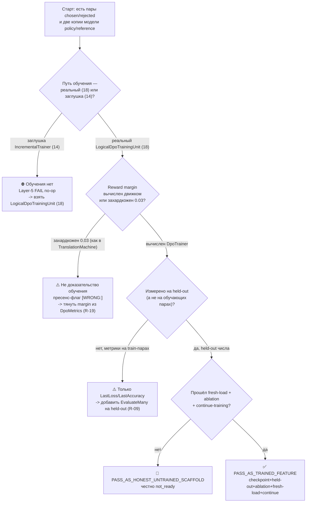

## Fable Coverage Repair Overlay (2026-07-05)

plan_readiness: PLAN_NOT_READY / FABLE_GAP_REPAIR_QUEUE
implementation_authorization: NO until fresh Luba approval after review
current_verdict_basis: Newer Fable coverage evidence `claude-fable-plan-check-v1.md` and attachment `98cbe69a` supersede the previous final-readiness overlay. Fable reports 127 findings: 91 COVERED, 30 PARTIAL, 6 MISSING. Mental implementation from active-codex would still hit plan-level design/source/dependency blockers: R-B 20/40 knowledge-library artifacts are not accepted built artifacts; R-G source addressability is incomplete; several shared contracts/readability/lifecycle carriers need plan-family repair. This is plan repair evidence only, not product implementation, not tests/builds/runtime/provider/training/checkpoint/git proof.
current_verdict_classes: DESIGN_BLOCKER_CURRENT=FABLE_MISSING_AND_PARTIAL_ITEMS; CURRENT_REPAIR_QUEUE=FABLE_RB_RG_AND_PARTIAL_REPAIR; FABLE_EVIDENCE=claude-fable-plan-check-v1.md lines 35-153 and attachment 98cbe69a lines 32-79; CURRENT_LEDGER_ACCEPTANCE_BOUNDED_EVIDENCE=previous 50/50 planning-section acceptance remains historical/process evidence only and cannot override later Fable MISSING/PARTIAL findings; IMPLEMENTATION_AUTHORIZATION_GATE=NO until fresh Luba approval after review.
historical_classification_rule: Any older line in this file saying PLAN_READY_FOR_LUBA_REVIEW, Final Readiness Review Overlay, no unresolved design/dependency blocker, CURRENT_REPAIR_QUEUE=NONE_IDENTIFIED_BY_FINAL_READINESS_REVIEW, or parent final-readiness acceptance before this overlay is historical/pre-Fable evidence only unless it cites a later unquoted Luba instruction or later evidence-bound review after 2026-07-05.
fable_gap_repair_addendum: active-codex-execution-42-fable-gap-repair-additions-20260705.md is the current repair map for R-B/R-G and the partial contract/readability/lifecycle additions.
## Historical Pre-Fable Final Readiness Review Overlay (2026-07-05)
historical_pre_fable_plan_readiness: PLAN_READY_FOR_LUBA_REVIEW
implementation_authorization: NO until fresh Luba approval after review
final_readiness_review_scope: one bounded planning/governance readiness review only; no product implementation, tests, builds, runtime, browser, provider/API, model/training/checkpoint, git, branch, mergeability, PR, or product-readiness proof was run.
historical_pre_fable_current_verdict_basis: This final review read the required governance/skill gate markers, the two unique original-task/reference attachments, the minimum Claude baseline surfaces, the active-codex plan/board/matrix/source-map/legal/gate/ledger surfaces, and current status/search evidence. End-to-end mental simulation from the active plan found no unresolved design/dependency decision that an executor would have to choose before coding/testing. The prior PLAN_NOT_READY / PLAN_PARTIAL_REPAIR_QUEUE state after 0aa/Laplace/Kepler/Singer was retained for parent final-review acceptance; this overlay supplies that final bounded review. Remaining items are execution or approval gates only: fresh Luba implementation approval, local self-authored seed file creation, code implementation, tests/builds/runtime/training/checkpoint/fresh-load/ablation proof, same-scenario Path A/Path B host proof, mock/replacement-ledger proof, branch/mergeability/git proof if later authorized, final product review, and route-specific hosted TogetherAI/Qwen3 terms/output-use proof before hosted train/common use.
historical_pre_fable_current_verdict_classes: DESIGN_BLOCKER_CURRENT=NONE_IDENTIFIED_BY_FINAL_READINESS_REVIEW; CURRENT_REPAIR_QUEUE=NONE_IDENTIFIED_BY_FINAL_READINESS_REVIEW; CURRENT_LEDGER_ACCEPTANCE_BOUNDED_EVIDENCE=50/50 accepted planning sections after 2026-07-05 Pass37-Pass50/Singer repair, not 50 cycles, not 50 product reviews, not product proof, not test/build/runtime/provider/training/checkpoint/git proof; HOSTED_PROVIDER_PRE_USE_GATE_ROUTE_SPECIFIC=TogetherAI/Qwen3 proof required before hosted train/common use only, not a local self-authored v1 planning blocker; IMPLEMENTATION_AUTHORIZATION_GATE=NO until fresh Luba approval after review.
historical_classification_rule: Any older line in this file saying PLAN_NOT_READY / PLAN_PARTIAL_REPAIR_QUEUE, current verdict remains PLAN_NOT_READY, CURRENT_REPAIR_QUEUE, parent must run final readiness review, or no-go boundaries before this overlay is historical/pre-final-readiness-review evidence only unless it cites a later unquoted Luba instruction or later evidence-bound review after 2026-07-05.
---
artifact_type: how_to_train_unit_guide
guide_id: claude-guide-02
authority_source: latest unquoted Luba work order for DPO Legal Learning active execution chain
status: populated_now_plan_only_no_training_run
last_updated: 2026-06-29
write_scope: C:\Users\lubao\Documents\xiigen\llm mvp\dpo legal build\active-codex-execution-*.md
benchmark_read_only: codex-guide-02-how-to-train.md
canon_sync:
  GraphDpoPair: 14 полей (владелец канона — блок 07; объявлен в claude-ILEARNINGDYNAMICGRAPH-PLAN-v1.md §A.4)
  TeacherProvenance: 20 полей = 13 базовых + 5 NEW (владелец канона — блок 08)
  EdgeAuthorityUnit: ILogicalUnit<EdgeAuthorityInput, EdgeAuthorityDecision> (владелец — блок 02)
  GraphEdgeKind: ровно 5 видов {FanOut, FanIn, ManyToMany, MultiOutput, ReturnLoop}
  counters: 12 фаз (Ф0..Ф11) / 27 подфаз / 64 подшага; нумерация Ф<P>.<SP>.<SS>
canon_invariants:
  - ILearningDynamicGraph = ILearningMachine<DynamicGraphDomain> (L5, без 6-го уровня, A-LM-12)
  - legal teacher gate (closed -> только judge/eval, не teacher для дистилляции; контаминация -> DATASET_REBUILD)
  - нет скрытого детерминизма на ребре (A-LM-09 / A-LM-13)
---

# Гайд 02 (claude) — Как обучать один юнит/узел графа (LoRA + DPO, reward margin, continue-training, lifecycle)

Документ-гайд для ПЛАНА `ILearningDynamicGraph` (namespace `claude-*`). Это часть
планирования (документация), **НЕ** разрешение реализовывать продукт, тренировать,
билдить, запускать раннеры, трогать git или вызывать внешние AI/модели. Реализация
требует свежего явного approve Luba после ревью.

Все цитаты кода — реально существующие строки главного чекаута `C:/Projects/llm_mvp_core`,
с точными `file:line` (проверены прямым чтением, см. §3 и §8.4). Машинные ярлыки
вторичны: сначала объясняю человеческим русским языком, код — после.

**Автор-роль:** автор гайда claude-* (Opus 4.8 MAX). **Бенчмарк:** `codex-guide-02-how-to-train.md`
(только чтение, не правится). Этот файл — улучшенная версия в моём namespace: усилены
ясность, точность цитат, привязка к канону плана (R-IDs / Ф-IDs / NEW-типы), добавлены
§0/§1 (UML-симуляции) и явная тест-стратегия по слоям. Канонические счётчики и инварианты
сохранены без изменений.

---

## ЯКОРЬ ЗАДАЧИ (CURRENT TASK / NOT THE TASK / EVIDENCE-ONLY)

```text
CURRENT TASK:  написать улучшенный гайд claude-guide-02 «как обучать один юнит/узел»
               (LoRA+DPO, reward margin, continue-training, lifecycle, split R5),
               сохранив структуру бенчмарка (8 разделов), канонические счётчики
               (12 фаз / 27 подфаз / 64 подшага; Ф<P>.<SP>.<SS>) и CANON-инварианты.
               Записать ровно в claude-guide-02-how-to-train.md.
NOT THE TASK:  исполнять/тестировать/билдить код, запускать раннеры, тренировать,
               вызывать внешние AI/API/модели, git; править/создавать любые codex-*
               (план-бенчмарк) или dcm-* / старый каркас claude-00..07; копировать
               бенчмарк слепо вместо улучшения слабых мест.
EVIDENCE-ONLY: codex-guide-02 (бенчмарк), codex-recon-core-10/11/16/18/25/27,
               codex-plan-02/07/08/10/11/12/13, мастер-план
               claude-ILEARNINGDYNAMICGRAPH-PLAN-v1.md (канон GraphDpoPair/TeacherProvenance),
               codex-EXECUTION-CONTROL-BOARD (нумерация Ф<P>.<SP>.<SS>),
               реальный код llm_mvp_core (10/11/14/18/25/27/03/00).
```

---

## 1. Назначение гайда

Этот гайд отвечает на один вопрос: **как в нашем коде реально обучается один юнит**
(он же будущий узел графа `IDynamicGraphNode`, обёртка над `ILogicalUnit`), и что план
`ILearningDynamicGraph` должен переиспользовать как есть, а что — достроить (с привязкой
к требованиям R-08/R-09/R-19 и подшагам фазы обучения Ф-доски).

Гайд нужен, потому что в репозитории есть **ДВА разных «обучения»**, и их легко
перепутать — это главный риск всего плана обучения:

- **Настоящий тренировочный путь** (РАБОТАЕТ): `18.CapabilityTraining` →
  `LogicalDpoTrainingUnit` → `LoraApplicator.Apply` + `DpoTrainer.StepVector`.
  Реальный градиент, реальный AdamW-шаг, реальные метрики `dpo_step_*.json` с
  **вычисленным** reward margin.
- **Заглушка-обёртка** (НЕ обучает): `14.ContinuousLearning` → `IncrementalTrainer`.
  Возвращает путь к файлу адаптера и больше ничего не делает (`await Task.CompletedTask`).

Если план перепутает эти два, он построит «авто-DPO» поверх заглушки и получит **ноль
обучения** (Layer-5 FAIL «no-op training loop»). Поэтому гайд явно отделяет рабочую
механику от пробелов и закрепляет канон обучения: `LogicalDpoTrainingUnit` (§3.3), а не
`IncrementalTrainer` (§3.5).

**Границы гайда (что внутри / что нет):**

| Внутри гайда | Вне гайда (упоминается только как стык/пробел) |
|---|---|
| механика обучения **одного** юнита/узла: LoRA, DPO-лосс, reward margin | авто-построение пар chosen/rejected — это claude-guide-01 / блок 07 |
| continue-training (load checkpoint → продолжить шаги) | графовая топология рёбер `GraphEdgeKind` — блоки 02/03/04 |
| lifecycle: export/import/manifest/locator | per-edge authority `EdgeAuthorityUnit` — блок 02 (канон I/O §A.4.2) |
| split общий/адаптивный (R5) на уровне модели | измерение качества графа целиком — claude-guide-03 / блок 11 |

> Связь с каноном плана: этот гайд закрывает **обучающую механику** требований
> **R-08** (обучаемость+lifecycle), **R-09** (измерение held-out/ablation/без UNKNOWN),
> частично **R-10** (split R5), и фиксирует находку **R-19** (захардкоженный RewardMargin).
> Фаза обучения на доске исполнения — это подшаги «фазы обучения/lifecycle» (owner-класс
> `sa-train`), которые стартуют только после Ф0 (ответы Luba) и закрытых exit-gate
> предыдущих фаз (правило строгой последовательности, codex-EXECUTION-CONTROL-BOARD §0.3).

---

## 1A. §0 — мини-диаграмма обучающего пути (Part A §0: классы + симуляции)

> Маленькая UML-карта именно обучающего пути одного юнита (не вся машина графа — её §0
> живёт в блоке 00/04). Цель — показать, какой класс что делает и какой статус (РАБОТАЕТ
> / ЗАГЛУШКА / ЧАСТИЧНО), и симуляцию данных по каждому соединению. Импортируемо в
> draw.io (Mermaid classDiagram).

```mermaid
classDiagram
    class LogicalDpoTrainingUnit {
      +ExecuteAsync(req) LogicalDpoTrainingResult
    }
    class LoraApplicator {
      +Apply(model, cfg) List~LoraLinear~
    }
    class LoraLinear {
      +Forward(x) Tensor
    }
    class DpoTrainer {
      +Step(batch, step) DpoMetrics
      +StepVector(batches, step) DpoMetrics
      +EvaluateMany(batches) DpoMetrics
    }
    class IncrementalTrainer {
      +TrainAsync(domain, ex) string
    }
    class TranslationMachine {
      +TrainBatchAsync(batch) LearningBatchResult
      +SaveCheckpointAsync(path)
      +LoadCheckpointAsync(path)
    }
    class LlmModel {
      +Forward(x) Tensor
      +SaveCheckpoint(path)
      +LoadCheckpoint(path)
    }
    LogicalDpoTrainingUnit ..> LoraApplicator : применяет LoRA к policy
    LogicalDpoTrainingUnit ..> DpoTrainer : крутит StepVector до сходимости
    LoraApplicator --> LoraLinear : создаёт адаптеры (возвращает сбоку)
    DpoTrainer ..> LlmModel : считает logprobs policy/reference, шаг AdamW
    TranslationMachine ..> LlmModel : Save/Load весов (disk-lifecycle)
    IncrementalTrainer ..> LoraApplicator : ОБЕЩАЕТ делегировать (но НЕ вызывает)

    note for LogicalDpoTrainingUnit "РАБОТАЕТ\nЕдинственный реальный цикл pair->LoRA->DPO->метрики\nканон обучения узла (A-LM-03 starting point)"
    note for LoraApplicator "ЧАСТИЧНО\nЗамораживает базу, создаёт lora_a/lora_b\nПРОБЕЛ: не делает SetValue, не вклеен в Forward"
    note for LoraLinear "РАБОТАЕТ (математика)\nbase(x)+scaling*((dropout(x)@A^T)@B^T)\nПРОБЕЛ: dropout всегда training:true"
    note for DpoTrainer "РАБОТАЕТ\nРеальный лосс/backward/AdamW\nИсточник ВЫЧИСЛЕННОГО reward margin"
    note for IncrementalTrainer "ЗАГЛУШКА\nTrainAsync только строит путь .lora и Task.CompletedTask\nНЕ обучает (Layer-5 FAIL)"
    note for TranslationMachine "ЧАСТИЧНО (эталон lifecycle)\nНастоящий Save/Load/Import\nЛОВУШКА: RewardMargin захардкожен 0.03"
    note for LlmModel "РАБОТАЕТ (база)\nfrozen базовая модель + персист весов\nПРОБЕЛ: Forward не знает про LoRA-адаптеры"
```



**Легенда классов**

| Класс | Что делает | Статус |
|---|---|---|
| `LogicalDpoTrainingUnit` | реальный цикл обучения одного юнита/узла | РАБОТАЕТ (канон) |
| `LoraApplicator` | замораживает базу, создаёт LoRA-адаптеры | ЧАСТИЧНО (не вклеен в Forward) |
| `LoraLinear` | адаптер поверх замороженного `Linear` | РАБОТАЕТ как математика |
| `DpoTrainer` | движок одного шага DPO (лосс/backward/AdamW) | РАБОТАЕТ |
| `IncrementalTrainer` | обёртка-обещание делегирования | ЗАГЛУШКА (НЕ обучает) |
| `TranslationMachine` | эталон `ILearningMachine` с disk-lifecycle | ЧАСТИЧНО (margin захардкожен) |
| `LlmModel` | базовая модель + персист весов | РАБОТАЕТ (без LoRA в Forward) |

**Симуляция по каждому соединению (Part A §0 — обязательно)**

| Соединение (A → B) | Пример входа (симуляция) | Ожидаемый результат по ветке |
|---|---|---|
| `LogicalDpoTrainingUnit → LoraApplicator` | policyModel + `LoraConfig{Rank=8}` | база frozen; вернулись 2 адаптера на `q_proj`/`v_proj` |
| `LogicalDpoTrainingUnit → DpoTrainer` | 1 пара, `MaxStepCount=50`, порог сходимости 0.002 | цикл `StepVector`; на шаге растёт `margin`; файлы `dpo_step_*.json` |
| `LoraApplicator → LoraLinear` | `Linear q_proj [inDim,outDim]` | `LoraLinear` со стартом B=0 (нулевая поправка), A=Kaiming |
| `DpoTrainer → LlmModel` | `ChosenIds[1,T]`, `RejectedIds[1,T]` | logprobs policy/reference → `margin=0.08` (см. §5.2), шаг AdamW по policy |
| `TranslationMachine → LlmModel` | `SaveCheckpointAsync("ckpt")` | весь стейт юнитов записан атомарно (tmp→move) |
| `IncrementalTrainer → LoraApplicator` | `TrainAsync("translation", examples)` | **никакого вызова** Apply; вернулась строка пути `translation.lora` (ЗАГЛУШКА) |

---

## 1B. §1 — флоучарт обучающего решения (Part A §1: человеческие ветки + симуляции)

> Человеческий поток принятия решения «обучили ли мы юнит по-настоящему». Узлы решений —
> вопросы человеческим языком, не имена методов.



**Симуляция по каждой ветке (Part A §1 — обязательно)**

```text
Вход: домен "translation", вызван IncrementalTrainer.TrainAsync
  -> ветка «заглушка» -> результат: путь translation.lora, веса не изменились (Z)
Вход: цикл StepVector, поле RewardMargin берётся из литерала 0.03
  -> ветка «захардкожен» -> результат: margin=0.03 не растёт между шагами (Y)
Вход: метрики выведены из тех же пар, на которых учились
  -> ветка «нет held-out» -> результат: LastAccuracy завышена, лик train↔eval (X)
Вход: held-out числа есть, но процесс не перезапускали
  -> ветка «нет fresh-load» -> результат: только scaffold-честность (W)
Вход: checkpoint сохранён, perezапуск -> LoadCheckpoint -> held-out lift, ablation > baseline
  -> ветка «всё есть» -> результат: trained feature доказан (V)
```

---

## 2. Концепт простыми словами (аналогия, без кода)

### 2.1. Что такое «обучить юнит» в нашем смысле

Представь модель как опытного переводчика, который уже неплохо говорит на языке (это
**базовая модель**, frozen, замороженная). Мы НЕ учим его языку заново. Мы учим его
**предпочтению**: «вот этот ответ лучше, чем вот тот».

Это и есть DPO (Direct Preference Optimization, прямая оптимизация предпочтений). Мы
показываем пары:
- **chosen** — правильный ответ;
- **rejected** — правдоподобно-неправильный ответ с пометкой, ЧТО именно в нём плохо
  (маркер `[WRONG: <слабость - пробел - последствие>]`).

Модель сдвигает свои веса так, чтобы chosen стал для неё чуть вероятнее, чем rejected.
Не «зазубрить chosen», а «предпочитать chosen над похожим плохим». Для графа эта же
пара живёт в каноне `GraphDpoPair` (14 полей, §A.4 мастер-плана): `chosen`, `rejected`,
`wrong_markers`, `reason` — те же сущности, плюс графовый контекст и provenance.

### 2.2. Аналогия с двумя экзаменаторами (reference vs policy)

DPO работает не «в абсолюте», а **относительно эталона**. Есть два экземпляра одной
модели:
- **reference** (эталон) — заморожен, не меняется. Это «как модель думала ДО обучения».
- **policy** (политика) — обучаемая копия, её веса двигаются.

Сравниваем: «насколько policy стала предпочитать chosen над rejected СИЛЬНЕЕ, чем это
делал reference». Если policy просто повторяет reference — обучения нет (margin ≈ 0).
Если policy реально сдвинулась в сторону chosen — margin растёт. Это защищает от
деградации: модель не уезжает от исходных знаний слишком далеко, а лишь донастраивает
предпочтение (роль `Beta=0.1` — коэффициент KL-штрафа, §3.1).

### 2.3. Аналогия с LoRA: стикеры поверх книги

Базовая модель — это толстая книга, которую дорого перепечатывать. LoRA (Low-Rank
Adaptation, низкоранговая адаптация) — это тонкие **стикеры-поправки** поверх некоторых
страниц (слоёв внимания). Книгу не трогаем (frozen), а учим только стикеры. Стикеров
мало (низкий ранг), поэтому обучение дешёвое и его легко сохранить/переслать отдельно
от книги.

Важная деталь нашей реализации (это пробел, см. §6–7): стикеры **создаются и
возвращаются «сбоку»**, но в текущем коде они НЕ вклеиваются автоматически обратно в
книгу при чтении (LoRA-путь не встроен в `LlmModel.Forward`). То есть даже после
обучения базовый `Forward` адаптеры по умолчанию не использует.

### 2.4. Reward margin: «насколько уверенно лучше»

Reward margin — это число «насколько модель предпочла chosen над rejected».
- `margin > 0` → модель права (chosen лучше) → бинарная accuracy = 1.
- `margin` растёт от шага к шагу → модель действительно учится.

ОСТОРОЖНО (главная ловушка проекта = находка **R-19**): в DPO-движке margin
**вычисляется** из log-вероятностей. Но в `TranslationMachine` поле `RewardMargin`
сейчас **захардкожено** (литерал `0.03`, если у всех пар есть маркер `[WRONG:`, иначе
`0.0`). Это «метка наличия отрицательного примера», а НЕ обучающий сигнал. Для узла
графа такой margin нельзя предъявлять как доказательство обучения.

### 2.5. Continue-training: дообучение, а не обучение с нуля

«Завести новый узел/домен с нуля» по продукту = **скопировать веса базовой модели +
дообучить на доменном DPO-шарде**, а не учить случайную модель на пустом месте.
Технически это «загрузить родительский чекпойнт, затем продолжить шаги обучения». В коде
такой путь есть (загрузка `ParentPolicyCheckpointPath`), но с нюансом порядка операций
(см. §3.4). Канон обучения требует: continue = load существующего checkpoint → продолжить,
не retrain from zero (R-08).

### 2.6. Lifecycle: где модель живёт после обучения

Обучили — мало. Нужно: сохранить чекпойнт на диск, описать манифестом (гиперпараметры,
пути, провенанс), опубликовать через ModelServer, сделать находимым через locator, уметь
импортировать и **продолжить** обучение. Для v1 активна только **общая** модель
в `llm_mvp_core` (saved/import/export) и только common-eligible rows. **Адаптивная**
пользовательская нога (`ILearningMachinePair`, в плане — `DynamicGraphMachinePair`) —
это будущая activation blueprint после решения Luba; клиентские/private/third-party rows
до этого идут в quarantine/eval/adaptive-only и не мутируют common.

---

## 3. Как это сейчас реализовано в коде (file:line; что РАБОТАЕТ / что ЗАГЛУШКА)

### 3.1. DPO-движок одного шага — РАБОТАЕТ (`11.DPO`)

`DpoTrainer` — это «движок одного шага обучения»: лосс, ручной backward, шаг оптимизатора,
сохранение метрик. Пары/токены ему подаёт внешний код.

Формула лосса документирована прямо в шапке файла:
- `C:/Projects/llm_mvp_core/11.DPO/DpoTrainer.cs:9` —
  `Loss = -E[log σ(β · (log π(y_w|x) - log π(y_l|x) - log π_ref(y_w|x) + log π_ref(y_l|x)))]`

Что реально считается в `Step` (`DpoTrainer.cs:31-69`):
- `Beta = 0.1f` — коэффициент KL-штрафа, константа: `DpoTrainer.cs:13`.
- reference log-probs (frozen) и policy log-probs (обучаемая): `DpoTrainer.cs:34-39`.
- `chosenReward = Beta*(polChosen-refChosen)`, аналогично rejected: `DpoTrainer.cs:42-43`.
- `margin = chosenReward - rejectedReward`: `DpoTrainer.cs:44`.
- `loss = -log(σ(margin)+1e-8)`: `DpoTrainer.cs:47`.
- ручной backward: `gradMargin = σ(margin) - 1`: `DpoTrainer.cs:50`; запись градиента в
  logits только для policy: chosen со знаком `+`, rejected со знаком `-`:
  `DpoTrainer.cs:51-52`.
- шаг оптимизатора по `_policy.Parameters()` и обнуление градиента: `DpoTrainer.cs:54-55`.
- метрики, включая **вычисленный** `RewardMargin = margin` и бинарную
  `Accuracy = margin>0?1:0`: `DpoTrainer.cs:57-65`.

AdamW (оптимизатор) создаётся с `weightDecay: 0.01f` (`DpoTrainer.cs:25`),
`learningRate` по умолчанию `1e-5f` (`DpoTrainer.cs:21`). **Reference не обновляется** —
обновляется только `policy.Parameters()` (`DpoTrainer.cs:54`).

LogProbs (средний log-softmax по next-token, сдвиг на 1, padding пропускается):
`DpoTrainer.cs:227-261`. Ручной backward в logits (one-hot − softmax): `DpoTrainer.cs:264-309`.

Варианты шага:
- `StepMany` — усреднение по списку батчей, `gradientScale = 1/N`, один optimizer step:
  `DpoTrainer.cs:72-125`.
- `EvaluateMany` — те же метрики БЕЗ backward/update/save (чистая оценка):
  `DpoTrainer.cs:127-167`. **Это и есть held-out-оценщик движка** (см. шаг 7, R-09).
- `StepVector` — взвешивание градиента через `DpoVectorBatch{Batch, TeachingVector,
  Weight}`: `DpoTrainer.cs:169-224`; определение record: `DpoTrainer.cs:331`.
  `VectorSignal = clamp(1 + active_slots/60, 1..2)` — усиливает сигнал по числу активных
  слотов teaching-вектора: `DpoTrainer.cs:313-320`.

Сохранение метрик (атомарно, tmp→move; DNA-правило 8 — метрики ДО инкремента шага):
`DpoTrainer.cs:322-328` (вызов внутри `Step` — `DpoTrainer.cs:68`).

Модель пары — три строки, БЕЗ source/provenance/teacher/quality полей:
- `C:/Projects/llm_mvp_core/11.DPO/Models/DpoPair.cs:3-8` (`Prompt/Chosen/Rejected`).

Метрики одного шага: `C:/Projects/llm_mvp_core/11.DPO/Models/DpoMetrics.cs:3-11`
(`Step/Loss/ChosenReward/RejectedReward/RewardMargin/Accuracy`).

ЧЕГО НЕТ в 11.DPO (честные пробелы движка): сохранения весов модели как checkpoint,
манифеста/locator, export/import, held-out-качества как артефакта, и CPU/RAM/dataset-hash
в метриках. Это training engine, а не lifecycle.

> **Привязка к канону (улучшение vs бенчмарк):** плоский `DpoPair` (3 поля) — это «5-й
> формат», который канон `GraphDpoPair` (14 полей) объединяет; недостающие 10 полей
> (provenance, source_ids, held_out, leakage-инварианты) хранятся боковым DPO-манифестом,
> а `chosen/rejected/input_context` проецируются на `LearningTrainingItem`
> (`00.Core/LearningMachineContracts.cs:30`) — **без правки контрактов 00.Core**.

### 3.2. LoRA-адаптеры — РАБОТАЮТ как математика, но НЕ вклеены в Forward (`10.LoRA`)

`LoraApplicator.Apply` (`C:/Projects/llm_mvp_core/10.LoRA/LoraApplicator.cs:12-40`):
1. замораживает ВСЕ параметры базовой модели: `LoraApplicator.cs:15-16`;
2. по `model.Blocks` берёт `block.Attention`, через reflection находит поля типа `Linear`:
   `LoraApplicator.cs:20-26`, `LoraApplicator.cs:43-55`;
3. нормализует имена (убирает `_`, lowercase), сопоставляет с `TargetModules` как
   substring: `LoraApplicator.cs:30-32`;
4. создаёт `LoraLinear` для совпавших и возвращает их списком: `LoraApplicator.cs:35,39`.

`LoraLinear` (адаптер поверх замороженного `Linear`):
- A — Kaiming `[Rank, inDim]`, B — нули `[outDim, Rank]` (старт = нулевая поправка):
  `C:/Projects/llm_mvp_core/10.LoRA/LoraLinear.cs:28-33`.
- база заморожена (`RequiresGrad=false`), `lora_a`/`lora_b` регистрируются как trainable:
  `LoraLinear.cs:36-43`.
- forward `base(x) + scaling*((dropout(x)@A^T)@B^T)`: `LoraLinear.cs:47-59`.

Конфиг по умолчанию: `Rank=8, Alpha=16, Dropout=0.05, TargetModules=[q_proj, v_proj],
Scaling=Alpha/Rank`: `C:/Projects/llm_mvp_core/10.LoRA/LoraConfig.cs:5-12`.

**ЗАГЛУШКА/ПРОБЕЛ (подтверждено кодом):** `Apply` НЕ делает `field.SetValue` и НЕ
встраивает `LoraLinear.Forward` в `LlmModel.Forward`. Адаптеры возвращаются «сбоку»; их
должен подцепить вызывающий training-loop. Также нет собственного checkpoint/export/import
LoRA-ассета и нет inference-ветки dropout (всегда `training:true`, `LoraLinear.cs:52`).
Вывод: даже после обучения `lora_a/lora_b` базовый `LlmModel.Forward` их по умолчанию не
использует — архитектурный пробел плана (см. §7 п.2).

### 3.3. Реальный обучающий юнит — РАБОТАЕТ (`18.CapabilityTraining`)

Единственный реально работающий цикл «pair → LoRA → DPO → метрики» — это
`LogicalDpoTrainingUnit : ILogicalUnit<...>`:
`C:/Projects/llm_mvp_core/18.CapabilityTraining/LlmIngredientLogicalUnits.cs:308`.

`ExecuteAsync` (`LlmIngredientLogicalUnits.cs:320-415`):
- валидация (модели, токенайзер, минимум одна preference): `:329-336`;
- применяет LoRA: `LoraApplicator.Apply(... LoraConfig ?? new LoraConfig())`: `:339`;
- (опц.) грузит родительский чекпойнт для continue-training:
  `request.Input.PolicyModel.LoadCheckpoint(ParentPolicyCheckpointPath)`: `:340-350`;
- собирает `DpoVectorBatch` на каждую пару (teaching-вектор из preference или
  `TrainingVectorBuilder.Build(prompt)`): `:356-361`;
- крутит цикл `trainer.StepVector(batches, step)` до `MaxStepCount` с ранней остановкой
  `ConvergenceMonitor`: `:367-376`;
- собирает метрики-файлы `dpo_step_*.json` и возвращает `LogicalDpoTrainingResult`
  (LastLoss/LastAccuracy/LoraAdapterCount/TrainingTimeMs/MetricFilePaths): `:378-401`.

Ingredient-список честно называет компоненты: `10.LoRA:LoraApplicator`,
`11.DPO:DpoTrainer`, `11.DPO:DpoTrainer.StepVector`: `:396-399`.

Где этот юнит вызывается: оркестратор обучения
`DefaultLogicalCapabilityTrainer.TrainAndRegisterAsync`
(`C:/Projects/llm_mvp_core/18.CapabilityTraining/DefaultLogicalCapabilityTrainer.cs`),
LoRA-фабрика `LoraConfig{Rank=2,Alpha=4}`: `DefaultLogicalCapabilityTrainer.cs:858`
(рекон-18, подтверждено).

> **Канон обучения узла:** именно `LogicalDpoTrainingUnit` — стартовая точка DPO-обучения
> узла графа (A-LM-03 «trained unit может заменить Bootstrap default после публикации
> валидированных весов»). `IncrementalTrainer` (§3.5) каноном НЕ является.

### 3.4. ВАЖНЫЙ НЮАНС ПОРЯДКА (баг-кандидат для плана)

В `LlmIngredientLogicalUnits.cs` сначала идёт `LoraApplicator.Apply` (`:339`), которая
**замораживает все параметры** базовой модели, и только ПОТОМ грузится родительский
чекпойнт `LoadCheckpoint` (`:344`). То есть continue-training загружает веса в уже
замороженную базу. Для adapter-only обучения это может быть осознанно (учим только
`lora_a/lora_b`), но это надо явно зафиксировать в плане: загружается ли вместе с базой
родительский LoRA-адаптер? Сейчас LoRA-адаптер отдельно не сохраняется/не грузится
(пробел §3.2), поэтому «continue-training адаптера» фактически не замкнут. Это пробел
плана (§7 п.5), не доказанная возможность.

### 3.5. IncrementalTrainer (14) — ЗАГЛУШКА (НЕ обучает)

`C:/Projects/llm_mvp_core/14.ContinuousLearning/Training/IncrementalTrainer.cs:17`
объявляет `IncrementalTrainer : BaseService, IIncrementalTrainer` с «контрактом
делегирования» (LoRA → cross-entropy → DpoTrainer → save adapter) в комментарии `:6-16`.
НО метод `TrainAsync` (`:38-53`):
- проверяет домен/непустые примеры: `:43-46`;
- затем просто строит путь `Path.Combine(_adapterDir, $"{domain}.lora")`,
  `await Task.CompletedTask`, и возвращает этот путь: `:50-52`;
- комментарий честно признаёт: «LoraApplicator.Apply and DpoTrainer.Step are wired up in
  16.AutonomousLearning ... Here we record the intended adapter path»: `:48-49`.

ВЫВОД: `IncrementalTrainer.TrainAsync` НЕ применяет LoRA, НЕ вызывает DpoTrainer, НЕ пишет
веса. Это заглушка пути. Любой план, который строит авто-DPO поверх `IncrementalTrainer`,
обучения не получит. По Layer 5 generated-code-review это `FAIL` как «no-op training loop»
(`generated-code-review-SKILL.md:146`).

### 3.6. Lifecycle / ModelServer — ЧАСТИЧНО (`25.ModelServer`)

`LocalModelRepository` — единственная реализация `IModelRepository`
(`C:/Projects/llm_mvp_core/25.ModelServer/Local/LocalModelRepository.cs:8`):
- `LoadWeightsAsync` открывает локальный файл `localFallbackPath` (`File.OpenRead`), иначе
  `MODEL_WEIGHTS_NOT_FOUND`: `:25-29`. Параметр `serverBaseUrl` принимается, но для
  удалённой загрузки НЕ используется (нет HTTP): `:10-14,28`.
- `UploadAsync` проверяет существование чекпойнта (`POLICY_CHECKPOINT_NOT_FOUND`): `:46-47`;
  считает SHA-256: `:57,80-85`; конвертирует `GeneratedCapabilityCheckpointManifest` →
  `RemoteUnitManifest` с endpoint `/models/{unitId}`: `:49-75`. Реальной сетевой загрузки
  нет — просто заполненный `RemoteUnitManifest`.

ЗАГЛУШКА/ПРОБЕЛ: `IModelServer` (`PublishAsync(manifest, Stream weights)` /
`OpenWeightsAsync`) объявлен, но реализаций в репозитории НЕТ (рекон-25). То есть реальной
передачи весов потоком по сети нет; import весов реально только из локального файла.
`IRemoteUnitLocator` реализован только in-memory (`InMemoryRemoteUnitLocator`, словарь по
`unitId`) — рекон-25.

Манифест/чекпойнт-контракт `GeneratedCapabilityCheckpointManifest` определён в
`C:/Projects/llm_mvp_core/18.CapabilityTraining/TeachingRegistrySnapshot.cs`
(continue-training поля `ParentUnitId/ParentPolicyCheckpointPath/TrainingStepCount`,
provenance `TrainingBranch/TrainingRunId/SourceDatasetSha256` — рекон-25/18). **НЕТ полей
teacher-провенанса** — это и закрывает канон `TeacherProvenance` (20 полей, §6.3).

### 3.7. Эталон «правильного» обученного юнита — `27.TranslationDomain`

Полный пример уровня `ILearningMachine` с настоящим disk-lifecycle:
- `TranslationMachine : ILearningMachine<TranslationDomain>` — рекон-27.
- `ExportAsync` — только МЕТАДАННЫЕ, не персист состояния (честно помечено):
  `C:/Projects/llm_mvp_core/27.TranslationDomain/TranslationMachine.cs:196-206`.
- `SaveCheckpointAsync` — реальный персист всего состояния атомарно (tmp→move):
  `TranslationMachine.cs:384-388`.
- `LoadCheckpointAsync` — единственный валидный путь после рестарта (без replay):
  `TranslationMachine.cs:444-480`.
- `ImportCheckpoint` — валидация и восстановление всех юнитов: `TranslationMachine.cs:298-360`.

Базовая модель умеет персист весов: `LlmModel.SaveCheckpoint(path)`
(`C:/Projects/llm_mvp_core/03.TransformerModel/LlmModel.cs:61`) и
`LoadCheckpoint(path) => LoadWeights(path)` (`LlmModel.cs:68`).

**Главная ловушка эталона (reward margin захардкожен) — находка R-19, точные литеральные
строки (улучшение vs бенчмарк):**
- `TranslationMachine.cs:70` — `RewardMargin: 0.03,` (фиксировано в `TrainBatchAsync`,
  scaffold-путь плоских `LearningTrainingItem`).
- `TranslationMachine.cs:125` — ветка тернара `? 0.03` (условие `:123-124`: все rejected
  содержат `"[WRONG:"`; иначе `: 0.0` на `:126`).
- `TranslationMachine.cs:187` — `RewardMargin: _trainingHistory.Count > 0 ? 0.03 : 0.0` в
  `EvaluateAsync`.

> **Точность R-19:** бенчмарк цитировал диапазон `:123-126`; прямое чтение даёт **сам
> литерал `0.03` на `:70`, `:125`, `:187`** (тернар занимает `:123-126`, но число — на
> `:125`). Цитировать литеральные строки точнее для work-order ремонта.

Контраст: настоящий вычисленный margin живёт в `DpoTrainer.cs:44,63`. План графа обязан
брать reward margin из DPO-движка, а не из захардкоженной `0.03`.

DPO-формат пары в TranslationDomain уже богатый (`chosen/rejected/[WRONG:]/SourceId/HeldOut`):
`TranslationUnitContracts.cs:124-144` — это шаблон для provenance, которого нет в плоском
`DpoPair` (§3.1), и прообраз графового `GraphDpoPair`.

### 3.8. Контракты иерархии (куда вешать обучение)

`C:/Projects/llm_mvp_core/00.Core/LearningMachineContracts.cs`:
- иерархия и правило A-LM-02 (`Train*` только на `ILearningMachine`): `:7-8,193-234`.
- `ILearningMachine<TDomain>` с `TrainBatchAsync/EvaluateAsync/ExportAsync/ImportAsync/
  GetOrchestratorAsync`: `:208-234`.
- `LearningBatchResult` с ОБЯЗАТЕЛЬНЫМИ числовыми полями `AccuracyBefore/AccuracyAfter/
  RewardMargin/CpuMs/PeakRamMb/ElapsedMs`: `:43-62` (комментарий «no placeholder or UNKNOWN
  values in production»: `:42`).
- `ILearningMachinePair<TPersonal,TGlobal>` (R5 split, anonymised sync A-LM-08): `:245-261`.

> **CANON-инвариант A-LM-12:** `ILearningDynamicGraph = ILearningMachine<DynamicGraphDomain>`
> — это L5, **без шестого уровня**. Обучение узла вешается на машину/тренер, а сам узел
> (`IDynamicGraphNode` поверх `ILogicalUnit`) — чистый инференс (A-LM-02). Шестого
> «графового» уровня иерархии не создаётся.

---

## 4. Пошаговый рецепт/алгоритм: как обучить один юнит

Ниже — порядок, который УЖЕ работает в `LogicalDpoTrainingUnit` (§3.3), плюс точки,
которые план должен достроить (помечены ПРОБЕЛ + ссылка на §7/R-ID).

Шаг 0. **Решить уровень иерархии.** Узел = `IDynamicGraphNode` поверх `ILogicalUnit`;
обучение вешается не на сам инференс-юнит, а на `ILearningMachine`/тренер (A-LM-02,
`LearningMachineContracts.cs:7-8`). Для v1 common-only route используем common checkpoint;
split common/adaptive через `ILearningMachinePair` (в плане `DynamicGraphMachinePair`,
R-10) является будущим activation blueprint, не текущей v1 personal leg.

Шаг 1. **Подготовить пары.** Нужен список preference: `Prompt/Chosen/Rejected`
(`DpoPair.cs:3-8`) или богатый `TranslationLearningExample` (`TranslationUnitContracts.cs:124`)
с `[WRONG:]`, `SourceId`, `HeldOut`. Для графа — канон `GraphDpoPair` (14 полей).
Построение пар — вне этого гайда (ПРОБЕЛ §7 п.9; владелец — claude-guide-01 / блок 07).

Шаг 2. **Две копии модели.** policy (обучаемая) + reference (frozen). DPO считает сдвиг
policy относительно reference (`DpoTrainer.cs:34-44`).

Шаг 3. **Применить LoRA к policy.** `LoraApplicator.Apply(policyModel, loraConfig)`
(`LlmIngredientLogicalUnits.cs:339`): замораживает базу, отдаёт `lora_a/lora_b` как
trainable. ПРОБЕЛ §7 п.2: адаптеры не вклеены в `Forward` (§3.2) — план должен решить
wiring (`SetValue` или адаптер-aware Forward) + inference-режим dropout.

Шаг 4. **Continue-training (если есть родитель).** Загрузить родительский чекпойнт
`LoadCheckpoint(ParentPolicyCheckpointPath)` (`LlmIngredientLogicalUnits.cs:344`). ВНИМАНИЕ
к порядку (§3.4): сейчас грузится ПОСЛЕ заморозки. Это «копия базы + дообучение», а не
обучение с нуля. ПРОБЕЛ §7 п.5.

Шаг 5. **Токенизировать пары в батчи.** Внешний код строит `DpoBatch{ChosenIds,
RejectedIds, ChosenMask, RejectedMask}` (тензоры `[1,T]`), оборачивает в
`DpoVectorBatch{Batch, TeachingVector, Weight}` (`LlmIngredientLogicalUnits.cs:356-361`).

Шаг 6. **Крутить шаги DPO.** Цикл `trainer.StepVector(batches, step)` до `MaxStepCount`,
ранняя остановка по `ConvergenceMonitor` (порог 0.002, окно) (`LlmIngredientLogicalUnits.cs:367-376`).
На каждом шаге считается реальный `margin`, `loss`, `Accuracy=(margin>0)` и сохраняется
`dpo_step_*.json` (`DpoTrainer.cs:212-223,322-328`).

Шаг 7. **Измерить на held-out.** Использовать `EvaluateMany` (БЕЗ backward/update,
`DpoTrainer.cs:127-167`) или `ILearningMachine.EvaluateAsync` с настоящими числами
accuracy/reward-margin. ПРОБЕЛ §7 п.3 (R-19): брать reward margin из движка, а не
хардкодить `0.03` (`TranslationMachine.cs:70,125,187`). Контаминация train↔held-out
блокируется (рекон-27: `TRAIN_HELDOUT_OVERLAP`); held-out — source-disjoint (R-09).

Шаг 8. **Промоушен по гейту дельты.** Повышать узел, только если
`AccuracyAfter > AccuracyBefore` (прецедент `16.AutonomousLearning` шаги 6/7, рекон-16;
строгий перевод-гейт `+0.02` / reward `>=0.025` / product `>=0.95`, рекон-27). Гейт
`ACCURACY_NOT_IMPROVED` — кандидат на anti-shortcut.

Шаг 9. **Сохранить чекпойнт + манифест.** `SaveCheckpointAsync` (`TranslationMachine.cs:384`)
или `LlmModel.SaveCheckpoint` (`LlmModel.cs:61`); собрать
`GeneratedCapabilityCheckpointManifest` (`TeachingRegistrySnapshot.cs`, рекон-25/18) с
SHA-256 и provenance (+ `TeacherProvenance` при teacher, §6.3).

Шаг 10. **Опубликовать + сделать находимым.** `IModelRepository.UploadAsync`
(`LocalModelRepository.cs:32-77`) → `IRemoteUnitLocator.RegisterAsync` (CLAUDE.md «Trainable
Unit pattern»). ПРОБЕЛ §7 п.4: `IModelServer.PublishAsync(Stream weights)` не реализован
(§3.6) — сетевой export весов не замкнут.

Шаг 11. **Fresh-load + continue-training проба.** Перезапуск процесса →
`LoadCheckpointAsync` (`TranslationMachine.cs:444`) → продолжить обучение от загруженного
состояния. ПРОБЕЛ §7 п.7: held-out/ablation/fresh-load как отдельная evidence в 18 не
реализованы (рекон-18).

Шаг 12. **Split R5.** В v1 общая модель + логика + общие сеты — в `llm_mvp_core`
(saved/import/export), and only rows with `storage_scope=CommonGlobal`,
`privacy_scope=common_allowed`, positive legal/provenance proof, and
`CommonTrainReady=true` may train common. Адаптивная пользовательская модель +
пользовательские сеты остаются будущей activation blueprint через `ILearningMachinePair`
(`LearningMachineContracts.cs:245-261`) / `DynamicGraphMachinePair`; до активации
клиентские/private/third-party rows остаются quarantine/eval/adaptive-only.
ПРОБЕЛ §7 п.8: на уровне 25 нет реализованного graph-specific common-vs-user
флага/двух ног (рекон-25).

---

## 5. Конкретные примеры с реальными значениями

### 5.1. DPO-пара chosen/rejected/[WRONG:] (реальная, из репо)

Реальная строка train-ready JSONL (рекон-27, `ru-en-product-b001-001`):

```json
{
  "id": "ru-en-product-b001-001",
  "source": "...",
  "direction": "ru-en",
  "pair_family": "...",
  "prompt": "...",
  "a_side": "Фразовая карта: Привет; Я новый тут; чем занимаешься.",
  "chosen": "Phrase map: Hey!; ... 😊",
  "rejected": "... [WRONG: product_phrase_boundary_lost - drops casual chat tone or emoji ...]",
  "validation_outcome": "train_ready"
}
```

Структура `[WRONG: <слабость - пробел - последствие>]` обязательна: rejected несёт ОДНУ
проверяемую ошибку, а не случайный мусор. Это учит модель различать тонкую разницу, а не
«chosen ≠ длинная строка». В каноне графа это поля `wrong_markers` + `reason` строки
`GraphDpoPair`.

Минимальный плоский вариант под `DpoPair` (`DpoPair.cs:3-8`):

```json
{"Prompt": "Переведи: Привет, как дела?", "Chosen": "Hi, how are you?", "Rejected": "Hello, what are you doing? [WRONG: greeting_register_shift - turns casual greeting into a different question - changes meaning]"}
```

### 5.2. Как пара превращается в число (reward margin) — числовой прогон

Псевдо-значения, чтобы показать механику `DpoTrainer.Step` (`DpoTrainer.cs:31-65`):

```text
Beta = 0.1
polChosenLogP   = -2.0   refChosenLogP   = -2.3
polRejectedLogP = -3.0   refRejectedLogP = -2.5

chosenReward   = 0.1 * (-2.0 - (-2.3)) = 0.1 * 0.3  =  0.03
rejectedReward = 0.1 * (-3.0 - (-2.5)) = 0.1 * -0.5 = -0.05
margin         = 0.03 - (-0.05) = 0.08          → RewardMargin = 0.08
loss           = -log(σ(0.08)) ≈ -log(0.52) ≈ 0.654
Accuracy       = (0.08 > 0) ? 1 : 0 = 1
gradMargin     = σ(0.08) - 1 ≈ 0.52 - 1 = -0.48  → толкает policy усиливать chosen
```

Главное: `RewardMargin` здесь — РЕЗУЛЬТАТ вычисления, и при повторных шагах он растёт
(доказано тестом `StepMany_WithCopiedReferenceImprovesRewardMarginOnRepeatedPreference`,
рекон-11).

> **Не перепутать совпадение чисел.** Вычисленный `chosenReward` в этом прогоне случайно
> равен `0.03` — но это РЕЗУЛЬТАТ формулы и зависит от logprobs. Захардкоженный `0.03` в
> §5.3 — это литерал-константа, которая НЕ зависит ни от чего и НЕ растёт. Совпадение
> числа не делает их одним и тем же.

### 5.3. Анти-пример (как НЕ надо) — захардкоженный margin (R-19)

```csharp
// TranslationMachine.cs:123-126 — НЕ обучающий сигнал, а presence-флаг (литерал 0.03 на :125):
var rewardMargin = batch.Examples.All(example =>
    example.RejectedOutputJson.Contains("[WRONG:", StringComparison.Ordinal))
        ? 0.03
        : 0.0;
```

`сейчас`: margin = `0.03` просто потому, что во всех парах есть маркер `[WRONG:`.
`почему плохо`: это не измеряет, стала ли модель предпочитать chosen; число постоянно и
не растёт от обучения; одинаково для 1 шага и 1000 шагов.
`должно стать`: брать `RewardMargin` из `DpoMetrics.RewardMargin` (`DpoMetrics.cs:9`),
вычисленного `DpoTrainer` (`DpoTrainer.cs:44/63`), и измерять на held-out (`EvaluateMany`,
`:127-167`). Это ремонт R-19 (владельцы — блоки 10/11).

### 5.4. LoRA-конфиг (реальные значения)

```text
Default (10.LoRA):                Rank=8,  Alpha=16, Dropout=0.05, scaling=2.0  (LoraConfig.cs:5-12)
IncrementalTrainer.DefaultConfig: Rank=8,  Alpha=16                            (IncrementalTrainer.cs:20-26)  ← но Trainer заглушка
DefaultLogicalCapabilityTrainer:  Rank=2,  Alpha=4                             (DefaultLogicalCapabilityTrainer.cs:858)
LogicalDpoTrainingUnit:           LoraConfig ?? new LoraConfig() (=Rank=8)     (LlmIngredientLogicalUnits.cs:339)
```

Несогласованность ранга (2 vs 8) между тренерами — кандидат на унификацию в плане
(§7 п.10).

---

## 6. Гейты и правила (что применимо к теме обучения)

### 6.1. Запрет скрытого детерминизма (R4 / R-07 / Layer 5A / A-LM-09/13)

Обучение должно быть НАСТОЯЩИМ, а не словарём/счётчиком/lookup под видом trainable.
Проверка по `generated-code-review-SKILL.md:138-220` (Layer 5/5A) и
`trainable-architecture-decision-SKILL.md:119-209`.

FAIL-признаки на пути обучения (`generated-code-review-SKILL.md:142-154`):
- статус `not_ready_*`/`not_trained_*`;
- метод возвращает фикс. дескриптор вместо вычисления из обученного состояния (= литерал
  `0.03`, §5.3);
- пустой/no-op training loop (TrainBatch не меняет состояние) — это ровно
  `IncrementalTrainer.TrainAsync` (§3.5);
- `NotImplementedException`/`throw`/`TODO` на пути обучения/инференса;
- инференс = exact-source/exact-prompt lookup под видом обобщения.

Числовая evidence обязательна (`generated-code-review-SKILL.md:149-154`): accuracy/exact/
loss/reward-margin на held-out (числа, не UNKNOWN); `cpu_ms`, `ram_mb`, row counts; train
vs test — разные сеты (без replay-leakage).

Разрешённые уровни (только пять, `trainable-architecture-decision-SKILL.md:140-148`):
`ILearningMachine`, `ILogicalOrchestrator`, `ILogicalFlow`, `ILogicalUnit`,
`ILearningMachinePair`. LoRA/DPO-движок/KNN — это компоненты ВНУТРИ уровня
(`OK_INTERNAL_DETAIL`/`OK_MODEL_COMPONENT`), а не самостоятельная архитектура
(`trainable-architecture-decision-SKILL.md:154-162`).

### 6.2. Анти-leakage (что НЕ должно попадать в обучающий сигнал)

- НЕ учить по candidate-position/индексу кандидата (order-leakage; пример
  `_candidatePositionWeights` → `CandidateOrderLeakageGuardUnit`,
  `trainable-architecture-decision-SKILL.md:425`).
- НЕ учить по `SourceId`/пути/провенансу (source/path leakage — Minimum Breadth Challenge,
  `trainable-architecture-decision-SKILL.md:209-221`). `SourceId`
  (`TranslationUnitContracts.cs:142`) — для контаминации/атрибуции, НЕ фича. В каноне это
  поле `excluded_leakage_signals[]` строки `GraphDpoPair` и leakage-free вход
  `EdgeAuthorityInput` (§A.4.2: БЕЗ candidate-index, БЕЗ `SourcePath`).
- НЕ допускать train↔held-out пересечения (рекон-27: `TRAIN_HELDOUT_OVERLAP`); held-out —
  source-disjoint (`source_disjoint_group`).
- Ablation/no-shortcut: доказать, что выбор не сводится к детерминированной формуле/мягкому
  полу confidence (рекон-18: `confidence = 0.50 + fused*0.49` даёт пол `0.50` даже при
  нулевом сигнале — проверить, R-09).

### 6.3. Легальный teacher-гейт + provenance (для авто-DPO) — канон `TeacherProvenance` (20 полей; 13+5+2 RR6 `service_mode`/`grounding_used`)

Если chosen/rejected генерирует teacher-модель — обязателен провенанс. **CANON-инвариант
легального teacher-гейта:** `closed = только judge/eval, не teacher для дистилляции`;
контаминация → `DATASET_REBUILD`.

Канонический состав `TeacherProvenance` (владелец — блок 08; синхрон claude-ILEARNINGDYNAMICGRAPH-PLAN-v1.md §A.4):
**20 полей = 13 базовых + 5 NEW.**

13 базовых:
```text
teacher_access_mode; hosting_provider; model_id; model_license; model_version;
request_id; provider_terms_checked; teacher_output_used_for_training;
closed_proprietary_model; source_ref; source_sha256; contamination_markers;
judge_model   (judge_model — ВНУТРИ TeacherProvenance, не отдельным верхним полем)
```
5 NEW (бенчмарк-дельты T2/T3/T5):
```text
terms_snapshot_ref (T2); geography_export_constraint (T2); source_category (T5);
raw_private_text_copied (T3); redaction_policy_ref (T3)
```
Вердикт-enum (владелец — блок 08 §3.3) — 6 значений:
`ACCEPT | QUARANTINE | BLOCK | DATASET_REBUILD_REQUIRED | BLOCK_FOR_COMMON | EVAL_ONLY`
(NEW `BLOCK_FOR_COMMON` — T3: приватный текст в hosted без редакции → только adaptive leg;
NEW `EVAL_ONLY` — фикс R17, блок 08 §3.3/§8.6: легально-чистая, но train-ineligible строка
из-за неполной триады C15/C15b или невоспроизводимого конверта C8, отдельный отвергаемый
вердикт, не `ACCEPT`).
**Предусловие `dpo_train_ready=true`:** `provenance_field_presence_rate == 1.0` по всем
20 полям.

Жёсткое правило (`trainable-architecture-decision-SKILL.md:132-138`,
`plan-review-SKILL.md:244-248`): Claude/OpenAI/Gemini/Gemini Grounding **запрещены** как
teacher для distillation/DPO. Если `closed_proprietary_model=true` И
`teacher_output_used_for_training=true` → вердикт всегда `DATASET_REBUILD_REQUIRED`.
Закрытые модели можно использовать только как non-training judge/eval (это поле
`judge_model` внутри provenance, R-04), не как chosen/rejected.

**Двухфазный teacher-маршрут — что меняется в обучении (Проход 4).** Такт обучения НЕ меняется; меняется ПРОИСХОЖДЕНИЕ train-строк. Этап 1 (`TP1_LOCAL`, профиль `qwen35-local-v1`) — локальный self-hosted учитель, provenance 20/20 заполняет `TeacherProvenanceAdapter`, легальная ось `G-TP-2` (лицензия весов) + `C6` (self-hosted-нога), `TermsBasis=SELF_HOSTED_NO_PROVIDER_TERMS`. Этап 2 (`TP2_HOSTED`, профиль `qwen3-together-v1`) — hosted-строки допускаются в обучение только после `ProviderTermsProof` (`G-TP-4`). Принадлежность строки этапу — поле батча `access_mode` (`local_self_hosted`|`hosted_open`|`project_local`), НЕ путать с provenance-полем `teacher_access_mode` (6 значений). Continue-training через границу этапов грузит TP1-parent как `parent_checkpoint_id` (не с нуля). Closed proprietary (Claude/OpenAI/Gemini) запрещён как teacher в ОБЕ фазы.

Источники общего обучения: предпочесть MIT/Apache-2.0 с проверенным license-файлом/URL
(`trainable-architecture-decision-SKILL.md:404-419`). Tatoeba = CC-BY (не MIT/Apache) —
проверить пригодность для common-training (рекон-27).

ПРОБЕЛ §7 п.6: ни `DpoPair`, ни манифест `GeneratedCapabilityCheckpointManifest` не несут
teacher-полей (§3.1, §3.6). План обязан добавить `TeacherProvenance` (20 полей; 13+5+2 RR6 `service_mode`/`grounding_used`) при любом
teacher. Находка **R-17**: контаминированные строки `sonnet-*` в
`training-data/orchestration-reasoning/` → `DATASET_REBUILD` (владельцы — блоки 08/07).

### 6.4. Гейты измерения и две честные PASS-категории

- `PASS_AS_HONEST_UNTRAINED_SCAFFOLD` — контракт есть, честно сообщает not_ready, не
  прячет детерминизм, доказан тестами честности.
- `PASS_AS_TRAINED_FEATURE` — checkpoint + held-out числа + ablation + fresh-load +
  continue-training + e2e через реальный хост.
(`generated-code-review-SKILL.md:138-156`, CLAUDE.md «Untrained honesty vs trained
readiness pattern».)

Выдавать scaffold за trained — самый опасный класс ошибки (masquerade). Текущая полнота
18/27 по held-out/ablation/fresh-load НЕ достаточна для `PASS_AS_TRAINED_FEATURE`
(рекон-18/27). Это требование **R-09** (без UNKNOWN).

### 6.5. Graph-Style Reconstruction Gate (на каждое ребро графа)

Для `ILearningDynamicGraph` каждое ребро (`GraphEdgeKind` — ровно 5 видов: `FanOut, FanIn,
ManyToMany, MultiOutput, ReturnLoop`) обязано назвать владельца финальной власти
(детерминистический хелпер / Unit / Flow / Orchestrator / Machine). Обучаемый финальный
решатель ребра — `EdgeAuthorityUnit : ILogicalUnit<EdgeAuthorityInput, EdgeAuthorityDecision>`
(канон I/O §A.4.2; `Weight` ребра = eval-only, НЕ авторитет). Скрытые детерминистические
shortcut'ы на ребре = `FORBIDDEN_RUNTIME_SHORTCUT` без явной пометки eval-only/baseline +
ablation (`trainable-architecture-decision-SKILL.md:41-65`). Это требование **R-07**
(`classified_mechanism_count==9`, владелец — блок 12).

### 6.6. Solved Architecture Block — единственный обучаемый механизм В РАМКАХ этого гайда (RewardMargin authority)

> По `trainable-architecture-decision-SKILL.md:22-39`. Гайд об обучении одного юнита; его
> единственный «суспект» — кто является авторитетом числа reward margin. Узловая/рёберная
> authority (`EdgeAuthorityUnit`) — в блоках 02/03/12, здесь не дублируется.

```text
problem: чем измеряется «модель стала предпочитать chosen» на узле — вычислением или
         литералом 0.03 (R-19)?
selected_design: единственный источник reward margin = DpoTrainer (DpoMetrics.RewardMargin,
         DpoTrainer.cs:44/63), измеряется на held-out через EvaluateMany (:127-167);
         literal 0.03 удаляется из TranslationMachine (:70/:125/:187).
rejected_alternatives: (1) оставить literal 0.03 как «достаточно» — отклонено (presence-флаг,
         не обучение); (2) считать margin на train-парах — отклонено (train↔eval leakage).
UML: §1A (DpoTrainer -> LlmModel) + §1B ветка «вычислен/захардкожен».
data_flow: pair -> tokenize -> StepVector(policy/reference) -> margin -> SaveMetrics ->
         EvaluateMany(held-out) -> LearningBatchResult.RewardMargin (числовой, не UNKNOWN).
current_code_refs: DpoTrainer.cs:44/63; DpoMetrics.cs:9; TranslationMachine.cs:70/125/187;
         LearningMachineContracts.cs:43-62.
future_files_classes_methods_signatures_dependencies: ремонт-владельцы — блок 10 (lifecycle)
         и блок 11 (measurement); именование NEW-типов/контрактов не меняется этим гайдом.
deterministic-vs-learned boundary: DpoTrainer math + LogProbs = learned-signal вычисление
         (OK_MODEL_COMPONENT); literal 0.03 = forbidden runtime authority для learned claim.
gates_and_tests: см. §6A (FC-26 слои) — margin-growth, no-hardcode, held-out lift, ablation.
failure_modes: margin не растёт (lr/wiring §7 п.2); margin захардкожен (R-19);
         held-out пересекается с train (рекон-27 TRAIN_HELDOUT_OVERLAP).
docs: этот гайд (§2.4/§3.7/§5.3) + claude-guide-03 (измерение) + claude-05.
```

---

## 6A. Тест-стратегия обучающего пути (по слоям FC-26; untrained-honesty vs trained-acceptance раздельно)

> По CLAUDE.md «Plan testability gate pattern» / `plan-review-SKILL.md` FC-26. Это
> усиление vs бенчмарк: каждый пробел получает явный слой теста и обе PASS-колонки.
> Тесты здесь — **проектируемые** (план-only), не запускаемые в этом гайде.

| Слой | Что проверяет на обучающем пути | Пример теста (имя/ассерт) |
|---|---|---|
| unit | один шаг DPO считает margin/loss/accuracy верно | `Step_ComputesMarginFromLogProbs` (margin == chosenReward−rejectedReward) |
| unit | LoRA-старт = нулевая поправка (B=0) | `LoraLinear_StartsAsIdentityCorrection` (Forward(x)==base(x) до обучения) |
| integration | цикл `StepVector` пишет `dpo_step_*.json` и сходится | `StepVector_ConvergesAndPersistsMetrics` |
| integration (R-19) | нет литерала reward margin | `RewardMargin_NotHardcoded` (margin меняется при разных logprobs; != 0.03 константа) |
| e2e/host | обучение через `LogicalDpoTrainingUnit`, не через заглушку | `Training_UsesCapabilityUnit_NotIncrementalStub` |
| QA-automation | held-out source-disjoint, нет пересечения | `HeldOut_IsSourceDisjoint` (рекон-27 `TRAIN_HELDOUT_OVERLAP`==0) |
| negative | заглушка `IncrementalTrainer.TrainAsync` не меняет веса | `IncrementalTrainer_IsNoOp_AndFlaggedStub` (Layer-5 FAIL ожидаем) |
| untrained-behavior | необученный юнит честно говорит not_ready | `UntrainedNode_ReportsNotReady_NoDeterministicShortcut` (= `PASS_AS_HONEST_UNTRAINED_SCAFFOLD`) |
| trained-acceptance | checkpoint+held-out+ablation+fresh-load+continue | `TrainedNode_FreshLoadHeldOutLift_AblationBeatsBaseline` (= `PASS_AS_TRAINED_FEATURE`) |
| regression | export/import round-trip сохраняет состояние (SHA-256) | `Checkpoint_ExportImport_RoundTrip_Sha256Stable` (R-08) |

UX-слой здесь N/A: путь обучения — внутренний (нет user-facing UI/API в рамках этого
гайда). Когда обучение появится в host-расширении, UX-автоматизация наследуется из блока 14.

---

## 7. Пробелы / что нужно построить в плане (каждый — work-order-кандидат, привязан к R-ID/Ф-фазе)

Сводка пробелов обучения. Каждый помечен требованием-владельцем (R-ID) и блоком плана.

1. **IncrementalTrainer (14) — заглушка.** `TrainAsync` не обучает (`IncrementalTrainer.cs:38-53`).
   План: либо реализовать делегирование в LoRA+DpoTrainer, либо явно вывести из пути
   обучения графа и использовать `LogicalDpoTrainingUnit` (§3.3) как канон. → **R-08**, блок 10.

2. **LoRA Apply без `SetValue` / без adapter-aware Forward.** `LoraApplicator.Apply`
   возвращает адаптеры «сбоку»; `LlmModel.Forward` их не использует (`LoraApplicator.cs:12-40`,
   `LoraLinear.cs:47-59`). План: решить wiring адаптеров в forward + inference-режим dropout
   (сейчас всегда `training:true`, `LoraLinear.cs:52`). → **R-08**, блок 10.

3. **RewardMargin не вычисляется в TranslationMachine (R-19).** Захардкожен `0.03/0.0`
   (`TranslationMachine.cs:70,125,187`). План: тянуть `RewardMargin` из
   `DpoMetrics.RewardMargin` (`DpoMetrics.cs:9`), считать на held-out, не хардкодить.
   → **R-19/R-09**, блоки 10/11.

4. **IModelServer не реализован.** `PublishAsync(Stream weights)`/`OpenWeightsAsync` без
   реализации; `serverBaseUrl` игнорируется в `LoadWeightsAsync`
   (`LocalModelRepository.cs:10-14,28`; рекон-25). План: замкнуть сетевой export/import
   весов или явно зафиксировать local-only. → **R-08/R-10**, блок 10.

5. **Continue-training адаптера не замкнут (нюанс порядка).** Родительский чекпойнт
   грузится ПОСЛЕ заморозки (`LlmIngredientLogicalUnits.cs:339→344`), а LoRA-адаптер
   отдельно не сохраняется/не грузится (пробел №2). План: определить формат LoRA-чекпойнта
   и порядок load→apply→continue. → **R-08**, блок 10.

6. **Нет teacher-provenance полей** в `DpoPair` (`DpoPair.cs:3-8`) и манифесте (рекон-25/18).
   План: добавить канон `TeacherProvenance` (20 полей, §6.3) при любом teacher; вердикт-enum
   с `BLOCK_FOR_COMMON`. → **R-05/R-17**, блок 08.

7. **Нет held-out/ablation/fresh-load как отдельной evidence** в 18 (рекон-18). Метрики
   выводятся на обучающих парах (`LastLoss/LastAccuracy`, `LlmIngredientLogicalUnits.cs:389-390`).
   План: добавить held-out-раннер + ablation (no-shortcut) + fresh-load пробу. → **R-09**,
   блоки 11/13.

8. **Нет реализованного split common/adaptive на уровне lifecycle (R5).** V1 не активирует
   personal/adaptive leg; он common-only. На уровне 25 нет graph-specific common-vs-user
   флага/двух ног (рекон-25). Контракт `ILearningMachinePair` есть
   (`LearningMachineContracts.cs:245-261`), но lifecycle не разделён. План: v1 manifest
   records `LegScope=CommonGlobal`; future activation adds `LegScope=PersonalAdaptive`
   and `DynamicGraphMachinePair` without allowing client/private data to train common by default. → **R-10**, блоки 04/10.

9. **Авто-построение пар для графа отсутствует в core.** 11.DPO пар не строит (рекон-11);
   `BuildChosenCapabilityText`/Rejected в 18 — прообраз, но не графовый. План: отдельный
   слой авто-DPO «узел/ребро → `GraphDpoPair`» (тема claude-guide-01). → **R-02**, блоки 07/09.

10. **Несогласованность ранга LoRA** (2 vs 8) между тренерами (§5.4). План: унифицировать
    или явно обосновать per-tier. → **R-08**, блок 10.

11. **Дубль реестров/манифестов.** `InMemoryRemoteUnitLocator` vs `ModelEndpointRegistry`;
    snake_case vs PascalCase схемы манифеста (рекон-25/assets). План: один канонический
    реестр/схема. → **R-10**, блок 10.

> **Где это исполняется (Ф-доска):** все 11 пробелов — реализационные подшаги фаз обучения/
> lifecycle/измерения (owner-класс `sa-*`, `gpt-5.5 / xhigh`), которые на момент плана =
> `remaining` и стартуют строго после Ф0 (ответы Luba) и закрытых exit-gate предыдущих фаз
> (codex-EXECUTION-CONTROL-BOARD §0.3). Этот гайд их **описывает**, но не исполняет.

---

## 8. Ссылки

### 8.1. Скилы/правила (прочитаны для гайда)
- `C:/Projects/llm_mvp_core/docs/skills/trainable-architecture-decision-SKILL.md`
  (5 уровней `:140-148`, KNN-нота `:157-162`, Legal Teacher / Provenance Gate `:108-138`,
  Graph Reconstruction Gate `:41-65`, leakage `:209-221`, Solved Architecture Block `:22-39`).
- `C:/Projects/llm_mvp_core/docs/skills/plan-review-SKILL.md`
  (DPO/distillation legal teacher gate `:217-248`, graph/DynamicGraph gate `:205-216`,
  тест-floor / FC-26).
- `C:/Projects/llm_mvp_core/docs/skills/implementation-doc-uml-SKILL.md`
  (§0 `note for` + per-connection симуляции; §1 человеческие ветки + per-branch симуляции).
- `C:/Projects/llm_mvp_core/docs/skills/generated-code-review-SKILL.md`
  (Layer 5/5A — trainable vs stub `:138-156`, числовые метрики, deterministic-boundary) —
  evidence-only из бенчмарка.

### 8.2. Канон плана / claude-* (синхрон имён и счётчиков)
- `claude-ILEARNINGDYNAMICGRAPH-PLAN-v1.md` §A.4 — канон `GraphDpoPair` (14 полей),
  `TeacherProvenance` (20 полей; 13+5+2 RR6 `service_mode`/`grounding_used`), `GraphEdgeKind` (5 видов), `EdgeAuthorityUnit`, 7 NEW-типов,
  R-01..R-19.
- `codex-EXECUTION-CONTROL-BOARD.md` §0 — нумерация `Ф<P>.<SP>.<SS>` (12 фаз / 26 подфаз /
  59 подшагов) — evidence-only (бенчмарк).
- `claude-04-dpo-legal-model-policy.md` — provider terms gate, provenance-поля.
- `claude-05-dpo-data-training-measurement-guide.md` — measurement families, anti-deterministic
  training warning, async-комбинации.
- `claude-06-ilearningdynamicgraph-architecture-brief.md` — иерархия машины, evidence-map.

### 8.3. Рекон-сводки (codex-recon-*, evidence-only)
- `.../codex-recon-core-11-dpo.md`, `.../codex-recon-core-10-lora.md`,
  `.../codex-recon-core-16-autonomous.md`, `.../codex-recon-core-25-modelserver.md`,
  `.../codex-recon-core-18-capability.md`, `.../codex-recon-core-27-translation.md`,
  `.../codex-recon-core-assets.md`, `.../codex-recon-mvp-novyy-domen.md`.

### 8.4. Реальные файлы кода (проверены прямым чтением)
- `C:/Projects/llm_mvp_core/11.DPO/DpoTrainer.cs` (Step `:31-69`, формула `:9`, Beta `:13`,
  margin `:44`, метрики `:57-65`, StepMany/EvaluateMany/StepVector `:72-224`, LogProbs/
  BackwardLogProbs `:227-309`, SaveMetrics `:322-328`, `DpoVectorBatch` `:331`).
- `C:/Projects/llm_mvp_core/11.DPO/Models/DpoPair.cs:3-8`,
  `C:/Projects/llm_mvp_core/11.DPO/Models/DpoMetrics.cs:3-11`.
- `C:/Projects/llm_mvp_core/10.LoRA/LoraApplicator.cs:12-55`,
  `C:/Projects/llm_mvp_core/10.LoRA/LoraLinear.cs:28-59`,
  `C:/Projects/llm_mvp_core/10.LoRA/LoraConfig.cs:5-12`.
- `C:/Projects/llm_mvp_core/14.ContinuousLearning/Training/IncrementalTrainer.cs:17,38-53`
  (заглушка `TrainAsync`).
- `C:/Projects/llm_mvp_core/18.CapabilityTraining/LlmIngredientLogicalUnits.cs:308-415`
  (`LogicalDpoTrainingUnit`), `.../DefaultLogicalCapabilityTrainer.cs:858`,
  `.../TeachingRegistrySnapshot.cs` (манифест-контракт).
- `C:/Projects/llm_mvp_core/25.ModelServer/Local/LocalModelRepository.cs:8-85`
  (+ Contracts `IModelRepository`/`IModelServer`/`IRemoteUnitLocator`).
- `C:/Projects/llm_mvp_core/27.TranslationDomain/TranslationMachine.cs`
  (Export `:196-206`, Save `:384-388`, Load `:444-480`, Import `:298-360`; захардкоженный
  RewardMargin `:70`/`:125`/`:187`), `.../TranslationUnitContracts.cs:124-144`.
- `C:/Projects/llm_mvp_core/03.TransformerModel/LlmModel.cs:61,68` (SaveCheckpoint/LoadCheckpoint).
- `C:/Projects/llm_mvp_core/00.Core/LearningMachineContracts.cs:7-8,43-62,208-234,245-261`
  (иерархия A-LM-02, `ILearningMachine`, `LearningBatchResult`, `ILearningMachinePair`).

---

> **Статус гайда:** PLAN-ONLY, populated_now, без запуска обучения. Канонические счётчики
> (12 фаз / 27 подфаз / 64 подшага; Ф<P>.<SP>.<SS>), канон `GraphDpoPair`/`TeacherProvenance`/
> `GraphEdgeKind`/`EdgeAuthorityUnit` и CANON-инварианты (A-LM-12 без 6-го уровня; легальный
> teacher-гейт; нет скрытого детерминизма A-LM-09/13) сохранены без изменений. Реализация
> любого пробела §7 требует свежего явного approve Luba после ревью.
---
---

# Active Codex Execution Addendum - DPO Legal Learning

## Current Live Authority And Evidence Boundary

This file is an active execution copy of the Claude baseline artifact. The original `claude-*` file remains unchanged. Claude remains the baseline because it is stronger by Luba criteria: human clarity, readable architecture, architectural reliability, evidence honesty, requirement fidelity, execution-control quality, and low overclaim risk. `codex-*` files are delta/source-map evidence only, not the baseline and not product-readiness proof.

Current active task source is Luba's latest live unquoted instruction for the DPO Legal Learning active plan chain. Prior sub-agent packets are evidence to verify, not live commands. The Heisenberg/no-branches/git-realignment branch of work is explicitly NOT THE TASK and must not be revived as a blocker, cleanup scope, branch operation, commit/push reason, or planning-repo git task.

Codex delta inputs retained for this addendum:

- `C:\Users\lubao\Documents\xiigen\llm mvp\dpo legal build\codex-EXECUTION-CONTROL-BOARD.md`: matching branch/source-map notes for `DPOLegalLearning`; not repo authority and not a source for expanding scope.
- `C:\Users\lubao\Documents\xiigen\llm mvp\dpo legal build\codex-REQUIREMENTS-COVERAGE-MATRIX.md`: matching notes for Claude latest-updated branch authority and `DPOLegalLearning` working branch/work name; not independent authority.
- `C:\Users\lubao\Documents\xiigen\llm mvp\dpo legal build\codex-ILEARNINGDYNAMICGRAPH-PLAN-v1.md`: crosswalk and plan-only branch authority wording.

Do not claim Codex 50/50 cycles as proven product readiness. Ledger rows, checklist rows, generated tables, and summaries are not completed cycles unless independently inspectable review/fix evidence records exist for the exact claim.

## Active Requirement Count Strategy

The active execution requirement count strategy is:

- original Claude `R1-R20` / master `R-01..R-20` baseline remains the quality and honesty baseline;
- Claude baseline, with matching non-contradictory Codex delta evidence, defines `R21`: latest-updated implementation source-branch authority plus the `DPOLegalLearning` work name rule for implementation repo copies/workdirs under `C:\Projects`;
- current Luba execution requirements are live addendum requirements and must be checked by pre-implementation, pre-commit, pre-push, and before-stop gates;
- the prior no-branch planning-repo policy packet is quarantined evidence only and is not an active task, stop gate, branch-cleanup requirement, or permission to touch planning-repo git state.

This strategy is an execution-control strategy, not product-readiness proof.

## R21 - Source Authority, Working Directory, And DPOLegalLearning

For each participating repository/source role before implementation:

1. Identify the source authority as the most advanced/latest-updated branch in that repository at the time work starts, using read-only git commands.
2. Treat the source authority branch as read-only authority, not as the implementation work branch.
3. Because `C:\Project` does not exist and `C:\Projects` exists in this environment, use `C:\Projects` as the implementation root. Create or use a separate working directory for the work name `DPOLegalLearning`, with repo copies under `C:\Projects\DPOLegalLearning\<repo-name>` unless an existing active plan row names a more specific safe `C:\Projects` path.
4. The controlling repo-by-repo authority/source-to-plan table is `active-codex-execution-02-source-inventory-and-reference-map.md` R21.1. During future implementation, record the concrete repo path or URL, branch-list source, selected latest-updated branch, selected branch timestamp/ref evidence, divergence note, separate `C:\Projects` working directory, and work name `DPOLegalLearning`.
5. Participating Claude-baseline route/source identifiers are `llm_mvp_core` (core implementation), `xiigen-platform-dot-net-angular` (public API facade for R16/R17), `xiigen-flows-dot-net-angular` (FLOW-31/FLOW-38 internal seam), and client/caller labels `FigmaToCode-design-gen` + `CanvaToCode` (R16 html/css clients). FigmaToCode/CanvaToCode are not implementation-repository authority for the platform host unless a later exact source proves that. Codex may be used only as matching delta/source-map evidence. This list must not be expanded from discovered/copied workdirs unless Luba explicitly expands repo scope.
6. Do not switch, create, delete, rebase, merge, cherry-pick, push, or open PRs in `C:\Users\lubao\Documents\xiigen`. That planning location may be read only as an evidence source when needed; no git realignment or branch cleanup is part of this chain.

## Execution Actor And Stop Gate

Future implementation, if later authorized, must run through bounded sub-agent work packets, requested model/mode `gpt-5.5` / `xhigh` (user wording: gpt 5.5 extra high). Parent orchestrates and no unbounded executor is allowed. Each packet must name exact scope, allowed files/repos, max time, required report packet, accepted evidence, and forbidden actions. A spawned bounded sub-agent is already the delegated execution actor for its allowed scope and must not invoke nested Codex/Claude/CLI agents unless the work order explicitly asks for nested delegation. Ledger rows, tables, summaries, and self-review are not fake cycles and cannot be reported as sub-agent passes.

Stop is allowed only when the product is fully ready, or when a true external blocker remains after mitigation/discovery and decision-prep. Before any stop, the worker must check whether the active plan is complete. If incomplete, the worker must identify the loophole that would cause premature stop, repair the governing plan/gate/skill text inside the allowed scope, and continue the nearest safe authorized work. NOT READY, NEEDS_FIX, review findings, partial evidence, and missing verification are bounded work queues, not completion claims.

## Pre-Commit And Pre-Push Merge/PR Conflict Gate

Before every commit and before every push during implementation:

1. Re-read the current source authority branch for each participating implementation repo because the source branch may advance in parallel.
2. Validate that merge/PR into the original source authority branch copied from has no conflicts.
3. Record the exact command or tool evidence used for the no-conflict result.
4. If conflicts exist, stop the commit/push path, repair or prepare a decision packet, then re-check against the current source authority.
5. Do not create PRs and do not merge unless Luba gives a separate future instruction.

This gate does not authorize any branch operation, commit, push, merge, PR, or cleanup in `C:\Users\lubao\Documents\xiigen`.

## External APIs And Mock-Only Technical Debt Gate

Future implementation, if later authorized, must handle every external API/resource path through an explicit seam/interface/adapter boundary, mock the expected external response instead of making the real external call, and add a unit test that asserts exactly the expected mock response/result. Record replacement of the mock with the real external resource call only in:

`C:\Users\lubao\Documents\xiigen\llm mvp\DPO LEARNING\codex-external-calls-mock.md`

This mock replacement record is the only allowed technical debt. No other technical debt may be introduced under this active plan. Mock-only evidence must not be reported as real external integration readiness.

## Current Worker Execution Boundary

Current 2026-06-29 planning-repair boundary: Luba's latest unquoted instruction says `План не готов к выполнению - нужно починить`. This worker is authorized only to repair active plan files in this folder. Product implementation, implementation workdir setup/copying, repo inventory, tests/builds, git actions, commits, pushes, PRs, merges, and mock-debt file edits are NOT AUTHORIZED in this task. Any earlier wording that implied starting implementation after coherence is superseded until a later plan-readiness gate truly passes and Luba gives fresh implementation authority.

Source `claude-*` and `codex-*` files remain read-only. In this planning-repair task, PRs, merges, commits, pushes, branch switches, workdir copying, and implementation repo edits are forbidden. Future implementation commits/pushes may be considered only in separate implementation workdirs after plan readiness, a bounded sub-agent work order, and the mergeability/no-conflict gate pass; PRs and merges still require separate future Luba instruction.
## PASS27 Original-Task Coverage And Latest Baseline Reconciliation

Historical/pre-post-repair status at that pass was `PLAN_NOT_READY`; historical/pre-0aa post-repair review readiness was `PLAN_READY_FOR_LUBA_REVIEW`; historical/pre-Fable 2026-07-02 bounded-repair verdict was `PLAN_NOT_READY / PLAN_PARTIAL_REPAIR_QUEUE`; implementation authorization remains `NO until fresh Luba approval after review`. See `active-codex-execution-18-pass27-original-task-coverage-reconciliation.md`, `active-codex-execution-plan-14-stage-references.md` §3.2, and Pass30/Pass39 overlays for the controlling latest-baseline reconciliation. Current active-codex canon after Pass30/Pass39: 12 phases / 27 subphases / 64 substeps; `TeacherProvenance` 20 fields (13 base + 5 NEW + 2 RR6 `service_mode`/`grounding_used`); exactly one active pilot `language-translate`; Source-to-Plan is 64/64 accepted as plan-14/source-map inventory evidence only, not readiness, B-22 closure, implementation authorization, test proof, or execution proof; hosted Qwen3/Together train use remains blocked until provider terms proof and Luba hosted-use approval; held-out scorer defaults to `RuntimeProductAccuracy` plus per-domain scorer (`language-translate`: exact-match + char-accuracy). Any older unqualified 12/26/59, 18-field, 8/64 (частично; historical/pre-PASS27 corrected from 8/59), incomplete-source-inventory, still-incomplete Source-to-Plan, or narrower ready wording in this file is historical/pre-0aa evidence only.

## Pass10 SeedCorpus-LanguageTranslate Training Guide Mirror

For the only active v1 pilot, `language-translate`, future training may consume
`SeedCorpus-LanguageTranslate-v1` only after a later approved implementation
creates the JSONL fixture at
`llm_mvp_core/27.TranslationDomain/SeedData/language-translate-seed-v1.jsonl`
or an equivalent active path under `27.TranslationDomain/SeedData/`. This guide
mirror is plan text only; it does not create seed data, run training, or prove
quality.

Required row fields are `seed_id`, `source_language`, `target_language`,
`input_text`, `chosen_translation`, `rejected_translation`, `wrong_marker` or
`rejected_reason`, `split=train|held_out`,
`source_category=synthetic_self_authored`,
`license=project_internal_self_authored`, `TeacherProvenance` or provenance
refs, `semantic_quality_claimed=false`, and `expected_label` only for
`split=held_out` rows where it must equal `chosen_translation`. The training path reads only
`split=train`. Rows missing provenance, license, source category, or the
semantic-quality sentinel are rejected or quarantined before train-ready.
Each row maps to one unit/domain item and may produce only unit-level
`GraphDpoPair` material; graph-wide/blob DPO remains forbidden.
Example authoring shape is self-authored only: positive/gold
`input_text="good morning"` with `chosen_translation="доброе утро"` and
held-out `expected_label="доброе утро"`; rejected contrast
`rejected_translation="спокойной ночи"` with
`wrong_marker="wrong_time_of_day"`; quarantine if provider/chatbot, third-party,
web-scraped, missing-provenance, missing-license, or mismatched-gold text is
present.


