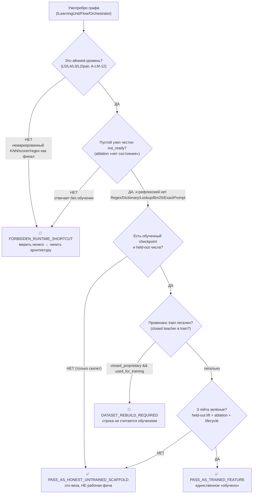
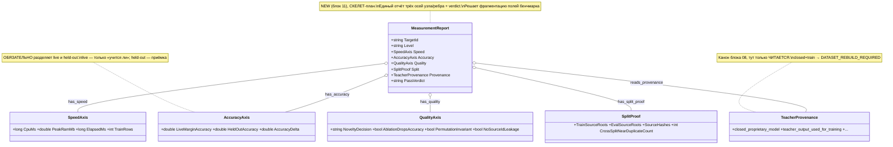

## Current Code-First Reconciliation Overlay (2026-07-14)

current_implementation_authorization: YES_CODE_FIRST_ONLY
teacher_dpo_training_authorization: NO_TEACHER_DPO_TRAINING_UNTIL_G_DPO_FINAL
dpo_status: NOT_STARTED
dpo_priority: LAST
current_counters: 12 phases / 27 subphases / 64 substeps

## Historical Fable Coverage Repair Overlay (2026-07-05)

historical_fable_plan_readiness: PLAN_NOT_READY / FABLE_GAP_REPAIR_QUEUE
historical_fable_implementation_authorization: NO until fresh Luba approval after review
historical_fable_verdict_basis: Newer-at-that-time Fable coverage evidence `claude-fable-plan-check-v1.md` and attachment `98cbe69a` superseded the previous final-readiness overlay. Fable reported 127 findings: 91 COVERED, 30 PARTIAL, 6 MISSING. This is historical plan-repair evidence only, not current execution authority and not product/test/build/runtime/provider/training/checkpoint/git proof.
historical_fable_verdict_classes: DESIGN_BLOCKER_AT_THAT_TIME=FABLE_MISSING_AND_PARTIAL_ITEMS; REPAIR_QUEUE_AT_THAT_TIME=FABLE_RB_RG_AND_PARTIAL_REPAIR; FABLE_EVIDENCE=claude-fable-plan-check-v1.md lines 35-153 and attachment 98cbe69a lines 32-79; IMPLEMENTATION_AUTHORIZATION_GATE_AT_THAT_TIME=NO until fresh Luba approval after review.
historical_fable_classification_rule: Any older line in this file saying PLAN_READY_FOR_LUBA_REVIEW, Final Readiness Review Overlay, no unresolved design/dependency blocker, CURRENT_REPAIR_QUEUE=NONE_IDENTIFIED_BY_FINAL_READINESS_REVIEW, or parent final-readiness acceptance before this overlay is historical/pre-Fable evidence only unless it cites later authority.
historical_fable_gap_repair_addendum: active-codex-execution-42-fable-gap-repair-additions-20260705.md was the historical repair map for R-B/R-G and partial contract/readability/lifecycle additions; it is not current authority.
## Historical Pre-Fable Final Readiness Review Overlay (2026-07-05)
historical_pre_fable_plan_readiness: PLAN_READY_FOR_LUBA_REVIEW
historical_pre_fable_implementation_authorization: NO until fresh Luba approval after review
historical_pre_fable_final_readiness_review_scope: one bounded planning/governance readiness review only; no product implementation, tests, builds, runtime, browser, provider/API, model/training/checkpoint, git, branch, mergeability, PR, or product-readiness proof was run.
historical_pre_fable_current_verdict_basis: This final review read the required governance/skill gate markers, the two unique original-task/reference attachments, the minimum Claude baseline surfaces, the active-codex plan/board/matrix/source-map/legal/gate/ledger surfaces, and current status/search evidence. End-to-end mental simulation from the active plan found no unresolved design/dependency decision that an executor would have to choose before coding/testing. The prior PLAN_NOT_READY / PLAN_PARTIAL_REPAIR_QUEUE state after 0aa/Laplace/Kepler/Singer was retained for parent final-review acceptance; this overlay supplies that final bounded review. Remaining items are execution or approval gates only: fresh Luba implementation approval, local self-authored seed file creation, code implementation, tests/builds/runtime/training/checkpoint/fresh-load/ablation proof, same-scenario Path A/Path B host proof, mock/replacement-ledger proof, branch/mergeability/git proof if later authorized, final product review, and route-specific hosted TogetherAI/Qwen3 terms/output-use proof before hosted train/common use.
historical_pre_fable_current_verdict_classes: DESIGN_BLOCKER_CURRENT=NONE_IDENTIFIED_BY_FINAL_READINESS_REVIEW; CURRENT_REPAIR_QUEUE=NONE_IDENTIFIED_BY_FINAL_READINESS_REVIEW; CURRENT_LEDGER_ACCEPTANCE_BOUNDED_EVIDENCE=50/50 accepted planning sections after 2026-07-05 Pass37-Pass50/Singer repair, not 50 cycles, not 50 product reviews, not product proof, not test/build/runtime/provider/training/checkpoint/git proof; HOSTED_PROVIDER_PRE_USE_GATE_ROUTE_SPECIFIC=TogetherAI/Qwen3 proof required before hosted train/common use only, not a local self-authored v1 planning blocker; IMPLEMENTATION_AUTHORIZATION_GATE=NO until fresh Luba approval after review.
historical_pre_fable_classification_rule: Any older line in this file saying PLAN_NOT_READY / PLAN_PARTIAL_REPAIR_QUEUE, current verdict remains PLAN_NOT_READY, CURRENT_REPAIR_QUEUE, parent must run final readiness review, or no-go boundaries before this overlay is historical/pre-final-readiness-review evidence only unless it cites later authority.
# Гайд 03 — Как мерить скорость, точность и качество обучения

Часть ПЛАНА проекта `ILearningDynamicGraph` (авто-построение DPO для
`ILearningUnit`/`ILearningFlow`/`ILearningOrchestrator`/`ILearningDynamicGraph`,
маппинг на реальную иерархию `ILearningMachine`/`ILogical*`). Это документ-гайд,
**не разрешение на реализацию**. Все цитаты кода — реально существующие, проверены
по `file:line` в `C:/Projects/llm_mvp_core` на дату ревизии (см. §8, «как проверены
цитаты»).

Автор: Opus 4.8 MAX (роль — автор гайда измерения, namespace `claude-*`). Язык —
русский, человеческим языком сначала, код потом (Part A-формат).

> **Канон и счётчики (общие со всеми `claude-*`).** Этот гайд НЕ задаёт свой канон —
> он только **читает** канон-типы для нужд измерения. Владельцы общих типов:
> `GraphDpoPair` (14 полей) принадлежит блоку 07 (`claude-plan-07`), `TeacherProvenance`
> (20 полей) принадлежит `claude-plan-08` §3.1; единый отчёт измерения `MeasurementReport` (+ `SpeedAxis`/`AccuracyAxis`/
> `QualityAxis`/`SplitProof`) и раннер `IGraphMeasurementRunner` вводит блок
> `claude-plan-11` (measurement). `GraphEdgeKind` — 5 членов. Счётчики каркаса
> исполнения — **ровно 12 фаз / 27 подфаз / 64 подшага**, нумерация `Ф.ПП.СС`
> (например `Ф5.2.3`). Полная карта фаз — в `claude-plan-11-measurement.md §0-pre`;
> этот гайд даёт человеческое объяснение, к каким фазам относится каждый шаг §4.

> **CANON-инварианты, которые гайд обязан сохранять.**
> 1. `ILearningDynamicGraph = ILearningMachine<DynamicGraphDomain>` — это L5, **без
>    6-го уровня** (A-LM-12). Никакой «уровень над машиной» не вводится.
> 2. Легальный teacher-гейт: closed-proprietary модель допустима **только как judge/
>    eval-критик**, НЕ как teacher для дистилляции. Контаминация train closed-выходом
>    → `DATASET_REBUILD_REQUIRED` (§6, гейт 6).
> 3. Нет скрытого детерминизма (A-LM-09/A-LM-13): прежде чем мерить «обученность»,
>    доказать, что это не replay/lookup (§6, гейт 5).

---

## 1. Назначение гайда

Этот гайд отвечает ровно на один вопрос: **как доказать числом, что узел графа
(`ILearningUnit`/`ILearningFlow`/`ILearningOrchestrator`) реально обучился, а не
притворяется.** Он даёт три оси измерения и две «честности», чтобы план
`ILearningDynamicGraph` не принял заглушку за обученную фичу.

Три оси:

- **СКОРОСТЬ** — сколько стоило обучение: `CpuMs`, `PeakRamMb`, `ElapsedMs`,
  `train_rows`. Это «дорого/дёшево», а не «правильно». Идёт в `SpeedAxis`.
- **ТОЧНОСТЬ** — насколько модель права. Здесь главный подвох: **live-accuracy
  (доля пар с `margin>0` на обучающем потоке) — это НЕ точность.** Точность узла
  графа доказывается только на **held-out** (отложенных, не виденных при обучении)
  строках. Идёт в `AccuracyAxis` (раздельно `LiveMarginAccuracy` и `HeldOutAccuracy`).
- **КАЧЕСТВО** — это ли обучение, а не утечка/память: **novelty-gate** (учим новое,
  а не зубрим), **ablation** (без обученного состояния узел обязан быть `not_ready`),
  **permutation-invariance** (решение не зависит от порядка кандидатов или id
  источника). Идёт в `QualityAxis`.

Две честности (две разные легитимные «зелёные» оценки, которые НЕЛЬЗЯ путать):

- `PASS_AS_HONEST_UNTRAINED_SCAFFOLD` — скелет честно говорит «я не обучен». Это
  **веха, не рабочая фича**.
- `PASS_AS_TRAINED_FEATURE` — обученная фича с полным комплектом доказательств
  (3 гейта: held-out числа + ablation + lifecycle export/import/fresh-load/
  continue-training через реальную точку входа).

Гайд опирается на уже работающие в репозитории образцы измерения
(`27.TranslationDomain`, `11.DPO`, тесты обучаемых машин в `Tests/`) и на правила
скилов (`trainable-architecture-decision-SKILL.md`,
`phase-completion-packager-SKILL.md`, `capability-measurement-SKILL.md`,
`plan-review-SKILL.md`).

### Карта «шаг рецепта → ось → локальный шаг блока» (быстрый ориентир)

> **Дисклеймер канон-фаз (синхрон с `claude-plan-11 §0-pre`, строки 92–98).** Глобально
> **весь** блок измерения — это **одна** фаза доски **Ф5 «Измерение»** (канон доски — ровно
> Ф0…Ф11). Колонка ниже даёт **локальный** разбор этого блока шагами `Lk` (L = local block
> step), это НЕ канон-фазы доски. ID вида `Ф12.*.*` намеренно не используется, чтобы не
> выходить за канон Ф0…Ф11 (как в `claude-plan-11` строки 96–98: `Фk ≡ Lk` локально).

| Шаг §4 | Ось/тема | Локальный шаг блока 11 (Lk; вся фаза доски = Ф5 «Измерение») | Главная цитата-эталон |
|---|---|---|---|
| Шаг 0 | классификация уровня | L2 | `trainable-architecture-decision-SKILL.md` |
| Шаг 1 | честность НЕобученного | L3 | `PromptToTaskMachineSkeletonTests.cs:18-22, 79-85` |
| Шаг 2 | сплит без пересечения | L4 | `TranslationProductHeldOutRunner.cs:285-287` |
| Шаг 3 | точность двумя числами + loss-сходимость | L5 | `DpoTrainer.cs:60,116` (loss) и `:64,120` (live) vs `:369-374` |
| Шаг 4 | качество (не утечка) | L6 | `TatoebaPilotLoopRunner.cs:777`, `Learn06...:42` |
| Шаг 5 | скорость (ресурсы) | L7 | `TranslationProductHeldOutRunner.cs:239-241` |
| Шаг 6 | lifecycle | L8 | `SkillSelectionPhase06TrainedSelectorEvidenceTests.cs` |
| Шаг 7 | честность + промоушен-гейт | L9–L12 | `:211-220`, Two-PASS |

---

## §0. Схема измерения (UML, importable to draw.io)

> Это объяснительные диаграммы гайда, не финальный код. Классы-канон (`MeasurementReport`
> и оси) вводит блок 11; провенанс (`TeacherProvenance`) — read-only канон блока 08.

### §0.1 Поток решения «scaffold / trained / rebuild / shortcut» (flowchart)



**Симуляции по веткам (обязательно):**

| Ветка | Вход (симуляция) | Ожидаемый результат |
|---|---|---|
| B → SHORT | ребро решает по `_candidatePositionWeights` как финал | `FORBIDDEN_RUNTIME_SHORTCUT`, измерение не запускается |
| C → SHORT | пустая машина выдаёт «перевод» без state | shortcut: отвечал не узел, а спрятанный детерминизм |
| C → D | пустой узел → `NotTrainedStatus`, рефлексией нет запретных полей | переходим к проверке обучения |
| D → SCAF | контракт есть, checkpoint нет | `PASS_AS_HONEST_UNTRAINED_SCAFFOLD` (веха) |
| E → REB | train-строка `teacher=Claude`, `used_for_training=true` | `DATASET_REBUILD_REQUIRED`, набор в карантин |
| F → TR | held-out +0.04, ablation роняет accuracy, fresh-load==trained | `PASS_AS_TRAINED_FEATURE` |
| F → SCAF | held-out есть, но fresh-load≠trained (lifecycle не доказан) | остаёмся scaffold, не trained |

### §0.2 Единый отчёт измерения `MeasurementReport` (class diagram)



> **AUDIT-FINDING NOTE (A4 — abridgement/read-only-subset) — `SpeedAxis` рендер без `RunSpeed` (A6/F-A4-6, MEDIUM):** `MeasurementReport`/`SpeedAxis` выше — read-only subset: `SpeedAxis` тут несёт `CpuMs/PeakRamMb/ElapsedMs/TrainRows` (train/resource-cost), но НЕ ось `RunSpeed` (inference/routing-cost: `InferenceElapsedMs/ThroughputRowsPerSec/RoutingElapsedMs/PerCandidateElapsedMs/PerBatchElapsedMs`). Полный owner-канон `MeasurementReport` с `RunSpeed` — `plan-11` §7 (FABLE-REPAIR P08/P12-E, :523/:536/:587/:602/:615). Здесь показан только train-speed подмножество; полный `MeasurementReport` — у owner. Статус: residual A4-R6 MEASUREMENT_RUNSPEED_SWEEP_DECLARED_NOT_EXECUTED (MEDIUM; RunSpeed-sweep по всем рендерам объявлен, но не исполнен — потребители guide-03/plan-06 без `RunSpeed`/`PerCandidateElapsedMs`). (owner-канон plan-11 не тронут; readiness/счётчики не тронуты.)

| Соединение | Пример входа (симуляция) | Ожидаемый результат по этой ветке |
|---|---|---|
| MeasurementReport o-- AccuracyAxis | live=0.62, held-out=0.44 | `Accuracy{Live=0.62, HeldOut=0.44, Delta=+0.04}` — разделены |
| MeasurementReport o-- SplitProof | near-dup=0 | accuracy разрешена; near-dup>0 → блок до адъюдикации |
| MeasurementReport o-- TeacherProvenance | `closed=true, used_for_training=true` | `PassVerdict=DATASET_REBUILD_REQUIRED` |

---

## 2. Концепт простыми словами (аналогия, без кода)

Представьте, что вы нанимаете и проверяете **переводчика**.

- **СКОРОСТЬ** — сколько времени и сил он потратил на курс: часы, усталость,
  сколько карточек прошёл. Важно для бюджета, но быстро выученный курс не значит,
  что человек переводит хорошо.

- **ТОЧНОСТЬ на тренировке vs точность на экзамене.** Пока вы учите переводчика на
  конкретных карточках, легко добиться, чтобы на ЭТИХ карточках он отвечал лучше
  «себя вчерашнего». Это и есть live-accuracy: «на учебных парах правильный вариант
  теперь нравится модели больше неправильного». Но это ничего не говорит о незнакомом
  тексте. Настоящий экзамен — **новые** фразы, которых не было в учёбе (held-out).
  Только провал/успех на новом тексте — это «точность».

- **КАЧЕСТВО = доказать, что он именно научился, а не схитрил.** Три ловушки:
  1. **Зубрёжка вместо понимания** (novelty-gate): если он заучил ответы и не видит
     новых слов, его нельзя «повышать». Учить надо новое.
  2. **Тайная шпаргалка** (ablation): отнимите выученное состояние — он обязан честно
     сказать «я ещё не готов». Если без обучения он всё равно «отвечает», значит,
     отвечал не он, а спрятанная детерминированная шпаргалка (regex/словарь/точный
     lookup).
  3. **Подсматривание разметки** (permutation/leakage): если он угадывает по номеру
     варианта в списке, по имени файла или по id источника — это не перевод, это
     списывание. Поменяйте порядок вариантов: правильный ответ не должен «переехать»
     только из-за перестановки.

- **Две честности.** Есть разница между «честный стажёр, который прямо говорит: я ещё
  не учился» (`PASS_AS_HONEST_UNTRAINED_SCAFFOLD` — нормальная веха) и «дипломированный
  специалист, сдавший экзамен на новом тексте, чьи навыки можно сохранить, перенести и
  продолжить обучать» (`PASS_AS_TRAINED_FEATURE`). Выдавать стажёра за специалиста —
  самый опасный обман (`two_pass_conflation_untrained_reported_as_trained`, `-1000`).

- **Откуда брать «правильный ответ» (легальность учителя).** Можно учиться по
  открытым лицензированным учебникам (open-weight/permissive teacher с проверенными
  условиями). А вот списать экзаменационные ответы у закрытого репетитора (Claude/
  OpenAI/Gemini) и выдать их за свою учёбу — запрещено: такой «репетитор» допустим
  только как **проверяющий/критик** (judge), но не как источник, по которому учат.
  Если в учебный набор просочились его ответы — весь набор пересобирается
  (`DATASET_REBUILD_REQUIRED`).

В графе `ILearningDynamicGraph` каждый узел/ребро — это такой «переводчик». Гайд
говорит, какими числами и проверками сдавать экзамен на каждом узле и на каждом ребре.

---

## 3. Как это сейчас реализовано в нашем коде (что РАБОТАЕТ, что ЗАГЛУШКА)

Ниже — реальные образцы измерения, уже присутствующие в репозитории. Это фундамент,
на который план графа опирается (а не изобретает заново). Каждая опорная строка
проверена чтением файла (см. §8).

### 3.1 СКОРОСТЬ — РАБОТАЕТ (ресурсные метрики уже считаются)

Раннер продуктового held-out для перевода пишет ресурсные числа прямо в отчёт:

- `C:/Projects/llm_mvp_core/27.TranslationDomain/TranslationProductHeldOutRunner.cs:239-241`
  — `CpuMs: trainResult.Value.CpuMs`, `PeakRamMb: trainResult.Value.PeakRamMb`,
  `ElapsedMs: Environment.TickCount64 - startMs`.
- Там же `TrainingRows: trainRows.Length` (около `:226`) — это `train_rows`.

DPO-раннер `InternalTrainReadyDpoRunner` (по рекону
`codex-recon-mvp-experiments.md:70-80`) на каждый батч пишет `CpuPercent`,
`WorkingSetDeltaMb`, `ElapsedMs`, `CheckpointBytesTotal`, а в summary —
`TotalElapsedMs`. Teaching-раннер (рекон `codex-recon-mvp-teaching-ledger.md:37-39`)
сравнивает дешёвый baseline (`elapsed_ms` ~40-76 мс) против обучения
(`teaching_elapsed_ms` ~2.5-14.7 тыс. мс), плюс `process_cpu_percent`,
`working_set_delta_mb`, `disk_delta_mb`, `checkpoint_bytes`.

**Вывод:** train/resource-cost уже имеет рабочий контракт полей. Заглушки тут нет; есть
**фрагментация** (разные раннеры пишут поля чуть по-разному) — этот гайд сводит только abridged
train-cost subset в `SpeedAxis`. Полный owner — plan-11: `MeasurementReport` отдельно несёт
`SpeedAxis` и `RunSpeed` (inference/routing/per-candidate cost); этот гайд второй канон не вводит.

### 3.2 ТОЧНОСТЬ — ДВА РАЗНЫХ ЧИСЛА, оба РАБОТАЮТ, но значат разное

**(а) Live reward-margin accuracy (НЕ held-out, осторожно).** Низкоуровневый
DPO-тренер определяет accuracy так:

- `C:/Projects/llm_mvp_core/11.DPO/DpoTrainer.cs:64` —
  `Accuracy = margin > 0 ? 1f : 0f;` (для одного батча);
- `C:/Projects/llm_mvp_core/11.DPO/DpoTrainer.cs:120` —
  `Accuracy = accuracySum / count` (усреднение по батчам).
- `C:/Projects/llm_mvp_core/11.DPO/DpoTrainer.cs:60` — `Loss = loss` (одиночный батч) и
  `:116` — `Loss = lossSum / count` (усреднение). Это **loss-сходимость**: тоже live-сигнал
  «учится ли вообще», который ГЕЙТИТСЯ (не только описывается) — см. §6 Гейт 1a/1b.

То есть «accuracy» раннера = **доля пар, где chosen ранжируется выше rejected** на
ТЕКУЩЕМ потоке обучения. Живые значения v196 (рекон
`codex-recon-mvp-experiments.md:82-87`): `AverageAccuracy≈0.6228`,
`FinalAccuracy≈0.5833`, `AverageRewardMargin≈0.01217`; плюс `AverageLoss≈0.6873`,
`FinalLoss≈0.6882` (`FinalLoss≈0.6882 ⇒ WEAK_NEAR_RANDOM`, и `FinalLoss>AverageLoss ⇒
UNSTABLE_RUN`; §6 Гейт 1a/1b). Это рабочий сигнал «учится ли вообще», но **это не
семантическая точность узла графа**. В `MeasurementReport` идёт в
`AccuracyAxis.LiveMarginAccuracy`, помеченным как live.

**(б) Held-out продуктовая точность (это и есть «точность» для приёмки).** Раннер
перевода считает метрики на отложенных кейсах и блокирует контаминацию:

- `TranslationProductHeldOutRunner.cs:285-287` — проверка пересечения train↔held-out:
  `BuildTrainHeldOutOverlapError(...)` → ошибка `TRAIN_HELDOUT_OVERLAP` **ДО** объявления
  accuracy. Это ключ: точность объявляется только если обучение и экзамен не пересеклись.
- `TranslationProductHeldOutRunner.cs:369-374` — реальные held-out ratios:
  `RuntimeExactAccuracy`, `RuntimeProductAccuracy` (составной), `RuntimeBootstrapRate`,
  `TargetScriptAccuracy`, `CopiedSourceRate`, `WrongDirectionRate`.
- `TranslationProductHeldOutRunner.cs:375-387` — составные held-out метрики:
  `EmojiPreservationAccuracy`, `NamedEntityPreservationAccuracy`, `Bleu1`, `ChrF1`
  (с учётом наличия маркеров в кейсе).

**Вывод:** оба числа РАБОТАЮТ, но план обязан их **разделять**. См. §4 шаг 3 и §6
«Гейт измерения 1».

### 3.3 КАЧЕСТВО — РАБОТАЕТ (gate, novelty, ablation, leakage уже есть)

**Промоушен-гейт перевода (числовые пороги — реальные).**

- `TranslationProductHeldOutRunner.cs:211-220` и зеркально `:389-398`:
  ```
  AccuracyAfter >= AccuracyBefore + 0.02   // обучение должно поднять минимум на 2 п.п.
  && RewardMargin >= 0.025
  && RuntimeProductAccuracy >= 0.95
  && RuntimeBootstrapRate <= 0.15
  && TargetScriptAccuracy >= 1.0
  && CopiedSourceRate <= 0.0
  && WrongDirectionRate <= 0.0
  && EmojiPreservationAccuracy >= 1.0
  && NamedEntityPreservationAccuracy >= 1.0
  ```
- `:244-247` — `PassesGate` + `GateNote` («...gate failed; do not promote this
  adapter.»). То есть «не прошёл гейт = не повышать».

**Novelty-gate (строгий, из CLAUDE.md) — РАБОТАЕТ.** По рекону
`codex-recon-core-27-translation.md:27`, `TatoebaPilotLoopRunner.cs:777` вычисляет
`promotionDecision` с порогами от `maxAccuracy`: `MinimumNewPatternRate = 1 -
maxAccuracy`, `MaximumSeenTokenRate = maxAccuracy`. Решения вида
`PROMOTE_NEW_PATTERN_GT_{X}_AND_SEEN_TOKENS_LT_{Y}` или `SKIP_SHORTFALL`. Формула
совпадает с правилом CLAUDE.md: строгий novelty-gate
`newPattern > (1 - maxAccuracy) AND seenTokens < maxAccuracy`.

**Ablation / анти-leakage — РАБОТАЕТ (на уровне машины).**

- `C:/Projects/llm_mvp_core/Tests/Learn06HeldOutAblationRunnerTests.cs:42` — трек
  `OrchestrationReasoningMachine` должен дать вердикт `PASS_NAMED_CONTROLS_NOT_LEAKAGE`;
  `:43-44` — overlay-треки `PromptToTaskMachine`/`SkillSelectionMachine` честно
  помечены `PARTIAL_NOT_FULL_MACHINE_EVAL`. По рекону `codex-recon-core-tests.md:25`
  пять именованных контролей: `exact_prompt_replay`, `path_title_source_id_leakage`,
  `nearest_neighbor_memorization`, `no_trained_state_baseline`,
  `shuffled_chosen_rejected`. Контроль `no_trained_state_baseline` сравнивает
  загруженную модель с `new OrchestrationReasoningMachine()` — прямая проверка, что
  результат от обученного state, а не от детерминированного fallback.
- Skeleton-тест честного НЕобученного (ablation «нет состояния → not_ready»):
  `C:/Projects/llm_mvp_core/Tests/PromptToTaskMachineSkeletonTests.cs:18-20` — пустая
  машина возвращает `ContractStatus == NotTrainedStatus`, `TaskType ==
  NotReadyTaskType`, evidence содержит `NO_TRAINED_STATE_LOADED`; `:22` —
  evidence-need «prompt-to-task inference can be claimed» (честное «пока нельзя
  заявлять инференс»).
- Запрет скрытого детерминизма (рефлексией):
  `PromptToTaskMachineSkeletonTests.cs:79-85` — у типа НЕТ поля `Regex` и членов с
  именами `Dictionary`/`Classifier`/`Trainer`/`Lookup`/`Bm25`/`ExactPrompt`.

**Permutation-invariance — РАБОТАЕТ (образец).** По рекону
`codex-recon-core-tests.md:23`, `SkillSelectionPhase06TrainedSelectorEvidenceTests`
содержит `EvaluateCandidateOrderLeakage` (реверс `AvailableSkillIds`), запрет
`CandidatePositionScaffoldEvidence` и негативный контроль `SelectedFromSourceIdOnly`
обязан быть `false`.

**Lifecycle обученной машины — РАБОТАЕТ (эталон приёмки).** Тот же
`SkillSelectionPhase06...` (рекон `codex-recon-core-tests.md:23`): строит
`LearningBatch<SkillSelectionDomain>` + source-disjoint `LearningEvaluationSet`,
гоняет `EvaluateAsync` на ПУСТОЙ (baseline) и обученной машине, требует
`PassesGate`/`Accuracy`/`RewardMargin`, затем `SaveCheckpointAsync` →
`ImportAsync(metadata)` → `LoadCheckpointAsync(weights)` (fresh-load) и проверяет `freshEval.Accuracy ==
evalResult.Accuracy` (загрузка без переобучения).

Ownership здесь строгий: `ExportAsync`/`SaveCheckpointAsync` публикуют metadata+refs/веса;
`ImportAsync(metadata)` только валидирует manifest и выбирает checkpoint/reference, **никогда не
гидратирует** веса; только `LoadCheckpointAsync(weights)` гидратирует weight/tensor state.

**ЗАГЛУШКИ / СЛАБЫЕ МЕСТА (план обязан закрыть):**

- **Авто-построение DPO (главная цель плана) — ЗАГЛУШКА/отсутствует.** Прочитанные
  тесты ПОТРЕБЛЯЮТ готовые DPO-строки; теста-ГЕНЕРАТОРА DPO-троек не найдено (рекон
  `codex-recon-core-tests.md:50`). Это ядро нового плана (блок `claude-plan-07`).
- **DynamicGraph как граф — отсутствует среди измеренного.** Нет теста multi-node/
  рёбер/fan-in/fan-out/many-to-many/async-исполнения (рекон
  `codex-recon-core-tests.md:49`). Все ablation-контроли реализованы на уровне машины,
  не на ребре графа — их надо тиражировать **per-edge** (блок `claude-plan-02`).
- **`RewardMargin` в переводе фиксированный (0.03/0.0)** — это метка наличия
  `[WRONG:`-примера, а не вычисленный обучающий сигнал (рекон
  `codex-recon-core-27-translation.md:22,49`). Для узла графа, заявленного как
  «обученный», нужен реальный margin (как в `11.DPO/DpoTrainer.cs`).
- **Точное запоминание источника (`_exactSourceMap`, conf 0.93; `RuntimeExactAccuracy`)**
  — кандидат на leakage/replay (рекон `codex-recon-core-27-translation.md:43,50`).
  Перед заявлением «обученный» по узлу — обязательна ablation на replay.
- **Continue-training поверх чекпойнта — флаг есть, реальное исполнение не
  подтверждено** (рекон `codex-recon-core-tests.md:52`:
  `ContinueTrainingFromCheckpointReady=true`, но повторный `TrainBatchAsync` поверх
  загруженного чекпойнта в прочитанном тесте не гоняется).
- **Legal-teacher provenance в измерении — отсутствует** (рекон
  `codex-recon-core-tests.md:51`, `codex-recon-mvp-train-ready.md:84-88`). См. §6 гейт 6.

---

## 4. Пошаговый рецепт/алгоритм измерения узла/ребра графа

Для каждого `ILearningUnit`/`ILearningFlow`/`ILearningOrchestrator` в графе. В скобках
у каждого шага — **локальный шаг блока 11** (`Lk`, по `claude-plan-11 §0-pre`), чтобы гайд
и план читались как одно целое. Глобально весь блок измерения — это одна фаза доски
**Ф5 «Измерение»** (канон доски — ровно Ф0…Ф11; ID `Ф12.*.*` не используется, `Фk ≡ Lk`
локально, как в `claude-plan-11` строки 96–98).

**Шаг 0 — Классифицировать уровень (до любых чисел) [L2].** По
`trainable-architecture-decision-SKILL.md` подтвердить, что измеряемое — один из
allowed-уровней (`ILearningMachine`/`ILogicalOrchestrator`/`ILogicalFlow`/
`ILogicalUnit`/`ILearningMachinePair`; A-LM-12 — без 6-го уровня). KNN/scorer/counter/
regex — НЕ уровень; если такой механизм заявлен как «обученный авторитет» →
`FORBIDDEN_RUNTIME_SHORTCUT`, мерить нечего, сначала чинить архитектуру. Для графа на
КАЖДОМ ребре назвать владельца финального авторитета (Graph-Style Reconstruction Gate).

**Шаг 1 — Измерить честность НЕобученного (ablation «нет состояния») [L3].** На ПУСТОМ
узле вызвать инференс. Ожидать честный `not_ready`-ответ (status `NotTrained`, evidence
`NO_TRAINED_STATE_LOADED`/`NO_SEMANTIC_CLASSIFICATION_PERFORMED`) и рефлексией доказать
отсутствие `Regex`/`Dictionary`/`Classifier`/`Lookup`/`Bm25`/`ExactPrompt`. Образец —
`PromptToTaskMachineSkeletonTests.cs:18-22, 79-85`. Это кандидат на
`PASS_AS_HONEST_UNTRAINED_SCAFFOLD` (веха, не фича).

**Шаг 2 — Построить train/held-out СПЛИТ без пересечения [L4].** Зарезервировать
held-out строки, пометить их `UsedForTraining=false`, обучить ТОЛЬКО на train. Перед
объявлением любой точности (а) проверить контаминацию (образец
`TranslationProductHeldOutRunner.cs:285-287`, ошибка `TRAIN_HELDOUT_OVERLAP`); (б)
проверить, что наборы **source-disjoint** (разные `SourcePromptEntryId`); (в) посчитать
near-duplicate (simhash/minhash). Если `cross_split_near_duplicate_count > 0` —
**accuracy заблокирована** до адъюдикации (§6 гейт 8). Поля идут в `SplitProof`.

**Шаг 3 — Измерить ТОЧНОСТЬ двумя числами + loss-сходимость, и не путать их [L5].**
- Live: `Accuracy = доля(margin>0)` на обучении (`DpoTrainer.cs:64,120`) — только как
  «учится ли вообще». → `AccuracyAxis.LiveMarginAccuracy`.
- **Loss-сходимость (DPO live, обязательный сигнал «учится ли вообще»):** `FinalLoss < 0.685`
  = сигнал обучения; `FinalLoss >= 0.693 (~ln 2)` = random-guess = **брак** (no-train, не
  promotion); зона `0.685..0.693` = `WEAK_NEAR_RANDOM` (требует SCALE_UP/диагностики, **не**
  PASS). Источник: `DpoTrainer.cs:60` (одиночный `Loss`) и `:116` (усреднение `lossSum/count`).
  Это «учится ли», а не приёмка: даже при `FinalLoss<0.685` приёмочная точность всё равно =
  held-out (см. ниже и §6 Гейт 1a). Живой пример v196: `FinalLoss≈0.6882 ⇒ WEAK_NEAR_RANDOM`.
- Held-out: реальная точность на отложенных строках
  (`TranslationProductHeldOutRunner.cs:369-374`, составные `:375-387`). Это число идёт
  в приёмку. → `AccuracyAxis.HeldOutAccuracy`.
- Зафиксировать дельту `AccuracyAfter - AccuracyBefore` (обученная минус пустая): без
  положительной дельты обучения не было. → `AccuracyAxis.AccuracyDelta`.
- **Стабильность хвоста (Final vs Average) → `UNSTABLE_RUN`:** если `FinalRewardMargin <
  AverageRewardMargin` ИЛИ `FinalLoss > AverageLoss` (живой v196: margin `0.01013<0.01217`,
  loss `0.6882>0.6873`) → брать **best-checkpoint по held-out**, не последний; запрет
  `PASS_AS_TRAINED_FEATURE` на деградирующем хвосте. См. §6 Гейт 1b.

**Шаг 4 — Измерить КАЧЕСТВО (это обучение, а не утечка) [L6].**
- **novelty-gate:** `newPattern > (1 - maxAccuracy) AND seenTokens < maxAccuracy`
  (образец `TatoebaPilotLoopRunner.cs:777`). Иначе `SKIP_SHORTFALL` — не повышать.
- **ablation `no_trained_state_baseline`:** сравнить с `new ...Machine()`; обученный
  результат обязан отличаться от пустого (`Learn06HeldOutAblationRunnerTests.cs:42`).
- **leakage-контроли (per-edge):** `exact_prompt_replay`, `source_id`/`pair_id`/
  `file_path`/`candidate_position`. `SelectedFromSourceIdOnly` обязан быть `false`.
- **permutation-invariance:** реверс порядка кандидатов не меняет выбор
  (`EvaluateCandidateOrderLeakage`). → `QualityAxis`.

**Шаг 5 — Измерить СКОРОСТЬ [L7].** Записать `CpuMs`, `PeakRamMb`, `ElapsedMs`,
`train_rows` (образец `TranslationProductHeldOutRunner.cs:239-241`). UNKNOWN в этих
полях запрещён для done-заявления (Runtime Evidence Firewall, §6 гейт 2). → `SpeedAxis`.

**Шаг 6 — Доказать LIFECYCLE (для `PASS_AS_TRAINED_FEATURE`) [L8].**
`SaveCheckpointAsync` → `ImportAsync(metadata)` → `LoadCheckpointAsync(weights)` (fresh-load) → проверить
`freshEval == trainedEval` (загрузка без переобучения), затем `continue-training`:
повторный `TrainBatchAsync` поверх загруженного чекпойнта (новые `row_id`/`source_id`,
не replay старого батча), без обучения с нуля. Образец —
`SkillSelectionPhase06TrainedSelectorEvidenceTests.cs`.
Канон ownership: Import валидирует metadata/manifest и выбирает refs; Load гидратирует веса/тензоры.
Continue-training = `ImportAsync(metadata) -> LoadCheckpointAsync(weights) -> TrainBatchAsync(new disjoint rows)`.

**Шаг 7 — Выбрать честность и применить промоушен-гейт [Ф5 / L9–L12].**
- Сначала легальность: если в train есть `closed_proprietary_model &&
  teacher_output_used_for_training` → `DATASET_REBUILD_REQUIRED`, измерение этой строки
  как «обучения» недействительно (§6 гейт 6).
- Если все три гейта (held-out числа + ablation + lifecycle) зелёные →
  `PASS_AS_TRAINED_FEATURE`.
- Если только шаг 1 → только `PASS_AS_HONEST_UNTRAINED_SCAFFOLD`.
- No-signal путь: если авто-DPO дал `accepted_auto_pair_count_after_all_gates == 0` —
  нет train, нет promotion, предыдущий checkpoint сохранён (это нормальный исход, не
  провал).
- Любая попытка записать trained на скаффолд-баре = масскарад (`-1000`).

---

## 5. Конкретные примеры с реальными значениями

### 5.1 DPO-пара chosen/rejected/[WRONG:] (формат перевода)

Реальная строка train-ready (рекон `codex-recon-core-27-translation.md:21`,
файл-семейство `27.TranslationDomain/TrainingData/*.jsonl`, `ru-en-product-b001-001`):

```json
{
  "id": "ru-en-product-b001-001",
  "source": "...",
  "direction": "ru-en",
  "pair_family": "product_phrase_map",
  "prompt": "...",
  "a_side": "Фразовая карта: Привет; Я новый тут; чем занимаешься.",
  "chosen": "Phrase map: Hey!; I'm new here; what are you up to? 😊",
  "rejected": "... [WRONG: product_phrase_boundary_lost - drops casual chat tone or emoji - consequence: ответ звучит формально и теряет смысл]",
  "validation_outcome": "train_ready"
}
```

Чтение маркера: `[WRONG: <слабость> - <в чём дефект> - <последствие>]`. Это явный
контраст «правильно vs неправильно», на котором учится DPO-узел. **Запрещённые
основания контраста** (Set Quarantine, §6 гейт 4): разница chosen/rejected = id
источника, pair id, имя файла/путь, порядок кандидатов, точная память промпта,
keyword→skill lookup. В графе каждый такой контраст хранится как `GraphDpoPair`
(канон блока 07).
Обязательный `TeacherProvenance` внутри/рядом с парой читается из `claude-plan-08` §3.1.

### 5.2 Живые числа DPO-обучения (v196, реальные)

Рекон `codex-recon-mvp-experiments.md:82-87`:

```
PairCount=3916, BatchSize=16, BatchCount=245, ContextLen=96, VocabSize=2048
AverageLoss≈0.6873   FinalLoss≈0.6882
AverageAccuracy≈0.6228   FinalAccuracy≈0.5833      // live margin>0, НЕ held-out
AverageRewardMargin≈0.01217   FinalRewardMargin≈0.01013
Шаг 1: Loss 0.6837, ChosenReward 0.01533, RejectedReward -0.00401, RewardMargin 0.01934, Accuracy 0.75
```

Как это читать: `AverageAccuracy 0.62` — это «на 62% обучающих пар chosen уже выше
rejected». Это НЕ «модель переводит на 62% правильно». Для приёмки держим held-out
отчёт отдельно (`AccuracyAxis.HeldOutAccuracy`).

А `FinalLoss≈0.6882` читается через **Гейт 1a** (§6): это зона `0.685..0.693` ⇒
`WEAK_NEAR_RANDOM` (почти random `~ln 2≈0.693`; не PASS, нужен SCALE_UP/диагностика). И
хвост деградирует: `FinalRewardMargin 0.01013 < AverageRewardMargin 0.01217` И `FinalLoss
0.6882 > AverageLoss 0.6873` ⇒ **Гейт 1b** `UNSTABLE_RUN` (брать best-checkpoint по
held-out, запрет `PASS_AS_TRAINED_FEATURE` на падающем хвосте). То есть этот прогон сам по
себе НЕ дотягивает до trained-сигнала ни по loss, ни по стабильности.

### 5.3 Реальный промоушен-гейт (перевод, held-out) — пример прохода/провала

Пороги `TranslationProductHeldOutRunner.cs:211-220`. Пример:

```
AccuracyBefore = 0.40, AccuracyAfter = 0.44   -> +0.04 >= +0.02  OK
RewardMargin = 0.03                            -> >= 0.025        OK
RuntimeProductAccuracy = 0.96                  -> >= 0.95         OK
RuntimeBootstrapRate = 0.10                    -> <= 0.15         OK
TargetScriptAccuracy = 1.0, Copied = 0, WrongDirection = 0, Emoji = 1.0, NamedEntity = 1.0
=> PassesGate = true,  GateNote = "RU_EN product held-out gate passed."

Контр-пример: RuntimeProductAccuracy = 0.93  -> 0.93 < 0.95  =>  PassesGate = false
GateNote = "RU_EN product held-out gate failed; do not promote this adapter."
```

### 5.4 Novelty-gate (пример решения)

`promotionDecision` (`TatoebaPilotLoopRunner.cs:777`), при `maxAccuracy = 0.85`:
`MinimumNewPatternRate = 1 - 0.85 = 0.15`, `MaximumSeenTokenRate = 0.85`.

```
newPattern = 0.20 (> 0.15)  AND  seenTokens = 0.70 (< 0.85)
=> PROMOTE_NEW_PATTERN_GT_0.15_AND_SEEN_TOKENS_LT_0.85   (учим новое — повышаем)

newPattern = 0.05 (< 0.15)  =>  SKIP_SHORTFALL           (зубрёжка — не повышать)
```

### 5.5 Ablation-контроли узла (вердикты, реальные)

`Learn06HeldOutAblationRunnerTests.cs:42-44`: трек машины должен дать
`PASS_NAMED_CONTROLS_NOT_LEAKAGE`; overlay-треки честно помечены
`PARTIAL_NOT_FULL_MACHINE_EVAL` (не выдают себя за полный held-out машины). Это образец
«честного ограничения объёма», который план должен повторять на узлах графа.

### 5.6 Заполненный `MeasurementReport` (две честности рядом)

Чтобы было видно, как одни и те же оси дают разные вердикты:

```
// HONEST_UNTRAINED_SCAFFOLD: контракт есть, обучения нет
MeasurementReport{ TargetId="node:PromptToTask", Level="unit",
  Speed{CpuMs=0, PeakRamMb=0, ElapsedMs=2, TrainRows=0},
  Accuracy{Live=0, HeldOut=0, Delta=0},
  Quality{Novelty="N/A", AblationDropsAccuracy=true, PermutationInvariant=true, NoSourceIdLeakage=true},
  Split{CrossSplitNearDuplicateCount=0}, Provenance{closed=false,used_for_training=false},
  PassVerdict="HONEST_UNTRAINED_SCAFFOLD" }   // веха, НЕ trained

// TRAINED_FEATURE: 3 гейта зелёные
MeasurementReport{ TargetId="node:SkillSelection", Level="unit",
  Speed{CpuMs=1234, PeakRamMb=210, ElapsedMs=5600, TrainRows=50},
  Accuracy{Live=0.62, HeldOut=0.44, Delta=+0.04},
  Quality{Novelty="PROMOTE_NEW_PATTERN_GT_0.15_AND_SEEN_TOKENS_LT_0.85",
          AblationDropsAccuracy=true, PermutationInvariant=true, NoSourceIdLeakage=true},
  Split{CrossSplitNearDuplicateCount=0}, Provenance{closed=false,used_for_training=true},
  PassVerdict="TRAINED_FEATURE" }
```

---

## 6. Гейты и правила (что применимо к измерению)

### Гейт измерения 1 — НЕ ПУТАТЬ live-accuracy и held-out

`Accuracy = доля(margin>0)` (`DpoTrainer.cs:64,120`) — это live reward-margin на
обучающем потоке. Запрещено выдавать её за «семантическую точность узла». Точность для
приёмки = held-out, source-disjoint, после проверки контаминации
(`TRAIN_HELDOUT_OVERLAP`, `TranslationProductHeldOutRunner.cs:285-287`). Это прямо
зафиксировано в DPO-парах качества (рекон `codex-recon-mvp-train-ready.md:62-67`:
вариант «считать batch accuracy финальной классификацией» помечен `[WRONG]`).

### Гейт измерения 1a — loss-сходимость (DPO live)

`FinalLoss < 0.685` = сигнал обучения; `FinalLoss >= 0.693 (~ln 2)` = random-guess = **брак**
(no-train, не promotion); зона `0.685..0.693` = `WEAK_NEAR_RANDOM` (требует SCALE_UP/
диагностики, **не** PASS). Источник числа — `Loss` из `DpoMetrics`: `11.DPO/DpoTrainer.cs:60`
(одиночный батч `Loss = loss`) и `:116` (усреднение `Loss = lossSum / count`). Это сигнал
«учится ли вообще», а не приёмочная точность (приёмка = held-out, Гейт 1). Живой пример v196
(рекон `codex-recon-mvp-experiments.md:82-87`): `FinalLoss≈0.6882 ⇒ WEAK_NEAR_RANDOM`.
**Синхрон с `claude-plan-11` Гейт 1a (строка 696) и `claude-guide-01` §6.4** (`loss<0.685`,
`>=0.693=random=брак`) — три артефакта симметричны.

### Гейт измерения 1b — стабильность хвоста прогона (Final vs Average)

Если `FinalRewardMargin < AverageRewardMargin` ИЛИ `FinalLoss > AverageLoss` → вердикт
`UNSTABLE_RUN`: брать **best-checkpoint по held-out**, а не последний батч; запрет
`PASS_AS_TRAINED_FEATURE` на деградирующем хвосте. Живой пример v196: `margin
0.01013<0.01217` И `loss 0.6882>0.6873` ⇒ `UNSTABLE_RUN`. Тренд `LiveMarginTrend`
(rising/flat/degrading) читается из последовательности `DpoMetrics.RewardMargin`/`Accuracy`
по батчам (`DpoTrainer.cs:64,116-120`). **Синхрон с `claude-plan-11` Гейт 1b (строка 697) и
`claude-guide-01` §6.4** («`reward_margin ≥ 0` и растёт»): хвост не должен падать.

### Гейт измерения 2 — Runtime Evidence Firewall (анти-стаб)

Из `phase-completion-packager-SKILL.md:82-85`. Отвергать как доказательство обучения:
`validation_only: true`; `metric_type` со значением `static`/`contract`/`mixed`;
`cpu_ms`/`ram_mb`/`accuracy` = `UNKNOWN`. Build/contract/DNA проходят и на json-заглушке —
поэтому их НЕДОСТАТОЧНО для trained-узла. Нужны воспроизводимые числовые runtime-метрики,
и узел обязан **менять решение после обучения на новых парах**, а не реплеить точную
память.

### Гейт измерения 3 — Two-PASS (OP-57), 3 гейта для trained

Из `phase-completion-packager-SKILL.md:96-114`:

- `PASS_AS_HONEST_UNTRAINED_SCAFFOLD` — разрешён, когда скелет/контракт честно
  `not_ready`, нет семантик-claim, нет скрытого детерминизма, нет фейковых
  DPO/checkpoint/metrics (тесты-честности `PromptToTaskMachineSkeletonTests.cs`). **Это
  веха, не рабочая фича.**
- `PASS_AS_TRAINED_FEATURE` — разрешён ТОЛЬКО при полном комплекте: **(1)** held-out
  числовые метрики + **(2)** ablation (без обученного состояния → not_ready;
  `no_trained_state_baseline`) + **(3)** lifecycle: fresh-load probe + continue-training
  probe + e2e через реальную точку входа.

Смешение (trained на скаффолд-баре) =
`two_pass_conflation_untrained_reported_as_trained`, `-1000`.

### Гейт измерения 4 — Анти-leakage / permutation-invariance (per-edge)

На каждом ребре графа запретить решающие сигналы: `candidate_position`, `source_id`,
`pair_id`, `file_path`, `exact_prompt_replay`. Контроль `SelectedFromSourceIdOnly`
обязан быть `false`; реверс порядка кандидатов не меняет выбор
(`EvaluateCandidateOrderLeakage`, рекон `codex-recon-core-tests.md:23`). Набор
именованных контролей-эталон: `exact_prompt_replay`, `path_title_source_id_leakage`,
`nearest_neighbor_memorization`, `no_trained_state_baseline`, `shuffled_chosen_rejected`
(`Learn06HeldOutAblationRunnerTests.cs:42` + рекон `codex-recon-core-tests.md:25`).
**Anti-masquerade:** `no_replay_proven=true` требует **разных** наборов идентичного
типа (новые `row_id`/`source_id`, не старый `batch_id`). Если replay/exact-memory нельзя
исключить — гейт открыт, `no_replay_proven=false`, и это FAIL, не PASS
(`plan-review-SKILL.md`, Deterministic evidence masquerade firewall).

### Гейт измерения 5 — Запрет скрытого детерминизма (что вообще можно мерить)

`trainable-architecture-decision-SKILL.md`: KNN/BM25/scorer/selector/router/counter/
regex — НЕ архитектурный уровень; допустимы только как помеченная internal-деталь/
baseline/eval-only внутри allowed-уровня (KNN как memory-компонент разрешён, но не как
немаркированный финал). Если такой механизм — немаркированный финальный авторитет ребра
→ `FORBIDDEN_RUNTIME_SHORTCUT` (мерить «обученность» нельзя, сначала чинить;
A-LM-09/A-LM-13). Прямой code-эталон отсутствия скрытого детерминизма — рефлексия в
`PromptToTaskMachineSkeletonTests.cs:79-85`. Принцип E51B: «KNN can choose memory.
Arbiters decide acceptance» (рекон `codex-recon-core-docs-exp.md:104-107`) — память не
есть авторитет.

### Гейт измерения 6 — Легальный teacher / provenance (источник chosen/rejected)

`trainable-architecture-decision-SKILL.md` (Legal Teacher Gate) + триггер
`HOW-TO-USE-SKILLS.md:330`. Если `chosen`/`rejected` сгенерированы внешней моделью,
обязательны поля: `teacher_access_mode`, `hosting_provider`, `model_id`,
`model_license`, `provider_terms_checked`, `teacher_output_used_for_training`,
`closed_proprietary_model` (плюс `request_id`/`model_version` при наличии). **CANON:
closed-proprietary модель (Claude/OpenAI/Gemini) допустима только как judge/eval-критик,
НЕ как teacher для дистилляции.** Если `closed_proprietary_model=true` и
`teacher_output_used_for_training=true` → всегда `DATASET_REBUILD_REQUIRED`. Текущее
состояние данных — пробел: в teaching-ledger и supplement этих полей нет (рекон
`codex-recon-mvp-teaching-ledger.md:63`, `codex-recon-mvp-train-ready.md:84-88`); строки
помечены `accepted_model_led_*` — надо установить, какая модель-учитель, до общего
обучения.

### Гейт измерения 7 — Контракт результата эксперимента (delta-порог 5%)

`docs/EXPERIMENT-RESULTS-MAP.md` + схема
`docs/plans/test hypothesys/small experiment/experiment-result-schema-v1.json` (рекон
`codex-recon-core-docs-exp.md:22-25,43-48`): один эксперимент = baseline vs improved, 5
групп метрик (`prediction_error`/`time_ms`/`memory_peak_mb`/`cpu_avg_pct`/
`disk_write_bytes`), `verdict.passed=true` только при улучшении **>=5%**; `next_action`
enum: `PROMOTE_TO_NEXT_TIER`/`TUNE_AND_RETRY`/`ABANDON_APPROACH`/`NEEDS_HUMAN_REVIEW`.

### Гейт измерения 8 — near-dup блокирует accuracy

`cross_split_near_duplicate_count > 0` → любые accuracy-claim заблокированы до
адъюдикации. Held-out, который на самом деле почти-дубликат train (simhash/minhash выше
порога `SplitProof.NearDuplicateThreshold`), не является честным экзаменом. Это
усиление source-disjoint правила: «разные id» недостаточно, нужно «не почти-копия».

### Гейт измерения 9 — SCALE_UP, а не «провал» (анти-ложный-вывод)

`experiment-design-SKILL.md` + MAP: `SCALE_UP` = «нужно больше данных, алгоритм
корректен» (E14/E20: данные слишком тривиальны/разделимы на Tier 3;
`EXPERIMENT-RESULTS-MAP.md:44-45`). FAILED на Tier 2 ≠ гипотеза неверна → эскалация на
Tier 3 до финального вердикта. Критические находки измерения: `StratifiedSplit`
обязателен при фиксированном seed (`E40`, `EXPERIMENT-RESULTS-MAP.md:72`); забывание при
неверной `max_weight`-константе (`E44`, `:71`).

### Гейт измерения 10 — Capability score только с runtime-командой

`capability-measurement-SKILL.md`: шкала 0/25/50/75/100%; «Do not report a score without
the runtime command that proves it». Любой score >=75% обязан быть спарен с командой
раннера/теста, которая его воспроизводит.

### Правило читаемости (Human gate)

Любой статус измерения для Luba — на человеческом русском: что меряли, какое число
вышло, прошёл ли порог, что это доказывает и что НЕТ
(`phase-completion-packager-SKILL.md`, секция Human-Readable). Технические метки
(`PASS_NAMED_CONTROLS_NOT_LEAKAGE`, `SKIP_SHORTFALL`, `DATASET_REBUILD_REQUIRED`)
переводить тут же.

---

## §6b. Тест-стратегия измерения (9 слоёв; FC-26) + две PASS-точки

Тесты — **проект** (план), не запуск. По каждой ветке §0/§4 — слой (совпадает с
`claude-plan-11 §9`, чтобы гайд и план не расходились).

| Слой | Что проверяет в измерении |
|---|---|
| unit | поля `MeasurementReport` заполнены без UNKNOWN; `AccuracyAxis` раздельно несёт live и held-out |
| integration | замер батча 50 пар: `SpeedAxis` реальный, `AccuracyDelta` вычислен; held-out через `EvaluateAsync` |
| e2e/host | проход через L4-оркестратор (блок 03) на обученном состоянии даёт held-out число задачи |
| QA automation | split-overlap срабатывает ДО accuracy; near-dup>0 действительно блокирует accuracy |
| UX automation | человекочитаемый статус `scaffold`/`trained`/`rebuild_required`, без жаргона; техметки переведены |
| negative | closed-teacher в train → `DATASET_REBUILD_REQUIRED`; live margin выдан за точность → тест ловит как ошибку |
| untrained-behavior | пустой узел честно `not_ready`; рефлексией нет `Regex/Dictionary/Classifier/Lookup/Bm25/ExactPrompt` |
| trained-acceptance | held-out lift на source-disjoint > порога + ablation роняет accuracy + fresh-load даёт ту же accuracy |
| regression | per-edge: выключение авторитета ребра роняет held-out (вклад обучения доказан); baseline-набор не падает |

Две легитимные PASS-точки (никогда не путать): `PASS_AS_HONEST_UNTRAINED_SCAFFOLD`
(веха) и `PASS_AS_TRAINED_FEATURE` (единственное «обучено»).

---

## 7. Пробелы / что нужно построить в плане

1. **Единый контракт измерения узла графа.** Свести разрозненные поля (`DpoTrainer`
   метрики; `TranslationProductHeldOutRunner` held-out числа; teaching-ledger ресурсы) в
   один типизированный `MeasurementReport` узла/ребра с тремя осями (`SpeedAxis`/
   `AccuracyAxis`/`QualityAxis`) и обязательным разделением live-accuracy vs held-out.
   Канон-владелец — блок `claude-plan-11`.
2. **Per-edge ablation/leakage.** Сейчас контроли (`no_trained_state_baseline`,
   permutation, source-id) живут на уровне машины. План обязан тиражировать их на КАЖДОЕ
   ребро (Graph-Style Reconstruction Gate:
   `deterministic_vs_trainable_authority_on_edges`,
   `hidden_deterministic_shortcut_check_tied_to_each_edge`).
3. **Реальный held-out + ablation раннер для каждого уровня** (Unit/Flow/Orchestrator/
   Graph), а не только для машины перевода/skill-selection. `Learn06...` сам признаёт
   `PARTIAL_NOT_FULL_MACHINE_EVAL` для PromptToTask и SkillSelection (рекон
   `codex-recon-core-tests.md:24`). Контракт раннера — `IGraphMeasurementRunner`.
4. **Вычисленный `RewardMargin` для не-трансформерных узлов.** Фиксированный
   `RewardMargin=0.03/0.0` в переводе — метка, не сигнал. Узел, заявленный «обученным»,
   должен давать реальный margin (как `11.DPO/DpoTrainer.cs`).
5. **Continue-training probe реально исполнить** (повторный `TrainBatchAsync` поверх
   загруженного чекпойнта на новых `row_id`), а не только флаг
   `ContinueTrainingFromCheckpointReady=true`.
6. **Анти-replay для exact-lookup узлов** (`_exactSourceMap`, `RuntimeExactAccuracy`):
   ablation, доказывающая, что точное совпадение — не запоминание источника.
7. **Teacher/source-provenance измерять и хранить** (поля Legal Teacher Gate,
   `TeacherProvenance`-20) до любого общего обучения; до этого `chosen/rejected`
   модельного происхождения — evidence/user-adaptive/judge-only, не common-training.
8. **Авто-генератор DPO-троек с встроенными гейтами измерения** — главного артефакта
   (генератора) сейчас нет (блок `claude-plan-07`); его выход обязан сразу проходить Set
   Quarantine, near-dup и leakage-контроли, плюс no-signal путь (accepted=0 → не учим).
9. **Воспроизводимость:** часть раннеров пишет в локальный пользовательский путь
   (`C:\Users\lubao\.xiigen\...`, см. `Learn06HeldOutAblationRunnerTests.cs:30-33`). План
   измерения должен задать переносимые пути/фикстуры.

---

## 8. Ссылки

### Как проверены цитаты (метод)

Опорные `file:line` ниже прочитаны напрямую в `C:/Projects/llm_mvp_core` на дату
ревизии. Где номер строки бенчмарка отличался от факта, цитата уточнена в этом гайде:
held-out core ratios — `:369-374` (а составные emoji/named-entity/Bleu/ChrF — `:375-387`);
честный not_ready skeleton — `:18-22` (evidence-need на `:22`). Цитаты `DpoTrainer.cs:64,120`,
overlap `:285-287`, gate `:211-220` и зеркало `:389-398`, ресурсы `:239-241,244-247`,
ablation `:42-44`, рефлексия `:79-85` подтверждены без изменений.

### Recon-сводки (evidence)

- `C:/Users/lubao/Documents/xiigen/llm mvp/dpo legal build/codex-recon-core-tests.md`
- `C:/Users/lubao/Documents/xiigen/llm mvp/dpo legal build/codex-recon-core-docs-exp.md`
- `C:/Users/lubao/Documents/xiigen/llm mvp/dpo legal build/codex-recon-core-27-translation.md`
- `C:/Users/lubao/Documents/xiigen/llm mvp/dpo legal build/codex-recon-mvp-teaching-ledger.md`
- `C:/Users/lubao/Documents/xiigen/llm mvp/dpo legal build/codex-recon-mvp-experiments.md`
- `C:/Users/lubao/Documents/xiigen/llm mvp/dpo legal build/codex-recon-mvp-train-ready.md`
- `C:/Users/lubao/Documents/xiigen/llm mvp/dpo legal build/codex-recon-core-docs-skills-catalog.md`

### Реальные файлы кода (с опорными строками, проверено)

- `C:/Projects/llm_mvp_core/11.DPO/DpoTrainer.cs:64` — `Accuracy = margin > 0 ? 1f : 0f` (live, один батч).
- `C:/Projects/llm_mvp_core/11.DPO/DpoTrainer.cs:120` — `Accuracy = accuracySum / count` (live, усреднение).
- `C:/Projects/llm_mvp_core/27.TranslationDomain/TranslationProductHeldOutRunner.cs:211-220` — промоушен-гейт (числовые пороги, RunDirection).
- `C:/Projects/llm_mvp_core/27.TranslationDomain/TranslationProductHeldOutRunner.cs:389-398` — тот же гейт (RunAllDirections).
- `C:/Projects/llm_mvp_core/27.TranslationDomain/TranslationProductHeldOutRunner.cs:285-287` — контаминация `TRAIN_HELDOUT_OVERLAP`.
- `C:/Projects/llm_mvp_core/27.TranslationDomain/TranslationProductHeldOutRunner.cs:369-374` — held-out core ratios (Exact/Product/Bootstrap/Script/Copied/WrongDirection).
- `C:/Projects/llm_mvp_core/27.TranslationDomain/TranslationProductHeldOutRunner.cs:375-387` — составные held-out (Emoji/NamedEntity/Bleu1/ChrF1).
- `C:/Projects/llm_mvp_core/27.TranslationDomain/TranslationProductHeldOutRunner.cs:239-241,244-247` — CpuMs/PeakRamMb/ElapsedMs, PassesGate/GateNote.
- `C:/Projects/llm_mvp_core/27.TranslationDomain/TatoebaPilotLoopRunner.cs:777` — promotionDecision + novelty-gate (рекон `codex-recon-core-27-translation.md:27`).
- `C:/Projects/llm_mvp_core/Tests/PromptToTaskMachineSkeletonTests.cs:18-22` — честный not_ready (NotTrainedStatus/NO_TRAINED_STATE_LOADED + evidence-need).
- `C:/Projects/llm_mvp_core/Tests/PromptToTaskMachineSkeletonTests.cs:79-85` — запрет скрытого детерминизма (рефлексия: нет Regex/Dictionary/Classifier/Lookup/Bm25/ExactPrompt).
- `C:/Projects/llm_mvp_core/Tests/Learn06HeldOutAblationRunnerTests.cs:42-44` — вердикты `PASS_NAMED_CONTROLS_NOT_LEAKAGE` / `PARTIAL_NOT_FULL_MACHINE_EVAL`.
- `C:/Projects/llm_mvp_core/Tests/SkillSelectionPhase06TrainedSelectorEvidenceTests.cs` — эталон lifecycle обученной машины (train→eval baseline vs trained→export/import→fresh-load→leakage-ablation) (рекон `codex-recon-core-tests.md:23`).

### Скилы / реестры (правила)

- `C:/Projects/llm_mvp_core/docs/skills/trainable-architecture-decision-SKILL.md` — allowed-уровни (A-LM-12), Graph-Style Reconstruction Gate, Legal Teacher / Provenance Gate, вердикты.
- `C:/Projects/llm_mvp_core/docs/skills/phase-completion-packager-SKILL.md:82-85` — Runtime Evidence Firewall (анти-стаб).
- `C:/Projects/llm_mvp_core/docs/skills/phase-completion-packager-SKILL.md:96-114` — Two-PASS gate (scaffold vs trained, 3 гейта).
- `C:/Projects/llm_mvp_core/docs/skills/capability-measurement-SKILL.md` — 6 классов, шкала 0-100%, runtime-команда обязательна.
- `C:/Projects/llm_mvp_core/docs/skills/plan-review-SKILL.md` — Deterministic evidence masquerade firewall, DPO/distillation legal teacher review gate, тест-стратегия FC-26/FC-27/FC-28.
- `C:/Projects/llm_mvp_core/docs/EXPERIMENT-RESULTS-MAP.md` — результаты E01-E50, SCALE_UP, key findings (E40 StratifiedSplit, E44 max_weight).
- `C:/Projects/llm_mvp_core/docs/HOW-TO-USE-SKILLS.md:330` — триггер DPO/distillation teacher provenance.
- `C:/Projects/llm_mvp_core/docs/plans/test hypothesys/small experiment/experiment-result-schema-v1.json` — схема результата эксперимента, delta>=5%, next_action enum (рекон `codex-recon-core-docs-exp.md:22-25`).

### Соседние claude-* блоки (консистентность канона)

- `claude-plan-11-measurement.md` — полный план измерения (12/27/64 фаз — канон 12 фаз / 27 подфаз / 64 подшага; старый счётчик `12/26/59` — historical/pre-0aa, см. канон §-канон строка 34 и Pass27/Pass30/Pass39 addendum, `MeasurementReport`/`SpeedAxis`/`AccuracyAxis`/`QualityAxis`/`SplitProof`/`IGraphMeasurementRunner`); этот гайд — его человеческое объяснение.
- `claude-plan-08-legal-teacher-gate.md` — канон-владелец `TeacherProvenance` (20 полей; 13+5+2 RR6 `service_mode`/`grounding_used`), legal-gate и verdict-enum.
- `claude-plan-07-dpo-builder.md` — канон-владелец `GraphDpoPair` (14 полей) и авто-генератор DPO-троек (главный отсутствующий артефакт §7.8).
- `claude-plan-02-edge.md` — per-edge ablation/leakage/permutation (§7.2).
- `claude-06-ilearningdynamicgraph-architecture-brief.md` — A-LM-09/12/13, `GraphEdgeKind` (5).
---
---

# Active Codex Execution Addendum - DPO Legal Learning

## Current Live Authority And Evidence Boundary

This file is an active execution copy of the Claude baseline artifact. The original `claude-*` file remains unchanged. Claude remains the baseline because it is stronger by Luba criteria: human clarity, readable architecture, architectural reliability, evidence honesty, requirement fidelity, execution-control quality, and low overclaim risk. `codex-*` files are delta/source-map evidence only, not the baseline and not product-readiness proof.

Current active task source is Luba's latest live unquoted instruction for the DPO Legal Learning active plan chain. Prior sub-agent packets are evidence to verify, not live commands. The Heisenberg/no-branches/git-realignment branch of work is explicitly NOT THE TASK and must not be revived as a blocker, cleanup scope, branch operation, commit/push reason, or planning-repo git task.

Codex delta inputs retained for this addendum:

- `C:\Users\lubao\Documents\xiigen\llm mvp\dpo legal build\codex-EXECUTION-CONTROL-BOARD.md`: matching branch/source-map notes for `DPOLegalLearning`; not repo authority and not a source for expanding scope.
- `C:\Users\lubao\Documents\xiigen\llm mvp\dpo legal build\codex-REQUIREMENTS-COVERAGE-MATRIX.md`: matching notes for Claude latest-updated branch authority and `DPOLegalLearning` working branch/work name; not independent authority.
- `C:\Users\lubao\Documents\xiigen\llm mvp\dpo legal build\codex-ILEARNINGDYNAMICGRAPH-PLAN-v1.md`: crosswalk and plan-only branch authority wording.

Do not claim Codex 50/50 cycles as proven product readiness. Ledger rows, checklist rows, generated tables, and summaries are not completed cycles unless independently inspectable review/fix evidence records exist for the exact claim.

## Active Requirement Count Strategy

The active execution requirement count strategy is:

- original Claude `R1-R20` / master `R-01..R-20` baseline remains the quality and honesty baseline;
- Claude baseline, with matching non-contradictory Codex delta evidence, defines `R21`: latest-updated implementation source-branch authority plus the `DPOLegalLearning` work name rule for implementation repo copies/workdirs under `C:\Projects`;
- current Luba execution requirements are live addendum requirements and must be checked by pre-implementation, pre-commit, pre-push, and before-stop gates;
- the prior no-branch planning-repo policy packet is quarantined evidence only and is not an active task, stop gate, branch-cleanup requirement, or permission to touch planning-repo git state.

This strategy is an execution-control strategy, not product-readiness proof.

## R21 - Source Authority, Working Directory, And DPOLegalLearning

For each participating repository/source role before implementation:

1. Identify the source authority as the most advanced/latest-updated branch in that repository at the time work starts, using read-only git commands.
2. Treat the source authority branch as read-only authority, not as the implementation work branch.
3. Because `C:\Project` does not exist and `C:\Projects` exists in this environment, use `C:\Projects` as the implementation root. Create or use a separate working directory for the work name `DPOLegalLearning`, with repo copies under `C:\Projects\DPOLegalLearning\<repo-name>` unless an existing active plan row names a more specific safe `C:\Projects` path.
4. The controlling repo-by-repo authority/source-to-plan table is `active-codex-execution-02-source-inventory-and-reference-map.md` R21.1. During future implementation, record the concrete repo path or URL, branch-list source, selected latest-updated branch, selected branch timestamp/ref evidence, divergence note, separate `C:\Projects` working directory, and work name `DPOLegalLearning`.
5. Participating Claude-baseline route/source identifiers are `llm_mvp_core` (core implementation), `xiigen-platform-dot-net-angular` (public API facade for R16/R17), `xiigen-flows-dot-net-angular` (FLOW-31/FLOW-38 internal seam), and client/caller labels `FigmaToCode-design-gen` + `CanvaToCode` (R16 html/css clients). FigmaToCode/CanvaToCode are not implementation-repository authority for the platform host unless a later exact source proves that. Codex may be used only as matching delta/source-map evidence. This list must not be expanded from discovered/copied workdirs unless Luba explicitly expands repo scope.
6. Do not switch, create, delete, rebase, merge, cherry-pick, push, or open PRs in `C:\Users\lubao\Documents\xiigen`. That planning location may be read only as an evidence source when needed; no git realignment or branch cleanup is part of this chain.

## Execution Actor And Stop Gate

Future implementation, if later authorized, must run through bounded sub-agent work packets, requested model/mode `gpt-5.5` / `xhigh` (user wording: gpt 5.5 extra high). Parent orchestrates and no unbounded executor is allowed. Each packet must name exact scope, allowed files/repos, max time, required report packet, accepted evidence, and forbidden actions. A spawned bounded sub-agent is already the delegated execution actor for its allowed scope and must not invoke nested Codex/Claude/CLI agents unless the work order explicitly asks for nested delegation. Ledger rows, tables, summaries, and self-review are not fake cycles and cannot be reported as sub-agent passes.

Stop is allowed only when the product is fully ready, or when a true external blocker remains after mitigation/discovery and decision-prep. Before any stop, the worker must check whether the active plan is complete. If incomplete, the worker must identify the loophole that would cause premature stop, repair the governing plan/gate/skill text inside the allowed scope, and continue the nearest safe authorized work. NOT READY, NEEDS_FIX, review findings, partial evidence, and missing verification are bounded work queues, not completion claims.

## Pre-Commit And Pre-Push Merge/PR Conflict Gate

Before every commit and before every push during implementation:

1. Re-read the current source authority branch for each participating implementation repo because the source branch may advance in parallel.
2. Validate that merge/PR into the original source authority branch copied from has no conflicts.
3. Record the exact command or tool evidence used for the no-conflict result.
4. If conflicts exist, stop the commit/push path, repair or prepare a decision packet, then re-check against the current source authority.
5. Do not create PRs and do not merge unless Luba gives a separate future instruction.

This gate does not authorize any branch operation, commit, push, merge, PR, or cleanup in `C:\Users\lubao\Documents\xiigen`.

## External APIs And Mock-Only Technical Debt Gate

Future implementation, if later authorized, must handle every external API/resource path through an explicit seam/interface/adapter boundary, mock the expected external response instead of making the real external call, and add a unit test that asserts exactly the expected mock response/result. Record replacement of the mock with the real external resource call only in:

`C:\Users\lubao\Documents\xiigen\llm mvp\DPO LEARNING\codex-external-calls-mock.md`

This mock replacement record is the only allowed technical debt. No other technical debt may be introduced under this active plan. Mock-only evidence must not be reported as real external integration readiness.

## Current Worker Execution Boundary

Current 2026-06-29 planning-repair boundary: Luba's latest unquoted instruction says `План не готов к выполнению - нужно починить`. This worker is authorized only to repair active plan files in this folder. Product implementation, implementation workdir setup/copying, repo inventory, tests/builds, git actions, commits, pushes, PRs, merges, and mock-debt file edits are NOT AUTHORIZED in this task. Any earlier wording that implied starting implementation after coherence is superseded until a later plan-readiness gate truly passes and Luba gives fresh implementation authority.

Source `claude-*` and `codex-*` files remain read-only. In this planning-repair task, PRs, merges, commits, pushes, branch switches, workdir copying, and implementation repo edits are forbidden. Future implementation commits/pushes may be considered only in separate implementation workdirs after plan readiness, a bounded sub-agent work order, and the mergeability/no-conflict gate pass; PRs and merges still require separate future Luba instruction.
## PASS27 Original-Task Coverage And Latest Baseline Reconciliation

Historical/pre-post-repair status at that pass was `PLAN_NOT_READY`; historical/pre-0aa post-repair review readiness was `PLAN_READY_FOR_LUBA_REVIEW`; historical/pre-Fable 2026-07-02 bounded-repair verdict was `PLAN_NOT_READY / PLAN_PARTIAL_REPAIR_QUEUE`; implementation authorization remains `NO until fresh Luba approval after review`. See `active-codex-execution-18-pass27-original-task-coverage-reconciliation.md`, `active-codex-execution-plan-14-stage-references.md` §3.2, and Pass30/Pass39 overlays for the controlling latest-baseline reconciliation. Current active-codex canon after Pass30/Pass39: 12 phases / 27 subphases / 64 substeps; `TeacherProvenance` 20 fields (13 base + 5 NEW + 2 RR6 `service_mode`/`grounding_used`); exactly one active pilot `language-translate`; Source-to-Plan is 64/64 accepted as plan-14/source-map inventory evidence only, not readiness, B-22 closure, implementation authorization, test proof, or execution proof; hosted Qwen3/Together train use remains blocked until provider terms proof and Luba hosted-use approval; held-out scorer defaults to `RuntimeProductAccuracy` plus per-domain scorer (`language-translate`: exact-match + char-accuracy). Any older unqualified 12/26/59, 18-field, 8/64 (частично; historical/pre-PASS27 corrected from 8/59), incomplete-source-inventory, still-incomplete Source-to-Plan, or narrower ready wording in this file is historical/pre-0aa evidence only.

## Pass10 SeedCorpus-LanguageTranslate Measurement Guide Mirror

For the only active v1 pilot, `language-translate`, held-out measurement uses
`SeedCorpus-LanguageTranslate-v1` only after a later approved implementation
creates the JSONL fixture at
`llm_mvp_core/27.TranslationDomain/SeedData/language-translate-seed-v1.jsonl`
or an equivalent active path under `27.TranslationDomain/SeedData/`. This guide
mirror is plan text only; it does not create seed data, run measurement, or
prove quality.

The held-out scorer reads only rows with `split=held_out`; training reads only
`split=train`, so no training-row leakage is allowed in held-out scoring.
Required row fields are `seed_id`, `source_language`, `target_language`,
`input_text`, `chosen_translation`, `rejected_translation`, `wrong_marker` or
`rejected_reason`, `split=train|held_out`,
`source_category=synthetic_self_authored`,
`license=project_internal_self_authored`, `TeacherProvenance` or provenance
refs, `semantic_quality_claimed=false`, and held-out `expected_label`. For
`split=held_out`, `expected_label` is the self-authored gold value and must equal
`chosen_translation`; it must not come from a provider, recon file, model output,
web scrape, third-party text, or `rejected_translation`. Rows missing provenance,
license, source category, semantic-quality sentinel, or matching held-out gold
are rejected or quarantined before measurement or train-ready claims.

The `language-translate` scorer compares the model candidate to `expected_label`
after `NormalizeTranslationForScoring`: Unicode NFC, trim outer whitespace,
normalize line endings, collapse repeated ASCII whitespace, and preserve case,
punctuation, script, diacritics, emoji, and named entities. Exact-match is true
only when normalized strings are identical. Char-accuracy is normalized
edit-distance similarity against the same gold string. `RuntimeProductAccuracy`
is computed only from legal/provenance-clean `split=held_out` rows, so the
fixture proves scaffold/test path only, not product quality.

## Pass26 Threshold/Scorer Calibration Mirror

Historical/pre-post-repair status at that pass was `PLAN_NOT_READY`; historical/pre-0aa post-repair review readiness was `PLAN_READY_FOR_LUBA_REVIEW`; historical/pre-Fable 2026-07-02 bounded-repair verdict was `PLAN_NOT_READY / PLAN_PARTIAL_REPAIR_QUEUE`; implementation authorization remains `NO until fresh Luba approval after review`. This mirror turns the locked numbers into measurement instructions:

- `RuntimeProductAccuracy >= 0.95`, held-out lift `>= +0.02`, and ablation drop `>= 0.02` all use `IHeldOutScorer.Score(HeldOutScoringRequest)` and the same source-disjoint held-out row set. For `language-translate`, the gold is held-out `expected_label`, derived only from self-authored `chosen_translation`, and comparison uses `NormalizeTranslationForScoring`, exact-match, and char-accuracy.
- Deterministic baseline, ablated/no-trained-authority run, trained checkpoint, and fresh-load checkpoint are comparable only when scorer version, threshold-set id, normalization rules, domain tag, held-out row ids, source-split refs, and legal/provenance-clean gold match exactly.
- `RewardMargin >= 0.025` is a DPO reward-extractor gate over accepted unit-level pairs (`reward(chosen,input_context) - reward(rejected,input_context)`). It is not a judge scalar, not `RuntimeProductAccuracy`, and not the stale `0.03` translation literal.
- `teacherGapEpsilon=0.02` compares `HeldOutAccuracy(Y_best)` and `HeldOutAccuracy(Y_goal)` through the same held-out scorer inputs; this exists only for `teacher_on`.
- `plateauWindow=3`, `regressionWindow=3`, `noSignalWindow=3`, `maxIterations=20`, and replay `70/30` have named measured signals: held-out accuracy history, same-scorer regression retest, no accepted/legal signal count, loop iteration count, and train-batch composition. None of these may redefine the scorer or gold later.
- **Двухфазное зеркало (Проход 4).** Алиас `IndependentDomainScorer` разрешается в `IHeldOutScorer` (eval-only) + `ChosenSelectionRule` (B12), НЕ новый класс. Calibration-comparability (SI_GATE_8): один `scorer_id`/`scorer_version`/`threshold_set` для `Score(Y_goal)`/`Score(Y_best)`/`RuntimeProductAccuracy` в обоих этапах И через границу TP1→TP2; смешение → `THRESHOLD_SCORER_INPUT_MISMATCH`.
- **Разрыв учителя (eval-only, Проход 4).** `TeacherGapToGold = 1 − HeldOutAccuracy(Y_goal)`; `TeacherBeatRate` = доля `Score(Y_goal) > Score(Y_best)`; `StageGap9bVs235b` = дельта held-out `Y_goal` между TP2 и TP1 (замер после `G-TP-4`). Сигнал потолка `LOCAL_TEACHER_CEILING_CANDIDATE` (PROPOSED_DEFAULT `localCeilingWindow=3`: плато `< +0.02` И `TeacherBeatRate(TP1) < 0.10`). Носитель — `TeacherStageGapReport` (plan-11 §7); это eval-only измерение, решение о переходе — Luba. Существующий `teacherGapEpsilon=0.02` (сравнение `HeldOutAccuracy(Y_best)` vs `HeldOutAccuracy(Y_goal)`, только `teacher_on`) СОХРАНЯЕТСЯ — это ДРУГОЕ сравнение. Имя `StageGap9bVs235b` привязано к текущим профилям 9B/235B-A22B; владелец и rename-триггер — plan-11 §7.


