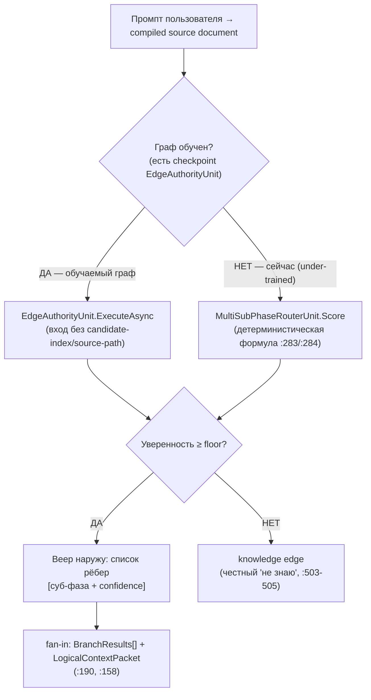

## Current Code-First Reconciliation Overlay (2026-07-14)

current_implementation_authorization: YES_CODE_FIRST_ONLY
teacher_dpo_training_authorization: NO_TEACHER_DPO_TRAINING_UNTIL_G_DPO_FINAL
dpo_status: NOT_STARTED
dpo_priority: LAST
current_counters: 12 phases / 27 subphases / 64 substeps

## Historical Fable Coverage Repair Overlay (2026-07-05)

historical_fable_plan_readiness: PLAN_NOT_READY / FABLE_GAP_REPAIR_QUEUE
historical_fable_implementation_authorization: NO until fresh Luba approval after review
historical_fable_verdict_basis: Newer-at-that-time Fable coverage evidence `claude-fable-plan-check-v1.md` and attachment `98cbe69a` superseded the previous final-readiness overlay. Fable reported 127 findings: 91 COVERED, 30 PARTIAL, 6 MISSING. This is historical plan-repair evidence only, not current execution authority and not product/test/build/runtime/provider/training/checkpoint/git proof.
historical_fable_verdict_classes: DESIGN_BLOCKER_AT_THAT_TIME=FABLE_MISSING_AND_PARTIAL_ITEMS; REPAIR_QUEUE_AT_THAT_TIME=FABLE_RB_RG_AND_PARTIAL_REPAIR; FABLE_EVIDENCE=claude-fable-plan-check-v1.md lines 35-153 and attachment 98cbe69a lines 32-79; IMPLEMENTATION_AUTHORIZATION_GATE_AT_THAT_TIME=NO until fresh Luba approval after review.
historical_fable_classification_rule: Any older line in this file saying PLAN_READY_FOR_LUBA_REVIEW, Final Readiness Review Overlay, no unresolved design/dependency blocker, CURRENT_REPAIR_QUEUE=NONE_IDENTIFIED_BY_FINAL_READINESS_REVIEW, or parent final-readiness acceptance before this overlay is historical/pre-Fable evidence only unless it cites later authority.
historical_fable_gap_repair_addendum: active-codex-execution-42-fable-gap-repair-additions-20260705.md was the historical repair map for R-B/R-G and partial contract/readability/lifecycle additions; it is not current authority.
## Historical Pre-Fable Final Readiness Review Overlay (2026-07-05)
historical_pre_fable_plan_readiness: PLAN_READY_FOR_LUBA_REVIEW
historical_pre_fable_implementation_authorization: NO until fresh Luba approval after review
historical_pre_fable_final_readiness_review_scope: one bounded planning/governance readiness review only; no product implementation, tests, builds, runtime, browser, provider/API, model/training/checkpoint, git, branch, mergeability, PR, or product-readiness proof was run.
historical_pre_fable_current_verdict_basis: This final review read the required governance/skill gate markers, the two unique original-task/reference attachments, the minimum Claude baseline surfaces, the active-codex plan/board/matrix/source-map/legal/gate/ledger surfaces, and current status/search evidence. End-to-end mental simulation from the active plan found no unresolved design/dependency decision that an executor would have to choose before coding/testing. The prior PLAN_NOT_READY / PLAN_PARTIAL_REPAIR_QUEUE state after 0aa/Laplace/Kepler/Singer was retained for parent final-review acceptance; this overlay supplies that final bounded review. Remaining items are execution or approval gates only: fresh Luba implementation approval, local self-authored seed file creation, code implementation, tests/builds/runtime/training/checkpoint/fresh-load/ablation proof, same-scenario Path A/Path B host proof, mock/replacement-ledger proof, branch/mergeability/git proof if later authorized, final product review, and route-specific hosted TogetherAI/Qwen3 terms/output-use proof before hosted train/common use.
historical_pre_fable_current_verdict_classes: DESIGN_BLOCKER_CURRENT=NONE_IDENTIFIED_BY_FINAL_READINESS_REVIEW; CURRENT_REPAIR_QUEUE=NONE_IDENTIFIED_BY_FINAL_READINESS_REVIEW; CURRENT_LEDGER_ACCEPTANCE_BOUNDED_EVIDENCE=50/50 accepted planning sections after 2026-07-05 Pass37-Pass50/Singer repair, not 50 cycles, not 50 product reviews, not product proof, not test/build/runtime/provider/training/checkpoint/git proof; HOSTED_PROVIDER_PRE_USE_GATE_ROUTE_SPECIFIC=TogetherAI/Qwen3 proof required before hosted train/common use only, not a local self-authored v1 planning blocker; IMPLEMENTATION_AUTHORIZATION_GATE=NO until fresh Luba approval after review.
historical_pre_fable_classification_rule: Any older line in this file saying PLAN_NOT_READY / PLAN_PARTIAL_REPAIR_QUEUE, current verdict remains PLAN_NOT_READY, CURRENT_REPAIR_QUEUE, parent must run final readiness review, or no-go boundaries before this overlay is historical/pre-final-readiness-review evidence only unless it cites later authority.
---
artifact_type: ilearningdynamicgraph_guide_04_ilearningmachine_pattern_and_graph
authority_source: latest unquoted Luba work order for DPO Legal Learning active execution chain
status: populated_now_planning_only
last_updated: 2026-06-29
write_scope: C:\Users\lubao\Documents\xiigen\llm mvp\dpo legal build\active-codex-execution-*.md
benchmark_read_only_source: codex-guide-04-ilearningmachine-pattern-and-graph.md (НЕ редактируется)
canon_counters: 12 фаз / 27 подфаз / 64 подшага (Ф0…Ф11), нумерация Ф<P>.<SP>.<SS>
canon_owners: узел/`IDynamicGraphNode` — блок 01; ребро/`EdgeAuthorityUnit` — блок 02; оркестратор — блок 03; машина/`DynamicGraphMachine`/`DynamicGraphDomain` — блок 04; `GraphDpoPair` exact 14-field canon with nested `TeacherProvenance` and unit-level train-ready rows — блок 07; `TeacherProvenance` (20 полей; 13+5+2 RR6 `service_mode`/`grounding_used`) + вердикт-enum + manifest/provenance proof — блок 08
---

# Гайд 04 (claude) — Паттерн ILearningMachine и динамический граф (ILearningDynamicGraph)

Автор: Claude (Opus 4.8 MAX), роль — автор гайда в моём namespace `claude-*`. Это
часть **ПЛАНА** проекта **ILearningDynamicGraph** (документация-гайд), а **не**
разрешение на реализацию продукта (R2/R3: PLAN-ONLY; исполнение — только после
свежего явного approve Luba в текущем ходе). Все цитаты кода — **только реально
существующие**, перепроверены чтением файлов, с `file:line`. Цитаты транскриптов,
чужих планов и `codex-*` — **evidence-only**, не authority.

Скилы, по которым написан гайд (загружены и применены): `plan-review-SKILL.md`
(Graph/DynamicGraph review gate, DPO legal-teacher gate, deterministic-masquerade
firewall, plan-testability gate), `trainable-architecture-decision-SKILL.md`
(5 разрешённых уровней, Graph-Style/DynamicGraph Reconstruction Gate, Graph-DPO
Artifact Triad Gate, Legal Teacher / Provenance Gate, вердикты),
`implementation-doc-uml-SKILL.md` (§0/§1: `note for` на каждый класс,
per-connection и per-branch симуляции).

**Pass37 current R-OT-02 override:** `GraphDpoPair` "14 fields" and nested
`TeacherProvenance` are current latest-Claude canon, not historical. Train-ready
DPO authority is still unit-level: `Level="unit"` and unit identity in
`NodeOrEdgeId`; graph/path/order/source data is context/provenance, not a
whole-graph DPO target.
Whole graph/path preference is orchestration or provenance evidence, not a DPO
pair replacing unit-level chosen/rejected outputs.

**Current builder and phase boundary (2026-07-14):**
`IGraphDpoPairBuilderUnit -> GraphDpoPairCandidate -> triad/legal projection ->
GraphDpoPair(Level="unit")`. Candidate is intermediate/eval material, never a
trainable Pair; node/edge/path/order data remains context/provenance. Execution
order is `CODE_FIRST -> TP1_LOCAL_EVAL_ONLY -> TP2_HOSTED_EVAL_ONLY (G-TP-4) ->
G_DPO_FINAL -> DPO_TRAINING`. DPO execution is `NOT_STARTED` and remains the
last stage. Current counters are 12/27/64; every 12/26/59 below is explicitly
historical/pre-PASS26 only.

---

## 0а. Якорь задачи (Current task anchor)

```text
CURRENT TASK: написать МОЙ (claude-namespace) улучшенный гайд-04 «паттерн
              ILearningMachine + динамический граф ILearningDynamicGraph» —
              человеческим русским, Part A-формат (§0 UML + §1 флоучарт + §2
              алгоритм + §3 код-цитаты + §4 статус + §5 иерархия) с тест-стратегией,
              сохранив структуру бенчмарка codex-guide-04 и канонические счётчики
              (12 фаз / 27 подфаз / 64 подшага, Ф<P>.<SP>.<SS>) и CANON-инварианты
              (L5-машина без 6-го уровня A-LM-12; легальный teacher-гейт; запрет
              скрытого детерминизма A-LM-09/A-LM-13). Записать ровно в
              claude-guide-04-ilearningmachine-pattern-and-graph.md.
NOT THE TASK: исполнять/тестировать/билдить код, запускать раннеры, тренировать,
              вызывать внешние AI/API/модели, git; править/создавать любые codex-*
              (только чтение), продолжать чужой codex-план или старый claude-00..07
              каркас как рабочий артефакт.
EVIDENCE-ONLY: codex-guide-04 (бенчмарк), codex-recon-*, codex-50-cycle-*,
              codex-skill-improvement-*, старый каркас claude-00..07; мои же канон-
              блоки claude-plan-01/02/03/04/07/08 (синхрон имён/счётчиков —
              read-only canon); реальный код llm_mvp_core (читается для цитат);
              скилы plan-review / trainable-architecture-decision /
              implementation-doc-uml.
```

## 0б. Где этот claude-гайд осознанно лучше бенчмарка `codex-guide-04` (delta-нота, не слепая копия)

Бенчмарк `codex-guide-04` (701 строка) — крепкий, цитаты кода в основном точны.
Но он написан **до/независимо** от канона остальных `claude-*` блоков, поэтому даёт
**ad-hoc** имена и ad-hoc списки полей, не совпадающие с уже зафиксированным каноном
(блоки 01/02/04/07/08). Плюс как «гайд» он **не содержит Part A** (нет §0 класс-
диаграммы с `note for`, нет §1 флоучарта с симуляциями, нет §5 иерархии с I/O-типами,
нет тест-стратегии). Я чиню это точечно, сохраняя структуру и счётчики:

| # | Слабое место бенчмарка `codex-guide-04` | Улучшение в этом claude-гайде |
|---|---|---|
| D1 | **Ad-hoc маппинг имён.** §4 Шаг 0 объявляет `ILearningUnit/Flow/Orchestrator/DynamicGraph` псевдонимами только базовых контрактов, **без** канонических NEW-типов-обёрток. Читатель не видит, что узел/ребро/машина имеют конкретные проектируемые имена. | §4 Шаг 0 синхронизирован с каноном: узел = `IDynamicGraphNode` (блок 01), ребро-авторитет = `EdgeAuthorityUnit` (блок 02), машина = `DynamicGraphMachine` над **NEW** `DynamicGraphDomain` (блок 04), прецедент = `TranslationMachine` (`27.TranslationDomain/TranslationMachine.cs:7`). |
| D2 | **«DynamicGraph = домен TDomain» сказано размыто.** Не назван NEW-класс машины и не показан прецедент Translation, поэтому «новый уровень или нет» читается двусмысленно. | Чётко: **уровень НЕ новый** (A-LM-12, псевдоним L5), но **класс `DynamicGraphMachine` и домен `DynamicGraphDomain` — NEW**, по образцу `TranslationMachine`/`TranslationDomain`. Это снимает двусмысленность «decision-reopening?». |
| D3 | **Ad-hoc legal-teacher поля (8 штук) в §6.3.** Бенчмарк изобретает свой список provenance-полей, не совпадающий с каноном **`TeacherProvenance` (20 полей; 13+5+2 RR6 `service_mode`/`grounding_used`)** и вердикт-enum из блока 08. | §6.3 ссылается на канон блока 08: **`TeacherProvenance` (20 полей; 13+5+2 RR6 `service_mode`/`grounding_used`)**, вердикт-enum `ACCEPT, QUARANTINE, BLOCK, DATASET_REBUILD_REQUIRED, BLOCK_FOR_COMMON, EVAL_ONLY` (6 значений), `judge_model` ВНУТРИ provenance, `closed_proprietary_model` — вычисляемый. Гайд не переопределяет канон. |
| D4 | **Ad-hoc DPO-поля в §5.2.** Пример DPO даёт сырые поля и может быть прочитан как graph/edge-level pair. | Pass37/latest-Claude current: §5.2 строит только unit-level train-ready `GraphDpoPair` (владелец 07): exact 14-field record with `Level="unit"`, unit identity in `NodeOrEdgeId`, `InputContext`, `Chosen`, `Rejected`, `WrongMarkers`, `Reason`, nested `TeacherProvenance`, `SourceIds`, `HeldOut`, `CandidateOrderInvariant`, `ExcludedLeakageSignals`, `DpoTrainReady`; path/order metadata remains envelope/provenance, not extra pair fields. |
| D5 | **Нет Part A.** Гайд без §0 класс-диаграммы (с `note for`), без §1 флоучарта с per-branch симуляциями, без §5 иерархии с Input/Output, без тест-стратегии. | Добавлены §0 (класс-диаграмма + легенда + per-connection симуляции), §1 (флоучарт ребра + per-branch симуляции), §5 (иерархия L5→L4→L3→L2 с I/O-типами), §9 тест-стратегия (untrained-honesty vs trained, OP-55). |
| D6 | **Счётчики не привязаны.** Рецепт §4 идёт «Шаг 0..6», а не каноническими **12 фаз / 27 подфаз / 64 подшага** (Ф<P>.<SP>.<SS>), как в остальных claude-блоках. | §4 переписан как **карта канонических фаз Ф0…Ф11** (12/27/64; 12/26/59 — historical/pre-PASS26), каждый рецепт-шаг привязан к подшагу `Ф<P>.<SP>.<SS>` и его владельцу-блоку. |
| D7 | **Точность цитат: одна ветка веса.** §3.6/§6.1 цитируют только формулу `:283`, пропуская **вторую** ветку с контекстом `:284`, `relevanceFloor :164` и confidence-shortcut `:204/:213`. | §3.6 цитирует **обе** ветки (`:283` без контекста и `:284` с контекстом), плюс `relevanceFloor :164`, confidence-map `:204`, secondary-share `:213` — полнее показывает детерминистическую механику. |
| D8 | **Lifecycle прецедент не процитирован построчно.** Бенчмарк ссылается на reward-margin/Kahn-level «по смыслу», без `file:line`. | Добавлены проверенные цитаты: `DpoTrainer.cs:42-44` (reward margin), `22.AgentAlgorithms/MultiAgent/DependencyGraph.cs:9/57` (Kahn-level для async-веток), `DpoDataset.cs:18-26`. |

CANON-инварианты сохранены: маппинг ролей Luba → реальные контракты; 5 закрытых
уровней (A-LM-12); легальный teacher-гейт (closed = только judge при
`used_for_training=false`; контаминация → `DATASET_REBUILD_REQUIRED`); запрет
скрытого детерминизма (A-LM-09/A-LM-13). Канон-владельцы общих типов
(`IDynamicGraphNode`/`GraphNodePreferenceState` — 01; `EdgeAuthorityUnit` — 02;
`DynamicGraphMachine`/`DynamicGraphDomain` — 04; `GraphDpoPair` 14 полей — 07;
`TeacherProvenance` 20 полей (13+5+2 RR6 `service_mode`/`grounding_used`) + вердикт-enum — 08) **не переопределяются** этим
гайдом; при расхождении числа полей или имени побеждает блок-владелец.

---

## 1. Назначение гайда

Гайд решает один вопрос плана ILearningDynamicGraph: **как обучаемый граф ложится на
уже существующую в коде иерархию обучения**, и **где проходит граница «обучаемый
уровень» против «детерминистический хелпер»** — особенно на рёбрах графа, где
сегодня финальный выбор делает детерминистический роутер/скорер.

Конкретно гайд даёт:

1. Маппинг имён из задачи Любы (`ILearningUnit` / `ILearningFlow` /
   `ILearningOrchestrator` / `ILearningDynamicGraph`) на **реально существующие**
   контракты (`ILogicalUnit` / `ILogicalFlow` / `ILogicalOrchestrator` /
   `ILearningMachine<TDomain>`) и на **канонические NEW-обёртки/классы** из блоков
   01/02/03/04. Имён `ILearning*` в коде нет — это псевдонимы, которые план обязан
   явно объявить, **а не считать новыми уровнями** (A-LM-12 — закрытый список).
2. Правило A-LM-02 (Train* только на `ILearningMachine`) и A-LM-12 (закрытый список
   из 5 уровней) — почему граф **не** объявляет «новый обучаемый уровень
   DynamicGraph», а становится `ILearningMachine<DynamicGraphDomain>` (NEW-класс
   `DynamicGraphMachine` над NEW-доменом, по образцу `TranslationMachine`).
3. Реконструкцию графа по Graph-Style Gate: узлы, рёбра, fan-out, fan-in,
   many-to-many, async, и **владелец финального авторитета на каждом ребре**.
4. Классификацию каждого роутера/скорера на ребре: обучаемый уровень против
   внутреннего детерминистического хелпера, и где сейчас риск
   `FORBIDDEN_RUNTIME_SHORTCUT`, если появится claim «умного выбора».

Что гайд **НЕ делает**: не реализует код, не запускает раннеры, не строит DPO-наборы
(это блоки 07/10/11), не редактирует `codex-*`/старый claude-каркас.

---

## 2. Концепт простыми словами (аналогия, без кода)

Представь **завод** (это домен — например, перевод, project-wiki или граф потоков).

- **Станок** = маленький рабочий узел. Берёт деталь на входе, выдаёт деталь на
  выходе. Сам станок **не учится во время смены** — работает по своей настройке.
  Это уровень «юнит» (`ILogicalUnit`, L2). В графе узел-станок получает «паспорт»-
  обёртку `IDynamicGraphNode` (NEW, блок 01) — она добавляет описание входа/выхода
  и trained-state узла, **не нарушая** A-LM-02 (Train на станке по-прежнему нет).
- **Конвейерная линия** = последовательность станков, соединённых лентами. Линия
  знает порядок и как деталь идёт от станка к станку. Это «поток» (`ILogicalFlow`, L3).
- **Стрелочник на развилке ленты** = решает, **на какой станок отдать деталь дальше**.
  В обучаемом графе это `EdgeAuthorityUnit` (NEW, блок 02) — обучаемый `ILogicalUnit`,
  который и есть финальная власть ребра.
- **Начальник цеха** = распределяет заказы по линиям и собирает итог. Это
  «оркестратор» (`ILogicalOrchestrator`, L4).
- **Директор завода с отделом обучения** = единственный, у кого есть право
  останавливать завод на ночь и **перенастраивать станки по результатам** (что
  приняли, что забраковали). Директор оборачивает начальника цеха и добавляет цикл
  обучения. Это «обучающая машина» (`ILearningMachine`, L5) — в графе это
  `DynamicGraphMachine` над доменом `DynamicGraphDomain`.

Жёсткое правило завода (A-LM-02): **перенастраивать станки имеет право только
директор (машина), и только ночью (в режиме обучения).** Станок, линия, стрелочник и
начальник цеха днём — чистая работа без самообучения. Если станок «сам себя
подкручивает» во время смены — это нарушение.

Теперь «динамический граф». Обычный завод — фиксированный конвейер. **Граф** — завод,
где **ленты между станками можно перекладывать на лету**: один станок отдаёт деталь
сразу нескольким (**fan-out**, веер наружу), несколько станков сдают детали в одну
точку сборки (**fan-in**, веер внутрь), и есть **петля возврата** (контролёр
забраковал — деталь едет обратно). «Динамический» = карта лент (топология) хранится
как **данные** в реестре и редактируется в рантайме mutation-юнитами, а
директор/начальник цеха эту карту читают и обходят.

Самое опасное место графа — **развилка ленты**: «кому отдать деталь дальше?». Если на
развилке решает тупой счётчик («раньше чаще отдавали налево») или жёсткая таблица
ключевых слов — это **детерминистический shortcut**. Он допустим только как **черновой
генератор кандидатов** или **baseline для сравнения**, но финал «кому отдать» в
обучаемом графе принимает **обученный** `EdgeAuthorityUnit`, а не таблица. Это — центр
гайда.

Легальность «учителя» (Legal Teacher Gate, канон блока 08): если завод учится у
внешнего эксперта (модель-учитель для DPO/дистилляции), эксперт должен быть
**легальным** (open-weight/permissive, лицензия проверена). Закрытые проприетарные
модели (Claude/OpenAI/Gemini) **нельзя** использовать как источник «правильных
ответов» для обучения — только как judge/evidence при
`teacher_output_used_for_training=false`.

---

## 3. Как это сейчас реализовано в нашем коде

Раздел даёт точные `file:line`, что **РАБОТАЕТ**, и что **ЗАГЛУШКА/未-обучено**.
Главный факт-вывод: иерархия 5 уровней **существует как контракты**, граф-субстрат
(узлы/рёбра, обход) **существует как детерминистический код**, но **обучаемого графа
(trained DynamicGraph) пока нет** — есть честный under-trained скелет.

### 3.1. Пять уровней иерархии (контракты — РАБОТАЮТ как контракты)

`C:/Projects/llm_mvp_core/00.Core/LogicalContracts.cs`:
- `interface ILogicalUnit<TInput, TOutput>` — LogicalContracts.cs:97; единственный
  метод `ExecuteAsync(LogicalUnitRequest<TInput>) -> LogicalUnitResult<TOutput>`
  (строки 99-101). Чистый inference. Метода Train НЕТ.
- `interface ILogicalFlow<TInput>` — LogicalContracts.cs:166; `ExecuteAsync(
  LogicalFlowRequest<TInput>) -> LogicalFlowResult` (строки 168-170). Train НЕТ.
- `interface ILogicalOrchestrator` — LogicalContracts.cs:202; `RunAsync(
  LogicalOrchestratorRequest) -> LogicalOrchestratorResult` (строки 204-206). Train НЕТ.

`C:/Projects/llm_mvp_core/00.Core/LearningMachineContracts.cs`:
- `interface ILearningMachine<TDomain>` — LearningMachineContracts.cs:208. Несёт
  **именно** методы обучения и жизненного цикла: `TrainBatchAsync` (212-213),
  `EvaluateAsync` (217-218), `ExportAsync` (222-223), `ImportAsync` (227-228),
  `GetOrchestratorAsync` (232-233).
- `interface ILearningMachinePair<TPersonal, TGlobal>` —
  LearningMachineContracts.cs:245; `Personal`/`Global` (248/251),
  `SyncPersonalToGlobalAsync` (256), `PullGlobalToPersonalAsync` (260).

Правило A-LM-02 зафиксировано **комментарием в самом файле**:
`LearningMachineContracts.cs:8` — «Train() is ONLY on ILearningMachine — never on
ILogicalUnit or ILogicalFlow». Проверено чтением: ни в одном из трёх нижних
интерфейсов метода Train нет. Путь обучения описан там же комментарием
(LearningMachineContracts.cs:204-207): `TrainBatchAsync` → внутри вызывает
`ILogicalCapabilityTrainer.TrainAndRegisterAsync()` → существующие
`*DpoGenerator + *TrainingRunner` на каждый юнит.

Статус: **РАБОТАЕТ как контракт-каркас.** Это РОВНО пять разрешённых уровней по
A-LM-12 (`DECISIONS-LOCKED.md:35`). Контракт-only ≠ доказательство обученности.

### 3.2. DPO-формат и метрики (РАБОТАЮТ как контракты данных)

- `record LearningTrainingItem(ItemId, Prompt, ChosenResponse, RejectedResponse)`
  — LearningMachineContracts.cs:30-39. Это **ядро DPO-тройки** (preference triple).
  Канон графа `GraphDpoPair` (14 полей, блок 07) проецируется на этот тип, добавляя
  провенанс и graph-поля сбоку (через `SourceIds`).
- `record LearningBatch<TDomain>(BatchId, DomainTag, TrainingItems, SourceIds)`
  — LearningMachineContracts.cs:18-27. `SourceIds` (строка 26) — единственный
  крючок провенанса на уровне контракта.
- `record LearningBatchResult(...)` — LearningMachineContracts.cs:43-62:
  `RowsTrained, AccuracyBefore, AccuracyAfter, RewardMargin, CpuMs, PeakRamMb,
  ElapsedMs, PromotedUnitIds`. Комментарий 41-42: «no placeholder or UNKNOWN in
  production». Это закрывает паттерн completion-evidence (численные метрики).
- `record LearningEvaluationResult(... Accuracy, RewardMargin, PassesGate,
  GateNote)` — LearningMachineContracts.cs:90-103. `PassesGate` (строка 100) —
  trainable-эквивалент runner-гейта.
- `record LearningMachineExport(... CheckpointRef, ManifestRef, AccuracyAtExport,
  ExportedAtUtc)` — LearningMachineContracts.cs:112-127. `CheckpointRef`/
  `ManifestRef` указывают в 25.ModelServer (комментарий 110).

Прецедент DPO-механики (для синхронизации канона метрик): `11.DPO/DpoTrainer.cs:42-44`
вычисляет `chosenReward` / `rejectedReward` / `margin` — это и есть «reward margin»,
который двигает веса обучаемого узла/ребра. `11.DPO/DpoDataset.cs:18-26` —
материализация строк в JSONL для движка DPO.

Статус: **РАБОТАЕТ как контракт + прецедент DPO-математики.** Реальной обученной
машины графа, которая это заполняет численно, на уровне 00.Core нет.

### 3.3. Граф-субстрат: узлы/рёбра (РАБОТАЕТ, но детерминистический)

`C:/Projects/llm_mvp_core/07.GraphEngine`:
- `record GraphNode { Id; Name; Type; FilePath; Signature; RawText; float[]
  Embedding; double PageRankScore {get;set;} }` — GraphNode.cs:3-13. Единственное
  мутируемое поле — `PageRankScore` (строка 12).
- `record GraphEdge { From; To; RelationType; double Weight = 1.0 }` —
  GraphEdge.cs:3-9. **Вес ребра задаётся вручную (init), значение по умолчанию 1.0,
  неизменяем — это НЕ обучаемый вес** (строка 8).
- `PageRankCalculator` (PageRank / Personalised PageRank) и `KnowledgeGraph`
  (контейнер с двусторонней смежностью out/in) — детерминистическая математика.

Статус: **РАБОТАЕТ как структура данных + детерминистический ранкер.** Обучения, DPO,
reward/loss, chosen/rejected здесь НЕТ. Это удобный «скелет графа», не обучаемый граф.

### 3.4. Динамика топологии: реестр + mutation-юниты (РАБОТАЕТ, детерминистично)

`C:/Projects/llm_mvp_core/17.DynamicDomains/DynamicDomainGraph.cs`:
- `record DynamicDomainTransition(string FromId, string ToId)` — строка 3 (одно
  ребро графа суб-фаз).
- `static class DomainGraphClosure` (строки 6-63): `HasAnyDependency` (8),
  `BuildPredecessorMap` (15) — транзитивное замыкание DFS (Depth-First Search).
- `static class OrchestratorExpander` (строки 66-115): `FindBridgeSubPhases` (68) —
  поиск «мостовых» узлов через BFS (Breadth-First Search) кратчайший путь
  `FindPath` (90).

«Динамика на лету» = реестр топологии редактируется в рантайме mutation-юнитами
(`C:/Projects/llm_mvp_core/21.AgentInfrastructure/Logical/`:
`AddTransitionTopologyMutationUnit.cs`, `AddSubPhaseTopologyMutationUnit.cs`,
`AddPhaseTopologyMutationUnit.cs`, `AddDomainTopologyMutationUnit.cs`,
`TopologyMutationFlow.cs`), а 17 пересчитывает зависимости/порядок/мосты при каждом
вызове.

Статус: **РАБОТАЕТ как детерминистический граф-калькулятор.** Рабочий прецедент
«динамической структуры», но без обучаемого выбора рёбер.

### 3.5. Рантайм-оркестратор и рёбра графа (РАБОТАЕТ; авторитет детерминистический)

`C:/Projects/llm_mvp_core/21.AgentInfrastructure/Logical/AdaptiveLogicalOrchestrator.cs`
(`: ILogicalOrchestrator`, строка 10):
- `RunAsync` — строка 85 (вход `LogicalOrchestratorRequest`).
- Веер наружу (fan-out) делается роутером: `RouteAsync` (строка 316) вызывает
  `_multiRouter.ExecuteAsync(...)` (строка 326) и расширяет решения
  `ExpandRoutedDecisions` (строка 340).
- Исполнение одного ребра: `ExecuteBranchAsync` (строка 496). Confidence-floor гейт:
  `if (decision.KnowledgeEdge)` → синтетический «knowledge edge» вместо выдуманного
  выбора потока (строки 503-505).
- Порядок рёбер по зависимостям: `HasTransitionDependency` (522) и `OrderByTransitions`
  (541) используют детерминистический `DomainGraphClosure.HasAnyDependency/
  BuildPredecessorMap` из проекта 17 (строки 531, 552), плюс мосты
  `OrchestratorExpander.FindBridgeSubPhases` (строка 778).
- Сбор веера внутрь (fan-in): `BranchResults` в `LogicalOrchestratorResult`
  (LogicalContracts.cs:190; оркестратор пишет туда, напр. AdaptiveLogicalOrchestrator.cs:311),
  плюс контекст между ветками — `LogicalContextPacket`/`LogicalContextFragment`
  (LogicalContracts.cs:146-163) и `PhaseTransitionSignal` (LogicalContracts.cs:89) —
  петля возврата (`FollowTransitionSignalsAsync`, строка 361).
- Параллелизм веток: бюджет `MaxAdaptiveBranchCount = 8` (строка 19), глубина
  переходов `MaxTransitionDepth = 3` (строка 22). Прецедент Kahn-уровней для
  параллельных кандидатов — `22.AgentAlgorithms/MultiAgent/DependencyGraph.cs:9/57`.

КТО СЕЙЧАС РЕШАЕТ НА РЕБРЕ (важно): финальный выбор «какие суб-фазы и в каком порядке»
сегодня принимает **детерминистический** `MultiSubPhaseRouterUnit` (см. 3.6), а порядок
— детерминистический граф-обход из 17. Это **honest deterministic authority**, не
обучаемая семантика.

Статус: **РАБОТАЕТ; авторитет на рёбрах детерминистический** (под-обучен).

### 3.6. Роутер на ребре — главный кандидат на shortcut (РАБОТАЕТ, детерминистично)

`C:/Projects/llm_mvp_core/21.AgentInfrastructure/Logical/MultiSubPhaseRouterUnit.cs`
(`: ILogicalUnit<SubPhaseRouterSourceDocument, SubPhaseRoutingDecision[]>`, строка 8):
- Жёсткая таблица якорных слов `SubPhaseAnchorTerms` (строки 23-56) — захардкоженный
  словарь `subPhaseId -> string[]` ключевых слов.
- Метод `Score(...)` (строки 249-288) — **ручная взвешенная формула** с
  фиксированными весами, **две ветки**:
  - без контекста (строка 283): `(predicateScore * 0.55) + (exactSubPhaseMention *
    0.25) + (tokenScore * 0.20) + (hybridScore * 0.02)`;
  - с контекстом (строка 284): `(predicateScore * 0.50) + (exactSubPhaseMention *
    0.20) + (tokenScore * 0.15) + (hybridScore * 0.05) + (contextScore * 0.10)`.
- `relevanceFloor` отсечения слабых веток (строка 164); confidence-маппинг балла в
  уверенность (строка 204); secondary-share второго кандидата (строка 213).
- Внутри — детерминистический `HybridRanker` (BM25 (Okapi Best Match 25) + KNN
  (K-Nearest Neighbours) fusion) как маленький tie-breaker
  (`BuildHybridScores`, строки 340-364) и `Tokenize` (482).

Регистрируется как `isLearned:false`, `Trusted`: сегодня это **честно помеченный
baseline-роутер**, не «семантический обученный». Но именно он — финальная власть веера
наружу.

Статус: **РАБОТАЕТ как детерминистический selector/scorer.** Семантического claim'а
нет → нарушения сейчас нет. Это **кандидат №1 на замену** обучаемым `EdgeAuthorityUnit`
(блок 02) в плане графа (иначе при будущей claim «умного выбора» = shortcut).

### 3.7. Обучаемый юнит-прецедент: KnnLogicalUnit (РАБОТАЕТ; нюанс Train)

`C:/Projects/llm_mvp_core/21.AgentInfrastructure/Logical/KnnLogicalUnit.cs`
(`: ILogicalUnit<TInput, TOutput>`, строка 33):
- Статическая фабрика `Train(...)` — строка 98 (BPE (Byte-Pair Encoding) токенайзер +
  HNSW (Hierarchical Navigable Small World) индекс из обучающих примеров). ВАЖНО: это
  **construction-time фабрика**, а НЕ метод `TrainBatchAsync` на интерфейсе. Сам
  `ILogicalUnit.ExecuteAsync` остаётся inference-only (строка 197). Это **не нарушает
  A-LM-02**: интерфейс юнита по-прежнему без Train-метода; обучение инкапсулировано в
  фабрике, лайфцикл батч-обучения принадлежит уровню машины.
- Инференс: `ExecuteAsync` → `_index.Search(query, _k)` (218), «ближайший сосед как
  предсказание»: `var best = hits[0]` (строка 223), confidence из score соседа (224),
  warning при пробитии порога `_confidenceFloor` (228).
- Манифест модели `LogicalKnnModelManifest` (строки 18-30) с ингредиентами.

Статус: **РАБОТАЕТ как обучаемый KNN-юнит-компонент.** По скилу KNN —
audit-triggered, **не запрещён**: это нормальный model component / ретривер **внутри**
разрешённого уровня. Запрещено только сделать standalone-KNN **всей** обучаемой
архитектурой или **немаркированной финальной властью** там, где требуется обученный юнит.

### 3.8. Bootstrap-узлы оркестрации (РАБОТАЮТ как честный under-trained scaffold)

`C:/Projects/llm_mvp_core/42.ProjectWikiDomain`:
- 6 интерфейсов в `OrchestrationUnitContracts.cs:76-107`, каждый `: ILogicalUnit`.
- 6 Bootstrap-классов в `BootstrapOrchestrationUnits.cs` (`BootstrapIntentBuilderUnit`
  и др.), `Confidence=1.0`, делегируют статике.
- Секвенсор 6 шагов: `TaskOrchestrationUnit.OrchestrateAsync` в
  `ProjectTaskOrchestrationPipeline.cs` (линейный DAG 1→2→3→4→5→6, аккумулирующий
  fan-in, fan-out нет).
- Flow-адаптеры `ProjectDocumentationPipelineFlowAdapter.cs` /
  `ProjectWikiTrainingFlowAdapter.cs` (`: ILogicalFlow<string>`) честно отдают
  `DOCUMENTATION_GRAPH_READY_TRAINING_RUNNER_MISSING` / `training_status=runner_missing`
  и метрики `UNKNOWN` в registry-режиме (антимаскарад).

Регистрация уровней — `15.OrchestratorModel/Logical/LogicalOrchestratorAssistant.cs`
(`CreateDefault`): `InMemoryLogicalFlowRegistry.Register(...)`, сидинг топологии
`DevelopmentLifecycleTopologySeeder.Seed` (7 фаз / 31 суб-фаза), конструирование
`AdaptiveLogicalOrchestrator`. Реестр выбирает **новейший** дескриптор (`latest-wins`
по `RegistrationOrder`) — так trained-юнит может заменить Bootstrap (A-LM-03,
`DECISIONS-LOCKED.md:26`).

Статус (двух-PASS из CLAUDE.md): сейчас это `PASS_AS_HONEST_UNTRAINED_SCAFFOLD`,
**не** `PASS_AS_TRAINED_FEATURE`. Скрытого детерминизма «под видом trained» нет: нет
checkpoint/manifest и заявленных метрик в самих юнитах.

### 3.9. Сводка статуса (что есть / чего нет)

| Слой | Файл (ключевой) | Статус |
|---|---|---|
| 5 уровней (контракты) | LogicalContracts.cs:97/166/202; LearningMachineContracts.cs:208/245 | РАБОТАЕТ как контракт |
| DPO-формат + метрики | LearningMachineContracts.cs:30,43,90,112; DpoTrainer.cs:42-44 | РАБОТАЕТ как контракт + DPO-математика |
| Граф узлов/рёбер | 07.GraphEngine/Models/GraphNode.cs:3, GraphEdge.cs:3 | РАБОТАЕТ, детерминистический; вес не обучаем |
| Динамика топологии | 17.DynamicDomains/DynamicDomainGraph.cs:3,6,66 | РАБОТАЕТ, детерминистический калькулятор |
| Оркестратор/рёбра | AdaptiveLogicalOrchestrator.cs:85,316,496 | РАБОТАЕТ; авторитет рёбер детерминистический |
| Роутер веера | MultiSubPhaseRouterUnit.cs:8,249,283,284 | РАБОТАЕТ; selector/scorer baseline (кандидат на замену) |
| Обучаемый KNN-юнит | KnnLogicalUnit.cs:33,98,223 | РАБОТАЕТ как model component (KNN ок внутри уровня) |
| Bootstrap-узлы 42 | BootstrapOrchestrationUnits.cs; TaskOrchestrationUnit | РАБОТАЕТ как honest untrained scaffold |
| `ILearning*` из задачи | — | ОТСУТСТВУЕТ (имён нет в коде → псевдонимы плана) |
| `IDynamicGraphNode`/`EdgeAuthorityUnit`/`DynamicGraphMachine`/`DynamicGraphDomain` | — | ОТСУТСТВУЮТ (NEW, проектируются блоками 01/02/04) |
| Контракты РЁБЕР графа (fan-out/fan-in/many-to-many/per-edge authority/async) | — | ЧАСТИЧНО/ОТСУТСТВУЮТ как явные контракты (см. §7) |
| `GraphDpoPair` (14) / `TeacherProvenance` (20; 13+5+2 RR6) | — | ОТСУТСТВУЮТ как типы (канон блоков 07/08; в 00.Core есть только `SourceIds`) |
| Trained DynamicGraph (checkpoint/ablation/fresh-load) | — | ОТСУТСТВУЕТ |

---

## 4. Карта канонических фаз (12 фаз / 27 подфаз / 64 подшага, Ф<P>.<SP>.<SS>)

Это **план действий для плана**, привязанный к каноническим счётчикам (как в
остальных claude-блоках), а не исполнение. Каждый рецепт-шаг указывает владельца-блок.

| Фаза | Что решает (одно предложение) | Подшаги (Ф<P>.<SP>.<SS>) и владелец |
|---|---|---|
| **Ф0. Маппинг имён** | Зафиксировать псевдонимы Luba → реальные контракты, без нового уровня | Ф0.1.1 `ILearningUnit≡ILogicalUnit` (L2); Ф0.1.2 `ILearningFlow≡ILogicalFlow` (L3); Ф0.1.3 `ILearningOrchestrator≡ILogicalOrchestrator` (L4); Ф0.2.1 `ILearningDynamicGraph≡ILearningMachine<DynamicGraphDomain>` (L5, A-LM-12); Ф0.2.2 запрет 6-го уровня — этот гайд + мастер §A.3 |
| **Ф1. Контракт узла** | Узел = обёртка над L2, без нового уровня | Ф1.2.1 `IDynamicGraphNode` поверх `ILogicalUnit`; Ф1.2.2 «Train-методов = 0» (A-LM-02); Ф1.2.3 файл `00.Core/DynamicGraphContracts.cs` — **блок 01** |
| **Ф1(ребро). Авторитет ребра** | Финал ребра = обучаемый юнит, не таблица | `EdgeAuthorityUnit : ILogicalUnit<EdgeAuthorityInput, EdgeAuthorityDecision>`; словарь+`HybridRanker` → baseline/ablation — **блок 02** |
| **Ф1(машина). Контракт машины** | Машина = L5 над доменом графа, без 6-го уровня | Ф1.2.1 `DynamicGraphMachine : ILearningMachine<DynamicGraphDomain>` (`:208`); прецедент `TranslationMachine.cs:7` — **блок 04** |
| **Ф2. Домен + легальный гейт + GraphDpoPair-канон** | Домен-маркер, таможня данных, канон строки | Ф2.1.1 `DynamicGraphDomain` (`DomainTag`); Ф2.1.2 `TeacherProvenanceGateUnit` (legal verdict machine); Ф2.2.1 current `GraphDpoPair` canon = active/Claude plan-07 14 fields, train-ready only at unit level; `TeacherProvenance` = active/Claude plan-08 20 fields — **блоки 04/08/07** |
| **Ф3. Авто-строитель DPO** | 5 форматов → non-trainable Candidate → hard-gate проекция в unit-level Pair | Ф3.1.1 `IGraphDpoPairBuilderUnit` выдаёт `GraphDpoPairCandidate`; Ф3.1.2 triad/legal checks; Ф3.2.1 после `G_DPO_FINAL` проекция в `GraphDpoPair` и `LearningTrainingItem` (`:30`) — **блоки 07/08** |
| **Ф4..Ф5. Trained-state узла/ребра** | Что обучается (typed record, не counter) | Ф4.1.1 `GraphNodePreferenceState` (double-веса, vocab/calibration/KNN/provenance); Ф4.2.1 reward-margin двигает веса (`DpoTrainer.cs:42-44`) — **блоки 01/02** |
| **Ф6. Async-комбинации** | Параллельные/зависимые ветки; сравнение комбинаций целиком | fan-out `RouteAsync:316`; Kahn-уровни `DependencyGraph.cs:9/57`; merge `BranchResults:190` — **блок 06** |
| **Ф7. DPO-builder качество** | Источники/quarantine/held-out для строк | Ф7.1.1 teacher-goal; held-out source-disjoint — **блок 07** |
| **Ф8. Легальный teacher-гейт** | closed = judge-only; контаминация → REBUILD | `TeacherProvenance` (20; 13+5+2 RR6); `closed && used_for_training ⇒ DATASET_REBUILD_REQUIRED` — **блок 08 (владелец канона)** |
| **Ф10. Лайфцикл обучения** | load user→repo→export/import→continue-training | `ExportAsync`/`ImportAsync` (`:222/:227`); continue от checkpoint, не с нуля — **блок 10** |
| **Ф11. Измерение** | Численные метрики + leakage + ablation + fresh-load | `LearningBatchResult`/`LearningEvaluationResult`; D-17 exact-prompt leakage=0.0 — **блок 11** |

Расшифровка ключевых решений (плоский русский):

**Ф0.2.1 — почему граф = L5, а не новый уровень.** По A-LM-01
(`DECISIONS-LOCKED.md:24`) `ILearningMachine` стоит НАД оркестратором и добавляет цикл
обучения; по A-LM-02 Train* живёт только на машине. Значит «обучаемый граф» =
`ILearningMachine<DynamicGraphDomain>`, который через `GetOrchestratorAsync()`
(`LearningMachineContracts.cs:232`) отдаёт `ILogicalOrchestrator`, обходящий
узлы/рёбра. **DynamicGraph НЕ становится новым обучаемым уровнем** — он становится
доменом `TDomain` поверх существующего L5. Уровень не новый (A-LM-12 закрыт), но
**класс `DynamicGraphMachine` и домен `DynamicGraphDomain` — NEW**, по образцу
`TranslationMachine : ILearningMachine<TranslationDomain>` (`27.TranslationDomain/
TranslationMachine.cs:7`). Если план захочет именно НОВЫЙ архитектурный уровень
«DynamicGraph» — это decision-reopening (A-LM-12), требует явного решения Любы.

**Ф1(ребро) — почему финал ребра = обучаемый юнит.** Сегодня финал fan-out держит
детерминистический `MultiSubPhaseRouterUnit.Score` (`:283/:284`). В обучаемом графе
финал ребра принимает обученный `EdgeAuthorityUnit` (вход — семантические признаки
промпта **без индекса кандидата и без source-path**; выход — список рёбер с
уверенностью). Якорный словарь и `HybridRanker` остаются **генератором кандидатов /
baseline для ablation**, не финальной властью.

---

## 5. Конкретные примеры с реальными значениями

### 5.1. Пример: выбор владельца авторитета на ребре fan-out

Сценарий: пользователь пишет «исправь падающий тест в backend-сервисе». Веер наружу
должен выбрать суб-фазы.

Сейчас (детерминистически): `MultiSubPhaseRouterUnit.Score` (`:283`/`:284`) считает по
якорным словам `SubPhaseAnchorTerms` (`:23-56`). Для «test/fix/bug/error» сработают
якоря `4.4` (`refactor/fix/bug/error/log`, строка 41) и `5.1`
(`unit/test/fix/bug/error/log`, строка 43). Финал — детерминистическая сумма весов.

В обучаемом графе: финал на этом ребре принимает обученный `EdgeAuthorityUnit`
(блок 02). Якорный словарь и `HybridRanker` остаются baseline для ablation.

### 5.2. Пример unit-level DPO-строки для обучения ребра — канон `GraphDpoPair` (блок 07) + провенанс (блок 08)

Ядро строки проецируется на `LearningTrainingItem(ItemId, Prompt, ChosenResponse,
RejectedResponse)` (LearningMachineContracts.cs:30-39); Pass37/latest-Claude
canon means `GraphDpoPair` is the exact 14-field active/Claude plan-07 record
with nested `TeacherProvenance`, and train-ready rows must still be unit-level.
Graph path/order metadata stays in provenance/triad/trace context, not as extra
pair fields. Перед этой строкой `IGraphDpoPairBuilderUnit` создаёт только
`GraphDpoPairCandidate`; показанный Pair появляется исключительно после
triad/legal projection и `G_DPO_FINAL`. Значения — иллюстративные (НЕ из
закрытого учителя):

```text
# ядро (проекция на LearningTrainingItem)
ItemId:          edge-route-0007
Prompt:          "исправь падающий unit-тест в backend-сервисе оплаты"
ChosenResponse:  "route -> [5.1 unit-tests (conf 0.86), 4.4 refactor/fix (conf 0.74)]"
RejectedResponse:"route -> [4.2 frontend (conf 0.81)]   [WRONG: выбрано по слову
                  'сервис', проигнорирован сигнал 'unit-тест/падающий' → утечка
                  поверхностного токена вместо смысла задачи]"

# GraphDpoPair exact 14-field canon (канон 07): PairId, Level=unit,
#   NodeOrEdgeId, InputContext, Chosen, Rejected, WrongMarkers, Reason,
#   TeacherProvenance, SourceIds, HeldOut, CandidateOrderInvariant,
#   ExcludedLeakageSignals, DpoTrainReady.
# TeacherProvenance (канон 08, 20 полей) is nested in the pair and backed by
#   manifest/projection proof; graph path/order is envelope, not a whole-graph
#   DPO pair and not extra GraphDpoPair fields.
teacher (chosen-источник): model_id="qwen3-235b" (open-weight, allowlist),
                           teacher_output_used_for_training=true,
                           closed_proprietary_model=false (выведен из denylist)
triad: raw_comparison_event + legal_provenance_dpo_envelope + training_batch — все три
dpo_train_ready: true  (⇐ legal_verdict==ACCEPT И presence_rate==1.0 (20/20) И triad_present)
```

Чему учит: на ребре fan-out выбирать суб-фазу по **смыслу задачи** (тест/баг), а не по
случайному совпадению токена («сервис» → frontend). `[WRONG:...]` явно называет
ошибочный сигнал — это rejected-плечо.

### 5.3. Пример rejected-плеча против leakage индекса кандидата

```text
ItemId:          edge-route-0042-leak
Prompt:          "добавь интеграционный тест на хранилище"
ChosenResponse:  "route -> [5.2 integration-tests]"
RejectedResponse:"route -> [первый кандидат в списке]   [WRONG: выбран по позиции
                  в списке кандидатов (candidate index), а не по смыслу; нарушает
                  permutation-invariance — при перестановке кандидатов выбор меняется]"
```

Чему учит: запрет shortcut «бери первого/по позиции». Прямой аналог
`CandidateOrderLeakageGuard`-логики из скила (раздел про `_candidatePositionWeights`).
`candidate_order_hash` is raw comparison / permutation-proof metadata, not a
`GraphDpoPair` field and not a confidence input. Current handoff stores graph
order through `path_order_ref`, `ordered_unit_ids`, `ordered_path_refs`,
`skipped_edges`, `rejected_edges`, `trace_ref`, and provenance/context refs.

### 5.4. Пример quarantine-строки (нелегальный teacher) — вердикт канона 08

```text
row_source:      rollout-2026-05-03T...jsonl  (provider=openai, "GPT-5", Codex Desktop)
provenance:      model_id маркер в denylist (gpt/openai); teacher_output_used_for_training=true
derived:         closed_proprietary_model=true (выведен из denylist по model_id, R2)
legal_verdict:   DATASET_REBUILD_REQUIRED   (ветка C3 канона 08; строка уже train-ready)
rebuild_action:  не использовать как chosen/rejected; перестроить пары из человеческих
                 промптов Любы или из легального open-weight/permissive учителя; закрытый
                 вывод допустим ТОЛЬКО как judge/evidence при used_for_training=false.
```

(Источник факта о rollout-логе — recon, evidence-only; объём контаминации Ф2.1.3
обязан пере-сканировать на момент исполнения, не доверять стале-числу.)

### 5.5. Пример честного untrained-ответа узла (как сейчас)

`ProjectDocumentationPipelineFlowAdapter` при пройденном coverage возвращает
`OverallVerdict = DOCUMENTATION_GRAPH_READY_TRAINING_RUNNER_MISSING`,
`Metrics["training_status"] = "runner_missing"`. Это
`PASS_AS_HONEST_UNTRAINED_SCAFFOLD`: узел честно говорит «я ещё не обучен», не выдумывая
accuracy/loss.

---

## 6. Гейты и правила (применимые к теме)

### 6.1. Per-edge authority + hidden-shortcut (классификация рёбер графа)

Таблица: для каждого ребра — кто решает сегодня, и вердикт по скилу
`trainable-architecture-decision-SKILL.md`.

| Ребро (что делает) | Файл:line | Механизм сейчас | Владелец авторитета сейчас | Вердикт по скилу | Что должно стать в графе |
|---|---|---|---|---|---|
| Fan-out: prompt → суб-фазы | AdaptiveLogicalOrchestrator.cs:316,326; MultiSubPhaseRouterUnit.cs:249,283,284 | Ручная взвешенная формула (2 ветки) + словарь якорей | Детерминистический `MultiSubPhaseRouterUnit` (`isLearned:false`) | `OK_INTERNAL_DETAIL` сейчас (claim'а нет); при claim «умного выбора» → `FORBIDDEN_RUNTIME_SHORTCUT` | Обученный `EdgeAuthorityUnit` (блок 02, вход без candidate-index/source-path); словарь+`HybridRanker` = baseline/ablation |
| Single-route fallback | AdaptiveLogicalOrchestrator.cs:344; SubPhaseRouterUnit.cs:33 | Скоринг/ближайший-неверный | Детерминистический `SubPhaseRouterUnit` | `OK_INTERNAL_DETAIL` / `BASELINE_MUST_BE_LABELLED` | то же — обученный выбор, детерминистика как baseline |
| Порядок рёбер (зависимости) | AdaptiveLogicalOrchestrator.cs:531,552; DynamicDomainGraph.cs:8,15 | Граф-замыкание DFS над топологией | Детерминистический `DomainGraphClosure` (проект 17) | `OK_INTERNAL_DETAIL` (обход без claim) | допустимо детерминистично, ЕСЛИ «есть ли зависимость» не объявлено обучаемым; иначе обученный предиктор + Jaccard как baseline |
| Вставка мостов | AdaptiveLogicalOrchestrator.cs:778; DynamicDomainGraph.cs:68 | BFS-кратчайший путь | Детерминистический `OrchestratorExpander` | `OK_INTERNAL_DETAIL` | то же |
| Confidence-floor → knowledge edge | AdaptiveLogicalOrchestrator.cs:503-505 | Порог уверенности | Детерминистический гейт (честный «не знаю») | `OK_INTERNAL_DETAIL` (антимаскарад) | оставить как honest-degraded |
| Confidence-маппинг балла | MultiSubPhaseRouterUnit.cs:204,213 | Фикс-формула балл→уверенность | Детерминистическая нормализация | `OK_INTERNAL_DETAIL` | оставить как нормализацию; не делать источником «качества» |
| Ранжирование кандидатов (память) | KnnLogicalUnit.cs:218,223 | HNSW KNN, ближайший сосед | KNN-компонент внутри юнита | `OK_MODEL_COMPONENT` (KNN ок внутри уровня) | оставить как model component/ретривер; не делать standalone-финалом |
| Latest-wins выбор версии узла | InMemoryLogicalUnitRegistry (`ResolveLatest`) | `OrderByDescending(RegistrationOrder)` | Детерминистический tie-break | `OK_INTERNAL_DETAIL` как выбор версии | НЕ делать «latest by registration order» финальной властью ребра/выбора узла (иначе shortcut) |

Правило (A-LM-09, `DECISIONS-LOCKED.md:32`): финальную семантику принимает обучаемый
уровень (`DeterministicFinalAuthority=false`); BM25/regex/if-else — только bootstrap-
генераторы кандидатов, не продакшн-финал. D-15 (`DECISIONS-LOCKED.md:21`): priority
решает «что пробовать», KNN — память, арбитр — «что принято»; ничто из
priority/KNN/budget/external-AI не переопределяет отклонение арбитра.

### 6.2. Анти-leakage (обязательно для DPO/eval графа)

- D-17 (`DECISIONS-LOCKED.md:23`): `exactPromptLeakageRate` обязан быть 0.0 во всех
  eval-гейтах; eval-промпт, точно совпадающий с train-промптом → `PassesGate=false`;
  exclusion-without-failure запрещён.
- Запрещённые сигналы на ребре: candidate-index / позиция в списке (см. 5.3),
  source-path как scoring-фича (в `MultiSubPhaseRouterUnit` путь уже исключён из
  скоринга — `BuildPathFreeScoringText`, строка 291, и держится только как
  provenance-warning, строки 367-408 — это правильный образец), source-id / exact-prompt
  replay.
- Ablation/no-shortcut: при наличии детерминистического хелпера нужен прогон без него,
  доказывающий, что обученный юнит, а не shortcut, держит качество.

### 6.3. Легальный teacher-гейт (Legal Teacher / Provenance Gate) — канон блока 08

Гайд **не переопределяет** канон; ссылается на владельца (блок 08). Канон:
`TeacherProvenance` — **20 полей** (13+5+2 RR6 `service_mode`/`grounding_used`) (13 базовых + 5 NEW: `terms_snapshot_ref`,
`geography_export_constraint`, `source_category`, `raw_private_text_copied`,
`redaction_policy_ref`), `judge_model` — поле **внутри** provenance,
`closed_proprietary_model` — **вычисляемый** флаг (выводится из denylist по `model_id`,
не принимается на веру).

Вердикт-enum (6 значений, владелец — блок 08 §3.3): `ACCEPT | QUARANTINE | BLOCK | DATASET_REBUILD_REQUIRED |
BLOCK_FOR_COMMON | EVAL_ONLY`. Жёсткое правило (инвариант скила
`trainable-architecture-decision-SKILL.md` + `plan-review-SKILL.md` «DPO/distillation
legal teacher provenance review gate»):

```text
closed_proprietary_model=true && teacher_output_used_for_training=true
  ⇒ ВСЕГДА DATASET_REBUILD_REQUIRED   (никакое «разрешение Luby» это не снимает)
```

Claude/OpenAI/Gemini/Gemini Grounding **запрещены** как distillation-учителя. Разрешены
только размещённые open-weight/permissive (Qwen3 Apache-2.0 / DeepSeek MIT / Kimi K2 /
GLM / Mistral) после проверки лицензии/условий. judge (только ранжирует, не авторствует
chosen) — закрытую модель допускаем **только** при
`teacher_output_used_for_training=false`. Приватные промпты/чаты/локальные файлы Любы
тренируют **user-adaptive** ногу (R5/A-LM-08), если не редактированы и не одобрены для
common; hosted + raw-private без редакции → `BLOCK_FOR_COMMON`.

Предусловие `dpo_train_ready=true` на строке `GraphDpoPair` = `legal_verdict==ACCEPT`
И `provenance_field_presence_rate==1.0` (20 полей) И `triad_present==true`
(Graph-DPO Artifact Triad Gate).

### 6.4. Запрет скрытого детерминизма (R4 / A-LM-12 / A-LM-13)

- A-LM-12 (`DECISIONS-LOCKED.md:35`): scorer/selector/classifier/router/retriever/
  detector, KNN/Jaccard/BM25, dictionary/counter, regex/keyword/pattern matcher,
  `TryDecide*`/`ChooseBestPattern`/`SelectBestPattern`/`CountMatchingSignals` — это
  **детали реализации**, не новые уровни. Helper допустим только **внутри** разрешённого
  уровня и помечен честно (internal/baseline).
- A-LM-13 (`DECISIONS-LOCKED.md:36`): если код/доки называют «семантические юниты»,
  реализованные лишь как секции чекпойнта/словари/счётчики/scoring-методы — план/ревью
  обязаны классифицировать каждый элемент: настоящий `ILogicalUnit` | секция чекпойнта |
  baseline | запрещённый shortcut | слишком сильная claim.
- Удаление детерминистического хелпера ≠ покрытие обучаемой замены: план обязан назвать
  trainable unit, typed trained state (для узла — `GraphNodePreferenceState`, не raw-
  dictionary), checkpoint/manifest, export/import, locator, fresh-load probe,
  continue-training probe, ablation/leakage gate.

### 6.5. Гейты измерения (completion-evidence)

- Численные метрики из `LearningBatchResult` (LearningMachineContracts.cs:43) и
  `LearningEvaluationResult` (строка 90) — без UNKNOWN/static/validation-only для claim
  «trained feature».
- Две легитимные PASS-точки (CLAUDE.md): `PASS_AS_HONEST_UNTRAINED_SCAFFOLD`
  (контракт честно говорит not-ready, без скрытого детерминизма; доказано тестами) и
  `PASS_AS_TRAINED_FEATURE` (checkpoint + held-out метрики + ablation + fresh-load +
  continue-training + e2e через реальный хост). Репорт scaffold'а как trained-feature =
  masquerade (самый опасный false-positive).

---

## 7. Пробелы / что нужно построить в плане

Перечень того, чего НЕТ в коде и что план обязан спроектировать (это НЕ исполнение, а
список дыр; имена синхронизированы с каноном блоков 01/02/04/07/08):

1. **Имена `ILearning*` из задачи отсутствуют.** План фиксирует маппинг §4 Ф0 как
   псевдонимы, а не новые уровни (A-LM-12). Уровень не новый; NEW — это **классы/домен**
   (`DynamicGraphMachine`/`DynamicGraphDomain`, блок 04), а не шестой уровень.

2. **Контракты РЁБЕР графа отсутствуют как явные типы.** Сегодня ребро — это
   `DynamicDomainTransition(FromId, ToId)` (DynamicDomainGraph.cs:3) или
   topology-transition в реестре; нет typed-контракта на:
   - `multi_output_edge` (одно ребро → несколько типизированных выходов),
   - `fan_in` слияние (контракт агрегации; есть только `BranchResults[]` и
     `LogicalContextPacket`, без правил many-to-many merge),
   - `per_edge_authority` (поле «кто финальный решатель ребра» = `EdgeAuthorityDecision`,
     блок 02),
   - `async_graph_execution` (контракт параллельного обхода; методы async, но
     граф-параллелизм не закреплён — прецедент Kahn-level `DependencyGraph.cs:9/57`).
   План вводит типизированную запись ребра (блок 02), не сырой `Dictionary`.

3. **Финальный авторитет на ребре fan-out сегодня детерминистический.**
   `MultiSubPhaseRouterUnit.Score` (`:249-288`, ветки `:283/:284`) с фикс-весами и
   словарём `SubPhaseAnchorTerms` (`:23-56`). План называет обученную замену —
   `EdgeAuthorityUnit` (блок 02, вход без candidate-index/source-path), оставив словарь/
   `HybridRanker` как baseline/ablation. Иначе при любой claim «умного выбора» —
   `FORBIDDEN_RUNTIME_SHORTCUT`.

4. **Teacher/provenance поля в DPO-строке отсутствуют как типы.** `LearningTrainingItem`
   (LearningMachineContracts.cs:30) несёт только `Prompt/Chosen/Rejected`;
   `LearningBatch` — только `SourceIds` (строка 26). Current `GraphDpoPair`
   canon is active/Claude plan-07 14 fields, train-ready only at unit level.
   `TeacherProvenance` (20 полей, блок 08) is nested/current latest-Claude canon and
   — NEW-type; план решает их
   размещение (боковой DPO-манифест через `SourceIds`; проекция ядра на
   `LearningTrainingItem`, без правки 00.Core).

5. **Лайфцикл trained-замены не реализован для 6 оркестрационных Bootstrap-узлов.**
   A-LM-03 (`DECISIONS-LOCKED.md:26`) описывает только слот подмены; load
   user→repo fallback→export/import→continue-training в коде для этих узлов не виден.
   Нужны DPO-генераторы/раннеры именно для оркестрационных узлов (в 42 есть генераторы
   для wiki-юнитов, но для 6 Bootstrap-оркестрационных отдельных не обнаружено —
   проверить/построить; блок 10).

6. **Обучаемый предиктор зависимостей/рёбер vs детерминистический Jaccard.** E49/E50
   (`35.ExperimentsV2`) выводят рёбра по Jaccard-порогу 0.35, но это
   эксперимент-симуляция, не подключённая к рантайм-графу 17. Если план объявит вывод
   рёбер обучаемым — Jaccard становится baseline для ablation, а финал — обученный
   `ILogicalUnit`.

7. **Размещение common vs adaptive ассетов графа не зафиксировано.** Прецедент — A-LM-10
   (`DECISIONS-LOCKED.md:33`: `.xiigen/smart-skills/` для user-leg; `models/`+
   `training-data/` для common). Для DynamicGraph конкретная директория/манифест/локатор
   не определены (`25.ModelServer`, `IModelRepository`, `IRemoteUnitLocator`; блок 10).

8. **Тесты untrained-честности и no-shortcut.** План задаёт тесты, что узлы честно
   `not_ready` и не прячут детерминизм (permutation-invariance, no-position-authority,
   no-source-id-leakage, fresh-load, continue-training, D-17 exact-prompt leakage = 0.0;
   блок 11 + §9 этого гайда).

9. **Статус «новый уровень DynamicGraph» в DECISIONS-LOCKED.md не закреплён.** В реестре
   locked-решений DynamicGraph как **уровень** отсутствует (есть A-LM-01..A-LM-13, но
   нет «DynamicGraph = новый уровень»). Это корректно: уровень и не должен появляться
   (A-LM-12 закрыт). Новым в DECISIONS должен фиксироваться **домен** `DynamicGraphDomain`
   (как A-LM-04 фиксирует TranslationDomain), а не шестой уровень — открытый пункт для
   Любы (мастер §E).

---

## 8. Ссылки

### 8.1. Реальные файлы кода (file:line, проверены чтением)

- `C:/Projects/llm_mvp_core/00.Core/LogicalContracts.cs` — `LogicalUnitRequest`:62;
  `LogicalUnitResult`:72; `PhaseTransitionSignal`:89; `ILogicalUnit`:97;
  `LogicalFlowRequest`:105; `LogicalFlowResult`:131; `LogicalContextFragment`:146;
  `LogicalContextPacket`:158; `ILogicalFlow`:166; `LogicalOrchestratorRequest`:174;
  `LogicalOrchestratorResult`:182 (+`BranchResults`:190); `ILogicalOrchestrator`:202;
  `ITrustScorer`:226.
- `C:/Projects/llm_mvp_core/00.Core/LearningMachineContracts.cs` — A-LM-02 комментарий:8;
  `LearningBatch`:18 (`SourceIds`:26); `LearningTrainingItem`:30; `LearningBatchResult`:43;
  `LearningEvaluationResult`:90; `LearningMachineExport`:112; иерархия+training-path
  комментарий:197-207; `ILearningMachine<TDomain>`:208 (Train:212/Eval:217/Export:222/
  Import:227/GetOrchestrator:232); `ILearningMachinePair`:245.
- `C:/Projects/llm_mvp_core/07.GraphEngine/Models/GraphNode.cs` — `GraphNode`:3
  (`PageRankScore` set:12). `.../GraphEdge.cs` — `GraphEdge`:3 (`Weight=1.0` init:8).
- `C:/Projects/llm_mvp_core/17.DynamicDomains/DynamicDomainGraph.cs` —
  `DynamicDomainTransition`:3; `DomainGraphClosure.HasAnyDependency`:8;
  `BuildPredecessorMap`:15; `OrchestratorExpander.FindBridgeSubPhases`:68; `FindPath`:90.
- `C:/Projects/llm_mvp_core/21.AgentInfrastructure/Logical/AdaptiveLogicalOrchestrator.cs`
  — `: ILogicalOrchestrator`:10; `MaxAdaptiveBranchCount`:19; `MaxTransitionDepth`:22;
  `RunAsync`:85; `BranchResults=[flowResult]`:311; `RouteAsync`:316;
  `_multiRouter.ExecuteAsync`:326; `ExpandRoutedDecisions`:340; single-router:344;
  `FollowTransitionSignalsAsync`:361; `ExecuteBranchAsync`:496; `decision.KnowledgeEdge`:504;
  `HasTransitionDependency`:522; `DomainGraphClosure.HasAnyDependency`:531;
  `OrderByTransitions`:541; `BuildPredecessorMap`:552; `FindBridgeSubPhases`:778.
- `C:/Projects/llm_mvp_core/21.AgentInfrastructure/Logical/MultiSubPhaseRouterUnit.cs`
  — `: ILogicalUnit<...SubPhaseRoutingDecision[]>`:8; `SubPhaseAnchorTerms`:23-56;
  `ExecuteAsync`:77; `relevanceFloor`:164; confidence-map:204; secondary-share:213;
  `Score`:249; взвешенная формула (без контекста):283; (с контекстом):284;
  `BuildPathFreeScoringText`:291; `BuildHybridScores`(HybridRanker):340;
  `BuildSourcePathWarnings`:367; `Tokenize`:482.
- `C:/Projects/llm_mvp_core/21.AgentInfrastructure/Logical/KnnLogicalUnit.cs` —
  `LogicalKnnModelManifest`:18; `: ILogicalUnit<TInput,TOutput>`:33; `Train`:98;
  `ExecuteAsync`:197; `_index.Search`:218; `best = hits[0]`:223.
- `C:/Projects/llm_mvp_core/21.AgentInfrastructure/Logical/SubPhaseRouterUnit.cs`
  — `: ILogicalUnit<...SubPhaseRoutingDecision>`:33.
- `C:/Projects/llm_mvp_core/11.DPO/DpoTrainer.cs` — reward margin (chosen/rejected/
  margin):42-44. `.../DpoDataset.cs` — `Load`:18-26.
- `C:/Projects/llm_mvp_core/22.AgentAlgorithms/MultiAgent/DependencyGraph.cs` — Kahn-level
  комментарий:9; Kahn BFS:57.
- `C:/Projects/llm_mvp_core/27.TranslationDomain/TranslationMachine.cs` —
  `TranslationMachine : ILearningMachine<TranslationDomain>`:7 (прецедент NEW-машины).
- `C:/Projects/llm_mvp_core/42.ProjectWikiDomain/OrchestrationUnitContracts.cs` — 6 unit-
  интерфейсов:76-107. `.../BootstrapOrchestrationUnits.cs` — 6 Bootstrap-классов.
  `.../ProjectTaskOrchestrationPipeline.cs` — `TaskOrchestrationUnit.OrchestrateAsync`.
- `C:/Projects/llm_mvp_core/15.OrchestratorModel/Logical/LogicalOrchestratorAssistant.cs`
  — `CreateDefault` (регистрация flow/units/topology, latest-wins).
- `C:/Projects/llm_mvp_core/docs/DECISIONS-LOCKED.md` — D-15:21; D-17:23; A-LM-01:24;
  A-LM-02:25; A-LM-03:26; A-LM-04:27; A-LM-09:32; A-LM-10:33; A-LM-12:35; A-LM-13:36.

### 8.2. Скилы

- `C:/Projects/llm_mvp_core/docs/skills/trainable-architecture-decision-SKILL.md`
- `C:/Projects/llm_mvp_core/docs/skills/implementation-doc-uml-SKILL.md`
- `C:/Projects/llm_mvp_core/docs/skills/implementation-doc-hierarchy-SKILL.md`
- `C:/Projects/llm_mvp_core/docs/skills/plan-review-SKILL.md`
- `C:/Projects/llm_mvp_core/docs/skills/dpo-triple-format-SKILL.md`
- `C:/Projects/llm_mvp_core/docs/HOW-TO-USE-SKILLS.md`
- `C:/Projects/llm_mvp_core/CLAUDE.md` (двух-PASS, Graph-Style, Part A Contract)

### 8.3. Канон-блоки claude-* (read-only синхрон имён/счётчиков; владельцы канона)

База: `C:/Users/lubao/Documents/xiigen/llm mvp/dpo legal build/`
- `claude-plan-01-node.md` (узел/`IDynamicGraphNode`/`GraphNodePreferenceState`),
  `claude-plan-02-edge.md` (ребро/`EdgeAuthorityUnit`), `claude-plan-03-orchestrator.md`
  (L4), `claude-plan-04-dynamicgraph-machine.md` (`DynamicGraphMachine`/`DynamicGraphDomain`),
  `claude-plan-07-dpo-builder.md` (current active counterpart: exact 14-field `GraphDpoPair` canon with nested `TeacherProvenance`; train-ready rows unit-level only), `claude-plan-08-legal-teacher-gate.md`
  (`TeacherProvenance` 20 полей (13+5+2 RR6 `service_mode`/`grounding_used`) + вердикт-enum), `claude-06-...-architecture-brief.md`.

### 8.4. Evidence-only артефакты (НЕ редактировать, не продолжать)

- `codex-guide-04-...` (бенчмарк), `codex-recon-*`, `codex-50-cycle-*`,
  `codex-skill-improvement-*`, `codex-plan-*` — только чтение.
- Старый каркас `claude-00..07` — evidence (мой прежний черновик), не рабочий артефакт.

---

## 9. Тест-стратегия (axis верификации, OP-55 / plan-review testability gate) — улучшение D5

Гайд описывает архитектуру, но план обязан нести тест-стратегию по двум состояниям
(untrained-honesty и trained), отдельно для узла и ребра. Это требование
`plan-review-SKILL.md` (FC-26 testability) и OP-55.

| Слой | Что проверяем (узел/ребро графа) | Привязка |
|---|---|---|
| **U** (unit) | `EdgeAuthorityUnit.ExecuteAsync` даёт детерминированный выход на фикс-входе; формы `LogicalUnitResult` валидны | §3.6, блок 02 |
| **UH** (untrained-honesty) | без checkpoint узел/ребро честно `not_ready`/`runner_missing`, без выдуманных accuracy/loss; не прячут детерминизм | §3.8, §5.5 |
| **BL** (baseline) | `MultiSubPhaseRouterUnit`/`HybridRanker` помечены baseline; ablation-прогон без них показывает их роль, не выдаётся за semantic | §6.1, §6.2 |
| **NEG** (negative) | permutation-invariance (перестановка кандидатов не меняет выбор, §5.3); no-source-path-authority (`BuildPathFreeScoringText:291`); no-position-authority | §6.2 |
| **INT** (integration) | строка с `legal_verdict != ACCEPT` не доходит до `TrainBatchAsync`; триада неполна ⇒ eval-only | §6.3, блок 08 |
| **TA** (trained-acceptance) | для claim `PASS_AS_TRAINED_FEATURE`: checkpoint + held-out метрики (`LearningEvaluationResult:90`) + ablation + fresh-load + continue-training | §6.5, блок 11 |
| **REG** (regression) | замена baseline на обученный `EdgeAuthorityUnit` через latest-wins не ломает существующий маршрут | §3.8 |
| **QA** | leakage-отчёт: `exactPromptLeakageRate==0.0` (D-17); 0 train-ready строк с закрытыми teacher-маркерами | §6.2, §6.3 |

Untrained-vs-trained честность: ни узел, ни ребро не заявляют semantic quality, пока
нет TA-доказательств. Любой отчёт, называющий детерминистический baseline «обученным
качеством», — masquerade (запрещено `plan-review-SKILL.md` deterministic-masquerade
firewall).

---

## §0. UML — класс-диаграмма + легенда + per-connection симуляции (implementation-doc-uml-SKILL)

```mermaid
classDiagram
    class ILearningMachine_DynamicGraphDomain {
        +TrainBatchAsync(batch) LearningBatchResult
        +EvaluateAsync(evalSet) LearningEvaluationResult
        +GetOrchestratorAsync() ILogicalOrchestrator
    }
    class DynamicGraphMachine {
        +trained graph policy
    }
    class TranslationMachine {
        +precedent lifecycle
    }
    class ILogicalOrchestrator {
        +RunAsync(request) LogicalOrchestratorResult
    }
    class EdgeAuthorityUnit {
        +ExecuteAsync(EdgeAuthorityInput) EdgeAuthorityDecision
    }
    class MultiSubPhaseRouterUnit {
        +Score() weighted sum
    }
    class IDynamicGraphNode {
        +wraps ILogicalUnit
        +GraphNodePreferenceState
    }
    class ILogicalUnit {
        +ExecuteAsync(req) result
    }
    class GraphDpoPair {
        +PairId
        +Level=unit
        +NodeOrEdgeId
        +InputContext
        +Chosen
        +Rejected
        +WrongMarkers
        +Reason
        +TeacherProvenance
        +SourceIds
        +HeldOut
        +CandidateOrderInvariant
        +ExcludedLeakageSignals
        +DpoTrainReady
    }

    ILearningMachine_DynamicGraphDomain <|.. DynamicGraphMachine : implements (NEW)
    ILearningMachine_DynamicGraphDomain <|.. TranslationMachine : precedent
    DynamicGraphMachine --> ILogicalOrchestrator : GetOrchestratorAsync()
    ILogicalOrchestrator --> EdgeAuthorityUnit : финал ребра (должно стать)
    ILogicalOrchestrator ..> MultiSubPhaseRouterUnit : финал ребра (сейчас, baseline)
    EdgeAuthorityUnit ..> MultiSubPhaseRouterUnit : использует как генератор кандидатов/ablation
    ILogicalOrchestrator --> IDynamicGraphNode : обходит узлы
    IDynamicGraphNode --> ILogicalUnit : обёртка поверх L2
    DynamicGraphMachine ..> GraphDpoPair : TrainBatchAsync допускает только ACCEPT-строки

    note for ILearningMachine_DynamicGraphDomain "КОНТРАКТ L5 (существует).\nЕдинственный владелец Train*/Evaluate/Export/Import.\nСтатус: РЕАЛИЗОВАН контракт (LearningMachineContracts.cs:208)"
    note for DynamicGraphMachine "NEW, СКЕЛЕТ (план, блок 04).\nL5-машина графа над DynamicGraphDomain.\nОборачивает оркестратор, добавляет обучение"
    note for TranslationMachine "ПРЕЦЕДЕНТ (существует).\nОбразец NEW-машины L5.\nTranslationMachine.cs:7"
    note for ILogicalOrchestrator "КОНТРАКТ L4 (существует).\nОбходит граф узлов/рёбер.\nНе знает про обучение (A-LM-01)"
    note for EdgeAuthorityUnit "NEW, СКЕЛЕТ (план, блок 02).\nОБУЧАЕМЫЙ финал ребра.\nВход без candidate-index/source-path"
    note for MultiSubPhaseRouterUnit "РЕАЛИЗОВАН, детерминистический.\nbaseline/генератор кандидатов.\nНЕ финал в обучаемом графе (MultiSubPhaseRouterUnit.cs:283,284)"
    note for IDynamicGraphNode "NEW, СКЕЛЕТ (план, блок 01).\nПаспорт узла поверх ILogicalUnit.\nНесёт GraphNodePreferenceState, без Train (A-LM-02)"
    note for ILogicalUnit "КОНТРАКТ L2 (существует).\nЧистый inference, без Train.\nLogicalContracts.cs:97"
    note for GraphDpoPair "NEW, канон блок 07.\nPass37/latest-Claude: exact 14 fields with nested TeacherProvenance{20}; train-ready row is unit-level only: Level=unit and unit id in NodeOrEdgeId.\nGraph path/order is envelope/provenance, not extra pair fields.\nDpoTrainReady ⇐ ACCEPT И 20/20 И триада"
```



**Легенда:**

| Класс | Что делает | Статус |
|---|---|---|
| `ILearningMachine<DynamicGraphDomain>` | L5-контракт: обучение/оценка/export/import/фабрика оркестратора | РЕАЛИЗОВАН контракт (`LearningMachineContracts.cs:208`) |
| `DynamicGraphMachine` | NEW L5-машина графа (владелец Train) | NEW, СКЕЛЕТ (план, блок 04) |
| `TranslationMachine` | прецедент NEW-машины L5 | РЕАЛИЗОВАН (`TranslationMachine.cs:7`) |
| `ILogicalOrchestrator` | L4: обход графа узлов/рёбер | РЕАЛИЗОВАН контракт (`LogicalContracts.cs:202`) |
| `EdgeAuthorityUnit` | ОБУЧАЕМЫЙ финал ребра | NEW, СКЕЛЕТ (план, блок 02) |
| `MultiSubPhaseRouterUnit` | детерминистический baseline-роутер веера | РЕАЛИЗОВАН (`MultiSubPhaseRouterUnit.cs:8`) |
| `IDynamicGraphNode` | паспорт-обёртка узла поверх L2 | NEW, СКЕЛЕТ (план, блок 01) |
| `ILogicalUnit` | L2: чистый inference-узел | РЕАЛИЗОВАН контракт (`LogicalContracts.cs:97`) |
| `GraphDpoPair` | exact 14-field unit-level train-ready DPO row with nested `TeacherProvenance`; graph/path/order stays provenance envelope | NEW, канон блок 07 |

**Per-connection симуляции (для КАЖДОГО соединения — вход + ожидаемый результат):**

| Соединение (A → B) | Пример входа (симуляция) | Ожидаемый результат по этой ветке |
|---|---|---|
| `ILearningMachine<DynamicGraphDomain> implemented by DynamicGraphMachine` | вызов `TrainBatchAsync(batch с 50 ACCEPT-парами)` | `LearningBatchResult{RowsTrained=50, AccuracyAfter>Before}` |
| `ILearningMachine<DynamicGraphDomain> implemented by TranslationMachine` | сверка сигнатур L5 | формы методов совпадают (`TranslationMachine.cs:7`) |
| `DynamicGraphMachine` → `ILogicalOrchestrator` | `GetOrchestratorAsync()` после загрузки checkpoint | возвращён `ILogicalOrchestrator` с обученным состоянием |
| `ILogicalOrchestrator` → `EdgeAuthorityUnit` | prompt="исправь падающий unit-тест", fan-out | финал ребра = обученный выбор `[5.1, 4.4]` (не по токену 'сервис') |
| `ILogicalOrchestrator` ..> `MultiSubPhaseRouterUnit` | тот же prompt, текущий рантайм | детерминистический выбор по `Score:283/:284` (baseline) |
| `EdgeAuthorityUnit` ..> `MultiSubPhaseRouterUnit` | ablation-прогон без обученного юнита | baseline-кандидаты получены; качество держит обученный, не shortcut |
| `ILogicalOrchestrator` → `IDynamicGraphNode` | обход узла «unit-tests» | узел исполнен через `ILogicalUnit.ExecuteAsync` |
| `IDynamicGraphNode` → `ILogicalUnit` | проверка «Train-методов=0» | A-LM-02 соблюдён: на узле Train нет |
| `DynamicGraphMachine` ..> `GraphDpoPair` | батч с одной строкой `legal_verdict=DATASET_REBUILD_REQUIRED` | `TrainBatchAsync` отвергает весь батч до обучения |

## §1. Флоучарт «кто решает на ребре fan-out» + per-branch симуляции



**Per-branch симуляции (для КАЖДОЙ ветки решения — вход + ожидаемый исход):**

| Узел/ветка | Вход (симуляция) | Ожидаемый исход |
|---|---|---|
| Mode → ДА | граф обучен, prompt="исправь падающий unit-тест" | идём в `EdgeAuthorityUnit` (обучаемый финал) |
| Mode → НЕТ | checkpoint отсутствует (как сейчас), тот же prompt | идём в `MultiSubPhaseRouterUnit.Score` (baseline) |
| Edge | признаки промпта (тест/баг), кандидаты в случайном порядке | выбор `[5.1, 4.4]` стабилен при перестановке кандидатов (permutation-invariant) |
| Base | те же токены, якоря `4.4`/`5.1` (строки 41/43) | детерминистическая сумма весов → `[5.1, 4.4]` (baseline) |
| Conf → ДА | уверенность 0.86 ≥ floor 0.70 | веер наружу: `[5.1 (0.86), 4.4 (0.74)]` |
| Conf → НЕТ | уверенность 0.40 < floor | `knowledge edge`: честный «не знаю», не выдуманный поток (:503-505) |
| FanIn | две ветки 5.1 и 4.4 завершились | агрегация в `BranchResults[]` + контекст-пакет для downstream |

> Валидация UML-гейта (implementation-doc-uml-SKILL §«Validation gate»): `note for` на
> каждом классе ✓; легенда после диаграммы ✓; решающие узлы — человеческие вопросы ✓;
> каждая связь §0 имеет ≥1 симуляцию ✓; каждая ветка §1 имеет вход + ожидаемый
> результат ✓.

---

## 10. Сводный чек-лист соответствия (для ревью)

```text
[x] Структура бенчмарка сохранена: Назначение / Концепт / Как в коде / Рецепт / Примеры / Гейты / Пробелы / Ссылки.
[x] Канон-счётчики: 12 фаз / 27 подфаз / 64 подшага (Ф0…Ф11), Ф<P>.<SP>.<SS> (§4).
[x] CANON-инварианты: A-LM-12 (5 уровней, без 6-го); legal teacher-гейт; A-LM-09/A-LM-13 (нет скрытого детерминизма).
[x] Маппинг имён синхронизирован с каноном блоков 01/02/03/04 (IDynamicGraphNode/EdgeAuthorityUnit/DynamicGraphMachine/DynamicGraphDomain).
[x] Current `GraphDpoPair` canon = active/Claude plan-07 14 fields, train-ready only at unit level, and `TeacherProvenance` = active/Claude plan-08 20 fields; this guide does not redefine either owner.
[x] Part A добавлен: §0 класс-диаграмма (note for на каждый класс) + легенда + per-connection симуляции; §1 флоучарт + per-branch симуляции; §5 иерархия (через §4/§0); тест-стратегия §9.
[x] file:line проверены чтением: LogicalContracts/LearningMachineContracts/GraphNode/GraphEdge/DynamicDomainGraph/AdaptiveLogicalOrchestrator/MultiSubPhaseRouterUnit(:283 И :284)/KnnLogicalUnit/DpoTrainer:42-44/DependencyGraph:9,57/TranslationMachine:7/DECISIONS-LOCKED.
[x] Точность улучшена vs бенчмарк: обе ветки веса (:283/:284), relevanceFloor:164, confidence-map:204, secondary:213.
[x] Честность: trained DynamicGraph ОТСУТСТВУЕТ; статус scaffold = PASS_AS_HONEST_UNTRAINED_SCAFFOLD; «новый уровень» в DECISIONS не закреплён и не должен (A-LM-12).
[x] codex-* и старый claude-00..07 каркас не редактировались (только чтение).
```
---
---

# Active Codex Execution Addendum - DPO Legal Learning

## Current Live Authority And Evidence Boundary

This file is an active execution copy of the Claude baseline artifact. The original `claude-*` file remains unchanged. Claude remains the baseline because it is stronger by Luba criteria: human clarity, readable architecture, architectural reliability, evidence honesty, requirement fidelity, execution-control quality, and low overclaim risk. `codex-*` files are delta/source-map evidence only, not the baseline and not product-readiness proof.

Current active task source is Luba's latest live unquoted instruction for the DPO Legal Learning active plan chain. Prior sub-agent packets are evidence to verify, not live commands. The Heisenberg/no-branches/git-realignment branch of work is explicitly NOT THE TASK and must not be revived as a blocker, cleanup scope, branch operation, commit/push reason, or planning-repo git task.

Codex delta inputs retained for this addendum:

- `C:\Users\lubao\Documents\xiigen\llm mvp\dpo legal build\codex-EXECUTION-CONTROL-BOARD.md`: matching branch/source-map notes for `DPOLegalLearning`; not repo authority and not a source for expanding scope.
- `C:\Users\lubao\Documents\xiigen\llm mvp\dpo legal build\codex-REQUIREMENTS-COVERAGE-MATRIX.md`: matching notes for Claude latest-updated branch authority and `DPOLegalLearning` working branch/work name; not independent authority.
- `C:\Users\lubao\Documents\xiigen\llm mvp\dpo legal build\codex-ILEARNINGDYNAMICGRAPH-PLAN-v1.md`: crosswalk and plan-only branch authority wording.

Do not claim Codex 50/50 cycles as proven product readiness. Ledger rows, checklist rows, generated tables, and summaries are not completed cycles unless independently inspectable review/fix evidence records exist for the exact claim.

## Active Requirement Count Strategy

The active execution requirement count strategy is:

- original Claude `R1-R20` / master `R-01..R-20` baseline remains the quality and honesty baseline;
- Claude baseline, with matching non-contradictory Codex delta evidence, defines `R21`: latest-updated implementation source-branch authority plus the `DPOLegalLearning` work name rule for implementation repo copies/workdirs under `C:\Projects`;
- current Luba execution requirements are live addendum requirements and must be checked by pre-implementation, pre-commit, pre-push, and before-stop gates;
- the prior no-branch planning-repo policy packet is quarantined evidence only and is not an active task, stop gate, branch-cleanup requirement, or permission to touch planning-repo git state.

This strategy is an execution-control strategy, not product-readiness proof.

## R21 - Source Authority, Working Directory, And DPOLegalLearning

For each participating repository/source role before implementation:

1. Identify the source authority as the most advanced/latest-updated branch in that repository at the time work starts, using read-only git commands.
2. Treat the source authority branch as read-only authority, not as the implementation work branch.
3. Because `C:\Project` does not exist and `C:\Projects` exists in this environment, use `C:\Projects` as the implementation root. Create or use a separate working directory for the work name `DPOLegalLearning`, with repo copies under `C:\Projects\DPOLegalLearning\<repo-name>` unless an existing active plan row names a more specific safe `C:\Projects` path.
4. The controlling repo-by-repo authority/source-to-plan table is `active-codex-execution-02-source-inventory-and-reference-map.md` R21.1. During future implementation, record the concrete repo path or URL, branch-list source, selected latest-updated branch, selected branch timestamp/ref evidence, divergence note, separate `C:\Projects` working directory, and work name `DPOLegalLearning`.
5. Participating Claude-baseline route/source identifiers are `llm_mvp_core` (core implementation), `xiigen-platform-dot-net-angular` (public API facade for R16/R17), `xiigen-flows-dot-net-angular` (FLOW-31/FLOW-38 internal seam), and client/caller labels `FigmaToCode-design-gen` + `CanvaToCode` (R16 html/css clients). FigmaToCode/CanvaToCode are not implementation-repository authority for the platform host unless a later exact source proves that. Codex may be used only as matching delta/source-map evidence. This list must not be expanded from discovered/copied workdirs unless Luba explicitly expands repo scope.
6. Do not switch, create, delete, rebase, merge, cherry-pick, push, or open PRs in `C:\Users\lubao\Documents\xiigen`. That planning location may be read only as an evidence source when needed; no git realignment or branch cleanup is part of this chain.

## Execution Actor And Stop Gate

Future implementation, if later authorized, must run through bounded sub-agent work packets, requested model/mode `gpt-5.5` / `xhigh` (user wording: gpt 5.5 extra high). Parent orchestrates and no unbounded executor is allowed. Each packet must name exact scope, allowed files/repos, max time, required report packet, accepted evidence, and forbidden actions. A spawned bounded sub-agent is already the delegated execution actor for its allowed scope and must not invoke nested Codex/Claude/CLI agents unless the work order explicitly asks for nested delegation. Ledger rows, tables, summaries, and self-review are not fake cycles and cannot be reported as sub-agent passes.

Stop is allowed only when the product is fully ready, or when a true external blocker remains after mitigation/discovery and decision-prep. Before any stop, the worker must check whether the active plan is complete. If incomplete, the worker must identify the loophole that would cause premature stop, repair the governing plan/gate/skill text inside the allowed scope, and continue the nearest safe authorized work. NOT READY, NEEDS_FIX, review findings, partial evidence, and missing verification are bounded work queues, not completion claims.

## Pre-Commit And Pre-Push Merge/PR Conflict Gate

Before every commit and before every push during implementation:

1. Re-read the current source authority branch for each participating implementation repo because the source branch may advance in parallel.
2. Validate that merge/PR into the original source authority branch copied from has no conflicts.
3. Record the exact command or tool evidence used for the no-conflict result.
4. If conflicts exist, stop the commit/push path, repair or prepare a decision packet, then re-check against the current source authority.
5. Do not create PRs and do not merge unless Luba gives a separate future instruction.

This gate does not authorize any branch operation, commit, push, merge, PR, or cleanup in `C:\Users\lubao\Documents\xiigen`.

## External APIs And Mock-Only Technical Debt Gate

Future implementation, if later authorized, must handle every external API/resource path through an explicit seam/interface/adapter boundary, mock the expected external response instead of making the real external call, and add a unit test that asserts exactly the expected mock response/result. Record replacement of the mock with the real external resource call only in:

`C:\Users\lubao\Documents\xiigen\llm mvp\DPO LEARNING\codex-external-calls-mock.md`

This mock replacement record is the only allowed technical debt. No other technical debt may be introduced under this active plan. Mock-only evidence must not be reported as real external integration readiness.

## Current Worker Execution Boundary

Current 2026-06-29 planning-repair boundary: Luba's latest unquoted instruction says `План не готов к выполнению - нужно починить`. This worker is authorized only to repair active plan files in this folder. Product implementation, implementation workdir setup/copying, repo inventory, tests/builds, git actions, commits, pushes, PRs, merges, and mock-debt file edits are NOT AUTHORIZED in this task. Any earlier wording that implied starting implementation after coherence is superseded until a later plan-readiness gate truly passes and Luba gives fresh implementation authority.

Source `claude-*` and `codex-*` files remain read-only. In this planning-repair task, PRs, merges, commits, pushes, branch switches, workdir copying, and implementation repo edits are forbidden. Future implementation commits/pushes may be considered only in separate implementation workdirs after plan readiness, a bounded sub-agent work order, and the mergeability/no-conflict gate pass; PRs and merges still require separate future Luba instruction.
## PASS27 Original-Task Coverage And Latest Baseline Reconciliation

Historical/pre-post-repair status at that pass was `PLAN_NOT_READY`; historical/pre-0aa post-repair review readiness was `PLAN_READY_FOR_LUBA_REVIEW`; historical/pre-Fable 2026-07-02 bounded-repair verdict was `PLAN_NOT_READY / PLAN_PARTIAL_REPAIR_QUEUE`; implementation authorization remains `NO until fresh Luba approval after review`. See `active-codex-execution-18-pass27-original-task-coverage-reconciliation.md`, `active-codex-execution-plan-14-stage-references.md` §3.2, and Pass30/Pass39 overlays for the controlling latest-baseline reconciliation. Current active-codex canon after Pass30/Pass39: 12 phases / 27 subphases / 64 substeps; `TeacherProvenance` 20 fields (13 base + 5 NEW + 2 RR6 `service_mode`/`grounding_used`); exactly one active pilot `language-translate`; Source-to-Plan is 64/64 accepted as plan-14/source-map inventory evidence only, not readiness, B-22 closure, implementation authorization, test proof, or execution proof; hosted Qwen3/Together train use remains blocked until provider terms proof and Luba hosted-use approval; held-out scorer defaults to `RuntimeProductAccuracy` plus per-domain scorer (`language-translate`: exact-match + char-accuracy). Any older unqualified 12/26/59, 18-field, 8/64 (частично; historical/pre-PASS27 corrected from 8/59), incomplete-source-inventory, still-incomplete Source-to-Plan, or narrower ready wording in this file is historical/pre-0aa evidence only.


