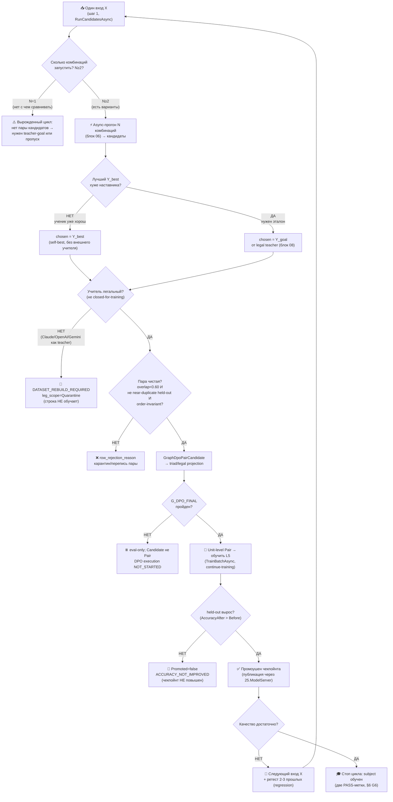

## Current Code-First Reconciliation Overlay (2026-07-14)

current_implementation_authorization: YES_CODE_FIRST_ONLY
teacher_dpo_training_authorization: NO_TEACHER_DPO_TRAINING_UNTIL_G_DPO_FINAL
dpo_status: NOT_STARTED
dpo_priority: LAST
current_counters: 12 phases / 27 subphases / 64 substeps

## Historical Fable Coverage Repair Overlay (2026-07-05)

historical_fable_plan_readiness: PLAN_NOT_READY / FABLE_GAP_REPAIR_QUEUE
historical_fable_implementation_authorization: NO until fresh Luba approval after review
historical_fable_verdict_basis: Newer-at-that-time Fable coverage evidence `claude-fable-plan-check-v1.md` and attachment `98cbe69a` superseded the previous final-readiness overlay. Fable reported 127 findings: 91 COVERED, 30 PARTIAL, 6 MISSING. This is historical plan-repair evidence only, not current execution authority and not product/test/build/runtime/provider/training/checkpoint/git proof.
historical_fable_verdict_classes: DESIGN_BLOCKER_AT_THAT_TIME=FABLE_MISSING_AND_PARTIAL_ITEMS; REPAIR_QUEUE_AT_THAT_TIME=FABLE_RB_RG_AND_PARTIAL_REPAIR; FABLE_EVIDENCE=claude-fable-plan-check-v1.md lines 35-153 and attachment 98cbe69a lines 32-79; IMPLEMENTATION_AUTHORIZATION_GATE_AT_THAT_TIME=NO until fresh Luba approval after review.
historical_fable_classification_rule: Any older line in this file saying PLAN_READY_FOR_LUBA_REVIEW, Final Readiness Review Overlay, no unresolved design/dependency blocker, CURRENT_REPAIR_QUEUE=NONE_IDENTIFIED_BY_FINAL_READINESS_REVIEW, or parent final-readiness acceptance before this overlay is historical/pre-Fable evidence only unless it cites later authority.
historical_fable_gap_repair_addendum: active-codex-execution-42-fable-gap-repair-additions-20260705.md was the historical repair map for R-B/R-G and partial contract/readability/lifecycle additions; it is not current authority.
## Historical Pre-Fable Final Readiness Review Overlay (2026-07-05)
historical_pre_fable_plan_readiness: PLAN_READY_FOR_LUBA_REVIEW
historical_pre_fable_implementation_authorization: NO until fresh Luba approval after review
historical_pre_fable_final_readiness_review_scope: one bounded planning/governance readiness review only; no product implementation, tests, builds, runtime, browser, provider/API, model/training/checkpoint, git, branch, mergeability, PR, or product-readiness proof was run.
historical_pre_fable_current_verdict_basis: This final review read the required governance/skill gate markers, the two unique original-task/reference attachments, the minimum Claude baseline surfaces, the active-codex plan/board/matrix/source-map/legal/gate/ledger surfaces, and current status/search evidence. End-to-end mental simulation from the active plan found no unresolved design/dependency decision that an executor would have to choose before coding/testing. The prior PLAN_NOT_READY / PLAN_PARTIAL_REPAIR_QUEUE state after 0aa/Laplace/Kepler/Singer was retained for parent final-review acceptance; this overlay supplies that final bounded review. Remaining items are execution or approval gates only: fresh Luba implementation approval, local self-authored seed file creation, code implementation, tests/builds/runtime/training/checkpoint/fresh-load/ablation proof, same-scenario Path A/Path B host proof, mock/replacement-ledger proof, branch/mergeability/git proof if later authorized, final product review, and route-specific hosted TogetherAI/Qwen3 terms/output-use proof before hosted train/common use.
historical_pre_fable_current_verdict_classes: DESIGN_BLOCKER_CURRENT=NONE_IDENTIFIED_BY_FINAL_READINESS_REVIEW; CURRENT_REPAIR_QUEUE=NONE_IDENTIFIED_BY_FINAL_READINESS_REVIEW; CURRENT_LEDGER_ACCEPTANCE_BOUNDED_EVIDENCE=50/50 accepted planning sections after 2026-07-05 Pass37-Pass50/Singer repair, not 50 cycles, not 50 product reviews, not product proof, not test/build/runtime/provider/training/checkpoint/git proof; HOSTED_PROVIDER_PRE_USE_GATE_ROUTE_SPECIFIC=TogetherAI/Qwen3 proof required before hosted train/common use only, not a local self-authored v1 planning blocker; IMPLEMENTATION_AUTHORIZATION_GATE=NO until fresh Luba approval after review.
historical_pre_fable_classification_rule: Any older line in this file saying PLAN_NOT_READY / PLAN_PARTIAL_REPAIR_QUEUE, current verdict remains PLAN_NOT_READY, CURRENT_REPAIR_QUEUE, parent must run final readiness review, or no-go boundaries before this overlay is historical/pre-final-readiness-review evidence only unless it cites later authority.
---
artifact_type: guide_05_auto_dpo_loop
authority_source: latest unquoted Luba work order for DPO Legal Learning active execution chain
status: populated_now_planning_only
last_updated: 2026-06-29
write_scope: C:\Users\lubao\Documents\xiigen\llm mvp\dpo legal build\active-codex-execution-*.md
plan_phase_anchor: Ф7 «Авто-DPO петля» (подшаги Ф7.1.1–2, Ф7.2.1–2); потребляет Ф6 (async-кандидаты), Ф3 (строитель), Ф2 (legal-гейт), Ф4 (обучение+lifecycle), Ф5 (измерение)
canon_counters: 12 фаз / 27 подфаз / 64 подшага (Ф0…Ф11), нумерация Ф<P>.<SP>.<SS>
benchmark_read_only_source: codex-guide-05-auto-dpo-loop.md (НЕ редактируется)
canon_owner_graph_dpo_pair: GraphDpoPair → блок 07 (claude-plan-07)
canon_builder_boundary: IGraphDpoPairBuilderUnit -> GraphDpoPairCandidate -> triad/legal projection -> GraphDpoPair(Level=unit); Candidate is not trainable Pair
canon_owner_teacher_provenance: TeacherProvenance → active plan-08 §3.1 (20 полей: 13 базовых + 5 hosted/legal + 2 lifecycle/RR6 service_mode/grounding_used); профили этапов — active plan-08 §3.5.2 (qwen35-local-v1, qwen3-together-v1)
canon_owner_two_phase_teacher: структура двухфазного teacher-маршрута → overlay two-phase-local-remote (единый владелец); B1-seam ITeacherGoalClient.GetGoalAsync → active plan-08 Pass03
canon_owner_async_candidates: GraphCandidateOutput/RunCandidatesAsync/combination_id → блок 06 (claude-plan-06)
canon_owner_graph_edges: EdgeAuthorityUnit/GraphEdgeKind → блок 02 (claude-plan-02)
canon_owner_graph_node_state: GraphNodePreferenceState → блок 04 (claude-plan-04)
---

# Гайд 05 — Замкнутая авто-DPO петля (сердце проекта ILearningDynamicGraph)

Автор гайда: Claude (Opus 4.8 MAX), роль — автор гайда в моём namespace `claude-*`.
Это часть **ПЛАНА** (документация-гайд) проекта **ILearningDynamicGraph**, а не
разрешение на реализацию продукта. R2/R3: PLAN-ONLY; исполнение продукта — только
после свежего явного approve Luba в текущем ходе. Все цитаты кода — из реально
существующих файлов рабочего репозитория `C:/Projects/llm_mvp_core` с `file:line`,
перепроверены чтением. Иерархия и уровни проверены по
`docs/skills/trainable-architecture-decision-SKILL.md` и
`00.Core/LearningMachineContracts.cs`.

> **Версия namespace `claude-*`.** Бенчмарк `codex-guide-05-auto-dpo-loop.md`
> (582 строки) прочитан как образец (read-only) и **улучшен в слабых местах** —
> см. дельта-ноту §0.1. Канонические имена `GraphDpoPair`/`TeacherProvenance`/
> `GraphCandidateOutput`/`RunCandidatesAsync`/`EdgeAuthorityUnit`/
> `GraphNodePreferenceState` — общие со всеми `claude-*` и мастер-планом; новых
> архитектурных уровней не вводится (A-LM-12 — закрытый список из 5 уровней).

> **Current phase gate (2026-07-14).** Current counters are 12/27/64;
> 12/26/59 is historical/pre-PASS26 only. Canonical execution order is
> `CODE_FIRST -> TP1_LOCAL_EVAL_ONLY -> TP2_HOSTED_EVAL_ONLY (G-TP-4) ->
> G_DPO_FINAL -> DPO_TRAINING`. DPO execution is currently `NOT_STARTED` and
> stays last. `IGraphDpoPairBuilderUnit` returns `GraphDpoPairCandidate`, not
> `GraphDpoPair`; only triad/legal projection after all gates may create the
> unit-level Pair.

Связанные блоки/гайды этого плана (evidence-only, не правятся здесь):
- **claude-plan-08** (legal teacher / `TeacherProvenance`) — гейт легальности `chosen`/goal;
- **claude-plan-11** (измерение) — held-out / ablation / две PASS-метки;
- **claude-plan-06** (async-комбинации) — прогон ОДНОГО входа через РАЗНЫЕ комбинации;
- **claude-plan-07** (строитель DPO) — авто-сборка канона `GraphDpoPair`;
- **claude-plan-10** (обучение+lifecycle) — `TrainBatchAsync`/LoRA/continue-training/публикация чекпойнта;
- **claude-plan-12** (no-hidden-determinism) — замена детерминированного выбора на ребре.

Этот гайд 05 — про **петлю**, которая связывает их в один цикл само-улучшения
(фаза доски **Ф7**).

## Pass12 Executor Architecture Walkthrough (human-readable map)

Этот блок не добавляет новую архитектуру и не заменяет владельцев канона. Его
цель - дать будущему исполнителю одну читаемую дорожку через уже решенные блоки,
чтобы авто-DPO петля не собиралась из одних таблиц и ledger-строк.

**12 шагов от входа до обученного checkpoint:**

1. Вход `X` приходит в `ILearningDynamicGraph` как L5-машину
   `ILearningMachine<DynamicGraphDomain>`; уровней больше пяти не появляется
   (мастер §A.3, guide-04 §3.1).
2. Граф читает текущую `DynamicGraphTopology`: узлы - это `ILearningUnit` /
   `ILogicalUnit`, ребра - `IDynamicGraphEdge`, порядок и fan-in/fan-out живут
   в topology/order policy (plan-04, plan-05).
3. `RunCandidatesAsync` запускает один и тот же вход через `N=4` разных async
   комбинации узлов и маршрутов; `N` приходит только из owner-контракта блока 06,
   а не из локального дефолта guide-05.
4. Каждый `ILearningUnit` выдает один или много кандидатов; many-to-many,
   multi-output, fan-out, fan-in и return-loop остаются контрактами ребра/графа,
   а не отдельным новым уровнем (guide-04 §2, plan-06).
5. Fan-in не выбирает победителя по порядку списка. Слияние идет через
   типизированный результат `GraphFanInMergeResult` с явным `MergeRole` и
   `MergeOrderIsAuthority=false`; финальная власть не прячется в merge-порядке
   (plan-06, latest-Claude Pass32).
6. Лучший внутренний кандидат `Y_best` сравнивается с goal: либо self-best уже
   достаточно хорош, либо нужен `Y_goal` от разрешенного teacher (plan-09).
7. Любой внешний `Y_goal` сначала проходит `TeacherProvenanceGate`: 20 полей
   `TeacherProvenance`, permissive/open-weight источник, checked provider terms,
   closed-proprietary outputs только judge/eval, не train target (plan-08).
   Acceptance signal must be classified before train-ready: self-confidence and
   producer self-score are diagnostic only, closed judges are verdict/score
   metadata only, and promotion uses held-out/ablation/no-regression proof rather
   than confidence.
8. `IGraphDpoPairBuilderUnit` выбирает unit-output comparison и возвращает
   `GraphDpoPairCandidate`. Это preview/eval material, не train-ready Pair.
9. Candidate проходит legal, split/overlap, near-duplicate,
   permutation/order-invariance и leakage gates. Строка с грязным provenance или
   order-sensitive chosen/rejected уходит в quarantine/rebuild, а не в обучение
   (plan-07, plan-08, plan-11). Только triad/legal projection после
   `G_DPO_FINAL` создаёт 14-field `GraphDpoPair(Level=unit)`.
10. На последней стадии обучение применяет батч к L5 через `TrainBatchAsync` и существующий DPO/LoRA
    путь; если checkpoint уже есть, это continue-training от загруженного
    состояния, не replay и не обучение с нуля (guide-02, plan-10).
11. Измерение доказывает learning против deterministic baseline: held-out !=
    train set, ablation показывает вклад обучаемого authority, no-replay-cache и
    leakage/permutation проверки отделяют обучение от lookup/score shortcut
    (guide-03, plan-11).
12. Promotion создает/обновляет checkpoint только при росте held-out и fresh-load
    proof. Если рост не доказан, результат остается
    `PASS_AS_HONEST_UNTRAINED_SCAFFOLD` или `ACCURACY_NOT_IMPROVED`, а не
    `PASS_AS_TRAINED_FEATURE` (plan-10, plan-11).

**Где исполнитель быстро находит подробности:**
- Graph roles, nodes, edges, hierarchy: master §A.2-A.4, guide-04, plan-04,
  plan-05.
- Async combinations, order, fan-in/fan-out: plan-06.
- DPO pair canon and builder: guide-01, plan-07.
- Legal/provenance gate: plan-08.
- Closed auto-DPO loop: this guide and plan-09.
- Training/checkpoint lifecycle: guide-02, plan-10.
- Measurement and no-hidden-determinism proof: guide-03, plan-11, plan-13.

**Implementation workers first/second/third, after a future explicit approval:**
1. First refresh the code-reference inventory in the selected implementation
   workdir and downgrade stale `file:line` anchors before coding.
2. Then implement owner contracts in dependency order: graph contracts and
   async candidates before DPO builder, legal gate before train-ready material,
   lifecycle/measurement before promotion claims.
3. Only after those owner contracts exist, connect the auto-DPO cycle and run
   the bounded Gate B checks named by plan-13.

**Do not do in implementation:** do not call provider APIs directly, do not use
Claude/OpenAI/Gemini outputs as training targets, do not add `Train*` to
`ILogicalUnit`/`ILogicalFlow`, do not treat deterministic routers or merge order
as learned authority, do not promote a checkpoint without held-out/fresh-load
evidence, and do not start product work from this planning pass.

---

## 0. Якорь задачи

```text
CURRENT TASK: написать МОЙ (claude-namespace) улучшенный гайд 05 «Авто-DPO петля» —
              план-документ-решение замкнутого цикла само-обучения графа,
              человеческим русским, Part A-формат, с сохранением структуры и
              канонических счётчиков (12 фаз / 27 подфаз / 64 подшага,
              нумерация Ф<P>.<SP>.<SS>) и CANON-инвариантов (L5-машина без 6-го
              уровня A-LM-12; легальный teacher-гейт closed=только judge;
              запрет скрытого детерминизма A-LM-09/A-LM-13). Записать ровно в
              claude-guide-05-auto-dpo-loop.md.
NOT THE TASK: исполнять/тестировать/билдить код, запускать раннеры, тренировать,
              вызывать внешние AI/API/модели, git; править/создавать любые codex-*
              (только чтение); продолжать чужой codex-план или каркас claude-00..07.
EVIDENCE-ONLY: codex-guide-05 (бенчмарк, 582 строки), codex-guide-01..04, реконы
              codex-recon-*, доска claude-EXECUTION-CONTROL-BOARD (Ф7 счётчики),
              мастер claude-ILEARNINGDYNAMICGRAPH-PLAN-v1, соседние claude-plan-*
              (мой namespace, согласован), реальный код llm_mvp_core (для цитат).
```

Скилы/гайды, по которым написан гайд (загружены и применены как контекст):
`docs/skills/trainable-architecture-decision-SKILL.md` (5 разрешённых уровней,
Solved Architecture Block, Graph-Style/DynamicGraph Reconstruction Gate,
Graph-DPO Artifact Triad Gate, Legal Teacher Gate, Minimum Breadth Challenge,
KNN-нота `OK_MODEL_COMPONENT`); `docs/skills/implementation-doc-uml-SKILL.md`
(§0 classDiagram + `note for` на каждый класс + симуляция на каждой связи;
§1 `flowchart TD` + симуляция на каждой ветке); `docs/skills/plan-review-SKILL.md`
(Graph/DynamicGraph review gate; DPO/distillation legal teacher provenance gate;
FC-26/FC-27/FC-28 — тест-стратегия и две PASS-метки).

### 0.1. Где этот гайд осознанно лучше бенчмарка `codex-guide-05` (delta-нота, не слепая копия)

Бенчмарк `codex-guide-05` — **сильный** гайд: у него есть концепт-аналогия,
честная оговорка про masquerade, рабочие `file:line` на `DpoTrainer`/`16`/`18`/`26`,
6 гейтов и список пробелов. Он улучшается не «переписыванием», а **достройкой
Part A и устранением конкретных слабых мест**:

| # | Слабое место бенчмарка `codex-guide-05` | Улучшение в этом claude-гайде |
|---|---|---|
| D1 | **Нет §0 UML и §5 иерархии в Part A-формате.** Есть ASCII-«где приземляется» (codex-guide-05:352-359), но нет `classDiagram` с `note for` на каждый класс, нет таблицы симуляции на каждую связь, нет `flowchart TD` с симуляцией каждой ветки, нет §5 с Input/Output типами. По R3/Part-A Completeness такой гайд читается, но как **план-артефакт неполон**. | Достроил §0 (`classDiagram` + легенда + таблица симуляции S1..S12), §1 (`flowchart TD` + per-branch симуляция), §5 (иерархия L5→L2 с Input/Output и цепочками исполнения). |
| D2 | **«разные комбинации» — словами, без контракта.** codex-guide-05:290-297 ссылается на «гайд 04», но не называет контракт поставщика кандидатов. | Назвал канон owner-типом `IGraphCandidateRunner.RunCandidatesAsync(GraphCandidateRunRequest request, CancellationToken ct) → OperationResult<AsyncCandidateBatch>` (канон PASS09 B-11, владелец — claude-plan-06 §5.2; B-7 — единый owner-контракт, alias `GraphAsyncCombinationRunner` устранён), с `CombinationId`/`Confidence`/node-trace; `N==request.CombinationCount`, N LOCKED=4/потолок 8; петля **потребитель** этого контракта, а не изобретатель. Старая форма `RunCandidatesAsync(string input, int combinationCount) → IReadOnlyList<GraphCandidateOutput>` — historical/pre-PASS09 only. |
| D3 | **`chosen`/`rejected`/`[WRONG:]` без типизированной границы между выбором и обучающей парой.** Исторический текст строил `GraphDpoPair` прямо на шаге выбора. | Зафиксировано: шаг 4 вызывает `IGraphDpoPairBuilderUnit` и получает только нетренируемый `GraphDpoPairCandidate`. Лишь отдельная triad/legal projection после обязательных gate-ов и `G_DPO_FINAL` создаёт unit-level `GraphDpoPair` с 20-польным `TeacherProvenance` (13 базовых + 5 hosted/legal + 2 lifecycle/RR6). Candidate не является Pair; builder-unit Pair напрямую не создаёт. |
| D4 | **Контракт самой петли не назван.** codex-guide-05 описывает 6 шагов, но не даёт класс/метод цикла и его вход/выход. | Ввёл **NEW** `GraphAutoDpoLoop.RunCycleAsync(GraphAutoDpoCycleRequest) → GraphAutoDpoCycleResult` с явными полями (§3, §5); это координатор, а не новый уровень иерархии. |
| D5 | **Порог принятия строки задан, но не сведён в единый гейт-конвейер с ранним выходом.** codex-guide-05:336-339,478-487 даёт `margin≥0 ∧ loss<0.693 ∧ overlap`, но порядок гейтов и `row_rejection_reason` на каждом отказе не выписан как алгоритм. | Свёл в §3.4 конвейер legal→split→overlap→permutation→held-out с ранним выходом и `RowRejectionReason` (синхрон с claude-plan-07 §3.4 и claude-plan-11 G-гейтами). |
| D6 | Historical/pre-Pass26 delta: promotion and cumulative behavior needed a typed state and regression-window contract instead of vague "retest 2-3 prior rows" wording. | Current rule after Pass26: `EdgeAuthorityUnit` / `GraphNodePreferenceState`, `LearningBatchResult.AccuracyBefore/After`, replay `70/30`, and locked `regressionWindow=3` with same-scorer/split/threshold-set retest. |
| D7 | **FLOW-38 / UI-фидбэк как источник `chosen` не пройден через legal-гейт явно.** В бенчмарке UI-фидбэк не выделен как риск teacher-контаминации. | Добавил ветку: `GeneratedUiOutputFeedbackEvent` (**NEW**) с `closed_proprietary_model=true` → `DATASET_REBUILD_REQUIRED`, по умолчанию `PersonalAdaptive`/`Quarantine` (§3.3 шаг 3, §6 C-таблица, синхрон с claude-plan-08). |

CANON-инварианты сохранены (см. §0.2). NEW-типы помечены `NEW`; существующие —
с `file:line`. Структура (1..8) и счётчики (12/26/59 [historical/pre-PASS26 Claude-baseline; текущий канон 12/27/64], Ф<P>.<SP>.<SS>) сохранены.

### 0.2. CANON-инварианты этого гайда (держим, не нарушаем)

| Инвариант | Что значит | Якорь |
|---|---|---|
| **ILearningDynamicGraph = ILearningMachine\<DynamicGraphDomain\>** | Граф — это L5-машина над доменом графа, **без 6-го уровня**; петля живёт ВНУТРИ L5, не создаёт новый уровень | A-LM-12, `00.Core/LearningMachineContracts.cs:208` |
| **Обучение только на L5 (A-LM-02)** | `Train*` — только на `ILearningMachine`; петля обучает через `TrainBatchAsync`, а не дописывает Train в `ILogicalUnit`/`ILogicalFlow` | `00.Core/LearningMachineContracts.cs:8` |
| **Финал ребра — обучаемый, не детерминированный «победитель»** | async-ветки дают кандидатов; выбор edge принимает обучаемая `EdgeAuthorityUnit`, проверяемая leakage/permutation | A-LM-09/A-LM-13; владелец 02 |
| **Легальный teacher-гейт** | closed-proprietary (Claude/OpenAI/Gemini) = только **judge/eval**, никогда teacher/`chosen`/ranking-target; контаминация → `DATASET_REBUILD_REQUIRED` | Legal Teacher Gate; владелец 08 §5/§8 |
| **Нет скрытого детерминизма** | любой скорер/счётчик/роутер на ребре — обучаемый `ILogicalUnit` либо явный `eval-only/baseline`; немаркированной финальной авторитетности нет | A-LM-09/A-LM-13; claude-plan-12 |

Канон-владельцы общих типов (этот гайд их **синхронизирует**, не задаёт свой набор):
`GraphDpoPair` — блок 07.
`TeacherProvenance` — блок 08.
`GraphCandidateOutput`/`RunCandidatesAsync`/`combination_id` — блок 06; `EdgeAuthorityUnit`/`GraphEdgeKind` —
блок 02; `GraphNodePreferenceState` — блок 04.

### 0.3. Карта фаз гайда (12 фаз / 27 подфаз / 64 подшага · нумерация Ф.ПП.СС)

Этот гайд — источник канона петли для фазы доски **Ф7 «Авто-DPO петля»**. Его
Gate B (§7) = exit-условие подшагов Ф7.1.1–2, Ф7.2.1–2. Петля **потребляет**
выходы соседних фаз; она не дублирует их канон.

| Подшаг Ф7 | Что решает (человеческим языком) | Источник канона |
|---|---|---|
| **Ф7.1.1** | Один проход петли: прогон входа X через N комбинаций → кандидаты | блок 06 (`RunCandidatesAsync`) |
| **Ф7.1.2** | Обнаружить слабый выход и взять legal-goal как `chosen` | блок 08 (`TeacherProvenanceGate`) |
| **Ф7.2.1** | Построить `GraphDpoPair` и обучить L5 одним батчем (continue-training) | блок 07 (строитель) + блок 10 (`TrainBatchAsync`) |
| **Ф7.2.2** | Измерить (held-out/ablation), промоушен по дельте, regression-окно, повтор | блок 11 (измерение) + блок 10 (публикация чекпойнта) |

Соседние фазы (evidence-only для этого гайда): **Ф2** legal-гейт+канон,
**Ф3** строитель DPO, **Ф4** обучение+lifecycle, **Ф5** измерение, **Ф6**
async-комбинации, **Ф8** no-hidden-determinism. На стадии плана все статусы
доски = `remaining` (план-only) — корректное состояние плана-документа.

---

## 1. Назначение гайда

Гайд описывает **замкнутую авто-DPO петлю** — главный механизм проекта, который
делает граф (`ILearningDynamicGraph` / его узлы и рёбра) само-обучающимся без
ручного написания каждой DPO-пары. Петля выглядит так:

1. **прогнать** граф на реальной задаче — ОДИН вход `X` через **N разных
   комбинаций** юнитов/маршрутов (async, блок 06);
2. **обнаружить** низкокачественный выход узла/ребра/маршрута;
3. **взять выход РАЗРЕШЁННОГО teacher как goal** (правильный ответ-цель) — либо
   лучшую внутреннюю комбинацию `Y_best`, если она достаточна;
4. **обучить L5-машину СТРОИТЬ DPO** — авто-собрать канон `GraphDpoPair`:
   `chosen` (goal/лучшая комбинация) / `rejected` (слабый выход) + `[WRONG: ...]`;
5. **измерить** (блок 11), что обучение реально произошло (reward margin, loss,
   held-out accuracy, ablation);
6. **повторять** до достаточного качества (промоушен чекпойнта только при росте).

ОБЯЗАТЕЛЬНОЕ ядро петли (требование задачи): на шаге 1 один и тот же вход
прогоняется **async через РАЗНЫЕ комбинации юнитов** (блок 06,
`RunCandidatesAsync`), и лучший выход становится обучающим сигналом `chosen`.
DPO строит **либо сам граф (L5), либо разрешённый teacher** (МОДЕЛЬ-учитель из
открытых весов/permissive). **Никогда не используются Claude/OpenAI/Gemini** как
teacher/distillation-цель — только как judge/eval, и только если Luba явно
разрешит (см. §6 G1 и блок 08).

Гайд отвечает на 4 практических вопроса для плана:
- что из этого УЖЕ есть в коде (и работает), а что — ЗАГЛУШКА (§3);
- какой именно алгоритм петли построить (§3.x, контракт `GraphAutoDpoLoop`);
- как выглядит правильная `GraphDpoPair` на реальных значениях (§5-примеры в §4/§ниже);
- какие гейты (анти-leakage, легальный teacher, запрет скрытого детерминизма,
  измерение) защищают петлю от само-обмана (§6).

---

## 2. Концепт простыми словами (аналогия, без кода)

Представьте мастерскую с **учеником** (наша маленькая обучаемая модель — граф
`ILearningDynamicGraph` и его узлы/рёбра) и **наставником** (разрешённый teacher —
открытая модель с дружественной лицензией).

Цикл одного «урока»:

1. **Ученику дают задачу.** Например: «по запросу пользователя выбрать домен и
   под-фазу на ребре `orchestrator→unit`». Ученик решает её **несколькими
   способами одновременно** — разными комбинациями своих инструментов (узлов).
   Это как если бы он написал несколько вариантов ответа разными методами
   (блок 06: async-прогон РАЗНЫХ комбинаций, `RunCandidatesAsync`).
2. **Сравниваем варианты ученика между собой и с эталоном наставника.** Если
   лучший вариант ученика (`Y_best`) всё ещё хуже наставника — фиксируем разрыв.
   Эталон (`goal`) берём ТОЛЬКО у легального наставника, не у запрещённых
   закрытых моделей.
3. **Делаем черновик карточки (`GraphDpoPairCandidate`).** Learned builder-unit
   выбирает unit-output refs; это ещё не Pair. После triad/legal checks и только
   на последней DPO-стадии проекция создаёт `GraphDpoPair`. На карточке: тот же вопрос
   (`input_context`), в графе «правильно» (`chosen`) — лучший/эталонный ответ, в
   графе «неправильно» (`rejected`) — слабый ответ ученика, и короткая пометка
   `[WRONG: ...]` (`wrong_markers`) — ПОЧЕМУ слабый ответ хуже (одно
   функциональное последствие, а не «потому что плохо»).
4. **Ученик учится на авторизованной карточке** — только после `G_DPO_FINAL`,
   не на Candidate; он не зубрит дословно, а сдвигает
   предпочтение в сторону `chosen`. В терминах DPO: повышает `log P(chosen)`
   относительно `log P(rejected)` так, чтобы **reward margin стал > 0**.
5. **Проверяем, что урок усвоен** (блок 11): на отложенных задачах (held-out),
   а не на тех же карточках. И проверяем, что ученик не сжульничал — не выучил
   позицию варианта в списке, имя файла или дословный текст вопроса
   (ablation / permutation).
6. **Повторяем**, пока качество не станет достаточным; «диплом» (промоушен
   чекпойнта) выдаём ТОЛЬКО если измеренное качество выросло.

Ключевая идея «сердца проекта»: **ученик сам себе готовит карточки-уроки** из
своих же ошибок и эталона наставника. Человек не пишет каждую DPO-пару руками —
петля строит их автоматически и непрерывно.

Важная честная оговорка (анти-masquerade): «решать несколькими способами» и
«сравнивать» — это НЕ обязательно «модель умная». Если выбор лучшего варианта
делает фиксированная формула подсчёта ключевых слов, то это **детерминированный
baseline**, а не обученный интеллект (см. §3.4 про `26.TrainableRouter` и §6 G3
про запрет скрытого детерминизма). Петля имеет право называться обучающей только
когда обучаемый уровень (`EdgeAuthorityUnit` / `GraphNodePreferenceState` через
L5) реально сдвигает веса и это доказано измерением (две PASS-метки, §6 G6).

---

## 3. Как это сейчас реализовано в нашем коде

Здесь — точные ссылки `file:line`, что РАБОТАЕТ, а что ЗАГЛУШКА. Классификация
по `trainable-architecture-decision-SKILL.md`.

### 3.1. Сам DPO-движок — РАБОТАЕТ (реальная математика)

`11.DPO/DpoTrainer.cs` — настоящий DPO-тренер, не заглушка.

- Формула потерь и reward margin (комментарий-инвариант): `11.DPO/DpoTrainer.cs:8-9`
  ```
  // Loss = -E[log σ(β · (log π(y_w|x) - log π(y_l|x) - log π_ref(y_w|x) + log π_ref(y_l|x)))]
  ```
- Реальный расчёт margin/loss/accuracy на шаге: `11.DPO/DpoTrainer.cs:42-65`
  ```csharp
  float chosenReward   = Beta * (polChosenLogP   - refChosenLogP);
  float rejectedReward = Beta * (polRejectedLogP - refRejectedLogP);
  float margin         = chosenReward - rejectedReward;
  float loss           = -MathF.Log(Sigmoid(margin) + 1e-8f);
  ...
  Accuracy = margin > 0 ? 1f : 0f
  ```
  `Beta = 0.1f` (`11.DPO/DpoTrainer.cs:13`). Есть ручной backward через logits
  (`BackwardLogProbs`, `:264-309`) и AdamW (`:54`). Метрики сохраняются атомарно
  до возврата (`SaveMetrics`, `:322-328`, tmp→Move). Это реальный обучающий шаг.
- `StepVector(...)` (`:169-224`) — батч с teaching-вектором и весами; именно его
  зовёт обучающий юнит из проекта 18.

**Вывод по §3.1:** ядро «как именно учить на паре chosen/rejected» в проекте
есть и работает. Петле НЕ нужно изобретать DPO-математику — нужно её **кормить
правильными авто-построенными парами (`GraphDpoPair`) и измерять результат**.

Контракт пары — намеренно простой (это конечная точка обучения):
`11.DPO/Models/DpoPair.cs:3-8`
```csharp
public record DpoPair { public string Prompt; public string Chosen; public string Rejected; }
```
Канон `GraphDpoPair` (блок 07; вложенный/связанный `TeacherProvenance` берётся из отдельного provenance-канона) **проецируется** в `LearningTrainingItem`
(`00.Core/LearningMachineContracts.cs:30`) для обучения L5, а в `DpoPair` —
только при материализации JSONL (`11.DPO/DpoDataset.cs:18`).

### 3.2. Авто-построение DPO «из наблюдённой ветки» — РАБОТАЕТ ЧАСТИЧНО (есть пайплайн, но teacher-цели нет)

`18.CapabilityTraining` — ближайший готовый референс авто-DPO для узлов/флоу.
Пайплайн `DefaultLogicalCapabilityTrainer.TrainAndRegisterAsync`:

- Авто-сборка обучающего ряда из наблюдённой ветки:
  `18.CapabilityTraining/DefaultLogicalCapabilityTrainer.cs:167-175`
  ```csharp
  var trainingText = BuildTrainingTextCore(compiledPrompt, compiledText, request.OriginalRequest.UserRequest, branch, subPhase.Value!.SubPhase);
  branchPlans.Add(new TrainingBranchPlan(
      branch, subPhaseId, subPhase.Value.SubPhase,
      trainingText.Text,
      BuildChosenCapabilityText(subPhase.Value.SubPhase),                                  // chosen
      $"Do not generate a capability for sub-phase {subPhase.Value.SubPhase.SubPhaseId}.", // rejected
      trainingText.TeachingVector));
  ```
- Реальный обучающий юнит DPO: `18.CapabilityTraining/LlmIngredientLogicalUnits.cs:308-415`
  (`LogicalDpoTrainingUnit : ILogicalUnit<LogicalDpoTrainingRequest, LogicalDpoTrainingResult>`):
  применяет LoRA (`LoraApplicator.Apply`, `:339`), грузит родительский чекпойнт
  для continue-training (`:340-350`), кодирует пары в тензоры (`BuildBatch`,
  `:418-438`) и крутит `DpoTrainer.StepVector` с ранней остановкой (`:367-376`).
  Метрики — реальные (`LastLoss/LastAccuracy`, `:385-391`).
- Inference learned-юнита: `TransformerEmbeddingKnnLogicalUnit<TOutput>`
  (`:31-171`) — embedding + HNSW поиск + fusion-скоринг (`:151-156`), confidence
  `0.50 + fused*0.49` (`:156`).

**ЧТО ЗАГЛУШКА / СЛАБО здесь (важно для плана):**

1. **`chosen`/`rejected` строятся ДЕТЕРМИНИРОВАННЫМ шаблоном, без teacher.**
   - `chosen`: `BuildChosenCapabilityText` — шаблон-строка, не выход наставника:
     `18.CapabilityTraining/DefaultLogicalCapabilityTrainer.cs:680-683`
     ```csharp
     return $"Generated capability for sub-phase {subPhase.SubPhaseId}: {subPhase.Name}. Execute the requested work through task type {BuildTaskType(subPhase)}.";
     ```
   - `rejected`: дословный шаблон-отрицание
     `"Do not generate a capability for sub-phase {Id}."` (`:174`). По рекону
     `mvp-internal-learn` именно этот шаблон-отрицание дал overlap ~0.70 и провал
     калибровки 2026-05-06 (29/40 батчей с отрицательным margin, loss=ln2≈0.693).
     Это **анти-пример качества пары**.
   - Для авто-DPO петли `chosen` ОБЯЗАН приходить от лучшей async-комбинации
     (блок 06, `Y_best`) или легального teacher (блок 08); `rejected` — реальный
     слабый выход с осмысленным `[WRONG: ...]` (`wrong_markers`).
2. **Нет полей teacher-provenance** в манифесте (нет `model_id`,
   `model_license`, `teacher_access_mode` — рекон `core-18-capability` §5).
   Канон — `TeacherProvenance` (20 полей, блок 08).
3. **Held-out/ablation отсутствуют** — выводятся `LastLoss/LastAccuracy` на
   обучающих парах, нет отдельного held-out и no-shortcut доказательства. Для
   `PASS_AS_TRAINED_FEATURE` этого мало (§6 G4/G6).
4. **Checkpoint-root по умолчанию ВНЕ репозитория**
   (`Path.GetTempPath()/llm-mvp-capability-training`, рекон §2) — нарушает
   R5/Trainable Unit pattern, нет публикации в `25.ModelServer`.

Классификация по скилу: `LogicalDpoTrainingUnit` = `OK_ALLOWED_LEVEL` (реальное
обучение); `TransformerEmbeddingKnnLogicalUnit` = `OK_MODEL_COMPONENT` (KNN/HNSW
как memory-слой); fusion-re-ranker `ScoreCandidates` (`:177-204`) =
`OK_INTERNAL_DETAIL`, ПОКА он re-ranker внутри обученного юнита, НО требует
ablation, иначе риск, что выбор сводится к детерминированной формуле.

### 3.3. Контур «обучить → измерить → повысить только при улучшении» — РАБОТАЕТ как образец (но DPO-канал ПУСТОЙ)

`16.AutonomousLearning` — готовый прецедент само-улучшения с гейтом дельты, НО
именно «авто-DPO» здесь **не подключён**:

- Гейт «повышать только при улучшении»:
  `16.AutonomousLearning/Pipeline/AutonomousLearningPipeline.cs:137-140`
  ```csharp
  if (enhanced <= baseline)
      return OperationResult<CycleResult>.Fail(
          $"Candidate adapter was not promoted because enhanced accuracy {enhanced:0.###} did not exceed baseline {baseline:0.###}.",
          "ACCURACY_NOT_IMPROVED");
  ```
  Это прямой образец шага 6 петли (промоушен по дельте) + кандидат на
  ablation/no-shortcut гейт.
- **DPO-канал ПРОЛОЖЕН, но вызывается ПУСТЫМ** — «розетка без вилки»:
  `16.AutonomousLearning/Pipeline/AutonomousLearningPipeline.cs:120`
  ```csharp
  var trainResult = await _trainer.TrainAsync(domain, weightedExamples, []); // <- [] = пустой список DPO-пар
  ```
  Сигнатура реально принимает DPO-пары:
  `16.AutonomousLearning/Training/AutonomousTrainer.cs:44-47,61`
  ```csharp
  public async Task<OperationResult<string>> TrainAsync(
      string domain, IReadOnlyList<TrainingExample> newExamples, IReadOnlyList<DpoPair> dpoPairs)
  ...
  var trainResult = await _trainer.TrainAsync(domain, mixedBatch, dpoPairs); // проброс в 14.ContinuousLearning
  ```
  То есть место для авто-DPO определено, но «модель сама находит слабые места →
  строит пары» здесь НЕ реализовано: нет анализа ошибок → нет chosen/rejected.
- **UI-фидбэк как источник `chosen` (FLOW-38) — НЕ пройден через legal-гейт.**
  Канон петли: событие `GeneratedUiOutputFeedbackEvent` (**NEW**, в коде нет)
  входит ТОЛЬКО через `TeacherProvenanceGate`. Если фидбэк правил текст `chosen`
  и `closed_proprietary_model=true` → `DATASET_REBUILD_REQUIRED`; по умолчанию
  UI-фидбэк идёт в `PersonalAdaptive`/`EvalOnly`/`Quarantine`, не в `CommonGlobal` без
  доказательства; в v1 common-only это означает no common train and no personal checkpoint
  mutation until later adaptive activation (синхрон с блоком 08, §6 C-таблица).

**Вывод по §3.3:** у нас есть и гейт дельты, и проброс DPO-канала, и
anti-forgetting (`ReplayBuffer` 70/30). Не хватает именно **генератора пар из
ошибок + легального teacher-goal** — это и есть дельта до «сердца проекта».

### 3.4. «Trainable» маршрутизация — СЕЙЧАС ДЕТЕРМИНИРОВАННАЯ (masquerade-риск)

`26.TrainableRouter` называет себя обучаемым, но рантайм-authority —
детерминированный подсчёт ключевых слов (рекон `core-26-router`
§«Классификация»):

- `KeywordUnitScorer.Score` — `text.Contains(keyword)` подсчёт + boosts →
  вердикт скила `FORBIDDEN_RUNTIME_SHORTCUT` (детерминизм как финальная
  authority там, где заявлен trainable router).
- `RoutingProfileTrainer.Train` — сбор словаря ключевых слов, без весов/loss/
  чекпойнта → `REPORT_CLAIM_TOO_STRONG` (это keyword-harvest, не обучение).
- `RoutingTrainingResult.RewardMargin/DpoAccuracy/Promoted` — контрактные
  плейсхолдеры, нигде реально не считаются (рекон §«Классификация»).
- Lifecycle отсутствует целиком: grep по проекту НЕ нашёл `checkpoint`,
  `ExportAsync`, `ImportAsync`, реального DPO-цикла (рекон §«Lifecycle»).

**Вывод по §3.4:** `26` даёт ГОТОВЫЙ ФОРМАТ DPO-пар (`RoutingDpoPairBuilder`,
`OrchestrationPromptDpoPairBuilder`) и метрики acceptance — переиспользуем как
заготовку формата (один из 5 источников строителя, блок 07). Но его
рантайм-выбор юнита нельзя использовать как «обученный» — он
`PASS_AS_HONEST_UNTRAINED_SCAFFOLD` только при честной пометке baseline. В
авто-DPO петле его роль — **источник `rejected` (слабый детерминированный выход)
и формат пары**, а `chosen` приходит от обученного уровня/teacher. Замена
детерминированного выбора на обучаемую `EdgeAuthorityUnit` — фаза **Ф8**
(claude-plan-12).

### 3.5. Контракт самой петли (NEW) и куда она «приземляется» по иерархии

Петля — это **координатор** (helper-уровень оркестрации цикла), а НЕ новый
уровень иерархии. Она зовёт существующие уровни, не добавляя 6-й (A-LM-12).

```csharp
// NEW — координатор замкнутого авто-DPO цикла (helper-оркестрация; НЕ новый уровень).
public sealed class GraphAutoDpoLoop
{
    // Один полный цикл само-улучшения: прогон → обнаружение → goal → строитель → обучение → измерение → промоушен.
    public Task<OperationResult<GraphAutoDpoCycleResult>> RunCycleAsync(
        GraphAutoDpoCycleRequest request, CancellationToken ct = default);
}

// NEW — вход одного цикла.
public sealed record GraphAutoDpoCycleRequest(
    string TrainableSubjectId,     // что учим: ребро (EdgeAuthorityUnit) или узел (GraphNodePreferenceState)
    string Input,                  // реальный вход X
    int CombinationCount,          // N комбинаций для RunCandidatesAsync (блок 06)
    string CheckpointRef,          // текущий чекпойнт L5 (continue-training, не с нуля)
    int RegressionWindow);         // locked Q24 value: retest the last 3 accepted rows/checkpoints

// NEW — результат одного цикла (для доски/леджера, без перезаписи).
public sealed record GraphAutoDpoCycleResult(
    GraphDpoPair BuiltPair,        // канон-пара (блок 07); может быть dpo_train_ready=false
    bool RowAccepted,              // прошла ли триаду гейтов
    double RewardMargin,           // из LearningBatchResult (LearningMachineContracts.cs:43)
    double AccuracyBefore,
    double AccuracyAfter,
    bool Promoted,                 // повышен ли чекпойнт (гейт дельты)
    string NextAction);            // "next-input" | "stop-sufficient" | "rebuild-required" | ...
```

Иерархия обучаемых уровней объявлена в `00.Core/LearningMachineContracts.cs`
(namespace `AgentInfrastructure.Logical`):

- `ILearningMachine<TDomain>` — Level 5, методы `TrainBatchAsync / EvaluateAsync /
  ExportAsync / ImportAsync / GetOrchestratorAsync`:
  `00.Core/LearningMachineContracts.cs:208-234`.
- DPO-триплет типизирован как `LearningTrainingItem(ItemId, Prompt,
  ChosenResponse, RejectedResponse)`: `:30-39`; батч `LearningBatch<TDomain>`: `:18-27`.
- Метрики батча `LearningBatchResult` несут `AccuracyBefore/AccuracyAfter/
  RewardMargin/CpuMs/PeakRamMb/ElapsedMs/PromotedUnitIds`: `:43-62` — готовая
  рамка измерения для петли (блок 11).
- Правило A-LM-02 (шапка файла, `:8`): `Train()` только на `ILearningMachine`;
  `ILogicalUnit`/`ILogicalFlow` — чистый инференс. Петля это уважает: обучает
  через машину/тренер, а не дописывает Train* в юниты.

**Где НЕТ кода (это новая надстройка плана):** типов `ILearningDynamicGraph` как
отдельного интерфейса в репозитории НЕТ — в задаче это **псевдоним** существующего
`ILearningMachine<DynamicGraphDomain>` (канон-маппинг, мастер §A.3), не новый
уровень. Граф-контракты (узлы/рёбра/fan-out/fan-in/many-to-many/async) и
координатор `GraphAutoDpoLoop` — **NEW**, проектируются по Graph-Style
Reconstruction Gate (блоки 01/02/03/04/06; §4 ниже).

### 3.6. Кумулятивность и regression-окно (контракт, не словами)

Обучаемые субъекты петли:
- **ребро** → `EdgeAuthorityUnit` (обучаемый выбор цели на ребре; владелец 02);
- **узел** → `GraphNodePreferenceState` (типизированное обучаемое состояние узла,
  `level=unit`; владелец 04, доска Ф4.3.1).

One graph state continues through all accepted rows from `CheckpointRef`, not from zero. After row N, the loop retests `regressionWindow=3` prior accepted rows/checkpoints with the same scorer, threshold-set id, split refs, and checkpoint lineage so a new lesson cannot silently degrade earlier accepted behavior. Anti-forgetting still uses the locked replay split `70/30` from `16.AutonomousLearning/Training/ReplayBuffer.cs`.

---

## 4. Архитектура петли (§0 UML + §1 flowchart + симуляции)

### 4.1. §0 Class diagram (классы петли + что каждый делает)

```mermaid
classDiagram
    class GraphAutoDpoLoop {
        <<NEW координатор цикла>>
        +RunCycleAsync(req) GraphAutoDpoCycleResult
    }
    class IGraphCandidateRunner {
        <<блок 06 — поставщик кандидатов>>
        +RunCandidatesAsync(GraphCandidateRunRequest request, CancellationToken ct) OperationResult~AsyncCandidateBatch~
    }
    class IGraphDpoPairBuilderUnit {
        <<блок 07 — learned L2 policy>>
        +ExecuteAsync(input) GraphDpoPairCandidate
    }
    class GraphDpoPairCandidate {
        <<блок 07 — non-trainable intermediate>>
        +UnitId string
        +ChosenUnitOutputRef string
        +RejectedUnitOutputRef string
        +BuilderScore double
        +DpoTrainReadyEligible bool
    }
    class TriadLegalProjection {
        <<блоки 07/08 — hard-gate projection>>
        +Project(candidate, triad, provenance) GraphDpoPair
    }
    class TeacherProvenanceGate {
        <<блок 08 — legal-гейт>>
        +Evaluate(provenance) LegalVerdict
    }
    class DynamicGraphMachine {
        <<L5 ILearningMachine~DynamicGraphDomain~>>
        +TrainBatchAsync(batch) LearningBatchResult
        +EvaluateAsync(heldout) LearningBatchResult
    }
    class GraphCandidateOutput {
        <<блок 06 — кандидат комбинации>>
        +CombinationId string
        +Output string
        +Confidence double
    }
    class GraphDpoPair {
        <<блок 07 — канон пары>>
        +Chosen string
        +Rejected string
        +WrongMarkers string[]
        +TeacherProvenance TeacherProvenance
        +DpoTrainReady bool
    }

    note for GraphAutoDpoLoop "NEW. Координирует один полный цикл само-улучшения (6 шагов). НЕ новый уровень иерархии, НЕ обучает сам. Статус: ПРОЕКТ."
    note for IGraphCandidateRunner "Блок 06 — ВЛАДЕЛЕЦ контракта (claude-plan-06 §5.2, PASS09 B-11 canon). Канон-сигнатура: RunCandidatesAsync(GraphCandidateRunRequest request, CancellationToken ct) → OperationResult~AsyncCandidateBatch~. Прогоняет ОДИН вход X через N разных комбинаций async. N == request.CombinationCount (единственный источник N); N LOCKED=4, потолок 8 (Luba 2026-06-30; мастер §E Q16 / блок 06 §12 Q4). Источник chosen/rejected. Старая краткая форма RunCandidatesAsync(string input, int combinationCount) → historical/pre-PASS09 only (см. plan-06 §5.2 overlay). Гайд/петля — ПОТРЕБИТЕЛИ owner-формы, не переобъявляют. Статус: ПРОЕКТ (опирается на AdaptiveLogicalOrchestrator)."
    note for IGraphDpoPairBuilderUnit "Блок 07. Learned L2 policy: unit-output comparisons → GraphDpoPairCandidate. Pair напрямую не создаёт. Статус: ПРОЕКТ."
    note for GraphDpoPairCandidate "Блок 07. Intermediate preview/eval material; Candidate != Pair, прямой train input запрещён. Статус: ПРОЕКТ."
    note for TriadLegalProjection "Блоки 07/08. Единственная Candidate→Pair граница: legal/split/authority/leakage/overlap + G_DPO_FINAL. Статус: ПРОЕКТ."
    note for TeacherProvenanceGate "Блок 08. Проверяет легальность учителя/goal. closed-for-training → DATASET_REBUILD_REQUIRED. Статус: ПРОЕКТ."
    note for DynamicGraphMachine "L5. Единственный обучаемый уровень петли (A-LM-02). TrainBatchAsync/EvaluateAsync реальны через DpoTrainer. Статус: каркас ПРОЕКТ, движок РАБОТАЕТ (11.DPO)."
    note for GraphCandidateOutput "Блок 06. Один выход одной комбинации: id комбинации, текст, confidence, node-trace. Статус: ПРОЕКТ."
    note for GraphDpoPair "Блок 07. Unit-level DPO-пара; provenance вложен/связан как 20-польный TeacherProvenance (13 базовых + 5 hosted/legal + 2 lifecycle/RR6). Только выход triad/legal projection после G_DPO_FINAL; вход обучения. Статус: ПРОЕКТ."

    GraphAutoDpoLoop ..> IGraphCandidateRunner : шаг 1 (прогон N комбинаций; делегирует, не переобъявляет)
    IGraphCandidateRunner ..> GraphCandidateOutput : RunCandidatesAsync(input, N) → N кандидатов
    GraphAutoDpoLoop ..> IGraphDpoPairBuilderUnit : шаг 4 (выбирает unit comparison)
    IGraphDpoPairBuilderUnit ..> GraphDpoPairCandidate : output (не Pair)
    GraphCandidateOutput ..> GraphDpoPairCandidate : unit-output refs
    GraphDpoPairCandidate ..> TriadLegalProjection : hard gates
    TriadLegalProjection ..> TeacherProvenanceGate : гейт 1 (legal)
    TriadLegalProjection ..> GraphDpoPair : authorized unit-level output
    GraphAutoDpoLoop ..> DynamicGraphMachine : шаг 4 (TrainBatchAsync) / шаг 5 (EvaluateAsync)
    GraphDpoPair ..> DynamicGraphMachine : проекция в LearningTrainingItem
```

### 4.2. Легенда классов §0

| Класс | Что делает | Статус |
|---|---|---|
| `GraphAutoDpoLoop` | Координатор цикла (6 шагов); НЕ обучает сам, НЕ новый уровень | NEW (ПРОЕКТ) |
| `IGraphCandidateRunner` | канон PASS09: `RunCandidatesAsync(GraphCandidateRunRequest request, CancellationToken ct)` → `OperationResult<AsyncCandidateBatch>`: X → N комбинаций async (поставщик кандидатов); единый owner-контракт; N==`request.CombinationCount`, N LOCKED=4/потолок 8. Старая форма `RunCandidatesAsync(string input, int combinationCount)` → historical/pre-PASS09 only (owner: plan-06 §5.2) | NEW, владелец 06; гайд = потребитель |
| `IGraphDpoPairBuilderUnit` | Learned unit-output selection → non-trainable Candidate | NEW, владелец 07 |
| `GraphDpoPairCandidate` | Intermediate unit refs/score; Candidate ≠ Pair | NEW, владелец 07 |
| `TriadLegalProjection` | Hard gates + единственная Candidate→unit-level Pair граница | NEW, владельцы 07/08 |
| `TeacherProvenanceGate` | Legal-гейт учителя/goal (20 полей провенанса) | NEW, владелец 08 |
| `DynamicGraphMachine` | L5-машина: единственный обучаемый уровень петли | каркас NEW; движок РАБОТАЕТ (`11.DPO/DpoTrainer.cs`) |
| `GraphCandidateOutput` | Один кандидат-выход комбинации (id/текст/confidence/trace) | NEW, владелец 06 |
| `GraphDpoPair` | Unit-level DPO-пара; provenance вложен/связан как 20-польный `TeacherProvenance` (13 базовых + 5 hosted/legal + 2 lifecycle/RR6); создаётся только triad/legal projection после `G_DPO_FINAL` | NEW, владелец 07 |

### 4.3. Таблица симуляции §0 (для каждой связи: вход → ожидаемый результат)

| # | Связь | Пример входа | Ожидаемый результат |
|---|---|---|---|
| S1 | `GraphAutoDpoLoop ..> IGraphCandidateRunner` | `X="добавь проверку конфиденциальности"`, `N=combinationCount=4` (дефолт) | 4 `GraphCandidateOutput` с разными `CombinationId`, `Confidence`, node-trace (прообраз `LlmIngredientLogicalUnits.cs:156`); вызвана owner-форма с N |
| S2 | `IGraphCandidateRunner ..> GraphCandidateOutput` | комбинация C3 завершилась, verdict=PASS | `CombinationId="C3"`, `Confidence` посчитан, порядок комбинаций НЕ авторитет |
| S3 | `GraphCandidateOutput ..> GraphDpoPairCandidate` (self_best) | `Y_best` selected by held-out/product scorer or guarded deterministic self-best; confidence is diagnostic | Candidate содержит chosen/rejected unit refs; confidence не делает его Pair/train-ready |
| S4 | `GraphAutoDpoLoop ..> IGraphDpoPairBuilderUnit` | кандидаты + ctx с goal | `GraphDpoPairCandidate`; при пустом `chosen` reason=`EMPTY_SIDE`, Pair не создан (Rule 1) |
| S5 | `TriadLegalProjection ..> TeacherProvenanceGate` (closed-for-train) | provenance `closed_proprietary_model=true, used_for_training=true` (напр. `model=claude-*`) | `DATASET_REBUILD_REQUIRED`; Candidate остаётся quarantine/non-trainable |
| S6 | `TriadLegalProjection ..> TeacherProvenanceGate` (judge-only) | closed-модель `used_for_judging_only=true, used_for_training=false`, chosen НЕ от неё | legal leg пройден; до полной триады и `G_DPO_FINAL` Pair не создаётся |
| S7 | `TriadLegalProjection ..> GraphDpoPair` (overlap/stage) | `overlap_score=0.74` ИЛИ `G_DPO_FINAL=false` | `LOW_CONTRAST` либо stage-block; unit-level Pair/train JSONL не создаётся |
| S8 | `GraphDpoPairCandidate` permutation | chosen меняется при перестановке кандидатов | `candidate_order_invariant=false`, `rejected_origin="order-artifact"`; Candidate quarantine, Pair не создан (A-LM-09) |
| S9 | `GraphAutoDpoLoop ..> DynamicGraphMachine` (train, last stage) | `G_DPO_FINAL=true`, батч unit-level train-ready пар, `CheckpointRef` задан | `TrainBatchAsync` → `LearningBatchResult` с реальным `RewardMargin` (continue-training, не с нуля) |
| S10 | `GraphAutoDpoLoop ..> DynamicGraphMachine` (eval) | held-out набор (источник-дизъюнктный) | `EvaluateAsync` → `AccuracyAfter`; held-out НЕ из обучающих пар (блок 11) |
| S11 | `GraphDpoPair ..> DynamicGraphMachine` (проекция) | train-ready пара | `ItemId←pair_id, Prompt←input_context, ChosenResponse←chosen, RejectedResponse←rejected` (`LearningMachineContracts.cs:30`) |
| S12 | промоушен по дельте | `AccuracyAfter ≤ AccuracyBefore` | `Promoted=false`, `ACCURACY_NOT_IMPROVED` (`AutonomousLearningPipeline.cs:137-140`); чекпойнт НЕ повышен |

### 4.4. §1 Человеко-язычный flowchart петли (per-branch simulation)



### 4.5. Per-branch симуляция веток §1

| Ветка | Симуляция входа | Ожидаемый результат |
|---|---|---|
| B → N=1 | `CombinationCount=1` | вырожденный цикл: нет пары кандидатов, требуется teacher-goal или пропуск входа |
| B → N≥2 | `CombinationCount=4` | 4 кандидата async, можно сравнивать |
| D → НЕТ | `Y_best` passes held-out/product scorer or guarded self-best route, наставник не лучше | `chosen=Y_best` (self-best), внешний teacher не нужен; confidence remains diagnostic |
| D → ДА | `Y_best` fails held-out/product scorer gap, legal teacher gives a permitted goal | `chosen=Y_goal` от legal teacher |
| F → НЕТ | provenance `closed_proprietary_model=true, used_for_training=true` | `DATASET_REBUILD_REQUIRED`, строка не обучает |
| F → ДА | open-weight `model_license=Apache-2.0` | пара проходит legal-гейт |
| G → НЕТ | `overlap_score=0.74` | `row_rejection_reason="LOW_CONTRAST"`, карантин/перепись |
| G → ДА | `overlap=0.18`, order-invariant, не near-dup | Candidate допускается к triad/legal projection, но ещё не Pair |
| Stage → НЕТ | TP1/TP2 eval-only выполнены, `G_DPO_FINAL=false` | Candidate остаётся eval-only; DPO train не запускается |
| Stage → ДА | отдельный финальный gate пройден | создаётся unit-level Pair и только тогда вызывается `TrainBatchAsync` |
| I → НЕТ | `AccuracyBefore=0.71`, `AccuracyAfter=0.70` | `Promoted=false`, `ACCURACY_NOT_IMPROVED` |
| I → ДА | `AccuracyBefore=0.71`, `AccuracyAfter=0.84` | промоушен чекпойнта |
| K → НЕТ | held-out lift есть, но цель не достигнута | следующий вход + regression-окно 2..3 |
| K → ДА | held-out на целевом пороге, две PASS-метки | стоп цикла, subject обучен |

---

## 5. Пошаговый рецепт / алгоритм петли + §5 иерархия

Ниже — алгоритм без кода: что происходит, где, в каком порядке, какие
классы/контракты задействованы. Это рецепт для ПЛАНА, не реализация.

### Шаг 0 — Подготовка (один раз на петлю)
- Зафиксировать **обучаемый объект** (`TrainableSubjectId`): какое ребро
  (`EdgeAuthorityUnit`, владелец 02) или узел (`GraphNodePreferenceState`,
  владелец 04) учим.
- Зафиксировать **legal teacher** (блок 08): `teacher_access_mode`,
  `hosting_provider`, `model_id`, `model_license`, `provider_terms_checked`,
  `closed_proprietary_model=false`. Без зелёного гейта teacher-выходы как
  `chosen` запрещены.
- Загрузить чекпойнт L5 (`CheckpointRef`): сначала user/cache, затем repo/common;
  если нет — честный `untrained scaffold` (lifecycle, §6 G5).

### Шаг 1 — Прогон одного входа через РАЗНЫЕ комбинации (ОБЯЗАТЕЛЬНО, async; блок 06) [Ф7.1.1]
- Взять реальный вход `X`.
- Async прогнать `X` через `N` **разных комбинаций юнитов/маршрутов** графа через
  owner-форму (канон PASS09 B-11)
  `IGraphCandidateRunner.RunCandidatesAsync(GraphCandidateRunRequest request, CancellationToken ct)`
  → `OperationResult<AsyncCandidateBatch>` (владелец 06 §5.2; опирается на
  `AdaptiveLogicalOrchestrator`). Старая краткая форма
  `RunCandidatesAsync(string input, int combinationCount)` — historical/pre-PASS09
  wording only, в реализации не используется (см. plan-06 §5.2 PASS09 overlay).
- `N == request.CombinationCount` — единственный источник N; **N LOCKED=4, потолок 8**
  (Luba 2026-06-30) по `claude-plan-06 §5.2`, мастер §E Q16 и блок 06 §12 Q4.
- Собрать `{GraphCandidateOutput_1..N}` с `CombinationId`/`Confidence`/трассой.
  Прообраз confidence — `TransformerEmbeddingKnnLogicalUnit.ExecuteAsync`
  (`18.CapabilityTraining/LlmIngredientLogicalUnits.cs:129-171`).

### Шаг 2 — Обнаружить низкокачественный выход [Ф7.1.2]
- Оценить кандидатов (блок 11 + judges из лучших моделей разрешены как
  СУДЬИ-eval, не teacher): выбрать лучший внутренний `Y_best`.
- Признать «слабыми» выходы заметно хуже `Y_best`/эталона: низкий confidence,
  провал verdict, расхождение с held-out ожиданием. Это кандидаты в `rejected`.
  (Прецедент гейта дельты: `AutonomousLearningPipeline.cs:137-140`.)

### Шаг 3 — Взять выход разрешённого teacher как goal [Ф7.1.2]
- Если `Y_best` всё ещё хуже наставника — получить эталон `Y_goal` у **legal
  teacher** (открытая permissive-модель), пройдя гейт §6 G1 / блок 08.
- Если teacher недоступен/не нужен — `chosen = Y_best` (лучшая комбинация
  ученика). Запрещённые модели (Claude/OpenAI/Gemini) НЕ могут давать `Y_goal`
  как обучающую цель (только судить, если Luba явно разрешит).
- Зафиксировать `TeacherProvenance` (кто сгенерировал `chosen`) — 20 полей собирает
  детерминированный `TeacherProvenanceAdapter` ПОСЛЕ ответа учителя (LLM provenance не пишет);
  `observed_model_id`-digest ≠ запиненный → `BLOCK(served_model_mismatch)`.
- Двухэтапный teacher-маршрут (владелец — overlay two-phase): Этап 1 `TP1_LOCAL` — локальный
  Ollama Qwen3.5-9B, вход ≤~8K node/edge JSON, best-of-K с НЕЗАВИСИМЫМ пер-доменным scorer;
  Этап 2 `TP2_HOSTED` — hosted `qwen3-together-v1` после `ProviderTermsProof`. Оба через один
  seam `ITeacherGoalClient.GetGoalAsync`; `chosen=Y_goal` только если `Score(Y_goal)>Score(Y_best)`,
  иначе `chosen=Y_best` (лучший кандидат ученика).
- UI-фидбэк (`GeneratedUiOutputFeedbackEvent`, NEW) входит ТОЛЬКО через тот же
  гейт; по умолчанию `PersonalAdaptive`/`EvalOnly`/`Quarantine`, and in v1
  common-only it cannot mutate common or personal checkpoints without proof/activation.

### Шаг 4 — Выдать Candidate; Pair/обучение только на последней стадии [Ф7.2.1]
- **Обучаемая политика пар-построения — это ядро R-C «train graph to BUILD DPO».**
  Собрать пару через **обучаемый** Level-2 юнит `TrainableGraphDpoBuilderUnit`
  (реализует `IGraphDpoPairBuilderUnit`, владелец блок 07 §3.5/§5.2): это learned
  candidate-selection policy с `GraphDpoBuilderUnitState` (learned) + reward-scalarization
  + checkpoint — именно она отвечает на клауз задачи «граф сам СТРОИТ DPO», а не
  детерминированная сборка. Выход — только `GraphDpoPairCandidate`, не Pair.
- **Детерминированная нормализация форматов (блок 07 §3.3) — только
  baseline/validator/fallback** для ablation (G12) и аварийного пути; она не
  создаёт train-ready Pair. Она нормализует поля Candidate: `input_context = X`, `chosen = Y_goal/Y_best`,
  `rejected = слабый выход`, `wrong_markers=[WRONG: <одно функциональное
  последствие>]`. Если исполнитель реализует шаг 4 ТОЛЬКО через
  детерминированный format-normalizer/helper, R-C остаётся скрытым
  детерминизмом (R4-класс), а helper всё равно не получает Pair-authority.
- Прогнать Candidate через **triad/legal projection** §3.4. Только полная триада
  + `G_DPO_FINAL` создаёт unit-level `GraphDpoPair`; до этого DPO execution
  `NOT_STARTED`, Candidate остаётся eval-only/quarantine.
- На последней стадии обучить уровень одним батч-шагом: `DynamicGraphMachine.TrainBatchAsync`
  (`00.Core/LearningMachineContracts.cs:212-213`) → `LogicalDpoTrainingUnit` →
  `DpoTrainer.StepVector` (`11.DPO/DpoTrainer.cs:169-224`). Если subject уже
  обучался — continue-training из `CheckpointRef`
  (`LlmIngredientLogicalUnits.cs:340-350`), не с нуля.
- Anti-forgetting: подмешать прошлые принятые пары (replay), образец —
  `16.AutonomousLearning/Training/ReplayBuffer.cs` (70/30).

### Шаг 5 — Измерить (блок 11) [Ф7.2.2]
- На **held-out** наборе (не на обучающих парах) замерить
  `AccuracyBefore/After`, `RewardMargin` (`LearningBatchResult`,
  `00.Core/LearningMachineContracts.cs:43-62`; `EvaluateAsync`, `:217-218`).
- Гейт принятия строки (рекон `mvp-internal-learn` §2 + блок 11):
  `reward_margin ≥ 0` И `loss < 0.693` (ln2 = random-guess) И overlap-scan
  пройден. Плюс ablation/permutation: chosen стабилен при перестановке
  кандидатов и без позиционного сигнала.

### Шаг 6 — Промоушен и повтор [Ф7.2.2]
- Повышать чекпойнт (регистрация/публикация через `25.ModelServer` — Trainable
  Unit pattern) **только если** held-out качество выросло (образец гейта:
  `AutonomousLearningPipeline.cs:137-140`).
- Сохранить ledger-строки (одна строка на цикл, без перезаписи) — образец
  `TeachingRowRecord` (рекон `mvp-orch-teaching` §2).
- If quality is still insufficient, take the next input and repeat from step 1.
  Cumulative rule: one graph state continues across rows; after row N, retest
  `regressionWindow=3` prior accepted rows/checkpoints with the same scorer and
  threshold set (see section 3.6).

### 5.1. §5 Иерархия уровней (где петля приземляется, Input/Output)

| Уровень | Контракт | Роль в петле | Input → Output |
|---|---|---|---|
| L5 | `ILearningMachine<DynamicGraphDomain>` (`LearningMachineContracts.cs:208`) | **владеет петлёй и обучением** | `LearningBatch<DynamicGraphDomain>` → `LearningBatchResult` |
| L4 | `ILogicalOrchestrator` | маршрут + reprocessing-петля | `LogicalOrchestratorRequest` → `LogicalOrchestratorResult` |
| L3 | `ILogicalFlow<T>` | async-комбинации узлов (fan-out/fan-in), блок 06 | `LogicalFlowRequest<T>` → `LogicalFlowResult` |
| L2 | `ILogicalUnit<TIn,TOut>` | узел; learned: `LogicalDpoTrainingUnit`/KnnUnit (18), `TrainableGraphDpoBuilderUnit` (learned candidate-selection policy, `IGraphDpoPairBuilderUnit`, блок 07); edge: `EdgeAuthorityUnit`; deterministic format-normalizer — helper без Pair-authority | `LogicalUnitRequest<TIn>` → `LogicalUnitResult<TOut>` |
| вне иерархии (A-LM-02) | тренер: `DefaultLogicalCapabilityTrainer` + `DpoTrainer` | реальный шаг обучения | пара/батч → margin/loss/accuracy |

Цепочка исполнения одного цикла:
`GraphAutoDpoLoop.RunCycleAsync` → (L3/L4) `RunCandidatesAsync` → кандидаты →
(L2 learned) `TrainableGraphDpoBuilderUnit` (learned pair-construction policy,
реализует `IGraphDpoPairBuilderUnit`; владелец блок 07) →
`GraphDpoPairCandidate` → triad/legal projection + `TeacherProvenanceGate` →
после `G_DPO_FINAL` unit-level `GraphDpoPair` → (L5)
`TrainBatchAsync`/`EvaluateAsync` → промоушен/повтор.

Ключ R-C: выбор unit-level comparison как политику ведёт **обучаемый**
`TrainableGraphDpoBuilderUnit` (L2), но его output — Candidate. Pair authority
принадлежит отдельной hard-gate проекции; детерминированная нормализация — только
baseline/validator/fallback (§7 плана 07, гейт скрытого детерминизма §6 G3).

---

## 6. Гейты и правила петли

Каждый гейт защищает петлю от само-обмана. Гейт = жёсткое условие, провал =
строка/чекпойнт не принимается.

### G1 — Легальный teacher / provenance (связь с блоком 08)
- `chosen`/`Y_goal` для обучения может прийти ТОЛЬКО от first-party данных, от
  обученного уровня (лучшая async-комбинация), или от **разрешённого hosted
  open-weight/permissive teacher** после проверки terms+license.
- **Claude / OpenAI / Gemini / Gemini Grounding — ЗАПРЕЩЕНЫ как
  distillation-teacher / chosen / rejected / ranking-target.** Если
  `closed_proprietary_model=true` И `used_for_training=true` →
  `DATASET_REBUILD_REQUIRED` (без исключений по скилу; даже разрешение Luba это
  не снимает — closed допустимы лишь как non-training judge/eval).
- Обязательные поля `TeacherProvenance` (20, владелец 08): `teacher_access_mode,
  hosting_provider, model_id, model_license, provider_terms_checked,
  used_for_training, used_for_judging_only, closed_proprietary_model,
  source_category, request_id/model_version`, и т.д. Лицензии для common:
  MIT/Apache-2.0 предпочтительны; CC BY 4.0 только с атрибуцией; RFC/CWE/NIST —
  public domain; CC BY-SA/AGPL/GPL/unknown — запрет (рекон `mvp-external-sources`
  §2). Источники с model-output risk (ShareGPT/WizardLM/Alpaca/Dolly/FLAN-raw)
  дают только A-side форму, ассистент-ответ НЕ копируется как `chosen`.
- Вердикт-enum гейта (6 значений, владелец — `claude-plan-08` §3.3): `ACCEPT | QUARANTINE | BLOCK | DATASET_REBUILD_REQUIRED |
  BLOCK_FOR_COMMON | EVAL_ONLY`. `LegScope`: `CommonGlobal | PersonalAdaptive | EvalOnly |
  Quarantine`. Client/private origin без allowlist + `used_for_training=true` →
  `QUARANTINE` (ветка R17, блок 08).

### G2 — Анти-leakage качества пары
- `overlap_ratio(chosen, rejected) < 0.60` (иначе брак; token-overlap test).
- `rejected` правдоподобен и близок к `chosen`, отличается на ОДНОЙ границе
  решения; имеет код таксономии (`rejected_origin`) и осмысленный
  `[WRONG: ...]` (функциональное последствие, не «плохо»).
- Запрещено, чтобы `chosen` предсказывался по полному leakage-6:
  `[candidate_index, source_path, source_id, file_order, correlation_id,
  exact_prompt]`. Для универсальной модели project-specific команда также ведёт
  в quarantine, но не заменяет и не сокращает leakage-6. Полный список записывается
  в `excluded_leakage_signals`; см. `dpo-triple-format-SKILL.md` +
  `trainable-architecture-decision-SKILL.md`.
- Permutation-инвариантность: `candidate_order_invariant=true`,
  `chosen_skill_stable_across_permutations=true`, иначе
  `QUARANTINE_DO_NOT_TRAIN` или переписать пару.

### G3 — Запрет скрытого детерминизма (Graph-Style edge authority)
- Для КАЖДОГО ребра графа назвать владельца финальной authority:
  детерминированный хелпер / обучаемый unit / flow / orchestrator / machine.
- Скрытый детерминированный scorer/router/lookup/counter на ребре, выдающий
  себя за trainable → `FORBIDDEN_RUNTIME_SHORTCUT` (как `KeywordUnitScorer` в
  проекте 26). Детерминированный хелпер допустим ТОЛЬКО явно помеченным как
  eval-only/baseline/helper, и должен быть перекрыт обученным уровнем
  (`EdgeAuthorityUnit`) с ablation-доказательством, что выбор НЕ сводится к
  формуле (фаза Ф8, claude-plan-12).
- `RewardMargin/DpoAccuracy/Promoted` нельзя оставлять контрактными
  плейсхолдерами (как в `RoutingTrainingResult`) → `REPORT_CLAIM_TOO_STRONG`.

### G4 — Гейты измерения (связь с блоком 11)
- Строка принимается (`ACCEPT_ROW`) только если: verdict=PASS И
  `reward_margin ≥ 0` И `loss < 0.693` И overlap-scan пройден.
- Качество доказывается на **held-out**, а не на обучающих парах
  (`EvaluateAsync`, `00.Core/LearningMachineContracts.cs:217-218`). Самоотчёт
  `LastAccuracy` на train-парах ≠ доказательство (рекон `mvp-internal-learn-2`:
  «unit-test pass rate ≠ DPO accuracy»; валидный отчёт идёт от раннера: rows,
  loss, accuracy, reward margin, CPU, RAM-delta, elapsed).
- Промоушен только при росте held-out (гейт дельты,
  `AutonomousLearningPipeline.cs:137-140`).

### G5 — Lifecycle обучаемого уровня (Trainable Unit pattern, R5)
- Загрузка состояния: user/cache → repo/common → честный untrained scaffold.
- Continue-training из существующего чекпойнта (не с нуля), кроме явно
  названного cold-start.
- Export/import/share + публикация чекпойнта через `25.ModelServer`
  (`IModelRepository`), локатор `IRemoteUnitLocator`, манифест с checkpoint-ref.
- Common-модель + логика + общие сеты — в `llm_mvp_core`; адаптивная
  user-модель + user-сеты — на стороне пользователя (R5). Checkpoint-root НЕ
  должен быть `GetTempPath()` (текущий дефект проекта 18).

### G6 — Honest-untrained vs trained (две легальные PASS-метки)
- `PASS_AS_HONEST_UNTRAINED_SCAFFOLD`: контракт есть, честно сообщает
  `not_ready`, не прячет детерминизм, и эта честность доказана тестами.
- `PASS_AS_TRAINED_FEATURE`: чекпойнт + held-out метрики + ablation + fresh-load
  + continue-training + e2e через реальный entrypoint.
- Подавать scaffold как trained feature = masquerade (самый опасный
  false-positive). Петля обязана различать эти метки в отчёте (`NextAction`).

---

## 7. Gate B петли (exit-условие фазы Ф7)

Это план-документ; статусы доски на стадии плана = `remaining`. Gate B — условие
ВЫХОДА фазы Ф7 при будущем исполнении (после approve Luba).

| Gate | Pass-условие (измеримое) | Подшаг |
|---|---|---|
| **G-Ф7.1** | `RunCandidatesAsync(X, N≥2)` возвращает N кандидатов с разными `CombinationId`; порядок не используется как авторитет | Ф7.1.1 |
| **G-Ф7.2** | `Y_best` выбран измеримо (confidence/verdict); ≥1 кандидат помечен `rejected` правдоподобно | Ф7.1.2 |
| **G-Ф7.3** | `chosen`/goal прошёл `TeacherProvenanceGate`; closed-for-training → `DATASET_REBUILD_REQUIRED` (NEG-тест) | Ф7.1.2 |
| **G-Ф7.4** | builder выдаёт только `GraphDpoPairCandidate`; unit-level `GraphDpoPair` появляется исключительно после полной triad/legal projection и `G_DPO_FINAL`; иначе Pair отсутствует/reason заполнен | Ф7.2.1 |
| **G-Ф7.5** | только на последней стадии `TrainBatchAsync` обучил из `CheckpointRef` (continue-training, не с нуля); `RewardMargin` реален | Ф7.2.1 |
| **G-Ф7.6** | held-out `AccuracyAfter > AccuracyBefore` ⇒ `Promoted=true`; иначе `ACCURACY_NOT_IMPROVED` и чекпойнт не повышен | Ф7.2.2 |
| **G-Ф7.7** | regression-окно `2..3` прошлых строк перепроверено; новый урок не сломал старые | Ф7.2.2 |
| **G-Ф7.8** | две PASS-метки различены в `NextAction`; scaffold не подан как trained feature | Ф7.2.2 |

---

## 8. Тест-стратегия (9 слоёв, FC-26; untrained + trained раздельно)

План не допускается к исполнению без тест-стратегии по слоям (FC-26). Для петли
тестируем ОТДЕЛЬНО честность untrained-каркаса (FC-27) и реальность trained-фичи
(FC-28).

| Слой | Что проверяет в петле | Пример ассерта |
|---|---|---|
| **unit** | `GraphAutoDpoLoop.RunCycleAsync` на пустом `chosen` не создаёт Pair, не throw (Rule 1) | `result.PairCandidate` quarantine/eval-only, `BuiltPair is null`, reason=`EMPTY_SIDE` |
| **integration** | runner→builder-unit→Candidate→triad/legal projection→machine | при `G_DPO_FINAL=false` цикл останавливается до Pair/train; при true доходит до `LearningBatchResult` |
| **e2e/host** | петля через реальный entrypoint (или явно scoped handler) | цикл запускается из host-команды, не только из теста |
| **QA-automation** | батч из N входов, ledger без перезаписи | N строк в ledger, ни одна не затёрта |
| **UX-automation** | человеко-читаемый отчёт цикла (что выбрано/почему/promoted) | отчёт несёт `chosen`/`[WRONG:]`/margin/promoted без внутреннего жаргона |
| **negative** | closed-teacher → `DATASET_REBUILD_REQUIRED`; overlap≥0.60 → `LOW_CONTRAST`; permutation-флип → карантин | каждый NEG-кейс даёт нужный `row_rejection_reason` |
| **untrained-honesty (FC-27)** | до обучения петля честно репортит `not_ready`, не прячет детерминизм | `PASS_AS_HONEST_UNTRAINED_SCAFFOLD`, нет фейковых margin/checkpoint |
| **trained-acceptance (FC-28)** | после обучения held-out lift + fresh-load + ablation + continue-training | `PASS_AS_TRAINED_FEATURE` со всеми доказательствами |
| **regression** | retest `regressionWindow=3` prior accepted rows/checkpoints after row N using the same scorer/split/threshold set | previous accepted rows/checkpoints did not degrade beyond rollback epsilon `0.02` |

Minimum Breadth Challenge (после фокусных находок — второй проход по смежным
зонам): confidence-floors кандидатов; export-accuracy claim; target-label
leakage; runtime routing confidence floors; source/path/provenance leakage;
fallback-to-first-candidate shortcut. Вопрос родительского ревью: «что более
широкий аудит, вероятно, найдёт, что этот гайд пропустил?» — если назовётся
вероятная BLOCKING/HIGH зона, её надо покрыть или явно ограничить scope.

---

## 9. Пробелы / что нужно построить в плане

Это «дельта до сердца проекта» — что в коде отсутствует/заглушено и должно стать
work-order'ами плана (без реализации здесь). Каждая строка маппится на фазу доски.

1. **Координатор `GraphAutoDpoLoop` + Candidate/hard-gate pipeline (шаги 1-4).**
   Сейчас `chosen/rejected` — шаблоны (`DefaultLogicalCapabilityTrainer.cs:173-174,
   680-683`), DPO-канал в `16` пустой (`AutonomousLearningPipeline.cs:120`).
   Нужно: NEW-координатор + связка с `RunCandidatesAsync` (блок 06) и
   `IGraphDpoPairBuilderUnit -> GraphDpoPairCandidate -> triad/legal projection`
   (блоки 07/08). → **Ф7.1.1, Ф7.2.1**.
2. **Legal teacher интеграция (блок 08).** Нет полей `TeacherProvenance` и вызова
   разрешённого teacher как источника `Y_goal`. → **Ф7.1.2** (гейт), канон **Ф2.1**.
3. **Held-out + ablation/permutation измерение (блок 11).** Нет held-out и
   no-shortcut в проекте 18. Построить eval-набор и ablation-гейт. → **Ф7.2.2**,
   канон **Ф5**.
4. **Граф-контракты + обучаемые субъекты.** `EdgeAuthorityUnit` (ребро, 02),
   `GraphNodePreferenceState` (узел, 04), `GraphCandidateOutput`/
   `RunCandidatesAsync` (06). → **Ф1/Ф4/Ф6** (петля их потребляет).
5. **Замена детерминированного роутинга проекта 26 на обучаемый уровень.**
   `KeywordUnitScorer`/`RoutingProfileTrainer` — `FORBIDDEN_RUNTIME_SHORTCUT`/
   `REPORT_CLAIM_TOO_STRONG`. → **Ф8** (claude-plan-12).
6. **Lifecycle/публикация чекпойнтов (R5/Trainable Unit pattern).**
   Checkpoint-root вне репо (`GetTempPath`), нет публикации в `25.ModelServer`,
   нет export/import/locator. → **Ф4** (claude-plan-10).
7. **Provenance самих chosen/rejected в существующих корпусах (блокер legal).**
   Не доказано, какой моделью сгенерированы `chosen`/`[WRONG:]` в `train-ready-v2`
   — если закрытой → `DATASET_REBUILD_REQUIRED`. Проверить per-source (реконы
   `mvp-internal-learn-2` §5, `mvp-local-wiki` §5, `mvp-orch-teaching` §5: rollout
   Codex/GPT-5 запрещён как teacher). → **Ф2.1.3** (карантин).
8. **Расхождение указателей версии train-ready** (V192/3884 vs V309/1404) —
   определить канонический train-ready (рекон `mvp-internal-learn-2` §5). → **Ф2/Ф3**.
9. **Связка петли с измерением «одна строка за раз» + regression-окно**
   (кумулятивность, continue-training, ретест 2-3 прошлых) — образец в рекон
   `mvp-orch-teaching` §2; перенести в work-order петли. → **Ф7.2.2**.

---

## 10. Ссылки

### Реконы (evidence-only, эта же папка `dpo legal build`)
- `codex-recon-core-16-autonomous.md` — прецедент само-улучшения; пустой DPO-канал.
- `codex-recon-core-18-capability.md` — рабочий референс авто-DPO пайплайна.
- `codex-recon-mvp-internal-learn.md` — метод авто-построения DPO + измерение.
- `codex-recon-mvp-internal-learn-2.md` — model-led прогон, формат trainable-строк.
- `codex-recon-mvp-local-wiki.md` — per-node A→B метод; provenance-блокер.
- `codex-recon-mvp-orch-teaching.md` — «одна пара за раз», lifecycle, continue-training.
- `codex-recon-mvp-external-sources.md` — лицензии/provenance/формат пар (legal).
- `codex-recon-core-26-router.md` — детерминированный роутинг (masquerade-риск).

### Реальные файлы кода (с путями)
- `C:/Projects/llm_mvp_core/11.DPO/DpoTrainer.cs` — DPO-математика (margin/loss/accuracy), `StepVector`.
- `C:/Projects/llm_mvp_core/11.DPO/Models/DpoPair.cs` — контракт пары Prompt/Chosen/Rejected.
- `C:/Projects/llm_mvp_core/11.DPO/DpoDataset.cs` — материализация JSONL (`:18`).
- `C:/Projects/llm_mvp_core/16.AutonomousLearning/Pipeline/AutonomousLearningPipeline.cs` — гейт дельты (`:137-140`); пустой DPO-канал (`:120`).
- `C:/Projects/llm_mvp_core/16.AutonomousLearning/Training/AutonomousTrainer.cs` — проброс `dpoPairs` (`:44-47,61`).
- `C:/Projects/llm_mvp_core/16.AutonomousLearning/Training/ReplayBuffer.cs` — anti-forgetting 70/30.
- `C:/Projects/llm_mvp_core/18.CapabilityTraining/DefaultLogicalCapabilityTrainer.cs` — авто-сборка ряда (`:167-175`); chosen/rejected шаблоны (`:173-174,680-683`).
- `C:/Projects/llm_mvp_core/18.CapabilityTraining/LlmIngredientLogicalUnits.cs` — `LogicalDpoTrainingUnit` (`:308-415`); KNN-юнит (`:31-171`); `LogicalDpoPreferenceExample` (`:281`).
- `C:/Projects/llm_mvp_core/26.TrainableRouter/Training/KeywordUnitScorer.cs` — детерминированный scorer (FORBIDDEN_RUNTIME_SHORTCUT).
- `C:/Projects/llm_mvp_core/00.Core/LearningMachineContracts.cs` — иерархия и DPO-records (`:18-39,43-62,208-234`).

### Соседние блоки/гайды плана (claude-namespace, evidence-only здесь)
- `claude-plan-06-async-combinations.md` — владелец `RunCandidatesAsync`/`GraphCandidateOutput`.
- `claude-plan-07-dpo-builder.md` — владелец `IGraphDpoPairBuilderUnit`/
  `GraphDpoPairCandidate` и Candidate→Pair проекции; Candidate не train-ready.
- `claude-plan-08-legal-teacher-gate.md` — владелец `TeacherProvenance` (20 полей; 13 базовых + 5 hosted/legal + 2 lifecycle/RR6) + вердикт-enum.
- `claude-plan-10-training-lifecycle.md` — `TrainBatchAsync`/LoRA/continue-training/публикация.
- `claude-plan-11-measurement.md` — held-out/ablation/две PASS-метки.
- `claude-plan-12-no-hidden-determinism.md` — замена детерминированного выбора на ребре (Ф8).

### Скилы/гайды (правила)
- `C:/Projects/llm_mvp_core/docs/skills/trainable-architecture-decision-SKILL.md` — уровни, Legal Teacher Gate, Graph-Style Reconstruction Gate, вердикты.
- `C:/Projects/llm_mvp_core/docs/skills/dpo-triple-format-SKILL.md` — формат триплета, set-quarantine, permutation-инвариантность.
- `C:/Projects/llm_mvp_core/docs/skills/planning-dpo-authoring-SKILL.md` — GENERATED vs REINFORCEMENT, outcome attribution, source curation.
- `C:/Projects/llm_mvp_core/docs/skills/implementation-doc-uml-SKILL.md` — §0 classDiagram + симуляции, §1 flowchart.
- `C:/Projects/llm_mvp_core/docs/skills/plan-review-SKILL.md` — Graph/DynamicGraph review gate; legal teacher provenance gate; FC-26/27/28.
---
---

# Active Codex Execution Addendum - DPO Legal Learning

## Current Live Authority And Evidence Boundary

This file is an active execution copy of the Claude baseline artifact. The original `claude-*` file remains unchanged. Claude remains the baseline because it is stronger by Luba criteria: human clarity, readable architecture, architectural reliability, evidence honesty, requirement fidelity, execution-control quality, and low overclaim risk. `codex-*` files are delta/source-map evidence only, not the baseline and not product-readiness proof.

Current active task source is Luba's latest live unquoted instruction for the DPO Legal Learning active plan chain. Prior sub-agent packets are evidence to verify, not live commands. The Heisenberg/no-branches/git-realignment branch of work is explicitly NOT THE TASK and must not be revived as a blocker, cleanup scope, branch operation, commit/push reason, or planning-repo git task.

Codex delta inputs retained for this addendum:

- `C:\Users\lubao\Documents\xiigen\llm mvp\dpo legal build\codex-EXECUTION-CONTROL-BOARD.md`: matching branch/source-map notes for `DPOLegalLearning`; not repo authority and not a source for expanding scope.
- `C:\Users\lubao\Documents\xiigen\llm mvp\dpo legal build\codex-REQUIREMENTS-COVERAGE-MATRIX.md`: matching notes for Claude latest-updated branch authority and `DPOLegalLearning` working branch/work name; not independent authority.
- `C:\Users\lubao\Documents\xiigen\llm mvp\dpo legal build\codex-ILEARNINGDYNAMICGRAPH-PLAN-v1.md`: crosswalk and plan-only branch authority wording.

Do not claim Codex 50/50 cycles as proven product readiness. Ledger rows, checklist rows, generated tables, and summaries are not completed cycles unless independently inspectable review/fix evidence records exist for the exact claim.

## Active Requirement Count Strategy

The active execution requirement count strategy is:

- original Claude `R1-R20` / master `R-01..R-20` baseline remains the quality and honesty baseline;
- Claude baseline, with matching non-contradictory Codex delta evidence, defines `R21`: latest-updated implementation source-branch authority plus the `DPOLegalLearning` work name rule for implementation repo copies/workdirs under `C:\Projects`;
- current Luba execution requirements are live addendum requirements and must be checked by pre-implementation, pre-commit, pre-push, and before-stop gates;
- the prior no-branch planning-repo policy packet is quarantined evidence only and is not an active task, stop gate, branch-cleanup requirement, or permission to touch planning-repo git state.

This strategy is an execution-control strategy, not product-readiness proof.

## R21 - Source Authority, Working Directory, And DPOLegalLearning

For each participating repository/source role before implementation:

1. Identify the source authority as the most advanced/latest-updated branch in that repository at the time work starts, using read-only git commands.
2. Treat the source authority branch as read-only authority, not as the implementation work branch.
3. Because `C:\Project` does not exist and `C:\Projects` exists in this environment, use `C:\Projects` as the implementation root. Create or use a separate working directory for the work name `DPOLegalLearning`, with repo copies under `C:\Projects\DPOLegalLearning\<repo-name>` unless an existing active plan row names a more specific safe `C:\Projects` path.
4. The controlling repo-by-repo authority/source-to-plan table is `active-codex-execution-02-source-inventory-and-reference-map.md` R21.1. During future implementation, record the concrete repo path or URL, branch-list source, selected latest-updated branch, selected branch timestamp/ref evidence, divergence note, separate `C:\Projects` working directory, and work name `DPOLegalLearning`.
5. Participating Claude-baseline route/source identifiers are `llm_mvp_core` (core implementation), `xiigen-platform-dot-net-angular` (public API facade for R16/R17), `xiigen-flows-dot-net-angular` (FLOW-31/FLOW-38 internal seam), and client/caller labels `FigmaToCode-design-gen` + `CanvaToCode` (R16 html/css clients). FigmaToCode/CanvaToCode are not implementation-repository authority for the platform host unless a later exact source proves that. Codex may be used only as matching delta/source-map evidence. This list must not be expanded from discovered/copied workdirs unless Luba explicitly expands repo scope.
6. Do not switch, create, delete, rebase, merge, cherry-pick, push, or open PRs in `C:\Users\lubao\Documents\xiigen`. That planning location may be read only as an evidence source when needed; no git realignment or branch cleanup is part of this chain.

## Execution Actor And Stop Gate

Future implementation, if later authorized, must run through bounded sub-agent work packets, requested model/mode `gpt-5.5` / `xhigh` (user wording: gpt 5.5 extra high). Parent orchestrates and no unbounded executor is allowed. Each packet must name exact scope, allowed files/repos, max time, required report packet, accepted evidence, and forbidden actions. A spawned bounded sub-agent is already the delegated execution actor for its allowed scope and must not invoke nested Codex/Claude/CLI agents unless the work order explicitly asks for nested delegation. Ledger rows, tables, summaries, and self-review are not fake cycles and cannot be reported as sub-agent passes.

Stop is allowed only when the product is fully ready, or when a true external blocker remains after mitigation/discovery and decision-prep. Before any stop, the worker must check whether the active plan is complete. If incomplete, the worker must identify the loophole that would cause premature stop, repair the governing plan/gate/skill text inside the allowed scope, and continue the nearest safe authorized work. NOT READY, NEEDS_FIX, review findings, partial evidence, and missing verification are bounded work queues, not completion claims.

## Pre-Commit And Pre-Push Merge/PR Conflict Gate

Before every commit and before every push during implementation:

1. Re-read the current source authority branch for each participating implementation repo because the source branch may advance in parallel.
2. Validate that merge/PR into the original source authority branch copied from has no conflicts.
3. Record the exact command or tool evidence used for the no-conflict result.
4. If conflicts exist, stop the commit/push path, repair or prepare a decision packet, then re-check against the current source authority.
5. Do not create PRs and do not merge unless Luba gives a separate future instruction.

This gate does not authorize any branch operation, commit, push, merge, PR, or cleanup in `C:\Users\lubao\Documents\xiigen`.

## External APIs And Mock-Only Technical Debt Gate

Future implementation, if later authorized, must handle every external API/resource path through an explicit seam/interface/adapter boundary, mock the expected external response instead of making the real external call, and add a unit test that asserts exactly the expected mock response/result. Record replacement of the mock with the real external resource call only in:

`C:\Users\lubao\Documents\xiigen\llm mvp\DPO LEARNING\codex-external-calls-mock.md`

This mock replacement record is the only allowed technical debt. No other technical debt may be introduced under this active plan. Mock-only evidence must not be reported as real external integration readiness.

## Current Worker Execution Boundary

Current 2026-06-29 planning-repair boundary: Luba's latest unquoted instruction says `План не готов к выполнению - нужно починить`. This worker is authorized only to repair active plan files in this folder. Product implementation, implementation workdir setup/copying, repo inventory, tests/builds, git actions, commits, pushes, PRs, merges, and mock-debt file edits are NOT AUTHORIZED in this task. Any earlier wording that implied starting implementation after coherence is superseded until a later plan-readiness gate truly passes and Luba gives fresh implementation authority.

Source `claude-*` and `codex-*` files remain read-only. In this planning-repair task, PRs, merges, commits, pushes, branch switches, workdir copying, and implementation repo edits are forbidden. Future implementation commits/pushes may be considered only in separate implementation workdirs after plan readiness, a bounded sub-agent work order, and the mergeability/no-conflict gate pass; PRs and merges still require separate future Luba instruction.
## PASS27 Original-Task Coverage And Latest Baseline Reconciliation

Historical/pre-post-repair status at that pass was `PLAN_NOT_READY`; historical/pre-0aa post-repair review readiness was `PLAN_READY_FOR_LUBA_REVIEW`; historical/pre-Fable 2026-07-02 bounded-repair verdict was `PLAN_NOT_READY / PLAN_PARTIAL_REPAIR_QUEUE`; implementation authorization remains `NO until fresh Luba approval after review`. See `active-codex-execution-18-pass27-original-task-coverage-reconciliation.md`, `active-codex-execution-plan-14-stage-references.md` §3.2, and Pass30/Pass39 overlays for the controlling latest-baseline reconciliation. Current active-codex canon after Pass30/Pass39: 12 phases / 27 subphases / 64 substeps; `TeacherProvenance` 20 fields (13 base + 5 hosted/legal + 2 lifecycle/RR6 `service_mode`/`grounding_used`); exactly one active pilot `language-translate`; Source-to-Plan is 64/64 accepted as plan-14/source-map inventory evidence only, not readiness, B-22 closure, implementation authorization, test proof, or execution proof; hosted Qwen3/Together train use remains blocked until provider terms proof and Luba hosted-use approval; held-out scorer defaults to `RuntimeProductAccuracy` plus per-domain scorer (`language-translate`: exact-match + char-accuracy). Any older unqualified 12/26/59, 18-field, 8/64 (частично; historical/pre-PASS27 corrected from 8/59), incomplete-source-inventory, still-incomplete Source-to-Plan, or narrower ready wording in this file is historical/pre-0aa evidence only.

## Pass26 Threshold/Scorer Calibration Guide Mirror

Historical/pre-post-repair status at that pass was `PLAN_NOT_READY`; historical/pre-0aa post-repair review readiness was `PLAN_READY_FOR_LUBA_REVIEW`; historical/pre-Fable 2026-07-02 bounded-repair verdict was `PLAN_NOT_READY / PLAN_PARTIAL_REPAIR_QUEUE`; implementation authorization remains `NO until fresh Luba approval after review`. The loop how-to must not invent metrics during implementation:

- Threshold stop uses `RuntimeProductAccuracy >= 0.95` from `IHeldOutScorer.Score(HeldOutScoringRequest)` on source-disjoint held-out rows. For `language-translate`, scorer gold is held-out `expected_label == chosen_translation`, normalized by `NormalizeTranslationForScoring`.
- Lift and ablation use the same held-out scorer inputs: `AccuracyAfter - AccuracyBefore >= +0.02` and trained-versus-ablated drop `>= 0.02`. Deterministic baselines stay labelled and retained for comparison.
- DPO reward margin uses only the block-07/11 reward extractor over unit-level chosen/rejected pairs; `RewardMargin >= 0.025` cannot come from confidence, judge score, held-out product accuracy, or a literal.
- Loop controls are fixed: `maxIterations=20`, `plateauWindow=3`, `regressionWindow=3`, `noSignalWindow=3`, rollback epsilon `0.02`, and replay `70/30`. Plateau/regression compare same-scorer held-out history and regression rows; no-signal counts legal/provenance/weakness no-output attempts.
- Any scorer version, threshold-set id, domain tag, held-out row set, split-ref, or normalization mismatch blocks promotion as `THRESHOLD_SCORER_INPUT_MISMATCH`.

## Reward/Projection/Order Leakage Guide Mirror

Historical/pre-post-repair status at that pass was `PLAN_NOT_READY`; historical/pre-0aa post-repair review readiness was `PLAN_READY_FOR_LUBA_REVIEW`; historical/pre-Fable 2026-07-02 bounded-repair verdict was `PLAN_NOT_READY / PLAN_PARTIAL_REPAIR_QUEUE`; implementation authorization remains `NO until fresh Luba approval after review`.

When the auto-DPO loop receives more than one candidate, do not write a single
row with "all losers" in `Rejected`. The loop calls block-07
`BuildSourceRows(input_context, winner, losers)` and gets one row per loser:
`N` candidates become `N-1` unit-level `GraphDpoSourceRow` records, then
`N-1` `GraphDpoPairCandidate` attempts. Pair count remains zero until each
candidate passes triad/legal projection and `G_DPO_FINAL`; default `N=4`
therefore means three Candidate attempts, not three train-ready rows.

Structured sides are scalarized for DPO only by the block-07 reward extractor:
`SerializeCandidate(side)` first turns text, `OrderedPatternIds`, or a structured
object into one deterministic sequence; then
`reward(side,input_context)=Beta*(policyLogP(serialized|input_context) -
referenceLogP(serialized|input_context))`; margin is
`reward(chosen)-reward(rejected)`. Judge scores and held-out product scores may
rank or audit candidates, but they are not hidden replacements for DPO reward
and they must not author chosen/rejected text.

Order features are allowed only in explicit carriers: ordered payload inside
`chosen`/`rejected`, structural envelope in `input_context`, raw
`graph_path_ids` as evidence/provenance, and `candidate_order_hash` as a sorted
stable-id/content-hash permutation proof. `candidate_order_hash`, candidate
index, array position, source path/id, exact prompt, and merge order are never
scoring authority. If shuffling candidate input order changes winner, loser set,
hash, or row set, the row is quarantine/eval-only, not train-ready.


