## Current Code-First Reconciliation Overlay (2026-07-14)

current_implementation_authorization: YES_CODE_FIRST_ONLY
teacher_dpo_training_authorization: NO_TEACHER_DPO_TRAINING_UNTIL_G_DPO_FINAL
dpo_status: NOT_STARTED
dpo_priority: LAST
current_counters: 12 phases / 27 subphases / 64 substeps

## Historical Fable Coverage Repair Overlay (2026-07-05)

historical_fable_plan_readiness: PLAN_NOT_READY / FABLE_GAP_REPAIR_QUEUE
historical_fable_implementation_authorization: NO until fresh Luba approval after review
historical_fable_verdict_basis: Newer-at-that-time Fable coverage evidence `claude-fable-plan-check-v1.md` and attachment `98cbe69a` superseded the previous final-readiness overlay. Fable reported 127 findings: 91 COVERED, 30 PARTIAL, 6 MISSING. This is historical plan-repair evidence only, not current execution authority and not product/test/build/runtime/provider/training/checkpoint/git proof.
historical_fable_verdict_classes: DESIGN_BLOCKER_AT_THAT_TIME=FABLE_MISSING_AND_PARTIAL_ITEMS; REPAIR_QUEUE_AT_THAT_TIME=FABLE_RB_RG_AND_PARTIAL_REPAIR; FABLE_EVIDENCE=claude-fable-plan-check-v1.md lines 35-153 and attachment 98cbe69a lines 32-79; IMPLEMENTATION_AUTHORIZATION_GATE_AT_THAT_TIME=NO until fresh Luba approval after review.
historical_fable_classification_rule: Any older line in this file saying PLAN_READY_FOR_LUBA_REVIEW, Final Readiness Review Overlay, no unresolved design/dependency blocker, CURRENT_REPAIR_QUEUE=NONE_IDENTIFIED_BY_FINAL_READINESS_REVIEW, or parent final-readiness acceptance before this overlay is historical/pre-Fable evidence only unless it cites later authority.
historical_fable_gap_repair_addendum: active-codex-execution-42-fable-gap-repair-additions-20260705.md was the historical repair map for R-B/R-G and partial contract/readability/lifecycle additions; it is not current authority.
## Historical Pre-Fable Final Readiness Review Overlay (2026-07-05)
historical_pre_fable_plan_readiness: PLAN_READY_FOR_LUBA_REVIEW
historical_pre_fable_implementation_authorization: NO until fresh Luba approval after review
historical_pre_fable_final_readiness_review_scope: one bounded planning/governance readiness review only; no product implementation, tests, builds, runtime, browser, provider/API, model/training/checkpoint, git, branch, mergeability, PR, or product-readiness proof was run.
historical_pre_fable_current_verdict_basis: This final review read the required governance/skill gate markers, the two unique original-task/reference attachments, the minimum Claude baseline surfaces, the active-codex plan/board/matrix/source-map/legal/gate/ledger surfaces, and current status/search evidence. End-to-end mental simulation from the active plan found no unresolved design/dependency decision that an executor would have to choose before coding/testing. The prior PLAN_NOT_READY / PLAN_PARTIAL_REPAIR_QUEUE state after 0aa/Laplace/Kepler/Singer was retained for parent final-review acceptance; this overlay supplies that final bounded review. Remaining items are execution or approval gates only: fresh Luba implementation approval, local self-authored seed file creation, code implementation, tests/builds/runtime/training/checkpoint/fresh-load/ablation proof, same-scenario Path A/Path B host proof, mock/replacement-ledger proof, branch/mergeability/git proof if later authorized, final product review, and route-specific hosted TogetherAI/Qwen3 terms/output-use proof before hosted train/common use.
historical_pre_fable_current_verdict_classes: DESIGN_BLOCKER_CURRENT=NONE_IDENTIFIED_BY_FINAL_READINESS_REVIEW; CURRENT_REPAIR_QUEUE=NONE_IDENTIFIED_BY_FINAL_READINESS_REVIEW; CURRENT_LEDGER_ACCEPTANCE_BOUNDED_EVIDENCE=50/50 accepted planning sections after 2026-07-05 Pass37-Pass50/Singer repair, not 50 cycles, not 50 product reviews, not product proof, not test/build/runtime/provider/training/checkpoint/git proof; HOSTED_PROVIDER_PRE_USE_GATE_ROUTE_SPECIFIC=TogetherAI/Qwen3 proof required before hosted train/common use only, not a local self-authored v1 planning blocker; IMPLEMENTATION_AUTHORIZATION_GATE=NO until fresh Luba approval after review.
historical_pre_fable_classification_rule: Any older line in this file saying PLAN_NOT_READY / PLAN_PARTIAL_REPAIR_QUEUE, current verdict remains PLAN_NOT_READY, CURRENT_REPAIR_QUEUE, parent must run final readiness review, or no-go boundaries before this overlay is historical/pre-final-readiness-review evidence only unless it cites later authority.
# План ILearningDynamicGraph — Part A · §0 UML всей системы + §4 Статус

**Блок:** Part A §0 (полная Mermaid `classDiagram` всей системы ILearningDynamicGraph)
+ §4 (честная статус-таблица всех компонентов).
**Автор:** Claude (Opus 4.8 MAX), роль — автор полностью решённого блока плана
(namespace `claude-*`).
**Язык:** русский (человеческим языком сначала); имена типов/полей — английский.
**Статус документа:** PLAN-ONLY. Это решённый блок плана (документация-решение),
а НЕ промпт исполнителю и НЕ разрешение на реализацию/тренировку/билд/раннеры/git/
внешние модели. Все цитаты кода — реально существующие, проверены чтением, с
`file:line`. Чужие `codex-*`/`dcm-*` артефакты — evidence-only, не редактируются.

CANON соблюдён: маппинг ролей Luba → реальные контракты; 5 закрытых уровней
(A-LM-12), `ILearningDynamicGraph` = специализация L5 (`ILearningMachine<DynamicGraphDomain>`),
**НЕ новый 6-й уровень** (A-LM-12); легальный teacher-гейт (closed-proprietary
модель = только judge/критик, НЕ teacher для дистилляции; контаминация →
`DATASET_REBUILD`); запрет скрытого детерминизма (A-LM-09/A-LM-13). NEW-типы
помечены `<<NEW>>`; существующие — с проверенным `file:line`.

> **CURRENT sync (group2, 2026-07-14).** Текущие счётчики — **12 фаз / 27
> подфаз / 64 подшага**; `12/26/59` ниже допустимо только как явно помеченный
> historical/pre-PASS26 baseline. Единственная live-цепочка построения DPO:
> `IGraphDpoPairBuilderUnit -> GraphDpoPairCandidate -> triad/legal projection ->
> GraphDpoPair`. `GraphDpoPairCandidate` не является train-ready строкой и не
> может попасть в `LearningTrainingItem`; только прошедшая legal/split/authority/
> leakage триаду проекция создаёт `GraphDpoPair` с `Level="unit"`. Узел, ребро,
> путь и порядок графа дают контекст/провенанс, но не прямой node/edge/graph Pair.
> Порядок фаз остаётся `CODE_FIRST -> TP1_LOCAL_EVAL_ONLY ->
> TP2_HOSTED_EVAL_ONLY (G-TP-4) -> G_DPO_FINAL -> DPO_TRAINING`; DPO-исполнение
> в текущем состоянии не начато и остаётся последней стадией.

---

## Pass 13 Code Reference Inventory Overlay

Historical/pre-post-repair status at that pass was `PLAN_NOT_READY`; historical/pre-0aa post-repair review readiness was `PLAN_READY_FOR_LUBA_REVIEW`; historical/pre-Fable 2026-07-02 bounded-repair verdict was `PLAN_NOT_READY / PLAN_PARTIAL_REPAIR_QUEUE`; implementation authorization remains `NO until fresh Luba approval after review`.

This UML/status owner file inherits the active source-map Code Reference Inventory Contract. Older `file:line` and quote claims in this file are owner-doc/historical anchors unless a current row explicitly marks them `LINE_REF_VERIFIED` or `QUOTE_VERIFIED`. This Pass 13 did not reopen product source lines; it confirmed only `PATH_EXISTS_ONLY` for `LogicalContracts.cs`, `LearningMachineContracts.cs`, and `AdaptiveLogicalOrchestrator.cs`.

No fake line refs or invented quotes are allowed. If a future implementation row needs exact source anchors, it must refresh them from the latest updated branch copied to `DPOLegalLearning`; otherwise the row stays `NEEDS_CODE_REF_INVENTORY`, with implementation proof pending.

## 0. Якорь задачи и границы (обязательно перед чтением)

```text
CURRENT TASK:
  Написать УЛУЧШЕННЫЙ claude-* артефакт Part A §0 (UML всей системы) + §4 (статус)
  для плана ILearningDynamicGraph. Namespace для записи — только claude-*.md в
  «dpo legal build». Сохранить структуру, текущие канонические счётчики (12 фаз /
  27 подфаз / 64 подшага, нумерация Ф.ПодФ.ПодШаг; 12/26/59 — только
  historical/pre-PASS26 baseline) и CANON-инварианты; улучшить слабые места
  бенчмарка (ясность, глубина, консистентность, полнота Part A, точность цитат
  file:line, тест-стратегия).

NOT THE TASK:
  - не редактировать и не «продолжать» любые codex-* файлы (план Codex —
    benchmark/evidence-only);
  - не писать/менять код, билды, тесты, раннеры; не делать git-действий;
  - не вызывать внешние AI/модели; не выполнять реализацию;
  - не превращать этот блок плана в разрешение на исполнение.

EVIDENCE-ONLY (только чтение, не цель правки):
  - codex-plan-00-partA-uml-status.md (бенчмарк этого блока);
  - codex-ILEARNINGDYNAMICGRAPH-PLAN-v1.md §A.4.1/§A.4.2 (кросс-референс канона
    enum/authority; значения канона у claude-* те же);
  - codex-guide-01/-04, codex-recon-core-00/07/17/21 (реконы/гайды Codex);
  - старый каркас claude-00..07, claude-REQUIREMENTS-COVERAGE-MATRIX.md (мои же
    ранние заметки — источник консистентности, не предмет правки в этом блоке);
  - реальный код llm_mvp_core (источник истинных file:line).
```

> Чем этот claude-* блок улучшает бенчмарк codex (кратко, для Luba):
> 1) **Исправлены цитаты**: `ExecuteBranchAsync` в бенчмарке стоял как «по гайду 04
>    строка 496» — это **реальный метод** `AdaptiveLogicalOrchestrator.cs:496`
>    (проверено); `BranchResults` уточнён как **свойство** записи
>    `LogicalOrchestratorResult` (запись :182, свойство :190), а не отдельная
>    запись. Добавлены проверенные `ExecuteBranchesAsync:445`, параллельный
>    диспетч `:462`, последовательный `:481`.
> 2) **Самодостаточный канон claude-***: значения `GraphEdgeKind` (ровно 5 видов) и
>    I/O `EdgeAuthorityUnit` объявлены как канон **моего** namespace; codex-master
>    §A.4.1/§A.4.2 указан только как кросс-референс (значения совпадают).
> 3) **Сильнее анти-masquerade**: в таблице симуляции добавлена колонка «владелец
>    авторитета ребра», явно разделены `authority_now` (baseline) и
>    `authority_target` (trained), добавлена строка «что НЕ доказывает обученность».
> 4) **Глубже §1**: для каждого алгоритма назван класс + метод + параметры + шаги.
> 5) **Видимая привязка к счётчикам**: §0 сопоставлен с текущими 12 фазами /
>    27 подфазами / 64 подшагами (старые 12/26/59 — historical/pre-PASS26;
>    Part A↔Part B parity больше не неявная).

---

## 1. Что это и зачем (роль §0 в плане ILearningDynamicGraph)

§0 — это **единая карта всей системы** ILearningDynamicGraph на одной диаграмме.
Её задача — показать Любе как архитектору-человеку, **из чего система состоит и
что между блоками течёт**, ДО чтения алгоритмов (§1), цитат кода (§3) и
work-orders (Part B). Это якорь, к которому привязаны все остальные секции: каждая
стрелка диаграммы — это поток данных, который ниже описан алгоритмом, доказан
тестом и закреплён в фазе/подфазе/подшаге плана.

Конкретно §0 отвечает на пять вопросов:

1. **Где узлы и рёбра графа** и какие они бывают (fan-out — веер наружу, fan-in —
   веер внутрь, many-to-many — много-ко-многим, multi-output — много выходов,
   return-loop — петля возврата).
2. **Кто принимает финальное решение на каждом ребре** — обучаемый узел или честно
   помеченный детерминистический baseline. Это центр анти-shortcut правила
   (A-LM-09/A-LM-13).
3. **Где живёт обучение** — строго на уровне L5-машины (A-LM-02), а не на узлах/
   рёбрах/оркестраторе.
4. **Как строятся DPO-пары** (Direct Preference Optimization — оптимизация по
   предпочтениям) и где проходит легальный teacher-гейт (для «dpo legal build»).
5. **Что сегодня уже есть в коде** (с проверенным `file:line`), а что — `NEW`
   (проектируется в плане).

§4 — это честная **таблица статуса** каждого компонента диаграммы: работает /
baseline (детерминистический helper) / NEW (проектируется) / отсутствует. Она не
даёт диаграмме выглядеть готовой там, где готовности нет (анти-masquerade): контракт
≠ доказательство обученности.

### 1.1. Привязка §0 к текущим каноническим счётчикам плана (12 / 27 / 64)

§0 — карта; работа по реализации разложена в Part B на **12 фаз / 27 подфаз /
64 подшага** (нумерация `Ф.ПодФ.ПодШаг`, например `Ф1.2.3`). Числа 12/26/59 —
historical/pre-PASS26 baseline, не текущая арифметика. Чтобы Part A↔Part B
не расходились на уровне ветки, ниже — какая группа диаграммы какой фазой решается.
Это не дублирует Part B, а делает видимой принадлежность каждого узла карты к фазе.

| Группа §0 (ряд диаграммы) | Канонические фазы Part B (владелец деталей) | Что фаза решает (одной фразой) |
|---|---|---|
| Группа 1 — Иерархия 5 уровней | Ф1.1 (NEW-контракты + маппинг ролей), Ф1.3.3 (L5-машина) | объявить маппинг ролей Luba → 5 закрытых уровней, без 6-го |
| Группа 2 — Субстрат графа | Ф1.1 (NEW-контракты), Ф1.2 (узел L2), Ф1.3.1 (ребро L3) | typed узел/ребро/топология поверх существующего субстрата 07/17 |
| Группа 3 — Рантайм-авторитет | Ф1.3.2 (оркестратор), Ф8 (no-hidden-determinism) | кто решает на ребре сегодня и почему это baseline |
| Группа 4 — Построение DPO | Ф3 (DPO builder), Ф7 (auto-DPO loop; только после `G_DPO_FINAL`) | как builder-unit выдаёт не-trainable `GraphDpoPairCandidate`, а triad/legal projection создаёт unit-level `GraphDpoPair`; графовый путь остаётся envelope |
| Группа 5 — Легальный teacher-гейт | Ф2 (legal teacher gate) | провенанс учителя + блок closed-proprietary в train |
| Группа 6 — Жизненный цикл и измерение | Ф4 (training lifecycle), Ф5 (measurement) | export/import/checkpoint/manifest + численные метрики |

> Нумерация фаз едина с `claude-EXECUTION-CONTROL-BOARD.md` §A/§2 (Ф0…Ф11, всего
> 12 фаз; фазы Ф12 на доске нет). Exit-gate'ы фаз и измеримый Gate B каждого
> **ПОДШАГА** — в соответствующих claude-plan-NN (Part B); **ПОДФАЗА** закрывается
> **ПРОИЗВОДНЫМ** условием (Gate B всех её подшагов == PASS), отдельной строки
> «exit-gate подфазы» нет — единый источник правила: `claude-EXECUTION-CONTROL-BOARD.md`
> §0.3 правило 2 (синхронно с §B.5 шаг 4 и §D.1). Здесь §0 только указывает, к какой
> фазе относится узел карты, чтобы ветки Part A и Part B совпадали по номерам фаз.

---

## 2. Концепт простыми словами (аналогия, без кода)

Возьмём аналогию «**завод с перекладываемыми лентами**».

- **Станок** = узел графа. Берёт деталь, отдаёт деталь. Днём (в рантайме) сам не
  учится — работает по своей настройке. Это `ILearningUnit` ≡ `ILogicalUnit`.
- **Лента между станками** = ребро графа. Бывает: одна-ко-многим (веер наружу,
  fan-out), много-к-одной (точка сборки, fan-in), много-ко-многим (many-to-many),
  много выходов (multi-output) и «петля брака» (контролёр забраковал — деталь едет
  назад, return-loop). Это `IDynamicGraphEdge` (NEW).
- **Карта лент** = топология. Хранится как **данные в реестре** и её можно
  **перекладывать на лету** — это и есть «динамический» граф. Это
  `DynamicGraphTopology` (NEW) поверх существующего реестра топологии.
- **Начальник цеха** = оркестратор. Читает карту, обходит станки и ленты, собирает
  итог. Это `ILearningOrchestrator` ≡ `ILogicalOrchestrator`.
- **Директор с ночной сменой обучения** = единственный, кто имеет право
  **перенастраивать станки по результатам** (что приняли, что забраковали). Это
  `ILearningDynamicGraph` ≡ `ILearningMachine<DynamicGraphDomain>` (L5).

Жёсткое правило завода (A-LM-02): **перенастраивает станки только директор и только
ночью** (в режиме обучения). Станок / лента / начальник цеха днём — чистая работа
без самообучения.

Самое опасное место — **развилка ленты**: «кому отдать деталь дальше?». Если на
развилке решает тупой счётчик или жёсткая таблица слов — это «срезка»
(детерминистический shortcut). Она допустима только как **черновой генератор
кандидатов** или **baseline для сравнения (ablation)**, но финальное «кому отдать»
в обучаемом графе принимает **обученный** узел. Это правило — центр диаграммы.

«Учитель» (для построения примеров chosen/rejected): если завод учится у внешнего
эксперта, эксперт должен быть **легальным** (open-weight, permissive-лицензия).
Закрытые проприетарные модели (Claude/OpenAI/Gemini) **запрещены как teacher для
дистилляции** — допустимы только как судья/критик (judge), но judge не является
целью обучения и его вывод не становится chosen/rejected строкой train-набора.

---

## 3. Алгоритм/решение ПОШАГОВО (как читается и строится §0)

Это полное решение, как именно собрана диаграмма §0 и какой поток она кодирует.
Не «исполнитель сделает X», а описание уже принятого решения.

**Шаг 1 — Слои диаграммы (сверху вниз, 6 групп).** Диаграмма разбита на 6 смысловых
рядов (в Mermaid читаются визуально как ряды):
1. **Иерархия (5 уровней)** — `ILearningDynamicGraph`(L5) → `ILearningOrchestrator`(L4)
   → `ILearningFlow`(L3) → `ILearningUnit`(L2); сбоку `ILearningMachinePair`(L1).
2. **Субстрат графа (узлы/рёбра/топология)** — `IDynamicGraphNode`,
   `IDynamicGraphEdge`, `DynamicGraphTopology`, `DynamicGraphDomain` (все NEW), плюс
   существующие субстраты `GraphNode`/`GraphEdge`/`DynamicDomainTransition`.
3. **Рантайм-авторитет (кто решает на ребре сегодня)** — `AdaptiveLogicalOrchestrator`,
   `MultiSubPhaseRouterUnit`, `KnnLogicalUnit`, `DomainGraphClosure` (всё существует).
4. **Построение DPO** — `IGraphDpoPairBuilderUnit`(NEW) →
   `GraphDpoPairCandidate`(NEW, **не train-ready**) → triad/legal projection →
   unit-level канон `GraphDpoPair`(NEW) → существующий формат
   `LearningTrainingItem` → движок `DpoTrainer` (только после `G_DPO_FINAL`).
5. **Легальный teacher-гейт** — `TeacherProvenance`(NEW) + `LegalTeacherGateUnit`(NEW)
   + существующий `ResultGapSourcePrivacyRouter` как образец license-роутера.
6. **Жизненный цикл и измерение** — `IModelRepository`/`IRemoteUnitLocator`
   (25.ModelServer), метрики `LearningBatchResult`/`LearningEvaluationResult`, и
   контракт экспорта `LearningMachineExport`.

**Шаг 2 — Поток рантайма (день, чистый inference).** Пользовательский запрос →
`ILearningDynamicGraph.GetOrchestratorAsync()` (`LearningMachineContracts.cs:232`)
отдаёт `ILogicalOrchestrator` поверх обученного состояния →
`AdaptiveLogicalOrchestrator.RunAsync` (`AdaptiveLogicalOrchestrator.cs:10` класс,
точка входа) → **fan-out** через `RouteAsync` (`AdaptiveLogicalOrchestrator.cs:316`)
→ `_multiRouter.ExecuteAsync` (`:326`) → решения расширяются `ExpandRoutedDecisions`
(`:340`, метод-тело `:772`) → ветки исполняются `ExecuteBranchesAsync` (`:445`):
независимые — параллельно (`:462`), зависимые — последовательно (`:481`), каждая
ветка — `ExecuteBranchAsync` (`:496`) → **fan-in** собирается в свойство
`BranchResults` записи `LogicalOrchestratorResult` (`LogicalContracts.cs:182`,
свойство `:190`); контекст между ветками — `LogicalContextPacket`
(`LogicalContracts.cs:158`) / фрагменты `LogicalContextFragment` (`:146`) →
**петля возврата** через `PhaseTransitionSignal` (`LogicalContracts.cs:89`) и
`FollowTransitionSignalsAsync` (`AdaptiveLogicalOrchestrator.cs:361`). Порядок рёбер
по зависимостям — детерминистический `DomainGraphClosure.HasAnyDependency`
(`DynamicDomainGraph.cs:8`).

> Поправка к бенчмарку: `ExecuteBranchAsync` — это **реальный** метод
> `AdaptiveLogicalOrchestrator.cs:496` (проверено чтением), а не строка гайда.
> Бенчмарк цитировал его как «по гайду 04 строка 496» — здесь исправлено.

**Шаг 3 — Кто финальная власть на ребре fan-out (главное решение §0).** Сегодня
финал принимает **детерминистический** `MultiSubPhaseRouterUnit`: жёсткий словарь
якорей `SubPhaseAnchorTerms` (`MultiSubPhaseRouterUnit.cs:23-56`) + ручная формула
`Score` (метод `:249`, формула без контекста `:283`, с контекстом `:284`):

```text
score = predicateScore*0.55 + exactSubPhaseMention*0.25 + tokenScore*0.20 + hybridScore*0.02   (:283)
```

`MultiSubPhaseRouterUnit` создаётся на `LogicalOrchestratorAssistant.cs:152` и
передаётся **прямо** в конструктор `AdaptiveLogicalOrchestrator` (`:185`) как
`multiRouter`; обученного состояния/checkpoint у него нет — это **честный
детерминистический baseline** (классификация `BASELINE_MUST_BE_LABELLED`, см.
§A.2.1 мастера, A-LM-13: claim не сильнее механизма), не «семантический обученный»
юнит. Литерал `isLearned: false` на `LogicalOrchestratorAssistant.cs:162/:173`
относится к `promptCompiler` (`:163`) и `new DomainClassifierUnit()` (`:174`), а
**НЕ** к роутеру: сам роутер в `unitRegistry` с флагом `isLearned` не регистрируется.
Решение плана: в
обучаемом графе финал на этом ребре принимает **обученный** `ILearningUnit`
(`EdgeAuthorityUnit`, вход без candidate-index и без source-path), а словарь +
`HybridRanker` остаются **генератором кандидатов / baseline для ablation**. На
диаграмме это показано рёбрами `E15 authority_now` (детерминистический baseline) и
`E10 authority_target` (обучаемый решатель, NEW).

**Шаг 4 — Где живёт обучение (ночь).** Обучение НЕ на узлах/рёбрах/оркестраторе.
Оно на L5: `ILearningMachine.TrainBatchAsync` (`LearningMachineContracts.cs:212`) →
внутри вызывает мост `ILogicalCapabilityTrainer.TrainAndRegisterAsync`
(`21.AgentInfrastructure/Logical/`, см. §11) → после публикации валидированных весов
обученный узел заменяет baseline через `latest-wins` реестра (A-LM-03). На диаграмме
это ребро `E19 trains` (L5 → узлы).

**Шаг 5 — Как строится DPO-пара.** `IGraphDpoPairBuilderUnit`(NEW) получает
сравнение выходов конкретного L2-юнита (для ребра таким юнитом является, например,
`EdgeAuthorityUnit`) и возвращает только `GraphDpoPairCandidate` с unit refs.
Кандидат сам по себе не является DPO-строкой и не имеет права на
`dpo_train_ready=true`. Отдельная triad/legal projection формирует `chosen` из
легального источника, `rejected` как near-miss + `[WRONG:...]`, проверяет
anti-leakage и `LegalTeacherGateUnit`; только после всех проверок она создаёт
unit-level `GraphDpoPair`(NEW). Канон проецируется на `LearningTrainingItem`
(`LearningMachineContracts.cs:30`) для подачи в `DpoTrainer` (`11.DPO/DpoTrainer.cs`,
см. §11), причём этот train-path включается только после `G_DPO_FINAL`.

**Шаг 6 — Измерение и жизненный цикл.** Численные метрики берутся из
`LearningBatchResult` (`LearningMachineContracts.cs:43`; поля `AccuracyBefore`/
`AccuracyAfter`/`RewardMargin`/`CpuMs`/`PeakRamMb`/`ElapsedMs`/`PromotedUnitIds`) и
`LearningEvaluationResult` (`:90`; `Accuracy`/`RewardMargin`/`PassesGate`/`GateNote`).
Экспорт/импорт — `LearningMachineExport` (`:112`; `CheckpointRef`/`ManifestRef`/
`AccuracyAtExport` → 25.ModelServer). Жизненный цикл загрузки: user/cache →
repo/common fallback → export/import/share → continue-training от чекпойнта.

Участвующие классы/методы (сводно): L5 `ILearningMachine<DynamicGraphDomain>`
(`LearningMachineContracts.cs:208`); L4 `ILogicalOrchestrator` (`LogicalContracts.cs:202`)
/ `AdaptiveLogicalOrchestrator`; L3 `ILogicalFlow` (`LogicalContracts.cs:166`); L2
`ILogicalUnit` (`LogicalContracts.cs:97`) / `MultiSubPhaseRouterUnit` / `KnnLogicalUnit`;
субстрат `GraphNode`/`GraphEdge`/`DomainGraphClosure`; NEW-типы графа/DPO/teacher
(см. §5).

---

## 4. UML-фрагмент (полная Mermaid classDiagram всей системы) + симуляции

> Легенда классов и таблица симуляции каждой связи — сразу под диаграммой.
> Mermaid `classDiagram` импортируется в draw.io (Extras → Edit Diagram). `note for`
> стоит на **каждом** классе (роль + статус). Стереотип `<<NEW>>` = проектируется (в
> коде нет); остальные несут `file:line` существующего, проверенного кода.

```mermaid
classDiagram
    direction TB

    %% ===================== ГРУППА 1: ИЕРАРХИЯ (5 уровней) =====================
    class ILearningDynamicGraph {
        <<L5 alias ILearningMachine of DynamicGraphDomain>>
        +TrainBatchAsync(batch) LearningBatchResult
        +EvaluateAsync(set) LearningEvaluationResult
        +ExportAsync() LearningMachineExport
        +ImportAsync(export) bool
        +GetOrchestratorAsync() ILearningOrchestrator
    }
    class ILearningOrchestrator {
        <<L4 alias ILogicalOrchestrator>>
        +RunAsync(req) LogicalOrchestratorResult
    }
    class ILearningFlow {
        <<L3 alias ILogicalFlow of TInput>>
        +ExecuteAsync(req) LogicalFlowResult
    }
    class ILearningUnit {
        <<L2 alias ILogicalUnit of TIn TOut>>
        +ExecuteAsync(req) LogicalUnitResult
    }
    class ILearningMachinePair {
        <<L1 ILearningMachinePair of TPersonal TGlobal>>
        +Personal ILearningMachine
        +Global ILearningMachine
        +SyncPersonalToGlobalAsync() bool
        +PullGlobalToPersonalAsync() bool
    }

    %% ============== ГРУППА 2: СУБСТРАТ ГРАФА (узлы/рёбра/топология) ==============
    class IDynamicGraphNode {
        <<NEW wraps ILearningUnit>>
        +NodeId string
        +Unit ILearningUnit
        +Role string
        +ExecuteAsync(req) LogicalUnitResult
    }
    class IDynamicGraphEdge {
        <<NEW typed edge canon claude A.4.1 A.4.2>>
        +EdgeId string
        +FromNodeId string
        +ToNodeIds string[]
        +GraphEdgeKind Kind
        +AuthorityKind AuthorityKind
        +AuthorityUnitId string
    }
    class DynamicGraphTopology {
        <<NEW mutable-at-runtime>>
        +Nodes IDynamicGraphNode[]
        +Edges IDynamicGraphEdge[]
        +AddNode(node) OperationResult
        +AddEdge(edge) OperationResult
        +Mutate(cmd) OperationResult
    }
    class DynamicGraphDomain {
        <<NEW TDomain marker>>
    }
    class GraphNode {
        <<existing 07.GraphEngine>>
        +Id string
        +Embedding float[]
        +PageRankScore double
    }
    class GraphEdge {
        <<existing 07.GraphEngine>>
        +From string
        +To string
        +Weight double_init_1.0
    }
    class DynamicDomainTransition {
        <<existing 17.DynamicDomains>>
        +FromId string
        +ToId string
    }

    %% ============== ГРУППА 3: РАНТАЙМ-АВТОРИТЕТ (кто решает на ребре) ==============
    class AdaptiveLogicalOrchestrator {
        <<existing : ILogicalOrchestrator>>
        +RunAsync(req) LogicalOrchestratorResult
        -RouteAsync() SubPhaseRoutingDecision[]
        -ExecuteBranchesAsync() LogicalFlowResult[]
        -FollowTransitionSignalsAsync()
    }
    class MultiSubPhaseRouterUnit {
        <<existing : ILogicalUnit deterministic-baseline>>
        -SubPhaseAnchorTerms dict
        -Score() CandidateScore
    }
    class KnnLogicalUnit {
        <<existing : ILogicalUnit model-component>>
        +Train() static_factory
        +ExecuteAsync(req) LogicalUnitResult
    }
    class DomainGraphClosure {
        <<existing 17 deterministic>>
        +HasAnyDependency() bool
        +BuildPredecessorMap() map
    }

    %% ============== ГРУППА 4: ПОСТРОЕНИЕ DPO ==============
    class IGraphDpoPairBuilderUnit {
        <<NEW L2 learned policy>>
        +ExecuteAsync(GraphDpoBuildInput) GraphDpoPairCandidate
    }
    class GraphDpoPairCandidate {
        <<NEW non-trainable candidate>>
        +Level=unit
        +UnitId string
        +ChosenUnitOutputRef string
        +RejectedUnitOutputRef string
        +BuilderScore double
        +DpoTrainReadyEligible bool
    }
    class TriadLegalProjection {
        <<NEW hard-gate projection role>>
        +Project(candidate, triad, provenance) GraphDpoPair
    }
    class GraphDpoPair {
        <<NEW canon>>
        +pair_id string
        +level unit
        +node_or_edge_id string (unit id)
        +chosen string
        +rejected string
        +wrong_markers string[]
        +teacher_provenance TeacherProvenance
        +held_out bool
        +candidate_order_invariant bool
        +dpo_train_ready bool
    }
    class LearningTrainingItem {
        <<existing DPO triple>>
        +Prompt string
        +ChosenResponse string
        +RejectedResponse string
    }
    class DpoTrainer {
        <<existing 11.DPO engine>>
        +Step() DpoMetrics
    }

    %% ============== ГРУППА 5: ЛЕГАЛЬНЫЙ TEACHER-ГЕЙТ ==============
    class TeacherProvenance {
        <<CANON 20 fields owner block 08: 13 base + 5 hosted + 2 lifecycle/RR6>>
        +teacher_access_mode string
        +hosting_provider string
        +model_id string
        +model_license string
        +model_version string
        +request_id string
        +provider_terms_checked bool
        +teacher_output_used_for_training bool
        +closed_proprietary_model bool
        +source_ref string
        +source_sha256 string
        +contamination_markers string[]
        +judge_model string
        +terms_snapshot_ref string
        +geography_export_constraint string
        +source_category string
        +raw_private_text_copied bool
        +redaction_policy_ref string
    }
    class LegalTeacherGateUnit {
        <<NEW : ILogicalUnit>>
        +Classify(prov) GateVerdict
    }
    class ResultGapSourcePrivacyRouter {
        <<existing 43 license-router model>>
        +Classify(src) RouteKind
    }

    %% ============== ГРУППА 6: ЖИЗНЕННЫЙ ЦИКЛ И ИЗМЕРЕНИЕ ==============
    class LearningMachineExport {
        <<existing export record>>
        +CheckpointRef string
        +ManifestRef string
        +AccuracyAtExport double
    }
    class LearningBatchResult {
        <<existing metrics>>
        +AccuracyBefore double
        +AccuracyAfter double
        +RewardMargin double
        +CpuMs long
    }
    class LearningEvaluationResult {
        <<existing held-out metrics>>
        +Accuracy double
        +PassesGate bool
        +GateNote string
    }
    class ModelServer25 {
        <<existing IModelRepository + IRemoteUnitLocator>>
        +Publish(checkpoint)
        +Locate(unitId) manifest
    }

    %% ===================== СВЯЗИ (нумерованы для таблицы симуляции) =====================
    ILearningDynamicGraph --> ILearningOrchestrator : E1_GetOrchestratorAsync
    ILearningOrchestrator --> ILearningFlow : E2_executes_flow
    ILearningFlow --> ILearningUnit : E3_executes_units
    ILearningMachinePair --> ILearningDynamicGraph : E4_owns_two_legs

    ILearningDynamicGraph ..> DynamicGraphDomain : E5_TDomain_marker
    ILearningOrchestrator --> DynamicGraphTopology : E6_reads_topology
    DynamicGraphTopology o-- IDynamicGraphNode : E7_contains_nodes
    DynamicGraphTopology o-- IDynamicGraphEdge : E8_contains_edges
    IDynamicGraphNode ..|> ILearningUnit : E9_node_is_unit
    IDynamicGraphEdge --> ILearningUnit : E10_edge_authority_is_trained_unit

    IDynamicGraphNode ..> GraphNode : E11_substrate_reuse
    IDynamicGraphEdge ..> GraphEdge : E12_substrate_reuse
    IDynamicGraphEdge ..> DynamicDomainTransition : E13_substrate_reuse

    ILearningOrchestrator <|.. AdaptiveLogicalOrchestrator : E14_impl_today
    AdaptiveLogicalOrchestrator --> MultiSubPhaseRouterUnit : E15_authority_now_fanout
    AdaptiveLogicalOrchestrator --> DomainGraphClosure : E16_edge_order_deterministic
    AdaptiveLogicalOrchestrator ..> KnnLogicalUnit : E17_memory_component
    MultiSubPhaseRouterUnit ..> IDynamicGraphEdge : E18_becomes_baseline_for_target

    ILearningDynamicGraph --> ILearningUnit : E19_trains_units_A-LM-02
    IGraphDpoPairBuilderUnit --> GraphDpoPairCandidate : E20_emits_non_trainable_candidate
    GraphDpoPairCandidate --> TriadLegalProjection : E20a_enters_hard_gates
    TriadLegalProjection --> GraphDpoPair : E20b_projects_unit_pair
    GraphDpoPair --> LearningTrainingItem : E21_projects_to_triple
    LearningTrainingItem --> DpoTrainer : E22_feeds_engine
    DpoTrainer --> ILearningDynamicGraph : E23_signal_applied_at_L5

    TriadLegalProjection --> LegalTeacherGateUnit : E24_must_pass_gate
    GraphDpoPair o-- TeacherProvenance : E25_carries_provenance
    LegalTeacherGateUnit ..> ResultGapSourcePrivacyRouter : E26_reuse_license_router

    ILearningDynamicGraph --> LearningBatchResult : E27_train_metrics
    ILearningDynamicGraph --> LearningEvaluationResult : E28_eval_gate
    ILearningDynamicGraph --> LearningMachineExport : E29_export
    LearningMachineExport --> ModelServer25 : E30_checkpoint_manifest
    ModelServer25 ..> ILearningUnit : E31_latest_wins_replace

    %% ===================== NOTES (note for на КАЖДЫЙ класс) =====================
    note for ILearningDynamicGraph "L5. Псевдоним ILearningMachine&lt;DynamicGraphDomain&gt;. Владелец обучения и жизненного цикла поверх графа. Статус: контракт РАБОТАЕТ (LearningMachineContracts.cs:208); domain-реализации поверх графа НЕТ."
    note for ILearningOrchestrator "L4. Псевдоним ILogicalOrchestrator. Обходит узлы/рёбра, fan-out/fan-in/петля. Статус: контракт РАБОТАЕТ (LogicalContracts.cs:202)."
    note for ILearningFlow "L3. Псевдоним ILogicalFlow. Под-цепочка узлов (линия). Статус: контракт РАБОТАЕТ (LogicalContracts.cs:166)."
    note for ILearningUnit "L2. Псевдоним ILogicalUnit. Узел-станок, чистый inference (A-LM-02 без Train). Статус: контракт РАБОТАЕТ (LogicalContracts.cs:97)."
    note for ILearningMachinePair "L1. Две ноги: personal(user) + global(common), только анонимный sync (A-LM-08, sync шлёт только сигналы). Статус: контракт РАБОТАЕТ (LearningMachineContracts.cs:245)."
    note for IDynamicGraphNode "NEW. Обёртка над ILearningUnit как узел графа. Делегирует ExecuteAsync узлу. Статус: ПРОЕКТ (в коде нет)."
    note for IDynamicGraphEdge "NEW. Типизированное ребро: Kind=GraphEdgeKind (КАНОН claude §A.4.1, ровно 5 членов) + AuthorityKind + поле string AuthorityUnitId — ссылка в реестр на обучаемый решатель ребра (КАНОН claude §A.4.2, резолв latest-wins A-LM-03), НЕ прямой объект-юнит. Статус: ПРОЕКТ. Закрывает пробел: рёбра сегодня — поведение оркестратора без типа."
    note for DynamicGraphTopology "NEW. Мутируемая на лету карта узлов/рёбер поверх реестра топологии. Статус: ПРОЕКТ (прецедент — 17 + Add*TopologyMutationUnit)."
    note for DynamicGraphDomain "NEW. Sealed marker TDomain для L5-машины графа. Статус: ПРОЕКТ."
    note for GraphNode "Существующий узел-субстрат 07.GraphEngine. PageRankScore (set) — единственное мутируемое поле (GraphNode.cs:12). Статус: РАБОТАЕТ, детерминистический (GraphNode.cs:3)."
    note for GraphEdge "Существующее ребро-субстрат 07. Weight init 1.0, НЕ обучаемый (GraphEdge.cs:8). Статус: РАБОТАЕТ, детерминистический (GraphEdge.cs:3)."
    note for DynamicDomainTransition "Существующее ребро суб-фаз 17. Статус: РАБОТАЕТ, детерминистический калькулятор (DynamicDomainGraph.cs:3)."
    note for AdaptiveLogicalOrchestrator "Существующая L4-реализация. fan-out RouteAsync(:316), ветки ExecuteBranchesAsync(:445), петля FollowTransitionSignalsAsync(:361). Статус: РАБОТАЕТ; авторитет рёбер детерминистический."
    note for MultiSubPhaseRouterUnit "Существующий роутер веера. Словарь якорей(:23-56)+формула Score(:283). Детерминистический baseline, обученного состояния/checkpoint нет (создаётся LogicalOrchestratorAssistant.cs:152, передаётся в оркестратор :185; в unitRegistry с флагом isLearned НЕ регистрируется; см. §A.2.1 мастера, A-LM-13). Статус: РАБОТАЕТ как BASELINE; КАНДИДАТ №1 на замену обучаемым EdgeAuthorityUnit."
    note for KnnLogicalUnit "Существующий обучаемый KNN-узел (K-Nearest Neighbours, HNSW). Статус: РАБОТАЕТ как model-component/ретривер ВНУТРИ уровня; не финальная власть ребра (KnnLogicalUnit.cs:33)."
    note for DomainGraphClosure "Существующий граф-калькулятор 17 (замыкание по достижимости). Статус: РАБОТАЕТ, детерминистический порядок рёбер; OK как helper без claim (DynamicDomainGraph.cs:8)."
    note for IGraphDpoPairBuilderUnit "NEW L2 learned policy. Сравнивает выходы конкретного юнита и возвращает только GraphDpoPairCandidate. Не создаёт train-ready Pair и не обходит hard gates. Статус: ПРОЕКТ; owner — блок 07."
    note for GraphDpoPairCandidate "NEW. Не-trainable промежуточный выбор unit-output refs и builder score. Candidate != Pair; прямой вход в LearningTrainingItem запрещён. Статус: ПРОЕКТ; owner — блок 07."
    note for TriadLegalProjection "NEW projection role блоков 07/08. Проверяет legal/split/authority/leakage/overlap и только затем создаёт unit-level GraphDpoPair. До G_DPO_FINAL DPO train-path выключен. Статус: ПРОЕКТ."
    note for GraphDpoPair "NEW. PASS02/PASS12 current: unit-level train-ready DPO row only (`level=unit`, selected UnitId/ILogicalUnit, chosen/rejected unit output refs); graph/path/order data is provenance envelope. Broad graph-pair approval is historical/pre-repair, not a current Luba question."
    note for LearningTrainingItem "Существующий DPO-триплет Prompt/Chosen/Rejected. Статус: РАБОТАЕТ как контракт данных (LearningMachineContracts.cs:30); teacher-полей не несёт."
    note for DpoTrainer "Существующий движок одного DPO-шага (loss=-log sigma(reward margin)). Статус: РАБОТАЕТ как кирпич; без checkpoint/export (11.DPO/DpoTrainer.cs)."
    note for TeacherProvenance "NEW. Поля легального учителя: КАНОН = 20 полей = 13 базовых + 5 hosted/legal (TermsSnapshotRef/GeographyExportConstraint/SourceCategory/RawPrivateTextCopied/RedactionPolicyRef) + 2 lifecycle/RR6 (ServiceMode/GroundingUsed); JudgeModel ВНУТРИ записи; владелец канона — блок 08. Предусловие train-ready: provenance_field_presence_rate==1.0 по всем 20. Статус: ПРОЕКТ; в коде и в данных НЕТ."
    note for LegalTeacherGateUnit "NEW : ILogicalUnit. Гейт: closed_proprietary_model && used_for_training → DATASET_REBUILD_REQUIRED. Статус: ПРОЕКТ."
    note for ResultGapSourcePrivacyRouter "Существующий license/privacy-роутер 43 (MIT/Apache-2.0/ProjectInternal/Synthetic). Статус: РАБОТАЕТ как образец; teacher-полей не несёт."
    note for LearningMachineExport "Существующий экспорт-контракт (CheckpointRef/ManifestRef/AccuracyAtExport). Статус: РАБОТАЕТ как контракт (LearningMachineContracts.cs:112)."
    note for LearningBatchResult "Существующие метрики обучения (AccuracyBefore/After, RewardMargin, CpuMs, PeakRamMb, ElapsedMs). Статус: РАБОТАЕТ как контракт; без UNKNOWN в проде (LearningMachineContracts.cs:43)."
    note for LearningEvaluationResult "Существующие held-out метрики + PassesGate/GateNote. Статус: РАБОТАЕТ как контракт (LearningMachineContracts.cs:90)."
    note for ModelServer25 "Существующий 25.ModelServer: публикация чекпойнтов + локатор (IModelRepository/IRemoteUnitLocator). Статус: контракт есть; полный lifecycle для узлов графа НЕ доказан."
```



### 4.1. Легенда диаграммы

> **КАНОН enum/authority — claude §A.4.1/§A.4.2** (объявлен ниже, в §5). Значения
> канона совпадают с codex-master `codex-ILEARNINGDYNAMICGRAPH-PLAN-v1.md`
> §A.4.1/§A.4.2 (кросс-референс, evidence-only). Part A §0 зеркалит единый канон:
> вид ребра — `GraphEdgeKind` (ровно 5 членов; `EdgeKind`/`DynamicGraphEdgeKind` и
> варианты с `Bridge`/`BackEdge`/`AsyncParallel`/`Sequential`/`OneToOne` —
> устаревшие псевдонимы или НЕ-kind); решатель ребра — `EdgeAuthorityUnit :
> ILogicalUnit<EdgeAuthorityInput, EdgeAuthorityDecision>` (одна пара вход/выход,
> A-LM-09; `IDynamicGraphEdgeAuthority`, пары `EdgeRoutingContext`/
> `EdgeRoutingDecision[]` и `EdgeContext`/`EdgeDecision[]` — устаревшие псевдонимы);
> поле-владелец на ребре — `string AuthorityUnitId` (ссылка в реестр, резолв
> latest-wins A-LM-03; `object/ILogicalUnit AuthorityUnit`, `AuthorityUnitRef` —
> устаревшие псевдонимы).

| Элемент | Значение |
|---|---|
| `<<L5..L1>>` | уровень иерархии обучения (5 закрытых уровней, A-LM-12) |
| `<<NEW ...>>` | тип проектируется в плане, в коде **отсутствует** |
| `<<existing ...>>` | тип уже есть в коде (см. `file:line` в `note for`) |
| `-->` (сплошная) | прямой вызов / поток данных в рантайме |
| `..>` (пунктир) | зависимость/использование/проекция (не владение) |
| `..\|>` | реализация интерфейса (node реализует unit) |
| `<\|..` | существующая реализация контракта (`AdaptiveLogicalOrchestrator` → L4) |
| `o--` | агрегация (топология содержит узлы/рёбра; пара содержит provenance) |
| `E1..E31` (+`E20a/E20b`) | id связи для таблицы симуляции (§4.2) |
| `note for` | роль + честный статус каждого класса |
| `authority_now` (E15) | детерминистический baseline-решатель ребра **сегодня** |
| `authority_target` (E10) | обучаемый решатель ребра **в графе** (NEW) |

### 4.2. Таблица симуляции (для КАЖДОЙ связи: вход → результат → владелец авторитета)

> Колонка «владелец авторитета» добавлена сверх бенчмарка: для каждого ребра явно
> названо, кто принимает финальное решение (обучаемый / baseline / N/A — поток
> данных), чтобы анти-shortcut правило (A-LM-09/A-LM-13) читалось прямо в таблице.

| Связь | Что моделируем | Пример входа | Ожидаемый результат | Владелец авторитета |
|---|---|---|---|---|
| E1 GetOrchestratorAsync | L5 отдаёт рантайм-вход | вызов `GetOrchestratorAsync()` на обученной машине | `OperationResult.Ok(ILogicalOrchestrator)` поверх обученного состояния | N/A (поток) |
| E2 executes_flow | L4 запускает flow | `RunAsync(req "исправь падающий тест")` | оркестратор выбирает и исполняет `ILearningFlow`, отдаёт `LogicalOrchestratorResult` | оркестратор (L4) |
| E3 executes_units | L3 исполняет узлы | flow с 3 узлами splitter→planner→applier | каждый `ILearningUnit.ExecuteAsync` вызван по порядку, выходы переданы дальше | flow (L3) |
| E4 owns_two_legs | L1 владеет 2 ногами | `Personal` (user) + `Global` (common) | sync шлёт только анонимный сигнал (A-LM-08), сырой контент не уходит | пара (L1) |
| E5 TDomain_marker | домен-маркер L5 | тип-параметр `DynamicGraphDomain` | компилятор связывает машину с доменом графа; рантайм-логики нет (marker) | N/A (тип) |
| E6 reads_topology | L4 читает карту | топология {узлы 5.1, 4.4; ребро 4.4→5.1} | оркестратор обходит узлы в порядке рёбер | оркестратор (L4) |
| E7 contains_nodes | топология ⊇ узлы | `AddNode(node 5.1)` | `Nodes` содержит узел 5.1; `Ok` | топология (данные) |
| E8 contains_edges | топология ⊇ рёбра | `AddEdge(4.4→[5.1,5.2])` | многоисходное ребро (multi-output) добавлено; `Ok` | топология (данные) |
| E9 node_is_unit | узел реализует unit | `IDynamicGraphNode.ExecuteAsync(req)` | делегирует `Unit.ExecuteAsync`, тот же `LogicalUnitResult` | узел=unit (L2) |
| **E10 authority_target** | обучаемый решатель ребра | ребро fan-out, вход `EdgeAuthorityInput` (leakage-free: **без** candidate-index, **без** SourcePath) | `EdgeAuthorityUnit` (обученный `ILogicalUnit`) → `EdgeAuthorityDecision{ OrderedTargets[(TargetSubPhaseId, Confidence)], FanOutCount, KnowledgeEdge, AuthoritySource, AblationBaselineRank[] }` (КАНОН-владелец claude-plan-02 §5; уверенность — ВНУТРИ кортежа OrderedTargets, отдельного `PerTargetConfidence[]` НЕТ; PASS21 active alignment) | **обучаемый EdgeAuthorityUnit (цель)** |
| E11 substrate_reuse | узел переиспользует субстрат | node хранит `Embedding` из `GraphNode` | KNN-ретривер работает по embedding; PageRank как helper | helper (eval/feature) |
| E12 substrate_reuse | ребро → субстрат | edge ссылается на `GraphEdge.Weight` | Weight = baseline-приор, НЕ финальная власть | baseline-приор |
| E13 substrate_reuse | ребро → переход 17 | edge ↔ `DynamicDomainTransition(4.4,5.1)` | детерминистический порядок/мосты из 17 | helper (порядок) |
| E14 impl_today | реализация L4 сегодня | `AdaptiveLogicalOrchestrator` | удовлетворяет `ILogicalOrchestrator.RunAsync` | оркестратор (L4) |
| **E15 authority_now_fanout** | детерминистический финал сегодня | промпт «исправь падающий unit-тест» | `MultiSubPhaseRouterUnit.Score`(:283) даёт 5.1+4.4 по якорям; детерминистический baseline, обученного состояния нет (§A.2.1, A-LM-13) | **baseline (помечен)** |
| E16 edge_order_deterministic | порядок рёбер | routed {5.1,4.4}, ребро 4.4→5.1 | `DomainGraphClosure.HasAnyDependency`=true → 4.4 раньше 5.1 | helper (порядок) |
| E17 memory_component | KNN-память | запрос похож на обучающий пример | `KnnLogicalUnit` отдаёт ближайшего соседа как подсказку (не финал) | model-component (не финал) |
| **E18 becomes_baseline** | роутер → baseline | тот же промпт в ablation-режиме | словарь+`HybridRanker` дают КАНДИДАТОВ; финал — E10, не E15 | baseline для ablation |
| E19 trains_units (A-LM-02) | обучение только на L5 | `TrainBatchAsync(batch)` | `ILogicalCapabilityTrainer.TrainAndRegisterAsync` обновляет узел; узел сам не учится | L5-машина |
| E20 emits_non_trainable_candidate | builder-policy сравнивает unit outputs | вход юнита 5.1 «исправь тест» + два output ref | `GraphDpoPairCandidate(Level=unit, UnitId=5.1, chosen/rejected refs, DpoTrainReadyEligible=false)`; Pair ещё не существует | learned builder-unit (L2) |
| E20a enters_hard_gates | Candidate → triad/legal projection | candidate + provenance + split/authority/leakage proofs | все hard gates выполнены или candidate остаётся quarantine/eval-only; direct Pair output запрещён | projection/gates |
| E20b projects_unit_pair | авторизованная проекция | ACCEPT + полная триада + `G_DPO_FINAL` | unit-level `GraphDpoPair` с chosen=route→5.1, rejected=route→4.2 + `[WRONG: token-leak]`; до `G_DPO_FINAL` train-ready не штампуется | projection (данные) |
| E21 projects_to_triple | канон → триплет | `GraphDpoPair` (train-ready) | `LearningTrainingItem(Prompt,Chosen,Rejected)` для движка | проекция (данные) |
| E22 feeds_engine | триплет → движок | батч из 50 триплетов | `DpoTrainer.Step` считает reward margin, loss, Accuracy | движок (L5-внутр.) |
| E23 signal_applied_at_L5 | сигнал применяется на L5 | loss<0.685, margin>0 | веса узла обновлены через L5, не на узле напрямую | L5-машина |
| **E24 must_pass_gate** | легальный teacher-гейт | provenance{closed_proprietary=true, used_for_training=true} | вердикт `DATASET_REBUILD_REQUIRED`; пара НЕ строится | гейт (политика) |
| E25 carries_provenance | пара несёт провенанс | `GraphDpoPair.teacher_provenance` | все **20** канон-полей (`provenance_field_presence_rate==1.0`; JudgeModel внутри) заполнены до train-ready | данные (провенанс) |
| E26 reuse_license_router | переиспользование роутера | source license=GPL | `ResultGapSourcePrivacyRouter`→quarantine; gate расширяет teacher-полями | роутер-образец |
| E27 train_metrics | метрики обучения | после батча | `LearningBatchResult{AccuracyBefore/After,RewardMargin,CpuMs}` без UNKNOWN | метрики |
| E28 eval_gate | held-out гейт | eval-set 100 строк | `LearningEvaluationResult{Accuracy,PassesGate,GateNote}` | метрики |
| E29 export | экспорт чекпойнта | `ExportAsync()` | `LearningMachineExport{CheckpointRef,ManifestRef,AccuracyAtExport}` | L5-машина |
| E30 checkpoint_manifest | публикация в 25 | export с CheckpointRef | `IModelRepository.Publish`; манифест в локаторе | 25.ModelServer |
| E31 latest_wins_replace | замена baseline | trained-узел зарегистрирован позже | реестр `latest-wins` отдаёт обученный узел вместо baseline (A-LM-03) | реестр (резолв) |

> **Что НЕ доказывает обученность (анти-masquerade).** Прохождение E20–E22
> (построился Candidate, hard-gates допустили Pair, спроецировался триплет,
> движок сделал шаг) и наличие E27–E30
> (есть поля метрик/экспорта) — это контрактные потоки. Они НЕ доказывают, что граф
> «обучился». Доказательство `PASS_AS_TRAINED_FEATURE` требует: held-out accuracy на
> source-disjoint наборе, ablation без чекпойнта, fresh-load, continue-training и e2e
> через реальный рантайм (см. §9 trained-acceptance). До этого статус системы —
> `PASS_AS_HONEST_UNTRAINED_SCAFFOLD`.

---

## 5. Контракты/типы (предлагаемые сигнатуры; NEW vs существующее)

> Существующие типы — с проверенным `file:line`. NEW — проектируемые сигнатуры (это
> решение плана; код НЕ пишется здесь). Возвраты — `OperationResult<T>` (Rule 1).

**Существующие (переиспользуются как есть; проверено чтением файла):**
- `interface ILogicalUnit<TInput,TOutput>` — `LogicalContracts.cs:97`
  (`ExecuteAsync(LogicalUnitRequest<TInput>) → OperationResult<LogicalUnitResult<TOutput>>`).
- `interface ILogicalFlow<TInput>` — `LogicalContracts.cs:166`.
- `interface ILogicalOrchestrator` — `LogicalContracts.cs:202`
  (`RunAsync(LogicalOrchestratorRequest) → OperationResult<LogicalOrchestratorResult>`:204).
- `record LogicalOrchestratorResult(...)` — `LogicalContracts.cs:182`; свойство
  `LogicalFlowResult[] BranchResults` — `:190` (точка fan-in).
- `record PhaseTransitionSignal(...)` — `LogicalContracts.cs:89` (петля возврата).
- `record LogicalContextPacket(...)` — `LogicalContracts.cs:158`; фрагмент
  `LogicalContextFragment(...)` — `:146` (контекст между ветками).
- `interface ILearningMachine<TDomain>` — `LearningMachineContracts.cs:208`
  (`TrainBatchAsync`:212 / `EvaluateAsync`:217 / `ExportAsync`:222 /
  `ImportAsync`:227 / `GetOrchestratorAsync`:232).
- `interface ILearningMachinePair<TPersonal,TGlobal>` — `LearningMachineContracts.cs:245`.
- `record LearningTrainingItem(ItemId, Prompt, ChosenResponse, RejectedResponse)` —
  `LearningMachineContracts.cs:30`.
- `record LearningBatch<TDomain>(BatchId, DomainTag, TrainingItems, SourceIds)` —
  `LearningMachineContracts.cs:18`.
- `record LearningBatchResult(BatchId, RowsTrained, AccuracyBefore, AccuracyAfter,
  RewardMargin, CpuMs, PeakRamMb, ElapsedMs, PromotedUnitIds)` —
  `LearningMachineContracts.cs:43`.
- `record LearningEvaluationResult(EvaluationId, RowsEvaluated, Accuracy,
  RewardMargin, PassesGate, GateNote)` — `LearningMachineContracts.cs:90`.
- `record LearningMachineExport(MachineId, DomainTag, Version, CheckpointRef,
  ManifestRef, AccuracyAtExport, ExportedAtUtc)` — `LearningMachineContracts.cs:112`.
- `record GraphNode {...}` — `GraphNode.cs:3` (мутируемое только `PageRankScore`,
  `:12`); `record GraphEdge {...}` — `GraphEdge.cs:3` (`Weight` init 1.0, `:8`);
  `record DynamicDomainTransition(FromId, ToId)` — `DynamicDomainGraph.cs:3`;
  `DomainGraphClosure.HasAnyDependency` — `DynamicDomainGraph.cs:8`.

> Поправка к бенчмарку: бенчмарк помечал `BranchResults` как «`LogicalContracts.cs:190`»
> в одном ряду с записями — фактически это **свойство** на записи
> `LogicalOrchestratorResult` (запись `:182`, свойство `:190`). Уточнено выше.

**КАНОН claude §A.4.1 — вид ребра `GraphEdgeKind` (ровно 5 членов).**
На диске один тип ребра встречался под несколькими именами/наборами; канон сводит
их в один. Кросс-референс значений: codex-master §A.4.1 (evidence-only).

```text
NEW enum GraphEdgeKind { FanOut, FanIn, ManyToMany, MultiOutput, ReturnLoop }
```

Решение по спорным членам (что — вид ребра, что — деталь обхода/флаг):
- `ReturnLoop` (=`BackEdge`/петля возврата) → **5-й канонический член**.
- `Sequential` → **НЕ член**: это порядок обхода зависимостей
  (`DomainGraphClosure`/`DependsOn`).
- `OneToOne` → **НЕ член**: вырожденный `FanOut` с одной целью.
- `Bridge` → **НЕ член**: knowledge-edge, выражается флагом/контрактом
  `KnowledgeEdge` на ребре.
- `AsyncParallel` → **НЕ член**: режим исполнения, булев флаг `ParallelEligible`
  ребра.

Устаревшие псевдонимы (обязаны ссылаться на канон): `EdgeKind`,
`DynamicGraphEdgeKind`, `GraphEdgeKind{...Bridge}`, `EdgeKind{...BackEdge,AsyncParallel}`.

**КАНОН claude §A.4.2 — решатель ребра `EdgeAuthorityUnit` (одна пара I/O, A-LM-09).**
Кросс-референс значений: codex-master §A.4.2 (evidence-only).

```text
NEW sealed class EdgeAuthorityUnit
    : ILogicalUnit<EdgeAuthorityInput, EdgeAuthorityDecision>;
    // вход  EdgeAuthorityInput  — leakage-free: БЕЗ candidate-index/позиции,
    //                             БЕЗ SourcePath (НЕ SubPhaseRouterSourceDocument);
    //                             нормализация ДО вызова.
    // выход EdgeAuthorityDecision — КАНОН-форма владельца claude-plan-02 §5:
    //   ( IReadOnlyList<(string TargetSubPhaseId, double Confidence)> OrderedTargets, // уверенность ВНУТРИ кортежа
    //     int FanOutCount,                 // сколько целей веера
    //     bool KnowledgeEdge,              // честный "не знаю" при пробитии confidence-floor
    //     string AuthoritySource,          // = "trained_edge_unit"
    //     IReadOnlyList<string> AblationBaselineRank ); // ранг baseline для ablation-сверки
    //   Отдельного поля PerTargetConfidence[] НЕТ (PASS21: active-codex догнал claude-plan-00/02
    //   repair2 RR1-contract-names; старая active-строка теряла 4 поля владельца);
    //   many→many; Weight ребра = eval-only, НЕ авторитет.
// Устаревшие псевдонимы: IDynamicGraphEdgeAuthority, пара EdgeContext/EdgeDecision[],
// пара EdgeRoutingContext/EdgeRoutingDecision[].
// Поле-владелец на ребре: string AuthorityUnitId (ссылка в реестр; резолв latest-wins
// A-LM-03; object/ILogicalUnit AuthorityUnit и AuthorityUnitRef — устаревшие псевдонимы).
```

**Прочие NEW (проектируемые в плане; в коде отсутствуют):**

```text
// Псевдонимы ролей Luba (ОБЪЯВЛЕНИЕ маппинга, НЕ новые уровни — A-LM-12):
//   ILearningUnit         := ILogicalUnit<TIn,TOut>              (LogicalContracts.cs:97)
//   ILearningFlow         := ILogicalFlow<TInput>                (LogicalContracts.cs:166)
//   ILearningOrchestrator := ILogicalOrchestrator                (LogicalContracts.cs:202)
//   ILearningDynamicGraph := ILearningMachine<DynamicGraphDomain> (LearningMachineContracts.cs:208)

NEW sealed class DynamicGraphDomain {}   // TDomain-маркер для L5

NEW enum AuthorityKind { TrainedUnit, DeterministicBaselineLabeled, HonestDegraded }

NEW interface IDynamicGraphNode : ILogicalUnit<LogicalUnitRequest<object>, object> {
    string NodeId { get; }
    ILogicalUnit<?,?> Unit { get; }       // обёрнутый узел-станок
    string Role { get; }
}

// Форма ребра: §0-представление канон-полей §A.4.1/§A.4.2. Исполнитель строит
// ОДИН тип ребра (Kind + AuthorityUnitId), а не несколько имён.
NEW sealed record DynamicGraphEdge(
    string EdgeId,
    string FromNodeId,
    IReadOnlyList<string> ToNodeIds,      // multi-output / fan-out
    GraphEdgeKind Kind,                   // КАНОН §A.4.1 (5 членов); НЕ EdgeKind
    AuthorityKind AuthorityKind,
    string AuthorityUnitId);              // ссылка в реестр на решатель (КАНОН §A.4.2; latest-wins A-LM-03)

NEW sealed class DynamicGraphTopology {
    OperationResult<bool> AddNode(IDynamicGraphNode node);
    OperationResult<bool> AddEdge(DynamicGraphEdge edge);
    OperationResult<bool> Mutate(TopologyMutationCommand cmd);  // на лету
}

// КАНОН = 20 полей; владелец канона числа полей — блок 08; JudgeModel ВНУТРИ записи.
NEW sealed record TeacherProvenance(
    // 13 базовых:
    string TeacherAccessMode,
    string HostingProvider,
    string ModelId,
    string ModelLicense,
    string ModelVersion,
    string RequestId,
    bool   ProviderTermsChecked,
    bool   TeacherOutputUsedForTraining,
    bool   ClosedProprietaryModel,   // ДОЛЖНО быть false для дистилляции
    string SourceRef,
    string SourceSha256,
    string[] ContaminationMarkers,
    string JudgeModel,               // судья ВНУТРИ провенанса; не цель обучения
    // 5 NEW:
    string TermsSnapshotRef,
    string GeographyExportConstraint,
    string SourceCategory,
    bool   RawPrivateTextCopied,
    string RedactionPolicyRef,
    // 2 RR6 (owner plan-08 §3.1):
    string ServiceMode,               // plain|grounding|web_search|retrieval_tool|code_exec|unknown (C17)
    bool   GroundingUsed);
// Предусловие DpoTrainReady=true: provenance_field_presence_rate == 1.0 по всем 20 полям.

NEW sealed record GraphDpoPair(
    string PairId, string Level /*train-ready: unit only*/, string NodeOrEdgeId /*unit id*/,
    string InputContext, string Chosen, string Rejected,
    IReadOnlyList<string> WrongMarkers /*[WRONG:...]*/, string Reason,
    TeacherProvenance TeacherProvenance, IReadOnlyList<string> SourceIds,
    bool HeldOut, bool CandidateOrderInvariant,
    IReadOnlyList<string> ExcludedLeakageSignals, bool DpoTrainReady /*gate*/);

// PASS21: active-codex догнал claude repair2 по полям порядка кандидатов.
// candidate_order_invariant и candidate_order_hash — два разных поля, не одно:
//   1) bool CandidateOrderInvariant / snake_case candidate_order_invariant —
//      утверждает, что выбор не зависит от позиции кандидата.
//   2) string candidate_order_hash — hash набора кандидатов БЕЗ позиции внутри
//      raw_comparison_event триады; это доказательство/питание инварианта, а не
//      поле GraphDpoPair и не bool.
// Запрет: не объявлять candidate_order_hash как bool и не писать "hash порядка",
// если это может читаться как hash позиции/порядка.

NEW interface IGraphDpoPairBuilderUnit : ILogicalUnit<GraphDpoBuildInput, GraphDpoPairCandidate>;
    // owner блок 07 §5.2; реализует TrainableGraphDpoBuilderUnit; выход GraphDpoPairCandidate,
    // персистентный GraphDpoPair — только после Candidate->Pair triad-проекции (plan-07 §3.2a);
    // unit-level-only (нет edge-level пары).
    // Прежние имена IGraphDpoPairBuilder / GraphDpoNodeInput / GraphDpoEdgeInput /
    // BuildNodePair / BuildEdgePair — HISTORICAL/pre-three-name-reconciliation,
    // НЕ реализовывать (четвёртый контракт запрещён, plan-07 §5.2).

NEW sealed record GraphDpoPairCandidate(
    string UnitId,
    string ChosenUnitOutputRef,
    string RejectedUnitOutputRef,
    double BuilderScore,
    string RejectionReasonClass,
    bool DpoTrainReadyEligible); // всегда intermediate; НЕ GraphDpoPair/TrainingItem

// NEW hard-gate role (owner rules: plan-07/08): только эта граница после
// legal + split + authority + leakage + overlap + G_DPO_FINAL может создать
// unit-level GraphDpoPair. Candidate напрямую не материализуется в train JSONL.
NEW GraphDpoPair TriadLegalProjection.Project(GraphDpoPairCandidate candidate, ...);

NEW interface ILegalTeacherGateUnit
    : ILogicalUnit<TeacherProvenance, LegalTeacherVerdict>;
    // closed_proprietary_model=true && teacher_output_used_for_training=true → DATASET_REBUILD_REQUIRED
```

---

## 6. Цитаты кода «как сейчас» (file:line + сейчас/почему/должно стать/как менять)

**6.1. Финальная власть ребра fan-out — детерминистическая формула.**
`MultiSubPhaseRouterUnit.cs:283`:
```csharp
? ((predicateScore * 0.55) + (exactSubPhaseMention * 0.25) + (tokenScore * 0.20) + (hybridScore * 0.02))
```
(ветка с контекстом `:284`; словарь якорей `SubPhaseAnchorTerms` `:23-56`;
создаётся `LogicalOrchestratorAssistant.cs:152`, передаётся в конструктор
`AdaptiveLogicalOrchestrator` `:185`; в `unitRegistry` с флагом `isLearned` НЕ
регистрируется — литерал `isLearned:false` на `:162/:173` относится к
`promptCompiler`/`DomainClassifierUnit`, не к роутеру).
- **сейчас:** финал выбора суб-фаз — ручная взвешенная сумма + словарь якорей;
  обученного состояния/checkpoint у узла нет (детерминистический baseline).
- **почему так / ок:** это честный калиброванный **baseline**-роутер; семантической
  claim нет → A-LM-09/A-LM-13 не нарушены (он не заявлен «умным/обученным»).
- **должно стать:** в графе финал на этом ребре принимает обученный
  `EdgeAuthorityUnit : ILogicalUnit<EdgeAuthorityInput, EdgeAuthorityDecision>`
  (NEW, КАНОН §A.4.2; вход без candidate-index/SourcePath); словарь+формула остаются
  генератором кандидатов / baseline для ablation.
- **как менять:** ввести `EdgeAuthorityUnit`, обучить через L5 (`TrainBatchAsync`),
  заменить baseline через `latest-wins` (A-LM-03); словарь пометить eval-only/baseline.
  (Это Part B; здесь — решение, не код.)

**6.2. Источник пути исключён из скоринга — правильный образец анти-leakage.**
`MultiSubPhaseRouterUnit.cs:291` (`BuildPathFreeScoringText`):
```csharp
// Build the source text that is allowed to affect routing scores.
```
(тело `:293-298`: явно склеивает `DocumentTitle/DocumentType/CompiledText/
CompiledPredicateIds`, **исключая** `SourcePath`).
- **сейчас:** SourcePath намеренно исключён из текста скоринга.
- **почему ок:** это и есть запрет source-path как scoring-фичи (анти-leakage);
  образец для канон-входа `EdgeAuthorityInput` (§A.4.2).
- **должно стать:** NEW-вход ребра наследует это правило (path-free) и дополнительно
  исключает candidate-index.
- **как менять:** зафиксировать `ExcludedLeakageSignals=[candidate_index, source_path, source_id, file_order, correlation_id, exact_prompt]`  // полный 6-канон, owner plan-07 §3.2
  в `GraphDpoPair`(NEW) и в нормализации `EdgeAuthorityInput`.

**6.3. Вес ребра-субстрата не обучаем.** `GraphEdge.cs:8`:
```csharp
public double Weight { get; init; } = 1.0;
```
- **сейчас:** вес задан вручную, `init`, по умолчанию 1.0, неизменяем.
- **почему так:** 07.GraphEngine — детерминистический субстрат, не обучаемый граф.
- **должно стать:** `Weight` = baseline-приор внутри обучаемого уровня; финальную
  власть несёт `EdgeAuthorityUnit`(NEW, §A.4.2), а не `Weight`/PageRank-порядок.
- **как менять:** не делать `Weight`/PageRank финальным решателем ребра (иначе
  `FORBIDDEN_RUNTIME_SHORTCUT`).

**6.4. Train живёт только на L5 (фиксатор A-LM-02).**
`LearningMachineContracts.cs:8`:
```csharp
// Design rule A-LM-02: Train() is ONLY on ILearningMachine — never on ILogicalUnit or ILogicalFlow.
```
- **сейчас:** правило закреплено комментарием; нижние 3 интерфейса без Train.
- **почему ок:** это и есть граница «узел днём — чистый inference».
- **должно стать:** обучение узлов/рёбер графа идёт через L5 (`TrainBatchAsync`:212),
  не на `IDynamicGraphNode`/`IDynamicGraphEdge`.
- **как менять:** NEW node/edge НЕ получают Train-метод; обучение — на машине.

**6.5. fan-out / ветки / петля возврата — существующие точки графа.**
`AdaptiveLogicalOrchestrator.cs`: `RouteAsync` `:316`, `_multiRouter.ExecuteAsync`
`:326`, `ExpandRoutedDecisions` `:340` (тело `:772`), `ExecuteBranchesAsync` `:445`
(параллельный диспетч `:462`, последовательный `:481`), `ExecuteBranchAsync` `:496`,
`FollowTransitionSignalsAsync` `:361`; fan-in — свойство `BranchResults`
`LogicalContracts.cs:190` (на записи `LogicalOrchestratorResult` `:182`).
- **сейчас:** fan-out через роутер, ветки исполняются параллельно/последовательно,
  fan-in через `BranchResults`, петля через `PhaseTransitionSignal`.
- **почему так:** рёбра существуют как **поведение оркестратора**, но **без
  типизированного контракта ребра** и без поля «владелец авторитета».
- **должно стать:** ввести `IDynamicGraphEdge`(NEW) с `GraphEdgeKind Kind` (§A.4.1) +
  `string AuthorityUnitId` (§A.4.2), чтобы fan-out/fan-in/many-to-many/multi-output/
  return-loop были явными типами.
- **как менять:** спроектировать typed edge поверх существующего обхода (§5).

> Поправка к бенчмарку: бенчмарк цитировал `ExecuteBranchAsync` как «по гайду 04
> строка 496»; это реальный метод `AdaptiveLogicalOrchestrator.cs:496`. Также
> добавлены проверенные `ExecuteBranchesAsync:445`/`:462`/`:481`, отсутствовавшие в
> бенчмарке.

---

## 7. Статус (§4 — таблица всех компонентов: работает / baseline / NEW / отсутствует)

> «РАБОТАЕТ» = реально есть в коде и делает заявленное. «BASELINE» = работает, но это
> честно помеченный детерминистический helper, не обучаемая семантика. «NEW» =
> проектируется в плане, в коде отсутствует. «ОТСУТСТВУЕТ» = нет ни кода, ни
> чекпойнта. Статус честный (анти-masquerade): контракт ≠ доказательство обученности.

| # | Компонент | Файл (ключевой, проверен) | Статус | Что именно работает / чего нет |
|---|---|---|---|---|
| 1 | `ILearningDynamicGraph` (L5 alias) | `LearningMachineContracts.cs:208` | РАБОТАЕТ как контракт | Train/Eval/Export/Import/GetOrchestrator есть; **domain-реализации поверх графа НЕТ** |
| 2 | `ILearningOrchestrator` (L4 alias) | `LogicalContracts.cs:202` | РАБОТАЕТ как контракт | `RunAsync`:204 определён; реализация — `AdaptiveLogicalOrchestrator` |
| 3 | `ILearningFlow` (L3 alias) | `LogicalContracts.cs:166` | РАБОТАЕТ как контракт | `ExecuteAsync` определён |
| 4 | `ILearningUnit` (L2 alias) | `LogicalContracts.cs:97` | РАБОТАЕТ как контракт | чистый inference; без Train (A-LM-02) |
| 5 | `ILearningMachinePair` (L1) | `LearningMachineContracts.cs:245` | РАБОТАЕТ как контракт | 2 ноги + анонимный sync; реализаций для графа нет |
| 6 | `LearningTrainingItem` (DPO-триплет) | `LearningMachineContracts.cs:30` | РАБОТАЕТ как контракт данных | Prompt/Chosen/Rejected; teacher-полей нет |
| 7 | `LearningBatchResult` / `LearningEvaluationResult` | `LearningMachineContracts.cs:43 / :90` | РАБОТАЕТ как контракт метрик | поля без UNKNOWN; численного прогона графа нет |
| 8 | `LearningMachineExport` | `LearningMachineContracts.cs:112` | РАБОТАЕТ как контракт | CheckpointRef/ManifestRef/AccuracyAtExport; lifecycle графа не доказан |
| 9 | `GraphNode` / `GraphEdge` (субстрат) | `GraphNode.cs:3 / GraphEdge.cs:3` | РАБОТАЕТ, детерминистический | контейнер; `Weight` init 1.0 (`:8`), `PageRankScore` set (`:12`) — не обучаемы как граф-политика |
| 10 | `DynamicDomainTransition` + `DomainGraphClosure` | `DynamicDomainGraph.cs:3 / :8` | РАБОТАЕТ, детерминистический | замыкание/порядок/мосты; обучения нет |
| 11 | `AdaptiveLogicalOrchestrator` | `AdaptiveLogicalOrchestrator.cs:10` | РАБОТАЕТ; авторитет рёбер детерминистический | fan-out(:316)/ветки(:445)/петля(:361); typed edge нет |
| 12 | `MultiSubPhaseRouterUnit` | `MultiSubPhaseRouterUnit.cs:8` | BASELINE (РАБОТАЕТ, детерминистический, обученного состояния нет) | формула(:283)+словарь(:23-56); создаётся `LogicalOrchestratorAssistant.cs:152`, в `unitRegistry` с `isLearned` НЕ регистрируется (§A.2.1, A-LM-13); **КАНДИДАТ №1 на замену** |
| 13 | `KnnLogicalUnit` | `KnnLogicalUnit.cs:33` | РАБОТАЕТ как model-component | HNSW KNN-ретривер ВНУТРИ уровня; не финал |
| 14 | `ResultGapSourcePrivacyRouter` (license) | 43.SmartSkillsDomain (см. claude-02/04) | РАБОТАЕТ как образец license-роутера | MIT/Apache-2.0/ProjectInternal/Synthetic; teacher-полей нет |
| 15 | `DpoTrainer` (движок) | `11.DPO/DpoTrainer.cs` (см. claude-05) | РАБОТАЕТ как кирпич | loss/reward margin/Adam; без checkpoint/export/locator |
| 16 | `IDynamicGraphNode` | — | **NEW (ПРОЕКТ)** | обёртка узла; в коде нет |
| 17 | `IDynamicGraphEdge` (+`GraphEdgeKind`/`AuthorityKind`, КАНОН §A.4.1/§A.4.2) | — | **NEW (ПРОЕКТ)** | typed ребро fan-out/fan-in/many-to-many/multi-output/return-loop + `string AuthorityUnitId` |
| 18 | `EdgeAuthorityUnit` (обучаемый решатель ребра, КАНОН §A.4.2; устар. псевдоним `IDynamicGraphEdgeAuthority`) | — | **NEW (ПРОЕКТ)** | заменяет детерминистический финал на ребре fan-out |
| 19 | `DynamicGraphTopology` (мутируемая) | — | **NEW (ПРОЕКТ)** | прецедент — 17 + `Add*TopologyMutationUnit` |
| 20 | `DynamicGraphDomain` (TDomain) | — | **NEW (ПРОЕКТ)** | sealed marker для L5 |
| 21 | `GraphDpoPair` (канон) | — | **NEW (ПРОЕКТ; unit-level semantics resolved in plan)** | unit-level train-ready DPO row; graph/path/order data stays provenance envelope |
| 22 | `IGraphDpoPairBuilderUnit` | — | **NEW (ПРОЕКТ)** | learned L2 policy; выдаёт только `GraphDpoPairCandidate`, не Pair |
| 22a | `GraphDpoPairCandidate` | — | **NEW (ПРОЕКТ; non-trainable)** | unit-level refs/score; не допускается в `LearningTrainingItem` |
| 22b | triad/legal projection | — | **NEW (ПРОЕКТ; hard-gate role)** | единственная авторизованная Candidate→unit-level Pair граница; legal/split/authority/leakage + `G_DPO_FINAL` |
| 23 | `TeacherProvenance` (КАНОН = 20 полей; владелец — блок 08) | — | **NEW (ПРОЕКТ)** | в коде/данных НЕТ; 20 полей (13 базовых + 5 NEW + 2 RR6 service_mode/grounding_used), JudgeModel внутри, `provenance_field_presence_rate==1.0` (см. блок 08/12); пока в политике (claude-04) |
| 24 | `LegalTeacherGateUnit` | — | **NEW (ПРОЕКТ)** | closed-proprietary → DATASET_REBUILD_REQUIRED |
| 25 | Trained DynamicGraph (checkpoint/ablation/fresh-load) | — | **ОТСУТСТВУЕТ** | сегодня — honest untrained scaffold, не trained feature |

Двух-PASS вывод (CLAUDE.md): текущее состояние системы =
`PASS_AS_HONEST_UNTRAINED_SCAFFOLD` (контракты честны, скрытого детерминизма «под
видом trained» нет), **НЕ** `PASS_AS_TRAINED_FEATURE`.

---

## 8. Гейты (легальный teacher / запрет скрытого детерминизма / анти-leakage / измерение)

- **Легальный teacher (Legal Teacher Gate).** Все **20** канон-полей
  `TeacherProvenance`(NEW) (владелец — блок 08; `provenance_field_presence_rate==1.0`)
  обязательны ДО `dpo_train_ready=true`. Дистилляция — только open-weight permissive
  через нейтральных провайдеров (например, Qwen3 Apache-2.0 / DeepSeek MIT / Kimi K2 /
  GLM / Mistral через Together/Fireworks/OpenRouter/Novita/DashScope/DeepSeek/
  Moonshot/Z.ai — список подтверждается у Luba, см. §12). **Claude/OpenAI/Gemini как
  teacher для дистилляции — НИКОГДА** (только judge/критик). `closed_proprietary_model=true`
  && `teacher_output_used_for_training=true` → `DATASET_REBUILD_REQUIRED`.
  Контаминированные строки (`source_ref sonnet-*`, `rollout openai`) →
  `DATASET_REBUILD_REQUIRED`. Никакое legal-исключение Luba не превращает closed-вывод
  в train-цель (он остаётся judge/eval-only).
- **Запрет скрытого детерминизма (A-LM-09/A-LM-13).** На каждом ребре назвать
  владельца авторитета (`AuthorityKind`). `MultiSubPhaseRouterUnit`(:283) и
  26.TrainableRouter/`KeywordUnitScorer` — заменить обучаемым `EdgeAuthorityUnit`
  (§A.4.2) или честно пометить baseline. `Weight`/PageRank/`latest-wins` — не
  финальная власть ребра.
- **Анти-leakage.** Вход решателя ребра — без candidate-index (permutation-
  инвариантность, `candidate_order_invariant=true`), без source-path (образец —
  `BuildPathFreeScoringText`:291), без exact-prompt replay (D-17
  `exactPromptLeakageRate=0.0`).
- **Измерение.** Численные метрики из `LearningBatchResult`(:43) /
  `LearningEvaluationResult`(:90) без UNKNOWN для claim «trained feature»; иначе
  статус — honest scaffold.

---

## 9. Тест-стратегия §0 (FC-26) — что применимо к UML/статусу

§0 — диаграмма+статус, не рантайм-код; тестируется как **контракт читаемости и
честности артефакта** плюс структурные проверки будущих NEW-типов. Для каждой ветки
указаны untrained- и trained-состояния отдельно (Untrained honesty vs Trained
readiness).

- **unit:** для NEW node/edge — тест, что `IDynamicGraphNode.ExecuteAsync` делегирует
  обёрнутому `ILearningUnit` (после реализации в Part B).
- **business-logic:** тест, что `EdgeAuthorityUnit` (§A.4.2) permutation-инвариантен
  (перестановка кандидатов не меняет выбор).
- **integration:** тест, что `DynamicGraphTopology.AddEdge` + обход оркестратором
  дают тот же fan-out/fan-in, что текущий `BranchResults`(:190).
- **e2e-host:** N/A для §0 (диаграмма); живой хост проверяется в рантайм-блоках Part B.
- **QA-automation:** lint диаграммы — `note for` на каждом классе; импортируемость в
  draw.io; все `E1..E31` присутствуют в таблице симуляции §4.2.
- **negative:** тест, что `LegalTeacherGateUnit` на
  `closed_proprietary_model=true && used_for_training=true` возвращает
  `DATASET_REBUILD_REQUIRED` (не строит пару).
- **untrained-honesty:** тест, что система без чекпойнта честно отдаёт
  `runner_missing`/`not_ready`, а не выдуманную accuracy; и что baseline-ребро (E15)
  помечено как детерминистический baseline (обученного состояния нет; §A.2.1,
  A-LM-13), не «trained».
- **trained-acceptance:** (когда обучено) held-out accuracy на source-disjoint
  наборе + ablation без checkpoint + fresh-load + continue-training от чекпойнта.
- **regression:** baseline ≥ 1488 тестов не падает; добавление NEW-контрактов не
  ломает 5 уровней (A-LM-12).

---

## 10. Gate B — измеримое условие готовности §0

§0 принят, когда **ВСЕ** выполнено (проверяется чтением артефакта, не «работает
корректно»):

1. Диаграмма содержит **все 25 компонентов** §7 (5 уровней + субстрат + рантайм +
   DPO + teacher + lifecycle), сгруппированных в 6 рядов.
2. `note for` присутствует на **каждом** из 25 классов и несёт **роль + статус**
   (для существующих — `file:line`; для NEW — стереотип `<<NEW>>`).
3. Таблица симуляции §4.2 покрывает **каждую** связь `E1..E31` (вход → результат →
   владелец авторитета); три ребра авторитета (E10/E15/E18) явно различают
   `authority_now`(baseline) vs `authority_target`(trained).
4. Каждый NEW-тип имеет сигнатуру в §5; каждый существующий — `file:line`, совпадающий
   с реальным кодом (проверено чтением: пп. 1-13, 15 §7 имеют верифицированные ссылки;
   пп. 14 — через claude-02/04; п. 15 — через claude-05).
5. §4 (статус) честно помечает **ОТСУТСТВУЕТ** trained DynamicGraph и **BASELINE**
   `MultiSubPhaseRouterUnit` (анти-masquerade), без claim «обучено».
6. Диаграмма импортируется в draw.io как Mermaid `classDiagram` без правок синтаксиса.
7. §0 сопоставлен с каноническими счётчиками (§1.1): каждая группа карты привязана к
   фазам Part B (12 фаз / 27 подфаз / 64 подшага), Part A↔Part B parity на уровне
   группы видна.

Измеримо: `25/25` классов с `note for`; `31/31` связей в таблице; `0` NEW-типов без
сигнатуры; `0` существующих ссылок без `file:line`; `6/6` групп привязаны к фазам.

---

## 11. Референсы (Stage 2): затрагиваемые проекты/доки/реконы/гайды

**Код (file:line, реально прочитан в этой сессии):**
- `C:/Projects/llm_mvp_core/00.Core/LogicalContracts.cs` (:89 `PhaseTransitionSignal`,
  :97 `ILogicalUnit`, :146 `LogicalContextFragment`, :158 `LogicalContextPacket`,
  :166 `ILogicalFlow`, :182 `LogicalOrchestratorResult`, :190 `BranchResults`,
  :202 `ILogicalOrchestrator`, :204 `RunAsync`).
- `C:/Projects/llm_mvp_core/00.Core/LearningMachineContracts.cs` (:8 A-LM-02; :18
  `LearningBatch`; :30 `LearningTrainingItem`; :43 `LearningBatchResult`; :90
  `LearningEvaluationResult`; :112 `LearningMachineExport`; :208 L5 интерфейс
  с 212/217/222/227/232; :245 L1 пара).
- `C:/Projects/llm_mvp_core/07.GraphEngine/Models/GraphNode.cs:3` (PageRankScore :12);
  `.../GraphEdge.cs:3` (Weight :8).
- `C:/Projects/llm_mvp_core/17.DynamicDomains/DynamicDomainGraph.cs:3`
  (`DynamicDomainTransition`); `:8` `HasAnyDependency`; `:15` `BuildPredecessorMap`.
- `C:/Projects/llm_mvp_core/21.AgentInfrastructure/Logical/AdaptiveLogicalOrchestrator.cs`
  (:10 класс; RouteAsync :316; _multiRouter.ExecuteAsync :326; ExpandRoutedDecisions
  :340/тело :772; ExecuteBranchesAsync :445/параллель :462/последовательно :481;
  ExecuteBranchAsync :496; FollowTransitionSignalsAsync :361).
- `C:/Projects/llm_mvp_core/21.AgentInfrastructure/Logical/MultiSubPhaseRouterUnit.cs`
  (:8 класс; SubPhaseAnchorTerms :23-56; Score :249; формула :283-284;
  BuildPathFreeScoringText :291/тело :293-298).
- `C:/Projects/llm_mvp_core/15.OrchestratorModel/Logical/LogicalOrchestratorAssistant.cs`
  (:152 `new MultiSubPhaseRouterUnit(...)`; :185 передан в `AdaptiveLogicalOrchestrator`;
  :162/:173 `isLearned:false` относятся к `promptCompiler`/`DomainClassifierUnit`, НЕ к роутеру).
- `C:/Projects/llm_mvp_core/21.AgentInfrastructure/Logical/KnnLogicalUnit.cs:33`
  (мост `ILogicalCapabilityTrainer.TrainAndRegisterAsync` — `21.AgentInfrastructure/
  Logical/`, точное file:line подтвердить при Part B).

**Документы/решения проекта:**
- `C:/Projects/llm_mvp_core/docs/DECISIONS-LOCKED.md` (A-LM-01/02/03/08/09/12/13,
  D-15, D-17).
- `C:/Projects/llm_mvp_core/CLAUDE.md` (двух-PASS, Part A Completeness Contract,
  анти-masquerade, Graph/DynamicGraph review gate).
- `C:/Projects/llm_mvp_core/docs/skills/implementation-doc-uml-SKILL.md` (§0 правила
  `note for`/симуляции); `.../trainable-architecture-decision-SKILL.md` (Graph-Style
  Reconstruction Gate, Legal Teacher Gate); `.../plan-review-SKILL.md` (FC-14,
  Graph/DynamicGraph gate, DPO legal teacher gate).

**Мои claude-* заметки (база `C:/Users/lubao/Documents/xiigen/llm mvp/dpo legal build/`):**
- `claude-03-ilearningmachine-pattern-notes.md` (маппинг уровней, reuse-правила).
- `claude-04-dpo-legal-model-policy.md` (legal teacher policy, провенанс-поля).
- `claude-05-dpo-data-training-measurement-guide.md` (метрики/измерение DPO).
- `claude-06-ilearningdynamicgraph-architecture-brief.md` (component/data-flow брифы).

**Evidence-only (НЕ редактировать, не продолжать):**
- `codex-plan-00-partA-uml-status.md` (бенчмарк этого блока).
- `codex-ILEARNINGDYNAMICGRAPH-PLAN-v1.md` §A.4.1/§A.4.2 (кросс-референс канона).
- `codex-guide-01/-04`, `codex-recon-core-00/07/17/21` (реконы/гайды Codex).

---

## 12. Historical/pre-current open-question evidence only

Current verdict: PLAN_NOT_READY only because the 50-pass evidence chain and parent synthesis are incomplete. This legacy question section is retained as historical/pre-0aa evidence only; it is not current implementation authorization and does not reopen resolved plan decisions.

1. **Подтверждение уровня (CANON).** Подтвердить, что `ILearningDynamicGraph` =
   `ILearningMachine<DynamicGraphDomain>` (L5-специализация), а НЕ новый 6-й уровень.
   A-LM-12 (закрытый набор 5 уровней) сейчас не содержит DynamicGraph; введение
   нового уровня = decision-reopening и требует явного решения.
2. **Утверждение канона `GraphDpoPair`.** Утвердить предложенный набор полей (§5) как
   единый формат, заменяющий разрозненные форматы; нужны ли адаптеры из старых
   форматов в один проход.
3. **Где хранить `TeacherProvenance`.** На строке пары, на батче, или в манифесте?
   Канон = **20 полей** (13 базовых + 5 NEW + 2 RR6 service_mode/grounding_used), `JudgeModel` ВНУТРИ записи, владелец
   канона числа полей — **блок 08**; предусловие train-ready —
   `provenance_field_presence_rate == 1.0` по всем 20. Сегодня в коде/данных полей
   нет — нужно зафиксировать физическое место (см. блок 08/12).
4. **Список нейтральных провайдеров teacher.** Подтвердить разрешённый список
   (Together/Fireworks/OpenRouter/Novita/DashScope/DeepSeek/Moonshot/Z.ai) и что
   judge-модели (включая closed) допустимы только как критики, не как цель обучения.
5. **Размещение ассетов графа (R5/A-LM-10).** Подтвердить директорию/манифест/локатор
   для common-ноги графа в `llm_mvp_core` (`25.ModelServer`, `IModelRepository`,
   `IRemoteUnitLocator`) и для user-adaptive ноги на стороне пользователя.
6. **Замена `MultiSubPhaseRouterUnit` vs пометка baseline.** Подтвердить, что план
   идёт по пути «обучаемый `EdgeAuthorityUnit` (§A.4.2) + словарь как baseline для
   ablation», а не оставляет детерминистический финал.

---

*Конец блока Part A §0 + §4 (namespace claude-*). PLAN-ONLY: документация-решение
внутри плана ILearningDynamicGraph. Не разрешает реализацию, тренировку, билд, запуск
раннеров, git или вызов внешних моделей. Цитаты кода — только реально существующие,
проверены чтением, с `file:line`. NEW-типы помечены `<<NEW>>`; существующие — с
`file:line`. Канон GraphEdgeKind(5)/EdgeAuthorityUnit/AuthorityUnitId/GraphDpoPair/
TeacherProvenance согласован с остальными claude-* и кросс-сверен с codex-master
(evidence-only).*
---
---

# Active Codex Execution Addendum - DPO Legal Learning

## Current Live Authority And Evidence Boundary

This file is an active execution copy of the Claude baseline artifact. The original `claude-*` file remains unchanged. Claude remains the baseline because it is stronger by Luba criteria: human clarity, readable architecture, architectural reliability, evidence honesty, requirement fidelity, execution-control quality, and low overclaim risk. `codex-*` files are delta/source-map evidence only, not the baseline and not product-readiness proof.

Current active task source is Luba's latest live unquoted instruction for the DPO Legal Learning active plan chain. Prior sub-agent packets are evidence to verify, not live commands. The Heisenberg/no-branches/git-realignment branch of work is explicitly NOT THE TASK and must not be revived as a blocker, cleanup scope, branch operation, commit/push reason, or planning-repo git task.

Codex delta inputs retained for this addendum:

- `C:\Users\lubao\Documents\xiigen\llm mvp\dpo legal build\codex-EXECUTION-CONTROL-BOARD.md`: matching branch/source-map notes for `DPOLegalLearning`; not repo authority and not a source for expanding scope.
- `C:\Users\lubao\Documents\xiigen\llm mvp\dpo legal build\codex-REQUIREMENTS-COVERAGE-MATRIX.md`: matching notes for Claude latest-updated branch authority and `DPOLegalLearning` working branch/work name; not independent authority.
- `C:\Users\lubao\Documents\xiigen\llm mvp\dpo legal build\codex-ILEARNINGDYNAMICGRAPH-PLAN-v1.md`: crosswalk and plan-only branch authority wording.

Do not claim Codex 50/50 cycles as proven product readiness. Ledger rows, checklist rows, generated tables, and summaries are not completed cycles unless independently inspectable review/fix evidence records exist for the exact claim.

## Active Requirement Count Strategy

The active execution requirement count strategy is:

- original Claude `R1-R20` / master `R-01..R-20` baseline remains the quality and honesty baseline;
- Claude baseline, with matching non-contradictory Codex delta evidence, defines `R21`: latest-updated implementation source-branch authority plus the `DPOLegalLearning` work name rule for implementation repo copies/workdirs under `C:\Projects`;
- current Luba execution requirements are live addendum requirements and must be checked by pre-implementation, pre-commit, pre-push, and before-stop gates;
- the prior no-branch planning-repo policy packet is quarantined evidence only and is not an active task, stop gate, branch-cleanup requirement, or permission to touch planning-repo git state.

This strategy is an execution-control strategy, not product-readiness proof.

## R21 - Source Authority, Working Directory, And DPOLegalLearning

For each participating repository/source role before implementation:

1. Identify the source authority as the most advanced/latest-updated branch in that repository at the time work starts, using read-only git commands.
2. Treat the source authority branch as read-only authority, not as the implementation work branch.
3. Because `C:\Project` does not exist and `C:\Projects` exists in this environment, use `C:\Projects` as the implementation root. Create or use a separate working directory for the work name `DPOLegalLearning`, with repo copies under `C:\Projects\DPOLegalLearning\<repo-name>` unless an existing active plan row names a more specific safe `C:\Projects` path.
4. The controlling repo-by-repo authority/source-to-plan table is `active-codex-execution-02-source-inventory-and-reference-map.md` R21.1. During future implementation, record the concrete repo path or URL, branch-list source, selected latest-updated branch, selected branch timestamp/ref evidence, divergence note, separate `C:\Projects` working directory, and work name `DPOLegalLearning`.
5. Participating Claude-baseline route/source identifiers are `llm_mvp_core` (core implementation), `xiigen-platform-dot-net-angular` (public API facade for R16/R17), `xiigen-flows-dot-net-angular` (FLOW-31/FLOW-38 internal seam), and client/caller labels `FigmaToCode-design-gen` + `CanvaToCode` (R16 html/css clients). FigmaToCode/CanvaToCode are not implementation-repository authority for the platform host unless a later exact source proves that. Codex may be used only as matching delta/source-map evidence. This list must not be expanded from discovered/copied workdirs unless Luba explicitly expands repo scope.
6. Do not switch, create, delete, rebase, merge, cherry-pick, push, or open PRs in `C:\Users\lubao\Documents\xiigen`. That planning location may be read only as an evidence source when needed; no git realignment or branch cleanup is part of this chain.

## Execution Actor And Stop Gate

Future implementation, if later authorized, must run through bounded sub-agent work packets, requested model/mode `gpt-5.5` / `xhigh` (user wording: gpt 5.5 extra high). Parent orchestrates and no unbounded executor is allowed. Each packet must name exact scope, allowed files/repos, max time, required report packet, accepted evidence, and forbidden actions. A spawned bounded sub-agent is already the delegated execution actor for its allowed scope and must not invoke nested Codex/Claude/CLI agents unless the work order explicitly asks for nested delegation. Ledger rows, tables, summaries, and self-review are not fake cycles and cannot be reported as sub-agent passes.

Stop is allowed only when the product is fully ready, or when a true external blocker remains after mitigation/discovery and decision-prep. Before any stop, the worker must check whether the active plan is complete. If incomplete, the worker must identify the loophole that would cause premature stop, repair the governing plan/gate/skill text inside the allowed scope, and continue the nearest safe authorized work. NOT READY, NEEDS_FIX, review findings, partial evidence, and missing verification are bounded work queues, not completion claims.

## Pre-Commit And Pre-Push Merge/PR Conflict Gate

Before every commit and before every push during implementation:

1. Re-read the current source authority branch for each participating implementation repo because the source branch may advance in parallel.
2. Validate that merge/PR into the original source authority branch copied from has no conflicts.
3. Record the exact command or tool evidence used for the no-conflict result.
4. If conflicts exist, stop the commit/push path, repair or prepare a decision packet, then re-check against the current source authority.
5. Do not create PRs and do not merge unless Luba gives a separate future instruction.

This gate does not authorize any branch operation, commit, push, merge, PR, or cleanup in `C:\Users\lubao\Documents\xiigen`.

## External APIs And Mock-Only Technical Debt Gate

Future implementation, if later authorized, must handle every external API/resource path through an explicit seam/interface/adapter boundary, mock the expected external response instead of making the real external call, and add a unit test that asserts exactly the expected mock response/result. Record replacement of the mock with the real external resource call only in:

`C:\Users\lubao\Documents\xiigen\llm mvp\DPO LEARNING\codex-external-calls-mock.md`

This mock replacement record is the only allowed technical debt. No other technical debt may be introduced under this active plan. Mock-only evidence must not be reported as real external integration readiness.

## Current Worker Execution Boundary

Current 2026-06-29 planning-repair boundary: Luba's latest unquoted instruction says `План не готов к выполнению - нужно починить`. This worker is authorized only to repair active plan files in this folder. Product implementation, implementation workdir setup/copying, repo inventory, tests/builds, git actions, commits, pushes, PRs, merges, and mock-debt file edits are NOT AUTHORIZED in this task. Any earlier wording that implied starting implementation after coherence is superseded until a later plan-readiness gate truly passes and Luba gives fresh implementation authority.

Source `claude-*` and `codex-*` files remain read-only. In this planning-repair task, PRs, merges, commits, pushes, branch switches, workdir copying, and implementation repo edits are forbidden. Future implementation commits/pushes may be considered only in separate implementation workdirs after plan readiness, a bounded sub-agent work order, and the mergeability/no-conflict gate pass; PRs and merges still require separate future Luba instruction.
## PASS27 Original-Task Coverage And Latest Baseline Reconciliation

Historical/pre-post-repair status at that pass was `PLAN_NOT_READY`; historical/pre-0aa post-repair review readiness was `PLAN_READY_FOR_LUBA_REVIEW`; historical/pre-Fable 2026-07-02 bounded-repair verdict was `PLAN_NOT_READY / PLAN_PARTIAL_REPAIR_QUEUE`; implementation authorization remains `NO until fresh Luba approval after review`. See `active-codex-execution-18-pass27-original-task-coverage-reconciliation.md`, `active-codex-execution-plan-14-stage-references.md` §3.2, and Pass30/Pass39 overlays for the controlling latest-baseline reconciliation. Current active-codex canon after Pass30/Pass39: 12 phases / 27 subphases / 64 substeps; `TeacherProvenance` 20 fields (13 base + 5 NEW + 2 RR6 `service_mode`/`grounding_used`); exactly one active pilot `language-translate`; Source-to-Plan is 64/64 accepted as plan-14/source-map inventory evidence only, not readiness, B-22 closure, implementation authorization, test proof, or execution proof; hosted Qwen3/Together train use remains blocked until provider terms proof and Luba hosted-use approval; held-out scorer defaults to `RuntimeProductAccuracy` plus per-domain scorer (`language-translate`: exact-match + char-accuracy). Any older unqualified 12/26/59, 18-field, 8/64 (частично; historical/pre-PASS27 corrected from 8/59), incomplete-source-inventory, still-incomplete Source-to-Plan, or narrower ready wording in this file is historical/pre-0aa evidence only.


