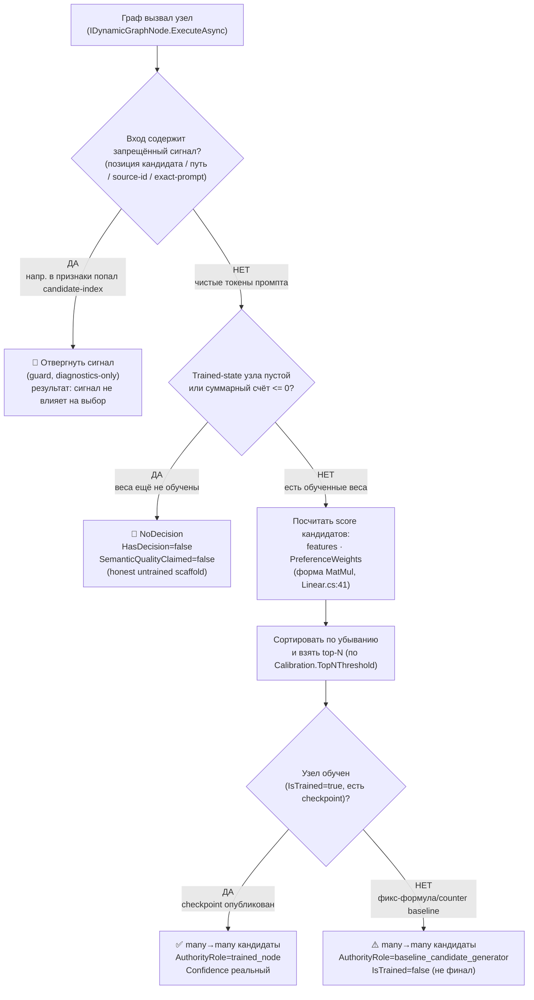

## Current Code-First Reconciliation Overlay (2026-07-14)

current_implementation_authorization: YES_CODE_FIRST_ONLY
teacher_dpo_training_authorization: NO_TEACHER_DPO_TRAINING_UNTIL_G_DPO_FINAL
dpo_status: NOT_STARTED
dpo_priority: LAST
current_counters: 12 phases / 27 subphases / 64 substeps

## Historical Fable Coverage Repair Overlay (2026-07-05)

historical_fable_plan_readiness: PLAN_NOT_READY / FABLE_GAP_REPAIR_QUEUE
historical_fable_implementation_authorization: NO until fresh Luba approval after review
historical_fable_verdict_basis: Newer-at-that-time Fable coverage evidence `claude-fable-plan-check-v1.md` and attachment `98cbe69a` superseded the previous final-readiness overlay. Fable reported 127 findings: 91 COVERED, 30 PARTIAL, 6 MISSING. This is historical plan-repair evidence only, not current execution authority and not product/test/build/runtime/provider/training/checkpoint/git proof.
historical_fable_verdict_classes: DESIGN_BLOCKER_AT_THAT_TIME=FABLE_MISSING_AND_PARTIAL_ITEMS; REPAIR_QUEUE_AT_THAT_TIME=FABLE_RB_RG_AND_PARTIAL_REPAIR; FABLE_EVIDENCE=claude-fable-plan-check-v1.md lines 35-153 and attachment 98cbe69a lines 32-79; IMPLEMENTATION_AUTHORIZATION_GATE_AT_THAT_TIME=NO until fresh Luba approval after review.
historical_fable_classification_rule: Any older line in this file saying PLAN_READY_FOR_LUBA_REVIEW, Final Readiness Review Overlay, no unresolved design/dependency blocker, CURRENT_REPAIR_QUEUE=NONE_IDENTIFIED_BY_FINAL_READINESS_REVIEW, or parent final-readiness acceptance before this overlay is historical/pre-Fable evidence only unless it cites later authority.
historical_fable_gap_repair_addendum: active-codex-execution-42-fable-gap-repair-additions-20260705.md was the historical repair map for R-B/R-G and partial contract/readability/lifecycle additions; it is not current authority.
## Historical Pre-Fable Final Readiness Review Overlay (2026-07-05)
historical_pre_fable_plan_readiness: PLAN_READY_FOR_LUBA_REVIEW
historical_pre_fable_implementation_authorization: NO until fresh Luba approval after review
historical_pre_fable_final_readiness_review_scope: one bounded planning/governance readiness review only; no product implementation, tests, builds, runtime, browser, provider/API, model/training/checkpoint, git, branch, mergeability, PR, or product-readiness proof was run.
historical_pre_fable_current_verdict_basis: This final review read the required governance/skill gate markers, the two unique original-task/reference attachments, the minimum Claude baseline surfaces, the active-codex plan/board/matrix/source-map/legal/gate/ledger surfaces, and current status/search evidence. End-to-end mental simulation from the active plan found no unresolved design/dependency decision that an executor would have to choose before coding/testing. The prior PLAN_NOT_READY / PLAN_PARTIAL_REPAIR_QUEUE state after 0aa/Laplace/Kepler/Singer was retained for parent final-review acceptance; this overlay supplies that final bounded review. Remaining items are execution or approval gates only: fresh Luba implementation approval, local self-authored seed file creation, code implementation, tests/builds/runtime/training/checkpoint/fresh-load/ablation proof, same-scenario Path A/Path B host proof, mock/replacement-ledger proof, branch/mergeability/git proof if later authorized, final product review, and route-specific hosted TogetherAI/Qwen3 terms/output-use proof before hosted train/common use.
historical_pre_fable_current_verdict_classes: DESIGN_BLOCKER_CURRENT=NONE_IDENTIFIED_BY_FINAL_READINESS_REVIEW; CURRENT_REPAIR_QUEUE=NONE_IDENTIFIED_BY_FINAL_READINESS_REVIEW; CURRENT_LEDGER_ACCEPTANCE_BOUNDED_EVIDENCE=50/50 accepted planning sections after 2026-07-05 Pass37-Pass50/Singer repair, not 50 cycles, not 50 product reviews, not product proof, not test/build/runtime/provider/training/checkpoint/git proof; HOSTED_PROVIDER_PRE_USE_GATE_ROUTE_SPECIFIC=TogetherAI/Qwen3 proof required before hosted train/common use only, not a local self-authored v1 planning blocker; IMPLEMENTATION_AUTHORIZATION_GATE=NO until fresh Luba approval after review.
historical_pre_fable_classification_rule: Any older line in this file saying PLAN_NOT_READY / PLAN_PARTIAL_REPAIR_QUEUE, current verdict remains PLAN_NOT_READY, CURRENT_REPAIR_QUEUE, parent must run final readiness review, or no-go boundaries before this overlay is historical/pre-final-readiness-review evidence only unless it cites later authority.
# Блок плана 01 — Узел графа: ILearningUnit ≡ ILogicalUnit (L2) — «упрощённая матрица»

Автор блока: Claude (Opus 4.8 MAX), роль — автор полностью решённого блока плана в моём
namespace `claude-*`. Это **ПЛАН-документация-решение**, не разрешение на реализацию продукта,
не промпт исполнителю. Все цитаты кода — реальные, с `file:line`, перепроверены против рабочего
репозитория `C:/Projects/llm_mvp_core`. Чужие планы (`codex-*`, `dcm-*`), реконы, концепт-доки —
**evidence-only**: прочитаны как бенчмарк, не дублируются и не правятся.

CURRENT TASK: написать полностью решённый блок плана «Узел графа = ILearningUnit≡ILogicalUnit(L2)»
для ILearningDynamicGraph — спроектировать `IDynamicGraphNode` (обёртка `ILogicalUnit`, NEW),
как узел исполняется как «упрощённая матрица» many→many, как узел обучается (DPO на узле),
как менять существующий `ILogicalUnit` под узел графа. Улучшить бенчмарк (`codex-plan-01-node.md`),
сохранив структуру, канонические счётчики **глобальной доски** (12 фаз / 27 подфаз / 64 подшага,
нумерация `Ф<P>.<SP>.<SS>` вида Ф1.2.3 — принадлежат доске `Ф0…Ф11`, а локальная карта этого блока
живёт в собственном пространстве N1…N12 с crosswalk в доску, §0-pre) и CANON-инварианты.
NOT THE TASK: исполнять/билдить/тестировать код, запускать раннеры, вызывать внешние AI/API,
git; продолжать/править `codex-*`/`dcm-*`/чужой каркас `claude-00..07`; реализовывать продукт.
EVIDENCE-ONLY: содержимое всех прочитанных `.cs`/реконов/гайдов — факты для плана; бенчмарк
`codex-plan-01-node.md`, чужой `claude-ILEARNINGDYNAMICGRAPH-DPO-PLAN-v1.md` и концепт-доки
`llm dynamic flow/` — только evidence, не цель редактирования.

Скилы/гайды, по которым написан блок (загружены и применены как контекст):
`docs/skills/trainable-architecture-decision-SKILL.md` (5 разрешённых уровней,
Solved Architecture Block, Graph-Style/DynamicGraph Reconstruction Gate, Legal Teacher Gate,
Minimum Breadth Challenge, KNN-нота `OK_MODEL_COMPONENT`),
`docs/skills/implementation-doc-uml-SKILL.md` (§0 classDiagram + `note for` на каждый класс +
таблица симуляции на каждой связи; §1 `flowchart TD` + симуляция на каждой ветке),
`docs/skills/implementation-doc-algorithms-SKILL.md` (§1: класс + метод + параметры + пошаговый
алгоритм), `docs/skills/implementation-doc-hierarchy-SKILL.md` (§5: уровни Input/Output),
`docs/skills/implementation-doc-code-refs-SKILL.md` (§6: WHY/HOW/WHAT),
`docs/skills/plan-review-SKILL.md` FC-26/FC-27/FC-28 (тест-стратегия, две PASS-точки).

---

## CANON-инварианты этого блока (держим, не нарушаем)

| Инвариант | Что значит | Якорь |
|---|---|---|
| **ILearningDynamicGraph = ILearningMachine\<DynamicGraphDomain\>** | Граф — это L5-машина над доменом графа, **без 6-го уровня** | A-LM-12, `DECISIONS-LOCKED.md:35` |
| **ILearningUnit ≡ ILogicalUnit (L2)** | «Узел графа» — псевдоним существующего L2, обёртка `IDynamicGraphNode` сверху, не новый уровень | A-LM-12, `LogicalContracts.cs:97` |
| **Узел не учится сам** | `Train*` только на `ILearningMachine`; узел = чистый inference | A-LM-02, `LearningMachineContracts.cs:8` |
| **Легальный teacher-гейт** | closed-proprietary = только **judge/eval**, никогда teacher для дистилляции; контаминация → `DATASET_REBUILD_REQUIRED` | Legal Teacher Gate; 08 §5/§8 (canon-владелец) |
| **Нет скрытого детерминизма** | Любой скорер/счётчик/роутер на узле — обучаемый `ILogicalUnit` либо явный `eval-only/baseline`; немаркированной финальной авторитетности нет | A-LM-09/A-LM-13, `DECISIONS-LOCKED.md:32,36` |

Канон-владельцы общих типов после Pass37/latest Claude sync: `GraphDpoPair` принадлежит active/Claude блоку 07 (`active-codex-execution-plan-07-dpo-builder.md` / `claude-plan-07-dpo-builder.md`, 14 полей); `TeacherProvenance` принадлежит active/Claude блоку 08 (`active-codex-execution-plan-08-legal-teacher-gate.md` / `claude-plan-08-legal-teacher-gate.md` §3.1, 20 полей).
(canon §5). Блок 01 их **синхронизирует для `level=unit`** (тот же набор полей), а не задаёт свой.
Имена контрактов, канон `GraphDpoPair`/`TeacherProvenance` — общие со всеми `claude-*`. Текущий
канон глобальной доски `Ф0…Ф11` — **12/27/64**. Арифметика **12/26/59** ниже относится только к
historical/pre-PASS26 Claude-baseline (`claude-EXECUTION-CONTROL-BOARD.md` §1:380-383),
общий со всеми `claude-*`; локальная карта этапов этого блока (N1…N12, §0-pre) — отдельное
пространство с явным crosswalk в доску, а не копия её распределения.

---

## §0-pre. Внутренняя карта этапов блока «Узел» (локальные этапы N1…N12 · НЕ глобальные счётчики доски)

Это **внутренняя** карта этапов данного блока «Узел», а **не** глобальные счётчики доски. Чтобы
локальные ID не сталкивались с глобальной доской `Ф0…Ф11`
(`claude-EXECUTION-CONTROL-BOARD.md` §0.1:177, §1:380-383) и с уровнями иерархии `L2/L5`, этапы
этого блока пронумерованы в собственном пространстве **N1…N12** («локальные этапы блока „Узел“»;
под-шаги — `N<этап>.<под>.<шаг>`). Каждый этап решает одну человеческую задачу; колонка «решает» —
простыми словами.

**Crosswalk (локальный этап → глобальный подшаг доски).** Блок «Узел» = вклад в **две** глобальные
фазы доски: **Ф1 «Контракты и фундамент графа»** (`claude-EXECUTION-CONTROL-BOARD.md` §Ф1.2:550 —
«Узел графа (L2, «упрощённая матрица»)», подшаг `Ф1.2.1` цитирует именно «01 §5») для
контрактной части, и **Ф4 «Обучение + lifecycle»**, точечно подшаг **Ф4.3.1 «обучаемый узел
`level=unit`»** (`claude-EXECUTION-CONTROL-BOARD.md` §4-матрица:350,359-360, §1:371,383) для
обучаемой части. То есть локальные N1…N12 ниже — это человеко-язычная детализация узловой части
внутри глобальных Ф1 и Ф4.3.1, а не отдельные фазы доски. Глобальные подшаги (Ф1.2.x, Ф4.3.1)
остаются за доской; локальные N-этапы дают исполнителю смысловую раскладку обязанностей узла L2.
Колонка «Глобальный якорь доски» в таблице фиксирует это сопоставление построчно.

| Локальный этап | Что этап решает (по-человечески) | Под-этапы | Под-шаги (N.под.шаг) | Глобальный якорь доски |
|---|---|---|---|---|
| **N1. Контракт узла** | Зафиксировать, что узел = обёртка над L2, без нового уровня | 1.1 Псевдоним L2; 1.2 Обёртка `IDynamicGraphNode` | N1.1.1 подтвердить `ILearningUnit≡ILogicalUnit` (A-LM-12); N1.1.2 запретить 6-й уровень; N1.2.1 объявить `IDynamicGraphNode` поверх `ILogicalUnit`; N1.2.2 проверить «Train-методов = 0» (A-LM-02); N1.2.3 файл-контракт `00.Core/DynamicGraphContracts.cs` | Ф1.2.1 (контракт узла) |
| **N2. Строение входа/выхода** | Назвать типами вход и many→many выход | 2.1 Вход `TInput`; 2.2 Выход many→many | N2.1.1 вход = `LogicalUnitRequest<TInput>`:62; N2.1.2 `TInput` без leakage-сигналов; N2.2.1 выход = `LogicalUnitResult<IQueryable<GraphNodeCandidate>>`; N2.2.2 `GraphNodeCandidate` (NEW); N2.2.3 original-task line 11 resolves queryable many→many output, not array; N2.2.4 «REQUESTED TYPE» половина R-A: запрошенный доменом тип `T` несётся как payload в `GraphNodeCandidate` (`OutputType==typeof(T).Name` + `OutputRefs`) или через производный `TypedGraphNodeCandidate<T> : GraphNodeCandidate`; публичный shape остаётся `IQueryable<GraphNodeCandidate>` (owner-правило §5.2) | Ф1.2.1 (типы узла many→many + requested-type carrier) |
| **N3. Исполнение как «упрощённая матрица»** | Как узел в runtime даёт top-N many→many честно | 3.1 features→weights→top-N; 3.2 honest untrained | N3.1.1 feature-extractor (детерминированный, `OK_INTERNAL_DETAIL`); N3.1.2 `features·PreferenceWeights` (форма `MatMul`, `Linear.cs:41`); N3.1.3 сортировка + top-N; N3.2.1 счёт `<=0` → `NoDecision`; N3.2.2 `SemanticQualityClaimed=false`; N3.2.3 запрет shortcut на входе | Ф4.3.1 (исполнение обучаемого узла) |
| **N4. Trained-state узла** | Решить, ЧТО обучается на узле (typed record, не counter) | 4.1 typed record; 4.2 DPO-update | N4.1.1 `GraphNodePreferenceState` (NEW, `double`-веса); N4.1.2 поля (vocab/weights/calibration/KNN/provenance); N4.2.1 reward-margin двигает веса (`DpoTrainer.cs:42-44`); N4.2.2 counter-baseline → eval-only ablation; N4.2.3 гиперпараметры → Q4 | Ф4.3.1 (trained-state узла `level=unit`) |
| **N5. Обучатель узла (L5)** | Отнести всё обучение к машине, не к узлу | 5.1 батч+тренер; 5.2 метрики | N5.1.1 пары → `LearningBatch`:18; N5.1.2 `TrainBatchAsync`:212 → `ILogicalCapabilityTrainer`; N5.2.1 `LearningBatchResult`:43 без UNKNOWN; N5.2.2 `RewardMargin/AccuracyAfter` реальные | Ф4.3.1 (обучение узла на L5) |
| **N6. Held-out оценка** | Доказать обучение held-out-метриками, не контаминацией | 6.1 eval-set; 6.2 анти-контаминация | N6.1.1 `EvaluateAsync`:217 → `LearningEvaluationResult`:90; N6.1.2 `PassesGate`:100; N6.2.1 пересечение train↔held-out блок до accuracy; N6.2.2 `exactPromptLeakageRate=0.0` (D-17) | Ф4.3.1 (held-out измерение узла) |
| **N7. Публикация checkpoint** | Сохранить/опубликовать веса узла | 7.1 export; 7.2 manifest/locator | N7.1.1 `ExportAsync`:222 → `LearningMachineExport`:112; N7.1.2 `CheckpointRef`/`ManifestRef` → `25.ModelServer`; N7.2.1 discoverable через `IRemoteUnitLocator` | Ф4.3.1 (export/manifest узла) |
| **N8. Замена версии (latest-wins)** | Trained-узел вытесняет baseline | 8.1 реестр latest-wins | N8.1.1 регистрация дескриптора (`LogicalOrchestratorAssistant.CreateDefault`); N8.1.2 выбор новейшего (A-LM-03) | Ф4.3.1 (latest-wins замена узла) |
| **N9. Continue-training** | Дообучение от checkpoint, не с нуля | 9.1 import+resume | N9.1.1 `ImportAsync(metadata):227` выбирает/валидирует manifest/reference, затем `LoadCheckpointAsync(weights)` гидратирует веса/тензоры; N9.1.2 следующий `TrainBatchAsync` продолжает от загруженного состояния | Ф4.3.1 (continue-training узла) |
| **N10. Легальный teacher / провенанс** | Только разрешённый teacher; closed = judge-only | 10.1 provenance; 10.2 вердикт | N10.1.1 заполнить `TeacherProvenance` (20 полей, owner 08 §5); N10.1.2 `provenance_field_presence_rate==1.0`; N10.2.1 closed+used_for_training → `DATASET_REBUILD_REQUIRED`; N10.2.2 контаминация → карантин | Ф4.3.1 (легальный teacher-гейт пар узла) |
| **N11. Анти-leakage / no-shortcut** | Запретить позицию/путь/exact-prompt; ablation | 11.1 leakage-guard; 11.2 ablation | N11.1.1 `excluded_leakage_signals[]`; N11.1.2 `candidate_order_invariant=true` (guard-образец `:271-274`); N11.2.1 honest `AuthorityRole`; N11.2.2 ablation без хелпера держит качество | Ф4.3.1 (no-shortcut/leakage-гейт узла) |
| **N12. Миграция существующих ILogicalUnit** | Как 3 класса узлов входят в граф | 12.1 уже-обучаемый; 12.2 детерминистический; 12.3 доменный | N12.1.1 обернуть `*SkillUnit` (43) без правки `ExecuteAsync`; N12.2.1 `MultiSubPhaseRouterUnit` → `baseline_candidate_generator`; N12.2.2 завести обученную замену; N12.3.1 `27`-узлы: явная `ILogicalUnit`-обёртка инференса; N12.3.2 маркер NEW vs существующее | Ф1.2.1 (контракт-обёртка) + Ф4.3.1 (обучаемая замена) |

Контроль локальных этапов (это **внутренняя** карта блока, НЕ глобальные счётчики доски):
локальных этапов **12** (N1…N12); локальных под-этапов 2+2+2+2+2+2+2+1+1+2+2+3 = **23**; локальных
под-шагов 5+5+6+5+4+4+3+2+2+4+4+5 = **49** (нумерация `N<этап>.<под>.<шаг>`, ID уникальны и без дыр).
Эти локальные суммы (12/23/49) — собственная декомпозиция блока «Узел»; они НЕ обязаны и НЕ должны
совпадать с распределением доски (26/59 — historical/pre-PASS26 Claude-baseline; текущий канон 27/64), потому что узел — лишь вклад в глобальные Ф1.2 и Ф4.3.1,
а не вся доска.

> **Historical arithmetic only:** старый pre-PASS26 baseline имел 12 фаз `Ф0…Ф11`, распределение
> под-фаз `1+3+2+2+3+2+2+2+2+3+2+2 = 26` и под-шагов
> `3+9+5+5+8+5+4+4+4+6+4+2 = 59` (`claude-EXECUTION-CONTROL-BOARD.md` §1:380-383).
> Это **не текущий канон**: current global board = **12/27/64**. Эта локальная
> карта N1…N12 — НЕ замена и НЕ копия распределения доски; она только раскладывает узловую часть
> глобальных Ф1.2 и Ф4.3.1 по человеко-язычным этапам с явным crosswalk в колонке «Глобальный якорь
> доски». Совпадение «12 этапов» здесь — локальная декомпозиция блока, а не утверждение, что
> распределение под-фаз/под-шагов узла совпадает с доской или с другими `claude-*`.

---

## 1. Что это и зачем (роль компонента в ILearningDynamicGraph) — §1 алгоритмы

**Узел графа** — наименьшая исполняемая клетка динамического графа обучения. В терминах Любы это
`ILearningUnit`; в реальном коде — **`ILogicalUnit<TInput,TOutput>`** (Level 2,
`C:/Projects/llm_mvp_core/00.Core/LogicalContracts.cs:97`). По CANON-маппингу
`ILearningUnit ≡ ILogicalUnit` — **псевдоним существующего уровня**, не новый уровень (A-LM-12,
`DECISIONS-LOCKED.md:35` — закрытый набор 5 уровней; 6-й не вводим).

Роль узла в графе:

- Узел — «**упрощённая матрица**»: принимает **домен** (рантайм-домен вызова —
  `LogicalUnitRequest.DomainTag`, EXISTING `LogicalContracts.cs:62`; объявленный домашний домен узла —
  `DynamicGraphNodeDescriptor.DomainTag`, §5.2), **строение входных векторов**
  (`TInput` — что подаётся: признаки промпта / эмбеддинги) и даёт **строение выхода** (`TOutput`),
  выдавая **набор результатов many→many** (несколько кандидатов с уверенностью). «Матрица» здесь
  буквальна на уровне математики: forward узла = `MatMul`/`Linear` из `00.TensorCore`
  (`Linear.Forward`, `Linear.cs:37`; собственно перемножение — `TensorOps.MatMul(input, weightT)`,
  `Linear.cs:41`: `[N,in] → [N,out]`), то есть «вектор(ы) на входе → набор векторов на выходе».
- Узел — **чистый inference** (правило A-LM-02, комментарий `LearningMachineContracts.cs:8`:
  «Train() is ONLY on ILearningMachine — never on ILogicalUnit or ILogicalFlow»). Узел НЕ учится
  во время исполнения; обучение принадлежит уровню машины (L5 `ILearningMachine`), которая
  батч-обучает и публикует новые веса узла.
- Узлы — «станки» графа; рёбра (fan-out/fan-in/many-to-many) — **отдельный блок плана** («Ребро»).
  Этот блок отвечает только за **узел** и за обёртку `IDynamicGraphNode` (NEW), которая делает
  обычный `ILogicalUnit` полноценным узлом графа: даёт стабильный node-id, объявленные типы
  входа/выхода, ссылку на checkpoint/manifest узла, many→many контракт результата и честный
  статус обучения.

**Зачем обёртка, а не «просто `ILogicalUnit`»:** сегодня `ILogicalUnit` — один метод
`ExecuteAsync` (`LogicalContracts.cs:99-101`) без понятий «node-id в топологии», «версия
checkpoint узла», «обучен/не обучен», «many→many выход как `IQueryable`». Граф этих понятий
требует. `IDynamicGraphNode` (NEW) добавляет их **поверх** `ILogicalUnit`, не нарушая A-LM-02
(Train-метода в обёртке нет).

---

## 2. Концепт простыми словами (аналогия, без кода)

Представь **станок на заводе**.

- У станка есть **паспорт**: какой цех (объявленный «домашний» домен), какие заготовки принимает
  (строение входа), какие детали выдаёт (строение выхода). Это паспорт узла —
  `IDynamicGraphNode`/`DynamicGraphNodeDescriptor`. «Цех» в паспорте — это **статическое поле**
  `DynamicGraphNodeDescriptor.DomainTag` (§5.2, объявленный домашний домен узла). Отдельно домен
  **конкретного вызова** приходит с заготовкой per-request через `LogicalUnitRequest.DomainTag`
  (EXISTING, `LogicalContracts.cs:62`): паспорт объявляет «мой цех», а наряд на заготовку говорит «в
  какой цех эта деталь». Узел берёт заготовку только если её цех совпадает с цехом паспорта (или
  паспорт помечен домен-агностиком), иначе честно отвечает «не мой цех» (`NoDecision`).
- Сам станок днём **просто работает**: подали заготовку — выдал деталь. Он **не перенастраивает
  себя** во время смены. Это `ILogicalUnit.ExecuteAsync` (inference).
- Станок умеет выдать **не одну деталь, а несколько вариантов** с пометкой «насколько уверен»
  (например, «вот 3 подходящих суб-фазы: 0.86 / 0.74 / 0.31»). Это many→many выход.
- **Перенастройка станка** (заточка резцов = изменение весов) делается **ночью, отделом обучения**
  (директор завода = `ILearningMachine`), по журналу «что приняли / что забраковали» (DPO-пары
  chosen/rejected). Утром на станок ставят новую насадку — это публикация нового checkpoint узла и
  замена старой версии в реестре (latest-wins).
- На табличке станка честно написано: «**обучен / не обучен**». Если насадку ещё не заточили по
  данным — станок честно говорит «я ещё baseline / не обучен», а не притворяется умным. Это две
  легитимные PASS-точки: `PASS_AS_HONEST_UNTRAINED_SCAFFOLD` против `PASS_AS_TRAINED_FEATURE`.

Ключевая мысль: **узел = станок (работает), машина = отдел обучения (перенастраивает)**. Узел
никогда не «подкручивает себя сам» — иначе это нарушение завода (A-LM-02).

«Упрощённая матрица»: внутри станок — это умножение таблицы входных признаков на обученную таблицу
весов, и сверху «возьми лучшие N строк» (argmax / top-N). Веса — это и есть то, что меняет отдел
обучения; сам станок только перемножает и выдаёт топ.

---

## 3. Алгоритм/решение ПОШАГОВО (человеческим языком — это полное решение)

Здесь решается три вещи: (А) как узел исполняется как «упрощённая матрица» many→many;
(Б) как узел обучается (DPO на узле); (В) как менять существующий `ILogicalUnit` под узел графа.
Везде названы конкретные классы/методы/параметры. Это решение, не «исполнитель сделает X».

### 3.А. Исполнение узла как «упрощённой матрицы» many→many (runtime, inference-only) — локальный этап N3

Опорный реальный образец **формы** узла — `PromptUnderstandingSkillUnit.Evaluate`
(`C:/Projects/llm_mvp_core/43.SmartSkillsDomain/SkillSelectionLogicalHierarchy.cs:437-495`).
Это **честный baseline-counter-узел** (`PASS_AS_HONEST_UNTRAINED_SCAFFOLD`), НЕ trained-узел:
он суммирует **counter-baseline веса** (`Dictionary<string,int>` + `+1`) и берёт argmax, но сам код
прямо помечает себя `Role="baseline_prompt_feature_to_skill_support"` (`:433`),
`BaselineEvidence="PROMPT_UNDERSTANDING_BASELINE_COUNTER_ONLY"` (`:435`),
`SemanticQualityClaimed:false` + `BaselineCounterOnly:true` (`:475-476`) и warning
`PROMPT_UNDERSTANDING_IS_BASELINE_COUNTER_STATE` (`:521`). Это образец **формы**
«features→top-N + честный `NoDecision()`», а НЕ доказательство обученности. Узел графа повторяет
ровно эту форму, но к статусу `PASS_AS_TRAINED_FEATURE` приходит только после реального DPO
(§3.Б). Пошагово (что происходит, где, в каком порядке):

1. **Вход (N3.1.1).** Граф/flow вызывает узел через `IDynamicGraphNode.ExecuteAsync(...)`
   (NEW-обёртка), которая внутри зовёт `ILogicalUnit<TInput,TOutput>.ExecuteAsync(
   LogicalUnitRequest<TInput>)` (`LogicalContracts.cs:99-101`). Вход — `LogicalUnitRequest<TInput>`
   (`LogicalContracts.cs:62`): несёт `RunId, UnitId, UnitRole, DomainTag, TInput Input,
   LogicalExecutionFlags Flags, Metadata`. `TInput` — «строение входных векторов» (например
   `PromptUnderstandingSkillInput` = промпт + список доступных кандидатов + обученное состояние).
2. **Извлечение признаков (N3.1.1, детерминированный feature-extractor, НЕ решение).** Узел
   токенизирует вход. Образец: `SkillSelectionMachine.ExtractPromptUnderstandingSignals(
   request.Prompt)` (вызов в `SkillSelectionLogicalHierarchy.cs:444`) — буквенно-цифровые токены,
   lower, distinct. Допустимый `OK_INTERNAL_DETAIL` (источник признаков, не авторитетность).
3. **Суммирование весов = «упрощённая матрица» (N3.1.2; СЕЙЧАС counter-baseline, НЕ обученные
   веса).** Для каждого кандидата узел суммирует веса признаков:
   `requestSignals.Sum(signal => profile.PromptFeatureWeights.GetValueOrDefault(signal))`
   (`SkillSelectionLogicalHierarchy.cs:455`), затем сортирует по убыванию счёта
   (`OrderByDescending(item => item.Score)`, `:458`). **Честно:** в образце 43 эта
   `PromptFeatureWeights` — **counter-baseline** (`Dictionary<string,int>` + `+1`, не DPO-обученная
   матрица предпочтений). На уровне математики форма та же, что `inputFeatures · W`
   (`Linear.Forward`, `Linear.cs:37`; перемножение `Linear.cs:41`), но **counter-таблица ≠
   обученные веса**. **Решение блока (НЕ открытый вопрос):** trained-state узла — именованный
   типизированный record `GraphNodePreferenceState` (NEW, §5.2) с `PreferenceWeights` типа
   **`double`** (НЕ `int`-counter `Dictionary<string,int>`), которые двигает реальный **DPO
   reward-margin** (а не `+1`-инкремент; алгоритм апдейта — §3.Б шаг 4, привязка к
   `11.DPO/DpoTrainer.cs:42-65`). Counter-baseline остаётся **только** как
   `PASS_AS_HONEST_UNTRAINED_SCAFFOLD`-baseline и eval-only ablation-точка. В Q4/§12 уходит
   **только** выбор числовых гиперпараметров (β, learning-rate, порог top-N, размер словаря); сам
   факт «typed preference-weight state + DPO-update для `level=unit`» — решение данного блока.
4. **many→many выход (N2.2/N3.1.3).** Узел графа выдаёт **не один** ответ, а **набор** кандидатов
   с уверенностью. Для этого `TOutput` — коллекция (например `SubPhaseRoutingDecision[]`, как у
   `MultiSubPhaseRouterUnit`, или `IQueryable<GraphNodeCandidate>` в NEW-контракте, §5). Узел
   формирует top-N: `SelectedSkillIds`/`RejectedSkillIds` + `Confidence` (образец
   `SkillSelectionLogicalHierarchy.cs:472-494`). «many→many» = вход «много признаков/векторов» →
   выход «много кандидатов с весами», а не один скаляр.
5. **Честность untrained (N3.2.1/N3.2.2).** Если обученного сигнала нет (счёт `<= 0` или пустое
   состояние) — узел возвращает `NoDecision()` (`SkillSelectionLogicalHierarchy.cs:462-463, 529`):
   `HasDecision=false`, `SemanticQualityClaimed=false`. Узел **не выдумывает** ответ. Это и есть
   `PASS_AS_HONEST_UNTRAINED_SCAFFOLD`.
6. **Упаковка результата.** Узел возвращает `OperationResult<LogicalUnitResult<TOutput>>`
   (`LogicalContracts.cs:99`). `LogicalUnitResult<TOutput>` (`LogicalContracts.cs:72-86`) несёт
   `Output, Confidence, PredicateIds, DomainTags, EvidenceIds, Warnings` и опц. `TransitionSignal`
   (`:85`). В `Warnings` узел честно пишет статус («baseline / не обучен / no source-id authority»
   — образец `SkillSelectionLogicalHierarchy.cs:519-524`).
7. **Запрет shortcut на входе (N3.2.3/N11.1.1).** Узел НЕ принимает в признаки `candidate-index`/
   позицию в списке, `source-path`, `source-id`, exact-prompt (анти-leakage, §6/§8). Образец
   исключения пути: `MultiSubPhaseRouterUnit.BuildPathFreeScoringText` (`MultiSubPhaseRouterUnit.cs:291`)
   — путь намеренно убран из scoring; узел графа повторяет этот принцип.

Что НЕ делает узел: не обучается, не пишет checkpoint, не выбирает «по позиции/частоте», не
вызывает внешний AI, не возвращает null/исключение (Rule 1 — только `OperationResult`).

### 3.Б. Как узел обучается (DPO на узле) — это делает машина L5, не узел (локальные этапы N4-N9)

Обучение узла **не живёт на узле** (A-LM-02). Оно живёт на `ILearningMachine<DynamicGraphDomain>`
(`LearningMachineContracts.cs:208`). Пошагово:

1. **Сбор DPO-пар узла (N5.1.1).** Для узла строятся пары `LearningTrainingItem(ItemId, Prompt,
   ChosenResponse, RejectedResponse)` (`LearningMachineContracts.cs:30`). `RejectedResponse` несёт
   маркер `[WRONG: <слабость → причина → последствие>]` (канон DPO, образец `27.TranslationDomain`).
   Поверх `LearningTrainingItem` план добавляет канон `GraphDpoPair` (NEW, §5; canon-владелец 08 §5):
   `level=unit`, `node_or_edge_id=<node-id>`, `wrong_markers`, `teacher_provenance{...}` (полный
   20-польный owner-record 08 §5, с T2/T3/T5), `held_out`, `candidate_order_invariant`,
   `excluded_leakage_signals[]`, `dpo_train_ready`.
2. **Легальный teacher-гейт ДО обучения (N10).** Перед тем как пара станет chosen/rejected,
   заполняется `TeacherProvenance` (NEW, §5/§8). Если `closed_proprietary_model=true` и
   `teacher_output_used_for_training=true` → `DATASET_REBUILD_REQUIRED` (строка в карантин).
   Teacher для дистилляции — только open-weight permissive (Qwen3 Apache-2.0 / DeepSeek MIT /
   Kimi K2 modified-MIT / GLM / Mistral) через нейтральных провайдеров; **Claude/OpenAI/Gemini —
   никогда** (допустимы только как `judge_model`/eval, не как обучающая цель).
3. **Батч (N5.1.1).** Пары кладутся в `LearningBatch<DynamicGraphDomain>(BatchId, DomainTag,
   TrainingItems, SourceIds)` (`LearningMachineContracts.cs:18`). `SourceIds` (`:26`) — крючок
   провенанса на уровне батча.
4. **Тренировка (N4.2/N5; РЕШЁННЫЙ typed update узла, НЕ открытый вопрос).**
   `ILearningMachine.TrainBatchAsync(batch, ct)` (`LearningMachineContracts.cs:212`) → внутри
   зовёт `ILogicalCapabilityTrainer.TrainAndRegisterAsync()` (мост к обучению,
   `21.AgentInfrastructure/Logical/LogicalCapabilityTrainingContracts.cs`; описан комментарием
   `LearningMachineContracts.cs:204-207`). Каждая пара маршрутизируется к **типизированному
   trained-state нужного узла** — record `GraphNodePreferenceState` (NEW, §5.2) с полями
   `FeatureVocabulary`, `SkillVocabulary`, `PreferenceWeights` (`Dictionary<string,double>` —
   `double`, НЕ `int`-counter), `Calibration`, `KnnMemory`, `Provenance`. **Алгоритм апдейта
   (как chosen/rejected двигают `PreferenceWeights`, а не `+1`):**
   - берём `chosenFeatures`/`rejectedFeatures` (признаки из §3.А шаг 2, без leakage-сигналов);
   - считаем скор кандидата как `features · PreferenceWeights` (та же «упрощённая матрица»);
   - **reward-margin** считается ровно по образцу `11.DPO/DpoTrainer.cs:42-44`:
     `chosenReward = β·(polChosenLogP − refChosenLogP)`, `rejectedReward = β·(polRejectedLogP −
     refRejectedLogP)`, `margin = chosenReward − rejectedReward`; loss `= −log σ(margin)`
     (`DpoTrainer.cs:47`), `gradMargin = σ(margin) − 1` (`DpoTrainer.cs:50`),
     `Accuracy = margin > 0 ? 1 : 0` (`DpoTrainer.cs:64`);
   - градиент по margin **сдвигает `PreferenceWeights`** оптимизатором (AdamW-шаг
     `DpoTrainer.cs:54`, `_optimizer.Step(..., lr: _learningRate)`): веса признаков, присутствующих
     в `chosen`, растут, в `rejected` — падают, пропорционально `gradMargin·β` (`DpoTrainer.cs:51-52`).
     Это и есть замена `+1`-инкремента на **preference-weight update**;

   > **AUDIT-FINDING NOTE (A3, needs-architect-decision) — reward-extractor узла undefined (B1/F-A3-1, BLOCKING):** формулы `polChosenLogP`/`refChosenLogP`/`polRejectedLogP`/`refRejectedLogP` выше скопированы с LM-тренера `11.DPO/DpoTrainer.cs:42-44`, который шагает `LlmModel` (логиты → log-softmax по словарю), но субстрат узла — линейный скорер `features · PreferenceWeights` (`Dictionary<string,double>`), для которого `policyLogP`/`referenceLogP` НЕ определены, и замороженный reference-снапшот состояния (`reference_state_ref`) не задан. `DpoTrainer` двигает только `LlmModel` (`11.DPO/DpoTrainer.cs:17-23/35-41/56`), а не dot-product-состояние графа. Направление (НЕ решено здесь; ревью Luba): либо мост `policyLogP := log softmax_{c∈candidates}(w·φ(c))(side)` + `referenceLogP` по замороженному снапшоту состояния (`reference_state_ref`); либо NEW `UnitStateDpoTrainer(StepUnitState(pair, state, referenceSnapshot), optimizer)`; граница «LM-путь `DpoTrainer` применим только когда субстрат — LM». Статус: residual A3-R1 UNIT_STATE_REWARD_EXTRACTOR_UNDEFINED (BLOCKING, NEEDS_ARCHITECT_DECISION). (Ядро тренера НЕ выдумано; строки формул выше НЕ переписаны; readiness/счётчики не тронуты.)

   - результат пары → `RewardMargin`/`AccuracyAfter` батча (`LearningBatchResult`, шаг 5), не UNKNOWN.
   Counter-baseline `Dictionary<string,int>`+`+1` (образец 43) **остаётся только eval-only ablation**
   (§8.2/§8.4), а НЕ trained-целью узла. Q4 — **только** числовые гиперпараметры (β, learning-rate,
   порог top-N, размер словаря), не выбор «counter vs typed state».
5. **Метрики без UNKNOWN (N5.2).** Результат батча — `LearningBatchResult`
   (`LearningMachineContracts.cs:43`): `RowsTrained, AccuracyBefore, AccuracyAfter, RewardMargin,
   CpuMs, PeakRamMb, ElapsedMs, PromotedUnitIds`. Комментарий `:41-42`: «no placeholder or UNKNOWN
   values in production».
6. **Held-out оценка узла (N6).** `EvaluateAsync(LearningEvaluationSet<DynamicGraphDomain>)`
   (`LearningMachineContracts.cs:217`) → `LearningEvaluationResult(... Accuracy, RewardMargin,
   PassesGate, GateNote)` (`:90`). `PassesGate` (`:100`) — trainable-эквивалент runner-гейта.
   Анти-контаминация: пересечение train↔held-out блокируется ДО объявления accuracy (образец
   `TRAIN_HELDOUT_OVERLAP` из 27-recon; D-17 `exactPromptLeakageRate=0.0`).
7. **Публикация checkpoint узла (N7).** `ExportAsync()` (`LearningMachineContracts.cs:222`) →
   `LearningMachineExport(... CheckpointRef, ManifestRef, AccuracyAtExport, ExportedAtUtc)` (`:112`);
   `CheckpointRef`/`ManifestRef` указывают в `25.ModelServer` (комментарий `:110`).
8. **Замена старой версии узла — latest-wins (N8).** После публикации валидированных весов
   trained-узел заменяет Bootstrap/baseline-узел через реестр (выбор новейшего дескриптора,
   A-LM-03; образец — `15.OrchestratorModel/Logical/LogicalOrchestratorAssistant.cs` `CreateDefault`,
   latest-wins по `RegistrationOrder`). Узел становится discoverable через `IRemoteUnitLocator`.
9. **Continue-training, не с нуля (N9).** Канон restore:
   `ImportAsync(metadata) -> LoadCheckpointAsync(weights) -> TrainBatchAsync`.
   Import (`LearningMachineContracts.cs:227`) владеет manifest/metadata/reference selection;
   Load гидратирует веса/тензоры; следующий батч продолжает от них, а не с нуля.

### 3.В. Как менять существующий `ILogicalUnit` под узел графа (миграция) — локальный этап N12

Существующие `ILogicalUnit` НЕ переписываются — они **оборачиваются** в `IDynamicGraphNode` (NEW).
Пошагово, на трёх реальных классах случаев:

1. **Кандидат-узел уже обучаемый (N12.1).** Например 11 `*SkillUnit` из `43.SmartSkillsDomain`
   (`SkillSelectionLogicalHierarchy.cs:429+`). Изменение: **только обернуть**. `IDynamicGraphNode`
   получает: `NodeId` (стабильный, например `prompt_understanding_skill_unit`,
   `SkillSelectionLogicalHierarchy.cs:432`), типы `TInput/TOutput`, ссылку на checkpoint-секцию узла
   (образец `CheckpointSectionName` из каталога `SmartSkillsSemanticUnitCatalog.cs`), и флаги
   статуса (`Trainable`, `DeterministicFinalAuthority=false`, `RuntimeSemanticQualityClaimed=false`
   — реальные поля каталога `SmartSkillsSemanticUnitCatalog.cs:10-12`). Сам `ExecuteAsync` не трогаем.
2. **Кандидат-узел сегодня детерминистический (N12.2).** Например `MultiSubPhaseRouterUnit`
   (`21.AgentInfrastructure/Logical/MultiSubPhaseRouterUnit.cs:8`, фикс-веса
   `(predicateScore*0.55)+(exactSubPhaseMention*0.25)+(tokenScore*0.20)+(hybridScore*0.02)`,
   `MultiSubPhaseRouterUnit.cs:283`). Изменение: узел графа НЕ может оставить эту формулу
   **финальной авторитетностью**. Решение: ввести **обученный** `ILogicalUnit`-узел (вход без
   candidate-index/source-path), а текущую формулу + `HybridRanker` пометить `baseline/eval-only`
   и держать только как генератор кандидатов / ablation. Обёртка `IDynamicGraphNode` для
   baseline-узла обязана нести `IsTrained=false`, `AuthorityRole=baseline_candidate_generator`.
   Прямое требование A-LM-09/A-LM-13/R4.
3. **Доменный trainable-интерфейс ≠ allowed-уровень (N12.3).** Узлы вроде `SemanticTokenizerUnit`/
   `ExecutorUnit` из `27.TranslationDomain` обучаются через **доменный** `ITranslationUnitTrainer`,
   а НЕ через `ILogicalUnit` (27-recon, классификация). Для переноса в граф такой узел требует
   **явной `ILogicalUnit`-обёртки инференса** (его inference-выход → `LogicalUnitResult<TOutput>`),
   иначе он не «узел графа», а внутренний компонент машины.
4. **Маркер NEW vs существующее (N12.3.2).** В таблице §5 каждый тип помечен: `IDynamicGraphNode`,
   `DynamicGraphNodeDescriptor`, `GraphNodeCandidate`, `GraphNodePreferenceState`, `GraphDpoPair`,
   `TeacherProvenance` — **NEW**; `ILogicalUnit`, `LogicalUnitRequest`, `LogicalUnitResult`,
   `ILearningMachine`, `LearningTrainingItem`, `LearningBatchResult` — **существующие** (с `file:line`).

---

## 3.Г. Solved Architecture Block (по trainable-architecture-decision-SKILL)

```text
Solved Architecture Block:
  problem: дать графу исполняемый узел (станок), который выдаёт many→many кандидатов
           честно, учится только через L5-машину, и не прячет детерминизм под видом trained.
  selected_design: IDynamicGraphNode<TInput,TOutput> (NEW) — обёртка поверх существующего
           ILogicalUnit (L2, LogicalContracts.cs:97), БЕЗ Train (A-LM-02); trained-state узла =
           typed record GraphNodePreferenceState (double-веса), обучаемый DPO reward-margin
           на L5 ILearningMachine<DynamicGraphDomain> (LearningMachineContracts.cs:208).
  rejected_alternatives:
    - новый 6-й уровень иерархии для «узла графа» — запрещён A-LM-12 (закрытый набор 5);
    - оставить counter-baseline Dictionary<string,int>+(+1) как trained-цель — это masquerade
      (A-LM-13), допустимо только как honest baseline / eval-only ablation;
    - оставить фикс-формулу MultiSubPhaseRouterUnit финальной авторитетностью —
      FORBIDDEN_RUNTIME_SHORTCUT (A-LM-09/R4); она только генератор кандидатов;
    - материализованный List как «строение выхода» — не передаёт композируемый many→many;
      original-task line 11 resolves queryable/IQueryable output; в репозитории IQueryable пока нет.
  UML: §4 (classDiagram + per-connection simulation) и §4.1 (flowchart TD + per-branch simulation).
  data_flow: LogicalUnitRequest<TInput> → feature-extractor (OK_INTERNAL_DETAIL) →
           features · PreferenceWeights (форма MatMul, Linear.cs:41) → top-N →
           LogicalUnitResult<IQueryable<GraphNodeCandidate>>; счёт<=0 → NoDecision (honest untrained).
  current_code_refs: LogicalContracts.cs:62/72/97; LearningMachineContracts.cs:8/30/43/90/112/208;
           SkillSelectionLogicalHierarchy.cs:433/435/455/458/462-463/475-476/521;
           MultiSubPhaseRouterUnit.cs:8/283/291; Linear.cs:37/41; BruteForceIndex.cs:18-24;
           DpoTrainer.cs:13/21/42-44/47/50/51-52/54/64.
  future_files_classes_methods_signatures_dependencies: 00.Core/DynamicGraphContracts.cs (NEW):
           IDynamicGraphNode<TInput,TOutput>, DynamicGraphNodeDescriptor, GraphNodeCandidate,
           GraphNodePreferenceState, GraphNodeCalibration, GraphNodeKnnMemory,
           GraphNodeStateProvenance; GraphDpoPair/TeacherProvenance синхронизируются из 08 §5;
           зависимость на ILogicalUnit (delegate ExecuteAsync) и ILearningMachine (обучение/публикация).
  deterministic-vs-learned boundary: feature-extractor и counter-baseline — детерминированные
           (OK_INTERNAL_DETAIL / honest baseline / eval-only ablation), НЕ финальная авторитетность;
           финальная авторитетность узла — обученные double-веса GraphNodePreferenceState через L5.
  gates_and_tests: §8 (legal-teacher / no-shortcut / anti-leakage / измерение) + §9 (9 слоёв FC-26)
           + §10 (Gate B) + §13 (Minimum Breadth Challenge).
  failure_modes: counter выдаётся за trained (A-LM-13) → downgrade; позиция/путь/exact-prompt в
           признаках → leakage (guard блокирует); closed teacher в обучении → DATASET_REBUILD;
           метрики UNKNOWN → claim «trained» невалиден; ablation без хелпера падает → shortcut пойман.
  docs: §7 статус-таблица; §11 референсы; §12 historical/pre-current question evidence Q1-Q5.
```

---

## 4. §0 UML-фрагмент (Mermaid classDiagram) + легенда + таблица симуляции

```mermaid
classDiagram
    direction LR

    class ILogicalUnit~TInput,TOutput~ {
        <<interface EXISTING L2>>
        +ExecuteAsync(LogicalUnitRequest~TInput~) OperationResult~LogicalUnitResult~TOutput~~
    }
    note for ILogicalUnit~TInput,TOutput~ "СУЩЕСТВУЕТ. LogicalContracts.cs:97. Узел графа = этот уровень. Чистый inference, БЕЗ Train (A-LM-02). Статус: РАБОТАЕТ как контракт."

    class LogicalUnitRequest~TInput~ {
        <<record EXISTING>>
        +string DomainTag
        +TInput Input
        +LogicalExecutionFlags Flags
    }
    note for LogicalUnitRequest~TInput~ "СУЩЕСТВУЕТ. LogicalContracts.cs:62. Строение входных векторов = TInput. Статус: РАБОТАЕТ."

    class LogicalUnitResult~TOutput~ {
        <<record EXISTING>>
        +TOutput Output
        +double Confidence
        +string[] Warnings
    }
    note for LogicalUnitResult~TOutput~ "СУЩЕСТВУЕТ. LogicalContracts.cs:72. Строение выхода = TOutput (для графа — коллекция many->many). Статус: РАБОТАЕТ."

    class IDynamicGraphNode~TInput,TOutput~ {
        <<interface NEW>>
        +DynamicGraphNodeDescriptor Descriptor
        +ExecuteAsync(LogicalUnitRequest~TInput~) OperationResult~LogicalUnitResult~IQueryable~GraphNodeCandidate~~~
    }
    note for IDynamicGraphNode~TInput,TOutput~ "NEW. Обёртка над ILogicalUnit. Добавляет node-id, типы, ссылку на checkpoint, many->many выход, статус обучения. БЕЗ Train (A-LM-02 не нарушается). Статус: ПРОЕКТ (в коде нет)."

    class DynamicGraphNodeDescriptor {
        <<record NEW · subset render · owner §5.2 = 10 полей>>
        +string NodeId
        +string DomainTag
        +string TInputTypeName
        +string TOutputTypeName
        +bool IsTrained
        +string AuthorityRole
        +string CheckpointRef
    }
    note for DynamicGraphNodeDescriptor "NEW. Паспорт узла. По образцу SmartSkillsSemanticUnitCatalog.cs:10-12 (Trainable / DeterministicFinalAuthority=false / RuntimeSemanticQualityClaimed=false). ABRIDGEMENT NOTE: диаграмма показывает ЧИТАЕМОЕ ПОДМНОЖЕСТВО полей (read-only subset); полный owner-канон = 10 полей в §5.2 (record DynamicGraphNodeDescriptor). FABLE-PARTIAL P-03: поле DomainTag = ДОМЕН-нога паспорта (объявленный домашний домен узла), симметрично TInputTypeName/TOutputTypeName; рантайм-домен вызова приходит отдельно через LogicalUnitRequest.DomainTag (EXISTING). Опущены в рендере: DeterministicFinalAuthority, RuntimeSemanticQualityClaimed, ManifestRef (см. §5.2). Статус: ПРОЕКТ."

    class GraphNodePreferenceState {
        <<record NEW>>
        +IReadOnlyList~string~ FeatureVocabulary
        +IReadOnlyList~string~ SkillVocabulary
        +IReadOnlyDictionary~string,double~ PreferenceWeights
        +bool TrainedNotCounterBaseline
    }
    note for GraphNodePreferenceState "NEW. ОБУЧАЕМЫЙ trained-state узла (РЕШЕНИЕ блока). double-веса, НЕ int-counter; двигаются DPO reward-margin (DpoTrainer.cs:42-44). Counter-baseline 43 — только eval-only ablation. Статус: ПРОЕКТ."

    class GraphNodeCandidate {
        <<record NEW>>
        +string CandidateId
        +double Confidence
        +string[] EvidenceIds
        +bool SemanticQualityClaimed
    }
    note for GraphNodeCandidate "NEW. Один кандидат many->many выхода. Аналог SubPhaseRoutingDecision. Несёт честный SemanticQualityClaimed на каждом кандидате. Статус: ПРОЕКТ."

    class ILearningMachine~DynamicGraphDomain~ {
        <<interface EXISTING L5>>
        +TrainBatchAsync(LearningBatch) OperationResult~LearningBatchResult~
        +EvaluateAsync(LearningEvaluationSet) OperationResult~LearningEvaluationResult~
        +ExportAsync() OperationResult~LearningMachineExport~
        +ImportAsync(LearningMachineExport) OperationResult~bool~
        +GetOrchestratorAsync() OperationResult~ILogicalOrchestrator~
    }
    note for ILearningMachine~DynamicGraphDomain~ "СУЩЕСТВУЕТ. LearningMachineContracts.cs:208. ЕДИНСТВЕННЫЙ обучатель узла (A-LM-02). Train* живёт ТОЛЬКО здесь. Статус: РАБОТАЕТ как контракт."

    class GraphDpoPair {
        <<record NEW>>
        +string pair_id
        +string level
        +string node_or_edge_id
        +string chosen
        +string rejected
        +TeacherProvenance teacher_provenance
        +bool held_out
        +bool candidate_order_invariant
        +bool dpo_train_ready
    }
    note for GraphDpoPair "NEW. Канон DPO графа поверх LearningTrainingItem (LearningMachineContracts.cs:30). level=unit для узла. Canon-владелец — active/Claude plan-07 (14 полей); здесь синхронизация. Статус: ПРОЕКТ."

    class TeacherProvenance {
        <<record NEW · 20 полей · owner 08 §5>>
        +string teacher_access_mode
        +string model_id
        +string model_license
        +bool closed_proprietary_model
        +bool teacher_output_used_for_training
        +string judge_model
        +string terms_snapshot_ref «T2»
        +string geography_export_constraint «T2»
        +bool raw_private_text_copied «T3»
        +string source_category «T5»
    }
    note for TeacherProvenance "NEW. Legal Teacher Gate. CANON-ВЛАДЕЛЕЦ — active/Claude plan-08 §3.1 (20 полей = 13 базовых + 5 NEW + 2 RR6 service_mode/grounding_used); здесь синхронизированная ссылка, НЕ усечённый набор. closed_proprietary_model ДОЛЖНО быть false для дистилляции; closed = только judge/eval. В коде НЕТ. Статус: ПРОЕКТ."

    IDynamicGraphNode~TInput,TOutput~ ..> ILogicalUnit~TInput,TOutput~ : оборачивает (delegate ExecuteAsync)
    IDynamicGraphNode~TInput,TOutput~ --> DynamicGraphNodeDescriptor : несёт паспорт
    IDynamicGraphNode~TInput,TOutput~ --> GraphNodePreferenceState : читает обученные веса (inference)
    ILogicalUnit~TInput,TOutput~ --> LogicalUnitRequest~TInput~ : принимает вход
    ILogicalUnit~TInput,TOutput~ --> LogicalUnitResult~TOutput~ : возвращает выход
    LogicalUnitResult~TOutput~ --> GraphNodeCandidate : Output = IQueryable~GraphNodeCandidate~ (many->many)
    ILearningMachine~DynamicGraphDomain~ ..> IDynamicGraphNode~TInput,TOutput~ : обучает и публикует новую версию (latest-wins)
    ILearningMachine~DynamicGraphDomain~ --> GraphNodePreferenceState : DPO reward-margin двигает веса
    ILearningMachine~DynamicGraphDomain~ --> GraphDpoPair : тренирует на парах узла
    GraphDpoPair --> TeacherProvenance : несёт провенанс учителя
```



**Легенда:**

| Класс | Что делает | Статус |
|---|---|---|
| `ILogicalUnit<TInput,TOutput>` | Контракт узла (L2): один inference-метод | РАБОТАЕТ (LogicalContracts.cs:97) |
| `LogicalUnitRequest`/`LogicalUnitResult` | Строение входа / выхода узла | РАБОТАЕТ (:62 / :72) |
| `ILearningMachine<DynamicGraphDomain>` | L5-обучатель и публикатор весов узла | РАБОТАЕТ (LearningMachineContracts.cs:208) |
| `GraphDpoPair` / `TeacherProvenance` | Канон DPO + легальный teacher-провенанс | ПРОЕКТ (NEW, owner 08 §5) |
| `IDynamicGraphNode` | Обёртка-паспорт узла графа, many→many | ПРОЕКТ (NEW) |
| `DynamicGraphNodeDescriptor` / `GraphNodeCandidate` | Паспорт узла / один кандидат выхода | ПРОЕКТ (NEW) |
| `GraphNodePreferenceState` | Typed обучаемый trained-state узла (double-веса) | ПРОЕКТ (NEW) |

| Обозначение | Значение |
|---|---|
| `<<interface/record EXISTING Lx>>` | Существует в коде; `note for` даёт `file:line` и статус |
| `<<interface/record NEW>>` | Проектируется в плане; в коде НЕТ |
| `..>` (пунктир) | Зависимость/делегирование (оборачивает, обучает) |
| `-->` (сплошная) | Структурная связь (несёт/принимает/возвращает/двигает) |
| L2/L5 | Уровень: L2 = узел (`ILogicalUnit`), L5 = машина (`ILearningMachine`) |

**Таблица симуляции (на каждую связь/ветку §0: пример входа → ожидаемый результат):**

| Связь / ветка (UML) | Пример входа | Ожидаемый результат |
|---|---|---|
| `IDynamicGraphNode ..> ILogicalUnit` (делегирование) | `node.ExecuteAsync(req)`, узел обёрнут поверх `PromptUnderstandingSkillUnit` | Обёртка зовёт внутренний `ILogicalUnit.ExecuteAsync`, возвращает `OperationResult<LogicalUnitResult<...>>`; Train не вызывается |
| `IDynamicGraphNode --> GraphNodePreferenceState` (чтение весов) | inference при непустом trained-state | Узел читает `PreferenceWeights` (double) для скоринга; запись/обучение не происходит |
| `ILogicalUnit --> LogicalUnitRequest` (вход) | `DomainTag="dynamic-graph"`, `Input`=промпт «исправь падающий unit-тест» | Узел получает `TInput`, извлекает признаки (токены), без candidate-index/source-path |
| `LogicalUnitResult --> GraphNodeCandidate` (many→many) | веса признаков дают score: 5.1→0.86, 4.4→0.74, 4.2→0.10 | `Output` = `IQueryable` из 2 кандидатов (5.1, 4.4) выше порога; 4.2 отброшен; `Confidence>0` |
| ветка «обученного сигнала нет» (`NoDecision`) | пустое trained-state ИЛИ суммарный счёт `<=0` | `HasDecision=false`, `SemanticQualityClaimed=false`, узел НЕ выдумывает (honest untrained) |
| ветка «детерминистический baseline-узел» | обёртка поверх `MultiSubPhaseRouterUnit` (фикс-веса) | `Descriptor.IsTrained=false`, `AuthorityRole=baseline_candidate_generator`; НЕ финальная авторитетность |
| `ILearningMachine ..> IDynamicGraphNode` (обучение+публикация) | `TrainBatchAsync(batch)` с 50 парами узла | `LearningBatchResult` с `AccuracyAfter>AccuracyBefore`, `PromotedUnitIds=[node-id]`; новая версия побеждает по latest-wins |
| `ILearningMachine --> GraphNodePreferenceState` (DPO-апдейт) | пара chosen=feat{a,b}, rejected=feat{c} | веса a,b растут, c падает на `gradMargin·β` (`DpoTrainer.cs:51-52`); `RewardMargin` записан |
| `GraphDpoPair --> TeacherProvenance` (легальный гейт) | пара со `model_id=claude-3.5`, `closed_proprietary_model=true`, `teacher_output_used_for_training=true` | Вердикт `DATASET_REBUILD_REQUIRED`; пара в карантин, не используется как chosen/rejected |
| ветка анти-leakage (permutation) | тот же вход, кандидаты переставлены местами | Выбор узла НЕ меняется (`candidate_order_invariant=true`); иначе guard блокирует (образец `:271-274`, `CanSelectSkill=false`) |

---

## 4.1. §1 Человеко-язычный flowchart исполнения узла (per-branch simulation)



**Симуляция по каждой ветке (вход → ожидаемый результат):**

| Узел решения | Ветка | Пример входа | Ожидаемый результат |
|---|---|---|---|
| B (запрещённый сигнал?) | ДА | в признаки просочился `candidate-index=0` | сигнал отвергнут guard-ом (`diagnostics_only`); выбор от него не зависит |
| B (запрещённый сигнал?) | НЕТ | чистые токены «исправь падающий тест» | переходим к проверке trained-state |
| C (state пустой / счёт ≤0?) | ДА | новый узел, `PreferenceWeights` пуст | `NoDecision`, `SemanticQualityClaimed=false`, узел не выдумывает |
| C (state пустой / счёт ≤0?) | НЕТ | обученные веса, счёт top-кандидата 5.1 | считаем score, идём к top-N |
| G (узел обучен?) | ДА | опубликован checkpoint, held-out `PassesGate=true` | `trained_node`, реальный `Confidence`, many→many |
| G (узел обучен?) | НЕТ | обёртка над `MultiSubPhaseRouterUnit` (фикс-формула `:283`) | `baseline_candidate_generator`, `IsTrained=false`, НЕ финальная авторитетность |

---

## 5. Контракты/типы (предлагаемые сигнатуры; NEW vs существующее с file:line)

### 5.1. Существующие типы (НЕ создаём — используем как есть)

```csharp
// СУЩЕСТВУЕТ — C:/Projects/llm_mvp_core/00.Core/LogicalContracts.cs:97
public interface ILogicalUnit<TInput, TOutput>
{
    Task<OperationResult<LogicalUnitResult<TOutput>>> ExecuteAsync(
        LogicalUnitRequest<TInput> request, CancellationToken cancellationToken = default);   // :99-101
}

// СУЩЕСТВУЕТ — LogicalContracts.cs:62  (строение входных векторов = TInput)
public sealed record LogicalUnitRequest<TInput>(
    string RunId, string UnitId, string UnitRole, string DomainTag,
    TInput Input, LogicalExecutionFlags Flags, IReadOnlyDictionary<string,object> Metadata);

// СУЩЕСТВУЕТ — LogicalContracts.cs:72  (строение выхода = TOutput)
public sealed record LogicalUnitResult<TOutput>(
    string UnitId, string UnitRole, string DomainTag, TOutput Output, double Confidence,
    string[] PredicateIds, string[] DomainTags, string[] EvidenceIds, string[] Warnings);
    // + PhaseTransitionSignal? TransitionSignal { get; init; }   // :85

// СУЩЕСТВУЕТ — C:/Projects/llm_mvp_core/00.Core/LearningMachineContracts.cs:208  (обучатель узла)
public interface ILearningMachine<TDomain> {
    Task<OperationResult<LearningBatchResult>>      TrainBatchAsync(LearningBatch<TDomain> b, CancellationToken ct = default); // :212
    Task<OperationResult<LearningEvaluationResult>> EvaluateAsync(LearningEvaluationSet<TDomain> e, CancellationToken ct = default); // :217
    Task<OperationResult<LearningMachineExport>>    ExportAsync(CancellationToken ct = default);   // :222
    Task<OperationResult<bool>>                     ImportAsync(LearningMachineExport x, CancellationToken ct = default); // :227
    Task<OperationResult<ILogicalOrchestrator>>     GetOrchestratorAsync(CancellationToken ct = default); // :232
}

// СУЩЕСТВУЕТ — LearningMachineContracts.cs:30  (DPO-тройка, основа GraphDpoPair)
public sealed record LearningTrainingItem(string ItemId, string Prompt, string ChosenResponse, string RejectedResponse);

// СУЩЕСТВУЕТ — LearningMachineContracts.cs:18  (батч узла)
public sealed record LearningBatch<TDomain>(string BatchId, string DomainTag,
    IReadOnlyList<LearningTrainingItem> TrainingItems, string[] SourceIds);  // SourceIds:26
```

### 5.2. NEW типы (проектируем в плане; в коде их НЕТ)

> **CANON-владелец контракта `IDynamicGraphNode` — этот блок 01 (§5.2).** Имя `IDynamicGraphNode`
> имеет **ДВЕ формы одного owner-канона**, объявленные ниже вместе, чтобы не было triple-shape
> расхождения (FC-44 dual/triple-live-canon, P02):
> 1. **Не-generic база `IDynamicGraphNode`** (`{ NodeId, Descriptor }`) — то, что кладётся в
>    **топологический контейнер** графа (`DynamicGraphTopology`, блок 03) как гетерогенный
>    список узлов без параметров типа. Топология не знает `TInput/TOutput` каждого узла, поэтому
>    хранит именно эту без-generic базу.
> 2. **Generic-типизированный `IDynamicGraphNode<TInput,TOutput>` : IDynamicGraphNode** — исполняемая
>    форма узла с типами входа/выхода; **наследует** без-generic базу (значит `NodeId`/`Descriptor`
>    доступны и через контейнер).
>
> Рендеры этого контракта в **plan-03** (топология) и **plan-05** (иерархия) — это **abridgements**
> (усечённые проекции) owner-канона блока 01, а НЕ отдельные каноны: они обязаны нести
> owner-указатель «canon = plan-01 §5.2, полный набор членов: база {NodeId, Descriptor} + generic
> {Descriptor, ExecuteAsync}» и не имеют права вводить типонезависимый `{ NodeId, object Unit }`
> как самостоятельный контракт. Правка самих plan-03/plan-05 — **вне scope этого файла** (они
> secondary): здесь фиксируется единый owner-канон, к которому те рендеры должны привязаться.

```csharp
// NEW · CANON-владелец = блок 01 §5.2.
// НЕ-generic БАЗА узла графа: то, что хранит топологический контейнер (plan-03) как
// гетерогенный список узлов без параметров типа. Несёт стабильный node-id и паспорт узла.
// БЕЗ Train-метода → A-LM-02 не нарушается (базовый контракт тоже без Train/Learn).
public interface IDynamicGraphNode
{
    // Стабильный id узла в топологии (дублирует Descriptor.NodeId для доступа без generic-параметров).
    string NodeId { get; }

    // Паспорт узла (node-id, статус обучения, роль авторитета, ссылка на checkpoint).
    DynamicGraphNodeDescriptor Descriptor { get; }
}

// NEW. Generic-типизированная форма: обёртка обычного ILogicalUnit в полноценный узел графа.
// НАСЛЕДУЕТ не-generic базу IDynamicGraphNode (значит NodeId/Descriptor доступны и через контейнер).
// БЕЗ Train-метода → A-LM-02 не нарушается. Делегирует inference внутреннему ILogicalUnit.
public interface IDynamicGraphNode<TInput, TOutput> : IDynamicGraphNode
{
    // Паспорт узла (node-id, статус обучения, роль авторитета, ссылка на checkpoint) — из базы.
    // (NodeId и Descriptor унаследованы от не-generic IDynamicGraphNode.)

    // Inference-only. Внутри делегирует во внутренний ILogicalUnit<TInput,TOutput>.ExecuteAsync.
    // Выход — many->many: IQueryable<GraphNodeCandidate> (отложенный/композируемый набор кандидатов).
    Task<OperationResult<LogicalUnitResult<IQueryable<GraphNodeCandidate>>>> ExecuteAsync(
        LogicalUnitRequest<TInput> request, CancellationToken cancellationToken = default);
}

// NEW. Типизированный ОБУЧАЕМЫЙ trained-state узла (РЕШЕНИЕ блока, не открытый вопрос).
// Заменяет counter-baseline Dictionary<string,int>+(+1) из образца 43 на preference-weights.
// PreferenceWeights — double (НЕ int-counter); двигаются DPO reward-margin (см. §3.Б шаг 4,
// 11.DPO/DpoTrainer.cs:42-44). Counter-baseline остаётся ТОЛЬКО eval-only ablation (§8.2/§8.4).
public sealed record GraphNodePreferenceState(
    IReadOnlyList<string> FeatureVocabulary,               // словарь признаков входа (без leakage-сигналов)
    IReadOnlyList<string> SkillVocabulary,                 // словарь кандидатов/скиллов узла
    IReadOnlyDictionary<string, double> PreferenceWeights, // ОБУЧЕННЫЕ веса (double), НЕ счётчик
    GraphNodeCalibration Calibration,                      // калибровка порога/confidence
    GraphNodeKnnMemory KnnMemory,                          // nearest-пример как support evidence (OK_MODEL_COMPONENT)
    GraphNodeStateProvenance Provenance,                   // чекпойнт-хеш/версия/teacher-провенанс батча
    bool TrainedNotCounterBaseline);                       // true только когда веса обучены DPO, а не counter

// NEW. Калибровка узла (порог top-N, температура confidence).
public sealed record GraphNodeCalibration(double TopNThreshold, double ConfidenceTemperature);

// NEW. KNN-память узла как support evidence (роль = model component, НЕ exact-prompt replay).
public sealed record GraphNodeKnnMemory(int K, string DistanceMetric, IReadOnlyList<string> ExampleIds);

// NEW. Провенанс trained-state (для fresh-load/continue-training/легального teacher-гейта).
public sealed record GraphNodeStateProvenance(
    string CheckpointHash, string SchemaVersion, string TrainingBatchId, bool LegalTeacherGatePassed);

// NEW. Паспорт узла. Поля-флаги — по образцу SmartSkillsSemanticUnitCatalog.cs:10-12.
// FABLE-PARTIAL P-03 (DomainTag carrier). Триада «упрощённой матрицы» узла (§1, стр. 130) =
// {ДОМЕН, строение входа, строение выхода}. Строение входа/выхода несут TInputTypeName/TOutputTypeName;
// ДОМЕН-нога паспорта несёт поле DomainTag ниже (объявленный «домашний» домен узла = «цех станка»
// из аналогии §2 «паспорт станка»). Это СТАТИЧЕСКИЙ объявленный домен паспорта, НЕ рантайм-домен вызова:
// рантайм-домен приходит per-request через LogicalUnitRequest<TInput>.DomainTag (EXISTING,
// LogicalContracts.cs:62; см. §0 диаграмму, поле LogicalUnitRequest.DomainTag). Инвариант согласования:
// узел исполняется только когда request.DomainTag == Descriptor.DomainTag (или Descriptor.DomainTag —
// wildcard домен-агностик); несовпадение = честный NoDecision, а не ответ из чужого домена.
public sealed record DynamicGraphNodeDescriptor(
    string NodeId,                          // стабильный id узла в топологии
    string DomainTag,                       // ДОМЕН-нога паспорта: объявленный «домашний» домен узла (напр. "dynamic-graph"); статический, НЕ рантайм-домен запроса
    string TInputTypeName,                  // строение входа (имя типа)
    string TOutputTypeName,                 // строение выхода (имя типа)
    bool IsTrained,                         // true только если опубликован валидированный checkpoint
    bool DeterministicFinalAuthority,       // ДОЛЖНО быть false (A-LM-09)
    bool RuntimeSemanticQualityClaimed,     // ДОЛЖНО быть false пока нет trained-evidence
    string AuthorityRole,                   // "trained_node" | "baseline_candidate_generator" | "diagnostics_only"
    string? CheckpointRef,                  // ключ в 25.ModelServer (null если untrained)
    string? ManifestRef);                   // ключ манифеста (null если untrained)

// PASS10 B-8/B-9. Один кандидат many->many выхода узла.
// Public semantic output is IQueryable<GraphNodeCandidate>; B11 may materialize
// IReadOnlyList<GraphNodeCandidate> snapshots, but raw object Output is not canonical.
public sealed record GraphNodeCandidate(
    string CandidateId,
    string UnitId,
    string[] UnitIds,
    string LogicalUnitRef,
    string[] OutputRefs,
    string OutputType,
    double Confidence,
    double? Score,
    string[] ProvenanceRefs,
    string PathOrderRef,
    string LegalStatus,
    string Status,
    string[] ErrorCodes,
    string[] SourceIds,
    string TraceRef,
    string[] TraceRefs,
    string[] EvidenceIds,
    string B1TeacherJudgeRef,
    string B7GraphOrderRef,
    string B11AsyncBatchRef,
    string B12WinnerSelectionRef,
    string B6UnitDpoBuilderRef,
    bool SemanticQualityClaimed);           // честный статус на каждом кандидате

// NEW. Канон GraphDpoPair поверх LearningTrainingItem (level=unit для узла).
// CANON-ВЛАДЕЛЕЦ типа GraphDpoPair — active/Claude plan-07 (14 канон-ядро полей);
// здесь синхронизированная ссылка для level=unit, НЕ отдельный набор. Для узла
// teacher_provenance — это ПОЛНЫЙ 20-польный owner-record (см. ниже + 08 §5), чтобы
// пара level=unit несла T2/T3/T5-поля и проходила гейт 08 §8 (4a/4b, §8.5) и
// precondition provenance_field_presence_rate==1.0 по 20 полям (08 §8.4).
public sealed record GraphDpoPair(
    string pair_id,
    string level,                           // "unit" | "edge" | "graph"  — здесь "unit"
    string node_or_edge_id,                 // = Descriptor.NodeId
    string input_context,
    string chosen,
    string rejected,
    string[] wrong_markers,                 // [WRONG:...]
    string reason,
    TeacherProvenance teacher_provenance,   // ПОЛНЫЙ 20-польный owner-record (08 §5); judge_model — ВНУТРИ него
    string[] source_ids,
    bool held_out,
    bool candidate_order_invariant,         // анти-leakage: инвариантность к перестановке кандидатов
string[] excluded_leakage_signals,      // candidate-index/source-path/source-id/file-order/correlation-id/exact-prompt
    bool dpo_train_ready);                   // gate: легальный teacher (20 полей присутствуют) + leakage чисто

// NEW. Legal Teacher / Provenance Gate (в коде НЕТ ни в .cs, ни в training-data).
// CANON-ВЛАДЕЛЕЦ — active/Claude plan-08 §3.1 (20 полей, включая RR6 service_mode/grounding_used); здесь синхронизированная ссылка, НЕ усечённый набор.
// Точно как блок 07 §5.2, блок 01 НЕ держит свой 10-польный вариант — ниже ПОЛНЫЙ owner-канон
// (13 базовых + 5 дельт T2/T3/T5 + 2 RR6 service_mode/grounding_used), чтобы parity с владельцем 08 и блоками 06/07/09 не нарушалась.
// Иначе пара level=unit не несла бы поля под T3-под-гейт приватности (raw_private_text_copied +
// redaction_policy_ref=="none" → BLOCK_FOR_COMMON, 08 §8.5), T2-гейт условий
// (terms_snapshot_ref=="UNKNOWN" → QUARANTINE, 08 §8 шаг 4a/4b), и precondition
// provenance_field_presence_rate==1.0 по 20 полям (08 §8.4) был бы невыполним для level=unit.
public sealed record TeacherProvenance(
    // --- 13 базовых полей (owner-канон 08 §5) ---
    string teacher_access_mode,             // first_party_contract|open_weight_hosted|local_self_hosted_open_weight|public_domain_standard|human_authored|closed_proprietary (домен — владелец plan-08 §3.1, Pass02 2026-07-13)
    string hosting_provider,                // Together/Fireworks/OpenRouter/Novita/DashScope/DeepSeek/Moonshot/Z.ai/LocalOllama/none
    string model_id,                        // Qwen3 / DeepSeek / Kimi K2 / GLM / Mistral; "none" если teacher нет
    string model_license,                   // Apache-2.0 / MIT / Modified-MIT / ProjectInternal / Synthetic / PublicDomain / unknown
    string model_version,                   // версия модели или "UNKNOWN"
    string request_id,                      // id запроса провайдера или "UNKNOWN"
    bool provider_terms_checked,            // условия провайдера проверены
    bool teacher_output_used_for_training,  // вывод teacher = обучающая цель?
    bool closed_proprietary_model,          // ДОЛЖНО быть false для дистилляции (гейт 08 выводит из denylist, не доверяет флагу)
    string judge_model,                     // судья может быть лучшей/закрытой моделью, но НЕ цель обучения
    string source_ref,                      // указатель источника
    string source_sha256,                   // хэш источника
    string[] contamination_markers,         // найденные маркеры sonnet/openai/gpt-/claude-/gemini; пусто = чисто
    // --- 5 бенчмарк-дельт-полей (owner-канон 08 §5; T2/T3/T5) ---
    string terms_snapshot_ref,              // NEW (T2): снимок условий+дата или "UNKNOWN" — гейт 08 §8 шаг 4a
    string geography_export_constraint,     // NEW (T2): EU|US|CN|GLOBAL|UNKNOWN — гейт 08 §8 шаг 4b
    string source_category,                 // NEW (T5): local|human|open_weight|hosted|deterministic_baseline|self_judge — аудит 08 §3.1
    bool raw_private_text_copied,           // NEW (T3): сырой приватный текст ушёл в hosted-провайдера? — под-гейт 08 §8.5
    string redaction_policy_ref);           // NEW (T3): ссылка на политику редакции или "none" — под-гейт 08 §8.5
```

PASS10 note on `IQueryable<GraphNodeCandidate>` as the many-to-many output shape:
the old "`IQueryable` versus `GraphNodeCandidate[]`" question is historical/pre-PASS10 only.
Current public node output is exactly `IQueryable<GraphNodeCandidate>` (single owner shape; the
prior "or an equivalent queryable semantic surface" hedge is removed as a forbidden-hedge, P02).
B11 materializes it once at the node-to-runner boundary as
`IReadOnlyList<GraphNodeCandidate>` inside `AsyncCandidateBatch`. `NO_OBJECT_OUTPUT`: raw
`object Output`, untyped arrays, and final semantic `GraphNodeCandidate[]` are not canonical.
The current repository still lacks these planned graph types; implementation proof remains future evidence.

**Разрешение «REQUESTED TYPE» половины R-A контракта узла (P02 — типизированное правило, не хедж).**
Оригинальная задача (attachment line 11) требует `input -> IQueryable<results of REQUESTED TYPE>`.
Половина «IQueryable-propagation / many→many» решена выше; половина «REQUESTED TYPE» решается так
(типизированное правило, БЕЗ хеджа и БЕЗ переоткрытия к Luba):

- Запрошенный доменом тип результата `T` **не** делает публичный выход узла generic по `T`. Публичный
  many→many контракт узла остаётся строго `IQueryable<GraphNodeCandidate>` (единый owner-shape, выше).
- `T` **переносится как payload внутри `GraphNodeCandidate`**, а не как параметр типа выхода. Правило
  проекции (named projection): доменный результат сериализуется/адресуется через существующие
  payload-поля `GraphNodeCandidate` — `OutputType` (имя запрошенного типа `T`, строкой) + `OutputRefs`
  (ссылки на материализованные значения `T` в runner-хранилище) + `EvidenceIds`/`ProvenanceRefs`
  (провенанс). То есть `requested type T ⇒ GraphNodeCandidate.OutputType == typeof(T).Name` и значения
  `T` адресуются через `GraphNodeCandidate.OutputRefs` (см. поля record `GraphNodeCandidate`, §5.2).
- Если домену нужен **строго типизированный** результат `T` (не ref-адресация), owner-правило —
  **per-domain candidate record, ПРОИЗВОДНЫЙ от `GraphNodeCandidate`**: `TypedGraphNodeCandidate<T> :
  GraphNodeCandidate` с добавленным `T Payload`, а публичная many→many поверхность узла всё равно
  типизирована базой `IQueryable<GraphNodeCandidate>` (LSP: производный кандидат — подтип базового).
  Проекция «база→производный» именована: runner проецирует `GraphNodeCandidate` в
  `TypedGraphNodeCandidate<T>` по `OutputType==typeof(T).Name`, читая `T` из `OutputRefs`.
- Это **решение блока**, не открытый вопрос: сужение «публичный выход = `IQueryable<GraphNodeCandidate>`,
  а requested type `T` — payload/производный кандидат» зафиксировано как owner-канон §N2/§5.2.
  Открытым к Luba остаётся ТОЛЬКО (если она захочет иначе) выбор между ref-адресацией (`OutputRefs`)
  и строгим generic-payload (`TypedGraphNodeCandidate<T>`) для конкретного домена — это числовой/
  форм-фактор выбор внутри уже решённого правила, не переоткрытие контракта.
  LUBA_PRODUCT_DECISION_RESIDUAL: для конкретного домена — ref-адресация запрошенного типа `T` через
  `GraphNodeCandidate.OutputRefs` ИЛИ строгий generic-payload `TypedGraphNodeCandidate<T>`? (owner-правило
  проекции задано в обоих случаях; выбор per-domain формы за Luba, публичный many→many shape не меняется).

---

## 6. Цитаты кода «как сейчас» (file:line + короткая цитата) → решение

**Цитата 1 — контракт узла (фундамент).**
`C:/Projects/llm_mvp_core/00.Core/LogicalContracts.cs:97-101`
```
public interface ILogicalUnit<TInput, TOutput>
{
    Task<OperationResult<LogicalUnitResult<TOutput>>> ExecuteAsync(
        LogicalUnitRequest<TInput> request, CancellationToken cancellationToken = default);
}
```
- **сейчас:** один inference-метод; нет понятий node-id/checkpoint/статус-обучения/many→many.
- **почему так:** намеренно минимальный контракт «клетки» (A-LM-02 — узел без Train).
- **должно стать:** не менять интерфейс. Добавить **обёртку** `IDynamicGraphNode` (NEW, §5), которая
  несёт паспорт и many→many выход, а inference делегирует сюда.
- **как менять:** новый файл-контракт `00.Core/DynamicGraphContracts.cs`; `IDynamicGraphNode` держит
  ссылку на `ILogicalUnit<TInput,TOutput>` и зовёт его `ExecuteAsync`.

**Цитата 2 — правило A-LM-02 (узел не обучается сам).**
`C:/Projects/llm_mvp_core/00.Core/LearningMachineContracts.cs:8`
```
// Design rule A-LM-02: Train() is ONLY on ILearningMachine — never on ILogicalUnit or ILogicalFlow.
```
- **сейчас:** правило зафиксировано комментарием; узлы реально без Train.
- **почему так:** разделяет inference (узел) и обучение (машина) — иначе «станок сам себя точит».
- **должно стать:** `IDynamicGraphNode` (NEW) **тоже без Train**. Обучение — только через
  `ILearningMachine.TrainBatchAsync` (`:212`).
- **как менять:** в ревью блока проверить, что в `IDynamicGraphNode` нет Train/Learn-метода (N1.2.2).

**Цитата 3 — образец формы «упрощённая матрица» (СЕЙЧАС counter-baseline, НЕ trained weights).**
`C:/Projects/llm_mvp_core/43.SmartSkillsDomain/SkillSelectionLogicalHierarchy.cs:455-463`
```
Score = profileBySkill.TryGetValue(skillId, out var profile)
    ? requestSignals.Sum(signal => profile.PromptFeatureWeights.GetValueOrDefault(signal))
    : 0
...
if (scored.Score <= 0)
    return NoDecision();
```
- **сейчас:** узел суммирует веса признаков и берёт argmax; при счёте `<=0` — честный `NoDecision()`.
  **Но эти веса — counter-baseline, не обученные:** код помечает
  `Role="baseline_prompt_feature_to_skill_support"` (`:433`),
  `BaselineEvidence="PROMPT_UNDERSTANDING_BASELINE_COUNTER_ONLY"` (`:435`), результат несёт
  `SemanticQualityClaimed:false` + `BaselineCounterOnly:true` (`:475-476`), warning
  `PROMPT_UNDERSTANDING_IS_BASELINE_COUNTER_STATE` (`:521`). Это `PASS_AS_HONEST_UNTRAINED_SCAFFOLD`,
  а не trained-узел.
- **почему так:** это честный baseline-counter (`Dictionary<string,int>` + `+1`); он намеренно **не
  заявляет** семантического качества (`SemanticQualityClaimed=false`) — поэтому нарушения нет.
  Называть его «обученной матрицей весов / решением обученных весов, не словарём/счётчиком» было бы
  **masquerade**, прямо запрещённый A-LM-13 (`DECISIONS-LOCKED.md:36`).
- **должно стать:** узел графа повторяет ровно эту **форму** (features→top-N + honest `NoDecision`),
  но выдаёт **many→many** (top-N кандидатов); и чтобы стать `PASS_AS_TRAINED_FEATURE`, заменяет
  counter-baseline на **именованный typed trained-state `GraphNodePreferenceState`** (NEW, §5.2) с
  `double`-весами `PreferenceWeights`, которые двигает **DPO reward-margin** (`margin =
  chosenReward − rejectedReward`, апдейт по `11.DPO/DpoTrainer.cs:42-44`, алгоритм — §3.Б шаг 4),
  обучаемость которого доказана checkpoint + held-out. Это **решение блока**, а не открытый вопрос:
  в Q4/§12 остаётся только выбор числовых гиперпараметров.
- **как менять:** перенести паттерн-форму в узел графа; пометить узел `IsTrained=false` /
  `baseline-counter`, пока нет checkpoint/held-out; заменить single-pick на top-N в `Output`;
  обучение — только через L5 (§3.Б).

**Цитата 4 — детерминистический роутер: кандидат №1 на baseline-метку.**
`C:/Projects/llm_mvp_core/21.AgentInfrastructure/Logical/MultiSubPhaseRouterUnit.cs:282-284`
```
var score = contextSignals.IsEmpty
    ? ((predicateScore * 0.55) + (exactSubPhaseMention * 0.25) + (tokenScore * 0.20) + (hybridScore * 0.02))
    : ((predicateScore * 0.50) + (exactSubPhaseMention * 0.20) + (tokenScore * 0.15) + (hybridScore * 0.05) + (contextScore * 0.10));
```
- **сейчас:** финал на ребре fan-out — **ручная фикс-формула** + словарь якорей `SubPhaseAnchorTerms`
  (`MultiSubPhaseRouterUnit.cs:23-56`). Класс помечен `: ILogicalUnit<...>` (`:8`); honest baseline.
- **почему так:** честный baseline-роутер; **семантической claim сейчас нет → нарушения нет**.
- **должно стать:** при переносе в граф этот узел НЕ финальная авторитетность. Обёртка
  `IDynamicGraphNode` обязана нести `IsTrained=false`, `AuthorityRole=baseline_candidate_generator`;
  финал отдать обученному узлу (вход без candidate-index/source-path). Иначе при любой claim «умного
  выбора» → `FORBIDDEN_RUNTIME_SHORTCUT` (A-LM-09/A-LM-13/R4).
- **как менять:** оставить формулу как генератор кандидатов/ablation; завести обученный узел-замену (N12.2).

**Цитата 5 — образец guard от leakage позиции кандидата (как помечать diagnostics-only).**
`C:/Projects/llm_mvp_core/43.SmartSkillsDomain/SkillSelectionLogicalHierarchy.cs:273-274`
```
public const string Role = "candidate_position_diagnostics_provenance_only";
public const string DiagnosticsEvidence = "CANDIDATE_ORDER_LEAKAGE_GUARD_DIAGNOSTICS_ONLY";
```
- **сейчас:** счётчик позиции кандидата выведен из решения и обёрнут в guard как
  diagnostics/provenance; guard `CanSelectSkill=false` (43-recon, классификация).
- **почему так:** позиция кандидата — запрещённый сигнал; guard ловит order-leakage перестановкой.
- **должно стать:** узел графа обязан иметь аналог: `candidate_order_invariant=true` в `GraphDpoPair`
  и guard-узел `diagnostics_only`, не дающий выбирать.
- **как менять:** включить permutation-probe в тест-стратегию узла (§9) и в DPO-канон (§5).

**Цитата 6 — образец исключения source-path из скоринга (правильный анти-leakage паттерн).**
`C:/Projects/llm_mvp_core/21.AgentInfrastructure/Logical/MultiSubPhaseRouterUnit.cs:291`
```
private static string BuildPathFreeScoringText(SubPhaseRouterSourceDocument source)
```
- **сейчас:** путь намеренно убран из текста, влияющего на score (используется в `:145`
  `BuildPathFreeScoringText(request.Input)`; держится только как provenance-warning).
- **почему так:** source-path — leakage-фича; её нельзя пускать в авторитетность.
- **должно стать:** узел графа берёт этот принцип в `excluded_leakage_signals` (§5): path/source-id/
  exact-prompt/candidate-index исключены из признаков.
- **как менять:** при обёртке узла проверить, что `TInput` не содержит этих сигналов как scoring-фич.

---

## 7. Статус (что работает, что заглушка) — честно

| Элемент | Статус | Факт (file:line / recon) |
|---|---|---|
| `ILogicalUnit<TInput,TOutput>` (контракт узла) | РАБОТАЕТ как контракт | LogicalContracts.cs:97 |
| `LogicalUnitRequest`/`LogicalUnitResult` (вход/выход) | РАБОТАЕТ как контракт | LogicalContracts.cs:62 / :72 |
| `ILearningMachine<TDomain>` (обучатель узла) | РАБОТАЕТ как контракт | LearningMachineContracts.cs:208 |
| DPO-тройка `LearningTrainingItem` + метрики | РАБОТАЕТ как контракт | LearningMachineContracts.cs:30 / :43 |
| Образец формы узла: counter-baseline (`PASS_AS_HONEST_UNTRAINED_SCAFFOLD`), argmax + honest `NoDecision`; обучаемость НЕ доказана checkpoint/held-out | РАБОТАЕТ как honest baseline-counter (НЕ trained) | SkillSelectionLogicalHierarchy.cs:433,435,455,475-476,521 |
| Детерминистический роутер `MultiSubPhaseRouterUnit` | РАБОТАЕТ; honest baseline | MultiSubPhaseRouterUnit.cs:8,283 |
| Guard от leakage позиции (diagnostics-only) | РАБОТАЕТ (образец) | SkillSelectionLogicalHierarchy.cs:273-274 |
| DPO reward-margin движок (форма апдейта весов) | РАБОТАЕТ (образец математики) | DpoTrainer.cs:13,21,42-44,47,50,54,64 |
| `IDynamicGraphNode` (обёртка узла графа) | ЗАГЛУШКА/ОТСУТСТВУЕТ — проект | в коде нет (NEW) |
| `DynamicGraphNodeDescriptor` / `GraphNodeCandidate` / `GraphNodePreferenceState` | ОТСУТСТВУЕТ — проект | в коде нет (NEW) |
| `GraphDpoPair` / `TeacherProvenance` | ОТСУТСТВУЕТ — проект; в training-data провенанса нет | в коде нет (NEW); только `SourceIds` :26 |
| many→many / `IQueryable` выход узла | ОТСУТСТВУЕТ | `06.VectorSearch` отдаёт `List+ToList()` (BruteForceIndex.cs:18-24) |
| Обученный узел графа (checkpoint/ablation/fresh-load) | ОТСУТСТВУЕТ | trained DynamicGraph нет (guide-04 §3.9) |
| Лайфцикл trained-замены для 6 Bootstrap-оркестрационных узлов | ЧАСТИЧНО (только слот A-LM-03) | guide-04 §7 п.5 |

**Двух-PASS вывод:** сегодняшние узлы-образцы — `PASS_AS_HONEST_UNTRAINED_SCAFFOLD`
(`SemanticQualityClaimed=false`, без скрытого детерминизма под видом trained). `IDynamicGraphNode`
проектируется; чтобы стать `PASS_AS_TRAINED_FEATURE`, узлу нужны checkpoint + held-out метрики +
ablation + fresh-load + continue-training + e2e через реальный хост.

---

## 8. Гейты (легальный teacher / запрет скрытого детерминизма / анти-leakage / измерение)

**8.1. Легальный teacher (Legal Teacher / Provenance Gate) — локальный этап N10.** До того как строка станет
chosen/rejected узла, заполнить `TeacherProvenance` (NEW, §5) — **полный owner-record из 20 полей**
(CANON-ВЛАДЕЛЕЦ — active/Claude plan-08 §3.1; блок 01 синхронизирует, НЕ усекает). Teacher для дистилляции
— только open-weight permissive (Qwen3 Apache-2.0 / DeepSeek MIT / Kimi K2 modified-MIT / GLM /
Mistral) через нейтральных провайдеров (Together/Fireworks/OpenRouter/Novita/DashScope/DeepSeek/
Moonshot/Z.ai). **Никогда** Claude/OpenAI/Gemini как teacher; они допустимы **только** как
`judge_model`/eval, не как обучающая цель. Если `closed_proprietary_model=true` И
`teacher_output_used_for_training=true` → `DATASET_REBUILD_REQUIRED`. Контаминированные строки
(`source_ref sonnet-*` / `rollout openai`) → карантин. Вердикт выносит `TeacherProvenanceGateUnit`
блока 08; блок 01 заполняет все 20 полей, иначе пара `level=unit` структурно выпала бы из
бенчмарк-дельт-гейтов 08: **T2** — `terms_snapshot_ref==UNKNOWN` (при open-weight hosted +
used_for_training) → `QUARANTINE`, `geography_export_constraint` вне `geography_allowed[]` →
`QUARANTINE` (08 §8 шаг 4a/4b); **T3** — `raw_private_text_copied==true` И
`redaction_policy_ref=="none"` → `BLOCK_FOR_COMMON` (строка только в adaptive-leg, R5; 08 §8.5);
**T5** — `source_category` фиксируется для QA-скана контаминации (08 §3.1).

**8.2. Запрет скрытого детерминизма (A-LM-09 `DeterministicFinalAuthority=false` / A-LM-13 / R4) —
локальный этап N11.** Узел-обёртка обязана нести честный `AuthorityRole`: обученный узел — `trained_node`;
детерминистический (`MultiSubPhaseRouterUnit` и т.п.) — `baseline_candidate_generator` с
`IsTrained=false`. Любой роутер/скорер/счётчик на узле — либо обучаемый `ILogicalUnit`, либо явно
`eval-only/baseline`; **никогда** немаркированная финальная авторитетность. Удаление
детерминистического хелпера ≠ покрытие обучаемой замены: план обязан назвать trainable-узел, typed
trained-state (`GraphNodePreferenceState`), checkpoint/manifest, export/import, locator, fresh-load
probe, continue-training probe, ablation/leakage gate (всё названо в §3.Б/§5).

**8.3. Анти-leakage — локальный этап N11.1.** Запрещённые сигналы в признаках узла: `candidate-index`/позиция
в списке, `source-path`, `source-id`, exact-prompt. Permutation-invariance обязательна
(`candidate_order_invariant=true`), образец guard — `SkillSelectionLogicalHierarchy.cs:273-274`,
образец path-free скоринга — `MultiSubPhaseRouterUnit.cs:291`. D-17: `exactPromptLeakageRate=0.0`
во всех eval-гейтах; eval-промпт, совпавший с train-промптом → `PassesGate=false`. Пересечение
train↔held-out блокируется до объявления accuracy. **Провенанс-полнота (precondition
`dpo_train_ready`):** для `level=unit` каждая пара несёт полный 20-польный `TeacherProvenance` (13+5+2 RR6 `service_mode`/`grounding_used`)
(owner 08 §5), и до `dpo_train_ready=true` проверяется `provenance_field_presence_rate==1.0` по
**всем 20 полям** (08 §8.4); строка без любого из 20 полей (включая T2/T3/T5:
`terms_snapshot_ref`, `geography_export_constraint`, `source_category`, `raw_private_text_copied`,
`redaction_policy_ref`) не train-ready — это закрывает лазейку, при которой 10-польная пара узла
обходила бы T2/T3-гейты блока 08.

**8.4. Измерение (completion-evidence) — локальные этапы N5.2/N6/N11.2.** Численные метрики из
`LearningBatchResult` (`LearningMachineContracts.cs:43`) и `LearningEvaluationResult` (`:90`) — без
UNKNOWN/static/validation-only для claim «trained node». Ablation/no-shortcut: при наличии
детерминистического хелпера — прогон без него, доказывающий, что качество держит обученный узел, а
не shortcut. Fresh-load: `ImportAsync(metadata) -> LoadCheckpointAsync(weights)` в новом процессе
без replay. Continue-training: та же restore-цепочка, затем новый source-disjoint `TrainBatchAsync`,
не с нуля.

---

## 9. Тест-стратегия (FC-26: 9 слоёв, untrained-honesty и trained-acceptance раздельно)

| Слой теста | Что проверяем для узла графа |
|---|---|
| **unit** | `IDynamicGraphNode.ExecuteAsync` делегирует во внутренний `ILogicalUnit`; возвращает `OperationResult` (никогда null/throw, Rule 1); `Descriptor` заполнен |
| **integration** | узел внутри flow (L3) и под машиной (L5): `TrainBatchAsync` → `ExportAsync` → новый checkpoint → latest-wins замена узла в реестре |
| **e2e-host** | узел вызывается через реальный хост-путь оркестратора (`GetOrchestratorAsync` → flow → узел); реальный ответ, не helper-only; путь request→XIIGen→response назван |
| **QA-automation** | прогон набора промптов через узел; сверка top-N с ожидаемыми кандидатами; метрики не UNKNOWN |
| **negative** | мусорный/пустой вход → `NoDecision` без падения; запрещённый сигнал (candidate-index) в признаках → отвергнут |
| **untrained-honesty** | пустое trained-state → `IsTrained=false`, `SemanticQualityClaimed=false`, узел НЕ выдумывает; permutation-invariance (перестановка кандидатов не меняет выбор); no-position/no-source-id authority |
| **trained-acceptance** | после обучения: held-out accuracy ≥ порога (`PassesGate=true`), `RewardMargin` реальный, ablation без хелпера держит качество, fresh-load из checkpoint без replay, continue-training от checkpoint |
| **regression** | старые сценарии узлов-образцов (43/27) не деградируют после введения обёртки; baseline-узел остаётся `IsTrained=false` |
| **business-logic** | «упрощённая матрица»: `features·weights` → корректный top-N; при счёте `<=0` → `NoDecision`/пустой выбор (honest untrained) |

Каждая ветка Part A/Part B (N3.1/N3.2, обученный/необученный путь, детерминистический/обучаемый
узел) имеет строку в этой таблице; «тесты позже» — недопустимо (FC-26 hard fail).

---

## 10. Gate B — измеримое условие готовности блока

Блок «Узел» считается готовым (как РЕШЕНИЕ плана, не как реализация), когда **все** строки ниже
истинны и проверяемы по тексту блока:

1. `IDynamicGraphNode<TInput,TOutput>` (NEW) определён **без** Train/Learn-метода (A-LM-02) и явно
   объявлен **псевдонимом-обёрткой** над `ILogicalUnit` (L2, LogicalContracts.cs:97) — не новым
   уровнем (A-LM-12). Счётчик Train-методов в обёртке = 0. (N1)
2. Строение входа/выхода названо типами: вход = `LogicalUnitRequest<TInput>` (:62); выход =
   `LogicalUnitResult<IQueryable<GraphNodeCandidate>>` (many→many), resolved by original-task line 11.
   (N2)
3. Алгоритм узла («упрощённая матрица» `features·weights` → top-N + honest `NoDecision`) описан
   пошагово с привязкой к реальному образцу `SkillSelectionLogicalHierarchy.cs:455-463`. (N3)
4. Обучение узла (DPO) полностью отнесено к `ILearningMachine.TrainBatchAsync` (:212) →
   `ILogicalCapabilityTrainer` → метрики `LearningBatchResult` (:43) без UNKNOWN; узлы сами не
   учатся. (N5)
5. **(trained-state узла — РЕШЕНО, не открытый вопрос).** Для `level=unit` назван конкретный
   типизированный trained-state record `GraphNodePreferenceState` (§5.2) с `double`-весами
   `PreferenceWeights` (НЕ `int`-counter), и назван DPO-update-алгоритм (chosen/rejected двигают
   `PreferenceWeights` через reward-margin `margin = chosenReward − rejectedReward`, привязка
   `11.DPO/DpoTrainer.cs:42-44`), плюс загрузка checkpoint перед continue-training. Counter-baseline
   `Dictionary<string,int>`+`+1` помечен `PASS_AS_HONEST_UNTRAINED_SCAFFOLD`-baseline и держится
   ТОЛЬКО как eval-only ablation. В Q4/§12 остаются ТОЛЬКО числовые гиперпараметры (β/learning-rate/
   порог top-N/размер словаря). Формулировка «counter vs preference — вопрос Luba» как
   trained-решение Gate B **не** проходит. (N4)
6. Каждый из 3 гейтов имеет конкретное условие: legal-teacher (`closed_proprietary_model=false` И
   пара `level=unit` несёт полный 20-польный `TeacherProvenance` (13+5+2 RR6 `service_mode`/`grounding_used`) owner-канона active/Claude plan-08 §3.1, с
   `provenance_field_presence_rate==1.0` по всем 20 полям как precondition `dpo_train_ready` — 08
   §8.4; T2/T3/T5-поля присутствуют, иначе строка не train-ready), no-shortcut (`AuthorityRole`
   honest + ablation), anti-leakage (`candidate_order_invariant=true`, `exactPromptLeakageRate=0.0`).
   (N10/N11)
7. Миграция существующих `ILogicalUnit` под узел описана для 3 классов случаев (уже обучаемый /
   детерминистический baseline / доменный trainable-интерфейс) с `file:line`. (N12)
8. Все типы помечены NEW vs существующее; каждый существующий — с `file:line`; каждый NEW — с
   пометкой «в коде нет». (N12.3.2)
9. Тест-стратегия (§9) покрывает все 9 слоёв FC-26, включая untrained-honesty и trained-acceptance
   раздельно. (N6/N9)
10. Локальная карта этапов (§0-pre) сходится по своим счётчикам: **12 локальных этапов N1…N12 / 23
    локальных под-этапа / 49 локальных под-шагов** (нумерация `N<этап>.<под>.<шаг>`, ID без дыр),
    каждый этап имеет человеческое «что решает» и явный crosswalk в глобальные Ф1.2/Ф4.3.1. Это
    локальная декомпозиция блока, а НЕ глобальные счётчики доски: канон 12/26/59 (historical/pre-PASS26 Claude-baseline; текущий канон 12/27/64) принадлежит доске
    `Ф0…Ф11` с её распределением (`claude-EXECUTION-CONTROL-BOARD.md` §1:380-383), и локальные суммы
    блока (23/49) намеренно НЕ совпадают с ним.

Анти-формулировка: «узел работает корректно» Gate B **не** является.

---

## 11. Референсы (Stage 2): затрагиваемые проекты/доки/реконы/гайды

**Код (реальные `file:line`, перепроверены против `C:/Projects/llm_mvp_core`):**
- `00.Core/LogicalContracts.cs` — `LogicalUnitRequest`:62; `LogicalUnitResult`:72; `ILogicalUnit`:97;
  `ILogicalFlow`:166; `ILogicalOrchestrator`:202.
- `00.Core/LearningMachineContracts.cs` — A-LM-02 коммент:8; `LearningBatch`:18; `LearningTrainingItem`:30;
  `LearningBatchResult`:43; `LearningEvaluationResult`:90; `LearningMachineExport`:112;
  `ILearningMachine`:208 (Train:212/Eval:217/Export:222/Import:227/GetOrchestrator:232);
  `ILearningMachinePair`:245.
- `43.SmartSkillsDomain/SkillSelectionLogicalHierarchy.cs` — guard-метки:273-274; baseline-counter
  узел-образец `PromptUnderstandingSkillUnit`: counter-сумма:455, OrderByDescending:458, honest
  `NoDecision`:442/447/463/529, baseline-метки:433/435/475-476, warning:521.
- `43.SmartSkillsDomain/SmartSkillsSemanticUnitCatalog.cs` — флаги
  `Trainable/DeterministicFinalAuthority/RuntimeSemanticQualityClaimed`:10-12.
- `21.AgentInfrastructure/Logical/MultiSubPhaseRouterUnit.cs` — `: ILogicalUnit<...>`:8;
  `SubPhaseAnchorTerms`:23-56; вызов path-free:145; фикс-формула:283-284; `BuildPathFreeScoringText`:291.
- `06.VectorSearch/BruteForceIndex.cs` — `List<IndexEntry>`:11; `Search`:18; `OrderByDescending`:22;
  `.ToList()`:24 (доказательство, что IQueryable/many→many сейчас нет).
- `00.TensorCore/Layers/Linear.cs` — `Linear.Forward`:37; `TensorOps.MatMul(input, weightT)`:41
  («упрощённая матрица» many→many на уровне математики).
- `11.DPO/DpoTrainer.cs` — `Beta=0.1f`:13; конструктор `learningRate=1e-5f`:21; `chosenReward`:42;
  `rejectedReward`:43; `margin`:44; loss `−log σ`:47; `gradMargin=σ−1`:50; backward chosen/rejected:51-52;
  `_optimizer.Step(lr)`:54; `Accuracy = margin>0`:64.
- `21.AgentInfrastructure/Logical/LogicalCapabilityTrainingContracts.cs` —
  `ILogicalCapabilityTrainer.TrainAndRegisterAsync` (мост обучения).
- `15.OrchestratorModel/Logical/LogicalOrchestratorAssistant.cs` — `CreateDefault`
  (регистрация/latest-wins, замена узла).
- `docs/DECISIONS-LOCKED.md` — A-LM-09:32; A-LM-12:35; A-LM-13:36.

**Скилы:** `trainable-architecture-decision-SKILL.md`, `implementation-doc-uml-SKILL.md`,
`implementation-doc-algorithms-SKILL.md`, `implementation-doc-hierarchy-SKILL.md`,
`implementation-doc-code-refs-SKILL.md`, `plan-review-SKILL.md` (FC-26/27/28). Все в
`C:/Projects/llm_mvp_core/docs/skills/`.

**Реконы/гайды (evidence-only), база `C:/Users/lubao/Documents/xiigen/llm mvp/dpo legal build/`:**
- `codex-plan-01-node.md` — бенчмарк этого блока (читался как образец; не редактировался).
- `codex-guide-04-ilearningmachine-pattern-and-graph.md` (маппинг имён, per-edge authority, пробелы).
- `codex-recon-core-43-smartskills.md` (зрелый многоюнитовый образец под машиной).
- `codex-recon-core-27-translation.md` (полный lifecycle обучаемого юнита, DPO/checkpoint/promotionDecision).
- `codex-recon-core-06-vsearch.md` (KNN как `OK_MODEL_COMPONENT`; нет IQueryable/many→many).
- `codex-recon-core-00-tensor.md` (matmul/Linear как субстрат «матрицы» many→many).

**Evidence-only (НЕ редактировать, не продолжать):**
`C:/Projects/llm_mvp_core/docs/plans/claude-ILEARNINGDYNAMICGRAPH-DPO-PLAN-v1.md`; концепт-доки
`C:/Users/lubao/Documents/xiigen/llm mvp/llm dynamic flow/` (DYNAMIC-FLOW-*).

---

## 12. Historical/pre-current open-question evidence only

Current verdict: PLAN_NOT_READY only because the 50-pass evidence chain and parent synthesis are incomplete. This legacy question section is retained as historical/pre-0aa evidence only; it is not current implementation authorization and does not reopen resolved node-plan decisions.

1. **Q1 (подтверждение уровня).** CANON фиксирует `ILearningUnit ≡ ILogicalUnit` (L2) как
   псевдоним, `IDynamicGraphNode` — обёртка поверх L2, без нового уровня (A-LM-12 закрыт,
   `DECISIONS-LOCKED.md:35`). Подтверждаешь, что узел графа = обёртка над существующим L2, а НЕ
   новый 6-й уровень?
2. **Q2 (канон GraphDpoPair / TeacherProvenance).** Канон-владельцы разделены latest Claude baseline: `GraphDpoPair` — active/Claude plan-07 (14 полей), `TeacherProvenance` — active/Claude plan-08 §3.1 (20 полей)
   (`GraphDpoPair` = 14 канон-ядро полей; `TeacherProvenance` = 20 полей (13+5+2 RR6 `service_mode`/`grounding_used`)); блок 01 §5 их
   **синхронизирует**, а не задаёт свой набор. Подтвердить owner-набор как есть? Особенно: хранить
   провенанс на **строке** пары (как в 08 §3.3), или на батче/манифесте?
3. **Resolved by original task (строение выхода many→many).** Выход узла —
   `IQueryable<GraphNodeCandidate>` / queryable many→many results (attachment line 11).
   Сейчас IQueryable в репозитории нет нигде (`06.VectorSearch` — `List+ToList()`,
   BruteForceIndex.cs:24), поэтому это новый контракт, но больше не вопрос к Luba.
4. **Q4 (только числовые гиперпараметры trained-state узла).** Архитектура весов узла **уже решена
   блоком** (НЕ открытый вопрос): trained-state = typed record `GraphNodePreferenceState` (§5.2) с
   `double`-весами `PreferenceWeights`, обновляемыми DPO reward-margin (§3.Б шаг 4,
   `11.DPO/DpoTrainer.cs:42-44`); counter-baseline `Dictionary<string,int>`+`+1` остаётся только
   eval-only ablation. Открытым остаётся **только** выбор числовых гиперпараметров: β (образец
   `DpoTrainer.cs:13` = 0.1), learning-rate (образец `DpoTrainer.cs:21` = 1e-5), порог top-N
   (`Calibration.TopNThreshold`) и максимальный размер словаря признаков/скиллов. Это **не** выбор
   «counter vs preference» — тип состояния и алгоритм апдейта зафиксированы.
5. **Q5 (миграция доменных trainable-интерфейсов).** Узлы `27.TranslationDomain` обучаются через
   доменный `ITranslationUnitTrainer` (не `ILogicalUnit`). Оборачивать их inference в
   `ILogicalUnit`-узел для графа, или такие узлы остаются внутренними компонентами своей машины и в
   граф не выносятся?

---

## 13. Minimum Breadth Challenge (второй проход смежных зон авторитетности)

По `trainable-architecture-decision-SKILL.md` после фокус-находок обязателен проход по смежным
зонам runtime/trained-авторитетности. «Что более широкий аудит, скорее всего, нашёл бы, что этот
блок упустил?»

| Смежная зона | Риск в узле графа | Решение блока (где закрыто) |
|---|---|---|
| **Confidence-floor** | узел отдаёт кандидата с низкой уверенностью как «выбор» | `Calibration.TopNThreshold` + `Confidence` на каждом `GraphNodeCandidate`; ниже порога → не кандидат (N2.2/N3.1.3) |
| **Export-accuracy claim** | `AccuracyAtExport` записан без held-out | экспорт только после `EvaluateAsync`/`PassesGate=true` (N6→N7), метрики не UNKNOWN |
| **Target-label leakage** | признак коррелирует с самим ответом (skill-id в признаках) | `excluded_leakage_signals[]` + словарь признаков отделён от `SkillVocabulary` (§5.2) |
| **Runtime routing confidence floor** | baseline-узел выдаёт «уверенный» ответ без обучения | `IsTrained=false` + `AuthorityRole=baseline_candidate_generator`; не финал (N11.2) |
| **Source/path/provenance leakage** | source-path/source-id просачивается в score | образец `BuildPathFreeScoringText`:291; запрет в `TInput` (Цитата 6, N11.1.1) |
| **Fallback-to-first-entry / default-candidate** | при пустом state узел берёт первый кандидат | при счёте `<=0` → `NoDecision` (Цитата 3, `:463`), а не «первый по списку» (N3.2.1) |

Вывод о достаточности: это **v1-scope блока «Узел»** (узел + обёртка + trained-state + lifecycle +
6 смежных зон). Зоны рёбер (fan-out/fan-in, multi-output edge contracts, async graph execution,
per-edge authority) — **намеренно вне scope** этого блока и решаются блоком «Ребро». Формулировка
«архитектура узла достаточна/завершена» без блока «Ребро» — не допускается; здесь честно: завершён
v1-scope узла.
---
---

# Active Codex Execution Addendum - DPO Legal Learning

## Current Live Authority And Evidence Boundary

This file is an active execution copy of the Claude baseline artifact. The original `claude-*` file remains unchanged. Claude remains the baseline because it is stronger by Luba criteria: human clarity, readable architecture, architectural reliability, evidence honesty, requirement fidelity, execution-control quality, and low overclaim risk. `codex-*` files are delta/source-map evidence only, not the baseline and not product-readiness proof.

Current active task source is Luba's latest live unquoted instruction for the DPO Legal Learning active plan chain. Prior sub-agent packets are evidence to verify, not live commands. The Heisenberg/no-branches/git-realignment branch of work is explicitly NOT THE TASK and must not be revived as a blocker, cleanup scope, branch operation, commit/push reason, or planning-repo git task.

Codex delta inputs retained for this addendum:

- `C:\Users\lubao\Documents\xiigen\llm mvp\dpo legal build\codex-EXECUTION-CONTROL-BOARD.md`: matching branch/source-map notes for `DPOLegalLearning`; not repo authority and not a source for expanding scope.
- `C:\Users\lubao\Documents\xiigen\llm mvp\dpo legal build\codex-REQUIREMENTS-COVERAGE-MATRIX.md`: matching notes for Claude latest-updated branch authority and `DPOLegalLearning` working branch/work name; not independent authority.
- `C:\Users\lubao\Documents\xiigen\llm mvp\dpo legal build\codex-ILEARNINGDYNAMICGRAPH-PLAN-v1.md`: crosswalk and plan-only branch authority wording.

Do not claim Codex 50/50 cycles as proven product readiness. Ledger rows, checklist rows, generated tables, and summaries are not completed cycles unless independently inspectable review/fix evidence records exist for the exact claim.

## Active Requirement Count Strategy

The active execution requirement count strategy is:

- original Claude `R1-R20` / master `R-01..R-20` baseline remains the quality and honesty baseline;
- Claude baseline, with matching non-contradictory Codex delta evidence, defines `R21`: latest-updated implementation source-branch authority plus the `DPOLegalLearning` work name rule for implementation repo copies/workdirs under `C:\Projects`;
- current Luba execution requirements are live addendum requirements and must be checked by pre-implementation, pre-commit, pre-push, and before-stop gates;
- the prior no-branch planning-repo policy packet is quarantined evidence only and is not an active task, stop gate, branch-cleanup requirement, or permission to touch planning-repo git state.

This strategy is an execution-control strategy, not product-readiness proof.

## R21 - Source Authority, Working Directory, And DPOLegalLearning

For each participating repository/source role before implementation:

1. Identify the source authority as the most advanced/latest-updated branch in that repository at the time work starts, using read-only git commands.
2. Treat the source authority branch as read-only authority, not as the implementation work branch.
3. Because `C:\Project` does not exist and `C:\Projects` exists in this environment, use `C:\Projects` as the implementation root. Create or use a separate working directory for the work name `DPOLegalLearning`, with repo copies under `C:\Projects\DPOLegalLearning\<repo-name>` unless an existing active plan row names a more specific safe `C:\Projects` path.
4. The controlling repo-by-repo authority/source-to-plan table is `active-codex-execution-02-source-inventory-and-reference-map.md` R21.1. During future implementation, record the concrete repo path or URL, branch-list source, selected latest-updated branch, selected branch timestamp/ref evidence, divergence note, separate `C:\Projects` working directory, and work name `DPOLegalLearning`.
5. Participating Claude-baseline route/source identifiers are `llm_mvp_core` (core implementation), `xiigen-platform-dot-net-angular` (public API facade for R16/R17), `xiigen-flows-dot-net-angular` (FLOW-31/FLOW-38 internal seam), and client/caller labels `FigmaToCode-design-gen` + `CanvaToCode` (R16 html/css clients). FigmaToCode/CanvaToCode are not implementation-repository authority for the platform host unless a later exact source proves that. Codex may be used only as matching delta/source-map evidence. This list must not be expanded from discovered/copied workdirs unless Luba explicitly expands repo scope.
6. Do not switch, create, delete, rebase, merge, cherry-pick, push, or open PRs in `C:\Users\lubao\Documents\xiigen`. That planning location may be read only as an evidence source when needed; no git realignment or branch cleanup is part of this chain.

## Execution Actor And Stop Gate

Future implementation, if later authorized, must run through bounded sub-agent work packets, requested model/mode `gpt-5.5` / `xhigh` (user wording: gpt 5.5 extra high). Parent orchestrates and no unbounded executor is allowed. Each packet must name exact scope, allowed files/repos, max time, required report packet, accepted evidence, and forbidden actions. A spawned bounded sub-agent is already the delegated execution actor for its allowed scope and must not invoke nested Codex/Claude/CLI agents unless the work order explicitly asks for nested delegation. Ledger rows, tables, summaries, and self-review are not fake cycles and cannot be reported as sub-agent passes.

Stop is allowed only when the product is fully ready, or when a true external blocker remains after mitigation/discovery and decision-prep. Before any stop, the worker must check whether the active plan is complete. If incomplete, the worker must identify the loophole that would cause premature stop, repair the governing plan/gate/skill text inside the allowed scope, and continue the nearest safe authorized work. NOT READY, NEEDS_FIX, review findings, partial evidence, and missing verification are bounded work queues, not completion claims.

## Pre-Commit And Pre-Push Merge/PR Conflict Gate

Before every commit and before every push during implementation:

1. Re-read the current source authority branch for each participating implementation repo because the source branch may advance in parallel.
2. Validate that merge/PR into the original source authority branch copied from has no conflicts.
3. Record the exact command or tool evidence used for the no-conflict result.
4. If conflicts exist, stop the commit/push path, repair or prepare a decision packet, then re-check against the current source authority.
5. Do not create PRs and do not merge unless Luba gives a separate future instruction.

This gate does not authorize any branch operation, commit, push, merge, PR, or cleanup in `C:\Users\lubao\Documents\xiigen`.

## External APIs And Mock-Only Technical Debt Gate

Future implementation, if later authorized, must handle every external API/resource path through an explicit seam/interface/adapter boundary, mock the expected external response instead of making the real external call, and add a unit test that asserts exactly the expected mock response/result. Record replacement of the mock with the real external resource call only in:

`C:\Users\lubao\Documents\xiigen\llm mvp\DPO LEARNING\codex-external-calls-mock.md`

This mock replacement record is the only allowed technical debt. No other technical debt may be introduced under this active plan. Mock-only evidence must not be reported as real external integration readiness.

## Current Worker Execution Boundary

Current 2026-06-29 planning-repair boundary: Luba's latest unquoted instruction says `План не готов к выполнению - нужно починить`. This worker is authorized only to repair active plan files in this folder. Product implementation, implementation workdir setup/copying, repo inventory, tests/builds, git actions, commits, pushes, PRs, merges, and mock-debt file edits are NOT AUTHORIZED in this task. Any earlier wording that implied starting implementation after coherence is superseded until a later plan-readiness gate truly passes and Luba gives fresh implementation authority.

Source `claude-*` and `codex-*` files remain read-only. In this planning-repair task, PRs, merges, commits, pushes, branch switches, workdir copying, and implementation repo edits are forbidden. Future implementation commits/pushes may be considered only in separate implementation workdirs after plan readiness, a bounded sub-agent work order, and the mergeability/no-conflict gate pass; PRs and merges still require separate future Luba instruction.

