## Current Code-First Reconciliation Overlay (2026-07-14)

current_implementation_authorization: YES_CODE_FIRST_ONLY
teacher_dpo_training_authorization: NO_TEACHER_DPO_TRAINING_UNTIL_G_DPO_FINAL
dpo_status: NOT_STARTED
dpo_priority: LAST
current_counters: 12 phases / 27 subphases / 64 substeps

## Historical Fable Coverage Repair Overlay (2026-07-05)

historical_fable_plan_readiness: PLAN_NOT_READY / FABLE_GAP_REPAIR_QUEUE
historical_fable_implementation_authorization: NO until fresh Luba approval after review
historical_fable_verdict_basis: Newer-at-that-time Fable coverage evidence `claude-fable-plan-check-v1.md` and attachment `98cbe69a` superseded the previous final-readiness overlay. Fable reported 127 findings: 91 COVERED, 30 PARTIAL, 6 MISSING. This is historical plan-repair evidence only, not current execution authority and not product/test/build/runtime/provider/training/checkpoint/git proof.
historical_fable_verdict_classes: DESIGN_BLOCKER_AT_THAT_TIME=FABLE_MISSING_AND_PARTIAL_ITEMS; REPAIR_QUEUE_AT_THAT_TIME=FABLE_RB_RG_AND_PARTIAL_REPAIR; FABLE_EVIDENCE=claude-fable-plan-check-v1.md lines 35-153 and attachment 98cbe69a lines 32-79; IMPLEMENTATION_AUTHORIZATION_GATE_AT_THAT_TIME=NO until fresh Luba approval after review.
historical_fable_classification_rule: Any older line in this file saying PLAN_READY_FOR_LUBA_REVIEW, Final Readiness Review Overlay, no unresolved design/dependency blocker, CURRENT_REPAIR_QUEUE=NONE_IDENTIFIED_BY_FINAL_READINESS_REVIEW, or parent final-readiness acceptance before this overlay is historical/pre-Fable evidence only unless it cites later authority.
historical_fable_gap_repair_addendum: active-codex-execution-42-fable-gap-repair-additions-20260705.md was the historical repair map for R-B/R-G and partial contract/readability/lifecycle additions; it is not current authority.
## Historical Pre-Fable Final Readiness Review Overlay (2026-07-05)
historical_pre_fable_plan_readiness: PLAN_READY_FOR_LUBA_REVIEW
historical_pre_fable_implementation_authorization: NO until fresh Luba approval after review
historical_pre_fable_final_readiness_review_scope: one bounded planning/governance readiness review only; no product implementation, tests, builds, runtime, browser, provider/API, model/training/checkpoint, git, branch, mergeability, PR, or product-readiness proof was run.
historical_pre_fable_current_verdict_basis: This final review read the required governance/skill gate markers, the two unique original-task/reference attachments, the minimum Claude baseline surfaces, the active-codex plan/board/matrix/source-map/legal/gate/ledger surfaces, and current status/search evidence. End-to-end mental simulation from the active plan found no unresolved design/dependency decision that an executor would have to choose before coding/testing. The prior PLAN_NOT_READY / PLAN_PARTIAL_REPAIR_QUEUE state after 0aa/Laplace/Kepler/Singer was retained for parent final-review acceptance; this overlay supplies that final bounded review. Remaining items are execution or approval gates only: fresh Luba implementation approval, local self-authored seed file creation, code implementation, tests/builds/runtime/training/checkpoint/fresh-load/ablation proof, same-scenario Path A/Path B host proof, mock/replacement-ledger proof, branch/mergeability/git proof if later authorized, final product review, and route-specific hosted TogetherAI/Qwen3 terms/output-use proof before hosted train/common use.
historical_pre_fable_current_verdict_classes: DESIGN_BLOCKER_CURRENT=NONE_IDENTIFIED_BY_FINAL_READINESS_REVIEW; CURRENT_REPAIR_QUEUE=NONE_IDENTIFIED_BY_FINAL_READINESS_REVIEW; CURRENT_LEDGER_ACCEPTANCE_BOUNDED_EVIDENCE=50/50 accepted planning sections after 2026-07-05 Pass37-Pass50/Singer repair, not 50 cycles, not 50 product reviews, not product proof, not test/build/runtime/provider/training/checkpoint/git proof; HOSTED_PROVIDER_PRE_USE_GATE_ROUTE_SPECIFIC=TogetherAI/Qwen3 proof required before hosted train/common use only, not a local self-authored v1 planning blocker; IMPLEMENTATION_AUTHORIZATION_GATE=NO until fresh Luba approval after review.
historical_pre_fable_classification_rule: Any older line in this file saying PLAN_NOT_READY / PLAN_PARTIAL_REPAIR_QUEUE, current verdict remains PLAN_NOT_READY, CURRENT_REPAIR_QUEUE, parent must run final readiness review, or no-go boundaries before this overlay is historical/pre-final-readiness-review evidence only unless it cites later authority.
# Блок плана 02 — Ребро графа: `ILearningFlow` ≡ `ILogicalFlow` (L3) + ОБУЧАЕМАЯ авторитетность ребра

Автор блока: Claude Opus 4.8 MAX (роль — автор полностью решённого блока плана). Это
часть ПЛАНА проекта `ILearningDynamicGraph` (документация-решение), **не** разрешение
на реализацию продукта и **не** промпт исполнителю. Все цитаты кода — реальные,
проверены чтением файла, с `file:line`. Цитаты чужих планов/транскриптов —
evidence-only.

> Версия namespace `claude-*`. Бенчмарк `codex-plan-02-edge.md` прочитан как
> образец (read-only) и улучшен в слабых местах: (1) исправлены неточные цитаты
> (`BranchResults` живёт на `LogicalOrchestratorResult:190`, а не на
> `LogicalFlowResult`; **сбор веток fan-in уточнён по реальному коду:** коллекция
> `branches` — `AdaptiveLogicalOrchestrator.cs:141` (исполнение `ExecuteBranchesAsync`
> — вызов `:135` / тело `:445`), агрегация fan-in — `:151`
> (`branches.Concat(transitionFollowUp…Branches)`); `:147` — это
> `FollowTransitionSignalsAsync` (петля возврата/return-loop), НЕ fan-in, что
> совпадает с сестринским `claude-plan-00-partA-uml-status.md`); (2) добавлен явный **Solved Architecture Block** и
> **Graph-Style Reconstruction** (требование `trainable-architecture-decision-SKILL.md`);
> (3) добавлена полноценная **§5 иерархия** L5→L4→L3→L2 с Input/Output (требование
> FC-18, в бенчмарке была только неявной); (4) добавлена **Dictionary-to-ILogicalUnit
> матрица замены** с заполненными положительным/отклонённым/карантинным DPO-примерами
> (FC-30 anti-template); (5) `TeacherProvenance` приведён к каноническим **20 полям**
> с `judge_model` ВНУТРИ записи (мастер §A.4 / блок 08 — владелец канона), бенчмарк
> перечислял ~12; (6) добавлены §2-блоки «что НЕ делает» + примеры значений
> параметров; (7) добавлен **Graph-DPO Artifact Triad**.

## CANON-инварианты (сохранены без изменений)

- `ILearningDynamicGraph = ILearningMachine<DynamicGraphDomain>` — уровень **L5**,
  без нового 6-го уровня (A-LM-12).
- Легальный teacher-гейт: closed-модель допустима **только как judge/eval**, НИКОГДА
  как teacher для дистилляции; контаминация → `DATASET_REBUILD_REQUIRED`.
- Нет скрытого детерминизма (A-LM-09 / A-LM-13): финальный авторитет ребра —
  обучаемая `ILogicalUnit`, детерминированные хелперы помечены baseline/eval-only.
- Канон-имена общие со всеми `claude-*`: `GraphEdgeKind` (5 членов),
  `EdgeAuthorityUnit`, `GraphDpoPair`, `TeacherProvenance`.

### Current execution sync (2026-07-14)

- Текущая размерность active-codex плана — **12 фаз / 27 подфаз / 64
  подшага**. Значение 12/26/59 относится только к historical/pre-PASS26
  baseline и не участвует в текущей арифметике.
- Единственная текущая граница построения DPO-данных:
  `IGraphDpoPairBuilderUnit -> GraphDpoPairCandidate -> triad/legal projection ->
  GraphDpoPair(Level=unit)`. `GraphDpoPairCandidate` не является train-ready Pair;
  ни узел, ни ребро, ни builder-unit не выпускают Pair напрямую.
- Порядок исполнения фиксирован:
  `CODE_FIRST -> TP1_LOCAL_EVAL_ONLY (qwen35-local-v1) ->
  TP2_HOSTED_EVAL_ONLY (qwen3-together-v1, только после G-TP-4) ->
  G_DPO_FINAL -> DPO_TRAINING`. DPO — последняя стадия; её текущий статус
  **NOT_STARTED**. Ни TP1, ни TP2 не получают train-write authority до
  `G_DPO_FINAL`; closed-model outputs не авторизуют distillation.

Маппинг ролей (CANON, обязателен): `ILearningUnit` ≡ `ILogicalUnit` (L2,
`00.Core/LogicalContracts.cs:97`); **`ILearningFlow` ≡ `ILogicalFlow` (L3,
`00.Core/LogicalContracts.cs:166`) — фокус данного блока**; `ILearningOrchestrator`
≡ `ILogicalOrchestrator` (L4, `00.Core/LogicalContracts.cs:202`);
`ILearningDynamicGraph` = `ILearningMachine<DynamicGraphDomain>` (L5,
`00.Core/LearningMachineContracts.cs:208`) поверх динамического графа узлов/рёбер.

Скилы, по которым написан блок (загружены и применены): `implementation-doc-uml-SKILL.md`
(§0/§4 — `note for` на каждый класс + таблица симуляции на каждую связь/ветку),
`implementation-doc-algorithms-SKILL.md` (§1–§3 — класс + метод + параметры + шаги +
«что НЕ делает»), `implementation-doc-hierarchy-SKILL.md` (§5 — уровни Input/Output),
`trainable-architecture-decision-SKILL.md` (5 уровней, Solved Architecture Block,
Graph-Style Reconstruction, Graph-DPO Triad, Legal Teacher Gate, per-edge authority,
anti-shortcut), `plan-review-SKILL.md` FC-26 (тест-стратегия), FC-30 (anti-template
DPO-матрица), `dpo-triple-format-SKILL.md` (канон chosen/rejected/`[WRONG:]`).

---

## 0. Solved Architecture Block (требование trainable-architecture-decision-SKILL)

```text
Solved Architecture Block (ребро графа):
  problem:
    Финальный выбор «кому отдать деталь на развилке fan-out» сегодня считает
    детерминированная формула с фиксированными весами (MultiSubPhaseRouterUnit.Score,
    MultiSubPhaseRouterUnit.cs:283-284) + захардкоженный словарь якорных слов
    (MultiSubPhaseRouterUnit.cs:23). Это честный baseline, но НЕ обучаемый авторитет;
    «ребро» при этом не имеет ни типа (GraphEdgeKind), ни владельца авторитета.
  selected_design:
    Ребро = L3-флоу DynamicGraphEdgeFlow : ILogicalFlow<EdgeTraversalInput>.
    Финальный авторитет ребра = обучаемая L2-юнит EdgeAuthorityUnit :
    ILogicalUnit<EdgeAuthorityInput, EdgeAuthorityDecision>. Обучение — на L5
    ILearningMachine<DynamicGraphDomain>.TrainBatchAsync. Детерминированная
    формула+словарь становятся IEdgeCandidateProvider (baseline-генератор кандидатов
    для ablation), не финал.
  rejected_alternatives:
    (a) Оставить Score() финальным — нарушает A-LM-09 (скрытый детерминизм как
        авторитет); отклонено.
    (b) Сделать обучаемым GraphEdge.Weight — вес живёт в детерминированном
        PageRank-движке 07.GraphEngine, не должен нести семантику; отклонено.
    (c) Ввести новый 6-й уровень иерархии под "DynamicGraph edge" — нарушает
        A-LM-12 (закрытый набор 5 уровней); отклонено.
    (d) Положить авторитет на флоу/юнит как Train* — нарушает A-LM-02 (Train*
        только на машине L5); отклонено.
  UML: см. §4 (Mermaid classDiagram + per-connection simulation).
  data_flow: см. §3.1 (кандидаты → анти-leakage вход → обучаемый авторитет →
    fan-out → fan-in merge) и §3.3 (цикл обучения DPO на L5).
  current_code_refs: см. §6 (все с file:line, проверены чтением).
  future_files_classes_methods_signatures_dependencies: см. §5 (NEW-контракты).
  deterministic-vs-learned boundary: см. §3.2 (таблица владельцев) и §8.2.
    Граница: генерация кандидатов + порядок по зависимостям + confidence-floor +
    петля коррекции = honest deterministic; финальный выбор/порядок fan-out +
    per-target confidence = обучаемый EdgeAuthorityUnit.
  gates_and_tests: см. §8 (гейты) + §9 (тест-стратегия) + §10 (Gate B).
  failure_modes: см. §10.1.
  docs: см. §11 (затрагиваемые доки/реконы/решения).
```

### 0.1. Graph-Style Reconstruction (требование Graph-Style/DynamicGraph Reconstruction Gate)

```text
roles_and_hierarchy: L5 машина учит → L4 оркестратор выбирает → L3 флоу ребра
  исполняет переход → L2 юнит-авторитет решает порядок fan-out.
DynamicGraph nodes: суб-фазы/узлы (ILogicalUnit), вне данного блока (см. claude-plan-01-node).
DynamicGraph edges: IDynamicGraphEdge (NEW) — типизированный переход узел→узел(ы).
input_contracts: EdgeTraversalInput (NEW) для флоу; EdgeAuthorityInput (NEW,
  leakage-free) для авторитета.
output_contracts: EdgeTraversalResult / LogicalFlowResult для флоу;
  EdgeAuthorityDecision для авторитета.
many_to_many_outputs: GraphEdgeKind.ManyToMany + MultiOutput; OrderedTargets[] —
  упорядоченный список целей перехода.
fan_out: GraphEdgeKind.FanOut — деталь рассылается нескольким узлам;
  cap = MaxAdaptiveBranchCount=8 (AdaptiveLogicalOrchestrator.cs:19).
fan_in: GraphEdgeKind.FanIn — IEdgeFanInMerger.Merge(branchResults) (NEW) сливает
  N веток в один LogicalFlowResult + LogicalContextPacket.
multi_output_edge_contracts: GraphEdgeKind.MultiOutput — одно ребро отдаёт
  несколько типизированных выходов; контракт EdgeAuthorityDecision.OrderedTargets[].
async_graph_execution: ParallelEligible (булев флаг ребра, НЕ член enum, мастер
  §A.4.1:181); параллельные ветки исполняются как в AdaptiveLogicalOrchestrator.cs:462,
  зависимые — последовательно (:481).
deterministic_vs_trainable_authority_on_edges: финальный авторитет = ОБУЧАЕМЫЙ
  EdgeAuthorityUnit (DeterministicFinalAuthority=false). Score()/словарь/Weight/
  closure = deterministic helper, помечены baseline/eval-only.
hidden_deterministic_shortcut_check_tied_to_each_edge: ablation-гейт §10 п.3
  (выключить авторитет → accuracy падает) + permutation-invariance §10 п.1 +
  exact leakage-6 exclusion `[candidate_index, source_path, source_id, file_order,
  correlation_id, exact_prompt]` §8.3.
```

---

## 1. Что это и зачем (роль компонента в `ILearningDynamicGraph`)

Этот блок проектирует **ребро** динамического графа. Ребро в нашем графе — это не
пассивная «стрелка с весом», а **управляемый переход «выход одного узла → вход
следующего узла(ов)»**, у которого есть собственная **обучаемая авторитетность**:
кому отдать деталь дальше, сколько копий сделать (fan-out), как собрать несколько
входов в один (fan-in), и какой именно вариант перехода правильный по смыслу задачи.

Две вещи, которые блок решает (и которые сегодня в коде разнесены/детерминированы):

1. **Сам тип ребра как явный контракт.** Сегодня «ребро» существует в коде в трёх
   несовместимых видах: (а) структурный `GraphEdge { From; To; RelationType;
   Weight=1.0 }` (`07.GraphEngine/Models/GraphEdge.cs:3-8`) — вес задаётся вручную,
   неизменяем, **не обучаем**; (б) топологический `DynamicDomainTransition(FromId,
   ToId)` (`17.DynamicDomains/DynamicDomainGraph.cs:3`) — голая пара id без типа
   ребра и без авторитета; (в) неявное «ребро» внутри оркестратора как массив
   `SubPhaseRoutingDecision[]` (`21.AgentInfrastructure/Logical/SubPhaseRouterUnit.cs:21`).
   Ни один из них не описывает fan-out / fan-in / many-to-many / multi-output /
   return-loop (коррекция) и **владельца финального авторитета ребра**. Блок вводит
   NEW-тип `IDynamicGraphEdge`.

2. **Обучаемую авторитетность ребра вместо детерминированной формулы.** Сегодня
   финальное «кому отдать деталь на развилке fan-out» считает детерминированная
   взвешенная формула `MultiSubPhaseRouterUnit.Score(...)` (метод-владелец строки —
   `MultiSubPhaseRouterUnit.cs:283-284`) с **фиксированными весами**
   `0.55 / 0.25 / 0.20 / 0.02` и захардкоженным словарём якорных слов
   `SubPhaseAnchorTerms` (`MultiSubPhaseRouterUnit.cs:23`). Блок заменяет это
   **обучаемым уровнем**: per-edge authority = обучаемая `ILogicalUnit`
   (`EdgeAuthorityUnit` NEW), а словарь+формула остаются **baseline-генератором
   кандидатов для ablation**, не финальной властью (A-LM-09:
   `DeterministicFinalAuthority = false`; A-LM-13).

Почему это **L3-флоу**, а не просто «юнит»: ребро живёт между узлами и принадлежит
**потоку** (`ILogicalFlow`, `00.Core/LogicalContracts.cs:166`). Поток знает порядок
узлов, рассылает деталь по рёбрам (fan-out), собирает результаты (fan-in; коллекция
веток — `AdaptiveLogicalOrchestrator.cs:141` после `ExecuteBranchesAsync` `:135`/`:445`,
агрегация — `:151` `branches.Concat(...)`, агрегат-тип — `LogicalOrchestratorResult.
BranchResults`, `00.Core/LogicalContracts.cs:190`; `:147` — это return-loop
`FollowTransitionSignalsAsync`, не fan-in) и передаёт контекст между ветками
(`LogicalContextPacket`, `00.Core/LogicalContracts.cs:158`). **Обучение** же этого
ребра — НЕ на флоу и НЕ на юните (A-LM-02: Train* только на машине), а на L5
`ILearningMachine<DynamicGraphDomain>` через `TrainBatchAsync`
(`00.Core/LearningMachineContracts.cs:212`). То есть: ребро **исполняется** на L3,
его авторитет **вычисляет** обучаемая L2-юнит, а **учится** этот юнит на L5.

### 1.1. Роль L3-потока — не только транспорт, но и КОРРЕКЦИЯ (return-loop)

Под линзой R5 уровню flow (L3, `ILearningFlow` ≡ `ILogicalFlow`) назначена роль
**КОРРЕКЦИИ**, а не только «транспорт + маршрутизация». Поэтому поток ребра отвечает
за две связанные функции:

1. **Транспорт/раздача** (выше, §1): fan-out (разослать деталь по рёбрам), fan-in
   (собрать), передача контекста (`LogicalContextPacket`, `00.Core/LogicalContracts.cs:158`).
2. **Корректирующий цикл (return-loop):** обнаружить **слабый/непринятый выход узла**
   и инициировать его **исправление / повторный проход** в пределах лимита глубины —
   это **обратное ребро коррекции** (`GraphEdgeKind.ReturnLoop`, КАНОН §A.4.1; в
   блоке 05 тот же член фигурирует как алиас `BackEdge`).

Важно, **где живёт коррекция по канону**. Сама семантика «исправить результат»
(роли Encoder/Critic/Repair) канонически приписана **узлу** (`ILogicalUnit`, L2):
узел-Critic находит проблему, узел-Repair чинит. **Поток коррекцию не «думает»** —
поток **организует возврат** детали к корректирующему узлу. То есть на L3 коррекция
выражена как управление обратным ребром, а не как «умный выбор почина».

Конкретные механизмы коррекции на потоке (всё уже есть в коде как honest
deterministic; план их **типизирует** как роль ребра, не изобретает заново):

- **Триггер коррекции по честному confidence-floor.** Если узел/авторитет вернул
  результат ниже порога уверенности, поток не «выдумывает» успех, а помечает
  `KnowledgeEdge=true` (`SubPhaseRoutingDecision.KnowledgeEdge`,
  `21.AgentInfrastructure/Logical/SubPhaseRouterUnit.cs:29`; обработка
  `decision.KnowledgeEdge` → `AdaptiveLogicalOrchestrator.cs:504`). Это и есть
  сигнал «деталь надо вернуть/доработать, а не пропускать дальше».
- **Сам возврат — петля коррекции (return-loop): кто ИНИЦИИРУЕТ vs кто ИСПОЛНЯЕТ
  обход.** Это две разные роли на ОДНОМ механизме, и их нельзя смешивать (R5):
  - **L3-поток ИНИЦИИРУЕТ возврат:** поток ребра помечает слабый/непринятый выход
    (`KnowledgeEdge=true`, `SubPhaseRouterUnit.cs:29`) и/или эмитит сигнал перехода
    `PhaseTransitionSignal` с узла-источника (поле `LogicalFlowResult.TransitionSignals`,
    читается на `AdaptiveLogicalOrchestrator.cs:367`). L3 только **подаёт сигнал
    «деталь надо вернуть»** — он НЕ обходит граф сам.
  - **L4-оркестратор ИСПОЛНЯЕТ обход обратного ребра по графу:** сам проход по
    `PhaseTransitionSignal` делает `AdaptiveLogicalOrchestrator.FollowTransitionSignalsAsync`
    (тело `:361`, вызывается из `RunAsync` на `:147`) с жёстким лимитом
    `MaxTransitionDepth = 3` (`:22`, проверка `:380`) — обратные рёбра без бесконечных
    циклов. То есть `FollowTransitionSignalsAsync:361` — это **механизм L4**, на который
    L3 лишь подаёт сигнал, а НЕ «роль потока L3».
  Этот путь и есть `GraphEdgeKind.ReturnLoop`: **инициатива — на L3, обход графа —
  на L4**. Канон-владелец размещения обхода возврата на L4 — сестринский
  `claude-plan-00-partA-uml-status.md` (там `FollowTransitionSignalsAsync:361`
  отнесён к L4-`AdaptiveLogicalOrchestrator`, петля — на оркестраторе); та же
  L3↔L4 роль-граница ReturnLoop держится одинаково во всех трёх claude-блоках
  (claude-02 здесь, claude-03, claude-05).

CANON-инварианты коррекции (не нарушаются):

- **Нет скрытого детерминизма (A-LM-09/A-LM-13/R4):** петля коррекции — honest
  deterministic обратное ребро, оно НЕ претендует на «умный выбор». Финальный
  авторитет ребра (кому и с какой уверенностью отдать) остаётся **обучаемым**
  `EdgeAuthorityUnit` (`DeterministicFinalAuthority=false`). Confidence-floor и
  возврат — это честный guard/transport, помеченный baseline/eval-only.
- **Обучение коррекции — только на L5 (A-LM-02):** если позже «решение о возврате»
  делается обучаемым (а не порогом), оно учится на
  `ILearningMachine<DynamicGraphDomain>.TrainBatchAsync`
  (`00.Core/LearningMachineContracts.cs:212`), а исполняется на L3; Train* на
  флоу/юнит НЕ добавляем.

---

## 2. Концепт простыми словами (аналогия, без кода)

Вернёмся к аналогии завода (станок = узел `ILogicalUnit`, конвейерная линия = поток
`ILogicalFlow`). **Ребро — это лента между станками плюс стрелочник у развилки.**

- Простая лента (1→1) просто несёт деталь дальше.
- **Развилка с веером наружу (fan-out)**: деталь надо отдать сразу нескольким
  станкам (например, «почини баг» → и на «юнит-тесты», и на «рефактор»). Решает
  **стрелочник**: кому и сколько копий.
- **Точка сборки (fan-in)**: несколько лент сходятся в одну, и сборщик из нескольких
  входов делает один согласованный выход.
- **Многоходовое ребро (many-to-many / multi-output)**: одна развилка отдаёт сразу
  несколько типизированных выходов на несколько входов.
- **Петля возврата (return-loop)**: брак едет обратно на корректирующий станок.

Сегодняшний стрелочник — **тупой**: он смотрит в бумажную таблицу «если в заявке есть
слово test/fix — поверни сюда» и складывает баллы по жёсткой формуле `0.55·… +
0.25·… + 0.20·… + 0.02·…`. Это работает как **честный baseline**, но это не
понимание смысла: достаточно во входе случайно встретить слово «сервис», и деталь
поедет не туда (см. пример 3 в §4.2). Хуже того, если стрелочник начнёт
ориентироваться на **позицию кандидата в списке** («первый в списке — значит
правильный») — это уже **скрытая утечка** (leakage): переставь кандидатов местами,
и ответ изменится, хотя смысл задачи тот же.

Наш план меняет стрелочника на **обучаемого**: он смотрит на **смысл заявки** (а не
на позицию в списке и не на путь файла-источника), сам предлагает кому отдать и с
какой уверенностью, и **учится** на парах «как было правильно / как было неправильно»
(DPO). Бумажная таблица якорных слов и старая формула остаются — но только как
**черновик-подсказчик** и как **точка отсчёта для проверки**, что обучаемый стрелочник
реально лучше (ablation: «выключим обучаемого — качество должно просесть»).

Легальность учителя (Legal Teacher Gate): если «правильные ответы» для обучения берём
у внешней модели-эксперта, эксперт обязан быть **легальным** open-weight/permissive
(Qwen3 Apache-2.0 / DeepSeek MIT / Kimi K2 / GLM / Mistral) через нейтрального
провайдера **(v1 instantiated: только Qwen3 `qwen3-together-v1`, terms pending;
остальные deferred — allowlist-instantiation-parity, владелец правила plan-08)**.
**Claude / OpenAI / Gemini как teacher для дистилляции — НИКОГДА.** Судья
(judge) для оценки может быть и сильнее, но судья не цель обучения.

### 2.1. Параметры авторитета простыми словами (что НЕ делает + примеры значений)

Аналогия `EdgeAuthorityUnit` (обучаемый стрелочник):

- **Что получает на вход (пример):** `SemanticTokens=["исправь","падающий","unit-тест",
  "backend","оплата"]`, `PredicateIds=["fix","test","payments-domain"]`,
  `Candidates` = неупорядоченный набор {5.1, 4.4, 4.1},
  `ExcludedLeakageSignals=[candidate_index, source_path, source_id, file_order,
  correlation_id, exact_prompt]`.
- **Что отдаёт (пример):** `OrderedTargets=[(5.1, 0.86),(4.4, 0.74)]`,
  `FanOutCount=2`, `KnowledgeEdge=false`, `AuthoritySource="trained_edge_unit"`.
- **Что НЕ делает:** не смотрит на позицию кандидата в списке (perm-invariant); не
  использует путь файла-источника как фичу выбора (путь — только provenance-warning);
  не реплеит точный обучающий промпт; не обучается сам (Train* живёт на L5); не
  выдумывает выбор при низкой уверенности (вместо этого `KnowledgeEdge=true`).

---

## 3. Алгоритм/решение ПОШАГОВО (человеческим языком, полное решение)

Ниже — **полное решение**, а не «исполнитель сделает X». Названы конкретные
классы/методы (NEW и существующие с `file:line`), параметры и порядок.

### 3.1. Рантайм-проход ребра fan-out (инференс, L3 → L2)

Контекст вызова сегодня: `AdaptiveLogicalOrchestrator.RunAsync`
(`21.AgentInfrastructure/Logical/AdaptiveLogicalOrchestrator.cs:85`) →
`RouteAsync` (`:316`) → внутри маршрутизации `ExpandRoutedDecisions` (вызов `:340`,
реализация `:772`) → ветки исполняются `ExecuteBranchesAsync` (вызов `:135`, тело
`:445`) и собираются в `branches` (`:141`) → по каждой ветке `ExecuteBranchAsync`
(`:496`); агрегация fan-in добавляется на `:151`, а `:147` — это return-loop
`FollowTransitionSignalsAsync`.

Решение (как должно стать). Вводим **флоу ребра** `DynamicGraphEdgeFlow` (NEW,
реализует `ILogicalFlow<EdgeTraversalInput>`), который владеет одним ребром и делает
ровно следующие шаги:

1. **Сбор кандидатов перехода (генерация, детерминированная, baseline).**
   `DynamicGraphEdgeFlow.ExecuteAsync` вызывает `IEdgeCandidateProvider.Propose(input)`
   (NEW). По умолчанию провайдер = тонкая обёртка над существующей детерминированной
   логикой: словарь `SubPhaseAnchorTerms` (`MultiSubPhaseRouterUnit.cs:23`) +
   `HybridRanker` (`MultiSubPhaseRouterUnit.cs:361`) + topology bridges
   `DynamicDomainGraph.FindBridgeSubPhases` (`17.DynamicDomains/DynamicDomainGraph.cs:68`).
   Выход — **неупорядоченный** список кандидатов `EdgeCandidate[]` (NEW). Это
   **только кандидаты**, не финал. Помечается `authority_role="baseline_candidate_generator"`.

2. **Анти-leakage нормализация входа (обязательна перед авторитетом).**
   `EdgeAuthorityInput` (NEW) строится так, чтобы **физически не содержать**
   точный leakage-6 `[candidate_index, source_path, source_id, file_order,
   correlation_id, exact_prompt]`. Для `SourcePath` прецедент уже есть:
   `MultiSubPhaseRouterUnit.BuildPathFreeScoringText`, `MultiSubPhaseRouterUnit.cs:291`
   намеренно исключает путь; путь остаётся **только** как provenance-warning,
   `MultiSubPhaseRouterUnit.cs:373` пишет `source_path_used_for_scoring=false`.
   Вход несёт только семантику: токены смысла
   заявки, предикаты, контекст-сигналы (`ContextSignals`, читается через
   контекст-ридер, использование — `MultiSubPhaseRouterUnit.cs:301`).

3. **Обучаемая авторитетность ребра (финал).** `DynamicGraphEdgeFlow` вызывает
   `EdgeAuthorityUnit.ExecuteAsync(LogicalUnitRequest<EdgeAuthorityInput>)` (NEW,
   `: ILogicalUnit<EdgeAuthorityInput, EdgeAuthorityDecision>`). Внутри юнит:
   - сортирует кандидатов **по выходу обученной модели** (K-NN (K-Nearest
     Neighbours)-ретривер по обученному индексу как model-component — прецедент
     `KnnLogicalUnit.ExecuteAsync` → `_index.Search`, `21.AgentInfrastructure/
     Logical/KnnLogicalUnit.cs:218` — допустимо ВНУТРИ уровня), а не по
     фиксированной формуле;
   - возвращает `EdgeAuthorityDecision { OrderedTargets[]; FanOutCount;
     KnowledgeEdge; AuthoritySource="trained_edge_unit"; AblationBaselineRank[] }`.
   - **Confidence-floor честность.** Если максимальная уверенность ниже порога, юнит
     не выдумывает выбор, а помечает `KnowledgeEdge=true` — это сохраняет уже
     существующее честное поведение (`SubPhaseRoutingDecision.KnowledgeEdge`,
     `SubPhaseRouterUnit.cs:29`; обработка → `AdaptiveLogicalOrchestrator.cs:504`).

4. **Применение fan-out / fan-in флоу.** `DynamicGraphEdgeFlow` берёт `OrderedTargets`
   (после cap по `MaxAdaptiveBranchCount = 8`, `AdaptiveLogicalOrchestrator.cs:19`,
   логика обрезки `:810`), исполняет ветки (fan-out) и агрегирует их через
   `IEdgeFanInMerger.Merge(branchResults, runId)` (NEW) → типизированный
   `GraphFanInMergeResult` с `Merged: LogicalFlowResult`, `Context: LogicalContextPacket`,
   `MergeRole = FanInMergeRole.DeterministicFanInBaseline`, `MergeOrderIsAuthority = false`,
   `MergedBranchCount`, conflicts/rejected alternatives/provenance/trace/failure reason refs.
   **Порядок** при
   наличии зависимостей остаётся детерминированным графовым обходом
   (`DynamicDomainGraph.BuildPredecessorMap`, `17.DynamicDomains/DynamicDomainGraph.cs:15`;
   используется в `AdaptiveLogicalOrchestrator.OrderByTransitions`, `:544`) — это
   `OK_INTERNAL_DETAIL` (топологический порядок без семантической claim). Если план
   позже объявит **предсказание зависимости** обучаемым — тогда
   Jaccard/closure становятся baseline, а финал — обучаемый предиктор (см. блок
   «узел/граф», вне данного блока).

### 3.2. Кто чем владеет (граница deterministic vs trainable на ребре)

| Подшаг ребра | Владелец СЕЙЧАС | Владелец ДОЛЖЕН СТАТЬ | Класс/метод | Вердикт |
|---|---|---|---|---|
| Генерация кандидатов | детерминированный словарь+формула | **остаётся** детерминированным baseline | `IEdgeCandidateProvider` (NEW) над `SubPhaseAnchorTerms` `MultiSubPhaseRouterUnit.cs:23` | `BASELINE_MUST_BE_LABELLED` |
| Финальный выбор/порядок fan-out | `MultiSubPhaseRouterUnit.Score` (фикс-веса) `MultiSubPhaseRouterUnit.cs:283` | **обучаемый** `EdgeAuthorityUnit` (NEW) | `EdgeAuthorityUnit.ExecuteAsync` (NEW) | `NEEDS_ILOGICALUNIT_WRAPPER` |
| Fan-in слияние | неявно `BranchResults=[…]` `LogicalContracts.cs:190` (коллекция `AdaptiveLogicalOrchestrator.cs:141`, агрегация `:151`; `:147`=return-loop, не fan-in) | **явный контракт** `IEdgeFanInMerger` (NEW) | `IEdgeFanInMerger.Merge` returns `GraphFanInMergeResult` with `MergeRole` + `MergeOrderIsAuthority=false` typed fields | `OK_INTERNAL_DETAIL`→явный typed-carrier contract |
| Порядок по зависимостям | `BuildPredecessorMap` (DFS) `DynamicDomainGraph.cs:15` | остаётся детерминированным, ЕСЛИ нет claim | `OrderByTransitions` `AdaptiveLogicalOrchestrator.cs:544` | `OK_INTERNAL_DETAIL` |
| Обучение авторитета ребра | (нет) | **L5** `ILearningMachine.TrainBatchAsync` `LearningMachineContracts.cs:212` | через `ILogicalCapabilityTrainer.TrainAndRegisterAsync` | `OK_ALLOWED_LEVEL` |
| Замена baseline на trained | (нет) | реестр `latest-wins` `InMemoryLogicalUnitRegistry.ResolveLatest` | A-LM-03 | `OK_ALLOWED_LEVEL` |

#### B-16 typed CON-merge carrier materialization

```csharp
public enum FanInMergeRole { DeterministicFanInBaseline }

public sealed record GraphFanInMergeResult(
    LogicalFlowResult Merged,
    LogicalContextPacket Context,
    FanInMergeRole MergeRole,      // required v1 value: FanInMergeRole.DeterministicFanInBaseline
    bool MergeOrderIsAuthority,    // required v1 value: false
    int MergedBranchCount);

public interface IEdgeFanInMerger
{
    OperationResult<GraphFanInMergeResult> Merge(
        IReadOnlyList<LogicalFlowResult> branchResults,
        string runId);
}
```

`GraphFanInMergeResult` is the B-16/F1-merge-carrier witness. Future proof must also preserve conflicts/rejected alternatives/provenance refs/trace refs/failure reason codes from the existing active merge contract and must not turn branch order into authority.

### 3.3. Цикл обучения авторитета ребра (DPO, L5)

1. **Сбор сигнала.** Каждый рантайм-проход ребра логирует `EdgeTraversalTrace` (NEW):
   вход (нормализованный, без leakage), предложенные кандидаты, выбор, итог ветки
   (принят/отклонён downstream-арбитром).
2. **Построение unit-level candidate row для `GraphDpoPair`** (CANON, см. §5):
   train-ready DPO row всегда `level=unit`, где `unit_id=<edge-authority-unit-id>`
   или другой конкретный `ILogicalUnit`, `chosen_unit_output_ref` / `rejected_unit_output_ref`
   указывают на выходы юнита, а `EdgeTraversalTrace`, `edge_id`, `path_order_ref`,
   `chosen_edge_refs[]` и `rejected_edge_refs[]` остаются provenance/context envelope.
   `ExcludedLeakageSignals=[candidate_index, source_path, source_id, file_order,
   correlation_id, exact_prompt]`,
   `CandidateOrderInvariant=true`, `TeacherProvenance{…}` (легальный, 20 полей),
   `DpoTrainReady` выставляется только после B6/B10/legal/provenance gates.
3. **Маппинг в `LearningTrainingItem`** (`00.Core/LearningMachineContracts.cs:30`):
   `Prompt`=InputContext; `ChosenResponse`=Chosen; `RejectedResponse`=Rejected+`[WRONG:]`.
   Батч — `LearningBatch<DynamicGraphDomain>` (`:18`), провенанс — `SourceIds` (`:26`)
   плюс teacher-поля (см. §5/§8).
4. **Train + публикация.** `ILearningMachine.TrainBatchAsync`
   (`LearningMachineContracts.cs:212`) → `ILogicalCapabilityTrainer.TrainAndRegisterAsync`
   → новый `EdgeAuthorityUnit` регистрируется как `IsLearned=true`; `latest-wins`
   реестра заменяет baseline (A-LM-03). Метрики — `LearningBatchResult`
   (`:43`, без UNKNOWN в production) и `LearningEvaluationResult.PassesGate` (`:100`).
5. **Lifecycle загрузки (обязателен):** user/cache checkpoint первым → repo/common
   вторым (fallback) → честный untrained-статус, если нет ни одного → backup/export/import
   (`ExportAsync`/`ImportAsync`, `:222/:227`) → continue-training **от** checkpoint, не с нуля.

### 3.4. Graph-DPO Artifact Triad (требование Graph-DPO Artifact Triad Gate)

Ни одна DPO-строка ребра не train-ready, пока не существует триада артефактов:

```text
raw_comparison_event:
  graph_path_ids: [edge:<edgeId>, from=<nodeFrom>, to_candidates=[5.1,4.4,4.1]]
  prompt_or_request_id_if_allowed: req-<hash>  (только если разрешено провенансом)
  source_license_authority: <source_ref + license_ref>
  candidate_order_hash: <hash набора кандидатов БЕЗ позиции>  (для perm-invariance)
  near_miss_reason: "rejected повернул на 4.1 по слову 'сервис', смысл = тест/баг"
legal_provenance_dpo_envelope:
  source: project-local trace | approved teacher
  license: Apache-2.0/MIT (teacher) | local (project)
  authority: human/Luba | legal-approved open-weight
  allowed_use_decision: train_common | train_personal | eval_only
  split_id: source-disjoint train|heldout
  terms_status: terms_snapshot_ref + provider_terms_checked
training_batch:
  batch_id: <id>
  graph_manifest_id: <edge-authority manifest id>
  checkpoint_hash: <hash базового checkpoint, если continue-training>
  model_id: <teacher/judge model id, если применялся>
  sampling_params: <если кандидаты генерировались стохастически>
  seed: <seed>
  access_mode: local_self_hosted | hosted_open | project_local  # домен — владелец plan-10 (Ф4), read-only ссылка
```

---

## 4. UML-фрагмент компонента (Mermaid classDiagram)

```mermaid
classDiagram
    direction LR

    class ILogicalFlow~TInput~ {
        <<interface, L3, EXISTING>>
        +ExecuteAsync(LogicalFlowRequest) LogicalFlowResult
    }
    note for ILogicalFlow~TInput~ "СУЩЕСТВУЕТ 00.Core/LogicalContracts.cs:166. L3 поток = владелец ребра. Чистый inference (Train НЕТ). ПОЛНОСТЬЮ РЕАЛИЗОВАН как контракт."

    class ILogicalUnit~TInput,TOutput~ {
        <<interface, L2, EXISTING>>
        +ExecuteAsync(LogicalUnitRequest) LogicalUnitResult
    }
    note for ILogicalUnit~TInput,TOutput~ "СУЩЕСТВУЕТ LogicalContracts.cs:97. Авторитет ребра — обучаемая реализация этого контракта. ПОЛНОСТЬЮ РЕАЛИЗОВАН как контракт."

    class IDynamicGraphEdge {
        <<interface, NEW>>
        +EdgeId : string
        +FromNodeId : string
        +ToNodeIds : IReadOnlyList~string~
        +Kind : GraphEdgeKind
        +ParallelEligible : bool
        +AuthorityUnitId : string
        +DeterministicFinalAuthority : bool
        +BaselineUnitId : string
        +ExcludedLeakageSignals : IReadOnlyList~string~
        +TraverseAsync(EdgeTraversalInput) EdgeTraversalResult
    }
    note for IDynamicGraphEdge "NEW (СКЕЛЕТ). Типизированное ребро, ЕДИНЫЙ КАНОН (источник истины claude-plan-03 §5 / claude-plan-00 §A.4.2). Цель МНОЖЕСТВЕННАЯ: ToNodeIds (Sequential/OneToOne => 1) — иначе нельзя выразить FanOut/MultiOutput/ManyToMany. Kind = КАНОН GraphEdgeKind (5 членов §A.4.1): FanOut/FanIn/ManyToMany/MultiOutput/ReturnLoop (КОРРЕКЦИЯ, honest deterministic back-edge). Async = булев флаг ParallelEligible, НЕ член enum. Владелец финала = AuthorityUnitId (ССЫЛКА в реестр, latest-wins A-LM-03), НЕ прямой объект ILogicalUnit. DeterministicFinalAuthority=false в проде (носитель A-LM-09)."

    class DynamicGraphEdgeFlow {
        <<class, NEW, : ILogicalFlow>>
        -_candidates : IEdgeCandidateProvider
        -_authority : EdgeAuthorityUnit
        -_merger : IEdgeFanInMerger
        +ExecuteAsync(LogicalFlowRequest) LogicalFlowResult
    }
    note for DynamicGraphEdgeFlow "NEW (СКЕЛЕТ). L3-реализация ребра. Порядок: кандидаты(baseline) -> анти-leakage вход -> обучаемый авторитет -> fan-out -> fan-in merge."

    class IEdgeCandidateProvider {
        <<interface, NEW>>
        +Propose(EdgeTraversalInput) EdgeCandidate[]
    }
    note for IEdgeCandidateProvider "NEW (СКЕЛЕТ). ДЕТЕРМИНИРОВАННЫЙ baseline-генератор кандидатов (словарь+HybridRanker+bridges). authority_role=baseline_candidate_generator. НЕ финал."

    class EdgeAuthorityUnit {
        <<class, NEW, : ILogicalUnit>>
        +ExecuteAsync(LogicalUnitRequest~EdgeAuthorityInput~) EdgeAuthorityDecision
    }
    note for EdgeAuthorityUnit "NEW (СКЕЛЕТ, цель PASS_AS_TRAINED_FEATURE). ОБУЧАЕМЫЙ финальный авторитет ребра. Вход исключает leakage-6: candidate_index, source_path, source_id, file_order, correlation_id, exact_prompt. K-NN-ретривер как model-component внутри. IsLearned=true."

    class IEdgeFanInMerger {
        <<interface, NEW>>
        +Merge(LogicalFlowResult[], string) GraphFanInMergeResult
    }
    note for IEdgeFanInMerger "NEW (СКЕЛЕТ). Явный контракт fan-in: many-to-many слияние веток в ТИПИЗИРОВАННЫЙ GraphFanInMergeResult. v1 = deterministic baseline, not trainable merge."

    class FanInMergeRole {
        <<enum, NEW>>
        DeterministicFanInBaseline
    }

    class GraphFanInMergeResult {
        <<record, NEW>>
        +Merged : LogicalFlowResult
        +Context : LogicalContextPacket
        +MergeRole : FanInMergeRole
        +MergeOrderIsAuthority : bool = false
        +MergedBranchCount : int
    }
    note for GraphFanInMergeResult "NEW (СКЕЛЕТ). Типизированный носитель B-16/F1-merge-carrier. Gate §10 reads MergeOrderIsAuthority==false and MergeRole==FanInMergeRole.DeterministicFanInBaseline from fields, not prose."

    class MultiSubPhaseRouterUnit {
        <<class, EXISTING, baseline>>
        -Score() double
    }
    note for MultiSubPhaseRouterUnit "СУЩЕСТВУЕТ MultiSubPhaseRouterUnit.cs:8. Фикс-веса 0.55/0.25/0.20/0.02 (:283). ПОЛНОСТЬЮ РЕАЛИЗОВАН, но СТАНОВИТСЯ baseline внутри IEdgeCandidateProvider, НЕ финал."

    class GraphEdge {
        <<record, EXISTING, struct>>
        +Weight : double = 1.0
    }
    note for GraphEdge "СУЩЕСТВУЕТ 07.GraphEngine/Models/GraphEdge.cs:3. Вес ручной, неизменяем = НЕ обучаем. Остаётся структурным хелпером, не авторитетом."

    class DynamicDomainTransition {
        <<record, EXISTING>>
        +FromId : string
        +ToId : string
    }
    note for DynamicDomainTransition "СУЩЕСТВУЕТ 17.DynamicDomains/DynamicDomainGraph.cs:3. Голое ребро топологии. IDynamicGraphEdge оборачивает его, добавляя Kind+Authority."

    class ILearningMachine~DynamicGraphDomain~ {
        <<interface, L5, EXISTING>>
        +TrainBatchAsync(LearningBatch) LearningBatchResult
    }
    note for ILearningMachine~DynamicGraphDomain~ "СУЩЕСТВУЕТ LearningMachineContracts.cs:208. ЕДИНСТВЕННЫЙ владелец Train* (A-LM-02). Учит EdgeAuthorityUnit. Контракт РЕАЛИЗОВАН; DynamicGraphDomain-реализация — СКЕЛЕТ."

    ILogicalFlow~TInput~ <|.. DynamicGraphEdgeFlow : implements
    ILogicalUnit~TInput,TOutput~ <|.. EdgeAuthorityUnit : implements
    IDynamicGraphEdge ..> EdgeAuthorityUnit : resolve AuthorityUnitId (latest-wins A-LM-03)
    DynamicGraphEdgeFlow --> IEdgeCandidateProvider : 1 propose candidates
    DynamicGraphEdgeFlow --> EdgeAuthorityUnit : 2 final order/fan-out
    DynamicGraphEdgeFlow --> IEdgeFanInMerger : 3 merge fan-in
    IEdgeCandidateProvider ..> MultiSubPhaseRouterUnit : wraps as baseline
    IDynamicGraphEdge ..> DynamicDomainTransition : wraps topology edge
    EdgeAuthorityUnit ..> GraphEdge : Weight = eval-only, not authority
    ILearningMachine~DynamicGraphDomain~ ..> EdgeAuthorityUnit : TrainBatchAsync -> publish (latest-wins)
```



### 4.1. Легенда

| Класс | Что делает | Статус |
|---|---|---|
| `ILogicalFlow<TInput>` | L3-контракт потока, владелец ребра, чистый inference | EXISTING (контракт) |
| `ILogicalUnit<TInput,TOutput>` | L2-контракт юнита, реализуется авторитетом ребра | EXISTING (контракт) |
| `IDynamicGraphEdge` | типизированное ребро (FromNodeId + ToNodeIds[] + Kind + ParallelEligible + AuthorityUnitId-ссылка) | NEW (СКЕЛЕТ) |
| `DynamicGraphEdgeFlow` | L3-реализация: кандидаты→вход→авторитет→fan-out→fan-in | NEW (СКЕЛЕТ) |
| `IEdgeCandidateProvider` | детерминированный baseline-генератор кандидатов | NEW (СКЕЛЕТ) |
| `EdgeAuthorityUnit` | ОБУЧАЕМЫЙ финал ребра (порядок/уверенность fan-out) | NEW (СКЕЛЕТ→цель trained) |
| `IEdgeFanInMerger` | явный контракт fan-in слияния веток | NEW (СКЕЛЕТ) |
| `MultiSubPhaseRouterUnit` | сегодняшний детерминированный стрелочник (фикс-веса) | EXISTING → baseline |
| `GraphEdge` | структурный вес ребра (PageRank), не обучаем | EXISTING (eval-only) |
| `DynamicDomainTransition` | голое ребро топологии (FromId/ToId) | EXISTING |
| `ILearningMachine<DynamicGraphDomain>` | L5, единственный владелец Train*, учит авторитет | EXISTING (контракт) |

Обозначения связей: `<|..` implements · `-->` поток вызова · `..>` зависимость
(в т.ч. резолв `AuthorityUnitId` ребра в реестр по ссылке, НЕ композиция-владение —
ребро не держит юнит объектом, см. §5 канон).

### 4.2. Таблица симуляции (на каждую связь/ветку: пример входа → ожидаемый результат)

| Связь / ветка | Пример входа | Ожидаемый результат |
|---|---|---|
| `DynamicGraphEdgeFlow --> IEdgeCandidateProvider` (генерация) | «исправь падающий unit-тест в backend-сервисе оплаты» | кандидаты {5.1, 4.4, 4.1} **без порядка**, `authority_role=baseline_candidate_generator` |
| `IDynamicGraphEdge ..> EdgeAuthorityUnit` (резолв `AuthorityUnitId`) | ребро с `AuthorityUnitId="unit-edge-authority-v1"`, `DeterministicFinalAuthority=false` | реестр `latest-wins` (A-LM-03) отдаёт **обученный** `EdgeAuthorityUnit`; baseline-формула НЕ финал; ребро держит **ссылку по ID**, не объект |
| анти-leakage вход (нормализация) | тот же + список кандидатов в порядке [4.1,5.1,4.4] и `SourcePath=/payments/x.cs` | `EdgeAuthorityInput` исключает полный leakage-6 `[candidate_index, source_path, source_id, file_order, correlation_id, exact_prompt]`; путь → только warning `source_path_used_for_scoring=false` |
| `DynamicGraphEdgeFlow --> EdgeAuthorityUnit` (финал, обучен) | нормализованный вход выше | `OrderedTargets=[(5.1,0.86),(4.4,0.74)]`, `AuthoritySource=trained_edge_unit` (смысл «тест/баг», не слово «сервис») |
| permutation-инвариантность (ветка leakage) | те же кандидаты в порядке [4.4,5.1,4.1] | **тот же** `OrderedTargets=[5.1,4.4]` (выбор не зависит от позиции) |
| confidence-floor (ветка честности) | «сделай что-нибудь хорошее» (нет сигнала) | `KnowledgeEdge=true`, выбор не выдуман (`AdaptiveLogicalOrchestrator.cs:504`) |
| коррекция / return-loop (обратное ребро, §1.1) | узел вернул слабый/непринятый результат (`KnowledgeEdge=true` или downstream REPROCESS) | **L3-поток ИНИЦИИРУЕТ** возврат (метит `KnowledgeEdge`/эмитит `PhaseTransitionSignal`); **L4-оркестратор ИСПОЛНЯЕТ обход** обратного ребра `GraphEdgeKind.ReturnLoop` через `FollowTransitionSignalsAsync` (тело `AdaptiveLogicalOrchestrator.cs:361`, вызов `:147`, чтение сигналов `:367`) в пределах `MaxTransitionDepth=3` (`:22`, проверка `:380`); honest deterministic back-edge, без claim «умного почина» |
| `DynamicGraphEdgeFlow --> IEdgeFanInMerger` (fan-in) | две ветки 5.1 и 4.4 вернули результаты | один `LogicalFlowResult` + `LogicalContextPacket` с двумя фрагментами |
| `IEdgeCandidateProvider ..> MultiSubPhaseRouterUnit` (baseline) | тот же вход | формула `0.55/0.25/0.20/0.02` (`:283`) даёт черновой ранг — используется **только** в ablation-сравнении |
| `EdgeAuthorityUnit ..> GraphEdge` | ребро с `Weight=1.0` | `Weight` НЕ влияет на выбор (eval-only); влияет только обученный выход |
| `ILearningMachine ..> EdgeAuthorityUnit` (обучение) | батч из 100 Pass04 unit-level `GraphDpoPair(level=unit, unit_id=<edge authority unit>, path_order_ref=<edge trace>)` | `LearningBatchResult{AccuracyAfter>Before, RewardMargin>0, без UNKNOWN}`; trained-юнит публикуется (latest-wins) |
| ablation (no-shortcut) | тот же held-out набор, обучаемый авторитет выключен | accuracy **просаживается** ≥ порога → доказывает, что качество держит обученный юнит, не baseline |

---

## 5. Контракты/типы (предлагаемые сигнатуры; NEW vs существующее)

Существующее (на это опираемся, не меняем сигнатуры; все проверены чтением файла):
- `interface ILogicalFlow<TInput>` — `00.Core/LogicalContracts.cs:166` (фокус: ребро это L3-флоу).
- `interface ILogicalUnit<TInput,TOutput>` — `LogicalContracts.cs:97` (авторитет ребра — реализация).
- `record LogicalFlowRequest<TInput>` / `LogicalFlowResult` — `LogicalContracts.cs:105 / :131`.
- `record LogicalContextPacket` / `LogicalContextFragment` — `LogicalContracts.cs:158 / :146` (носители fan-in контекста).
- `record LogicalOrchestratorResult` с `BranchResults` — `LogicalContracts.cs:190` (агрегат fan-in; **именно тут** живёт `BranchResults`, не на `LogicalFlowResult`).
- `record SubPhaseRouterSourceDocument` — `SubPhaseRouterUnit.cs:6`.
- `record SubPhaseRoutingDecision` — `SubPhaseRouterUnit.cs:21` (текущий «результат ребра»; поле `KnowledgeEdge:29`).
- `record LearningTrainingItem(ItemId, Prompt, ChosenResponse, RejectedResponse)` — `LearningMachineContracts.cs:30` (целевой DPO-формат).
- `record LearningBatch<TDomain>` (`SourceIds:26`) / `LearningBatchResult` / `LearningEvaluationResult` (`PassesGate:100`) — `LearningMachineContracts.cs:18 / :43 / :90`.
- `interface ILearningMachine<TDomain>` — `LearningMachineContracts.cs:208` (Train:212 / Export:222 / Import:227).

NEW (проектируется здесь; в коде НЕТ — пометка NEW):

```csharp
// NEW. Вид ребра графа. КАНОН вида ребра — МАСТЕР §A.4.1
// (codex-ILEARNINGDYNAMICGRAPH-PLAN-v1.md:154-188); здесь — детализация I/O
// авторитета §A.4.2. Имя/набор enum БЕРЁМ из мастера, не объявляем свой:
//   - КАНОН-имя типа: GraphEdgeKind (мастер §A.4.1:165,170);
//     EdgeKind / DynamicGraphEdgeKind / GraphEdgeKind{...Bridge} /
//     EdgeKind{...BackEdge,AsyncParallel} — УСТАРЕВШИЕ ПСЕВДОНИМЫ (мастер §A.4.1:183-187);
//     расхождение имени или числа членов = дефект, а не «своя резолюция блока»;
//   - КАНОН-набор — РОВНО 5 членов {FanOut,FanIn,ManyToMany,MultiOutput,ReturnLoop}
//     (мастер §A.4.1:170; Gate B доски «5 видов ребра»);
//   - член ReturnLoop ОБЯЗАТЕЛЕН (КОРРЕКЦИЯ: инициатива на L3-потоке, обход ребра
//     исполняет L4-оркестратор FollowTransitionSignalsAsync:361 — §1.1 и §4.2);
//     в блоке 05 он же фигурирует как алиас BackEdge — один и тот же член,
//     каноническое имя ReturnLoop (мастер §A.4.1:177);
//   - AsyncParallel — НЕ член enum (мастер §A.4.1:181): режим исполнения,
//     выражается отдельным БУЛЕВЫМ флагом ребра ParallelEligible (ниже), не kind;
//   - OneToOne — НЕ член (мастер §A.4.1:179): вырожденный FanOut с одной целью;
//   - Sequential/Bridge — НЕ отдельные kind (мастер §A.4.1:178,180): Sequential =
//     порядок обхода зависимостей (BuildPredecessorMap DynamicDomainGraph.cs:15),
//     Bridge = флаг KnowledgeEdge.
public enum GraphEdgeKind { FanOut, FanIn, ManyToMany, MultiOutput, ReturnLoop }

// NEW. Вход обхода ребра (нормализованный поток несёт его в TInput флоу).
// P02-FIX (node→edge boundary): ребро — ПРЯМОЙ потребитель узла (§1 «relation
// between units»), поэтому вход ребра ДОЛЖЕН нести выход узла-источника. Узел
// (claude-plan-01-node §5) отдаёт IQueryable<GraphNodeCandidate> из
// IDynamicGraphNode.ExecuteAsync; этот набор входит в ребро через явное поле
// UpstreamNodeOutput ниже (типизированный seam узел→ребро, а не «изобрети сам»).
public sealed record EdgeTraversalInput(
    string RunId,
    string EdgeId,
    SubPhaseRouterSourceDocument Source,   // EXISTING тип, SubPhaseRouterUnit.cs:6
    ContextSignals Context,                // EXISTING тип (контекст-ридер)
    NodeOutputToEdgeInputAdapter UpstreamNodeOutput); // NEW: типизированный носитель выхода узла-источника (см. ниже)

// NEW. P02-FIX. Явный адаптер-запись «выход узла → вход ребра».
// Закрывает type-seam: IDynamicGraphNode.ExecuteAsync возвращает
// IQueryable<GraphNodeCandidate> (canon claude-plan-01-node §5 / §N2), а ребру
// нужен нормализованный, leakage-free материал. Здесь фиксируется ССЫЛОЧНЫЙ
// снимок (refs), а не сырой IQueryable, чтобы (а) не тащить порядок/позицию
// кандидата (permutation-invariance) и (б) не перетаскивать foreign-domain тип
// SubPhaseRouter-мира в ребро.
public sealed record NodeOutputToEdgeInputAdapter(
    string SourceNodeId,                          // узел-источник перехода (= FromNodeId ребра)
    IReadOnlyList<string> UpstreamCandidateRefs,  // ref-снимок GraphNodeCandidate (id/ref), БЕЗ позиции в списке
    string UpstreamOutputHash,                    // хэш набора БЕЗ порядка (для perm-invariance и трассы)
    string ProjectionRule);                       // = "GraphNodeCandidate.Id -> UpstreamCandidateRefs (order-free set)"
// Правило проекции (projection rule), закреплено:
//   IQueryable<GraphNodeCandidate>  (выход узла, claude-plan-01-node §5)
//     -> select c.Id (или стабильный ref) -> distinct -> отсортировать по стабильному ключу
//     -> UpstreamCandidateRefs (order-free set) + UpstreamOutputHash.
//   Полный leakage-6 [candidate_index, source_path, source_id, file_order,
//   correlation_id, exact_prompt] в проекцию НЕ попадает и фиксируется в
//   ExcludedLeakageSignals. Требуемый тип результата узла (requested type T) остаётся
//   владением блока 01 (§N2); здесь берётся только его ref-проекция.

// NEW. Один кандидат перехода (БЕЗ позиции/индекса в типе).
public sealed record EdgeCandidate(
    string TargetSubPhaseId,
    string[] EvidencePredicates,
    double BaselineScore,                   // только baseline/ablation, НЕ финал
    string AuthorityRole);                  // = "baseline_candidate_generator"

// NEW. Вход обучаемого авторитета: ФИЗИЧЕСКИ без leakage-сигналов.
public sealed record EdgeAuthorityInput(
    string EdgeId,
    string[] SemanticTokens,                // смысл заявки, не путь
    string[] PredicateIds,
    ContextSignals Context,
    IReadOnlyList<EdgeCandidate> Candidates,// порядок несущественен (perm-invariant)
    string[] ExcludedLeakageSignals);       // [candidate_index, source_path, source_id, file_order, correlation_id, exact_prompt]

// NEW. Решение обучаемого авторитета ребра.
public sealed record EdgeAuthorityDecision(
    IReadOnlyList<(string TargetSubPhaseId, double Confidence)> OrderedTargets,
    int FanOutCount,
    bool KnowledgeEdge,                      // честный "не знаю" при пробитии floor
    string AuthoritySource,                 // = "trained_edge_unit"
    IReadOnlyList<string> AblationBaselineRank);

// NEW. Обучаемый финальный авторитет ребра (учится на L5).
public sealed class EdgeAuthorityUnit : ILogicalUnit<EdgeAuthorityInput, EdgeAuthorityDecision>
{
    public const string Id = "unit-edge-authority-v1";
    public const string Role = "edge-authority";
    public Task<OperationResult<LogicalUnitResult<EdgeAuthorityDecision>>> ExecuteAsync(
        LogicalUnitRequest<EdgeAuthorityInput> request, CancellationToken ct = default);
}

// NEW. Детерминированный baseline-генератор кандидатов (обёртка над существующим).
public interface IEdgeCandidateProvider
{
    OperationResult<EdgeCandidate[]> Propose(EdgeTraversalInput input);
}

// NEW. Явный контракт fan-in слияния.
public interface IEdgeFanInMerger
{
    OperationResult<GraphFanInMergeResult> Merge(
        IReadOnlyList<LogicalFlowResult> branchResults, string runId);
}

// NEW. Типизированное ребро графа.
// ЕДИНЫЙ КАНОН ребра (источник истины — claude-plan-03-orchestrator.md §5 строки
// 461-477 + claude-plan-00-partA-uml-status.md §A.4.2 строки 678-679; согласован с
// мастером §A.4.1/§A.4.2). Расхождение этих полей между claude-блоками = ДЕФЕКТ,
// а не «деталь именования». УСТАРЕВШИЕ ПСЕВДОНИМЫ (НЕ использовать): прямой объект
// ILogicalUnit Authority и AuthorityUnitRef — ребро ССЫЛАЕТСЯ на обученного владельца
// ПО ID (резолв latest-wins A-LM-03), а НЕ держит объектом.
public interface IDynamicGraphEdge
{
    string EdgeId { get; }
    string FromNodeId { get; }                  // канон: узел-источник перехода
    IReadOnlyList<string> ToNodeIds { get; }    // канон: МНОЖЕСТВО целей; Sequential/OneToOne => 1 элемент
                                                // (закрывает структурную невозможность выразить FanOut/MultiOutput/ManyToMany)
    GraphEdgeKind Kind { get; }                 // КАНОН §A.4.1 (5 членов), НЕ EdgeKind
    bool ParallelEligible { get; }              // async = флаг, НЕ член enum (§A.4.1:181)
    string AuthorityUnitId { get; }             // ССЫЛКА в реестр на обученного владельца (latest-wins A-LM-03), НЕ прямой объект
    string AuthorityUnitLevel { get; }          // уровень владельца (ожидается L2 ILogicalUnit)
    bool DeterministicFinalAuthority { get; }   // ОБЯЗАТЕЛЬНО = false в проде (машинно-проверяемый носитель A-LM-09)
    string? BaselineUnitId { get; }             // baseline-генератор кандидатов (напр. MultiSubPhaseRouterUnit)
    string BaselineRole { get; }                // напр. "candidate_generator" | "ablation_baseline"
    IReadOnlyList<string> ExcludedLeakageSignals { get; } // [candidate_index, source_path, source_id, file_order, correlation_id, exact_prompt]
    string SourceProof { get; }                 // провенанс происхождения ребра
    string CutoverProof { get; }                // доказательство перехода baseline→trained
    string AblationProofRef { get; }            // ссылка на ablation-доказательство (§10 п.3)
    Task<OperationResult<EdgeTraversalResult>> TraverseAsync(
        EdgeTraversalInput input, CancellationToken ct = default);
}

// NEW. Результат обхода ребра (для трассировки/обучения).
public sealed record EdgeTraversalResult(
    EdgeAuthorityDecision Decision,
    LogicalFlowResult Merged,
    EdgeTraversalTrace Trace);

// NEW. Трасса обхода ребра -> сырьё только для GraphDpoPairCandidate.
// Pair появляется позднее исключительно через triad/legal projection после G_DPO_FINAL.
public sealed record EdgeTraversalTrace(
    string EdgeId,
    EdgeAuthorityInput NormalizedInput,
    IReadOnlyList<EdgeCandidate> ProposedCandidates,
    EdgeAuthorityDecision Chosen,
    bool DownstreamAccepted);

// NEW. L3-флоу ребра.
public sealed class DynamicGraphEdgeFlow : ILogicalFlow<EdgeTraversalInput>
{
    public Task<OperationResult<LogicalFlowResult>> ExecuteAsync(
        LogicalFlowRequest<EdgeTraversalInput> request, CancellationToken ct = default);
}

// NEW. Pass37/latest-Claude current canon: owner block 07 defines exactly
// 14 fields with nested TeacherProvenance. This record is the output of the
// authorized triad/legal projection after G_DPO_FINAL, never the direct output
// of an edge, node, or IGraphDpoPairBuilderUnit. Train-ready DPO remains
// unit-level only; edge/path/order data stays provenance/context and is not an
// extra edge-level or graph-level train-ready pair authority.
public sealed record GraphDpoPair(
    string PairId,
    string Level,                  // "unit" only for train-ready rows
    string NodeOrEdgeId,           // unit id for train-ready rows
    string InputContext,
    string Chosen,
    string Rejected,
    string[] WrongMarkers,         // ["[WRONG: ...]"]
    string Reason,
    TeacherProvenance TeacherProvenance,
    string[] SourceIds,
    bool HeldOut,
    bool CandidateOrderInvariant,
    string[] ExcludedLeakageSignals,
    bool DpoTrainReady);

// NEW. Провенанс учителя (в коде/данных СЕЙЧАС НЕТ — построить).
// КАНОН-набор = 20 полей: 13 базовых + 5 hosted/legal + 2 lifecycle/RR6;
// judge_model — ВНУТРИ
// этой записи, НЕ отдельным верхнеуровневым полем (мастер §A.4:143; владелец канона
// — блок 08). При расхождении числа полей/размещения judge_model — владелец канона блок 08.
public sealed record TeacherProvenance(
    // 13 базовых:
    string TeacherAccessMode,
    string HostingProvider,
    string ModelId,
    string ModelLicense,
    string ModelVersion,
    string RequestId,
    bool   ProviderTermsChecked,
    bool   TeacherOutputUsedForTraining,
    bool   ClosedProprietaryModel,   // ДОЛЖНО быть false для дистилляции
    string SourceRef,
    string SourceSha256,
    string[] ContaminationMarkers,
    string JudgeModel,               // судья ВНУТРИ провенанса; не цель обучения
    // 5 hosted/legal (мастер §A.4:144-149):
    string TermsSnapshotRef,         // T2
    string GeographyExportConstraint,// T2
    string SourceCategory,           // T5
    bool   RawPrivateTextCopied,     // T3
    string RedactionPolicyRef,       // T3
    // 2 lifecycle/RR6:
    string ServiceMode,
    bool   GroundingUsed);
// Предусловие DpoTrainReady=true: provenance_field_presence_rate == 1.0 по всем 20 полям.
```

> **Единый канон ребра (обязательная ссылка, чинит дефект блока 02).**
> `IDynamicGraphEdge` в этом блоке — тот же единственный канонический тип, что и в
> `claude-plan-03-orchestrator.md §5` (строки 461-477) и `claude-plan-00-partA-uml-status.md
> §A.4.2` (строки 678-679); они и есть **источник истины** формы ребра. Канон:
> цель **МНОЖЕСТВЕННАЯ** (`IReadOnlyList<string> ToNodeIds`; `Sequential/OneToOne` => 1
> элемент — иначе нельзя выразить FanOut/MultiOutput/ManyToMany); вид —
> `GraphEdgeKind` **5 членов**; async — флаг `ParallelEligible` (НЕ член enum); владелец
> финала — `string AuthorityUnitId` (**ссылка** в реестр, резолв latest-wins A-LM-03);
> носитель A-LM-09 — `bool DeterministicFinalAuthority` (в проде `false`); плюс поля
> доказательств `BaselineUnitId/BaselineRole/ExcludedLeakageSignals/SourceProof/
> CutoverProof/AblationProofRef`. **УСТАРЕВШИЕ ПСЕВДОНИМЫ (НЕ использовать):** прямой
> объект `ILogicalUnit Authority` и `AuthorityUnitRef` — ребро ССЫЛАЕТСЯ на обученного
> владельца по ID, а НЕ держит его объектом. Расхождение этих полей между claude-блоками —
> **ДЕФЕКТ**, а не «деталь именования» (та же формулировка — claude-plan-03 §5, claude-plan-04
> §6, claude-plan-00 §A.4.2). Сам обучаемый `EdgeAuthorityUnit` остаётся целью обучения;
> меняется только способ владения — по ссылке-ID, не объектом.

> **P02-FIX — типизированный seam узел→ребро (node→edge boundary).**
> Ребро — прямой потребитель узла («relation between units», §1). Выход узла —
> `IQueryable<GraphNodeCandidate>` из `IDynamicGraphNode.ExecuteAsync` (владелец
> формы узла — `claude-plan-01-node.md §5 / §N2`). Раньше `EdgeTraversalInput` нёс
> только `RunId/EdgeId/Source/Context` и НЕ имел поля для выхода узла-источника —
> ментальный исполнитель не мог типобезопасно завести выход узла во вход ребра
> (`TraverseAsync(EdgeTraversalInput)`). Теперь seam закрыт **явной записью-адаптером**
> `NodeOutputToEdgeInputAdapter` (см. §5) + правилом проекции
> `GraphNodeCandidate.Id -> UpstreamCandidateRefs` (order-free set, без
> `candidate_index`). Владение `requested type T` результата узла остаётся за
> блоком 01 (§N2); ребро берёт только ref-проекцию, не сырой `IQueryable` и не
> foreign-domain тип SubPhaseRouter-мира.
> **Зеркальная заметка на стороне узла** (симметричный пункт в boundary-секции
> `claude-plan-01-node.md` / `active-codex-execution-plan-01-node.md`) — вторичный
> файл, вне правки этого агента; помечено как отложенный кросс-файловый пункт
> (см. results DEFERRED_OUT_OF_SCOPE), чтобы seam был симметрично задокументирован
> с обеих сторон.

---

## 6. Цитаты кода «как сейчас» (file:line) + сейчас / почему / должно стать / как менять

> Все цитаты ниже проверены чтением файла в `C:/Projects/llm_mvp_core` (см. §11).

### 6.1. Фиксированные веса формулы выбора на ребре (главная замена)

`21.AgentInfrastructure/Logical/MultiSubPhaseRouterUnit.cs:283-284`:
```csharp
var score = contextSignals.IsEmpty
    ? ((predicateScore * 0.55) + (exactSubPhaseMention * 0.25) + (tokenScore * 0.20) + (hybridScore * 0.02))
    : ((predicateScore * 0.50) + (exactSubPhaseMention * 0.20) + (tokenScore * 0.15) + (hybridScore * 0.05) + (contextScore * 0.10));
```
- **Сейчас:** финальный балл кандидата на развилке fan-out — ручная линейная формула
  с захардкоженными весами.
- **Почему так / почему плохо:** калиброванный детерминированный baseline; честно
  зарегистрирован `isLearned:false`. Нарушения нет, ПОКА нет claim «умный выбор».
  Плохо станет, если этот балл объявить семантическим/обученным авторитетом
  (A-LM-09: скрытый детерминизм как финальная власть).
- **Должно стать:** финал считает обучаемый `EdgeAuthorityUnit` (NEW). Эта формула
  становится `BaselineScore` внутри `EdgeCandidate` и участвует только в ablation.
- **Как менять:** обернуть текущую логику в `IEdgeCandidateProvider.Propose`
  (`authority_role="baseline_candidate_generator"`); финальный порядок брать из
  `EdgeAuthorityDecision.OrderedTargets`. Не удалять формулу — пометить baseline.

### 6.2. Захардкоженный словарь якорных слов

`MultiSubPhaseRouterUnit.cs:23` (фрагмент):
```csharp
private static readonly IReadOnlyDictionary<string, string[]> SubPhaseAnchorTerms = new Dictionary<string, string[]>(StringComparer.Ordinal)
{
    ["5.1"] = ["unit", "test", "tests", "fixture", "verify", "fix", "bug", "issue", "error", "failure", "failed", "log"],
    // ...
};
```
- **Сейчас:** keyword-таблица `subPhaseId -> string[]`.
- **Почему так / почему ок:** дешёвый guard, чтобы один широкий предикат не разлил
  веер на всю семью суб-фаз; это keyword-matching = по A-LM-12 деталь реализации,
  не уровень. ОК как baseline-сигнал.
- **Должно стать:** остаётся как **сигнал-кандидат** внутри baseline-провайдера; смысл
  заявки оценивает обучаемый юнит по обученному состоянию, не по таблице.
- **Как менять:** перенести в `IEdgeCandidateProvider`; в обучаемый `EdgeAuthorityInput`
  словарь как фичу **не** прокидывать (только семантические токены/предикаты).

### 6.3. Вес ребра — не обучаем

`07.GraphEngine/Models/GraphEdge.cs:8`:
```csharp
public double Weight       { get; init; } = 1.0;
```
- **Сейчас:** вес задаётся вручную (init), значение 1.0, неизменяем.
- **Почему так / почему ок:** `07.GraphEngine` — детерминированный структурный движок
  (PageRank), не обучаемый граф. ОК как eval-only.
- **Должно стать:** `Weight` остаётся **eval-only** структурным хелпером; авторитет
  ребра НЕ берётся из `Weight`.
- **Как менять:** не превращать `Weight` в обучаемый параметр; обучаемое состояние
  живёт в typed checkpoint `EdgeAuthorityUnit`, не в `GraphEdge`.

### 6.4. Ребро топологии без типа/авторитета

`17.DynamicDomains/DynamicDomainGraph.cs:3`:
```csharp
public sealed record DynamicDomainTransition(string FromId, string ToId);
```
- **Сейчас:** голая пара id; нет `GraphEdgeKind` (КАНОН §A.4.1), нет владельца авторитета.
- **Почему так:** 17 — чистый граф-калькулятор (замыкание/мосты) над готовыми рёбрами.
- **Должно стать:** `IDynamicGraphEdge` (NEW) оборачивает `DynamicDomainTransition`,
  добавляя `Kind` (FanOut/FanIn/ManyToMany/MultiOutput/ReturnLoop) и `Authority` (trained).
- **Как менять:** не ломать 17 (его `BuildPredecessorMap:15` / `FindBridgeSubPhases:68`
  остаются детерминированным помощником порядка/мостов); ввести обёртку на уровне графа.

### 6.5. Правильный образец анти-leakage пути (НЕ менять — повторить как канон)

`MultiSubPhaseRouterUnit.cs:291` (`BuildPathFreeScoringText`, исключает путь) и `:373`
(`BuildSourcePathWarnings`, путь — только provenance/warning):
```csharp
var warnings = new List<string> { "source_path_used_for_scoring=false" };  // :373
```
- **Сейчас:** путь источника намеренно НЕ участвует в скоринге; держится как warning
  `source_path_used_for_scoring=false`.
- **Почему так / почему ок:** правильная защита от path-leakage. Образец для повтора.
- **Должно стать:** этот же инвариант обязателен для `EdgeAuthorityInput` (NEW) +
  расширить запретом candidate-index (permutation-invariance).
- **Как менять:** перенести инвариант в построение `EdgeAuthorityInput`; добавить
  `ExcludedLeakageSignals=[candidate_index, source_path, source_id, file_order,
  correlation_id, exact_prompt]`.

### 6.6. Честный confidence-floor (НЕ менять — сохранить)

`AdaptiveLogicalOrchestrator.cs:504`:
```csharp
if (decision.KnowledgeEdge)
    return OperationResult<LogicalFlowResult>.Ok(BuildKnowledgeEdgeFlowResult(request, decision, "routing confidence below floor", missingFlow: false));
```
- **Сейчас:** при низкой уверенности — честный «knowledge edge», не выдуманный выбор.
- **Почему так / почему ок:** антимаскарад (honest-degraded).
- **Должно стать:** сохранить; `EdgeAuthorityDecision.KnowledgeEdge` (NEW) питает этот
  же путь.
- **Как менять:** ничего не ломать; пробросить новый флаг в существующую ветку.

### 6.7. Dictionary-to-ILogicalUnit матрица замены (FC-30 anti-template, заполнено)

> Требование FC-30: на каждый словарь/счётчик/формулу-авторитет — одна строка с
> конкретной заменой + ЗАПОЛНЕННЫЕ DPO-примеры (положительный/отклонённый/карантин),
> точный алгоритм обучения, роль K-NN, lifecycle. Ниже — для главного кандидата.

```text
old code quote: MultiSubPhaseRouterUnit.cs:283 — score = predicateScore*0.55 + ... + hybridScore*0.02
current runtime calculation: линейная сумма 4-5 сигналов с фикс-весами выбирает
  победителя fan-out; словарь SubPhaseAnchorTerms (:23) даёт predicateScore.
why it is weak/leaky: фикс-веса не учат смысл; уязвимы к случайному совпадению
  слова (напр. «сервис»); риск, что добавят candidate-index/SourcePath как фичу.
replacement allowed level: ILogicalUnit (L2), обучается на ILearningMachine (L5).
replacement ILogicalUnit: EdgeAuthorityUnit.
input contract: EdgeAuthorityInput (SemanticTokens, PredicateIds, Context,
  Candidates без leakage-6, ExcludedLeakageSignals=[candidate_index, source_path,
  source_id, file_order, correlation_id, exact_prompt]).
output contract: EdgeAuthorityDecision (OrderedTargets[(id,confidence)], FanOutCount,
  KnowledgeEdge, AuthoritySource, AblationBaselineRank).
typed trained state: EdgeAuthorityUnitState { semanticVocabulary, predicateVocabulary,
  targetVocabulary, learnedWeights, calibration, knnMemory(индекс примеров),
  provenance } — НЕ сырой вложенный словарь, а именованная typed-запись.
training update algorithm:
  input example: GraphDpoPair(level=unit, unit_id=edge-authority-unit,
    chosen_unit_output_ref=edge-trace:5.1+4.4, rejected_unit_output_ref=edge-trace:4.1-WRONG,
    path_order_ref=edge-traversal-trace, unit_context_ref="исправь падающий unit-тест в backend-сервисе оплаты").
  state mutation: обновить learnedWeights в сторону Chosen vs Rejected (DPO reward
    margin), добавить нормализованный пример в knnMemory с целевой меткой.
  checkpoint save: ExportAsync -> checkpoint + manifest (EdgeAuthorityUnit v1).
KNN/nearest methods:
  signature: IReadOnlyList<Neighbor> Search(float[] query, int k)  (прецедент
    KnnLogicalUnit.cs:218 _index.Search).
  role: model component (поддержка решения ближайшими примерами), НЕ exact-prompt replay.
positive DPO row:
  source: project-local trace + human/Luba label.
  input: "исправь падающий unit-тест в backend-сервисе оплаты"
  chosen: переход на [5.1 (тест/баг), 4.4]
  rejected: переход на [4.1] [WRONG: повернул по слову «сервис», смысл = тест/баг]
  teaches: смысл «тест/баг» важнее случайного слова «сервис».
rejected DPO row:
  wrong signal: выбор по позиции «4.1 первый в списке».
  why chosen is better: chosen стабилен при перестановке кандидатов (perm-invariant).
quarantine row:
  leakage reason: chosen предсказуем из candidate_index или из SourcePath.
  rebuild action: QUARANTINE_DO_NOT_TRAIN; пересобрать с perm-парами и без пути.
affected sets: edge-authority train + held-out (source-disjoint).
tests:
  exact test name: EdgeAuthorityUnit_PermutationInvariance.
  assertion: OrderedTargets идентичны для 5 перестановок одного входа.
  exact test name: EdgeAuthorityUnit_NoSourcePathAuthority.
  assertion: изменение SourcePath не меняет OrderedTargets; warning присутствует.
load/cache/repo lifecycle: user/cache checkpoint -> repo/common fallback -> honest
  untrained если нет ни одного.
backup/export/import/share lifecycle: ExportAsync/ImportAsync сохраняют
  TeacherProvenance (20 полей: 13 базовых + 5 hosted/legal + 2 lifecycle/RR6) и typed state.
continue-training lifecycle: загрузить существующий checkpoint, затем TrainBatchAsync
  (не с нуля).
source/license examples:
  candidate source: project-local trace (local) для rejected/baseline; teacher
    Qwen3 (Apache-2.0) / DeepSeek (MIT) для chosen — после проверки license-файла.
  license file/ref to verify: LICENSE Apache-2.0 / MIT в репозитории модели.
  common vs user-adaptive leg: common = общие смысловые пары; user-adaptive =
    приватные пользовательские трассы (train_personal).
old method replaced: MultiSubPhaseRouterUnit.Score как ФИНАЛ (остаётся baseline).
```

---

## 7. Статус (что работает, что заглушка) — честно

| Элемент | Статус | Двух-PASS |
|---|---|---|
| L3 `ILogicalFlow` контракт | РАБОТАЕТ как контракт (`LogicalContracts.cs:166`) | n/a (контракт) |
| Fan-out рантайм (router→ветки) | РАБОТАЕТ, авторитет **детерминированный** (`MultiSubPhaseRouterUnit.cs:283`) | `PASS_AS_HONEST_UNTRAINED_SCAFFOLD` (baseline честно `isLearned:false`) |
| Fan-in сбор | РАБОТАЕТ неявно (`BranchResults` `LogicalContracts.cs:190`, коллекция `AdaptiveLogicalOrchestrator.cs:141`, агрегация `:151`; `:147`=return-loop, не fan-in); явного контракта НЕТ | — |
| Анти-path-leakage | РАБОТАЕТ как образец (`MultiSubPhaseRouterUnit.cs:291,373`) | — |
| Confidence-floor честность | РАБОТАЕТ (`AdaptiveLogicalOrchestrator.cs:504`) | honest-degraded |
| Return-loop (коррекция) | РАБОТАЕТ как honest deterministic; **инициатива на L3** (`KnowledgeEdge`/`PhaseTransitionSignal`), **обход на L4** (`FollowTransitionSignalsAsync:361`, вызов `:147`, `MaxTransitionDepth:22`) | honest-degraded |
| `IDynamicGraphEdge` (типизированное ребро) | ОТСУТСТВУЕТ (NEW, СКЕЛЕТ). Канон-форма: `FromNodeId`+`ToNodeIds[]`+`Kind`(5)+`ParallelEligible`+`AuthorityUnitId`-ссылка+`DeterministicFinalAuthority`+proof-поля (источник истины claude-plan-03 §5 / claude-plan-00 §A.4.2) | — |
| Носители Gate B на ребре (`AuthorityUnitId` non-null, `DeterministicFinalAuthority=false`) | ОТСУТСТВУЮТ (NEW, СКЕЛЕТ); проверяются **на полях интерфейса ребра** (§10 п.7), а не только в прозе про `EdgeAuthorityUnit` | — |
| `EdgeAuthorityUnit` (обучаемый авторитет) | ОТСУТСТВУЕТ (NEW, СКЕЛЕТ) | целевой `PASS_AS_TRAINED_FEATURE` |
| `IEdgeFanInMerger` / `IEdgeCandidateProvider` | ОТСУТСТВУЮТ (NEW, СКЕЛЕТ) | — |
| `IGraphDpoPairBuilderUnit -> GraphDpoPairCandidate -> triad/legal projection -> GraphDpoPair(Level=unit)` / `TeacherProvenance` (20 полей: 13 базовых + 5 hosted/legal + 2 lifecycle/RR6) | ОТСУТСТВУЮТ в коде и training-data (NEW); DPO execution = `NOT_STARTED`; EdgeDecision даёт только context/provenance, не Pair | — |
| Checkpoint/ablation/fresh-load авторитета ребра | ОТСУТСТВУЕТ | — |

Главный честный вывод: сегодня ребро **исполняется** и **честно помечено baseline**;
**обучаемого авторитета ребра нет**. Это `PASS_AS_HONEST_UNTRAINED_SCAFFOLD`, не
`PASS_AS_TRAINED_FEATURE`. Репортить ребро как «умный обученный выбор» сейчас = masquerade.

---

## 8. Гейты

### 8.1. Легальный teacher (Legal Teacher / Provenance Gate)
Перед тем как строка станет `Chosen/Rejected`, заполнить `TeacherProvenance` (NEW, 20
полей; `provenance_field_presence_rate == 1.0`). Разрешены только open-weight/permissive
через нейтральных провайдеров (Qwen3 Apache-2.0 / DeepSeek MIT / Kimi K2 / GLM /
Mistral; Together/Fireworks/OpenRouter/Novita/DashScope/DeepSeek/Moonshot/Z.ai)
**(v1 instantiated, Pass02 2026-07-13: ДВА активных конфига Qwen3 — `qwen3-together-v1`
(TP2_HOSTED, hosted; hosted train/common гейтится `G-TP-4 ProviderTermsProof`, overlay §6/§7)
и `qwen35-local-v1` (TP1_LOCAL, self-hosted); остальные семьи deferred — allowlist-instantiation-parity,
владелец правила plan-08 ProviderConfig. [HISTORICAL/pre-Pass02: «только Qwen3 qwen3-together-v1, terms pending»])**.
Если `ClosedProprietaryModel=true` И `TeacherOutputUsedForTraining=true` →
`DATASET_REBUILD_REQUIRED`. Claude/OpenAI/Gemini как teacher — НИКОГДА.
Контаминированные строки (`SourceRef sonnet-*` / `rollout openai`) → quarantine
`DATASET_REBUILD_REQUIRED`. Судья (`JudgeModel`, внутри провенанса) может быть сильнее,
но не цель обучения.

### 8.2. Запрет скрытого детерминизма (A-LM-09 / A-LM-13 / R4)
Финал на ребре — обучаемый `EdgeAuthorityUnit` (`DeterministicFinalAuthority=false`).
`MultiSubPhaseRouterUnit.Score` (фикс-веса `:283`), `SubPhaseAnchorTerms` (`:23`),
`HybridRanker` (`:361`), `GraphEdge.Weight` (`GraphEdge.cs:8`) → помечены
baseline/eval-only/model-component, НЕ финальная власть. Удаление формулы ≠ покрытие:
план называет trainable unit + typed state + checkpoint/manifest + export/import +
locator + fresh-load + continue-training + ablation (см. §6.7 + §10).

### 8.3. Анти-leakage
- D-17: `exactPromptLeakageRate=0.0` во всех eval-гейтах; eval-промпт = train-промпт → `PassesGate=false`.
- Permutation-invariance: переставь кандидатов — выбор не меняется (тест-ветка §4.2, §10 п.1).
- Запрещённые фичи — ровно leakage-6: `[candidate_index, source_path, source_id,
  file_order, correlation_id, exact_prompt]`.
- `ExcludedLeakageSignals` в `GraphDpoPair` и `EdgeAuthorityInput` обязателен и
  равен полному leakage-6 без сокращений.

### 8.4. Измерение
Численные метрики из `LearningBatchResult` (`LearningMachineContracts.cs:43`:
`AccuracyBefore/After`, `RewardMargin`, `CpuMs`, `PeakRamMb`, `ElapsedMs`) и
`LearningEvaluationResult.PassesGate` (`:100`). Без UNKNOWN/static/validation-only для
claim «trained feature».

---

## 9. Тест-стратегия (FC-26 — все слои, обе фазы untrained/trained)

| Слой | Что проверяем на ребре |
|---|---|
| unit | `EdgeAuthorityUnit.ExecuteAsync` на фикстуре: правильный `OrderedTargets`; `IEdgeFanInMerger.Merge` склеивает N веток в `GraphFanInMergeResult` with `MergeOrderIsAuthority==false`, `MergeRole==FanInMergeRole.DeterministicFanInBaseline`, identical merged result/context across branch-order permutations |
| integration | `DynamicGraphEdgeFlow` end-to-end: candidates → authority → fan-out → fan-in через реальные реестры |
| e2e-host | проход через `AdaptiveLogicalOrchestrator.RunAsync` (`:85`) с trained `EdgeAuthorityUnit` (latest-wins подмена baseline) |
| QA-automation | прогон prompt-suite: разные смыслы дают разные рёбра, путь не влияет |
| negative | пустая топология (`NO_SUB_PHASES_REGISTERED`), нет кандидатов → честный fallback/knowledge-edge |
| untrained-honesty | без checkpoint авторитет честно `KnowledgeEdge`/not-ready; **не** прячет детерминизм: perm-invariance и полный leakage-6 `[candidate_index, source_path, source_id, file_order, correlation_id, exact_prompt]` исключён → `PASS_AS_HONEST_UNTRAINED_SCAFFOLD` |
| trained-acceptance | checkpoint + held-out метрики (`PassesGate=true`) + **ablation** (выключение авторитета роняет accuracy) + fresh-load + continue-training → `PASS_AS_TRAINED_FEATURE` |
| regression | baseline ≥ 1488 тестов зелёный; существующее поведение router/floor/path-warning/return-loop не сломано |

---

## 10. Gate B — измеримое условие готовности

Ребро считается готовым (для `PASS_AS_TRAINED_FEATURE`), когда **все** выполнены:

1. `EdgeAuthorityDecision.OrderedTargets` **инвариантен к перестановке** входных
   кандидатов: для 5 перестановок одного входа порядок целей идентичен (permutation
   test PASS).
2. `LearningEvaluationResult.PassesGate == true` на held-out наборе, и
   `RewardMargin > 0`, и `AccuracyAfter > AccuracyBefore` (без UNKNOWN).
3. **Ablation:** при выключенном обучаемом авторитете (только baseline-формула)
   accuracy на том же held-out наборе **строго ниже** минимум на заранее зафиксированный
   порог (доказывает, что качество держит обученный юнит, а не shortcut).
4. `exactPromptLeakageRate == 0.0` (D-17) и `source_path_used_for_scoring=false`
   присутствует в warnings каждого решения.
5. Lifecycle-проба: fresh-load из checkpoint даёт тот же результат, что и сразу после
   train; continue-training стартует **от** checkpoint, не с нуля; export→import
   сохраняет `TeacherProvenance` (20 полей: 13 базовых + 5 hosted/legal + 2 lifecycle/RR6).
6. Каждая обучающая строка имеет `ClosedProprietaryModel=false` (или явный
   `DATASET_REBUILD_REQUIRED` для контаминированных), `provenance_field_presence_rate==1.0`.
7. **Носители канона ребра проверяются на полях самого `IDynamicGraphEdge`** (а не
   только в прозе про `EdgeAuthorityUnit`): (а) `IDynamicGraphEdge.AuthorityUnitId`
   **non-null** и резолвится в реестре (latest-wins A-LM-03) в обученный
   `EdgeAuthorityUnit`; (б) `IDynamicGraphEdge.DeterministicFinalAuthority == false`
   **после cutover** (носитель A-LM-09 на уровне типа); (в) `ToNodeIds` непустой и
   согласован с `Kind` (для FanOut/MultiOutput/ManyToMany — допускает >1 цели;
   Sequential/OneToOne => ровно 1); (г) `ExcludedLeakageSignals` равен
   `[candidate_index, source_path, source_id, file_order, correlation_id,
   exact_prompt]`. Совпадает с источником истины
    формы ребра — claude-plan-03 §5 / claude-plan-00 §A.4.2.
8. **Носитель перм-инвариантности fan-in merge проверяется на полях самого
   `GraphFanInMergeResult`**, не в prose/comment-only wording: every output has
   `GraphFanInMergeResult.MergeOrderIsAuthority == false` and
   `GraphFanInMergeResult.MergeRole == FanInMergeRole.DeterministicFanInBaseline`;
   for five branch-order permutations of the same input set, `Merged` and `Context`
   are identical by stable key. Missing fields, `MergeOrderIsAuthority=true`, a
   non-`DeterministicFanInBaseline` v1 role, or permutation-dependent `Merged` fails
   B-16 as `FORBIDDEN_RUNTIME_SHORTCUT`.

Формулировки вида «работает корректно» — НЕ Gate B.

### 10.1. Failure modes (что считаем провалом ребра)

- Выбор меняется при перестановке кандидатов → order leakage (провал п.1).
- `AccuracyAfter ≈ AccuracyBefore` или `RewardMargin ≤ 0` → нет обучения (провал п.2).
- Ablation не роняет accuracy → авторитет фиктивен, реально решает baseline shortcut
  (провал п.3, `FORBIDDEN_RUNTIME_SHORTCUT`).
- `SourcePath` влияет на выбор → path leakage (провал п.4).
- Fresh-load даёт другой результат → checkpoint не воспроизводим (провал п.5).
- В батче есть `ClosedProprietaryModel=true & TeacherOutputUsedForTraining=true` →
  `DATASET_REBUILD_REQUIRED` (провал п.6).
- `IDynamicGraphEdge.AuthorityUnitId` null/не резолвится, или
  `DeterministicFinalAuthority=true` в прод-пути после cutover, или ребро держит
  авторитет прямым объектом/`AuthorityUnitRef` вместо ссылки-ID → детерминированный
  хелпер прошёл бы собственный контракт ребра как финальная власть →
  `FORBIDDEN_RUNTIME_SHORTCUT` (провал п.7).

---

## 11. §5 Иерархия уровней (Input/Output + помеченные цепочки исполнения)

> FC-18: когда план трогает ILearningMachine/ILogicalOrchestrator/ILogicalFlow/
> ILogicalUnit — обязателен §5 со всеми уровнями, типами Input/Output и
> помеченными цепочками. (В бенчмарке был неявным — здесь явный.)

```text
L5  ILearningMachine<DynamicGraphDomain>            (LearningMachineContracts.cs:208)
      Input  : LearningBatch<DynamicGraphDomain>     (:18)  [GraphDpoPair → LearningTrainingItem :30]
      Output : LearningBatchResult                   (:43)  / LearningEvaluationResult.PassesGate (:100)
      Роль   : ЕДИНСТВЕННЫЙ владелец Train* (A-LM-02); учит EdgeAuthorityUnit; export/import (:222/:227)
        │  GetOrchestratorAsync()
        ▼
L4  ILogicalOrchestrator                            (LogicalContracts.cs:202)
      Input  : LogicalOrchestratorRequest
      Output : LogicalOrchestratorResult (BranchResults :190)
      Роль   : выбирает и запускает флоу; собирает ветки fan-in (коллекция AdaptiveLogicalOrchestrator.cs:141, агрегация :151; :147=return-loop FollowTransitionSignals, не fan-in)
        │  выбирает ребро
        ▼
L3  ILogicalFlow<EdgeTraversalInput>  ← DynamicGraphEdgeFlow (NEW)   (контракт LogicalContracts.cs:166)
      Input  : LogicalFlowRequest<EdgeTraversalInput> (:105)
      Output : LogicalFlowResult                      (:131) + LogicalContextPacket (:158)
      Роль   : ИСПОЛНЯЕТ ребро: кандидаты → анти-leakage вход → авторитет → fan-out → fan-in merge; КОРРЕКЦИЯ (return-loop)
        │  вызывает финальный авторитет
        ▼
L2  ILogicalUnit<EdgeAuthorityInput, EdgeAuthorityDecision>  ← EdgeAuthorityUnit (NEW)  (контракт LogicalContracts.cs:97)
      Input  : LogicalUnitRequest<EdgeAuthorityInput>  (leakage-free)
      Output : LogicalUnitResult<EdgeAuthorityDecision>
      Роль   : ОБУЧАЕМЫЙ финал ребра (OrderedTargets + confidence); K-NN-ретривер как model-component внутри (KnnLogicalUnit.cs:218)
```

Помеченные цепочки исполнения:
- **Цепочка инференса (рантайм):** L4 выбирает ребро → L3 `DynamicGraphEdgeFlow`
  собирает кандидаты (baseline) → нормализует вход → L2 `EdgeAuthorityUnit` отдаёт
  `OrderedTargets` → L3 исполняет fan-out и сливает fan-in.
- **Цепочка обучения (offline):** трасса L3 → Pass04 unit-level
  `GraphDpoPair(level=unit, unit_id=<edge authority unit>, path_order_ref=<trace>)` →
  `LearningTrainingItem` → L5 `TrainBatchAsync` → новый `EdgeAuthorityUnit`
  публикуется (latest-wins) → подменяет baseline на L2.
- **Цепочка коррекции (return-loop), L3 инициирует → L4 исполняет:** L3
  `DynamicGraphEdgeFlow` видит `KnowledgeEdge=true` (`SubPhaseRouterUnit.cs:29`) и
  эмитит `PhaseTransitionSignal` (**инициатива на L3**) → **L4**
  `AdaptiveLogicalOrchestrator` читает сигнал (`:367`) и обходит обратное ребро
  `GraphEdgeKind.ReturnLoop` через `FollowTransitionSignalsAsync` (тело `:361`,
  вызов `:147`, limit `MaxTransitionDepth=3` `:22`/`:380` — **исполнение обхода на
  L4**) → деталь возвращается к корректирующему узлу L2. Канон-владелец L4-обхода —
  сестринский `claude-plan-00-partA-uml-status.md` (см. §1.1).

---

## 12. Референсы (Stage 2): затрагиваемые проекты/доки/реконы/гайды

Код (с путями, все цитаты проверены чтением):
- `C:/Projects/llm_mvp_core/00.Core/LogicalContracts.cs` (L2/L3/L4 контракты, `:97/:166/:202`; конверты `:105/:131/:146/:158/:190`).
- `C:/Projects/llm_mvp_core/00.Core/LearningMachineContracts.cs` (L5, DPO-формат, метрики; `:18/:26/:30/:43/:90/:100/:208/:212/:222/:227`).
- `C:/Projects/llm_mvp_core/21.AgentInfrastructure/Logical/MultiSubPhaseRouterUnit.cs` (фокус замены; `:8/:23/:283/:291/:301/:361/:373`).
- `C:/Projects/llm_mvp_core/21.AgentInfrastructure/Logical/SubPhaseRouterUnit.cs` (`SubPhaseRouterSourceDocument:6`, `SubPhaseRoutingDecision:21`, `KnowledgeEdge:29`).
- `C:/Projects/llm_mvp_core/21.AgentInfrastructure/Logical/AdaptiveLogicalOrchestrator.cs` (рантайм ребра; `:19/:22/:85/:135/:141/:147/:151/:316/:340/:361/:380/:445/:496/:504/:544/:772/:810`). Роли: `:135`/`:445` исполнение веток `ExecuteBranchesAsync`; `:141` коллекция `branches` (fan-in); `:151` агрегация fan-in `branches.Concat(...)`; **`:147` = return-loop `FollowTransitionSignalsAsync` (НЕ fan-in)**; `:361` тело `FollowTransitionSignalsAsync`; `:380` проверка лимита `MaxTransitionDepth`.
- `C:/Projects/llm_mvp_core/21.AgentInfrastructure/Logical/KnnLogicalUnit.cs` (K-NN как model-component; `:218`).
- `C:/Projects/llm_mvp_core/07.GraphEngine/Models/GraphEdge.cs` (`Weight=1.0` неизменяем; `:8`).
- `C:/Projects/llm_mvp_core/17.DynamicDomains/DynamicDomainGraph.cs` (`DynamicDomainTransition:3`, `BuildPredecessorMap:15`, `FindBridgeSubPhases:68`).
- `C:/Projects/llm_mvp_core/21.AgentInfrastructure/Logical/LogicalCapabilityTrainingContracts.cs` (`ILogicalCapabilityTrainer.TrainAndRegisterAsync` — мост обучения).
- `C:/Projects/llm_mvp_core/21.AgentInfrastructure/Logical/InMemoryLogicalUnitRegistry.cs` (`ResolveLatest` — latest-wins подмена, A-LM-03).
- `C:/Projects/llm_mvp_core/15.OrchestratorModel/Logical/LogicalOrchestratorAssistant.cs` (`CreateDefault` — регистрация флоу/юнитов; точка включения NEW-флоу ребра).
- `C:/Projects/llm_mvp_core/25.ModelServer` + `IModelRepository` / `IRemoteUnitLocator` (checkpoint/manifest/locator авторитета ребра).
- `C:/Projects/llm_mvp_core/docs/DECISIONS-LOCKED.md` (A-LM-02/A-LM-03/A-LM-09/A-LM-12/A-LM-13, D-15, D-17).

Доки/скилы:
- `C:/Projects/llm_mvp_core/docs/skills/trainable-architecture-decision-SKILL.md`,
  `implementation-doc-uml-SKILL.md`, `implementation-doc-algorithms-SKILL.md`,
  `implementation-doc-hierarchy-SKILL.md`, `plan-review-SKILL.md`, `dpo-triple-format-SKILL.md`.
- `C:/Projects/llm_mvp_core/CLAUDE.md` (двух-PASS, Part A Contract, anti-shortcut).

Реконы/гайды/братские артефакты (evidence-only, база `C:/Users/lubao/Documents/xiigen/llm mvp/dpo legal build/`):
- `claude-03-ilearningmachine-pattern-notes.md`, `claude-04-dpo-legal-model-policy.md`,
  `claude-05-dpo-data-training-measurement-guide.md`,
  `claude-06-ilearningdynamicgraph-architecture-brief.md`,
  `claude-07-execution-gates-open-questions.md` (мои братские claude-* — канон имён/счётчиков).
- `codex-plan-02-edge.md` — **бенчмарк этого блока, read-only**.
- `codex-ILEARNINGDYNAMICGRAPH-PLAN-v1.md` §A.4.1/§A.4.2 — мастер-канон `GraphEdgeKind`/`EdgeAuthorityUnit` (read-only).
- `codex-guide-04-ilearningmachine-pattern-and-graph.md` (маппинг уровней, per-edge authority).
- `codex-recon-core-21-infra.md`, `codex-recon-core-17-dynamic.md`, `codex-recon-core-07-graph.md`, `codex-recon-mvp-local-wiki.md`.

---

## 13. Historical/pre-current open-question evidence only

Current verdict: PLAN_NOT_READY only because the 50-pass evidence chain and parent synthesis are incomplete. This legacy question section is retained as historical/pre-0aa evidence only; it is not current implementation authorization and does not reopen resolved edge-plan decisions.

1. **Historical/pre-PASS04 evidence only — уровень DynamicGraph.** Старый вопрос просил подтвердить,
   является ли `DynamicGraph` отдельным 6-м уровнем. Current answer: нет. Ребро = L3
   `ILogicalFlow` + обучаемый авторитет L2 `ILogicalUnit`; обучение живёт на L5
   `ILearningMachine<DynamicGraphDomain>` / `ILearningDynamicGraph`, без нового L6 (A-LM-12).
2. **Historical/pre-PASS04 evidence only — канон `GraphDpoPair`.** Старый вопрос просил общий
   формат для unit/edge/graph. Current answer: train-ready `GraphDpoPair` unit-level only:
   `level=unit`, concrete `unit_id`/`ILogicalUnit`, chosen/rejected unit output refs,
   `unit_context_ref`, `path_order_ref`, provenance refs, legal scope, split refs,
   `candidate_order_invariant`, `excluded_leakage_signals[]`, and `dpo_train_ready`.
   Edge/graph/path/order data is provenance/context envelope, not train-ready pair authority.
3. **`TeacherProvenance` — 20 полей (13 базовых + 5 hosted/legal + 2 lifecycle/RR6) и размещение `JudgeModel`.** Подтвердить, что
   `JudgeModel` живёт ВНУТРИ `TeacherProvenance` (а не отдельным верхнеуровневым
   полем), и что владелец канона числа полей — блок 08. Где физически хранить:
   на строке (`GraphDpoPair`), на батче (`LearningBatch.SourceIds` рядом) или в
   манифесте экспорта? Сегодня в контракте есть только `SourceIds`
   (`LearningMachineContracts.cs:26`).
4. **Размещение ассетов авторитета ребра (R5/A-LM-10):** common-checkpoint в
   `llm_mvp_core` (`models/`+`training-data/`), user-adaptive — на стороне пользователя
   (`.xiigen/smart-skills/`)? Подтвердить директорию/манифест/локатор для `EdgeAuthorityUnit`.
5. **Порог ablation** для Gate B п.3 (минимальная просадка accuracy при выключении
   обучаемого авторитета) — назначить численно (например, ≥ X процентных пунктов).
6. **Historical/pre-PASS04 evidence only — many-to-many семантика fan-in.** Current answer:
   явный контракт уже задан в этом блоке: `GraphEdgeKind` включает `FanOut`, `FanIn`,
   `ManyToMany`, `MultiOutput`, `ReturnLoop`; `IDynamicGraphEdge.ToNodeIds[]`
   выражает множественные targets; `IEdgeFanInMerger.Merge(...)` собирает N веток
   в merged result + `LogicalContextPacket`; async/materialized branch payloads принадлежат
   block 06, а L3 `DynamicGraphEdgeFlow` исполняет edge traversal/correction.
---
---

# Active Codex Execution Addendum - DPO Legal Learning

## Current Live Authority And Evidence Boundary

This file is an active execution copy of the Claude baseline artifact. The original `claude-*` file remains unchanged. Claude remains the baseline because it is stronger by Luba criteria: human clarity, readable architecture, architectural reliability, evidence honesty, requirement fidelity, execution-control quality, and low overclaim risk. `codex-*` files are delta/source-map evidence only, not the baseline and not product-readiness proof.

Current active task source is Luba's latest live unquoted instruction for the DPO Legal Learning active plan chain. Prior sub-agent packets are evidence to verify, not live commands. The Heisenberg/no-branches/git-realignment branch of work is explicitly NOT THE TASK and must not be revived as a blocker, cleanup scope, branch operation, commit/push reason, or planning-repo git task.

Codex delta inputs retained for this addendum:

- `C:\Users\lubao\Documents\xiigen\llm mvp\dpo legal build\codex-EXECUTION-CONTROL-BOARD.md`: matching branch/source-map notes for `DPOLegalLearning`; not repo authority and not a source for expanding scope.
- `C:\Users\lubao\Documents\xiigen\llm mvp\dpo legal build\codex-REQUIREMENTS-COVERAGE-MATRIX.md`: matching notes for Claude latest-updated branch authority and `DPOLegalLearning` working branch/work name; not independent authority.
- `C:\Users\lubao\Documents\xiigen\llm mvp\dpo legal build\codex-ILEARNINGDYNAMICGRAPH-PLAN-v1.md`: crosswalk and plan-only branch authority wording.

Do not claim Codex 50/50 cycles as proven product readiness. Ledger rows, checklist rows, generated tables, and summaries are not completed cycles unless independently inspectable review/fix evidence records exist for the exact claim.

## Active Requirement Count Strategy

The active execution requirement count strategy is:

- original Claude `R1-R20` / master `R-01..R-20` baseline remains the quality and honesty baseline;
- Claude baseline, with matching non-contradictory Codex delta evidence, defines `R21`: latest-updated implementation source-branch authority plus the `DPOLegalLearning` work name rule for implementation repo copies/workdirs under `C:\Projects`;
- current Luba execution requirements are live addendum requirements and must be checked by pre-implementation, pre-commit, pre-push, and before-stop gates;
- the prior no-branch planning-repo policy packet is quarantined evidence only and is not an active task, stop gate, branch-cleanup requirement, or permission to touch planning-repo git state.

This strategy is an execution-control strategy, not product-readiness proof.

## R21 - Source Authority, Working Directory, And DPOLegalLearning

For each participating repository/source role before implementation:

1. Identify the source authority as the most advanced/latest-updated branch in that repository at the time work starts, using read-only git commands.
2. Treat the source authority branch as read-only authority, not as the implementation work branch.
3. Because `C:\Project` does not exist and `C:\Projects` exists in this environment, use `C:\Projects` as the implementation root. Create or use a separate working directory for the work name `DPOLegalLearning`, with repo copies under `C:\Projects\DPOLegalLearning\<repo-name>` unless an existing active plan row names a more specific safe `C:\Projects` path.
4. The controlling repo-by-repo authority/source-to-plan table is `active-codex-execution-02-source-inventory-and-reference-map.md` R21.1. During future implementation, record the concrete repo path or URL, branch-list source, selected latest-updated branch, selected branch timestamp/ref evidence, divergence note, separate `C:\Projects` working directory, and work name `DPOLegalLearning`.
5. Participating Claude-baseline route/source identifiers are `llm_mvp_core` (core implementation), `xiigen-platform-dot-net-angular` (public API facade for R16/R17), `xiigen-flows-dot-net-angular` (FLOW-31/FLOW-38 internal seam), and client/caller labels `FigmaToCode-design-gen` + `CanvaToCode` (R16 html/css clients). FigmaToCode/CanvaToCode are not implementation-repository authority for the platform host unless a later exact source proves that. Codex may be used only as matching delta/source-map evidence. This list must not be expanded from discovered/copied workdirs unless Luba explicitly expands repo scope.
6. Do not switch, create, delete, rebase, merge, cherry-pick, push, or open PRs in `C:\Users\lubao\Documents\xiigen`. That planning location may be read only as an evidence source when needed; no git realignment or branch cleanup is part of this chain.

## PASS13 EdgeAuthority / Fan-In Ownership Addendum

Pass13 owner map (plan-level only; no implementation proof in this pass):

| Surface | Owner block/unit | Consumes | Emits | Boundary |
|---|---|---|---|---|
| Async fan-out enumeration | Block 06 `IGraphCandidateRunner` + `IGraphCombinationStrategy` | `GraphCandidateRunRequest` with `CombinationCount`, graph/unit refs, budget, legal/provenance, trace | `AsyncCandidateBatch` / `GraphCandidateOutput` candidates | Enumerates candidates only; it does not own final edge authority or train-ready DPO. |
| Graph order/path selection | Block 04/B7 `GraphOrderResolverUnit` | graph nodes/edges, dependencies, scenario/query, legal/provenance, B12 trace when present | `GraphOrderDecision` with `ordered_path_refs[]`, rejected/skipped edges, `path_order_ref`, trace, reason codes | `path_order_ref` is metadata for B6/B10; no whole-graph train-ready pair. |
| EdgeAuthority I/O | Block 02 `EdgeAuthorityUnit : ILogicalUnit<EdgeAuthorityInput, EdgeAuthorityDecision>` | `EdgeAuthorityInput` fields listed below | `EdgeAuthorityDecision` fields listed below | Decision metadata only until B6/B10/legal/provenance gates pass. |
| Fan-in / N-to-1 merge | Block 02 owns `IEdgeFanInMerger`; block 06 owns async branch/candidate payloads; `DynamicGraphEdgeFlow` invokes the merger | branch results/candidates, `merge_key`, `path_order_ref`, legal/provenance, trace | `FanInMergeDecision` / merged `LogicalFlowResult` + context | Worst-of / conflict-preserving merge; no silent best-of winner. |
| Namespace/block registration and latest-wins | Master + block-specific owner map; block 04/master topology carries `DynamicGraphTopology.AuthorityUnitId`; registry resolves latest-wins | planned NEW type/unit owner, checkpoint/manifest refs, source/provenance refs | registered unit/topology refs and active authority id | Current plan names the logical owner; future implementation may read latest branch/source authority, but copied workdirs do not become owner authority. |

`EdgeAuthorityInput` explicit fields:

```text
edge_id:
from_unit_id:
to_unit_ids:
candidate_transition_ref:
candidate_path_ref:
path_order_ref:
source_ids:
provenance_refs:
legal_scope:
graph_context_ref:
authority_state_ref:
checkpoint_ref:
candidate_refs:
excluded_leakage_signals: [candidate_index, source_path, source_id, file_order, correlation_id, exact_prompt]
trace_ref:
```

`EdgeAuthorityDecision` explicit fields:

```text
decision:
confidence:
score:
chosen_edge_refs:
chosen_path_refs:
rejected_edge_refs:
skipped_edge_refs:
reason_codes:
trace_refs:
provenance_refs:
authority_source:
dpo_train_ready: false until B6/B10/legal/provenance gates pass
```

No train-ready row rule: `EdgeAuthorityDecision` is metadata for B7/B12/B6/B10 handoff. It must not directly emit a train-ready `GraphDpoPair`, must not create whole-graph DPO, and must not bypass the Pass12 unit-level row-ref invariant.

## Execution Actor And Stop Gate

Future implementation, if later authorized, must run through bounded sub-agent work packets, requested model/mode `gpt-5.5` / `xhigh` (user wording: gpt 5.5 extra high). Parent orchestrates and no unbounded executor is allowed. Each packet must name exact scope, allowed files/repos, max time, required report packet, accepted evidence, and forbidden actions. A spawned bounded sub-agent is already the delegated execution actor for its allowed scope and must not invoke nested Codex/Claude/CLI agents unless the work order explicitly asks for nested delegation. Ledger rows, tables, summaries, and self-review are not fake cycles and cannot be reported as sub-agent passes.

Stop is allowed only when the product is fully ready, or when a true external blocker remains after mitigation/discovery and decision-prep. Before any stop, the worker must check whether the active plan is complete. If incomplete, the worker must identify the loophole that would cause premature stop, repair the governing plan/gate/skill text inside the allowed scope, and continue the nearest safe authorized work. NOT READY, NEEDS_FIX, review findings, partial evidence, and missing verification are bounded work queues, not completion claims.

## Pre-Commit And Pre-Push Merge/PR Conflict Gate

Before every commit and before every push during implementation:

1. Re-read the current source authority branch for each participating implementation repo because the source branch may advance in parallel.
2. Validate that merge/PR into the original source authority branch copied from has no conflicts.
3. Record the exact command or tool evidence used for the no-conflict result.
4. If conflicts exist, stop the commit/push path, repair or prepare a decision packet, then re-check against the current source authority.
5. Do not create PRs and do not merge unless Luba gives a separate future instruction.

This gate does not authorize any branch operation, commit, push, merge, PR, or cleanup in `C:\Users\lubao\Documents\xiigen`.

## External APIs And Mock-Only Technical Debt Gate

Future implementation, if later authorized, must handle every external API/resource path through an explicit seam/interface/adapter boundary, mock the expected external response instead of making the real external call, and add a unit test that asserts exactly the expected mock response/result. Record replacement of the mock with the real external resource call only in:

`C:\Users\lubao\Documents\xiigen\llm mvp\DPO LEARNING\codex-external-calls-mock.md`

This mock replacement record is the only allowed technical debt. No other technical debt may be introduced under this active plan. Mock-only evidence must not be reported as real external integration readiness.

## Current Worker Execution Boundary

Current 2026-06-29 planning-repair boundary: Luba's latest unquoted instruction says `План не готов к выполнению - нужно починить`. This worker is authorized only to repair active plan files in this folder. Product implementation, implementation workdir setup/copying, repo inventory, tests/builds, git actions, commits, pushes, PRs, merges, and mock-debt file edits are NOT AUTHORIZED in this task. Any earlier wording that implied starting implementation after coherence is superseded until a later plan-readiness gate truly passes and Luba gives fresh implementation authority.

Source `claude-*` and `codex-*` files remain read-only. In this planning-repair task, PRs, merges, commits, pushes, branch switches, workdir copying, and implementation repo edits are forbidden. Future implementation commits/pushes may be considered only in separate implementation workdirs after plan readiness, a bounded sub-agent work order, and the mergeability/no-conflict gate pass; PRs and merges still require separate future Luba instruction.

