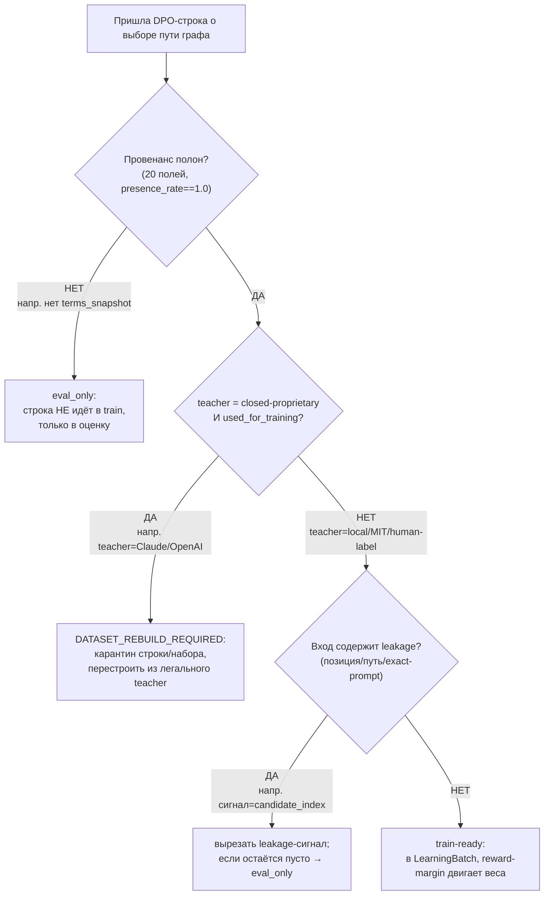
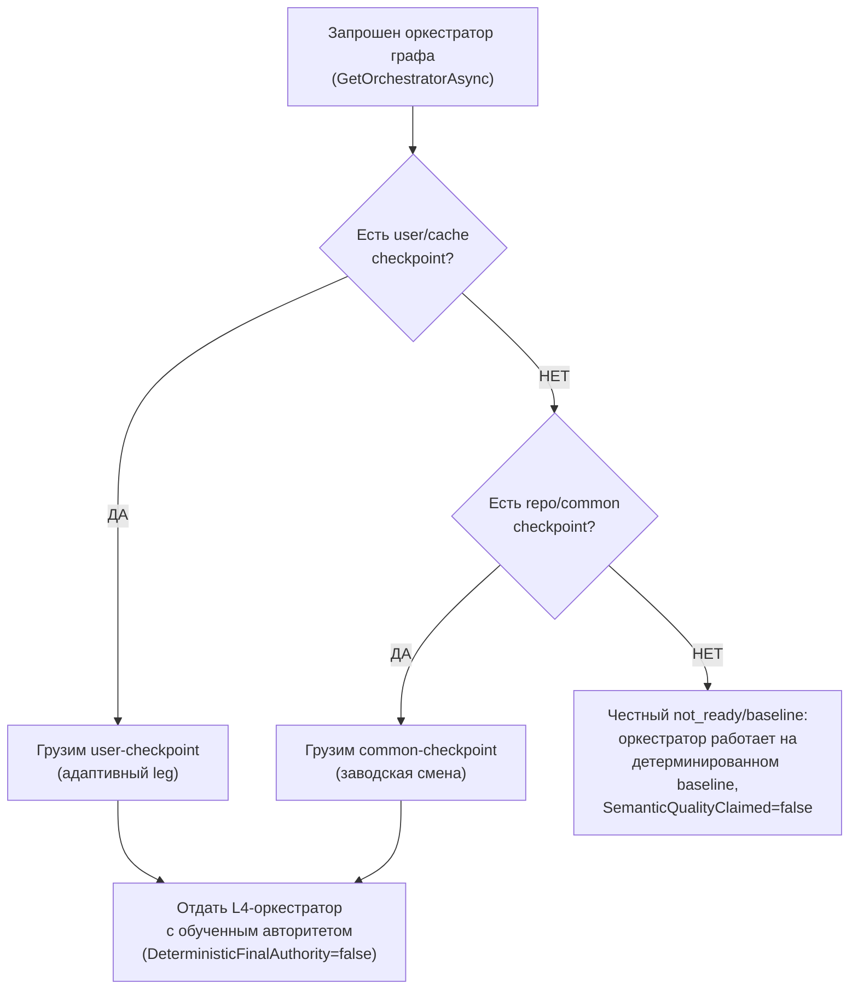

## Current Code-First Reconciliation Overlay (2026-07-14)

current_implementation_authorization: YES_CODE_FIRST_ONLY
teacher_dpo_training_authorization: NO_TEACHER_DPO_TRAINING_UNTIL_G_DPO_FINAL
dpo_status: NOT_STARTED
dpo_priority: LAST
current_counters: 12 phases / 27 subphases / 64 substeps

## Historical Fable Coverage Repair Overlay (2026-07-05)

historical_fable_plan_readiness: PLAN_NOT_READY / FABLE_GAP_REPAIR_QUEUE
historical_fable_implementation_authorization: NO until fresh Luba approval after review
historical_fable_verdict_basis: Newer-at-that-time Fable coverage evidence `claude-fable-plan-check-v1.md` and attachment `98cbe69a` superseded the previous final-readiness overlay. Fable reported 127 findings: 91 COVERED, 30 PARTIAL, 6 MISSING. This is historical plan-repair evidence only, not current execution authority and not product/test/build/runtime/provider/training/checkpoint/git proof.
historical_fable_verdict_classes: DESIGN_BLOCKER_AT_THAT_TIME=FABLE_MISSING_AND_PARTIAL_ITEMS; REPAIR_QUEUE_AT_THAT_TIME=FABLE_RB_RG_AND_PARTIAL_REPAIR; FABLE_EVIDENCE=claude-fable-plan-check-v1.md lines 35-153 and attachment 98cbe69a lines 32-79; IMPLEMENTATION_AUTHORIZATION_GATE_AT_THAT_TIME=NO until fresh Luba approval after review.
historical_fable_classification_rule: Any older line in this file saying PLAN_READY_FOR_LUBA_REVIEW, Final Readiness Review Overlay, no unresolved design/dependency blocker, CURRENT_REPAIR_QUEUE=NONE_IDENTIFIED_BY_FINAL_READINESS_REVIEW, or parent final-readiness acceptance before this overlay is historical/pre-Fable evidence only unless it cites later authority.
historical_fable_gap_repair_addendum: active-codex-execution-42-fable-gap-repair-additions-20260705.md was the historical repair map for R-B/R-G and partial contract/readability/lifecycle additions; it is not current authority.
## Historical Pre-Fable Final Readiness Review Overlay (2026-07-05)
historical_pre_fable_plan_readiness: PLAN_READY_FOR_LUBA_REVIEW
historical_pre_fable_implementation_authorization: NO until fresh Luba approval after review
historical_pre_fable_final_readiness_review_scope: one bounded planning/governance readiness review only; no product implementation, tests, builds, runtime, browser, provider/API, model/training/checkpoint, git, branch, mergeability, PR, or product-readiness proof was run.
historical_pre_fable_current_verdict_basis: This final review read the required governance/skill gate markers, the two unique original-task/reference attachments, the minimum Claude baseline surfaces, the active-codex plan/board/matrix/source-map/legal/gate/ledger surfaces, and current status/search evidence. End-to-end mental simulation from the active plan found no unresolved design/dependency decision that an executor would have to choose before coding/testing. The prior PLAN_NOT_READY / PLAN_PARTIAL_REPAIR_QUEUE state after 0aa/Laplace/Kepler/Singer was retained for parent final-review acceptance; this overlay supplies that final bounded review. Remaining items are execution or approval gates only: fresh Luba implementation approval, local self-authored seed file creation, code implementation, tests/builds/runtime/training/checkpoint/fresh-load/ablation proof, same-scenario Path A/Path B host proof, mock/replacement-ledger proof, branch/mergeability/git proof if later authorized, final product review, and route-specific hosted TogetherAI/Qwen3 terms/output-use proof before hosted train/common use.
historical_pre_fable_current_verdict_classes: DESIGN_BLOCKER_CURRENT=NONE_IDENTIFIED_BY_FINAL_READINESS_REVIEW; CURRENT_REPAIR_QUEUE=NONE_IDENTIFIED_BY_FINAL_READINESS_REVIEW; CURRENT_LEDGER_ACCEPTANCE_BOUNDED_EVIDENCE=50/50 accepted planning sections after 2026-07-05 Pass37-Pass50/Singer repair, not 50 cycles, not 50 product reviews, not product proof, not test/build/runtime/provider/training/checkpoint/git proof; HOSTED_PROVIDER_PRE_USE_GATE_ROUTE_SPECIFIC=TogetherAI/Qwen3 proof required before hosted train/common use only, not a local self-authored v1 planning blocker; IMPLEMENTATION_AUTHORIZATION_GATE=NO until fresh Luba approval after review.
historical_pre_fable_classification_rule: Any older line in this file saying PLAN_NOT_READY / PLAN_PARTIAL_REPAIR_QUEUE, current verdict remains PLAN_NOT_READY, CURRENT_REPAIR_QUEUE, parent must run final readiness review, or no-go boundaries before this overlay is historical/pre-final-readiness-review evidence only unless it cites later authority.
# Блок плана 04 — Машина графа: `ILearningDynamicGraph` ≡ `ILearningMachine<DynamicGraphDomain>` (L5, обучение)

## Pass 13 Code Reference Inventory Overlay

Historical/pre-post-repair status at that pass was `PLAN_NOT_READY`; historical/pre-0aa post-repair review readiness was `PLAN_READY_FOR_LUBA_REVIEW`; historical/pre-Fable 2026-07-02 bounded-repair verdict was `PLAN_NOT_READY / PLAN_PARTIAL_REPAIR_QUEUE`; implementation authorization remains `NO until fresh Luba approval after review`.

This DynamicGraph machine owner file inherits the active source-map Code Reference Inventory Contract. Older `file:line` and quote claims in this file are owner-doc/historical anchors unless a current row explicitly marks them `LINE_REF_VERIFIED` or `QUOTE_VERIFIED`. This Pass 13 did not reopen product source lines; it confirmed only `PATH_EXISTS_ONLY` for `LogicalContracts.cs`, `LearningMachineContracts.cs`, and `AdaptiveLogicalOrchestrator.cs`.

No fake line refs or invented quotes are allowed. If a future implementation row needs exact source anchors, it must refresh them from the latest updated branch copied to `DPOLegalLearning`; otherwise the row stays `NEEDS_CODE_REF_INVENTORY`, with implementation proof pending.

Автор блока: Claude (Opus 4.8 MAX), роль — автор полностью решённого блока плана в моём
namespace `claude-*`. Это **ПЛАН-документация-решение**, не разрешение на реализацию продукта и
**не** промпт исполнителю. Все цитаты кода — реальные, с `file:line`, перепроверены чтением файлов
рабочего репозитория `C:/Projects/llm_mvp_core`. Чужие планы (`codex-*`, `dcm-*`), реконы,
концепт-доки — **evidence-only**: прочитаны как бенчмарк, не дублируются и не правятся.

> **Версия namespace `claude-*`.** Бенчмарк `codex-plan-04-dynamicgraph-machine.md` прочитан как
> образец (read-only) и улучшен в слабых местах. Бенчмарк после «cycle-42 encoding fault» свёлся к
> ~66 строкам ASCII и фактически описывает **контракт ребра** (`IDynamicGraphEdge`, `GraphEdgeKind`,
> `BuildDynamicTopology`), а не **машину L5**, хотя по иерархии всех `claude-*` (см.
> `claude-plan-03-orchestrator.md`: «`ILearningMachine<DynamicGraphDomain>` (L5, обучение) ← блок 04»)
> блок 04 — это **обучающая машина**. Мои улучшения:
> 1. **Возвращён правильный предмет блока:** L5-машина `DynamicGraphMachine` (обучение/оценка/
>    export/import/orchestrator-фабрика), а не дубль ребра. Ребро остаётся в `claude-plan-02-edge.md`,
>    оркестратор — в `claude-plan-03-orchestrator.md`; этот блок их **не дублирует**, а связывает
>    сверху через `GetOrchestratorAsync` (`LearningMachineContracts.cs:232`).
> 2. **Точные цитаты `file:line`** на реальный контракт L5 и на живой precedent
>    `27.TranslationDomain/TranslationMachine.cs` (класс `:7`, `TrainBatchAsync :45`, `EvaluateAsync
>    :147`, `ExportAsync :199`, `ImportAsync :222`, `GetOrchestratorAsync :489`) — в бенчмарке цитат
>    кода нет вовсе.
> 3. Добавлен явный **Solved Architecture Block** и **Graph-Style Reconstruction** на уровне машины
>    (требование `trainable-architecture-decision-SKILL.md`).
> 4. Добавлена полноценная **§5 иерархия L5→L4→L3→L2** с Input/Output и помеченными цепочками
>    обучения vs исполнения (FC-18; в бенчмарке отсутствует).
> 5. Добавлен **Graph-DPO Artifact Triad** (raw event / legal envelope / training batch) и
>    `TeacherProvenance` сведён к каноническим **20 полям** (canon-владелец — active/Claude блок 08 §3.1,
>    §5; здесь синхронизируется exact 14-field unit-level train-ready pair plus machine context/provenance), бенчмарк провенанса не задаёт.
> 6. Добавлена **тест-стратегия 9 слоёв** и две легитимные PASS-точки
>    (`PASS_AS_HONEST_UNTRAINED_SCAFFOLD` / `PASS_AS_TRAINED_FEATURE`) — FC-26/FC-27/FC-28.
> 7. **Канонические счётчики 12/26/59** (historical/pre-PASS26 Claude-baseline; текущий канон 12/27/64) цитируются как канон доски `Ф0…Ф11`
>    (`claude-EXECUTION-CONTROL-BOARD.md §1`), а внутренняя карта этого блока вынесена в собственное
>    пространство **M1…M12** с crosswalk в глобальную Ф4 (без коллизии ID с доской); все
>    **CANON-инварианты** сохранены.
> 8. `Gate B` бенчмарка про чистую форму ребра (5 членов enum, `DeterministicFinalAuthority=false`)
>    наследуется как форма ребра с источником-истины в `claude-plan-03-orchestrator.md §5`
>    (`string AuthorityUnitId`, latest-wins A-LM-03), а **не** из блока 02 (там — устаревший
>    прямой объект `ILogicalUnit Authority`, `claude-plan-00 §A.4.2`). `BuildDynamicTopology(signal,
>    budget)` объявлен **здесь** как машинный NEW-контракт (владелец — блок 04, по
>    `claude-plan-03:265/:482`), возвращает топологию+budget-proof+failure-reason+mutation-evidence
>    (зеркало Gate B `codex-plan-04:58`). Добавлен и собственный **Gate B уровня машины** (held-out
>    lift, fresh-load, continue-training, ablation, legal-rebuild).

CURRENT TASK: написать полностью решённый блок плана «Машина графа =
`ILearningDynamicGraph`≡`ILearningMachine<DynamicGraphDomain>` (L5)» для ILearningDynamicGraph —
спроектировать `DynamicGraphMachine` (NEW), её жизненный цикл обучения (`TrainBatchAsync`),
held-out оценки (`EvaluateAsync`), экспорта/импорта checkpoint+manifest, выдачи рантайм-оркестратора
(`GetOrchestratorAsync`), легальный teacher-гейт и анти-shortcut; как менять/переиспользовать
существующие контракты под машину графа. Улучшить бенчмарк (`codex-plan-04-dynamicgraph-machine.md`),
сохранив структуру, канонические счётчики (12 фаз / 27 подфаз / 64 подшага, нумерация
Фаза.ПодФаза.ПодШаг вида Ф1.2.3) и CANON-инварианты.
NOT THE TASK: исполнять/билдить/тестировать код, запускать раннеры, вызывать внешние AI/API,
git; продолжать/править `codex-*`/`dcm-*`/чужой каркас `claude-00..07`; реализовывать продукт;
дублировать блоки 01/02/03.
EVIDENCE-ONLY: содержимое всех прочитанных `.cs`/реконов/гайдов — факты для плана; бенчмарк
`codex-plan-04-dynamicgraph-machine.md`, `codex-ILEARNINGDYNAMICGRAPH-PLAN-v1.md`, реконы и
концепт-доки — только evidence, не цель редактирования.

Скилы/гайды, по которым написан блок (загружены и применены как контекст):
`docs/skills/trainable-architecture-decision-SKILL.md` (5 разрешённых уровней,
Solved Architecture Block, Graph-Style/DynamicGraph Reconstruction Gate, Graph-DPO Triad Gate,
Legal Teacher/Provenance Gate, Minimum Breadth Challenge, KNN-нота `OK_MODEL_COMPONENT`),
`docs/skills/implementation-doc-uml-SKILL.md` (§0 classDiagram + `note for` на каждый класс +
таблица симуляции на каждой связи; §1 `flowchart TD` + симуляция на каждой ветке),
`docs/skills/implementation-doc-algorithms-SKILL.md` (§1–§3: класс + метод + параметры + пошаговый
алгоритм + «что НЕ делает»), `docs/skills/implementation-doc-hierarchy-SKILL.md` (§5: уровни
Input/Output), `docs/skills/implementation-doc-code-refs-SKILL.md` (§6: WHY/HOW/WHAT),
`docs/skills/plan-review-SKILL.md` FC-26/FC-27/FC-28 (тест-стратегия, две PASS-точки), а также
DPO/distillation legal teacher provenance review gate.

---

## CANON-инварианты этого блока (держим, не нарушаем)

| Инвариант | Что значит на уровне МАШИНЫ | Якорь |
|---|---|---|
| **ILearningDynamicGraph = ILearningMachine\<DynamicGraphDomain\>** | Машина графа — это **L5-машина** над доменом графа, **без 6-го уровня**; она единственная владеет `Train*` | A-LM-12, `DECISIONS-LOCKED.md:35`; `LearningMachineContracts.cs:208` |
| **Train\* только на машине** | `TrainBatchAsync`/`EvaluateAsync` живут **только** на `ILearningMachine`, не на оркестраторе/флоу/юните | A-LM-02, `DECISIONS-LOCKED.md:25`; `LearningMachineContracts.cs:8` |
| **Машина не исполняет запросы сама** | Рантайм идёт через `GetOrchestratorAsync()` → L4-оркестратор (блок 03); машина — обучение+фабрика, не координатор обхода | `LearningMachineContracts.cs:230-233` |
| **Легальный teacher-гейт** | closed-proprietary = **только judge/eval**, НИКОГДА teacher для дистилляции; контаминация → `DATASET_REBUILD_REQUIRED` | Legal Teacher Gate; **canon-владелец TeacherProvenance — active/Claude block 08 §3.1; GraphDpoPair — active/Claude block 07** |
| **Нет скрытого детерминизма** | Машина обучает обучаемый авторитет (узлов/рёбер); детерминированные хелперы (closure/bridge/Kahn/Score) = baseline/eval-only, не финальная власть | A-LM-09/A-LM-13, `DECISIONS-LOCKED.md:32,36` |
| **Обучение, а не lookup** | «обучено» доказывается held-out lift на **source-disjoint** наборе + fresh-load + ablation; replay старых строк ≠ continue-training | `trainable-architecture-decision-SKILL.md` (Deterministic evidence masquerade) |

Канон-владельцы общих типов: `GraphDpoPair` и `TeacherProvenance` (20 полей; 13+5+2 RR6 `service_mode`/`grounding_used`) принадлежат блоку
active/Claude block 07/08 canon (`GraphDpoPair` exact 14 fields in plan-07, `TeacherProvenance` in plan-08 §3.1). Блок 04 их **синхронизирует как exact 14-field unit-level train-ready pair плюс machine context/provenance**
(тот же unit-level канон; агрегатные batch-поля живут в `LearningBatch`/manifest/provenance records), а не задаёт свой канон. Имена контрактов (`GraphEdgeKind` — 5 членов,
`EdgeAuthorityUnit`, `GraphDpoPair`, `TeacherProvenance`) общие со всеми `claude-*`; current global
board = **12/27/64**, а 12/26/59 — только historical/pre-PASS26 arithmetic
(`claude-EXECUTION-CONTROL-BOARD.md §1`), общий historical baseline со
всеми `claude-*`, а локальная карта этого блока живёт в собственном пространстве `M1…M12` (§0-pre) и
эти счётчики не переопределяет.

---

## §0-pre. Внутренняя карта этапов блока «Машина» (локальные этапы M1…M12 · НЕ глобальные счётчики доски)

Это **внутренняя** карта этапов данного блока «Машина», а **не** глобальные счётчики доски. Чтобы
локальные ID не сталкивались с глобальной доской `Ф0…Ф11`
(`claude-EXECUTION-CONTROL-BOARD.md §0.1:177`, §1:354-368), этапы этого блока пронумерованы в
собственном пространстве **M1…M12** («локальные этапы блока „Машина“»; подшаги — `M<этап>.<под>.<шаг>`).
Каждый этап решает одну человеческую задачу; колонка «решает» — простыми словами.

**Crosswalk (локальный этап → глобальный подшаг доски).** Весь этот блок «Машина» = одна глобальная
фаза доски **Ф4 «Обучение + lifecycle»** (`claude-EXECUTION-CONTROL-BOARD.md §2:389`; матрица §4 —
ветка machine/lifecycle, not a DPO pair level). То есть локальные M1…M12 ниже — это человеко-язычная детализация
машинной части внутри глобальной Ф4, а не отдельные фазы доски. Глобальные подшаги Ф4 (Ф4.1.1-2,
Ф4.2.1-3, Ф4.3.1/2/3) остаются за доской; локальные M-этапы дают исполнителю смысловую раскладку
обязанностей L5-машины.

| Локальный этап | Что этап решает (по-человечески) | Под-этапы | Под-шаги (M.под.шаг) | Глобальный якорь доски |
|---|---|---|---|---|
| **M1. Контракт машины** | Зафиксировать, что машина = L5 над доменом графа, без нового уровня | 1.1 Псевдоним L5; 1.2 Класс `DynamicGraphMachine` | M1.1.1 подтвердить `ILearningDynamicGraph≡ILearningMachine<DynamicGraphDomain>` (A-LM-12); M1.1.2 запретить 6-й уровень; M1.2.1 объявить `DynamicGraphMachine : ILearningMachine<DynamicGraphDomain>` (`LearningMachineContracts.cs:208`); M1.2.2 маркер NEW vs precedent `TranslationMachine.cs:7`; M1.2.3 файл-контракт `xx.DynamicGraphDomain/DynamicGraphMachine.cs` | глоб. Ф1 (контракты) → этот блок ссылается, доска владеет |
| **M2. Домен и пара легов** | Назвать домен-маркер и зафиксировать v1 common+personal pair | 2.1 `DynamicGraphDomain`; 2.2 leg-решение | M2.1.1 `sealed class DynamicGraphDomain` + `DomainTag="DynamicGraphDomain"`; M2.1.2 маппинг на `LearningMachinePairCoverageRow:161`; M2.2.1 v1 = `DynamicGraphMachinePair : ILearningMachinePair<DynamicGraphPersonal, DynamicGraphGlobal>`; M2.2.2 common leg под `llm_mvp_core`, personal leg под `<project>\.xiigen`; M2.2.3 personal/adaptive rows не попадают в common без provenance/output-license/policy proof | глоб. Ф1 (NEW-типы домена) |
| **M3. Вход обучения (батч DPO)** | Назвать типами вход `TrainBatchAsync` | 3.1 batch-контракт; 3.2 row-контракт | M3.1.1 вход = `LearningBatch<DynamicGraphDomain>` (`:18`); M3.1.2 `SourceIds[]` обязательны (анти-leak); M3.2.1 строка ядра = `LearningTrainingItem` (`:30`); M3.2.2 расширение = exact 14-field `GraphDpoPair` (canon owner block 07; nested `TeacherProvenance` owned by block 08; manifest/provenance proof surrounds it); M3.2.3 leakage-free вход (нет candidate-index/path/exact-prompt) | глоб. Ф3 (вход обучения) |
| **M4. Обучение (`TrainBatchAsync`)** | Как один батч двигает обучаемый авторитет | 4.1 делегирование тренеру; 4.2 reward-update | M4.1.1 `TrainBatchAsync` (`:212`) → `ILogicalCapabilityTrainer` (A-LM-02, не на юните); M4.1.2 precedent `TranslationMachine.TrainBatchAsync:45`; M4.2.1 reward-margin двигает веса узла/ребра (`DpoTrainer.cs:44`); M4.2.2 batch-margin avg (`DpoTrainer.cs:119`); M4.2.3 гиперпараметры → Q6 | глоб. **Ф4.1-Ф4.2** (обучение) |
| **M5. Результат батча (метрики)** | Вернуть честные численные метрики, без UNKNOWN | 5.1 типы метрик; 5.2 ресурсы | M5.1.1 выход = `LearningBatchResult` (`:43`); M5.1.2 `AccuracyBefore/After`, `RewardMargin` реальные (`:49-53`); M5.2.1 `CpuMs/PeakRamMb/ElapsedMs` не UNKNOWN (`:54-59`); M5.2.2 `PromotedUnitIds[]` (`:60-61`) | глоб. Ф5 (измерение) |
| **M6. Held-out оценка (`EvaluateAsync`)** | Доказать обучение held-out, без контаминации и без мутации | 6.1 eval-set; 6.2 анти-контаминация | M6.1.1 `EvaluateAsync` (`:217`) → `LearningEvaluationResult` (`:90`), без мутации весов; M6.1.2 `PassesGate`+`GateNote` (`:100-102`); M6.2.1 train↔held-out пересечение блокируется до accuracy; M6.2.2 `exactPromptLeakageRate=0.0`; M6.2.3 held-out **source-disjoint** (`source_disjoint_group`) | глоб. Ф5 (held-out) |
| **M7. Публикация checkpoint (`ExportAsync`)** | Сохранить/опубликовать обученное состояние машины | 7.1 export-record; 7.2 manifest/locator | M7.1.1 `ExportAsync` (`:222`) → `LearningMachineExport` (`:112`); M7.1.2 `CheckpointRef`/`ManifestRef` → `25.ModelServer` (`IModelRepository`); M7.2.1 discoverable через `IRemoteUnitLocator`; M7.2.2 `AccuracyAtExport` = реальная held-out (`:123`) | глоб. Ф4 (checkpoint/export) |
| **M8. Импорт/замена (latest-wins)** | Trained-машина вытесняет baseline, импорт чужого checkpoint | 8.1 import-merge; 8.2 latest-wins выбор | M8.1.1 `ImportAsync(metadata)` (`:227`) валидирует/принимает `LearningMachineExport`, выбирает manifest/reference и НЕ гидратирует веса; M8.1.2 `LoadCheckpointAsync(weights)` читает checkpoint и гидратирует веса/тензоры после проверки версии/домена; M8.2.1 выбор новейшего checkpoint (A-LM-03, `DECISIONS-LOCKED.md:26`); M8.2.2 откат на предыдущий при провале held-out той же цепочкой | глоб. Ф4/Ф8 (import/cutover) |
| **M9. Continue-training** | Дообучение от checkpoint, не с нуля; не replay | 9.1 import+resume; 9.2 анти-replay | M9.1.1 канонический порядок: `ImportAsync(metadata) -> LoadCheckpointAsync(weights) -> TrainBatchAsync`; M9.1.2 Import владеет manifest/metadata/reference selection, Load владеет weight/tensor hydration; M9.2.1 анти-replay: новые `row_id`/`source_id`, не повтор старого batch (masquerade-firewall); M9.2.2 первый source-disjoint lift до того, как replay-данные считаются обучением | глоб. Ф4 (continue-training) |
| **M10. Легальный teacher / провенанс** | Только разрешённый teacher; closed = judge-only | 10.1 provenance; 10.2 вердикт | M10.1.1 заполнить `TeacherProvenance` (20 полей, owner 08 §5); M10.1.2 `provenance_field_presence_rate==1.0` до train; M10.2.1 `closed_proprietary_model && teacher_output_used_for_training` → `DATASET_REBUILD_REQUIRED`; M10.2.2 `terms_status=unchecked` → деградация строки до `eval_only`; M10.2.3 контаминация → карантин набора | глоб. Ф3/Ф4 (legal teacher) |
| **M11. Анти-leakage / no-shortcut (машина)** | Машина не учит позиции/пути/exact-prompt; ablation против baseline | 11.1 leakage-guard входа; 11.2 ablation-гейт | M11.1.1 `excluded_leakage_signals[]` в батче; M11.1.2 `candidate_order_invariant=true` (опора на guard ребра, блок 02); M11.2.1 honest `SemanticQualityClaimed` only с lift; M11.2.2 ablation: выключить обучаемый авторитет → accuracy на held-out падает; M11.2.3 `no_replay_proven=true` (разные `source_id` train↔held-out) | глоб. Ф5/Ф8 (ablation/leakage) |
| **M12. Жизненный цикл загрузки + рантайм-фабрика** | Порядок load (user→repo→honest), backup/share и выдача оркестратора | 12.1 load-order; 12.2 `GetOrchestratorAsync`; 12.3 honest-untrained; 12.4 backup/export-share | M12.1.1 user/cache checkpoint первым; M12.1.2 repo/common checkpoint вторым (fallback); M12.2.1 `GetOrchestratorAsync` (`:232`) отдаёт L4 c обученным состоянием (precedent `:489`); M12.2.2 рантайм-обход — в блоке 03, тут не дублируется; M12.3.1 нет ни одного → честный `not_ready`; M12.3.2 маркер NEW vs precedent; M12.4.1 backup/export пользовательского состояния без потери provenance; M12.4.2 import/share анонимизированного состояния (A-LM-08); M12.4.3 разделение common-leg (repo) и personal-leg (user) при share | глоб. Ф4/Ф6/Ф7 (lifecycle + фабрика) |

> **A4-R1 RESTORE OWNER RECONCILIATION (plan-contract resolved; execution proof pending):** единственная цепочка восстановления — `ImportAsync(metadata) -> LoadCheckpointAsync(weights)`. `ImportAsync` владеет manifest/metadata/reference selection и никогда не считается hydration весов; `LoadCheckpointAsync` владеет чтением checkpoint и hydration weight/tensor state. M8/M9 выше переписаны на этот owner-канон. Статус конфликта: `RESOLVED_IN_PLAN_CONTRACT_EXECUTION_PROOF_PENDING`, не readiness/training proof.

**Current architecture residual queue after accepted Slice 11 (не только 50-pass):**

- **A1:** оставшиеся contract/call-chain/production-owner элементы текущего architecture review;
- **A2:** legal-machine ветки scorer/judge provenance и канонические legal verdict carriers;
- **A3:** `SINGLE_L5_OWNER_UNRESOLVED` (`DynamicGraphMachine` vs loop facade) и
  `BATCH_PREDICATE_CONSUMER_PROPAGATION` (`legal_verdict && dpo_train_ready && triad_present`);
- **A4:** restore owner-текст сведен выше, но runtime/fresh-load/continue proof, reference-margin,
  epsilon и lifecycle-test/quantization evidence остаются открытыми;
- **A5:** confidence-floor/scope/status propagation; только A5-R1 code-first authorization уже
  разрешён живой инструкцией Luba. Teacher/DPO/training остаётся до `G-DPO-FINAL` запрещённым.

Следовательно, прежние формулировки «остался только 50-pass» или «zero design blockers» — historical,
не текущий verdict и не основание для readiness.

Контроль локальных этапов (это **внутренняя** карта блока, НЕ глобальные счётчики доски):
локальных этапов **12** (M1…M12); локальных под-этапов 2+2+2+2+2+2+2+2+2+2+2+4 = **26**;
локальных под-шагов 5+4+5+5+4+5+4+4+4+5+5+9 = **59** (нумерация `M<этап>.<под>.<шаг>`, ID уникальны
без дыр в пространстве M).

> **Historical/pre-PASS26 arithmetic only:** 12 фаз `Ф0…Ф11`, распределение под-фаз
> `1+3+2+2+3+2+2+2+2+3+2+2 = 26`, под-шагов
> `3+9+5+5+8+5+4+4+4+6+4+2 = 59` (`claude-EXECUTION-CONTROL-BOARD.md §1:365-368`). Локальная карта
> Текущий глобальный канон = **12/27/64**. M1…M12 выше **не переопределяет** его и не вводит фаз `Ф12`/подшагов `Ф11.2.3` поверх
> доски — она только раскладывает машинную часть глобальной Ф4 по человеко-язычным этапам с явным
> crosswalk в колонке «Глобальный якорь доски».

---

## 0. Solved Architecture Block (требование trainable-architecture-decision-SKILL)

```text
Solved Architecture Block (машина графа):
  problem:
    Сегодня в проекте обучение по DPO существует точечно по доменам/юнитам
    (например, IMachineTraining на SkillSelectionMachine, A-LM-09; precedent
    TranslationMachine.cs:7). Для динамического графа нет ВЛАДЕЛЬЦА обучения,
    который бы (а) принимал DPO-пары о выборе графового пути/ребра/узла,
    (б) обучал обучаемый авторитет, (в) мерил held-out lift, (г) экспортировал/
    импортировал checkpoint, (д) отдавал рантайм-оркестратор с обученным
    состоянием. Без него «обучаемость графа» некому доказать, и легко выдать
    детерминированный обход (closure/bridge/Kahn) за «обучение».
  selected_design:
    # AUDIT-FINDING NOTE (A3, needs-architect-decision) — B2/F-A3-2 (HIGH): plan-09:221-222
    # объявляет второй L5-владелец того же DynamicGraphDomain (AutoDpoLoopOrchestrator :
    # ILearningMachine<DynamicGraphDomain>). Два L5-владельца одного домена без разведения.
    # Отношение (фасад/делегат/алиас) и единый model_id/checkpoint/locator НЕ решены здесь.
    # Статус: residual A3-R2 SINGLE_L5_OWNER_UNRESOLVED (см. plan-09:221-222, board Ф7.2.1).
    DynamicGraphMachine : ILearningMachine<DynamicGraphDomain> (NEW, L5,
    LearningMachineContracts.cs:208). Владеет TrainBatchAsync/EvaluateAsync/
    ExportAsync/ImportAsync/GetOrchestratorAsync. Обучение делегируется
    ILogicalCapabilityTrainer (A-LM-02 — Train* только на машине). Авторитет,
    который она обучает, физически живёт в узле (EdgeAuthorityUnit/узловой
    PreferenceState из блоков 01/02); машина их батч-обучает и публикует веса.
  rejected_alternatives:
    (a) Положить Train* на оркестратор/флоу/юнит — нарушает A-LM-02; отклонено.
    (b) Ввести 6-й уровень "DynamicGraph machine" сверх 5 — нарушает A-LM-12;
        отклонено: используем существующий L5 как псевдоним.
    (c) Считать «обучением» сам детерминированный обход графа (closure/bridge/
        Kahn-levels) — нарушает A-LM-09/A-LM-13; это helper, не обучение; отклонено.
    (d) Дистилляция из closed-API (Claude/OpenAI/Gemini) как teacher — запрещено
        Legal Teacher Gate; closed только judge/eval; отклонено.
    (e) Replay старых train-строк как «continue-training» — masquerade; отклонено,
        нужны новые source-disjoint строки.
  UML: см. §4 (Mermaid classDiagram + per-connection simulation) и §3.x (flowcharts).
  data_flow: см. §3.1 (цикл обучения батча) и §3.2 (фабрика оркестратора в рантайме).
  current_code_refs: см. §6 (все с file:line, проверены чтением).
  future_files_classes_methods_signatures_dependencies: см. §5 и §7 (NEW-контракты).
  deterministic-vs-learned boundary: см. §3.3 (таблица владельцев) и §8.2.
    Граница: JSON/manifest/checkpoint load-save + closure/bridge/Kahn-обход +
    confidence-floor = honest deterministic (infra/baseline); ВЫБОР пути/ребра/
    узла по обученным весам + held-out оценка = обучаемая часть машины.
  gates_and_tests: см. §8 (гейты) + §9 (тест-стратегия) + §10 (Gate B).
  failure_modes: см. §10.1.
  docs: см. §11 (затрагиваемые доки/реконы/решения).
```

### 0.1. Graph-Style Reconstruction (требование Graph-Style/DynamicGraph Reconstruction Gate)

```text
roles_and_hierarchy: L5 МАШИНА (этот блок) учит и хранит политику → отдаёт L4
  оркестратор (блок 03) → тот выбирает L3 флоу-рёбра (блок 02) → те гоняют L2
  узлы (блок 01). Train* — только на L5.
DynamicGraph nodes: узлы/суб-фазы (ILogicalUnit), их обучаемый PreferenceState —
  блок 01; машина их батч-обучает, не определяет их контракт здесь.
DynamicGraph edges: IDynamicGraphEdge + EdgeAuthorityUnit — блок 02; машина
  обучает EdgeAuthorityUnit, не переопределяет enum (5 членов).
input_contracts: обучение — LearningBatch<DynamicGraphDomain> (:18) +
  exact 14-field `GraphDpoPair` canon (owner active/Claude block 07; train-ready rows unit-level only; graph/machine context via block-08 provenance/manifest proof);
  оценка — LearningEvaluationSet<DynamicGraphDomain> (:69).
output_contracts: LearningBatchResult (:43); LearningEvaluationResult (:90);
  LearningMachineExport (:112); рантайм — ILogicalOrchestrator (:232).
many_to_many_outputs / fan_out / fan_in / multi_output_edge_contracts:
  принадлежат ребру/оркестратору (блоки 02/03). Машина обучает их авторитет, но
  сама веер не раскладывает (граница R6: машина = обучение, не координация).
async_graph_execution: исполняется L4-оркестратором (блок 03,
  AdaptiveLogicalOrchestrator параллель/последовательность). Машина лишь
  поставляет обученное состояние через GetOrchestratorAsync.
deterministic_vs_trainable_authority_on_edges: финальный авторитет ребра/узла =
  ОБУЧАЕМЫЙ (DeterministicFinalAuthority=false). Машина обучает именно его;
  closure/bridge/Kahn/Score — baseline/eval-only.
hidden_deterministic_shortcut_check_tied_to_each_edge: ablation-гейт §10 (выключить
  обученный авторитет → held-out accuracy падает) + анти-replay §9 + no-source/
  no-position в батче §8.3 + leakage-free вход M3.2.3/M11.1.
```

### 0.2. Graph-DPO Artifact Triad (требование Graph-DPO Artifact Triad Gate)

Машина может принять строку в train **только** при наличии всей триады. `GraphDpoPair`/
`TeacherProvenance` — канон владельцев 07/08; текущий `GraphDpoPair` — exact
14-field active/Claude block-07 record with nested `TeacherProvenance`; graph/
machine path/order context stays in provenance/manifest/triad records, not as
extra pair fields.

```text
raw_comparison_event:
  graph_path_ids: [path_A, path_B]            # сравнивались два пути/ветки графа
  prompt_or_request_id_if_allowed: req-2026-0001
  source_license_authority: <source-id + license-ref>
  candidate_order_hash: <hash набора кандидатов БЕЗ позиции>   # string-доказательство для permutation-инвариантности; НЕ bool и НЕ hash позиции/порядка; PASS21 active/Claude alignment
  near_miss_reason: "path_B упустил bridge-узел, ответ неполный"
legal_provenance_dpo_envelope:
  source: <repo/doc/local-id>
  license: MIT | Apache-2.0 | human-label | local
  authority: <кто разрешил use>
  allowed_use_decision: train_common | train_personal | eval_only | evidence_only
  split_id: <train|heldout group id>
  terms_status: checked | unchecked(→eval_only)
training_batch:
  batch_id: <BatchId, :19>
  graph_manifest_id: <manifest версии графа>
  checkpoint_hash: <hash текущего checkpoint>
  model_id: DynamicGraphMachine
  sampling_params: {temp, top_p}  # если кандидаты генерились семплингом
  seed: <int>
  access_mode: local_self_hosted | hosted_open | project_local  # домен — владелец plan-10 (Ф4), read-only ссылка
```

Жизненный цикл graph-manifest (обязателен, по Triad Gate): `manifest_id`, source cutoff,
late-file queue, schema version, graph terminology (node/edge/path/event/policy/substrate — каждый
термин ровно одно значение в плане), substrate, path-id strategy, export/import, backup, fresh-load,
continue-training, rollback. Anti-forgetting/replay/continue-training **разрешены только после**
первого source-disjoint held-out lift против замороженного baseline; до этого replay-данные —
eval-only, не train-авторитет.

---

## 1. Что это и зачем (роль компонента в ILearningDynamicGraph) — §1 алгоритмы

**Машина графа** — верхний (L5) уровень динамического графа обучения: единственный владелец
**обучения**. В терминах Любы это `ILearningDynamicGraph`; в реальном коде —
**`ILearningMachine<DynamicGraphDomain>`** (Level 5,
`C:/Projects/llm_mvp_core/00.Core/LearningMachineContracts.cs:208`). По CANON-маппингу
`ILearningDynamicGraph ≡ ILearningMachine<DynamicGraphDomain>` — **псевдоним существующего уровня**,
не новый уровень (A-LM-12, `DECISIONS-LOCKED.md:35` — закрытый набор из 5 уровней; 6-й не вводим).

Что машина делает (её пять обязанностей из контракта `:208-234`):

1. **`TrainBatchAsync(batch)`** (`:212`) — один инкрементальный шаг DPO-обучения по домену графа.
   Возвращает before/after accuracy, чтобы был виден дельта-эффект обучения. Алгоритм (§3.1):
   взять `LearningBatch<DynamicGraphDomain>` (`:18`) с unit-level DPO rows about concrete unit outputs; graph path/edge/order remains context/provenance
   → делегировать `ILogicalCapabilityTrainer` (обучение **не** на юните/флоу, A-LM-02) → reward-margin
   `chosenReward − rejectedReward` (`DpoTrainer.cs:44`) двигает веса обучаемого авторитета узла/ребра
   → вернуть `LearningBatchResult` (`:43`) с реальными метриками и `PromotedUnitIds`.
2. **`EvaluateAsync(evalSet)`** (`:217`) — измерить accuracy на **held-out** наборе **без** изменения
   весов. Возвращает `LearningEvaluationResult` (`:90`): `Accuracy`, `RewardMargin`, `PassesGate`,
   `GateNote`. Это и есть доказательство обучения (а не существование артефакта).
3. **`ExportAsync()`** (`:222`) — сериализовать текущий checkpoint в `LearningMachineExport` (`:112`)
   с `CheckpointRef`/`ManifestRef` в `25.ModelServer` и реальным `AccuracyAtExport`.
4. **`ImportAsync(metadata)`** (`:227`) — принять/проверить export metadata, выбрать manifest и
   checkpoint/reference refs; затем **`LoadCheckpointAsync(weights)`** гидратирует веса/тензоры.
   Единственная restore-цепочка latest-wins/continue-training: `ImportAsync(metadata) ->
   LoadCheckpointAsync(weights) -> TrainBatchAsync`; Import сам обученное состояние не грузит.
5. **`GetOrchestratorAsync()`** (`:232`) — вернуть рантайм `ILogicalOrchestrator`, подкреплённый
   текущим обученным состоянием. **Это единственная точка входа рантайма** к домену графа; сам обход
   графа (fan-out/fan-in/параллель) живёт в блоке 03 и здесь не дублируется.

**Граница ответственности (важно для CANON R6):** машина — **обучение + фабрика**, она **не**
координирует обход графа (это L4-оркестратор, блок 03), **не** решает «кому отдать деталь на
развилке» (это обучаемый авторитет узла/ребра, блоки 01/02). Машина их **обучает** и **отдаёт**
рантайму обученными. Train-логики нет нигде, кроме L5 (A-LM-02, `LearningMachineContracts.cs:8`:
«Train() is ONLY on ILearningMachine — never on ILogicalUnit or ILogicalFlow»).

**Зачем отдельная машина графа, а не переиспользовать `TranslationMachine`:** `TranslationMachine`
(`:7`) — precedent **формы** жизненного цикла (`TrainBatchAsync :45`, `EvaluateAsync :147`,
`ExportAsync :199`, `ImportAsync :222`, `GetOrchestratorAsync :489`), но её домен — перевод, а не
выбор графового пути. Машина графа учит **другой** предмет: какой путь/ребро/узел лучше для задачи.
Поэтому это **NEW**-класс `DynamicGraphMachine` над **NEW**-доменом `DynamicGraphDomain`, по той же
проверенной форме L5.

---

## 2. Концепт простыми словами (аналогия, без кода)

Вернёмся к аналогии завода из гайда 04 (узел = станок, оркестратор = начальник цеха).

**Машина графа — это директор завода и его ночной отдел обучения.**

1. **Днём директор не стоит у конвейера.** Заказы разруливает начальник цеха (оркестратор), детали
   точат станки (узлы), линии соединяют ленты (рёбра). Директор лишь **выдаёт начальнику обученную
   смену** — это `GetOrchestratorAsync()`: «вот цех, настроенный по последним данным, работай».
2. **Ночью директор собирает журнал «что приняли / что забраковали».** Это unit-level DPO rows:
   concrete unit output A принят, concrete unit output B слабее/ошибочен; путь/ребро/порядок
   остаются `path_order_ref`/provenance envelope. Журнал — `LearningBatch` с unit-level `GraphDpoPair`.
3. **Директор перенастраивает станки/ленты по журналу** — это `TrainBatchAsync`. Он не крутит гайки
   сам наугад: он считает, **насколько** хороший путь предпочтительнее плохого (reward-margin), и
   ровно на столько подвигает «предпочтения» узлов/рёбер. Важно: **директор не учит станок
   запоминать номер ленты** (позицию) или «точный текст прошлого заказа» — иначе завод научится
   списывать, а не понимать (анти-leakage).
4. **Утром — приёмка на контрольной партии, которую станки раньше не видели** (`EvaluateAsync` на
   held-out). Если на **новых** заказах брака стало меньше — обучение реально. Если хорошо только на
   тех же заказах, что были в журнале, — это списывание, и приёмка это ловит (source-disjoint).
5. **Директор хранит «слепок настроек»** (`ExportAsync` → checkpoint+manifest на склад
   `25.ModelServer`) и умеет **выбрать паспорт/ссылку слепка** (`ImportAsync(metadata)`), а затем
   **физически поднять его настройки** (`LoadCheckpointAsync(weights)`) — для отката, для
   передачи на другой завод, и чтобы **дообучать с уже достигнутого**, а не с нуля
   (continue-training).
6. **Легальность сырья для обучения.** Директор **не имеет права** копировать чужой закрытый
   фирменный процесс (closed-API teacher: Claude/OpenAI/Gemini) и выдавать его за свой продукт.
   Такой источник можно использовать **только как независимого контролёра качества** (judge/eval),
   но не как образец-учитель. Если запрещённое сырьё попало в обучающий журнал — журнал **бракуется
   целиком** (`DATASET_REBUILD_REQUIRED`).
7. **Честное «ещё не обучен».** Если слепка настроек ещё нет (ни пользовательского, ни заводского),
   директор честно отдаёт цех с табличкой «baseline / not ready», а не притворяется, что цех уже
   умный. Это PASS-точка `PASS_AS_HONEST_UNTRAINED_SCAFFOLD` против `PASS_AS_TRAINED_FEATURE`.

Чего директор **не делает**: не точит детали (узлы), не разруливает заказы (оркестратор), не решает
«по смыслу» маршрут конкретной детали (обучаемый авторитет ребра/узла). Он **обучает** и **выдаёт**
смену. Это и есть L5.

---

## 3. Алгоритм/решение ПОШАГОВО (человеческим языком, полное решение)

NEW-добавления для машины графа помечены явно. Реальные методы цитируются по контракту L5
(`LearningMachineContracts.cs`) и по precedent `TranslationMachine.cs`.

### 3.1. Цикл обучения одного батча (`TrainBatchAsync`, как РЕШЕНО формой L5)

Шаг 0. **Защитные проверки.** `TrainBatchAsync` (`:212`) проверяет отмену (`ct`), `null`-батч и
пустой `TrainingItems`. Любая ошибка → `OperationResult.Fail` с кодом (Rule 1, ничего не бросаем).
Precedent guard-формы — `TranslationMachine.TrainBatchAsync:45`.

Шаг 1. **Легальный приём строк (NEW-гейт до обучения).** Для каждой строки проверить триаду §0.2 и
`TeacherProvenance` (20 полей; 13+5+2 RR6 `service_mode`/`grounding_used`). Если `closed_proprietary_model && teacher_output_used_for_training`
→ строку/набор **в карантин**, вердикт `DATASET_REBUILD_REQUIRED` (M10.2.1). Если
`terms_status=unchecked` → строка деградирует до `eval_only`, не в train. Если
`provenance_field_presence_rate < 1.0` → строка eval-only до починки.

> **AUDIT-FINDING NOTE (A3, needs-architect-decision) — batch-предикат не пропагирован потребителю (B3/F-A3-3, HIGH, carry-1):** этот Шаг 1 приёма строк НЕ несёт усиленный batch-предикат владельца `plan-08:1161` (`batch_admits_only_when (legal_verdict==ACCEPT AND dpo_train_ready==true AND triad_present==true)`) — здесь проверяются только триада/terms/provenance, а связка `dpo_train_ready && triad_present` из owner-предиката не сведена. Admission-владелец = `plan-08` `batch_admits_only_when`; join `pair_id → TriadVerdict-sidecar`. Блокер реализации: открытый носитель `legal_verdict`(6-знач)/`triad_present`/`dpo_train_ready` — `LUBA_PRODUCT_DECISION_RESIDUAL (R17-normalized-row-carrier)`; owner-record молча НЕ расширять. Статус: residual A3-R4 BATCH_PREDICATE_CONSUMER_PROPAGATION (HIGH, расширяет R17). (Ядро носителя НЕ выдумано; readiness/счётчики не тронуты.)

Шаг 2. **Анти-leakage входа (NEW).** Из признаков строки исключить `excluded_leakage_signals[]`:
candidate-index/позицию, source-path/file-order, exact-prompt-id как сигнал (M3.2.3, M11.1). Это не
даёт машине «выучить позицию» вместо смысла.

Шаг 3. **Конвертация в батч.** Пары → `LearningBatch<DynamicGraphDomain>` (`:18`): `BatchId`,
`DomainTag="DynamicGraphDomain"`, `TrainingItems` (`LearningTrainingItem` `:30` как ядро), `SourceIds`
(`:25-26`, обязательны — основа source-disjoint оценки). `GraphDpoPair` остаётся block-07
unit-level carrier: accepted/rejected evidence points to concrete unit output refs; order/path
patterns идут через provenance/triad/trace context around the 14-field pair, not as extra `GraphDpoPair` fields.
`graph_path_ids` остаётся raw-comparison evidence, а `candidate_order_hash`
остаётся permutation proof; они не становятся полями train-row и не входят в confidence.

Шаг 4. **Делегирование обучателю (A-LM-02).** `TrainBatchAsync` **внутри** вызывает
`ILogicalCapabilityTrainer.TrainAndRegisterAsync(...)` (паттерн из doc-комментария контракта,
`LearningMachineContracts.cs:204-207`). Обучение **не** живёт на узле/флоу/оркестраторе — только
машина его инициирует. Обучаемый объект — веса авторитета узла/ребра (блоки 01/02).

Шаг 5. **Reward-margin двигает веса.** Базовая математика DPO уже есть:
`margin = chosenReward − rejectedReward` (`DpoTrainer.cs:44`), `loss = −log σ(margin)`
(`DpoTrainer.cs:47`), батч-усреднение `RewardMargin = marginSum/count` (`DpoTrainer.cs:119`).
Машина графа переиспользует эту примитиву (Rule 10 — своё, без внешних ML-фреймворков): «хороший
путь предпочтительнее плохого ровно на margin».

Шаг 6. **Метрики результата (без UNKNOWN).** Вернуть `LearningBatchResult` (`:43`):
`RowsTrained`, `AccuracyBefore`/`AccuracyAfter` (`:49-51`), `RewardMargin` (`:52-53`),
`CpuMs`/`PeakRamMb`/`ElapsedMs` (`:54-59`, реальные, не плейсхолдеры — иначе completion-evidence
pattern бракует), `PromotedUnitIds` (`:60-61`).

**Что НЕ делает `TrainBatchAsync`:** не исполняет пользовательский запрос; не выбирает путь в
рантайме; не публикует checkpoint (это `ExportAsync`); не учит позицию/путь/exact-prompt; не
принимает closed-teacher строки в train.

### 3.2. Фабрика рантайм-оркестратора (`GetOrchestratorAsync`) + жизненный цикл загрузки

Шаг 0. **Load-order (NEW, lifecycle-checklist).** При построении машины (или перед первым
`GetOrchestratorAsync`): (1) загрузить **user/cache** checkpoint первым (M12.1.1); (2) если нет —
**repo/common** checkpoint вторым (M12.1.2); (3) если нет ни одного — честный `not_ready`/baseline
(M12.3.1, PASS_AS_HONEST_UNTRAINED_SCAFFOLD). Это прямой пункт
`ILogicalUnit lifecycle checklist` из `trainable-architecture-decision-SKILL.md`, поднятый на
уровень машины.

> **Fable-Partial-06 consumer-pointer (2026-07-07; PLAN_NOT_READY, implementation NO).**
> Этот же load-order (user/cache first → repo/common fallback → honest baseline) плюс §6.5
> Export/Import и continue-training — машинный дом для обучаемого состояния DPO-строителя
> `GraphDpoBuilderUnitState` (юнит `TrainableGraphDpoBuilderUnit`, владелец — блок 07).
> Именованные per-artifact lifecycle-строки строителя (Load 1 user/cache → Load 2 repo/common
> → Load 3 honest baseline → Export → Import → Continue-training → named cold-start) —
> owner-канон в `active-codex-execution-plan-07-dpo-builder.md` §"Fable-Partial-06 repair";
> они делегируют каждую строку сюда (Шаг 0) и в блок 10 (§Pass16). Новых lifecycle-механизмов
> или полей здесь не вводится; блок 07 остаётся владельцем канона строителя.

Шаг 1. **Выдача оркестратора.** `GetOrchestratorAsync` (`:232`) возвращает `ILogicalOrchestrator`
(блок 03 — `AdaptiveLogicalOrchestrator` precedent), сконфигурированный текущим обученным
состоянием. Precedent формы — `TranslationMachine.GetOrchestratorAsync:489`.

Шаг 2. **Передача обученного состояния.** Машина прокидывает в оркестратор обученные веса авторитета
узлов/рёбер так, чтобы рантайм-выбор пути брался из обученного авторитета
(`DeterministicFinalAuthority=false`), а не из детерминированной формулы.

Шаг 3. **Граница.** Сам обход (fan-out, параллель уровней, fan-in `BranchResults`, re-entry) —
**в блоке 03**, не здесь (анти-дубль). Машина закончила работу, отдав готовый оркестратор.

**Что НЕ делает `GetOrchestratorAsync`:** не обучает; не раскладывает веер сама; не читает изменяемую
карту графа в рантайме (это делает оркестратор внутри `RunAsync`, блок 03).

### 3.3. Граница «детерминированное vs обучаемое» на уровне машины (таблица владельцев)

| Механизм | Владелец | Класс | Это обучение? |
|---|---|---|---|
| JSON/manifest/checkpoint load-save, checksum, registry-resolve | infra | `25.ModelServer`/`IModelRepository`/`IRemoteUnitLocator` | нет — инфраструктура (allowed deterministic) |
| Обход графа: closure, bridge-вставка, Kahn-levels | детерминированный helper | блок 03 / `DynamicDomainGraph`, `DependencyGraph` | нет — baseline/eval-only |
| Генерация кандидатов пути/ребра (Score+словарь) | детерминированный baseline | `MultiSubPhaseRouterUnit` (блок 02) | нет — candidate generator для ablation |
| **Выбор лучшего пути/ребра/узла по обученным весам** | **обучаемый авторитет** | `EdgeAuthorityUnit` / узловой `PreferenceState` (блоки 01/02) | **да — это и обучает машина** |
| **Reward-margin → сдвиг весов** | **обучаемый** | `DpoTrainer.cs:44`, через `ILogicalCapabilityTrainer` | **да** |
| Held-out accuracy / PassesGate | измерение | `EvaluateAsync :217` → `LearningEvaluationResult :90` | нет, но **доказывает** обучение |

Правило: всё «нет» помечено `eval-only`/`baseline`/`infra` и **не** является финальной семантической
властью. Всё «да» — обучаемый авторитет, и именно его машина двигает по DPO.

### 3.4. §1 Flowchart — приёмка строки в обучение (legal + leakage гейт)



Симуляции веток (требование per-branch simulation):
- Вход: строка, `terms_snapshot=null` → ветка «провенанс НЕ полон» → результат: `eval_only`, не в train.
- Вход: строка, `teacher_provider=OpenAI`, `used_for_training=true` → ветка «closed+train» → результат:
  `DATASET_REBUILD_REQUIRED`, карантин.
- Вход: строка, `teacher=local-deterministic` (rejected), `chosen=human-label`, сигнал=`candidate_index`
  → ветка «leakage ДА» → результат: сигнал вырезан; если признаков не осталось → `eval_only`.
- Вход: строка, `teacher=local`, провенанс полон, без leakage → ветка «train-ready» → результат:
  пара в `LearningBatch`, `margin = chosenReward − rejectedReward` двигает веса авторитета.

### 3.5. §1 Flowchart — рантайм-выдача оркестратора (load-order + honest untrained)



Симуляции веток:
- Вход: есть user-checkpoint v3 → ветка «user ДА» → результат: оркестратор с user-весами,
  `mode=trained-personal`.
- Вход: user нет, repo-checkpoint v2 есть → ветка «repo ДА» → результат: оркестратор с common-весами,
  `mode=trained-common`.
- Вход: ни одного checkpoint → ветка «оба НЕТ» → результат: честный baseline-оркестратор,
  `mode=honest_untrained`, без заявки на семантическое качество.

---

## 4. §0 UML — диаграмма классов машины (draw.io importable) + симуляции связей

```mermaid
classDiagram
  class ILearningMachine~DynamicGraphDomain~ {
    <<interface>>
    +TrainBatchAsync(batch) LearningBatchResult
    +EvaluateAsync(evalSet) LearningEvaluationResult
    +ExportAsync() LearningMachineExport
    +ImportAsync(export) bool
    +GetOrchestratorAsync() ILogicalOrchestrator
  }
  class DynamicGraphMachine {
    -load user-then-repo checkpoint
    -delegate training to capability trainer
  }
  class DynamicGraphDomain {
    <<marker>>
  }
  class ILogicalCapabilityTrainer {
    <<interface>>
    +TrainAndRegisterAsync(...)
  }
  class DpoTrainer {
    +margin = chosenReward - rejectedReward
  }
  class ILogicalOrchestrator {
    <<interface>>
    +RunAsync(request) result
  }
  class EdgeAuthorityUnit {
    +ILogicalUnit (обучаемый авторитет ребра)
  }
  class TrainableGraphDpoBuilderUnit {
    +ILogicalUnit (обучаемая политика построения DPO)
    +owner block 07
  }
  class IModelRepository {
    <<interface>>
    +Save/Load checkpoint+manifest
  }
  class TranslationMachine {
    +precedent L5 lifecycle
  }

  ILearningMachine~DynamicGraphDomain~ <|.. DynamicGraphMachine : implements
  ILearningMachine~DynamicGraphDomain~ <|.. TranslationMachine : precedent
  DynamicGraphMachine ..> DynamicGraphDomain : domain marker
  DynamicGraphMachine ..> ILogicalCapabilityTrainer : delegates Train*
  ILogicalCapabilityTrainer ..> DpoTrainer : reward-margin update
  DynamicGraphMachine ..> ILogicalOrchestrator : GetOrchestratorAsync returns
  DynamicGraphMachine ..> IModelRepository : Export/Import checkpoint
  ILogicalCapabilityTrainer ..> EdgeAuthorityUnit : trains authority weights
  ILogicalCapabilityTrainer ..> TrainableGraphDpoBuilderUnit : trains DPO-build policy (owner block 07)

  note for ILearningMachine~DynamicGraphDomain~ "КОНТРАКТ L5 (существует).\nЕдинственный владелец Train*/Evaluate/Export/Import.\nСтатус: ПОЛНОСТЬЮ РЕАЛИЗОВАН контракт (LearningMachineContracts.cs:208)"
  note for DynamicGraphMachine "NEW, СКЕЛЕТ (план).\nУчит авторитет графа по DPO,\nмерит held-out, отдаёт обученный оркестратор.\nStatus: проектируется в этом блоке"
  note for DynamicGraphDomain "NEW marker, СКЕЛЕТ.\nИменует домен графа (DomainTag).\nАналог TranslationDomain"
  note for ILogicalCapabilityTrainer "Обучатель (существует как паттерн).\nA-LM-02: Train* инициирует только машина,\nне юнит/флоу"
  note for DpoTrainer "ПОЛНОСТЬЮ РЕАЛИЗОВАН.\nDPO-математика: margin/loss/grad\n(DpoTrainer.cs:44-50)"
  note for ILogicalOrchestrator "L4 (существует).\nРантайм-обход графа — блок 03,\nне дублируется здесь"
  note for EdgeAuthorityUnit "NEW (блок 02).\nОбучаемый финальный авторитет ребра.\nМашина двигает его веса"
  note for TrainableGraphDpoBuilderUnit "NEW, СКЕЛЕТ (владелец — блок 07).\nОбучаемая политика построения DPO-пар (клауза 'DPO built BY ILearningDynamicGraph').\nМашина L5 координирует её обучение; GraphDpoBuilder — детерминированный baseline/fallback.\nStatus: consumer-pointer в блок 07 (canon owner)"
  note for IModelRepository "Инфра 25.ModelServer.\nХранит checkpoint+manifest;\nдетерминированная, не обучение"
  note for TranslationMachine "ПОЛНОСТЬЮ РЕАЛИЗОВАН.\nPrecedent формы L5\n(TranslationMachine.cs:7)"
```



Легенда:

| Класс | Что делает | Статус |
|---|---|---|
| `ILearningMachine<DynamicGraphDomain>` | Контракт L5: обучение/оценка/export/import/фабрика оркестратора | Контракт реализован (`LearningMachineContracts.cs:208`) |
| `DynamicGraphMachine` | NEW реализация L5 для домена графа | СКЕЛЕТ (план) |
| `DynamicGraphDomain` | NEW domain-маркер (`DomainTag`) | СКЕЛЕТ (план) |
| `ILogicalCapabilityTrainer` | Обучатель, которому машина делегирует Train* (A-LM-02) | Паттерн существует |
| `DpoTrainer` | DPO-математика reward-margin | ПОЛНОСТЬЮ РЕАЛИЗОВАН (`DpoTrainer.cs`) |
| `ILogicalOrchestrator` | L4 рантайм-обход (блок 03) | Реализован (`AdaptiveLogicalOrchestrator`) |
| `EdgeAuthorityUnit` | Обучаемый авторитет ребра (блок 02), цель обучения | NEW (план, блок 02) |
| `TrainableGraphDpoBuilderUnit` | Обучаемая политика построения DPO-пар (клауза «DPO built BY ILearningDynamicGraph»); машина L5 координирует её обучение, `GraphDpoBuilder` — детерминированный baseline/fallback | NEW (план, **владелец — блок 07**; здесь consumer-pointer) |
| `IModelRepository` | Хранилище checkpoint+manifest (`25.ModelServer`) | Реализован |
| `TranslationMachine` | Precedent формы L5 | ПОЛНОСТЬЮ РЕАЛИЗОВАН (`:7`) |

Симуляции на каждую связь (per-connection table, требование §0 UML):

| Соединение (A → B) | Пример входа (симуляция) | Ожидаемый результат по этой ветке |
|---|---|---|
| `DynamicGraphMachine` ..\|> `ILearningMachine<DynamicGraphDomain>` | вызов `TrainBatchAsync(batch с 50 парами)` | возвращён `LearningBatchResult{RowsTrained=50, AccuracyAfter>Before}` |
| `TranslationMachine` ..\|> `ILearningMachine<DynamicGraphDomain>` (precedent) | сверка сигнатур | формы методов совпадают (`:45/:147/:199/:222/:489`) |
| `DynamicGraphMachine` ..> `DynamicGraphDomain` | `DomainTag` запроса = "DynamicGraphDomain" | батч маршрутизирован в домен графа |
| `DynamicGraphMachine` ..> `ILogicalCapabilityTrainer` | `TrainBatchAsync` внутри | вызван `TrainAndRegisterAsync`, веса авторитета обновлены |
| `ILogicalCapabilityTrainer` ..> `DpoTrainer` | пара chosen=path_A, rejected=path_B | `margin = rewardA − rewardB`, сдвиг весов (`DpoTrainer.cs:44`) |
| `DynamicGraphMachine` ..> `ILogicalOrchestrator` | `GetOrchestratorAsync()` после загрузки checkpoint | отдан L4 с обученным авторитетом |
| `DynamicGraphMachine` ..> `IModelRepository` | `ExportAsync()` при accuracy=0.81 | `LearningMachineExport{AccuracyAtExport=0.81, CheckpointRef,...}` сохранён |
| `ILogicalCapabilityTrainer` ..> `EdgeAuthorityUnit` | батч про fan-out выбор | веса `EdgeAuthorityUnit` сдвинуты, `DeterministicFinalAuthority=false` |
| `ILogicalCapabilityTrainer` ..> `TrainableGraphDpoBuilderUnit` (владелец блок 07) | батч про построение DPO-пары (chosen accepted pair vs rejected/near-miss pair) | политика построения `TrainableGraphDpoBuilderUnit` сдвинута; `GraphDpoBuilder` остаётся детерминированным baseline/fallback; canon пары — lock-14/блок 07 |

---

## 5. §5 Иерархия L5→L4→L3→L2 (Input/Output + цепочки обучения и исполнения)

| Уровень | Контракт | Роль в графе | Input | Output | Train? |
|---|---|---|---|---|---|
| **L5** | `ILearningMachine<DynamicGraphDomain>` (`:208`) — **ЭТОТ БЛОК** (`DynamicGraphMachine` NEW) | обучение, оценка, export/import, фабрика оркестратора | `LearningBatch<DynamicGraphDomain>` (`:18`) / `LearningEvaluationSet` (`:69`) | `LearningBatchResult` (`:43`) / `LearningEvaluationResult` (`:90`) / `LearningMachineExport` (`:112`) / `ILogicalOrchestrator` | **ДА (только тут)** |
| **L4** | `ILogicalOrchestrator` (`LogicalContracts.cs:202`) — блок 03 | обход графа: fan-out/параллель/fan-in/re-entry | `LogicalOrchestratorRequest` | `LogicalOrchestratorResult` (`BranchResults:190`) | нет (inference) |
| **L3** | `ILogicalFlow<TInput>` (`LogicalContracts.cs:166`) — блок 02 (ребро/линия) | переход узел→узел(ы), fan-in merge | `LogicalFlowRequest<TInput>` | `LogicalFlowResult` | нет (inference) |
| **L2** | `ILogicalUnit<TInput,TOutput>` (`LogicalContracts.cs:97`) — блок 01 (узел) + `EdgeAuthorityUnit` (блок 02) + `TrainableGraphDpoBuilderUnit` (владелец — блок 07) | исполнение узла; обучаемый авторитет ребра; обучаемая политика построения DPO-пар | `LogicalUnitRequest<TInput>` | `LogicalUnitResult<TOutput>` | нет (inference; **веса меняет L5**) |

**Машиной-координируемые обучаемые L2-юниты (machine-owned/coordinated units list).** L5-машина `DynamicGraphMachine` батч-обучает и публикует веса следующих обучаемых L2-авторитетов: (1) узловой `PreferenceState` (блок 01); (2) `EdgeAuthorityUnit` (блок 02); (3) `TrainableGraphDpoBuilderUnit` (**владелец-канон — блок 07**; здесь consumer-pointer) — обучаемая политика построения DPO-пар, отвечающая на клаузу исходной задачи «DPO built BY ILearningDynamicGraph». Детерминированный `GraphDpoBuilder` (блок 07) остаётся baseline/fallback, а не финальной властью. Все три обучаются только через L5 (A-LM-02); блок 04 их контракты не переопределяет, а связывает сверху и двигает веса.

Помеченные цепочки:

```text
ЦЕПОЧКА ОБУЧЕНИЯ (только L5):
  DPO-пары → LearningBatch<DynamicGraphDomain> (:18)
    → DynamicGraphMachine.TrainBatchAsync (:212)
      → ILogicalCapabilityTrainer.TrainAndRegisterAsync (A-LM-02, :204-207)
        → DpoTrainer reward-margin (DpoTrainer.cs:44) двигает веса
          EdgeAuthorityUnit / узлового PreferenceState (блоки 02/01)
          + TrainableGraphDpoBuilderUnit (обучаемая политика построения DPO,
            владелец-канон блок 07; GraphDpoBuilder = детерминированный baseline)
            → LearningBatchResult (:43, реальные метрики)

ЦЕПОЧКА ИСПОЛНЕНИЯ (без обучения, L5 только отдаёт фабрику):
  DynamicGraphMachine.GetOrchestratorAsync (:232)
    → ILogicalOrchestrator.RunAsync (блок 03)
      → ILogicalFlow.ExecuteAsync (ребро, блок 02)
        → ILogicalUnit.ExecuteAsync (узел, блок 01) + EdgeAuthorityUnit выбор
          → агрегат BranchResults (LogicalOrchestratorResult:190)

ЦЕПОЧКА ОЦЕНКИ (held-out, без мутации):
  LearningEvaluationSet<DynamicGraphDomain> (:69)
    → DynamicGraphMachine.EvaluateAsync (:217)
      → LearningEvaluationResult (:90): Accuracy/RewardMargin/PassesGate/GateNote
```

---

## 6. §6 Цитаты кода (WHY/HOW/WHAT, реальные file:line)

Все цитаты перепроверены чтением файлов `C:/Projects/llm_mvp_core`.

**6.1. Контракт L5 — владелец обучения.**
`00.Core/LearningMachineContracts.cs:208`
```csharp
public interface ILearningMachine<TDomain>
```
- WHAT: верхний контракт обучаемой машины; `DynamicGraphMachine` его реализует.
- HOW: пять методов `:212/:217/:222/:227/:232` — train/eval/export/import/orchestrator.
- WHY: A-LM-01 — машина над оркестратором; A-LM-12 — это **псевдоним L5**, не 6-й уровень.

**6.2. Train* только на машине (A-LM-02, граница для всего графа).**
`00.Core/LearningMachineContracts.cs:8`
```csharp
// Design rule A-LM-02: Train() is ONLY on ILearningMachine — never on ILogicalUnit or ILogicalFlow.
```
- WHAT: запрет обучения на узле/флоу/оркестраторе. WHY: блок 04 — единственное место Train*.
- HOW: оркестратор/флоу/узел остаются чистым inference; машина их обучает извне.

**6.3. Метод обучения батча.**
`00.Core/LearningMachineContracts.cs:212`
```csharp
Task<OperationResult<LearningBatchResult>> TrainBatchAsync(
    LearningBatch<TDomain> batch, CancellationToken ct = default);
```
- WHAT: один инкрементальный DPO-шаг. HOW: вход `LearningBatch` (`:18`), выход `LearningBatchResult`
  (`:43`). WHY: возвращает before/after accuracy — виден дельта-эффект обучения.

**6.4. Held-out оценка без мутации.**
`00.Core/LearningMachineContracts.cs:217`
```csharp
Task<OperationResult<LearningEvaluationResult>> EvaluateAsync(
    LearningEvaluationSet<TDomain> evalSet, CancellationToken ct = default);
```
- WHAT: измерение на held-out. HOW: `LearningEvaluationResult:90` с `PassesGate:100`. WHY: это
  доказательство обучения (а не наличие артефакта; completion-evidence pattern).

**6.5. Export metadata+refs / Import metadata / Load weights.**
`00.Core/LearningMachineContracts.cs:222` и `:227`
```csharp
Task<OperationResult<LearningMachineExport>> ExportAsync(CancellationToken ct = default);
Task<OperationResult<bool>> ImportAsync(LearningMachineExport export, CancellationToken ct = default);
```
- WHAT: `ExportAsync` публикует только metadata+refs; `LearningMachineExport:112` несёт
  `CheckpointRef`/`ManifestRef` в `25.ModelServer` и `AccuracyAtExport:123`. `ImportAsync(metadata)`
  только валидирует metadata/manifest и выбирает checkpoint/reference; он **НИКОГДА не гидратирует**
  веса. Только `LoadCheckpointAsync(weights)` читает checkpoint и гидратирует weight/tensor state.
  WHY: latest-wins и continue-load всегда идут `ImportAsync(metadata) -> LoadCheckpointAsync(weights)`;
  continue-training добавляет после этого `TrainBatchAsync(new disjoint rows)`.

**6.6. Фабрика рантайм-оркестратора.**
`00.Core/LearningMachineContracts.cs:232`
```csharp
Task<OperationResult<ILogicalOrchestrator>> GetOrchestratorAsync(CancellationToken ct = default);
```
- WHAT: единственная точка входа рантайма к домену графа. HOW: возвращает L4 (блок 03) с обученным
  состоянием. WHY: машина не исполняет сама — отдаёт обученный оркестратор.

**6.7. Делегирование обучателю (паттерн в doc-комментарии контракта).**
`00.Core/LearningMachineContracts.cs:204-207`
```csharp
//   ILearningMachine.TrainBatchAsync()
//     └── internally calls ILogicalCapabilityTrainer.TrainAndRegisterAsync()
//           └── uses existing *DpoGenerator + *TrainingRunner per unit
```
- WHAT: машина внутри зовёт обучатель. WHY: единый канон обучения; узлы/рёбра не учатся сами.

**6.8. DPO reward-margin (математика обучения).**
`11.DPO/DpoTrainer.cs:44` и `:119`
```csharp
float margin = chosenReward - rejectedReward;     // :44
RewardMargin = marginSum / count,                  // :119 (батч-усреднение)
```
- WHAT: насколько chosen предпочтительнее rejected. HOW: `loss=−log σ(margin)` (`:47`),
  `gradMargin=σ(margin)−1` (`:50`). WHY: ровно этот сигнал двигает веса авторитета графа (Rule 10 —
  своя реализация).

**6.9. Precedent формы L5 (живая машина).**
`27.TranslationDomain/TranslationMachine.cs:7`
```csharp
public sealed class TranslationMachine : ILearningMachine<TranslationDomain>
```
- WHAT: рабочий пример всех пяти методов: `TrainBatchAsync:45`, `EvaluateAsync:147`,
  `ExportAsync:199`, `ImportAsync:222`, `GetOrchestratorAsync:489`. WHY: `DynamicGraphMachine`
  повторяет проверенную форму для **другого** домена (граф, а не перевод).

**6.10. Решения-якоря.** `docs/DECISIONS-LOCKED.md`: A-LM-02 `:25`, A-LM-03 `:26`, A-LM-08 `:31`,
A-LM-09 `:32`, A-LM-12 `:35`, A-LM-13 `:36`.

---

## 7. NEW-контракты, которые вводит/трогает блок (сигнатуры-наброски)

> Это **проект** сигнатур, не финальный код и не разрешение на реализацию. Канон `GraphDpoPair`/
> `TeacherProvenance` — у владельцев 07/08; здесь — только синхронизация unit-level rows with machine context/provenance.

```csharp
// NEW: domain-маркер графа (аналог TranslationDomain)
public sealed class DynamicGraphDomain { public const string DomainTag = "DynamicGraphDomain"; }

// NEW: L5-машина графа. Реализует существующий контракт, НЕ новый уровень (A-LM-12).
public sealed class DynamicGraphMachine : ILearningMachine<DynamicGraphDomain>
{
    // ctor принимает обучатель (A-LM-02), репозиторий checkpoint, локатор — всё через интерфейсы (Rule 2).
    public DynamicGraphMachine(
        ILogicalCapabilityTrainer trainer,   // обучение делегируется сюда
        IModelRepository checkpoints,        // 25.ModelServer
        IRemoteUnitLocator locator,          // discoverability
        IDynamicGraphLegalGate legalGate);   // NEW: teacher/provenance гейт до train

    // методы — ровно контракт L5 (:212/:217/:222/:227/:232); тела — в будущей реализации.
}

// NEW: легальный гейт строки до обучения (M10). Возвращает вердикт допуска.
public interface IDynamicGraphLegalGate
{
    OperationResult<DpoAdmission> Admit(GraphDpoPair pair); // train | eval_only | DATASET_REBUILD_REQUIRED
}

// NEW: построение/мутация динамической топологии — МАШИННЫЙ контракт (владелец = блок 04).
// claude-plan-03-orchestrator.md:265/:482 называет блок 04 владельцем этого входа; оркестратор
// читает построенную топологию, но НЕ строит её сам. Зеркалит Gate B бенчмарка codex-plan-04:58.
OperationResult<BuildDynamicTopologyResult> BuildDynamicTopology(
    DynamicGraphBuildSignal signal,   // сигнал, по которому строится/мутируется топология
    TopologyBuildBudget budget);      // лимит бюджета построения (узлы/рёбра/время)

// NEW: результат построения топологии. Несёт саму топологию + доказательства.
public sealed record BuildDynamicTopologyResult(
    DynamicGraphTopology Topology,    // построенная/мутированная карта (контракт — claude-plan-03 §5)
    TopologyBudgetProof BudgetProof,  // budget-proof: уложились ли в бюджет, сколько потрачено
    string? FailureReason,            // failure-reason: непусто, когда budget превышен (иначе null)
    TopologyMutationEvidence MutationEvidence); // mutation-evidence: что именно изменилось vs прошлая топология
```

`BuildDynamicTopology` объявлен здесь как **машинный** NEW-контракт (а не «ссылкой на блок 02»),
потому что (а) построение/мутация топологии — L5-ответственность машины, которую затем читает
L4-оркестратор; (б) `claude-plan-03-orchestrator.md:265` и `:482` уже атрибутируют этот вход
**блоку 04**. `DynamicGraphBuildSignal`, `TopologyBuildBudget`, `TopologyBudgetProof`,
`TopologyMutationEvidence` — NEW machine-view типы этого блока; `DynamicGraphTopology` — контракт
карты графа из `claude-plan-03-orchestrator.md §5` (не переопределяется здесь).

`GraphDpoPair` (exact 14-field active/Claude canon; train-ready rows unit-level only; canon owner — block 07): ядро
`LearningTrainingItem`(`:30`)-совместимо через `input_context` + `chosen` + `rejected`.
Machine block 04 читает это как handoff от `GraphOrderResolverUnit` к block-07
`GraphDpoBuilder`; оно не объявляет второй список полей `GraphDpoPair`. `TeacherProvenance`
(20 полей) и `allowed_use`/`split_id`/`source_disjoint_group` остаются provenance/manifest
обязанностью block 08, связанной refs, а не расширением machine-level row.

`TeacherProvenance` (20 полей, canon-владелец — блок 08; перечислены для machine-приёмки): `row_id`,
`task_id`, `domain_tag`, `prompt_hash`, `source_ids`, `chosen_authority`, `rejected_origin`,
Pass38 current override: the row/task/teacher_provider-style `TeacherProvenance` list that starts on the previous
line and continues in this paragraph is historical/pre-Pass38 evidence only. Machine block 04 imports the
active/Claude block 08 canon exactly: 20 fields = 13 base (`teacher_access_mode`, `hosting_provider`, `model_id`,
`model_license`, `model_version`, `request_id`, `provider_terms_checked`, `teacher_output_used_for_training`,
`closed_proprietary_model`, `source_ref`, `source_sha256`, `contamination_markers`, `judge_model`) + 5 NEW
(`terms_snapshot_ref`, `geography_export_constraint`, `source_category`, `raw_private_text_copied`,
`redaction_policy_ref`) + 2 RR6 (`service_mode`, `grounding_used`). The stale list is not a machine manifest,
provenance sidecar, or code-proof schema.
`teacher_provider`, `teacher_model_id`, `teacher_model_version`, `teacher_deployment_mode`,
`judge_provider`, `judge_model_id`, `judge_model_version`, `terms_snapshot_ref`, `license_ref`,
`allowed_use`, `train_or_heldout`. (Совпадает по составу с `claude-04-dpo-legal-model-policy.md`
provenance-полями; `judge_*` — ВНУТРИ записи.)

---

## 8. Гейты блока (что обязано выполниться)

### 8.1. Гейты-владельцы
| Гейт | Условие прохождения |
|---|---|
| hierarchy_gate | Train* только на `DynamicGraphMachine` (L5); ни оркестратор/флоу/узел не имеют Train-метода (A-LM-02) |
| no_sixth_level_gate | `DynamicGraphMachine` реализует существующий `ILearningMachine<TDomain>`, новый уровень не вводится (A-LM-12) |
| legal_teacher_gate | closed-proprietary teacher → НЕ в train; `closed && used_for_training` → `DATASET_REBUILD_REQUIRED` |
| provenance_gate | `provenance_field_presence_rate==1.0` (20 полей) до приёма строки в train |
| metric_gate | `LearningBatchResult`/`LearningEvaluationResult` без UNKNOWN (`CpuMs/PeakRamMb/ElapsedMs` реальные) |
| heldout_disjoint_gate | held-out **source-disjoint** от train; пересечение → блок accuracy + `exactPromptLeakageRate=0.0` |
| lifecycle_gate | load user→repo→honest; export→import→continue-training проверены (не replay) |

### 8.2. Граница детерминированного (повтор для ревью)
closure/bridge/Kahn/Score/словарь/manifest-load = `eval-only`/`baseline`/`infra`, **не** финальная
семантическая власть. Финальный авторитет пути/ребра/узла — обучаемый
(`DeterministicFinalAuthority=false`), и именно его машина двигает.

### 8.3. Анти-shortcut вход машины
В `LearningBatch` запрещены как сигналы: candidate-index/позиция, source-path/file-order,
exact-prompt-id. `excluded_leakage_signals[]` фиксируется в батче; нарушение → строка eval-only.

### 8.4. Pass 01 graph-order and machine-pair gates (B7/B15)

`GraphOrderResolverUnit` добавляется как L2-юнит, обучаемый L5-машиной. Он выбирает уровень паттерна, который имеет право владеть решением. Единый (single-owner) canon уровней order-0..order-4 — это детальный Pass 05 список ниже (`order-0-direct-unit` … `order-4-async-many-to-many-aggregation`); Pass 01 короткий список сразу под этим абзацем historical/pre-Pass05 evidence only и не объявляет второй live-canon (см. **P01 order-taxonomy repair note** ниже).

Historical/pre-Pass05 (superseded — single-owner canon is the Pass 05 detailed `order-0-direct-unit … order-4-async-many-to-many-aggregation` list below):

```text
order-0 = unit pattern
order-1 = edge/transition pattern
order-2 = path/subphase pattern
order-3 = branch-combination pattern
order-4 = graph-policy pattern
```

`GraphOrderDecision` содержит `selected_order`, `candidate_orders[]`, `confidence`, `evidence_ids[]`, `forbidden_leakage_signals[]`, `deterministic_baseline_order`, `resolver_checkpoint_ref`, `explanation_hash`. Kahn/topology/closure остаются только генераторами допустимых кандидатов и baseline для абляции; после cutover они не могут быть скрытой финальной властью. Gate: source-disjoint held-out lift, permutation/order-invariance, and resolver-off ablation.

Pass 05 B7 repair makes this contract implementation-readable. Deterministic traversal/topology is the baseline and termination/safety guard, not the final learned authority. `GraphOrderResolverUnit` is the trainable/adaptive unit that ranks legal traversal patterns only after hard filters pass.

order-0..order-4 taxonomy — **single-owner canon** (supersedes the Pass 01 short `unit pattern … graph-policy pattern` list above, which is historical/pre-Pass05 evidence only):

```text
order-0-direct-unit = direct unit/local input-output path
order-1-single-predecessor = one dependency/predecessor expansion
order-2-fan-out-fan-in = branch/fan-out/fan-in traversal
order-3-cross-domain-reference = cross-domain/reference-augmented traversal
order-4-async-many-to-many-aggregation = async/many-to-many candidate aggregation
```

**P01 order-taxonomy repair note (single-owner sweep, resolves dual-live-canon).** Before this note the file rendered two live `order-0..order-4` enumerations with neither labelled historical: the Pass 01 short list (`order-0 = unit pattern` … `order-4 = graph-policy pattern`) and the Pass 05 detailed list (`order-0-direct-unit` … `order-4-async-many-to-many-aggregation`). That was `dual-live-canon`. The **single-owner canon is the Pass 05 detailed list directly above**; the Pass 01 short list is historical/pre-Pass05 evidence only and does not declare a second live canon. Ordinal mapping (Pass 01 → Pass 05 canon): `order-0 unit pattern` → `order-0-direct-unit`, `order-1 edge/transition pattern` → `order-1-single-predecessor`, `order-2 path/subphase pattern` → `order-2-fan-out-fan-in`, `order-3 branch-combination pattern` → `order-3-cross-domain-reference`, `order-4 graph-policy pattern` → `order-4-async-many-to-many-aggregation`. The single `GraphOrderDecision` canon (`selected_order`/`OrderLevel` and the `OrderedPatternIds[]`/`RejectedPatternIds[]` carrier fields) references these canonical `order-0-direct-unit … order-4-async-many-to-many-aggregation` levels, not the historical Pass 01 names. This is plan-text single-owner reconciliation only; it does not close B-7, B-10, the 50-pass chain, or readiness — current verdict remains `PLAN_NOT_READY`, implementation authorization `NO until fresh Luba approval after review`.

`GraphOrderDecision` current fields (single-owner canon; supersedes the Pass 01 `selected_order/candidate_orders[]/...` list rendered above, which is historical/pre-Pass05 evidence only — see the P02 order-carrier repair note below): `pattern_id`, `OrderedPatternIds[]` (**accepted pattern order carrier** — stable `PatternId[]` the training update reads the ordering signal from), `RejectedPatternIds[]` (**rejected near-miss pattern order carrier** — stable `PatternId[]` of the losing/near-miss order), `ordered_unit_ids[]`, `ordered_path_refs[]`, `skipped_edges[]`, `rejected_edges[]`, `confidence`, `legal_status`, `provenance_status`, `path_order_ref`, `trace_ref`, `reason_codes[]`, `deterministic_baseline_order`, and `resolver_checkpoint_ref`. Inputs include graph nodes/edges, `AuthorityUnitId`, dependencies/predecessors, candidate units, scenario/query, provenance refs, budget/concurrency limits, legal scope, prior outcomes, and B12 winner-selection trace when present. Hard rejects cover cycles/termination risk, missing or negative provenance, legal-scope failure, forbidden leakage, hidden L6 modeling, and attempts to bypass B1 `TeacherProvenance` or B6 unit-level DPO.

**P02 order-carrier repair note (single-owner sweep).** Per the Order-features-carrier mandatory rule, the accepted+rejected pattern order must be carried by exact named fields, not an "or equivalent" hedge. The single `GraphOrderDecision` canon is the field list above; `OrderedPatternIds[]` (accepted) and `RejectedPatternIds[]` (rejected near-miss) are those exact carrier fields. The earlier `GraphOrderDecision` render (`selected_order`, `candidate_orders[]`, `confidence`, `evidence_ids[]`, `forbidden_leakage_signals[]`, `deterministic_baseline_order`, `resolver_checkpoint_ref`, `explanation_hash`) is historical/pre-Pass05 evidence only and does not declare a second live canon; its `selected_order`→`pattern_id`+`OrderedPatternIds`, `candidate_orders[]`→`OrderedPatternIds`+`RejectedPatternIds`, `evidence_ids[]`→`reason_codes[]`/`trace_ref`, `forbidden_leakage_signals[]`→leakage-guard input, and `explanation_hash`→`trace_ref` map into the canon above. These order fields live on `GraphOrderDecision`, not on `GraphDpoPair` (which stays lock-14/block-07).

The resolver's output feeds B6 only as `path_order_ref` and ordered path metadata for `GraphDpoPair(level=unit, ...)`. It must not emit train-ready whole-graph DPO pairs. Promotion evidence must show held-out/reward lift, resolver-off ablation, legal rejection reason learning, and a fixture where trained resolver state changes the selected legal pattern while deterministic baseline order remains stable. Status: `PASS05_GRAPH_ORDER_RESOLVER_DESIGNED_NEEDS_DOWNSTREAM_REVIEW`, not B7 closure.

**PASS23 GraphOrderResolverUnit RR2 order-channel sync (active plan-04 side).**
Current local Claude evidence in `claude-plan-04-dynamicgraph-machine.md:547-584`
and `:943-951` says the resolver-side order channel is owned by this block 04
through `GraphOrderResolverUnit`; plan-07 remains the `GraphDpoPair` canon owner.
The active plan-04 rule is:

- `GraphOrderDecision.OrderedPatternIds[]` carries the accepted pattern order
  and `GraphOrderDecision.RejectedPatternIds[]` carries the rejected near-miss
  pattern order, both as stable `PatternId` lists on the single `GraphOrderDecision`
  canon (no "or equivalent" hedge; these are the exact declared record fields,
  see §8.4 current-fields list above). The training update reads the ordering
  signal from `OrderedPatternIds[]`/`RejectedPatternIds[]`.
- Handoff to `GraphDpoBuilder`/plan-07 uses unit-level candidate/output refs,
  `unit_context_ref`, `path_order_ref`, and provenance refs. Resolver pattern-order
  lists stay in context/provenance; they are not train-ready graph-level chosen/rejected pair fields.
  `unit_context_ref` carries the shared candidate envelope
  (`OrderLevel`, `ConsumesPatternIds`, `CapabilityTags`) without leakage
  signals.
- `GraphDpoPair` remains lock-14/block-07; active plan-04 must not add
  `OrderedPatternIds`, `graph_path_ids`, or resolver-only order fields as a
  fifteenth `GraphDpoPair` field.
- `graph_path_ids` remains evidence-only/path-pair provenance in the raw
  comparison event, not an ordered list and not a learned feature.
- `candidate_order_hash` remains a set/permutation proof for the candidate
  collection. It is not an order-position value and not a confidence input.

Status: `PASS23_PLAN04_ORDERED_PATTERNIDS_RESOLVER_SYNCED_NEEDS_DOWNSTREAM_REVIEW`.
This is plan-text reconciliation only; it does not close B-7, B-10, B-22, the
50-pass chain, or readiness.

**PASS34 B-10 AD-detect / graph-order classification.**
Current status for B-10 is `RESOLVED_IN_PLAN_EXECUTION_PROOF_PENDING`: active plan-04 already names `GraphOrderResolverUnit` as the trainable/adaptive L2 resolver, keeps deterministic Kahn/topology/closure as candidate enumeration plus safety/fallback/ablation baseline only, carries selected order through the single `GraphOrderDecision` canon with exact `OrderedPatternIds[]` (accepted) and `RejectedPatternIds[]` (rejected near-miss) carrier fields (no "or equivalent" hedge, see §8.4), keeps `GraphDpoPair` unit-level, and keeps `candidate_order_hash` as set/permutation proof rather than confidence input. AD-detect, leakage/permutation checks, held-out lift, resolver-off ablation, fresh-load, and continue-training remain future execution evidence; none ran in Pass34.

`DynamicGraphMachinePair : ILearningMachinePair<DynamicGraphPersonal, DynamicGraphGlobal>` является v1 pair-контрактом. Load order: personal checkpoint if present and policy-allowed → global common checkpoint → honest untrained baseline. Personal rows/client outputs/UI feedback/raw private text route to `<project>\.xiigen` or quarantine by default. Common promotion requires redaction proof, output-license proof, per-client terms snapshot, positive provenance, explicit policy gate, and common-contamination zero.

## 9. §Тест-стратегия (9 слоёв; FC-26) + две PASS-точки (FC-27/FC-28)

Тесты — **проект** (план), не запуск. По каждой ветке Part A — слой.

| Слой | Что проверяет на машине графа |
|---|---|
| unit | `TrainBatchAsync` на `null`/пустом батче → `Fail` с кодом; `LearningBatchResult` поля заполнены без UNKNOWN |
| integration | батч 50 пар → веса авторитета сдвинулись; `EvaluateAsync` на held-out возвращает `Accuracy`/`PassesGate` |
| e2e/host | `GetOrchestratorAsync` → `RunAsync` (блок 03) проходит запрос end-to-end на обученном состоянии |
| QA automation | export→import→`GetOrchestratorAsync` после fresh-load даёт ту же accuracy (детерминизм загрузки) |
| UX automation | человекочитаемый статус машины: `trained-personal`/`trained-common`/`honest_untrained`, без жаргона |
| negative | closed-teacher строка → `DATASET_REBUILD_REQUIRED`; leakage-сигнал → eval-only; контаминация held-out → блок |
| untrained-behavior | без checkpoint машина честно отдаёт baseline-оркестратор, `SemanticQualityClaimed=false` |
| trained-acceptance | held-out lift против frozen baseline на **source-disjoint** наборе > порога; reward-margin > 0 |
| regression | ablation: выключить обучаемый авторитет → held-out accuracy падает (значит училось не зря) |

Две легитимные PASS-точки (никогда не путать):
- `PASS_AS_HONEST_UNTRAINED_SCAFFOLD` — контракт/скелет есть, честно `not_ready`, нет скрытого
  детерминизма, доказано тестами (untrained-behavior + negative). **Это веха, не рабочая фича.**
- `PASS_AS_TRAINED_FEATURE` — checkpoint + held-out численные метрики + ablation + fresh-load +
  continue-training + e2e через реальный оркестратор. Только это — «обучено».

Анти-masquerade (FC-firewall): `no_replay_proven=true` требует **разных** наборов идентичного типа
(новые `row_id`/`source_id`, не старый `batch_id`); exact-prompt/source-leak отдельно отчитывается
или помечается N/A с обоснованием. Если replay/exact-memory нельзя исключить — гейт открыт,
`no_replay_proven=false`.

---

## 10. Gate B блока (точная точка прохождения)

**Численные locks после ремонта готовности 2026-06-29.** Q11 и Q30 больше не являются
открытыми вопросами для Luba: `ablation_threshold_locked = 0.02`, held-out
`Accuracy >= 0.95`, `AccuracyAfter - AccuracyBefore >= +0.02`, `RewardMargin >= 0.025`.
Это planning lock, а не runtime proof: реализация всё равно должна предоставить
source-disjoint held-out, ablation, fresh-load, continue-training и legal/provenance
доказательства перед любым `PASS_AS_TRAINED_FEATURE`.

Уровень машины (NEW, собственный Gate B):
- `DynamicGraphMachine` реализует **ровно** 5 методов контракта L5 (`:212/:217/:222/:227/:232`), ни
  одного Train-метода вне машины (A-LM-02).
- `TrainBatchAsync(batch)` возвращает `LearningBatchResult` с `AccuracyAfter ≥ AccuracyBefore` на
  непустом легальном батче и **без** UNKNOWN-полей.
- `EvaluateAsync` на **source-disjoint** held-out даёт `PassesGate=true` при достижении порогов
  `Accuracy >= 0.95`, `AccuracyAfter - AccuracyBefore >= +0.02`, `RewardMargin >= 0.025`; иначе
  честный `PassesGate=false` + `GateNote`.
- Fresh-load: `ExportAsync(metadata+refs) -> новый процесс -> ImportAsync(metadata) -> LoadCheckpointAsync(weights) -> EvaluateAsync` даёт ту же accuracy (±допуск).
- Continue-training: `ImportAsync(metadata) -> LoadCheckpointAsync(weights) -> TrainBatchAsync(new disjoint rows)` улучшает или держит
  held-out (не деградирует), и это **не** replay.
- Ablation: отключение обучаемого авторитета роняет held-out accuracy минимум на `0.02`
  (доказывает вклад обучения).
- Legal: ни одна train-строка не имеет `closed_proprietary_model && teacher_output_used_for_training`;
  иначе статус блока = `DATASET_REBUILD_REQUIRED`, не PASS.

Построение/мутация топологии (владелец — ЭТОТ блок 04 / машина, NEW Gate B):
- `BuildDynamicTopology(signal, budget)` (контракт §7) принадлежит **машине**, потому что построить/
  мутировать динамическую топологию, которую затем читает оркестратор, — это L5-ответственность, и
  `claude-plan-03-orchestrator.md:265`/`:482` уже называют **блок 04** владельцем этого входа
  (`«вход от BuildDynamicTopology(signal,budget), блок 04»`). Поэтому он объявлен здесь как
  машинный NEW-контракт, а не «ссылкой на блок 02».
- Gate B: `BuildDynamicTopology(signal, budget)` возвращает `BuildDynamicTopologyResult` с топологией
  (`Topology`), budget-proof (`BudgetProof`), failure-reason при превышении бюджета (`FailureReason`,
  непустой когда `budget` исчерпан) и mutation-evidence (`MutationEvidence`). Это и есть тот Gate B
  про ребро/топологию, что нёс бенчмарк `codex-plan-04` (§Canon строки 46-49 + Gate B строка 58) —
  здесь он **владеется машиной**, а не отсылается в блок 02.

Уровень ребра (наследуется как чистая форма ребра, не дублируется): `GraphEdgeKind` ровно 5 членов;
`IDynamicGraphEdge.AuthorityUnitId` non-null; `DeterministicFinalAuthority=false` после cutover; нет
adjacency matrix как источника авторитета; edge leakage/permutation/ablation проходят до F8 cutover.
Источник-истины формы ребра для этого Gate B — **канон ребра в `claude-plan-03-orchestrator.md` §5
(строки 467-482)**: `string AuthorityUnitId` (ссылка в реестр, резолв latest-wins A-LM-03) +
`AuthorityUnitLevel`, `DeterministicFinalAuthority`, `BaselineUnitId`, `BaselineRole`,
`ExcludedLeakageSignals`, `SourceProof`, `CutoverProof`, `AblationProofRef`. Проверка Gate B
«`AuthorityUnitId` non-null» удовлетворяется именно этим каноном ребра; любой контракт ребра, несущий
**прямой объект** `ILogicalUnit Authority` (как сейчас в `claude-plan-02-edge.md:625`/`:423`), — это
**устаревший псевдоним** по `claude-plan-00-partA-uml-status.md §A.4.2` (строки 516-518, 659-660:
`object/ILogicalUnit AuthorityUnit` и `AuthorityUnitRef` — устаревшие псевдонимы) и Gate B **не**
удовлетворяет. (Так Gate B ссылается на контракт, который реально определяет `AuthorityUnitId`,
а не на блок 02, где этого поля нет.)

### 10.1. Failure modes (что считаем провалом)
- Train* появился на оркестраторе/флоу/узле → нарушение A-LM-02.
- «Обучением» названы closure/bridge/Kahn-обход → A-LM-09/A-LM-13 masquerade.
- held-out пересекается с train, accuracy завышена → contamination.
- continue-training оказался replay старых строк → masquerade.
- closed-teacher строки в train → `DATASET_REBUILD_REQUIRED`.
- метрики с UNKNOWN (`CpuMs`/`PeakRamMb`/accuracy) → completion-evidence fail.

---

## 11. Затрагиваемые доки/реконы/решения (Documentation follows code)

| Артефакт | Что обновить (когда дойдёт до реализации) |
|---|---|
| `docs/ARCHITECTURE.md` §9 (ILearningMachine hierarchy) | добавить `DynamicGraphMachine`/`DynamicGraphDomain` как новый L5-домен графа |
| `docs/DECISIONS-LOCKED.md` | при реализации — ссылка на A-LM-12/A-LM-02/A-LM-03 в контексте графа |
| `docs/COMPONENT-INTERFACES.md` | сигнатуры `DynamicGraphMachine`, `IDynamicGraphLegalGate`, unit-level `GraphDpoPair` refs with machine context |
| `docs/SUBPROJECT-MAP.md` | новый подпроект `xx.DynamicGraphDomain` (статус: план) |
| `claude-plan-02-edge.md` / `claude-plan-03-orchestrator.md` | этот блок ссылается на них (ребро/оркестратор), не дублирует |
| `claude-plan-08`/plan-07 канон (`GraphDpoPair`/`TeacherProvenance`) | exact 14-field unit-level train-ready pair + machine context/provenance синхронизируются с владельцем канона |
| `25.ModelServer` доки | checkpoint/manifest/locator для домена графа |

---

## 12. Контроль качества блока (самопроверка перед сдачей)

1. Предмет блока — **машина L5** (а не дубль ребра), как требует иерархия `← блок 04`. ✓
2. CANON-инварианты сохранены: L5≡`ILearningMachine<DynamicGraphDomain>` (A-LM-12), Train* только на
   машине (A-LM-02), legal teacher (closed=judge-only, контаминация→`DATASET_REBUILD_REQUIRED`), нет
   скрытого детерминизма (A-LM-09/13). ✓
3. Глобальные счётчики **12 фаз `Ф0…Ф11` / 27 подфаз / 64 подшага** цитируются как канон доски
   (`claude-EXECUTION-CONTROL-BOARD.md §1`), а локальная карта блока пронумерована в собственном
   пространстве **M1…M12** с crosswalk в глобальную Ф4 — без коллизии ID с доской. ✓
4. §0 UML с `note for` на каждый класс + легенда + per-connection симуляции; §1 flowcharts с
   симуляцией каждой ветки. ✓
5. §1–§3 алгоритмы: для каждого — класс + метод + параметры + пошагово + «что НЕ делает». ✓
6. §5 иерархия L5→L4→L3→L2 c Input/Output и тремя помеченными цепочками (обучение/исполнение/оценка). ✓
7. §6 цитаты — реальные `file:line`, перепроверены чтением (контракт L5, `DpoTrainer`,
   `TranslationMachine`, `DECISIONS-LOCKED`). ✓
8. Solved Architecture Block + Graph-Style Reconstruction + Graph-DPO Triad присутствуют. ✓
9. Тест-стратегия 9 слоёв + две PASS-точки + анти-masquerade. ✓
10. Канон-имена/типы (`GraphEdgeKind`-5, `EdgeAuthorityUnit`, `GraphDpoPair`, `TeacherProvenance`-20,
    владелец 08) согласованы со всеми `claude-*`; блоки 01/02/03 не дублируются, а связаны. ✓
11. PLAN-ONLY: ни кода/билда/тестов/git/внешних AI; правился только `claude-plan-04-*` в моём
    namespace; `codex-*` читались как бенчмарк. ✓
---
---

# Active Codex Execution Addendum - DPO Legal Learning

## Current Live Authority And Evidence Boundary

This file is an active execution copy of the Claude baseline artifact. The original `claude-*` file remains unchanged. Claude remains the baseline because it is stronger by Luba criteria: human clarity, readable architecture, architectural reliability, evidence honesty, requirement fidelity, execution-control quality, and low overclaim risk. `codex-*` files are delta/source-map evidence only, not the baseline and not product-readiness proof.

Current active task source is Luba's latest live unquoted instruction for the DPO Legal Learning active plan chain. Prior sub-agent packets are evidence to verify, not live commands. The Heisenberg/no-branches/git-realignment branch of work is explicitly NOT THE TASK and must not be revived as a blocker, cleanup scope, branch operation, commit/push reason, or planning-repo git task.

Codex delta inputs retained for this addendum:

- `C:\Users\lubao\Documents\xiigen\llm mvp\dpo legal build\codex-EXECUTION-CONTROL-BOARD.md`: matching branch/source-map notes for `DPOLegalLearning`; not repo authority and not a source for expanding scope.
- `C:\Users\lubao\Documents\xiigen\llm mvp\dpo legal build\codex-REQUIREMENTS-COVERAGE-MATRIX.md`: matching notes for Claude latest-updated branch authority and `DPOLegalLearning` working branch/work name; not independent authority.
- `C:\Users\lubao\Documents\xiigen\llm mvp\dpo legal build\codex-ILEARNINGDYNAMICGRAPH-PLAN-v1.md`: crosswalk and plan-only branch authority wording.

Do not claim Codex 50/50 cycles as proven product readiness. Ledger rows, checklist rows, generated tables, and summaries are not completed cycles unless independently inspectable review/fix evidence records exist for the exact claim.

## Active Requirement Count Strategy

The active execution requirement count strategy is:

- original Claude `R1-R20` / master `R-01..R-20` baseline remains the quality and honesty baseline;
- Claude baseline, with matching non-contradictory Codex delta evidence, defines `R21`: latest-updated implementation source-branch authority plus the `DPOLegalLearning` work name rule for implementation repo copies/workdirs under `C:\Projects`;
- current Luba execution requirements are live addendum requirements and must be checked by pre-implementation, pre-commit, pre-push, and before-stop gates;
- the prior no-branch planning-repo policy packet is quarantined evidence only and is not an active task, stop gate, branch-cleanup requirement, or permission to touch planning-repo git state.

This strategy is an execution-control strategy, not product-readiness proof.

## R21 - Source Authority, Working Directory, And DPOLegalLearning

For each participating repository/source role before implementation:

1. Identify the source authority as the most advanced/latest-updated branch in that repository at the time work starts, using read-only git commands.
2. Treat the source authority branch as read-only authority, not as the implementation work branch.
3. Because `C:\Project` does not exist and `C:\Projects` exists in this environment, use `C:\Projects` as the implementation root. Create or use a separate working directory for the work name `DPOLegalLearning`, with repo copies under `C:\Projects\DPOLegalLearning\<repo-name>` unless an existing active plan row names a more specific safe `C:\Projects` path.
4. The controlling repo-by-repo authority/source-to-plan table is `active-codex-execution-02-source-inventory-and-reference-map.md` R21.1. During future implementation, record the concrete repo path or URL, branch-list source, selected latest-updated branch, selected branch timestamp/ref evidence, divergence note, separate `C:\Projects` working directory, and work name `DPOLegalLearning`.
5. Participating Claude-baseline route/source identifiers are `llm_mvp_core` (core implementation), `xiigen-platform-dot-net-angular` (public API facade for R16/R17), `xiigen-flows-dot-net-angular` (FLOW-31/FLOW-38 internal seam), and client/caller labels `FigmaToCode-design-gen` + `CanvaToCode` (R16 html/css clients). FigmaToCode/CanvaToCode are not implementation-repository authority for the platform host unless a later exact source proves that. Codex may be used only as matching delta/source-map evidence. This list must not be expanded from discovered/copied workdirs unless Luba explicitly expands repo scope.
6. Do not switch, create, delete, rebase, merge, cherry-pick, push, or open PRs in `C:\Users\lubao\Documents\xiigen`. That planning location may be read only as an evidence source when needed; no git realignment or branch cleanup is part of this chain.

## PASS13 Namespace / Block Ownership Addendum

Pass13 separates namespace/block ownership from common/adaptive model ownership. This is a plan-contract repair only; no registry code, tests, branch reads, or runtime probes ran in this pass.

| Surface | Planned owner | Rule |
|---|---|---|
| NEW type/unit namespace | Active master plan plus the block-specific owner table owns the logical namespace for planned types and units. | A copied workdir, discovered branch, or benchmark artifact cannot become owner authority. If two blocks name the same type, the master owner map must name the single owner and consumers. |
| `AuthorityUnitId` placement | Block 04/master topology owns the storage boundary through `DynamicGraphTopology.AuthorityUnitId`. | Edges store an id/ref to the owner, not a direct unit object; this preserves export/import and latest-wins behavior. |
| Latest-wins authority | Future implementation resolves active unit authority through the registry/latest-wins path; plan text names the logical owner now. | Latest branch/source authority may be read later during implementation, but it does not change current plan ownership without a source-map update. |
| Common/adaptive split | B15 / `DynamicGraphMachinePair : ILearningMachinePair<DynamicGraphPersonal, DynamicGraphGlobal>` owns common/adaptive model policy. | B20 namespace/block ownership must not be collapsed into B15 common/adaptive split. |
| Drift guard | Every new planned owner row must name block, unit/type, producer, consumer, and provenance/checkpoint refs. | Hidden namespace drift remains a blocker: `PASS13_NAMESPACE_OWNER_REPAIRED_NEEDS_TRACE_AND_PROOF`, not readiness closure. |

`PASS13_PARTIAL_TRACE_REMAINS`: attachment numbering still mixes B20 namespace/block owner ambiguity with B15 common/adaptive split. Pass13 fixes the logical owner map only; later trace repair must prove final row numbering and future implementation must prove registry/readback behavior.

## Execution Actor And Stop Gate

Future implementation, if later authorized, must run through bounded sub-agent work packets, requested model/mode `gpt-5.5` / `xhigh` (user wording: gpt 5.5 extra high). Parent orchestrates and no unbounded executor is allowed. Each packet must name exact scope, allowed files/repos, max time, required report packet, accepted evidence, and forbidden actions. A spawned bounded sub-agent is already the delegated execution actor for its allowed scope and must not invoke nested Codex/Claude/CLI agents unless the work order explicitly asks for nested delegation. Ledger rows, tables, summaries, and self-review are not fake cycles and cannot be reported as sub-agent passes.

Stop is allowed only when the product is fully ready, or when a true external blocker remains after mitigation/discovery and decision-prep. Before any stop, the worker must check whether the active plan is complete. If incomplete, the worker must identify the loophole that would cause premature stop, repair the governing plan/gate/skill text inside the allowed scope, and continue the nearest safe authorized work. NOT READY, NEEDS_FIX, review findings, partial evidence, and missing verification are bounded work queues, not completion claims.

## Pre-Commit And Pre-Push Merge/PR Conflict Gate

Before every commit and before every push during implementation:

1. Re-read the current source authority branch for each participating implementation repo because the source branch may advance in parallel.
2. Validate that merge/PR into the original source authority branch copied from has no conflicts.
3. Record the exact command or tool evidence used for the no-conflict result.
4. If conflicts exist, stop the commit/push path, repair or prepare a decision packet, then re-check against the current source authority.
5. Do not create PRs and do not merge unless Luba gives a separate future instruction.

This gate does not authorize any branch operation, commit, push, merge, PR, or cleanup in `C:\Users\lubao\Documents\xiigen`.

## External APIs And Mock-Only Technical Debt Gate

Future implementation, if later authorized, must handle every external API/resource path through an explicit seam/interface/adapter boundary, mock the expected external response instead of making the real external call, and add a unit test that asserts exactly the expected mock response/result. Record replacement of the mock with the real external resource call only in:

`C:\Users\lubao\Documents\xiigen\llm mvp\DPO LEARNING\codex-external-calls-mock.md`

This mock replacement record is the only allowed technical debt. No other technical debt may be introduced under this active plan. Mock-only evidence must not be reported as real external integration readiness.

## Current Worker Execution Boundary

Current 2026-06-29 planning-repair boundary: Luba's latest unquoted instruction says `План не готов к выполнению - нужно починить`. This worker is authorized only to repair active plan files in this folder. Product implementation, implementation workdir setup/copying, repo inventory, tests/builds, git actions, commits, pushes, PRs, merges, and mock-debt file edits are NOT AUTHORIZED in this task. Any earlier wording that implied starting implementation after coherence is superseded until a later plan-readiness gate truly passes and Luba gives fresh implementation authority.

Source `claude-*` and `codex-*` files remain read-only. In this planning-repair task, PRs, merges, commits, pushes, branch switches, workdir copying, and implementation repo edits are forbidden. Future implementation commits/pushes may be considered only in separate implementation workdirs after plan readiness, a bounded sub-agent work order, and the mergeability/no-conflict gate pass; PRs and merges still require separate future Luba instruction.

## Pass 16 Deterministic Baseline vs Learned Policy Boundary

Historical/pre-post-repair status at that pass was `PLAN_NOT_READY`; historical/pre-0aa post-repair review readiness was `PLAN_READY_FOR_LUBA_REVIEW`; historical/pre-Fable 2026-07-02 bounded-repair verdict was `PLAN_NOT_READY / PLAN_PARTIAL_REPAIR_QUEUE`; implementation authorization remains `NO until fresh Luba approval after review`. This Pass 16 boundary is plan/governance repair only.

DynamicGraph implementation must keep `deterministic baseline` code/config/traversal separate from `learned policy`/checkpoint state. Deterministic traversal, schema config, registry wiring, and frozen baseline scorers are the baseline comparison and fallback surface. The trained GraphOrderResolver/DPO policy, learned ordering weights or equivalent state, checkpoint manifest, and parent lineage are the learnable artifact surface.

No in-memory DynamicGraph training result may be called product-ready. The trained surface must persist to a checkpoint manifest, be imported/exported with lineage, pass fresh-load evaluation against held-out `RuntimeProductAccuracy` and ablation, and satisfy legal/provenance/source split gates before promotion. Common/global promotion is blocked when `TeacherProvenance`, legal verdict, source authority, or compatibility is missing. Continue-training must load a parent checkpoint and record `parent_checkpoint_id`; rollback must preserve the previous accepted checkpoint locator.

