## Current Code-First Reconciliation Overlay (2026-07-14)

current_implementation_authorization: YES_CODE_FIRST_ONLY
teacher_dpo_training_authorization: NO_TEACHER_DPO_TRAINING_UNTIL_G_DPO_FINAL
dpo_status: NOT_STARTED
dpo_priority: LAST
current_counters: 12 phases / 27 subphases / 64 substeps

## Historical Fable Coverage Repair Overlay (2026-07-05)

historical_fable_plan_readiness: PLAN_NOT_READY / FABLE_GAP_REPAIR_QUEUE
historical_fable_implementation_authorization: NO until fresh Luba approval after review
historical_fable_verdict_basis: Newer-at-that-time Fable coverage evidence `claude-fable-plan-check-v1.md` and attachment `98cbe69a` superseded the previous final-readiness overlay. Fable reported 127 findings: 91 COVERED, 30 PARTIAL, 6 MISSING. This is historical plan-repair evidence only, not current execution authority and not product/test/build/runtime/provider/training/checkpoint/git proof.
historical_fable_verdict_classes: DESIGN_BLOCKER_AT_THAT_TIME=FABLE_MISSING_AND_PARTIAL_ITEMS; REPAIR_QUEUE_AT_THAT_TIME=FABLE_RB_RG_AND_PARTIAL_REPAIR; FABLE_EVIDENCE=claude-fable-plan-check-v1.md lines 35-153 and attachment 98cbe69a lines 32-79; IMPLEMENTATION_AUTHORIZATION_GATE_AT_THAT_TIME=NO until fresh Luba approval after review.
historical_fable_classification_rule: Any older line in this file saying PLAN_READY_FOR_LUBA_REVIEW, Final Readiness Review Overlay, no unresolved design/dependency blocker, CURRENT_REPAIR_QUEUE=NONE_IDENTIFIED_BY_FINAL_READINESS_REVIEW, or parent final-readiness acceptance before this overlay is historical/pre-Fable evidence only unless it cites later authority.
historical_fable_gap_repair_addendum: active-codex-execution-42-fable-gap-repair-additions-20260705.md was the historical repair map for R-B/R-G and partial contract/readability/lifecycle additions; it is not current authority.
## Historical Pre-Fable Final Readiness Review Overlay (2026-07-05)
historical_pre_fable_plan_readiness: PLAN_READY_FOR_LUBA_REVIEW
historical_pre_fable_implementation_authorization: NO until fresh Luba approval after review
historical_pre_fable_final_readiness_review_scope: one bounded planning/governance readiness review only; no product implementation, tests, builds, runtime, browser, provider/API, model/training/checkpoint, git, branch, mergeability, PR, or product-readiness proof was run.
historical_pre_fable_current_verdict_basis: This final review read the required governance/skill gate markers, the two unique original-task/reference attachments, the minimum Claude baseline surfaces, the active-codex plan/board/matrix/source-map/legal/gate/ledger surfaces, and current status/search evidence. End-to-end mental simulation from the active plan found no unresolved design/dependency decision that an executor would have to choose before coding/testing. The prior PLAN_NOT_READY / PLAN_PARTIAL_REPAIR_QUEUE state after 0aa/Laplace/Kepler/Singer was retained for parent final-review acceptance; this overlay supplies that final bounded review. Remaining items are execution or approval gates only: fresh Luba implementation approval, local self-authored seed file creation, code implementation, tests/builds/runtime/training/checkpoint/fresh-load/ablation proof, same-scenario Path A/Path B host proof, mock/replacement-ledger proof, branch/mergeability/git proof if later authorized, final product review, and route-specific hosted TogetherAI/Qwen3 terms/output-use proof before hosted train/common use.
historical_pre_fable_current_verdict_classes: DESIGN_BLOCKER_CURRENT=NONE_IDENTIFIED_BY_FINAL_READINESS_REVIEW; CURRENT_REPAIR_QUEUE=NONE_IDENTIFIED_BY_FINAL_READINESS_REVIEW; CURRENT_LEDGER_ACCEPTANCE_BOUNDED_EVIDENCE=50/50 accepted planning sections after 2026-07-05 Pass37-Pass50/Singer repair, not 50 cycles, not 50 product reviews, not product proof, not test/build/runtime/provider/training/checkpoint/git proof; HOSTED_PROVIDER_PRE_USE_GATE_ROUTE_SPECIFIC=TogetherAI/Qwen3 proof required before hosted train/common use only, not a local self-authored v1 planning blocker; IMPLEMENTATION_AUTHORIZATION_GATE=NO until fresh Luba approval after review.
historical_pre_fable_classification_rule: Any older line in this file saying PLAN_NOT_READY / PLAN_PARTIAL_REPAIR_QUEUE, current verdict remains PLAN_NOT_READY, CURRENT_REPAIR_QUEUE, parent must run final readiness review, or no-go boundaries before this overlay is historical/pre-final-readiness-review evidence only unless it cites later authority.
# Part A §5 — Иерархия уровней и помеченные цепочки исполнения (ILearningDynamicGraph)

Автор блока: Opus 4.8 MAX (роль — автор полностью решённого блока плана; namespace
`claude-*`). Это **ПЛАН-документация-решение**, не промпт исполнителю и не разрешение
на реализацию продукта. Все цитаты кода — только реально существующие, проверены
прямым чтением главного чекаута, с `file:line`. Имена, которых нет в коде, помечены
**NEW**. Соблюдён CANON: маппинг ролей L2..L5, закрытый набор уровней (A-LM-12, без
6-го), `GraphEdgeKind` (5 членов), `EdgeAuthorityUnit` (одна I/O-пара),
`AuthorityUnitId` (резолв latest-wins), `GraphDpoPair` (14 полей), `TeacherProvenance`
(20 полей), легальный teacher-гейт, запрет скрытого детерминизма (A-LM-09/A-LM-13),
SPLIT R5/R6, анти-leakage D-17.

Скилы, применённые к блоку: `implementation-doc-hierarchy-SKILL.md` (§5 — все уровни с
Input/Output и помеченные цепочки), `implementation-doc-uml-SKILL.md` (`note for` на
каждый класс + таблица симуляции на каждую связь и ветку), `trainable-architecture-
decision-SKILL.md` (5 разрешённых уровней, Graph-Style Reconstruction Gate, запрет
shortcut на ребре, Legal Teacher / Provenance Gate), `plan-review-SKILL.md` (FC-14
посоединённая симуляция, FC-26 тест-стратегия, Graph/DynamicGraph review gate,
DPO/distillation legal teacher gate), CLAUDE.md (две PASS-точки, A-LM-02/A-LM-12).

> **Текущие канонические счётчики (Pass30/Pass39):** мастер-план = **12 фаз**
> (Ф0…Ф11) / **27 подфаз** / **64 подшага**; нумерация подшага
> `Ф<P>.<SP>.<SS>` (например `Ф1.2.3`). Значение 12/26/59 — только
> historical/pre-PASS26 Claude-baseline и не участвует в текущей арифметике. Этот
> файл — **блок P-05** мастер-индекса (§C), владелец Part A §5 (иерархия + 5 цепочек,
> включая (e) коррекция/return-loop — синхронно с claude-plan-02-edge.md §1.1/§11).
> NEW-типов базовой иерархии в плане ровно **7** (см. §5.2 ниже); builder-unit,
> Candidate и projection — owner-block roles границы DPO, а не новые уровни
> иерархии. Эти счётчики этот блок не меняет —
> только ссылается, чтобы Часть A была само-согласованной.

> **Где этот блок в строго последовательной доске.** Содержимое §5 — это владелец
> подфазы **Ф1.1** мастер-доски (`codex-EXECUTION-CONTROL-BOARD.md` evidence-only;
> подшаг **Ф1.1.2** «5 видов ребра в enum `GraphEdgeKind`» проверяется именно здесь
> и в блоке 02). До свежего approve Luba все 64 подшага = `remaining` (план-only).

---

## 1. Что это и зачем (роль компонента в ILearningDynamicGraph)

§5 — это **скелет всей машины**: он показывает, какие пять уровней абстракции
участвуют, **какие типы Input/Output** ходят между ними, и **в каком порядке**
происходят пять ключевых сценариев:

- **(a)** inference (ответ) через граф;
- **(b)** обучение одного узла/ребра;
- **(c)** авто-DPO петля (как граф сам строит обучающие тройки из своих прогонов);
- **(d)** async мульти-комбинация (параллельный веер наружу и сборка веера внутрь);
- **(e)** коррекция/return-loop (обратное ребро `GraphEdgeKind.ReturnLoop`: поток L3
  организует возврат слабого/непринятого результата к корректирующему узлу L2;
  синхронно с claude-plan-02-edge.md §1.1/§11).

Роль §5 в плане: это **единственная карта**, по которой видно, что
`ILearningDynamicGraph` — **не новый шестой уровень**, а специализация уже
существующего Level 5 (`ILearningMachine<TDomain>`,
`00.Core/LearningMachineContracts.cs:208`) поверх **динамического графа узлов и
рёбер**. Все остальные блоки плана (§0 диаграмма, §1 алгоритмы, §2 описания, §3
цитаты кода, P-01 узел, P-02 ребро, P-03 оркестратор) ссылаются на эту иерархию как
на источник истины об уровнях и цепочках.

Главный вывод §5 (решение, не вопрос): обучаемый граф = `ILearningMachine<
DynamicGraphDomain>` (Level 5), который через `GetOrchestratorAsync()`
(`LearningMachineContracts.cs:232`) отдаёт `ILogicalOrchestrator` (Level 4); тот
обходит граф рёбрами, на каждом ребре резолвит и вызывает `ILogicalFlow<TInput>`
(Level 3), а флоу прогоняет `ILogicalUnit<TInput,TOutput>` (Level 2). Обучение
**висит только на Level 5** (правило A-LM-02, зафиксировано комментарием
`LearningMachineContracts.cs:8`). Финальное подтверждение «Level 5, а не новый
уровень» вынесено в секцию ВОПРОСОВ §12 Q1 (по CANON «вопросы в конец»).

> **Что именно §5 решает, а что оставляет соседним блокам (чтобы не было дублей).**
> §5 владеет **иерархией и порядком цепочек**. Полная I/O-сигнатура ребра живёт в
> P-02 (`claude-plan-02-edge.md`, владелец канона `EdgeAuthorityUnit` §A.4.2);
> полная схема DPO-строки — в P-07; гейт провенанса — в P-08. §5 называет их и
> показывает связь, но не переобъявляет их канон (предотвращение конфликта Part A↔B).

---

## 2. Концепт простыми словами (аналогия, без кода)

Возьмём аналогию **дирижёр и оркестр** (расширяет «завод» из гайда 04, но точнее
для графа, потому что у графа есть параллельность и обратная связь).

- **Музыкант** = узел (`ILogicalUnit`). Один музыкант играет одну партию: дали ноты
  на входе — выдал звук на выходе. Сам во время концерта он **не переучивается**,
  играет как настроен.
- **Группа инструментов** (струнные, духовые) = поток (`ILogicalFlow`). Это
  несколько музыкантов, которых ведут как одну секцию по своей партитуре.
- **Дирижёр** = оркестратор (`ILogicalOrchestrator`). Он смотрит в общую партитуру
  (граф), решает, **какие группы вступают сейчас и в каком порядке**, даёт знак
  вступить сразу нескольким (это **веер наружу**, fan-out), и слушает, как они
  сыграли вместе (это **веер внутрь**, fan-in). Если секция сыграла так, что нужно
  повторить вступление другой секции — он даёт знак возврата (петля
  `PhaseTransitionSignal`, обратное ребро `GraphEdgeKind.ReturnLoop`).
- **Главный дирижёр с правом репетиций** = обучающая машина
  (`ILearningMachine<DynamicGraphDomain>`). Только он имеет право **после концерта**
  разобрать записи, сказать «вот это сыграли правильно, а вот это неправильно» и
  **перенастроить музыкантов к следующему концерту**. Во время концерта он не
  вмешивается в ноты — он только дирижирует (через обычного дирижёра) и
  **репетирует отдельно** (обучение).

Жёсткое правило (A-LM-02): **перенастраивать музыкантов имеет право только главный
дирижёр и только на репетиции (в режиме обучения).** Музыкант, секция и дирижёр на
концерте — чистое исполнение без самообучения.

Что добавляет именно **динамический граф** к этой картине: партитура (карта, кто за
кем вступает) — это **данные**, которые можно переписать прямо между концертами.
Один музыкант может отдать свою фразу **сразу нескольким** (fan-out), несколько фраз
могут слиться в одну точку (fan-in / many-to-many), и есть **петля возврата**
(ReturnLoop). Самое опасное место — **развилка**: «кому передать фразу дальше?».
Если на развилке решает тупой счётчик («раньше чаще передавали скрипкам») или жёсткая
таблица слов — это **скрытый детерминизм**. Он допустим только как **черновой
подсказчик** (генератор кандидатов) или **baseline для сравнения**, но финальное
«кому передать» в **обучаемом** графе принимает **обученный** узел-арбитр ребра
(`EdgeAuthorityUnit`).

Авто-DPO петля (сценарий c) простыми словами: после каждого концерта запись прогона
сначала поступает в `IGraphDpoPairBuilderUnit`, который выбирает unit-output
comparison и возвращает только нетренируемый `GraphDpoPairCandidate`. Затем
отдельная triad/legal projection проверяет legal/authority/split/leakage/overlap и
только после `G_DPO_FINAL` формирует unit-level `GraphDpoPair` с
`TeacherProvenance`. Candidate не является Pair и не может идти в обучение.
DPO — последняя стадия; текущий статус DPO execution = **NOT_STARTED**.

> **Улучшение vs бенчмарк (точность аналогии «развилки»).** «Кому передать фразу» — это
> именно вход обучаемого арбитра ребра, и он **физически не должен видеть** ни номер
> музыканта в списке (candidate-index), ни ноту-источник как путь (source-path).
> Иначе дирижёр выучит «всегда первому» — это и есть leakage. Запрет таких сигналов в
> графе **уже частично есть в коде** (роутер намеренно исключает путь источника из
> скоринга — `MultiSubPhaseRouterUnit.cs:293`), и обучаемый арбитр обязан наследовать
> этот запрет контрактом, а не комментарием (см. §6 п.4 и §8).

---

## 3. Алгоритм/решение ПОШАГОВО (человеческим языком, это полное решение)

Ниже — **решённый** порядок для каждой из пяти цепочек: что происходит, где, в
каком порядке, какие классы/методы, какие параметры. Это не «исполнитель сделает X» —
это описание самой цепочки.

### 3.1. Цепочка (a) — INFERENCE через граф (Level 5 → 4 → 3 → 2)

1. **Вход в машину.** Вызывающий (тонкий агентный слой, R6) получает
   `ILogicalOrchestrator` у Level 5: `ILearningMachine<DynamicGraphDomain>.
   GetOrchestratorAsync(ct)` (`LearningMachineContracts.cs:232`). Параметр —
   `CancellationToken`. Выход — `OperationResult<ILogicalOrchestrator>`. Машина на
   этом шаге **уже загрузила** обученное состояние (checkpoint), поэтому возвращает
   оркестратор «поверх обученных весов» (комментарий `LearningMachineContracts.cs:230-231`).

2. **Запуск оркестратора (Level 4).** Агент вызывает `ILogicalOrchestrator.RunAsync(
   LogicalOrchestratorRequest, ct)` — интерфейс объявлен на `LogicalContracts.cs:202`,
   сам метод `RunAsync` — на `:204`; реализация-прецедент `AdaptiveLogicalOrchestrator.
   RunAsync` (`AdaptiveLogicalOrchestrator.cs:85`). Вход —
   `LogicalOrchestratorRequest(RunId, ScenarioId, UserRequest, Flags?, Metadata)`
   (`LogicalContracts.cs:174`). Поле `UserRequest` (string) = промпт; `Metadata`
   несёт `active_repo_path`/`linked_repo_paths` (R5 SPLIT: путь к проекту).

3. **Компиляция + классификация (внутренние юниты Level 2).** Оркестратор резолвит
   активные юниты через `ResolveActiveUnit<...>` (latest-wins, A-LM-03;
   `AdaptiveLogicalOrchestrator.cs:269`) и прогоняет промпт через компилятор
   `CompilePromptAsync` (вызов `:108`) и доменный классификатор `ClassifyDomainAsync`
   (вызов `:117`). Это `ILogicalUnit`-вызовы (вход `LogicalUnitRequest<TInput>`
   `LogicalContracts.cs:62`, выход `LogicalUnitResult<TOutput>` `:72`). Результат —
   `SubPhaseRouterSourceDocument` (`SubPhaseRouterUnit.cs:6`).

4. **Веер наружу — выбор рёбер (КЛЮЧЕВОЕ для графа).** Оркестратор вызывает
   `RouteAsync` (`AdaptiveLogicalOrchestrator.cs:316`; вызов из `RunAsync` —
   `:128`). Сегодня внутри — детерминистический `_multiRouter.ExecuteAsync(...)`
   (`:326`) + `ExpandRoutedDecisions` (`:340`). **В обучаемом графе** финал этого
   шага проходит через **NEW** `IDynamicGraphEdge` с обучаемым арбитром:
   `IDynamicGraphEdge.Authority` = `EdgeAuthorityUnit : ILogicalUnit<EdgeAuthorityInput,
   EdgeAuthorityDecision>` (КАНОН §A.4.2, владелец P-02), резолв по
   `AuthorityUnitId` через тот же `ResolveActiveUnit`/latest-wins (`:269`). Старый
   `MultiSubPhaseRouterUnit` остаётся **baseline/генератором кандидатов** (CANON:
   запрет скрытого детерминизма). Выход шага — набор активных рёбер
   (`SubPhaseRoutingDecision[]`) с уверенностью на каждом.

5. **Исполнение каждого ребра (Level 3).** Для каждого выбранного ребра оркестратор
   резолвит флоу из реестра (`InMemoryLogicalFlowRegistry`, latest-wins по порядку
   регистрации — так trained-юнит заменяет Bootstrap, A-LM-03) и вызывает
   `ILogicalFlow<TInput>.ExecuteAsync(LogicalFlowRequest<TInput>, ct)`
   (`LogicalContracts.cs:168`). Вход — `LogicalFlowRequest<TInput>(RunId, FlowId,
   ScenarioId, Input, Flags, Metadata)` (`:105`). Флоу внутри прогоняет узлы (Level
   2) `ILogicalUnit.ExecuteAsync` (`:99`).

6. **Веер внутрь — сборка (fan-in).** Результаты рёбер собираются в коллекцию
   `branches` (`AdaptiveLogicalOrchestrator.cs:141`), агрегируются
   `branches.Concat(transitionFollowUp…Branches)` (`:151`) и упаковываются
   `BuildAggregateResult` (`:841`) в поле `BranchResults[]` поля
   `LogicalOrchestratorResult` (`LogicalContracts.cs:190`). Прецедент `:311`
   (`BranchResults=[flowResult.Value]`) — это **НЕ-адаптивный single-branch путь**
   `RunExplicitScenarioAsync` (`:283`, ровно один результат в explicit-scenario),
   **НЕ graph fan-in** (синхронно с claude-plan-02-edge.md §11 и
   claude-plan-03-orchestrator.md §3 шаг 9/§4). Контекст между ветками передаётся
   через `LogicalContextPacket`/`LogicalContextFragment` (`LogicalContracts.cs:158/146`).
   **В графе** правило слияния (many-to-many merge) закрепляется **NEW** контрактом
   `IEdgeFanInMerger.Merge(branchResults, runId)` (КАНОН P-02), возвращающим
   типизированный `GraphFanInMergeResult` с `Merged`, `Context`,
   `MergeRole = FanInMergeRole.DeterministicFanInBaseline`,
   `MergeOrderIsAuthority = false`, `MergedBranchCount`, conflicts/rejected
   alternatives/provenance/trace/failure reason refs. Честная граница B-16:
   существующая deterministic N→1 aggregation already exists as `BuildAggregateResult`;
   missing work is the explicit typed carrier contract, not a trainable merge unit.

7. **Петля возврата (если узел просит).** Узел/флоу может вернуть `PhaseTransitionSignal`
   (`LogicalContracts.cs:89`); оркестратор обходит их в `FollowTransitionSignalsAsync`
   (`AdaptiveLogicalOrchestrator.cs:361`; вызов из `RunAsync` — `:147`) с ограничением
   глубины `MaxTransitionDepth=3` (`:22`). Это **обратное ребро** графа
   (`GraphEdgeKind.ReturnLoop`, honest deterministic «вернись и доработай»).

8. **Выход машины.** Оркестратор возвращает `LogicalOrchestratorResult(ScenarioId,
   SelectedFlowId, OverallVerdict, FinalHumanResult, AppliedFlags, FlowResult)`
   (`LogicalContracts.cs:182`). Агент берёт `FinalHumanResult` и отдаёт пользователю.
   **Обучение в этой цепочке не происходит** (A-LM-02).

### 3.2. Цепочка (b) — ОБУЧЕНИЕ узла/ребра (живёт ТОЛЬКО на Level 5)

1. **Сбор батча.** На вход Level 5 подаётся `LearningBatch<DynamicGraphDomain>(
   BatchId, DomainTag, TrainingItems, SourceIds)` (`LearningMachineContracts.cs:18`),
   где `TrainingItems` — список DPO-троек. **NEW**: в плане графа каждая строка — это
   `GraphDpoPair` (14 полей, КАНОН), который **до** обучения проецируется на
   канонический `LearningTrainingItem(ItemId, Prompt, ChosenResponse, RejectedResponse)`
   (`LearningMachineContracts.cs:30`); поля `level`/`node_or_edge_id`/
   `teacher_provenance` хранятся рядом (см. §5.2 — решение «где хранить»).

2. **Запуск обучения.** Вызывается `ILearningMachine<DynamicGraphDomain>.
   TrainBatchAsync(batch, ct)` (`LearningMachineContracts.cs:212`). Внутри (по
   зафиксированному комментарию `:204-207`) машина вызывает
   `ILogicalCapabilityTrainer.TrainAndRegisterAsync()` (`21.AgentInfrastructure/Logical/
   LogicalCapabilityTrainingContracts.cs`), который обновляет **типизированное
   обученное состояние** конкретного узла-решателя (для ребра — состояние **NEW**
   `EdgeAuthorityUnit`, не сырой `Dictionary`).

3. **Гейт легальности teacher (CANON Legal Teacher Gate).** Перед тем как строка
   станет chosen/rejected, проверяются поля **NEW** `TeacherProvenance` (20 полей,
   владелец канона — блок P-08): `closed_proprietary_model` обязан быть `false`;
   `model_license` — **C5 permissive set владельца P-08 (§ADD-08/§4), ровно**
   `{Apache-2.0, MIT, ProjectInternal, Synthetic}` (без ellipsis; полный канон и
   `IsAllowedCommonLicense` — P-08). Семейства-учителя дистилляции сверяются с
   `CanonicalLicense` (family invariant): Qwen3 → `Apache-2.0`, DeepSeek → `MIT`
   (в C5), Kimi `modified-MIT` — **deferred** до явного одобрения диспозиции лицензии,
   `GLM`/`Mistral` — heterogeneous, дефолт **C5 `BLOCK`** без per-release canonical
   proof (владелец решения P-08 §ADD-08). `ProjectInternal`/`Synthetic` —
   для first-party deterministic/self-best строк. Провайдер (host/transport, отдельно
   от family) ∈ {Together/Fireworks/OpenRouter/Novita/DashScope/DeepSeek/
   Moonshot/Z.ai}. Контаминированная строка (`source_ref sonnet-*` / `rollout openai`)
   → вердикт `DATASET_REBUILD_REQUIRED` (строка не обучает).

4. **Метрики (без UNKNOWN).** `TrainBatchAsync` возвращает `LearningBatchResult(
   BatchId, RowsTrained, AccuracyBefore, AccuracyAfter, RewardMargin, CpuMs, PeakRamMb,
   ElapsedMs, PromotedUnitIds)` (`LearningMachineContracts.cs:43`). Комментарий `:41-42`
   запрещает placeholder/UNKNOWN в production.

5. **Оценка held-out.** Отдельно вызывается `EvaluateAsync(LearningEvaluationSet<
   DynamicGraphDomain>, ct)` (`:217`) → `LearningEvaluationResult(... Accuracy,
   RewardMargin, PassesGate, GateNote)` (`:90`). `PassesGate` (`:100`) —
   trainable-эквивалент runner-гейта. Анти-leakage D-17: exact-prompt-overlap
   train↔eval → `PassesGate=false`.

6. **Публикация и подмена.** При прохождении гейта обученный узел/ребро экспортируется
   `ExportAsync` (`:222`) → `LearningMachineExport(... CheckpointRef, ManifestRef,
   AccuracyAtExport, ExportedAtUtc)` (`:112`); `CheckpointRef`/`ManifestRef`
   указывают в `25.ModelServer`. Реестр через latest-wins (`ResolveActiveUnit`,
   `:269`) подменяет Bootstrap/baseline на trained-узел (A-LM-03). С этого момента
   цепочка (a) уже зовёт обученный решатель.

7. **Continue-training (не с нуля).** Следующий батч начинается **от загруженного
   checkpoint** (lifecycle: user/cache → repo/common fallback → continue), а не с нуля.
   Cold-start допустим только как явно помеченный scaffold-путь.

### 3.3. Цепочка (c) — АВТО-DPO ПЕТЛЯ (граф учит сам себя)

1. **Источник прогонов.** Каждый inference-прогон (3.1) оставляет трассу: `EvidenceIds`
   в `LogicalFlowResult` (`LogicalContracts.cs:138-139`), `BranchResults[]` (`:190`),
   `TransitionSignals[]` (`:142`). Это сырьё петли. На уровне ребра трасса
   нормализуется в **NEW** `EdgeTraversalTrace` (P-02), где уже выделены
   `Chosen`/`ProposedCandidates`/`DownstreamAccepted`.

2. **Выбор Candidate, не Pair.** **NEW** обучаемый L2
   `IGraphDpoPairBuilderUnit` получает только unit-output comparisons и возвращает
   `GraphDpoPairCandidate`: refs выбранного/отклонённого unit-output, score/reason и
   leakage-free context. Ни узел, ни ребро, ни builder-unit не создают
   `GraphDpoPair` напрямую. Candidate не train-ready и остаётся eval/quarantine
   материалом. Полный канон builder boundary — блок P-07.

3. **Судья (judge) ≠ teacher.** Качество тройки может оценивать `judge_model` (CANON:
   судьёй **может** быть лучшая модель, включая closed, но judge **не цель обучения**).
   В каноне `judge_model` живёт **внутри** `TeacherProvenance`, не отдельным
   верхнеуровневым полем. `teacher_provenance` для **chosen-плеча дистилляции**
   остаётся ограничен легальным open-weight (см. 3.2 шаг 3).

4. **Triad/legal projection и финальный гейт.** Отдельная projection проверяет
   legal/authority/split/leakage/overlap triad, а затем `G_DPO_FINAL`. Только после
   этого она создаёт unit-level `GraphDpoPair` (`chosen`, `rejected`,
   `wrong_markers`, `excluded_leakage_signals`) и может поставить
   `dpo_train_ready=true`, если: легальный teacher (или человеческий промпт Любы),
   `provenance_field_presence_rate == 1.0` по всем 20 полям `TeacherProvenance`,
   `held_out` корректно разведён, `candidate_order_invariant=true`,
   `excluded_leakage_signals` непусты. Иначе строка → quarantine.

5. **Подача в обучение — последняя стадия.** Только проецированные строки после
   `G_DPO_FINAL` собираются в `LearningBatch<DynamicGraphDomain>` и идут в цепочку
   (b). Порядок: `CODE_FIRST -> TP1_LOCAL_EVAL_ONLY ->
   TP2_HOSTED_EVAL_ONLY (G-TP-4) -> G_DPO_FINAL -> DPO_TRAINING`; сейчас DPO
   execution = `NOT_STARTED`. Петля замыкается лишь после открытия финального gate.

6. **Анти-shortcut в петле.** Если на ребре стоит детерминистический хелпер, петля
   обязана сгенерировать **ablation-строки** (прогон без хелпера), доказывающие, что
   качество держит обученный узел, а не shortcut.

### 3.4. Цепочка (d) — ASYNC МУЛЬТИ-КОМБИНАЦИЯ (параллельный веер)

1. **Параллельный fan-out.** Все контракты уже `async`
   (`ExecuteAsync`/`RunAsync` возвращают `Task<OperationResult<...>>`). Веер наружу из
   шага 3.1.4 даёт N рёбер. **NEW** контракт `IDynamicGraphEdge` несёт булев флаг
   `ParallelEligible` (КАНОН §A.4.1: async-параллельность — это **флаг ребра, НЕ член
   enum**): оркестратор запускает помеченные `ParallelEligible` рёбра параллельно.
   Прецедент параллелизма **внутри самого оркестратора** —
   `var parallelResults = await Task.WhenAll(tasks);`
   (`AdaptiveLogicalOrchestrator.cs:465`); прецедент параллелизма уровней выше —
   `OrchestratorFacade.cs:83` (`Task.WhenAll`). В **логической иерархии**
   граф-параллелизм как **контракт ребра** пока не закреплён — это пробел, который §5
   проектирует.

2. **Ограничение веера.** Параллелизм ограничен `MaxAdaptiveBranchCount=8`
   (`AdaptiveLogicalOrchestrator.cs:19`), чтобы широкий промпт не запускал весь
   жизненный цикл. (Блок P-06 владелец сценария «вход → N комбинаций → лучший»:
   `budget.Max=4` → ровно 4 async.)

3. **Слияние many-to-many (fan-in).** Результаты N рёбер сливаются по правилу **NEW**
   `IEdgeFanInMerger` (для ребра типа `GraphEdgeKind.FanIn`/`ManyToMany`): текущий код
   умеет только собрать `BranchResults[]` (`LogicalContracts.cs:190`) и контекст
   `LogicalContextPacket` (`:158`); **правила агрегации** (как объединить N результатов
   в один `FinalHumanResult`) — **NEW**, проектируются как обучаемый или явно-baseline
   merge-узел (не скрытый счётчик).

4. **Детерминизм порядка — ок.** Порядок зависимых рёбер считает детерминистический
   граф-обход `DomainGraphClosure.HasAnyDependency` (`17.DynamicDomains/
   DynamicDomainGraph.cs:8`), используемый оркестратором
   (`AdaptiveLogicalOrchestrator.cs:531`). Это **honest deterministic** обход (claim'а
   «умного выбора» нет) — допустим. Если план объявит вывод зависимостей обучаемым —
   Jaccard/closure становится baseline, финал — обученный предиктор.

5. **Async петля возврата.** `FollowTransitionSignalsAsync`
   (`AdaptiveLogicalOrchestrator.cs:361`) обходит сигналы возврата с
   `MaxTransitionDepth=3` (`:22`) — обратные рёбра графа (`ReturnLoop`) исполняются
   после сборки веера, без бесконечных циклов.

### 3.5. Цепочка (e) — КОРРЕКЦИЯ / RETURN-LOOP (роль L3 = коррекция; зеркало claude-02 §11)

> Эта цепочка приводит R5-роль flow (L3) в §5 к канону `claude-plan-02-edge.md`
> §1.1/§11: под линзой R5 уровню flow назначена роль **КОРРЕКЦИИ** (обратное ребро),
> а не только транспорт/маршрутизация. Здесь она выделена отдельной помеченной
> цепочкой, чтобы карта ролей уровней (этот файл — владелец §5) была R5-точной.

1. **Триггер коррекции (честный confidence-floor, не выдуманный успех).** Узел/авторитет
   ребра вернул слабый/непринятый результат: уверенность ниже порога → поток помечает
   `KnowledgeEdge=true` (`SubPhaseRoutingDecision.KnowledgeEdge`, `SubPhaseRouterUnit.cs:29`;
   обработка `decision.KnowledgeEdge` → `AdaptiveLogicalOrchestrator.cs:504`). Это честный
   сигнал «деталь надо вернуть/доработать, а не пропускать дальше».

2. **L3 ОРГАНИЗУЕТ возврат (но не «думает» починку).** Поток ребра инициирует обратное
   ребро `GraphEdgeKind.ReturnLoop` через сигналы `PhaseTransitionSignal`
   (`LogicalContracts.cs:89`), обходимые `FollowTransitionSignalsAsync`
   (`AdaptiveLogicalOrchestrator.cs:361`; вызов из `RunAsync` — `:147`) с жёстким лимитом
   `MaxTransitionDepth=3` (`:22`). Деталь возвращается **к корректирующему узлу L2**.

3. **Семантику починки держит УЗЕЛ L2 (CANON-граница, claude-02 §1.1).** Роли
   Encoder/Critic/Repair канонически приписаны узлу (`ILogicalUnit`, L2): узел-Critic
   находит проблему, узел-Repair чинит. Поток L3 коррекцию **не «думает»** — он только
   управляет обратным ребром (организует возврат), чтобы не плодить второй смысл термина
   «коррекция».

4. **Без скрытого детерминизма (A-LM-09/A-LM-13).** Петля коррекции — honest
   deterministic обратное ребро; она НЕ претендует на «умный выбор». Финальный авторитет
   ребра (кому и с какой уверенностью отдать) остаётся **обучаемым** `EdgeAuthorityUnit`
   (`DeterministicFinalAuthority=false`). Confidence-floor и возврат — честный guard/
   transport, помеченный `baseline/eval-only`.

5. **Обучение коррекции — только на L5 (A-LM-02).** Если позже само «решение о возврате»
   станет обучаемым (а не порогом), оно учится на
   `ILearningMachine<DynamicGraphDomain>.TrainBatchAsync` (`LearningMachineContracts.cs:212`),
   а исполняется на L3; `Train*` на флоу/узел НЕ добавляется.

---

## 4. UML-фрагмент (Mermaid classDiagram) — иерархия 5 уровней + рёбра графа

> Mermaid classDiagram импортируется в draw.io (Extras → Edit Diagram). `note for` —
> на каждый класс. Под диаграммой: легенда + таблица симуляции (на каждую связь и
> каждую ветку: пример входа → ожидаемый результат). Показаны все **7 NEW-типов**
> канона, чтобы §5-иерархия была полной.

```mermaid
classDiagram
    direction TB

    class ILearningMachine_DynamicGraphDomain {
        <<interface L5 existing>>
        +TrainBatchAsync(LearningBatch) LearningBatchResult
        +EvaluateAsync(LearningEvaluationSet) LearningEvaluationResult
        +ExportAsync() LearningMachineExport
        +ImportAsync(LearningMachineExport) bool
        +GetOrchestratorAsync() ILogicalOrchestrator
    }
    class ILogicalOrchestrator {
        <<interface L4 existing>>
        +RunAsync(LogicalOrchestratorRequest) LogicalOrchestratorResult
    }
    class ILogicalFlow_TInput {
        <<interface L3 existing>>
        +ExecuteAsync(LogicalFlowRequest) LogicalFlowResult
    }
    class ILogicalUnit_TIn_TOut {
        <<interface L2 existing>>
        +ExecuteAsync(LogicalUnitRequest) LogicalUnitResult
    }
    class ILearningMachinePair_TP_TG {
        <<interface L1 existing>>
        +Personal ILearningMachine
        +Global ILearningMachine
        +SyncPersonalToGlobalAsync() bool
        +PullGlobalToPersonalAsync() bool
    }
    class DynamicGraphDomain {
        <<class NEW>>
        +marker only
    }
    class DynamicGraphTopology {
        <<class NEW>>
        +Nodes IReadOnlyList~IDynamicGraphNode~
        +Edges IReadOnlyList~IDynamicGraphEdge~
    }
    class IDynamicGraphNode {
        <<interface NEW>>
        +NodeId string
        +Unit ILogicalUnit
    }
    class IDynamicGraphEdge {
        <<interface NEW>>
        +EdgeId string
        +Kind GraphEdgeKind
        +ParallelEligible bool
        +AuthorityUnitId string
        +Authority EdgeAuthorityUnit
    }
    class EdgeAuthorityUnit {
        <<class NEW L2>>
        +ExecuteAsync(EdgeAuthorityInput) EdgeAuthorityDecision
    }
    class IGraphDpoPairBuilderUnit {
        <<owner role L2; not hierarchy level>>
        +BuildCandidateAsync(unitOutputs) GraphDpoPairCandidate
    }
    class GraphDpoPairCandidate {
        <<intermediate; NOT train-ready>>
        +ChosenUnitOutputRef string
        +RejectedUnitOutputRef string
    }
    class TriadLegalProjection {
        <<owner role; hard-gate boundary>>
        +ProjectAfterFinalGate(candidate) GraphDpoPair
    }
    class GraphDpoPair {
        <<record NEW 14 fields>>
        +Level string
        +Chosen string
        +Rejected string
        +TeacherProvenance TeacherProvenance
        +DpoTrainReady bool
    }
    class TeacherProvenance {
        <<record CANON 20 fields: 13 base + 5 hosted/legal + 2 lifecycle/RR6>>
        +ModelId string
        +ModelLicense string
        +ClosedProprietaryModel bool
        +TeacherOutputUsedForTraining bool
    }

    ILearningMachinePair_TP_TG --> ILearningMachine_DynamicGraphDomain : Personal/Global legs
    ILearningMachine_DynamicGraphDomain --> DynamicGraphDomain : TDomain marker
    ILearningMachine_DynamicGraphDomain --> ILogicalOrchestrator : GetOrchestratorAsync()
    ILearningMachine_DynamicGraphDomain --> DynamicGraphTopology : trains nodes/edges of
    ILogicalOrchestrator --> DynamicGraphTopology : traverses (fan-out/fan-in)
    ILogicalOrchestrator --> ILogicalFlow_TInput : per edge ExecuteAsync
    ILogicalFlow_TInput --> ILogicalUnit_TIn_TOut : runs nodes
    DynamicGraphTopology --> IDynamicGraphNode : contains
    DynamicGraphTopology --> IDynamicGraphEdge : contains
    IDynamicGraphNode --> ILogicalUnit_TIn_TOut : wraps
    IDynamicGraphEdge --> EdgeAuthorityUnit : authority (resolved by AuthorityUnitId)
    EdgeAuthorityUnit --|> ILogicalUnit_TIn_TOut : is-a (L2, no Train)
    IGraphDpoPairBuilderUnit --|> ILogicalUnit_TIn_TOut : is-a (L2, no Train)
    IGraphDpoPairBuilderUnit --> GraphDpoPairCandidate : returns Candidate only
    GraphDpoPairCandidate --> TriadLegalProjection : legal/authority/split/leakage/overlap
    TriadLegalProjection --> GraphDpoPair : unit-level output after G_DPO_FINAL
    ILearningMachine_DynamicGraphDomain --> GraphDpoPair : trains on
    GraphDpoPair --> TeacherProvenance : legality gate

    note for ILearningMachine_DynamicGraphDomain "L5, СУЩЕСТВУЕТ (LearningMachineContracts.cs:208). Единственный уровень с обучением (A-LM-02, коммент :8). DynamicGraph = специализация через TDomain=DynamicGraphDomain, НЕ 6-й уровень (A-LM-12). СТАТУС: контракт работает; обученной DynamicGraph-машины ещё НЕТ."
    note for ILogicalOrchestrator "L4, СУЩЕСТВУЕТ (интерфейс LogicalContracts.cs:202, метод RunAsync :204; impl AdaptiveLogicalOrchestrator.cs:85). Обходит граф: fan-out RouteAsync:316, fan-in branches:141 -> агрегация :151 -> BuildAggregateResult:841 (НЕ :311 — это single-branch RunExplicitScenarioAsync:283), петля FollowTransitionSignalsAsync:361. Train НЕТ. СТАТУС: работает; авторитет рёбер сегодня детерминистический baseline."
    note for ILogicalFlow_TInput "L3, СУЩЕСТВУЕТ (интерфейс LogicalContracts.cs:166, метод :168). Топология узлов одного ребра + КОРРЕКЦИЯ (организация обратного ребра GraphEdgeKind.ReturnLoop через FollowTransitionSignalsAsync, MaxTransitionDepth=3; синхронно с claude-plan-02-edge.md §1.1/§11). CANON-граница: семантику починки (Encoder/Critic/Repair) держит УЗЕЛ L2; поток L3 только ОРГАНИЗУЕТ возврат, не 'думает' коррекцию. Train НЕТ. СТАТУС: работает как контракт; реализации = honest untrained scaffold."
    note for ILogicalUnit_TIn_TOut "L2, СУЩЕСТВУЕТ (интерфейс LogicalContracts.cs:97, метод :99). Наименьшая ячейка, чистый inference. Train НЕТ. СТАТУС: работает; узлы помечены isLearned:false где baseline."
    note for ILearningMachinePair_TP_TG "L1, СУЩЕСТВУЕТ (LearningMachineContracts.cs:245). Common (llm_mvp_core) + Personal (user side) ноги, R5 SPLIT. Sync только анонимный (A-LM-08, коммент :253-255). СТАТУС: контракт работает; для DynamicGraph применяется если нужна user-adaptive нога (§12 Q5)."
    note for DynamicGraphDomain "NEW-тип #1. sealed-маркер TDomain (как TranslationDomain). Делает ILearningMachine<DynamicGraphDomain> специализацией L5, НЕ новым уровнем. СТАТУС: ОТСУТСТВУЕТ."
    note for DynamicGraphTopology "NEW-тип #4. Мутируемая на лету карта узлов/рёбер (проекция реестра топологии). Здесь живёт AuthorityUnitId ребра при export/import графа. Прецедент динамики: 17.DynamicDomains. СТАТУС: ОТСУТСТВУЕТ как явный типизированный контейнер."
    note for IDynamicGraphNode "NEW-тип #2. Обёртка над ILogicalUnit-узлом (без Train*, A-LM-02). Публичный many→many выход узла = IQueryable<GraphNodeCandidate> (владелец формы claude-plan-01-node §5/§N2/PASS10; abridgement — полный контракт в 01 §5), материализуется один раз на границе node→runner в IReadOnlyList<GraphNodeCandidate> внутри AsyncCandidateBatch (владелец claude-plan-06 §5.2/PASS09 B-11). СТАТУС: ОТСУТСТВУЕТ (узлы сегодня — голые ILogicalUnit без graph-обёртки)."
    note for IDynamicGraphEdge "NEW-тип #3. Типизированное ребро. КАНОН §A.4.1: поле Kind:GraphEdgeKind = РОВНО 5 видов {FanOut,FanIn,ManyToMany,MultiOutput,ReturnLoop}; async = булев флаг ParallelEligible, НЕ член enum. КАНОН §A.4.2: на ребре хранится string AuthorityUnitId (резолв latest-wins ResolveActiveUnit AdaptiveLogicalOrchestrator.cs:269), а НЕ прямой объект-юнит. Финал ребра = ОБУЧАЕМЫЙ EdgeAuthorityUnit (A-LM-09/A-LM-13). СТАТУС: ОТСУТСТВУЕТ; сегодня ребро = DynamicDomainTransition(FromId,ToId) DynamicDomainGraph.cs:3."
    note for EdgeAuthorityUnit "NEW-тип #5 (владелец канона P-02 §A.4.2). Обучаемый финальный решатель ребра: ILogicalUnit<EdgeAuthorityInput,EdgeAuthorityDecision>. Это L2-юнит (наследует ILogicalUnit, БЕЗ Train — учится на L5). Вход leakage-free: БЕЗ candidate-index и source-path. СТАТУС: ОТСУТСТВУЕТ; baseline сегодня = MultiSubPhaseRouterUnit (фикс-веса :283, isLearned:false)."
    note for IGraphDpoPairBuilderUnit "Owner-role P-07, L2: learned unit-output selection. Возвращает только GraphDpoPairCandidate; Pair-authority отсутствует. Не новый уровень и не добавка к 7 базовым NEW-типам иерархии."
    note for GraphDpoPairCandidate "Owner-role P-07. Нетренируемый intermediate preview/eval material; Candidate != Pair."
    note for TriadLegalProjection "Owner-role P-07/P-08. Единственная Candidate→Pair граница после legal/authority/split/leakage/overlap и G_DPO_FINAL."
    note for GraphDpoPair "NEW-тип #6 (КАНОН, 14 полей; владелец схемы P-07). Только unit-level output triad/legal projection после G_DPO_FINAL; проецируется на LearningTrainingItem. СТАТУС: ОТСУТСТВУЕТ."
    note for TeacherProvenance "NEW-тип #7 (КАНОН, 20 полей = 13 базовых + 5 hosted/legal + 2 lifecycle/RR6; владелец P-08). closed_proprietary_model=false для distillation; judge_model внутри. СТАТУС: ОТСУТСТВУЕТ."
```



### 4.1. Легенда

| Класс | Что делает | Статус |
|---|---|---|
| `ILearningMachine<DynamicGraphDomain>` (L5) | Обучает/оценивает/экспортирует граф; отдаёт оркестратор. Единственный уровень с `Train*`. | РАБОТАЕТ как контракт; trained-граф — НЕТ |
| `ILogicalOrchestrator` (L4) | Обходит граф: веер наружу/внутрь + петля возврата. Без `Train`. | РАБОТАЕТ (детерминистический baseline-авторитет) |
| `ILogicalFlow<TInput>` (L3) | Топология узлов одного ребра + КОРРЕКЦИЯ (организация обратного ребра `GraphEdgeKind.ReturnLoop`; семантику починки держит узел L2). Без `Train`. | РАБОТАЕТ как контракт; реализации scaffold |
| `ILogicalUnit<TIn,TOut>` (L2) | Наименьшая ячейка, чистый inference. Без `Train`. | РАБОТАЕТ |
| `ILearningMachinePair<TP,TG>` (L1) | Common + Personal ноги (R5 SPLIT), анонимный sync. | РАБОТАЕТ как контракт |
| `DynamicGraphDomain` | NEW-тип #1: маркер `TDomain` для L5. | ОТСУТСТВУЕТ |
| `IDynamicGraphNode` | NEW-тип #2: обёртка узла. | ОТСУТСТВУЕТ |
| `IDynamicGraphEdge` | NEW-тип #3: ребро (`Kind`+`ParallelEligible`+`AuthorityUnitId`). | ОТСУТСТВУЕТ |
| `DynamicGraphTopology` | NEW-тип #4: мутируемая карта узлов/рёбер. | ОТСУТСТВУЕТ |
| `EdgeAuthorityUnit` | NEW-тип #5: обучаемый арбитр ребра (L2). | ОТСУТСТВУЕТ (baseline = роутер) |
| `IGraphDpoPairBuilderUnit` / `GraphDpoPairCandidate` | Owner-role P-07: learned unit-output selection → нетренируемый Candidate; Pair не создаёт | ОТСУТСТВУЕТ; не новый уровень и не меняет счётчик 7 базовых NEW-типов |
| `TriadLegalProjection` | Owner-role P-07/P-08: единственная Candidate→Pair граница после hard gates + `G_DPO_FINAL` | ОТСУТСТВУЕТ; DPO `NOT_STARTED` |
| `GraphDpoPair` | NEW-тип #6: unit-level DPO-строка (14 полей), только output projection. | ОТСУТСТВУЕТ |
| `TeacherProvenance` | NEW-тип #7: легальный teacher-гейт (20 полей). | ОТСУТСТВУЕТ |

Обозначения связей: `-->` направление вызова/владения (подпись = что передаётся);
`--|>` наследование (is-a). `<<... existing>>` = реальный контракт (file:line в `note
for`); `<<... NEW>>` = проектируется, в коде НЕТ. L5..L1 — уровни иерархии.

### 4.2. Таблица симуляции (на каждую связь и каждую ветку: пример входа → ожидаемый результат)

| # | Связь / ветка | Пример входа | Ожидаемый результат |
|---|---|---|---|
| S1 | Pair → Machine (выбор ноги) | Запрос с `Metadata[user_scope]=personal` | Берётся `Personal` нога (`LearningMachineContracts.cs:248`); common нога не трогается (R5). |
| S2 | Machine → DynamicGraphDomain (маркер `TDomain`) | Конструирование `ILearningMachine<DynamicGraphDomain>` | `DomainTag="DynamicGraphDomain"` в батче/eval; маршрутизация и отчёты используют этот тег (как `TranslationDomain`). |
| S3 | Machine → Orchestrator (`GetOrchestratorAsync`) | `ct` | `OperationResult.Ok(ILogicalOrchestrator)` поверх загруженного checkpoint; если checkpoint нет → честный scaffold-оркестратор (`runner_missing`). |
| S4 | Orchestrator → Topology (fan-out, `RouteAsync`) | `UserRequest="исправь падающий unit-тест в backend"` | Набор активных рёбер: `[edge→5.1 unit-tests (0.86), edge→4.4 fix (0.74)]`; финал — **обученный** `EdgeAuthorityUnit` по `AuthorityUnitId` (резолв latest-wins `:269`); словарь якорей роутера = baseline. |
| S5 | Edge → EdgeAuthorityUnit (per-edge решатель, КАНОН §A.4.2) | `EdgeAuthorityInput` **без** candidate-index и **без** source-path (P-02 §5) | `EdgeAuthorityDecision(OrderedTargets,...)` по смыслу задачи; при подаче candidate-index/source-path на вход → отказ/warning (permutation-invariant). |
| S6 | Edge → ILogicalUnit (наследование `EdgeAuthorityUnit --\|> ILogicalUnit`) | `EdgeAuthorityUnit.ExecuteAsync(LogicalUnitRequest<EdgeAuthorityInput>)` | Возвращает `LogicalUnitResult<EdgeAuthorityDecision>`; **нет** метода `Train*` на юните (A-LM-02). |
| S7 | Orchestrator → Flow (исполнение ребра) | `LogicalFlowRequest(FlowId="5.1", Input=context)` (`LogicalContracts.cs:105`) | `LogicalFlowResult(OverallVerdict, FinalHumanResult, EvidenceIds)` (`:131`). |
| S8 | Flow → Unit (узел) | `LogicalUnitRequest(Input=...)` (`:62`) | `LogicalUnitResult(Output, Confidence, EvidenceIds)` (`:72`); опц. `TransitionSignal` (`:85`). Публичный many→many `Output` узла графа = `IQueryable<GraphNodeCandidate>` (владелец формы claude-plan-01-node §5/PASS10), материализуется **один раз** на границе node→runner в `IReadOnlyList<GraphNodeCandidate>` внутри `AsyncCandidateBatch` (владелец claude-plan-06 §5.2/PASS09 B-11); сырой `object Output`/`GraphNodeCandidate[]` — НЕ канон (NO_OBJECT_OUTPUT). |
| S9 | Orchestrator fan-in (`BranchResults` + `IEdgeFanInMerger`) | Два ребра вернули результаты | `LogicalOrchestratorResult.BranchResults=[r1,r2]` (`:190`); `IEdgeFanInMerger.Merge([r1,r2],runId)` → `GraphFanInMergeResult { Merged, Context, MergeRole=FanInMergeRole.DeterministicFanInBaseline, MergeOrderIsAuthority=false, MergedBranchCount=2 }`; permutation gate reads fields from the type, not prose. |
| S10 | Петля возврата (`PhaseTransitionSignal`, `ReturnLoop`) — ветка цепочки (e) коррекция, §3.5 | Узел вернул `TransitionSignal` (`:89`) / `KnowledgeEdge=true` (`:504`) | L3 ОРГАНИЗУЕТ возврат: `FollowTransitionSignalsAsync` (`:361`) повторно входит, глубина ≤ `MaxTransitionDepth=3` (`:22`); на 4-й → warning, стоп; семантику починки держит узел L2. |
| S11 | Machine → DPO (последняя стадия, ветка b) | Только unit-level `GraphDpoPair` от triad/legal projection после `G_DPO_FINAL`, `dpo_train_ready=true` | `LearningBatchResult(AccuracyBefore<AccuracyAfter, RewardMargin>0)` (`:43`), без UNKNOWN; Candidate сюда попасть не может. |
| S12 | GraphDpoPair → TeacherProvenance (легальный гейт) | строка с `closed_proprietary_model=true` && `teacher_output_used_for_training=true` | вердикт `DATASET_REBUILD_REQUIRED`; строка НЕ обучает (CANON; владелец гейта P-08). |
| S13 | Авто-DPO петля (ветка c) | unit-output comparisons + inference-трасса с ошибочным кандидатом | `IGraphDpoPairBuilderUnit` возвращает `GraphDpoPairCandidate` (не Pair); triad/legal projection после hard gates + `G_DPO_FINAL` создаёт unit-level `GraphDpoPair`, проверив `candidate_order_invariant=true` и presence всех 20 provenance-полей. |
| S14 | Async мульти-комбинация (ветка d) | 3 ребра с флагом `ParallelEligible=true` (КАНОН §A.4.1; НЕ член enum) | Параллельный запуск ≤8 (`MaxAdaptiveBranchCount`, `:19`; прецедент `Task.WhenAll` `:465`); fan-in merge; порядок зависимых — `DomainGraphClosure` (`DynamicDomainGraph.cs:8`). |

> Покрытие FC-14: 14 строк симуляции (S1..S14) покрывают **каждую** связь диаграммы
> §4 и **каждую** ветку пяти цепочек §3. В частности, ветку цепочки (e)
> коррекция/return-loop (§3.5) покрывает строка **S10** (петля возврата
> `PhaseTransitionSignal`/`ReturnLoop`, глубина ≤ `MaxTransitionDepth=3`). Это улучшение
> vs бенчмарк (там 12 строк S1..S12 без отдельной строки маркера `DynamicGraphDomain`
> и без строки наследования `EdgeAuthorityUnit --|> ILogicalUnit`).

---

## 5. Контракты/типы (сигнатуры; NEW vs существующее с file:line)

### 5.1. Существующие уровни (НЕ меняем — переиспользуем)

```csharp
// L5 — СУЩЕСТВУЕТ: LearningMachineContracts.cs:208
public interface ILearningMachine<TDomain>
{
    Task<OperationResult<LearningBatchResult>> TrainBatchAsync(LearningBatch<TDomain> batch, CancellationToken ct = default); // :212
    Task<OperationResult<LearningEvaluationResult>> EvaluateAsync(LearningEvaluationSet<TDomain> evalSet, CancellationToken ct = default); // :217
    Task<OperationResult<LearningMachineExport>> ExportAsync(CancellationToken ct = default); // :222
    Task<OperationResult<bool>> ImportAsync(LearningMachineExport export, CancellationToken ct = default); // :227
    Task<OperationResult<ILogicalOrchestrator>> GetOrchestratorAsync(CancellationToken ct = default); // :232
}

// L4 — СУЩЕСТВУЕТ: интерфейс LogicalContracts.cs:202, метод RunAsync :204
public interface ILogicalOrchestrator
{
    Task<OperationResult<LogicalOrchestratorResult>> RunAsync(LogicalOrchestratorRequest request, CancellationToken cancellationToken = default); // :204
}

// L3 — СУЩЕСТВУЕТ: интерфейс LogicalContracts.cs:166, метод :168
public interface ILogicalFlow<TInput>
{
    Task<OperationResult<LogicalFlowResult>> ExecuteAsync(LogicalFlowRequest<TInput> request, CancellationToken cancellationToken = default); // :168
}

// L2 — СУЩЕСТВУЕТ: интерфейс LogicalContracts.cs:97, метод :99
public interface ILogicalUnit<TInput, TOutput>
{
    Task<OperationResult<LogicalUnitResult<TOutput>>> ExecuteAsync(LogicalUnitRequest<TInput> request, CancellationToken cancellationToken = default); // :99
}

// L1 — СУЩЕСТВУЕТ: LearningMachineContracts.cs:245
public interface ILearningMachinePair<TPersonal, TGlobal>
{
    ILearningMachine<TPersonal> Personal { get; } // :248
    ILearningMachine<TGlobal> Global { get; }     // :251
    Task<OperationResult<bool>> SyncPersonalToGlobalAsync(CancellationToken ct = default);  // :256
    Task<OperationResult<bool>> PullGlobalToPersonalAsync(CancellationToken ct = default);  // :260
}
```

Типы Input/Output по уровням (все СУЩЕСТВУЮТ):

| Уровень | Input | Output | file:line |
|---|---|---|---|
| L5 train | `LearningBatch<TDomain>` | `LearningBatchResult` | `LearningMachineContracts.cs:18 / :43` |
| L5 eval | `LearningEvaluationSet<TDomain>` | `LearningEvaluationResult` | `:69 / :90` |
| L5 export | `CancellationToken` | `LearningMachineExport` | `:222 / :112` |
| L4 | `LogicalOrchestratorRequest` | `LogicalOrchestratorResult` (+`BranchResults[]`) | `LogicalContracts.cs:174 / :182 (:190)` |
| L3 | `LogicalFlowRequest<TInput>` | `LogicalFlowResult` (+`TransitionSignals[]`) | `:105 / :131 (:142)` |
| L2 | `LogicalUnitRequest<TInput>` | `LogicalUnitResult<TOutput>` (+`TransitionSignal?`) | `:62 / :72 (:85)` |

### 5.2. NEW типы (проектируются в плане — в коде НЕТ; КАНОН-имена общие со всеми `claude-*`)

> Имена и наборы берём из мастер-канона, не объявляем свои. Полные I/O-сигнатуры
> ребра и арбитра — владелец **P-02** (`claude-plan-02-edge.md` §A.4.2); схема
> `GraphDpoPair` — **P-07**; поля `TeacherProvenance` — **P-08**. §5 даёт минимально
> достаточные сигнатуры для иерархии и явно ссылается на владельцев, чтобы не
> создавать дубль-канон.

```csharp
// NEW-тип #1 — маркер домена для L5 (как TranslationDomain). Делает
// ILearningMachine<DynamicGraphDomain> специализацией L5, НЕ новым уровнем (A-LM-12).
public sealed class DynamicGraphDomain { }

// NEW-тип #3 — вид ребра графа. КАНОН §A.4.1 (мастер):
//   - имя enum = GraphEdgeKind (НЕ EdgeKind/DynamicGraphEdgeKind);
//   - РОВНО 5 членов {FanOut, FanIn, ManyToMany, MultiOutput, ReturnLoop};
//   - ReturnLoop = 5-й канонический член (роль КОРРЕКЦИИ/петли возврата); в блоке 05
//     бенчмарка он же фигурировал как алиас BackEdge — это ОДИН член, канон ReturnLoop;
//   - AsyncParallel — НЕ член enum: режим исполнения = булев флаг ParallelEligible;
//   - OneToOne/Sequential/Bridge — НЕ члены: вырожденный FanOut / порядок обхода /
//     флаг KnowledgeEdge соответственно.
public enum GraphEdgeKind { FanOut, FanIn, ManyToMany, MultiOutput, ReturnLoop }

// NEW-тип #2 — обёртка узла графа. В коде узел = голый ILogicalUnit (LogicalContracts.cs:97).
public interface IDynamicGraphNode
{
    string NodeId { get; }
    // Узел делегирует исполнение существующему L2-контракту (чистый inference, A-LM-02).
    // object — чтобы дженерик-сигнатура ILogicalUnit<TIn,TOut> не утекала в граф-контейнер.
    object Unit { get; }
    // P-02 (propagation): ПУБЛИЧНЫЙ many→many выход узла графа — строго
    // IQueryable<GraphNodeCandidate> (владелец формы — claude-plan-01-node §5 / §N2 / PASS10;
    // record GraphNodeCandidate также владелец 01 §5.2). Здесь §5 иерархии несёт ССЫЛКУ
    // на owner-shape (abridgement note: полный контракт узла и поля кандидата — в 01 §5),
    // чтобы L2-строка иерархии не роняла owner-тип. Материализация формы —
    // РОВНО один раз на границе node→runner в IReadOnlyList<GraphNodeCandidate> внутри
    // AsyncCandidateBatch (владелец материализации — claude-plan-06 §5.2 / PASS09 B-11).
    // Сырой object Output, untyped-массивы и финальный GraphNodeCandidate[] — НЕ канон
    // (NO_OBJECT_OUTPUT, 01 §5 / 06 §5.2). СТАТУС: в коде графовых типов ещё НЕТ (проект).
}

// NEW-тип #3 (контракт) — типизированное ребро графа. В коде ребро =
// DynamicDomainTransition(FromId,ToId) (DynamicDomainGraph.cs:3).
public interface IDynamicGraphEdge
{
    string EdgeId { get; }
    GraphEdgeKind Kind { get; }     // КАНОН §A.4.1: поле Kind (НЕ EdgeKind), 5 видов
    bool ParallelEligible { get; }  // КАНОН §A.4.1: async-режим = булев флаг, НЕ член enum
    // КАНОН §A.4.2: на ребре хранится string AuthorityUnitId — ссылка в реестр
    // (InMemoryLogicalUnitRegistry), резолв обученного владельца через
    // ResolveActiveUnit/latest-wins (A-LM-03; реальный метод AdaptiveLogicalOrchestrator.cs:269),
    // а НЕ прямой объект-юнит. object/ILogicalUnit AuthorityUnit и AuthorityUnitRef — устаревшие псевдонимы.
    string AuthorityUnitId { get; } // указывает на EdgeAuthorityUnit (см. ниже)
    // ВАЖНО (CANON A-LM-09/A-LM-13): финальный авторитет ребра — ОБУЧАЕМЫЙ юнит,
    // НЕ детерминистический счётчик/словарь. DeterministicFinalAuthority ДОЛЖНО быть false.
    bool DeterministicFinalAuthority { get; }
}

// NEW-тип #5 — обучаемый финальный решатель ребра (владелец канона P-02 §A.4.2).
// Это L2-юнит: наследует ILogicalUnit, БЕЗ Train (учится на L5). I/O — одна пара (A-LM-09):
//   вход  EdgeAuthorityInput   — leakage-free: БЕЗ candidate-index/позиции, БЕЗ source-path;
//   выход EdgeAuthorityDecision — упорядоченные цели many→many (OrderedTargets[]).
// Полные record-сигнатуры EdgeAuthorityInput/EdgeAuthorityDecision — в P-02 §5.
public sealed class EdgeAuthorityUnit : ILogicalUnit<EdgeAuthorityInput, EdgeAuthorityDecision>
{
    public const string Id = "unit-edge-authority-v1";   // КАНОН P-02
    public const string Role = "edge-authority";
    public Task<OperationResult<LogicalUnitResult<EdgeAuthorityDecision>>> ExecuteAsync(
        LogicalUnitRequest<EdgeAuthorityInput> request, CancellationToken ct = default);
}

// NEW — явный typed contract fan-in слияния many→many (КАНОН P-02, B-16/F1-merge-carrier).
// Existing BuildAggregateResult already performs deterministic N→1 aggregation; this
// carrier makes the merge role and order-authority witness machine-checkable.
public enum FanInMergeRole { DeterministicFanInBaseline }
public sealed record GraphFanInMergeResult(
    LogicalFlowResult Merged,
    LogicalContextPacket Context,
    FanInMergeRole MergeRole,
    bool MergeOrderIsAuthority,
    int MergedBranchCount);
public interface IEdgeFanInMerger
{
    OperationResult<GraphFanInMergeResult> Merge(IReadOnlyList<LogicalFlowResult> branchResults, string runId);
}

// NEW-тип #4 — мутируемая на лету топология (проекция реестра топологии). Здесь
// физически живёт AuthorityUnitId ребра при export/import графа (блок 04).
public sealed record DynamicGraphTopology(
    IReadOnlyList<IDynamicGraphNode> Nodes,
    IReadOnlyList<IDynamicGraphEdge> Edges);

// NEW-тип #6 — unit-level DPO (КАНОН, ровно 14 полей; владелец схемы P-07).
// Только output triad/legal projection после G_DPO_FINAL; Candidate != Pair.
// Проецируется на LearningTrainingItem (LearningMachineContracts.cs:30) перед обучением.
public sealed record GraphDpoPair(
    string PairId,
    string Level,            // "unit" only for train-ready rows
    string NodeOrEdgeId,
    string InputContext,
    string Chosen,
    string Rejected,
    IReadOnlyList<string> WrongMarkers,   // ["[WRONG: ...]"]
    string Reason,
    TeacherProvenance TeacherProvenance,
    IReadOnlyList<string> SourceIds,
    bool HeldOut,
    bool CandidateOrderInvariant,
    IReadOnlyList<string> ExcludedLeakageSignals,
    bool DpoTrainReady);                   // gate: true только при легальном teacher + анти-leakage

// NEW-тип #7 — провенанс учителя (КАНОН, 20 полей = 13 базовых +
// 5 hosted/legal + 2 lifecycle/RR6; владелец схемы P-08).
// В коде есть только SourceIds (LearningMachineContracts.cs:26). judge_model — ВНУТРИ этого типа.
// Здесь показаны ключевые поля гейта; полный набор 20 полей — P-08.
public sealed record TeacherProvenance(
    string TeacherAccessMode,
    string HostingProvider,
    string ModelId,
    string ModelLicense,
    string ModelVersion,
    string RequestId,
    bool ProviderTermsChecked,
    bool TeacherOutputUsedForTraining,
    bool ClosedProprietaryModel,           // ДОЛЖНО быть false для дистилляции
    string SourceRef,
    string SourceSha256,
    IReadOnlyList<string> ContaminationMarkers,
    string JudgeModel,
    string TermsSnapshotRef,
    string GeographyExportConstraint,
    string SourceCategory,
    bool RawPrivateTextCopied,
    string RedactionPolicyRef,
    string ServiceMode,
    bool GroundingUsed);
```

**Решение «где хранить GraphDpoPair/TeacherProvenance»** (закрываю в плане, не
оставляю исполнителю): поля `Chosen`/`Rejected`/`InputContext` проецируются на
существующий `LearningTrainingItem(ItemId, Prompt, ChosenResponse, RejectedResponse)`
(`LearningMachineContracts.cs:30`); остальные поля графа (`Level`, `NodeOrEdgeId`,
`TeacherProvenance`, `WrongMarkers`, leakage-флаги) живут в **боковом DPO-манифесте
графа рядом с батчем** (батч несёт `SourceIds`, `:26`, как крючок связи). Это **не
меняет** существующие контракты 00.Core (совместимо с latest-wins и trainer-путём
`:204-207`). Финальное согласование схемы `GraphDpoPair` (14 полей) и
`TeacherProvenance` (20 полей: 13 базовых + 5 hosted/legal + 2 lifecycle/RR6) — пункты ВОПРОСОВ §12 Q2/Q3; при расхождении числа
полей владелец канона — блоки P-07/P-08 соответственно.

---

## 6. Цитаты кода «как сейчас» (file:line + сейчас / почему так / должно стать / как менять)

**(1) Иерархия и правило A-LM-02 зафиксированы комментарием.**
`C:/Projects/llm_mvp_core/00.Core/LearningMachineContracts.cs:8`
> `// Design rule A-LM-02: Train() is ONLY on ILearningMachine — never on ILogicalUnit or ILogicalFlow.`
- **Сейчас:** обучение разрешено только на L5; нижние уровни — чистый inference.
- **Почему так:** разделение train/inference — основа честной иерархии.
- **Должно стать:** без изменений. DynamicGraph **обязан** класть обучение на L5, а не
  на узлы/рёбра; `EdgeAuthorityUnit` наследует `ILogicalUnit` и потому **не** имеет
  `Train*`.
- **Как менять:** не менять контракт; план лишь добавляет `DynamicGraphDomain` как
  `TDomain`.

**(2) Связь уровней описана в самом файле.**
`LearningMachineContracts.cs:197-202`
> `//   ILearningMachine<TDomain> … └── GetOrchestratorAsync() └── ILogicalOrchestrator └── ILogicalFlow<T> └── ILogicalUnit<TIn,TOut>`
- **Сейчас:** машина → оркестратор → флоу → юнит, линейно.
- **Почему так:** это базовая цепочка inference (моя цепочка 3.1).
- **Должно стать:** та же цепочка, но оркестратор обходит **граф** (fan-out/fan-in),
  а не одну линию.
- **Как менять:** ввести **NEW** `DynamicGraphTopology`/`IDynamicGraphEdge` как то, что
  оркестратор обходит; контракты уровней не трогать.

**(3) Точка обучения и путь к trainer.**
`LearningMachineContracts.cs:212` + `:204-207`
> `Task<OperationResult<LearningBatchResult>> TrainBatchAsync(LearningBatch<TDomain> batch, …);`
> `// TrainBatchAsync() └── internally calls ILogicalCapabilityTrainer.TrainAndRegisterAsync()`
- **Сейчас:** единственный вход обучения; делегирует в `ILogicalCapabilityTrainer`.
- **Почему так:** держит DPO/runner внутри проекта (Trainable Unit pattern).
- **Должно стать:** обучение `EdgeAuthorityUnit` (арбитр ребра) и узлов идёт **сюда
  же**, не во внешний scratch.
- **Как менять:** `GraphDpoPair` → проекция на `LearningTrainingItem` → `TrainBatchAsync`.

**(4) Fan-out сегодня — детерминистический роутер, и он УЖЕ исключает source-path.**
`C:/Projects/llm_mvp_core/21.AgentInfrastructure/Logical/AdaptiveLogicalOrchestrator.cs:326`
> `var routed = await _multiRouter.ExecuteAsync(new LogicalUnitRequest<SubPhaseRouterSourceDocument>(…`
и `C:/Projects/llm_mvp_core/21.AgentInfrastructure/Logical/MultiSubPhaseRouterUnit.cs:293`
> `// Join semantic document fields while deliberately excluding SourcePath.`
- **Сейчас:** веер наружу выбирает `MultiSubPhaseRouterUnit` фикс-весами
  `0.55/0.25/0.20/0.02` (`MultiSubPhaseRouterUnit.cs:283`, `isLearned:false`); путь
  источника **намеренно исключён** из скоринга (`:293`), провенанс пути отдельно
  (`:431-432`).
- **Почему так:** honest baseline; семантической claim'а нет → нарушения сейчас нет.
  Анти-leakage по source-path уже частично реализован в проекте.
- **Должно стать:** финал ребра — **обученный** `EdgeAuthorityUnit`, вход которого
  (`EdgeAuthorityInput`) **наследует этот запрет контрактом**: БЕЗ candidate-index и
  БЕЗ source-path (`SubPhaseRouterSourceDocument.SourcePath` объявлен на
  `SubPhaseRouterUnit.cs:8` — именно его арбитр видеть не должен). Роутер =
  baseline/генератор кандидатов + ablation.
- **Как менять:** обернуть выбор в **NEW** `IDynamicGraphEdge` с полем `string
  AuthorityUnitId` (КАНОН §A.4.2, резолв latest-wins `:269`);
  `DeterministicFinalAuthority=false`.

> **Улучшение vs бенчмарк.** Бенчмарк §6(4) утверждал «вход без candidate-index/
> source-path», но **не приводил кода**, доказывающего, что запрет уже частично есть.
> Прямое чтение даёт два якоря: объявление `SourcePath` (`SubPhaseRouterUnit.cs:8`) и
> намеренное исключение из скоринга (`MultiSubPhaseRouterUnit.cs:293`, провенанс
> `:431-432`). Инвариант становится evidence-bound, а не декларацией.

**(5) Fan-in собирает только массив, без правил слияния.**
`AdaptiveLogicalOrchestrator.cs:141` / `:151` / `:841`
> `var branches = branchResult.Value!;` (`:141`) …
> `var aggregateBranches = branches.Concat(transitionFollowUp.Value!.Branches).ToArray();` (`:151`)
> `BuildAggregateResult(request, flags, aggregateBranches, …)` (`:841`)
- **Сейчас:** результаты веток собираются в `branches` (`:141`), агрегируются
  `branches.Concat(...)` (`:151`) и упаковываются `BuildAggregateResult` (`:841`)
  в `BranchResults[]` (`LogicalContracts.cs:190`); many-to-many merge-правила нет.
  Прецедент `:311` (`BranchResults=[flowResult.Value]`) — это single-branch путь
  `RunExplicitScenarioAsync` (`:283`), **НЕ graph fan-in** (канон claude-02 §11 /
  claude-03 §3 шаг 9; `:147` = return-loop, не fan-in).
- **Почему так:** линейная модель не требовала явного typed-carrier контракта поверх
  deterministic aggregation.
- **Должно стать:** **NEW** контракт `IEdgeFanInMerger.Merge(branchResults, runId)` →
  `GraphFanInMergeResult` with `MergeRole=FanInMergeRole.DeterministicFanInBaseline`,
  `MergeOrderIsAuthority=false`, `MergedBranchCount`, and preserved conflicts/rejected
  alternatives/provenance/trace/failure reason refs.
- **Как менять:** добавить typed merge-контракт; не выдавать deterministic baseline за
  trainable merge и не считать branch order authority.

**(6) Петля возврата (обратное ребро) уже есть.**
`AdaptiveLogicalOrchestrator.cs:361` (+ `MaxTransitionDepth`, `:22`)
> `private async Task<OperationResult<TransitionFollowUpResult>> FollowTransitionSignalsAsync(…)`
- **Сейчас:** сигналы `PhaseTransitionSignal` обходятся с лимитом глубины 3.
- **Почему так:** обратные рёбра без бесконечных циклов.
- **Должно стать:** оставить как honest deterministic обратное ребро графа.
- **Как менять:** не менять; описать в §5 как `GraphEdgeKind.ReturnLoop` (КАНОН
  §A.4.1; локальный `BackEdge` — устаревший псевдоним того же члена).

**(7) Ребро сегодня — голая пара (FromId, ToId).**
`C:/Projects/llm_mvp_core/17.DynamicDomains/DynamicDomainGraph.cs:3`
> `public sealed record DynamicDomainTransition(string FromId, string ToId);`
- **Сейчас:** ребро не несёт ни типа (fan-out/in), ни владельца авторитета.
- **Почему так:** структура для детерминистического обхода зависимостей
  (`DomainGraphClosure`, `:8`).
- **Должно стать:** **NEW** `IDynamicGraphEdge` (поле `Kind:GraphEdgeKind` 5 видов +
  `ParallelEligible` флаг + `string AuthorityUnitId` + `DeterministicFinalAuthority=
  false`; КАНОН §A.4.1/§A.4.2).
- **Как менять:** ввести типизированное ребро; `DynamicDomainTransition` остаётся для
  детерминистического порядка (baseline).

**(8) Провенанс — только SourceIds.**
`LearningMachineContracts.cs:26`
> `IReadOnlyList<string> SourceIds`
- **Сейчас:** единственный крючок происхождения данных в батче.
- **Почему так:** контракт не знал про teacher-дистилляцию.
- **Должно стать:** **NEW** `TeacherProvenance` (20 полей, легальный teacher-гейт,
  `closed_proprietary_model=false`; `judge_model` внутри типа).
- **Как менять:** хранить `TeacherProvenance` в боковом DPO-манифесте графа, связанном
  через `SourceIds`; контракт 00.Core не менять.

**(9) Резолв активного юнита (latest-wins) — реальный механизм подмены baseline→trained.**
`AdaptiveLogicalOrchestrator.cs:269`
> `private ILogicalUnit<TInput, TOutput> ResolveActiveUnit<TInput, TOutput>(…)`
- **Сейчас:** оркестратор уже выбирает активный юнит из реестра по latest-wins (A-LM-03);
  применяется для классификатора (`:213`) и компилятора (`:252`).
- **Почему так:** это и есть штатный путь, которым обученный юнит заменяет Bootstrap.
- **Должно стать:** ровно этот же механизм резолвит `EdgeAuthorityUnit` по
  `IDynamicGraphEdge.AuthorityUnitId` — отдельного реестра владельцев не нужно.
- **Как менять:** не менять метод; `AuthorityUnitId` ребра указывает в тот же реестр.

> **Улучшение vs бенчмарк.** Бенчмарк многократно писал «резолв latest-wins», но
> **не цитировал** конкретный метод. `ResolveActiveUnit` (`:269`) делает claim
> evidence-bound и совпадает с каноном P-02 §A.4.2.

---

## 7. Статус (честно: что работает, что заглушка)

| Элемент §5 | Статус | Доказательство |
|---|---|---|
| 5 уровней как контракты | **РАБОТАЕТ** (контракт) | `LogicalContracts.cs:97/166/202`, `LearningMachineContracts.cs:208/245` |
| Цепочка inference (a) L5→4→3→2 | **РАБОТАЕТ** (детерминистический рантайм) | `AdaptiveLogicalOrchestrator.cs:85,316,141,151,841,361` |
| Цепочка обучения (b) на L5 | **КОНТРАКТ РАБОТАЕТ; обученной DynamicGraph НЕТ** | `TrainBatchAsync :212`; trainer-путь `:204-207` (без trained-графа) |
| Авто-DPO петля (c) | **ЗАГЛУШКА/NEW** | сырьё есть (`EvidenceIds`/`BranchResults`), сборщик `GraphDpoPair` отсутствует |
| Async мульти-комбинация (d) | **ЧАСТИЧНО** | fan-out/fan-in есть (`Task.WhenAll :465`); граф-параллелизм как контракт ребра и many-to-many merge не закреплены |
| `DynamicGraphDomain` (NEW #1) | **ОТСУТСТВУЕТ (NEW)** | в коде нет маркера домена графа |
| `IDynamicGraphNode` (NEW #2) | **ОТСУТСТВУЕТ (NEW)** | узлы сегодня — голые `ILogicalUnit` |
| `IDynamicGraphEdge` (NEW #3) | **ОТСУТСТВУЕТ (NEW)** | ребро сегодня = `DynamicDomainTransition` `DynamicDomainGraph.cs:3` |
| `DynamicGraphTopology` (NEW #4) | **ОТСУТСТВУЕТ (NEW)** | нет явного типизированного контейнера |
| `EdgeAuthorityUnit` (NEW #5) | **ОТСУТСТВУЕТ (NEW)** | baseline = `MultiSubPhaseRouterUnit` (фикс-веса `:283`, `isLearned:false`) |
| `GraphDpoPair` (NEW #6) | **ОТСУТСТВУЕТ (NEW)** | есть только `SourceIds` `:26` |
| `TeacherProvenance` (NEW #7) | **ОТСУТСТВУЕТ (NEW)** | есть только `SourceIds` `:26` |
| Авторитет на fan-out ребре | **ДЕТЕРМИНИСТИЧЕСКИЙ baseline** (честно `isLearned:false`) | `MultiSubPhaseRouterUnit.cs:283` |
| Trained DynamicGraph (checkpoint/ablation/fresh-load) | **ОТСУТСТВУЕТ** | нет checkpoint/manifest для графа |

Все **7 NEW-типов** канона перечислены выше (бенчмарк в §7 показывал 6 строк, теряя
`EdgeAuthorityUnit` как отдельный NEW-тип; здесь полнота 7/7).

Двух-PASS вывод (CLAUDE.md): сегодня §5-субстрат —
**`PASS_AS_HONEST_UNTRAINED_SCAFFOLD`**, **не** `PASS_AS_TRAINED_FEATURE`. Скрытого
детерминизма «под видом trained» нет (роутер честно `isLearned:false`, путь источника
исключён из скоринга `:293`).

---

## 8. Гейты (применимые к §5)

- **Легальный teacher (CANON Legal Teacher Gate; владелец гейта P-08).** До
  chosen/rejected: `TeacherProvenance.closed_proprietary_model=false`; teacher ∈
  open-weight permissive (Qwen3 Apache-2.0 / DeepSeek MIT / Kimi K2 modified-MIT / GLM
  / Mistral) через нейтральных провайдеров (Together/Fireworks/OpenRouter/Novita/
  DashScope/DeepSeek/Moonshot/Z.ai). Claude/OpenAI/Gemini как teacher для дистилляции
  — **запрещены**. Контаминация (`source_ref sonnet-*`/`rollout openai`) →
  `DATASET_REBUILD_REQUIRED`. `judge_model` (внутри provenance) отдельно: может быть
  лучшая модель, но **не цель обучения**. Предусловие `dpo_train_ready=true`:
  `provenance_field_presence_rate == 1.0` по всем 20 полям.
- **Запрет скрытого детерминизма (A-LM-09 `DeterministicFinalAuthority=false`,
  A-LM-13).** Любой роутер/скорер/счётчик на ребре — либо обучаемый `EdgeAuthorityUnit`
  (резолв по `IDynamicGraphEdge.AuthorityUnitId`, КАНОН §A.4.2), либо явно
  `baseline/eval-only`. `MultiSubPhaseRouterUnit` (фикс-веса `:283`) и
  `26.TrainableRouter/KeywordUnitScorer` — заменить обучаемым уровнем или честно
  пометить baseline.
- **Анти-leakage (D-17).** `exactPromptLeakageRate=0.0` во всех eval-гейтах;
  запрещённые сигналы на ребре: candidate-index/позиция, source-path как
  scoring-фича, exact-prompt replay. `GraphDpoPair.candidate_order_invariant=true` и
`excluded_leakage_signals=[candidate_index, source_path, source_id, file_order, correlation_id, exact_prompt]` обязательны.
  Запрет source-path **наследуется из кода** (`MultiSubPhaseRouterUnit.cs:293`), а
  `EdgeAuthorityInput` обязан его держать контрактом.
- **Измерение (без UNKNOWN).** `LearningBatchResult` (`:43`) и
  `LearningEvaluationResult` (`:90`) — численные метрики, `PassesGate` (`:100`);
  static/validation-only/UNKNOWN не годятся для claim «trained feature».

---

## 9. Тест-стратегия (FC-26 — по уровням и веткам; untrained-honesty и trained-acceptance раздельно)

| Слой теста | Что проверяет в §5 |
|---|---|
| **unit** | Каждый узел `ILogicalUnit.ExecuteAsync` даёт корректный `LogicalUnitResult` на фикс-входе; `EdgeAuthorityUnit.ExecuteAsync` (по `AuthorityUnitId`, КАНОН §A.4.2) возвращает `EdgeAuthorityDecision`. |
| **business-logic** | Маппинг ролей: `ILearningMachine<DynamicGraphDomain>` зовёт оркестратор→флоу→юниты в порядке 3.1; обучение только на L5 (A-LM-02); `EdgeAuthorityUnit` наследует `ILogicalUnit` и НЕ имеет `Train*`. |
| **integration** | Цепочка (a) end-to-end через `RunAsync` (`:85`): fan-out → N рёбер → fan-in `BranchResults` (`:190`) → `IEdgeFanInMerger.Merge` → один `FinalHumanResult`. |
| **e2e-host** | Через тонкий агентный слой (R6): промпт → ответ; ядро в llm_mvp_core (R5). |
| **QA-automation** | Прогон набора промптов с ожидаемой структурой рёбер (fan-out массив, fan-in merge, обратное ребро `ReturnLoop`). |
| **UX-automation** | Если §5-цепочка отдаёт пользователю статус/ошибку: человеко-читабельные метки (`runner_missing`, `EMPTY_REQUEST`, лимит петли) без внутреннего жаргона на основном пути. |
| **negative** | Пустой `UserRequest` → `EMPTY_REQUEST` (`AdaptiveLogicalOrchestrator.cs:96-97`); нет конфигурации → `ORCHESTRATOR_NOT_CONFIGURED` (`:102`); глубина петли > 3 → warning+стоп. |
| **untrained-honesty** | Без checkpoint узел честно `runner_missing` / `DOCUMENTATION_GRAPH_READY_TRAINING_RUNNER_MISSING`; не выдумывает accuracy; роутер `isLearned:false`; source-path не участвует в скоринге (`:293`). |
| **trained-acceptance** | После обучения: `AccuracyAfter>AccuracyBefore`, `RewardMargin>0`, `PassesGate=true`, fresh-load checkpoint, continue-training не с нуля, **ablation** без хелпера держит качество. |
| **regression** | Permutation-invariance ребра (перестановка кандидатов не меняет выбор); D-17 exact-prompt leakage=0.0; latest-wins подмена Bootstrap→trained (`ResolveActiveUnit :269`) не ломает цепочку. |

> **Улучшение vs бенчмарк.** Добавлен слой **UX-automation** (отдельная строка по
> `plan-review` FC-26 / Plan testability gate) и уточнены коды ошибок реальными
> строками (`:96-97`, `:102`). Бенчмарк UX-слой не выделял.

---

## 10. Gate B — измеримое условие готовности блока §5

Блок §5 считается готовым (как часть плана), когда **все** выполнены:

1. **Полнота уровней.** Описаны ровно 5 уровней с типами Input/Output (таблица §5.1),
   каждый существующий уровень имеет `file:line`, каждый NEW помечен NEW — **5/5
   уровней, 0 уровней без Input/Output**.
2. **Полнота NEW-типов.** Все **7** канонических NEW-типов перечислены в §5.2 и
   диаграмме §4 (`DynamicGraphDomain`, `IDynamicGraphNode`, `IDynamicGraphEdge`,
   `DynamicGraphTopology`, `EdgeAuthorityUnit`, `GraphDpoPair`, `TeacherProvenance`) —
   **7/7, 0 пропущенных**.
3. **Полнота цепочек.** Помечены и расписаны пошагово **5/5** цепочек (a inference,
   b обучение, c авто-DPO, d async мульти-комбинация, e коррекция/return-loop §3.5),
   каждая называет конкретные классы/методы с `file:line` для существующего и NEW для
   нового.
4. **Симуляции.** Таблица §4.2 покрывает **каждую** связь диаграммы и **каждую** ветку
   (S1..S14: ≥1 пример входа → ожидаемый результат на связь/ветку).
5. **Анти-shortcut явно.** Каждое ребро с детерминистическим механизмом названо и
   помечено `baseline` либо требует обучаемый `EdgeAuthorityUnit` по `AuthorityUnitId`
   (`DeterministicFinalAuthority=false`) — **0 немаркированных детерминистических
   финальных авторитетов**.
6. **Легальный teacher.** `TeacherProvenance` (20 полей: 13 базовых + 5
   hosted/legal + 2 lifecycle/RR6) с `closed_proprietary_model=false`
   присутствует в контрактах §5.2 и в гейтах §8 — **обязательное поле, не
   опционально**.
7. **Совместимость.** Решение не меняет существующие контракты 00.Core (`GraphDpoPair`
   проецируется на `LearningTrainingItem`; провенанс — в боковом манифесте) — **0
   правок сигнатур L1..L5**.
8. **Согласованность с claude-* канон.** Имена `Kind`/`GraphEdgeKind` (5 членов),
   `AuthorityUnitId`, `EdgeAuthorityUnit`, `IEdgeFanInMerger`, счётчики 14/20 и 7
   NEW-типов совпадают с `claude-ILEARNINGDYNAMICGRAPH-PLAN-v1.md` и
   `claude-plan-02-edge.md` — **0 разошедшихся канон-имён**.

«Работает корректно» Gate B **не является**. Измеримо: 5/5 уровней + 7/7 NEW-типов +
5/5 цепочек + S1..S14 симуляций + 0 немаркированных shortcut + provenance-поле present
+ 0 правок существующих контрактов + 0 разошедшихся канон-имён.

---

## 11. Референсы (Stage 2 — что затрагивает блок)

**Реальные файлы кода (file:line, проверены прямым чтением):**
- `C:/Projects/llm_mvp_core/00.Core/LearningMachineContracts.cs` — L5 `:208`
  (Train `:212`/Eval `:217`/Export `:222`/Import `:227`/GetOrchestrator `:232`); L1
  `:245` (Personal `:248`/Global `:251`/Sync `:256`/Pull `:260`); DPO
  `LearningTrainingItem :30`, `LearningBatch :18`, `LearningBatchResult :43`,
  `LearningEvaluationResult :90` (`PassesGate :100`), `LearningMachineExport :112`;
  `SourceIds :26`; A-LM-02 комментарий `:8`; A-LM-08 комментарий `:253-255`; иерархия
  `:197-207`.
- `C:/Projects/llm_mvp_core/00.Core/LogicalContracts.cs` — L2 интерфейс `:97`
  (метод `:99`), L3 `:166` (`:168`), L4 `:202` (`RunAsync :204`);
  `LogicalUnitRequest :62`/`LogicalUnitResult :72` (+`TransitionSignal :85`);
  `LogicalFlowRequest :105`/`LogicalFlowResult :131` (+`TransitionSignals :142`);
  `LogicalOrchestratorRequest :174`/`LogicalOrchestratorResult :182`
  (+`BranchResults :190`); `PhaseTransitionSignal :89`; `LogicalContextPacket :158`/
  `LogicalContextFragment :146`.
- `C:/Projects/llm_mvp_core/21.AgentInfrastructure/Logical/AdaptiveLogicalOrchestrator.cs`
  — `RunAsync :85`; `MaxAdaptiveBranchCount :19`; `MaxTransitionDepth :22`;
  `ResolveActiveUnit<TInput,TOutput> :269` (резолв latest-wins, A-LM-03);
  `RouteAsync :316` (вызов `:128`); `_multiRouter.ExecuteAsync :326`;
  `ExpandRoutedDecisions :340`; **fan-in graph-пути:** коллекция `branches :141`
  -> агрегация `branches.Concat(...) :151` -> `BuildAggregateResult :841`;
  `BranchResults=[flowResult.Value] :311` — это **single-branch путь**
  `RunExplicitScenarioAsync :283` (НЕ graph fan-in);
  `FollowTransitionSignalsAsync :361` (вызов `:147` = return-loop, не fan-in);
  `Task.WhenAll(tasks) :465` (параллельный fan-out); `DomainGraphClosure.HasAnyDependency :531`; `EMPTY_REQUEST
  :96-97`; `ORCHESTRATOR_NOT_CONFIGURED :102`.
- `C:/Projects/llm_mvp_core/21.AgentInfrastructure/Logical/MultiSubPhaseRouterUnit.cs`
  — fan-out baseline: фикс-веса `0.55/0.25/0.20/0.02` `:283`; намеренное исключение
  source-path из скоринга `:293`; провенанс пути `:431-432`; `isLearned:false`.
- `C:/Projects/llm_mvp_core/21.AgentInfrastructure/Logical/SubPhaseRouterUnit.cs` —
  `SubPhaseRouterSourceDocument :6`; поле `SourcePath :8` (именно его арбитр ребра
  видеть не должен — анти-leakage).
- `C:/Projects/llm_mvp_core/17.DynamicDomains/DynamicDomainGraph.cs` —
  `DynamicDomainTransition :3`; `DomainGraphClosure.HasAnyDependency :8`.
- `C:/Projects/llm_mvp_core/15.OrchestratorModel/OrchestratorFacade.cs:83` —
  прецедент `Task.WhenAll` (параллелизм уровней, для цепочки d).
- `C:/Projects/llm_mvp_core/21.AgentInfrastructure/Logical/LogicalCapabilityTrainingContracts.cs`
  — `ILogicalCapabilityTrainer.TrainAndRegisterAsync` (мост обучения L5).

**Проекты:** 00.Core (контракты), 21.AgentInfrastructure (оркестратор/роутер/trainer),
17.DynamicDomains (динамика топологии), 15.OrchestratorModel (регистрация/рантайм-вход),
25.ModelServer (checkpoint/manifest, `IModelRepository`/`IRemoteUnitLocator` —
экспорт/локатор), 42.ProjectWikiDomain (прецедент L5 `OrchestrationPlanMachine` +
Bootstrap-узлы).

**Доки/скилы/реконы (пути):**
- `C:/Projects/llm_mvp_core/docs/ARCHITECTURE.md` §9-§10 (иерархия), §1 (граф компонентов).
- `C:/Projects/llm_mvp_core/docs/DECISIONS-LOCKED.md` — A-LM-01/02/03/08/09/12/13, D-17.
- `C:/Projects/llm_mvp_core/docs/skills/implementation-doc-hierarchy-SKILL.md`,
  `implementation-doc-uml-SKILL.md`, `trainable-architecture-decision-SKILL.md`,
  `plan-review-SKILL.md`.

**Соседние claude-* блоки (мой namespace; источник канон-имён):**
- `claude-ILEARNINGDYNAMICGRAPH-PLAN-v1.md` §A.4 (7 NEW-типов), §A.4.1 (`GraphEdgeKind`
  5 членов), §A.4.2 (`EdgeAuthorityUnit`/`AuthorityUnitId`), §A.5 (счётчики 12/26/59 — historical/pre-PASS26 Claude-baseline; текущий канон 12/27/64).
- `claude-plan-02-edge.md` — владелец канона ребра/арбитра (`Kind`, `EdgeAuthorityUnit`,
  `IEdgeFanInMerger`).
- `claude-plan-01-node.md` — узел; `claude-04-ilearningmachine-pattern-notes.md`,
  `claude-06-ilearningdynamicgraph-architecture-brief.md` — архитектурный контекст.

**Evidence-only (НЕ редактировать, не продолжать):** все `codex-*` (план-бенчмарк),
включая `codex-plan-05-partA-hierarchy.md` (источник структуры этого блока) и
`codex-ILEARNINGDYNAMICGRAPH-PLAN-v1.md` §A.4.1/§A.4.2 (мастер-канон, read-only);
старый каркас `claude-00..07`; концепт-документы `llm dynamic flow/`.

---

## 12. Historical/pre-current open-question evidence only

Current verdict: PLAN_NOT_READY only because the 50-pass evidence chain and parent synthesis are incomplete. This legacy question section is retained as historical/pre-0aa evidence only; it is not current implementation authorization and does not reopen resolved hierarchy decisions.

1. **Уровень DynamicGraph (CANON-подтверждение).** Блок решён как
   `ILearningMachine<DynamicGraphDomain>` = специализация Level 5 (A-LM-12 — закрытый
   набор 5 уровней, новый 6-й НЕ вводим). Подтвердить, что это окончательно, или Luba
   хочет именно НОВЫЙ архитектурный уровень «DynamicGraph» (тогда это
   decision-reopening A-LM-12 и правка `DECISIONS-LOCKED.md`).

2. **Схема `GraphDpoPair` (14 полей; владелец P-07).** Канон unit-level only:
   `level="unit"`; поле `node_or_edge_id` хранит unit id (историческое имя поля,
   не разрешение edge/graph Pair). Остальные поля: `pair_id; input_context;
   chosen; rejected; wrong_markers; reason;
   teacher_provenance; source_ids[]; held_out; candidate_order_invariant;
   excluded_leakage_signals[]; dpo_train_ready`) и решение «метаданные графа — в боковом
   DPO-манифесте, проекция на `LearningTrainingItem`», чтобы не менять контракты 00.Core.

3. **Поля `TeacherProvenance` (20 полей; владелец P-08).** Канон: 13 базовых + 5 hosted/legal
   (`terms_snapshot_ref`, `geography_export_constraint`, `source_category`,
   `raw_private_text_copied`, `redaction_policy_ref`) + 2 lifecycle/RR6
   (`service_mode`, `grounding_used`) и размещение `judge_model`
   **внутри** `TeacherProvenance`. При расхождении числа полей между §5 и P-08 —
   владелец канона P-08.

4. **Many-to-many merge на fan-in (`IEdgeFanInMerger`) — RESOLVED_IN_PLAN (B-16/F1-merge-carrier).**
   v1 uses deterministic baseline `IEdgeFanInMerger.Merge(branchResults, runId)` and returns
   typed `GraphFanInMergeResult` with `MergeRole = FanInMergeRole.DeterministicFanInBaseline`
   and `MergeOrderIsAuthority = false`. Existing `BuildAggregateResult` is the deterministic
   N→1 aggregation precedent; the missing execution work is physical typed-carrier
   implementation/test proof, not an open choice between trainable merge and baseline.

5. **Граф-параллелизм (async) — КАНОН закрыт (подтверждение-замок, как Q13/Q15).**
   Решение зафиксировано мастером §A.4.1: async-параллельность ребра — это **булев
   флаг `ParallelEligible`**, а **НЕ** член enum (бывш. `AsyncParallel` убран из
   `GraphEdgeKind`). Лимит веера `MaxAdaptiveBranchCount=8`
   (`AdaptiveLogicalOrchestrator.cs:19`), прецедент `Task.WhenAll` (`:465`) — деталь
   обхода оркестратора, не вид ребра. От Luba нужна не переоткрытка, а строка-
   подтверждение закрытого канона. (Влияет на §5 цепочку d.)

6. **User-adaptive нога (L1 Pair) для DynamicGraph.** Нужна ли двухплечевая
   `ILearningMachinePair<DynamicGraphPersonal, DynamicGraphGlobal>` (R5 SPLIT: common в
   llm_mvp_core, adaptive у пользователя) уже в v1, или только common-нога на старте?
---
---

# Active Codex Execution Addendum - DPO Legal Learning

## Current Live Authority And Evidence Boundary

This file is an active execution copy of the Claude baseline artifact. The original `claude-*` file remains unchanged. Claude remains the baseline because it is stronger by Luba criteria: human clarity, readable architecture, architectural reliability, evidence honesty, requirement fidelity, execution-control quality, and low overclaim risk. `codex-*` files are delta/source-map evidence only, not the baseline and not product-readiness proof.

Current active task source is Luba's latest live unquoted instruction for the DPO Legal Learning active plan chain. Prior sub-agent packets are evidence to verify, not live commands. The Heisenberg/no-branches/git-realignment branch of work is explicitly NOT THE TASK and must not be revived as a blocker, cleanup scope, branch operation, commit/push reason, or planning-repo git task.

Codex delta inputs retained for this addendum:

- `C:\Users\lubao\Documents\xiigen\llm mvp\dpo legal build\codex-EXECUTION-CONTROL-BOARD.md`: matching branch/source-map notes for `DPOLegalLearning`; not repo authority and not a source for expanding scope.
- `C:\Users\lubao\Documents\xiigen\llm mvp\dpo legal build\codex-REQUIREMENTS-COVERAGE-MATRIX.md`: matching notes for Claude latest-updated branch authority and `DPOLegalLearning` working branch/work name; not independent authority.
- `C:\Users\lubao\Documents\xiigen\llm mvp\dpo legal build\codex-ILEARNINGDYNAMICGRAPH-PLAN-v1.md`: crosswalk and plan-only branch authority wording.

Do not claim Codex 50/50 cycles as proven product readiness. Ledger rows, checklist rows, generated tables, and summaries are not completed cycles unless independently inspectable review/fix evidence records exist for the exact claim.

## Active Requirement Count Strategy

The active execution requirement count strategy is:

- original Claude `R1-R20` / master `R-01..R-20` baseline remains the quality and honesty baseline;
- Claude baseline, with matching non-contradictory Codex delta evidence, defines `R21`: latest-updated implementation source-branch authority plus the `DPOLegalLearning` work name rule for implementation repo copies/workdirs under `C:\Projects`;
- current Luba execution requirements are live addendum requirements and must be checked by pre-implementation, pre-commit, pre-push, and before-stop gates;
- the prior no-branch planning-repo policy packet is quarantined evidence only and is not an active task, stop gate, branch-cleanup requirement, or permission to touch planning-repo git state.

This strategy is an execution-control strategy, not product-readiness proof.

## R21 - Source Authority, Working Directory, And DPOLegalLearning

For each participating repository/source role before implementation:

1. Identify the source authority as the most advanced/latest-updated branch in that repository at the time work starts, using read-only git commands.
2. Treat the source authority branch as read-only authority, not as the implementation work branch.
3. Because `C:\Project` does not exist and `C:\Projects` exists in this environment, use `C:\Projects` as the implementation root. Create or use a separate working directory for the work name `DPOLegalLearning`, with repo copies under `C:\Projects\DPOLegalLearning\<repo-name>` unless an existing active plan row names a more specific safe `C:\Projects` path.
4. The controlling repo-by-repo authority/source-to-plan table is `active-codex-execution-02-source-inventory-and-reference-map.md` R21.1. During future implementation, record the concrete repo path or URL, branch-list source, selected latest-updated branch, selected branch timestamp/ref evidence, divergence note, separate `C:\Projects` working directory, and work name `DPOLegalLearning`.
5. Participating Claude-baseline route/source identifiers are `llm_mvp_core` (core implementation), `xiigen-platform-dot-net-angular` (public API facade for R16/R17), `xiigen-flows-dot-net-angular` (FLOW-31/FLOW-38 internal seam), and client/caller labels `FigmaToCode-design-gen` + `CanvaToCode` (R16 html/css clients). FigmaToCode/CanvaToCode are not implementation-repository authority for the platform host unless a later exact source proves that. Codex may be used only as matching delta/source-map evidence. This list must not be expanded from discovered/copied workdirs unless Luba explicitly expands repo scope.
6. Do not switch, create, delete, rebase, merge, cherry-pick, push, or open PRs in `C:\Users\lubao\Documents\xiigen`. That planning location may be read only as an evidence source when needed; no git realignment or branch cleanup is part of this chain.

## Execution Actor And Stop Gate

Future implementation, if later authorized, must run through bounded sub-agent work packets, requested model/mode `gpt-5.5` / `xhigh` (user wording: gpt 5.5 extra high). Parent orchestrates and no unbounded executor is allowed. Each packet must name exact scope, allowed files/repos, max time, required report packet, accepted evidence, and forbidden actions. A spawned bounded sub-agent is already the delegated execution actor for its allowed scope and must not invoke nested Codex/Claude/CLI agents unless the work order explicitly asks for nested delegation. Ledger rows, tables, summaries, and self-review are not fake cycles and cannot be reported as sub-agent passes.

Stop is allowed only when the product is fully ready, or when a true external blocker remains after mitigation/discovery and decision-prep. Before any stop, the worker must check whether the active plan is complete. If incomplete, the worker must identify the loophole that would cause premature stop, repair the governing plan/gate/skill text inside the allowed scope, and continue the nearest safe authorized work. NOT READY, NEEDS_FIX, review findings, partial evidence, and missing verification are bounded work queues, not completion claims.

## Pre-Commit And Pre-Push Merge/PR Conflict Gate

Before every commit and before every push during implementation:

1. Re-read the current source authority branch for each participating implementation repo because the source branch may advance in parallel.
2. Validate that merge/PR into the original source authority branch copied from has no conflicts.
3. Record the exact command or tool evidence used for the no-conflict result.
4. If conflicts exist, stop the commit/push path, repair or prepare a decision packet, then re-check against the current source authority.
5. Do not create PRs and do not merge unless Luba gives a separate future instruction.

This gate does not authorize any branch operation, commit, push, merge, PR, or cleanup in `C:\Users\lubao\Documents\xiigen`.

## External APIs And Mock-Only Technical Debt Gate

Future implementation, if later authorized, must handle every external API/resource path through an explicit seam/interface/adapter boundary, mock the expected external response instead of making the real external call, and add a unit test that asserts exactly the expected mock response/result. Record replacement of the mock with the real external resource call only in:

`C:\Users\lubao\Documents\xiigen\llm mvp\DPO LEARNING\codex-external-calls-mock.md`

This mock replacement record is the only allowed technical debt. No other technical debt may be introduced under this active plan. Mock-only evidence must not be reported as real external integration readiness.

## Current Worker Execution Boundary

Current 2026-06-29 planning-repair boundary: Luba's latest unquoted instruction says `План не готов к выполнению - нужно починить`. This worker is authorized only to repair active plan files in this folder. Product implementation, implementation workdir setup/copying, repo inventory, tests/builds, git actions, commits, pushes, PRs, merges, and mock-debt file edits are NOT AUTHORIZED in this task. Any earlier wording that implied starting implementation after coherence is superseded until a later plan-readiness gate truly passes and Luba gives fresh implementation authority.

Source `claude-*` and `codex-*` files remain read-only. In this planning-repair task, PRs, merges, commits, pushes, branch switches, workdir copying, and implementation repo edits are forbidden. Future implementation commits/pushes may be considered only in separate implementation workdirs after plan readiness, a bounded sub-agent work order, and the mergeability/no-conflict gate pass; PRs and merges still require separate future Luba instruction.

