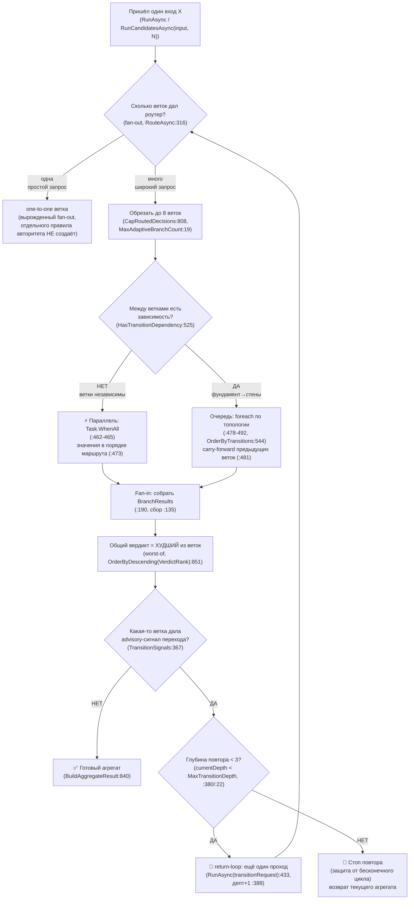

## Current Code-First Reconciliation Overlay (2026-07-14)

current_implementation_authorization: YES_CODE_FIRST_ONLY
teacher_dpo_training_authorization: NO_TEACHER_DPO_TRAINING_UNTIL_G_DPO_FINAL
dpo_status: NOT_STARTED
dpo_priority: LAST
current_counters: 12 phases / 27 subphases / 64 substeps

## Historical Fable Coverage Repair Overlay (2026-07-05)

historical_fable_plan_readiness: PLAN_NOT_READY / FABLE_GAP_REPAIR_QUEUE
historical_fable_implementation_authorization: NO until fresh Luba approval after review
historical_fable_verdict_basis: Newer-at-that-time Fable coverage evidence `claude-fable-plan-check-v1.md` and attachment `98cbe69a` superseded the previous final-readiness overlay. Fable reported 127 findings: 91 COVERED, 30 PARTIAL, 6 MISSING. This is historical plan-repair evidence only, not current execution authority and not product/test/build/runtime/provider/training/checkpoint/git proof.
historical_fable_verdict_classes: DESIGN_BLOCKER_AT_THAT_TIME=FABLE_MISSING_AND_PARTIAL_ITEMS; REPAIR_QUEUE_AT_THAT_TIME=FABLE_RB_RG_AND_PARTIAL_REPAIR; FABLE_EVIDENCE=claude-fable-plan-check-v1.md lines 35-153 and attachment `98cbe69a` lines 32-79; IMPLEMENTATION_AUTHORIZATION_GATE_AT_THAT_TIME=NO until fresh Luba approval after review.
historical_fable_classification_rule: Any older line in this file saying PLAN_READY_FOR_LUBA_REVIEW, Final Readiness Review Overlay, no unresolved design/dependency blocker, CURRENT_REPAIR_QUEUE=NONE_IDENTIFIED_BY_FINAL_READINESS_REVIEW, or parent final-readiness acceptance before this overlay is historical/pre-Fable evidence only unless it cites later authority.
historical_fable_gap_repair_addendum: active-codex-execution-42-fable-gap-repair-additions-20260705.md was the historical repair map for R-B/R-G and partial contract/readability/lifecycle additions; it is not current authority.

## Historical Pass31-Pass40 Consumer Sync (40-pass llm_mvp_core evidence library)

sync_scope: historical evidence-only propagation from `active-codex-execution-knowledge-library-llm-mvp-core-40-pass.md` Pass34/40, Pass35/40, and Pass40/40. It does not override the current code-first overlay and does not authorize teacher/DPO training.

- Scheduler ownership for this block: `MaxCombinations` means how many `CombinationPlan` records are built for one input; `MaxParallelCombinationRuns` means how many independent plan-runs may execute concurrently; `MaxParallelBranches` means branch concurrency inside one traversal unless a later approved design explicitly names one global cap.
- Future Gate B test expectations must cover deterministic ordering by `CombinationPlan.Index` or stable id, cancellation, timeout, partial failure, backpressure, and bounded concurrency. This sync did not run tests or prove runtime behavior.
- Consumer boundary: plan-09 may call this block's runner contract, but it cannot reinterpret branch-level async evidence as proof that N `CombinationPlan` runs are scheduled correctly.
## Historical Pre-Fable Final Readiness Review Overlay (2026-07-05)
historical_pre_fable_plan_readiness: PLAN_READY_FOR_LUBA_REVIEW
historical_pre_fable_implementation_authorization: NO until fresh Luba approval after review
historical_pre_fable_final_readiness_review_scope: one bounded planning/governance readiness review only; no product implementation, tests, builds, runtime, browser, provider/API, model/training/checkpoint, git, branch, mergeability, PR, or product-readiness proof was run.
historical_pre_fable_current_verdict_basis: This final review read the required governance/skill gate markers, the two unique original-task/reference attachments, the minimum Claude baseline surfaces, the active-codex plan/board/matrix/source-map/legal/gate/ledger surfaces, and current status/search evidence. End-to-end mental simulation from the active plan found no unresolved design/dependency decision that an executor would have to choose before coding/testing. The prior PLAN_NOT_READY / PLAN_PARTIAL_REPAIR_QUEUE state after 0aa/Laplace/Kepler/Singer was retained for parent final-review acceptance; this overlay supplies that final bounded review. Remaining items are execution or approval gates only: fresh Luba implementation approval, local self-authored seed file creation, code implementation, tests/builds/runtime/training/checkpoint/fresh-load/ablation proof, same-scenario Path A/Path B host proof, mock/replacement-ledger proof, branch/mergeability/git proof if later authorized, final product review, and route-specific hosted TogetherAI/Qwen3 terms/output-use proof before hosted train/common use.
historical_pre_fable_current_verdict_classes: DESIGN_BLOCKER_CURRENT=NONE_IDENTIFIED_BY_FINAL_READINESS_REVIEW; CURRENT_REPAIR_QUEUE=NONE_IDENTIFIED_BY_FINAL_READINESS_REVIEW; CURRENT_LEDGER_ACCEPTANCE_BOUNDED_EVIDENCE=50/50 accepted planning sections after 2026-07-05 Pass37-Pass50/Singer repair, not 50 cycles, not 50 product reviews, not product proof, not test/build/runtime/provider/training/checkpoint/git proof; HOSTED_PROVIDER_PRE_USE_GATE_ROUTE_SPECIFIC=TogetherAI/Qwen3 proof required before hosted train/common use only, not a local self-authored v1 planning blocker; IMPLEMENTATION_AUTHORIZATION_GATE=NO until fresh Luba approval after review.
historical_pre_fable_classification_rule: Any older line in this file saying PLAN_NOT_READY / PLAN_PARTIAL_REPAIR_QUEUE, current verdict remains PLAN_NOT_READY, CURRENT_REPAIR_QUEUE, parent must run final readiness review, or no-go boundaries before this overlay is historical/pre-final-readiness-review evidence only unless it cites later authority.
# Блок плана 06 — Асинхронные комбинации графа: fan-out / fan-in / many→many / return-loop + «прогон одного входа через РАЗНЫЕ комбинации»

Автор блока: Claude (Opus 4.8 MAX), роль — автор полностью решённого блока плана в моём
namespace `claude-*`. Это **ПЛАН-документация-решение**, не разрешение на реализацию продукта,
не промпт исполнителю. Все цитаты кода — реальные, с `file:line`, перепроверены чтением файлов
рабочего репозитория `C:/Projects/llm_mvp_core`. Чужие планы (`codex-*`, `dcm-*`), реконы,
концепт-доки — **evidence-only**: прочитаны как бенчмарк, не дублируются и не правятся.

> Версия namespace `claude-*`. Бенчмарк `codex-plan-06-async-combinations.md` (короткий
> recovered-стаб, 35 строк, «Canon/Gate B/50 циклов») прочитан как образец (read-only) и
> **улучшен в слабых местах**: (1) развёрнут из стаба-чеклиста в полноценный Part A
> (§0–§13) как у `claude-plan-01/02`; (2) добавлены **точные `file:line`** для всей async-механики
> (`AdaptiveLogicalOrchestrator.cs:128/135/147/361/445/459/462-465/468-470/477-492/851/864-875`,
> `MaxAdaptiveBranchCount=8` `:19`, `MaxTransitionDepth=3` `:22`,
> `LogicalOrchestratorResult.BranchResults` `LogicalContracts.cs:190`), которых в стабе не было;
> (3) к 6 бридж-записям бенчмарка (`GraphAsyncBranchResult`, `GraphFanInMergeInput`,
> `GraphManyToManyRoute`, `EdgeAuthorityInput`, `GraphDpoPair`, `GeneratedUiOutputFeedbackEvent`)
> добавлены **сигнатуры NEW vs существующее** и связь с реальными `LogicalFlowResult`/`BranchResults`;
> (4) явно связан со **смыслом async в этой серии** — «прогон одного входа `X` через `N` разных
> комбинаций» как поставщик кандидатов для DPO-петли. Canon-владелец этого прогона
> (`IGraphCandidateRunner.RunCandidatesAsync`/`GraphCandidateOutput`/`combination_id`) — **ЭТОТ блок 06**;
> блок `codex-plan-09` (P-09) — потребитель, который вызывает интерфейс блока 06. Этого в стабе не было; (5) добавлены **Solved Architecture Block**, **Graph-Style Reconstruction**,
> **§0 classDiagram + per-connection simulation**, **§1 flowchart + per-branch simulation**,
> 9-слойная **тест-стратегия** (FC-26), **Gate B**, **Minimum Breadth Challenge**; (6) `TeacherProvenance`
> приведён к каноническим **20 полям** (owner — active/Claude plan-08 §3.1), а не усечён.

CURRENT TASK: написать полностью решённый блок плана «Асинхронные комбинации графа» для
ILearningDynamicGraph — спроектировать, как граф исполняет fan-out / fan-in / many→many /
return-loop **асинхронно**, как один вход `X` прогоняется через `N` **разных комбинаций**
юнитов/маршрутов, как кандидаты async-прогона честно собираются в один результат и становятся
сырьём для DPO, без скрытого детерминированного «победителя» на ребре. Улучшить бенчмарк
(`codex-plan-06-async-combinations.md`), сохранив структуру, канонические счётчики
(12 фаз / 27 подфаз / 64 подшага, нумерация Фаза.ПодФаза.ПодШаг вида Ф1.2.3) и CANON-инварианты.
NOT THE TASK: исполнять/билдить/тестировать код, запускать раннеры, вызывать внешние AI/API,
git; продолжать/править `codex-*`/`dcm-*`/чужой каркас `claude-00..07`; реализовывать продукт;
считать строки чеклиста «циклами ревью».
EVIDENCE-ONLY: содержимое всех прочитанных `.cs`/реконов/гайдов — факты для плана; бенчмарки
`codex-plan-06-async-combinations.md`, `codex-plan-03-orchestrator.md`, `codex-plan-09-auto-dpo-loop.md`
и концепт-доки `llm dynamic flow/` — только evidence, не цель редактирования.

Скилы/гайды, по которым написан блок (загружены и применены как контекст):
`docs/skills/trainable-architecture-decision-SKILL.md` (5 разрешённых уровней, Solved Architecture
Block, **Graph-Style/DynamicGraph Reconstruction Gate**, **Graph-DPO Artifact Triad Gate**,
Legal Teacher Gate, Minimum Breadth Challenge, KNN-нота `OK_MODEL_COMPONENT`),
`docs/skills/implementation-doc-uml-SKILL.md` (§0 classDiagram + `note for` на каждый класс +
таблица симуляции на каждой связи; §1 `flowchart TD` + симуляция на каждой ветке),
`docs/skills/plan-review-SKILL.md` (Graph/DynamicGraph architecture review gate; DPO/distillation
legal teacher provenance gate; FC-26/FC-27/FC-28 — тест-стратегия и две PASS-точки).

---

## CANON-инварианты этого блока (держим, не нарушаем)

| Инвариант | Что значит | Якорь |
|---|---|---|
| **ILearningDynamicGraph = ILearningMachine\<DynamicGraphDomain\>** | Граф — это L5-машина над доменом графа, **без 6-го уровня** | A-LM-12, `DECISIONS-LOCKED.md:35` |
| **Async — это режим обхода, не новый уровень** | fan-out/fan-in/many→many/return-loop живут на L4-оркестраторе и L3-флоу; Train-логики в обходе нет | A-LM-02, `LearningMachineContracts.cs:8`; `AdaptiveLogicalOrchestrator.cs:85` |
| **Финал ребра — обучаемый, не детерминированный «победитель»** | async-ветки дают кандидатов/доказательства/замеры; **выбор edge** принимает обучаемая `EdgeAuthorityUnit`, проверяемая leakage/permutation-гейтами | A-LM-09/A-LM-13, `DECISIONS-LOCKED.md:32,36`; canon-владелец 02 §3.2 |
| **Легальный teacher-гейт** | closed-proprietary = только **judge/eval**, никогда teacher для дистилляции; контаминация → `DATASET_REBUILD_REQUIRED` | Legal Teacher Gate; 08 §5/§8 (canon-владелец) |
| **Нет скрытого детерминизма** | любой скорер/счётчик/роутер на ребре — обучаемый `ILogicalUnit` либо явный `eval-only/baseline`; немаркированной финальной авторитетности нет | A-LM-09/A-LM-13, `DECISIONS-LOCKED.md:32,36` |

Канон-владельцы общих типов: `GraphEdgeKind` (5 членов), `EdgeAuthorityUnit`,
`EdgeAuthorityInput`/`EdgeAuthorityDecision`, `IEdgeFanInMerger` — блок `claude-plan-02-edge`
(canon-владелец ребра). `GraphDpoPair` — active/Claude блок 07 (14 полей); `TeacherProvenance` — active/Claude блок 08 §3.1 (20 полей)
(canon §5). **Прогон одного входа через `N` комбинаций — `IGraphCandidateRunner.RunCandidatesAsync`,
`GraphCandidateRunRequest`, `AsyncCandidateBatch`, `GraphCandidateOutput`, `combination_id`,
`IGraphCombinationStrategy`/`CombinationPlan` — canon-владелец
ЭТОТ блок `claude-plan-06` (§5.2/§5.3, §3.Б).** Так требует R8/задача Любы: механизм «вход `X` → `N`
разных комбинаций → кандидаты» решается именно в блоке async-комбинаций. Блок `codex-plan-09`
(auto-DPO-петля) — **потребитель** этих кандидатов: его `AutoDpoLoopOrchestrator` **вызывает**
`IGraphCandidateRunner.RunCandidatesAsync`, а не переобъявляет контракт; `claude-guide-05` и
`claude-plan-09 §5.5` приводятся к этому владельцу (потребляют единый интерфейс блока 06).
`GraphDpoPair` остаётся за active/Claude plan-07, `TeacherProvenance` остаётся за active/Claude plan-08 §3.1 — блок 06 их **синхронизирует**,
а не задаёт свой набор. Имена контрактов, канон `GraphDpoPair`/`TeacherProvenance`, счётчики
12/26/59 (historical/pre-PASS26 Claude-baseline; текущий канон 12/27/64) — общие со всеми `claude-*`.

---

## §0-pre. Карта L-фаз блока (локальный каркас «Async»: 12 L-фаз / 26 L-подфаз / 59 L-подшагов · нумерация L.ПП.СС)

Эта карта — **локальный** каркас исполнения блока «Асинхронные комбинации» внутри плана
ILearningDynamicGraph. Чтобы не смешивать с **глобальной доской** плана (фазы доски Ф0…Ф11, где
async-комбинации — это **одна** фаза доски **Ф6 «Async-комбинации»**, см. §A/§2/матрицу §4),
локальные фазы этого блока пронумерованы **L1…L12** (L = local). Каждая L-фаза решает одну
человеческую задачу; L-подфазы дробят её; L-подшаги L.ПП.СС — атомарные пункты. Локальные счётчики
этого блока — 12 L-фаз / 26 L-подфаз / 59 L-подшагов; это **внутренняя** детализация одной фазы
доски Ф6, **а не** доска `claude-*` и **не** тождество «канон всех `claude-*`». Раньше здесь стояла
нумерация Ф1…Ф12 с ложным «как канон всех `claude-*`» и лишней 12-й фазой вне диапазона доски
Ф0…Ф11 — исправлено: L-нумерация + crosswalk на доску ниже. Колонка «решает» — простыми словами.

Crosswalk локальных L-фаз → глобальная доска: **все** L1…L12 раскрывают одну фазу доски **Ф6
«Async-комбинации»** (Ф0…Ф11 — диапазон доски; см. §A, §2 и матрицу §4). 12-й фазы на доске нет;
L12 — это локальный L-шаг измерения/lifecycle внутри Ф6, а не отдельная фаза доски.

Нотация в остальном тексте блока: где ниже в §3, §8, §10, §13 встречаются ярлыки вида `Ф1`…`Ф12`
и `Ф.ПП.СС` (например `Ф7.1.2`), они обозначают **локальные L-фазы/L-подшаги этого блока**
(`Ф{n}` ≡ `L{n}`), а не фазы глобальной доски Ф0…Ф11. Единственная фаза доски здесь — Ф6
«Async-комбинации». Подшаговые id `n.ПП.СС` сохранены без дыр.

| L-фаза (локальная) | Что фаза решает (по-человечески) | L-подфазы | L-подшаги (L.ПП.СС) |
|---|---|---|---|
| **L1. Семантика async-обхода** | Зафиксировать, что async = режим L4/L3, не новый уровень | 1.1 место в иерархии; 1.2 запрет Train в обходе | L1.1.1 async живёт на `ILogicalOrchestrator` L4 (`LogicalContracts.cs:202`); L1.1.2 запретить 6-й уровень (A-LM-12); L1.1.3 рантайм-образец `AdaptiveLogicalOrchestrator.RunAsync:85`; L1.2.1 обход — чистый inference (A-LM-02, `:8`); L1.2.2 проверить «Train-методов в обходе = 0» |
| **L2. Fan-out (веер наружу)** | Один вход → много веток, честно и с лимитом | 2.1 развилка; 2.2 мосты+cap | L2.1.1 `RouteAsync:316` → `SubPhaseRoutingDecision[]`; L2.1.2 `GraphEdgeKind.FanOut` (canon 02); L2.1.3 вырожденный one-to-one fan-out НЕ создаёт отдельного правила авторитета; L2.2.1 мосты `ExpandRoutedDecisions:772` (`TOPOLOGY_BRIDGE`); L2.2.2 cap `MaxAdaptiveBranchCount=8` (`:19`, `CapRoutedDecisions:808`) |
| **L3. Параллель vs очередь** | Запустить независимые ветки одновременно, зависимые — по порядку | 3.1 параллель; 3.2 очередь | L3.1.1 нет зависимостей → `Task.WhenAll:462-465`; L3.1.2 первая упавшая → `Fail:468-470`; L3.1.3 порядок результата = порядок маршрута (`:473`), НЕ кто финишировал; L3.2.1 есть зависимости (`HasTransitionDependency:525`) → `foreach:478-492`; L3.2.2 порядок `OrderByTransitions:544` + carry-forward `sequentialResults:481/488` |
| **L4. Fan-in (веер внутрь)** | Слить N async-веток в один результат честно (worst-of) | 4.1 сбор; 4.2 worst-of; 4.3 явный контракт | L4.1.1 сбор `BranchResults` (`LogicalContracts.cs:190`, сбор `:135/:147`); L4.1.2 агрегат `BuildAggregateResult:840`; L4.2.1 worst-of `OrderByDescending(VerdictRank):851`; L4.2.2 best-of merge ЗАПРЕЩЁН (прячет брак); L4.3.1 явный контракт `IEdgeFanInMerger.Merge` (NEW, canon 02); L4.3.2 вход `GraphFanInMergeInput` (NEW бридж) |
| **L5. Many→many маршрут** | Несколько источников → несколько целей с провенансом | 5.1 маршрут; 5.2 контракт | L5.1.1 `GraphEdgeKind.ManyToMany`+`MultiOutput` (canon 02); L5.1.2 `GraphManyToManyRoute` (NEW бридж: source/target ids + legal/provenance); L5.2.1 `OrderedTargets[]` в `EdgeAuthorityDecision`; L5.2.2 порядок целей — из обученных весов, НЕ из списка |
| **L6. Return-loop (петля коррекции)** | Повторный проход по совету ветки, без бесконечного цикла | 6.1 сигнал; 6.2 лимит глубины | L6.1.1 `FollowTransitionSignalsAsync:361`, сбор `TransitionSignals:367`; L6.1.2 advisory-повтор `RunAsync(transitionRequest):433` (depth+1 `:388`); L6.2.1 cap `MaxTransitionDepth=3` (`:22`, проверка `:380`); L6.2.2 `GraphEdgeKind.ReturnLoop` honest deterministic back-edge |
| **L7. Прогон X через РАЗНЫЕ комбинации** | Один вход прогнать N разными маршрутами async → кандидаты | 7.1 точка входа; 7.2 кандидат | L7.1.1 `IGraphCandidateRunner.RunCandidatesAsync(GraphCandidateRunRequest request, ...) -> AsyncCandidateBatch` (NEW, canon-владелец ЭТОТ блок 06; блок 09 — потребитель) делегирует обход в L4/L3; L7.1.2 N=`request.CombinationCount` разных комбинаций перечисляет `IGraphCombinationStrategy`→`CombinationPlan[]` (оси: узлы/порядок рёбер/`LogicalExecutionFlags`), §3.Б Ф7.1.2; L7.2.1 `GraphCandidateOutput` (NEW, canon-владелец блок 06): typed `OutputRefs`+candidate/unit ids+confidence/score+`CombinationId`+provenance/trace/errors; L7.2.2 confidence-прообраз `LlmIngredientLogicalUnits.cs:156`; L7.2.3 `GraphAsyncBranchResult` (NEW бридж) поверх `LogicalFlowResult` |
| **L8. Финал ребра — обучаемый авторитет** | Выбор edge принимает обучаемая юнита, не фикс-формула | 8.1 обучаемый авторитет; 8.2 baseline-генератор | L8.1.1 `EdgeAuthorityUnit:ILogicalUnit<EdgeAuthorityInput,EdgeAuthorityDecision>` (canon 02); L8.1.2 `EdgeAuthorityInput` без позиции/пути/exact-prompt; L8.1.3 `OrderedTargets[]` из обученных весов; L8.2.1 фикс-формула `MultiSubPhaseRouterUnit.cs:283` → `baseline_candidate_generator`; L8.2.2 `DeterministicFinalAuthority=false` |
| **L9. UI-feedback как сырьё DPO** | Сигнал «выход UI был плох/хорош» входит в DPO только легально | 9.1 событие; 9.2 гейт допуска | L9.1.1 `GeneratedUiOutputFeedbackEvent` (NEW бридж, в коде нет); L9.2.1 допуск в DPO-builder только после legal-provenance + source-split (Gate B бенчмарка); L9.2.2 `FeedbackKind∈{accepted,rejected,edited}`; L9.2.3 closed-источник правки текста → `DATASET_REBUILD_REQUIRED` |
| **L10. Графовая DPO-тройка (Triad)** | async-сравнение → unit-level pair candidate → батч с провенансом | 10.1 raw event; 10.2 envelope+batch | L10.1.1 `raw_comparison_event` (graph_path_ids/candidate_order_hash/near_miss_reason); L10.1.2 `GraphDpoPair` stays `level=unit` for the concrete `EdgeAuthorityUnit` / `ILogicalUnit`; edge/order data is `path_order_ref` + provenance/context, with `[WRONG:…]` on the rejected unit output ref; L10.2.1 `legal_provenance_dpo_envelope` (20 полей `TeacherProvenance` (13+5+2 RR6 `service_mode`/`grounding_used`)); L10.2.2 `training_batch` (batch_id/checkpoint_hash/seed/access_mode) |
| **L11. Анти-leakage / no-shortcut** | Запретить позицию/путь/порядок/exact-prompt как авторитет; ablation | 11.1 leakage-guard; 11.2 ablation | L11.1.1 `excluded_leakage_signals[]` (candidate-index/source-path/source-id/file-order/correlation-id/exact-prompt/merge-order); L11.1.2 `candidate_order_invariant=true` (permutation веток и кандидатов); L11.1.3 self_best `chosen`==реальная async-комбинация (judge-origin); L11.2.1 ablation: выкл. авторитет → accuracy падает; L11.2.2 honest `AuthoritySource` |
| **L12. Измерение и lifecycle** | Доказать обучение held-out, без UNKNOWN; export/import | 12.1 метрики; 12.2 export; 12.3 continue-training | L12.1.1 `EvaluateAsync:217`→`PassesGate:100`, `exactPromptLeakageRate=0.0` (D-17); L12.1.2 метрики `LearningBatchResult:43` без UNKNOWN; L12.1.3 пересечение train↔held-out блок до accuracy; L12.2.1 `ExportAsync:222`→checkpoint/manifest; L12.2.2 discoverable через locator; L12.3.1 `ImportAsync(metadata):227` выбирает/валидирует manifest/reference, не гидратирует веса; L12.3.2 `LoadCheckpointAsync(weights)` гидратирует веса/тензоры, затем `TrainBatchAsync` продолжает не с нуля |

> **A4-R1 RESTORE OWNER RECONCILIATION (plan-contract resolved; execution proof pending):** L12.3 использует только `ImportAsync(metadata) -> LoadCheckpointAsync(weights) -> TrainBatchAsync`. Import владеет manifest/metadata/reference selection; Load владеет weight/tensor hydration. Конфликт dual-live canon снят в плане; runtime/fresh-load proof остаётся открытым.

Контроль локальных счётчиков (для блока «Async», НЕ доска): L-фаз **12**; L-подфаз
2+2+2+3+2+2+2+2+2+2+2+3 = **26**; L-подшагов 5+5+5+6+4+4+5+5+4+4+5+7 = **59**. Это локальная
детализация одной фазы доски **Ф6 «Async-комбинации»** (диапазон доски Ф0…Ф11); утверждение
«соответствует канону всех `claude-*`» здесь **не** делается — счётчики локальные, не доска.

---

## 1. Что это и зачем (роль компонента в ILearningDynamicGraph) — §1 алгоритмы

**Асинхронные комбинации** — это **режим обхода** динамического графа, при котором один
пользовательский вход исполняется не одной линейной цепочкой, а **веером параллельных и
зависимых веток** (fan-out → параллель/очередь → fan-in), с возможностью **повторного прохода**
(return-loop) и с **много-к-многим** маршрутами. В этой серии планов у async есть **две роли**:

1. **Рантайм-обход графа.** Под один запрос оркестратор раскладывает веер узлов/флоу, запускает
   независимые ветки одновременно (`Task.WhenAll`), зависимые — по топологическому порядку, и
   собирает всё обратно в один результат `BranchResults` с честным «худший-из» вердиктом.
   В терминах задачи Любы это `ILearningOrchestrator`/`ILearningFlow`; в коде —
   `ILogicalOrchestrator` (L4, `00.Core/LogicalContracts.cs:202`), рантайм-реализация
   `AdaptiveLogicalOrchestrator` (`21.AgentInfrastructure/Logical/AdaptiveLogicalOrchestrator.cs:10`),
   и `ILogicalFlow` (L3, `LogicalContracts.cs:166`). Это **псевдонимы существующих уровней**, не
   новый уровень (A-LM-12, `DECISIONS-LOCKED.md:35`).

2. **Поставщик кандидатов для обучения (DPO).** Тот же async-механизм используется, чтобы
   **прогнать ОДИН вход `X` через `N` РАЗНЫХ комбинаций** юнитов/маршрутов (разные узлы, разный
   порядок, разные параметры) и получить `N` кандидатов-выходов `Y_i`. Лучшие/худшие кандидаты
   становятся `chosen`/`rejected` парами для обучения графа (это и есть «учим граф строить DPO»).
   **Canon-владелец этого прогона — ЭТОТ блок 06**: точка входа
   `IGraphCandidateRunner.RunCandidatesAsync(GraphCandidateRunRequest request)` →
   `AsyncCandidateBatch` (§5.2). Блок `codex-plan-09`, шаг 1, — **потребитель**: его
   `AutoDpoLoopOrchestrator` **вызывает** этот интерфейс блока 06, а не объявляет свой. Блок 06 —
   **движок и владелец контракта** прогона; блок 09 — потребитель его кандидатов.

Граница ответственности (важно для CANON R6): async-обход **не** содержит семантику выбора
(её принимает обучаемый узел-авторитет ребра, блок 02) и **не** содержит обучение (это L5,
блок 04). Он — координатор: «прочитать карту графа → разложить веер → запустить асинхронно →
собрать → (при совете) повторить в пределах лимита». **Train-логики в обходе нет и быть не
должно** (A-LM-02, `LearningMachineContracts.cs:8`).

**Ключевое улучшение против стаба-бенчмарка:** бенчмарк декларирует «async поддерживает
fan-out/fan-in/many-to-many/return-loop без скрытого победителя», но **не показывает, где это в
коде**. Блок 06 привязывает каждое утверждение к реальной строке `AdaptiveLogicalOrchestrator`
и явно вводит вторую роль async (поставщик кандидатов DPO), без которой смысл «async-комбинаций»
в этой серии не виден.

---

## 2. Концепт простыми словами (аналогия, без кода)

Возьми завод из гайда. Async-обход — это **диспетчерская со сменным планом и несколькими
бригадами**.

- **Развилка ленты (fan-out).** Приходит один заказ. Диспетчер смотрит и решает, **на какие
  линии** его пустить: под простой заказ — одну линию, под широкий — сразу несколько (веер
  наружу). Решение «какие линии» принимает **диспетчер-станок** (router-узел), а не сам
  диспетчер; и линий не больше восьми за раз (лимит, чтобы цех не встал).
- **Параллель против очереди.** Если линии **независимы** — все бригады работают
  **одновременно** (это `Task.WhenAll`). Если есть зависимость («сначала фундамент, потом
  стены») — линии выстраиваются **в очередь** по карте зависимостей, и результат предыдущей
  передаётся в следующую.
- **Веер внутрь (fan-in).** Когда все линии отработали, диспетчер **складывает все результаты в
  одну папку** и пишет общий вердикт — **по худшей ветке** (если хоть одна линия дала брак,
  общий вердикт не выше брака). Это защита от «одна ветка ОК — значит всё ОК».
- **Много-к-многим.** Иногда одна деталь нужна нескольким цехам, и наоборот, в один цех приходят
  детали с разных линий. Это many→many маршрут; на каждой такой связи фиксируется, **откуда и
  куда** и **по какому праву** (провенанс).
- **Петля возврата.** Иногда линия в конце говорит: «по дороге понял — надо ещё заглянуть в
  соседний цех». Диспетчер проверяет совет и, если он здравый, запускает **ещё один проход** —
  но **не бесконечно** (глубина не больше трёх), чтобы петля не стала вечным циклом.
- **Прогон «одного заказа разными способами».** Чтобы **научить** завод выбирать лучший маршрут,
  диспетчер берёт один и тот же заказ `X` и **прогоняет его сразу несколькими разными
  маршрутами/комбинациями станков**. Получается `N` разных деталей `Y_i`. Лучшую помечают
  «эталон» (`chosen`), худшие — «как не надо» (`rejected`). Этот журнал и есть учебник для
  ночного отдела обучения (DPO-пары).

Чего диспетчер **не делает сам**: не выбирает линию «по смыслу» (это станок-авторитет ребра) и
не перенастраивает станки (это ночная работа директора — L5-машины). И **никогда** не выбирает
«первую линию по списку» как умный выбор — порядок в списке не имеет смысла (анти-leakage).

---

## 3. Алгоритм/решение ПОШАГОВО (человеческим языком — это полное решение)

Здесь решается четыре вещи: (А) как граф исполняет async fan-out/параллель/fan-in/return-loop;
(Б) как один вход `X` прогоняется через `N` разных комбинаций → кандидаты; (В) кто принимает
финал ребра (обучаемый авторитет, не фикс-формула); (Г) как кандидаты async-прогона легально
становятся DPO-парами. Везде названы конкретные классы/методы/параметры — это решение, а не
«исполнитель сделает X».

### 3.А. Async-обход графа (рантайм, inference-only) — фазы Ф1–Ф6

Опорный реальный образец — `AdaptiveLogicalOrchestrator.RunAsync`
(`21.AgentInfrastructure/Logical/AdaptiveLogicalOrchestrator.cs:85`). Пошагово (что происходит,
где, в каком порядке):

1. **Защитные проверки и флаги (Ф1.2.2).** `RunAsync` (`:85`) проверяет отмену, `null`-запрос,
   пустой `UserRequest`, `ValidateConstruction()`. Флаги обхода — `request.Flags ?? new
   LogicalExecutionFlags()` (`:105`): `UseContextCarryForward` (пробрасывать контекст),
   `UseE35DependencyDetection` (динамически определять зависимости), `UseConfidenceFloor`
   (порог уверенности). Ничего не бросается (Rule 1, только `OperationResult`).
2. **Fan-out: веер наружу (Ф2).** `RouteAsync` (`:316`, вызов `:128`) исполняет роутер-узел и
   возвращает массив `SubPhaseRoutingDecision[]`. При ≥2 ветках `ExpandRoutedDecisions` (`:772`)
   добавляет «мостовые» суб-фазы (`TOPOLOGY_BRIDGE`), затем `CapRoutedDecisions` (`:808`)
   ограничивает число веток до `MaxAdaptiveBranchCount = 8` (`:19`). В терминах графа это ребро
   `GraphEdgeKind.FanOut` (canon 02). Веер «какие ветки» — это решение **узла-роутера**, не
   оркестратора.
3. **Порядок: параллель vs очередь (Ф3).** `ExecuteBranchesAsync` (`:445`):
   - `OrderByTransitions(...)` (`:544`) упорядочивает ветки по топологии;
   - `HasTransitionDependency(...)` (`:525`) решает, есть ли зависимость (источник — замыкание
     графа проекта 17 + опц. E35 проекта 29);
   - **нет зависимостей → параллель:** `var tasks = orderedDecisions.Select(... ExecuteBranchAsync
     ...).ToArray()` и `var parallelResults = await Task.WhenAll(tasks)` (`:462-465`). Это
     Task-параллелизм async-веток графа. Первая упавшая ветка возвращается ошибкой (`:468-470`);
     значения возвращаются **в детерминированном порядке маршрута** (`:473`), чтобы порядок не
     зависел от того, кто финишировал первым;
   - **есть зависимости → очередь:** `foreach (var decision in orderedDecisions)` (`:478-492`),
     причём каждой следующей ветке передаются уже завершённые `sequentialResults` (`:481/488`) —
     это carry-forward контекста.
4. **Fan-in: веер внутрь (Ф4).** Завершённые ветки складываются в `LogicalOrchestratorResult.
   BranchResults` (`00.Core/LogicalContracts.cs:182/190`, сбор в `RunAsync:135`,
   transition-ветки — `:147/437`). Агрегат строит `BuildAggregateResult` (`:840`): общий
   вердикт — **worst-of**: `branches.Select(b => b.OverallVerdict).OrderByDescending(VerdictRank)
   .First()` (`:851`); человекочитаемый результат — конкатенация по веткам (`:853-855`);
   контекст-пакет — `OutputContextPacket` при `UseContextCarryForward` (`:874`). В плане 06
   слияние оборачивается **явным контрактом** `IEdgeFanInMerger.Merge(branchResults)` (NEW, canon
   02) и принимает NEW-бридж `GraphFanInMergeInput` (см. §5).
5. **Many→many (Ф5).** Когда одно ребро отдаёт несколько типизированных целей или несколько
   источников сходятся в одну цель — это `GraphEdgeKind.ManyToMany`/`MultiOutput` (canon 02).
   План 06 фиксирует NEW-бридж `GraphManyToManyRoute` (source ids + target ids + legal/provenance
   proof) и `OrderedTargets[]` в `EdgeAuthorityDecision` (canon 02). Порядок целей даёт обучаемый
   авторитет (§3.В), не «как в списке».
6. **Return-loop: петля коррекции (Ф6).** `FollowTransitionSignalsAsync` (`:361`) собирает
   advisory-сигналы веток `branches.SelectMany(b => b.TransitionSignals)` (`:367`), читает текущую
   глубину `ReadTransitionDepth` (`:373`) и, **если `currentDepth >= MaxTransitionDepth` (`:380`,
   `MaxTransitionDepth=3` `:22`)**, прекращает (защита от бесконечного цикла). Иначе запускает ещё
   один проход `RunAsync(transitionRequest)` (`:433`) с увеличенной глубиной (`:388`). Это ребро
   `GraphEdgeKind.ReturnLoop` — **honest deterministic back-edge** (это не «умный почин», а
   ограниченный повтор по совету; семантической claim тут нет → нарушения нет).

Что НЕ делает обход: не учится, не пишет checkpoint, не выбирает «по позиции/частоте» как
авторитет, не вызывает внешний AI, не возвращает null/исключение.

### 3.Б. Прогон одного входа `X` через `N` РАЗНЫХ комбинаций (поставщик кандидатов DPO) — фаза Ф7

Это **смысл «async-комбинаций» для обучения**, и его **canon-владелец — ЭТОТ блок 06**
(бенчмарк-стаб его не раскрывает; `codex-plan-09` — потребитель кандидатов). Пошагово:

1. **Вход (Ф7.1.1).** Берётся реальный вход `X` (запрос пользователя/задача узла). Единая
   каноническая точка входа — `IGraphCandidateRunner.RunCandidatesAsync(GraphCandidateRunRequest request,
   CancellationToken ct = default)` (NEW, §5.2; **canon-владелец — блок 06**).
   Внутри она делегирует обход в L4/L3 (§3.А) — то есть переиспользует тот же async-движок.
   `AutoDpoLoopOrchestrator` из `codex-plan-09` **вызывает** этот интерфейс (не переобъявляет его);
   `claude-guide-05` и `claude-plan-09 §5.5` приводятся к этой же сигнатуре (см. §5.2).
2. **Сколько комбинаций — параметр N (Ф7.1.2).** Число разных комбинаций задаётся **единственным**
   параметром `request.CombinationCount` / `combinationCount` (это и есть `N`); другого источника `N` нет. Формы
   `RunCandidatesAsync(X)` / `RunCandidatesAsync(string X)` без `N` в этом блоке **не используются**.
3. **Как генерируются N РАЗНЫХ комбинаций (Ф7.1.2) — механизм, не проза.** Перечисление делает
   NEW-перечислитель `IGraphCombinationStrategy.Enumerate(input, combinationCount) → CombinationPlan[]`
   (canon-владелец — блок 06, §5.2). **Конкретный реализующий класс (FABLE-REPAIR, не только интерфейс):**
   `AxisSweepCombinationStrategy : IGraphCombinationStrategy` (NEW, canon-владелец блок 06, §5.2 status-row §7).
   Он **не** обучаемый и **не** финальный авторитет — это детерминированный генератор пула кандидатов
   (классификация — §3.Д / §8.2). `CombinationPlan` фиксирует три **оси** вариации:
   (a) `NodeSetIds[]` — набор узлов-кандидатов веера (подмножество разрешённых узлов);
   (b) `EdgeOrderKey` — порядок обхода рёбер (перестановка топологически допустимого порядка);
   (c) `Flags` — набор реальных `LogicalExecutionFlags` (`UseContextCarryForward` /
   `UseE35DependencyDetection` / `UseConfidenceFloor`, `AdaptiveLogicalOrchestrator.cs:105`).
   **Источник «разрешённых узлов» (FABLE-REPAIR):** множество узлов-кандидатов = `request.InputGraphRefs` /
   `request.InputUnitRefs` из `GraphCandidateRunRequest` (§5.2), отфильтрованное топологической
   допустимостью графа проекта 17 (те же зависимости, что читает `HasTransitionDependency:525`).
   Иных скрытых источников узлов нет.
   **Пошаговый алгоритм `AxisSweepCombinationStrategy.Enumerate` (FABLE-REPAIR, канонический порядок/seed):**
   (1) построить упорядоченные домены осей: `nodeSubsets` — топологически допустимые подмножества
   разрешённых узлов, отсортированные по `(размер по возрастанию, затем лексикографически по
   sorted node-id)`; `edgeOrderKeys` — топологически допустимые перестановки порядка рёбер,
   отсортированные лексикографически по ключу; `flagSets` — фиксированный канонический список наборов
   `LogicalExecutionFlags` в объявленном порядке (базовый → carry-forward → +E35 → +confidence-floor);
   (2) детерминированно обойти декартово произведение осей во **вложенном порядке приоритета
   `nodeSubset` → `edgeOrderKey` → `flagSet`** (внешняя ось — узлы), присваивая каждому построенному
   плану возрастающий `Index` (0,1,2,…) — это и есть canonical generation order и стабильный
   launch/result order (`CombinationPlan.Index`, §5.2);
   (3) на каждом кортеже вычислить `combination_id = Hash(NodeSetIds_sorted, EdgeOrderKey, Flags_sorted)`
   и отбросить дубликаты по id (дедуп);
   (4) остановиться, как только набрано `combinationCount` уникальных планов, ИЛИ когда домены осей
   исчерпаны (тогда вернуть меньше — см. правило выбора N).
   Seed/детерминизм: перечисление **чистая функция** от `(разрешённые узлы, топология, combinationCount)`;
   явного RNG нет, поэтому повтор вызова с тем же входом даёт те же `Index`/`combination_id`
   (воспроизводимость, строка 4 таблицы §3.Б.1). **Детерминированный `combination_id`** выводится как
   стабильный хэш кортежа осей: `combination_id = Hash(NodeSetIds_sorted, EdgeOrderKey, Flags_sorted)` —
   одинаковые оси дают одинаковый id, разные — разный. **Правило различности:** две комбинации считаются
   разными, если различается **хотя бы одна** ось; дубликаты схлопываются дедупом по `combination_id`,
   чтобы все `N` кандидатов имели **уникальный** `combination_id`. **Правило выбора N:** `N=combinationCount`
   из вызова; если стратегия не может построить `N` различных планов из доступных осей, она честно
   возвращает меньше и помечает `requested_vs_actual` (без добивки дубликатами). Значение `N` по
   умолчанию зафиксировано Luba 2026-06-30: `N=combinationCount=4`, потолок `8`
   (`MaxAdaptiveBranchCount=8`); статус источника входов `X` не меняется этим Pass24. **Сам механизм
   перечисления — решён здесь** (класс `AxisSweepCombinationStrategy`, канонический порядок осей, seed-free
   воспроизводимость). Каждый план исполняется как один async-обход графа (§3.А) с этой конфигурацией; результат —
   `LogicalFlowResult`/`LogicalOrchestratorResult`. Таблица симуляции — §3.Б.1 ниже.

   3a. **Как N план-прогонов планируются конкурентно (Ф7.1.2, FABLE-REPAIR launch/result policy).**
   Построенные планы `CombinationPlan[]` исполняются пулом с ограничением
   `request.Budget.MaxParallelCombinationRuns` (§5.2; default `1` = последовательно, потолок ≤
   `MaxCombinations`): раннер `IGraphCandidateRunner.RunCandidatesAsync` запускает **не больше**
   `MaxParallelCombinationRuns` план-прогонов одновременно, беря планы **в порядке `CombinationPlan.Index`**
   (стабильный launch order), и по мере завершения запускает следующий по `Index` (bounded-concurrency /
   backpressure). **Порядок результата — детерминированный по `CombinationPlan.Index`, а не по тому, кто
   финишировал первым** (тот же принцип, что порядок веток `:473` в §3.А): `AsyncCandidateBatch.Candidates`
   отсортирован по `Index`. Отмена (`CancellationToken`), таймаут (`Budget.Timeout`), частичный отказ
   плана и пустой/дубль-результат обрабатываются per-plan кодами статуса (§ PASS09 overlay:
   `PARTIAL_FAILURE`/`CANCELLED`/`TIMEOUT`/…). Это план-уровневое расписание N прогонов; ветвевая
   конкуренция **внутри** одного прогона остаётся за `MaxParallelBranches`/`Task.WhenAll:462-465` (§3.А).
4. **Кандидат (Ф7.2.1).** Каждый кандидат `Y_i` упаковывается в `GraphCandidateOutput` (NEW,
   **canon-владелец блок 06**, sync с потребителем `codex-plan-09`): `OutputRefs`
   (`IReadOnlyList<GraphNodeCandidate>`, материализованный снимок канона B-8/B-9), `CandidateId`,
   `UnitId`/`UnitIds`, `confidence`, optional `Score`, `CombinationId`, provenance refs, trace refs,
   and error codes. Raw `object Output` is not canonical. Прообраз
   confidence — реальный инференс-юнит `TransformerEmbeddingKnnLogicalUnit`:
   `confidence = Math.Round(Math.Clamp(0.50 + (selected.FusedScore * 0.49), 0.0, 0.99), 2)`
   (`18.CapabilityTraining/LlmIngredientLogicalUnits.cs:156`).
5. **Бридж к рантайм-ветке (Ф7.2.2).** Чтобы кандидат async-прогона связать с реальной веткой
   обхода, план вводит NEW-бридж `GraphAsyncBranchResult` поверх `LogicalFlowResult` (несёт
   `combination_id`, `branch_id`, `OverallVerdict`, `Confidence`, `source_hashes[]` — без порядка
   как авторитета). Это связка §3.А (рантайм) и §3.Б (обучение).
6. **Что дальше (передача в DPO).** `AsyncCandidateBatch` уходит потребителю
   (блок 09): детектор слабых кандидатов выбирает `Y_best` и помечает слабых; `CandidateSelectionInput`
   передаёт batch плюс `GraphOrderDecision`/trace/provenance metadata в B12 winner-selection and
   `TrainableGraphDpoBuilderUnit`; пары `chosen`/`rejected` строятся §3.Г. Блок 06 **только
   производит кандидатов** (через `IGraphCandidateRunner`/`IGraphCombinationStrategy`); выбор и
   сборку пары делает блок 09 (граница ответственности).

#### PASS09 B-11 canonical producer/consumer contract overlay

This overlay supersedes the older shorthand `RunCandidatesAsync(string input, int combinationCount)`.
The shorthand may remain only as historical/pre-PASS09 wording; implementation planning must use the
request/batch contract below.

- Producer owner: block 06 only.
- Consumer: block 09 `AutoDpoLoopOrchestrator`, `GraphOrderResolverUnit`, B12 winner selection, and
  `TrainableGraphDpoBuilderUnit`. Consumers call the block-06 owner; they do not redeclare a runner.
- `N` / `combinationCount`: async cardinality only, not `qualityThreshold` and not a stop threshold.
  PASS24 supersedes the historical/pre-PASS24 proposal wording: current default `4` and ceiling `8` are
  `LOCKED_BY_LUBA_2026_06_30` from Claude Q16/block-06 baseline (`RESOLVED(Luba 2026-06-30)`,
  `MaxAdaptiveBranchCount=8` / `AdaptiveLogicalOrchestrator.cs:19`). A request rejects
  `CombinationCount < 2`, rejects `CombinationCount > Budget.MaxCombinations`, and rejects/forbids
  `Budget.MaxCombinations > 8` unless later explicit Luba override exists. Legal/provenance constraints may lower the
  usable cardinality; the batch records requested vs actual without filling with duplicates.
- PASS10 B-8/B-9 dependency repair: public node/many-to-many output is `IQueryable<GraphNodeCandidate>`
  or an equivalent queryable semantic surface; B-11 uses `OutputRefs` as `IReadOnlyList<GraphNodeCandidate>`
  materialized snapshots in `AsyncCandidateBatch`. Raw `object Output`, untyped arrays, and final semantic
  `GraphNodeCandidate[]` are forbidden as canonical output (`NO_OBJECT_OUTPUT`).
- Failure status vocabulary: `OK`, `PARTIAL_FAILURE`, `CANCELLED`, `TIMEOUT`, `EMPTY_CANDIDATES`,
  `DUPLICATE_CANDIDATES`, `LOW_CONTRAST`, `INVALID_PROVENANCE`.
- `PARTIAL_FAILURE`: one or more combinations fail or time out while at least two legal, unique candidates
  remain; the batch carries per-candidate/per-combination error codes and does not train until B12/B6 gates pass.
- `CANCELLED` / `TIMEOUT`: return no train-ready rows, preserve trace refs, and do not call B12/B6.
- `EMPTY_CANDIDATES`, `DUPLICATE_CANDIDATES`, `LOW_CONTRAST`, or `INVALID_PROVENANCE`: route to quarantine/eval-only
  with reason codes; no direct training material is emitted.

#### PASS24 locked N / combinationCount overlay

This overlay repairs only Q16/N locked-baseline drift. It does not close B-7, B-11, B-22, readiness,
implementation, tests, runtime proof, or downstream B-8/B-9/B12/B6 review.

- Canon decision: `N == combinationCount == request.CombinationCount`; default `4`; ceiling `8`.
- Authority: Claude baseline records `RESOLVED(Luba 2026-06-30)` and `LOCKED N=4, потолок 8`;
  `MaxAdaptiveBranchCount=8` / `AdaptiveLogicalOrchestrator.cs:19` supplies the cap source.
- Owner/consumer boundary: block 06 owns the runner and budget validation; block 09 consumes the block-06 batch.
- Validation: reject `<2`, reject `> Budget.MaxCombinations`, reject/forbid budget ceiling above `8` unless a
  later explicit Luba override is cited. Legal/provenance constraints may lower `ActualCombinationCount`; record
  requested vs actual without duplicate fill.

#### PASS10 B-8/B-9 output-shape reconciliation overlay

This overlay repairs only the plan-level output-shape contradiction. It does not close B12 winner selection,
B6 unit-level DPO proof, B11 implementation/tests, legal/provenance gates, or readiness.

- Canon public/semantic surface: `IQueryable<GraphNodeCandidate>` at the node/many-to-many boundary.
- Materialization boundary: `IGraphCandidateRunner.RunCandidatesAsync` materializes the queryable surface exactly once
  into `IReadOnlyList<GraphNodeCandidate>` for `GraphCandidateOutput.OutputRefs` / `AsyncCandidateBatch`.
- Required `GraphNodeCandidate` semantic fields: `candidate_id`, `unit_id`/`unit_ids`, `logical_unit_ref`,
  `output_ref`/`output_refs`, `output_type`, `confidence`/`score`, `provenance_refs`, `path_order_ref`,
  `legal_status`, `status`/`error_codes`, `source_ids`, `trace_ref`/`trace_refs`, and B1/B7/B11/B12/B6 handoff refs.
- `NO_OBJECT_OUTPUT`: raw `object Output` and untyped arrays are historical/pre-PASS10 only; materialized
  lists/arrays are allowed only as internal snapshots for async batch comparison and deterministic tests.
- Handoff: B12 consumes typed candidates from `AsyncCandidateBatch`; B6 receives unit-level refs and output refs,
  not raw whole-graph output blobs.

#### 3.Б.1. Симуляция перечисления N различных комбинаций (вход `X`, оси → ровно N уникальных `combination_id`)

| Вход `X` | `combinationCount` (N) | Оси, которые варьирует `IGraphCombinationStrategy` | Ожидаемый результат |
|---|---|---|---|
| «спроектируй и проверь модуль платежей» | 3 | `NodeSetIds` {scan,plan,verify} / {scan,verify,plan} / {plan,scan,verify}; `Flags` carry-forward вкл/выкл | ровно 3 `GraphCandidateOutput`, `combination_id` = C-a/C-b/C-c, **все уникальны** (различается ≥1 ось) |
| тот же `X` | 3, но стратегия построила 4 плана, два совпали по всем осям | дедуп по `combination_id` схлопывает дубликат | возвращается 3 уникальных кандидата; добивки дубликатами нет |
| узкий `X` (одна допустимая конфигурация) | 4 | осей для 4 различий не хватает | честно возвращается 1 кандидат, `requested_vs_actual = 4/1` (без фейковых дублей) |
| тот же `X`, повтор вызова | 3, те же оси | детерминированный хэш осей | те же 3 `combination_id` (воспроизводимость; `combination_id` стабилен) |

### 3.В. Кто принимает финал ребра — обучаемый авторитет, не фикс-формула (Ф8)

async-ветки **производят кандидатов, доказательства и замеры**, но **финальный выбор edge** (кому
отдать деталь на развилке, в каком порядке) принадлежит **обучаемой** `EdgeAuthorityUnit`
(canon 02): `ILogicalUnit<EdgeAuthorityInput, EdgeAuthorityDecision>`. Пошагово:

1. **Анти-leakage вход (Ф8.1.2).** `EdgeAuthorityInput` (canon 02, NEW) строится так, чтобы
   **физически не содержать** `candidate-index`/позицию в списке, `source-path`, `source-id`,
   exact-prompt. Образец правильного исключения пути из скоринга —
   `MultiSubPhaseRouterUnit.BuildPathFreeScoringText` (`21.AgentInfrastructure/Logical/
   MultiSubPhaseRouterUnit.cs:291`): путь намеренно убран из текста, влияющего на score.
2. **Решение авторитета (Ф8.1.1).** `EdgeAuthorityUnit.ExecuteAsync(LogicalUnitRequest<
   EdgeAuthorityInput>)` возвращает `EdgeAuthorityDecision { OrderedTargets[]; FanOutCount;
   AuthoritySource; ... }` (canon 02). `OrderedTargets[]` — порядок целей fan-out/many→many,
   полученный из **обученных весов**, а не из позиции в списке.
3. **Детерминированная формула — только baseline (Ф8.2).** Сегодняшний финал на ребре fan-out —
   ручная фикс-формула `MultiSubPhaseRouterUnit.Score` (`:283`):
   `(predicateScore*0.55)+(exactSubPhaseMention*0.25)+(tokenScore*0.20)+(hybridScore*0.02)` +
   словарь якорей `SubPhaseAnchorTerms` (`:23-56`). При переносе в граф она **не может остаться
   финальной авторитетностью** (A-LM-09/A-LM-13/R4): помечается `baseline_candidate_generator`,
   `DeterministicFinalAuthority=false`, и держится только как генератор кандидатов/ablation-точка.
   Удаление хелпера ≠ покрытие обучаемой замены — план обязан назвать trainable-узел, typed
   trained-state, checkpoint/manifest, export/import, locator, fresh-load, continue-training,
   ablation/leakage gate (всё — canon 02 + §10/§12 здесь).

### 3.Г. Как кандидаты async-прогона легально становятся DPO-парами (Triad) — фазы Ф9–Ф11

По `Graph-DPO Artifact Triad Gate` (skill) ни одна строка не train-ready без триады
`raw_comparison_event` → `legal_provenance_dpo_envelope` → `training_batch`. Пошагово:

1. **raw_comparison_event (Ф10.1.1).** Из async-кандидатов (§3.Б) формируется событие сравнения:
   `graph_path_ids` (какие комбинации сравнивались), `candidate_order_hash` (хэш порядка — чтобы
   доказать инвариантность к перестановке), `near_miss_reason` (почему `rejected` близок, но хуже).
2. **chosen/rejected (Ф10.1.2).** `GraphDpoPair` remains unit-level (owner — block 07/08 canon);
   `unit_id=<edge-authority-unit-id>` or another concrete `ILogicalUnit`, while `edge_id`,
   `graph_path_ids`, and candidate order data remain `path_order_ref`/provenance/context.
   `rejected_unit_output_ref` несёт маркер `[WRONG: <слабость → причина →
   последствие>]` (канон DPO). **Режим self_best:** если teacher не нужен, `chosen` обязан
   **побитово совпадать с одной из реально прогнанных async-комбинаций** (§3.Б), иначе closed-судья
   мог его «дописать» → `DATASET_REBUILD_REQUIRED` (под-гейт judge-origin, 09 §8/08 §8).
3. **legal_provenance_dpo_envelope (Ф10.2.1).** Заполняется полный 20-польный `TeacherProvenance` (13+5+2 RR6 `service_mode`/`grounding_used`)
   (owner 08 §5). Teacher для дистилляции — только open-weight permissive (Qwen3 Apache-2.0 /
   DeepSeek MIT / Kimi K2 modified-MIT / GLM / Mistral) через нейтральных провайдеров;
   **Claude/OpenAI/Gemini — никогда** как teacher (только `judge_model`/eval). Если
   `closed_proprietary_model=true` И `teacher_output_used_for_training=true` →
   `DATASET_REBUILD_REQUIRED`.
4. **UI-feedback как сырьё (Ф9).** `GeneratedUiOutputFeedbackEvent` (NEW бридж; в коде нет —
   проверено) — сигнал «сгенерированный UI-выход был плох/хорош». Он входит в DPO-builder **только
   после** legal-provenance + source-split checks (прямое требование Gate B бенчмарка). Если правку
   текста, который станет `chosen`, делал closed-источник → строка в `DATASET_REBUILD_REQUIRED`.
5. **training_batch (Ф10.2.2).** Пары → `LearningBatch<DynamicGraphDomain>` (`LearningMachineContracts.cs:18`)
   с `SourceIds` (`:26`) и далее `TrainBatchAsync` (`:212`). `training_batch` фиксирует `batch_id`,
   `graph_manifest_id`, `checkpoint_hash`, `model_id`, `sampling_params`, `seed`, `access_mode`
   (skill Triad).
6. **Анти-leakage (Ф11).** Каждая пара: `candidate_order_invariant=true` (перестановка кандидатов
   не меняет выбор), `excluded_leakage_signals[]` (позиция/путь/source-id/exact-prompt). До
   `dpo_train_ready=true` проверяется `provenance_field_presence_rate==1.0` по всем 20 полям (08
   §8.4). Ablation: выключить обучаемый авторитет → accuracy должна упасть (иначе авторитет —
   shortcut).

---

## 3.Д. Solved Architecture Block (по trainable-architecture-decision-SKILL)

```text
Solved Architecture Block:
  problem: дать графу честный АСИНХРОННЫЙ обход (fan-out/параллель/fan-in/many→many/return-loop),
           который (1) исполняет один вход веером веток, (2) умеет прогнать один вход через N
           разных комбинаций для DPO-кандидатов, и (3) НЕ прячет детерминированного «победителя»
           на ребре под видом async-логики.
  selected_design: async-обход = режим L4 ILogicalOrchestrator (рантайм
           AdaptiveLogicalOrchestrator.cs:10) + L3 ILogicalFlow, БЕЗ нового уровня (A-LM-12) и БЕЗ
           Train (A-LM-02). Параллель = Task.WhenAll:462-465; fan-in = BranchResults
           (LogicalContracts.cs:190) + worst-of:851 + явный IEdgeFanInMerger (canon 02);
           return-loop = FollowTransitionSignalsAsync:361 c cap MaxTransitionDepth=3 (:22).
           Прогон N комбинаций = IGraphCandidateRunner.RunCandidatesAsync(GraphCandidateRunRequest request)
           → AsyncCandidateBatch (canon-владелец — ЭТОТ блок 06; 09 — потребитель),
           где N == request.CombinationCount, а N разных планов перечисляет
           IGraphCombinationStrategy.Enumerate → CombinationPlan[] (оси: узлы/порядок рёбер/флаги;
           combination_id = детерминированный хэш осей; дедуп по id). Финал ребра = ОБУЧАЕМАЯ
           EdgeAuthorityUnit (canon 02), не фикс-формула.
  rejected_alternatives:
    - новый 6-й уровень под «async граф» — запрещён A-LM-12 (закрытый набор 5);
    - оставить MultiSubPhaseRouterUnit.Score (:283) финальной авторитетностью на ребре —
      FORBIDDEN_RUNTIME_SHORTCUT (A-LM-09/R4); это только baseline-генератор кандидатов;
    - «один из веток ОК → результат ОК» (best-of merge) — прячет брак; выбран worst-of (:851);
    - `chosen` из closed-судьи в self_best режиме — masquerade; chosen обязан совпасть с реальной
      async-комбинацией (judge-origin под-гейт);
    - return-loop без лимита — риск бесконечного цикла; cap MaxTransitionDepth=3 (:22/:380).
  UML: §4 (classDiagram + per-connection simulation) и §4.1 (flowchart TD + per-branch simulation).
  data_flow: вход X → RouteAsync:316 (fan-out, cap 8 :19) → ExecuteBranchesAsync:445
           (нет зависимостей → Task.WhenAll:462-465 / есть → foreach:478-492) →
           BranchResults:190 → worst-of merge:851 → (advisory) FollowTransitionSignalsAsync:361
           до depth 3. Для DPO: GraphCandidateRunRequest(X + CombinationCount + graph/unit refs +
           legal/provenance context + budget) → IGraphCombinationStrategy.Enumerate → N уникальных
           CombinationPlan → RunCandidatesAsync(request) исполняет каждый план async-обходом →
           AsyncCandidateBatch с typed GraphCandidateOutput refs (уникальные combination_id) →
           CandidateSelectionInput → chosen/rejected.
  current_code_refs: LogicalContracts.cs:166/182/190/202; LearningMachineContracts.cs:8/18/43/100/208;
           AdaptiveLogicalOrchestrator.cs:10/19/22/85/128/135/147/316/361/367/373/380/445/462-465/
           468-470/473/477-492/544/808/840/851; MultiSubPhaseRouterUnit.cs:23-56/283/291;
           LlmIngredientLogicalUnits.cs:156.
  future_files_classes_methods_signatures_dependencies: NEW-бриджи (00.Core/DynamicGraphContracts.cs
           или раздел плана): GraphAsyncBranchResult, GraphFanInMergeInput, GraphManyToManyRoute,
           GeneratedUiOutputFeedbackEvent. Canon-владелец — ЭТОТ блок 06: GraphCandidateOutput,
           IGraphCandidateRunner.RunCandidatesAsync(GraphCandidateRunRequest request, CancellationToken),
           IGraphCombinationStrategy.Enumerate(string input, int combinationCount), CombinationPlan
           (combination_id/NodeSetIds/EdgeOrderKey/Flags). codex-plan-09/claude-plan-09 §5.5/
           claude-guide-05 — потребители этой сигнатуры. Синхронизируемые из canon:
           EdgeAuthorityInput/EdgeAuthorityDecision/IEdgeFanInMerger/GraphEdgeKind (02),
           GraphDpoPair/TeacherProvenance (08 §5).
  deterministic-vs-learned boundary: обход/параллель/fan-in-слияние/порядок-по-зависимостям/
           confidence-floor/return-loop = honest deterministic (OK_INTERNAL_DETAIL);
           перечислитель комбинаций IGraphCombinationStrategy/AxisSweepCombinationStrategy
           (генератор ПУЛА кандидатов, из которого берутся DPO chosen/rejected) = honest deterministic
           BASELINE-ENUMERATOR / eval-only (DeterministicFinalAuthority=false; НЕ обучаемый, НЕ выбирает
           победителя, только формирует пул; ablation/guard — §8.2/§10 п.7), тот же класс, что
           Y_best-selection-determinism на шаг ниже по потоку; финальный
           выбор/порядок целей fan-out + per-target confidence = ОБУЧАЕМАЯ EdgeAuthorityUnit (02).
  gates_and_tests: §8 (legal-teacher / no-shortcut / anti-leakage / измерение) + §9 (9 слоёв FC-26)
           + §10 (Gate B) + §13 (Minimum Breadth Challenge).
  failure_modes: best-of merge прячет брак → worst-of; позиция/путь/exact-prompt в авторитете →
           leakage (guard блокирует); closed teacher/судья пишет chosen → DATASET_REBUILD;
           метрики UNKNOWN → claim «trained» невалиден; return-loop без cap → цикл; ablation без
           авторитета держит качество → авторитет был shortcut.
  docs: §7 статус-таблица; §11 референсы; §12 historical/pre-current question evidence Q1-Q5.
```

### 3.Е. Graph-Style Reconstruction (требование Graph-Style/DynamicGraph Reconstruction Gate)

```text
roles_and_hierarchy: L5 машина учит → L4 оркестратор обходит граф async → L3 флоу исполняет
  ветку/ребро → L2 узел-авторитет решает порядок fan-out (обучаемый).
DynamicGraph nodes: узлы/суб-фазы (ILogicalUnit) — блок claude-plan-01-node (вне данного блока).
DynamicGraph edges: рёбра (ILogicalFlow + EdgeAuthorityUnit) — блок claude-plan-02-edge; здесь —
  их АСИНХРОННОЕ исполнение и комбинирование.
input_contracts: LogicalOrchestratorRequest (рантайм); EdgeAuthorityInput (NEW, leakage-free, 02);
  GraphCandidateRunRequest — scenario/query + graph/unit refs + budget + CombinationCount + cancellation +
  legal/provenance context (NEW, canon-владелец блок 06);
  CombinationPlan (оси комбинации: NodeSetIds/EdgeOrderKey/Flags), выдаёт IGraphCombinationStrategy.
output_contracts: LogicalOrchestratorResult.BranchResults (:190); LogicalFlowResult;
  AsyncCandidateBatch + GraphCandidateOutput (NEW, canon-владелец блок 06; 09 — потребитель);
  CandidateSelectionInput (consumer handoff to B12/B6); GraphAsyncBranchResult (NEW бридж).
many_to_many_outputs: GraphEdgeKind.ManyToMany+MultiOutput (02); GraphManyToManyRoute (NEW бридж:
  source/target ids + legal/provenance).
fan_out: RouteAsync:316 → SubPhaseRoutingDecision[]; cap MaxAdaptiveBranchCount=8 (:19); мосты :772.
fan_in: BranchResults (:190, сбор :135/:147) + worst-of merge :851; явный IEdgeFanInMerger.Merge
  (NEW, 02) + GraphFanInMergeInput (NEW бридж).
multi_output_edge_contracts: EdgeAuthorityDecision.OrderedTargets[] (02).
async_graph_execution: независимые ветки → Task.WhenAll:462-465 (значения в порядке маршрута :473,
  первая упавшая → Fail :468-470); зависимые → foreach :478-492 в порядке OrderByTransitions:544
  с carry-forward sequentialResults:481/488; параллельность ребра = булев флаг ParallelEligible
  (canon 02, НЕ член enum).
deterministic_vs_trainable_authority_on_edges: финал = ОБУЧАЕМАЯ EdgeAuthorityUnit
  (DeterministicFinalAuthority=false). Score()/словарь/слияние/порядок-по-зависимостям/return-loop =
  deterministic helper, помечены baseline/eval-only/honest-deterministic.
hidden_deterministic_shortcut_check_tied_to_each_edge: ablation §10 п.6 (выкл. авторитет → accuracy
  падает) + permutation-invariance §10 п.7 (candidate_order_invariant) + no-source-path/
  no-candidate-index §8.3 + worst-of merge §3.А шаг 4.
```

---

## 4. §0 UML-фрагмент (Mermaid classDiagram) + легенда + таблица симуляции

```mermaid
classDiagram
    direction LR

    class ILogicalOrchestrator {
        <<interface EXISTING L4>>
        +RunAsync(LogicalOrchestratorRequest) OperationResult~LogicalOrchestratorResult~
    }
    note for ILogicalOrchestrator "СУЩЕСТВУЕТ. LogicalContracts.cs:202. L4-координатор async-обхода графа. Чистый inference, БЕЗ Train (A-LM-02). Статус: РАБОТАЕТ как контракт."

    class AdaptiveLogicalOrchestrator {
        <<class EXISTING>>
        +RunAsync(...) OperationResult~LogicalOrchestratorResult~
        -RouteAsync(...) SubPhaseRoutingDecision[]
        -ExecuteBranchesAsync(...) LogicalFlowResult[]
        -FollowTransitionSignalsAsync(...) TransitionFollowUpResult
    }
    note for AdaptiveLogicalOrchestrator "СУЩЕСТВУЕТ. AdaptiveLogicalOrchestrator.cs:10. Рантайм async-обхода: fan-out RouteAsync:316, параллель Task.WhenAll:462-465, fan-in worst-of:851, return-loop:361 cap:22. Статус: РАБОТАЕТ."

    class LogicalOrchestratorResult {
        <<record EXISTING>>
        +string OverallVerdict
        +LogicalFlowResult[] BranchResults
        +LogicalContextPacket OutputContextPacket
    }
    note for LogicalOrchestratorResult "СУЩЕСТВУЕТ. LogicalContracts.cs:182/190. Fan-in собирается СЮДА (BranchResults). OverallVerdict = worst-of (:851). Статус: РАБОТАЕТ."

    class LogicalFlowResult {
        <<record EXISTING>>
        +string OverallVerdict
        +string FinalHumanResult
        +PhaseTransitionSignal[] TransitionSignals
    }
    note for LogicalFlowResult "СУЩЕСТВУЕТ. Результат одной async-ветки (L3). TransitionSignals → return-loop. Статус: РАБОТАЕТ."

    class EdgeAuthorityUnit {
        <<class NEW · canon 02>>
        +ExecuteAsync(LogicalUnitRequest~EdgeAuthorityInput~) OperationResult~LogicalUnitResult~EdgeAuthorityDecision~~
    }
    note for EdgeAuthorityUnit "NEW (canon claude-plan-02). ОБУЧАЕМЫЙ финал ребра: порядок целей fan-out/many→many. DeterministicFinalAuthority=false. Вход БЕЗ позиции/пути/exact-prompt. Статус: ПРОЕКТ."

    class EdgeAuthorityInput {
        <<record NEW · canon 02>>
        +string NormalizedRequestText
        +string[] CandidateIdsUnordered
        +string DomainTag
    }
    note for EdgeAuthorityInput "NEW (canon 02). Leakage-free вход авторитета: НЕТ candidate-index, source-path, source-id, file-order, correlation-id, exact-prompt, merge-order. CandidateIds — БЕЗ порядка как авторитета. Статус: ПРОЕКТ."

    class IEdgeFanInMerger {
        <<interface NEW · canon 02>>
        +Merge(GraphFanInMergeInput) OperationResult~GraphFanInMergeResult~
    }
    note for IEdgeFanInMerger "NEW (canon 02). Явный контракт fan-in: many→many слияние веток в GraphFanInMergeResult + LogicalContextPacket (worst-of вердикт) with typed MergeRole and MergeOrderIsAuthority=false. Статус: ПРОЕКТ (сегодня неявно через BranchResults:190)."

    class GraphAsyncBranchResult {
        <<record NEW · бридж>>
        +string CombinationId
        +string BranchId
        +string OverallVerdict
        +double Confidence
        +string[] SourceHashes
    }
    note for GraphAsyncBranchResult "NEW бридж. Обёртка LogicalFlowResult для async-ветки: несёт combination_id и source-хэши БЕЗ порядка как авторитета. Статус: ПРОЕКТ (в коде нет)."

    class GraphFanInMergeInput {
        <<record NEW · бридж>>
        +GraphAsyncBranchResult[] Branches
        +bool UseContextCarryForward
    }
    note for GraphFanInMergeInput "NEW бридж. Вход IEdgeFanInMerger: список async-веток + флаг carry-forward. Статус: ПРОЕКТ."

    class GraphManyToManyRoute {
        <<record NEW · бридж>>
        +string[] SourceIds
        +string[] TargetIds
        +string LegalProvenanceRef
    }
    note for GraphManyToManyRoute "NEW бридж. many→many маршрут: source/target ids + ссылка на legal/provenance proof. Статус: ПРОЕКТ."

    class GraphCandidateRunRequest {
        <<record NEW · canon owner 06>>
        +string ScenarioId
        +string Query
        +string[] InputGraphRefs
        +string[] InputUnitRefs
        +AsyncCombinationBudget Budget
        +int CombinationCount
        +CancellationToken Cancellation
        +string LegalScope
        +string[] ProvenanceRefs
        +string TraceRef
    }
    note for GraphCandidateRunRequest "PASS09 B-11. Canon request/config: scenario/query, graph+unit refs, budget, combinationCount, cancellation, legal/provenance context. N == CombinationCount. Статус: ПРОЕКТ."

    class GraphCandidateOutput {
        <<record NEW · canon owner 06>>
        +string CandidateId
        +IReadOnlyList~GraphNodeCandidate~ OutputRefs
        +string UnitId
        +string[] UnitIds
        +double Confidence
        +double? Score
        +string CombinationId
        +string[] ProvenanceRefs
        +string PathTraceRef
        +string TraceRef
        +string[] ErrorCodes
    }
    note for GraphCandidateOutput "PASS09 B-11. Typed candidate snapshot; NO_OBJECT_OUTPUT as canonical result. OutputRefs materialize B-8/B-9 GraphNodeCandidate shape. Carries candidate/unit ids, score/confidence, provenance refs, trace refs, errors. Статус: ПРОЕКТ."

    class AsyncCandidateBatch {
        <<record NEW · canon owner 06>>
        +string BatchId
        +GraphCandidateRunRequest Request
        +IReadOnlyList~GraphCandidateOutput~ Candidates
        +IAsyncEnumerable~GraphCandidateOutput~ CandidateStream
        +int RequestedCombinationCount
        +int ActualCombinationCount
        +string Status
        +string[] ErrorCodes
    }
    note for AsyncCandidateBatch "PASS09 B-11. Producer output batch/stream for many-to-many async candidates. Status may be OK, PARTIAL_FAILURE, CANCELLED, TIMEOUT, EMPTY_CANDIDATES, DUPLICATE_CANDIDATES, LOW_CONTRAST, INVALID_PROVENANCE."

    class CandidateSelectionInput {
        <<record NEW · consumer handoff>>
        +AsyncCandidateBatch CandidateBatch
        +GraphOrderDecision GraphOrderDecision
        +string ConsumerUnitId
        +string[] LegalProvenanceRefs
        +string[] TraceRefs
    }
    note for CandidateSelectionInput "PASS09 B-11. Consumer input to B12 winner selection and TrainableGraphDpoBuilderUnit; metadata-only until B6/B12/B8/B9 gates pass."

    class IGraphCandidateRunner {
        <<interface NEW · canon owner 06>>
        +RunCandidatesAsync(GraphCandidateRunRequest request, CancellationToken ct) OperationResult~AsyncCandidateBatch~
    }
    note for IGraphCandidateRunner "PASS09 B-11. Единая owner-точка «прогнать X через N комбинаций». N == request.CombinationCount. codex-plan-09 ВЫЗЫВАЕТ, не переобъявляет. Статус: ПРОЕКТ."

    class IGraphCombinationStrategy {
        <<interface NEW · canon owner 06>>
        +Enumerate(string input, int combinationCount) OperationResult~IReadOnlyList~CombinationPlan~~
    }
    note for IGraphCombinationStrategy "NEW (canon-владелец — блок 06). Перечисляет N РАЗНЫХ комбинаций. Оси: узлы / порядок рёбер / LogicalExecutionFlags. combination_id = детерминированный хэш осей; дедуп по id; нет добивки дублями. Статус: ПРОЕКТ."

    class CombinationPlan {
        <<record NEW · canon owner 06>>
        +string CombinationId
        +string[] NodeSetIds
        +string EdgeOrderKey
        +LogicalExecutionFlags Flags
    }
    note for CombinationPlan "NEW (canon-владелец — блок 06). Один план комбинации: три оси вариации + детерминированный combination_id. Статус: ПРОЕКТ."

    class GeneratedUiOutputFeedbackEvent {
        <<record NEW · бридж>>
        +string GeneratedOutputId
        +string FeedbackKind
        +TeacherProvenance Provenance
        +bool SourceSplitChecked
    }
    note for GeneratedUiOutputFeedbackEvent "NEW бридж. Сигнал 'UI-выход плох/хорош'. Входит в DPO-builder ТОЛЬКО после legal-provenance + source-split (Gate B бенчмарка). closed-источник правки → DATASET_REBUILD. Статус: ПРОЕКТ (в коде нет)."

    class GraphDpoPair {
        <<record NEW · owner 08 §5>>
        +string pair_id
        +string level
        +string node_or_edge_id
        +string chosen
        +string rejected
        +TeacherProvenance teacher_provenance
        +bool candidate_order_invariant
        +bool dpo_train_ready
    }
    note for GraphDpoPair "NEW. PASS04/PASS12 current: train-ready row is level=unit only; async edge/order data is path_order_ref/provenance/context. Canon owners are block 07/08; this block consumes."

    class TeacherProvenance {
        <<record NEW · 20 полей · owner 08 §5>>
        +string teacher_access_mode
        +string model_id
        +string model_license
        +bool closed_proprietary_model
        +bool teacher_output_used_for_training
        +string judge_model
        +string terms_snapshot_ref «T2»
        +bool raw_private_text_copied «T3»
        +string source_category «T5»
    }
    note for TeacherProvenance "NEW. Legal Teacher Gate. CANON-ВЛАДЕЛЕЦ active/Claude plan-08 §3.1 (20 полей, включая RR6 service_mode/grounding_used). closed_proprietary_model ДОЛЖНО быть false для дистилляции; closed = только judge/eval. Статус: ПРОЕКТ."

    AdaptiveLogicalOrchestrator ..|> ILogicalOrchestrator : реализует
    AdaptiveLogicalOrchestrator --> LogicalOrchestratorResult : собирает fan-in (BranchResults:190)
    LogicalOrchestratorResult --> LogicalFlowResult : BranchResults = ветки (worst-of:851)
    LogicalFlowResult --> GraphAsyncBranchResult : оборачивается для async-комбинации
    GraphAsyncBranchResult --> GraphFanInMergeInput : входит в слияние
    IEdgeFanInMerger --> GraphFanInMergeInput : принимает на вход
    AdaptiveLogicalOrchestrator ..> EdgeAuthorityUnit : спрашивает порядок fan-out (НЕ решает сам)
    EdgeAuthorityUnit --> EdgeAuthorityInput : leakage-free вход
    EdgeAuthorityUnit --> GraphManyToManyRoute : выдаёт OrderedTargets (many→many)
    IGraphCandidateRunner ..> IGraphCombinationStrategy : спрашивает N разных планов
    IGraphCombinationStrategy --> CombinationPlan : Enumerate → N уникальных combination_id
    IGraphCandidateRunner ..> AdaptiveLogicalOrchestrator : каждый план → один async-обход (§3.А)
    IGraphCandidateRunner ..> GraphCandidateOutput : RunCandidatesAsync(input, N) → N кандидатов
    GraphCandidateOutput --> GraphDpoPair : лучший/худший → chosen/rejected
    GeneratedUiOutputFeedbackEvent ..> GraphDpoPair : входит ТОЛЬКО после legal+source-split
    GraphDpoPair --> TeacherProvenance : несёт провенанс учителя
```

**Легенда:**

| Класс | Что делает | Статус |
|---|---|---|
| `ILogicalOrchestrator` | Контракт L4-координатора async-обхода | РАБОТАЕТ (LogicalContracts.cs:202) |
| `AdaptiveLogicalOrchestrator` | Рантайм async: fan-out/параллель/fan-in/return-loop | РАБОТАЕТ (AdaptiveLogicalOrchestrator.cs:10) |
| `LogicalOrchestratorResult` / `LogicalFlowResult` | Агрегат fan-in (BranchResults) / результат ветки | РАБОТАЕТ (:190 / L3) |
| `EdgeAuthorityUnit` / `EdgeAuthorityInput` | Обучаемый финал ребра / leakage-free вход | ПРОЕКТ (NEW, canon 02) |
| `IEdgeFanInMerger` | Явный контракт fan-in слияния | ПРОЕКТ (NEW, canon 02) |
| `GraphAsyncBranchResult` / `GraphFanInMergeInput` / `GraphManyToManyRoute` | Бридж-записи async-ветки / слияния / many→many | ПРОЕКТ (NEW бридж) |
| `GraphCandidateOutput` | Кандидат прогона X через разную комбинацию | ПРОЕКТ (NEW, canon-владелец блок 06) |
| `IGraphCandidateRunner` | Единая точка входа прогона X через N комбинаций (`N == request.CombinationCount`) и возврата `AsyncCandidateBatch` | ПРОЕКТ (NEW, canon-владелец блок 06; 09 — потребитель) |
| `IGraphCombinationStrategy` / `CombinationPlan` | Перечислитель N разных комбинаций (оси: узлы/порядок рёбер/флаги) + план с детерминированным `combination_id` | ПРОЕКТ (NEW, canon-владелец блок 06) |
| `GeneratedUiOutputFeedbackEvent` | UI-feedback как сырьё DPO (после legal-гейта) | ПРОЕКТ (NEW бридж) |
| `GraphDpoPair` / `TeacherProvenance` | Unit-level `GraphDpoPair` 14-field canon + nested legal `TeacherProvenance`; sidecar/projection proof around the canon | ПРОЕКТ (NEW; `GraphDpoPair` owner block 07, `TeacherProvenance` owner block 08) |

| Обозначение | Значение |
|---|---|
| `<<interface/record/class EXISTING Lx>>` | Существует в коде; `note for` даёт `file:line` и статус |
| `<<… NEW>>` | Проектируется в плане; в коде НЕТ (бридж / canon-sync) |
| `..>` / `..\|>` (пунктир) | Зависимость / реализация / делегирование |
| `-->` (сплошная) | Структурная связь (собирает/несёт/принимает/выдаёт) |
| L4/L5 | Уровень: L4 = оркестратор (`ILogicalOrchestrator`), L5 = машина (`ILearningMachine`) |

**Таблица симуляции (на каждую связь §0: пример входа → ожидаемый результат):**

| Связь (UML) | Пример входа | Ожидаемый результат |
|---|---|---|
| `AdaptiveLogicalOrchestrator ..\|> ILogicalOrchestrator` | `orchestrator.RunAsync(req)` | Возвращает `OperationResult<LogicalOrchestratorResult>`; Train не вызывается (A-LM-02) |
| `AdaptiveLogicalOrchestrator --> LogicalOrchestratorResult` (fan-in) | 3 независимые ветки завершились | `BranchResults.Length==3` (сбор `:135`); порядок = порядок маршрута (`:473`) |
| `LogicalOrchestratorResult --> LogicalFlowResult` (worst-of) | ветки A=PASS, B=PASS_WITH_GAPS, C=PASS | `OverallVerdict=PASS_WITH_GAPS` (худшая, `OrderByDescending(VerdictRank):851`) |
| ветка «параллель» (нет зависимостей) | 2 независимые ветки | `Task.WhenAll(tasks)` (`:462-465`); если B упала → `Fail(B)` (`:468-470`) |
| ветка «очередь» (есть зависимость) | B зависит от A | `foreach` (`:478-492`); B получает завершённую A через `sequentialResults` (`:481`) |
| ветка «cap fan-out» | роутер вернул 11 веток | `CapRoutedDecisions` (`:808`) обрезает до 8 (`MaxAdaptiveBranchCount`, `:19`), прямые выборы приоритетнее мостов |
| `LogicalFlowResult --> GraphAsyncBranchResult` | ветка `combination_id=C3`, verdict=PASS | бридж несёт `CombinationId=C3`, `OverallVerdict=PASS`, `SourceHashes` без порядка как авторитета |
| `IEdgeFanInMerger --> GraphFanInMergeInput` | 3 `GraphAsyncBranchResult` | `Merge` → один `GraphFanInMergeResult` containing `LogicalFlowResult`, worst-of verdict, `LogicalContextPacket`, `MergeRole=FanInMergeRole.DeterministicFanInBaseline`, `MergeOrderIsAuthority=false` |
| `AdaptiveLogicalOrchestrator ..> EdgeAuthorityUnit` (НЕ решает сам) | развилка fan-out из 3 целей | оркестратор спрашивает авторитет → `OrderedTargets=[t2,t1,t3]` из обученных весов, не из позиции |
| `EdgeAuthorityUnit --> EdgeAuthorityInput` (leakage-free) | вход с `SourcePath=/payments/x.cs`, кандидаты `[c4,c1,c2]` | путь и позиция **не** попадают в score; `source_path_used_for_scoring=false` (образец `:291`) |
| `EdgeAuthorityUnit --> GraphManyToManyRoute` | 2 источника → 3 цели | `SourceIds=[s1,s2]`, `TargetIds=[t1,t2,t3]`, `LegalProvenanceRef` заполнен |
| `IGraphCandidateRunner ..> IGraphCombinationStrategy` | `GraphCandidateRunRequest(Query=X, CombinationCount=4, Budget.MaxCombinations=8 LOCKED_BY_LUBA_2026_06_30)` | `Enumerate` → 4 `CombinationPlan` с **уникальными** `CombinationId` (различие ≥1 оси; дедуп по id) |
| `IGraphCombinationStrategy --> CombinationPlan` | оси: узлы/порядок рёбер/флаги | каждый `CombinationPlan.CombinationId = Hash(NodeSetIds_sorted, EdgeOrderKey, Flags_sorted)` (детерминирован) |
| `IGraphCandidateRunner ..> AsyncCandidateBatch` (RunCandidatesAsync) | вход `request`, `N=request.CombinationCount=4` | `AsyncCandidateBatch(Status=OK, Requested=4, Actual=4)` with 4 typed `GraphCandidateOutput` refs carrying `CombinationId`, confidence/score, unit ids, provenance refs, trace refs, and errors |
| `GraphCandidateOutput --> GraphDpoPair` | `Y_best` (conf 0.86) vs `Y_weak` (conf 0.31) | `chosen=Y_best`, `rejected=Y_weak`+`[WRONG:…]`; self_best → `chosen` == реальная комбинация |
| `GeneratedUiOutputFeedbackEvent ..> GraphDpoPair` | feedback с `closed_proprietary_model=true`, правил текст chosen | строка → `DATASET_REBUILD_REQUIRED` (не входит в обучение) |
| `GraphDpoPair --> TeacherProvenance` | пара с open-weight `model_id=Qwen3`, `model_license=Apache-2.0` | `dpo_train_ready=true` при `provenance_field_presence_rate==1.0` (20 полей, 08 §8.4) |
| ветка «return-loop cap» | ветка дала advisory-сигнал, текущая глубина=3 | `currentDepth>=MaxTransitionDepth` (`:380`, `=3` `:22`) → повтор НЕ запускается (защита от цикла) |

---

## 4.1. §1 Человеко-язычный flowchart async-обхода (per-branch simulation)



**Симуляция по каждой ветке (вход → ожидаемый результат):**

| Узел решения | Ветка | Пример входа | Ожидаемый результат |
|---|---|---|---|
| B (сколько веток?) | одна | «исправь падающий unit-тест» (узкий) | one-to-one ветка; отдельного правила авторитета не создаётся (вырожденный fan-out) |
| B (сколько веток?) | много | «спроектируй и проверь модуль платежей» (широкий) | роутер дал 11 веток → переход к cap |
| C2 (cap) | — | роутер дал 11 веток | `CapRoutedDecisions:808` → ровно 8 (`:19`), прямые выборы приоритетнее мостов `TOPOLOGY_BRIDGE` |
| D (зависимость?) | НЕТ | 3 независимые проверки | `Task.WhenAll` (`:462-465`); значения в порядке маршрута (`:473`) |
| D (зависимость?) | ДА | «миграция БД → потом тесты на ней» | `foreach` (`:478-492`); тесты получают результат миграции (`:481`) |
| H (advisory-сигнал?) | НЕТ | все ветки закрылись финально | `BuildAggregateResult:840`, готовый агрегат |
| H (advisory-сигнал?) | ДА | ветка вернула `TransitionSignal` «загляни в соседний домен» | проверяем глубину повтора |
| J (глубина < 3?) | ДА | currentDepth=1 | `RunAsync(transitionRequest)` (`:433`), depth→2 (`:388`) |
| J (глубина < 3?) | НЕТ | currentDepth=3 | стоп повтора (`:380`), возврат текущего агрегата (без вечного цикла) |

---

## 5. Контракты/типы (предлагаемые сигнатуры; NEW vs существующее с file:line)

### 5.1. Существующие типы (НЕ создаём — используем как есть)

```csharp
// СУЩЕСТВУЕТ — C:/Projects/llm_mvp_core/00.Core/LogicalContracts.cs:202  (L4-координатор async-обхода)
public interface ILogicalOrchestrator
{
    Task<OperationResult<LogicalOrchestratorResult>> RunAsync(
        LogicalOrchestratorRequest request, CancellationToken cancellationToken = default);
}

// СУЩЕСТВУЕТ — LogicalContracts.cs:182  (агрегат fan-in)
public sealed record LogicalOrchestratorResult(
    string ScenarioId, string FlowId, string OverallVerdict, string FinalHumanResult,
    LogicalExecutionFlags Flags, LogicalFlowResult Primary)
{
    public LogicalFlowResult[] BranchResults { get; init; } = [];   // :190 — сюда собирается веер веток
    public string[] Warnings { get; init; } = [];
    public LogicalContextPacket? OutputContextPacket { get; init; }
}

// СУЩЕСТВУЕТ — рантайм async-обхода — AdaptiveLogicalOrchestrator.cs:10
// RunAsync:85; RouteAsync:316 (fan-out); ExecuteBranchesAsync:445 (параллель :462-465 / очередь :478-492);
// FollowTransitionSignalsAsync:361 (return-loop, cap MaxTransitionDepth=3 :22); BuildAggregateResult:840
// (worst-of OverallVerdict :851); MaxAdaptiveBranchCount=8 :19; CapRoutedDecisions:808.

// СУЩЕСТВУЕТ — LearningMachineContracts.cs:208  (обучатель; async-кандидаты → пары → СЮДА)
public interface ILearningMachine<TDomain> {
    Task<OperationResult<LearningBatchResult>>      TrainBatchAsync(LearningBatch<TDomain> b, CancellationToken ct = default); // :212
    Task<OperationResult<LearningEvaluationResult>> EvaluateAsync(LearningEvaluationSet<TDomain> e, CancellationToken ct = default); // :217
    Task<OperationResult<LearningMachineExport>>    ExportAsync(CancellationToken ct = default);   // :222
    Task<OperationResult<bool>>                     ImportAsync(LearningMachineExport x, CancellationToken ct = default); // :227
    Task<OperationResult<ILogicalOrchestrator>>     GetOrchestratorAsync(CancellationToken ct = default); // :232
}
```

### 5.2. NEW бридж-типы (проектируем в плане; в коде их НЕТ)

```csharp
// FABLE-REPAIR (P-08 async multi-run scheduling & result-selection semantics — anchor).
// Три части P-08 async-комбинаций названы здесь одним якорем (типы ниже, алгоритм — в §3.Б):
//   1) Combination-enumeration: IGraphCombinationStrategy.Enumerate → CombinationPlan[]
//      (единственный реализующий класс AxisSweepCombinationStrategy). Оси nodeSubset→edgeOrderKey→flagSet,
//      детерминированный combination_id, стабильный 0-based CombinationPlan.Index. Алгоритм — §3.Б шаг 3.
//   2) Async fan-out scheduling (bounded N): AsyncCombinationBudget. MaxCombinations = сколько
//      CombinationPlan строится (потолок 8 = MaxAdaptiveBranchCount, LOCKED_BY_LUBA_2026_06_30);
//      MaxParallelCombinationRuns = сколько план-прогонов идут конкурентно (default 1, ≤ MaxCombinations);
//      MaxParallelBranches = ветвевая конкуренция ВНУТРИ одного обхода. Раннер запускает планы в порядке
//      CombinationPlan.Index (bounded-concurrency / backpressure), политика запуска — §3.Б шаг 3a.
//   3) Result comparison/selection semantics: порядок результата ДЕТЕРМИНИРОВАН по CombinationPlan.Index,
//      НЕ по тому, кто финишировал первым (AsyncCandidateBatch.Candidates отсортирован по Index; §3.Б шаг 3a).
//      Блок 06 ТОЛЬКО производит кандидатов и НЕ выбирает победителя: перечислитель — детерминированный
//      upstream baseline-генератор пула (DeterministicFinalAuthority=false; §8.2a), а сравнение/выбор Y_best
//      (метрика — Confidence кандидата, прообраз 0.50+fused*0.49 :156) принадлежит downstream-потребителю
//      блока 09 (B12 winner-selection через WinnerSelectionDecision) поверх CandidateSelectionInput.
//      Position/Index — диагностика/провенанс, НЕ сигнал выбора (permutation-invariance §10 п.7 / анти-leakage).
//      Полная классификация детерминизма перечислителя vs обучаемого авторитета — §8.2a; edge-финал — §3.В.
//
// NEW бридж. Обёртка одной async-ветки/комбинации поверх существующего LogicalFlowResult.
// Несёт combination_id и source-хэши — БЕЗ порядка/позиции как авторитета (анти-leakage).
public sealed record GraphAsyncBranchResult(
    string CombinationId,                 // какая комбинация юнитов/маршрута дала эту ветку
    string BranchId,                      // id ветки в текущем веере
    string OverallVerdict,                // verdict ветки (для worst-of merge)
    double Confidence,                    // уверенность ветки (прообраз LlmIngredientLogicalUnits.cs:156)
    string[] SourceHashes,                // хэши источников (provenance), НЕ путь и НЕ позиция
    LogicalFlowResult Inner);             // исходный результат ветки (существующий тип)

// NEW бридж. Вход явного fan-in-слияния (IEdgeFanInMerger.Merge, canon 02).
public sealed record GraphFanInMergeInput(
    GraphAsyncBranchResult[] Branches,    // все async-ветки веера
    bool UseContextCarryForward);         // пробрасывать ли контекст (как флаг :874)

// NEW бридж. many→many маршрут: источники → цели + ссылка на legal/provenance proof.
public sealed record GraphManyToManyRoute(
    string[] SourceIds,                   // источники перехода
    string[] TargetIds,                   // цели перехода (порядок даёт EdgeAuthorityDecision, не список)
    string LegalProvenanceRef);           // ссылка на запись провенанса маршрута

// PASS09 B-11. NEW request/config owned by block 06.
// Carries scenario/query, graph/unit refs, budget, combinationCount, cancellation, and legal/provenance context.
public sealed record GraphCandidateRunRequest(
    string ScenarioId,
    string Query,
    string[] InputGraphRefs,
    string[] InputUnitRefs,
    AsyncCombinationBudget Budget,
    int CombinationCount,                 // N; async cardinality only, not qualityThreshold
    CancellationToken Cancellation,
    string LegalScope,
    string[] ProvenanceRefs,
    string TraceRef);

public sealed record AsyncCombinationBudget(
    int MaxCombinations,                  // LOCKED_BY_LUBA_2026_06_30 ceiling 8 via MaxAdaptiveBranchCount
    TimeSpan? Timeout,
    int MaxParallelBranches,              // branch concurrency INSIDE one traversal (see sync line 14)
    int MaxParallelCombinationRuns = 1);  // FABLE-REPAIR: how many independent plan-runs (CombinationPlan) may
                                          // execute concurrently for one input X. Distinct from MaxParallelBranches
                                          // (branch concurrency inside one traversal) and MaxCombinations (how many
                                          // CombinationPlan records are BUILT). Safe conservative default = 1 (sequential
                                          // plan-runs, no cross-plan overlap). LUBA_PRODUCT_DECISION_RESIDUAL: the tuned
                                          // production value of MaxParallelCombinationRuns (>1) is a Luba product/perf
                                          // choice; it must stay <= MaxCombinations and is bounded by MaxParallelBranches
                                          // per traversal. Scheduling policy: see §3.Б step 3a below.

// PASS10 B-8/B-9. Public semantic node output is IQueryable<GraphNodeCandidate>;
// this record is the typed candidate element that may be materialized once for async batch snapshots.
public sealed record GraphNodeCandidate(
    string CandidateId,                    // candidate_id
    string UnitId,                         // unit_id
    string[] UnitIds,                      // unit_ids for many-to-many/aggregation
    string LogicalUnitRef,
    string[] OutputRefs,
    string OutputType,
    double Confidence,
    double? Score,
    string[] ProvenanceRefs,
    string PathOrderRef,
    string LegalStatus,
    string Status,
    string[] ErrorCodes,
    string[] SourceIds,
    string TraceRef,
    string[] TraceRefs,
    string B1TeacherJudgeRef,
    string B7GraphOrderRef,
    string B11AsyncBatchRef,
    string B12WinnerSelectionRef,
    string B6UnitDpoBuilderRef);

// PASS09 B-11. NEW (canon-владелец — ЭТОТ блок 06). Один кандидат прогона ОДНОГО входа X через РАЗНУЮ комбинацию.
// Сырьё для chosen/rejected DPO-пар. Блок 06 их ПРОИЗВОДИТ; блок 09 (codex-plan-09) ПОТРЕБЛЯЕТ.
// NO_OBJECT_OUTPUT: raw unstructured object Output is forbidden as canonical async output.
public sealed record GraphCandidateOutput(
    string CandidateId,
    IReadOnlyList<GraphNodeCandidate> OutputRefs, // materialized snapshot of B-8/B-9 IQueryable<GraphNodeCandidate>
    string UnitId,
    string[] UnitIds,
    double Confidence,                    // уверенность (прообраз 0.50 + fused*0.49, :156)
    double? Score,
    string CombinationId,                 // трасса комбинации (стабильный хэш осей, см. IGraphCombinationStrategy)
    string[] ProvenanceRefs,
    string PathTraceRef,
    string TraceRef,
    string[] ErrorCodes);

// PASS09 B-11. Producer output for candidate list/stream plus batch-level errors and requested-vs-actual cardinality.
public sealed record AsyncCandidateBatch(
    string BatchId,
    GraphCandidateRunRequest Request,
    IReadOnlyList<GraphCandidateOutput> Candidates,
    IAsyncEnumerable<GraphCandidateOutput>? CandidateStream,
    int RequestedCombinationCount,
    int ActualCombinationCount,
    string Status,                        // OK | PARTIAL_FAILURE | CANCELLED | TIMEOUT | EMPTY_CANDIDATES | DUPLICATE_CANDIDATES | LOW_CONTRAST | INVALID_PROVENANCE
    string[] ErrorCodes);

// PASS09 B-11. Consumer handoff for B12 winner selection / GraphOrderResolver / TrainableGraphDpoBuilderUnit.
public sealed record CandidateSelectionInput(
    AsyncCandidateBatch CandidateBatch,
    GraphOrderDecision? GraphOrderDecision,
    string ConsumerUnitId,
    string[] LegalProvenanceRefs,
    string[] TraceRefs);

// NEW (canon-владелец — блок 06). Перечислитель N РАЗНЫХ комбинаций для одного входа X.
// Оси вариации: набор узлов, порядок рёбер, набор LogicalExecutionFlags (AdaptiveLogicalOrchestrator.cs:105).
public sealed record CombinationPlan(
    int Index,                            // FABLE-REPAIR: stable 0-based enumeration index (canonical launch/result order,
                                          // see sync line 15 "deterministic ordering by CombinationPlan.Index or stable id").
                                          // Assigned by IGraphCombinationStrategy.Enumerate in canonical generation order (§3.Б step 3).
    string CombinationId,                 // deterministic: Hash(NodeSetIds_sorted, EdgeOrderKey, Flags_sorted)
    string[] NodeSetIds,                  // ось (a): подмножество узлов-кандидатов веера
    string EdgeOrderKey,                  // ось (b): порядок обхода рёбер (топологически допустимая перестановка)
    LogicalExecutionFlags Flags);         // ось (c): реальные флаги обхода (carry-forward / E35 / confidence-floor)

public interface IGraphCombinationStrategy
{
    // Возвращает до combinationCount планов с УНИКАЛЬНЫМ CombinationId (дедуп по id) и стабильным
    // возрастающим CombinationPlan.Index (канонический порядок генерации/запуска, §3.Б шаг 3);
    // если различий не хватает — возвращает меньше и сообщает requested_vs_actual (без добивки дублями).
    OperationResult<IReadOnlyList<CombinationPlan>> Enumerate(
        string input, int combinationCount);
}

// FABLE-REPAIR: единственный канонический реализующий класс интерфейса (владелец — блок 06).
// Детерминированный генератор пула кандидатов (НЕ обучаемый, НЕ финальный авторитет — классификация §3.Д/§8.2).
// Алгоритм Enumerate — пошагово в §3.Б шаг 3 (порядок осей nodeSubset→edgeOrderKey→flagSet, seed-free воспроизводимость).
public sealed class AxisSweepCombinationStrategy : IGraphCombinationStrategy
{
    // Домены осей строятся из request.InputGraphRefs/InputUnitRefs + топология проекта 17 (см. §3.Б шаг 3).
    public OperationResult<IReadOnlyList<CombinationPlan>> Enumerate(
        string input, int combinationCount) => /* см. §3.Б шаг 3 */ default!;
}

// PASS09 B-11. NEW (canon-владелец — ЭТОТ блок 06; НЕ переобъявляется в 09/guide-05). Единая каноническая точка
// входа «прогнать X через N разных комбинаций» (async). N == request.CombinationCount — единственный источник N.
// Делегирует перечисление в IGraphCombinationStrategy, обход — в L4/L3 (§3.А). Блок codex-plan-09
// (AutoDpoLoopOrchestrator) ВЫЗЫВАЕТ этот интерфейс; plan-09 приводится к ЭТОЙ request/batch сигнатуре,
// а не к формам RunCandidatesAsync(X) без N.
public interface IGraphCandidateRunner
{
    Task<OperationResult<AsyncCandidateBatch>> RunCandidatesAsync(
        GraphCandidateRunRequest request, CancellationToken cancellationToken = default);
}

// NEW бридж. Сигнал «сгенерированный UI-выход был плох/хорош». В коде НЕТ (проверено).
// Входит в DPO-builder ТОЛЬКО после legal-provenance + source-split (Gate B бенчмарка).
// FABLE-REPAIR (single-owner canon): ЭТОТ 4-польный record — КАНОНИЧЕСКИЙ owner-набор полей
// `GeneratedUiOutputFeedbackEvent` (владелец — блок 06, эта §5.2). Любой другой рендер этого имени в
// семье планов — НЕ второй канон, а транспортный DTO / abridged subset и обязан нести owner-указатель
// на этот набор:
//   • plan-readiness-repair-20260629.md:137 (13-польный request eventId/tenantScope/…/traceId) =
//     TRANSPORT-DTO уровня API-запроса платформы (surface-(b)); это НЕ owner-набор, а транспорт,
//     проецируемый на owner-поля (GeneratedOutputId←selectedCandidateId/candidateOutputs;
//     FeedbackKind←userAction; Provenance←provenance/qualitySignal+reason; SourceSplitChecked←source-split gate).
//   • plan-14 Ф10.2 (8-польный chosen_output_hash/rejected_output_hash shape) = ABRIDGED pair-view,
//     подмножество для DPO-пары; не owner-набор.
// Единственный owner-набор полей — 4 поля ниже; транспорт/abridged формы помечаются как таковые
// в своих файлах (правка plan-readiness-repair / plan-14 — вне scope этого файла).
public sealed record GeneratedUiOutputFeedbackEvent(
    string GeneratedOutputId,             // id сгенерированного UI-выхода
    string FeedbackKind,                  // "accepted" | "rejected" | "edited"
    TeacherProvenance Provenance,         // ПОЛНЫЙ 20-польный owner-record (08 §5)
    bool SourceSplitChecked);             // прошла ли проверка source-split до допуска в DPO
```

### 5.3. Синхронизируемые из canon (НЕ задаём свой набор — ссылка)

```csharp
// canon claude-plan-02-edge — GraphEdgeKind (5 членов), EdgeAuthorityUnit, EdgeAuthorityInput/
// EdgeAuthorityDecision, IEdgeFanInMerger:
public enum GraphEdgeKind { FanOut, FanIn, ManyToMany, MultiOutput, ReturnLoop }  // 5 членов (canon-владелец claude-plan-02, строки 586/645)
// OneToOne — НЕ член (canon-владелец claude-plan-02, строки 582 / мастер §A.4.1:179): вырожденный FanOut
// с одной целью; отдельного правила авторитета НЕ создаёт. Согласуется с CANON-шапкой блока 06 (строка 62,
// «GraphEdgeKind (5 членов)») и Gate B п.2 (вырожденный one-to-one fan-out не создаёт правила авторитета).
// ParallelEligible — БУЛЕВ ФЛАГ ребра (canon 02), НЕ член enum.
// EdgeAuthorityUnit : ILogicalUnit<EdgeAuthorityInput, EdgeAuthorityDecision>  (обучаемый финал ребра)
// EdgeAuthorityDecision { string[] OrderedTargets; int FanOutCount; string AuthoritySource; ... }
// IEdgeFanInMerger { OperationResult<GraphFanInMergeResult> Merge(GraphFanInMergeInput input); }
// 43c2 current fan-in canon: IEdgeFanInMerger never returns a bare LogicalFlowResult.
public sealed record GraphFanInMergeResult(
    LogicalFlowResult Merged,
    LogicalContextPacket Context,
    FanInMergeRole MergeRole,
    bool MergeOrderIsAuthority,
    int MergedBranchCount,
    IReadOnlyList<GraphAsyncBranchResult> RejectedAlternatives,
    IReadOnlyList<GraphFanInConflict> Conflicts,
    IReadOnlyList<string> ProvenanceRefs,
    IReadOnlyList<string> TraceRefs,
    IReadOnlyList<string> FailureReasonCodes);
// Default witness: MergeOrderIsAuthority=false and MergeRole=FanInMergeRole.DeterministicFanInBaseline.
// Older OperationResult<LogicalFlowResult> / bare LogicalFlowResult merger variants are historical/pre-43c2 evidence only.

// canon owners 07/08 — GraphDpoPair (level=unit only for train-ready rows) + TeacherProvenance (20 полей; 13+5+2 RR6 service_mode/grounding_used).
// Блок 06 заполняет ВСЕ 20 полей TeacherProvenance, иначе unit-level pair structurally fails
// из T2/T3/T5-гейтов 08 и precondition provenance_field_presence_rate==1.0 (08 §8.4).

// Потребители candidate-runner (НЕ владельцы; ДОЛЖНЫ быть приведены к §5.2 блока 06).
// ВНИМАНИЕ — РАСХОЖДЕНИЕ ЕЩЁ НЕ УСТРАНЕНО (conformance pending, не done; перепроверено чтением sibling-файлов):
//   PASS09 active-codex conformance repair: plan-09 must call owner interface
//     IGraphCandidateRunner.RunCandidatesAsync(GraphCandidateRunRequest request, CancellationToken),
//     where request.CombinationCount is N and request carries scenario/query, graph/unit refs, budget,
//     cancellation, legal/provenance, and trace context. The older sibling form
//     RunCandidatesAsync(string X) without N is historical/pre-PASS09 evidence only.
//   claude-guide-05: СЕЙЧАС объявляет интерфейс GraphAsyncCombinationRunner.RunCandidatesAsync(X, N)
//     (строки 456/487/509/596) — имя owner-типа НЕ совпадает с каноном. ДОЛЖНО стать: единый owner-тип
//     IGraphCandidateRunner (канон — этот блок 06); GraphAsyncCombinationRunner — non-conforming alias,
//     подлежит переименованию в IGraphCandidateRunner. Сигнатура (string input, int combinationCount)
//     совпадает; расходится только ИМЯ owner-интерфейса. Правку guide-05 здесь НЕ делаем (вне scope).
// Итог PASS09: единый owner-тип — IGraphCandidateRunner.RunCandidatesAsync(GraphCandidateRunRequest request, CancellationToken);
// guide-05 alias GraphAsyncCombinationRunner остаётся downstream conformance debt, not closure.
```

Примечание о бридж-записях: `GraphAsyncBranchResult`/`GraphFanInMergeInput`/`GraphManyToManyRoute`/
`GeneratedUiOutputFeedbackEvent`/`GraphCandidateOutput`/`CombinationPlan`/`IGraphCombinationStrategy`/
`IGraphCandidateRunner` в репозитории **отсутствуют** (проверено grep по `--include=*.cs`).
Рантайм-механика async-обхода (fan-out/параллель/fan-in/return-loop) **существует** в
`AdaptiveLogicalOrchestrator`; бридж-записи лишь дают ей типизированные узел/ребро-обёртки графа.
Канон-владелец candidate-runner (`IGraphCandidateRunner`/`GraphCandidateOutput`/`combination_id`/
`IGraphCombinationStrategy`/`CombinationPlan`) — **ЭТОТ блок 06**; `codex-plan-09` — потребитель.

---

## 6. Цитаты кода «как сейчас» (file:line + короткая цитата) → решение

**Цитата 1 — async-параллель веток графа (фундамент fan-out).**
`C:/Projects/llm_mvp_core/21.AgentInfrastructure/Logical/AdaptiveLogicalOrchestrator.cs:462-465`
```
var tasks = orderedDecisions.Select(decision => ExecuteBranchAsync(request, flags, decision, completedBranches: [], cancellationToken)).ToArray();
// Await all branch results.
var parallelResults = await Task.WhenAll(tasks);
```
- **сейчас:** независимые ветки запускаются **одновременно** через `Task.WhenAll`; значения
  возвращаются в детерминированном порядке маршрута (`:473`), первая упавшая → `Fail` (`:468-470`).
- **почему так:** настоящий Task-параллелизм; порядок результата не зависит от того, кто финишировал.
- **должно стать:** не менять механику. Обернуть ветку в `GraphAsyncBranchResult` (NEW, §5), чтобы
  граф знал `combination_id` ветки и source-хэши **без** порядка как авторитета.
- **как менять:** при сборке `parallelResults` мапить каждый `LogicalFlowResult` в
  `GraphAsyncBranchResult` (combination_id из конфигурации прогона).

**Цитата 2 — fan-in: куда собирается веер.**
`C:/Projects/llm_mvp_core/00.Core/LogicalContracts.cs:190`
```
public LogicalFlowResult[] BranchResults { get; init; } = [];
```
- **сейчас:** все async-ветки собираются в `LogicalOrchestratorResult.BranchResults` (сбор в
  `RunAsync:135`, transition-ветки `:147/437`). Это **неявный** fan-in-контракт.
- **почему так:** простая, рабочая агрегация; но это «массив на результате», а не явный
  many→many merge-контракт.
- **должно стать:** ввести **явный** `IEdgeFanInMerger.Merge(GraphFanInMergeInput)` (NEW, canon 02),
  который сливает `GraphAsyncBranchResult[]` в `GraphFanInMergeResult` (`Merged: LogicalFlowResult` + `LogicalContextPacket` + typed `MergeRole`/`MergeOrderIsAuthority=false`).
- **43c2 current canon:** `IEdgeFanInMerger.Merge(GraphFanInMergeInput input) -> OperationResult<GraphFanInMergeResult>`. The result carrier includes `Merged`, `Context`, `FanInMergeRole MergeRole`, `MergeOrderIsAuthority=false`, `MergedBranchCount`, rejected alternatives, conflicts, provenance refs, trace refs, and failure reason codes. Any bare `LogicalFlowResult` return wording is historical/pre-43c2 only.
- **как менять:** `IEdgeFanInMerger` инкапсулирует существующую worst-of-логику (`:851`), не меняя её.

**Цитата 3 — worst-of merge (честный вердикт fan-in).**
`C:/Projects/llm_mvp_core/21.AgentInfrastructure/Logical/AdaptiveLogicalOrchestrator.cs:851`
```
var overallVerdict = branches.Select(branch => branch.OverallVerdict).OrderByDescending(VerdictRank).First();
```
- **сейчас:** общий вердикт = **худшая** ветка (`OrderByDescending(VerdictRank).First()`,
  `VerdictRank:913`). Если хоть одна ветка дала брак — агрегат не выше брака.
- **почему так:** защита от «одна ветка ОК → значит всё ОК» (best-of прятал бы брак).
- **должно стать:** сохранить worst-of как канон fan-in графа; `IEdgeFanInMerger` использует ту же
  логику; зафиксировать в Gate B как явное правило (а не «как-нибудь слить»).
- **как менять:** перенести правило worst-of в контракт `IEdgeFanInMerger` (документировать как
  обязательное; best-of запрещён).

**Цитата 4 — return-loop с лимитом глубины (защита от цикла).**
`C:/Projects/llm_mvp_core/21.AgentInfrastructure/Logical/AdaptiveLogicalOrchestrator.cs:380`
```
if (currentDepth >= MaxTransitionDepth)
```
- **сейчас:** `FollowTransitionSignalsAsync` (`:361`) собирает advisory `TransitionSignals` (`:367`),
  читает глубину (`:373`) и при `currentDepth >= MaxTransitionDepth` (`MaxTransitionDepth=3` `:22`)
  **прекращает** повтор; иначе `RunAsync(transitionRequest)` (`:433`) с depth+1 (`:388`).
- **почему так:** advisory-петля коррекции без риска бесконечного цикла (honest deterministic).
- **должно стать:** это и есть `GraphEdgeKind.ReturnLoop` (canon 02). Не менять; задокументировать
  как honest deterministic back-edge (семантической claim нет → нарушения нет).
- **как менять:** при описании ребра `ReturnLoop` сослаться на этот cap как на гейт против цикла.

**Цитата 5 — детерминистический финал ребра (НЕ авторитет в графе).**
`C:/Projects/llm_mvp_core/21.AgentInfrastructure/Logical/MultiSubPhaseRouterUnit.cs:283`
```
? ((predicateScore * 0.55) + (exactSubPhaseMention * 0.25) + (tokenScore * 0.20) + (hybridScore * 0.02))
```
- **сейчас:** финал на ребре fan-out — **ручная фикс-формула** + словарь якорей
  `SubPhaseAnchorTerms` (`:23-56`). Класс помечен `: ILogicalUnit<...>` (`:8`); honest baseline,
  семантической claim сейчас нет → нарушения нет.
- **почему так:** честный baseline-роутер.
- **должно стать:** в графе НЕ финальная авторитетность. Финал отдаётся **обучаемой**
  `EdgeAuthorityUnit` (canon 02); формула → `baseline_candidate_generator`,
  `DeterministicFinalAuthority=false`. Иначе при любой claim «умного async-выбора» →
  `FORBIDDEN_RUNTIME_SHORTCUT` (A-LM-09/A-LM-13/R4).
- **как менять:** оставить формулу как генератор кандидатов/ablation; завести обучаемый узел-замену.

**Цитата 6 — правильный анти-leakage паттерн (исключение пути из скоринга).**
`C:/Projects/llm_mvp_core/21.AgentInfrastructure/Logical/MultiSubPhaseRouterUnit.cs:291`
```
private static string BuildPathFreeScoringText(SubPhaseRouterSourceDocument source)
```
- **сейчас:** путь намеренно убран из текста, влияющего на score (вызов `:145`); держится только
  как provenance-warning.
- **почему так:** source-path — leakage-фича; её нельзя пускать в авторитетность.
- **должно стать:** `EdgeAuthorityInput` (canon 02) берёт этот принцип: в `excluded_leakage_signals`
  — path/source-id/exact-prompt/candidate-index исключены из признаков выбора.
- **как менять:** при сборке async-кандидатов и `EdgeAuthorityInput` проверить, что эти сигналы не
  входят в скоринг.

**Цитата 7 — прообраз confidence кандидата async-прогона.**
`C:/Projects/llm_mvp_core/18.CapabilityTraining/LlmIngredientLogicalUnits.cs:156`
```
var confidence = Math.Round(Math.Clamp(0.50 + (selected.FusedScore * 0.49), 0.0, 0.99), 2);
```
- **сейчас:** реальный инференс-юнит (`TransformerEmbeddingKnnLogicalUnit`) считает confidence как
  `0.50 + fused*0.49` (clamp 0..0.99). Это образец **формы** уверенности кандидата.
- **почему так:** KNN/fusion-уверенность как `OK_MODEL_COMPONENT` (KNN допустим как компонент модели).
- **должно стать:** `GraphCandidateOutput.Confidence` (NEW, §5) повторяет форму «реальная числовая
  уверенность кандидата», не UNKNOWN; используется детектором слабых кандидатов (блок 09).
- **как менять:** при упаковке кандидата прокинуть реальную confidence из инференс-пути, не заглушку.

---

## 7. Статус (что работает, что заглушка) — честно

| Элемент | Статус | Факт (file:line / проверка) |
|---|---|---|
| `ILogicalOrchestrator` (L4-контракт async-обхода) | РАБОТАЕТ как контракт | LogicalContracts.cs:202 |
| `AdaptiveLogicalOrchestrator` (рантайм async) | РАБОТАЕТ | AdaptiveLogicalOrchestrator.cs:10 |
| Fan-out + мосты + cap=8 | РАБОТАЕТ | RouteAsync:316, ExpandRoutedDecisions:772, CapRoutedDecisions:808, MaxAdaptiveBranchCount:19 |
| Async-параллель веток (`Task.WhenAll`) | РАБОТАЕТ | :462-465 (failure :468-470, порядок :473) |
| Зависимая очередь + carry-forward | РАБОТАЕТ | :478-492 (OrderByTransitions:544, sequentialResults:481/488) |
| Fan-in сбор `BranchResults` | РАБОТАЕТ | LogicalContracts.cs:190 (сбор :135/:147) |
| Worst-of merge (честный вердикт) | РАБОТАЕТ | :851 (VerdictRank:913), BuildAggregateResult:840 |
| Return-loop + cap глубины=3 | РАБОТАЕТ | FollowTransitionSignalsAsync:361, :367/:373/:380, MaxTransitionDepth:22 |
| Confidence-прообраз кандидата | РАБОТАЕТ (образец) | LlmIngredientLogicalUnits.cs:156 |
| Анти-leakage паттерн (path-free) | РАБОТАЕТ (образец) | MultiSubPhaseRouterUnit.cs:291 |
| Детерминированная фикс-формула ребра | РАБОТАЕТ; honest baseline (НЕ авторитет графа) | MultiSubPhaseRouterUnit.cs:283 |
| `EdgeAuthorityUnit`/`EdgeAuthorityInput`/`IEdgeFanInMerger` (обучаемый финал + явный fan-in) | ОТСУТСТВУЕТ — проект (canon 02) | в коде нет (NEW) |
| `GraphAsyncBranchResult`/`GraphFanInMergeInput`/`GraphManyToManyRoute` | ОТСУТСТВУЕТ — проект (бридж) | grep `--include=*.cs` — нет |
| `GraphCandidateOutput`/`IGraphCandidateRunner.RunCandidatesAsync`/`IGraphCombinationStrategy` + реализ. класс `AxisSweepCombinationStrategy`/`CombinationPlan` (прогон N комбинаций) | ОТСУТСТВУЕТ — проект (canon-владелец блок 06; 09 — потребитель; `AxisSweepCombinationStrategy` = детерм. генератор пула, §3.Б/§8.2, НЕ авторитет) | в коде нет (NEW) |
| `GeneratedUiOutputFeedbackEvent` (UI-feedback в DPO) | ОТСУТСТВУЕТ — проект (бридж) | grep `--include=*.cs` — нет |
| `GraphDpoPair`/`TeacherProvenance` | ОТСУТСТВУЕТ — проект; провенанса в training-data нет | в коде нет (NEW, owner 08 §5) |
| Обученный async-граф (checkpoint/ablation/fresh-load) | ОТСУТСТВУЕТ | trained DynamicGraph нет |

**Двух-PASS вывод:** сегодняшний async-обход — рабочая **детерминированная инфраструктура**
(fan-out/параллель/fan-in/return-loop), это `PASS_AS_HONEST_UNTRAINED_SCAFFOLD` (семантического
выбора edge она не заявляет; финал — фикс-формула, честно помеченная baseline). Чтобы async-граф
стал `PASS_AS_TRAINED_FEATURE`, нужен обучаемый `EdgeAuthorityUnit` (canon 02) + checkpoint +
held-out метрики + ablation + fresh-load + continue-training + e2e через реальный хост.

---

## 8. Гейты (легальный teacher / запрет скрытого детерминизма / анти-leakage / измерение)

**8.1. Легальный teacher (Legal Teacher / Provenance Gate) — фаза Ф10.2.** До того как
async-кандидат станет `chosen`/`rejected`, заполняется **полный 20-польный** `TeacherProvenance`
(owner — active/Claude plan-08 §3.1; блок 06 синхронизирует, НЕ усекает). Teacher для дистилляции —
только open-weight permissive (Qwen3 Apache-2.0 / DeepSeek MIT / Kimi K2 modified-MIT / GLM /
Mistral) через нейтральных провайдеров. **Никогда** Claude/OpenAI/Gemini как teacher; допустимы
**только** как `judge_model`/eval. Если `closed_proprietary_model=true` И
`teacher_output_used_for_training=true` → `DATASET_REBUILD_REQUIRED`. **Режим self_best:** если
teacher не нужен, `chosen` обязан **побитово совпадать** с одной из реально прогнанных
async-комбинаций (§3.Б) — closed-судья НЕ мог его написать/переписать (под-гейт judge-origin:
`judge_did_not_author_chosen==true` И `chosen_equals_runtime_candidate_or_legal_goal==true`,
иначе `DATASET_REBUILD_REQUIRED`).

**8.2. Запрет скрытого детерминизма (A-LM-09 / A-LM-13 / R4) — фаза Ф8/Ф11.2.** async-обход
**не имеет права** прятать детерминированного «победителя» на ребре. Финал ребра несёт честный
`AuthoritySource`: обучаемый — `trained_edge_unit`; детерминированный (`MultiSubPhaseRouterUnit` и
т.п.) — `baseline_candidate_generator` с `DeterministicFinalAuthority=false`. **worst-of merge**
(`:851`) обязателен (best-of прятал бы брак). Удаление фикс-формулы ≠ покрытие обучаемой замены:
план обязан назвать trainable-узел (`EdgeAuthorityUnit`, canon 02), typed trained-state,
checkpoint/manifest, export/import, locator, fresh-load probe, continue-training probe,
ablation/leakage gate.

**8.2a. Классификация перечислителя комбинаций (FABLE-REPAIR — детерминизм-vs-обучаемость выше по
потоку сигнала).** Помимо финального авторитета ребра (§8.2), R4-развёртка обязана классифицировать
и **генератор пула кандидатов**, потому что именно он формирует весь пул, из которого позже берутся
DPO `chosen`/`rejected`. Явная классификация: `IGraphCombinationStrategy` и его единственный
реализующий класс `AxisSweepCombinationStrategy` (§5.2, §3.Б шаг 3) — **honest deterministic
BASELINE-ENUMERATOR / eval-only**, `DeterministicFinalAuthority=false`. Он **НЕ** обучаемый, **НЕ**
выбирает победителя и **НЕ** назначает `chosen`; он только детерминированно перечисляет `N` различных
`CombinationPlan` (оси: узлы/порядок рёбер/флаги; §3.Б). Это тот же класс, что закрывает
Y_best-selection-determinism rule на шаг ниже: перечислитель — верхняя (upstream) детерминированная
точка, winner-selection (блок 09 B12) — нижняя. Guard/ablation: (1) `combination_id`/`Index` —
диагностика/провенанс, **не** признак выбора победителя; (2) permutation-invariance §10 п.7
(перестановка кандидатов/веток не меняет итоговый выбор), поэтому позиция плана в перечислении не
может стать скрытым авторитетом; (3) если бы отключение обучаемого авторитета не роняло accuracy
(ablation §10 п.6), это доказало бы, что решение держит детерминированный перечислитель/порядок —
запрещено. Итог: перечислитель — легальный детерминированный baseline-генератор пула, а не скрытый
победитель.

**8.3. Анти-leakage — фаза Ф11.1.** Запрещённые сигналы в авторитете ребра/кандидате:
`candidate-index`/позиция в списке/порядок ветки, `source-path`, `source-id`, exact-prompt.
Permutation-invariance обязательна (`candidate_order_invariant=true`): перестановка кандидатов и
порядка веток не меняет выбор. Образец path-free скоринга — `MultiSubPhaseRouterUnit.cs:291`.
D-17: `exactPromptLeakageRate=0.0` во всех eval-гейтах; пересечение train↔held-out блокируется до
объявления accuracy. **Провенанс-полнота:** для unit-level train-ready row каждая пара несёт полный 20-польный
`TeacherProvenance`, и до `dpo_train_ready=true` проверяется `provenance_field_presence_rate==1.0`
по всем 20 полям (08 §8.4); строка без любого из 20 полей (включая T2/T3/T5) не train-ready.

**8.4. Измерение (completion-evidence) — фаза Ф12.** Численные метрики из `LearningBatchResult`
(`LearningMachineContracts.cs:43`) и `LearningEvaluationResult` (`:90`) — без UNKNOWN/static/
validation-only для claim «trained async-graph». **Ablation/no-shortcut:** выключить обучаемый
`EdgeAuthorityUnit` → accuracy должна упасть (доказывает, что качество держит обученный авторитет,
а не порядок/формула/позиция). **Fresh-load:** `ImportAsync(metadata) -> LoadCheckpointAsync(weights)`
в новом процессе без replay. **Continue-training:** та же restore-цепочка, затем `TrainBatchAsync` на
новых source-disjoint строках, не с нуля. **UI-feedback гейт (Ф9):**
`GeneratedUiOutputFeedbackEvent` входит в DPO-builder только после legal-provenance + source-split
checks (Gate B бенчмарка); closed-источник правки текста chosen → `DATASET_REBUILD_REQUIRED`.

---

## 9. Тест-стратегия (FC-26: 9 слоёв, untrained-honesty и trained-acceptance раздельно)

| Слой теста | Что проверяем для async-комбинаций |
|---|---|
| **unit** | `RunAsync`/`RunCandidatesAsync` возвращают `OperationResult` (никогда null/throw, Rule 1); `IEdgeFanInMerger.Merge` сливает N веток в один результат; worst-of вердикт корректен |
| **integration** | веер веток под flow (L3) и под машиной (L5): fan-out → `Task.WhenAll` → fan-in → worst-of; зависимые ветки идут очередью с carry-forward |
| **e2e-host** | async-обход через реальный хост-путь оркестратора (`GetOrchestratorAsync` → `RunAsync`); реальный многоветочный ответ, не helper-only; путь request→XIIGen→response назван |
| **QA-automation** | прогон набора входов через граф; сверка числа веток (cap=8), worst-of вердикта, числа кандидатов `RunCandidatesAsync`; метрики не UNKNOWN |
| **negative** | первая упавшая ветка → `Fail` (`:468-470`); advisory-петля на глубине 3 → стоп (`:380`), без вечного цикла; пустой вход → честный отказ без падения |
| **untrained-honesty** | финал ребра = фикс-формула → `AuthoritySource=baseline_candidate_generator`, `DeterministicFinalAuthority=false`; permutation-invariance (перестановка кандидатов/порядка веток не меняет выбор); best-of merge ЗАПРЕЩЁН (только worst-of) |
| **trained-acceptance** | после обучения `EdgeAuthorityUnit`: held-out accuracy ≥ порога (`PassesGate=true`), `RewardMargin` реальный, **ablation** без авторитета держит/не держит качество (shortcut-детектор), fresh-load из checkpoint без replay, continue-training от checkpoint |
| **regression** | старые сценарии оркестратора (explicit-scenario путь, одиночная ветка) не деградируют после введения бридж-обёрток; worst-of вердикт не меняется |
| **business-logic** | параллель vs очередь выбирается по `HasTransitionDependency`; many→many маршрут несёт source/target ids + provenance; return-loop не превышает глубину 3 |

Каждая ветка Part A/Part B (параллель/очередь, fan-in worst-of, return-loop cap, обучаемый/
baseline финал) имеет строку в этой таблице; «тесты позже» — недопустимо (FC-26 hard fail).
**Legal-teacher тест-строка:** пара с `closed_proprietary_model=true`+`used_for_training=true` →
`DATASET_REBUILD_REQUIRED`; `GeneratedUiOutputFeedbackEvent` без source-split → не допущен в DPO.

---

## 10. Gate B — измеримое условие готовности блока

Блок «Асинхронные комбинации» считается готовым (как РЕШЕНИЕ плана, не как реализация), когда
**все** строки ниже истинны и проверяемы по тексту блока:

1. async-обход явно отнесён к L4 `ILogicalOrchestrator` (`LogicalContracts.cs:202`) / L3
   `ILogicalFlow`, **без** нового уровня (A-LM-12) и **без** Train (A-LM-02); рантайм-образец —
   `AdaptiveLogicalOrchestrator.RunAsync:85`. (Ф1)
2. Fan-out описан с `file:line` (`RouteAsync:316`, мосты `:772`, cap `MaxAdaptiveBranchCount=8`
   `:19`/`CapRoutedDecisions:808`); вырожденный one-to-one fan-out **не** создаёт отдельного
   правила авторитета. (Ф2)
3. Параллель vs очередь решены по `HasTransitionDependency` (`:525`): независимые → `Task.WhenAll`
   (`:462-465`, failure `:468-470`, порядок `:473`); зависимые → `foreach` (`:478-492`,
   `OrderByTransitions:544`, carry-forward `:481/488`). (Ф3)
4. Fan-in: сбор в `BranchResults` (`LogicalContracts.cs:190`, сбор `:135/:147`), вердикт —
   **worst-of** (`:851`), и введён **явный** контракт `IEdgeFanInMerger.Merge(GraphFanInMergeInput)`
   (canon 02); best-of merge явно запрещён. (Ф4)
5. Many→many: `GraphEdgeKind.ManyToMany`/`MultiOutput` (canon 02) + `GraphManyToManyRoute` (NEW:
   source/target ids + legal/provenance) + `OrderedTargets[]` в `EdgeAuthorityDecision`. (Ф5)
6. Return-loop: `FollowTransitionSignalsAsync:361` с cap `MaxTransitionDepth=3` (`:22`, проверка
   `:380`) как honest deterministic back-edge `GraphEdgeKind.ReturnLoop`. (Ф6)
7. **Прогон одного входа через N комбинаций — МЕХАНИЗМ РЕШЁН (canon-владелец блок 06):** единая точка
   входа `IGraphCandidateRunner.RunCandidatesAsync(GraphCandidateRunRequest request, CancellationToken)` (NEW; 09 —
   потребитель, не владелец) делегирует обход в L4/L3 и возвращает `AsyncCandidateBatch`
   (NEW), каждый кандидат несёт candidate/unit ids + typed `OutputRefs` + confidence/score +
   `CombinationId` + provenance/trace/errors (confidence-прообраз — `LlmIngredientLogicalUnits.cs:156`).
   N == `request.CombinationCount` (единственный источник N). Генерация
   N **разных** комбинаций решена: `IGraphCombinationStrategy.Enumerate → CombinationPlan[]` (оси:
   узлы/порядок рёбер/`LogicalExecutionFlags`), `combination_id` = детерминированный хэш осей, правило
   различности (различие ≥1 оси) + дедуп по `combination_id`, правило выбора N (без добивки дублями) —
   §3.Б шаги 2-3 и таблица §3.Б.1. **N по умолчанию — ЗАКРЫТО (LOCKED_BY_LUBA_2026_06_30): default `4`,
   потолок `8`** (см. PASS24 overlay §3.Б и `MaxAdaptiveBranchCount=8`/`AdaptiveLogicalOrchestrator.cs:19`).
   Открытым остаётся **только** источник входов `X` (§12 Q4) — это параметр, не механизм.
   *(Историческая/pre-PASS24 формулировка этого пункта — «Открыто только числовое значение N по умолчанию
   и источник входов X» — была верна до PASS24; она evidence-only и заменена текущим LOCKED-статусом
   выше; см. PASS24 locked N/combinationCount overlay в §3.Б.)* (Ф7)
8. **Финал ребра — обучаемый, не фикс-формула:** назван `EdgeAuthorityUnit` (canon 02,
   `ILogicalUnit<EdgeAuthorityInput, EdgeAuthorityDecision>`), вход без позиции/пути/exact-prompt;
   фикс-формула `MultiSubPhaseRouterUnit.cs:283` помечена `baseline_candidate_generator`,
   `DeterministicFinalAuthority=false`. (Ф8)
9. Каждый гейт имеет конкретное условие: legal-teacher (`closed_proprietary_model=false` И полный
   20-польный `TeacherProvenance` (13+5+2 RR6 `service_mode`/`grounding_used`), `provenance_field_presence_rate==1.0` — 08 §8.4; self_best
   `chosen`==реальная комбинация), no-shortcut (`AuthoritySource` honest + ablation + worst-of),
   anti-leakage (`candidate_order_invariant=true`, `exactPromptLeakageRate=0.0`),
   UI-feedback (`GeneratedUiOutputFeedbackEvent` только после legal+source-split). (Ф9/Ф10/Ф11)
10. Graph-DPO Triad назван полностью: `raw_comparison_event` (graph_path_ids/candidate_order_hash/
    near_miss_reason) → `legal_provenance_dpo_envelope` (20 полей) → `training_batch`
    (batch_id/checkpoint_hash/seed/access_mode). (Ф10)
11. Тест-стратегия (§9) покрывает все 9 слоёв FC-26, включая untrained-honesty (permutation,
    best-of запрещён) и trained-acceptance (ablation/fresh-load/continue-training) раздельно. (Ф12)
12. Карта L-фаз (§0-pre) сходится по **локальным** счётчикам блока «Async»: **12 L-фаз / 26 L-подфаз /
    59 L-подшагов**, нумерация L.ПП.СС, и каждая L-фаза имеет человеческое «что решает». Это локальная
    детализация **одной** фазы доски Ф6 «Async-комбинации» (диапазон доски Ф0…Ф11), а не доска
    `claude-*`; тождество «канон всех `claude-*`» здесь не утверждается (crosswalk — §0-pre).

Анти-формулировка: «async работает корректно» / «50/50 циклов» Gate B **не** является (счётчик
циклов не доказывает покрытие цели).

---

## 11. Референсы (Stage 2): затрагиваемые проекты/доки/реконы/гайды

**Код (реальные `file:line`, перепроверены против `C:/Projects/llm_mvp_core`):**
- `00.Core/LogicalContracts.cs` — `ILogicalFlow`:166; `LogicalOrchestratorResult`:182;
  `BranchResults`:190; `ILogicalOrchestrator`:202.
- `00.Core/LearningMachineContracts.cs` — A-LM-02 коммент:8; `LearningBatch`:18; `LearningBatchResult`:43;
  `LearningEvaluationResult`:90 (`PassesGate`:100); `ILearningMachine`:208 (Train:212/Eval:217/
  Export:222/Import:227/GetOrchestrator:232).
- `21.AgentInfrastructure/Logical/AdaptiveLogicalOrchestrator.cs` — класс:10; `MaxAdaptiveBranchCount=8`:19;
  `MaxTransitionDepth=3`:22; `RunAsync`:85; route-вызов:128; branch-вызов:135; transition-сбор:147;
  `RouteAsync`:316; `FollowTransitionSignalsAsync`:361 (сигналы:367, depth:373, cap-проверка:380,
  depth+1:388, повтор:433, сбор transition-веток:437); `ExecuteBranchesAsync`:445; `HasTransitionDependency`:525;
  параллель `Task.WhenAll`:462-465 (failure:468-470, порядок:473); очередь:477-492 (carry-forward:481/488);
  `OrderByTransitions`:544; `ExpandRoutedDecisions`:772; `CapRoutedDecisions`:808; `BuildAggregateResult`:840;
  worst-of:851; `VerdictRank`:913.
- `21.AgentInfrastructure/Logical/MultiSubPhaseRouterUnit.cs` — `: ILogicalUnit<...>`:8;
  `SubPhaseAnchorTerms`:23-56; фикс-формула:283; `BuildPathFreeScoringText`:291.
- `18.CapabilityTraining/LlmIngredientLogicalUnits.cs` — confidence `0.50 + fused*0.49`:156
  (прообраз `GraphCandidateOutput.Confidence`).
- `docs/DECISIONS-LOCKED.md` — A-LM-09:32; A-LM-12:35; A-LM-13:36.

**Скилы:** `trainable-architecture-decision-SKILL.md` (Graph-Style Reconstruction, Graph-DPO Triad,
Legal Teacher Gate, Minimum Breadth Challenge), `implementation-doc-uml-SKILL.md` (§0/§1 + симуляции),
`plan-review-SKILL.md` (Graph/DynamicGraph review gate; legal-teacher provenance gate; FC-26/27/28).
Все в `C:/Projects/llm_mvp_core/docs/skills/`.

**Бенчмарки/реконы (evidence-only), база `C:/Users/lubao/Documents/xiigen/llm mvp/dpo legal build/`:**
- `codex-plan-06-async-combinations.md` — бенчмарк этого блока (read-only; стаб улучшен, не редактировался).
- `codex-plan-03-orchestrator.md` — async-обход L4 (fan-out/fan-in/re-entry), маппинг строк.
- `codex-plan-09-auto-dpo-loop.md` — потребитель async-кандидатов (`RunCandidatesAsync`/`GraphCandidateOutput`).
- `claude-plan-01-node.md`, `claude-plan-02-edge.md` — мои соседние блоки (canon узла/ребра).

**Evidence-only (НЕ редактировать, не продолжать):** все `codex-*.md`, `dcm-*`, чужой каркас
`claude-00..07`; концепт-доки `C:/Users/lubao/Documents/xiigen/llm mvp/llm dynamic flow/`.

---

## 12. Historical/pre-current open-question evidence only

Current verdict: PLAN_NOT_READY only because the 50-pass evidence chain and parent synthesis are incomplete. This legacy question section is retained as historical/pre-0aa evidence only; it is not current implementation authorization and does not reopen resolved async-combination decisions.

1. **Q1 (подтверждение уровня async).** CANON фиксирует, что async-обход (fan-out/fan-in/many→many/
   return-loop) — это **режим** L4 `ILogicalOrchestrator` / L3 `ILogicalFlow`, без нового 6-го
   уровня (A-LM-12 закрыт, `DECISIONS-LOCKED.md:35`). Подтверждаешь, что «асинхронные комбинации» —
   это режим существующих уровней, а НЕ новый уровень?
2. **Q2 (явный fan-in контракт vs текущий массив).** Сегодня fan-in — это `BranchResults[]` на
   результате (`LogicalContracts.cs:190`) + worst-of merge (`:851`). Вводить **явный**
   `IEdgeFanInMerger.Merge(GraphFanInMergeInput)` (canon 02), инкапсулирующий ту же worst-of-логику,
   или оставить неявный массив? (План предлагает явный контракт; механику не меняем.)
3. **Q3 (worst-of как канон).** Зафиксировать **worst-of** (`OverallVerdict = худшая ветка`,
   `:851`) как обязательное правило слияния fan-in графа (best-of запрещён, чтобы одна ОК-ветка не
   маскировала брак)? Это уже поведение кода; вопрос — закрепить ли его как канон-гейт.
4. **Q4 (только числовое N по умолчанию и источник входов `X`).** Механизм прогона **решён в этом
   блоке** (canon-владелец 06): точка входа `IGraphCandidateRunner.RunCandidatesAsync(GraphCandidateRunRequest request,
   CancellationToken) -> AsyncCandidateBatch`, и генерация N **разных** комбинаций через
   `IGraphCombinationStrategy.Enumerate → CombinationPlan[]` (оси: набор узлов / порядок рёбер /
   `LogicalExecutionFlags`; `combination_id` = детерминированный хэш осей; различие ≥1 оси + дедуп по
   `combination_id`; правило выбора N без добивки дублями) — см. §3.Б шаги 2-3 и таблицу §3.Б.1, §5.2.
   **Поэтому здесь НЕ открыт вопрос «как генерируются разные комбинации» — он закрыт.** Pass24 также
   закрывает числовое значение `N` (`combinationCount`) как `LOCKED_BY_LUBA_2026_06_30`: default `4`,
   потолок `8`. Статус источника входов `X` (first-party корпус `learning-sets` vs runtime-наблюдения)
   не меняется этим Pass24. Механизм/контракт не пересматриваем — это решение блока 06.
5. **Q5 (UI-feedback в DPO).** `GeneratedUiOutputFeedbackEvent` (NEW, в коде нет) входит в
   DPO-builder только после legal-provenance + source-split (Gate B бенчмарка). Подтвердить: какой
   именно source-split применяется к UI-feedback (common vs user-adaptive leg, R5), и достаточно ли
   `FeedbackKind∈{accepted,rejected,edited}` как сигнала, или нужен дополнительный judge-скор
   (closed-судья — только ranking, не правка текста chosen)?

---

## 13. Minimum Breadth Challenge (второй проход смежных зон авторитетности)

По `trainable-architecture-decision-SKILL.md` после фокус-находок обязателен проход по смежным
зонам runtime/trained-авторитетности. «Что более широкий аудит, скорее всего, нашёл бы, что этот
блок упустил?»

| Смежная зона | Риск в async-комбинациях | Решение блока (где закрыто) |
|---|---|---|
| **Confidence-floor** | слабый кандидат async-ветки идёт дальше как «выбор» | `UseConfidenceFloor` (`:105`) + `Confidence` на каждом `GraphAsyncBranchResult`/`GraphCandidateOutput`; ниже порога → не выбор (Ф7/Ф8) |
| **Export-accuracy claim** | `AccuracyAtExport` записан без held-out на обучаемом авторитете | экспорт только после `EvaluateAsync`/`PassesGate=true` (Ф12), метрики не UNKNOWN |
| **Target-label leakage** | признак выбора коррелирует с ответом (target-id в `EdgeAuthorityInput`) | `excluded_leakage_signals[]`; `EdgeAuthorityInput` отделяет признаки от целевых id (Ф8/Ф11) |
| **Runtime routing confidence floor** | baseline-формула выдаёт «уверенный» fan-out без обучения | `DeterministicFinalAuthority=false` + `AuthoritySource=baseline_candidate_generator` (Ф8.2) |
| **Source/path/provenance leakage** | source-path/source-id/порядок ветки просачивается в выбор | образец `BuildPathFreeScoringText:291`; запрет в `EdgeAuthorityInput` + `SourceHashes` без порядка (Цитата 1/6, Ф11.1) |
| **Fallback-to-first-entry / order-as-authority** | при равенстве берётся «первая ветка/первый кандидат» как умный выбор | детерминированный порядок маршрута (`:473`) — только для воспроизводимости, НЕ авторитет; `candidate_order_invariant=true` (Ф11.1.2); best-of merge запрещён, worst-of (`:851`) |
| **Re-entry / бесконечный цикл** | return-loop крутится бесконечно | cap `MaxTransitionDepth=3` (`:22`, проверка `:380`); honest deterministic back-edge (Ф6) |
| **Best-of merge маскирует брак** | fan-in берёт лучшую ветку, пряча брак других | worst-of merge обязателен (`:851`); best-of запрещён Gate B п.4 (Ф4.2.1) |

Вывод о достаточности: это **v1-scope блока «Асинхронные комбинации»** (async-обход + прогон N
комбинаций + fan-in worst-of + many→many + return-loop cap + связь с DPO + 8 смежных зон).
Зоны **самого узла** (trained-state узла, «упрощённая матрица» — блок 01) и **самого ребра**
(`EdgeAuthorityUnit` typed state, per-edge DPO — блок 02) — намеренно вне scope этого блока и
решаются соответствующими блоками. Формулировка «архитектура async достаточна/завершена» без
блоков «Узел» и «Ребро» — не допускается; здесь честно: завершён v1-scope async-комбинаций.
---
---

# Active Codex Execution Addendum - DPO Legal Learning

## Current Live Authority And Evidence Boundary

This file is an active execution copy of the Claude baseline artifact. The original `claude-*` file remains unchanged. Claude remains the baseline because it is stronger by Luba criteria: human clarity, readable architecture, architectural reliability, evidence honesty, requirement fidelity, execution-control quality, and low overclaim risk. `codex-*` files are delta/source-map evidence only, not the baseline and not product-readiness proof.

Current active task source is Luba's latest live unquoted instruction for the DPO Legal Learning active plan chain. Prior sub-agent packets are evidence to verify, not live commands. The Heisenberg/no-branches/git-realignment branch of work is explicitly NOT THE TASK and must not be revived as a blocker, cleanup scope, branch operation, commit/push reason, or planning-repo git task.

Codex delta inputs retained for this addendum:

- `C:\Users\lubao\Documents\xiigen\llm mvp\dpo legal build\codex-EXECUTION-CONTROL-BOARD.md`: matching branch/source-map notes for `DPOLegalLearning`; not repo authority and not a source for expanding scope.
- `C:\Users\lubao\Documents\xiigen\llm mvp\dpo legal build\codex-REQUIREMENTS-COVERAGE-MATRIX.md`: matching notes for Claude latest-updated branch authority and `DPOLegalLearning` working branch/work name; not independent authority.
- `C:\Users\lubao\Documents\xiigen\llm mvp\dpo legal build\codex-ILEARNINGDYNAMICGRAPH-PLAN-v1.md`: crosswalk and plan-only branch authority wording.

Do not claim Codex 50/50 cycles as proven product readiness. Ledger rows, checklist rows, generated tables, and summaries are not completed cycles unless independently inspectable review/fix evidence records exist for the exact claim.

## Active Requirement Count Strategy

The active execution requirement count strategy is:

- original Claude `R1-R20` / master `R-01..R-20` baseline remains the quality and honesty baseline;
- Claude baseline, with matching non-contradictory Codex delta evidence, defines `R21`: latest-updated implementation source-branch authority plus the `DPOLegalLearning` work name rule for implementation repo copies/workdirs under `C:\Projects`;
- current Luba execution requirements are live addendum requirements and must be checked by pre-implementation, pre-commit, pre-push, and before-stop gates;
- the prior no-branch planning-repo policy packet is quarantined evidence only and is not an active task, stop gate, branch-cleanup requirement, or permission to touch planning-repo git state.

This strategy is an execution-control strategy, not product-readiness proof.

## R21 - Source Authority, Working Directory, And DPOLegalLearning

For each participating repository/source role before implementation:

1. Identify the source authority as the most advanced/latest-updated branch in that repository at the time work starts, using read-only git commands.
2. Treat the source authority branch as read-only authority, not as the implementation work branch.
3. Because `C:\Project` does not exist and `C:\Projects` exists in this environment, use `C:\Projects` as the implementation root. Create or use a separate working directory for the work name `DPOLegalLearning`, with repo copies under `C:\Projects\DPOLegalLearning\<repo-name>` unless an existing active plan row names a more specific safe `C:\Projects` path.
4. The controlling repo-by-repo authority/source-to-plan table is `active-codex-execution-02-source-inventory-and-reference-map.md` R21.1. During future implementation, record the concrete repo path or URL, branch-list source, selected latest-updated branch, selected branch timestamp/ref evidence, divergence note, separate `C:\Projects` working directory, and work name `DPOLegalLearning`.
5. Participating Claude-baseline route/source identifiers are `llm_mvp_core` (core implementation), `xiigen-platform-dot-net-angular` (public API facade for R16/R17), `xiigen-flows-dot-net-angular` (FLOW-31/FLOW-38 internal seam), and client/caller labels `FigmaToCode-design-gen` + `CanvaToCode` (R16 html/css clients). FigmaToCode/CanvaToCode are not implementation-repository authority for the platform host unless a later exact source proves that. Codex may be used only as matching delta/source-map evidence. This list must not be expanded from discovered/copied workdirs unless Luba explicitly expands repo scope.
6. Do not switch, create, delete, rebase, merge, cherry-pick, push, or open PRs in `C:\Users\lubao\Documents\xiigen`. That planning location may be read only as an evidence source when needed; no git realignment or branch cleanup is part of this chain.

## PASS13 Async Fan-Out / Fan-In Ownership Addendum

Pass13 does not change the existing block-06 async mechanism. It clarifies ownership so block 06 is not accidentally treated as the owner of EdgeAuthority or train-ready DPO.

| Contract | PASS13 owner boundary | Required fields/behavior |
|---|---|---|
| Async fan-out enumeration | Block 06 owns `IGraphCandidateRunner.RunCandidatesAsync`, `GraphCandidateRunRequest`, `AsyncCandidateBatch`, `GraphCandidateOutput`, `combination_id`, `IGraphCombinationStrategy`, and `CombinationPlan`. | `request.CombinationCount` is the single source of N; combinations differ by at least one axis; dedupe by `combination_id`; no duplicate padding. |
| Graph order/path selection | Block 04/B7 `GraphOrderResolverUnit` owns path/order selection. Block 06 may carry `path_order_ref` but does not decide learned path authority. | `path_order_ref`, ordered path refs, skipped/rejected edges, legal/provenance status, trace refs. |
| EdgeAuthority I/O | Block 02 owns `EdgeAuthorityInput` and `EdgeAuthorityDecision`. Block 06 supplies candidate payloads and provenance/trace refs into that input. | `EdgeAuthorityDecision` is metadata only; no train-ready `GraphDpoPair` until B6/B10/legal/provenance gates pass. |
| N-to-1 fan-in merge | Block 02 owns `IEdgeFanInMerger`; block 06 owns `GraphFanInMergeInput` / async branch payloads consumed by the merger. | Input candidates/branch results, `merge_key`, `path_order_ref`, legal scope, source/provenance refs, trace refs. Output `GraphFanInMergeResult` preserves conflicts, rejected alternatives, failure modes, and provenance for every candidate, with `MergeRole=FanInMergeRole.DeterministicFanInBaseline` and `MergeOrderIsAuthority=false` as typed witnesses that merge order is deterministic baseline, not trainable or winner authority. |
| Relation to B12 winner selection | B16 merge can produce a merged candidate surface for B12, but B12 owns chosen/rejected winner selection through `WinnerSelectionDecision`. | Merge is not a hidden winner picker and not a DPO row writer. |

Failure modes for the N-to-1 merge contract:

```text
NO_BRANCHES_TO_MERGE:
MERGE_KEY_MISMATCH:
PATH_ORDER_REF_MISSING:
PROVENANCE_REF_MISSING:
LEGAL_SCOPE_BLOCKED:
CONFLICT_UNRESOLVED:
BEST_OF_MERGE_FORBIDDEN:
MERGE_ORDER_USED_AS_AUTHORITY:
```

Current status: `PASS15_B16_N_TO_1_ONLY_NO_BETTER_OUTPUT_CLOSURE`. The better-output adapter/five-format alias is outside this async merge contract, does not close B-16, and is now mapped by Pass15 to B-4/R17 output-feedback adapter contract plus B-19/Q-host physical-route proof. B-16 remains only N-to-1 fan-in merge: branch/candidate inputs, merge key, path-order ref, legal/provenance refs, conflicts, rejected alternatives, and failure modes.

## Execution Actor And Stop Gate

Future implementation, if later authorized, must run through bounded sub-agent work packets, requested model/mode `gpt-5.5` / `xhigh` (user wording: gpt 5.5 extra high). Parent orchestrates and no unbounded executor is allowed. Each packet must name exact scope, allowed files/repos, max time, required report packet, accepted evidence, and forbidden actions. A spawned bounded sub-agent is already the delegated execution actor for its allowed scope and must not invoke nested Codex/Claude/CLI agents unless the work order explicitly asks for nested delegation. Ledger rows, tables, summaries, and self-review are not fake cycles and cannot be reported as sub-agent passes.

Stop is allowed only when the product is fully ready, or when a true external blocker remains after mitigation/discovery and decision-prep. Before any stop, the worker must check whether the active plan is complete. If incomplete, the worker must identify the loophole that would cause premature stop, repair the governing plan/gate/skill text inside the allowed scope, and continue the nearest safe authorized work. NOT READY, NEEDS_FIX, review findings, partial evidence, and missing verification are bounded work queues, not completion claims.

## Pre-Commit And Pre-Push Merge/PR Conflict Gate

Before every commit and before every push during implementation:

1. Re-read the current source authority branch for each participating implementation repo because the source branch may advance in parallel.
2. Validate that merge/PR into the original source authority branch copied from has no conflicts.
3. Record the exact command or tool evidence used for the no-conflict result.
4. If conflicts exist, stop the commit/push path, repair or prepare a decision packet, then re-check against the current source authority.
5. Do not create PRs and do not merge unless Luba gives a separate future instruction.

This gate does not authorize any branch operation, commit, push, merge, PR, or cleanup in `C:\Users\lubao\Documents\xiigen`.

## External APIs And Mock-Only Technical Debt Gate

Future implementation, if later authorized, must handle every external API/resource path through an explicit seam/interface/adapter boundary, mock the expected external response instead of making the real external call, and add a unit test that asserts exactly the expected mock response/result. Record replacement of the mock with the real external resource call only in:

`C:\Users\lubao\Documents\xiigen\llm mvp\DPO LEARNING\codex-external-calls-mock.md`

This mock replacement record is the only allowed technical debt. No other technical debt may be introduced under this active plan. Mock-only evidence must not be reported as real external integration readiness.

## Current Worker Execution Boundary

Current 2026-06-29 planning-repair boundary: Luba's latest unquoted instruction says `План не готов к выполнению - нужно починить`. This worker is authorized only to repair active plan files in this folder. Product implementation, implementation workdir setup/copying, repo inventory, tests/builds, git actions, commits, pushes, PRs, merges, and mock-debt file edits are NOT AUTHORIZED in this task. Any earlier wording that implied starting implementation after coherence is superseded until a later plan-readiness gate truly passes and Luba gives fresh implementation authority.

Source `claude-*` and `codex-*` files remain read-only. In this planning-repair task, PRs, merges, commits, pushes, branch switches, workdir copying, and implementation repo edits are forbidden. Future implementation commits/pushes may be considered only in separate implementation workdirs after plan readiness, a bounded sub-agent work order, and the mergeability/no-conflict gate pass; PRs and merges still require separate future Luba instruction.
