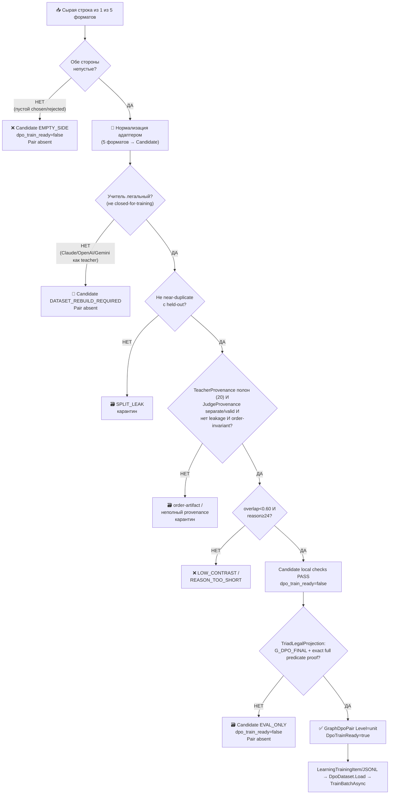

## Current Code-First Reconciliation Overlay (2026-07-14)

current_implementation_authorization: YES_CODE_FIRST_ONLY
teacher_dpo_training_authorization: NO_TEACHER_DPO_TRAINING_UNTIL_G_DPO_FINAL
dpo_status: NOT_STARTED
dpo_priority: LAST
current_counters: 12 phases / 27 subphases / 64 substeps
canonical_sequence: CODE_FIRST -> TP1_LOCAL_EVAL_ONLY -> TP2_HOSTED_EVAL_ONLY (only after G-TP-4) -> G_DPO_FINAL -> DPO_TRAINING
current_effective_dpo_train_ready: false; code may implement candidate/projection/evaluation seams, but neither TP1 nor TP2 may emit a train-ready row, call `TrainBatchAsync`, or promote a checkpoint.
current_residual_owners:
- `R17-normalized-row-carrier`: carrier type and owner remain UNRESOLVED; until resolved, every affected Candidate is `quarantine`/`eval_only`, `DpoTrainReady=false`, and no Pair is projected.
- `BUILDER_HELDOUT_REWARD_CONTAMINATION_AND_TIMING`: OPEN; promotion held-out cannot be reused as train-time reward, and cold-start/stale-credit timing requires an explicit owner decision before DPO.
- reference-checkpoint, reward-margin, held-out/source-disjoint evaluation, lifecycle/fresh-load/continue-training, and quantization gates: OPEN.
current_readiness_boundary: no DPO execution readiness, whole-plan readiness, or “no design choice remains” claim is made.

## Historical Fable Coverage Repair Overlay (2026-07-05)

historical_fable_plan_readiness: PLAN_NOT_READY / FABLE_GAP_REPAIR_QUEUE
historical_fable_implementation_authorization: NO until fresh Luba approval after review
historical_demoted_current_verdict_basis: Newer Fable coverage evidence `claude-fable-plan-check-v1.md` and attachment `98cbe69a` supersede the previous final-readiness overlay. Fable reports 127 findings: 91 COVERED, 30 PARTIAL, 6 MISSING. Mental implementation from active-codex would still hit plan-level design/source/dependency blockers: R-B `llm mvp` 20-pass and `llm_mvp_core` 40-pass knowledge-library targets are accepted only as evidence-library closure, not readiness/implementation proof; R-G source addressability is incomplete; several shared contracts/readability/lifecycle carriers need plan-family repair. This is plan repair evidence only, not product implementation, not tests/builds/runtime/provider/training/checkpoint/git proof.
historical_demoted_current_verdict_classes: DESIGN_BLOCKER_CURRENT=FABLE_MISSING_AND_PARTIAL_ITEMS; CURRENT_REPAIR_QUEUE=FABLE_RB_RG_AND_PARTIAL_REPAIR; FABLE_EVIDENCE=claude-fable-plan-check-v1.md lines 35-153 and attachment 98cbe69a lines 32-79; CURRENT_LEDGER_ACCEPTANCE_BOUNDED_EVIDENCE=previous 50/50 planning-section acceptance remains historical/process evidence only and cannot override later Fable MISSING/PARTIAL findings; IMPLEMENTATION_AUTHORIZATION_GATE=NO until fresh Luba approval after review.
historical_classification_rule: Any older line in this file saying PLAN_READY_FOR_LUBA_REVIEW, Final Readiness Review Overlay, no unresolved design/dependency blocker, CURRENT_REPAIR_QUEUE=NONE_IDENTIFIED_BY_FINAL_READINESS_REVIEW, or parent final-readiness acceptance before this overlay is historical/pre-Fable evidence only unless it cites a later unquoted Luba instruction or later evidence-bound review after 2026-07-05.
historical_fable_gap_repair_addendum: active-codex-execution-42-fable-gap-repair-additions-20260705.md is the current repair map for R-B/R-G and the partial contract/readability/lifecycle additions.

## Pass31-Pass40 Consumer Sync (40-pass llm_mvp_core evidence library)

historical_sync_scope: evidence-only propagation from `active-codex-execution-knowledge-library-llm-mvp-core-40-pass.md` Pass31/40, Pass32/40, Pass37/40, and Pass40/40. Current verdict remains `PLAN_NOT_READY / FABLE_GAP_REPAIR_QUEUE`; `implementation_authorization: NO`.

- DPO chain to preserve: `GraphDpoSourceRow -> GraphDpoPairCandidate -> TriadLegalProjection(full predicate proof, G_DPO_FINAL) -> GraphDpoPair(Level=unit) -> LearningTrainingItem/JSONL -> DpoDataset.Load -> TrainBatchAsync -> checkpoint manifest -> promotion gate`.
- `GraphDpoPair` is a graph-context envelope around a unit-level training row, not a whole-graph pair. Required consumer fields include `UnitId`, `AuthorityUnitId`, graph node/edge/path refs, chosen text/output, rejected text/output, source/provenance refs, and legal verdict refs.
- Closed proprietary provider output is not a train target. Common/adaptive scope must stay explicit before a row can leave the builder for plan-08 legal gating or plan-10 lifecycle handling.
## Historical Pre-Fable Final Readiness Review Overlay (2026-07-05)
historical_pre_fable_plan_readiness: PLAN_READY_FOR_LUBA_REVIEW
historical_demoted_implementation_authorization: NO until fresh Luba approval after review
historical_final_readiness_review_scope: one bounded planning/governance readiness review only; no product implementation, tests, builds, runtime, browser, provider/API, model/training/checkpoint, git, branch, mergeability, PR, or product-readiness proof was run.
historical_pre_fable_current_verdict_basis: This final review read the required governance/skill gate markers, the two unique original-task/reference attachments, the minimum Claude baseline surfaces, the active-codex plan/board/matrix/source-map/legal/gate/ledger surfaces, and current status/search evidence. End-to-end mental simulation from the active plan found no unresolved design/dependency decision that an executor would have to choose before coding/testing. The prior PLAN_NOT_READY / PLAN_PARTIAL_REPAIR_QUEUE state after 0aa/Laplace/Kepler/Singer was retained for parent final-review acceptance; this overlay supplies that final bounded review. Remaining items are execution or approval gates only: fresh Luba implementation approval, local self-authored seed file creation, code implementation, tests/builds/runtime/training/checkpoint/fresh-load/ablation proof, same-scenario Path A/Path B host proof, mock/replacement-ledger proof, branch/mergeability/git proof if later authorized, final product review, and route-specific hosted TogetherAI/Qwen3 terms/output-use proof before hosted train/common use.
historical_pre_fable_current_verdict_classes: DESIGN_BLOCKER_CURRENT=NONE_IDENTIFIED_BY_FINAL_READINESS_REVIEW; CURRENT_REPAIR_QUEUE=NONE_IDENTIFIED_BY_FINAL_READINESS_REVIEW; CURRENT_LEDGER_ACCEPTANCE_BOUNDED_EVIDENCE=50/50 accepted planning sections after 2026-07-05 Pass37-Pass50/Singer repair, not 50 cycles, not 50 product reviews, not product proof, not test/build/runtime/provider/training/checkpoint/git proof; HOSTED_PROVIDER_PRE_USE_GATE_ROUTE_SPECIFIC=TogetherAI/Qwen3 proof required before hosted train/common use only, not a local self-authored v1 planning blocker; IMPLEMENTATION_AUTHORIZATION_GATE=NO until fresh Luba approval after review.
historical_classification_rule: Any older line in this file saying PLAN_NOT_READY / PLAN_PARTIAL_REPAIR_QUEUE, current verdict remains PLAN_NOT_READY, CURRENT_REPAIR_QUEUE, parent must run final readiness review, or no-go boundaries before this overlay is historical/pre-final-readiness-review evidence only unless it cites a later unquoted Luba instruction or later evidence-bound review after 2026-07-05.
---
artifact_type: ilearningdynamicgraph_plan_block_07_dpo_builder
authority_source: latest unquoted Luba work order for DPO Legal Learning active execution chain
status: populated_now_planning_only
last_updated: 2026-06-29
write_scope: C:\Users\lubao\Documents\xiigen\llm mvp\dpo legal build\active-codex-execution-*.md
plan_phase_anchor: Ф3 (DPO-строитель; подшаги Ф3.1.1–Ф3.1.3, Ф3.2.1–Ф3.2.2) + Ф2.2.1 (канон GraphDpoPair)
canon_counters: 12 фаз / 27 подфаз / 64 подшага (Ф0…Ф11), нумерация Ф<P>.<SP>.<SS>
benchmark_read_only_source: codex-plan-07-dpo-builder.md (НЕ редактируется)
---

# Блок плана 07 — Авто-строитель DPO: канон `GraphDpoPair` (легальная сборка из 5 форматов)

Автор: Claude (Opus 4.8 MAX), роль — автор полностью решённого блока плана в моём
namespace `claude-*`. Прежняя помета R2/R3 `PLAN-ONLY` является исторической и
**SUPERSEDED** текущим code-first overlay 2026-07-14: реализация кода разрешена, но
teacher/DPO authoring, проекция trainable Pair и training заблокированы до `G_DPO_FINAL`. Все цитаты кода — реальные,
перепроверены чтением файлов, с `file:line`. Имена `ILearning*`/`GraphDpoPair`/
`TeacherProvenance` — канон, синхронны со всеми `claude-*` и мастер-планом §E
(A-LM-12 — закрытый список из 5 уровней; новых уровней не вводим).

`GraphDpoBuilder` — это **NEW**-класс (в коде его НЕТ). Его метод
`BuildCandidateAsync` возвращает только
`OperationResult<GraphDpoPairCandidate(DpoTrainReady=false)>`; builder никогда не создаёт
`GraphDpoPair`. Только `TriadLegalProjection` после полного proof и `G_DPO_FINAL` создаёт
канонический `GraphDpoPair`; затем отдельный materializer создаёт `LearningTrainingItem`,
JSONL и batch для `DpoDataset.Load` / `TrainBatchAsync`.

> **Якорь фазы (доска исполнения `codex-EXECUTION-CONTROL-BOARD`, evidence-only).**
> Этот блок-07 — источник канона строителя DPO для фазы **Ф3 «DPO-строитель»**
> (подшаги Ф3.1.1–Ф3.1.3 — адаптеры 5 форматов; Ф3.2.1–Ф3.2.2 — триада
> train-ready + материализация) и для подшага **Ф2.2.1** «канон `GraphDpoPair` +
> provenance». Его Gate B G1..G10 (§10) = exit-условие Ф3. Канонические счётчики
> плана: **12 фаз (Ф0…Ф11) / 27 подфаз / 64 подшага**, нумерация
> `Ф<P>.<SP>.<SS>`. Доска и мастер-план — evidence-only, здесь не правятся.

---

## 0. Якорь задачи и где этот claude-блок улучшает бенчмарк

```text
CURRENT TASK: написать МОЙ (claude-namespace) улучшенный блок-07 строителя DPO —
              план-решение авто-сборки канонической пары GraphDpoPair, человеческим
              русским, Part A-формат, с сохранением структуры и канонических
              счётчиков (12 фаз / 27 подфаз / 64 подшага, Ф<P>.<SP>.<SS>) и
              CANON-инвариантов (L5-машина без 6-го уровня A-LM-12; легальный
              teacher-гейт closed=только judge; запрет скрытого детерминизма
              A-LM-09/A-LM-13). Записать ровно в claude-plan-07-dpo-builder.md.
NOT THE TASK: исполнять/тестировать/билдить код, запускать раннеры, тренировать,
              вызывать внешние AI/API/модели, git; править/создавать любые codex-*
              (только чтение), продолжать чужой codex-план или claude-00..07 каркас.
EVIDENCE-ONLY: codex-plan-07 (бенчмарк-стаб 1.7KB), codex-plan-08 (legacy benchmark evidence only; current canon owner for `TeacherProvenance` is active/Claude plan-08)
              TeacherProvenance/LegScope), codex-plan-09 (авто-DPO петля,
              потребитель строителя), codex-plan-00/04/05 (канон GraphDpoPair/ребра),
              codex-ILEARNINGDYNAMICGRAPH-PLAN-v1 §E (канон полей), доска (Ф2/Ф3
              счётчики), claude-02/03/04/06 (мой namespace, согласован), реальный
              код llm_mvp_core (читается для цитат).
```

**Где этот блок осознанно лучше бенчмарка `codex-plan-07` (delta-нота, не слепая
копия).** Бенчмарк `codex-plan-07` — это восстановленный после encoding-fault
**стаб на ~1.7KB**: он перечисляет поля пары, значения `SourceCategory`, классы
`rejected_origin` и Gate B, но **не содержит** Part A (нет §0 UML, нет §1-§3
алгоритма с file:line, нет §5 иерархии, нет тест-стратегии по слоям, нет
человеческого объяснения). Я достраиваю до полного Part A и чиню реальные
пробелы:

| # | Слабое место бенчмарка `codex-plan-07` | Улучшение в этом claude-блоке |
|---|---|---|
| D1 | **Нет Part A вообще.** Стаб — это голый канон-список без §0 диаграммы, §1-§3 алгоритма, §5 иерархии, тест-слоёв. По R3/Part-A Completeness Contract такой артефакт **не допускается** к исполнению. | Достроил полный Part A: §0 classDiagram с `note for` на каждый класс + таблица симуляции каждой связи (§4); §1-§3 пошаговый алгоритм `BuildCandidateAsync` с классами/методами/параметрами и цитатами реальных форматов; §5 иерархия L5→L2 с Input/Output; §9 тест-стратегия по 9 слоям. |
| D2 | **«5 форматов» не названы.** Бенчмарк говорит «Five input formats are adapted by explicit adapters», но **не называет** ни один реальный формат и не даёт ни одной цитаты `file:line`. Это непроверяемо. | Назвал и процитировал **5 реально существующих** форматов: `DpoPair` (`11.DPO/Models/DpoPair.cs:3`), `RoutingDpoPair` (`26.TrainableRouter/Models/RoutingModels.cs:75`), `OrchestrationPromptDpoPair` (`OrchestrationPromptDpoPairBuilder.cs:54`), `CodeTraceBuilderDpoPair` (`CodeTraceBuilderDpoGenerator.cs:35`), `CrossStackBusinessFlowGraphDpoPair` (`ProjectWikiDomainModels.cs:918`). Каждому — строка адаптера (§3.1, §6). |
| D3 | **Поля пары разъехались с каноном §E.** Бенчмарк перечисляет ~20 строительских/diagnostic полей (`chosen_authority_unit_id`, `leg_scope`, `overlap_score` и т.д.), а старый active text ошибочно понизил 14-field canon до historical/pre-PASS12. | Pass37/latest Claude sync восстанавливает owner-canon: `GraphDpoPair` — ровно 14 current fields in active/Claude plan-07; `TeacherProvenance` 20 fields is nested in the pair and owned by block 08; 5 diagnostic builder fields live in `TriadVerdict`, not in `GraphDpoPair`. Train-ready rows remain unit-level by invariant (`Level="unit"` / unit id in `NodeOrEdgeId`), not by changing the 14-field schema. |
| D4 | **`dpo_train_ready` без алгоритма.** Бенчмарк объявляет «триаду» (legal+split+authority), но **не описывает**, как `BuildCandidateAsync` её вычисляет, в каком порядке, что возвращает при провале каждого гейта. | Описал **пошаговый алгоритм** триады (§3): порядок гейтов legal→split→authority→overlap→leakage, ранний выход с `row_rejection_reason`, `dpo_train_ready=false` без выброса (Rule 1). Добавил пороги: `overlap<0.60`, `reason≥24` (синхрон с мастер P-07 Gate B). |
| D5 | **Нет материализации в реальный код.** Бенчмарк не говорит, КУДА превращается пара для обучения. | Зафиксировал проекцию `GraphDpoPair → LearningTrainingItem` (`LearningMachineContracts.cs:30`) и материализацию JSONL через существующий `DpoDataset.Load` (`11.DPO/DpoDataset.cs:18`) — то же, что мастер P-07 Gate B («материализация в `DpoDataset.Load`»). |
| D6 | **FLOW-38 не объяснён.** Бенчмарк: «FLOW-38 and UI feedback enter only through `GeneratedUiOutputFeedbackEvent`», но не говорит, что это **NEW** (в коде нет) и как это проходит legal-гейт. | Пометил `GeneratedUiOutputFeedbackEvent` как **NEW**; описал, что UI-фидбэк → `PersonalAdaptive`/`Quarantine` по умолчанию (§8.3, синхрон с active/Claude plan-08 legal gate; `codex-plan-08` only legacy benchmark evidence), не в `CommonGlobal` без доказательства. |

CANON-инварианты сохранены: маппинг ролей Luba → реальные контракты; 5 закрытых
уровней (A-LM-12); легальный teacher-гейт (closed = только judge); запрет
скрытого детерминизма (A-LM-09/A-LM-13). NEW-типы помечены `NEW`; существующие —
с `file:line`. Имена `GraphDpoPair`/`TeacherProvenance`/`GraphEdgeKind` —
канонические, общие со всеми `claude-*`.

---

## 1. Что это и зачем (роль компонента в ILearningDynamicGraph)

**Строитель DPO — это «сборочный цех обучающих примеров» для графа.** Он берёт
сырые события сравнения (две ветки/два кандидата/два ответа, где один лучше
другого) из пяти разных источников проекта и **собирает из них одну
каноническую, легально-чистую, проверенную пару** `GraphDpoPair`, на которой
потом учится L5-машина (`ILearningMachine<DynamicGraphDomain>`).

Зачем он нужен именно для **обучаемого** графа: сегодня в проекте уже есть **пять
несовместимых форматов** DPO-пар (см. §3.1) — у каждого свои поля, своё понятие
«отклонённого», свои (или вообще отсутствующие) поля провенанса. Обучать
L5-машину графа «зоопарком» форматов нельзя: нет единого train-ready гейта, нет
гарантии легальности учителя, нет защиты от утечки (candidate-index, source-path,
exact-prompt). Builder нормализует каждый формат только в Candidate. Единственное
место, где может появиться Pair with `DpoTrainReady=true`, —
`TriadLegalProjection` после exact full predicate proof + `G_DPO_FINAL`.

Граница ответственности (CANON R6 — тонкий агент, простые API; R5 — ядро в
`llm_mvp_core`):

- Строитель **не обучает** (это L5 `TrainBatchAsync`, блок 10) и **не выбирает
  ребро в рантайме** (это L2 `EdgeAuthorityUnit`, блок 02). Он только **строит
  данные** для обучения.
- Строитель **не зовёт внешних учителей сам**. Учительские выходы приходят к нему
  уже как готовый текст `chosen/rejected` + запись `TeacherProvenance`; строитель
  лишь **проверяет** легальность через `TeacherProvenanceGate` (блок 08), а не
  генерирует их.
- Строитель — **детерминированный нормализатор/валидатор** (это инфраструктура
  данных, не семантика): он честно помечен как helper, в нём **нет** заявленной
  «обученной» логики. Его выход — данные для обучаемого уровня, а не сам
  обучаемый уровень.

---

## 2. Концепт простыми словами (аналогия, без кода)

Возьми аналогию завода (она же в блоках 02/03/06). Если оркестратор — начальник
цеха, а ребро — конвейерная линия, то строитель DPO — это **отдел приёмки
учебных образцов для ночной школы рабочих**.

1. **Приходят образцы из пяти разных мастерских.** Каждая мастерская присылает
   «как надо / как не надо» в своём бланке: токарный цех — в одном, сборочный —
   в другом, цех документации — в третьем. Бланки несовместимы.
2. **Отдел приёмки переписывает всё на единый бланк** (`GraphDpoPair`): «вот
   задача → вот правильный образец (chosen) → вот неправильный (rejected) → вот
   почему неправильный плохой (reason + `[WRONG:...]`)».
3. **Проверка легальности учителя.** Прежде чем образец попадёт в учебник, отдел
   спрашивает: «кто сделал правильный образец?». Если это **открытая разрешённая
   модель** (open-weight permissive) — ок, в общий учебник. Если это **закрытая
   фирменная модель** (Claude/OpenAI/Gemini) — её работу **нельзя копировать в
   учебник как эталон** (это нарушение лицензии). Закрытую модель можно звать
   только как **судью-экзаменатора** («этот образец лучше того?»), но не как
   автора эталона. Контаминированный образец → «переделать набор»
   (`DATASET_REBUILD_REQUIRED`).
4. **Проверка «не списано» (split).** Образец не должен быть копией того, что
   уже лежит в экзаменационной (held-out) папке. Иначе студент просто запомнит
   ответ, а не научится. Пара near-duplicate → в карантин.
5. **Проверка «учим смыслу, а не позиции».** Образец не должен позволять угадать
   ответ по **номеру в списке** (candidate-index), по **пути к файлу**
   (source-path) или по **точному тексту запроса** (exact-prompt). Иначе студент
   выучит «всегда бери первый» вместо «пойми задачу». Такие сигналы вырезаются
   (`excluded_leakage_signals`), а строки, где chosen угадывается по позиции, — в
   карантин.
6. **Проверка «достаточно различаются».** Если «правильный» и «неправильный»
   образцы почти одинаковы (overlap высокий) — учить не на чем. Порог: пересечение
   < 0.60.
7. **Печать в учебник.** Builder output остаётся Candidate with
   `dpo_train_ready=false`. Только `TriadLegalProjection(full proof,G)` создаёт
   Pair with true, после чего выполняется `LearningTrainingItem/JSONL →
   DpoDataset.Load → TrainBatchAsync`.
8. **Честное «брак».** Если образец не прошёл, отдел **не выбрасывает его молча и
   не подделывает штамп** — он пишет причину брака (`row_rejection_reason`) и
   статус (`Quarantine`/`EvalOnly`). Пустой набор образцов — невалиден для
   обучения (нельзя учить на нуле строк).

Чего отдел приёмки **не делает сам**: не рисует эталонные образцы (это
мастерские/учителя), не проводит саму ночную школу (это L5-обучение) и не решает
в рантайме, какую деталь на какую линию пустить (это L2-юнит ребра).

---

## 3. Алгоритм/решение ПОШАГОВО (человеческим языком, полное решение)

Это **полностью решённый** алгоритм авто-строителя
`GraphDpoBuilder.BuildCandidateAsync` (**NEW**-класс). Ниже — что происходит, где, в
каком порядке, какие классы/методы/параметры участвуют. Все ссылки на
**существующие** форматы — с `file:line`; NEW-добавления помечены явно.

### 3.1. Пять реальных входных форматов (источники, которые строитель нормализует)

Это **реально существующие** записи проекта (перепроверены чтением). Строитель
имеет по одному явному адаптеру на каждый формат (Ф3.1.1–Ф3.1.3 группируют их):

| # | Существующий формат | file:line | Ключевые поля сейчас | Что несёт |
|---|---|---|---|---|
| F1 | `DpoPair` | `11.DPO/Models/DpoPair.cs:3` | `Prompt; Chosen; Rejected` | базовый формат обучения DPO (без провенанса, без id) |
| F2 | `RoutingDpoPair` | `26.TrainableRouter/Models/RoutingModels.cs:75` | `PairId; ASide; Chosen; Rejected; SourceDecisionRunId; ChosenUnitId; RejectedUnitId` | выбор юнита-роутера (есть id юнитов = почти `authority_unit_id`) |
| F3 | `OrchestrationPromptDpoPair` | `26.TrainableRouter/Training/OrchestrationPromptDpoPairBuilder.cs:54` | пара из файла промптов оркестрации | сценарии оркестратора |
| F4 | `CodeTraceBuilderDpoPair` | `42.ProjectWikiDomain/CodeTraceBuilderDpoGenerator.cs:35` | `Chosen; Rejected` с маркером `[WRONG:...]` (`:48`) | трассировка кода (есть канон `[WRONG:]`) |
| F5 | `CrossStackBusinessFlowGraphDpoPair` | `42.ProjectWikiDomain/ProjectWikiDomainModels.cs:918` | `PairId; BoundaryMap; A; Chosen; Rejected; RejectedType; RequiredPathIds; EvidenceIds` | граф Angular↔.NET↔SQL (есть `RejectedType`, `EvidenceIds`) |

Наблюдение (обоснование канона): ни один из 5 форматов **не несёт легального
провенанса учителя** и ни один не несёт **полей анти-leakage**. Поэтому канон
`GraphDpoPair` обязан добавить nested `TeacherProvenance` (20 полей, блок 08),
`HeldOut`, `CandidateOrderInvariant`, `ExcludedLeakageSignals[]`, and
`DpoTrainReady` — это поле только успешно projected Pair, а не builder Candidate.
Manifest/projection proof lives around Candidate/Pair; it does not add fields to
the 14-field canon.

### 3.2. Канон выхода `GraphDpoPair` (NEW; Pass37 latest-Claude 14-field owner canon)

**CANON-владелец ТИПА `GraphDpoPair` = блок 07.** Latest inspected Claude baseline
locks `GraphDpoPair` as exactly 14 fields in `claude-plan-07-dpo-builder.md`
(owner block 07) and `claude-REQUIREMENTS-COVERAGE-MATRIX.md` (plan-07 owner).
Block 08 owns the nested `TeacherProvenance` 20-field record (13+5+2 RR6
`service_mode`/`grounding_used`) and legal verdicts. The 5 builder/diagnostic
fields (`RejectedOrigin`, `LegScope`, `OverlapScore`, `SplitProofRef`,
`RowRejectionReason`) live in `TriadVerdict`, not in `GraphDpoPair`. DPO chosen/rejected
material remains unit-level only: `Level` must be `"unit"` and `NodeOrEdgeId` carries
the unit identity. Graph/edge/combo/path ids are provenance/context in triad/sidecar/trace
records, not pair level, unless Luba explicitly approves a different future plan.

```text
GraphDpoPair (current 14-field canon; owner block 07):
  PairId
  Level                         // train-ready must be "unit"
  NodeOrEdgeId                  // for train-ready unit-level DPO, this is the unit id/ref
  InputContext
  Chosen
  Rejected
  WrongMarkers[]
  Reason                        // >=24 chars (Gate B)
  TeacherProvenance             // nested 20-field record; owner block 08
  SourceIds[]
  HeldOut
  CandidateOrderInvariant
  ExcludedLeakageSignals[]      // candidate_index, source_path, source_id, file_order, correlation_id, exact_prompt
  DpoTrainReady                 // gate, not a default flag
```

**PASS22 OrderedPatternIds carrier sync (Claude Repair2 local-file evidence).**
Local Claude file inspection found the RR2 order-channel carrier in
`claude-plan-07-dpo-builder.md:228-242` and
`claude-plan-04-dynamicgraph-machine.md:547-584`. Active plan-07 had 0
`OrderedPatternIds` hits before this pass. For this narrow active counterpart
slice, active-codex now preserves the Claude decision:

- `GraphDpoPair` stays lock-14/block-07; no separate `OrderedPatternIds` or
  `graph_path_ids` fifteenth field is added.
- The order feature carrier is the existing canonical prompt triple:
  `chosen` serializes the accepted `OrderedPatternIds`, `rejected` serializes
  the rejected near-miss `OrderedPatternIds`, and `input_context` carries the
  shared structural envelope of candidate nodes (`OrderLevel`,
  `ConsumesPatternIds`, `CapabilityTags`) without position/path/source-id/
  exact-prompt leakage signals.
- `graph_path_ids` stays evidence-only provenance in the raw comparison event;
  `candidate_order_hash` stays a permutation-invariance hash and is not a
  confidence input.

Status for this slice: `PASS22_ORDERED_PATTERN_IDS_CARRIER_SYNCED_NEEDS_DOWNSTREAM_REVIEW`.
This is plan-text reconciliation only; it is not implementation proof, not
B-22 closure, not 50 passes, and not `PLAN_READY`.

**НЕ-канон-поля пары (вычисляемые строителем атрибуты строки / выходы гейтов —
НЕ персистентные поля канон-пары §E).** Эти диагностические поля в мастер §E и
в `claude-plan-01` §5.2 ОТСУТСТВУЮТ; держать их на канон-строке нельзя без
явного расширения канона §E (вопрос Q1 к Luba, §12). Их корректное место — поля
`BuildContext`/`TriadVerdict`/бокового манифеста, а НЕ строки `GraphDpoPair`.
`legal_scope`, `split_proof_ref`, `path_order_ref`, and provenance readback refs
are diagnostic/provenance context, not fields of the 14-field canon. The nested
20-field `TeacherProvenance` remains the legal/provenance payload inside the
pair, backed by block-08 manifest/projection proof.

```text
Строительские/диагностические поля (НЕ §E, НЕ на канон-строке):
  rejected_origin       // атрибут строки: ОТКУДА взят rejected (таксономия §3.4); поле TriadVerdict/манифеста
  overlap_score         // ДИАГНОСТИКА триады: пересечение chosen/rejected (порог < 0.60); выход гейта
  split_proof_ref       // ДИАГНОСТИКА триады: ссылка на доказательство split; выход гейта
  row_rejection_reason  // ДИАГНОСТИКА триады: причина брака, если не train-ready; выход гейта
```

Сравнение с бенчмарком (D3): бенчмарк держал `teacher_provenance_ref` как плоскую
ссылку и поля `chosen_authority_unit_id`/`rejected_authority_unit_id` на верхнем
уровне, а старый active text ошибочно понизил 14-field/nested canon до
historical/pre-PASS12. Pass37/latest Claude current rule: `GraphDpoPair`
хранит ровно 14 полей active/Claude plan-07, включая nested 20-field
`TeacherProvenance`; `GraphDpoProvenanceWriter` enforces manifest/projection
linkage and blocks `DpoTrainReady` if `provenance_field_presence_rate != 1.0`
or the triad is missing. This removes the failure class "train-ready row but
missing legal proof" without adding diagnostic builder fields to the 14-field
pair row (mapping — §5.3).

### 3.2a. Reward/projection/order leakage invariants for structured sides

**Owner:** block 07 owns the pair-building projection and the side-level reward
extractor used before `GraphDpoPair -> LearningTrainingItem`. Block 09 may
produce candidates and choose `Y_best`, but it must call these block-07 rules
instead of inventing a local projection.

**Canonical side serialization.**

```text
SerializeCandidate(side):
  if side.Text exists:
    return side.Text                         // no culture-dependent rewrite
  if side.OrderedPatternIds exists:
    return string.Join("|", side.OrderedPatternIds)
  if side is a structured object:
    return CanonicalJson(side, schema_field_order, invariant_culture)
  otherwise:
    reject with row_rejection_reason="STRUCTURED_SIDE_SERIALIZER_MISSING"
```

For ordered outputs, `OrderedPatternIds` are the ordered semantic payload inside
`chosen`/`rejected`; `OrderLevel`, `ConsumesPatternIds`, and `CapabilityTags`
stay in `input_context` as structural context. `graph_path_ids` remain
raw-comparison evidence/provenance only and are not scoring or DPO authority.

**DPO reward scalarization.** For every side, including a sequence, ranking,
path, plan, or object, the scalar reward for margin is defined over the
serialized side:

```text
reward(side, input_context) =
  Beta * (policyLogP(SerializeCandidate(side) | input_context)
        - referenceLogP(SerializeCandidate(side) | input_context))

chosenReward = reward(chosen, input_context)
rejectedReward = reward(rejected, input_context)
margin = chosenReward - rejectedReward
```

`IHeldOutScorer.Score` / judge scalar / ranking may choose or audit `Y_best`
only as `preference_score` provenance. It must not replace `reward(side)` for
the DPO margin and must not author `chosen`/`rejected`. If a side cannot be
serialized or cannot produce policy/ref log-probability for the whole serialized
sequence, the row is not train-ready (`row_rejection_reason =
"REWARD_EXTRACTOR_MISSING"`); no implementation may defer the reward definition.

**Acceptance-signal envelope.** Block 07 consumes, and may reject, the
acceptance signal chosen by block 09. Every source row/pair candidate must carry
an `AcceptanceSignalEnvelope` in the manifest/provenance context:

```text
AcceptanceSignalEnvelope:
  acceptance_signal_source
  signal_classification in {
    independent_acceptance_signal,
    deterministic_eval_only,
    trainable_authority,
    diagnostic_only,
    forbidden_self_label
  }
  y_best_authority_route
  trained_unit_self_confidence_ref?
  candidate_producer_self_score_ref?
  independent_scorer_or_judge_ref?
  judge_did_not_author_chosen_rejected
  chosen_equals_runtime_candidate_or_legal_goal
```

Block 07 must reject train-ready output when `acceptance_signal_source` would
equal `trained_unit_self_confidence`, when a producer self-score/self-rank is
the sole row arbiter, or when a judge authored/edited `chosen` or `rejected`.
A deterministic self-best winner is allowed only as
`deterministic_eval_only` over stable-id runtime candidates under the
judge-origin/provenance gates; it cannot be the trainable proof, promotion
signal, or final acceptance gate.

**Structural-invariant literals (SI_GATE_7, builder side).** `y_best_authority_route`
принимает `teacher_best_of_k_deterministic_scorer` (TP1 best-of-K, §3 Шаг 3a plan-09;
классификация `deterministic_eval_only`, SI_GATE_6). Пустой `independent_scorer_or_judge_ref`
ИЛИ self-score/logprob самого учителя как арбитр строки → `forbidden_self_label`
(`acceptance_signal_source != trained_unit_self_confidence`); строка не train-ready.

**N-candidate projection.** For a producer output
`IReadOnlyList<GraphCandidateOutput> candidates` with `N > 1`, block 07 uses
winner-vs-each-loser fan-out:

```text
BuildSourceRows(input_context, winner, losers):
  require winner.StableCandidateId is present
  require every loser.StableCandidateId is present
  candidate_order_hash = Hash(SortByStableCandidateId(
      candidates.Select(c => c.StableCandidateId + ":" + c.ContentHash)))
  foreach loser in SortByStableCandidateId(losers):
    emit GraphDpoSourceRow {
      InputContext = input_context,
      Chosen = SerializeCandidate(winner),
      Rejected = SerializeCandidate(loser),
      SourceIds = winner.SourceIds union loser.SourceIds,
      Level = "unit",
      NodeOrEdgeId = winner.UnitId,
      RejectedOrigin = "winner-vs-each-loser"
    }
    write GraphDpoProjectionManifest {
      projection_rule = "winner-vs-each-loser",
      candidate_set_hash = candidate_order_hash,
      chosen_candidate_id = winner.StableCandidateId,
      rejected_candidate_id = loser.StableCandidateId,
      chosen_content_hash = winner.ContentHash,
      rejected_content_hash = loser.ContentHash
    }
```

Cardinality is exact: `N` candidates yield `N-1` `GraphDpoSourceRow` records and
then `N-1` unit-level `GraphDpoPair` attempts. A 1-vs-1 case is only the
`N=2` special case. Plural-loser wording is valid only through this explicit
fan-out; a single `rejected` field never contains a list of losers.

**Teacher-goal winner в fan-out (Проход 3).** Когда `winner` — легальная цель учителя
`Y_goal` (§3 Шаг 3a plan-09), схема winner-vs-each-loser НЕ меняется:
`winner.StableCandidateId := "goal:" + TeacherGoalResponse.goal_hash` (sha256),
`winner.ContentHash := goal_hash`, тот же `SerializeCandidate`; `candidate_order_hash`
считается по множеству `{runtime candidate ids} ∪ {goal-winner id}` после сортировки
(permutation-guard сохранён). `losers` — ВСЕГДА слабые кандидаты УЧЕНИКА. Непобедившие
генерации учителя (`g_k`, `k≠argmax`) НЕ являются `losers` и НЕ входят в fan-out (они
eval-only). Пара teacher-vs-teacher запрещена как train-ready в v1.

**Candidate-order leakage guard.** `candidate_order_hash` is a set/permutation
proof built from stable ids and content hashes after sorting; it is not an
order-position value, confidence feature, or selection authority. The
`CandidateOrderLeakageGuard` must reject or quarantine a row when any scoring,
selection, or train-ready feature depends on `candidate_index`, array position,
original list order, file order, source path, source id/exact prompt, correlation id,
or merge order. The
future implementation must pass a permutation check: shuffling the input
candidate array while keeping stable ids/content equal produces the same winner
id, the same loser ids, the same `candidate_order_hash`, and the same `N-1`
row set, modulo deterministic sorting by stable candidate id.

### 3.3. `BuildCandidateAsync` + единственная `TriadLegalProjection` — пошаговый алгоритм

`GraphDpoBuilder.BuildCandidateAsync(GraphDpoSourceRow raw, BuildContext ctx, ct)` →
`OperationResult<GraphDpoPairCandidate>`. Нормализатор и обучаемый unit возвращают
только Candidate. При любом failed gate сохраняется `Ok(candidate)` с
`routing_decision=quarantine|eval_only`, `projection_eligible=false`,
`dpo_train_ready=false` и точным `row_rejection_reason`; `GraphDpoPair` не создаётся.
`Fail(reason, CODE)` используется только для системной ошибки/отмены.

Единственная операция, способная создать Pair:
`TriadLegalProjection.Project(candidate, FullDpoTrainReadyProof proof,
bool gDpoFinalPassed) -> OperationResult<GraphDpoPair>`. Она возвращает Pair только
когда полный predicate ниже и `G_DPO_FINAL` истинны; иначе возвращает fail-closed
`DPO_NOT_READY` и оставляет Candidate quarantine/eval artifact.

Шаг 0. **Защитные проверки.** `null` raw → `Fail(..., "ROW_REQUIRED")`; отмена →
`Fail("Cancelled.","CANCELLED")`; пустой `chosen` или `rejected` → Candidate с
`row_rejection_reason="EMPTY_SIDE"`, `projection_eligible=false`,
`dpo_train_ready=false`.

Шаг 1. **Нормализация формата (адаптер).** По `raw.SourceFormat` выбирается один
из 5 адаптеров (§3.1) → заполняется черновик `GraphDpoPairCandidate` with
unit-level refs: `level=unit`, `unit_id`, `logical_unit_ref`,
`unit_context_ref`, `chosen_unit_output_ref`, `rejected_unit_output_ref`,
`source_ids[]`, `path_order_ref`. Адаптер **не** изобретает провенанс: если у
формата его нет, `GraphDpoProvenanceWriter` must receive `ctx.TeacherProvenance`
or route the Candidate to `eval_only|quarantine`; it cannot become a Pair.

Шаг 2. **ГЕЙТ 1 — легальность учителя (`TeacherProvenanceGate`, блок 08).**
Проверка `TeacherProvenance` sidecar record written/read by
`GraphDpoProvenanceWriter`:
- если `closed_proprietary_model=true` И `used_for_training=true` →
  **немедленно** `row_rejection_reason="DATASET_REBUILD_REQUIRED"`,
  `legal_scope=quarantine`, `projection_eligible=false`, `dpo_train_ready=false`, возврат Candidate. Это
  безусловно (никакого Luba-исключения, A-LM-04/блок 08);
- если `used_for_judging_only=true` И `used_for_training=false` → допустимо как
  судья, но **не** как эталон: если chosen происходит от closed-judge →
  `legal_scope` не выше `eval_only`;
- если все 20 полей присутствуют, teacher open-weight permissive, terms
  проверены → гейт пройден.

Шаг 3. **ГЕЙТ 2 — split (не near-duplicate с held-out).** Через `ISplitProver`
(NEW, блок 11) проверяется, что (input_context+chosen) не является
near-duplicate уже отложенной held-out строки (overlap по токенам/хэшу >
порога near-dup). Провал → `row_rejection_reason="SPLIT_LEAK"`,
`rejected_origin="split-leak"`, `legal_scope=quarantine`, `projection_eligible=false`; возвращается Candidate. Пройдено → пишется
`split_proof_ref`.

Шаг 4. **ГЕЙТ 3 — authority/provenance complete + anti-leakage.**
- `GraphDpoProvenanceWriter` writes sidecar manifest JSONL row with
  `schema_version`, `pair_id`, `source_ids[]`, `provenance_ids[]`,
  `TeacherProvenance` 20-field payload when teacher material is used,
  `JudgeProvenance` when judge/eval material is used, `TriadVerdict`, and
  Candidate/source backrefs; Pair backrefs появляются только после успешной
  `TriadLegalProjection` и не добавляют pair fields;
- проверка полноты provenance (20 полей, `provenance_field_presence_rate==1.0`);
- triad predicate: `legal_accept && split_accept && authority_provenance_accept`;
- проверка `excluded_leakage_signals` содержит `[candidate_index, source_path,
  exact_prompt]` и что ни один из них не присутствует в `chosen`/`input_context`
  как решающий сигнал;
- **permutation-invariance:** если выбор chosen меняется только от перестановки
  порядка кандидатов → `candidate_order_invariant=false`,
  `rejected_origin="order-artifact"`, `legal_scope=quarantine` (это и есть
  анти-shortcut A-LM-09 на уровне данных).

Шаг 5. **ПОРОГ — различимость.** `overlap_score = TokenOverlap(chosen,
rejected)`. Если `overlap_score ≥ 0.60` → `row_rejection_reason="LOW_CONTRAST"`,
Candidate остаётся `projection_eligible=false`, `dpo_train_ready=false`. Если `len(reason) < 24` → `row_rejection_reason=
"REASON_TOO_SHORT"` (синхрон с мастер P-07 Gate B: `overlap<0.60, reason≥24`).

Шаг 6. **Собрать доказательство проекции, не Pair.** `full_predicate_passed = (g_dpo_final_passed &&
legal_verdict_accept && provider_terms_proof_passed_or_not_applicable &&
model_license_proof_passed_or_not_applicable && teacher_authoring_provenance_passed_or_self_deterministic &&
closed_proprietary_training_target_absent && provenance_field_presence_rate == 1.0 &&
row_sidecar_ref_match_rate == 1.0 && judge_provenance_passed_or_not_used &&
data_scope_accept && split_accept && triad_present && authority_provenance_accept &&
held_out_source_disjoint_eval_passed && reward_margin_gate_passed &&
reference_checkpoint_gate_passed && fresh_load_gate_passed &&
continue_training_gate_passed && lifecycle_gate_passed && quantization_gate_passed &&
overlap_ok && reason_ok && candidate_order_invariant)`. До вызова projection Candidate
всегда имеет `dpo_train_ready=false`. `FullDpoTrainReadyProof` материализуется только
при всех true; `train_ready_without_triad_count` обязан остаться **0**.

> **A3-R4 reconciliation:** `G_DPO_FINAL` and the full legal/provider/provenance/data/evaluation/lifecycle predicate are now part of the plan contract above (`RESOLVED_IN_PLAN_CONTRACT_EXECUTION_PROOF_PENDING`). Current value remains false. Before that gate, candidate/evaluation artifacts may exist, but `dpo_train_ready`, `TrainBatchAsync`, dataset promotion, and checkpoint promotion are forbidden.

Шаг 7. **Единственная проекция.**
`TriadLegalProjection.Project(candidate, proof, gDpoFinalPassed)` повторно проверяет
proof/hash/backrefs и stage gate. False/missing → `OperationResult<GraphDpoPair>.Fail(
"DPO_NOT_READY")`, Candidate остаётся quarantine/eval artifact. True → exact
14-field `GraphDpoPair(Level="unit", DpoTrainReady=true)`. Только этот успешный Pair
можно проецировать в `LearningTrainingItem/JSONL -> DpoDataset.Load -> TrainBatchAsync`.

### 3.4. Таксономия `rejected_origin` (откуда берётся «худший» вариант)

Бенчмарк перечисляет классы; здесь — **с правилом построения** каждого (это
устраняет пустую таксономию):

| `rejected_origin` | Как строится rejected | Чему учит контраст |
|---|---|---|
| `random-rejected` | случайный валидный ответ из другого контекста | «не любой текст подходит» |
| `copied` | дубликат chosen с внесённой ошибкой `[WRONG:...]` | конкретный анти-паттерн |
| `missing-source` | ответ без опоры на источник (выдуманные символы) | «не выдумывай, опирайся на evidence» |
| `teacher-unknown` | ответ от учителя без провенанса | блокируется гейтом 1 (не train-ready) |
| `split-leak` | near-duplicate held-out | блокируется гейтом 2 (карантин) |
| `order-artifact` | выбор зависит от позиции кандидата | блокируется гейтом 3 (карантин) |
| `baseline-loser` | проигравший выход baseline-генератора (напр. `MultiSubPhaseRouterUnit`, блок 03) | «обученный лучше детерминированного baseline» (ablation-данные) |

`baseline-loser` — мост к блоку 06 (async N-комбинаций: из N≥2 веток худшие
становятся rejected) и к ablation блока 03/12.

### 3.5. Обучаемый путь: `TrainableGraphDpoBuilderUnit` (какое сравнение становится DPO-материалом)

Шаги §3.3 описывают **детерминированный** `GraphDpoBuilder.BuildCandidateAsync` —
нормализатор/валидатор/квантователь брака (baseline). Но исходная задача просит
**обучить** граф СТРОИТЬ DPO, а не только детерминированно собирать. Поэтому
рядом с детерминированным baseline живёт **обучаемый** Level-2 юнит
`TrainableGraphDpoBuilderUnit` (реализует `IGraphDpoPairBuilderUnit`, §5.2). Он
не заменяет триадные гейты — он решает, **какое сравнение выходов юнитов** стоит
превратить в DPO-материал, а гейты остаются жёсткими.

Пошагово (front-canon вид; полный per-field blueprint — §7 Pass04):

1. **Вход.** `IGraphDpoPairBuilderUnit.ExecuteAsync(LogicalUnitRequest<GraphDpoBuildInput>)`
   получает `GraphDpoBuildInput` (снимок графа, `unit_candidates[]`,
   `comparison_events[]`, seam-рефы B1/B7/B10/B12/B15/B18, §7 Pass04).
2. **Обучаемый выбор.** Юнит по learned `GraphDpoBuilderUnitState` (веса фич,
   версия политики, словарь unit-контекста, классификатор причины-брака,
   детектор слабости) выбирает `chosen`/`rejected` unit-output пару и оценивает
   её `builder_score` — это **обучаемый** шаг (не детерминированный lookup).
3. **Выход-кандидат.** Возвращает `GraphDpoPairCandidate` (`Level=unit`, unit id,
   `chosen/rejected_unit_output_ref`, `builder_score`, `rejection_reason_class`,
   `local_checks_passed`, `dpo_train_ready=false`, `routing_decision`).
4. **Жёсткие гейты (не обходятся learned state).** Кандидат идёт через ту же
   триаду §3.3 (legal → split → authority/leakage → overlap/reason). Высокий
   `builder_score` **не** делает строку train-ready, если legal/provenance/split
   не прошли (S16, G13).
5. **Проекция Candidate→Pair.** Только `TriadLegalProjection` при exact full
   predicate proof + `G_DPO_FINAL=true` создаёт exact 14-field `GraphDpoPair`
   (§3.2); диагностические поля кандидата уходят в
   `TriadVerdict`/манифест (S14).
6. **Обучение и baseline.** Только успешно projected Pairs проходят
   `LearningTrainingItem/JSONL -> DpoDataset.Load -> TrainBatchAsync` через L5
   DPO-тренер (§7 Pass04: update
   algorithm + reward-scalarization + checkpoint). `GraphDpoBuilder` остаётся
   стабильным детерминированным baseline для ablation (G12) и аварийного
   fallback.

Граница честности: обучаемым помечен **только** `TrainableGraphDpoBuilderUnit`;
`GraphDpoBuilder` честно помечен как детерминированный helper (§7). Так блок 07
читается как ОДНО полное решение (детерминированный baseline + обучаемая
политика), а не как «детерминированный нормализатор + отдельный аппендикс».

---

## 4. UML-фрагмент (§0 — Mermaid classDiagram)

```mermaid
classDiagram
    class GraphDpoBuilder {
        <<class NEW>>
        +BuildCandidateAsync(GraphDpoSourceRow, BuildContext, ct) Task~OperationResult~GraphDpoPairCandidate~~
        +BuildCandidateBatchAsync(GraphDpoSourceRow[], BuildContext, ct) Task~OperationResult~GraphDpoCandidateBatch~~
        -Normalize(raw) GraphDpoPairCandidate
        -EvaluateLocalChecks(candidate, ctx) TriadVerdict
        -TokenOverlap(chosen, rejected) double
    }
    note for GraphDpoBuilder "NEW. Детерминированный normalizer/validator возвращает только Candidate. Failed gates остаются quarantine/eval artifacts; Pair не создаётся. НЕ обучаемый уровень."

    class IGraphDpoPairBuilderUnit {
        <<interface NEW ILogicalUnit — владелец блок 07>>
        +ExecuteAsync(LogicalUnitRequest~GraphDpoBuildInput~) Task~LogicalUnitResult~GraphDpoPairCandidate~~
    }
    note for IGraphDpoPairBuilderUnit "NEW. Обучаемый Level-2 контракт строителя пар (named-owner канон для plan-09 §3 Шаг 4/§5.4). Вход GraphDpoBuildInput; выход GraphDpoPairCandidate. Реализуется классом TrainableGraphDpoBuilderUnit. Статус: ПРОЕКТ."

    class TrainableGraphDpoBuilderUnit {
        <<class NEW trainable — реализует IGraphDpoPairBuilderUnit>>
        +ExecuteAsync(LogicalUnitRequest~GraphDpoBuildInput~) Task~LogicalUnitResult~GraphDpoPairCandidate~~
        -GraphDpoBuilderUnitState State
    }
    note for TrainableGraphDpoBuilderUnit "NEW (в коде НЕТ). ОБУЧАЕМЫЙ ILogicalUnit: учит политику пар-построения (какое сравнение выходов юнитов становится DPO-материалом). Несёт learned GraphDpoBuilderUnitState; обучается через L5 DPO-тренер (блок 10); legal/provenance — hard-гейты, learned state их не обходит. GraphDpoBuilder — детерминированный baseline для ablation. Статус: ПРОЕКТ (обучаемый; полный blueprint — §7 Pass04)."

    class GraphDpoPairCandidate {
        <<record NEW — выход обучаемого юнита>>
        +Level=unit
        +UnitId string
        +ChosenUnitOutputRef string
        +RejectedUnitOutputRef string
        +BuilderScore double
        +RejectionReasonClass string
        +LocalChecksPassed bool
        +DpoTrainReady bool=false
        +RoutingDecision string
    }
    note for GraphDpoPairCandidate "NEW. Единственный builder/unit output; DpoTrainReady=false. Exact Pair создаёт только TriadLegalProjection при full proof + G_DPO_FINAL; diagnostics остаются sidecar."

    class TriadLegalProjection {
        <<class NEW sole Pair factory>>
        +Project(GraphDpoPairCandidate, FullDpoTrainReadyProof, gDpoFinalPassed) OperationResult~GraphDpoPair~
    }
    note for TriadLegalProjection "Единственный Pair factory. Проверяет exact full predicate + G_DPO_FINAL. False/missing proof оставляет Candidate quarantine/eval artifact и не создаёт Pair."

    class GraphDpoPair {
        <<record NEW active/Claude exact 14 fields>>
        +PairId string
        +Level=unit
        +NodeOrEdgeId string
        +InputContext string
        +Chosen string
        +Rejected string
        +WrongMarkers string[]
        +Reason string
        +TeacherProvenance TeacherProvenance
        +SourceIds string[]
        +HeldOut bool
        +CandidateOrderInvariant bool
        +ExcludedLeakageSignals string[]
        +DpoTrainReady bool
    }
    note for GraphDpoPair "NEW (в коде НЕТ). Pass37/latest Claude current contract: exact 14-field GraphDpoPair owner canon in block 07. TeacherProvenance is nested and owned by block 08 (20 fields). Train-ready rows require Level=unit; DpoTrainReady is a gate, not a default flag. Статус: ПРОЕКТ."

    class TeacherProvenance {
        <<record NEW канон 20 полей snake_case — владелец блок 08>>
        +model_id string
        +hosting_provider string
        +model_license string
        +teacher_access_mode string
        +teacher_output_used_for_training bool
        +closed_proprietary_model bool
        +judge_model string
        +source_category string
        +source_ref string
        +source_sha256 string
    }
    note for TeacherProvenance "NEW. Канон 20 полей (snake_case) — ВЛАДЕЛЕЦ блок 08 (§3.1) / мастер §A.4. Имена — канон блока 08; при расхождении ПОБЕЖДАЕТ владелец 08. Здесь показаны ключевые из 20 (полный owner-record — блок 08 §5 и claude-plan-01 §5). judge_model — ВНУТРИ provenance; judge-only выводится из teacher_output_used_for_training=false. closed_proprietary_model=true && teacher_output_used_for_training=true => DATASET_REBUILD_REQUIRED. Статус: ПРОЕКТ (канон в блоке 08)."

    class GraphDpoProvenanceWriter {
        <<planned writer; no new trainable level>>
        +WriteManifestProof(pair_id, TeacherProvenance, TriadVerdict) ManifestProofRef
        +AssertManifestPairConsistency(GraphDpoPair, manifest) TriadVerdict
    }
    note for GraphDpoProvenanceWriter "Writes Candidate-side proof first; after successful sole projection adds Pair/source backrefs. It never creates Pair and does not add Pair fields."

    class TeacherProvenanceGate {
        <<class NEW — владелец блок 08>>
        +Evaluate(TeacherProvenance) ProvenanceVerdict
    }
    note for TeacherProvenanceGate "NEW. Гейт легальности (блок 08). Строитель ВЫЗЫВАЕТ его на шаге 2, но не владеет каноном. Статус: ПРОЕКТ (канон в блоке 08)."

    class LearningTrainingItem {
        <<record СУЩ.>>
        +ItemId string
        +Prompt string
        +ChosenResponse string
        +RejectedResponse string
    }
    note for LearningTrainingItem "СУЩ. 00.Core/LearningMachineContracts.cs:30. Цель ПРОЕКЦИИ train-ready пары для L5-обучения. Статус: РАБОТАЕТ."

    class DpoDataset {
        <<class СУЩ.>>
        +Load(path) DpoDataset
    }
    note for DpoDataset "СУЩ. 11.DPO/DpoDataset.cs:18. Материализация JSONL (prompt/chosen/rejected). Конечная точка projection/materializer chain, не builder. Статус: РАБОТАЕТ."

    class CrossStackBusinessFlowGraphDpoPair {
        <<record СУЩ. формат F5>>
        +PairId string
        +Chosen string
        +Rejected string
        +RejectedType string
        +EvidenceIds string[]
    }
    note for CrossStackBusinessFlowGraphDpoPair "СУЩ. 42.../ProjectWikiDomainModels.cs:918. Один из 5 входных форматов (Angular/.NET/SQL граф). Нормализуется адаптером в GraphDpoPair. Статус: РАБОТАЕТ как формат-источник."

    TrainableGraphDpoBuilderUnit ..|> IGraphDpoPairBuilderUnit : implements (learned policy)
    TrainableGraphDpoBuilderUnit ..> GraphDpoPairCandidate : produces (learned unit output)
    TrainableGraphDpoBuilderUnit ..> GraphDpoBuilder : uses as deterministic baseline/fallback (ablation)
    GraphDpoBuilder ..> GraphDpoPairCandidate : normalizes/validates Candidate only
    GraphDpoPairCandidate ..> TriadLegalProjection : full predicate proof + G_DPO_FINAL
    TriadLegalProjection ..> GraphDpoPair : sole successful Pair creation
    GraphDpoBuilder ..> TeacherProvenanceGate : gate 1 (legal)
    GraphDpoBuilder ..> GraphDpoProvenanceWriter : writes Candidate-side proof
    GraphDpoProvenanceWriter --> TeacherProvenance : verifies 20-field proof
    GraphDpoPair ..> GraphDpoProvenanceWriter : pair id/source ids link to manifest proof
    GraphDpoBuilder ..> CrossStackBusinessFlowGraphDpoPair : adapts (1 of 5 formats)
    GraphDpoPair ..> LearningTrainingItem : projects to (train-ready only)
    LearningTrainingItem ..> DpoDataset : materializes as JSONL
```



### 4.1. Легенда классов

| Класс | Что делает | Статус |
|---|---|---|
| `GraphDpoBuilder` | Детерминированный normalizer/validator: 5 форматов→Candidate; failed gates остаются quarantine/eval artifacts | NEW (ПРОЕКТ) |
| `IGraphDpoPairBuilderUnit` | Обучаемый Level-2 контракт (`ILogicalUnit`) строителя пар; named-owner канон для plan-09 | NEW (ПРОЕКТ) |
| `TrainableGraphDpoBuilderUnit` | ОБУЧАЕМЫЙ класс, реализует `IGraphDpoPairBuilderUnit`; учит политику пар-построения (§7 Pass04) | NEW (ПРОЕКТ; обучаемый) |
| `GraphDpoPairCandidate` | Единственный выход builder/unit; всегда `DpoTrainReady=false` до successful projection | NEW (ПРОЕКТ) |
| `TriadLegalProjection` | Единственный Pair factory: exact full predicate proof + `G_DPO_FINAL` → unit Pair | NEW (ПРОЕКТ) |
| `GraphDpoPair` | Active/Claude plan-07 14-field canon; train-ready only at unit level; nested/linked `TeacherProvenance` uses block 08 20-field canon | NEW (ПРОЕКТ) |
| `TeacherProvenance` | 20 полей легальности учителя (владелец — блок 08) | NEW (ПРОЕКТ) |
| `GraphDpoProvenanceWriter` | Candidate-side proof writer; adds Pair backref only after successful sole projection | NEW (ПРОЕКТ; не новый trainable level) |
| `TeacherProvenanceGate` | Гейт легальности, вызывается строителем (блок 08) | NEW (ПРОЕКТ) |
| `LearningTrainingItem` | Цель проекции train-ready пары для L5 | РАБОТАЕТ (`LearningMachineContracts.cs:30`) |
| `DpoDataset` | Материализация JSONL для DPO-обучения | РАБОТАЕТ (`11.DPO/DpoDataset.cs:18`) |
| `CrossStackBusinessFlowGraphDpoPair` | Формат-источник F5 (Angular/.NET/SQL) | РАБОТАЕТ (`ProjectWikiDomainModels.cs:918`) |

### 4.2. Таблица симуляции §0 (для каждой связи: вход → ожидаемый результат)

| # | Связь | Пример входа | Ожидаемый результат |
|---|---|---|---|
| S1 | `GraphDpoBuilder ..> GraphDpoPairCandidate` | `raw` пустой `chosen` | `Ok(candidate)` с `projection_eligible=false`, `dpo_train_ready=false`, `row_rejection_reason="EMPTY_SIDE"`; Pair отсутствует |
| S2 | Candidate `..> TeacherProvenanceGate` (legal) | provenance `closed_proprietary_model=true, teacher_output_used_for_training=true` (напр. `model_id=claude-*`) | Candidate `DATASET_REBUILD_REQUIRED`, `legal_scope=quarantine`, `dpo_train_ready=false`; Pair отсутствует |
| S3 | `..> TeacherProvenanceGate` (judge-only) | closed-модель `judge_model` задан, `teacher_output_used_for_training=false`, chosen НЕ от неё | гейт 1 пройден; `legal_scope` может быть `common` only if all proof permits common |
| S4 | `GraphDpoProvenanceWriter -> TeacherProvenance` (manifest/proof) | provenance с 19/20 полей snake_case | `provenance_field_presence_rate<1.0` → manifest proof marks incomplete; `DpoTrainReady=false` |
| S5 | `..> CrossStackBusinessFlowGraphDpoPair` (adapts) | F5-пара `RejectedType="missing-edge"`, `EvidenceIds=[...]` | нормализована только в unit-level Candidate; exact Pair отсутствует до projection |
| S6 | adapts F1 `DpoPair` | F1 `Prompt/Chosen/Rejected` без provenance, `ctx.TeacherProvenance` пуст | нормализована, но `legal_scope` не выше `eval_only` (нет provenance для `common`) |
| S7 | split-гейт | (input+chosen) near-duplicate held-out строки | `row_rejection_reason="SPLIT_LEAK"`, `rejected_origin="split-leak"`, карантин |
| S8 | permutation-invariance | chosen меняется при перестановке кандидатов | `candidate_order_invariant=false`, `rejected_origin="order-artifact"`, карантин (A-LM-09) |
| S9 | overlap-порог | `chosen`≈`rejected`, `overlap_score=0.74` | `row_rejection_reason="LOW_CONTRAST"` (≥0.60), `dpo_train_ready=false` |
| S10 | `TriadLegalProjection -> GraphDpoPair` | Candidate + exact full predicate proof + `G_DPO_FINAL=true` | exact unit Pair with `DpoTrainReady=true`; missing/false proof returns no Pair |
| S11 | Pair → `LearningTrainingItem/JSONL -> DpoDataset.Load` | N successfully projected Pairs | dataset count N; only then `TrainBatchAsync` may run |
| S12 | пустой projection batch | 0 Candidates прошли full predicate + `G_DPO_FINAL` | Pair count 0; JSONL/dataset/train call отсутствуют |
| S13 | `TrainableGraphDpoBuilderUnit` implements `IGraphDpoPairBuilderUnit` | `LogicalUnitRequest<GraphDpoBuildInput>` с 2 unit-кандидатами | `LogicalUnitResult<GraphDpoPairCandidate>` — выбран `Level=unit`, `UnitId`, `chosen/rejected_unit_output_ref`; whole-graph pair не создаётся |
| S14 | Candidate → `TriadLegalProjection` → Pair | Candidate + full predicate proof + `G_DPO_FINAL=true` | exact 14-field `GraphDpoPair(Level=unit)`; diagnostics stay in sidecar; no direct Candidate→Pair leap |
| S15 | `TrainableGraphDpoBuilderUnit ..> GraphDpoBuilder` (baseline/ablation) | тот же вход, `TrainableGraphDpoBuilderUnit` state отключён | детерминированный `GraphDpoBuilder` даёт стабильный baseline-выход; смена/отключение learned state меняет выбор пары (ablation-доказательство, G12) |
| S16 | learned state vs hard-гейт | высокий `builder_score`, но provenance неполон/closed-teacher | Candidate остаётся `dpo_train_ready=false`, route=`quarantine\|eval_only`; Pair отсутствует, learned score НЕ обходит legal/provenance (G13) |

### 4.3. Flowchart §1 (человеческие ветки `BuildCandidateAsync` + симуляция веток)



Симуляция веток (каждая ветка — вход → результат):
- `B=НЕТ`: вход `chosen=""` → `EMPTY_SIDE`, не train-ready.
- `D=НЕТ`: вход provenance `model_id=claude-sonnet, teacher_output_used_for_training=true` → `DATASET_REBUILD_REQUIRED` (S2).
- `D=ДА, judge-only`: closed как judge, chosen от open-weight → проходит (S3).
- `E=НЕТ`: (input+chosen) near-dup held-out → `SPLIT_LEAK` (S7).
- `F=НЕТ (order)`: chosen зависит от позиции → `order-artifact`, карантин (S8).
- `F=НЕТ (provenance)`: 19/20 полей → не train-ready (S4).
- `G=НЕТ`: `overlap=0.74` → `LOW_CONTRAST` (S9).
- `G=ДА (local checks чисты)`: всё ещё Candidate, `dpo_train_ready=false`; Pair отсутствует.
- `GF=НЕТ`: Candidate остаётся `EVAL_ONLY`; JSONL/dataset/train отсутствуют.
- `GF=ДА`: только `TriadLegalProjection` создаёт unit Pair with `DpoTrainReady=true`, затем допускается точная materialization/training chain (S10/S11).

---

## 5. §5 Иерархия + контракты (NEW vs существующее, с file:line)

### 5.1. Где строитель стоит в пятиуровневой иерархии

Строитель **не является** уровнем иерархии — он **питает данными** L5-машину.
Иерархия (`LearningMachineContracts.cs:197-207`):

```
L5  ILearningDynamicGraph ≡ ILearningMachine<DynamicGraphDomain>
      TrainBatchAsync(IReadOnlyList<LearningTrainingItem>)   ← ПОТРЕБИТЕЛЬ DpoDataset.Load output (блок 10)
        ↑ кормится из
   [ProjectedPairMaterializer] — GraphDpoPair → LearningTrainingItem/JSONL → DpoDataset.Load
        ↑ получает только из
   [TriadLegalProjection] — Candidate + FullDpoTrainReadyProof + G_DPO_FINAL → GraphDpoPair(Level=unit)
        ↑ получает Candidate(false) из
   [GraphDpoBuilder]  (NEW, ЭТОТ БЛОК) — helper-нормализатор, output только GraphDpoPairCandidate(DpoTrainReady=false)
        ↑ собирает из
   5 форматов (F1..F5, §3.1) — существующие источники сравнений
L4  ILearningOrchestrator ≡ ILogicalOrchestrator   — порождает baseline-loser строки (блок 03)
L3  ILearningFlow ≡ ILogicalFlow                    — ребро (блок 02)
L2  EdgeAuthorityUnit ≡ ILogicalUnit               — ОБУЧАЕТСЯ на train-ready парах (блок 02)
```

Input/Output по уровням (для §5-полноты):

| Уровень | Input | Output | Связь со строителем |
|---|---|---|---|
| L5 `ILearningMachine<DynamicGraphDomain>` | `IReadOnlyList<LearningTrainingItem>` (`:30`) | `LearningBatchResult` (`:43`), `LearningEvaluationResult` (`:90`) | **потребляет** проекцию train-ready пар |
| L2 `EdgeAuthorityUnit` | `EdgeAuthorityInput` (NEW, блок 02) | `EdgeAuthorityDecision` (NEW, блок 02) | **обучается** на этих парах (через L5) |
| строитель `GraphDpoBuilder` | `GraphDpoSourceRow` (NEW, обёртка над F1..F5) | `GraphDpoPairCandidate(DpoTrainReady=false)` | helper, не уровень; Pair не создаёт |
| `TriadLegalProjection` | Candidate + `FullDpoTrainReadyProof` + `G_DPO_FINAL` | exact unit `GraphDpoPair` | отдельная sole projection row; failed proof оставляет Candidate |
| `ProjectedPairMaterializer` | projected unit `GraphDpoPair` | `LearningTrainingItem/JSONL → DpoDataset.Load` | владеет train JSONL; builder им не владеет |

### 5.2. NEW-контракты (в коде их НЕТ; сигнатуры — утвердить у Luba)

```csharp
// NEW — единая обёртка над 5 входными форматами (адаптер заполняет её).
public sealed record GraphDpoSourceRow(
    string SourceFormat,          // "DpoPair" | "RoutingDpoPair" | "OrchestrationPromptDpoPair"
                                  //   | "CodeTraceBuilderDpoPair" | "CrossStackBusinessFlowGraphDpoPair"
    string InputContext,          // задача/промпт, для которого собраны варианты
    string Chosen,
    string Rejected,
    IReadOnlyList<string> WrongMarkers,     // [WRONG:...] из F4/F5; для F1-F3 пусто
    string Level,                 // unit-only; graph/edge/combo ids stay provenance/context
    string NodeOrEdgeId,          // unit_id/ref required before train-ready materialization
    string RejectedOrigin,        // таксономия §3.4
    TeacherProvenance? Provenance,// что прислал источник; null => не CommonGlobal
    IReadOnlyList<string> SourceIds);

// MAPPING-НОТА (Проход A1): поля legal_verdict / allowed_use / route / semantic_quality_claimed /
// dpo_train_ready / mock_source / source_kind / chosen_origin, которые проверяют FLOW-38
// normalized-row тесты (16-gate:444/446), НЕ входят в 10-полевой record GraphDpoSourceRow (§5.2).
// Их типизированный носитель (envelope / TriadVerdict-sidecar vs расширение record) — ОТКРЫТЫЙ
// owner-вопрос: LUBA_PRODUCT_DECISION_RESIDUAL (R17-normalized-row-carrier). До решения тест
// не реализуем против owner-record; owner-record молча НЕ расширять.
// A2-РАСШИРЕНИЕ (F-A2-4): residual также покрывает legal_verdict(6-знач) / triad_present /
// quarantine_reason / Pass35 storage-privacy как носители для усиленного batch-предиката
// plan-08 (legal_verdict==ACCEPT AND dpo_train_ready==true AND triad_present==true) плюс
// маппинг 6-вердикт -> 4-значный LegScope. Owner-record молча НЕ расширять. NEEDS_LEGAL_MACHINE_REVIEW.

// Seed/scorer boundary: GraphDpoSourceRow is the pair-building input, not the
// held-out gold/scorer record. For SeedCorpus-LanguageTranslate-v1 rows,
// Chosen maps from chosen_translation and Rejected maps from rejected_translation;
// expected_label stays only on split=held_out seed/scorer metadata, must equal
// chosen_translation there, and never becomes a GraphDpoPair field.

// NEW — Pass37/latest-Claude current GraphDpoPair row. Owner block 07 defines
// exactly 14 fields; chosen/rejected pair material requires Level == "unit".
// TeacherProvenance is the nested 20-field owner block 08 canon; diagnostic builder fields stay in
// TriadVerdict/provenance/trace records, not as extra GraphDpoPair fields.
public sealed record GraphDpoPair(
    string PairId,
    string Level,                           // must equal "unit" for train-ready rows
    string NodeOrEdgeId,                    // unit id for train-ready rows
    string InputContext,
    string Chosen,
    string Rejected,
    IReadOnlyList<string> WrongMarkers,
    string Reason,
    TeacherProvenance TeacherProvenance,
    IReadOnlyList<string> SourceIds,
    bool HeldOut,
    bool CandidateOrderInvariant,
IReadOnlyList<string> ExcludedLeakageSignals, // [candidate_index, source_path, source_id, file_order, correlation_id, exact_prompt]
    bool DpoTrainReady);                    // GATE (§3.3 шаг 6)

// NEW — вердикт триады/строителя (НЕ §E-канон, НЕ поле GraphDpoPair). Выходы гейтов
// (§3.3) и вычисляемые строителем атрибуты строки. Держится сбоку от канон-пары
// (в боковом DPO-манифесте / результате BuildCandidateAsync), чтобы active/Claude
// 14-field canon не смешивался с diagnostic verdict fields.
public sealed record TriadVerdict(
    string RejectedOrigin,                  // §3.4 — ОТКУДА взят rejected (атрибут строки)
    string LegScope,                        // ВЫВОД гейта 08: CommonGlobal|PersonalAdaptive|EvalOnly|Quarantine
    double OverlapScore,                    // диагностика: < 0.60 для train-ready
    string SplitProofRef,                   // диагностика: ссылка на доказательство split
    string RowRejectionReason);             // диагностика: пусто, если train-ready

// NEW — строитель (helper-нормализатор/валидатор; НЕ обучаемый уровень).
public sealed class GraphDpoBuilder
{
    // Одна строка: 5 форматов → Candidate; Pair здесь никогда не создаётся.
    public Task<OperationResult<GraphDpoPairCandidate>> BuildCandidateAsync(
        GraphDpoSourceRow raw, BuildContext ctx, CancellationToken ct = default);

    // Батч Candidate artifacts; это не dataset и не train batch.
    public Task<OperationResult<GraphDpoCandidateBatch>> BuildCandidateBatchAsync(
        IReadOnlyList<GraphDpoSourceRow> rows, BuildContext ctx, CancellationToken ct = default);
}

// NEW — единственный Pair factory.
public sealed class TriadLegalProjection
{
    public OperationResult<GraphDpoPair> Project(
        GraphDpoPairCandidate candidate,
        FullDpoTrainReadyProof fullPredicateProof,
        bool gDpoFinalPassed);
    // false/missing proof or G=false => Fail(DPO_NOT_READY), Candidate remains quarantine/eval artifact.
}

// NEW — обучаемый Level-2 контракт строителя пар (владелец — блок 07).
// Это named-owner канон, на который ссылается plan-09 §3 Шаг 4 / §5.4.
// I/O: вход GraphDpoBuildInput; выход GraphDpoPairCandidate (проекция в
// exact 14-field GraphDpoPair — только ПОСЛЕ триадных гейтов §3.3).
public interface IGraphDpoPairBuilderUnit
    : ILogicalUnit<GraphDpoBuildInput, GraphDpoPairCandidate>
{
    // ExecuteAsync(LogicalUnitRequest<GraphDpoBuildInput>)
    //   -> LogicalUnitResult<GraphDpoPairCandidate>  (Level-2 inference contract)
}

// NEW — обучаемый класс, РЕАЛИЗУЮЩИЙ IGraphDpoPairBuilderUnit.
// Несёт GraphDpoBuilderUnitState (learned policy); GraphDpoBuilder остаётся
// детерминированным baseline/validator для ablation/fallback (не trainable).
public sealed class TrainableGraphDpoBuilderUnit : IGraphDpoPairBuilderUnit
{
    // Учит политику пар-построения; НЕ обходит legal/provenance hard-гейты.
}
```

> **Single-owner name/level/I/O reconciliation (Pass04 / plan-09 sync).**
> `IGraphDpoPairBuilderUnit` (interface, `ILogicalUnit`) is implemented by
> `TrainableGraphDpoBuilderUnit` (class); `GraphDpoBuilder` is the deterministic
> baseline Candidate helper, not this interface. Named-owner output is
> `GraphDpoPairCandidate`; the exact 14-field `GraphDpoPair` (§3.2) is produced
> only by `TriadLegalProjection.Project(candidate, fullPredicateProof,
> gDpoFinalPassed)` (§3.3). Any wording that the interface or helper directly
> produces `GraphDpoPair` is superseded and invalid. Full field-by-field blueprint of the
> trainable unit (state, update algorithm, reward scalarization, checkpoint) is
> in the Pass04 B6 section of §7.

`TeacherProvenance` (20 полей; 13+5+2 RR6 `service_mode`/`grounding_used`) и `TeacherProvenanceGate` — **канон владеет блок
08** (`active-codex-execution-plan-08` / `claude-plan-08` §3.1/§8.4; мастер §A.4). Здесь `TeacherProvenance` только **используется**, а `GraphDpoPair` принадлежит этому блоку 07;
дублировать канон 20 полей в блоке 07 нельзя (это разрушит single-owner правило).

> **Стоячая нота согласования имён (как в блоке 09 D2).** Имена полей
> `TeacherProvenance` — **канон блока 08 §3.1 (snake_case)**: `teacher_access_mode,
> hosting_provider, model_id, model_license, model_version, request_id,
> provider_terms_checked, teacher_output_used_for_training, closed_proprietary_model,
> judge_model, source_ref, source_sha256, contamination_markers` (13 базовых) +
> `terms_snapshot_ref, geography_export_constraint, source_category,
> raw_private_text_copied, redaction_policy_ref` (5 NEW T2/T3/T5) + RR6
> `service_mode, grounding_used` = 20. При любом
> расхождении имён/числа полей с другими блоками **побеждает владелец 08**. Блок
> 07 **индексирует** этот 20-полевой record (не переписывает его своими именами):
> PascalCase-имена бенчмарка `codex-plan-07` (ModelName/Provider/LicenseId/
> WeightsAvailability/TrainingUseAllowed/UsedForTraining/UsedForJudgingOnly/
> ClosedProprietaryModel/SourceCategory/TeacherId) **не используются** — это был
> молчаливый занос codex-стиля; canon-имена выше.

### 5.3. Маппинг полей бенчмарка-стаба → канон §E (что куда переехало)

| Поле бенчмарка `codex-plan-07` | Куда в Pass37/latest-Claude каноне или в `TriadVerdict`/manifest | Почему |
|---|---|---|
| `chosen_authority_unit_id` / `rejected_authority_unit_id` | unit identity in `NodeOrEdgeId`, `SourceIds[]`, and B12/provenance/trace metadata | no flat authority fields; B12 winner metadata stays outside extra pair fields without losing provenance |
| `chosen_origin` / `rejected_origin` | `TriadVerdict.RejectedOrigin` (таксономия §3.4) | НЕ поле канон-пары §E — атрибут строки/вердикт гейта, см. §3.2 |
| `source_category` | inside nested `TeacherProvenance.source_category` plus manifest/projection proof | `source_category` is a provenance field (5 NEW T5, owner block 08 §3.1), not a flat pair field |
| `teacher_provenance_ref` / nested `teacher_provenance{20}` | nested `TeacherProvenance` field in the exact 14-field pair, backed by manifest/projection proof | latest Claude makes nested `TeacherProvenance` current authority; storage/readback proof surrounds it |
| `legal_verdict` | вычисляется гейтом → `TriadVerdict.LegScope`/`TriadVerdict.RowRejectionReason` | вердикт — результат гейта, НЕ хранимое поле канон-пары §E |
| (нет в бенчмарке) | `CandidateOrderInvariant`, `ExcludedLeakageSignals[]`, `HeldOut` in the pair; split/path-order proof in `TriadVerdict`/provenance/trace | anti-leakage/split/path-order proof required before `DpoTrainReady`, but not all proof refs are pair fields |

---

## 6. Цитаты кода «как сейчас» → сейчас / почему / должно стать / как менять

### Цитата A — формат F1 `DpoPair` (база обучения, без провенанса)

`11.DPO/Models/DpoPair.cs:3-8`:
```
public record DpoPair {
    public string Prompt   { get; init; } = "";
    public string Chosen   { get; init; } = "";
    public string Rejected { get; init; } = "";
}
```
- **Сейчас:** базовый формат DPO без id, без провенанса, без анти-leakage.
- **Почему так (ок как формат):** это конечная точка обучения; `DpoDataset.Load`
  читает именно его JSONL (`11.DPO/DpoDataset.cs:18`). Нарушения нет — это
  **формат-источник** и **цель материализации**.
- **Должно стать:** остаётся целью материализации train-ready пар (проекция §3.3
  шаг 7), но **никогда** не источником истины легальности (у него нет
  provenance). Строитель добавляет provenance/leakage **поверх**.
- **Как менять:** не менять сам `DpoPair`. Менять — добавить адаптер F1 в
  строителе (NEW) + проекцию канона обратно в `DpoPair` для JSONL.

### Цитата B — формат F5 с готовым `RejectedType` и `EvidenceIds`

`42.ProjectWikiDomain/ProjectWikiDomainModels.cs:918`:
```
public sealed record CrossStackBusinessFlowGraphDpoPair(
    string PairId, SystemBoundaryMapResult BoundaryMap, string A,
    string Chosen, string Rejected, string RejectedType,
    string[] RequiredPathIds, string[] EvidenceIds);
```
- **Сейчас:** богатый формат графа Angular/.NET/SQL: уже несёт `RejectedType`
  (≈ `rejected_origin`) и `EvidenceIds` (≈ `source_ids`), но **нет провенанса
  учителя** и **нет анти-leakage**.
- **Почему так (ок как формат):** это легитимный источник сравнений для графа.
- **Должно стать:** адаптер F5 переносит `RejectedType→rejected_origin`,
  `EvidenceIds→source_ids` and unit-level output refs selected from typed
  candidates; the old graph-level source shape remains historical/eval-only and never train-ready.
  Провенанс берётся из `ctx`/sidecar; otherwise `legal_scope<=eval_only`.
- **Как менять:** адаптер F5 в строителе (NEW); сам record не трогать (мастер Q32
  — оставить как формат-источник, не переименовывать).

### Цитата C — образец канона `[WRONG:]` (F4, как надо)

`42.ProjectWikiDomain/CodeTraceBuilderDpoGenerator.cs:48`:
```
var wrongAnnotationRate = pairs.Count(pair => pair.Rejected.Contains("[WRONG:", StringComparison.Ordinal)) / (double)pairs.Length;
```
- **Сейчас:** rejected-сторона помечается маркером `[WRONG:...]`, и считается
  доля размеченных — это канон `dpo-triple-format`.
- **Почему так (ок, образец):** конкретный анти-паттерн в rejected учит лучше,
  чем «просто плохой ответ». Правильный образец.
- **Должно стать:** канон `GraphDpoPair.wrong_markers[]` наследует этот паттерн;
  для `rejected_origin="copied"` маркер `[WRONG:...]` **обязателен**.
- **Как менять:** не менять генератор; перенести правило `[WRONG:]` в адаптеры и
  в тест-слой (§9 negative).

### Цитата D — цель проекции для обучения

`00.Core/LearningMachineContracts.cs:30-39`:
```
public sealed record LearningTrainingItem(
    string ItemId, string Prompt, string ChosenResponse, string RejectedResponse);
```
- **Сейчас:** именно это потребляет `ILearningMachine.TrainBatchAsync` (L5).
- **Почему так (ок):** единая точка входа обучения для всех машин проекта.
- **Должно стать:** train-ready `GraphDpoPair` проецируется в него
  (`ItemId←pair_id`, `Prompt←input_context`, `ChosenResponse←chosen`,
  `RejectedResponse←rejected`). Поля провенанса/leakage **не** уходят в обучение
  (они — гейт до обучения), но сохраняются в боковом DPO-манифесте L5 (блок 10).
- **Как менять:** не менять record; добавить проектор `GraphDpoPair →
  LearningTrainingItem` в строителе + сериализацию манифеста.

### Цитата E — конечная материализация (JSONL)

`11.DPO/DpoDataset.cs:18-26`:
```
public static DpoDataset Load(string path)
{
    var pairs = File.ReadAllLines(path).Where(l => !string.IsNullOrWhiteSpace(l))
        .Select(l => JsonSerializer.Deserialize<DpoPair>(l) ?? throw ...).ToList();
    return new DpoDataset(pairs);
}
```
- **Сейчас:** читает JSONL `{prompt, chosen, rejected}` построчно.
- **Почему так (ок):** это и есть «материализация в `DpoDataset.Load`» из мастер
  P-07 Gate B, но это конечная точка projection/materializer chain, не builder.
- **Должно стать:** `ProjectedPairMaterializer` пишет train JSONL только из успешно
  projected unit `GraphDpoPair`; builder пишет/возвращает только Candidate(false).
  Quarantine/eval Candidate artifacts идут в отдельный sidecar JSONL, не в train JSONL.
- **Как менять:** не менять `Load`; реализовать ownership
  `builder → Candidate(false) → TriadLegalProjection(full proof,G) → Pair → materializer JSONL`.

---

## 7. Статус (честно: что работает, что NEW/заглушка)

| Элемент строителя | Файл:line | Статус |
|---|---|---|
| Формат-источник F1 `DpoPair` | `11.DPO/Models/DpoPair.cs:3` | РАБОТАЕТ как формат |
| Формат-источник F2 `RoutingDpoPair` | `26.../RoutingModels.cs:75` | РАБОТАЕТ как формат |
| Формат-источник F3 `OrchestrationPromptDpoPair` | `26.../OrchestrationPromptDpoPairBuilder.cs:54` | РАБОТАЕТ как формат |
| Формат-источник F4 `CodeTraceBuilderDpoPair` (+`[WRONG:]`) | `42.../CodeTraceBuilderDpoGenerator.cs:35,48` | РАБОТАЕТ как формат (образец `[WRONG:]`) |
| Формат-источник F5 `CrossStackBusinessFlowGraphDpoPair` | `42.../ProjectWikiDomainModels.cs:918` | РАБОТАЕТ как формат |
| Цель проекции `LearningTrainingItem` | `00.Core/LearningMachineContracts.cs:30` | РАБОТАЕТ |
| Материализация `DpoDataset.Load` | `11.DPO/DpoDataset.cs:18` | РАБОТАЕТ |
| Канон `GraphDpoPair` (§E) | — | ОТСУТСТВУЕТ (NEW, проектируется здесь) |
| `GraphDpoBuilder.BuildCandidateAsync` (триада) | — | ОТСУТСТВУЕТ (NEW) |
| 5 адаптеров формат→канон | — | ОТСУТСТВУЕТ (NEW; Ф3.1.1–3) |
| `TeacherProvenance` (20 полей; 13+5+2 RR6 `service_mode`/`grounding_used`) / `TeacherProvenanceGate` | — | ОТСУТСТВУЕТ (NEW; **владелец канона — блок 08**) |
| `ISplitProver` (анти near-duplicate) | — | ОТСУТСТВУЕТ (NEW; владелец — блок 11) |
| `GeneratedUiOutputFeedbackEvent` (FLOW-38) | — | ОТСУТСТВУЕТ (NEW; см. §8.3) |

Двух-PASS вывод: строитель — **детерминированный helper**, не обучаемый уровень,
поэтому он **не претендует** на `PASS_AS_TRAINED_FEATURE`. Его корректная цель —
`PASS_AS_HONEST_UNTRAINED_SCAFFOLD` для самого строителя (он честно помечен как
нормализатор/валидатор; «обученной» логики в нём нет) **и** производство
легально-чистых, leakage-free, train-ready данных, на которых обучаемый
`EdgeAuthorityUnit` (блок 02) сможет достичь `PASS_AS_TRAINED_FEATURE` (после
блоков 10/11, фазы Ф4-Ф5).

### Pass 04 B6 repair: deterministic baseline plus trainable unit-level pair policy

The paragraph above remains true for `GraphDpoBuilder.BuildCandidateAsync` only: it is a non-trainable baseline utility, deterministic schema normalizer, validator, and quarantine router. It is not the trainable DPO-building capability requested by the original task, and it must not be used as evidence that the graph learned pair construction.

`TrainableGraphDpoBuilderUnit` is the trainable `ILogicalUnit` that learns pair-construction policy. `ILearningDynamicGraph` owns, contains, and coordinates this unit through the `DynamicGraphMachine` lifecycle, so the graph system learns which unit-output comparison should become DPO material. This is not whole graph A vs whole graph B, not a graph-wide blob pair, and not merely learned edge choice.

**Three-name single-owner reconciliation (closes the `IGraphDpoPairBuilderUnit`
dangling-owner defect; owner of all three names = block 07).** The plan family
uses three builder names for one solution; they are reconciled here so no reader
invents a fourth or a second contract:

- `IGraphDpoPairBuilderUnit` — the **interface** (Level 2 `ILogicalUnit`
  contract). It is the named-owner canon that plan-09 §3 Шаг 4 / §5.4 point to;
  block 07 owns it. Its I/O contract is
  `ExecuteAsync(LogicalUnitRequest<GraphDpoBuildInput>) ->
  LogicalUnitResult<GraphDpoPairCandidate>`.
- `TrainableGraphDpoBuilderUnit` — the concrete **class implementing**
  `IGraphDpoPairBuilderUnit`. It carries the learned `GraphDpoBuilderUnitState`
  and produces `GraphDpoPairCandidate` records.
- `GraphDpoBuilder` — the **deterministic baseline/validator helper** (NOT the
  `ILogicalUnit`, NOT trainable): schema normalizer, triad validator, quarantine
  router, emergency fallback. It is `GraphDpoBuilder.BuildCandidateAsync(...)`
  from §3, returns Candidate only, and stays the stable baseline for ablation.

**One output rule (Candidate -> sole projection -> Pair).** The
unit output is `GraphDpoPairCandidate` (rich builder record, §Pass04 fields
below). It becomes a persisted `GraphDpoPair` only through
`TriadLegalProjection.Project(candidate, FullDpoTrainReadyProof,
gDpoFinalPassed)` after the exact full predicate and `G_DPO_FINAL` pass. Failed
projection leaves only a quarantine/eval Candidate. The successful projection
keeps the exact 14-field canon (§3.2) and drops diagnostics into sidecars. So the
named-owner name+level+I/O now match: interface `IGraphDpoPairBuilderUnit`
(`ILogicalUnit`) → Candidate output → sole `TriadLegalProjection` with exact full
predicate proof + `G_DPO_FINAL` → 14-field unit Pair.
Any plan-09/§5.4 direct builder→Pair wording is superseded; no semantic shortcut
is permitted.

Canonical unit-level invariant (rendered in the exact 14-field owner canon,
§3.2 — no second field set). The Pass04 shorthand names below are historical
alias labels; the persisted record uses the 14 canon names only. Field-name
mapping (Pass04 alias -> 14-field canon or off-pair carrier):

```text
GraphDpoPair (exact 14-field owner canon, §3.2; Level="unit" for train-ready):
  PairId                        // new unit-pair identity for this projection
  Level = "unit"                // Pass04 alias: level=unit
  NodeOrEdgeId = <ILogicalUnit identity>   // Pass04 alias: UnitId
  InputContext = <unit input/context>      // Pass04 alias: unit_context_ref
  Chosen = <chosen unit output>            // Pass04 alias: chosen_output_ref
  Rejected = <rejected unit output>        // Pass04 alias: rejected_output_ref
  WrongMarkers[]                // [WRONG:...] markers when present
  Reason                        // >=24 chars (Gate B)
  TeacherProvenance             // nested 20-field record (owner block 08);
                                //   carries teacher material when used
  SourceIds[]
  HeldOut
  CandidateOrderInvariant
  ExcludedLeakageSignals[]      // candidate_index, source_path, source_id,
                                //   file_order, correlation_id, exact_prompt
  DpoTrainReady                 // gate (§3.3 step 6), not a default flag
```

Invariant-constraints note (Pass04 alias fields that are NOT extra pair fields —
they live off-pair in `TriadVerdict`/manifest/trace, so the 14-field canon is
not silently widened to a second live shape):

- `path_order_ref` (B7 graph-order resolver output): raw-comparison / provenance
  context in the sidecar manifest and in `input_context` serialization
  (`OrderedPatternIds` inside `chosen`/`rejected`), NOT a 15th pair field.
- `provenance_ref` (B10 provenance writer envelope): the manifest/projection
  proof reference written by `GraphDpoProvenanceWriter`, kept in the sidecar,
  NOT a pair field; the nested `TeacherProvenance` is the on-pair legal payload.
- `legal_scope` (common | adaptive | quarantine | eval_only): a gate verdict,
  carried in `TriadVerdict.LegScope`, NOT a stored pair field (§3.2).
- `judge_provenance` (`JudgeProvenance` when judge/eval material was used):
  routed to the sidecar manifest / `TriadVerdict`, NOT a pair field. Judge output
  is eval/critic material only and never authors `chosen`/`rejected`; a
  closed-model judge caps `legal_scope` at `eval_only` (§3.3 gate 1).

`GraphDpoBuildInput` fields:

- `graph_snapshot_ref`
- `unit_candidates[]` with `unit_id`, `logical_unit_ref`, `chosen_unit_output_ref`, `rejected_unit_output_ref`, and `unit_context_ref`
- `comparison_events[]`
- `teacher_goal_ref` and `judge_score_ref` from the B1 seams when used
- `graph_order_resolver_output_ref` from B7
- `provenance_envelope_ref` from B10
- `winner_selection_trace_ref` from B12 when the selected/rejected unit came from a winner decision
- `legal_scope` from B15 common/personal routing
- `cold_start_seed_ref` from B18 when the first pair is bootstrap material
- `source_ids[]`
- `terms_snapshot_ref`
- `license_ref`
- `redaction_policy_ref`
- `split_id`
- `excluded_leakage_signals[]`

`GraphDpoPairCandidate` fields:

- `level=unit`
- `unit_id`
- `chosen_unit_output_ref`
- `rejected_unit_output_ref`
- `unit_context_ref`
- `path_order_ref`
- `provenance_ref`
- `legal_scope`
- `near_miss_reason`
- `wrong_markers[]`
- `builder_score`
- `builder_reason_hash`
- `rejection_reason_class`
- `deterministic_fallback_diff`
- `local_checks_passed`
- `dpo_train_ready=false` (immutable on Candidate; only projected Pair may be true)
- `routing_decision: common | adaptive | quarantine | eval_only`

`GraphDpoBuilderUnitState` stores feature weights, policy version, unit-context vocabulary, rejection-reason classifier state, weakness-detector state, advisory provenance/legal gating calibration, observed outcome and reward statistics, checkpoint refs, split ids, and deterministic-baseline ids. The unit may learn feature weights, policy state, rejection-reason classification, weakness detection, and provenance/legal gating recommendations, but legal and provenance gates are hard constraints before train-ready emission and cannot be bypassed by learned state.

Learning signals: observed unit outcomes, allowed legal teacher signals, judge/eval signals, human/client feedback when its scope permits training, B7 graph-order resolver output, held-out correctness, reward lift, and downstream training lifecycle results. Outputs feed DPO dataset rows and the training lifecycle while preserving quarantine/adaptive/common routing.

**Instantiated training UPDATE algorithm (per-field blueprint: input row ->
typed `GraphDpoBuilderUnitState` mutation -> checkpoint save).** This closes the
"class name in place of implementing function" gap: it names the trainer path,
the exact state fields that mutate per input row, and the reward scalarization
used for builder-policy training.

- **Trainer path (named).** `TrainableGraphDpoBuilderUnit` is trained through the
  L5 DPO trainer, not by a bare statistic increment: accepted builder decisions
  are projected to `LearningTrainingItem` (§3.3 step 7) and consumed by
  `ILearningDynamicGraph.TrainBatchAsync` (block 10). The unit-local policy
  (`GraphDpoBuilderUnitState`) is updated by a DPO preference step over
  builder-decision pairs; deterministic counters (`observed outcome/reward
  statistics`) are advisory features only and are never the promotion authority
  (A-LM-09/A-LM-13).

- **Reward scalarization for builder-policy training.** The chosen/rejected side
  of a builder decision is a structured object (which unit-output comparison
  becomes DPO material), not an atomic answer, so it needs an explicit
  `reward(side)` extractor before the DPO margin:

  ```text
  builderReward(decision) =
      w_lift    * heldOutRewardLift(decision)      // downstream held-out lift
    + w_legal   * legalProvenancePassRate(decision) // hard-gated in [0,1]
    + w_contrast* contrastQuality(decision)         // 1 - overlap_score
    - w_leak    * leakagePenalty(decision)          // >0 if any excluded signal used
  margin = builderReward(chosen_decision) - builderReward(rejected_decision)
  ```

  `heldOutRewardLift` and `legalProvenancePassRate` come from independent
  held-out/legal sources, never from the unit's own `builder_score`
  (acceptance-signal independence). A decision whose `legalProvenancePassRate < 1.0`
  cannot be a `chosen_decision` (hard gate before the margin is even computed).

  > **AUDIT-FINDING NOTE (A3, needs-architect-decision) — held-out lift как train-time reward: контаминация + timing (B5/F-A3-5, HIGH):** ортогонально к acceptance-signal-independence выше (та закрывает только «не своя self-score»). Отдельная дыра: `heldOutRewardLift(decision)` — это **downstream held-out lift**, а он входит прямо в `builderReward`, которым считается **train-time** DPO-margin (строки `builderReward`/`margin` выше). Это (а) КОНТАМИНИРУЕТ held-out: тот же held-out, что используется для приёмки/промоушена, переиспользуется как обучающий сигнал строителя; (б) timing/credit-assignment НЕ спроектирован — «downstream lift» измеряется ПОСЛЕ обучения на этой паре, поэтому на момент штампа пары значение либо неизвестно (cold-start), либо взято из прошлого такта (stale credit). Направление (НЕ решено здесь; ревью Luba): либо отдельный builder-acceptance held-out tier, который НЕ переиспользуется как train-reward; либо `heldOutRewardLift` только post-hoc для приёмки (не в train-margin), а train-margin строить на не-held-out contrast/legal-сигналах; плюс явная модель timing/cold-start lift (что подставляется до первого измеренного lift). Статус: residual A3-R3 BUILDER_HELDOUT_REWARD_CONTAMINATION_AND_TIMING (HIGH, NEEDS_ARCHITECT_DECISION). (Формула reward НЕ переписана; readiness/счётчики не тронуты.)

- **builderReward-weights block (Fable-proposed grounded tuning values; additive
  to the formula above — the formula shape is unchanged, this block only fills in
  the four coefficients that were the `LUBA_PRODUCT_DECISION_RESIDUAL`).** Each
  value carries its LABEL, a one-line rationale, and a grounding citation. None of
  these is a LOCKED Luba decision; the two soft weights are empirically tunable and
  the two gate coefficients are forced by the hard-gate design.

  | Coefficient | Value | LABEL | One-line rationale | Grounding citation |
  |---|---|---|---|---|
  | `w_lift` | `0.8` | `PROPOSED_DEFAULT` (empirically-tunable) | Downstream held-out lift is the primary builder-policy signal, so it takes the dominant share of the soft simplex. | plan-07:1162-1172 (`heldOutRewardLift` is the primary independent held-out term) |
  | `w_contrast` | `0.2` | `PROPOSED_DEFAULT` (empirically-tunable) | Contrast quality (`1 − overlap_score`) is a secondary shaping term; `w_lift + w_contrast = 1.0` keeps the soft simplex normalized. | plan-07:1162-1172 (`contrastQuality` secondary term) + plan-11:696-703 (`reward_margin_min>=0.025` locked floor the margin must clear) |
  | `w_legal` | `0.0` (soft coeff) | `DERIVED` (tunable=no) | Legal is a pre-margin HARD VETO, not a weighted term; its in-scalar coefficient is forced to `0.0` so no legal contribution is double-counted inside the smooth reward. | plan-07:1164,1172-1173 (`legalProvenancePassRate < 1.0` cannot be `chosen`, hard gate before margin) |
  | `w_leak` | GATE + in-scalar `1.0` | `DERIVED` (tunable=no) | Any `leakagePenalty > 0` makes the decision ineligible/quarantine (hard gate); when kept in the scalar, `w_leak = 1.0` with the dominance invariant `w_leak >= w_lift + w_contrast` (`1.0 >= 1.0`) so a single leaked signal cannot be outvoted by lift+contrast. | plan-07:1166 (`leakagePenalty > 0` if any excluded signal used); mirrors `exactPromptLeakageRate == 0.0` leak-zero invariant |

  Soft-simplex constraint (soft): `w_lift + w_contrast = 0.8 + 0.2 = 1.0`
  (sum-to-1 over the two smooth terms only; `w_legal`/`w_leak` are gate
  coefficients, not simplex members). `PROPOSED_DEFAULT` means these two smooth
  weights are the starting point for tuning; they are NOT a LOCKED Luba decision
  and may be re-balanced on held-out evidence without a governance change.

  DPO-margin sanity (grounding cross-check, not a proof): with `w_lift=0.8`,
  `w_contrast=0.2` and a chosen-vs-rejected gap of ~`0.2` on the dominant lift
  term, the smooth margin `builderReward(chosen) − builderReward(rejected)`
  clears the plan-11 locked floor `RewardMargin >= 0.025` (plan-11:696-703) with
  roughly `6.4x` headroom (`0.16 / 0.025 ≈ 6.4`). This is a design-time headroom
  check on the proposed defaults, not a trained-runtime measurement.

  Hard-gate text stays authoritative (unchanged by this block): `w_legal = 0.0`
  and `w_leak` in-scalar do NOT convert legal or leak into soft trade-offs. Legal:
  a decision with `legalProvenancePassRate < 1.0` is rejected BEFORE the margin is
  computed (plan-07:1172-1173). Leak: any `leakagePenalty > 0` makes the row
  ineligible/quarantine independent of its scalar contribution
  (`exactPromptLeakageRate == 0.0` invariant). The in-scalar `w_leak >= w_lift +
  w_contrast` dominance invariant is a belt-and-suspenders backstop, not a
  replacement for the hard gate.

  Status of this block: proposed grounded tuning values, `PLAN_NOT_READY`
  unchanged; the two `PROPOSED_DEFAULT` weights still need Luba confirmation
  before any training run locks them, and the two `DERIVED` gate coefficients are
  forced by the hard-gate design above (no Luba tuning). This block does not
  declare the plan READY and does not present a proposed default as a LOCKED Luba
  decision.

- **Per-field state mutation (one accepted input row ->
  `GraphDpoBuilderUnitState`).** For each accepted builder-decision pair:
  1. `feature weights` mutate by the DPO gradient step scaled by `margin`
     (increase weight on features of `chosen_decision`, decrease on
     `rejected_decision`); `policy version` increments.
  2. `unit-context vocabulary` absorbs any new unit-context tokens/tags from the
     row's `unit_context_ref` (additive; existing entries unchanged).
  3. `rejection-reason classifier state` updates its class counts/weights from
     the row's `rejection_reason_class`.
  4. `weakness-detector state` updates from the row's observed weakness signal
     (which unit-output was weak and why), advisory only.
  5. `observed outcome and reward statistics` accumulate the row's held-out
     outcome and computed `builderReward` (running mean/variance), advisory
     features only.
  6. `advisory provenance/legal gating calibration` updates its calibration from
     the row's legal/provenance verdict — but it is a recommendation feature; the
     hard legal/provenance gate still runs at emission and cannot be bypassed by
     this calibration.
  7. `split ids` and `deterministic-baseline ids` are recorded for the row so the
     ablation baseline stays reproducible; `checkpoint refs` are set on save.

- **Checkpoint save.** After a batch, the mutated `GraphDpoBuilderUnitState`
  (feature weights, policy version, vocabulary, classifier state, weakness-detector
  state, reward statistics, calibration, split ids, baseline ids) is serialized to
  a new checkpoint through the block-10 lifecycle (manifest + locator + fresh-load
  + continue-training), and `checkpoint refs` on the state point to it. Training
  loads user/cache state first, then repo/common fallback, and continues from the
  loaded checkpoint (never retrains from zero except an explicitly named
  cold-start/scaffold path, B18).

This blueprint is plan-level design only, not implementation proof; the numeric
reward weights `w_lift/w_legal/w_contrast/w_leak` are a
`LUBA_PRODUCT_DECISION_RESIDUAL:` exact open question — the concrete weight values
(and whether legal is a pure hard gate vs a weighted term) must be set by Luba
before training, so this sub-item is `DEFERRED_LUBA_DECISION` for the weight
values only; the algorithm shape, trainer path, and per-field mutation are
decided here.

> HISTORICAL/PRE-PROPOSAL NOTE (2026-07-07): the "must be set by Luba before
> training" residual above is now carried forward by the labeled
> **builderReward-weights block** added earlier in this section. That block flips
> the prior blank/open residual to Fable-proposed grounded values:
> `w_lift=0.8` + `w_contrast=0.2` as `PROPOSED_DEFAULT` (empirically-tunable,
> still need Luba confirm), `w_legal=0.0` as `DERIVED` (legal is a pre-margin hard
> veto, tunable=no), and `w_leak` as GATE + in-scalar `1.0` `DERIVED`
> (`w_leak >= w_lift+w_contrast`, tunable=no). The residual is thus RESOLVED-AS-
> PROPOSED for the two soft weights (Luba-confirm) and RESOLVED-AS-DERIVED for the
> two gate coefficients; it is NOT a LOCKED Luba decision. The paragraph above is
> retained as historical/pre-proposal text.

Promotion gate: source-disjoint held-out unit-pair correctness, downstream reward lift, legal/provenance pass rate, and ablation where changing or disabling `TrainableGraphDpoBuilderUnit` changes unit-pair selection or rejection reasoning versus the promoted checkpoint. The deterministic `GraphDpoBuilder` baseline remains stable for validation and emergency fallback but cannot be claimed as learned builder authority.

Pass 04 status: `PASS04_UNIT_LEVEL_POLICY_DESIGNED_NEEDS_DOWNSTREAM_REVIEW`. B6 is not closed because B9/B10 `GraphDpoPair`/provenance, B12 winner-selection, B15 common/personal routing, and B18 cold-start seed consistency still require later passes.

### Fable-Partial-06 repair: canonical input-row training pipeline + named builder lifecycle rows (2026-07-07)

historical_demoted_plan_readiness: PLAN_NOT_READY / FABLE_GAP_REPAIR_QUEUE (unchanged by this additive repair)
historical_demoted_implementation_authorization: NO until fresh Luba approval after review
repair_scope: closes FABLE-PARTIAL-06 (`active-codex-execution-42-fable-gap-repair-additions-20260705.md` §FABLE-PARTIAL-06). Owner canon = block 07 (this file); plan-10 and plan-04 carry consumer-pointers only. This is plan-level design, not training/checkpoint/runtime proof.

**(a) Canonical input-row training pipeline (front-canon, Fable-shape).** The
per-field blueprint above stays the authoritative detail; this pipeline is the
same algorithm expressed as the exact one-input-row shape Fable asked for, so a
reader sees the whole path from one `GraphDpoTrainingRow` to a promote/hold
decision without reconstructing it:

```text
input GraphDpoTrainingRow
  (one accepted builder-decision row: unit_id, chosen_unit_output_ref,
   rejected_unit_output_ref, unit_context_ref, TeacherProvenance, legal_scope,
   source_ids[], split_id, held_out flag)
-> 1. validate legal/provenance envelope
      (block 08 TeacherProvenanceGate + provenance writer proof; a row with
       closed_proprietary_model && teacher_output_used_for_training, or
       legalProvenancePassRate < 1.0, is DATASET_REBUILD_REQUIRED and never
       reaches state mutation — hard gate, learned state cannot bypass it)
-> 2. extract unit-level chosen/rejected candidates
      (project the row to a builder-decision pair over unit-output comparisons;
       structured sides, so apply the reward-scalarization builderReward(side)
       and margin = builderReward(chosen) - builderReward(rejected) above)
-> 3. update GraphDpoBuilderUnitState counters/weights/reward margins
      (the 7 per-field mutations above: feature weights by the DPO gradient step
       scaled by margin + policy_version++; unit-context vocabulary additive;
       rejection-reason classifier; weakness detector (advisory); observed
       outcome/reward statistics running mean/variance (advisory); provenance/
       legal calibration (advisory, not authority); split ids + baseline ids)
-> 4. write checkpoint delta
      (serialize the mutated GraphDpoBuilderUnitState as a child checkpoint
       through the block-10 lifecycle: parent_checkpoint_id set, manifest +
       locator written, checkpoint refs on state point to the new delta; never
       overwrite the parent)
-> 5. evaluate held-out lift
      (source-disjoint held-out via EvaluateAsync; heldOutRewardLift and
       legalProvenancePassRate come from independent held-out/legal sources,
       never from the unit's own builder_score — acceptance-signal independence)
-> 6. promote only if lift >= threshold and no legal/provenance regression
      (else Rollback to parent checkpoint via rollback_ref and reproduce its
       held-out metric within epsilon; the deterministic GraphDpoBuilder baseline
       stays fixed for ablation and emergency fallback)
```

The numeric lift `threshold` and the reward weights
`w_lift/w_legal/w_contrast/w_leak` remain the same
`LUBA_PRODUCT_DECISION_RESIDUAL` open question named above; this pipeline decides
the algorithm shape and step order, not the numeric values.

> HISTORICAL/PRE-PROPOSAL NOTE (2026-07-07): the four reward weights are now
> proposed with labels in the **builderReward-weights block** above (`w_lift=0.8`
> / `w_contrast=0.2` `PROPOSED_DEFAULT` Luba-confirm; `w_legal=0.0` /
> `w_leak` GATE+`1.0` `DERIVED`). The numeric lift `threshold` is a separate
> residual and is NOT set by this slice. This pointer records the resolution
> status of the weights only; the sentence above is retained as historical text.

**(b) Named lifecycle rows for `TrainableGraphDpoBuilderUnit` /
`GraphDpoBuilderUnitState`.** The builder unit obeys the standard ILogicalUnit
lifecycle checklist; here it is written as explicit per-artifact rows so the
carrier is not left implicit (owner canon; plan-10 §3.1/Pass16 and plan-04 §3.2
Load-order are the machine-level home this delegates to):

| Lifecycle step | `TrainableGraphDpoBuilderUnit` / `GraphDpoBuilderUnitState` behaviour | Owner / mechanism |
|---|---|---|
| Load 1 — user/cache first | On build (before first `ExecuteAsync`), load the user/cache `GraphDpoBuilderUnitState` checkpoint first | plan-10 §3.1 LC2 / plan-04 §3.2 Шаг 0 (1) |
| Load 2 — repo/common fallback | If no user/cache state, load the repo/common builder checkpoint second | plan-10 §3.1 LC2 / plan-04 §3.2 Шаг 0 (2) |
| Load 3 — honest baseline | If neither exists, run the deterministic `GraphDpoBuilder` baseline and report `PASS_AS_HONEST_UNTRAINED_SCAFFOLD` (no trained-builder claim) | plan-10 §3.1 LC2(3) / plan-04 §3.2 Шаг 0 (3) |
| Export | `ExportAsync` writes the builder-state manifest + parent lineage (metadata/version); weights persist through `SaveCheckpointAsync`, common/global via `IModelRepository`, adaptive via user/project storage | plan-10 §Pass16 Persistence/Export/Import |
| Import | `ImportAsync` restores manifest/version refs and rejects missing manifest fields / incompatible schema / failed legal-provenance; it does NOT restore trained weights (that is `LoadCheckpointAsync`) | plan-10 §Pass16 + §3.1 Шаг 1 note |
| Continue-training | Load an existing builder checkpoint, record `parent_checkpoint_id`, train only from approved source-disjoint new rows, write a child manifest; never replay old `batch_id`/`row_id` as training | plan-10 §Pass16 Continue-Training / plan-04 §6.5 |
| Cold-start (named exception) | Zero-state only via explicit cold-start scaffold (`parent_checkpoint_id=null`, `scope=EvalOnly`/`Quarantine`, B18 seed), reported as scaffold until gates pass | plan-10 §Pass16 + block 07 B18 |

Fable-Partial-06 status: `FABLE_PARTIAL_06_ALGORITHM_AND_LIFECYCLE_ROWS_ADDED_PLAN_LEVEL`; readiness stays `PLAN_NOT_READY` and implementation authorization stays `NO` (numeric threshold/weights remain a Luba residual).

---

## 8. Гейты (применимые к строителю DPO)

### 8.1. Запрет скрытого детерминизма (R4 / A-LM-09 / A-LM-13)

- Строитель **сам по себе детерминирован — и это правильно**: нормализация
  форматов, проверка полей, подсчёт overlap, проверка перестановок — это
  **инфраструктура данных**, не семантический выбор. Он **честно помечен** как
  helper (§7), не делает claim «умной сборки».
- Опасность не в том, что строитель детерминирован, а в том, чтобы он **не
  пропустил** в обучение строки, которые позволяют обучаемому юниту **выучить
  детерминированный shortcut**. Поэтому гейт 3 (§3.3) обязателен:
  `candidate_order_invariant=true`, `excluded_leakage_signals` непуст и не
  присутствует в решающем сигнале. Строка с `order-artifact` → карантин (S8).
- Это синхрон с `codex-plan-12` (no-hidden-determinism) и блоком 02
  (`DeterministicFinalAuthority=false` на ребре): данные не должны учить тому,
  что запрещено в рантайме.

### 8.2. Анти-leakage (на уровне данных)

- Запрещённые сигналы в `chosen`/`input_context`: **candidate-index/позиция**,
  **source-path**, **source-id/exact-prompt**, **file-order** и **correlation-id**.
  `excluded_leakage_signals =
  [candidate_index, source_path, source_id, file_order, correlation_id, exact_prompt]`
  фиксируется в каждой паре.
- D-17: `exactPromptLeakageRate = 0.0` в train-ready наборе (exclusion-without-
  failure запрещён — строки с exact-prompt не «молча выкидываются», а
  помечаются `Quarantine` с причиной).
- Образец-«как надо»: `MultiSubPhaseRouterUnit.BuildPathFreeScoringText`
  (`21.../MultiSubPhaseRouterUnit.cs:291`) уже исключает путь из скоринга —
  строитель наследует это правило для входа обучаемого юнита.

### 8.3. Легальный teacher-гейт (Legal Teacher / Provenance Gate — владелец блок 08)

- Teacher для дистилляции — **только** open-weight permissive (Qwen3 Apache-2.0,
  DeepSeek MIT, Kimi K2 modified-MIT, GLM, Mistral) через нейтральных провайдеров.
  **Никогда** Claude/OpenAI/Gemini как teacher. Контаминация
  (`closed_proprietary_model=true && teacher_output_used_for_training=true`) →
  `DATASET_REBUILD_REQUIRED` (S2), безусловно (никакого Luba-исключения).
- Closed-модели допустимы **только** как judge (`judge_model` задан,
  `teacher_output_used_for_training=false`); judge ≠ цель обучения (S3).
- **FLOW-38 / `GeneratedUiOutputFeedbackEvent` (NEW).** UI-фидбэк («этот выход
  лучше») — мощный сигнал, но он **приходит от пользователя/хоста**, а значит по
  умолчанию это `PersonalAdaptive` или `Quarantine`, **не** `CommonGlobal`, пока
  нет доказательства легальности и отсутствия скопированного private-текста
  (синхрон с active/Claude plan-08 legal gate; old `codex-plan-08` Final Q1/Q2 is legacy benchmark evidence, not current owner).
  `NO_AUTO_DPO_SIGNAL=true` путь: событие **не создаёт** ни пары, ни promotion.
  PASS14 boundary: FLOW-38 / better-output route evidence is downstream R17/B-4
  or B-19/Q-host evidence only. It does not close B-14 EdgeAuthority I/O, does
  not close B-16 N-to-1 merge, and does not prove physical host implementation.
  Until a future implementation inventory names exact repo/path/branch/file
  evidence, the route status stays `PLAN_ROUTE_SPECIFIED_BUT_CODE_LOCATION_UNPROVEN`.
  PASS15 boundary: the five-format adapter matrix named in D2 remains the five
  existing DPO input formats (`DpoPair`, `RoutingDpoPair`,
  `OrchestrationPromptDpoPair`, `CodeTraceBuilderDpoPair`,
  `CrossStackBusinessFlowGraphDpoPair`). Better-output/FLOW-38 is not a B-16
  merge closure and not a hidden train-ready sixth format. It is a B-4/R17
  output-feedback adapter path: host/platform/flows emit
  `GeneratedUiOutputFeedbackEvent`; `Flow38FeedbackAdapter` normalizes the event
  into `GraphDpoSourceRow`; legal/provenance/split gates decide
  quarantine/personal/common routing; only positive proof can produce a
  unit-level `GraphDpoPairCandidate`, otherwise `dpo_train_ready=false`.
  B-19 still owns physical host/API route proof, and no repo/path/file proof is
  claimed by this plan text.
- PASS16 boundary: B-4/R17 now has an exact mock seam plan before implementation.
  Treat FLOW-38 as `internal_host_api_or_resource_seam`: `IBetterOutputFeedbackFacade`
  delegates to `IFlow38FeedbackResourceClient.SubmitFeedbackAsync(GeneratedUiOutputFeedbackEvent)`
  or `IBetterOutputDpoIngestApi.IngestAsync(...)`, and `Flow38FeedbackAdapter`
  normalizes the mock host/resource response into `GraphDpoSourceRow`.
  The synthetic mock event is `event_id=evt-flow38-pass16-001`,
  `correlation_id=corr-flow38-pass16-001`, `tenant_scope=tenant:test-local`,
  `prompt_hash=sha256:prompt-r17-pass16`, chosen/rejected refs
  `mock://flow38/output/chosen/v1` / `mock://flow38/output/rejected/v1`,
  chosen/rejected hashes `sha256:chosen-r17-pass16` /
  `sha256:rejected-r17-pass16`, `source_category=client_unverified`,
  pending terms/output-license refs, and `mock_source=SYNTHETIC_FIXTURE`.
  The mock FLOW-38 response is `resource_status=mock_feedback_recorded`,
  `feedback_ref=mock://flow38/feedback/pass16`, `score_delta=0.42`,
  `terms_snapshot_status=missing_or_pending`, `output_license_status=pending`,
  `provenance_status=client_supplied_unverified`, and
  `route=platform_facade_to_FLOW38_to_core_adapter`. The normalized row must
  preserve event/chosen/rejected hashes and output `legal_verdict=QUARANTINE`,
  `allowed_use=PersonalAdaptive`, `route=adaptive_or_quarantine`,
  `semantic_quality_claimed=false`, and `dpo_train_ready=false`. Any
  `GraphDpoPairCandidate` preview remains `level=unit`,
  `common_train_ready=false`, `quarantine_reason=client_output_unverified_terms`,
  and `dpo_train_ready=false`. Future test name:
  `Flow38FeedbackAdapterTests.MockFeedbackEvent_NormalizesToQuarantinedGraphDpoSourceRow`;
  exact assertion: one normalized row, exact event/hash preservation,
  `mock_source=SYNTHETIC_FIXTURE`, quarantine/personal route, and zero
  common/train-ready output. Real replacement after product readiness must be
  recorded only in `C:\Users\lubao\Documents\xiigen\llm mvp\DPO LEARNING\codex-external-calls-mock.md`;
  the file is not created by this plan pass.

### 8.4. Измерение (completion-evidence строителя)

- Метрики строителя (не обучения): `train_ready_count`, `quarantine_count`,
  `provenance_field_presence_rate` (обязан =1.0 по nested TeacherProvenance + manifest/projection proof для train-ready),
  `row_sidecar_ref_match_rate` (обязан =1.0), `train_ready_without_triad_count` (обязан =0), `overlap` распределение,
  `exactPromptLeakageRate` (=0.0). Это **статические метрики данных** — они НЕ
  доказывают семантическое качество обучения (его доказывает L5-eval, блок 11).
- Запрет overclaim: JSON-отчёт строителя с `passed:true` — это «контракт-гейт
  данных пройден», **не** «модель обучена/качество доказано» (мастер
  completion-evidence pattern).

---

## 9. §9 Тест-стратегия (FC-26: по слоям, что применимо к строителю)

| Слой | Что проверяем на строителе | Пример теста |
|---|---|---|
| **unit** | защитные проверки, нормализация одного формата, подсчёт overlap | пустой `chosen` → Candidate `EMPTY_SIDE`, `dpo_train_ready=false`, Pair absent |
| **business-logic** | Candidate-гейты в правильном порядке | closed-for-training → Candidate `DATASET_REBUILD_REQUIRED` до split; Pair absent |
| **integration** | **5 форматов → Candidate**, затем controlled projection | F1..F5 дают 5 Candidates; без full proof/G дают 0 Pairs; с exact proof+G дают 5 unit Pairs |
| **e2e** | Candidate → `TriadLegalProjection(full proof,G)` → Pair → LearningTrainingItem/JSONL → `DpoDataset.Load` → `TrainBatchAsync` | batch вызывается только для N успешно projected Pairs; false G даёт 0 Pair/JSONL/train calls |
| **QA-automation** | скан train JSONL на запрещённые маркеры | 0 строк с `source_ref sonnet-*`/`rollout openai` в train-ready (closed-teacher скан) |
| **negative** | каждый класс брака даёт правильный reason | near-dup→`SPLIT_LEAK`; order→`order-artifact`; overlap≥0.60→`LOW_CONTRAST`; reason<24→`REASON_TOO_SHORT` |
| **untrained-honesty** | builder не подделывает train-ready | любой builder output — Candidate with `DpoTrainReady=false`; только sole projection может создать true Pair |
| **trained-acceptance** | (после блоков 10/11) unit-level данные строителя дают lift обучаемому юниту | held-out lift `TrainableGraphDpoBuilderUnit` на unit-level парах; permutation-invariance сохраняется |
| **unit-level invariant** | successful projection строит Pair только на уровне `UnitId` / `ILogicalUnit` | Candidate + full proof/G даёт exact 14-field unit Pair; builder alone даёт no Pair |
| **no whole-graph pair** | whole graph A vs whole graph B не становится train-ready DPO | candidate с `graph_blob_A`/`graph_blob_B` получает quarantine/reject reason `WHOLE_GRAPH_PAIR_FORBIDDEN`; common train row не создаётся |
| **legal hard gate** | learned score не может обойти legal/provenance | высокий score без proof остаётся Candidate `dpo_train_ready=false`, route=`quarantine\|eval_only`, Pair absent |
| **trainable-vs-baseline** | обучаемое состояние меняет выбор unit-пары, baseline стабилен | fixture checkpoint changes selected `unit_id`/rejection reason; deterministic `GraphDpoBuilder` returns identical normalized baseline output |
| **regression** | существующие 5 форматов/тесты зелёные; baseline ≥1488 | адаптеры не ломают существующие `*DpoPair`-тесты; `DpoDataset.Load` поведение не изменилось |

NEW-замечание PASS12: тесты `provenance_field_presence_rate==1.0`,
`row_sidecar_ref_match_rate==1.0`,
`train_ready_without_triad_count==0`, `exactPromptLeakageRate==0.0`,
permutation-invariance и closed-teacher-скан — **обязательная** часть приёмки
строителя (Ф3); это и есть проверка, что данные не учат shortcut.

---

## 10. Gate B (измеримое условие готовности блока) — exit-условие Ф3

Блок 07 готов (как **план-решение строителя DPO**, exit-gate фазы **Ф3** +
подшага **Ф2.2.1**), когда **все** строки истинны:

```
G1  Pass37/latest-Claude GraphDpoPair current contract is the exact 14-field
    active/Claude plan-07 canon: `PairId`, `Level`, `NodeOrEdgeId`,
    `InputContext`, `Chosen`, `Rejected`, `WrongMarkers`, `Reason`, nested
    `TeacherProvenance`, `SourceIds`, `HeldOut`, `CandidateOrderInvariant`,
    `ExcludedLeakageSignals`, `DpoTrainReady`. Train-ready rows require
    `Level="unit"` and a unit id in `NodeOrEdgeId`; edge/graph diagnostics do
    not become train-ready DPO pairs. Новый уровень иерархии НЕ вводится
    (A-LM-12). = true
G2  Названы и процитированы РОВНО 5 реальных входных форматов с file:line
    (F1..F5, §3.1), на каждый — адаптер. = 5/5
G3  BuildCandidateAsync описан пошагово: нормализация → Candidate → local
    legal/split/authority/leakage/contrast checks. Любой fail возвращает только
    quarantine/eval Candidate; Pair отсутствует. = true
G4  Единственный Pair factory — `TriadLegalProjection.Project(candidate,
    FullDpoTrainReadyProof, gDpoFinalPassed)` (§3.3). Он требует ТОЧНО полный
    §3.3 predicate: G_DPO_FINAL + legal/provider/license/teacher-authoring/
    closed-target-absence + 20/20 provenance + sidecar match + separate judge
    provenance/not-used + data scope + split + triad + authority + held-out
    source-disjoint eval + reward margin + reference checkpoint + fresh-load +
    continue-training + lifecycle + quantization + overlap/reason/order.
    Current predicate=false and G_DPO_FINAL=false; therefore current Pair count
    and train-ready count are 0. `train_ready_without_triad_count=0`. = OPEN
G5  Легальный teacher-гейт привязан к блоку 08 (владелец канона 20 полей);
    closed-for-training → DATASET_REBUILD_REQUIRED безусловно; closed=только
    judge. = true
G5a GraphDpoProvenanceWriter stores manifest/projection proof consistently:
    `provenance_field_presence_rate==1.0`, `row_sidecar_ref_match_rate==1.0`,
    and B12 winner metadata stays in provenance/triad/trace records without
    adding fields to the 14-field pair or losing source ids/judge/teacher
    provenance. = future spec required
G6  Анти-leakage: excluded_leakage_signals=[candidate_index, source_path,
    exact_prompt]; D-17 exactPromptLeakageRate=0.0; order-artifact → карантин. = true
G7  Материализация только после успешной G4 projection:
    Candidate → TriadLegalProjection(full proof,G) → GraphDpoPair(Level=unit) →
    LearningTrainingItem (:30)/JSONL → DpoDataset.Load → TrainBatchAsync.
    Пустой/failed projection не создаёт JSONL/dataset/train call. = OPEN
G8  Part A полон: §0 classDiagram с note for на каждый класс + таблица симуляции
    каждой связи (§4); §1-§3 алгоритм; §5 иерархия Input/Output; §9 тест-слои. = true
G9  FLOW-38/GeneratedUiOutputFeedbackEvent помечен NEW; UI-фидбэк по умолчанию
    PersonalAdaptive/Quarantine; NO_AUTO_DPO_SIGNAL=true ничего не создаёт. = true
G10 Historical/pre-Pass46 question evidence is superseded: storage path is nested `TeacherProvenance` plus
    sidecar/manifest projection proof (current plan decision); residual hosted-provider/common-use proof gates
    apply only to hosted train/common paths, while local self-authored/self-best v1 planning is not blocked by them.
    = true
G11 Unit-level invariant: train-ready GraphDpoPair uses the exact active/Claude
    14-field canon with `Level="unit"` and unit id in `NodeOrEdgeId`; path/order,
    legal scope, split proof, and judge diagnostics stay in provenance/triad/
    trace records, not extra pair fields. Whole graph A vs whole graph B is
    forbidden for train-ready DPO. = future spec required
G12 Trainable policy proof: changing TrainableGraphDpoBuilderUnit state changes unit-pair
    selection or rejection reason on fixture, while deterministic GraphDpoBuilder
    remains stable as baseline/validator. = future spec required
G13 Hard gate proof: legal/provenance gates run before train-ready emission and cannot
    be bypassed by learned builder score, policy state, or reward history. = future spec required
G13a Common promotion blocked without proof: if allowed-use proof, redaction proof,
     license/terms snapshot, split proof, or authority provenance is missing, route
     is `adaptive|quarantine|eval_only`, never `common`; closed provider train
     attempt always returns DATASET_REBUILD_REQUIRED. = future spec required
G14 Integration proof names B1 teacher/judge seams, B7 graph-order resolver output,
    B10 provenance writer, B12 winner-selection trace, B15 common/personal routing,
    and B18 cold-start seed as dependencies/consumers without claiming they are closed. = future spec required
```

Измеримый порог: **G1..G14 + G5a + G13a documented at plan level; future implementation proof still pending**;
`train_ready_without_triad_count = 0`; `provenance_field_presence_rate = 1.0`;
`row_sidecar_ref_match_rate = 1.0`;
`exactPromptLeakageRate = 0.0`; число введённых новых уровней иерархии = **0**;
число процитированных реальных форматов = **5** (с file:line).

### 10.1. Failure modes (что ломает блок)

- адаптер тихо проставляет `dpo_train_ready=true` без провенанса →
  `train_ready_without_triad_count>0` (G4 fail);
- closed-teacher строка попала в train JSONL → QA-скан ловит (G5/§9 QA fail);
- near-duplicate held-out просочился → метрика split-leak >0 (G6 fail);
- пустой train-батч объявлен валидным для обучения (G7 fail);
- провенанс дублируется в блоке 07 вместо ссылки на блок 08 (нарушение
  single-owner канона — G5 fail).

---

## 11. Референсы (Stage 2: затрагиваемые проекты/доки/реконы/гайды)

### Реальный код (file:line, перепроверено чтением)
- `C:/Projects/llm_mvp_core/11.DPO/Models/DpoPair.cs:3` — формат F1 (Prompt/Chosen/Rejected).
- `C:/Projects/llm_mvp_core/11.DPO/DpoDataset.cs:18` — `Load` (материализация JSONL).
- `C:/Projects/llm_mvp_core/26.TrainableRouter/Models/RoutingModels.cs:75` — формат F2 `RoutingDpoPair`.
- `C:/Projects/llm_mvp_core/26.TrainableRouter/Training/OrchestrationPromptDpoPairBuilder.cs:54` — формат F3.
- `C:/Projects/llm_mvp_core/42.ProjectWikiDomain/CodeTraceBuilderDpoGenerator.cs:35,48` — формат F4 + канон `[WRONG:]`.
- `C:/Projects/llm_mvp_core/42.ProjectWikiDomain/ProjectWikiDomainModels.cs:918` — формат F5 `CrossStackBusinessFlowGraphDpoPair`.
- `C:/Projects/llm_mvp_core/00.Core/LearningMachineContracts.cs:30` — `LearningTrainingItem` (цель проекции); `:43` `LearningBatchResult`; `:90` `LearningEvaluationResult`; иерархия `:197-207`; A-LM-02 коммент `:8`.
- `C:/Projects/llm_mvp_core/21.AgentInfrastructure/Logical/MultiSubPhaseRouterUnit.cs:291` — `BuildPathFreeScoringText` (образец анти-leakage).
- `C:/Projects/llm_mvp_core/docs/DECISIONS-LOCKED.md` — A-LM-02, A-LM-03, A-LM-09, A-LM-12, A-LM-13, D-17.

### Затрагиваемые проекты
- `11.DPO` (формат F1 + материализация — не менять, расширять адаптером),
  `26.TrainableRouter` (форматы F2/F3 — источники), `42.ProjectWikiDomain`
  (форматы F4/F5 — источники), `00.Core` (`LearningTrainingItem` — цель
  проекции, не менять), `25.ModelServer`/`IModelRepository` (боковой DPO-манифест
  L5 — блок 10), `18.CapabilityTraining` (потребитель train-ready — блок 10).

### Канон полей/фаз (evidence-only, НЕ редактировать)
- `codex-ILEARNINGDYNAMICGRAPH-PLAN-v1.md` §E (legacy benchmark evidence) +
  active/Claude plan-07 exact 14-field `GraphDpoPair` canon + `TeacherProvenance` 20-field block-08 canon (13+5+2 RR6 `service_mode`/`grounding_used`), §P-07 (Gate B: 5→1 канон, overlap<0.60,
  reason≥24, материализация в `DpoDataset.Load`), R-02 (авто-построение).
- `active-codex-execution-plan-08-legal-teacher-gate.md` / `claude-plan-08-legal-teacher-gate.md` (**владелец канона** `TeacherProvenance`
  20 полей, `SourceCategory`, `LegScope`, вердикты; Final Q1/Q2 — FLOW-38/hosted).
- `codex-plan-07-dpo-builder.md` (бенчмарк-стаб этого блока; только чтение; дельта — §0).
- `codex-plan-09-auto-dpo-loop.md` (потребитель строителя — авто-DPO петля; Ф7),
  `codex-plan-06-async-combinations.md` (источник `baseline-loser` из N≥2 веток),
  `codex-plan-13-test-strategy.md` (P-04 train-ready triad, P-10 split proof, P-13 no-signal).
- `codex-EXECUTION-CONTROL-BOARD.md` (канон 12/26/59 [historical/pre-PASS26 Claude-baseline; текущий канон 12/27/64], Ф2.2.1/Ф3),
  `codex-guide-01-how-to-build-dpo.md`, `codex-recon-core-11-dpo.md`,
  `codex-recon-mvp-learning-sets.md`.

### Связанные claude-блоки (мой namespace, согласованы)
- `claude-02-edge.md` (`EdgeAuthorityUnit` — потребитель train-ready пар; канон ребра),
  `claude-03-orchestrator.md` (источник `baseline-loser`; `MultiSubPhaseRouterUnit` baseline),
  `claude-04-dpo-legal-model-policy.md` (легальная политика teacher),
  `claude-05-dpo-data-training-measurement-guide.md` (метрики/сплит),
  `claude-06-ilearningdynamicgraph-architecture-brief.md` (компоненты/данные).

### Evidence-only (НЕ редактировать, не продолжать)
- `C:/Projects/llm_mvp_core/docs/plans/claude-ILEARNINGDYNAMICGRAPH-DPO-PLAN-v1.md` — чужой `claude-*` план (если присутствует).

---

## 12. Historical/pre-Pass46 open-question evidence only - Q2/Q3/Q5 now resolved

Historical Pass46 verdict: at that time Q2/Q3/Q5 were treated as closed. This legacy statement is superseded by the 2026-07-14 overlay: R17 carrier execution proof, held-out reward contamination/timing, and the reference/margin/evaluation/lifecycle/quantization gates remain explicit current residuals.

- **Q1 (resolved by latest Claude baseline).** "`GraphDpoPair` ровно 14 полей
  with nested `TeacherProvenance`" is current active/Claude plan-07 authority,
  not an open question. Train-ready rows remain unit-level only; any future
  field-count change or edge/graph train-ready expansion requires explicit
  owner-block update and Luba-approved override.
- **Q2 historical/pre-Pass46 evidence only (resolved: five production formats F1..F5).** Я нашёл и процитировал **5** реальных
  форматов (F1..F5, §3.1). Это и есть «five input formats» из бенчмарка, или есть
  6-й формат, который надо включить (напр. `E29DpoPairValue`
  `35.ExperimentsV2/Experiments/E29DpoPairValue.cs` — эксперимент, не прод)?
- **Q3 historical/pre-Pass46 evidence only (resolved by active/Claude plan-08 owner policy).** UI-фидбэк
  (`GeneratedUiOutputFeedbackEvent`, NEW) — по умолчанию `PersonalAdaptive`/
  `Quarantine`. Может ли chosen-сторона UI-фидбэка **когда-либо** уходить в
  `CommonGlobal` без принудительного `PersonalAdaptive`/`Quarantine`, и какое
  именно доказательство делает hosted-источник пригодным для `CommonGlobal`
  вместо `PersonalAdaptive`? (Legacy benchmark phrasing was `codex-plan-08` Final Q1/Q2; current owner is active/Claude plan-08.)
- **Q4 (хранение provenance — RESOLVED_IN_PLAN_BY_PASS12).** Current storage path:
  `GraphDpoProvenanceWriter` writes sidecar manifest JSONL with `schema_version`
  and heavy `TeacherProvenance` as projection/readback proof around the exact
  14-field `GraphDpoPair` canon; row/sidecar references are external proof and
  do not replace canonical fields or add provenance-id fields.
  Future work must prove export/import/readback parity; it must not reopen
  "inside row vs sidecar" as readiness-compatible TBD.
- **Q5 historical/pre-Pass46 evidence only (resolved: adapter path, records unchanged).** Существующие
  `*DpoPair`-форматы (F2/F4/F5) адаптер передаёт builder-у, builder создаёт только
  `GraphDpoPairCandidate(DpoTrainReady=false)`, и лишь `TriadLegalProjection(full proof,G)`
  создаёт exact `GraphDpoPair` canon (моё
  предложение, без правки самих record), или часть из них надо **переименовать/
  переписать** в канон напрямую? Я выбрал «адаптер, record не трогаем» (R5 —
  ядро стабильно), но это решение Luba.

---

*Конец claude-блока 07 (строитель DPO). Старая помета PLAN-ONLY является исторической и
SUPERSEDED текущим code-first overlay 2026-07-14: реализация кода, build/tests/runners и git
разрешены текущими инструкциями Luba; teacher/DPO authoring, Pair projection/materialization и training заблокированы до `G_DPO_FINAL`. Цитаты кода —
только реально существующие, перепроверены чтением, с `file:line` (5 форматов F1..F5,
проекция `LearningTrainingItem:30`, материализация `DpoDataset.cs:18`). NEW-типы
(`GraphDpoBuilder`, `GraphDpoPair`, `TeacherProvenance`, `GraphDpoSourceRow`,
`ISplitProver`, `GeneratedUiOutputFeedbackEvent`) помечены NEW; `GraphDpoProvenanceWriter`
is a planned writer role, not a new trainable architecture level; канон
`TeacherProvenance` 20 полей (13+5+2 RR6 `service_mode`/`grounding_used`) принадлежит блоку 08. Счётчики 12/26/59 (historical/pre-PASS26 Claude-baseline; текущий канон 12/27/64) и якорь Ф3
(+Ф2.2.1) сохранены. codex-* файлы — только чтение, не редактировались.*
---
---

# Active Codex Execution Addendum - DPO Legal Learning

## Current Live Authority And Evidence Boundary

This file is an active execution copy of the Claude baseline artifact. The original `claude-*` file remains unchanged. Claude remains the baseline because it is stronger by Luba criteria: human clarity, readable architecture, architectural reliability, evidence honesty, requirement fidelity, execution-control quality, and low overclaim risk. `codex-*` files are delta/source-map evidence only, not the baseline and not product-readiness proof.

Current active task source is Luba's latest live unquoted instruction for the DPO Legal Learning active plan chain. Prior sub-agent packets are evidence to verify, not live commands. The Heisenberg/no-branches/git-realignment branch of work is explicitly NOT THE TASK and must not be revived as a blocker, cleanup scope, branch operation, commit/push reason, or planning-repo git task.

Codex delta inputs retained for this addendum:

- `C:\Users\lubao\Documents\xiigen\llm mvp\dpo legal build\codex-EXECUTION-CONTROL-BOARD.md`: matching branch/source-map notes for `DPOLegalLearning`; not repo authority and not a source for expanding scope.
- `C:\Users\lubao\Documents\xiigen\llm mvp\dpo legal build\codex-REQUIREMENTS-COVERAGE-MATRIX.md`: matching notes for Claude latest-updated branch authority and `DPOLegalLearning` working branch/work name; not independent authority.
- `C:\Users\lubao\Documents\xiigen\llm mvp\dpo legal build\codex-ILEARNINGDYNAMICGRAPH-PLAN-v1.md`: crosswalk and plan-only branch authority wording.

Do not claim Codex 50/50 cycles as proven product readiness. Ledger rows, checklist rows, generated tables, and summaries are not completed cycles unless independently inspectable review/fix evidence records exist for the exact claim.

## Active Requirement Count Strategy

The active execution requirement count strategy is:

- original Claude `R1-R20` / master `R-01..R-20` baseline remains the quality and honesty baseline;
- Claude baseline, with matching non-contradictory Codex delta evidence, defines `R21`: latest-updated implementation source-branch authority plus the `DPOLegalLearning` work name rule for implementation repo copies/workdirs under `C:\Projects`;
- current Luba execution requirements are live addendum requirements and must be checked by pre-implementation, pre-commit, pre-push, and before-stop gates;
- the prior no-branch planning-repo policy packet is quarantined evidence only and is not an active task, stop gate, branch-cleanup requirement, or permission to touch planning-repo git state.

This strategy is an execution-control strategy, not product-readiness proof.

## R21 - Source Authority, Working Directory, And DPOLegalLearning

For each participating repository/source role before implementation:

1. Identify the source authority as the most advanced/latest-updated branch in that repository at the time work starts, using read-only git commands.
2. Treat the source authority branch as read-only authority, not as the implementation work branch.
3. Because `C:\Project` does not exist and `C:\Projects` exists in this environment, use `C:\Projects` as the implementation root. Create or use a separate working directory for the work name `DPOLegalLearning`, with repo copies under `C:\Projects\DPOLegalLearning\<repo-name>` unless an existing active plan row names a more specific safe `C:\Projects` path.
4. The controlling repo-by-repo authority/source-to-plan table is `active-codex-execution-02-source-inventory-and-reference-map.md` R21.1. During future implementation, record the concrete repo path or URL, branch-list source, selected latest-updated branch, selected branch timestamp/ref evidence, divergence note, separate `C:\Projects` working directory, and work name `DPOLegalLearning`.
5. Participating Claude-baseline route/source identifiers are `llm_mvp_core` (core implementation), `xiigen-platform-dot-net-angular` (public API facade for R16/R17), `xiigen-flows-dot-net-angular` (FLOW-31/FLOW-38 internal seam), and client/caller labels `FigmaToCode-design-gen` + `CanvaToCode` (R16 html/css clients). FigmaToCode/CanvaToCode are not implementation-repository authority for the platform host unless a later exact source proves that. Codex may be used only as matching delta/source-map evidence. This list must not be expanded from discovered/copied workdirs unless Luba explicitly expands repo scope.
6. Do not switch, create, delete, rebase, merge, cherry-pick, push, or open PRs in `C:\Users\lubao\Documents\xiigen`. That planning location may be read only as an evidence source when needed; no git realignment or branch cleanup is part of this chain.

## Execution Actor And Stop Gate

Future implementation, if later authorized, must run through bounded sub-agent work packets, requested model/mode `gpt-5.5` / `xhigh` (user wording: gpt 5.5 extra high). Parent orchestrates and no unbounded executor is allowed. Each packet must name exact scope, allowed files/repos, max time, required report packet, accepted evidence, and forbidden actions. A spawned bounded sub-agent is already the delegated execution actor for its allowed scope and must not invoke nested Codex/Claude/CLI agents unless the work order explicitly asks for nested delegation. Ledger rows, tables, summaries, and self-review are not fake cycles and cannot be reported as sub-agent passes.

Stop is allowed only when the product is fully ready, or when a true external blocker remains after mitigation/discovery and decision-prep. Before any stop, the worker must check whether the active plan is complete. If incomplete, the worker must identify the loophole that would cause premature stop, repair the governing plan/gate/skill text inside the allowed scope, and continue the nearest safe authorized work. NOT READY, NEEDS_FIX, review findings, partial evidence, and missing verification are bounded work queues, not completion claims.

## Pre-Commit And Pre-Push Merge/PR Conflict Gate

Before every commit and before every push during implementation:

1. Re-read the current source authority branch for each participating implementation repo because the source branch may advance in parallel.
2. Validate that merge/PR into the original source authority branch copied from has no conflicts.
3. Record the exact command or tool evidence used for the no-conflict result.
4. If conflicts exist, stop the commit/push path, repair or prepare a decision packet, then re-check against the current source authority.
5. Do not create PRs and do not merge unless Luba gives a separate future instruction.

This gate does not authorize any branch operation, commit, push, merge, PR, or cleanup in `C:\Users\lubao\Documents\xiigen`.

## External APIs And Mock-Only Technical Debt Gate

Future implementation, if later authorized, must handle every external API/resource path through an explicit seam/interface/adapter boundary, mock the expected external response instead of making the real external call, and add a unit test that asserts exactly the expected mock response/result. Record replacement of the mock with the real external resource call only in:

`C:\Users\lubao\Documents\xiigen\llm mvp\DPO LEARNING\codex-external-calls-mock.md`

This mock replacement record is the only allowed technical debt. No other technical debt may be introduced under this active plan. Mock-only evidence must not be reported as real external integration readiness.

## Historical 2026-06-29 Planning-Repair Boundary (superseded by 2026-07-14 overlay)

Historical boundary only: this section cannot override the current 2026-07-14 code-first overlay.

At that historical time (2026-06-29), Luba's then-current instruction was `План не готов к выполнению - нужно починить`, and that planning-repair worker was authorized only to repair plan files. Product implementation, workdir setup, tests/builds, and git operations were not authorized for that historical task. This record is superseded and cannot override the 2026-07-14 code-first overlay.

At that historical time, source `claude-*` and `codex-*` files were treated as read-only and PRs, merges, commits, pushes, branch switches, workdir copying, and implementation edits were forbidden for that old planning-repair task. Those old prohibitions do not govern current execution; only the 2026-07-14 overlay and current Luba instructions do.
## PASS27 Original-Task Coverage And Latest Baseline Reconciliation

Historical/pre-post-repair status at that pass was `PLAN_NOT_READY`; historical/pre-0aa post-repair review readiness was `PLAN_READY_FOR_LUBA_REVIEW`; historical/pre-Fable 2026-07-02 bounded-repair verdict was `PLAN_NOT_READY / PLAN_PARTIAL_REPAIR_QUEUE`; implementation authorization remains `NO until fresh Luba approval after review`. See `active-codex-execution-18-pass27-original-task-coverage-reconciliation.md`, `active-codex-execution-plan-14-stage-references.md` §3.2, and Pass30/Pass39 overlays for the controlling latest-baseline reconciliation. Current active-codex canon after Pass30/Pass39: 12 phases / 27 subphases / 64 substeps; `TeacherProvenance` 20 fields (13 base + 5 NEW + 2 RR6 `service_mode`/`grounding_used`); exactly one active pilot `language-translate`; Source-to-Plan is 64/64 accepted as plan-14/source-map inventory evidence only, not readiness, B-22 closure, implementation authorization, test proof, or execution proof; hosted Qwen3/Together train use remains blocked until provider terms proof and Luba hosted-use approval; held-out scorer defaults to `RuntimeProductAccuracy` plus per-domain scorer (`language-translate`: exact-match + char-accuracy). Any older unqualified 12/26/59, 18-field, 8/64 (частично; historical/pre-PASS27 corrected from 8/59), incomplete-source-inventory, still-incomplete Source-to-Plan, or narrower ready wording in this file is historical/pre-0aa evidence only.
## Pass46 Current Resolved Question Overlay

This Pass46 overlay supersedes the legacy/mojibake "open questions for Luba"
block in section 12 of this DPO-builder file. That legacy block is
historical/pre-Pass46 evidence only and must not be used to defer plan-level
design decisions into implementation.

- Q2 five input formats is resolved: the current plan uses exactly five source
  formats F1..F5 from active plan-07 section 3.1. `E29DpoPairValue` remains
  experiment evidence, not a sixth production format blocker.
- Q3 UI feedback / FLOW-38 legal scope is resolved: UI/client/better-output
  feedback defaults to `PersonalAdaptive`, `EvalOnly`, or `Quarantine`.
  Common/global use requires legal/provenance/output-use proof, split proof,
  redaction when needed, and Luba approval for hosted/common use.
- Q5 existing DPO formats is historical/resolved-at-plan-level: existing F2/F4/F5
  records are adapted into `GraphDpoSourceRow`; builder returns only
  `GraphDpoPairCandidate(DpoTrainReady=false)`; `TriadLegalProjection(full proof,G)`
  alone creates the exact `GraphDpoPair` canon. Records are not renamed or
  rewritten directly unless a future owner-block change with explicit Luba
  approval changes the canon.

Historical Pass46 status for plan-07: Q2/Q3/Q5 were considered closed. It is not a current “no design choice remains” or DPO-readiness claim; the current residual owners are listed in the 2026-07-14 overlay.

