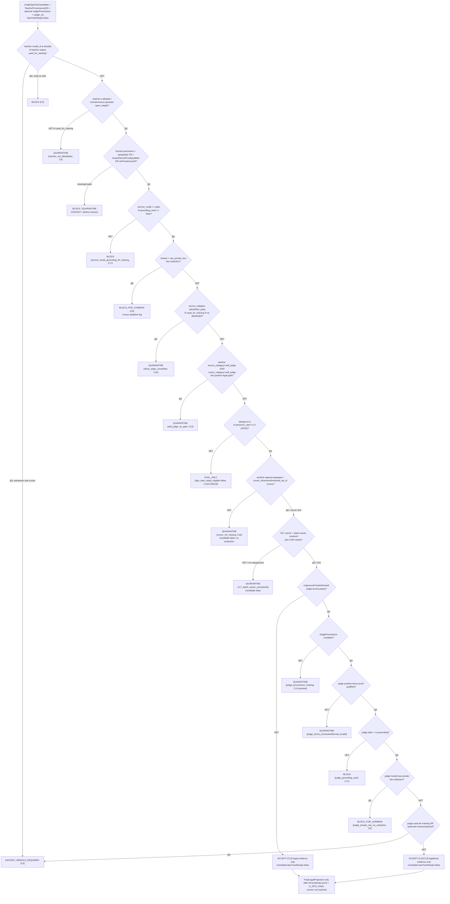

<!-- OCT-2026-SUPERSESSION-REVIEW-FOR-JULY-TP1 -->
**2026-10-14 SOURCE AUTHORITY CORRECTION (not a legal signoff, no real training performed):** The `CODE_FIRST → TP1_LOCAL_EVAL_ONLY → G_DPO_FINAL → DPO_TRAINING` and `DPO_LAST` statements below are a **July 2026 historical plan**, not verified binding restrictions for October. Their authorship/correctness as user-approved durable limitations was not proved; they could be a prior-model mistake. October D/09.09.26WorkLeft-02-teaching-chinese-model.md (R16, 13 Oct) and D/replanning/Kiro-Xiigen-RP01-Learning-First-Slice-Pack/RP01-V6-FAST-LEARNING-CONTRACT-2026-10-14.md require starting a genuine lawfully sourced teacher-authored two-sided DPO lesson and Student update promptly. **Do NOT elevate the old `TP1_LOCAL_EVAL_ONLY` or `G_DPO_FINAL` to a fresh training prohibition merely because this file says 'current'.** Preserve this section as historical design evidence; investigate its original reason separately, without blocking first E1 on speculation. ACTUAL safety still requires lawful model release/output use, authorised source/context/privacy, true provider identity and exact currently enforced K technical admission, immutable judged pair and one-use optimizer journal. User-facing human selection and exact pair judging are separate **CODEX GPT-6 Astra UltraCode** acts; **approved external open Chinese model** writes BOTH final sides. This amendment does not remove code-enforced safeguards or claim a model call was performed.
<!-- /OCT-2026-SUPERSESSION-REVIEW-FOR-JULY-TP1 -->

## Current Code-First Legal/Provenance Owner Overlay (2026-07-14)

current_implementation_authorization: YES_CODE_FIRST_ONLY
teacher_dpo_training_authorization: NO_TEACHER_DPO_TRAINING_UNTIL_G_DPO_FINAL
dpo_status: NOT_STARTED
dpo_priority: LAST
current_counters: 12 phases / 27 subphases / 64 substeps
current_owner_lane: block 08 owns legal verdicts, the 20-field `TeacherProvenance` compatibility contract, separate `JudgeProvenance`, and legal/provider admission; the active lane is `CODE_FIRST`.
canonical_sequence: CODE_FIRST -> TP1_LOCAL_EVAL_ONLY -> TP2_HOSTED_EVAL_ONLY (only after G-TP-4) -> G_DPO_FINAL -> DPO_TRAINING
business_vs_technical_gate: `APPROVED_BY_LUBA_2026-07-07` is a separate hosted-Qwen business approval. It is not `ProviderTermsProof`; TP2 starts only after `G-TP-4`, and remains evaluation-only until `G_DPO_FINAL` plus every legal/provider/provenance/data/evaluation/lifecycle gate passes.
closed_model_boundary: closed proprietary APIs may judge/evaluate only when allowed and recorded in separate `JudgeProvenance`; they never author chosen/rejected text, a DPO label, or a training target.
current_contract_and_residual_ledger:
- scorer sentinel / C18 contract: W-159 CONTRACT-CANON RESOLVED by DEC-02 №59; the teacher axis remains `source_category=open_weight`, scorer classification is carried separately, and C18 is a canonical fail-closed branch; this is a specification result, not runtime implementation proof;
- separate `JudgeProvenance` carrier and privacy/terms leg: SPEC CONTRACT DEFINED below, but implementation/runtime evidence is `NEEDS_LEGAL_MACHINE_REVIEW`;
- C6 positive hosted terms-proof qualification: SPEC CONTRACT DEFINED below; no concrete hosted proof is inferred from business approval, and execution verification remains `NEEDS_LEGAL_MACHINE_REVIEW`;
- C9 judge-side hosted/private-text privacy leg and C14 canonical six-value mapping: SPEC FAIL-CLOSED below; execution verification remains `NEEDS_LEGAL_MACHINE_REVIEW`;
- legal flowchart synchronization: SPEC SYNCHRONIZED below; implementation verification remains `NEEDS_LEGAL_MACHINE_REVIEW`;
- R17 normalized-row carrier type and batch owner: UNRESOLVED; every affected candidate is quarantined/eval-only, `DpoTrainReady=false`, and cannot be projected to `GraphDpoPair`;
- reference-checkpoint, reward-margin, held-out/source-disjoint evaluation, lifecycle/fresh-load/continue-training, and quantization gates: OPEN.
current_readiness_boundary: W-159 is resolved only at contract-canon level; the other listed residuals remain unresolved. `DpoTrainReady=false`, and no runtime implementation, DPO execution readiness, or whole-plan readiness is claimed.

## Historical Luba Product Decision Overlay (2026-07-07) — qwen3-together-v1 business-approved (S1-legal-profile-approve)

decision: The hosted `qwen3-together-v1` teacher route (Qwen3-Apache-2.0-via-Together) was recorded
as `APPROVED_BY_LUBA_2026-07-07` at the business-decision layer. This is historical evidence, not
current technical `ProviderTermsProof`, train/common authorization, or a C6 bypass. The current overlay
requires `HostedTermsProofQualified` for this route exactly as for every hosted route; missing or invalid
proof remains `QUARANTINE`, `DpoTrainReady=false`, and produces no `GraphDpoPair`.
scope_fence: approval is SPECIFIC to `qwen3-together-v1` only. DeepSeek(MIT) is same-clean-license
footing but NOT blanket-approved; Kimi(modified-MIT)/GLM/Mistral keep per-model verify-before-use;
closed models (Claude/OpenAI/Gemini) stay FORBIDDEN. The generic C6 machine rule is unchanged for
every other hosted route.
historical_operational_note: ZDR, per-call provenance, exact serving-id pinning, and a dated terms/privacy
archive were listed as operational controls. Under the current owner overlay they are inputs to the
positive proof format, not substitutes for it and not evidence that C6 or `G-TP-4` passed.
historical_supersession_claim: the older claim that the hosted terms residual was closed by the business
decision is superseded. Business selection and technical terms/output-use proof are separate gates.
basis_recorded: legal part is a whitelist of allowed-to-train models (Qwen3 Apache-2.0 =
training/distillation permitted, Luba-chosen primary teacher); Together ToS 7.2 assigns customer all
right/title/interest in Output with no explicit no-distillation clause found (Fable web read
2026-07-07); ZDR ToS 3.3 available; Qwen3 Apache-2.0 confirmed on HF model card; Luba instruction
«Выведи маршрут из карантина — я изначально потребовала использовать только модели на которых можно
обучать». Recorded as a Luba product decision, not a lawyer sign-off.

## Historical Fable Coverage Repair Overlay (2026-07-05)

historical_fable_plan_readiness: PLAN_NOT_READY / FABLE_GAP_REPAIR_QUEUE
historical_fable_implementation_authorization: NO until fresh Luba approval after review
historical_demoted_current_verdict_basis: Newer Fable coverage evidence `claude-fable-plan-check-v1.md` and attachment `98cbe69a` supersede the previous final-readiness overlay. Fable reports 127 findings: 91 COVERED, 30 PARTIAL, 6 MISSING. Mental implementation from active-codex would still hit plan-level design/source/dependency blockers: R-B `llm mvp` 20-pass and `llm_mvp_core` 40-pass knowledge-library targets are accepted only as evidence-library closure, not readiness/implementation proof; R-G source addressability is incomplete; several shared contracts/readability/lifecycle carriers need plan-family repair. This is plan repair evidence only, not product implementation, not tests/builds/runtime/provider/training/checkpoint/git proof.
historical_demoted_current_verdict_classes: DESIGN_BLOCKER_CURRENT=FABLE_MISSING_AND_PARTIAL_ITEMS; CURRENT_REPAIR_QUEUE=FABLE_RB_RG_AND_PARTIAL_REPAIR; FABLE_EVIDENCE=claude-fable-plan-check-v1.md lines 35-153 and attachment 98cbe69a lines 32-79; CURRENT_LEDGER_ACCEPTANCE_BOUNDED_EVIDENCE=previous 50/50 planning-section acceptance remains historical/process evidence only and cannot override later Fable MISSING/PARTIAL findings; IMPLEMENTATION_AUTHORIZATION_GATE=NO until fresh Luba approval after review.
historical_classification_rule: Any older line in this file saying PLAN_READY_FOR_LUBA_REVIEW, Final Readiness Review Overlay, no unresolved design/dependency blocker, CURRENT_REPAIR_QUEUE=NONE_IDENTIFIED_BY_FINAL_READINESS_REVIEW, or parent final-readiness acceptance before this overlay is historical/pre-Fable evidence only unless it cites a later unquoted Luba instruction or later evidence-bound review after 2026-07-05.
historical_fable_gap_repair_addendum: active-codex-execution-42-fable-gap-repair-additions-20260705.md is the current repair map for R-B/R-G and the partial contract/readability/lifecycle additions.

## Pass31-Pass40 Consumer Sync (40-pass llm_mvp_core evidence library)

historical_sync_scope: evidence-only propagation from `active-codex-execution-knowledge-library-llm-mvp-core-40-pass.md` Pass31/40, Pass36/40, and Pass40/40. Current verdict remains `PLAN_NOT_READY / FABLE_GAP_REPAIR_QUEUE`; `implementation_authorization: NO`.

- Legal intake must keep the full path visible: `GraphDpoSourceRow -> GraphDpoPair -> TeacherProvenance -> LegalVerdict -> training batch -> checkpoint manifest -> promotion gate`.
- `TeacherProvenance` remains the legal envelope for teacher access mode, provider/model/license/version/request identity, provider terms, output-use permission, privacy/anonymization, grounding/search flags, common/adaptive scope, and closed-provider-output quarantine.
- External provider/API/Figma/Canva/html-css calls must be isolated behind a seam with a deterministic mock/fake expected response and a unit test proving no live network/provider call. The only allowed implementation-phase technical debt carrier is `C:\Users\lubao\Documents\xiigen\llm mvp\DPO LEARNING\codex-external-calls-mock.md`; this worker did not create it.
## Historical Pre-Fable Final Readiness Review Overlay (2026-07-05)
historical_pre_fable_plan_readiness: PLAN_READY_FOR_LUBA_REVIEW
historical_pre_fable_implementation_authorization: NO until fresh Luba approval after review
historical_final_readiness_review_scope: one bounded planning/governance readiness review only; no product implementation, tests, builds, runtime, browser, provider/API, model/training/checkpoint, git, branch, mergeability, PR, or product-readiness proof was run.
historical_pre_fable_current_verdict_basis: This final review read the required governance/skill gate markers, the two unique original-task/reference attachments, the minimum Claude baseline surfaces, the active-codex plan/board/matrix/source-map/legal/gate/ledger surfaces, and current status/search evidence. End-to-end mental simulation from the active plan found no unresolved design/dependency decision that an executor would have to choose before coding/testing. The prior PLAN_NOT_READY / PLAN_PARTIAL_REPAIR_QUEUE state after 0aa/Laplace/Kepler/Singer was retained for parent final-review acceptance; this overlay supplies that final bounded review. Remaining items are execution or approval gates only: fresh Luba implementation approval, local self-authored seed file creation, code implementation, tests/builds/runtime/training/checkpoint/fresh-load/ablation proof, same-scenario Path A/Path B host proof, mock/replacement-ledger proof, branch/mergeability/git proof if later authorized, final product review, and route-specific hosted TogetherAI/Qwen3 terms/output-use proof before hosted train/common use.
historical_pre_fable_current_verdict_classes: DESIGN_BLOCKER_CURRENT=NONE_IDENTIFIED_BY_FINAL_READINESS_REVIEW; CURRENT_REPAIR_QUEUE=NONE_IDENTIFIED_BY_FINAL_READINESS_REVIEW; CURRENT_LEDGER_ACCEPTANCE_BOUNDED_EVIDENCE=50/50 accepted planning sections after 2026-07-05 Pass37-Pass50/Singer repair, not 50 cycles, not 50 product reviews, not product proof, not test/build/runtime/provider/training/checkpoint/git proof; HOSTED_PROVIDER_PRE_USE_GATE_ROUTE_SPECIFIC=TogetherAI/Qwen3 proof required before hosted train/common use only, not a local self-authored v1 planning blocker; IMPLEMENTATION_AUTHORIZATION_GATE=NO until fresh Luba approval after review.
historical_classification_rule: Any older line in this file saying PLAN_NOT_READY / PLAN_PARTIAL_REPAIR_QUEUE, current verdict remains PLAN_NOT_READY, CURRENT_REPAIR_QUEUE, parent must run final readiness review, or no-go boundaries before this overlay is historical/pre-final-readiness-review evidence only unless it cites a later unquoted Luba instruction or later evidence-bound review after 2026-07-05.
---
artifact_type: ilearningdynamicgraph_plan_block_08_legal_teacher_gate
authority_source: latest unquoted Luba work order for DPO Legal Learning active execution chain
status: populated_now_planning_only
last_updated: 2026-06-29
write_scope: C:\Users\lubao\Documents\xiigen\llm mvp\dpo legal build\active-codex-execution-*.md
plan_phase_anchor: Ф2.1 (primary) + Ф2.1.1 / Ф2.1.2 / Ф2.1.3 + гейт-связки Ф2.2.2, Ф3.1.1, Ф6.2.1, Ф7.1.1, Ф10.2.1
canon_counters: 12 фаз / 27 подфаз / 64 подшага (Ф0…Ф11), нумерация Ф<P>.<SP>.<SS>
benchmark_read_only_source: codex-plan-08-legal-teacher-gate.md (НЕ редактируется)
canon_owner: блок 08 — владелец канона TeacherProvenance (20 полей; 13+5+2 RR6 service_mode/grounding_used) и вердикт-enum
---

# Блок плана 08 — Легальный teacher-гейт + provenance (владелец канона `TeacherProvenance`)

## Historical Readiness Repair Note — 2026-06-29 (superseded by 2026-07-14 overlay)

Historical boundary only: this section cannot override the current 2026-07-14 code-first overlay.

Attachment 429f flagged this block as stale when read as a mere "proposal" while
the Claude baseline already resolves the legal teacher-gate shape. Current
classification for planning is `RESOLVED_IN_PLAN_IMPLEMENTATION_PROOF_PENDING`:
closed proprietary outputs cannot be training teachers; open-weight permissive
or self-origin training data must pass `TeacherProvenance`, C16 client-origin
quarantine, Graph-DPO artifact triad, and provider/source terms gates; real
implementation proof, provider terms snapshots, and tests remain future work.
This note does not authorize implementation.

Автор: Claude (Opus 4.8 MAX), роль — автор полностью решённого блока плана в моём
namespace `claude-*`. Прежняя помета R2/R3 `PLAN-ONLY` является исторической и
**SUPERSEDED** текущим code-first overlay 2026-07-14: реализация кода разрешена, но
teacher/DPO authoring, проекция trainable Pair и training заблокированы до `G_DPO_FINAL`. Все цитаты кода — только реально
существующие, проверены чтением файлов, с `file:line`. Имена `ILearning*` из задачи
Любы — псевдонимы существующих контрактов (CANON-маппинг — мастер §A.3), а не новые
архитектурные уровни (A-LM-12 — закрытый список из 5 уровней).

Псевдоним этого блока отсутствует: блок 08 — **не уровень иерархии**, а
**легальный гейт-юнит** (`ILogicalUnit`, L2), который встраивается в строитель DPO
(блок 07, Ф3.1.1) и в гейт батча обучения (Ф2.2.2). Финальной authority обучения он
не несёт; он — обязательный фильтр строки перед тем, как она станет `dpo_train_ready`.

> **Якорь фазы (доска исполнения `claude-EXECUTION-CONTROL-BOARD`, evidence-only).**
> Этот блок-08 — источник канона для подфазы **Ф2.1** «`TeacherProvenance` + реестр +
> машина вердикта» (owner `sa-legal`), и его Gate B G1..G12 (§10) = exit-условие
> подшагов **Ф2.1.1 / Ф2.1.2 / Ф2.1.3**. Канон провенанса (20 полей) и вердикт-enum,
> определённые здесь, потребляются Ф2.2.1/Ф2.2.2 (канон `GraphDpoPair` + гейт батча),
> Ф3.1.1 (строитель), Ф6.2.1/Ф7.1.1 (judge/teacher-goal), Ф10.2.1 (FLOW-38
> better-output). Канонические счётчики плана: **12 фаз (Ф0…Ф11) / 26 подфаз / 59
> подшагов**, нумерация `Ф<P>.<SP>.<SS>`. Доска и мастер-план — evidence-only,
> здесь не правятся.

---

## 0а. Якорь задачи

```text
CURRENT TASK: написать МОЙ (claude-namespace) улучшенный блок-08 «легальный
              teacher-гейт + provenance» — план-решение Ф2.1 для ILearningDynamicGraph,
              человеческим русским, Part A-формат (§0 UML + §1 флоучарты + §2 алгоритм
              + §3 код-цитаты + §4 статус + §5 иерархия) с тест-стратегией, сохранив
              структуру бенчмарка (Authority Anchor / Canon / Gate B / Final Questions)
              и канонические счётчики (12 фаз / 27 подфаз / 64 подшага, Ф<P>.<SP>.<SS>)
              и CANON-инварианты (L5-машина без 6-го уровня A-LM-12; легальный
              teacher-гейт; запрет скрытого детерминизма A-LM-09/A-LM-13). Записать
              ровно в claude-plan-08-legal-teacher-gate.md.
NOT THE TASK: исполнять/тестировать/билдить код, запускать раннеры, тренировать,
              вызывать внешние AI/API/модели, git; править/создавать любые codex-*
              (только чтение), продолжать чужой codex-план или claude-00..07 каркас.
EVIDENCE-ONLY: codex-plan-08 (бенчмарк), codex-plan-04/07/10/12 (канон рёбер/DPO/
              lifecycle/детерминизма), codex-EXECUTION-CONTROL-BOARD /
              codex-ILEARNINGDYNAMICGRAPH-PLAN-v1 (канон фаз/счётчиков/Q3-Q5/R17),
              claude-00..07 (мой прежний каркас, evidence), claude-04/05/06 (мои
              политика/гайд/бриф — синхрон канона), реальный код llm_mvp_core
              (читается для цитат), скилы plan-review / trainable-architecture-decision /
              implementation-doc-uml.
```

## 0б. Где этот claude-блок осознанно лучше бенчмарка `codex-plan-08` (delta-нота, не слепая копия)

Бенчмарк `codex-plan-08` (49 строк) — это **компактная canon-карточка**: он
перечисляет 20 полей, 8 значений `SourceCategory`, вердикты и Gate B, но не
разворачивает их до Part A (нет UML, нет алгоритма по шагам, нет цитат `file:line`,
нет тест-стратегии, нет якоря фаз). Это законная роль карточки внутри большого
плана, но как **самостоятельный читаемый блок Part A** она не проходит гейт
читаемости (R3 / `implementation-doc-uml-SKILL.md` / Part A Completeness Contract).
Я её разворачиваю и чиню точечные расхождения:

| # | Слабое место бенчмарка `codex-plan-08` | Улучшение в этом claude-блоке |
|---|---|---|
| D1 | **Нет Part A.** Карточка не содержит §0 UML, §1 флоучартов с симуляциями ветвей, §2 алгоритма по шагам, §3 цитат `file:line`, §5 иерархии. | Полный Part A: §1 (что/зачем), §2 (8-шаговая машина вердикта в плоском русском + сигнатуры), §3 (цитаты `LearningMachineContracts.cs:26,30,208,245`, `DpoDataset.cs:18-26`, `ResultGapDpoWriters.cs:7-14/192-196`), §4 (статус), §5 (где гейт стоит в L2-L5), §0 (классдиаграмма с `note for` + per-connection симуляции; точный 19-строчный owner-list §4.1 + per-branch симуляции). |
| D2 | **Нет якоря фаз.** Карточка не привязана к `Ф<P>.<SP>.<SS>` (12/26/59). Читателю не видно, что это Ф2.1.1-3. | Явный якорь **Ф2.1** (Ф2.1.1 реестр/поля, Ф2.1.2 машина вердикта, Ф2.1.3 карантин `sonnet-*`), счётчики 12/26/59 (historical/pre-PASS26 Claude-baseline; текущий канон 12/27/64), связь Gate B ↔ exit-условие подшагов (§0, §9, §10). |
| D3 | **`raw_comparison_event` упомянут в скиле, но в карточке нет Graph-DPO Artifact Triad.** Бенчмарк говорит про `triad_field_presence_rate==1.0`, но не показывает три артефакта триады и их роль в `dpo_train_ready`. | Развёрнут **Graph-DPO Artifact Triad Gate** (ветки C15/C15b): `raw_comparison_event` + `legal_provenance_dpo_envelope` + `training_batch`; правило «строка без полной триады ⇒ вердикт `EVAL_ONLY` (`dpo_train_ready_eligible=false`), а не ACCEPT» (§3.3, §8.6, Gate B п.11). |
| D4 | **`SourceCategory` = 8 значений, но R17 (client/third_party) не выделен как определяющая ветка вердикта.** Карточка перечисляет `client_unverified/third_party` в enum, но не даёт ветку C16. | Добавлена **ветка C16 client-origin** (R17): `source_category ∈ {client_unverified, third_party} && used_for_training=true && provenance NOT положительно-allowlisted ⇒ QUARANTINE`; закрыт путь «отмыва» marker-absence ≠ open_weight; NEG-тест обязателен (§8.7, §3.3 шаг-8, Gate B п.10). |
| D5 | **Контаминация — одно стале число «19 файлов/72 вхождения».** Карточка цитирует recon-1 как факт, без честной пометки, что live-скан может отличаться. | **Честность по доказательствам** (CLAUDE.md «No Dishonest Answers»): держу recon-1 (19/72; 35/10 в reasoning) как **benchmark-sourced** число, но добавляю ноту: live re-scan `training-data/orchestration-reasoning/*.jsonl` на 2026-06-23 даёт другой объём, поэтому Ф2.1.3 обязан **пере-вывести `contaminated_rows_found` сканером на момент исполнения**, а не доверять стале-числу (§6.3). Привязал к реально существующему license-хелперу `IsAllowedCommonLicense` (`ResultGapDpoWriters.cs:192-196`) как точке расширения. |
| D6 | **Final Questions: 2 вопроса без привязки к мастер-§E.** Бенчмарк задаёт 2 вопроса, не связав их с каноном Q3/Q4/Q5. | §11 связывает мои финальные вопросы с мастер **Q3 (где хранить provenance), Q4 (allow-list teacher + судьба `sonnet-*`), Q5 (judge-политика)** и с двумя бенчмарк-вопросами FLOW-38/hosted-eligibility — без потери ни одного. |
| D7 | **Нет тест-стратегии (axis верификации).** Карточка даёт Gate B (исходы), но не план тестов untrained/trained. | Добавлена **тест-стратегия** (`plan-review-SKILL.md` testability gate / OP-55): U/BL/NEG/INT/QA/REG/UH + честный статус-PASS (это **гейт-юнит**, а не обучаемая модель — у него нет TA-PASS; есть `PASS_AS_HONEST_UNTRAINED_SCAFFOLD`-эквивалент для строк, которым он ставит вердикт `EVAL_ONLY`) (§9). |

CANON-инварианты сохранены: маппинг ролей Luba → реальные контракты (мастер §A.3);
5 закрытых уровней (A-LM-12); легальный teacher-гейт (closed = только judge при
`used_for_training=false`, контаминация → `DATASET_REBUILD_REQUIRED`); запрет
скрытого детерминизма (A-LM-09/A-LM-13). Pass37/latest-Claude current split:
`GraphDpoPair` is the exact 14-field canon owned by block 07 with nested
`TeacherProvenance`, while `TeacherProvenance` (20 fields: 13 base + 5 NEW + 2
RR6 `service_mode`/`grounding_used`) and the manifest/projection proof envelope
are owned here in block 08. Train-ready rows remain unit-level by `Level="unit"`.
При любом расхождении
числа полей или размещения `judge_model` между §A мастера и этим блоком —
**владелец канона TeacherProvenance — блок 08** (этот файл).

---

## 1. Что это и зачем (роль компонента в ILearningDynamicGraph)

**Легальный teacher-гейт — это «таможня» данных перед обучением графа.** Любая
DPO-строка (`GraphDpoPair`) до того, как стать `dpo_train_ready=true` и попасть в
`TrainBatchAsync`, проходит один обязательный пункт досмотра — `TeacherProvenanceGateUnit`.
Гейт отвечает на один вопрос: **«легально ли использовать эту строку как цель
обучения общей модели?»** и возвращает один из **6** вердиктов
`ACCEPT | QUARANTINE | BLOCK | DATASET_REBUILD_REQUIRED | BLOCK_FOR_COMMON | EVAL_ONLY`
(полный канон enum и роль `EVAL_ONLY` — §3.3).

Зачем это нужно именно для **обучаемого** графа. Граф учится предпочтениям
(chosen ≻ rejected) на парах. Если «лучшую» сторону пары сгенерировала закрытая
проприетарная модель (Claude / OpenAI / Gemini), то обучение общей модели на таком
chosen — это **дистилляция закрытой модели**, которую её условия использования
обычно запрещают. Поэтому правило жёсткое и без исключений:

- **teacher для дистилляции** (то, чей выход становится `chosen`/`rejected`-целью) —
  **только** после единого proof gate: `FamilyOf(model_id)` совпал с allowlist,
  declared license совпала с family/per-release `CanonicalLicense`, C5 license входит
  ровно в `{Apache-2.0, MIT, ProjectInternal, Synthetic}`, provider terms/output-use
  не pending, service mode plain/no grounding, и `TeacherProvenance` полон. **`RESOLVED_FROM_LEGAL_PART`:**
  Qwen3 (Apache-2.0) is the **primary permitted teacher** but hosted Together-style use remains
  `BLOCK`/`QUARANTINE` while terms proof is pending; Kimi K2 is `modified-MIT` «надо проверить до
  использования» ⇒ **verify-before-use**, NOT pre-admitted to C5, `BLOCK`/`EVAL_ONLY` until per-model
  license+terms verified; GLM/Mistral «проверить лицензию конкретной модели» ⇒ per-model
  canonical-license verification before any train/common use; DeepSeek/Kimi/Moonshot/GLM/Mistral are
  therefore not train-ready without exact per-release canonical-license + provider/output-use proof
  (legal part documented in `active-codex-execution-plan-09-auto-dpo-loop.md:1272-1274 (allowed teacher families / Разрешённые teacher-семейства)`; Legal source
  policy `RESOLVED_BY_ORIGINAL_TASK`, audit `active-codex-execution-original-task-authority-audit-20260629.md:57`);
- **judge** (тот, кто только ранжирует/ставит скаляр/пишет `wrong_reason`, но
  **не авторствует** текст chosen) — закрытую модель допускаем **только** при
  `teacher_output_used_for_training=false`;
- `closed_proprietary_model=true && teacher_output_used_for_training=true` ⇒
  **всегда** `DATASET_REBUILD_REQUIRED` (никакое «разрешение Luby» это не снимает —
  это инвариант скила `trainable-architecture-decision-SKILL.md` и
  `plan-review-SKILL.md` «DPO/distillation legal teacher provenance review gate»).

Граница ответственности (CANON R6 — тонкий агент, ядро в `llm_mvp_core`): гейт —
это `ILogicalUnit` внутри `llm_mvp_core`, не логика расширения. Агент/расширение его
не содержит и не дублирует; он лишь часть пайплайна построения DPO.

**Чем гейт НЕ является.** Он не выбирает skill, не маршрутизирует ребро, не несёт
обучаемого состояния и не является финальной authority обучения. Это
детерминистический **легальный фильтр** (honest internal/eval helper по скилу), и
именно так он и помечается: его исходы — провенанс-решение, а не «семантическое
качество модели». Семантику предпочтения учит L5-машина (блок 04) на строках,
которые этот гейт уже пропустил.

---

## 2. Концепт простыми словами (аналогия + машина вердикта по шагам)

### 2.1. Аналогия

Гейт — это **таможенник на въезде «фабрики обучения»**. Каждый ящик (DPO-строка)
несёт сопроводительный лист (`TeacherProvenance`, 20 граф: 13 базовых + 5 NEW + 2 RR6
`service_mode`/`grounding_used`). Таможенник:

1. читает, **кто изготовил товар** (`model_id`) и **кто его оценивал** (`judge_model`);
2. сверяет изготовителя со **«чёрным списком»** закрытых брендов (denylist) — и
   если бренд в чёрном списке, ставит штамп «закрытый» **сам** (не верит галочке в
   листе);
3. проверяет, **для чего ящик ввозят**: на склад обучения (`used_for_training=true`)
   или только в лабораторию оценки (`used_for_training=false`);
4. проверяет **лицензию и снимок условий** (license + `terms_snapshot_ref`),
   **географию** (`geography_export_constraint`), **service-mode/grounding** (RR6)
   и **нет ли внутри личных данных без редакции** (`raw_private_text_copied` /
   `redaction_policy_ref`);
5. ставит один из штампов: **пропустить** (ACCEPT), **на карантин** (QUARANTINE),
   **завернуть** (BLOCK), **пересобрать партию** (DATASET_REBUILD_REQUIRED),
   **только на личный склад, не в общий** (BLOCK_FOR_COMMON) или **только в
   лабораторию оценки, не на склад обучения** (EVAL_ONLY — легально чисто, но
   train-ineligible; 6 значений по §3.3).

Главное правило таможни: **отсутствие маркера ≠ «чисто»**. Пустой провенанс — это
не ACCEPT, а как минимум QUARANTINE. ACCEPT даётся только при **положительно
доказанной** легальности (allowlist-match + полный провенанс + триада артефактов).

### 2.2. Машина вердикта `TeacherProvenanceGateUnit.Evaluate` — 8 шагов (плоский русский, без кода)

Класс **`TeacherProvenanceGateUnit`** (NEW, L2 `ILogicalUnit`), метод
**`Evaluate(TeacherProvenance prov, JudgeProvenance? judgeProv, RowUsageContext ctx)`** → **`TeacherProvenanceGateResult`**
(поля: `legal_verdict`, `reason`, `legal_evidence_eligible`, `triad_present`,
`closed_proprietary_model_derived`). Параметры: `prov` — 20-польный провенанс строки
(13 базовых + 5 NEW + 2 RR6 `service_mode`/`grounding_used`);
`ctx` — как строку хотят использовать (`used_for_training`, уровень unit/edge/graph,
ссылки на три артефакта триады). Алгоритм:

```text
Шаг 1. ScanContamination(prov)
  Сканируем И model_id, И judge_model на маркеры закрытых: sonnet|claude|gpt|openai|gemini.
  Маркер найден в любом из двух полей → пометить contamination_detected=true (вход в C-ветки ниже).

Шаг 2. ClosedBlockByDenylist(prov.model_id)   ← идентичность важнее флага (R2)
  closed = IsClosedByDenylist(model_id).  // флаг closed_proprietary_model ВЫВОДИТСЯ из denylist,
                                          // а не принимается на веру из входа.
  Если closed && ctx.used_for_training == true:
        → BLOCK (а если строка уже помечена train-ready/в train-наборе → DATASET_REBUILD_REQUIRED).  [C2/C3]

Шаг 3. LookupAllowedTeacher(prov.model_id, prov.hosting_provider)
  Нет в allowlist и нет положительного open_weight-доказательства → не молчать.
  Если used_for_training && НЕ allowlisted → QUARANTINE (reason teacher_not_allowlisted).  [C4]

Шаг 4. LicenseAndTermsGate(prov)
  model_license ∉ {permissive открытые} при used_for_training → BLOCK (reason license_incompatible).  [C5]
  Для hosted-маршрута positive allow означает ТОЛЬКО HostedTermsProofQualified(proof, exact_use):
        proof_status==POSITIVE; provider/model/version совпадают с вызовом; exact_use явно содержит
        текущий eval-only ИЛИ teacher-output-for-training scope; immutable snapshot_ref+sha256,
        captured_at и expires_at/no_expiry заданы; output-use/derivative/training rights заданы явно;
        privacy/ZDR/retention/pass-through поля заданы; service_mode==plain; grounding_used==false.
  Business approval, bool provider_terms_checked и строка, которая просто не UNKNOWN/PENDING,
        НЕ квалифицируют proof. Missing proof → QUARANTINE (terms_snapshot_missing);
        malformed, mock://, DRAFT-*, self-hosted retention ref, provider/model/use mismatch
        → QUARANTINE (terms_snapshot_format_invalid).  [C6, hosted-нога]
  local_self_hosted(prov) && used_for_training && (terms_snapshot_ref НЕ несёт ссылку вида
        SELF_HOSTED_LOCAL_RETENTION_POLICY_* ИЛИ model_version НЕ несёт запиненный sha256-digest
        (значение PENDING_PIN_AT_PULL))
        → QUARANTINE (reason self_hosted_retention_or_pin_missing).  [C6, self-hosted-нога]
        // У self-hosted маршрута провайдерских ToS НЕТ (terms_basis=SELF_HOSTED_NO_PROVIDER_TERMS,
        // §3.5.2): reason terms_snapshot_missing к нему НЕ применяется — ложный C6-карантин закрыт.
        // Его terms-ось = локальная retention policy + пин digest весов; deployment proof
        // дополнительно проверяется sidecar-гейтом (G14/G18) и G-TP-1.
  geography_export_constraint вне geography_allowed[] → QUARANTINE (reason geography_blocked).  [C7]

Шаг 4b. ServiceModeGroundingGate(prov)   ← RR6, ОТДЕЛЬНАЯ ось от brand-denylist
  Если used_for_training && (service_mode != "plain" ИЛИ grounding_used == true)
        → BLOCK (reason service_mode_grounding_for_training).  [C17]
  Gemini Grounding / Google Search / любой web-retrieval запрещён для train даже тогда,
  когда model_id входит в allowlist и denylist не сработал.

Шаг 5. ReproducibilityGate(prov)
  Стохастическая генерация без request_id/sampling/seed/checkpoint_hash
        → EVAL_ONLY (dpo_train_ready_eligible=false, reason provenance_not_reproducible).  [C8]
        // EVAL_ONLY — отвергаемый batch-гейтом вердикт, НЕ ACCEPT (фикс R17).

Шаг 6. PrivacyRetentionGate(prov)   ← под-гейт §8.5
  external_data_transfer(prov) && raw_private_text_copied == true && redaction_policy_ref == none
        → BLOCK_FOR_COMMON (личное идёт ТОЛЬКО на adaptive leg, R5; не в общий train).  [C9]
  judgeProv != null && judgeProv.judge_external_data_transfer &&
        judgeProv.judge_raw_private_text_copied == true && judgeProv.judge_redaction_policy_ref == none
        → BLOCK_FOR_COMMON (reason judge_private_raw_no_redaction).  [C9, отдельная judge-нога]
        // Прежний литерал hosting_provider != local ссылался на значение local, которое не было
        // определено ни в одном носителе домена hosting_provider (pre-existing дыра); предикат
        // переведён на external_data_transfer (владелец §3.1). Локальный self-hosted (LocalOllama)
        // C9 не триггерит — данные не покидают машину; защита common-модели от сырого приватного
        // текста сохраняется независимо: privacy_scope=personal_adaptive_only (§3.4) и
        // redaction_status==redacted_or_not_needed внутри common_promotion_allowed (§3.6).

Шаг 7. FirstPartyAndTriad(ctx)   ← Graph-DPO Artifact Triad Gate §8.6
  chosen_origin == first_party_deterministic → разрешено как baseline (semantic_quality_claimed=false).  [C10]
  Триада: raw_comparison_event + legal_provenance_dpo_envelope + training_batch.
  triad_present = все три ссылки заполнены и согласованы.
  Если НЕ triad_present → EVAL_ONLY (dpo_train_ready_eligible=false).  [C15/C15b]
        // легально чистая, но train-ineligible: отвергаемый вердикт, НЕ ACCEPT (фикс R17).

Шаг 8. JudgeBranch + ClientOrigin + финальный ACCEPT legal-evidence-only
  judge закрытый при used_for_training == false:
        если judgeProv отсутствует/неполон
              → QUARANTINE (reason judge_provenance_missing).  [C11-blocked]
        если JudgeHostedTermsProofQualified(judgeProv)==false
              → QUARANTINE (reason judge_terms_unchecked или judge_terms_format_invalid).  [C11-blocked]
        если judgeProv.judge_service_mode != "plain" ИЛИ judgeProv.judge_grounding_used == true
              → BLOCK (reason judge_grounding_used).  [C17 на judge-ноге]
        если judgeProv.judge_raw_private_text_copied && judgeProv.judge_redaction_policy_ref==none
              → BLOCK_FOR_COMMON (reason judge_private_raw_no_redaction).  [C9, judge-нога]
        если judgeProv.judge_used_for_training != false ИЛИ judgeProv.judge_did_not_author_chosen_rejected != true
              → DATASET_REBUILD_REQUIRED (reason judge_became_teacher).  [C12]
        иначе продолжить общую машину; judge-only не завершает её ранним ACCEPT.  [C11]
  Если судейский «better» становится chosen → used_for_training=true и closed ⇒ DATASET_REBUILD_REQUIRED.  [C12]
  source_category==self_judge ИЛИ scorer_category==self_judge без положительного legal gate
        → QUARANTINE (reason self_judge_no_gate).  [C14]
  source_category ∈ {client_unverified, third_party} && used_for_training && НЕ положительно-allowlisted
        → QUARANTINE (reason client_origin_unverified).  [C16]  ← R17, закрыт путь «отмыва»
  ПОСЛЕ C15/C15b: judge_model имеет sentinel-форму (`^__.+__$`) И
        (`judge_model` не зарегистрирован ИЛИ отсутствует/пуст хотя бы один из
         scorer_id, scorer_version, threshold_set_id)
        → QUARANTINE (reason scorer_ref_missing), Candidate.DpoTrainReady=false,
          TriadLegalProjection запрещена.  [C18]
  Зарегистрированный sentinel с полным scorer-sidecar только ПРОДОЛЖАЕТ eval-машину:
        регистрация не даёт ACCEPT, DpoTrainReady или автоматическую проекцию.
  R17 normalized-row carrier type или batch owner не определён
        → QUARANTINE (reason r17_batch_owner_unresolved), Candidate.DpoTrainReady=false.
  Иначе, если все гейты прошли И провенанс полон (presence_rate==1.0 по 20 полям,
  включая RR6 `service_mode`/`grounding_used`) И triad_present:
        → ACCEPT, legal_evidence_eligible = true; `DpoTrainReady` still requires the full predicate and `G_DPO_FINAL`.  [C13 only; C14 is QUARANTINE]
```

Возврат: `legal_verdict` + `reason`-код + флаг `legal_evidence_eligible`. Даже `ACCEPT`
оставляет `GraphDpoPairCandidate.DpoTrainReady=false`; trainable `GraphDpoPair` создаёт только
`TriadLegalProjection.Project(candidate, fullPredicateProof, G_DPO_FINAL)` после полного предиката ниже.
**Единое предусловие `DpoTrainReady=true` на строке `GraphDpoPair`** (Ф2.2.1):

```text
DpoTrainReady =
  g_dpo_final_passed &&
  legal_verdict == ACCEPT &&
  provider_terms_proof_passed_or_not_applicable &&
  model_license_proof_passed_or_not_applicable &&
  teacher_authoring_provenance_passed_or_self_deterministic &&
  closed_proprietary_training_target_absent &&
  provenance_field_presence_rate == 1.0 &&
  row_sidecar_ref_match_rate == 1.0 &&
  judge_provenance_passed_or_not_used &&
  data_scope_accept && split_accept && triad_present && authority_provenance_accept &&
  held_out_source_disjoint_eval_passed && reward_margin_gate_passed &&
  reference_checkpoint_gate_passed && fresh_load_gate_passed &&
  continue_training_gate_passed && lifecycle_gate_passed && quantization_gate_passed &&
  overlap_ok && reason_ok && candidate_order_invariant
```

Текущее значение `false`: TP1/TP2 — только evaluation, `G_DPO_FINAL` не пройден.

---

## 3. Канон (нормативная часть) — owner block 08

### 3.1. `TeacherProvenance` — 20-field compatibility contract; full `JudgeProvenance` is separate

**13 базовых:** `teacher_access_mode`; `hosting_provider`; `model_id`;
`model_license`; `model_version`; `request_id`; `provider_terms_checked`;
`teacher_output_used_for_training`; `closed_proprietary_model`; `source_ref`;
`source_sha256`; `contamination_markers`; `judge_model`. The legacy `judge_model`
field is only a correlation/contamination sentinel retained for the exact 20-field compatibility
contract. It is not judge provenance. Full judge model/provider/request/terms/privacy/grounding
evidence is carried by separate `JudgeProvenance`, and no judge output becomes teacher authoring material.

**5 NEW (бенчмарк-дельты T2/T3/T5):** `terms_snapshot_ref` (T2);
`geography_export_constraint` (T2); `source_category` (T5);
`raw_private_text_copied` (T3); `redaction_policy_ref` (T3).

**2 RR6 (service-mode ban / grounding):** `service_mode` — enum
`plain | grounding | web_search | retrieval_tool | code_exec | unknown`;
`grounding_used` — bool. Эти поля являются отдельной осью риска от brand-denylist:
allowlist-модель в режиме Gemini Grounding / Google Search / web retrieval всё равно
подмешивает сторонний web-контент, чья лицензия и ToS не равны лицензии модели.
Поэтому `used_for_training && (service_mode != "plain" || grounding_used == true)`
даёт C17 BLOCK независимо от allowlist.

> **Канон-нота (владелец 08).** `judge_model` — поле **внутри** `TeacherProvenance`,
> **не** отдельное верхнеуровневое поле `GraphDpoPair`. `closed_proprietary_model` —
> **вычисляемый** флаг (выводится из denylist по `model_id`, шаг 2), хранится для
> аудита, но на входе ему не доверяют.

> **Канон-нота (владелец 08) — домены значений `teacher_access_mode` / `hosting_provider` (Pass02 двухфазной адаптации, 2026-07-13).**
> `teacher_access_mode` — enum из **6** значений:
> `first_party_contract | open_weight_hosted | local_self_hosted_open_weight | public_domain_standard | human_authored | closed_proprietary`.
> НОВОЕ значение `local_self_hosted_open_weight` = открытые permissive-веса запущены локально
> на своей машине (Этап 1 `TP1_LOCAL`, профиль `qwen35-local-v1`, §3.5.2). Прежний 5-значный
> комментарный перечень — исторический/pre-Pass02; носители enum-домена сведены
> к 6-значному владельцу (plan-01 §5.2, plan-09 §5.2) в том же решении.
> `hosting_provider` — значения включают нейтральных провайдеров (`Together/Fireworks/OpenRouter/Novita/DashScope`),
> first-party хосты (`DeepSeek/Moonshot/Z.ai`), **`LocalOllama`** (self-hosted локальный хост Этапа 1) и `none` (teacher отсутствует).
> Производные предикаты гейта (НЕ новые поля; полей остаётся ровно 20):
> `open_weight_hosted(prov) := prov.teacher_access_mode == open_weight_hosted`;
> `local_self_hosted(prov) := prov.teacher_access_mode == local_self_hosted_open_weight`;
> `external_data_transfer(prov) := prov.teacher_access_mode ∈ {open_weight_hosted, closed_proprietary}`
> (данные покидают машину только на hosted/closed маршрутах; для `local_self_hosted_open_weight`
> предикат всегда false). Принадлежность строки этапу (`TP1_LOCAL`/`TP2_HOSTED`) выводится из
> `hosting_provider` + `teacher_access_mode`; 21-е поле не создаётся (single-owner канон overlay).

### 3.1a. Positive hosted terms-proof format (C6 owner contract)

`HostedTermsProof` is a separate immutable sidecar record, not a boolean and not business approval:

```text
HostedTermsProof {
  proof_status = POSITIVE;
  hosting_provider; model_id; model_version;
  exact_use_scope = eval_only | teacher_output_for_training;
  snapshot_ref; snapshot_sha256; captured_at; expires_at_or_no_expiry;
  output_use_rights; derivative_use_rights; training_use_rights;
  privacy_terms_ref; zdr_status; retention_policy_ref; provider_pass_through_terms_ref;
  service_mode; grounding_used;
}
```

`HostedTermsProofQualified(proof, call, exact_use)` is true only when every field is present,
`proof_status=POSITIVE`, provider/model/version and exact use match the call, the snapshot reference is
immutable and hash-bound, the rights fields positively cover the exact use, privacy/ZDR/retention/
pass-through fields are explicit, and `service_mode=plain && grounding_used=false`. A business approval,
`provider_terms_checked=true`, a mutable URL, `mock://*`, `DRAFT-*`, `PENDING_*`, `UNKNOWN`, a local
retention-policy reference, or a provider/model/use mismatch does not qualify. Missing proof gives C6
`QUARANTINE(terms_snapshot_missing)`; invalid proof gives C6
`QUARANTINE(terms_snapshot_format_invalid)`. This defines the format at specification level only:
no concrete provider route is currently certified by this paragraph and `G-TP-4` remains required.

### 3.1b. Separate `JudgeProvenance` contract (C9/C11/C12/C17 owner contract)

`JudgeProvenance` is not the legacy `TeacherProvenance.judge_model` sentinel. Its required fields are:

```text
JudgeProvenance {
  judge_access_mode; judge_hosting_provider; judge_model_id; judge_model_version; judge_request_id;
  judge_provider_terms_checked; judge_terms_proof_ref; judge_terms_snapshot_ref;
  judge_terms_snapshot_sha256; judge_terms_proof_status;
  judge_service_mode; judge_grounding_used;
  judge_external_data_transfer; judge_raw_private_text_copied; judge_redaction_policy_ref;
  judge_privacy_terms_ref; judge_zdr_status; judge_retention_policy_ref;
  judge_used_for_training=false; judge_did_not_author_chosen_rejected=true;
  judge_output_ref; judge_output_sha256;
}
```

For a hosted/closed judge, any missing required judge field yields C11-blocked
`QUARANTINE(judge_provenance_missing)`. A missing/non-positive/invalid judge terms proof yields
`QUARANTINE(judge_terms_unchecked|judge_terms_format_invalid)`. Judge grounding/search yields C17
`BLOCK(judge_grounding_used)`. Hosted judge transfer of raw private text without a redaction reference
yields the separate C9 judge leg `BLOCK_FOR_COMMON(judge_private_raw_no_redaction)`. Any judge output
used for training or authoring chosen/rejected yields C12 `DATASET_REBUILD_REQUIRED(judge_became_teacher)`.
Only a complete positive judge record may contribute legal/evaluation evidence; it never contributes
teacher authoring material and never makes a candidate DPO-train-ready.

### 3.2. `SourceCategory` — значения (мой канон расширяет plan-08 T5)

`local`, `human`, `open_weight`, `hosted`, `deterministic_baseline`, `self_judge`,
**`client_unverified`**, **`third_party`**.

> Бенчмарк `codex-plan-08` перечисляет первые 6 в §3.1 и добавляет client/third_party
> в общий список; я фиксирую **все 8** как канон и делаю `client_unverified`/
> `third_party` **определяющими** для ветки C16 (R17). Нота согласована с
> `claude-EXECUTION-CONTROL-BOARD` Ф2.1.1 («мой канон расширяет plan-08 T5»).

W-159 contract boundary (DEC-02 №59): scorer-sentinel ownership and the separation of teacher
`SourceCategory` from scorer classification are canonical below. C18 (`scorer_ref_missing`) is active
in the specification: an unregistered sentinel or incomplete scorer sidecar remains
`GraphDpoPairCandidate(DpoTrainReady=false)`, receives `QUARANTINE(scorer_ref_missing)`, and cannot
reach `TriadLegalProjection`. A registered complete scorer merely continues evaluation and does not
auto-accept or make a row train-ready. Separately, the
R17 normalized-row carrier type and `batch_admits_only_when` owner are unresolved; affected client/
third-party records therefore remain `QUARANTINE(r17_batch_owner_unresolved)`, never a trainable pair.

### 3.3. Вердикт-enum (канон 08) — 6 значений

`ACCEPT | QUARANTINE | BLOCK | DATASET_REBUILD_REQUIRED | BLOCK_FOR_COMMON | EVAL_ONLY`.

`BLOCK_FOR_COMMON` (NEW, T3 §8.5): личный/raw-текст в hosted без редакции — строка
допускается **только** на adaptive leg (R5), но не в common train.

`EVAL_ONLY` (**NEW, фикс R17**): строка **легально чистая**, но **train-ineligible**
из-за неполной триады (§8.6, ветки C15/C15b) или невоспроизводимого конверта
(стохастика без `request_id`/`sampling`/`seed`/`checkpoint_hash`, ветка C8). Это
**отдельное вердикт-значение, а не ACCEPT**: ранее «eval-only» выражался как
`ACCEPT` + флаг `dpo_train_ready_eligible=false`, из-за чего batch-гейт §7 (который
ключится на `legal_verdict==ACCEPT`, а не на флаг строки) **физически пропускал**
такую строку в `TrainBatchAsync`. Теперь у неё **отвергаемый вердикт** `EVAL_ONLY`,
поэтому batch-гейт отсеивает её на уровне вердикта.

> **Канон-нота (владелец 08) — Verdict-Enum Reconciliation.** Авторитетный enum
> вердиктов — этот §3.3 (6 значений). Любой downstream-файл, перечисляющий **5**
> значений (`ACCEPT | QUARANTINE | BLOCK | DATASET_REBUILD_REQUIRED |
> BLOCK_FOR_COMMON`) без `EVAL_ONLY`, **стале** и обязан добавить `EVAL_ONLY` для
> совпадения с владельцем (это evidence-only файлы; правка — отдельным work-order по
> их namespace, здесь не правятся).
>
> **Статус носителей verdict-enum (read-back 2026-06-23 — все downstream-цели
> синхронизированы на 6 значений, evidence-only):**
> - `claude-plan-09-auto-dpo-loop.md` (строка P-09, потребитель канона) — **СИНХРОНИЗИРОВАН
>   (read-back 2026-06-23):** verdict-enum на `:577-578` уже **6-значный**
>   `ACCEPT | QUARANTINE | BLOCK | DATASET_REBUILD_REQUIRED | BLOCK_FOR_COMMON | EVAL_ONLY`
>   и подписан корректно «**потребитель канона; владелец — `claude-plan-08` §3.3**» (без
>   мис-атрибуции владельцу). Прежнее указание на `:569-570` как «stale 5-value carrier»
>   снято: `:569-570` — это перечень **5 NEW полей `TeacherProvenance`**
>   (`terms_snapshot_ref`/`geography_export_constraint`), а **не** verdict-enum; смешивать
>   «5 NEW полей провенанса» с «5-значным enum» нельзя. Leak R17 закрыт у потребителя; правки
>   plan-09 не требует.
> - `claude-ILEARNINGDYNAMICGRAPH-PLAN-v1.md` (мастер §A.4) — **СИНХРОНИЗИРОВАН (read-back
>   2026-06-23):** verdict-enum мастера на `:194-196` уже **6-значный**
>   `ACCEPT | QUARANTINE | BLOCK | DATASET_REBUILD_REQUIRED | BLOCK_FOR_COMMON | EVAL_ONLY`
>   (выровнен с владельцем §3.3), и §C.4 P-08 несёт ту же 6-значную семантику — мастер
>   **НЕ** внутренне противоречив. Прежнее указание на `:192-193` как «stale 5-value
>   carrier» снято: `:192-193` — это перечень **5 NEW полей `TeacherProvenance`**
>   (`terms_snapshot_ref`/`geography_export_constraint`/`source_category`/
>   `raw_private_text_copied`/`redaction_policy_ref`), а **не** verdict-enum; смешивать
>   «5 NEW полей провенанса» с «5-значным enum» нельзя. Правки мастер §A.4 не требует.
> - `claude-EXECUTION-CONTROL-BOARD.md` (канон-блок Ф2 на `:601` и «ЕДИНЫЙ СЛОВАРЬ ВЕРДИКТОВ
>   Ф2» на `:1418`) — **СИНХРОНИЗИРОВАН (read-back 2026-06-23):** оба места уже несут **6
>   значений** `ACCEPT/QUARANTINE/BLOCK/BLOCK_FOR_COMMON/DATASET_REBUILD_REQUIRED/EVAL_ONLY`
>   (с пометкой «PENDING — пред-вердиктное gate-состояние вне канон-enum»), а batch-reject-наборы
>   Ф2.1.2/Ф2.2.2 включают `EVAL_ONLY` как train-ineligible. Прежние номера строк `:588`/`:1397`
>   устарели (доска выросла) и указывали на не-enum содержимое; правки доска не требует.
> - `claude-04-dpo-legal-model-policy.md` — здесь разделение маршрутов `eval_only` /
>   `evidence_only` / `train_personal` / `train_common`; **секции с 5-значным вердикт-enum в
>   этом файле сейчас нет**, поэтому правки не требует. При появлении такой секции она должна
>   нести 6 значений.
>
> **Инвариант (усилен, форвард-правило R17):** *любой ссылающийся блок (06/07/09/10), мастер
> §A или строка доски, перечисляющая вердикт-enum **без** `EVAL_ONLY`, неполна по R17 —
> legal-clean-но-невоспроизводимая/без-триады строка (C8/C15/C15b) при 5-enum несёт `ACCEPT`
> и буквально проходит предикат batch-гейта `legal_verdict==ACCEPT`, физически попадая в
> `TrainBatchAsync`; приёмка R14 блокируется до добавления `EVAL_ONLY` у всех носителей.*
> Все правки здесь — только в claude-08 (перечень носителей + инвариант); evidence-файлы
> (claude-09/master/board) правятся отдельным work-order по их namespace.
>
> **Delta vs бенчмарк `codex-plan-08`:** бенчмарк (`codex-plan-08-legal-teacher-gate.md:27`)
> уже держит `EVAL_ONLY` как первоклассный вердикт в наборе из 6
> (`ACCEPT, BLOCK_FOR_HOSTED, BLOCK_FOR_COMMON, DATASET_REBUILD_REQUIRED, QUARANTINE,
> EVAL_ONLY`). Я **выравниваюсь с бенчмарк-`EVAL_ONLY`** (осознанно, фикс R17), но
> **без** избыточного `BLOCK_FOR_HOSTED`: hosted-кейс у меня уже покрыт связкой
> `BLOCK` (license/terms, C5/C6) + `BLOCK_FOR_COMMON` (privacy, C9) + `QUARANTINE`
> (geography/teacher/client, C4/C7/C16), поэтому отдельный `BLOCK_FOR_HOSTED` не
> вводится — это сознательная дельта, а не пропуск.

### 3.4. `LegScope` — значения

`CommonGlobal`, `PersonalAdaptive`, `EvalOnly`, `Quarantine`.

Pass35 storage/privacy metadata required on every train-candidate row and provenance sidecar:

- `storage_scope`: `CommonGlobal`, `PersonalAdaptive`, `EvalOnly`, or `Quarantine`.
- `privacy_scope`: `common_allowed`, `personal_adaptive_only`, `redacted_common_candidate`, or `forbidden`.
- `data_class`: `synthetic_self_authored`, `project_internal`, `client_private`, `client_unverified`, `third_party`, `closed_provider_output`, or `hosted_open_weight_pending_terms`.
- `CommonTrainReady`: true only when `storage_scope=CommonGlobal`, `privacy_scope=common_allowed`, `legal_verdict=ACCEPT`, provenance/license/terms/output-use/redaction/split proof is positive, and no explicit Luba approval is missing for cross-boundary promotion.
- `ClientAdaptiveReady`: true only for a later activated personal/adaptive route; it never mutates common/global assets.
- `quarantine_reason`: required whenever `storage_scope` is `Quarantine` or common use is blocked.

Missing or contradictory storage/privacy metadata is `QUARANTINE` / `DpoTrainReady=false`; it cannot default to common/global training.

### 3.5. `AllowedTeacherRegistry` (данные, не код)

Файл `allowed-teacher-registry.json`: `allowlist` (Qwen3/DeepSeek/Kimi/GLM/Mistral),
`denylist` (Claude/OpenAI/Gemini), список нейтральных провайдеров
(Together/Fireworks/OpenRouter/Novita/DashScope/DeepSeek/Moonshot/Z.ai),
`self_hosted_hosts` (**LocalOllama** — локальный self-hosted хост Этапа 1),
`host_roles = {first_party, neutral_reseller, self_hosted}`,
`family_alias_map` (явные алиасы релизов к семье: `Qwen3.5`/`qwen3.5-9b*`/`Qwen/Qwen3.5-9B` → `Qwen3`; НЕ fuzzy),
`provider_profiles` (ссылки на владельца профилей: `qwen3-together-v1` §3.5.1/§3.5.1b, `qwen35-local-v1` §3.5.2),
`geography_allowed[]`, `forbidden_service_modes_for_training`, and provider terms fields.
Реестр — **данные**; решение по идентичности (`IsClosedByDenylist`) читает denylist,
а RR6 service-mode/grounding ban проверяется отдельно от brand-denylist.

#### W-159. Канонический реестр scorer-сентинелов (единственное определение)

```yaml
judge_model_sentinels:
  __deterministic_domain_scorer__:
    scorer_category: deterministic_baseline
    runtime_authority: false
    required_sidecar_fields: [scorer_id, scorer_version, threshold_set_id]
```

Это единственное определение реестра; остальные active-carrier-файлы только ссылаются на этот
owner-блок. Оси разделены: Qwen-учитель сохраняет `TeacherProvenance.source_category=open_weight`,
а scorer-sidecar несёт `scorer_category=deterministic_baseline`, `scorer_id`, `scorer_version` и
`threshold_set_id`. Поле `threshold_set_id` — wire/sidecar alias единственного owner-поля
`threshold_set` из plan-10; это не второй threshold-канон. `deterministic_baseline` уже входит в
восьмизначный `SourceCategory`, но в W-159 используется как значение отдельной scorer-классификации;
значение `first_party_deterministic` в `SourceCategory` не добавляется (оно остаётся допустимым только
на независимой оси `chosen_origin`). Регистрация не является runtime-authority и не даёт строке
`ACCEPT`, `DpoTrainReady=true` или право на проекцию.

`LegalVerdict_count=6`; `SourceCategory_count=8`; W-159 не добавляет ни одного enum-значения.

> **Роль-аннотация имён провайдеров (Pass02R-P05, `Provider-name role disambiguation rule`).**
> Каждое имя в списке нейтральных провайдеров несёт `HostRole`, потому что два бренда
> одновременно являются семейством модели в `allowlist` и хостом в нейтральном списке:
> - **Together / Fireworks / OpenRouter / Novita / DashScope** — чистые нейтральные reseller-хосты
>   (`HostRole=neutral_reseller`): их ToS-снимок — это ToS реселлера, отдельный от first-party ToS
>   семейства модели.
> - **DeepSeek** — двойная роль: как `ModelFamily=DeepSeek` в allowlist И как `Host=DeepSeek` в
>   нейтральном списке. `Host=DeepSeek` для модели DeepSeek = `HostRole=first_party` (нужен ToS/
>   use-policy самого DeepSeek). Модель DeepSeek через Together/Fireworks/OpenRouter/Novita/DashScope
>   = `HostRole=neutral_reseller` (ToS реселлера, отдельный `terms_snapshot_ref`).
> - **Moonshot** — first-party хост семейства Kimi (`HostRole=first_party` только при доказанных
>   first-party terms; иначе Kimi берётся через нейтральный host со своим proof), см. ADD-08 пример.
> - **Z.ai (Zhipu)** — двойная роль: хостит собственное семейство `GLM`. `Host=Z.ai` для GLM =
>   `HostRole=first_party` (Z.ai ToS + Zhipu use-policy snapshot). `Host=Z.ai` для НЕ-GLM модели =
>   `HostRole=neutral_reseller` со своим reseller-ToS. Одну `terms_snapshot_ref` эти две роли не делят.
>
> Правило выбора профиля: для бренда, присутствующего в обоих списках, `SelectProvider` обязан
> зафиксировать `HostRole ∈ {first_party, neutral_reseller, self_hosted}`; `terms_snapshot_ref` и output-use proof —
> **per `HostRole`**. Нейтральная метка хоста не может быть переиспользована как доказательство
> first-party-terms. НОВЫЙ член `self_hosted` (Pass02, 2026-07-13): локальный запуск открытых
> весов на своей машине (`LocalOllama`); провайдерского ToS у этой роли НЕТ — terms-ось =
> локальная retention policy (`terms_basis=SELF_HOSTED_NO_PROVIDER_TERMS`) + лицензия весов
> модели (обязательна, C5 не ослабляется). `terms_snapshot_ref` роли `self_hosted` — ссылка на
> retention-policy-артефакт, не на провайдерский ToS. Полные две строки дисамбигуации
> (GLM/Z.ai и DeepSeek) — в §ADD-08 Mirror.

#### 3.5.1. RR6 provider profile: `qwen3-together-v1` — business-approved, technical gates pending

> **CURRENT PROFILE STATE (owner canon):** `BUSINESS_APPROVED_TECHNICAL_GATES_PENDING`.
> `APPROVED_BY_LUBA_2026-07-07` selects the route at business level only. It is not
> `HostedTermsProof`, does not remove C6, does not pass `G-TP-4`, and does not authorize
> teacher-output training. Before `G-TP-4` the route is blocked/quarantined; after it passes,
> TP2 is hosted evaluation-only. `DpoTrainReady=false` until the full predicate plus
> `G_DPO_FINAL`, and no current route-specific exception exists.

**Current business-selected, technically gated profile (owner canon):**

```text
ProviderConfig {
  ProviderConfigId               = "qwen3-together-v1"
  ProfileState                   = "BUSINESS_APPROVED_TECHNICAL_GATES_PENDING"
  HostingProvider                = "Together"     ; HostRole = neutral_reseller
  ModelId                        = "Qwen/Qwen3-235B-A22B"   ; pin exact serving id + version at cutover
  ModelLicense                   = "Apache-2.0"
  ServiceMode                    = "plain"
  GroundingUsed                  = false
  ProviderTermsChecked           = false
  TeacherOutputUsedForTraining   = false
  ClosedProprietaryModel         = false
  TermsSnapshotRef               = "PENDING_POSITIVE_HOSTED_TERMS_PROOF"
  TermsBasis                     = "BUSINESS_DECISION_IS_NOT_TECHNICAL_PROOF"
  TermsCheckStatus               = "NEEDS_G_TP_4"
  Role                           = "teacher_eval_only_after_G_TP_4"
  ; required proof/control fields — see §3.1a/§3.5.1b:
  EnableZdrBeforeFirstRequest    = true
  ProvenanceJsonPerCall          = required
  PinServingModelIdAtCutover     = required
  VerbatimTermsArchive           = recommended_operational_artifact
}
```

`SelectProvider` may retain this identifier as the business-selected TP2 candidate, but it MUST
NOT call it before `G-TP-4` and MUST NOT use it for train/common authoring. After `G-TP-4`, only
`TP2_HOSTED_EVAL_ONLY` is allowed. License family membership, business approval, and historical
terms reading are inputs; only the positive §3.1a proof format can satisfy the technical gate.

> **SEQUENCED 2026-07-13 (overlay-владелец двухфазности §6/§7, новее — `active-codex-execution-two-phase-local-remote-overlay.md`):** бизнес-одобрение `qwen3-together-v1` сохранено, НО hosted train/common вызов дополнительно гейтится `G-TP-4` (`ProviderTermsProof`) + `G-DPO-FINAL`. «MAY choose» здесь = business-approval-level, а НЕ разрешение hosted-вызова до `G-TP-4`. Текущий единый ответ: hosted train до `G-TP-4` = `BLOCK/QUARANTINE`. (Одобрение НЕ переоткрыто и НЕ удалено.)

> **Historical/pre-approval lock (2026-06-29..2026-07-06 evidence only — SUPERSEDED, retained not deleted):**
>
> ```text
> ProviderConfig {
>   ProviderConfigId     = "qwen3-together-v1"
>   HostingProvider      = "Together"
>   ModelId              = "Qwen/Qwen3-235B"
>   ModelLicense         = "Apache-2.0"
>   ServiceMode          = "plain"
>   ProviderTermsChecked = false
>   TermsSnapshotRef     = "PENDING_LUBA_OR_EXTERNAL_TERMS_REVIEW(Together ToS + Qwen3 use-policy)"
>   TermsCheckStatus     = "pending_external"
>   Role                 = "teacher"
> }
> ```
>
> Historical text (pre-approval): "`ModelLicense=Apache-2.0` is not provider ToS approval. Пока
> `ProviderTermsChecked=false` или `TermsSnapshotRef` начинается с
> `PENDING_LUBA_OR_EXTERNAL_TERMS_REVIEW(...)`, `SelectProvider` MUST NOT choose this hosted
> Qwen3/Together profile for train/common use. A forced row with this profile is `QUARANTINE`
> for terms pending." This remains historical wording, but its technical fail-closed effect is
> restored by the current overlay: the later business decision did not satisfy proof or C6.

#### 3.5.1b. Historical business-decision carrier — 2026-07-07 (not technical proof)

This section records only Luba's historical business selection of `qwen3-together-v1` and its
stated basis (Qwen3 Apache-2.0 preference and a favorable preliminary provider-terms reading).
It is not a lawyer sign-off, `HostedTermsProof`, `ProviderTermsProof`, C6 exception, hosted-call
authorization, or training authorization. It cannot mutate current technical fields.

Current technical state is fail-closed and owned by the 2026-07-14 overlay:

```text
provider_terms_checked=false
teacher_output_used_for_training=false
terms_snapshot_ref=PENDING_POSITIVE_HOSTED_TERMS_PROOF
terms_basis=BUSINESS_DECISION_IS_NOT_TECHNICAL_PROOF
terms_check_status=NEEDS_G_TP_4
current_route_before_G_TP_4=BLOCK_OR_QUARANTINE
current_route_after_G_TP_4=TP2_HOSTED_EVAL_ONLY
DpoTrainReady=false
```

ZDR, per-call provenance, exact serving-id/version pinning, and an immutable dated ToS/privacy
snapshot with hash are required inputs to the positive §3.1a proof format; they are not optional
substitutes for it. Business selection cannot set any proof bool, cannot remove C6, and cannot
permit authoring. The full predicate and `G_DPO_FINAL` remain mandatory after the evaluation phase.

Scope fence: the business selection is route-specific; DeepSeek/Kimi/GLM/Mistral remain
verify-before-use, and closed models (Claude/OpenAI/Gemini) remain judge/eval-only and never author
chosen/rejected, a DPO label, goal-training text, or a training target.

#### 3.5.1a. [HISTORICAL/pre-approval, SUPERSEDED by §3.5.1/§3.5.1b APPROVED_BY_LUBA_2026-07-07] BK5 DRAFT terms_snapshot for `qwen3-together-v1` (Fable-proposed grounded draft, 2026-07-07)

> **Historical business-decision input only.** This DRAFT fed the 2026-07-07 business selection but
> never became technical proof. Current owner values remain `provider_terms_checked=false`,
> `teacher_output_used_for_training=false`, and `terms_snapshot_ref=PENDING_POSITIVE_HOSTED_TERMS_PROOF`
> until `G-TP-4`; after that TP2 is eval-only. The business decision cannot supersede C6 or the
> positive §3.1a proof format.
>
> **Original scope note (historical, retained verbatim):** "§3.5.1 stays active: the lock's
> `ProviderTermsChecked=false` / `TermsSnapshotRef=PENDING_LUBA_OR_EXTERNAL_TERMS_REVIEW(...)`
> and its `SelectProvider MUST NOT ... for train/common use` rule remain in force **unchanged**.
> This 3.5.1a block writes a **DRAFT** terms_snapshot that becomes the replacement for the PENDING
> ref **only after Luba/legal confirm** a verbatim ToS/privacy archive. It does **not** flip
> `provider_terms_checked` to true, does **not** authorize hosted train/common use, and does **not**
> present any value below as a locked Luba decision. Each field carries its own LABEL, one-line
> rationale, and grounding citation." — superseded 2026-07-07.

```text
DRAFT terms_snapshot (label DRAFT_NEEDS_CONFIRM unless a stricter per-field label is shown):
  terms_snapshot_ref          = "DRAFT-together-qwen3-terms-20260707"
        [DRAFT_NEEDS_CONFIRM] replaces the PENDING ref ONLY after a Luba/legal-confirmed
        verbatim snapshot exists; until then §3.5.1 PENDING remains the active ref.
        grounding: this pass; not a captured verbatim archive.
  provider                    = "TogetherAI"  (HostRole = neutral_reseller)
        [DERIVED] TogetherAI hosting Qwen3 (a non-Together family) is a neutral-reseller route
        per §3.5 Provider-name role disambiguation; its ToS snapshot is the reseller ToS,
        separate from any Qwen/Alibaba first-party ToS.
        grounding: §3.5 role-disambiguation rule; ADD-08 Mirror.
  model_id                    = "Qwen/Qwen3-235B-A22B"  (pin exact serving id at cutover)
        [PROPOSED_DEFAULT empirically-tunable] exact HF/serving id to pin; the served id
        MUST be re-pinned to the provider's exact serving id at cutover and cross-checked
        against ObservedModelId (ADD-08 served_model_mismatch → BLOCK).
        grounding: HF model card `Qwen/Qwen3-235B-A22B`; supersedes the truncated
        `Qwen/Qwen3-235B` shorthand in the §3.5.1 lock for id-precision only.
  model_license               = "Apache-2.0"
        [DERIVED forced] confirmed live on the HF model card for the Qwen3 family; matches
        CanonicalLicenseOf(FamilyOf(Qwen3)) = Apache-2.0 (§Pass02R-P07 map), so C5 sub-check
        passes on the license axis. License != provider ToS approval.
        grounding: HF Qwen3 model card license field; §Pass02R-P07 family→canonical map.
  output_use_permitted        = "PRELIMINARY_FAVORABLE_UNCONFIRMED"
        [RECOMMENDATION Luba-confirm] preliminary favorable reading only; NOT a confirmed
        output-use grant and NOT a no-distillation clearance.
        grounding: Together ToS 7.2 (customer owns Output); no explicit no-distillation clause
        observed; Together ZDR ToS 3.3. Verbatim archive + legal read still required.
  enable_zdr_before_first_request = true   (ZDR = Zero Data Retention, forward-only)
        [RECOMMENDATION Luba-confirm] ZDR is forward-only: it must be enabled at the org level
        BEFORE the first request, because it does not retroactively purge prior-request data.
        grounding: Together ZDR ToS 3.3; §Pass37 "ZDR organization-setting snapshot, not only
        a personal setting".
}
```

**Historical draft/default record:** the route was quarantined pending a legal-grade immutable
ToS/privacy/ZDR snapshot and positive output-use proof. The later business selection did not satisfy
that technical requirement. Current state remains `provider_terms_checked=false`, C6 applies, and
`G-TP-4` is open. A passing `G-TP-4` permits only TP2 hosted evaluation; it does not permit authoring,
Pair creation, or training. The local route proceeds independently only as TP1 eval-only.

#### 3.5.2. Профиль-реестр этапов (owner canon, Pass02 2026-07-13): `qwen35-local-v1` (TP1_LOCAL) + указатель `qwen3-together-v1` (TP2_HOSTED)

**Что это и зачем.** Это владелец-блок профилей teacher-этапов двухфазного маршрута
(single-owner структуры этапов — `active-codex-execution-two-phase-local-remote-overlay.md`).
Полный канон профиля Этапа 1 `qwen35-local-v1` живёт ЗДЕСЬ. Профиль Этапа 2
`qwen3-together-v1` НЕ переезжает: его канон остаётся в §3.5.1/§3.5.1b
(`APPROVED_BY_LUBA_2026-07-07`), здесь — только указатель, чтобы не создавать второй канон.

**Current TP1 selected profile (owner canon; evaluation-only, execution gates pending):**

```text
ProviderConfig {
  ProviderConfigId               = "qwen35-local-v1"
  ProfileState                   = "SELECTED_BY_LUBA_2026-07-13_EXECUTION_GATES_PENDING"
  Stage                          = TP1_LOCAL
  HostingProvider                = "LocalOllama"   ; HostRole = self_hosted
  ModelFamily                    = "Qwen3"         ; явный алиас Qwen3.5 -> Qwen3 (family_alias_map, не fuzzy)
  ModelId                        = "Qwen/Qwen3.5-9B"
  OllamaModelRef                 = "qwen3.5:9b-q4_K_M@sha256:<PENDING_PIN_AT_PULL>"
                                   ; пин по manifest/blob digest при pull; изменяемый тег qwen3.5:9b ЗАПРЕЩЁН как идентичность
  ModelLicense                   = "Apache-2.0"    ; declared, статус PROVISIONAL_FROM_FAMILY_CANON до per-release проверки (G-TP-2, SI_GATE_10)
  ServiceMode                    = "plain"
  GroundingUsed                  = false
  ClosedProprietaryModel         = false           ; выводится denylist-ом (R2), профиль лишь дублирует для аудита
  TeacherOutputUsedForTraining   = false           ; TP1_LOCAL_EVAL_ONLY until full predicate + G_DPO_FINAL
  ExternalDataTransfer           = false           ; данные не покидают машину; на гейте — производный предикат external_data_transfer(prov)=false
  Role                           = "teacher_eval_only"
  TeacherAccessMode              = local_self_hosted_open_weight
  TermsBasis                     = "SELF_HOSTED_NO_PROVIDER_TERMS"
  ProviderTermsChecked           = true            ; семантика: terms-ось разрешена — провайдерских ToS не существует;
                                                   ; действует локальная retention policy (см. ниже), НЕ провайдерское одобрение
  TermsSnapshotRef               = "SELF_HOSTED_LOCAL_RETENTION_POLICY_v1(self-hosted-retention-policy-qwen35-local-v1.json)"
  RetentionPolicyRef             = "self-hosted-retention-policy-qwen35-local-v1.json"  ; future evidence artifact
  DeploymentProofRef             = "PENDING_EXECUTION(G-TP-1: self-hosted-deployment-proof-qwen35-local-v1.json)"
  GeographyExportConstraint      = "none_local_deployment"
  NumCtx                         = ~8192 ; K структурированных JSON-генераций; node/edge-level (канон overlay §5)
  ApprovalBasis                  = "LUBA_TWO_PHASE_DECISION_2026-07-13 (живое указание, записано в active-codex-execution-original-task.md, аддендум 2026-07-13)"
}
```

**Отдельное внутреннее одобрение (не переносится).** Основание этого профиля —
решение Luba 2026-07-13 о двухфазном маршруте (выбор локального маршрута Этапом 1).
Одобрение `APPROVED_BY_LUBA_2026-07-07` относится ТОЛЬКО к `qwen3-together-v1`
и НЕ является одобрением этого профиля; обратное тоже верно. NEG-граница:
цитирование `LUBA_DECISION_2026-07-07` как основания train/common для
`qwen35-local-v1` — ошибка класса «отмыв одобрения» и блокируется тестом (§9, G18).

**Маппинг профиля на 20 полей `TeacherProvenance` (владелец §3.1; сентинели — по
дисциплине `BaselineProvenanceWriter`, ADD-08):** `teacher_access_mode=local_self_hosted_open_weight`;
`hosting_provider=LocalOllama`; `model_id=Qwen/Qwen3.5-9B`; `model_license=Apache-2.0`;
`model_version=<запиненный sha256-digest Ollama>` (до пина `PENDING_PIN_AT_PULL` — строка не
train-ready, C6 self-hosted-нога); `request_id=<локальный uuid вызова>`;
`provider_terms_checked=true` (self-hosted terms-axis sentinel, not hosted approval); `teacher_output_used_for_training=false` (TP1 eval-only);
`closed_proprietary_model=false` (вывод denylist); `source_ref`/`source_sha256`/`contamination_markers` — per row;
`judge_model="__deterministic_domain_scorer__"` (детерминированный пер-доменный scorer — не LLM);
`terms_snapshot_ref=SELF_HOSTED_LOCAL_RETENTION_POLICY_v1(...)`; `geography_export_constraint=none_local_deployment`;
`source_category=open_weight`; `raw_private_text_copied`/`redaction_policy_ref` — per row (правила
common-privacy §3.4/§3.6 НЕ ослабляются); `service_mode=plain`; `grounding_used=false`.

> **W-159 / DEC-02 №59 — ADJUDICATED AND APPLIED TO CONTRACT CANON.** Четыре прежние
> дыры закрыты на уровне спецификации: владелец реестра определён в §3.5; ось учителя Qwen
> остаётся `source_category=open_weight`; scorer-классификация вынесена в sidecar как
> `scorer_category=deterministic_baseline`; C18 включена в точный 19-строчный owner-list §4.1.
> Это изменение документационного контракта не утверждает, что runtime уже реализован.

**Сентинел `judge_model="__deterministic_domain_scorer__"` ≠ self_judge (классификация, Проход 3).**
Пер-доменный scorer этого профиля — детерминированный C#-базлайн, не LLM и не сам учитель:
- (а) teacher `source_category=open_weight`, scorer `scorer_category=deterministic_baseline`, НЕ
  `self_judge`: C14 к честному независимому scorer не применяется (SI_GATE_7);
- (б) judge-оси C11/C17 (provider terms / grounding) к сентинелу НЕ применяются (это не провайдер),
  но обязательны `scorer_id` / `scorer_version` / `threshold_set_id` в provenance-sidecar,
  иначе строка → `QUARANTINE(scorer_ref_missing)`;
- (в) NEG: если под сентинелом скрыт self-confidence/self-score самого учителя →
  `forbidden_self_label`, effective `scorer_category=self_judge`, и C14-запрет применяется;
  teacher `source_category=open_weight` не перезаписывается (оси не смешиваются).

**Retention policy (замена Together ToS-оси).** Future evidence artifact
`self-hosted-retention-policy-qwen35-local-v1.json` обязан нести: локальные пути хранения
prompt/выходов учителя; срок хранения и правило удаления; запрет внешней передачи
(`ExternalDataTransfer=false`); правило бэкапа/скоупа (common vs adaptive);
литерал `no secrets captured`; hash + дату создания.

**Deployment proof + пин digest (G-TP-1).** Future evidence artifact
`self-hosted-deployment-proof-qwen35-local-v1.json`: версии Docker Desktop/Ollama; точный
manifest/blob sha256-digest модели (readback `ollama show` / `/api/show`); дата; машина.
Транспорт обязан возвращать `ObservedModelId` + digest; несовпадение с запиненным →
`BLOCK(served_model_mismatch)` — то же ADD-08 правило, что для hosted.

**Правила `SelectProvider` для этого профиля.** MAY выбирать `qwen35-local-v1` для
train/common ТОЛЬКО когда: digest запинен (не `PENDING_PIN_AT_PULL`), retention policy
артефакт существует, deployment proof существует (G-TP-1), per-release лицензия Qwen3.5
проверена (G-TP-2, `SI_GATE_10`). До этого принудительная train-строка →
`QUARANTINE(self_hosted_retention_or_pin_missing)` (C6 self-hosted-нога). Это execution-гейты,
не plan-блокеры; readiness плана не меняется.

**Указатель Этапа 2:** `qwen3-together-v1` — канон §3.5.1/§3.5.1b (`APPROVED_BY_LUBA_2026-07-07`,
HostRole=neutral_reseller, `TeacherAccessMode=open_weight_hosted`); секвенирование в Этап 2 и
критерии перехода — у владельца двухфазности (overlay §5/§6).

### 3.6. Pass37 storage contract: nested `TeacherProvenance` + manifest proof + `GraphDpoProvenanceWriter`

Current storage decision: `TeacherProvenance` is a required nested field inside
the exact active/Claude plan-07 14-field `GraphDpoPair`. The sidecar/manifest
JSONL stores proof, readback, raw/redacted refs, terms snapshots, and projection
metadata around that canon; it does not replace the nested field and does not
add fields to `GraphDpoPair`. `GraphDpoProvenanceWriter` is the planned
writer/normalizer that creates the manifest proof before any
`DpoTrainReady=true` or common-promotion output.

`TeacherProvenance` owner shape remains the single 20-field record in this block:
`teacher_access_mode; hosting_provider; model_id; model_license; model_version;
request_id; provider_terms_checked; teacher_output_used_for_training;
closed_proprietary_model; source_ref; source_sha256; contamination_markers;
judge_model; terms_snapshot_ref; geography_export_constraint; source_category;
raw_private_text_copied; redaction_policy_ref; service_mode; grounding_used`.

The Pass37 manifest envelope adds storage/linkage fields without creating a
second `TeacherProvenance` dictionary and without adding `GraphDpoPair` fields:

```text
teacher_provenance_sidecar:
  schema_version
  created_at
  pair_id
  source_teacher/provider
  model_id/model_version
  model_license
  terms_snapshot_ref
  proof_right_to_use_train_ref
  source_category
  scorer_category
  scorer_id
  scorer_version
  threshold_set_id              # alias единственного plan-10 `threshold_set`
  output_hash_or_ref
  redaction_status
  provenance_ids[]
  judge_only
  train_allowed
  common_or_adaptive_scope
  teacher_provenance_20_fields
  judge_provenance_when_used
  triad_verdict_ref
  row_ref_back_to_GraphDpoPair
```

`GraphDpoProvenanceWriter` inputs come from B1 teacher/judge seams, B12 winner
selection metadata, B6 unit-level builder candidates, and B7/B10 path-order
metadata. Outputs are manifest/projection proof around the exact 14-field
`GraphDpoPair` plus `SourceIds`; path/order/legal/split diagnostics remain in
provenance/triad/trace records, not extra pair fields. It must enforce:

```text
dpo_train_ready_allowed =
  DpoTrainReady  // exact full predicate in §2.2, including G_DPO_FINAL

common_promotion_allowed =
  dpo_train_ready_allowed &&
  train_allowed &&
  common_or_adaptive_scope == common &&
  proof_right_to_use_train_ref present &&
  redaction_status == redacted_or_not_needed
```

Closed proprietary provider output with `teacher_output_used_for_training=true`
always returns `DATASET_REBUILD_REQUIRED`. Closed provider judge scores may be
stored as judge provenance only; they cannot become train-allowed
`TeacherProvenance` or chosen/rejected training targets.

---

## 4. Таблица веток вердикта: точный 19-строчный owner-list (owner 08)

| Ветка | Условие (вход) | Вердикт | reason-код | Тип теста |
|---|---|---|---|---|
| C2 | `IsClosedByDenylist(model_id) && used_for_training` (строка ещё не в train) | BLOCK | closed_teacher_for_training | NEG |
| C3 | то же, но строка уже train-ready / в train-наборе | DATASET_REBUILD_REQUIRED | closed_in_training_set | NEG, INT |
| C4 | `used_for_training && НЕ allowlisted && нет open_weight-доказательства` | QUARANTINE | teacher_not_allowlisted | NEG |
| C5 | `used_for_training && model_license ∉ permissive` | BLOCK | license_incompatible | NEG |
| C6 | hosted-нога: `open_weight_hosted(prov) && !HostedTermsProofQualified(proof, call, exact_use)`; missing proof and invalid/mismatched proof are distinct; self-hosted-нога: `local_self_hosted(prov) && used_for_training && (retention-policy-ссылка отсутствует OR digest весов не запинен)` | QUARANTINE | hosted: `terms_snapshot_missing` \| `terms_snapshot_format_invalid`; self-hosted: `self_hosted_retention_or_pin_missing` | NEG |
| C7 | `hosted teacher вне geography_allowed[]` | QUARANTINE | geography_blocked | NEG |
| C8 | стох. генерация без request_id/sampling/seed/checkpoint_hash | EVAL_ONLY | provenance_not_reproducible | NEG, BL |
| C9 | teacher leg: `external_data_transfer(prov) && raw_private_text_copied && redaction_policy_ref==none`; judge leg: `judgeProv.judge_external_data_transfer && judgeProv.judge_raw_private_text_copied && judgeProv.judge_redaction_policy_ref==none` | BLOCK_FOR_COMMON | teacher: `private_raw_no_redaction`; judge: `judge_private_raw_no_redaction` | NEG, UH |
| C10 | `chosen_origin==first_party_deterministic` | ACCEPT (baseline) | first_party_baseline (`semantic_quality_claimed=false`) | BL |
| C11-blocked | hosted/closed judge и `judgeProv` отсутствует/неполон ИЛИ его positive terms proof отсутствует/невалиден; teacher terms fields не используются как judge proof | QUARANTINE | `judge_provenance_missing` \| `judge_terms_unchecked` \| `judge_terms_format_invalid` | NEG |
| C11 | hosted/closed judge; separate `JudgeProvenance` complete; judge terms proof qualified; `judge_service_mode=="plain"`; `judge_grounding_used==false`; `judge_used_for_training=false`; `judge_did_not_author_chosen_rejected=true`; затем общая машина продолжается | ACCEPT legal/eval evidence only | judge_only_legal | U |
| C12 | судейский «better» стал chosen, closed | DATASET_REBUILD_REQUIRED | judge_became_teacher | NEG |
| C13 | все legal/provider/provenance gates ОК, провенанс полон (20/20, включая RR6), триада есть | ACCEPT legal evidence only; Candidate remains `DpoTrainReady=false` until full predicate + `G_DPO_FINAL` projection | accept_full_provenance | U |
| C14 | `source_category==self_judge` ИЛИ effective `scorer_category==self_judge` без положительного legal-гейта; включает `forbidden_self_label` при self-score учителя, замаскированном зарегистрированным sentinel | QUARANTINE | self_judge_no_gate | NEG, QA |
| C15 | триада отсутствует (нет `raw_comparison_event`/`envelope`/`training_batch`) | EVAL_ONLY | triad_incomplete | NEG, INT |
| C15b | триада есть, но `triad_field_presence_rate < 1.0` | EVAL_ONLY | triad_field_missing | NEG, INT |
| C16 | `source_category ∈ {client_unverified, third_party} && used_for_training && НЕ allowlisted` | QUARANTINE | client_origin_unverified | NEG (marker-absence≠open_weight) |
| C17 | `used_for_training && (service_mode!="plain" OR grounding_used==true)` OR judge grounding/search used | BLOCK | service_mode_grounding_for_training (judge: judge_grounding_used) | NEG |
| C18 | после C15/C15b: `judge_model` имеет sentinel-форму (`^__.+__$`) И (`judge_model` отсутствует в owner-реестре ИЛИ любой из `scorer_id`/`scorer_version`/`threshold_set_id` отсутствует/пуст) | QUARANTINE; Candidate `DpoTrainReady=false`; projection forbidden | scorer_ref_missing | NEG, INT |

Полный зарегистрированный scorer не получает вердикт из C18: строка лишь продолжает eval-машину
к следующим проверкам. Регистрация никогда не является shortcut к C13/`ACCEPT`, не выставляет
`DpoTrainReady=true` и не разрешает `TriadLegalProjection` без полного предиката + `G_DPO_FINAL`.

```text
C18_condition = after(C15,C15b) && IsSentinelForm(judge_model) &&
                (!judge_model_sentinels.Contains(judge_model) ||
                 MissingOrBlank(scorer_id, scorer_version, threshold_set_id))
C18_outcome = QUARANTINE(scorer_ref_missing); Candidate.DpoTrainReady=false; no projection
```

> Пер-строчное правило **R2 (идентичность важнее флага):** во всех C-ветках
> «закрытость» выводится из denylist по `model_id`, а не из входного флага. NEG-тест
> «denylist-`model_id` как BLOCK-триггер» обязателен для C2/C3.

> **AUDIT-FINDING NOTE (A2) — judge-нога C11/C11-blocked/C17:** specification repair applied in §2.2/§3.1b/§4: every judge predicate now reads separate `JudgeProvenance`; absence/incompleteness is C11-blocked. Implementation/runtime verification remains `NEEDS_LEGAL_MACHINE_REVIEW`; this spec edit is not legal approval or execution proof.

> **AUDIT-FINDING NOTE (A2) — C6 hosted-нога:** specification repair applied in §2.2/§3.1a/§4: only the positive immutable `HostedTermsProofQualified` format passes; missing and invalid formats have distinct quarantine reasons. Concrete provider proof and implementation/runtime verification remain `NEEDS_LEGAL_MACHINE_REVIEW`.

> **AUDIT-FINDING NOTE (A2) — C9 privacy:** specification repair applied: teacher and judge transfer/privacy predicates are distinct and the judge leg reads `JudgeProvenance`. Implementation/runtime verification remains `NEEDS_LEGAL_MACHINE_REVIEW`.

> **AUDIT-FINDING NOTE (A2) — C14:** specification repair applied: the verdict is canonical `QUARANTINE(self_judge_no_gate)`. W-159 adds C18 and makes the owner-count exactly 19; implementation/runtime verification remains `NEEDS_LEGAL_MACHINE_REVIEW`.

### 4.1. Сверка числа веток (Branch-Count Reconciliation, владелец канона — блок 08) — фикс R2/R17

> **Авторитетный перечень веток вердикт-машины (канон 08).** Машина вердикта
> `TeacherProvenanceGateUnit.Evaluate` имеет текущий RR6-перечень §4:
> `C2, C3, C4, C5, C6, C7, C8, C9, C10, C11-blocked, C11, C12, C13, C14, C15, C15b, C16, C17, C18`.
> Это ровно **19 строк**: C2…C18 плюс explicit C11-blocked и C15b. Любая запись без
> C18, C17, C11-blocked или C15b неполна для текущего owner-canon.
>
> **Нота Pass02 (2026-07-13):** строка `C6` несёт ДВЕ ноги с двумя reason-кодами
> (hosted: `terms_snapshot_missing`; self-hosted: `self_hosted_retention_or_pin_missing`) —
> по прецеденту `C17`, у которого два reason-кода в одной строке. Эта детализация не добавляет
> owner-строку; после W-159 канонический список содержит ровно 19 строк, включая C18.
> Эта подсекция §4.1 — единственный авторитетный источник перечня; мастер §A.4 и доска —
> evidence-only и приводятся к этому перечню, а не наоборот (мастер-план §0/§4 явно
> назначает блок 08 владельцем канона вердикт-enum и веток).
>
> **Почему C15/C15b и C16 обязательны (не косметика):**
> - **C16** (`source_category ∈ {client_unverified, third_party} && used_for_training &&
>   НЕ положительно-allowlisted ⇒ QUARANTINE`) — единственная ветка, закрывающая путь
>   «отмыва» (laundering): **отсутствие закрытого маркера ≠ open_weight**. Без C16
>   client/third-party-провенанс (FLOW-38 better-output) уходит в common train
>   **без карантина** — это ровно режим отказа **R2** (дисквалифицированный teacher
>   попадает в обучение) и нарушение **R17** (origin-legality).
> - **C15/C15b** — предусловие триады (Graph-DPO Artifact Triad Gate, §8.6): без всех
>   трёх артефактов строка не может быть `dpo_train_ready`. Их отсутствие в перечне
>   приёмки позволяет «ACCEPT без триады» проскользнуть в train как train-ready.
>
> **Состояние синхронизации downstream-носителей (W-159, 2026-08-13).** Восемь
> индексирующих carrier-файлов этого sweep ссылаются на §3.5/§4.1 и не определяют второй
> registry или второй branch-count: plan-11, plan-13, guide-01, master ILearningDynamicGraph,
> execution-control board, file-rag, source-inventory и full-task simulation gate. Текущий
> owner-count — только 19; актуальный перечень — только строка 1023 выше.
>
> **Honesty-нота.** Это синхронизация документационного контракта. Она не доказывает наличие
> runtime-типа, реализацию C18, зелёные тесты, legal approval или train-ready состояние.
>
> **Инвариант приёмки (FC-1 anti-drift / FC-34 contradiction sweep, форвард-правило):**
> *любая строка приёмки/exit-gate/тест-матрицы, перечисляющая ветки гейта без `C16`, неполна
> по R17 (client/third_party origin может уйти в common train), а без `C15/C15b` неполна по
> triad-предусловию — приёмка блокируется до синхронизации с владельцем канона (блок 08,
> §4.1).* Один авторитетный enumeration живёт здесь (§4.1); мастер и доска **индексируют**
> этот перечень, не переопределяют его. Несколько разных счётов одной таблицы запрещены;
> текущий W-159 owner-count равен 19.

---

## 5. Иерархия и связи (где гейт стоит) — §5 Part A

```text
ILearningDynamicGraph ≡ ILearningMachine<DynamicGraphDomain>  (L5)   ← блок 04
  ├── TrainBatchAsync(LearningBatch)  (LearningMachineContracts.cs:208/210)
  │     └── принимает только DpoDataset.Load(JSONL) после unit Pair projection; Candidate/direct Pair rejected
  └── GetOrchestratorAsync()  (LearningMachineContracts.cs:232)  → L4 (inference, без train)

Путь построения DPO (offline):
  GraphDpoBuilder.BuildCandidateAsync (блок 07, Ф3.1.1) -> GraphDpoPairCandidate(DpoTrainReady=false)
     └── Шаг 1: вызывает  TeacherProvenanceGateUnit.Evaluate  ← ЭТОТ БЛОК (Ф2.1.2)
            ↑ читает реестр AllowedTeacherRegistry (Ф2.1.1)
     └── GraphDpoProvenanceWriter → sidecar manifest with TeacherProvenance{20} + optional JudgeProvenance
     └── TriadLegalProjection.Project(candidate, fullPredicateProof, G_DPO_FINAL)
            └── GraphDpoPair unit-level exact 14-field canon (Ф2.2.1)
                 └── LearningTrainingItem/JSONL → DpoDataset.Load → TrainBatchAsync
```

Контракты, на которые опирается блок (реальные, проверены чтением):

| Имя | Контракт/уровень | file:line (сверено) |
|---|---|---|
| `ILearningMachine<TDomain>` | L5, владелец `TrainBatchAsync`/`GetOrchestratorAsync` | `00.Core/LearningMachineContracts.cs:208` |
| `LearningTrainingItem` | DPO-триплет (Prompt/Chosen/Rejected), проекция `GraphDpoPair` | `00.Core/LearningMachineContracts.cs:30` |
| `LearningBatch.SourceIds` | связь строки с боковым DPO-манифестом провенанса | `00.Core/LearningMachineContracts.cs:26` |
| `ILearningMachinePair<TPersonal,TGlobal>` | two-leg (common/adaptive) — куда уходит `BLOCK_FOR_COMMON` | `00.Core/LearningMachineContracts.cs:245` |
| `DpoDataset.Load(path)` | материализация ACCEPT-строк в JSONL для движка DPO | `11.DPO/DpoDataset.cs:18-26` |
| `ResultGapSourceDescriptor` | существующий образец провенанс-полей (license/privacy/sha/approval) | `43.SmartSkillsDomain/ResultGapDpoWriters.cs:7-14` |
| `IsAllowedCommonLicense` | существующий license-хелпер (MIT/Apache-2.0/ProjectInternal/Synthetic) — точка расширения шага 4 | `43.SmartSkillsDomain/ResultGapDpoWriters.cs:192-196` |

> NEW-типы этого блока (в коде их НЕТ, проектируются): `TeacherProvenance`, `JudgeProvenance`,
> `TeacherProvenanceGateUnit`, `TeacherProvenanceGateResult`, `AllowedTeacherRegistry`,
> `RowUsageContext`. Уровень гейта — L2 `ILogicalUnit`; финальной обучающей authority
> не несёт (A-LM-02: train — только на L5).

---

## 6. Контаминация и карантин (Ф2.1.3) — §3 код-цитаты + честность по доказательствам

### 6.1. Образец существующих провенанс-полей (на чём строим)

`43.SmartSkillsDomain/ResultGapDpoWriters.cs:7-14` уже объявляет
`ResultGapSourceDescriptor(SourceKind, LicenseExpression, PrivacyScope, SourceRef,
SourceSha256, SourceVersionId, UserApprovalRecorded)` — это реальный прецедент
провенанса в проекте. Мой `TeacherProvenance` его **расширяет** (добавляет teacher/
judge/terms/geography/triad-поля), а не дублирует.

> **Цитата 1 — `ResultGapSourceDescriptor` (`ResultGapDpoWriters.cs:7-14`), how-to-change.**
> - **сейчас:** запись несёт 7 полей source-провенанса (`SourceKind, LicenseExpression, PrivacyScope,
>   SourceRef, SourceSha256, SourceVersionId, UserApprovalRecorded`) — прецедент, но БЕЗ teacher/judge/
>   terms/geography/service-mode/triad-осей, нужных легальному teacher-гейту.
> - **почему так нельзя оставить:** teacher-дистилляция требует денилиста бренда, allowlist-семейств,
>   `terms_snapshot_ref`, geography-экспорта, RR6 service-mode/grounding и триады артефактов — их в
>   `ResultGapSourceDescriptor` нет.
> - **должно стать:** новый record `TeacherProvenance` (20 полей, §3.1), который **не изменяет и не
>   переиспользует** `ResultGapSourceDescriptor` (тот остаётся как есть для своего ResultGap-пути), а
>   является отдельным типом-надстройкой над той же идеей провенанса.
> - **как менять:** **extend (новый тип), не wrap.** Создать `record TeacherProvenance` в NEW-namespace
>   блока 08 (см. §5, NEW-типы). `ResultGapSourceDescriptor` и `ResultGapDpoWriters` **остаются
>   нетронутыми** (никаких новых полей в существующем record, чтобы не сломать ResultGap-путь). Связь —
>   только на уровне значений (маппинг `LicenseExpression → model_license`, `SourceRef → source_ref`,
>   `SourceSha256 → source_sha256`; `UserApprovalRecorded` переносится только в отдельные
>   `user_consent_recorded` / `user_consent_ref`). User approval/consent **никогда** не маппится в
>   `provider_terms_checked` и не заменяет техническое доказательство. `provider_terms_checked=true`
>   допускается только из квалифицированного immutable hosted-provider proof для точного
>   provider/model/service-mode/output-use scope либо из self-hosted sentinel для точного
>   документированного self-hosted scope, без наследования/правки класса-прецедента.

`43.SmartSkillsDomain/ResultGapDpoWriters.cs:192-196` — `IsAllowedCommonLicense`
уже фильтрует общие лицензии (`MIT`/`Apache-2.0`/`ProjectInternal`/`Synthetic`).
Шаг 4 гейта (LicenseAndTermsGate) — это **обобщение** этого хелпера на teacher-кейс
(+ open-weight permissive семейства + `terms_snapshot_ref`).

> **Цитата 2 — `IsAllowedCommonLicense` (`ResultGapDpoWriters.cs:192-196`), how-to-change.**
> - **сейчас:** приватный/локальный license-хелпер возвращает bool для набора
>   `{MIT, Apache-2.0, ProjectInternal, Synthetic}` — точечная проверка одной лицензии строки, без
>   привязки к семейству модели, provider-terms или output-use.
> - **почему так нельзя оставить:** для teacher-кейса «лицензия permissive» ≠ «легально учить общую
>   модель»: нужна связка family→canonical-license (C4/C5, ADD-08), `terms_snapshot_ref` не-pending
>   (C6), и запрет grounding/service-mode (C17). Один bool по лицензии этого не покрывает.
> - **должно стать:** шаг 4 гейта `LicenseAndTermsGate(prov)` (§2.2), который **вызывает**
>   `IsAllowedCommonLicense` как первый под-чек C5, а затем добавляет family-canonical-license
>   инвариант, terms/geography и RR6-оси. Набор permissive остаётся **ровно** `{Apache-2.0, MIT,
>   ProjectInternal, Synthetic}` (ADD-08, «no ellipsis»).
> - **как менять:** **wrap, не переписывать.** Оставить `IsAllowedCommonLicense` (`:192-196`) как есть и
>   **вызвать** его внутри нового `LicenseAndTermsGate` в `TeacherProvenanceGateUnit` (NEW-класс, §5).
>   Класс/метод: `TeacherProvenanceGateUnit.LicenseAndTermsGate(TeacherProvenance prov)` → под-шаг
>   `if (!IsAllowedCommonLicense(prov.model_license)) → C5 BLOCK(license_incompatible)`, затем
>   `CanonicalLicense`-инвариант (family match), затем C6 terms/C7 geography. **Что НЕ трогаем:** тело и
>   сигнатуру `IsAllowedCommonLicense`, permissive-набор (без ellipsis), путь ResultGap. Если позже
>   потребуется общий доступ к хелперу из NEW-namespace — поднять его видимость минимально (например до
>   `internal`) отдельным bounded work-order, без изменения логики набора.

### 6.2. Правило карантина `sonnet-*`

Любая train-ready строка с маркером `sonnet/openai/gpt/claude/gemini` в `source_ref`
или `judge_model`, использованная как teacher (`used_for_training=true`) →
`DATASET_REBUILD_REQUIRED`. Gate B: `contaminated_rows_marked_REBUILD ==
contaminated_rows_found`; **0** train-ready строк с закрытыми маркерами.

### 6.3. Честность по доказательствам (улучшение D5 — не инфлировать число)

> **No Dishonest Answers (CLAUDE.md).** Бенчмарк/доска цитируют recon-1: «19 файлов /
> 72 вхождения; 35/10 в reasoning». Я держу это как **benchmark-sourced** провенанс-
> число (для согласованности счётчиков), но **не выдаю его за текущий факт диска**.
> Live re-scan на 2026-06-23 (`grep -rilE "sonnet"
> training-data/orchestration-reasoning`) вернул **другой** объём (порядка 10 файлов с
> маркерами в этом подкаталоге; ~23 файла с закрытыми маркерами по всему
> `training-data/`). Расхождение ожидаемо: каталог менялся после рекона и/или рекон
> считал более широкий охват. **Поэтому Ф2.1.3 обязан пере-вывести
> `contaminated_rows_found` сканером НА МОМЕНТ ИСПОЛНЕНИЯ**, а Gate B сверяет
> `marked_REBUILD == found(rescan)`, а не `== 72`. Стале-число — ориентир объёма
> работы, не приёмочный порог. *(Я не запускал карантин и не правил данные — это
> PLAN-ONLY; цифры live-скана получены только как read-only оценка для честной ноты.)*

---

## 7. Gate B — измеримые exit-условия Ф2.1 (улучшено vs бенчмарк)

Каждый пункт — точное сравнение/счётчик (Rule 8: «works correctly» запрещено).

```text
G1.  TeacherProvenance имеет ровно 20 полей (13 + 5 NEW + 2 RR6 service_mode/grounding_used), SourceCategory present в record.   [Ф2.1.1]
G2.  allowed-teacher-registry.json: allowlist=Qwen3/DeepSeek/Kimi/GLM/Mistral;
     denylist=Claude/OpenAI/Gemini; geography_allowed[] present; RR6 forbidden_service_modes_for_training present;
     host_roles={first_party,neutral_reseller,self_hosted}; self_hosted_hosts=[LocalOllama];
     family_alias_map (Qwen3.5->Qwen3, явный список) present; provider_profiles=[qwen3-together-v1, qwen35-local-v1]. [Ф2.1.1]
G3.  R2 идентичность: IsClosedByDenylist(model_id) ⇒ closed_proprietary_model=true (выведен),
     и ветка (closed && used_for_training ⇒ BLOCK) протестирована NEG-тестом.                 [Ф2.1.1/2]
G4.  ScanContamination покрывает И model_id, И judge_model.                                    [Ф2.1.2]
G5.  Машина вердикта покрывает точный 19-строчный owner-list §4.1, включая C18 → точный verdict+reason. [Ф2.1.2]
G6.  accept_without_provenance == 0.                                                           [Ф2.1.2]
G7.  provenance_field_presence_rate == 1.0 по всем 20 полям (предусловие dpo_train_ready).      [Ф2.1.2]
G8.  self_judge_train_ready_without_legal_gate == 0.                                           [Ф2.1.2 / C14]
G9.  judge-closed при used_for_training==false + terms true/non-pending + service_mode=plain
     + grounding_used=false ⇒ ACCEPT (C11); без terms ⇒ QUARANTINE (C11-blocked);
     grounding/search ⇒ BLOCK (C17); судейский better→chosen, closed ⇒ DATASET_REBUILD_REQUIRED (C12). [Ф2.1.2]
G9b. RR6 service-mode: used_for_training && (service_mode!="plain" OR grounding_used)
     ⇒ BLOCK (C17), даже для allowlist-модели; denylist may stay false, service-mode still blocks. [Ф2.1.2 / C17]
G10. C16 client-origin: source_category ∈ {client_unverified,third_party} && used_for_training
     && НЕ allowlisted ⇒ QUARANTINE; NEG-тест «marker-absence ≠ open_weight».                 [Ф2.1.2 / R17]
G11. Triad gate: triad_field_presence_rate == 1.0 для dpo_train_ready=true;
     train_ready_without_triad_count == 0; строка без триады ⇒ legal_verdict==EVAL_ONLY (не ACCEPT);
     eval_only_rows_in_train_batch == 0 (EVAL_ONLY-строки отсеяны batch-гейтом §7).            [Ф2.1.2 / §8.6 / R17]
G12. Карантин: contaminated_rows_marked_REBUILD == contaminated_rows_found(rescan);
     0 train-ready строк с sonnet/openai/gpt/claude/gemini в source_ref.                       [Ф2.1.3]
G13. GraphDpoProvenanceWriter writes sidecar manifest JSONL and row refs consistently:
     row_sidecar_ref_match_rate == 1.0; every train-ready row has schema_version,
     pair_id, source ids, provenance ids, and row_ref_back_to_GraphDpoPair.                    [PASS12 / B10/B13/B17]
G14. TeacherProvenance sidecar presence: source teacher/provider, model id/version,
     license, terms snapshot, proof_right_to_use_train_ref, source category, output hash/ref,
     redaction status, provenance ids, judge_only/train_allowed, common/adaptive scope,
     timestamp, and schema version are present for train-ready/common rows.                    [PASS12 / B10/B13]
G15. Closed provider train attempt ⇒ DATASET_REBUILD_REQUIRED; closed provider judge score
     can be judge_provenance only and cannot become train-allowed TeacherProvenance.            [PASS12 / B10]
G16. Common promotion blocked without proof: missing license/terms/output-use/redaction/
     split/source-disjoint/authority-provenance proof routes to adaptive, quarantine, or
     eval_only, never common.                                                                  [PASS12 / B10/B13/B17]
G17. B12 winner decision metadata becomes GraphDpoPair refs without losing provenance:
     chosen/rejected candidate refs, judge-origin status, path_order_ref, source_ids,
     and provenance_refs must match the sidecar.                                               [PASS12 / B12->B10]
G18. Профиль qwen35-local-v1 (owner §3.5.2) present: HostRole=self_hosted, TeacherAccessMode=
     local_self_hosted_open_weight, ExternalDataTransfer=false, TermsBasis=SELF_HOSTED_NO_PROVIDER_TERMS,
     ApprovalBasis=LUBA_TWO_PHASE_DECISION_2026-07-13; NEG: ссылка на LUBA_DECISION_2026-07-07 как
     основание train/common для этого профиля отклоняется (approval-non-transfer).                [Pass02 / §3.5.2]
G19. Пин весов: OllamaModelRef несёт sha256-digest (не изменяемый тег и не PENDING_PIN_AT_PULL)
     до первой train-ready строки; digest mismatch транспорта ⇒ BLOCK(served_model_mismatch).      [Pass02 / G-TP-1]
G20. C6 две ноги: self-hosted строка с retention+pin present НЕ получает terms_snapshot_missing
     (ложный карантин = 0); self-hosted строка без retention/pin ⇒ QUARANTINE
     (self_hosted_retention_or_pin_missing); поведение hosted-ноги C6 не изменилось (REG).         [Pass02 / §2.2 шаг 4]
G21. FamilyOf алиас: FamilyOf("Qwen/Qwen3.5-9B")==Qwen3 (явный алиас); near-miss "Qwen2.5" НЕ
     мапится ⇒ C4 QUARANTINE (NEG).                                                               [Pass02 / ADD-08]
G22. Сентинел scorer-классификация: judge_model="__deterministic_domain_scorer__" ⇒ teacher
     source_category=open_weight, scorer_category=deterministic_baseline; scorer_id/scorer_version/
     threshold_set_id present в provenance-sidecar и sentinel зарегистрирован, иначе C18
     QUARANTINE(scorer_ref_missing). Полный зарегистрированный scorer лишь продолжает eval, не
     auto-accept/train-ready. NEG: скрытый self-score учителя ⇒ forbidden_self_label + C14.       [W-159 / SI_GATE_7]
     Alias (A10/F-A3-10): `threshold_set_id` == `threshold_set` (plan-10 manifest owner-canon / plan-11 Гейт 6a) —
     единое имя по owner-канону манифеста plan-10; это alias-строка, не второй канон.
G23. LocalOllamaTeacherMock 4 формы: ACCEPT (proof+retention+pin) | QUARANTINE
     (self_hosted_retention_or_pin_missing) | BLOCK (served_model_mismatch) |
     TEACHER_STRUCTURED_OUTPUT_INVALID (все K невалидны). Mock доказывает контракт/маршрут,
     не легальность провайдера/live-поведение.                                                    [Проход 3 / §3.5.2]
```

Связь с гейтом батча (Ф2.2.2, не этот блок, но зависимость одна) — **усилено, фикс R17**:
`TrainBatchAsync` отвергает строку с
`legal_verdict ∈ {BLOCK, DATASET_REBUILD_REQUIRED, BLOCK_FOR_COMMON, QUARANTINE, EVAL_ONLY}`
ИЛИ `PENDING`. Допуск строки в train-батч теперь — **усиленный предикат, а не просто
`==ACCEPT`**:

```text
batch_admits_only_when (legal_verdict == ACCEPT
                        AND dpo_train_ready == true
                        AND triad_present == true
                        AND g_dpo_final_passed == true
                        AND full_train_ready_predicate == true)
```

> **Почему усиление обязательно (закрытие leak R17).** Старая формулировка
> `batch_admits_only_legal_verdict_ACCEPT == true` сверяла **только** `legal_verdict`,
> а не флаг строки. Поскольку легально-чистый, но невоспроизводимый/без-триады
> better-output (FLOW-38) при старой схеме нёс `legal_verdict==ACCEPT` (eval-only был
> лишь флагом), он **буквально проходил** предикат допуска. Теперь: (а) такая строка
> несёт `legal_verdict==EVAL_ONLY` (§3.3, ветки C8/C15/C15b) и отвергается уже первым
> списком; (б) даже если строка ACCEPT, она допускается в train только при
> `dpo_train_ready==true && triad_present==true`. Двойная защита (вердикт + предикат)
> гарантирует, что FLOW-38 better-output без воспроизводимого конверта/триады
> **физически** не попадает в `TrainBatchAsync`. (Эта формулировка — канон-зависимость
> Ф2.2.2; её строка приёмки `batch_admits_only_*` должна быть синхронизирована до
> усиленного предиката, см. §3.3 Verdict-Enum Reconciliation.)

> **AUDIT-FINDING NOTE (A3, needs-architect-decision) — расширение R17: пропагация batch-предиката потребителям (B3/F-A3-3, HIGH, carry-1):** этот `batch_admits_only_when`-предикат — ВЛАДЕЛЕЦ admission-строки, но потребители `plan-04 §3.1 Шаг 1` (приём строк такта) и `plan-10 §8.1` (гейты-владельцы) его НЕ несут (там нет строкового `dpo_train_ready && triad_present`). Дыра пропагации: те же поля `legal_verdict`(6-знач)/`triad_present`/`dpo_train_ready` требуют типизированного носителя, который до сих пор — открытый `LUBA_PRODUCT_DECISION_RESIDUAL (R17-normalized-row-carrier)` (см. §5.2 / plan-07 §5.2; owner-record молча НЕ расширять). Расширение residual: A3-R4 BATCH_PREDICATE_CONSUMER_PROPAGATION — R17 теперь покрывает и consumer-propagation этого предиката в plan-04/plan-10 через join `pair_id → TriadVerdict-sidecar`. Статус: NEEDS_ARCHITECT_DECISION (расширяет R17). (Носитель/машина НЕ переписаны; readiness/счётчики/closed-proprietary не тронуты.)

---

## 8. Уточнения подсистем (нормативные детали)

### 8.1. Пустой провенанс
Пустой/неполный провенанс — **никогда** ACCEPT. Минимум QUARANTINE (reason
`provenance_field_missing`). ACCEPT — только положительно доказанная легальность.

### 8.5. Privacy/retention под-гейт (T3)
hosted + `raw_private_text_copied=true` + `redaction_policy_ref=none` ⇒
`BLOCK_FOR_COMMON`. Личный текст обучает **только** adaptive leg
(`ILearningMachinePair`, `LearningMachineContracts.cs:245`), не общий.

### 8.6. Graph-DPO Artifact Triad Gate (фикс #3, улучшение D3)
Строка train-ready только при наличии всех трёх артефактов (по скилу
`trainable-architecture-decision-SKILL.md` «Graph-DPO Artifact Triad Gate»):
```text
raw_comparison_event { graph_path_ids; prompt_or_request_id_if_allowed;
                       source_license_authority; candidate_order_hash; near_miss_reason }
legal_provenance_dpo_envelope { source; license; authority; allowed_use_decision;
                                split_id; terms_status }
training_batch { batch_id; graph_manifest_id; checkpoint_hash; model_id;
                 sampling_params; seed; access_mode }
```
`triad_present=false` ⇒ `legal_verdict = **EVAL_ONLY**` (`dpo_train_ready_eligible=false`),
ветки C15/C15b. Важно (фикс R17): такая строка **получает вердикт `EVAL_ONLY`, а НЕ
`ACCEPT`**. Старая формулировка «`ACCEPT` + триады нет ⇒ eval-only флаг» была дырой:
batch-гейт §7 ключится на `legal_verdict==ACCEPT`, а не на флаг строки, поэтому
ACCEPT-строка без триады физически проходила в `TrainBatchAsync`. `EVAL_ONLY` —
отвергаемый batch-гейтом вердикт, что и закрывает leak. `ACCEPT` выдаётся только при
`triad_present==true` И полном провенансе (ветка C13).

### 8.7. Client-origin (R17, улучшение D4)
Закрыт путь «отмыва»: **отсутствие маркера ≠ open_weight**. Любой client/customer-
origin better-output (FLOW-38, Smart*) обязан нести явный `SourceCategory`; по
умолчанию = QUARANTINE + `semantic_quality_claimed=false`, пока провенанс не
установлен **положительно** (allowlist-match). Значения `chosen_origin=
client_supplied_unverified` (определяется в Ф3.1.2) и `source_category ∈
{client_unverified,third_party}` (определяется здесь, Ф2.1.1; ветка C16 — Ф2.1.2)
определяются **в апстриме**; листы Ф10.2.1 только ссылаются на них. Ветка C16
обязательна по R17 и входит в точный 19-строчный owner-list §4.1; строка
приёмки/exit-gate без C16 неполна по R17 и блокируется (§4.1, инвариант).

---

## 9. Тест-стратегия (axis верификации, OP-55 / plan-review testability gate) — улучшение D7

Гейт — **детерминистический легальный фильтр**, а не обучаемая модель. Поэтому у
него нет `PASS_AS_TRAINED_FEATURE`; правильный приёмочный класс —
`PASS_AS_HONEST_UNTRAINED_SCAFFOLD`-эквивалент: гейт **честно** метит нелегальные/
непровенансные строки и **не маскирует** скрытый детерминизм под «обучение».

| Слой | Что проверяем | Привязка |
|---|---|---|
| **U** (unit) | каждая из 19 owner-строк §4.1, включая C18, даёт ровно ожидаемый verdict+reason; 20/20 presence; enum-домены | §4, G1/G5/G6/G7/G22 |
| **NEG** (negative) | denylist-`model_id`⇒BLOCK (R2); marker-absence НЕ даёт молчаливый ACCEPT (C16); судейский better→chosen closed⇒REBUILD (C12); пустой провенанс⇒не ACCEPT; **legal-clean строка без triad/seed (C8/C15/C15b) ДОЛЖНА получить `EVAL_ONLY` (а НЕ ACCEPT) и быть отвергнута batch-гейтом §7**; **self-hosted (Pass02): ложный C6-карантин = 0 при retention+pin present; QUARANTINE(self_hosted_retention_or_pin_missing) без них; approval-non-transfer: LUBA_DECISION_2026-07-07 не принимается как основание qwen35-local-v1; FamilyOf near-miss "Qwen2.5" ⇒ C4 QUARANTINE** | §4, G3/G9/G10/G11 |
| **BL** (baseline) | C10 `chosen_origin=first_party_deterministic` ⇒ ACCEPT-baseline с `semantic_quality_claimed=false` (не выдаётся за semantic) | §4 C10 |
| **UH** (untrained-honesty) | гейт не несёт обученного состояния и честно это репортит; C9 privacy⇒BLOCK_FOR_COMMON | §8.5, G стр. UH |
| **INT** (integration) | Ф2.1.2 ↔ Ф2.2.2: строка с не-ACCEPT не доходит до `TrainBatchAsync`; строка с `EVAL_ONLY` (триада неполна/невоспроизводима) отсеяна batch-гейтом ⇒ `eval_only_rows_in_train_batch==0` | §7 связь, G11 |
| **QA** | скан-отчёт: 0 train-ready с закрытыми маркерами; `self_judge_train_ready_without_legal_gate==0` | G8/G12 |
| **REG** (regression) | расширение `SourceCategory` до 8 значений не ломает существующий `ResultGapSourceDescriptor` путь | §6.1 |

Untrained-vs-trained честность: блок 08 **не** заявляет semantic quality. Любой
отчёт, называющий вердикты гейта «обученным качеством», — masquerade (запрещено
`plan-review-SKILL.md` deterministic-masquerade firewall).

---

## 10. Сводный чек-лист соответствия (для ревью)

```text
[x] Структура бенчмарка сохранена: Authority Anchor (§0а) / Canon (§3) / Gate B (§7) / Final Questions (§11).
[x] Канон-счётчики: 12 фаз / 27 подфаз / 64 подшага, Ф<P>.<SP>.<SS>; якорь Ф2.1.1-3.
[x] Branch-Count Reconciliation (§4.1): авторитетный перечень = ровно 19 owner-строк: `C2, C3, C4, C5, C6, C7, C8, C9, C10, C11-blocked, C11, C12, C13, C14, C15, C15b, C16, C17, C18`; все восемь downstream carriers W-159 индексируют этот список без второго счётчика/реестра.
[x] CANON-инварианты: A-LM-12 (5 уровней, без 6-го); legal teacher-гейт; A-LM-09/A-LM-13 (нет скрытого детерминизма — гейт помечен legal-фильтром, не authority).
[x] TeacherProvenance = 20 полей (13 + 5 NEW + 2 RR6 service_mode/grounding_used), judge_model ВНУТРИ provenance — побитово как мастер §A.4 и claude-04.
[x] Вердикт-enum = 6 значений (NEW: +EVAL_ONLY, фикс R17, §3.3); SourceCategory = 8; LegScope = 4. Read-back 2026-06-23 (после консистентность-прохода): мастер §A.4:194-196 и §C.4 P-08 УЖЕ 6-значны (мастер НЕ противоречив; :192-193 = 5 NEW полей TeacherProvenance, не verdict-enum); claude-09 (enum-строка, ранее мис-атрибутирован «владелец блок 08») и board (enum-блок Ф2 + §D.3) приведены к 6 значениям владельцем claude-plan-08 §3.3. claude-04 секции с 5-enum не несёт. (Verdict-Enum Reconciliation §3.3.)
[x] Pass37 update: `GraphDpoPair` is the exact active/Claude plan-07 14-field canon with nested `TeacherProvenance`; block 08 owns the 20-field `TeacherProvenance` canon plus manifest/projection proof and does not add extra pair fields.
[x] Part A: §1 роль, §2 алгоритм по шагам + сигнатуры, §3 file:line (проверены), §4 ветки, §5 иерархия, §0 UML (ниже).
[x] file:line проверены чтением: LearningMachineContracts.cs:26/30/208/245; DpoDataset.cs:18-26; ResultGapDpoWriters.cs:7-14/192-196.
[x] Честность по доказательствам: recon-1 (19/72) помечен benchmark-sourced; Ф2.1.3 пере-сканирует.
[x] Тест-стратегия: U/NEG/BL/UH/INT/QA/REG; гейт = honest scaffold, не trained feature.
[x] codex-* не редактировались (только чтение).
```

---

## 11. Pass 09 resolved legal/provider/provenance routing contract (R-OT-09)

This section supersedes the older question-shaped wording for this slice. The
items below are current plan contracts, not live questions for Luba and not
implementation stop points.

1. Storage and proof ownership: block 08 owns `TeacherProvenance` (20 fields:
   13 base + 5 NEW + 2 RR6 `service_mode`/`grounding_used`) and the legal
   verdict. `GraphDpoProvenanceWriter` writes manifest/projection proof before
   any `DpoTrainReady=true` claim. `GraphDpoPair` carries the exact active/Claude
   plan-07 14 fields with nested `TeacherProvenance`; `JudgeProvenance`,
   `ProviderProof`, `LicenseProof`, path/order/legal/split diagnostics, and raw
   storage/readback details stay in provenance/triad/trace/proof records and do
   not become pair fields.
2. Teacher vs judge: `TeacherProvenance` proves the right to author trainable
   chosen/rejected preference material. `JudgeProvenance` is ranking, scoring,
   eval, critique, and wrong-marker provenance only. `JudgeProvenance` cannot
   substitute for trainable teacher provenance, cannot satisfy provider/license
   proof, and cannot make `dpo_train_ready=true`.
3. `ProviderProof` and `LicenseProof`: provider terms proof and model/output
   license proof are separate required proof seams. Pending, missing, negative,
   contradictory, mock-only, or stale proof routes to `QUARANTINE`, `EVAL_ONLY`,
   `BLOCK`, or `DATASET_REBUILD_REQUIRED`; it never routes to common
   train-ready and is not a runtime question to ask during implementation.
4. Closed proprietary policy: Claude/OpenAI/Gemini/Gemini Grounding/Search and
   other closed proprietary/API-transport outputs are judge-only/eval-only by
   default. They may score, rank, critique, or flag, but they must not author
   chosen/rejected text, DPO labels, distillation targets, or training rows. If
   their output becomes train target material, the verdict is
   `DATASET_REBUILD_REQUIRED`.
5. Hosted open-weight/permissive policy: API transport is teacher-eligible only
   when the exact hosted model is open-weight/permissive and both
   `ProviderProof` plus `LicenseProof` permit output training for the exact
   use, scope, storage, retention, geography, and redaction policy. Model
   license alone is not provider terms approval.
6. Source category routing: common/shared storage under `llm_mvp_core` is
   allowed only after allowlist, output-use, redaction, provider terms, license,
   and provenance proof all pass for common use. Private, client,
   client HTML/CSS/design outputs, third_party, unverified UI feedback, or
   adaptive sources route to personal/adaptive or quarantine by default. They
   may promote to common only after explicit positive clearance; otherwise
   `dpo_train_ready=false` for common.
7. Resolved old questions: the teacher-family allowlist is not a blocker for
   this pass; any future candidate outside the current named families must
   supply the same `ProviderProof` and `LicenseProof`. Closed judge policy is
   resolved as judge-only/eval-only unless the same proof permits teacher use,
   which closed proprietary providers do not. FLOW-38/client/private chosen
   material defaults to adaptive/quarantine, not common. Hosted-to-common proof
   is the combined positive `ProviderProof` + `LicenseProof` + complete
   `TeacherProvenance` + redaction/source/scope clearance above.

Pass 09 five-row simulation:

| Row | Inputs | Verdict and route | `dpo_train_ready` |
| --- | --- | --- | --- |
| self_best | ILearningDynamicGraph chooses `self_best` from runtime candidates, with source ids, split/triad proof, leakage checks, nested `TeacherProvenance`, and manifest proof present. | ACCEPT to common or adaptive according to source scope. | true only when legal gate, split, manifest/provenance, and train-ready gates all pass. |
| hosted open-weight complete proof | Separately teacher-gated hosted open-weight/permissive route with positive exact-use `ProviderProof`, compatible `LicenseProof`, complete 20-field `TeacherProvenance`, plain/no-grounding mode, and no private leakage. | Legal ACCEPT is evidence-only Candidate; authoring is possible only after every teacher gate and Pair projection. | current false; true only after full predicate + `G_DPO_FINAL` projection. |
| hosted open-weight missing terms | Open-weight/permissive model but `ProviderProof` missing/pending/contradictory, or `LicenseProof` incomplete. | QUARANTINE or EVAL_ONLY; not common train-ready. | false. |
| closed proprietary judge-only | Closed provider used only through judge/scorer with complete separate `JudgeProvenance`, `judge_used_for_training=false`, `judge_did_not_author_chosen_rejected=true`, and exact eval-use proof. | EVAL_ONLY or judge-only legal evidence; never authoring/training. Any authored chosen/rejected material triggers DATASET_REBUILD_REQUIRED. | false. |
| client/third_party output | Client/private/third_party or client HTML/CSS/design output without explicit output-license, redaction, terms, and provenance clearance for common. | adaptive/personal or QUARANTINE; common train-ready blocked. If uncleared material entered training, DATASET_REBUILD_REQUIRED. | false for common. |

---

## §0. UML — класс-диаграмма + per-connection симуляции (implementation-doc-uml-SKILL)

```mermaid
classDiagram
    class TeacherProvenanceGateUnit {
        +Evaluate(prov, judgeProv, ctx) TeacherProvenanceGateResult
    }
    class TeacherProvenance {
        +20 полей всего
    }
    class JudgeProvenance {
        +judge model/provider/request fields
        +judge terms/service/privacy fields
        +judge_used_for_training=false
        +judge_did_not_author_chosen_rejected=true
    }
    class TeacherProvenanceGateResult {
        +legal_verdict
        +reason
        +legal_evidence_eligible
        +triad_present
    }
    class AllowedTeacherRegistry {
        +allowlist
        +denylist
        +geography_allowed
        +family_canonical_license
        +IsClosedByDenylist(model_id) bool
        +CanonicalLicenseOf(family) LicenseDisposition
    }
    class GraphDpoBuilder {
        +BuildCandidateAsync() OperationResult~GraphDpoPairCandidate~
    }
    class GraphDpoPairCandidate {
        +TeacherProvenance
        +JudgeProvenance optional
        +LegalVerdict
        +DpoTrainReady=false
    }
    class FullDpoTrainReadyProof {
        +full predicate evidence
    }
    class TriadLegalProjection {
        +Project(candidate, fullPredicateProof, G_DPO_FINAL) OperationResult~GraphDpoPair~
    }
    class GraphDpoPair {
        +exact 14 fields
        +Level=unit
        +DpoTrainReady
    }
    class GraphDpoProvenanceWriter {
        +WriteCandidateProof(candidate, provenance, triad) ManifestProofRef
    }
    class LearningTrainingItem_JSONL {
        +FromProjectedUnitPair(pair)
    }
    class DpoDataset {
        +Load(jsonl) IReadOnlyList~DpoExample~
    }
    class ILearningMachine_DynamicGraphDomain {
        +TrainBatchAsync(batch)
    }

    GraphDpoBuilder ..> TeacherProvenanceGateUnit : Шаг 1 legal-гейт
    TeacherProvenanceGateUnit ..> AllowedTeacherRegistry : читает denylist/allowlist + RR6 service-mode policy
    TeacherProvenanceGateUnit --> TeacherProvenance : читает 20 полей
    TeacherProvenanceGateUnit --> JudgeProvenance : читает отдельные judge terms/service/privacy fields
    TeacherProvenanceGateUnit --> TeacherProvenanceGateResult : возвращает вердикт
    GraphDpoBuilder --> GraphDpoPairCandidate : всегда строит Candidate с DpoTrainReady=false
    GraphDpoPairCandidate --> GraphDpoProvenanceWriter : пишет manifest/triad proof кандидата
    GraphDpoPairCandidate --> TriadLegalProjection : только после legal ACCEPT как evidence
    FullDpoTrainReadyProof --> TriadLegalProjection : весь предикат §2.2
    TriadLegalProjection --> GraphDpoPair : единственный создатель trainable unit Pair
    GraphDpoPair --> LearningTrainingItem_JSONL : exact unit mapping
    LearningTrainingItem_JSONL --> DpoDataset : DpoDataset.Load
    DpoDataset --> ILearningMachine_DynamicGraphDomain : TrainBatchAsync

    note for TeacherProvenanceGateUnit "ДОЛЖЕН БЫТЬ РЕАЛИЗОВАН (NEW, план)\nL2 ILogicalUnit — легальный фильтр строки\n8-шаговая машина вердикта (§2.2)\nНЕ несёт обучаемого состояния"
    note for TeacherProvenance "20-field compatibility carrier; judge_model is only legacy sentinel"
    note for JudgeProvenance "Separate required carrier; missing hosted judge terms/service/privacy fields => C11-blocked"
    note for AllowedTeacherRegistry "NEW (план), это ДАННЫЕ\nallowlist Qwen3/DeepSeek/Kimi/GLM/Mistral\ndenylist Claude/OpenAI/Gemini\nfamily_canonical_license (RESOLVED_FROM_LEGAL_PART): Qwen3→Apache-2.0 (primary permitted teacher), DeepSeek→MIT, Kimi→modified-MIT (verify-before-use: NOT в C5, BLOCK/EVAL_ONLY до проверки), GLM→per-model (проверить лицензию конкретной модели), Mistral→per-model (проверить лицензию конкретной модели)\nCanonicalLicenseOf(family) сверяется с declared model_license\nRR6: forbidden_service_modes_for_training\nhost_roles: first_party|neutral_reseller|self_hosted (Pass02)\nfamily_alias_map: Qwen3.5->Qwen3 (явный, не fuzzy)\nprovider_profiles: qwen3-together-v1 (§3.5.1b), qwen35-local-v1 (§3.5.2)"
    note for GraphDpoBuilder "Владелец — блок 07; returns Candidate only, never GraphDpoPair"
    note for TriadLegalProjection "Sole Candidate→Pair boundary; requires full predicate proof and G_DPO_FINAL"
    note for GraphDpoPair "Exact 14-field unit pair; exists only after projection"
    note for ILearningMachine_DynamicGraphDomain "Consumes only DpoDataset.Load output; no Candidate/direct Pair bypass"
```



**Легенда:**

| Класс | Что делает | Статус |
|---|---|---|
| `TeacherProvenanceGateUnit` | 8-шаговая машина вердикта легальности строки | NEW (план), СКЕЛЕТ-проект |
| `TeacherProvenance` | 20-польный compatibility carrier учителя; `judge_model` только legacy sentinel | NEW (план) |
| `JudgeProvenance` | отдельный judge model/provider/request/terms/service/privacy carrier; не authoring provenance | NEW (план), implementation review pending |
| `TeacherProvenanceGateResult` | результат: verdict + reason + legal-evidence-eligible + triad; не train readiness | NEW (план) |
| `AllowedTeacherRegistry` | данные allowlist/denylist/geography + `family_canonical_license` map + `IsClosedByDenylist` + `CanonicalLicenseOf(family)` + RR6 forbidden service modes | NEW (план), данные |
| `GraphDpoBuilder` | строит только `GraphDpoPairCandidate(DpoTrainReady=false)` | владелец блок 07 |
| `GraphDpoPairCandidate` | eval/quarantine/legal-evidence carrier; никогда не является training pair | владелец блок 07 |
| `FullDpoTrainReadyProof` | hash-bound proof всех conjuncts единого предиката §2.2 | владелец Gate B / unresolved proof assembly remains false |
| `TriadLegalProjection` | единственный `Candidate + fullPredicateProof + G_DPO_FINAL → GraphDpoPair` boundary | владелец блок 07/08 contract seam |
| `GraphDpoProvenanceWriter` | пишет manifest/triad sidecar кандидата; не создаёт pair | NEW (план; не новый trainable level) |
| `GraphDpoPair` | exact 14-field unit pair; существует только после projection | владелец блок 07 |
| `LearningTrainingItem/JSONL` | deterministic mapping projected unit pair into dataset row | владелец block 04/09 seam |
| `DpoDataset` | `DpoDataset.Load(JSONL)` materializes only projected rows | existing `11.DPO/DpoDataset.cs` |
| `ILearningMachine<DynamicGraphDomain>` | `TrainBatchAsync` consumes only `DpoDataset.Load` output | владелец блок 04 (`LearningMachineContracts.cs:208`) |

**Per-connection симуляции (для КАЖДОГО соединения — вход + ожидаемый результат):**

| Соединение (A → B) | Пример входа (симуляция) | Ожидаемый результат по этой ветке |
|---|---|---|
| `GraphDpoBuilder ..> TeacherProvenanceGateUnit` | Candidate source with 20/20 teacher provenance and eval-only usage | gate may return `ACCEPT` only as legal/eval evidence; Candidate remains `DpoTrainReady=false` |
| `TeacherProvenanceGateUnit ..> AllowedTeacherRegistry` | `model_id="claude-3.5-sonnet"` | `IsClosedByDenylist=true` → `closed_proprietary_model` выведен true |
| `TeacherProvenanceGateUnit --> TeacherProvenance` (generic hosted route) | `HostedTermsProof` missing | C6 `QUARANTINE(terms_snapshot_missing)`; business approval/boolean cannot bypass |
| `TeacherProvenanceGateUnit --> TeacherProvenance` (invalid hosted proof) | mutable/mock/DRAFT/self-hosted ref or provider/model/use mismatch | C6 `QUARANTINE(terms_snapshot_format_invalid)` |
| `TeacherProvenanceGateUnit --> TeacherProvenance` (business-approved `qwen3-together-v1`) | Business approval is present; `used_for_training=false` in TP2; technical `ProviderTermsProof`, 20/20 provenance, plain/no-grounding mode are evaluated | before `G-TP-4`: `QUARANTINE/BLOCK`; after `G-TP-4`: `TP2_HOSTED_EVAL_ONLY`; `DpoTrainReady=false` until full predicate + `G_DPO_FINAL` |
| `TeacherProvenanceGateUnit --> TeacherProvenance` (self-hosted `qwen35-local-v1`, proof полон) | `ProviderConfigId="qwen35-local-v1"`, pinned digest/retention/deployment/per-release license, `service_mode="plain"`, `grounding_used=false`, `used_for_training=false`, provenance 20/20, triad present | `TP1_LOCAL_EVAL_ONLY`; legal `ACCEPT` is not train readiness; `DpoTrainReady=false` until full predicate + `G_DPO_FINAL` |
| `TeacherProvenanceGateUnit --> TeacherProvenance` (self-hosted, proof НЕполон) | тот же профиль, но `model_version=PENDING_PIN_AT_PULL` ИЛИ retention-ссылки нет | `QUARANTINE` (reason self_hosted_retention_or_pin_missing, C6 self-hosted-нога); `SelectProvider` не выбирает профиль для train/common |
| `TeacherProvenanceGateUnit --> JudgeProvenance` | closed judge; complete positive judge terms/service/privacy proof; no authoring/training | C11 legal/eval evidence only; general machine continues; Candidate remains false |
| `TeacherProvenanceGateUnit --> JudgeProvenance` | hosted judge raw private text with no redaction ref | C9 judge leg `BLOCK_FOR_COMMON(judge_private_raw_no_redaction)` |
| `GraphDpoPairCandidate --> TriadLegalProjection --> GraphDpoPair` | exact full §2.2 predicate proof and `G_DPO_FINAL=true` | sole creation of exact 14-field `GraphDpoPair(Level="unit", DpoTrainReady=true)`; current projection count zero |
| `GraphDpoProvenanceWriter --> TeacherProvenance` | sidecar несёт provenance с `raw_private_text_copied=true`, `redaction_policy_ref=none`, hosted | под-гейт §8.5 → `BLOCK_FOR_COMMON` (только adaptive leg) |
| `GraphDpoPair --> LearningTrainingItem/JSONL --> DpoDataset.Load --> TrainBatchAsync` | projected unit Pair passes exact deterministic mapping and dataset validation | only then machine receives batch; Candidate/direct Pair bypass is rejected |

## §1. Флоучарт машины вердикта + per-branch симуляции



> **W-159 readback:** flowchart is synchronized with §2.2: teacher gates and C15/C15b triad
> precedence run before C18; a registered complete scorer only continues evaluation. C18 and R17
> remain fail-closed. Implementation/runtime verification remains `NEEDS_LEGAL_MACHINE_REVIEW`.

**Per-branch симуляции (для КАЖДОЙ ветки решения — вход + ожидаемый исход):**

| Узел/ветка | Вход (симуляция) | Ожидаемый исход |
|---|---|---|
| Closed → ДА (train-ready) | `model_id="gpt-4o"`, used_for_training, строка уже в train-наборе | `DATASET_REBUILD_REQUIRED` (C3) |
| Closed → ДА (не train) | `model_id="gpt-4o"`, used_for_training, новая строка | `BLOCK` (C2) |
| Closed → НЕТ | teacher `model_id="qwen3"`; optional closed judge is only in separate `JudgeProvenance` | перейти к teacher allowlist; judge does not bypass teacher gates |
| Allow → НЕТ | `model_id="some-unknown-7b"`, used_for_training, нет open-weight-пруфа | `QUARANTINE` (teacher_not_allowlisted, C4) |
| Lic → missing hosted proof | hosted open-weight, but no `HostedTermsProof` | `QUARANTINE(terms_snapshot_missing)`, C6 |
| Lic → invalid hosted proof | `mock://*`, `DRAFT-*`, mutable/unhashed ref, or provider/model/use mismatch | `QUARANTINE(terms_snapshot_format_invalid)`, C6 |
| Lic → positive hosted proof | every §3.1a field positive and exact-use matched; TP2 usage remains eval-only | continue to Service; Candidate remains `DpoTrainReady=false` |
| Lic → ДА (self-hosted, proof полон) | `teacher_access_mode=local_self_hosted_open_weight`, retention-policy-ссылка + запиненный digest present | C6 не срабатывает; переход к Service-ветке (далее ACCEPT при 20/20 + триаде) |
| Lic → НЕТ (self-hosted, proof неполон) | `local_self_hosted_open_weight`, digest=PENDING_PIN_AT_PULL | `QUARANTINE` (self_hosted_retention_or_pin_missing, C6 self-hosted-нога) |
| Service → НЕТ | Qwen3 allowlist, `service_mode="grounding"` или `grounding_used=true`, used_for_training=true | `BLOCK` (service_mode_grounding_for_training, C17), даже если denylist не сработал |
| Priv → ДА | hosted, `raw_private_text_copied=true`, `redaction_policy_ref=none` | `BLOCK_FOR_COMMON` (C9) |
| Client → ДА | `source_category=client_unverified`, used_for_training, не allowlisted | `QUARANTINE` (client_origin_unverified, C16) |
| SelfJudge → ДА | `source_category=self_judge`, positive legal gate absent | canonical `QUARANTINE(self_judge_no_gate)`, C14 |
| Triad → НЕТ | легально чисто, но нет `raw_comparison_event` | `EVAL_ONLY` (НЕ ACCEPT), `dpo_train_ready_eligible=false` (C15); отвергается batch-гейтом §7 |
| Triad → ДА | всё ОК, 20/20, три артефакта | continue to fail-closed sentinel/R17 checks; no train-ready claim |
| Sentinel → missing/unregistered | sentinel-form `judge_model` absent from owner registry OR any required scorer-sidecar field blank | `QUARANTINE(scorer_ref_missing)` (C18), Candidate false, no projection |
| Sentinel → registered/complete | registered sentinel + `scorer_id`/`scorer_version`/`threshold_set_id` present | continue evaluation only; no auto-ACCEPT, no train-ready, no projection shortcut |
| R17 → unresolved | normalized-row carrier type or batch owner absent for affected record | `QUARANTINE(r17_batch_owner_unresolved)`, Candidate false, no projection |
| JudgeProv → missing/incomplete | hosted/closed judge, separate `JudgeProvenance` absent or incomplete | `QUARANTINE(judge_provenance_missing)`, C11-blocked |
| JudgeTerms → invalid | judge proof missing, non-positive, mutable, or provider/model/use mismatch | `QUARANTINE(judge_terms_unchecked\|judge_terms_format_invalid)`, C11-blocked |
| JudgeService → grounding/search | `judge_service_mode="web_search"` or `judge_grounding_used=true` | `BLOCK(judge_grounding_used)`, C17 |
| JudgePriv → raw private | hosted judge transfer, raw private text, no judge redaction ref | `BLOCK_FOR_COMMON(judge_private_raw_no_redaction)`, distinct C9 leg |
| JudgeAuthor → ДА | closed judge output became chosen/rejected or training material | `DATASET_REBUILD_REQUIRED(judge_became_teacher)`, C12 |
| JudgeAuthor → НЕТ | all teacher gates already passed and complete judge proof is eval-only/non-authoring | `ACCEPT` legal/eval evidence only; Candidate remains false |
| Projection | Candidate + exact full §2.2 proof + `G_DPO_FINAL=true` | only then unit `GraphDpoPair(DpoTrainReady=true)`; current outcome false/no pair |

## PASS25_RR6 legal/provenance mental simulation (2026-06-30)

Historical/pre-post-repair status at that pass was `PLAN_NOT_READY`; historical/pre-0aa post-repair review readiness was `PLAN_READY_FOR_LUBA_REVIEW`; historical/pre-Fable 2026-07-02 bounded-repair verdict was `PLAN_NOT_READY / PLAN_PARTIAL_REPAIR_QUEUE`; implementation authorization remains `NO until fresh Luba approval after review`.
This pass repairs only active-vs-Claude RR6 drift for legal/provenance owner canon.

1. **[HISTORICAL/pre-approval, SUPERSEDED by §3.5.1b APPROVED_BY_LUBA_2026-07-07]** Hosted open-weight
   Qwen3/Together with `service_mode="plain"`, `grounding_used=false`, `ProviderTermsChecked=false`, and
   `TermsSnapshotRef=PENDING_LUBA_OR_EXTERNAL_TERMS_REVIEW(...)`:
   `SelectProvider` must not choose it for train/common. A forced row is `QUARANTINE`
   with `terms_snapshot_missing`; model license Apache-2.0 is not provider ToS proof.
   — This was the pre-approval state. **Current owner overlay:** the route is business-selected but
   `ProviderTermsChecked=false` until a positive §3.1a proof passes `G-TP-4`; before then it is
   blocked/quarantined, and after then it is TP2 eval-only. It remains a Candidate with
   `DpoTrainReady=false`; C6 is not removed by the business decision.
2. Allowlist Qwen3 with `service_mode="grounding"` or `grounding_used=true`:
   C17 returns `BLOCK` with `service_mode_grounding_for_training`, even when denylist does
   not trigger and even when the model family is allowlisted.
3. Closed judge with complete separate `JudgeProvenance`:
   missing/non-positive `judge_terms_proof_status` or missing judge fields gives C11-blocked
   `QUARANTINE`; positive immutable `judge_terms_snapshot_ref` + sha,
   `judge_service_mode="plain"`, `judge_grounding_used=false`,
   `judge_used_for_training=false`, and `judge_did_not_author_chosen_rejected=true` gives
   judge-only legal/eval evidence, never teacher/chosen authoring.

## Pass 01 B1 real teacher/judge provider seam

This section designs the provider-call boundary only. It does not authorize real provider calls, runtime probes, browser checks, tests, builds, or implementation. Historical/pre-post-repair plan status at that pass was `PLAN_NOT_READY`; Pass 03 supersedes the narrower Pass 01 field list below with the canonical seam contract in the next section.

### Interfaces

```csharp
Task<TeacherGoalResponse> GetGoalAsync(TeacherGoalRequest request, CancellationToken ct); // ITeacherGoalClient
Task<JudgeScoreResponse> ScoreAsync(JudgeScoreRequest request, CancellationToken ct);     // IJudgeScoreClient
```

`TeacherGoalRequest` fields: `request_id`, `scenario_id`, `graph_manifest_id`, redacted `input_context`, `candidate_outputs[]`, `allowed_use_intent`, `provider_config_id`, `model_id`, `model_version`, `sampling_params`, `seed`, `terms_snapshot_ref`, `license_ref`, `redaction_policy_ref`, and `source_ids[]`.

`TeacherGoalResponse` fields: `provider_request_id`, `goal_text`, `goal_hash`, `teacher_provenance`, `usage`, `terms_snapshot_ref`, `license_ref`, `raw_response_storage_policy`, and `provider_latency_ms`.

Historical Pass01 abridgement: `JudgeScoreRequest` listed request/scenario/candidate/rubric fields. Current owner contract additionally requires the separate exact `JudgeProvenance` fields from §3.1b; teacher proof refs never substitute for them, and `eval_only=true` is mandatory for closed proprietary providers.

Historical Pass01 abridgement: `JudgeScoreResponse` carries scalar/ranking/wrong-marker evidence only and references complete separate `JudgeProvenance`; closed providers require `judge_used_for_training=false` and `judge_did_not_author_chosen_rejected=true`.

### Provider policy and legal boundary

- Closed proprietary providers may judge/evaluate by default but may not author trainable chosen/rejected content.
- Legal `ACCEPT` remains evidence-only on `GraphDpoPairCandidate(DpoTrainReady=false)`. Trainable content exists only after the complete §2.2 predicate and `G_DPO_FINAL` let `TriadLegalProjection` create a unit `GraphDpoPair`.
- Open-weight/local providers may act as teacher only when allowlist, model card/license, terms snapshot, and deployment provenance are present.
- Client/private/generated outputs route to personal/adaptive or quarantine unless output-license and redaction proof allow promotion.

### Auth and secret boundary

Provider API keys, account ids, org ids, host cookies, and session tokens remain outside plan artifacts and training rows. Plan rows store `provider_config_id`, `secret_ref_hash`, `terms_snapshot_ref`, and `provider_request_id` only. `no secrets captured` is a required proof literal for future execution.

### Mock/real-call rule and unit-test intent

This pass preserves external-call mock debt: mock clients can prove contract shape and routing only. They cannot prove provider legality, live auth, live latency, model behavior, terms retrieval, or real scoring quality. Unit-test intent: mock `ITeacherGoalClient` accepts only requests with legal/provenance refs; mock `IJudgeScoreClient` rejects closed-provider trainable text authorship; missing terms/license/redaction proof downgrades to quarantine/eval-only.

## Pass 03 B1 canonical teacher/judge seam repair

This section is the current B1 design contract for the active plan. It repairs the attachment 0ce0 finding that B1 was only mock/deferred. It still does not authorize real provider calls, tests, builds, runtime probes, browser checks, implementation, git actions, or a readiness upgrade. Historical/pre-post-repair plan status at that pass was `PLAN_NOT_READY`; B1 is `PASS03_SEAM_DESIGNED_NEEDS_REVIEW`.

### Canonical interfaces

```csharp
public interface ITeacherGoalClient
{
    Task<TeacherGoalResponse> GetGoalAsync(TeacherGoalRequest request, CancellationToken ct);
}

public interface IJudgeScoreClient
{
    Task<JudgeScoreResponse> ScoreAsync(JudgeScoreRequest request, CancellationToken ct);
}
```

These are real-call seams even when v1 implementation starts with mocks. Provider adapters must sit behind these interfaces; no plan row may say "provider TBD" or "use external API later" as a readiness-compatible substitute for this request/response contract.

### Teacher request and response contract

`TeacherGoalRequest` fields: `request_id`, `provider_id`, `model_id`, `model_version`, `endpoint_profile`, `prompt_template_id`, `input_graph_id`, `input_unit_ids[]`, `source_ids[]`, `provenance_ids[]`, `license_policy_snapshot`, `terms_snapshot_id`, `redaction_policy_ref`, `safety_policy_snapshot`, `allowed_use_intent`, `request_hash`, `created_at`, and redacted input refs only. Secrets are never stored in the request body or training row.

`TeacherGoalResponse` fields: `provider_request_id`, `provider_id`, `model_id`, `model_version`, `observed_model_id`, `observed_service_mode`, `raw_provider_metadata_ref`, `response_hash`, `created_at`, `raw_response_ref`, `redacted_response_ref`, `safety_status`, `legal_status`, `GoalOutput`, complete 20-field `TeacherProvenance`, `unit_target_context`, generated `GraphDpoPairCandidate(DpoTrainReady=false)` or unit-level eval material refs, `allowed_use_decision`, `legal_evidence_eligible`, and `rebuild_or_quarantine_reason`. It does not return `GraphDpoPair`.

Teacher-generated preference material remains a Candidate even when `legal_status=ACCEPT`. It becomes training input only through `TriadLegalProjection.Project(candidate, fullPredicateProof, G_DPO_FINAL)`, followed by `LearningTrainingItem/JSONL → DpoDataset.Load → TrainBatchAsync`; current `G_DPO_FINAL=false` keeps the route eval-only.

### Judge request and response contract

`JudgeScoreRequest` fields: `request_id`, `provider_id`, `model_id`, `model_version`, `endpoint_profile`, `prompt_template_id`, `input_graph_id`, `input_unit_ids[]`, `source_ids[]`, `provenance_ids[]`, `license_policy_snapshot`, `terms_snapshot_id`, `request_hash`, `created_at`, `rubric_id`, `rubric_version`, `thresholds_snapshot`, `chosen_candidate_hash`, `rejected_candidate_hash`, and `eval_only_required` for closed proprietary providers and for any API-transport judge route. Claude/OpenAI/Gemini/Gemini Grounding/Search outputs remain eval-only and never train targets; API transport is teacher-eligible only for hosted open-weight/permissive models after provider terms plus model license proof pass.

`JudgeScoreResponse` fields: `provider_request_id`, `response_hash`, `created_at`, `raw_response_ref`, `redacted_response_ref`, `safety_status`, `legal_status`, `score`, `score_breakdown`, `reasoning_summary_ref`, `rubric_id`, `rubric_version`, `thresholds_snapshot`, `may_train=false`, `judge_only=true`, `judge_did_not_author_chosen_rejected=true`, and complete separate `JudgeProvenance` from §3.1b. Missing judge carrier fields are C11-blocked.

Closed proprietary judge output can score, rank, explain, or flag wrong markers only and NEVER
authors chosen/rejected text, goals used as training text, labels, or targets, regardless of proof or
approval. Proof can permit only judge/evaluation use. A hosted open-weight/permissive model may author
only when it is separately designated and invoked in the teacher role (never by virtue of its judge
role) and passes every teacher-specific provider/output-use/license/privacy/provenance/data/evaluation/
lifecycle gate plus the full predicate and `G_DPO_FINAL`.

### Legal policy boundary

- Closed proprietary providers are judge/eval/critique only, not training sources. Claude/OpenAI/Gemini/Gemini Grounding/Search outputs must not become chosen/rejected text, DPO labels, distillation targets, or train-ready rows; if such output reaches training, verdict is `DATASET_REBUILD_REQUIRED`.
- API transport may be a training-teacher route only when the model is hosted open-weight/permissive and both provider terms plus model license proof permit output training for the exact use, scope, storage, and retention policy.
- Open-weight, local, public-domain, or otherwise permissive sources may be teacher-training sources only with recorded license, model/version, provider terms, provenance proof, redaction proof, and `TeacherProvenance`.
- Unknown, missing, negative, or contradictory terms/license/provenance routes to `QUARANTINE`, personal/adaptive-only when allowed, or `DATASET_REBUILD_REQUIRED`. It must never train common.
- Client/third-party output follows Q37/Q38 policy: default personal/adaptive or quarantine until positive output-use proof, redaction, per-client terms snapshot, and required approval exist.
- This seam does not change the Pass18 owner split: `GraphDpoPair` shape and builder remain block-07 owned; plan-08 owns `TeacherProvenance`, the legal gate, verdict enum, sidecar/provenance proof, and the decision whether a pair/source is train-ready. The provenance writer/sidecar contract must persist proof refs before any train-ready claim.

### Required mock response shapes

`ExternalTeacherMock` expected response for the positive permissive evaluation-only case. Positive
provider/legal evidence is deliberately not a post-`G_DPO_FINAL` training fixture:

```text
TeacherGoalResponse{
  provider_id="mock-open-weight-provider",
  model_id="mock-qwen3-teacher",
  model_version="mock-version-2026-06",
  observed_model_id="mock-qwen3-teacher",
  observed_service_mode="plain",
  raw_provider_metadata_ref="mock://provider-metadata/qwen3/plain",
  response_hash="sha256:teacher-response-fixture",
  raw_response_ref="mock://raw/teacher-response-fixture",
  redacted_response_ref="mock://redacted/teacher-response-fixture",
  safety_status="SAFE_FOR_EVAL",
  legal_status="ACCEPT",
  allowed_use_decision="EvalOnly",
  legal_evidence_eligible=true,
  dpo_train_ready_eligible=false,
  goal_eligible_for_training=false,
  GoalOutput={goal_text_ref="mock://goal/qwen3/unit-001", goal_hash="sha256:goal-output-fixture", target_level="unit", eval_only=true},
  TeacherProvenance=complete_20_fields_with_service_mode_plain_grounding_false,
  unit_target_context="unit://graph/mock-scenario/input-unit-001",
  generated_material="GraphDpoPairCandidate(DpoTrainReady=false, quarantine_or_eval_artifact=true)",
  projection="not_attempted_without_full_predicate_and_G_DPO_FINAL"
}
```

`ExternalTeacherMock` expected response for missing proof:

```text
TeacherGoalResponse{
  provider_id="mock-open-weight-provider",
  model_id="mock-qwen3-teacher",
  legal_status="QUARANTINE",
  allowed_use_decision="EvalOnly",
  dpo_train_ready_eligible=false,
  rebuild_or_quarantine_reason="terms_or_license_snapshot_missing",
  generated_material="GraphDpoPairCandidate(DpoTrainReady=false); no GraphDpoPair"
}
```

`ExternalJudgeMock` expected response for a closed proprietary or API-transport judge:

```text
JudgeScoreResponse{
  provider_id="mock-closed-judge-provider",
  model_id="mock-closed-judge",
  rubric_id="legal-dpo-quality-rubric",
  rubric_version="v1",
  thresholds_snapshot="legal-dpo-thresholds-v1",
  score=0.82,
  reasoning_summary_ref="mock://redacted/judge-reasoning-summary",
  safety_status="SAFE_FOR_EVAL",
  legal_status="EVAL_ONLY",
  may_train=false,
  judge_only=true,
  judge_did_not_author_chosen_rejected=true,
  JudgeProvenance={judge_access_mode="closed_proprietary", judge_hosting_provider="mock-provider", judge_model_id="mock-closed-judge", judge_model_version="mock-v1", judge_request_id="mock-request", judge_provider_terms_checked=true, judge_terms_proof_ref="immutable://mock/eval-only-proof", judge_terms_snapshot_ref="immutable://mock/terms", judge_terms_snapshot_sha256="sha256:judge-terms", judge_terms_proof_status="POSITIVE", judge_service_mode="plain", judge_grounding_used=false, judge_external_data_transfer=true, judge_raw_private_text_copied=false, judge_redaction_policy_ref="not_needed", judge_privacy_terms_ref="immutable://mock/privacy", judge_zdr_status="enabled", judge_retention_policy_ref="immutable://mock/retention", judge_used_for_training=false, judge_did_not_author_chosen_rejected=true, judge_output_ref="mock://judge/output", judge_output_sha256="sha256:judge-output"}
}
```

If a closed proprietary provider mock returns `may_train=true`, or if any judge response has `judge_did_not_author_chosen_rejected=false`, the expected verdict is `DATASET_REBUILD_REQUIRED`. If an API-transport teacher lacks hosted open-weight/permissive model proof, provider terms proof, or model license proof, the expected verdict is `QUARANTINE` / not train-ready.

### Required future unit tests and replacement item

Future approved unit tests must assert the exact mock response shapes above:

- `ExternalTeacherMock_PermissiveProof_ReturnsEvalOnlyCandidate_NoPair`.
- `ExternalTeacherMock_MissingTermsOrLicense_ReturnsQuarantineCandidate_NoPair`.
- `ExternalJudgeMock_ClosedProvider_ReturnsEvalOnly_NoTrainableText`.
- `ExternalJudgeMock_ClosedProviderAuthorsChosen_ReturnsDatasetRebuildRequired`.
- `ExternalTeacherMock_ServedModelMismatch_ReturnsBlockServedModelMismatch`.
- `ExternalTeacherMock_GroundingOrSearch_ReturnsBlock`.
- `SelfBestBaselineProvenanceWriter_FillsSentinelTeacherProvenance`.
- `LocalOllamaTeacherMock_PermissiveProofRetentionAndPin_ReturnsEvalOnlyCandidate_NoPair`.
- `LocalOllamaTeacherMock_MissingRetentionOrPin_ReturnsQuarantine_SelfHostedRetentionOrPinMissing`.
- `LocalOllamaTeacherMock_ServedModelDigestMismatch_ReturnsBlockServedModelMismatch`.
- `LocalOllamaTeacherMock_AllKGenerationsInvalid_ReturnsTeacherStructuredOutputInvalid`.

The only allowed technical debt is external-call mock replacement. After product readiness and only under future approval, replacement must be recorded in `C:\Users\lubao\Documents\xiigen\llm mvp\DPO LEARNING\codex-external-calls-mock.md` with seam id, mock request/response hash, unit test name, real endpoint/profile, terms/license evidence, approval ref, and replacement status. This pass does not create that file and does not make external-call replacement general tech debt.

> Валидация UML-гейта (implementation-doc-uml-SKILL §«Validation gate»): `note for`
> на каждом классе ✓; легенда после диаграммы ✓; решающие узлы — человеческие
> вопросы ✓; каждая связь §0 имеет ≥1 симуляцию ✓; каждая ветка §1 имеет вход +
> ожидаемый результат ✓.
---
---

# Active Codex Execution Addendum - DPO Legal Learning

## Current Live Authority And Evidence Boundary

This file is an active execution copy of the Claude baseline artifact. The original `claude-*` file remains unchanged. Claude remains the baseline because it is stronger by Luba criteria: human clarity, readable architecture, architectural reliability, evidence honesty, requirement fidelity, execution-control quality, and low overclaim risk. `codex-*` files are delta/source-map evidence only, not the baseline and not product-readiness proof.

Current active task source is Luba's latest live unquoted instruction for the DPO Legal Learning active plan chain. Prior sub-agent packets are evidence to verify, not live commands. The Heisenberg/no-branches/git-realignment branch of work is explicitly NOT THE TASK and must not be revived as a blocker, cleanup scope, branch operation, commit/push reason, or planning-repo git task.

Codex delta inputs retained for this addendum:

- `C:\Users\lubao\Documents\xiigen\llm mvp\dpo legal build\codex-EXECUTION-CONTROL-BOARD.md`: matching branch/source-map notes for `DPOLegalLearning`; not repo authority and not a source for expanding scope.
- `C:\Users\lubao\Documents\xiigen\llm mvp\dpo legal build\codex-REQUIREMENTS-COVERAGE-MATRIX.md`: matching notes for Claude latest-updated branch authority and `DPOLegalLearning` working branch/work name; not independent authority.
- `C:\Users\lubao\Documents\xiigen\llm mvp\dpo legal build\codex-ILEARNINGDYNAMICGRAPH-PLAN-v1.md`: crosswalk and plan-only branch authority wording.

Do not claim Codex 50/50 cycles as proven product readiness. Ledger rows, checklist rows, generated tables, and summaries are not completed cycles unless independently inspectable review/fix evidence records exist for the exact claim.

## Active Requirement Count Strategy

The active execution requirement count strategy is:

- original Claude `R1-R20` / master `R-01..R-20` baseline remains the quality and honesty baseline;
- Claude baseline, with matching non-contradictory Codex delta evidence, defines `R21`: latest-updated implementation source-branch authority plus the `DPOLegalLearning` work name rule for implementation repo copies/workdirs under `C:\Projects`;
- current Luba execution requirements are live addendum requirements and must be checked by pre-implementation, pre-commit, pre-push, and before-stop gates;
- the prior no-branch planning-repo policy packet is quarantined evidence only and is not an active task, stop gate, branch-cleanup requirement, or permission to touch planning-repo git state.

This strategy is an execution-control strategy, not product-readiness proof.

## R21 - Source Authority, Working Directory, And DPOLegalLearning

For each participating repository/source role before implementation:

1. Identify the source authority as the most advanced/latest-updated branch in that repository at the time work starts, using read-only git commands.
2. Treat the source authority branch as read-only authority, not as the implementation work branch.
3. Because `C:\Project` does not exist and `C:\Projects` exists in this environment, use `C:\Projects` as the implementation root. Create or use a separate working directory for the work name `DPOLegalLearning`, with repo copies under `C:\Projects\DPOLegalLearning\<repo-name>` unless an existing active plan row names a more specific safe `C:\Projects` path.
4. The controlling repo-by-repo authority/source-to-plan table is `active-codex-execution-02-source-inventory-and-reference-map.md` R21.1. During future implementation, record the concrete repo path or URL, branch-list source, selected latest-updated branch, selected branch timestamp/ref evidence, divergence note, separate `C:\Projects` working directory, and work name `DPOLegalLearning`.
5. Participating Claude-baseline route/source identifiers are `llm_mvp_core` (core implementation), `xiigen-platform-dot-net-angular` (public API facade for R16/R17), `xiigen-flows-dot-net-angular` (FLOW-31/FLOW-38 internal seam), and client/caller labels `FigmaToCode-design-gen` + `CanvaToCode` (R16 html/css clients). FigmaToCode/CanvaToCode are not implementation-repository authority for the platform host unless a later exact source proves that. Codex may be used only as matching delta/source-map evidence. This list must not be expanded from discovered/copied workdirs unless Luba explicitly expands repo scope.
6. Do not switch, create, delete, rebase, merge, cherry-pick, push, or open PRs in `C:\Users\lubao\Documents\xiigen`. That planning location may be read only as an evidence source when needed; no git realignment or branch cleanup is part of this chain.

## Execution Actor And Stop Gate

Future implementation, if later authorized, must run through bounded sub-agent work packets, requested model/mode `gpt-5.5` / `xhigh` (user wording: gpt 5.5 extra high). Parent orchestrates and no unbounded executor is allowed. Each packet must name exact scope, allowed files/repos, max time, required report packet, accepted evidence, and forbidden actions. A spawned bounded sub-agent is already the delegated execution actor for its allowed scope and must not invoke nested Codex/Claude/CLI agents unless the work order explicitly asks for nested delegation. Ledger rows, tables, summaries, and self-review are not fake cycles and cannot be reported as sub-agent passes.

Stop is allowed only when the product is fully ready, or when a true external blocker remains after mitigation/discovery and decision-prep. Before any stop, the worker must check whether the active plan is complete. If incomplete, the worker must identify the loophole that would cause premature stop, repair the governing plan/gate/skill text inside the allowed scope, and continue the nearest safe authorized work. NOT READY, NEEDS_FIX, review findings, partial evidence, and missing verification are bounded work queues, not completion claims.

## Pre-Commit And Pre-Push Merge/PR Conflict Gate

Before every commit and before every push during implementation:

1. Re-read the current source authority branch for each participating implementation repo because the source branch may advance in parallel.
2. Validate that merge/PR into the original source authority branch copied from has no conflicts.
3. Record the exact command or tool evidence used for the no-conflict result.
4. If conflicts exist, stop the commit/push path, repair or prepare a decision packet, then re-check against the current source authority.
5. Do not create PRs and do not merge unless Luba gives a separate future instruction.

This gate does not authorize any branch operation, commit, push, merge, PR, or cleanup in `C:\Users\lubao\Documents\xiigen`.

## External APIs And Mock-Only Technical Debt Gate

Future implementation, if later authorized, must handle every external API/resource path through an explicit seam/interface/adapter boundary, mock the expected external response instead of making the real external call, and add a unit test that asserts exactly the expected mock response/result. Record replacement of the mock with the real external resource call only in:

`C:\Users\lubao\Documents\xiigen\llm mvp\DPO LEARNING\codex-external-calls-mock.md`

This mock replacement record is the only allowed technical debt. No other technical debt may be introduced under this active plan. Mock-only evidence must not be reported as real external integration readiness.

## Historical 2026-06-29 Planning-Repair Boundary (superseded by 2026-07-14 overlay)

Historical boundary only: this section cannot override the current 2026-07-14 code-first overlay.

At that historical time (2026-06-29), Luba's then-current instruction was `План не готов к выполнению - нужно починить`, and that planning-repair worker was authorized only to repair plan files. Product implementation, workdir setup, tests/builds, and git operations were not authorized for that historical task. This record is superseded and cannot override the 2026-07-14 code-first overlay.

At that historical time, source `claude-*` and `codex-*` files were treated as read-only and PRs, merges, commits, pushes, branch switches, workdir copying, and implementation edits were forbidden for that old planning-repair task. Those old prohibitions do not govern current execution; only the 2026-07-14 overlay and current Luba instructions do.

## Pass 15 Legal/Provider Mock Verification Continuation Gate

Status: `PLAN_NOT_READY`; implementation authorization remains `NO`. This planning pass did not run legal/provider tests, builds, runtime probes, provider/API/network calls, browser checks, git, or create `codex-external-calls-mock.md`.

Future implementation must verify the legal/provider seams with exact mock response contracts and unit tests before any train/common/product-ready claim:

| seam/test obligation | exact future assertion |
|---|---|
| `LEGAL_TEACHER_JUDGE_PROVIDER` positive permissive teacher mock | Eval-only `TeacherGoalResponse` with complete 20-field `TeacherProvenance` and positive provider/license/terms evidence returns `legal_status=ACCEPT` only as legal evidence, `goal_eligible_for_training=false`, and `GraphDpoPairCandidate(DpoTrainReady=false)`; no Pair without explicit full predicate + `G_DPO_FINAL`. |
| `LEGAL_TEACHER_JUDGE_PROVIDER` missing proof mock | Missing/pending/negative terms, license, provider proof, provenance, redaction, service-mode, or grounding/search proof returns `QUARANTINE`, `EVAL_ONLY`, `BLOCK`, or `DATASET_REBUILD_REQUIRED`; no common/train-ready `GraphDpoPair` is emitted. |
| Closed provider judge mock | Closed judge output must carry complete separate `JudgeProvenance`; missing terms/service/privacy fields are C11-blocked, raw private transfer without redaction is the judge C9 leg, and `judge_used_for_training=false` plus non-authoring are mandatory. |
| Client/third-party output mock | C16/C17 client or third-party origin without positive output-license, provenance, redaction, per-client terms snapshot, and approval routes to `PersonalAdaptive`, `QUARANTINE`, `BLOCK_FOR_COMMON`, or `DATASET_REBUILD_REQUIRED`, not common/train-ready. |
| Replacement ledger | Real provider/resource replacement after product readiness is recorded only in `C:\Users\lubao\Documents\xiigen\llm mvp\DPO LEARNING\codex-external-calls-mock.md`; this is the only allowed technical debt and is not created by this pass. |

These tests are future evidence obligations and continuation checkpoints. A failing legal/provider/mock test routes to a bounded repair worker or a true external blocker after mitigation. It is not a final stop permission while safe bounded work remains, and it cannot postpone provider policy, provenance policy, terms/license requirements, or mock response contracts into implementation.
## PASS27 Original-Task Coverage And Latest Baseline Reconciliation

Historical/pre-post-repair status at that pass was `PLAN_NOT_READY`; historical/pre-0aa post-repair review readiness was `PLAN_READY_FOR_LUBA_REVIEW`; historical/pre-Fable 2026-07-02 bounded-repair verdict was `PLAN_NOT_READY / PLAN_PARTIAL_REPAIR_QUEUE`; implementation authorization remains `NO until fresh Luba approval after review`. See `active-codex-execution-18-pass27-original-task-coverage-reconciliation.md`, `active-codex-execution-plan-14-stage-references.md` §3.2, and Pass30/Pass39 overlays for the controlling latest-baseline reconciliation. Current active-codex canon after Pass30/Pass39: 12 phases / 27 subphases / 64 substeps; `TeacherProvenance` 20 fields (13 base + 5 NEW + 2 RR6 `service_mode`/`grounding_used`); exactly one active pilot `language-translate`; Source-to-Plan is 64/64 accepted as plan-14/source-map inventory evidence only, not readiness, B-22 closure, implementation authorization, test proof, or execution proof; hosted Qwen3/Together train use remains blocked until provider terms proof and Luba hosted-use approval; held-out scorer defaults to `RuntimeProductAccuracy` plus per-domain scorer (`language-translate`: exact-match + char-accuracy). Any older unqualified 12/26/59, 18-field, 8/64 (частично; historical/pre-PASS27 corrected from 8/59), incomplete-source-inventory, still-incomplete Source-to-Plan, or narrower ready wording in this file is historical/pre-0aa evidence only.

## Historical Pass36 Qwen3/Together Legal Teacher Gate Mirror

Historical classification only: every “active NOW” phrase in this Pass36/Pass37 record is superseded by the 2026-07-14 code-first overlay. Business approval remains; technical proof, evaluation-only sequencing, the full predicate, and `G_DPO_FINAL` control current behavior.

Historical/pre-post-repair status at that pass was `PLAN_NOT_READY`; historical/pre-0aa post-repair review readiness was `PLAN_READY_FOR_LUBA_REVIEW`; historical/pre-Fable 2026-07-02 bounded-repair verdict was `PLAN_NOT_READY / PLAN_PARTIAL_REPAIR_QUEUE`; implementation authorization remains `NO until fresh Luba approval after review`.

Historical Pass38 recorded a business-route selection. Its former "active NOW" and train/common-ready claims are superseded by the current overlay: business approval is not positive `HostedTermsProof`, TP2 is eval-only after `G-TP-4`, and `DpoTrainReady=false` until the full predicate plus `G_DPO_FINAL`.

## Historical Pass37 Latest-Claude Legal Gate Supersession

Historical/pre-post-repair status at that pass was `PLAN_NOT_READY`; historical/pre-0aa post-repair review readiness was `PLAN_READY_FOR_LUBA_REVIEW`; historical/pre-Fable 2026-07-02 bounded-repair verdict was `PLAN_NOT_READY / PLAN_PARTIAL_REPAIR_QUEUE`; implementation authorization remains `NO until fresh Luba approval after review`.

Historical Pass37 recorded the same business selection. Its former "active NOW" inference that a decision string was technical terms proof is superseded; C6 positive qualification and `G-TP-4` are still required, and no current hosted train/common readiness is claimed.

`TeacherProvenance` canon owner remains this active block 08 / Claude block 08 section 3.1 with 20 fields including RR6 `service_mode` and `grounding_used`. `GraphDpoPair` canon owner is active/Claude block 07 with exactly 14 fields; block 08 owns the nested provenance and legal gate, not the pair field list.

**HISTORICAL UPDATE (superseded; formerly "active NOW", owner §3.5.1b):** Pass37 recorded
`APPROVED_BY_LUBA_2026-07-07` as business selection and incorrectly inferred technical proof from
that decision. Current state is `provider_terms_checked=false`,
`terms_snapshot_ref=PENDING_POSITIVE_HOSTED_TERMS_PROOF`, C6 active, and `G-TP-4` open. ZDR,
provenance JSON, exact serving-id/version pinning, immutable ToS/privacy/ZDR snapshots, passthrough
policy, plain/no-grounding service, output ownership, and third-party model terms are required proof
fields, not optional cutover notes. Passing them permits only TP2 eval-only; full predicate plus
`G_DPO_FINAL` remains required. Judge/eval use reads separate `JudgeProvenance` and never permits
closed output authoring.

## Pass02R ADD-08 Latest-Claude Legal Safeguard Mirror

Historical/pre-post-repair status at that pass was `PLAN_NOT_READY`; historical/pre-0aa post-repair review readiness was `PLAN_READY_FOR_LUBA_REVIEW`; historical/pre-Fable 2026-07-02 bounded-repair verdict was `PLAN_NOT_READY / PLAN_PARTIAL_REPAIR_QUEUE`; implementation authorization remains `NO until fresh Luba approval after review`.

This active block 08 mirrors Claude `claude-plan-08-legal-teacher-gate.md` §ADD-08.1..§ADD-08.8 as current legal/provenance baseline, not as optional implementation polish. These safeguards are design requirements and may not be postponed into a vague future gate:

- `FamilyOf(model_id)` and `AllowlistMatch(model_id)` are explicit algorithms: normalize case/underscore/slash host prefixes, map only Qwen3, DeepSeek, Kimi/Moonshot, GLM, and Mistral/Mixtral families, apply the explicit `family_alias_map` release aliases (`Qwen3.5`, `qwen3.5-9b*`, `Qwen/Qwen3.5-9B` → `Qwen3`; explicit list, NOT fuzzy prefix matching), and route `UNKNOWN` or near-miss families (`Qwen2.5`, `Qwen35B`, etc. — not in the alias list) to C4 `QUARANTINE`.
- `CanonicalLicense` is a family invariant. C4 allowlist match and C5 permissive-license proof are not independent; declared license must match the family/per-release canonical license. `RESOLVED_FROM_LEGAL_PART`: per the legal part «проверить лицензию конкретной модели», GLM and Mistral are heterogeneous and default to C5 `BLOCK` until a per-release canonical license is verified before use; per «Kimi K2 modified MIT … надо проверить до использования», Kimi `modified-MIT` is NOT pre-admitted to C5 and defaults to `BLOCK`/`EVAL_ONLY` (verify-before-use), not an open Luba question. Qwen3 (Apache-2.0) is the primary permitted teacher family (only permissive member with an active v1 config; hosted terms proof still separate).
- C5 permissive set is exact: `Apache-2.0`, `MIT`, `ProjectInternal`, `Synthetic`. No ellipsis is allowed. DeepSeek/Kimi/GLM/Mistral may not become train/common-ready merely because their family name appears in an allowlist.
- Allowlist instantiation parity is mandatory: Qwen3 has TWO active configs — `qwen3-together-v1` (TP2_HOSTED, `APPROVED_BY_LUBA_2026-07-07`, owner §3.5.1b) and `qwen35-local-v1` (TP1_LOCAL, `SELECTED_BY_LUBA_2026-07-13_EXECUTION_GATES_PENDING`, owner §3.5.2; approval NOT inherited from 2026-07-07); DeepSeek, Kimi, GLM, and Mistral have no v1 ProviderConfig and are `deferred, v1 не поддерживает` at every teacher-eligible mention (unchanged; scope fences of both approvals remain route-specific).
- Provider-name role disambiguation is mandatory. `ModelFamily/Vendor` and `HostingProvider/Transport`
  are separate fields even when a brand can be both first-party model vendor and host/reseller.
  Examples: `ModelFamily=Qwen3`, `Vendor=Qwen/Alibaba`, `HostingProvider=TogetherAI`; `ModelFamily=Kimi`,
  `Vendor=Moonshot`, `HostingProvider=Moonshot` only if first-party terms proof exists, otherwise
  `HostingProvider=<neutral host>` with its own proof. A host/reseller name never substitutes for
  family canonical-license proof.
- Dual-role brand rows are instantiated (Pass02R-P05 role-disambiguation fix, per the
  CLAUDE.md `Provider-name role disambiguation rule`). Two brands appear both as a model family in the
  allowlist AND as a hosting provider in the neutral list, so the neutral-host label alone must never
  select a first-party-terms profile under wrong `terms_snapshot`/output-use assumptions:
  - `ModelFamily=GLM`, `Vendor=Zhipu (Z.ai)`, `Host=Z.ai` ⇒ **first-party-terms-required** (Zhipu/Z.ai
    hosting its own GLM is a first-party route: Z.ai ToS + Zhipu use-policy snapshot required, not a
    neutral-reseller `terms_snapshot`). Z.ai hosting a NON-GLM model is a neutral-reseller route with its
    own reseller ToS snapshot. The two routes may not share one `terms_snapshot_ref`.
  - `ModelFamily=DeepSeek`, `Vendor=DeepSeek`, `Host=DeepSeek` ⇒ **first-party route** (DeepSeek's own
    ToS/use-policy snapshot required). `ModelFamily=DeepSeek` served through a **neutral reseller**
    (Together/Fireworks/OpenRouter/Novita/DashScope) is a neutral-reseller route whose reseller ToS
    snapshot is distinct from DeepSeek first-party terms. First-party vs neutral-reseller hosting of the
    same family carry different `terms_snapshot`/output-use, so the profile records which one applies.
  - Rule: a brand present in BOTH lists requires an explicit `HostRole ∈ {first_party, neutral_reseller, self_hosted}`
    on the selected profile; the `terms_snapshot_ref` and output-use proof are per `HostRole`, and a
    neutral-host label may not be reused as first-party-terms evidence. `self_hosted` (Pass02, 2026-07-13):
    local execution of open weights on the operator's own machine (`LocalOllama`); NO provider ToS exists for
    this role — its terms axis is the local retention policy (`SELF_HOSTED_NO_PROVIDER_TERMS`) plus the model
    weights license, which stays mandatory (C5 unchanged).
- Provider transport must return `ObservedModelId`, `ObservedServiceMode`, and raw provider metadata. `ObservedModelId` is parsed per provider and compared with configured `model_id`; family mismatch routes to `BLOCK(served_model_mismatch)`, and closed/proprietary status is derived from served model fact, not from config trust. The LOCAL Ollama transport (TP1_LOCAL) is NOT exempt: it must return the served model name plus manifest/blob sha256 digest (`ollama show` / `/api/show` readback); digest mismatch with the pinned `OllamaModelRef` routes to `BLOCK(served_model_mismatch)` the same way.
- `used_for_training` is reconciled from effective row usage: if `chosen_origin` is `teacher_call` or `teacher_goal`, authoritative usage is training regardless of a false input flag. Mismatch with `TeacherProvenance.teacher_output_used_for_training` routes to `DATASET_REBUILD_REQUIRED(usage_desync)`; C11 judge-only cannot accept a mislabeled teacher target.
- Closed judge `AntiAuthoringGuard` is instantiated: judge output must be only a verdict structure; free text over 280 chars or unparsable authoring text becomes `JUDGE_AUTHORED_TEXT`, sets `judge_did_not_author_chosen_rejected=false`, and routes to `DATASET_REBUILD_REQUIRED`; closed output is never trainable.
- `BaselineProvenanceWriter` is required for first-party deterministic/self-best rows. It fills all 20 `TeacherProvenance` fields with explicit sentinels such as `__first_party__`, `__self_best__`, `ProjectInternal`, `__na_baseline__`, `service_mode=plain`, and `grounding_used=false`. Sentinels count as present only for `source_category=deterministic_baseline`; `first_party_deterministic` remains a `chosen_origin` value, never a `SourceCategory`; empty non-sentinel fields still fail presence.

Any active-codex file that describes legal teacher acceptance, provider selection, DPO pair train readiness, or auto-DPO teacher/judge routing without these ADD-08 safeguards is stale or incomplete. A future test/build gate may verify the behavior, but it may not choose these rules later.

## Pass02R-P07 Family→Canonical-License Invariant Instantiation

Historical/pre-Fable 2026-07-02 bounded-repair verdict was `PLAN_NOT_READY / PLAN_PARTIAL_REPAIR_QUEUE`; current verdict after this Fable-partial P-07 repair remains `PLAN_NOT_READY`; implementation authorization remains `NO until fresh Luba approval after review`. This pass only instantiates the map that earlier passes named in prose; it does not authorize any provider, license, or hosted use.

Prior passes (ADD-08 §1388, §692, §695, §702, §150-155) NAMED the `CanonicalLicense` family invariant and required "declared license must match the family/per-release canonical license", but no active-codex file carried the actual `family → canonical_license` VALUE map as data on the owner registry. Per the CLAUDE.md `Family-to-canonical-license coherence invariant` (`identity-match (C4/allowlist) and declared-license-permissive (C5) must NOT be two independent predicates; the registry must carry a family -> canonical_license invariant`), the invariant is instantiated here as owned data on `AllowedTeacherRegistry`, not left as prose.

### `AllowedTeacherRegistry.family_canonical_license` (данные, не код)

`AllowedTeacherRegistry` carries an explicit `family_canonical_license` map. `CanonicalLicenseOf(family)` returns the disposition below; C5 cross-checks the declared `TeacherProvenance.model_license` against it (family match), so a permissive-looking declared license can NOT pass C5 on its own when the family canonical license disagrees or is per-model/unresolved.

| ModelFamily | canonical_license | membership in C5 permissive set `{Apache-2.0, MIT, ProjectInternal, Synthetic}` | disposition |
|---|---|---|---|
| `Qwen3` | `Apache-2.0` | member | **`RESOLVED_FROM_LEGAL_PART`: primary permitted family.** C5 may pass only when declared license matches the family canon; this does not prove hosted provider terms. `qwen3-together-v1` is business-selected but `ProviderTermsChecked=false` until positive §3.1a proof passes `G-TP-4`; C6 remains active, TP2 is eval-only, and train/common use remains false until the full predicate plus `G_DPO_FINAL`. `Qwen3.5` is mapped through explicit `family_alias_map` (not fuzzy); `Qwen/Qwen3.5-9B` remains `PROVISIONAL_FROM_FAMILY_CANON` until per-release verification (`SI_GATE_10`), with mismatch → `BLOCK(license_family_mismatch)`. |
| `DeepSeek` | `MIT` | member | canonical resolved; C5 sub-check passes if declared `model_license == MIT`; deferred/not v1-instantiated (no ProviderConfig, provider/output-use proof missing) |
| `Kimi` (`Moonshot`) | `modified-MIT` | **NOT a member** (`modified-MIT ≠ MIT`) | **`RESOLVED_FROM_LEGAL_PART` (verify-before-use):** the legal part of the task states «Kimi K2 modified MIT … **надо проверить до использования**» (documented teacher list `active-codex-execution-plan-09-auto-dpo-loop.md:1272-1274 (allowed teacher families / Разрешённые teacher-семейства)`; benchmark `codex-plan-03-orchestrator.md:563` «Kimi K2 modified MIT»; Legal source policy `RESOLVED_BY_ORIGINAL_TASK` in `active-codex-execution-original-task-authority-audit-20260629.md:57`, original-task legal lines 31-35/76-84/97-104/150-158). Disposition is therefore NOT an open Luba question: the legal part itself decided **verify-before-use**. `modified-MIT` is a non-trivial license, not the plain `MIT` of the C5 permissive set, so Kimi is **NOT pre-admitted to C5**; it defaults to `BLOCK`/`EVAL_ONLY` (C5 `license_incompatible`) and stays there until per-model license **and** provider terms/output-use are positively verified per this legal-part mandate. The attribution/use-notice-vs-distillation question is part of that per-model verification, not a separate open plan decision |
| `GLM` (`Zhipu`/`Z.ai`) | `per-model` (heterogeneous) | resolved per-release only | **`RESOLVED_FROM_LEGAL_PART` (per-model verify-before-use):** the legal part states «**проверить лицензию конкретной модели**» for the heterogeneous GLM family (documented teacher list `active-codex-execution-plan-09-auto-dpo-loop.md:1272-1274 (allowed teacher families / Разрешённые teacher-семейства)`; Legal source policy `RESOLVED_BY_ORIGINAL_TASK`, audit `:57`). Heterogeneous/per-release: no single canonical license, so C5 defaults to `BLOCK` and a **per-release canonical-license row must be verified before any train/common use**; carries a heterogeneity flag. This is the documented legal-part rule, not an open Luba question |
| `Mistral` (`Mistral`/`Mixtral`) | `per-model` (heterogeneous) | resolved per-release only | **`RESOLVED_FROM_LEGAL_PART` (per-model verify-before-use):** the legal part states «**проверить лицензию конкретной модели**» for the heterogeneous Mistral family (mix of Apache-2.0 and non-permissive/research releases) (documented teacher list `active-codex-execution-plan-09-auto-dpo-loop.md:1272-1274 (allowed teacher families / Разрешённые teacher-семейства)`; Legal source policy `RESOLVED_BY_ORIGINAL_TASK`, audit `:57`). No single canonical license, so C5 defaults to `BLOCK` and a **per-release canonical-license row must be verified before any train/common use**; carries a heterogeneity flag. This is the documented legal-part rule, not an open Luba question |

Rules bound to this map (all additive to the ADD-08 §1388 invariant, none weakening it):

- **Cross-check, not trust:** C5 does not trust the declared `model_license` flag alone. It resolves `CanonicalLicenseOf(FamilyOf(model_id))` and compares. Declared `model_license` that disagrees with a resolved canonical license routes to `BLOCK(license_family_mismatch)`; this mirrors the R2 "derive identity, do not trust the input flag" rule and extends the same distrust to the license field.
- **`modified-MIT` is distinct from `MIT` (`RESOLVED_FROM_LEGAL_PART`):** the C5 permissive set stays exactly `{Apache-2.0, MIT, ProjectInternal, Synthetic}` (ADD-08 "no ellipsis"). `modified-MIT` is NOT silently folded into `MIT`. Per the legal part «Kimi K2 modified MIT … надо проверить до использования», Kimi is **not an open Luba question** but a documented **verify-before-use** mandate: it stays `BLOCK`/`EVAL_ONLY` (not C5-admitted) until the per-model license and the attribution-notice-vs-distillation check are positively verified before use. This verification is a per-model execution-time gate, not an open plan decision.
- **Heterogeneity flag mandatory (`RESOLVED_FROM_LEGAL_PART`):** per the legal part «проверить лицензию конкретной модели», `GLM` and `Mistral` carry `per-model` (heterogeneous) canonical dispositions and a heterogeneity flag; they may not become train/common-ready on family name alone. A per-release canonical-license row must be verified before C5 can pass for a specific model id. This per-model verification is the documented legal-part rule, not an open Luba question.
- **No new authority:** this map is DATA on the registry, an eval/gate input, not a trainable state and not a provider/terms approval. It does not select any provider, does not resolve pending Qwen3/Together terms, and does not lift any deferral. Hosted output-use terms proof (C6/C7) and Luba hosted-use approval remain separate blocking gates on top of a resolved canonical license.

Any active-codex file that states the `CanonicalLicense`/family-license coherence invariant without carrying this explicit value map (or an explicit pointer to this owner block) is stale or incomplete on P-07.
