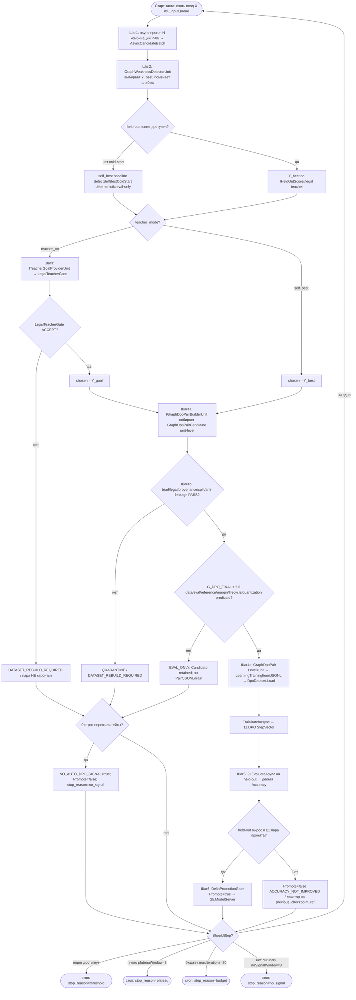

## Current Code-First Reconciliation Overlay (2026-07-14)

current_implementation_authorization: YES_CODE_FIRST_ONLY
teacher_dpo_training_authorization: NO_TEACHER_DPO_TRAINING_UNTIL_G_DPO_FINAL
dpo_status: NOT_STARTED
dpo_priority: LAST
current_counters: 12 phases / 27 subphases / 64 substeps
canonical_sequence: CODE_FIRST -> TP1_LOCAL_EVAL_ONLY -> TP2_HOSTED_EVAL_ONLY (only after G-TP-4) -> G_DPO_FINAL -> DPO_TRAINING
typed_training_chain: `GraphDpoPairCandidate(DpoTrainReady=false) -> TriadLegalProjection(FullDpoTrainReadyProof,G_DPO_FINAL) -> GraphDpoPair(Level=unit,DpoTrainReady=true) -> LearningTrainingItem/JSONL -> DpoDataset.Load -> TrainBatchAsync`; a Candidate never trains directly and the builder never leaps directly to a Pair.
restore_canon: `ImportAsync(metadata) -> LoadCheckpointAsync(weights)`; metadata import never substitutes for trained-weight restore.
current_effective_dpo_train_ready: false; the full legal/provider/provenance/data/evaluation/reference/margin/lifecycle/fresh-load/continue-training/quantization predicate and `G_DPO_FINAL` have not passed.
current_residual_owner: `SINGLE_L5_OWNER_UNRESOLVED` remains OPEN; one domain cannot have ambiguous competing checkpoint/model/locator owners.
judge_boundary: full `JudgeProvenance` is separate from `TeacherProvenance`; closed proprietary output may judge/evaluate only where allowed and never author chosen/rejected or any training target.
current_readiness_boundary: no DPO execution readiness or whole-plan readiness is claimed.

## Historical Fable Coverage Repair Overlay (2026-07-05)

historical_fable_plan_readiness: PLAN_NOT_READY / FABLE_GAP_REPAIR_QUEUE
historical_fable_implementation_authorization: NO until fresh Luba approval after review
historical_demoted_current_verdict_basis: Newer Fable coverage evidence `claude-fable-plan-check-v1.md` and attachment `98cbe69a` supersede the previous final-readiness overlay. Fable reports 127 findings: 91 COVERED, 30 PARTIAL, 6 MISSING. Mental implementation from active-codex would still hit plan-level design/source/dependency blockers: R-B `llm mvp` 20-pass and `llm_mvp_core` 40-pass knowledge-library targets are accepted only as evidence-library closure, not readiness/implementation proof; R-G source addressability is incomplete; several shared contracts/readability/lifecycle carriers need plan-family repair. This is plan repair evidence only, not product implementation, not tests/builds/runtime/provider/training/checkpoint/git proof.
historical_demoted_current_verdict_classes: DESIGN_BLOCKER_CURRENT=FABLE_MISSING_AND_PARTIAL_ITEMS; CURRENT_REPAIR_QUEUE=FABLE_RB_RG_AND_PARTIAL_REPAIR; FABLE_EVIDENCE=claude-fable-plan-check-v1.md lines 35-153 and attachment 98cbe69a lines 32-79; CURRENT_LEDGER_ACCEPTANCE_BOUNDED_EVIDENCE=previous 50/50 planning-section acceptance remains historical/process evidence only and cannot override later Fable MISSING/PARTIAL findings; IMPLEMENTATION_AUTHORIZATION_GATE=NO until fresh Luba approval after review.
historical_classification_rule: Any older line in this file saying PLAN_READY_FOR_LUBA_REVIEW, Final Readiness Review Overlay, no unresolved design/dependency blocker, CURRENT_REPAIR_QUEUE=NONE_IDENTIFIED_BY_FINAL_READINESS_REVIEW, or parent final-readiness acceptance before this overlay is historical/pre-Fable evidence only unless it cites a later unquoted Luba instruction or later evidence-bound review after 2026-07-05.
historical_fable_gap_repair_addendum: active-codex-execution-42-fable-gap-repair-additions-20260705.md is the current repair map for R-B/R-G and the partial contract/readability/lifecycle additions.

## Pass31-Pass40 Consumer Sync (40-pass llm_mvp_core evidence library)

historical_sync_scope: evidence-only propagation from `active-codex-execution-knowledge-library-llm-mvp-core-40-pass.md` Pass31/40 through Pass38/40 and Pass40/40. Current verdict remains `PLAN_NOT_READY / FABLE_GAP_REPAIR_QUEUE`; `implementation_authorization: NO`.

- Auto-DPO loop must consume plan-06 scheduling as bounded independent `CombinationPlan` runs, plan-07 unit-level `GraphDpoPair` building, plan-08 legal/TeacherProvenance gating, and plan-10 checkpoint lifecycle gates in that order.
- External or hosted calls in the loop require an interface/adapter seam, deterministic fake expected response, no-network unit test, and later replacement-plan row in `C:\Users\lubao\Documents\xiigen\llm mvp\DPO LEARNING\codex-external-calls-mock.md`. This sync did not call providers or create that debt file.
- Future implementation work orders must rediscover latest-updated source branch per repo, use a separate `C:\Projects\DPOLegalLearning\<repo>` workdir, and require no-write mergeability checks before commit/push; no PR/merge is authorized here.
## Historical Pre-Fable Final Readiness Review Overlay (2026-07-05)
historical_pre_fable_plan_readiness: PLAN_READY_FOR_LUBA_REVIEW
historical_pre_fable_implementation_authorization: NO until fresh Luba approval after review
historical_final_readiness_review_scope: one bounded planning/governance readiness review only; no product implementation, tests, builds, runtime, browser, provider/API, model/training/checkpoint, git, branch, mergeability, PR, or product-readiness proof was run.
historical_pre_fable_current_verdict_basis: This final review read the required governance/skill gate markers, the two unique original-task/reference attachments, the minimum Claude baseline surfaces, the active-codex plan/board/matrix/source-map/legal/gate/ledger surfaces, and current status/search evidence. End-to-end mental simulation from the active plan found no unresolved design/dependency decision that an executor would have to choose before coding/testing. The prior PLAN_NOT_READY / PLAN_PARTIAL_REPAIR_QUEUE state after 0aa/Laplace/Kepler/Singer was retained for parent final-review acceptance; this overlay supplies that final bounded review. Remaining items are execution or approval gates only: fresh Luba implementation approval, local self-authored seed file creation, code implementation, tests/builds/runtime/training/checkpoint/fresh-load/ablation proof, same-scenario Path A/Path B host proof, mock/replacement-ledger proof, branch/mergeability/git proof if later authorized, final product review, and route-specific hosted TogetherAI/Qwen3 terms/output-use proof before hosted train/common use.
historical_pre_fable_current_verdict_classes: DESIGN_BLOCKER_CURRENT=NONE_IDENTIFIED_BY_FINAL_READINESS_REVIEW; CURRENT_REPAIR_QUEUE=NONE_IDENTIFIED_BY_FINAL_READINESS_REVIEW; CURRENT_LEDGER_ACCEPTANCE_BOUNDED_EVIDENCE=50/50 accepted planning sections after 2026-07-05 Pass37-Pass50/Singer repair, not 50 cycles, not 50 product reviews, not product proof, not test/build/runtime/provider/training/checkpoint/git proof; HOSTED_PROVIDER_PRE_USE_GATE_ROUTE_SPECIFIC=TogetherAI/Qwen3 proof required before hosted train/common use only, not a local self-authored v1 planning blocker; IMPLEMENTATION_AUTHORIZATION_GATE=NO until fresh Luba approval after review.
historical_classification_rule: Any older line in this file saying PLAN_NOT_READY / PLAN_PARTIAL_REPAIR_QUEUE, current verdict remains PLAN_NOT_READY, CURRENT_REPAIR_QUEUE, parent must run final readiness review, or no-go boundaries before this overlay is historical/pre-final-readiness-review evidence only unless it cites a later unquoted Luba instruction or later evidence-bound review after 2026-07-05.
---
artifact_type: ilearningdynamicgraph_plan_block_09_auto_dpo_loop
authority_source: latest unquoted Luba work order for DPO Legal Learning active execution chain
status: populated_now_planning_only
last_updated: 2026-06-29
write_scope: C:\Users\lubao\Documents\xiigen\llm mvp\dpo legal build\active-codex-execution-*.md
plan_phase_anchor: Ф7 (Авто-DPO петля; подшаги Ф7.1.1–Ф7.1.2, Ф7.2.1–Ф7.2.2) + потребляет Ф2 (legal-гейт), Ф3 (строитель), Ф4 (обучение), Ф5 (измерение), Ф6 (async)
canon_counters: 12 фаз / 27 подфаз / 64 подшага (Ф0…Ф11), нумерация Ф<P>.<SP>.<SS>
benchmark_read_only_source: codex-plan-09-auto-dpo-loop.md (НЕ редактируется)
canon_consumers: Pass37/latest-Claude GraphDpoPair exact 14-field canon with nested TeacherProvenance (владелец блок 07; train-ready rows unit-level only) + TeacherProvenance 20 полей (13+5+2 RR6 `service_mode`/`grounding_used`) with manifest/projection storage (владелец блок 08)
43c2_current_residue_repair: plan-09 B-15 / IGraphWeaknessDetectorUnit edge/graph wording is downgraded to v1-deferred diagnostic scope. IGraphWeaknessDetectorUnit may select, rank, and flag unit-level weak candidates and may trigger learning, but it cannot emit v1 edge/graph train-ready GraphDpoPair rows, cannot provide edge/graph scorer acceptance, and cannot promote edge/graph training authority. EdgeAuthorityUnit remains the architecture owner for edge authority; v1 train-ready DPO rows are unit-level only unless a later explicit Luba-approved plan expands scope.
---

# Блок плана 09 — Авто-DPO петля (сердце проекта ILearningDynamicGraph)

Автор: Claude (Opus 4.8 MAX), роль — автор полностью решённого блока плана в моём
namespace `claude-*`. Прежняя помета R2/R3 `PLAN-ONLY` является исторической и
**SUPERSEDED** текущим code-first overlay 2026-07-14: реализация кода разрешена, но
teacher/DPO authoring, проекция trainable Pair и training заблокированы до `G_DPO_FINAL`. Все цитаты кода — только реально
существующие, перепроверены прямым чтением главного чекаута `C:/Projects/llm_mvp_core`
(не worktree-копий), с `file:line`. Имена `ILearning*` из задачи Любы — псевдонимы
существующих контрактов (CANON-маппинг — мастер §A.3), а не новые архитектурные
уровни (A-LM-12 — закрытый список из 5 уровней). NEW помечает проектируемые в плане
типы; существующее дано с `file:line`.

Маппинг ролей (CANON, синхрон с мастер §A.3 и всеми `claude-*`):
`ILearningUnit ≡ ILogicalUnit` (Level2, `00.Core/LogicalContracts.cs:97`);
`ILearningFlow ≡ ILogicalFlow` (Level3, `:166`);
`ILearningOrchestrator ≡ ILogicalOrchestrator` (Level4, `:202`);
`ILearningDynamicGraph = ILearningMachine<DynamicGraphDomain>` (Level5,
`00.Core/LearningMachineContracts.cs:208`) поверх ДИНАМИЧЕСКОГО графа узлов/рёбер.
Новый 6-й уровень НЕ вводится (A-LM-12): `DynamicGraph` — специализация L5.
Финальное подтверждение уровня — мастер §E Q1 (зеркало §12 ниже).

> **Якорь фазы (доска исполнения `claude-EXECUTION-CONTROL-BOARD`, evidence-only).**
> Этот блок-09 — источник канона для фазы **Ф7 «Авто-DPO петля»** (интеграция
> Ф2–Ф6 в замкнутый цикл само-улучшения). Его Gate B G1..G6 (§10) = exit-условие
> Ф7. Петля **потребляет** результаты предыдущих фаз и НЕ переопределяет их каноны:
> legal-гейт — владелец блок 08 (Ф2); строитель `GraphDpoPair` — владелец блок 07
> (Ф3); обучение/тренер — блок 10 (Ф4); измерение held-out/ablation — блок 11 (Ф5);
> async-комбинации — блок 06 (Ф6). Канонические счётчики плана: **12 фаз (Ф0…Ф11) /
> 27 подфаз / 64 подшага**, нумерация `Ф<P>.<SP>.<SS>`. Доска, мастер-план и все
> `codex-*` — evidence-only, здесь не правятся.

Связанные блоки этого плана (потребляемые петлёй, не дублируемые): **P-06**
(async-прогон одного входа через РАЗНЫЕ комбинации, Ф6), **P-07** (построитель
DPO-пары `GraphDpoPair`, Ф3), **P-08** (легальный teacher/provenance, Ф2), **P-10**
(обучение/тренер DPO, Ф4), **P-11** (измерение held-out/ablation, Ф5). Этот блок 09 —
про **ПЕТЛЮ**, которая связывает их в один замкнутый цикл само-улучшения.

---

## 0. Якорь задачи и где этот claude-блок улучшает бенчмарк

```text
CURRENT TASK: написать МОЙ (claude-namespace) улучшенный блок-09 авто-DPO петли —
              план-решение замкнутого цикла само-улучшения графа, человеческим
              русским, Part A-формат (§0 UML + §1 алгоритм + §2 концепт + §3 цитаты
              кода file:line + §4 статус + §5 контракты + §8 гейты + §9 тест-стратегия),
              с сохранением структуры и канонических счётчиков (12 фаз / 26 подфаз /
              59 подшагов, Ф<P>.<SP>.<SS>) и CANON-инвариантов: L5-машина без 6-го
              уровня (A-LM-12); легальный teacher-гейт (closed = только judge); запрет
              скрытого детерминизма (A-LM-09/A-LM-13); Pass37/latest-Claude канон
              GraphDpoPair exact 14 fields with nested TeacherProvenance(20; 13+5+2 RR6)
              plus manifest/projection proof. Записать ровно в claude-plan-09-auto-dpo-loop.md.
NOT THE TASK: исполнять/тестировать/билдить код, запускать раннеры, тренировать,
              вызывать внешние AI/API/модели, git; править/создавать любые codex-*
              (план Codex, recon, 50-cycle, skill-improvement — только чтение);
              продолжать/править чужой codex-план, старый каркас claude-00..07 или
              dcm-*; слепо копировать бенчмарк (улучшать, а не копировать).
EVIDENCE-ONLY: codex-plan-09 (бенчмарк-петля), codex-plan-06/07/08/10/11 (каноны
              async/строителя/legal/обучения/измерения), codex-ILEARNINGDYNAMICGRAPH-
              PLAN-v1 §E (канон полей/вопросов), codex/claude-EXECUTION-CONTROL-BOARD
              (Ф7 счётчики/DAG), claude-06/07/08/10/11 (мой namespace, согласован),
              старый каркас claude-00..07, реальный код llm_mvp_core (читается для
              цитат), скилы plan-review / trainable-architecture-decision /
              implementation-doc-uml. Continuation/do-not-stop правила к этим
              evidence-артефактам НЕ применяются.
```

**Где этот claude-блок осознанно лучше бенчмарка `codex-plan-09` (delta-нота, не
слепая копия).** Бенчмарк `codex-plan-09` — это уже довольно полный решённый блок
(999 строк, §1–§12, UML, симуляции, гейты). Я НЕ переписываю его ради переписывания;
я выравниваю его на МОЙ namespace и каноны соседних `claude-*` блоков и точечно
усиливаю слабые места:

| # | Слабое место / расхождение бенчмарка `codex-plan-09` | Улучшение в этом claude-блоке |
|---|---|---|
| D1 | **Нет якоря фаз доски.** Бенчмарк перечисляет связанные блоки P-06..P-11, но не привязывает петлю к `Ф<P>.<SP>.<SS>` (12/26/59). Читателю не видно, что петля — это **Ф7**, и в каком порядке она идёт после Ф2–Ф6. | Явный **якорь Ф7** (Ф7.1.1 каркас петли + no-signal путь; Ф7.1.2 один оборот шаги 1→6; Ф7.2.1 held-out приёмка строки; Ф7.2.2 промоушен+остановка), счётчики 12/26/59 (historical/pre-PASS26 Claude-baseline; текущий канон 12/27/64), связь Gate B ↔ exit-условие Ф7, DAG-зависимость Ф7 после Ф2–Ф6 (§0.0, §10). |
| D2 | **Канон полей внутри текста, без явной сверки с владельцами.** Бенчмарк §5.1/§5.2 держит `GraphDpoPair`/`TeacherProvenance`, но §5.1 называет их «единым для 06/07/08/09» без явного указания **владельца** канона. | Явно зафиксировано: петля — **потребитель**, а не владелец канонов. Pass37/latest-Claude: `GraphDpoPair` — exact 14-field canon with nested `TeacherProvenance`, владелец **блок 07**, train-ready rows only at unit level; `TeacherProvenance` 20-field canon (13+5+2 RR6 `service_mode`/`grounding_used`) — владелец **блок 08** with manifest/projection storage; `GraphDpoProvenanceWriter` writes storage/projection proof before train-ready. При расхождении побеждает владелец (§5.1, §5.2). |
| D3 | **Цитата R-19 (литерал 0.03) не сведена в петлю.** Бенчмарк упоминает дефекты обучения (temp-checkpoint, шаблон chosen/rejected), но не связывает петлю с эталоном margin `language-translate` (R-19), где `RewardMargin` захардкожен литералом. | Сведена связь с **R-19**: петля меряет реальный `reward_margin` из движка `11.DPO/DpoTrainer.cs`, а НЕ из литерала `0.03` (перепроверено: `27.TranslationDomain/TranslationMachine.cs:70` `RewardMargin: 0.03,`; `:125` тернар `? 0.03`; `:187` `_trainingHistory.Count > 0 ? 0.03 : 0.0`). Это делает приёмку строки (§8 G4) непробиваемой литералом (§3.5, §8 G4). |
| D4 | **judge-origin под-гейт силён, но «no-signal» путь и promotion-record размазаны.** Бенчмарк вводит `WeaknessEvent/StopConfig/ShouldStopResult/PromotionDecision` только в самом конце (§10, «binding after cycle 29»), и no-signal путь читается тяжело. | Поднял **no-signal путь** и **PromotionDecision/rollback** в §3 Шаг 6 и §5.7 как первоклассную ветку: если ни одна строка не пережила гейты → `accepted_auto_pair_count_after_all_gates=0`, `NO_AUTO_DPO_SIGNAL=true`, `stop_reason=no_signal`, `Promote=false`, локатор остаётся на `previous_checkpoint_ref` с `rollback_ref`. Человеко-читаемо, не только в конце. |
| D5 | **Honest two-PASS метка названа, но «как именно untrained тестируется» неявно.** Бенчмарк §8 G6 различает PASS-метки, но тест честности скаффолда разбросан по §9. | Свёл §8 G6 + §9 в явную **две-PASS** связку с конкретными именами тестов-образцов (`PromptToTaskMachineSkeletonTests` для UH; `SkillSelectionPhase06TrainedSelectorEvidenceTests` для TA lifecycle), с раздельными колонками UH/TA (§9, синхрон с claude-13). |
| D6 | **Часть `file:line` — наследованы как evidence.** Бенчмарк опирается на ранее «читаные» строки. | Все ключевые цитаты, влияющие на решение (A-LM-02 `:8`; TrainBatchAsync `:212`; EvaluateAsync `:217`; DpoTrainer margin/loss `:42-65`, StepVector `:169-224`; пустой DPO-канал `AutonomousLearningPipeline.cs:120`, гейт дельты `:137-140`; шаблон chosen/rejected `DefaultLogicalCapabilityTrainer.cs:173-174`; temp checkpoint `:40-41`; R-19 `TranslationMachine.cs:70/125/187`) **перепроверены прямым чтением** главного чекаута в этой сессии. |

CANON-инварианты сохранены: маппинг ролей Luba → реальные контракты (мастер §A.3);
5 закрытых уровней (A-LM-12); легальный teacher-гейт (closed = только judge при
`teacher_output_used_for_training=false`, контаминация → `DATASET_REBUILD_REQUIRED`);
запрет скрытого детерминизма (A-LM-09/A-LM-13). Pass37/latest-Claude current split:
`GraphDpoPair` exact 14-field canon with nested `TeacherProvenance`
(владелец блок 07; train-ready rows unit-level only), `TeacherProvenance`
20-field canon/storage projection (владелец блок 08), and
`GraphDpoProvenanceWriter` manifest/projection linkage are held consistent with
master §A.4 and active/Claude blocks 07/08.

---

## 1. Что это и зачем (роль компонента в ILearningDynamicGraph)

**Что это.** Авто-DPO петля — это управляющий цикл (control loop) самого верхнего
уровня графа. Это «сердце» `ILearningDynamicGraph`: механизм, который превращает
обычный прогон проекта на реальной задаче в обучающий сигнал и непрерывно дообучает
узлы/рёбра графа, пока качество не достигнет порога. Человек НЕ пишет каждую
DPO-пару руками — петля строит их сама из собственных ошибок графа и из эталона
разрешённого наставника (teacher).

**Зачем именно петля, а не разовое обучение.** Граф динамический: топология
(`DynamicGraphTopology`, NEW) меняется на лету — добавляются узлы для недостающих
способностей (прообраз уже есть: авто-генерация юнита+flow по «недостающему
sub-phase» в `18.CapabilityTraining`). Значит и обучение должно быть непрерывным
циклом «прогнал → нашёл слабое место → построил пару → обучил → измерил → повторил»,
а не одним батчем.

**Роль в иерархии (где петля «живёт»).** Петля принадлежит Level5
`ILearningDynamicGraph = ILearningMachine<DynamicGraphDomain>`. По правилу A-LM-02
(`00.Core/LearningMachineContracts.cs:8`) методы `Train*` существуют ТОЛЬКО на
`ILearningMachine`; `ILogicalUnit`/`ILogicalFlow` — чистый инференс. Поэтому петля
обучает через машину/тренер, НЕ дописывает `Train*` в узлы. Шаги петли
раскладываются по уровням так:

```
ILearningDynamicGraph (NEW, L5 = ILearningMachine<DynamicGraphDomain>)  ← ВЛАДЕЕТ петлёй и графом
  ├─ шаг 1 async-прогон РАЗНЫХ комбинаций  → ILogicalFlow/ILogicalOrchestrator (P-06, Ф6, есть в репо)
  ├─ шаг 2 обнаружить слабый выход         → IGraphWeaknessDetectorUnit (NEW, ILogicalUnit)
  ├─ шаг 3 взять legal teacher как goal    → ITeacherGoalProviderUnit (NEW internal unit wrapping canonical ITeacherGoalClient) + LegalTeacherGate (P-08, Ф2)
  ├─ шаг 4 → IGraphDpoPairBuilderUnit → GraphDpoPairCandidate(false) → TriadLegalProjection(FullDpoTrainReadyProof,G_DPO_FINAL) → GraphDpoPair(Level=unit,true) → LearningTrainingItem/JSONL → DpoDataset.Load → TrainBatchAsync → 11.DPO (Ф4)
  ├─ шаг 5 измерить на held-out            → EvaluateAsync (есть) + P-11 (Ф5)
  └─ шаг 6 промоушен по дельте + повтор    → гейт дельты (образец 16.AutonomousLearning) → 25.ModelServer
```

**Что петля НЕ делает (важная честная граница).** Петля НЕ изобретает DPO-математику
(она уже есть и работает — `11.DPO/DpoTrainer.cs`). Петля НЕ владеет каноном пары/
провенанса (владельцы — блоки 07/08). Петля НЕ является «умной» сама по себе: если
выбор лучшего варианта делает фиксированная формула, это детерминированный baseline,
а не интеллект (см. §8 G3). Петля имеет право называться обучающей ТОЛЬКО когда
обучаемый уровень реально сдвигает веса и это доказано измерением на held-out
(§8 G4, §8 G6).

---

## 2. Концепт простыми словами (аналогия, без кода)

Представьте мастерскую с **учеником** (наша маленькая обучаемая модель — узлы и
рёбра `ILearningDynamicGraph`) и **наставником**. Наставник разрешён только после
legal gate: family canonical license, provider/terms/output-use proof, plain mode/no
grounding, and complete `TeacherProvenance`. Qwen3 Apache-2.0 is only the selected
blueprint until hosted terms proof passes; it is not automatic hosted train/common approval.

Один «урок» петли:

1. **Ученику дают задачу.** Например: «по запросу пользователя выбрать домен и
   под-фазу». Ученик решает её **несколькими способами одновременно** — разными
   комбинациями своих инструментов (узлов/маршрутов). Это как написать несколько
   вариантов ответа разными методами (шаг 1, async-прогон РАЗНЫХ комбинаций, Ф6).
2. **Сравниваем варианты ученика между собой и с эталоном наставника.** Берём
   лучший вариант ученика `Y_best`. Если он всё ещё хуже наставника — фиксируем
   разрыв. Эталон (`goal`) берём ТОЛЬКО у легального наставника, никогда у
   запрещённых закрытых моделей (Claude/OpenAI/Gemini).
3. **Делаем «карточку урока» (DPO-пара).** Слева тот же вопрос; в графе «правильно»
   (`chosen`) — лучший/эталонный ответ; в графе «неправильно» (`rejected`) —
   правдоподобно-слабый ответ ученика; и короткая пометка `[WRONG: ...]` — ПОЧЕМУ
   слабый ответ хуже (одно функциональное последствие, а не «потому что плохо»).
4. **Ученик учится на карточке** — не зубрит дословно, а сдвигает предпочтение в
   сторону `chosen`: повышает `log P(chosen)` относительно `log P(rejected)` так,
   чтобы reward margin стал > 0.
5. **Проверяем, что урок усвоен** — на отложенных задачах (held-out), а не на тех же
   карточках. И что ученик не сжульничал: не выучил позицию варианта в списке, имя
   файла или дословный текст вопроса (ablation/permutation).
6. **Повторяем**, пока качество не станет достаточным; «диплом» (промоушен
   чекпойнта) выдаём ТОЛЬКО если измеренное held-out качество выросло.

Ключевая идея «сердца проекта»: **ученик сам себе готовит карточки-уроки** из своих
ошибок и эталона наставника, и делает это непрерывно.

**Условие остановки простыми словами.** Петля крутится не вечно. Она останавливается
на конкретном входе/итерации, когда либо ученик уже отвечает не хуже наставника
(разрыв закрыт), либо последние несколько итераций перестали улучшать held-out
(плато), либо исчерпан бюджет итераций, либо в этой итерации не нашлось ни одной
легальной обучающей строки (нет сигнала). Точные пороги — §3 Шаг 6 и §10 (Gate B).

---

## 3. Алгоритм/решение ПОШАГОВО (человеческим языком, полное решение)

Ниже — полное решение петли: что происходит, где, в каком порядке, какие
классы/методы участвуют, какие параметры. Это НЕ «исполнитель сделает X» — это
готовый алгоритм с названными контрактами. Оркестрирует петлю NEW-класс
`AutoDpoLoopOrchestrator` (ниже «оркестратор петли»); он реализует
`ILearningMachine<DynamicGraphDomain>` (L5) и владеет одним состоянием графа.

> **AUDIT-FINDING NOTE (A3, needs-architect-decision) — два L5-владельца одного домена (B2/F-A3-2, HIGH):** здесь `AutoDpoLoopOrchestrator : ILearningMachine<DynamicGraphDomain>` (L5), а `plan-04:176` объявляет `DynamicGraphMachine : ILearningMachine<DynamicGraphDomain>` (L5) — два L5-владельца одного `DynamicGraphDomain` без явного разведения отношения. Дыра: неясно, кто владеет единым `model_id`/checkpoint/locator; при двух L5 lifecycle-владелец неоднозначен (зеркала: `plan-10` lifecycle_owner_gate §8.1, board Ф7.2.1). Направление (НЕ решено здесь; ревью Luba): назвать отношение (фасад/делегат/алиас — например `AutoDpoLoopOrchestrator` делегирует обучение единственной `DynamicGraphMachine`), закрепить один `model_id`/checkpoint/locator за единственным L5-владельцем. Статус: residual A3-R2 SINGLE_L5_OWNER_UNRESOLVED (HIGH, NEEDS_ARCHITECT_DECISION). (Архитектура разведения НЕ выдумана; readiness/счётчики не тронуты.)

### Шаг 0 — Подготовка (один раз на запуск петли) — Ф7.1.1

- **Зафиксировать обучаемую цель петли** — какой узел/ребро графа учим (например,
  ребро `orchestrator→unit`: «выбор домена+под-фазы»). Метод
  `AutoDpoLoopOrchestrator.PrepareAsync(DynamicGraphDomain, AutoDpoLoopConfig)`
  (NEW). Параметры: `targetNodeOrEdgeId`, `qualityThreshold` (порог остановки),
  `maxIterations`, `plateauWindow`, `regressionWindow`, `minImprovement`,
  `teacher_mode`, `teacherGapEpsilon`.
- **Зафиксировать и проверить legal teacher** (P-08, Ф2, владелец блок 08): заполнить
  `TeacherProvenance` (20 полей; 13+5+2 RR6 `service_mode`/`grounding_used`) — `teacher_access_mode`, `hosting_provider`,
  `model_id`, `model_license`, `provider_terms_checked`,
  `teacher_output_used_for_training`, `closed_proprietary_model=false`. Без зелёного
  LegalTeacherGate teacher-выходы как `chosen` ЗАПРЕЩЕНЫ (§8 G1). Если teacher не
  настроен — петля работает в режиме `self_best` (chosen = лучшая async-комбинация
  ученика), это допустимо (мастер §E Q23).
- **Восстановить чекпойнт обучаемого уровня:** сначала user/cache, затем repo/common;
  если ничего нет — честный `untrained scaffold` (lifecycle §8 G5). Канонический порядок:
  `ImportAsync(metadata)` импортирует только metadata/version/locator, затем внутренний
  `LoadCheckpointAsync(weights)` конкретной реализации восстанавливает обученные веса.
  На интерфейсе `ILearningMachine<TDomain>` метода `LoadCheckpointAsync` нет; это не разрешает
  трактовать `ImportAsync` как full restore. Fresh-load evidence обязано доказать оба шага.

  > **A4-R1 restore reconciliation:** `ImportAsync(metadata) -> LoadCheckpointAsync(weights)` is now the single plan contract (`RESOLVED_IN_PLAN_CONTRACT_EXECUTION_PROOF_PENDING`). `ImportAsync` alone never proves trained-state restore; fresh-load and continue-training evidence remain OPEN lifecycle gates.

### Шаг 1 — Прогон одного входа через РАЗНЫЕ комбинации (ОБЯЗАТЕЛЬНО, async; P-06, Ф6) — Ф7.1.2

- Взять реальный вход `X` (запрос пользователя / задача узла) из очереди входов
  `AutoDpoLoopOrchestrator._inputQueue` (NEW). **Источник входов (intake-контракт,
  v1 — именованные владельцы, не placeholder-фраза).** В v1 очередь заполняется
  ровно из ДВУХ именованных intake-путей, у каждого есть владелец-контракт, запись
  и enqueue-правило:
  1. **Seed-corpus intake** — владелец `SeedCorpus-LanguageTranslate-v1`
     (§«Pass35 SeedCorpus-LanguageTranslate Auto-DPO Input Mirror»): строки из
     `split=train` файла `language-translate-seed-v1.jsonl` маппятся в
     `GraphDpoSourceRow`; enqueue-правило — только `split=train` идёт в очередь
     обучения, `split=held_out` идёт в scorer, не в очередь.
  2. **FLOW-38 better-output intake** — владелец `IBetterOutputDpoIngestApi` +
     `Flow38FeedbackAdapter` (§«Pass08/50 FLOW-38 Better-Output Intake Owner Mirror»):
     событие `GeneratedUiOutputFeedbackEvent` нормализуется в `GraphDpoSourceRow`
     с `legal_verdict=QUARANTINE`/`route=adaptive_or_quarantine` по умолчанию;
     enqueue-правило — только после legal/provenance-гейта, common-eligible строки в
     общую очередь, остальные в personal/quarantine.
  Per-domain scorer в v1 инстанцирован только для пилота `language-translate`
  (exact-match + char-accuracy; Pass27).

  **[RESOLVED_FROM_TASK_PROCESS 2026-07-07 — приоритет источника входа.]** Процесс
  задачи задаёт первичный источник входа явно (см. блок `Q-P09-XSRC` ниже с
  документированной цитатой): первичный источник `_inputQueue` = **runtime-observations**
  (наблюдать реальные прогоны наших проектов и enqueue'ить именно НИЗКО-результатные
  входы; goal берёт разрешённая внешняя модель). Два intake-пути выше (seed-corpus,
  FLOW-38) — это **cold-start / вспомогательные** источники, а не первичный поток:
  seed-corpus наполняет очередь на холодном старте, FLOW-38 — дополнительный поток
  better-output обратной связи. То, что раньше было записано как «отложенное
  расширение scope» (runtime-observation intake), теперь РЕШЕНО из процесса задачи и
  является primary-каноном; открытым остаётся только числовой execution-time tuning
  `enqueue_threshold` (порог «низкого результата»), не открытое продуктовое решение.
  Генерализация per-domain scorer'а на каждый новый НЕ-пилотный домен — отдельная
  execution-инженерная работа (нужен per-domain scorer + `domain_tag`), но она уже НЕ
  меняет решённый источник входа. v1-пилот измерения — `language-translate`.

  > **[HISTORICAL / PRE-RESOLUTION 2026-07-07 — evidence-only, superseded above.]**
  > Ранее здесь стоял residual: `> LUBA_PRODUCT_DECISION_RESIDUAL`: генерализация
  > intake за пределы двух путей (seed-corpus + FLOW-38) — «наблюдать произвольный
  > прогон любого проекта и enqueue'ить low-result входы» (runtime-observation intake
  > для не-пилотных доменов) — считалась продуктовым расширением scope, отложенным до
  > явного approve Luba, и v1 сознательно сужался до seed-corpus + FLOW-38 + пилот
  > `language-translate`. Эта формулировка СНЯТА: источник входа решён из процесса
  > задачи (runtime-observations primary; seed = cold-start only).

  > **`Q-P09-XSRC` — `RESOLVED_FROM_TASK_PROCESS` (2026-07-07). Источник входа `X`
  > для такта авто-DPO ЗАДАН В ПРОЦЕССЕ ЗАДАЧИ, а не остаётся открытым вопросом.**
  >
  > **Ответ (канон):** первичный источник `_inputQueue` = **RUNTIME-OBSERVATIONS**
  > — наблюдение реальных прогонов НАШИХ проектов и enqueue именно тех входов, где
  > модель дала НИЗКИЙ результат; эталон (`goal`) для такой строки берёт разрешённая
  > внешняя модель (legal teacher, §3 Шаг 3). **Seed-corpus — только опциональный
  > cold-start bootstrap** (первичное наполнение на «холодном старте», когда рантайм-
  > наблюдений ещё нет), а НЕ первичный источник. Вариант `both` в узком смысле верен
  > (seed для cold-start + runtime как основной поток), но приоритет закреплён:
  > runtime-observations — primary, seed — cold-start-only.
  >
  > **Документированная авторитетная цитата (grounding).** Это решение извлечено из
  > ПРОЦЕССА ЗАДАЧИ, дословно: «мы запускаем любой из наших проектов и видим, где
  > модель дала низкий результат. Мы берём то что выдала внешняя модель как goal …
  > обучаем нашу модель строить DPO … до тех пор пока не начнём получать … достаточно
  > качественный результат.» Зафиксировано в аудите оригинальной задачи
  > `active-codex-execution-original-task-authority-audit-20260629.md`:
  > строка 53 (`RESOLVED_BY_ORIGINAL_TASK`, «line 20 defines low local output versus
  > external goal output and training `ILearningDynamicGraph` by DPO»),
  > строка 45 (Q37, «Line 20 allows external model output as the goal»),
  > строка 44 (Q30, «Line 20 says train until "достаточно качественный результат"»)
  > — все указывают на строку 20 оригинальной задачи (attachment `pasted-text.txt`).
  > Таким образом источник входа = наблюдаемый низко-результатный рантайм-прогон, а
  > цель = выход внешней разрешённой модели; это ДОКУМЕНТИРОВАНО, а не выбрано здесь.
  >
  > **Intake-контракт runtime-observation (что содержит запись низко-результатного
  > наблюдения `LowResultObservationRecord`, NEW):** `observation_id`;
  > `source_project_id` (какой из наших проектов дал прогон); `input_context` (сам
  > вход `X` — запрос/задача узла, ставший строкой очереди); `local_output` (что
  > выдала наша модель — кандидат/`Y_best`); `runtime_score` (product-метрика этого
  > прогона от per-domain scorer `IHeldOutScorer.Score → RuntimeProductAccuracy`,
  > §3 Шаг 5); `low_result_verdict` (`true`, если `runtime_score < enqueue_threshold`);
  > `domain_tag` (для выбора per-domain scorer'а); `observed_at`; `trace_ref`
  > (корреляция с прогоном). Enqueue-правило: в `_inputQueue` попадает наблюдение
  > ТОЛЬКО при `low_result_verdict==true` (только низко-результатные входы, как в
  > процессе задачи), и только для домена, у которого инстанцирован per-domain scorer;
  > остальные наблюдения не enqueue'ятся. Goal-строка (`chosen`) для этого входа берётся
  > у legal teacher через §3 Шаг 3 (LegalTeacherGate, block-08 provenance) либо
  > `self_best`, если teacher не настроен.
  >
  > **[BK2-plan09-enqueue 2026-07-07 — GROUNDED TUNING VALUE, labeled] Порог
  > `enqueue_threshold` теперь записан как связанное значение, а не пустой residual.**
  > Носитель — `RuntimeProductAccuracy` (тот же scorer/split/threshold-set/domain-tag,
  > что и §3 Шаг 6 и §5.5). Значения:
  > - `enqueue_threshold = qualityThreshold − enqueueHysteresis = 0.95 − 0.05 = 0.90`
  >   — **[DERIVED forced]**. Rationale: enqueue-порог обязан быть НИЖЕ locked
  >   held-out gate `0.95` (иначе enqueue'ились бы входы, которые уже проходят
  >   приёмку, и петля учила бы «на уже-хорошем»); значение forced-derived из locked
  >   0.95 минус гистерезис. Grounding: locked held-out gate `heldout_accuracy_min>=0.95`
  >   (`active-codex-execution-plan-11-measurement.md` §, строки 702/884) + §3 Шаг 6
  >   ветка порога качества здесь ниже.
  > - `enqueueHysteresis = 0.05` — **[PROPOSED_DEFAULT empirically-tunable]**.
  >   Rationale: полоса гистерезиса не даёт входам «дрожать» вокруг границы enqueue;
  >   0.05 — предлагаемое стартовое значение, тюнится по наблюдаемому шуму
  >   `RuntimeProductAccuracy` на пилоте. Grounding: §3 Шаг 6 калибровка порога на
  >   одном носителе `RuntimeProductAccuracy` (Pass26 mirror, §5.5).
  > - `observationWindow W = 100` — **[PROPOSED_DEFAULT empirically-tunable]**:
  >   скользящее окно из 100 последних прогонов на узел/ребро, по которому считается
  >   `RuntimeProductAccuracy` перед enqueue-решением. Rationale: W должно быть
  >   достаточно большим, чтобы product-accuracy была статистически осмысленной, и
  >   достаточно малым для чувствительности к недавней деградации; 100 — предлагаемый
  >   старт, тюнится. Grounding: §3 Шаг 5 per-node/edge scorer + §3 Шаг 6 rolling
  >   held-out метрика.
  >
  > **Полоса `[0.90, 0.95)` — INTAKE-политика (PROPOSED_DEFAULT policy).** Наблюдения
  > в этой полосе (между enqueue-порогом и held-out gate) НЕ enqueue'ятся сразу: они
  > логируются строкой append-only ledger (та же ledger-строка §3 Шаг 6) и промотируются
  > в `_inputQueue` ТОЛЬКО когда нет ожидающих sub-0.90 наблюдений ИЛИ сработало
  > `ShouldStop`-плато (§3 Шаг 6, `stop_reason=plateau`). Это приоритизирует явно
  > низко-результатные (`< 0.90`) входы над пограничными. Rationale: обучающий бюджет
  > сначала тратится на самые слабые входы; пограничная полоса подхватывается только
  > когда сильного сигнала не осталось. Grounding: §3 Шаг 6 no-signal/plateau ветки.
  >
  > **enqueue — ТОЛЬКО INTAKE-ГЕЙТ, никогда не финальный runtime-авторитет
  > (`learned_authority_remains_final=true`).** `enqueue_threshold` решает лишь, попадёт
  > ли вход в очередь обучения; он НЕ выбирает `Y_best`/`chosen`, НЕ принимает
  > train-ready строку и НЕ повышает чекпойнт. Финальную приёмку/промоушен по-прежнему
  > решают независимые сигналы §3 Шаг 5/§8 (held-out scorer, ablation, no-regression,
  > fresh-load, continue-training) и обученная авторитетная логика — как в OP-66-таблице
  > §3 Шаг 3. Ни `enqueue_threshold`, ни `observationWindow` не являются
  > acceptance/authority-сигналами.
  >
  > **[HISTORICAL / PRE-BK2 2026-07-07 — evidence-only, superseded by the labeled
  > GROUNDED block above.] Остаточный TUNING-residual (не открытый вопрос плана, а
  > execution-time настройка).** Конкретный числовой порог `enqueue_threshold` (граница
  > «низкого результата» для enqueue) НЕ задан дословным числом в документах процесса
  > задачи, поэтому он оставался ТОЛЬКО как execution-time tuning residual на носителе
  > `RuntimeProductAccuracy` (тот же scorer/split/threshold-set, что и §3 Шаг 6);
  > предлагаемая привязка — к held-out порогу `qualityThreshold`/`0.95`-калибровке
  > (§3 Шаг 6, §12 Q22/Q30), финальное число тюнилось при исполнении. Эта формулировка
  > СНЯТА вышестоящим GROUNDED-блоком: значение теперь записано как DERIVED 0.90 с
  > меткой и grounding-цитатой. Это НЕ выдуманное значение и НЕ открытое продуктовое
  > решение Luba: сам источник входа (`runtime-observations` primary, seed
  > cold-start-only) РЕШЁН из процесса задачи.
  >
  > **`Q-P09-XSRC status: RESOLVED_FROM_TASK_PROCESS`** (источник входа решён из
  > документированной авторитетной цитаты процесса задачи). Числовой
  > `enqueue_threshold` больше НЕ пустой residual: он записан выше как **DERIVED 0.90**
  > (`0.95 − 0.05`), привязан к locked held-out gate `0.95`, с гистерезисом
  > `enqueueHysteresis=0.05` и `observationWindow=100` как PROPOSED_DEFAULT (обе метки
  > empirically-tunable, не LOCKED Luba-решение). Это НЕ снимает общий статус файла:
  > план в целом остаётся `PLAN_NOT_READY` по другим причинам (Fable overlay),
  > implementation authorization — `NO` до свежего approve Luba; данная правка решает
  > только слайс-вопрос источника входа и записывает связанное значение enqueue-порога.
  >
  > ---
  > **[HISTORICAL / PRE-RESOLUTION 2026-07-07 — evidence-only, superseded by the
  > `RESOLVED_FROM_TASK_PROCESS` block above.]** Ранее этот вопрос стоял как открытый
  > residual (не назначать здесь):
  > **`LUBA_PRODUCT_DECISION_RESIDUAL Q-P09-XSRC` (REOPENED 2026-07-07 — открыт, НЕ назначен).**
  > **Вопрос:** каким должен быть источник входа `X` для такта авто-DPO (то есть чем
  > наполняется `AutoDpoLoopOrchestrator._inputQueue`)?
  > **Опции:** `seed-corpus` (только строки `split=train` из seed-файлов) |
  > `runtime-observations` (наблюдение реальных прогонов/запросов в рантайме и enqueue
  > low-result входов) | `both` (оба источника вместе).
  > **Статус (историч.):** `UNDECIDED` — считалось продуктовым решением Luba.
  > **Следствие (историч.):** пока `Q-P09-XSRC` не отвечен, правило наполнения
  > `_inputQueue` считалось НЕ финализированным; двух-путёвый v1-набор (seed-corpus +
  > FLOW-38) считался временным сужённым baseline. Эта историческая формулировка
  > СНЯТА вышестоящим `RESOLVED_FROM_TASK_PROCESS`-блоком: источник входа теперь решён
  > из процесса задачи (runtime-observations primary; seed = cold-start only).
- Async прогнать `X` через `N` **разных комбинаций юнитов/маршрутов** графа (разные
  узлы, разный порядок, разные параметры) — это делегируется P-06
  (`ILogicalFlow`/`ILogicalOrchestrator`, есть в репо). PASS09 B-11 consumer contract:
  `AutoDpoLoopOrchestrator` builds `GraphCandidateRunRequest` and calls owner interface
  `IGraphCandidateRunner.RunCandidatesAsync(request, cancellationToken)` → returns
  `AsyncCandidateBatch` (NEW, owner P-06). `request.CombinationCount` is `N`; it is async
  cardinality, not `qualityThreshold`.
- Каждый кандидат `Y_i` несёт typed `OutputRefs: IReadOnlyList<GraphNodeCandidate>` as the PASS10 materialized
  snapshot of the public `IQueryable<GraphNodeCandidate>` output. Each `GraphNodeCandidate` preserves
  `candidate_id`, unit/logical-unit refs, output refs/type, confidence/score, provenance refs, `path_order_ref`,
  legal/status/error fields, source ids, trace refs, and B1/B7/B11/B12/B6 handoff refs.
  The raw `object Output` shape and untyped arrays are forbidden as canonical output (`NO_OBJECT_OUTPUT`).
  Формат-прообраз кандидата — реальный выход
  `TransformerEmbeddingKnnLogicalUnit.ExecuteAsync` (embed → HNSW → fusion →
  confidence `0.50 + fused*0.49`), описан в реконе
  `codex-recon-core-18-capability.md` §2 (инференс-путь).

### Шаг 2 — Обнаружить низкокачественный выход — Ф7.1.2

- Оценить кандидатов: NEW-юнит `IGraphWeaknessDetectorUnit : ILogicalUnit<
  WeaknessDetectionInput, WeaknessDetectionResult>` (NEW). Внутри — выбор лучшего
  `Y_best` и пометка «слабых» кандидатов (диагностически низкий confidence,
  провал verdict, расхождение с held-out ожиданием). Confidence здесь не является
  acceptance-authority и не может сам сделать строку train-ready.
- **43c2 B-15 residue repair:** `IGraphWeaknessDetectorUnit` is v1 diagnostic/ranking scope only for edge/graph evidence. It may flag edge/graph weakness evidence and trigger the unit-level learning route, but v1 edge/graph training/scorer/acceptance/promotion remains deferred. No edge/graph diagnostic evidence can become a train-ready `GraphDpoPair`; `GraphDpoPair.Level` must remain `unit` for v1 train-ready rows. `EdgeAuthorityUnit` remains the architecture owner for edge authority, not a current v1 train-ready pair writer.
- **Судьи (judges)** из лучших моделей РАЗРЕШЕНЫ здесь как eval/критика (не как
  teacher-цель): поле `judge_model` (внутри `TeacherProvenance`, владелец блок 08)
  фиксируется отдельно от teacher-цели. Judge НЕ является целью обучения (CANON;
  §8 G1). **Граница защищена гейтом, не только декларацией:** если
  `judge_model.closed_proprietary_model=true`, судья выдаёт ТОЛЬКО
  ranking/scalar/`wrong_reason` и НЕ поставляет/не редактирует текст, который станет
  `chosen` (выбранный здесь `Y_best`). Доказывается под-гейтом judge-origin
  §8 G1/G2 (`judge_did_not_author_chosen_rejected`,
  `chosen_equals_runtime_candidate_or_legal_goal`); нарушение →
  `DATASET_REBUILD_REQUIRED`.
- «Слабые» кандидаты — это сырьё для `rejected`. Прецедент гейта «улучшение или не
  повышать» (образец для шага 6, не для шага 2):
  `16.AutonomousLearning/Pipeline/AutonomousLearningPipeline.cs:137-140`.

### Шаг 3 — Взять выход разрешённого teacher как goal — Ф7.1.2

- Если `Y_best` всё ещё хуже наставника — получить эталон `Y_goal` у **legal
  teacher** через NEW-юнит `ITeacherGoalProviderUnit : ILogicalUnit<
  TeacherGoalUnitRequest, TeacherGoalResult>` (NEW), который является внутренним
  orchestration unit и вызывает canonical external seam `ITeacherGoalClient`.
  Он не заменяет B1 interface contract. Вызов проходит LegalTeacherGate (§8 G1,
  P-08, владелец блок 08). Запись провенанса `TeacherProvenance` (20 полей; 13+5+2 RR6 `service_mode`/`grounding_used`)
  enters the nested `TeacherProvenance` field in the exact 14-field pair and is
  backed by manifest/projection proof from `GraphDpoProvenanceWriter`.
- Если teacher недоступен/не нужен — `chosen = Y_best` (лучшая async-комбинация
  ученика), `teacher_output_used_for_training=false`. **В этом режиме `self_best`
  `chosen` обязан побитово совпадать с одной из реально прогнанных async-комбинаций
  (§3 Шаг 1) — closed-судья НЕ мог его написать/переписать** (под-гейт judge-origin
  §8 G1/G2; проверки `chosen_equals_runtime_candidate_or_legal_goal==true` И
  `judge_did_not_author_chosen_rejected==true`, иначе `DATASET_REBUILD_REQUIRED`).
- **Запрещённые модели** (Claude/OpenAI/Gemini) НЕ могут давать `Y_goal` как
  обучающую цель; при `closed_proprietary_model=true` И
  `teacher_output_used_for_training=true` → строка/набор уходит в
  `DATASET_REBUILD_REQUIRED` (§8 G1, без исключений).

#### Шаг 3a — двухэтапный teacher-контракт (потребитель overlay; Проход 3, 2026-07-13)

Один seam на обе фазы: `ITeacherGoalClient.GetGoalAsync` (B1-seam, владелец plan-08 Pass03). Этап выбирает детерминированный конфиг-helper `TwoPhaseTeacherRouter` (владелец — overlay двухфазности); он НЕ содержит обучаемой логики и НЕ является authority.

- **Этап 1 `TP1_LOCAL` (профиль `qwen35-local-v1`, plan-08 §3.5.2).** Внутри `GetGoalAsync` выполняется multi-generation best-of-K: `k_generations` генераций (default `k_generations=4` PROPOSED_DEFAULT, empirically-tunable), каждая со своими `sampling_params`+`seed`. Каждая генерация валидируется по JSON-schema узла/ребра и оценивается НЕЗАВИСИМЫМ пер-доменным scorer (тот же, что §3 Шаг 5). **ЗАПРЕЩЕНО** выбирать best-of-K по self-confidence/logprob самого учителя (`forbidden_self_label`, SI_GATE_7): арбитр best-of-K обязан быть независим от самооценки учителя.
- **Tie-break внутри best-of-K (Layer 5D — зеркало `plan-12 §3.B.2`; Проход 4).** При равенстве `max Score(g_k)` победитель `Y_goal` — генерация с **лексикографически наименьшим SHA-256-hex** канонической сериализации (тот же сериализатор, что `ContentHash`/`goal_hash`, plan-07). Запрещены `String.GetHashCode`, порядок поступления генераций и per-process random; cold-start вычислим. Это ДРУГАЯ ничья, чем `Score(Y_goal)==Score(Y_best)` → `chosen=Y_best` (правило `ChosenSelectionRule`, B12).
- **Терминология (Graph-DPO Triad, один термин — одно значение).** Генерации учителя — `g_1..g_K`; цель `Y_goal := argmax_k Score(g_k)` (best-of-K ЦЕЛИ учителя). `Y_best` — ТОЛЬКО лучший кандидат УЧЕНИКА (async-комбинации §3 Шаг 1/Шаг 2), НЕ лучшая генерация учителя. Непобедившие генерации учителя (`g_k`, `k≠argmax`) — eval-only: они НЕ становятся `rejected` и НЕ входят в fan-out (plan-07).
- **Бюджет TP1 (`teacher_context_budget_exceeded`).** Вход учителя ограничен `max_input_tokens = num_ctx − reserved_output_tokens` (num_ctx≈8192), payload — минимальный node/edge JSON (`payload_profile=minimal_node_edge_json_v1`). Превышение → `teacher_context_budget_exceeded` БЕЗ тихой обрезки контекста; факт фиксируется строкой в self_best-ветку (goal не строится).
- **Structured output (жёстко).** Если ВСЕ `K` генераций невалидны по JSON-schema → `TEACHER_STRUCTURED_OUTPUT_INVALID` → петля уходит в `self_best` (`chosen=Y_best`), goal не строится.
- **Provenance собирает `TeacherProvenanceAdapter` ПОСЛЕ ответа** (детерминированный C#-адаптер, НЕ LLM): 20 полей канона plan-08 §3.1. `observed_model_id`-digest берётся из транспорта; несовпадение с запиненным → `BLOCK(served_model_mismatch)` (ADD-08). Принадлежность этапу (TP1_LOCAL/TP2_HOSTED) ВЫВОДИТСЯ из `hosting_provider`+`teacher_access_mode`; 21-е поле provenance НЕ создаётся. LLM provenance не пишет.
- **Этап 2 `TP2_HOSTED` (профиль `qwen3-together-v1`).** Тот же seam `GetGoalAsync`, тот же best-of-K и независимый scorer; hosted-вызов допускается только после `ProviderTermsProof` (§8 G1, overlay §6 G-TP-4). Бизнес-одобрение hosted-use сохранено (APPROVED_BY_LUBA_2026-07-07), terms-proof остаётся execution-гейтом.

#### Acceptance-signal independence and `Y_best` authority (OP-66)

This is the hard boundary between "candidate looked good" and "this row may
become DPO training material":

```text
acceptance_signal_source != trained_unit_self_confidence
candidate_producer_self_score != acceptance_signal_source
promotion_signal_source in {held_out_scorer, ablation_delta, no_regression, fresh_load, continue_training}
```

Signal classification for `Y_best`, chosen/rejected labels, train-ready
acceptance, and promotion:

| signal/source | classification | may select `Y_best` / `chosen`? | may accept train-ready row or promotion? | rule |
|---|---|---|---|---|
| `trained_unit_self_confidence`, model self-rank, producer self-score, fused confidence such as `0.50 + fused*0.49` | `diagnostic_only`; becomes `forbidden_self_label` if used as arbiter/reward | No as sole authority; may be logged as weak-marker evidence only | No | A trained unit cannot accept its own row. If this value selects chosen/rejected or train-ready status by itself, verdict is `DATASET_REBUILD_REQUIRED` or no train-ready pair. |
| Self-best deterministic baseline over real runtime candidates | `deterministic_eval_only` | Yes, only as `self_best_deterministic_baseline_under_guard`: winner must be a stable-id runtime candidate and must pass judge-origin/provenance gates | No by itself | It may provide `chosen=Y_best` only for first-party/self-best rows; it is not proof of learning or promotion. |
| `IHeldOutScorer` with source-disjoint gold/expected label | `independent_acceptance_signal` | Yes, as scorer/ranker over existing candidates | Yes, together with legal/provenance, ablation, no-regression, fresh-load, and continue-training gates | This is the primary acceptance/promotion source for measured quality. |
| Legal open-weight/permissive teacher goal after block-08 proof | `independent_acceptance_signal` | Yes, may author `Y_goal`/chosen for the exact allowed scope | Only through Candidate → full predicate/`G_DPO_FINAL` projection | Requires `TeacherProvenance`, exact provider terms/license/output-use proof, data/split/eval/lifecycle gates, and `G_DPO_FINAL`. Closed or unchecked provider material is not allowed. |
| User/better-output feedback (`GeneratedUiOutputFeedbackEvent`) from client/third-party origin | `independent_acceptance_signal` | Yes, only as a selected existing better/rejected output with provenance | Only in the allowed personal/common scope after positive legal/output-use/provenance/redaction/quarantine proof | Missing proof stays personal/eval/quarantine; proof applies only to client/third-party ownership, never closed-model origin. |
| Closed-origin feedback/output | `judge_eval_metadata_only` | Never selects authored `Y_goal`/chosen/rejected and never supplies training text | Never train-ready regardless of license/terms/business proof | Closed output is permanently judge/eval-only; any training use is `DATASET_REBUILD_REQUIRED`. |
| Closed/best judge score, rank, verdict, or critique | `independent_acceptance_signal` for verdict metadata only | May rank/score existing candidates; must not author or edit `chosen`/`rejected` text | May accept/reject metadata only when C11/C17/legal gates pass | Requires `judge_did_not_author_chosen_rejected==true` and `chosen_equals_runtime_candidate_or_legal_goal==true`; authored text means `DATASET_REBUILD_REQUIRED`. |
| `TrainableGraphDpoBuilderUnit` pair-construction policy | `trainable_authority` for builder behavior | May propose pair construction/rejection reasoning inside block-07 rules | No final acceptance by itself | Its output still needs independent acceptance signal, legal/provenance, split, leakage, held-out, and promotion gates. |
| Teacher best-of-K TP1 (`g_1..g_K`, независимый пер-доменный scorer; §3 Шаг 3a) | `deterministic_eval_only` (SI_GATE_6): scorer-выбор `Y_goal:=argmax_k Score(g_k)` детерминирован и eval-only | Только выбирает `Y_goal` среди `g_1..g_K` (НЕ `Y_best` ученика) | No сам по себе; строку принимают независимые сигналы §3 Шаг 5/§8 | best-of-K по self-confidence/logprob учителя = `forbidden_self_label` (SI_GATE_7); непобедившие `g_k` — eval-only, не `rejected`; provenance пишет `TeacherProvenanceAdapter` после ответа. |

Allowed `Y_best` routes are therefore only: legal independent source,
self-best deterministic baseline under guard, held-out/gold scorer,
user better-output feedback after provenance/legal gating, or allowed judge
verdict-only ranking over existing candidates. No route may use closed-authored
chosen/rejected text.

**Structural-invariant literals (SI_GATE_6 / SI_GATE_7, teacher best-of-K).** Выбор
`Y_best` (источник ученического `chosen`) остаётся классифицированным (SI_GATE_6):
async-self-best — `deterministic_eval_only` под guard, held-out/legal-teacher —
`independent_acceptance_signal`; неклассифицированный winner-selector запрещён.
Teacher best-of-K (§3 Шаг 3a) — `deterministic_eval_only`: он выбирает ТОЛЬКО `Y_goal`
среди `g_1..g_K` и сам по себе НЕ делает строку train-ready. Инвариант независимости
(SI_GATE_7): `acceptance_signal_source != trained_unit_self_confidence` И
`teacher_best_of_k_selector != teacher_self_confidence` — арбитр best-of-K независим от
самооценки/logprob учителя, иначе `forbidden_self_label`.

### Шаг 4 — Обучить ILearningDynamicGraph СТРОИТЬ DPO (авто-сборка пары + обучение) — Ф7.1.2

- **Собрать candidate, затем спроецировать пару** через NEW-юнит `IGraphDpoPairBuilderUnit : ILogicalUnit<
  GraphDpoBuildInput, GraphDpoPairCandidate>` (NEW; P-07). Выход builder — только
  `GraphDpoPairCandidate`. Затем legal/provenance/split/anti-leakage projection проверяет triad,
  полный `DpoTrainReady` predicate и `G_DPO_FINAL`; только после этого создаётся exact
  active/Claude plan-07 14-field `GraphDpoPair(Level="unit")`: `PairId`,
  `Level="unit"`, unit id in `NodeOrEdgeId`, `InputContext`, `Chosen`,
  `Rejected`, `WrongMarkers`, `Reason`, nested `TeacherProvenance`, `SourceIds`,
  `HeldOut`, `CandidateOrderInvariant`, `ExcludedLeakageSignals`, `DpoTrainReady`.
  `GraphDpoProvenanceWriter` writes manifest/projection proof for
  `TeacherProvenance`/`JudgeProvenance`/`TriadVerdict` before `DpoTrainReady`;
  path/order/legal/split diagnostics are provenance/triad/trace context, not
  extra pair fields. Прямой `GraphDpoPairCandidate -> TrainBatchAsync` и прямой
  `IGraphDpoPairBuilderUnit -> train-ready GraphDpoPair` запрещены. Формат-образцы пары в репо: `WikiContextRoutingDpoGenerator` (узловая пара с
  `[WRONG:]`), `OrchestrationCorpusBuilder` (пара на ребре),
  `LogicalDpoPreferenceExample` (`18.CapabilityTraining/LlmIngredientLogicalUnits.cs`,
  по реконам).
- **Прогнать анти-leakage гейты** §8 G2: `overlap_ratio(chosen,rejected) < 0.60`;
  нет утечки позиции кандидата/имени файла/source-id/дословного промпта; `rejected`
  правдоподобен (near-miss), `[WRONG:]` называет последствие.
- **Материализовать и обучить только после финального гейта:**
  `GraphDpoPairCandidate(false) -> TriadLegalProjection(FullDpoTrainReadyProof,G_DPO_FINAL) -> GraphDpoPair(Level=unit,true) ->
  LearningTrainingItem/JSONL -> DpoDataset.Load -> ILearningMachine.TrainBatchAsync`.
  До `G_DPO_FINAL` цепочка останавливается на evaluation artifact и не создаёт training JSONL.
  После полного predicate тренер раскладывает пару в
  `LearningTrainingItem(ItemId, Prompt, ChosenResponse, RejectedResponse)`
  (`00.Core/LearningMachineContracts.cs:30-39`) → `DpoDataset.Load` / батч
  `LearningBatch<TDomain>` (`:18-27`) → реальный DPO-шаг `DpoTrainer.StepVector`
  (`11.DPO/DpoTrainer.cs:169-224`). Если ребро уже обучалось — continue-training из
  родительского чекпойнта (прецедент: `18.CapabilityTraining` грузит parent
  checkpoint, см. рекон §2), НЕ с нуля.
- **Anti-forgetting:** подмешать прошлые принятые пары (replay), образец
  `16.AutonomousLearning/Training/ReplayBuffer.cs` (70/30 new/old, рекон §1).
- **`training_batch.access_mode` (поле batch-уровня триады Graph-DPO, НЕ `teacher_access_mode`).**
  Канон-домен batch-поля — владелец plan-10 (Ф4): `local_self_hosted | hosted_open | project_local`.
  Маппинг этапа на batch-поле: `TP1_LOCAL` → `local_self_hosted`; `TP2_HOSTED` → `hosted_open`;
  `self_best`/first-party → `project_local`. Это НЕ `teacher_access_mode` (6-значный enum provenance,
  владелец plan-08 §3.1) — два разных домена, не смешивать.

### Шаг 5 — Измерить (P-11, Ф5) — Ф7.2.1

- На **held-out** наборе (НЕ на обучающих парах) замерить рост точности **двумя**
  вызовами `ILearningMachine.EvaluateAsync`
  (`00.Core/LearningMachineContracts.cs:217-218`) → каждый возвращает
  `LearningEvaluationResult{Accuracy, RewardMargin, PassesGate, GateNote}` (`:90-102`,
  одиночная `Accuracy` — без before/after): первый вызов ДО `TrainBatchAsync` даёт
  `AccuracyBefore = EvaluateAsync.Accuracy(before)`, второй вызов ПОСЛЕ
  `TrainBatchAsync` на ТОМ ЖЕ source-disjoint held-out наборе даёт
  `AccuracyAfter = EvaluateAsync.Accuracy(after)`; `RewardMargin =
  LearningEvaluationResult.RewardMargin`. Поля `AccuracyBefore/AccuracyAfter/CpuMs/
  PeakRamMb/ElapsedMs/PromotedUnitIds` живут на `LearningBatchResult` (`:43-62`),
  который возвращает `TrainBatchAsync` (`:212`), а НЕ `EvaluateAsync`; их разрешено
  читать из `LearningBatchResult` как ресурс/диагностику батча, но дельту-приёмку
  строки (§8 G4, §10 Gate B п.3) считает пара значений `EvaluateAsync.Accuracy`.
- **Гейт принятия строки** (`ACCEPT_ROW`, §8 G4 + блок 11): `verdict=PASS` И
  `reward_margin ≥ 0` И `loss < 0.693` (ln2 = random-guess) И overlap-scan пройден И
  ablation/permutation пройдены (chosen стабилен при перестановке кандидатов и без
  позиционного сигнала).
- **R-19 (эталон margin):** `reward_margin` берётся из движка `11.DPO/DpoTrainer.cs`,
  а НЕ из захардкоженного литерала `0.03`
  (`27.TranslationDomain/TranslationMachine.cs:70/125/187` — дефект эталона,
  чинится в блоке 10). Не путать live-accuracy (`Accuracy = margin>0?1:0`,
  `11.DPO/DpoTrainer.cs`, по блоку 11) с held-out: в приёмку идёт held-out.
- **Один носитель stop-метрики (сведение двух carrier'ов; калибровка порога 0.95).**
  У порога остановки (§3 Шаг 6, §12 Q2) есть ДВА возможных носителя одной величины:
  (а) `EvaluateAsync.Accuracy` (margin-derived, §5.5) и (б)
  `IHeldOutScorer.Score → RuntimeProductAccuracy` (product exact-match+char-accuracy,
  Pass26/Pass27 mirror). Это численно РАЗНЫЕ метрики, и порог `0.95` откалиброван на
  ОДНОМ носителе. **Канон: авторитет порога `ShouldStop` — `IHeldOutScorer.Score →
  RuntimeProductAccuracy`** (§«Pass26 Threshold/Scorer Input Calibration Mirror»):
  `AutoDpoLoopOrchestrator.EvaluateAsync` для нужд `ShouldStop` делегирует в
  `IHeldOutScorer.Score(HeldOutScoringRequest)`, и `AutoDpoLoopState.lastHeldOutAccuracy
  := RuntimeProductAccuracy` (тот же scorer/split/threshold-set/domain-tag). Локальная
  `EvaluateAsync.Accuracy` (margin-derived) остаётся ресурс/диагностика батча и
  before/after-дельтой ВНУТРИ той же метрики — она не смешивается с product-accuracy
  порогом. Разные held-out set / версия scorer / domain tag → `THRESHOLD_SCORER_INPUT_MISMATCH`
  (Pass26). Тем самым §3-носитель порога здесь сведён к Pass26-mirror-владельцу,
  дуал-лайв-канон снят: `calibration-comparability` порога `0.95` определён (один scorer).

### Шаг 6 — Промоушен, no-signal и условие остановки (повтор) — Ф7.2.2

- **No-signal путь (первоклассная ветка).** Если ни одна строка этой итерации не
  пережила legal/provenance/anti-leakage/split гейты, то
  `accepted_auto_pair_count_after_all_gates = 0`, `NO_AUTO_DPO_SIGNAL = true`,
  `ShouldStopResult.stop_reason = no_signal`, `PromotionDecision.Promote = false`, и
  локатор остаётся на `previous_checkpoint_ref` с заполненным `rollback_ref`.
  Обучение в этой итерации НЕ выполняется (нечем легально обучать).
- **Промоушен чекпойнта** (регистрация/публикация через `25.ModelServer`, Trainable
  Unit pattern) ТОЛЬКО если held-out качество выросло И принята ≥ 1 авто-пара. Образец
  гейта дельты: `AutonomousLearningPipeline.cs:137-140` (`enhanced <= baseline` →
  `ACCURACY_NOT_IMPROVED`, иначе `Register`). `PromotionDecision` несёт `Promote`,
  `reason`, `previous_checkpoint_ref`, `new_checkpoint_ref`, `rollback_ref`,
  `append_only_ledger_row_written`.
- **Сохранить ledger** — одна строка на пару, без перезаписи (append-only); поля
  строки = канон `GraphDpoPair` (§5.1) + результат измерения.
- **Условие остановки петли (явное, метод `AutoDpoLoopOrchestrator.ShouldStop`,
  NEW):** петля для текущей цели останавливается, когда выполнено ЛЮБОЕ из условий
  ниже. КЛЮЧЕВОЕ: условие 1 (порог качества) ВЕТВИТСЯ по режиму `teacher_mode` (поле
  `AutoDpoLoopConfig`, §5.3), потому что в режиме `self_best` легального эталона
  `Y_goal` НЕ существует (`teacher_output_used_for_training=false`) и конъюнкт
  «разрыв с teacher закрыт» был бы НЕОПРЕДЕЛЁН. Чтобы threshold-ветка могла стать
  `true` в обоих режимах, `ShouldStop` явно различает `teacher_mode`:
  1. **порог качества достигнут (ветвление по `teacher_mode`):**
     - **`teacher_on`** (`teacher_output_used_for_training=true`, легальный наставник
       настроен и прошёл §8 G1): останавливаемся, когда held-out
       `AccuracyAfter ≥ qualityThreshold` (по умолчанию предлагается `0.95` для
       product-узла; финальное значение — мастер §E Q22) **И** разрыв с teacher
       закрыт, где «закрыт» определён ИЗМЕРИМО как
       `teacher_gap_closed := HeldOutAccuracy(Y_best) ≥ HeldOutAccuracy(Y_goal) − epsilon`.
       `epsilon` (`AutoDpoLoopConfig.teacherGapEpsilon`) is the held-out comparison tolerance.
       Default is `0.02` per Claude RR9/Q22/Q30: the learner may be within two points of the teacher on the same
       held-out metric. No unmeasured comparison symbols are allowed; only the formula above is active.
     - **`self_best`** (`teacher_output_used_for_training=false`, наставник НЕ
       настроен, `chosen=Y_best`; §3 Шаг 3): эталона `Y_goal` НЕТ, поэтому конъюнкт
       teacher-gap СНЯТ. Порог = ТОЛЬКО held-out `AccuracyAfter ≥ qualityThreshold`.
       Это делает threshold-ветку достижимой в легальном режиме без наставника (а не
       только plateau/budget/no_signal).
  2. **плато:** последние `plateauWindow` итераций не дали прироста ≥ `minImprovement`
     (по умолчанию `+0.02`, минимальный значимый прирост) на held-out;
  3. **бюджет:** достигнут `maxIterations`;
  4. **нет сигнала:** `NO_AUTO_DPO_SIGNAL=true` устойчиво (нет легальных строк) —
     `stop_reason=no_signal` (честная остановка без молчания).
- Если ни одно не выполнено — взять следующий вход и повторить с шага 1.
  **Кумулятивность:** одно состояние графа живёт через все строки; после строки N
  ретест `regressionWindow` прошлых входов (regression window), чтобы поймать
  забывание.

### Карта «куда петля приземляется по уровням» (для §0 UML плана)

```
ILearningDynamicGraph (NEW, L5 = ILearningMachine<DynamicGraphDomain>)  ← владеет петлёй и графом
  └── ILearningMachine<TDomain> (есть: 00.Core)  ← TrainBatchAsync/EvaluateAsync/Export/Import
        └── ILogicalOrchestrator (есть)          ← маршрут + reprocessing-петля
              └── ILogicalFlow<T> (есть)          ← async-комбинации узлов (fan-out/fan-in), P-06
                    └── ILogicalUnit<TIn,TOut>    ← узел; learned: DPO-train unit / KNN-unit (проект 18)
тренер (вне инференс-иерархии, A-LM-02): DefaultLogicalCapabilityTrainer + DpoTrainer
```

---

## 4. UML-фрагмент петли (Mermaid classDiagram) + симуляция

UML импортируется в draw.io (Mermaid classDiagram). `note for` присутствует в самой
диаграмме на КАЖДЫЙ объявленный класс (14/14 `note for`-строк ниже, что делает / статус);
дублирующая человекочитаемая легенда — таблицей после диаграммы.
NEW = проектируется в плане; (есть) = реальный код с file:line; (владелец NN) =
канон-владелец — другой блок claude-плана.

```mermaid
classDiagram
    class AutoDpoLoopOrchestrator {
        +PrepareAsync(domain, config) OperationResult~AutoDpoLoopState~
        +TrainBatchAsync(batch) OperationResult~LearningBatchResult~
        +EvaluateAsync(evalSet) OperationResult~LearningEvaluationResult~
        +RunOneCycleAsync(GraphCandidateRunRequest request) OperationResult~AutoDpoLoopState~
        +ShouldStop(state) ShouldStopResult
    }
    class IGraphWeaknessDetectorUnit {
        +ExecuteAsync(WeaknessDetectionInput) WeaknessDetectionResult
    }
    class ITeacherGoalProviderUnit {
        +ExecuteAsync(TeacherGoalUnitRequest) TeacherGoalResult
        +Uses ITeacherGoalClient
    }
    class IGraphDpoPairBuilderUnit {
        +ExecuteAsync(GraphDpoBuildInput) GraphDpoPairCandidate
    }
    class GraphDpoPairCandidate {
        +Level=unit
        +chosen/rejected refs
        +builder diagnostics
    }
    class TriadLegalProjection {
        +Project(candidate, FullDpoTrainReadyProof, gDpoFinalPassed) OperationResult~GraphDpoPair~
    }
    class LegalTeacherGate {
        +Check(TeacherProvenance) GateVerdict
    }
    class AntiLeakageGate {
        +Check(GraphDpoPairCandidate) GateVerdict
    }
    class GraphDpoPair {
        +PairId, Level=unit, NodeOrEdgeId, InputContext
        +Chosen, Rejected, WrongMarkers, Reason
        +TeacherProvenance, SourceIds, HeldOut
        +CandidateOrderInvariant, ExcludedLeakageSignals, DpoTrainReady
    }
    class GraphDpoProvenanceWriter {
        +WriteCandidateProof(candidate_id, TeacherProvenance, JudgeProvenance?, TriadVerdict) ManifestProofRef
        +AssertManifestPairConsistency(GraphDpoPair, manifest) TriadVerdict
    }
    class TeacherProvenance {
        +teacher_access_mode, hosting_provider, model_id, model_license
        +model_version, request_id, provider_terms_checked
        +teacher_output_used_for_training, closed_proprietary_model
        +judge_model, source_ref, source_sha256, contamination_markers
        +terms_snapshot_ref, geography_export_constraint, source_category
        +raw_private_text_copied, redaction_policy_ref
    }
    class JudgeProvenance {
        +provider, model, version, request_id
        +terms/privacy/service_mode/grounding
        +used_for_training=false
        +did_not_author_chosen_or_rejected=true
    }
    class ILearningMachine {
        +TrainBatchAsync() 212 OperationResult~LearningBatchResult~
        +EvaluateAsync() 217 OperationResult~LearningEvaluationResult~
        +ExportAsync()/ImportAsync()
    }
    class DpoTrainer {
        +StepVector() 169-224
        +Step() margin/loss/acc 42-65
    }
    class DpoDataset {
        +Load(JSONL) LearningTrainingItem[]
    }
    class DeltaPromotionGate {
        +Promote(before, after) PromotionDecision
    }
    class ReplayBuffer {
        +Mix(new, old) batch
    }
    class ModelServerPublish {
        +Publish(checkpoint, manifest)
    }

    note for AutoDpoLoopOrchestrator "Оркестратор петли = L5 ILearningMachine; владеет графом и оборотом 1→6. Статус: NEW (этот блок)."
    note for IGraphWeaknessDetectorUnit "Выбирает Y_best, помечает слабых кандидатов в rejected; closed-judge только ranking. Статус: NEW (ILogicalUnit)."
    note for ITeacherGoalProviderUnit "Внутренний ILogicalUnit: берёт легальный Y_goal через ITeacherGoalClient + LegalTeacherGate. Статус: NEW (ILogicalUnit)."
    note for IGraphDpoPairBuilderUnit "Возвращает только unit-level Candidate with DpoTrainReady=false. Pair не создаёт."
    note for LegalTeacherGate "Таможня: closed-teacher как цель → REBUILD; closed-judge ok. Статус: NEW (владелец канона блок 08)."
    note for AntiLeakageGate "overlap<0.60, permutation-инвариантность, нет позиц./path/prompt утечки. Статус: NEW (P-07/P-11 guard)."
    note for GraphDpoPair "Каноническая DPO-пара: exact 14-field record с nested TeacherProvenance; train-ready только unit-level. Статус: NEW (владелец блок 07)."
    note for GraphDpoProvenanceWriter "Пишет Candidate proof; Pair backref только после successful sole projection. Pair не создаёт."
    note for TeacherProvenance "Провенанс учителя 20 полей (13+5+2 RR6); judge_model внутри. Статус: NEW (владелец блок 08)."
    note for ILearningMachine "L5 контракт: Train/Evaluate/Export/Import. Статус: есть 00.Core/LearningMachineContracts.cs:208."
    note for DpoTrainer "Реальная DPO-математика (margin/loss/acc; StepVector). Статус: есть 11.DPO/DpoTrainer.cs:42-65,169-224."
    note for DeltaPromotionGate "Промоушен только при росте held-out → PromotionDecision. Статус: есть-образец 16.AutonomousLearning:137-140."
    note for ReplayBuffer "Anti-forgetting 70/30 new/old. Статус: есть-образец 16.AutonomousLearning/Training/ReplayBuffer.cs."
    note for ModelServerPublish "Публикация принятого чекпойнта + манифест. Статус: есть 25.ModelServer IModelRepository."

    AutoDpoLoopOrchestrator --> IGraphWeaknessDetectorUnit : шаг2 найти слабый
    AutoDpoLoopOrchestrator --> ITeacherGoalProviderUnit : шаг3 взять goal
    ITeacherGoalProviderUnit --> LegalTeacherGate : проверить provenance
    LegalTeacherGate --> TeacherProvenance : читает поля
    AutoDpoLoopOrchestrator --> IGraphDpoPairBuilderUnit : шаг4 собрать Candidate
    IGraphDpoPairBuilderUnit --> GraphDpoPairCandidate : создаёт только unit-level candidate
    GraphDpoPairCandidate --> AntiLeakageGate : local check; remains Candidate false
    GraphDpoPairCandidate --> TriadLegalProjection : exact FullDpoTrainReadyProof + G_DPO_FINAL
    TriadLegalProjection --> GraphDpoPair : только после full predicate + G_DPO_FINAL
    IGraphDpoPairBuilderUnit --> GraphDpoProvenanceWriter : пишет manifest proof
    GraphDpoProvenanceWriter --> TeacherProvenance : verifies 20-field proof
    GraphDpoProvenanceWriter --> JudgeProvenance : separate eval/ranking proof when used
    GraphDpoPair --> GraphDpoProvenanceWriter : pair/source ids link
    GraphDpoPair --> DpoDataset : LearningTrainingItem/JSONL
    DpoDataset --> ILearningMachine : TrainBatchAsync only after G_DPO_FINAL
    AutoDpoLoopOrchestrator --> ILearningMachine : EvaluateAsync; TrainBatchAsync gated
    ILearningMachine --> ReplayBuffer : anti-forgetting 70/30
    ILearningMachine --> DpoTrainer : шаг4 StepVector
    AutoDpoLoopOrchestrator --> DeltaPromotionGate : шаг6 промоушен по дельте
    DeltaPromotionGate --> ModelServerPublish : если held-out вырос
```

**Легенда классов (`note for` — что делает / статус):**

| Класс | Что делает | Статус |
|---|---|---|
| `AutoDpoLoopOrchestrator` | Оркестратор петли = L5 `ILearningMachine<DynamicGraphDomain>`; владеет состоянием графа и одним оборотом 1→6 | **NEW** (этот блок) |
| `IGraphCandidateRunner` / `AsyncCandidateBatch` | Owner-contract P-06. Петля только строит `GraphCandidateRunRequest`, вызывает owner runner и передаёт batch в B12/B6; не переобъявляет runner без `CombinationCount`. | **NEW** (владелец блок 06; consumer здесь) |
| `IGraphWeaknessDetectorUnit` | Выбирает `Y_best`, помечает слабых кандидатов в `rejected`; closed-judge только ranking | **NEW** (ILogicalUnit) |
| `ITeacherGoalProviderUnit` | Внутренний `ILogicalUnit`, который берёт легальный `Y_goal` через canonical seam `ITeacherGoalClient` и LegalTeacherGate; не является альтернативным внешним provider interface. | **NEW** (ILogicalUnit) |
| `IGraphDpoPairBuilderUnit` | Собирает только unit-level `GraphDpoPairCandidate` из слабого выхода и goal; не создаёт train-ready Pair | **NEW** (ILogicalUnit; канон — блок 07) |
| `TriadLegalProjection` | Проверяет legal/provenance/split/full predicate + `G_DPO_FINAL` и только затем проецирует Candidate в exact Pair | **NEW planned projection seam** |
| `LegalTeacherGate` | Таможня: closed-teacher как цель → REBUILD; closed-judge ok | **NEW** (владелец канона блок 08) |
| `AntiLeakageGate` | overlap<0.60, permutation-инвариантность, нет позиц./path/prompt утечки | **NEW** (P-07/P-11 guard) |
| `GraphDpoProvenanceWriter` | Writer: manifest/projection storage proof before train-ready; does not add fields to `GraphDpoPair` | **NEW planned role; not a new trainable level** |
| `GraphDpoPair` | Каноническая DPO-пара: active/Claude plan-07 exact 14-field record with nested `TeacherProvenance`; train-ready rows only at unit level | **NEW** (владелец блок 07) |
| `TeacherProvenance` | Провенанс автора-учителя (20-field compatibility contract); full judge evidence сюда не подмешивается | **NEW** (владелец блок 08) |
| `JudgeProvenance` | Отдельный provider/model/request/terms/privacy/grounding carrier для ranking/eval-only | **NEW** (владелец блок 08) |
| `ILearningMachine` | L5 контракт: Train/Evaluate/Export/Import | **есть** `00.Core/LearningMachineContracts.cs:208` |
| `DpoTrainer` | Реальная DPO-математика (margin/loss/acc; StepVector) | **есть** `11.DPO/DpoTrainer.cs:42-65,169-224` |
| `DeltaPromotionGate` | Промоушен только при росте held-out → `PromotionDecision` | **есть-образец** `16.AutonomousLearning/...:137-140` |
| `ReplayBuffer` | Anti-forgetting 70/30 new/old | **есть-образец** `16.AutonomousLearning/Training/ReplayBuffer.cs` |
| `ModelServerPublish` | Публикация принятого чекпойнта + манифест | **есть** `25.ModelServer` `IModelRepository` |

**Легенда связей:**
- `<<NEW>>` — контракт/класс проектируется в этом плане, кода нет.
- `<<есть file:line>>` — реальный код, цитата ниже в §5/§6.
- `<<есть-образец>>` — реальный код как образец/прецедент (та же механика, не та же сущность).
- `<<владелец NN>>` — канон принадлежит другому claude-блоку; петля — потребитель.
- Стрелка `A --> B` — A вызывает/использует B на названном шаге петли.

**Таблица симуляции (для каждой связи/ветки: пример входа → ожидаемый результат):**

| Связь / ветка | Пример входа | Ожидаемый результат |
|---|---|---|
| `Orchestrator → IGraphCandidateRunner` (PASS09/PASS10/PASS24 B-11+B-8/B-9 шаг 1) | `GraphCandidateRunRequest(Query=X, CombinationCount=4, Budget.MaxCombinations=8 LOCKED_BY_LUBA_2026_06_30, ProvenanceRefs=...)` | `AsyncCandidateBatch(Status=OK, RequestedCombinationCount=4, ActualCombinationCount=4)` with typed `GraphCandidateOutput.OutputRefs: IReadOnlyList<GraphNodeCandidate>` materialized from the queryable surface; no `object Output`; B12/B6 metadata present; if legal/provenance lowers actual count, batch records requested vs actual; if cancelled/timeout/invalid provenance then no train-ready rows |
| `Orchestrator → IGraphWeaknessDetectorUnit` (шаг 2) | 3 candidates from `AsyncCandidateBatch`: held-out/product scorer ranks C1 above C2/C3; confidence is logged as diagnostic | `Y_best`=C1 by independent scorer or guarded self-best baseline; «слабые»={C2,C3} помечены как кандидаты в rejected |
| `Orchestrator → ITeacherGoalProviderUnit` (шаг 3), teacher configured | `Y_best` хуже наставника | `Y_goal` may be train/common material only after the legal gate accepts: family canonical license matches, provider/output-use terms are non-pending, service mode is plain/no grounding, and `TeacherProvenance` is complete. Hosted Qwen3/Together while terms are pending returns quarantine/no train-ready row even though Qwen3 Apache-2.0 is the selected blueprint. |
| ветка шаг 3 без teacher | teacher не настроен (`self_best`) | `chosen=Y_best`; `teacher_output_used_for_training=false`; петля продолжается |
| TP1 best-of-K accept (§3 Шаг 3a) | `TP1_LOCAL`, `k_generations=4`, все валидны, независимый scorer: `g*`=0.93 | `Y_goal:=argmax_k Score(g_k)`=0.93; непобедившие `g_k` — eval-only; provenance пишет `TeacherProvenanceAdapter` |
| TP1 учитель не лучше ученика | `Score(Y_goal)=0.80` < `Score(Y_best ученика)=0.88` | `chosen=Y_best`; `Y_goal` НЕ становится `rejected` (eval-only); петля продолжается |
| TP1 бюджет превышен | вход учителя > `num_ctx − reserved_output_tokens` (num_ctx≈8192) | `teacher_context_budget_exceeded` без тихой обрезки; goal не строится; строка уходит в self_best |
| TP1 все K невалидны | все `k_generations` не проходят JSON-schema | `TEACHER_STRUCTURED_OUTPUT_INVALID`; уход в `self_best` (`chosen=Y_best`) |
| TP1 digest mismatch | `observed_model_id`-digest транспорта ≠ запиненный | `BLOCK(served_model_mismatch)` (ADD-08); строка не train-ready |
| `ITeacherGoalProviderUnit → LegalTeacherGate`, legal | `FamilyOf=Qwen3; CanonicalLicense=Apache-2.0; declared license matches; provider/output-use proof non-pending; service_mode=plain; grounding_used=false; 20/20 provenance` | `GateVerdict=ACCEPT` means legal-evidence eligible only; Candidate remains `dpo_train_ready=false` |
| `LegalTeacherGate`, нелегальный | `model_id=claude-*; closed=true; used_for_training=true` | Candidate `DATASET_REBUILD_REQUIRED`; Pair отсутствует |
| `GraphDpoPairCandidate → AntiLeakageGate`, хорошие local checks | overlap 0.18; разница = ARCHITECTURE vs IMPLEMENT | `PASS`, но объект остаётся Candidate with `dpo_train_ready=false`; Pair отсутствует |
| `AntiLeakageGate`, плохая пара | `rejected`="Do not generate…"; overlap 0.70 | `QUARANTINE_DO_NOT_TRAIN` (см. §6.2 анти-пример) |
| `AntiLeakageGate`, permutation-leak | chosen «переезжает» при реверсе кандидатов | `QUARANTINE_DO_NOT_TRAIN` (`candidate_order_invariant=false`) |
| judge-origin (под-гейт §8 G1/G2), `self_best` | closed-judge переписал `Y_best` | `DATASET_REBUILD_REQUIRED` (`judge_did_not_author_chosen_rejected==false`) |
| Candidate → `TriadLegalProjection` → Pair → dataset → `ILearningMachine` | exact full predicate proof + `G_DPO_FINAL=true` | unit Pair → LearningTrainingItem/JSONL → DpoDataset.Load → TrainBatchAsync; missing proof gives no Pair/train |
| `Orchestrator → DeltaPromotionGate` (шаг 6), рост | before 0.40 → after 0.44 plus same accepted full-proof/G manifest | `Promote=true`; without full-proof/G, `Promote=false` |
| `DeltaPromotionGate`, нет роста | before 0.44 → after 0.44 | `Promote=false`; чекпойнт НЕ повышается (`ACCURACY_NOT_IMPROVED`) |
| no-signal путь (§3 Шаг 6) | 0 строк пережили гейты | `NO_AUTO_DPO_SIGNAL=true`; `Promote=false`; `stop_reason=no_signal`; локатор на `previous_checkpoint_ref` |
| `ShouldStop`, порог `teacher_on` | held-out `AccuracyAfter=0.96 ≥ 0.95` И teacher-gap закрыт | петля останавливается (`stop_reason=threshold`) |
| `ShouldStop`, порог `self_best` | held-out `AccuracyAfter=0.96 ≥ 0.95` (teacher-gap снят) | петля останавливается (`stop_reason=threshold`) |
| `ShouldStop`, плато | 3 итерации подряд прирост `<+0.02` | петля останавливается (`stop_reason=plateau`) |
| `ShouldStop`, продолжение | after 0.62, порог 0.95, итераций 10/20 (locked `maxIterations=20`, §5.3/§12 Q6) | взять следующий вход, повтор с шага 1 |

### 4.1 Блок-схема петли (flowchart TD) — один такт + ветки ShouldStop

Flowchart TD импортируется в draw.io (Mermaid flowchart). Одна блок-схема на
главный путь решения петли (R3/`implementation-doc-uml-SKILL`: «flowcharts are
REQUIRED», «one flowchart per major decision path»). Это визуальный дубль §3
(шаги 1→6) и §3 Шаг 6 (ветвление `ShouldStop` по `teacher_mode` и стоп-причинам);
per-branch пример-входы даны в таблице симуляции §4 выше.



**Ветвление порога (внутри `SS -- порог достигнут`, детально §3 Шаг 6):** в
`teacher_on` порог = `AccuracyAfter ≥ qualityThreshold` И
`HeldOutAccuracy(Y_best) ≥ HeldOutAccuracy(Y_goal) − teacherGapEpsilon`; в
`self_best` конъюнкт teacher-gap снят (`Y_goal` отсутствует), порог = ТОЛЬКО
`AccuracyAfter ≥ qualityThreshold`.

---

## 5. Контракты/типы (предлагаемые сигнатуры; NEW vs существующее)

NEW — проектируется в плане. Существующее — с `file:line`.

### 5.1 Канон `GraphDpoPair` (владелец — блок 07; петля — ПОТРЕБИТЕЛЬ)

> **Владелец канона — блок 07** (`active-codex-execution-plan-07-dpo-builder.md`);
> петля 09 его НЕ переопределяет, а потребляет. Pass37/latest-Claude current
> contract: `GraphDpoPair` is the exact 14-field record below with nested
> `TeacherProvenance`; train-ready rows remain unit-level only. Any edge/graph
> diagnostic wording is not DPO-train authority unless Luba later approves an
> explicit override.

```text
record GraphDpoPair {                       // active/Claude plan-07 canon; owner block 07
  string   PairId;
  string   Level;                           // train-ready rows require Level == "unit"
  string   NodeOrEdgeId;                    // unit id for train-ready rows
  string   InputContext;
  string   Chosen;
  string   Rejected;
  string[] WrongMarkers;
  string   Reason;
  TeacherProvenance TeacherProvenance;      // 20-field owner block 08 canon
  string[] SourceIds;
  bool     HeldOut;
  bool     CandidateOrderInvariant;
  string[] ExcludedLeakageSignals;          // candidate_index, source_path, source_id, file_order, correlation_id, exact_prompt (owner plan-07 §3.2). Per-edge словарь candidate_position (plan-11 Гейт-4) — ДРУГОЙ гейт, не это поле; closed_provider_text не канон.
  bool     DpoTrainReady;                   // full predicate: G_DPO_FINAL + legal/provider/provenance/data/eval/reference/margin/lifecycle/fresh-load/continue/quantization + triad/contrast/order
}
// Хранение без правки 00.Core: проекция chosen/rejected/input_context refs на
// LearningTrainingItem (LearningMachineContracts.cs:30) + manifest/projection proof
// written by GraphDpoProvenanceWriter. Path/order, split, legal scope, and
// diagnostic builder fields live in TriadVerdict/provenance/trace records, not
// as extra GraphDpoPair fields. Материализация JSONL — через DpoDataset.Load
// (11.DPO/DpoDataset.cs:18).
```

### 5.2 Канон `TeacherProvenance` (владелец — блок 08; петля — ПОТРЕБИТЕЛЬ)

> **Владелец канона — блок 08** (`claude-plan-08-legal-teacher-gate.md`): **20 полей =
> 13 базовых + 5 NEW (T2/T3/T5) + 2 RR6 (`service_mode`/`grounding_used`)**. Петля 09 держит wire/projection (snake_case ниже
> маппится на канон-PascalCase владельца), но НЕ является независимым источником
> истины и НЕ переименовывает канон. `TeacherProvenance` is a required field in
> the current 14-field `GraphDpoPair` canon and is stored/projected through the
> sidecar/manifest proof owned by block 08. Предусловие
> `dpo_train_ready=true`: `G_DPO_FINAL` and the exact full predicate from owner
> plan-07/plan-08 must pass, including `provenance_field_presence_rate == 1.0`,
> `row_sidecar_ref_match_rate == 1.0`, separate `JudgeProvenance` or not-used proof,
> held-out/source-disjoint evaluation, reference/margin/lifecycle/fresh-load/
> continue-training/quantization, triad, contrast, and order invariance. Current value is false.

```text
record TeacherProvenance {                  // канон-зеркало блок 08 (20 полей)
  // --- 13 базовых ---
  string   teacher_access_mode;             // first_party_contract|open_weight_hosted|local_self_hosted_open_weight|public_domain_standard|human_authored|closed_proprietary (домен — владелец plan-08 §3.1, Pass02 2026-07-13)
  string   hosting_provider;                // Together/Fireworks/OpenRouter/Novita/DashScope/DeepSeek/Moonshot/Z.ai/LocalOllama/none
  string   model_id;                        // напр. "Qwen/Qwen3-235B-A22B"; "none" если teacher нет
  string   model_license;                   // Apache-2.0|MIT|Modified-MIT|ProjectInternal|Synthetic|PublicDomain|unknown
  string   model_version;                   // версия модели или "UNKNOWN"
  string   request_id;                      // id запроса провайдера или "UNKNOWN"
  bool     provider_terms_checked;          // условия провайдера проверены
  bool     teacher_output_used_for_training;// вывод teacher = обучающая цель?
  bool     closed_proprietary_model;        // ДОЛЖНО быть false при teacher_output_used_for_training=true
  string   judge_model;                     // КАНОН: судья здесь; может быть закрытым; "none" если нет; НЕ цель обучения
  string   source_ref;                      // указатель источника (как на диске)
  string   source_sha256;                   // хэш источника
  string[] contamination_markers;           // найденные маркеры sonnet/openai/gpt-/claude-/gemini; пусто = чисто
  // --- 5 NEW (T2/T3/T5) ---
  string   terms_snapshot_ref;              // T2: снимок условий+дата или "UNKNOWN"  → legal-гейт шаг 4a
  string   geography_export_constraint;     // T2: EU|US|CN|GLOBAL|UNKNOWN            → legal-гейт шаг 4b
  string   source_category;                 // T5: local|human|open_weight|hosted|deterministic_baseline|self_judge|client_unverified|third_party
  bool     raw_private_text_copied;         // T3: сырой приватный текст ушёл в hosted? → privacy под-гейт
  string   redaction_policy_ref;            // T3: ссылка на политику редакции или "none" → privacy под-гейт
  // --- 2 RR6 (service-mode/grounding ban) ---
  string   service_mode;                    // plain|grounding|web_search|retrieval_tool|code_exec|unknown
  bool     grounding_used;                   // true if grounding/web-search/retrieval was used
}
```

**Вердикт-enum (потребитель канона; владелец — `claude-plan-08` §3.3) — 6 значений:**
`ACCEPT | QUARANTINE | BLOCK | DATASET_REBUILD_REQUIRED | BLOCK_FOR_COMMON | EVAL_ONLY`.
`BLOCK_FOR_COMMON` (T3) — приватный текст в hosted без редакции
(`raw_private_text_copied=true` И `redaction_policy_ref="none"`): строка НЕ в общий
батч, но разрешена в adaptive-leg пользователя (R5). `EVAL_ONLY` (NEW, фикс R17,
`claude-plan-08` §3.3/§8.6) — легально-чистая, но train-ineligible строка (неполная
триада C15/C15b или невоспроизводимый конверт C8): отдельный отвергаемый вердикт, **не**
`ACCEPT`, поэтому предикат batch-гейта `legal_verdict==ACCEPT` физически её не пропускает
в `TrainBatchAsync`. Инвариант не ослаблен: closed-teacher при
`teacher_output_used_for_training=true` всегда → `DATASET_REBUILD_REQUIRED`;
closed-модель легальна только как `judge_model`.

### 5.3 NEW граф-контракты (имён в коде НЕТ; проектируем)

```text
interface IDynamicGraphNode      { ILogicalUnit Unit; string NodeId; }                 // NEW: обёртка над узлом-ILogicalUnit
interface IDynamicGraphEdge {                                                           // NEW: типизированное ребро
  string EdgeId; string From; string To;
  GraphEdgeKind Kind;             // канон 5 членов (владелец §A.4.1): FanOut|FanIn|ManyToMany|MultiOutput|ReturnLoop
  string AuthorityUnitId;         // канон (мастер §A.4.2): ссылка в реестр; резолв обученного владельца latest-wins (A-LM-03)
}
record DynamicGraphDomain { ... }                                                       // NEW: TDomain для L5
class  DynamicGraphTopology { ... }   // NEW: мутируемая на лету топология узлов/рёбер
record AutoDpoLoopConfig {            // NEW: параметры петли
  string targetNodeOrEdgeId; double qualityThreshold; int maxIterations;  // maxIterations default=20 LOCKED_FROM_CLAUDE_RR9_Q24 (§12 Q6); симуляции с бОльшими числами (напр. 200) — historical/иллюстративные, не дефолт
  int plateauWindow; int regressionWindow; double minImprovement;  // defaults: plateauWindow=3, regressionWindow=3, minImprovement=+0.02 (§12 Q6)
  TeacherMode teacher_mode;          // NEW: { teacher_on | self_best } — ветвит ShouldStop (§3 Шаг 6)
  string teacher_stage;              // NEW (Проход 3): TP1_LOCAL|TP2_HOSTED — конфиг-вход детерминированного helper TwoPhaseTeacherRouter (владелец — overlay двухфазности §5/§6); только при teacher_on; НЕ фаза доски, счётчики 12/27/64 не меняет
  double teacherGapEpsilon;          // NEW: held-out teacher-gap tolerance; default 0.02 per Claude RR9/Q22/Q30; teacher_on only
  // --- BK2-plan09-enqueue 2026-07-07: INTAKE-guard поля (НЕ acceptance/authority) ---
  double enqueue_threshold;          // NEW [DERIVED forced] = qualityThreshold − enqueueHysteresis = 0.95 − 0.05 = 0.90; INTAKE-ГЕЙТ ТОЛЬКО (learned_authority_remains_final=true); grounding: locked 0.95 held-out gate (plan-11 §, стр.702/884) + §3 Шаг 6
  double enqueueHysteresis;          // NEW [PROPOSED_DEFAULT empirically-tunable] default 0.05; полоса гистерезиса вокруг границы enqueue; тюнится по шуму RuntimeProductAccuracy (§3 Шаг 6 Pass26 mirror)
  int    observation_window;         // NEW [PROPOSED_DEFAULT empirically-tunable] W=100; скользящее окно прогонов на узел/ребро для RuntimeProductAccuracy перед enqueue-решением (§3 Шаг 5/§3 Шаг 6); НЕ acceptance/authority
}
enum TeacherMode { teacher_on, self_best }  // teacher_on => Y_goal существует; self_best => Y_goal НЕТ
record AutoDpoLoopState {             // NEW: видимое состояние петли (для человекочитаемого статуса)
  int iteration; double lastHeldOutAccuracy; double bestHeldOutAccuracy;
  int rowsAccepted; int rowsQuarantined; string stopReason; // "" | threshold | plateau | budget | no_signal
}
```

### 5.4 NEW юниты петли (все = `ILogicalUnit`, чистый инференс — A-LM-02)

```text
IGraphWeaknessDetectorUnit : ILogicalUnit<WeaknessDetectionInput, WeaknessDetectionResult>  // NEW
ITeacherGoalProviderUnit   : ILogicalUnit<TeacherGoalUnitRequest, TeacherGoalResult>        // NEW internal unit; wraps canonical ITeacherGoalClient; LegalTeacherGate inside
IGraphDpoPairBuilderUnit   : ILogicalUnit<GraphDpoBuildInput, GraphDpoPairCandidate>        // NEW; Candidate false only; Pair solely after TriadLegalProjection(full proof,G_DPO_FINAL)
```

**Типизированные I/O-контракты этих юнитов (field-level, не только имена — Concrete
Repair Blueprint Gate / instantiated-blueprint rule).** Имена типов выше без полей
недостаточны; ниже — точные поля. `WeaknessDetectionResult` — это внутренняя форма,
проецируемая на канон `WinnerSelectionDecision` (§8 «Pass 11 B12» строка-владелец):
`IGraphWeaknessDetectorUnit` = B12 winner-selection unit, поэтому
`WeaknessDetectionResult` НЕ вводит конкурирующий канон, а является 1:1
проекцией на `WinnerSelectionDecision` плюс список слабых событий.

```text
record WeaknessDetectionInput {                        // NEW: вход детектора слабых мест (шаг 2)
  string   target_node_or_edge_id;                     // какой узел/ребро оцениваем
  IReadOnlyList<GraphNodeCandidate> candidates;        // реальные кандидаты из AsyncCandidateBatch (шаг 1); НЕ object[]
  GraphOrderDecision? order_decision;                  // опц. порядок обхода (владелец блок 04); null если неприменимо
  TeacherMode teacher_mode;                            // teacher_on | self_best — влияет на выбор Y_best/сравнение
  string?  held_out_scorer_ref;                        // ссылка на IHeldOutScorer, если доступен; null => cold-start self_best
  string[] legal_provenance_refs;                      // provenance/legal refs для аудита
  string[] trace_refs;                                 // корреляция/трейс
}

record WeaknessDetectionResult {                       // NEW: 1:1 проекция на WinnerSelectionDecision (§8 B12) + слабые события
  string   decision_id;
  string   y_best_candidate_ref;                       // == WinnerSelectionDecision.chosen_candidate_ref (стабильный id кандидата)
  string   y_best_source_kind;                         // runtime_candidate | legal_teacher_goal | deterministic_self_best_baseline
  string[] weak_candidate_refs;                        // кандидаты в rejected (== rejected_candidate_refs)
  WeaknessEvidence[] per_candidate_weakness;           // по каждому слабому: причина (WeaknessReason) + доказательство
  string   contrast_reason;                            // почему Y_best лучше слабых (для [WRONG:])
  double   confidence;                                 // ДИАГНОСТИКА ONLY (не acceptance-authority; §OP-66)
  string   scorer_ref;                                 // какой скоринг выбрал Y_best (held-out/product/teacher/self_best-baseline)
  string   legal_status;                               // из legal-гейта
  string   judge_origin_status;                        // судья не автор chosen?
  bool     judge_did_not_author_chosen_rejected;       // exact JudgeProvenance invariant (§8 G1/G2)
  bool     chosen_equals_runtime_candidate_or_legal_goal; // измеримый инвариант (§8 G1/G2)
  string   path_order_ref;                             // порядок/путь (provenance, не train-фича)
  string[] source_ids; string[] provenance_refs; string[] trace_refs;
  string?  failure_code;                               // EMPTY_CANDIDATES|NO_WINNER|TIE|LOW_CONTRAST|... (§8 B12); null если ок
}

enum WeaknessReason {                                  // NEW: перечисление причин слабости кандидата
  low_confidence_diagnostic,                           // низкий диагностический confidence (не authority сам по себе)
  failed_verdict,                                      // судья/скоринг дал провал
  held_out_miss,                                       // расхождение с held-out ожиданием
  worse_than_winner_by_scorer,                         // проиграл Y_best по независимому скорингу
  contamination_marker,                                // маркеры запрещённого источника
  invalid_provenance                                   // неполный/битый provenance
}

record WeaknessEvidence {                              // NEW: доказательство под каждую причину
  WeaknessReason weakness_reason; string weak_candidate_ref; string[] evidence_refs;
}

record TeacherGoalUnitRequest {                       // NEW (Проход 3): внутренний вход ITeacherGoalProviderUnit; НЕ B1-seam запрос. Имя TeacherGoalRequest зарезервировано за seam-владельцем (plan-08 Pass03). Юнит маппит этот внутренний вход + профиль §3.5.2 в канонический seam-вызов ITeacherGoalClient.GetGoalAsync(TeacherGoalRequest): из профиля берутся provider_config_id, model_id, terms/license/redaction refs; TP1 request-shaping (payload_profile=minimal_node_edge_json_v1, input_token_estimate, max_input_tokens=num_ctx−reserved_output_tokens, k_generations) переносится по §3.5.2/overlay и НЕ является полями seam-типа
  string   target_node_or_edge_id; string input_context;
  string   y_best_candidate_ref;                       // текущий лучший ученик — для gap-сравнения
  string   family_of;                                  // Qwen3|DeepSeek|Kimi|GLM|Mistral (allowlist)
  string   requested_model_id; string requested_service_mode; // plain обязателен
  string[] legal_provenance_refs;
}
```

**`TeacherGoalResult` = проекция канонов владельцев (не новый источник истины).**
Он НЕ вводит независимый канон: его поля — проекция `TeacherCallResponse`/
`TeacherProvenance` (владелец блок 08, §5.2) плюс сам текст цели и вердикт гейта.

```text
record TeacherGoalResult {                             // NEW: проекция полей блока 08 (TeacherCallResponse + TeacherProvenance) X..Y
  string   goal_text;                                  // Y_goal (кандидат в chosen), пусто если гейт не ACCEPT
  string   legal_verdict;                              // ACCEPT|QUARANTINE|BLOCK|DATASET_REBUILD_REQUIRED|BLOCK_FOR_COMMON|EVAL_ONLY (§5.2)
  bool     teacher_output_used_for_training;           // из провенанса; false в self_best/недоступности
  TeacherProvenance teacher_provenance;                // 20-полевой канон-владелец блок 08 (§5.2) — не переопределяется здесь
  string   observed_model_id; string observed_service_mode; // served-model authority (Pass02R ADD-08)
  string   teacher_stage_derived;                      // NEW (Проход 3): TP1_LOCAL|TP2_HOSTED — ВЫВЕДЕНО из hosting_provider+teacher_access_mode; НЕ 21-е поле provenance, НЕ authority
  int      k_generations_used;                         // NEW (Проход 3): фактическое число TP1 best-of-K генераций учителя (g_1..g_K)
  string?  goal_selection_failure;                     // NEW (Проход 3): null | TEACHER_STRUCTURED_OUTPUT_INVALID | teacher_context_budget_exceeded
  string[] source_ids; string[] provenance_refs; string[] trace_refs;
}

record GraphDpoBuildInput {                            // NEW: вход строителя пары (шаг 4; полный тип — владелец блок 07 plan-07:939-957)
  string   input_context; string winner_ref;           // Y_best/Y_goal как chosen-источник
  string[] rejected_candidates_serialized;             // staging: раскрывается winner-vs-each-loser в блоке 07 (см. §«Reward/Projection/Order Leakage», п.3-4)
  TeacherProvenance teacher_provenance; string path_order_ref;
  string[] source_ids; string[] provenance_refs;
}
```

### 5.5 NEW владелец петли (= L5, методы Train* допустимы здесь)

```text
class AutoDpoLoopOrchestrator : ILearningMachine<DynamicGraphDomain> {                       // NEW
  Task<OperationResult<AutoDpoLoopState>> PrepareAsync(DynamicGraphDomain, AutoDpoLoopConfig);
  Task<OperationResult<LearningBatchResult>> TrainBatchAsync(LearningBatch<DynamicGraphDomain>); // делегирует в 11.DPO
  Task<OperationResult<LearningEvaluationResult>> EvaluateAsync(LearningEvaluationSet<DynamicGraphDomain>); // :217 → Accuracy/RewardMargin/PassesGate/GateNote (:90-102), без before/after; для порога ShouldStop делегирует в IHeldOutScorer.Score → RuntimeProductAccuracy (см. §3 Шаг 5 «Один носитель stop-метрики» + Pass26 mirror); lastHeldOutAccuracy := RuntimeProductAccuracy
  Task<OperationResult<AutoDpoLoopState>> RunOneCycleAsync(GraphCandidateRunRequest request);  // consumes P-06 IGraphCandidateRunner -> AsyncCandidateBatch
  ShouldStopResult ShouldStop(AutoDpoLoopState);   // ветвит порог по config.teacher_mode (см. ниже)
}
// ShouldStop (псевдокод; полная формулировка — §3 Шаг 6):
//   if (NO_AUTO_DPO_SIGNAL устойчиво) return {true, "no_signal"};
//   threshold := config.teacher_mode == teacher_on
//       ? (state.lastHeldOutAccuracy >= config.qualityThreshold
//          && HeldOutAccuracy(Y_best) >= HeldOutAccuracy(Y_goal) - config.teacherGapEpsilon)   // teacher-gap ИЗМЕРИМ
//       : (state.lastHeldOutAccuracy >= config.qualityThreshold);                               // self_best: teacher-gap СНЯТ (Y_goal НЕТ)
//   plateau := последние config.plateauWindow итераций без прироста >= config.minImprovement;
//   budget  := state.iteration >= config.maxIterations;
//   return threshold ? {true,"threshold"} : plateau ? {true,"plateau"} : budget ? {true,"budget"} : {false,""};
```

### 5.6 Существующие контракты, на которые ложится петля (с file:line)

```text
ILearningMachine<TDomain>           00.Core/LearningMachineContracts.cs:208-234   (TrainBatchAsync :212, EvaluateAsync :217, ImportAsync :227)
LearningTrainingItem(Id,Prompt,Chosen,Rejected)  00.Core/LearningMachineContracts.cs:30-39
LearningBatch<TDomain>              00.Core/LearningMachineContracts.cs:18-27
LearningBatchResult(AccBefore/After/RewardMargin/CpuMs/PeakRamMb/ElapsedMs/PromotedUnitIds) :43-62  ← возврат TrainBatchAsync :212
LearningEvaluationSet<TDomain>(EvaluationId,DomainTag,EvaluationItems) :69-76
LearningEvaluationResult(Accuracy/RewardMargin/PassesGate/GateNote) :90-102  ← возврат EvaluateAsync :217 (одиночная Accuracy, НЕТ before/after)
A-LM-02 (Train* только на машине)   00.Core/LearningMachineContracts.cs:8
DpoTrainer.StepVector               11.DPO/DpoTrainer.cs:169-224
DpoTrainer.Step margin/loss/acc     11.DPO/DpoTrainer.cs:42-65
DpoPair(Prompt,Chosen,Rejected)     11.DPO/Models/DpoPair.cs:3-8
гейт дельты (образец)               16.AutonomousLearning/Pipeline/AutonomousLearningPipeline.cs:137-140
проброс dpoPairs (образец)          16.AutonomousLearning/Training/AutonomousTrainer.cs:44-47,61
```

### 5.7 NEW control-записи петли (no-signal / promotion / stop — первоклассные)

```text
record WeaknessEvent {                                  // NEW: зафиксированное слабое место
  string weakness_event_id; string target_node_or_edge_id;
  string weak_output_ref;   string weakness_reason; string[] evidence_refs;
}
record ShouldStopResult {                               // NEW: результат ShouldStop (не голый bool)
  bool should_stop; string stop_reason;                 // threshold|plateau|budget|no_signal
  string evidence_ref;
}
record PromotionDecision {                              // NEW: решение промоушена + откат
  bool Promote; string reason;
  string previous_checkpoint_ref; string new_checkpoint_ref; string rollback_ref;
  bool append_only_ledger_row_written;
}
// No-signal инвариант: 0 строк пережили гейты ⇒ accepted_auto_pair_count_after_all_gates=0,
// NO_AUTO_DPO_SIGNAL=true, stop_reason=no_signal, Promote=false, локатор на previous_checkpoint_ref.
```

---

## 6. Цитаты кода «как сейчас» → сейчас / почему / должно стать / как менять

### 6.1 DPO-канал ПРОЛОЖЕН, но вызывается ПУСТЫМ (главная дельта петли)

`16.AutonomousLearning/Pipeline/AutonomousLearningPipeline.cs:120`
```csharp
var trainResult = await _trainer.TrainAsync(domain, weightedExamples, []);
```
- **сейчас:** в тренер передаётся пустой список DPO-пар `[]` — авто-генерации пар нет
  («розетка без вилки»). Подтверждено: сигнатура реально принимает пары
  (`AutonomousTrainer.cs:44-47,61`, рекон core-16 §3).
- **почему так:** проект 16 — прецедент self-improvement (гейт дельты), но он не
  строит пары из ошибок; chosen/rejected тут отсутствуют как процесс.
- **должно стать:** `IGraphDpoPairBuilderUnit` возвращает только
  `GraphDpoPairCandidate(DpoTrainReady=false)` из слабого выхода и legal/eval goal.
  Затем anti-leak + exact full predicate proof →
  `TriadLegalProjection(candidate, full proof, G_DPO_FINAL)` → unit `GraphDpoPair` →
  `LearningTrainingItem/JSONL → DpoDataset.Load`; только этот loaded batch заменяет `[]`.
- **как менять:** не редактировать проект 16 в этом блоке (это образец). Петля
  `AutoDpoLoopOrchestrator` (NEW) сама формирует `LearningBatch<DynamicGraphDomain>`
  и зовёт `TrainBatchAsync` (`00.Core/LearningMachineContracts.cs:212`). Механику
  гейта дельты (`:137-140`) переиспользовать как шаг 6.

### 6.2 chosen/rejected — детерминированный шаблон, без teacher (анти-пример качества)

`18.CapabilityTraining/DefaultLogicalCapabilityTrainer.cs:173-174`
```csharp
BuildChosenCapabilityText(subPhase.Value.SubPhase),
$"Do not generate a capability for sub-phase {subPhase.Value.SubPhase.SubPhaseId}.",
```
- **сейчас:** `chosen` — шаблон-строка; `rejected` — дословное ОТРИЦАНИЕ `chosen`.
- **почему так плохо:** `rejected` = отрицание `chosen` → overlap ~0.70 → reward
  margin уходит в минус, loss≈0.693 (random); по реконам это анти-пример (провал
  калибровки 2026-05-06). Это НЕ near-miss.
- **должно стать:** `chosen` = `Y_goal` (legal teacher) или `Y_best` (лучшая
  async-комбинация ученика); `rejected` = реальный правдоподобный слабый маршрут,
  отличается на ОДНОЙ границе решения, с `[WRONG: <последствие>]`.
- **как менять:** NEW `IGraphDpoPairBuilderUnit` (P-07, канон блок 07) строит
  `GraphDpoPairCandidate(DpoTrainReady=false)`. Candidate проходит `AntiLeakageGate` и
  exact `FullDpoTrainReadyProof`; только `TriadLegalProjection(full proof,G_DPO_FINAL)`
  создаёт unit `GraphDpoPair` перед JSONL/`DpoDataset.Load`/batch. Шаблонный
  `rejected` ЗАПРЕЩЁН гейтом и Pair не создаёт.

### 6.3 Checkpoint-root по умолчанию ВНЕ репозитория (нарушает R5)

`18.CapabilityTraining/DefaultLogicalCapabilityTrainer.cs:40-41`
```csharp
_checkpointRoot = string.IsNullOrWhiteSpace(checkpointRoot)
    ? Path.Combine(Path.GetTempPath(), "llm-mvp-capability-training")
```
- **сейчас:** дефолтный чекпойнт-рут = `GetTempPath()` (временная папка ОС).
- **почему так плохо:** нарушает R5/Trainable Unit pattern (общая модель/сеты — в
  `llm_mvp_core`); нет публикации в `25.ModelServer`, нет export/import/locator.
- **должно стать:** общий чекпойнт — внутри `llm_mvp_core`, публикация через
  `25.ModelServer` (`IModelRepository`), discoverable через `IRemoteUnitLocator`,
  манифест с checkpoint-ref; адаптивный user-чекпойнт — на стороне пользователя.
- **как менять:** lifecycle петли (§8 G5) задаёт явные пути; шаг 6 публикует принятый
  чекпойнт. Не править файл в этом блоке (это диагностика дефекта; чинится в блоке 10).

### 6.4 Реальная DPO-математика (НЕ менять — петля её переиспользует)

`11.DPO/DpoTrainer.cs:42-65` (фрагмент)
```csharp
float chosenReward   = Beta * (polChosenLogP   - refChosenLogP);
float rejectedReward = Beta * (polRejectedLogP - refRejectedLogP);
float margin         = chosenReward - rejectedReward;
float loss           = -MathF.Log(Sigmoid(margin) + 1e-8f);
```
- **сейчас:** реальный DPO-шаг (margin/loss/accuracy), `Beta=0.1f`; есть `StepVector`
  (`:169-224`) для батча с teaching-вектором.
- **почему ок:** это рабочее ядро; петле НЕ нужно изобретать DPO-математику.
- **должно стать:** без изменений; петля кормит этот шаг правильными авто-построенными
  парами и измеряет результат на held-out.
- **как менять:** не менять. Вызывать через `ILearningMachine.TrainBatchAsync`
  (A-LM-02), не дописывая Train* в юниты.

### 6.5 R-19: захардкоженный RewardMargin в эталоне (перепроверено в этой сессии)

`27.TranslationDomain/TranslationMachine.cs:70`
```csharp
RewardMargin: 0.03,
```
(также `:125` тернар `? 0.03`; `:187` `RewardMargin: _trainingHistory.Count > 0 ? 0.03 : 0.0`)
- **сейчас:** `RewardMargin` выставлен **литералом 0.03**, а не вычислен движком.
- **почему так плохо:** эталон обучения (`language-translate`, по которому калибруется
  весь граф) сломан — приёмка строки могла бы «пройти» на фиксированном числе, не
  отражающем реальное обучение (R-19, мастер §B.1).
- **должно стать:** `reward_margin` строки приходит из `11.DPO/DpoTrainer.cs`
  (margin = `chosenReward - rejectedReward`, §6.4), петля меряет его на held-out.
- **как менять:** не править эталон в этом блоке (чинится в блоке 10); петля §8 G4
  ПРИНИМАЕТ строку только по вычисленному margin, что делает приёмку непробиваемой
  литералом.

---

## 7. Статус (что работает, что заглушка) — честно

| Компонент петли | Статус | Доказательство |
|---|---|---|
| DPO-математика (margin/loss/accuracy, StepVector) | **РАБОТАЕТ** | `11.DPO/DpoTrainer.cs:42-65, :169-224` |
| Контракт пары (Prompt/Chosen/Rejected) | **РАБОТАЕТ** (минимальный) | `11.DPO/Models/DpoPair.cs:3-8` |
| Иерархия L5 + DPO-records + батч-метрики | **РАБОТАЕТ** (контракт) | `00.Core/LearningMachineContracts.cs:18-39,43-62,208-234` |
| Гейт «промоушен только при дельте» | **РАБОТАЕТ** (образец) | `16.AutonomousLearning/Pipeline/AutonomousLearningPipeline.cs:137-140` |
| Anti-forgetting replay 70/30 | **РАБОТАЕТ** (образец) | `16.AutonomousLearning/Training/ReplayBuffer.cs` (рекон §1) |
| Проброс DPO-канала в обучение | **РАБОТАЕТ** (образец), но вызывается `[]` | `AutonomousLearningPipeline.cs:120`; `AutonomousTrainer.cs:44-47,61` |
| Авто-сборка ряда из наблюдённой ветки | **ЧАСТИЧНО** | `18.CapabilityTraining/...:167-176` |
| chosen/rejected от teacher/лучшей комбинации | **ЗАГЛУШКА** (сейчас шаблон) | `DefaultLogicalCapabilityTrainer.cs:173-174` |
| Эталон margin не захардкожен | **ДЕФЕКТ** (литерал 0.03) | `27.TranslationDomain/TranslationMachine.cs:70/125/187` (R-19) |
| Авто-генерация пар из ошибок (шаги 1-4 петли) | **ОТСУТСТВУЕТ** (NEW) | DPO-канал пуст (`:120`); генератора троек нет |
| Legal teacher + поля `TeacherProvenance` (20; 13+5+2 RR6) | **ОТСУТСТВУЕТ** (NEW, владелец блок 08) | полей нет ни в .cs, ни в jsonl |
| Held-out + ablation/permutation per-edge | **ОТСУТСТВУЕТ/СЛАБО** | в проекте 18 нет held-out/ablation (рекон core-18 §5) |
| Граф-контракты (узлы/рёбра/fan-out/in/many-to-many) | **ОТСУТСТВУЕТ** (NEW) | типов нет; модель линейная (реконы core-16/18) |
| Lifecycle/публикация чекпойнтов (R5) | **ОТСУТСТВУЕТ/ДЕФЕКТ** | checkpoint-root в temp (`...:40-41`); нет 25.ModelServer |
| Сам `AutoDpoLoopOrchestrator` (петля) | **ОТСУТСТВУЕТ** (NEW, этот блок) | — |

Итоговая честная метка текущего состояния петли:
`PASS_AS_HONEST_UNTRAINED_SCAFFOLD` недостижим до реализации NEW-компонентов;
`PASS_AS_TRAINED_FEATURE` — тем более. Сейчас есть рабочие кирпичи (DPO-движок, гейт
дельты, replay), но «сердце» (генератор пар + legal teacher + held-out per-edge)
отсутствует.

---

## 8. Гейты петли (жёсткие условия; провал = строка/чекпойнт не принимается)

### G1 — Легальный teacher / provenance (P-08, Ф2, владелец блок 08)
- `chosen`/`Y_goal` для обучения — ТОЛЬКО first-party/обученный уровень (лучшая
  async-комбинация `Y_best` ученика), ИЛИ разрешённый hosted open-weight permissive
  teacher после проверки terms+license, ИЛИ локальный self-hosted open-weight teacher
  (Этап 1 `TP1_LOCAL`, профиль `qwen35-local-v1`, plan-08 §3.5.2): у него ToS-оси нет
  (`TermsBasis=SELF_HOSTED_NO_PROVIDER_TERMS`), вместо неё — per-release лицензия весов
  (G-TP-2 / `SI_GATE_10`) + retention-policy + запиненный `sha256`-digest + deployment
  proof; при неполноте любого из них строка → `QUARANTINE(self_hosted_retention_or_pin_missing)`
  (C6 self-hosted-нога, plan-08 §2.2/§4).
- Разрешённые teacher-семейства: Qwen3 (Apache-2.0), DeepSeek (MIT), Kimi K2
  (modified MIT), GLM, Mistral; провайдеры Together/Fireworks/OpenRouter/Novita/
  DashScope/DeepSeek/Moonshot/Z.ai.
- **ЗАПРЕЩЕНЫ как distillation-teacher/chosen/rejected/ranking-target:** Claude,
  OpenAI/GPT, Gemini, Gemini Grounding. Если `closed_proprietary_model=true` И
  `teacher_output_used_for_training=true` → `DATASET_REBUILD_REQUIRED` (без
  исключений). Контаминированные строки (`source_ref` sonnet-*, rollout openai) →
  `DATASET_REBUILD_REQUIRED`.
- Judges из лучших моделей разрешены только как eval/судьи (поле `judge_model` внутри
  `TeacherProvenance`), НЕ как обучающая цель, и только если Luba явно разрешит
  (мастер §E Q5).
- **Под-гейт judge-origin (защита границы judge ≠ teacher-цель, в т.ч. в `self_best`).**
  Декларации «judge фиксируется отдельно от teacher» НЕДОСТАТОЧНО: нужен измеримый
  гейт, доказывающий, что closed-судья (Claude/OpenAI/Gemini) не поставил и не
  отредактировал текст, ставший `chosen`. Правило: если
  `judge_model.closed_proprietary_model=true`, судья обязан возвращать ТОЛЬКО
  ранжирование / скаляр-оценку / метку `wrong_reason` и НЕ может поставлять или
  редактировать текст `chosen`. `chosen` обязан ПОБИТОВО совпадать с выходом одной из
  реально прогнанных async-комбинаций ученика (§3 Шаг 1, `GraphCandidateOutput`) ИЛИ
  с легальным `Y_goal` (§3 Шаг 3, `teacher_on`, прошедший G1). Это закрывает путь
  контаминации в `self_best`, где `chosen=Y_best`, а `Y_best` выбирает
  `IGraphWeaknessDetectorUnit`, внутри которого closed `judge_model` РАЗРЕШЁН (§3 Шаг 2).
  Измеримые проверки (для каждой строки): `chosen_equals_runtime_candidate_or_legal_goal
  == true` И `judge_did_not_author_chosen_rejected == true`. Нарушение любой →
  `DATASET_REBUILD_REQUIRED` (без исключений). Negative-доказательство — тест
  judge-origin contamination в §9.
- Обязательные поля строки = `TeacherProvenance` (20, §5.2). Лицензии common:
  MIT/Apache-2.0 предпочтительны; CC BY 4.0 только с атрибуцией; CC BY-SA/GPL/AGPL/
  unknown — запрет.

### G2 — Анти-leakage качества пары
- `overlap_ratio(chosen, rejected) < 0.60` (token-overlap test).
- `rejected` правдоподобен (near-miss), отличается на ОДНОЙ границе решения, имеет
  осмысленный `[WRONG: <последствие>]` (не «плохо»).
- Запрещено, чтобы `chosen` предсказывался по: позиции кандидата в списке, имени
  файла/пути, source/pair id, дословной памяти промпта, project-specific команде (для
  универсальной модели) → `excluded_leakage_signals[]`.
- Permutation-инвариантность: `candidate_order_invariant=true`; иначе
  `QUARANTINE_DO_NOT_TRAIN` или переписать пару.
- **Origin-контаминация `chosen` судьёй (под-гейт §8 G1, измеримо здесь).** В дополнение
  к overlap/permutation/position проверяется ПРОИСХОЖДЕНИЕ `chosen`:
  `chosen_equals_runtime_candidate_or_legal_goal == true` И
  `judge_did_not_author_chosen_rejected == true`. Нарушение любой →
  `DATASET_REBUILD_REQUIRED` (а не просто `QUARANTINE`), т.к. closed-вывод стал бы
  де-факто обучающей целью (CANON; см. §8 G1).

### G3 — Запрет скрытого детерминизма на ребре (A-LM-09/A-LM-13, Graph-Style)
- Для КАЖДОГО ребра графа назвать владельца финальной authority: детерминированный
  хелпер / обучаемый unit / flow / orchestrator / machine.
- Скрытый детерминированный scorer/router/lookup/counter на ребре, выдающий себя за
  trainable → `FORBIDDEN_RUNTIME_SHORTCUT`. Образцы для замены/пометки:
  `MultiSubPhaseRouterUnit` (фикс-веса 0.55/0.25/0.20/0.02,
  `21.AgentInfrastructure/Logical/MultiSubPhaseRouterUnit.cs:283`; обученного состояния
  нет — честно `BASELINE_MUST_BE_LABELLED`, мастер §A.2.1) и `26.TrainableRouter/
  KeywordUnitScorer` → заменить обучаемым уровнем или честно пометить baseline/eval-only.
- `RewardMargin/DpoAccuracy/Promoted` нельзя оставлять контрактными плейсхолдерами
  (как литерал 0.03 эталона, §6.5; как поля `RoutingTrainingResult`) →
  `REPORT_CLAIM_TOO_STRONG`.

### G4 — Гейты измерения (P-11, Ф5)
- Строка принимается (`ACCEPT_ROW`) только если: `verdict=PASS` И `reward_margin ≥ 0`
  И `loss < 0.693` И overlap-scan пройден.
- Качество доказывается на **held-out** (`EvaluateAsync`,
  `00.Core/LearningMachineContracts.cs:217-218` → `LearningEvaluationResult` `:90-102`),
  НЕ на обучающих парах. Live `Accuracy` на train-парах (`11.DPO/DpoTrainer.cs`) ≠
  доказательство.
- **Дельта-приёмка строго по реальному контракту:** `EvaluateAsync` возвращает
  `LearningEvaluationResult` с одиночной `Accuracy` (`:90-102`) — полей
  `AccuracyBefore/AccuracyAfter` у него НЕТ (они на `LearningBatchResult` `:43-62`, от
  `TrainBatchAsync`). Поэтому рост меряется ДВУМЯ вызовами `EvaluateAsync` на одном
  source-disjoint held-out наборе: `Accuracy(before)` до `TrainBatchAsync`,
  `Accuracy(after)` после. Гейт дельты: `EvaluateAsync.Accuracy(after) ≥
  EvaluateAsync.Accuracy(before) + 0.02`, плюс `reward_margin =
  LearningEvaluationResult.RewardMargin ≥ 0` и `PassesGate = true`.
- `reward_margin` — из движка `11.DPO/DpoTrainer.cs`, НЕ из литерала `0.03` (R-19,
  §6.5). Промоушен только при росте held-out (гейт дельты,
  `AutonomousLearningPipeline.cs:137-140`); минимальный значимый прирост `+0.02`.

### G5 — Lifecycle обучаемого уровня (Trainable Unit pattern, R5)
- Загрузка состояния: user/cache → repo/common → честный untrained scaffold.
- Continue-training из существующего чекпойнта (не с нуля), кроме явного cold-start.
- Export/import/share + публикация чекпойнта через `25.ModelServer`
  (`IModelRepository`), локатор `IRemoteUnitLocator`, манифест с checkpoint-ref.
- Common-модель/логика/сеты — в `llm_mvp_core`; адаптивная user-модель/сеты — на
  стороне пользователя. Checkpoint-root НЕ `GetTempPath()` (дефект 18, `...:40-41`).

### G6 — Honest-untrained vs trained (две легальные PASS-метки)
- `PASS_AS_HONEST_UNTRAINED_SCAFFOLD`: контракт есть, честно `not_ready`, не прячет
  детерминизм, и честность доказана тестами.
- `PASS_AS_TRAINED_FEATURE`: чекпойнт + held-out метрики + ablation + fresh-load +
  continue-training + e2e через реальный entrypoint.
- Подавать scaffold как trained feature = masquerade (`-1000`). Петля обязана
  различать эти метки в отчёте (§7, §9 + человекочитаемый статус доски §B).

### Pass 01 loop integration for B1/B6/B7/B15

`teacher_mode` is explicit in every loop run:

- `self_best`: no external teacher; deterministic comparison source only, no real provider proof.
- `teacher_on`: uses `ITeacherGoalClient` through the legal seam and requires terms/license/redaction/provenance refs.
- `judge_eval_only`: uses `IJudgeScoreClient`; closed proprietary providers may score/rank/evaluate only and cannot author chosen/rejected training text.

Loop order after Pass 01 design:

1. `DynamicGraphMachine` collects graph candidates and raw comparison events with source ids and split id.
2. If `teacher_mode=teacher_on`, call `ITeacherGoalClient` through the B1 seam; missing proof downgrades to quarantine/eval-only.
3. If scoring is needed, call `IJudgeScoreClient`; closed-provider judge output is scalar/ranking/wrong-markers only.
4. `TrainableGraphDpoBuilderUnit` proposes `GraphDpoPairCandidate(Level="unit", DpoTrainReady=false)`; deterministic `GraphDpoBuilder.BuildCandidateAsync` normalizes/validates only the Candidate. Neither path creates `GraphDpoPair`; the sole creator is `TriadLegalProjection.Project(candidate, fullPredicateProof, G_DPO_FINAL)`.
5. `GraphOrderResolverUnit` ranks legal traversal/order patterns (`order-0-direct-unit` through `order-4-async-many-to-many-aggregation`) and emits `GraphOrderDecision(pattern_id, ordered_unit_ids[], skipped_edges[], rejected_edges[], legal_status, provenance_status, path_order_ref, trace_ref, reason_codes[])`. Deterministic topology/Kahn/closure remains the stable baseline and candidate enumerator, not hidden final authority. **(Abridgement note, A9/F-A3-9: этот 9-полевой render — read-only subset; полный 15-полевой канон `GraphOrderDecision` с order-носителями `OrderedPatternIds[]`/`RejectedPatternIds[]` — owner `plan-04 §8.4`. Здесь order-носители опущены для краткости, не второй канон.)**
6. Legal/provenance/anti-leakage gates decide Candidate routing/evidence only; even PASS remains `DpoTrainReady=false`. Only the full-proof/`G_DPO_FINAL` projection can create a train-ready Pair.
7. V1 routes accepted common-eligible rows only to the common/global checkpoint surface. Client/private/customer/project/FigmaToCode/CanvaToCode/FLOW-38/unverified third-party rows route to personal/adaptive, eval-only, or quarantine by default and keep `CommonTrainReady=false`. `DynamicGraphMachinePair` routing is the later activation blueprint; cross-boundary promotion to common requires license/provenance, consent/ownership where needed, redaction, per-client terms snapshot, split/leakage proof, held-out/ablation/no-regression/fresh-load proof, manifest compatibility, and explicit Luba approval.

Readiness impact: this closes no readiness claim by itself. B6 is plan-designed only; B1 and B7 remain execution-proof pending; B15 current storage policy is `PASS35_COMMON_ONLY_V1_STORAGE_POLICY_REPAIRED_EXECUTION_PROOF_PENDING`; B18 client-local/adaptive activation is not a current v1 blocker because v1 is common-only and activation is deferred unless Luba later expands scope. Later reconciliation, contradiction review, and proof gates are still required before any readiness upgrade.

### Pass 11 B12 winner-selection decision contract

Current verdict remains `PLAN_NOT_READY`. Pass 11 repairs B12 at plan-contract level only. It does not close B6, B10, B13, B15, implementation, tests, builds, runtime probes, provider calls, git, or readiness.

Canonical B12 owner: the existing `IGraphWeaknessDetectorUnit` is the winner-selection unit for the active plan. Do not introduce a competing `CandidateWinnerSelectionUnit` or `IWinnerSelectionUnit` name unless a later Luba-approved pass explicitly renames this owner everywhere. In this plan, `IGraphWeaknessDetectorUnit` consumes the Pass09/Pass10 handoff:

```text
CandidateSelectionInput(
  CandidateBatch: AsyncCandidateBatch,
  GraphOrderDecision?,
  ConsumerUnitId,
  LegalProvenanceRefs[],
  TraceRefs[]
) -> WinnerSelectionDecision
```

`WinnerSelectionDecision` fields:

- `decision_id`
- `chosen_candidate_ref`
- `chosen_source_kind: runtime_candidate | legal_teacher_goal`
- `rejected_candidate_refs[]`
- `weak_markers[]`
- `reason_codes[]`
- `contrast_reason`
- `confidence`
- `legal_status`
- `judge_origin_status`
- `judge_did_not_author_chosen_rejected`
- `chosen_equals_runtime_candidate_or_legal_goal`
- `path_order_ref`
- `source_ids[]`
- `provenance_refs[]`
- `trace_refs[]`
- `failure_code?`

Chosen/rejected rules:

- In `self_best`, `chosen_candidate_ref` must equal one real runtime candidate from `AsyncCandidateBatch.Candidates` / `GraphCandidateOutput.OutputRefs`. `self_best` is only the no-external-teacher mode; it does not prove winner selection by itself.
- In `teacher_on`, `chosen_candidate_ref` may point to a legal teacher goal only after B1/P-08 legal proof says the teacher material is train-allowed for the exact scope.
- A closed proprietary judge may score, rank, explain, or flag weak markers only. It cannot write or edit trainable `chosen` or `rejected` text; if judge output is promoted to a train target, verdict is `DATASET_REBUILD_REQUIRED`. API transport is teacher-eligible only for hosted open-weight/permissive models after provider terms plus model license proof pass.
- `judge_did_not_author_chosen_rejected == true` and `chosen_equals_runtime_candidate_or_legal_goal == true` are required gates. Any false value routes to `DATASET_REBUILD_REQUIRED` or quarantine/eval-only; it cannot become train-ready.
- Each `rejected_candidate_ref` must point to a weaker/incorrect real candidate or accepted legal contrast with `weak_markers[]` and `contrast_reason`. Empty, arbitrary, random filler, or no-contrast rejected sides are invalid.

Failure handling:

- `EMPTY_CANDIDATES`, `NO_WINNER`, `DUPLICATE_CANDIDATES`, `TIE`, `LOW_CONTRAST`, `INVALID_PROVENANCE`, `JUDGE_ORIGIN_VIOLATION`, `CLOSED_PROVIDER_CONTAMINATION`, `CANCELLED`, and `TIMEOUT` produce no train-ready pair by themselves.
- A tie or low contrast returns `WinnerSelectionDecision(failure_code=LOW_CONTRAST, rejected_candidate_refs=[])` or routes to quarantine/eval-only; B6 must not synthesize a rejected side.
- Invalid provenance or judge-origin contamination preserves trace/provenance refs for audit and blocks training material.

Handoff:

- B12 feeds `TrainableGraphDpoBuilderUnit` with `WinnerSelectionDecision`, chosen/rejected candidate refs, `path_order_ref`, source ids, legal status, provenance refs, and trace refs. B6 emits only `GraphDpoPairCandidate(Level="unit", DpoTrainReady=false)`; local gate PASS does not change its type or readiness. Only full-proof/`G_DPO_FINAL` projection can create the exact Pair.
- B10 `GraphDpoProvenanceWriter` must persist the decision refs, source ids, legal/judge-origin status, trace ids, manifest/projection proof, and pair/source backrefs before any future `DpoTrainReady=true` claim; it must not add fields to `GraphDpoPair`.
- No direct train-ready `GraphDpoPair` exists from B12 alone.

#### `self_best` cold-start comparator (no-scorer branch of the default-legal mode) — instantiated function

`self_best` is the legal default (§12 Q4). Its threshold branch reads a held-out
scorer when one is available (§«Pass26» mirror: `IHeldOutScorer.Score`). But the
DEFAULT mode also has a **cold-start branch** where NO `IHeldOutScorer` is yet
configured for the target (first turns of a fresh scaffold). §OP-66 and the §B12
rows above named only the role label `self_best_deterministic_baseline_under_guard`;
this subsection instantiates the actual ranking function so no executor has to
invent it (forbidden substitution «class name in place of implementing function»).

Owner unit: `IGraphWeaknessDetectorUnit` (the B12 winner-selection unit).
Method: `SelectSelfBestColdStart(IReadOnlyList<GraphNodeCandidate> candidates)`
(NEW, internal to the detector; deterministic eval-only baseline, never final
authority once a scorer exists).

```text
// deterministic_eval_only baseline; runs ONLY when held_out_scorer_ref == null (cold-start self_best)
// inputs  = real runtime candidates (stable id + serialized payload + judge/verdict metadata already attached)
// forbidden inputs = candidate array position/index, source path, source id, exact prompt,
//                    trained-unit self confidence (0.50+fused*0.49) as authority  (§OP-66; A-LM-09/A-LM-13)
// metric (per candidate, higher = better), computed from held-out-FREE signals only:
//   score(c) = w_verdict * verdict_pass(c)           // 1 if judge/verdict==PASS else 0 (closed judge = verdict-only, never authors text)
//            + w_valid   * schema_valid(c)           // 1 if output parses / non-empty / within length envelope else 0
//            - w_contam  * contamination_hits(c)     // count of forbidden-source markers (sonnet/openai/gpt-/claude-/gemini)
//   default weights (deterministic, not learned): w_verdict=0.60, w_valid=0.30, w_contam=0.10 per hit (clamped >=0)
// winner   = argmax score(c); losers = the rest, ordered by descending score
// tie-break (deterministic, total order):
//   1) higher verdict_pass, then 2) higher schema_valid, then 3) fewer contamination_hits,
//   4) lexicographically smallest stable candidate_id (stable, permutation-invariant)
// LOW_CONTRAST guard: if top-2 score gap < contrast_epsilon (default 0.05) OR all scores equal
//   => return WinnerSelectionDecision(failure_code=LOW_CONTRAST, rejected_candidate_refs=[]); NO synthesized rejected side, NO train-ready pair
// NOTE: this baseline may set chosen=Y_best ONLY (first-party/self-best rows). It is NOT proof of learning
//   and NEVER accepts a train-ready row or promotion by itself (§OP-66: acceptance/promotion require IHeldOutScorer/ablation/no-regression/fresh-load).
```

`confidence` in `WinnerSelectionDecision`/`WeaknessDetectionResult` stays
diagnostic-only here; the winner id is what is recorded, not the confidence.
Once an `IHeldOutScorer` becomes available for the target, that scorer supersedes
this cold-start baseline for `Y_best` selection AND is the only acceptance authority.

> `LUBA_PRODUCT_DECISION_RESIDUAL`: the cold-start weights (`w_verdict=0.60`,
> `w_valid=0.30`, `w_contam=0.10`) and `contrast_epsilon=0.05` are proposed
> deterministic defaults for the eval-only baseline only. They gate NO train-ready
> row or promotion (those require `IHeldOutScorer`), so they are safe defaults, but
> if Luba wants different baseline weights/epsilon she may lock them. Alternative
> closure available on Luba's word: declare `self_best` REQUIRES `IHeldOutScorer`
> (collapsing this cold-start branch entirely).

#### ChosenSelectionRule — измеримый выбор `chosen` между `Y_goal` и `Y_best` (Проход 3)

Владелец — B12-юнит `IGraphWeaknessDetectorUnit` (не новый класс). Метод-правило:
`SelectChosenAgainstGoal(ChosenSelectionInput) -> WinnerSelectionDecision`
(internal, `deterministic_eval_only`, SI_GATE_6).

- **Вход `ChosenSelectionInput`:** `y_best_candidate_ref` (лучший кандидат УЧЕНИКА, §3 Шаг 2),
  `y_goal_ref` (только после `legal_verdict=ACCEPT`, §8 G1), `scorer_ref` (один независимый
  пер-доменный scorer), `gold_ref?` (опц. gold-набор).
- **Правило (строгое):** `Score(Y_goal) > Score(Y_best)` ⇒ `chosen = Y_goal`
  (`chosen_source=legal_teacher_goal`); `Score(Y_goal) <= Score(Y_best)` ⇒ `chosen = Y_best`
  (`chosen_source=runtime_candidate`); ничья (`==`) ⇒ `chosen = Y_best`.
- **Инварианты:** один scorer для `Score(Y_goal)` и `Score(Y_best)` (SI_GATE_8; смешение
  scorer/threshold ⇒ `THRESHOLD_SCORER_INPUT_MISMATCH`). Ветка без gold (`gold_ref=null`) ⇒
  quarantine/eval-only ЛИБО judge как verdict-metadata-only без авторства текста — **тихий
  default-to-teacher ЗАПРЕЩЁН**. `acceptance_signal_source != trained_unit_self_confidence`
  (SI_GATE_7). Правило само по себе НЕ делает строку train-ready (это решают независимые
  сигналы §3 Шаг 5/§8).

Pass 11 acceptance/spec rows for future tests:

| row | fixture | expected result |
|---|---|---|
| B12-self-best-runtime-candidate | `teacher_mode=self_best`, three runtime candidates, closed judge ranks only | `WinnerSelectionDecision.chosen_candidate_ref` equals one runtime candidate; `judge_did_not_author_chosen_rejected=true`; `chosen_equals_runtime_candidate_or_legal_goal=true` |
| B12-closed-judge-cannot-author | closed judge returns edited chosen text | `JUDGE_ORIGIN_VIOLATION` / `DATASET_REBUILD_REQUIRED`; no train-ready pair |
| B12-rejected-has-contrast | winner plus weaker candidate with `[WRONG:]` marker and reason | rejected ref is present with `weak_markers[]` and `contrast_reason`; not arbitrary filler |
| B12-tie-low-contrast | top candidates tie or overlap/contrast is too weak | `LOW_CONTRAST`; quarantine/eval-only; no synthesized rejected side |
| B12-decision-feeds-builder | valid decision plus B10 refs and path order | `TrainableGraphDpoBuilderUnit` returns only `GraphDpoPairCandidate(Level=unit,DpoTrainReady=false)`; no Pair exists until sole projection with full proof/G |
| B12-self-best-cold-start-comparator | `teacher_mode=self_best`, `held_out_scorer_ref=null`, three runtime candidates with distinct verdict/valid/contamination signals | `SelectSelfBestColdStart` picks the argmax by deterministic `score(c)`; winner recorded by stable id; deterministic tie-break applied; sets `chosen=Y_best` only, no train-ready acceptance/promotion |
| B12-self-best-cold-start-low-contrast | cold-start self_best, top-2 score gap `< contrast_epsilon` or all equal | `failure_code=LOW_CONTRAST`; `rejected_candidate_refs=[]`; no synthesized rejected side; no train-ready pair |

---

## 9. Тест-стратегия (FC-26; что применимо к этому блоку)

Тесты — для будущей реализации (этот блок их НЕ исполняет; PLAN-ONLY). Перечень по
слоям, с раздельными колонками честности **UH** (untrained-honesty) и **TA**
(trained-acceptance), синхрон с `claude-13`:

- **unit (U)** — `IGraphWeaknessDetectorUnit` выбирает `Y_best` корректно на наборе
  кандидатов; `IGraphDpoPairBuilderUnit` строит только Candidate с непустым `[WRONG:]`
  и `DpoTrainReady=false`; Pair count remains 0;
  `ShouldStop` возвращает верную причину остановки (включая `no_signal`) на
  синтетических состояниях.
- **business-logic (BL)** — гейты: `LegalTeacherGate` блокирует `closed=true &
  used_for_training=true` (→ `DATASET_REBUILD_REQUIRED`); `AntiLeakageGate`
  отбраковывает overlap≥0.60 и `candidate_order_invariant=false`.
- **integration (INT)** — два обязательных пути: false G/full proof даёт Candidate,
  0 Pair/JSONL/dataset/train/promotion; true exact proof+G даёт Candidate →
  `TriadLegalProjection` → unit Pair → LearningTrainingItem/JSONL →
  `DpoDataset.Load` → `TrainBatchAsync` → `EvaluateAsync` → gated promotion.
- **e2e-host (E2E)** — реальный entrypoint обязан наблюдать тот же typed chain и
  доказывать отсутствие прямого Candidate→Pair/train bypass; текущая DPO стадия
  NOT_STARTED, поэтому executable expectation сейчас — no train/promotion.
- **QA-automation (QA)** — раннер пишет per-iteration отчёт с `rows`, `loss`,
  `accuracy_before/after`, `reward_margin`, `CpuMs`, `PeakRamMb`, `ElapsedMs`,
  `stopReason`; UNKNOWN в ресурсных полях запрещён для done.
- **negative (NEG)** — мусорный `rejected` («I don't know») → `QUARANTINE`; teacher
  Claude/OpenAI → `DATASET_REBUILD_REQUIRED`; overlap 0.70 шаблон-отрицание →
  `QUARANTINE`; **judge-origin contamination**: closed `judge_model` переписал/
  поставил текст `chosen` (или `chosen` не совпал ни с одной реально прогнанной
  async-комбинацией, ни с легальным `Y_goal`) → `DATASET_REBUILD_REQUIRED`
  (`chosen_equals_runtime_candidate_or_legal_goal==false` ИЛИ
  `judge_did_not_author_chosen_rejected==false`, §8 G1/G2); тест обязателен и для `self_best`.
  Двухэтапный teacher (§3 Шаг 3a) — обязательные NEG-тесты:
  (a) best-of-K по self-confidence/logprob учителя → `forbidden_self_label` (SI_GATE_7);
  (b) бюджет TP1 превышен → `teacher_context_budget_exceeded`, учитель НЕ даёт train-строку, контекст НЕ обрезан тихо;
  (c) все `K` генераций невалидны по JSON-schema → `TEACHER_STRUCTURED_OUTPUT_INVALID` + уход в `self_best`;
  (d) `observed_model_id`-digest ≠ запиненный → `BLOCK(served_model_mismatch)`;
  (e) ничья `Score(Y_goal)==Score(Y_best)` → `chosen=Y_best` (не teacher);
  (f) нет gold (`gold_ref=null`) → нет тихого default-to-teacher (quarantine/eval-only или judge verdict-metadata-only);
  (g) provenance, сгенерированный LLM, → строка невалидна (20 полей заполняет только `TeacherProvenanceAdapter`, не языковая модель).
- **untrained-honesty (UH)** — пустой `AutoDpoLoopOrchestrator`/узел отвечает
  `not_ready` (`NO_TRAINED_STATE_LOADED`); рефлексия: на обучаемом узле нет
  `Regex/Dictionary/Classifier/Lookup/Bm25/ExactPrompt` как финальной authority
  (образец `PromptToTaskMachineSkeletonTests`, блок 11/13).
- **trained-acceptance (TA)** — held-out числа + ablation `no_trained_state_baseline`
  (обученный ≠ пустой) + permutation `EvaluateCandidateOrderLeakage` + fresh-load
  (`Export→Import→Load`, `freshEval==trainedEval`) + continue-training (повторный
  `TrainBatchAsync` поверх чекпойнта). Образец lifecycle —
  `SkillSelectionPhase06TrainedSelectorEvidenceTests` (блок 11/13).
- **regression (REG)** — после строки N ретест `regressionWindow` прошлых входов;
  held-out прошлых целей не должен падать (anti-forgetting).

> **Две-PASS связка (§8 G6).** UH-слой доказывает
> `PASS_AS_HONEST_UNTRAINED_SCAFFOLD` (честный `not_ready`, нет скрытого детерминизма);
> TA-слой доказывает `PASS_AS_TRAINED_FEATURE` (checkpoint + held-out + ablation +
> fresh-load + continue-training + e2e). Подача scaffold как trained = masquerade-FAIL.

---

## 10. Gate B — измеримое условие готовности блока (петли) = exit-условие Ф7

Блок «авто-DPO петля» считается готовым (НЕ «работает корректно», а измеримо), когда
на фикстуре-цели выполнены ВСЕ условия:

1. **Typed chain без bypass:** builder/unit возвращает только
   `GraphDpoPairCandidate(DpoTrainReady=false)`. Единственный путь в обучение:
   Candidate → `TriadLegalProjection(FullDpoTrainReadyProof,G_DPO_FINAL)` →
   `GraphDpoPair(Level=unit,DpoTrainReady=true)` → LearningTrainingItem/JSONL →
   `DpoDataset.Load` → `TrainBatchAsync`. Прямой Candidate→Pair/train запрещён.
2. **Exact full predicate перед Pair/batch:** `FullDpoTrainReadyProof` истинно
   только при `g_dpo_final_passed && legal_verdict==ACCEPT &&
   provider_terms_proof_passed_or_not_applicable &&
   model_license_proof_passed_or_not_applicable &&
   teacher_authoring_provenance_passed_or_self_deterministic &&
   closed_proprietary_training_target_absent &&
   provenance_field_presence_rate==1.0 && row_sidecar_ref_match_rate==1.0 &&
   judge_provenance_passed_or_not_used && data_scope_accept && split_accept &&
   triad_present && authority_provenance_accept &&
   held_out_source_disjoint_eval_passed && reward_margin_gate_passed &&
   reference_checkpoint_gate_passed && fresh_load_gate_passed &&
   continue_training_gate_passed && lifecycle_gate_passed &&
   quantization_gate_passed && overlap_ok && reason_ok &&
   candidate_order_invariant`. For judge-origin rows, the existing conjunct
   `judge_provenance_passed_or_not_used` is true only when
   `chosen_equals_runtime_candidate_or_legal_goal && judge_did_not_author_chosen_rejected`;
   these are not extra top-level conjuncts. Current predicate/G are false; current Pair,
   dataset, batch, and promotion counts are zero.
3. **Обучение измеримо на held-out:** на одном source-disjoint held-out наборе
   делаются ДВА вызова `EvaluateAsync` (→ `LearningEvaluationResult`, `:90-102`): до
   `TrainBatchAsync` и после него. Рост держится на паре одиночных `Accuracy`:
   `EvaluateAsync.Accuracy(after) ≥ EvaluateAsync.Accuracy(before) + 0.02`. Плюс из
   результата после: `reward_margin = LearningEvaluationResult.RewardMargin ≥ 0`,
   `loss < 0.693`, и `PassesGate = true`. `AccuracyBefore/AccuracyAfter` НЕ читаются из
   одного вызова `EvaluateAsync` — у `LearningEvaluationResult` их нет; before/after из
   `LearningBatchResult` (`:43-62`, от `TrainBatchAsync`) могут служить ресурс-сверкой,
   но дельту-приёмку определяют два значения `EvaluateAsync.Accuracy`.
   `reward_margin` — из движка `11.DPO/DpoTrainer.cs`, НЕ из литерала 0.03 (§6.5).
4. **Промоушен по дельте:** чекпойнт повышается ТОЛЬКО при росте held-out, при
   `accepted_auto_pair_count_after_all_gates >= 1`, и при повторной проверке того
   же full-proof hash + `G_DPO_FINAL=true` в batch/checkpoint manifests. Иначе
   `PromotionDecision.Promote=false`.
5. **No-signal путь честный:** если 0 строк пережили гейты — `NO_AUTO_DPO_SIGNAL=true`,
   `PromotionDecision.Promote=false`, локатор остаётся на `previous_checkpoint_ref`
   с `rollback_ref`, обучение в итерации не выполняется.
6. **Условие остановки срабатывает (с учётом `teacher_mode`):** `ShouldStop`
   возвращает `stop_reason ∈ {threshold, plateau, budget, no_signal}` на
   соответствующих состояниях; при недостижении порога петля берёт следующий вход (не
   останавливается молча). Проверяются ОБА режима (§3 Шаг 6): в `teacher_on` threshold
   = `AccuracyAfter ≥ qualityThreshold` И
   `HeldOutAccuracy(Y_best) ≥ HeldOutAccuracy(Y_goal) − teacherGapEpsilon`; в
   `self_best` threshold = ТОЛЬКО `AccuracyAfter ≥ qualityThreshold` (конъюнкт
   teacher-gap снят, т.к. `Y_goal` отсутствует). Тест-доказательство: на
   `self_best`-состоянии с `AccuracyAfter ≥ qualityThreshold` `ShouldStop` возвращает
   `stop_reason=threshold` (а не остаётся вечной из-за неопределённого teacher-gap).
7. **Честная метка:** отчёт выставляет `PASS_AS_HONEST_UNTRAINED_SCAFFOLD` или
   `PASS_AS_TRAINED_FEATURE` по §8 G6; trained-метка — только при полном комплекте
   (held-out + ablation + fresh-load + continue-training + e2e).

Любой UNKNOWN в `cpu_ms`/`ram_mb`/`accuracy`, `validation_only:true`, или
`metric_type ∈ {static, contract, mixed}` → Gate B НЕ пройден (Runtime Evidence
Firewall, блок 11; Completion evidence pattern CLAUDE.md).

---

## 11. Референсы (Stage 2): какие проекты/доки/реконы/гайды затрагивает

### Связанные блоки этого плана (claude namespace)
- P-06 async-мульти-комбинация (Ф6, `claude-plan-06`) — шаг 1 петли.
- P-07 построитель DPO-пары `GraphDpoPair` (Ф3, `claude-plan-07`, владелец канона пары) — шаг 4 / `IGraphDpoPairBuilderUnit`.
- P-08 легальный teacher/provenance (Ф2, `claude-plan-08`, владелец канона provenance) — шаг 3 / `LegalTeacherGate`.
- P-10 обучение/тренер DPO (Ф4, `claude-plan-10`) — шаг 4 `TrainBatchAsync` → `11.DPO`; чинит R-19.
- P-11 измерение (Ф5, `claude-plan-11`) — шаг 5 / held-out / ablation.

### Реальные файлы кода (с путями, перепроверены в этой сессии)
- `C:/Projects/llm_mvp_core/11.DPO/DpoTrainer.cs` — DPO-математика; `StepVector :169-224`; `Step :42-65`.
- `C:/Projects/llm_mvp_core/11.DPO/Models/DpoPair.cs:3-8` — контракт пары.
- `C:/Projects/llm_mvp_core/11.DPO/DpoDataset.cs:18` — материализация JSONL (`DpoDataset.Load`).
- `C:/Projects/llm_mvp_core/16.AutonomousLearning/Pipeline/AutonomousLearningPipeline.cs:120,137-140` — пустой DPO-канал; гейт дельты.
- `C:/Projects/llm_mvp_core/16.AutonomousLearning/Training/AutonomousTrainer.cs:44-47,61` — проброс `dpoPairs`.
- `C:/Projects/llm_mvp_core/16.AutonomousLearning/Training/ReplayBuffer.cs` — anti-forgetting 70/30.
- `C:/Projects/llm_mvp_core/18.CapabilityTraining/DefaultLogicalCapabilityTrainer.cs:40-41,167-176,173-174` — temp checkpoint-root; авто-сборка ряда; шаблон chosen/rejected.
- `C:/Projects/llm_mvp_core/18.CapabilityTraining/LlmIngredientLogicalUnits.cs` — `LogicalDpoTrainingUnit`, KNN-юнит (по реконам).
- `C:/Projects/llm_mvp_core/27.TranslationDomain/TranslationMachine.cs:70/125/187` — R-19 литерал `0.03` RewardMargin (дефект эталона).
- `C:/Projects/llm_mvp_core/00.Core/LearningMachineContracts.cs:8,18-39,43-62,208-234` — A-LM-02; DPO-records; батч-метрики; L5.
- `C:/Projects/llm_mvp_core/00.Core/LogicalContracts.cs:97,166,202` — L2/L3/L4 контракты (маппинг ролей).
- `C:/Projects/llm_mvp_core/21.AgentInfrastructure/Logical/MultiSubPhaseRouterUnit.cs:283` — фикс-веса baseline-роутера (G3).

### Затрагиваемые проекты (Stage 2)
- `15.OrchestratorModel` — регистрация flow-адаптера петли/L5 (Trainable Unit pattern).
- `25.ModelServer` — публикация принятых чекпойнтов (`IModelRepository`), `IRemoteUnitLocator`.
- `26.TrainableRouter` — пометить baseline/eval-only ИЛИ заменить обучаемым уровнем (G3).
- `14.ContinuousLearning` — где живут `DpoPair`/`IIncrementalTrainer` (доисследовать при детальном плане).

### Реконы (evidence-only, эта папка) и скилы (правила)
- `codex-recon-core-16-autonomous.md` — прецедент self-improvement; пустой DPO-канал.
- `codex-recon-core-18-capability.md` — рабочий референс авто-DPO пайплайна.
- `codex-recon-mvp-internal-learn.md` / `...-2.md` — метод авто-построения, провал калибровки, формат `[WRONG:]`.
- `docs/skills/trainable-architecture-decision-SKILL.md` — уровни, Legal Teacher Gate, Graph-Style Reconstruction Gate.
- `docs/skills/dpo-triple-format-SKILL.md` — формат триплета, permutation-инвариантность.
- `docs/skills/phase-completion-packager-SKILL.md` — Runtime Evidence Firewall, Two-PASS gate.

---

## 12. Historical/pre-current open-question evidence only (mirrored master section)

Current verdict: PLAN_NOT_READY only because the 50-pass evidence chain and parent synthesis are incomplete. This mirrored legacy question section is retained as historical/pre-0aa evidence only; it is not current implementation authorization and does not reopen resolved auto-DPO decisions.

> Эти вопросы — НЕ независимый источник: они зеркалят мастер §E: Q1 (E.1, уровень),
> Q5 (E.1, политика judge) и Q22-Q24 (E.2, специфичные для блока 09).
> Historical/pre-Pass37 text that downgraded `GraphDpoPair(14)` is baseline evidence only:
> current owner block 07 defines the exact 14-field `GraphDpoPair` canon with train-ready rows only at unit level, and owner block 08
> defines `TeacherProvenance` 20-field sidecar (13+5+2 RR6 `service_mode`/`grounding_used`) proof. Здесь перечислены вопросы
> ради само-полноты блока; они не переоткрывают PASS12 каноны.

1. **Уровень петли (мастер §E Q1).** Подтвердить, что `ILearningDynamicGraph` =
   специализация Level5 `ILearningMachine<DynamicGraphDomain>` (A-LM-12, без нового
   6-го уровня). Ведущий вариант; нужен явный «да».
2. **Порог остановки `qualityThreshold` и ветвление по `teacher_mode` (мастер §E Q22).**
   Historical/pre-Pass06 wording proposed held-out `AccuracyAfter ≥ 0.95`; current status is locked by Q30/Q22. Остановка ВЕТВИТСЯ по режиму (§3 Шаг 6):
   `teacher_on` = `AccuracyAfter ≥ qualityThreshold` И измеримый teacher-gap
   `HeldOutAccuracy(Y_best) ≥ HeldOutAccuracy(Y_goal) − teacherGapEpsilon`
   (`teacherGapEpsilon` по умолчанию `0.02`); `self_best` = ТОЛЬКО
   `AccuracyAfter >= qualityThreshold`. Historical/pre-Pass06 ask only: Claude RR9/Q22/Q30 now locks
   `qualityThreshold=0.95` and `teacherGapEpsilon=0.02`; do not ask Luba again for these defaults.
3. **Каноны `GraphDpoPair` / `TeacherProvenance` (мастер §E Q2/Q3).** Pass37/latest-Claude
   current plan contract is already reconciled: `GraphDpoPair` is the block-07
   exact 14-field record with nested `TeacherProvenance`, while
   `TeacherProvenance` is the block-08 20-field canon stored/projected through
   manifest proof. Old wording that downgraded `GraphDpoPair(14)` to
   historical/pre-PASS12 is superseded by Pass37/latest-Claude sync and is
   evidence only, not current authority. If a future plan expands row fields, it must do so explicitly
   through the owner blocks and preserve row->sidecar linkage.
4. **Режим без teacher (self_best) (мастер §E Q23).** Разрешено ли петле работать в
   режиме `chosen=Y_best` (без внешнего teacher) как легальный дефолт, с включением
   teacher только при настроенном legal-провайдере?
5. **Judges от закрытых моделей (мастер §E Q5).** Разрешить ли использовать лучшие
   закрытые модели (Claude/OpenAI/Gemini) КАК СУДЕЙ-eval (поле `judge_model`), при
   строгом `teacher_output_used_for_training=false`? CANON допускает judge, но требует
   явного разрешения.
6. **Параметры по умолчанию (мастер §E Q24) — RESOLVED/LOCKED_FROM_CLAUDE_RR9_Q24:**
   `maxIterations=20`, `plateauWindow=3`, `regressionWindow=3`,
   `minImprovement=+0.02`, `rollbackEpsilon=0.02`, `noSignalWindow=3`,
   replay-доля `70/30`. Future Gate B verifies these defaults; it must not choose them.

---

*Конец блока 09 (namespace claude-*). Старая помета PLAN-ONLY является исторической и
SUPERSEDED текущим code-first overlay 2026-07-14: реализация кода, build/tests/runners и git
разрешены текущими инструкциями Luba; teacher/DPO authoring, Pair projection/materialization и training заблокированы до `G_DPO_FINAL`. Цитаты кода — только реально существующие, с file:line,
перепроверены прямым чтением `C:/Projects/llm_mvp_core`. NEW помечает проектируемые
в плане типы; существующее дано с file:line. Текущие каноны владельцев:
`GraphDpoPair` active/Claude plan-07 exact 14-field record with nested
`TeacherProvenance`, and `TeacherProvenance` active/Claude plan-08 20-field
payload/storage projection. Петля 09 их потребляет, не переопределяет; старое
понижение `GraphDpoPair(14)` до historical/pre-PASS12 является evidence only.
Чужие `codex-*`/`dcm-*` и старый каркас `claude-00..07` — evidence-only.*
---
---

# Active Codex Execution Addendum - DPO Legal Learning

## Current Live Authority And Evidence Boundary

This file is an active execution copy of the Claude baseline artifact. The original `claude-*` file remains unchanged. Claude remains the baseline because it is stronger by Luba criteria: human clarity, readable architecture, architectural reliability, evidence honesty, requirement fidelity, execution-control quality, and low overclaim risk. `codex-*` files are delta/source-map evidence only, not the baseline and not product-readiness proof.

Current active task source is Luba's latest live unquoted instruction for the DPO Legal Learning active plan chain. Prior sub-agent packets are evidence to verify, not live commands. The Heisenberg/no-branches/git-realignment branch of work is explicitly NOT THE TASK and must not be revived as a blocker, cleanup scope, branch operation, commit/push reason, or planning-repo git task.

Codex delta inputs retained for this addendum:

- `C:\Users\lubao\Documents\xiigen\llm mvp\dpo legal build\codex-EXECUTION-CONTROL-BOARD.md`: matching branch/source-map notes for `DPOLegalLearning`; not repo authority and not a source for expanding scope.
- `C:\Users\lubao\Documents\xiigen\llm mvp\dpo legal build\codex-REQUIREMENTS-COVERAGE-MATRIX.md`: matching notes for Claude latest-updated branch authority and `DPOLegalLearning` working branch/work name; not independent authority.
- `C:\Users\lubao\Documents\xiigen\llm mvp\dpo legal build\codex-ILEARNINGDYNAMICGRAPH-PLAN-v1.md`: crosswalk and plan-only branch authority wording.

Do not claim Codex 50/50 cycles as proven product readiness. Ledger rows, checklist rows, generated tables, and summaries are not completed cycles unless independently inspectable review/fix evidence records exist for the exact claim.

## Active Requirement Count Strategy

The active execution requirement count strategy is:

- original Claude `R1-R20` / master `R-01..R-20` baseline remains the quality and honesty baseline;
- Claude baseline, with matching non-contradictory Codex delta evidence, defines `R21`: latest-updated implementation source-branch authority plus the `DPOLegalLearning` work name rule for implementation repo copies/workdirs under `C:\Projects`;
- current Luba execution requirements are live addendum requirements and must be checked by pre-implementation, pre-commit, pre-push, and before-stop gates;
- the prior no-branch planning-repo policy packet is quarantined evidence only and is not an active task, stop gate, branch-cleanup requirement, or permission to touch planning-repo git state.

This strategy is an execution-control strategy, not product-readiness proof.

## R21 - Source Authority, Working Directory, And DPOLegalLearning

For each participating repository/source role before implementation:

1. Identify the source authority as the most advanced/latest-updated branch in that repository at the time work starts, using read-only git commands.
2. Treat the source authority branch as read-only authority, not as the implementation work branch.
3. Because `C:\Project` does not exist and `C:\Projects` exists in this environment, use `C:\Projects` as the implementation root. Create or use a separate working directory for the work name `DPOLegalLearning`, with repo copies under `C:\Projects\DPOLegalLearning\<repo-name>` unless an existing active plan row names a more specific safe `C:\Projects` path.
4. The controlling repo-by-repo authority/source-to-plan table is `active-codex-execution-02-source-inventory-and-reference-map.md` R21.1. During future implementation, record the concrete repo path or URL, branch-list source, selected latest-updated branch, selected branch timestamp/ref evidence, divergence note, separate `C:\Projects` working directory, and work name `DPOLegalLearning`.
5. Participating Claude-baseline route/source identifiers are `llm_mvp_core` (core implementation), `xiigen-platform-dot-net-angular` (public API facade for R16/R17), `xiigen-flows-dot-net-angular` (FLOW-31/FLOW-38 internal seam), and client/caller labels `FigmaToCode-design-gen` + `CanvaToCode` (R16 html/css clients). FigmaToCode/CanvaToCode are not implementation-repository authority for the platform host unless a later exact source proves that. Codex may be used only as matching delta/source-map evidence. This list must not be expanded from discovered/copied workdirs unless Luba explicitly expands repo scope.
6. Do not switch, create, delete, rebase, merge, cherry-pick, push, or open PRs in `C:\Users\lubao\Documents\xiigen`. That planning location may be read only as an evidence source when needed; no git realignment or branch cleanup is part of this chain.

## Execution Actor And Stop Gate

Future implementation, if later authorized, must run through bounded sub-agent work packets, requested model/mode `gpt-5.5` / `xhigh` (user wording: gpt 5.5 extra high). Parent orchestrates and no unbounded executor is allowed. Each packet must name exact scope, allowed files/repos, max time, required report packet, accepted evidence, and forbidden actions. A spawned bounded sub-agent is already the delegated execution actor for its allowed scope and must not invoke nested Codex/Claude/CLI agents unless the work order explicitly asks for nested delegation. Ledger rows, tables, summaries, and self-review are not fake cycles and cannot be reported as sub-agent passes.

Stop is allowed only when the product is fully ready, or when a true external blocker remains after mitigation/discovery and decision-prep. Before any stop, the worker must check whether the active plan is complete. If incomplete, the worker must identify the loophole that would cause premature stop, repair the governing plan/gate/skill text inside the allowed scope, and continue the nearest safe authorized work. NOT READY, NEEDS_FIX, review findings, partial evidence, and missing verification are bounded work queues, not completion claims.

## Pre-Commit And Pre-Push Merge/PR Conflict Gate

Before every commit and before every push during implementation:

1. Re-read the current source authority branch for each participating implementation repo because the source branch may advance in parallel.
2. Validate that merge/PR into the original source authority branch copied from has no conflicts.
3. Record the exact command or tool evidence used for the no-conflict result.
4. If conflicts exist, stop the commit/push path, repair or prepare a decision packet, then re-check against the current source authority.
5. Do not create PRs and do not merge unless Luba gives a separate future instruction.

This gate does not authorize any branch operation, commit, push, merge, PR, or cleanup in `C:\Users\lubao\Documents\xiigen`.

## External APIs And Mock-Only Technical Debt Gate

Future implementation, if later authorized, must handle every external API/resource path through an explicit seam/interface/adapter boundary, mock the expected external response instead of making the real external call, and add a unit test that asserts exactly the expected mock response/result. Record replacement of the mock with the real external resource call only in:

`C:\Users\lubao\Documents\xiigen\llm mvp\DPO LEARNING\codex-external-calls-mock.md`

This mock replacement record is the only allowed technical debt. No other technical debt may be introduced under this active plan. Mock-only evidence must not be reported as real external integration readiness.

## Historical 2026-06-29 Planning-Repair Boundary (superseded by 2026-07-14 overlay)

Historical boundary only: this section cannot override the current 2026-07-14 code-first overlay.

At that historical time (2026-06-29), Luba's then-current instruction was `План не готов к выполнению - нужно починить`, and that planning-repair worker was authorized only to repair plan files. Product implementation, workdir setup, tests/builds, and git operations were not authorized for that historical task. This record is superseded and cannot override the 2026-07-14 code-first overlay.

At that historical time, source `claude-*` and `codex-*` files were treated as read-only and PRs, merges, commits, pushes, branch switches, workdir copying, and implementation edits were forbidden for that old planning-repair task. Those old prohibitions do not govern current execution; only the 2026-07-14 overlay and current Luba instructions do.
## PASS27 Original-Task Coverage And Latest Baseline Reconciliation

## Sequential Pass 06 R-OT-06 DPO Lifecycle Contract

Historical/pre-post-repair status at that pass was `PLAN_NOT_READY`; historical/pre-0aa post-repair review readiness was `PLAN_READY_FOR_LUBA_REVIEW`; historical/pre-Fable 2026-07-02 bounded-repair verdict was `PLAN_NOT_READY / PLAN_PARTIAL_REPAIR_QUEUE`; implementation authorization remains `NO until fresh Luba approval after review`.

This Pass 06 overlay makes the active loop implementation-facing for R-OT-06 without running product code. It binds the scattered plan-09 lifecycle into one contract:

1. `low-result` / `weakness` discovery starts from `AsyncCandidateBatch` plus held-out scorer feedback. `IGraphWeaknessDetectorUnit.ExecuteAsync(WeaknessDetectionInput)` selects `Y_best` from real runtime candidates, flags weak outputs by low confidence, failed verdict, held-out miss, or judge/scorer weakness signal, and emits weak candidates only as unit-level rejected material.
2. Better target generation has exactly two trainable routes. `self_best` uses `Y_best` from a real async candidate as chosen text. `legal teacher` uses `ITeacherGoalProviderUnit` through canonical `ITeacherGoalClient` and `LegalTeacherGate`, with mock response shape in future implementation and later replacement recorded only in `codex-external-calls-mock.md`. Closed proprietary models, Claude/OpenAI/Gemini/Gemini Grounding/Search, and unchecked chatbot/API output are `judge-only` / eval-only and must not author trainable chosen or rejected text.
3. Judge/scorer boundary is mandatory. `JudgeProvenance` and provenance/triad refs travel in the manifest/provenance envelope; `TeacherProvenance` is the nested 20-field canon in the pair. A judge may rank, score, flag weakness, or write eval reasons, but `judge_did_not_author_chosen_rejected == true` and `chosen_equals_runtime_candidate_or_legal_goal == true` are required before any train-ready row.
4. `GraphDpoPair` remains unit-level by `Level="unit"` while keeping the exact active/Claude plan-07 14-field schema: `PairId`, `Level`, `NodeOrEdgeId`, `InputContext`, `Chosen`, `Rejected`, `WrongMarkers`, `Reason`, nested `TeacherProvenance`, `SourceIds`, `HeldOut`, `CandidateOrderInvariant`, `ExcludedLeakageSignals`, `DpoTrainReady`. Path/order, `JudgeProvenance`, split refs, and legal scope stay in provenance/triad/trace records, not extra pair fields. Graph-wide/blob pairs remain forbidden as train-ready DPO.
5. Train/evaluate loop is `RunOneCycleAsync`: build accepted unit rows, train through block 10/`LogicalDpoTrainingUnit`, evaluate with source-disjoint `held-out` split, require `ablation`, record reward/accuracy/speed/quality metrics, and promote only on held-out improvement. No real provider/API call is authorized in this planning pass.
6. `ShouldStop` returns only `threshold`, `plateau`, `budget`, `no_signal`, or continue. `qualityThreshold=0.95` is the held-out threshold. In `teacher_on`, threshold requires `AccuracyAfter >= qualityThreshold` and `HeldOutAccuracy(Y_best) >= HeldOutAccuracy(Y_goal) - teacherGapEpsilon`, with `teacherGapEpsilon=0.02` per Claude RR9/Q22/Q30. In `self_best`, teacher-gap is absent and threshold is only `AccuracyAfter >= qualityThreshold`. Plateau uses the configured improvement window; open-ended training wording is not operative without these measurable stop criteria.
7. Measurement gates map to plan-11 and guide-03: `speed` (`CpuMs`, `PeakRamMb`, `ElapsedMs`, rows), `accuracy` (`LiveMarginAccuracy` separate from `HeldOutAccuracy`), and `quality` (novelty, ablation drop, permutation invariant, no source-id leakage). Future tests must include exact mock response unit test expectations for external seams, but this pass runs no tests.

Historical/pre-post-repair status at that pass was `PLAN_NOT_READY`; historical/pre-0aa post-repair review readiness was `PLAN_READY_FOR_LUBA_REVIEW`; historical/pre-Fable 2026-07-02 bounded-repair verdict was `PLAN_NOT_READY / PLAN_PARTIAL_REPAIR_QUEUE`; implementation authorization remains `NO until fresh Luba approval after review`. See `active-codex-execution-18-pass27-original-task-coverage-reconciliation.md` for the controlling coverage matrix and latest-baseline reconciliation. Current active-codex canon after Pass28: 12 phases / 27 subphases / 64 substeps; `TeacherProvenance` 20 fields (13 base + 5 NEW + 2 RR6 `service_mode`/`grounding_used`); exactly one active pilot `language-translate`; Source-to-Plan target 64 has 54 accepted-delta rows and remains incomplete because 10 code/source inventory rows remain; hosted Qwen3/Together train use remains blocked until provider terms proof; held-out scorer defaults to `RuntimeProductAccuracy` plus per-domain scorer (`language-translate`: exact-match + char-accuracy). Any older unqualified 12/26/59, 18-field, 8/64 (partial; historical/pre-PASS27 corrected from 8/59), 50/14, or narrower ready wording in this file is historical/pre-0aa evidence only.

## Pass28 Ф7 Source-to-Plan Acceptance Mirror

Historical/pre-post-repair status at that pass was `PLAN_NOT_READY`; historical/pre-0aa post-repair review readiness was `PLAN_READY_FOR_LUBA_REVIEW`; historical/pre-Fable 2026-07-02 bounded-repair verdict was `PLAN_NOT_READY / PLAN_PARTIAL_REPAIR_QUEUE`; implementation authorization remains `NO until fresh Luba approval after review`. This plan-09 mirror records only planning/source-map acceptance for the four Ф7 rows; it does not prove product implementation, graph AutoDPO runtime, training, tests/builds, provider/API/network calls, git actions, B-22 closure, or `64/64` Source-to-Plan completion.

| plan-09 item | Pass28 Source-to-Plan state | active boundary |
|---|---|---|
| Pass28 item: Ф7.1.1 weakness detector and TeacherGoal/legal teacher units | `MAPPED_ACCEPTED_DELTA`; plan-14 SR-57/SR-58/SR-62 | Weakness/low-result and ResultGap precedents plus Claude legal teacher baseline support the planned contract. Provider route and graph detector execution remain future proof. |
| Pass28 item: Ф7.1.2 unit-level loop pair builder and replay | `MAPPED_ACCEPTED_DELTA`; plan-14 SR-59/SR-62 | `GraphDpoPair` remains unit-level with `TeacherProvenance`, SourceIds, held-out/legal scope, and replay design. Physical pair builder/replay execution remains future proof. |
| Pass28 item: Ф7.2.1 AutoDPO prepare/run/train/evaluate loop | `MAPPED_ACCEPTED_DELTA`; plan-14 SR-60/SR-61/SR-62 | Future loop must call `TrainBatchAsync`, evaluate via `EvaluateAsync`, and keep held-out/source-disjoint evidence. No train/evaluate loop ran in Pass28. |
| Pass28 item: Ф7.2.2 ShouldStop threshold/plateau/budget/no-signal and promotion | `MAPPED_ACCEPTED_DELTA`; plan-14 SR-61/SR-62 | Locked defaults remain `RuntimeProductAccuracy >= 0.95`, `AccuracyAfter - AccuracyBefore >= +0.02`, `RewardMargin >= 0.025`, `teacherGapEpsilon=0.02`, `plateauWindow=3`, and `maxIterations=20`; no stop-loop or promotion runtime proof. |

Current Source-to-Plan count after Pass28: total=64; `MAPPED_VERIFIED=0`; `MAPPED_ACCEPTED_DELTA=54`; `PARTIAL_NEEDS_OWNER_REVIEW=0`; `NEEDS_CODE_REF_INVENTORY=10`; `ROSTER_ONLY_NEEDS_SOURCE_REF=0`.

## Pass35 SeedCorpus-LanguageTranslate Auto-DPO Input Mirror

Historical/pre-post-repair status at that pass was `PLAN_NOT_READY`; historical/pre-0aa post-repair review readiness was `PLAN_READY_FOR_LUBA_REVIEW`; historical/pre-Fable 2026-07-02 bounded-repair verdict was `PLAN_NOT_READY / PLAN_PARTIAL_REPAIR_QUEUE`; implementation authorization remains `NO until fresh Luba approval after review`.

For the active `language-translate` pilot, the first-party corpus input to the auto-DPO loop is now plan-specified as `SeedCorpus-LanguageTranslate-v1`, a self-authored synthetic local fixture planned for future storage at `llm_mvp_core/27.TranslationDomain/SeedData/language-translate-seed-v1.jsonl`. This pass does not create the file, enqueue rows, run training, or run tests.

Future `RunOneCycleAsync` seed input rules:

- Train rows come only from `split=train`; held-out scoring comes only from `split=held_out`.
- Each row carries `seed_id`, language direction, `input_text`, `chosen_translation`, `rejected_translation`, `wrong_marker` or `rejected_reason`, `source_category=synthetic_self_authored`, `license=project_internal_self_authored`, `TeacherProvenance` or provenance refs, `semantic_quality_claimed=false` until measured, and held-out `expected_label` only for `split=held_out` rows where it must equal self-authored `chosen_translation`.
- The auto-DPO loop maps train rows into `GraphDpoSourceRow` as pair-building input (`Chosen <- chosen_translation`, `Rejected <- rejected_translation`). Held-out `expected_label` stays in scorer metadata, feeds exact-match, char-accuracy, and `RuntimeProductAccuracy`, and is not a `GraphDpoPair` field.
- Unit-level DPO is preserved: future `GraphDpoPair` records compare translation alternatives for one unit/domain item and do not become graph-wide/blob pairs.
- Because the fixture is self-authored local seed data, it is not external API/mock debt and it does not depend on Qwen3/Together terms. Qwen3/Together terms still block the hosted teacher-leg train use separately.

## Pass26 Threshold/Scorer Input Calibration Mirror

Historical/pre-post-repair status at that pass was `PLAN_NOT_READY`; historical/pre-0aa post-repair review readiness was `PLAN_READY_FOR_LUBA_REVIEW`; historical/pre-Fable 2026-07-02 bounded-repair verdict was `PLAN_NOT_READY / PLAN_PARTIAL_REPAIR_QUEUE`; implementation authorization remains `NO until fresh Luba approval after review`. This mirror binds the auto-DPO loop to the master PASS26 threshold/scorer overlay.

- `ShouldStop(threshold)` reads `RuntimeProductAccuracy` from `IHeldOutScorer.Score(HeldOutScoringRequest)`. In `teacher_on`, it also reads `HeldOutAccuracy(Y_best)` and `HeldOutAccuracy(Y_goal)` from the same scorer, held-out row set, scorer version, threshold-set id, normalization rules, domain tag, and source-disjoint split. In `self_best`, the teacher-gap conjunct is absent.
- `ShouldStop(plateau)` uses `plateauWindow=3` and `minImprovement=+0.02` over the held-out `RuntimeProductAccuracy` history for the same target/checkpoint lineage. Live training-stream `RewardMargin` or candidate confidence cannot satisfy plateau or promotion.
- `ShouldStop(no_signal)` uses `noSignalWindow=3` consecutive no accepted/legal train-ready signals from weakness/legal/provenance routing. It is an honest stop state, not a quality success.
- Regression and rollback use `regressionWindow=3` plus rollback epsilon `0.02` on the same scorer/split/threshold-set/checkpoint lineage. A different held-out set, scorer version, or domain tag is `THRESHOLD_SCORER_INPUT_MISMATCH`.
- Replay uses the locked `70/30` training-batch split only. Replay rows never become held-out scorer input and never replace source-disjoint held-out, ablation, fresh-load, no-regression, or continue-training proof.
- `RewardMargin >= 0.025` comes only from the block-07/11 reward extractor and `DpoTrainer` margin over accepted unit-level pairs. A stale literal (`0.03`), judge scalar, confidence score, or scorer-side product accuracy is not DPO reward margin.
- Ablation/lift comparisons are valid only when the deterministic baseline, ablated variant, trained checkpoint, and fresh-load checkpoint are evaluated with the same held-out scorer inputs. Removing the baseline or comparing different datasets is not ablation.

## Historical Pass36/Pass38 Qwen3/Together Auto-DPO Route Mirror

Historical/pre-post-repair status at that pass was `PLAN_NOT_READY`; historical/pre-0aa post-repair review readiness was `PLAN_READY_FOR_LUBA_REVIEW`; historical/pre-Fable 2026-07-02 bounded-repair verdict was `PLAN_NOT_READY / PLAN_PARTIAL_REPAIR_QUEUE`; implementation authorization remains `NO until fresh Luba approval after review`.

Historical Pass38 recorded Qwen3 Apache-2.0/Together as the business-selected hosted blueprint. Current overlay: the business approval already exists but is not technical proof; the remaining hosted pre-use gate is positive TogetherAI `ProviderTermsProof` at `G-TP-4`. Before it, BLOCK/QUARANTINE; after it, TP2 eval-only; no train/common authoring before the full predicate plus `G_DPO_FINAL`.

## Historical Pass37 Auto-DPO Loop Latest-Claude Sync

Historical/pre-post-repair status at that pass was `PLAN_NOT_READY`; historical/pre-0aa post-repair review readiness was `PLAN_READY_FOR_LUBA_REVIEW`; historical/pre-Fable 2026-07-02 bounded-repair verdict was `PLAN_NOT_READY / PLAN_PARTIAL_REPAIR_QUEUE`; implementation authorization remains `NO until fresh Luba approval after review`.

Historical Pass37 kept `qwen3-together-v1` selected with technical proof pending. Current overlay: business approval exists; `ProviderTermsChecked=false` and `TermsSnapshotRef=PENDING_POSITIVE_HOSTED_TERMS_PROOF` remain until `G-TP-4`. The loop must not call the hosted route before that gate and may use it only as TP2 eval-only afterward. Mock clients remain test-only.

Pass37 is one bounded sync/simulation pass only, not 50-pass readiness evidence.

`G-TP-4` requires `ProviderTermsProof.Provider=TogetherAI`, `ModelFamily=Qwen3`, exact `ModelId`, Apache-2.0 source, immutable Together ToS and privacy/security/ZDR snapshots, passthrough disabled or upstream policy captured, `service_mode=plain`, `grounding_used=false`, `provider_terms_checked=true`, non-pending hash-bound `terms_snapshot_ref`, `data_retention_mode=ZDR_or_no_store`, `output_ownership_checked=true`, and `third_party_model_terms_checked=true`. Business approval is already recorded separately and cannot satisfy these fields. Missing proof means BLOCK/QUARANTINE; passing proof enables only TP2 eval-only.

## Pass02R ADD-08 Auto-DPO Consumer Mirror

Historical/pre-post-repair status at that pass was `PLAN_NOT_READY`; historical/pre-0aa post-repair review readiness was `PLAN_READY_FOR_LUBA_REVIEW`; historical/pre-Fable 2026-07-02 bounded-repair verdict was `PLAN_NOT_READY / PLAN_PARTIAL_REPAIR_QUEUE`; implementation authorization remains `NO until fresh Luba approval after review`.

The auto-DPO loop consumes the latest block 08 ADD-08 safeguards before emitting any train-ready unit-level `GraphDpoPair`:

- `TeacherCallResponse` provenance must be 20/20 and backed by ADD-08 `FamilyOf`/`AllowlistMatch`, `CanonicalLicense`, provider terms, and provider metadata proof.
- The served model is authority for identity: `ObservedModelId`/`ObservedServiceMode` from provider metadata must match the configured family and `service_mode=plain`; mismatch, grounding/search, or closed served model routes through legal gate `BLOCK`, `QUARANTINE`, `EVAL_ONLY`, or `DATASET_REBUILD_REQUIRED`.
- `teacher_output_used_for_training` is derived from effective chosen origin. A closed judge or teacher response cannot be relabeled `used_for_training=false` and still supply `chosen`/`rejected`; usage desync or judge-authored chosen text routes to `DATASET_REBUILD_REQUIRED`.
- Closed judge output is verdict-only; the `AntiAuthoringGuard` 280-char/unparsable-output threshold blocks authored text from becoming training material.
- The `self_best`/first-party baseline path must call `BaselineProvenanceWriter` and carry 20 sentinel-filled fields, so train readiness never depends on empty provenance.

These rules are part of the loop contract, not optional validation after implementation. Future tests prove the contract with mocks, but the plan already chooses the contract here.

## Pass08/50 FLOW-38 Better-Output Intake Owner Mirror

Historical/pre-post-repair status at that pass was `PLAN_NOT_READY`; historical/pre-0aa post-repair review readiness was `PLAN_READY_FOR_LUBA_REVIEW`; historical/pre-Fable 2026-07-02 bounded-repair verdict was `PLAN_NOT_READY / PLAN_PARTIAL_REPAIR_QUEUE`; implementation authorization remains `NO until fresh Luba approval after review`.

This owner mirror binds the latest Claude FLOW-38 repair and the active source-map/full-task-gate contract directly into the auto-DPO loop file:

1. Better/weak output intake enters auto-DPO as `GeneratedUiOutputFeedbackEvent`, emitted by the `xiigen-platform-dot-net-angular` feedback facade, carried through the `xiigen-flows-dot-net-angular` `FLOW-38` seam, ingested by `IBetterOutputDpoIngestApi`, normalized by `Flow38FeedbackAdapter` into `GraphDpoSourceRow`, then handed to the unit-level DPO builder and plan-08 legal/provenance gate.
2. Physical host/source paths for FLOW-38 remain `NEW_PLANNED_CONTRACT` / `path_missing` until future implementation inventory proves exact repo, branch, path, and file evidence. That is not a design blocker hidden in a future gate: the input contract, route ownership, mock shape, legal outcome, and proof expectations are chosen now.
3. The canonical mock input shape is the SCN-R17 fixture: `scenario_id=SCN-R17-BETTER-OUTPUT-DPO`, `event_id`, `correlation_id`, `tenant_scope`, `prompt_hash`, `input_context_hash`, chosen/rejected output refs and hashes, `quality_signal=user_selected_better`, reason, `source_category in {client_unverified, third_party}`, terms/output-license/provenance refs, redaction policy, and `mock_source=SYNTHETIC_FIXTURE`.
4. The normalized expected output is exactly one `GraphDpoSourceRow` preserving event/correlation/tenant/prompt/chosen/rejected refs and hashes, with `legal_verdict=QUARANTINE`, `allowed_use=PersonalAdaptive`, `route=adaptive_or_quarantine`, `semantic_quality_claimed=false`, and `dpo_train_ready=false`. Any `GraphDpoPairCandidate` preview must stay unit-level, quarantined, non-common, and non-train-ready until C16/C17, output-license, terms, redaction, provenance, split, and approval gates pass.
5. Client/caller outputs from FigmaToCode/CanvaToCode/Smart* surfaces are not platform-host authority and are not common training material by default. `xiigen-platform-dot-net-angular` is the public feedback facade; `xiigen-flows-dot-net-angular` owns the FLOW-38 seam; `llm_mvp_core` owns GraphDPO/legal builder/gate logic.
6. Same-scenario proof for this route is SCN-R17 from plan-15/plan-13: future Path A adapter/API/core evidence and Path B host/extension/UI evidence must join on `scenarioId + eventId + promptHash + correlationId + tenantScope + chosenOutputHash + rejectedOutputHash`, with the same expected legal/quarantine result. Path A boundary evidence alone is not host readiness; screenshot/marker evidence alone is not same-scenario proof.
7. FLOW-38 is design-complete as an honest untrained scaffold: the common-path intake is specified, and the personal/adaptive leg is deferred with a concrete blueprint. Measured better-output training effect remains future execution evidence after the implementation adds the required loop source/member, personal leg activation, scorer, tests, and legal/provenance proof.

## Reward/Projection/Order Leakage Consumer Mirror

Historical/pre-post-repair status at that pass was `PLAN_NOT_READY`; historical/pre-0aa post-repair review readiness was `PLAN_READY_FOR_LUBA_REVIEW`; historical/pre-Fable 2026-07-02 bounded-repair verdict was `PLAN_NOT_READY / PLAN_PARTIAL_REPAIR_QUEUE`; implementation authorization remains `NO until fresh Luba approval after review`.

This plan-09 mirror consumes the block-07 owner rules for structured reward
scalarization, N-candidate fan-out, and candidate-order leakage. It does not
create code, data, checkpoints, tests, provider calls, or runtime proof.

1. `IGraphWeaknessDetectorUnit` receives `WeaknessDetectionInput.candidates[]`
   as a list of real `GraphCandidateOutput` values from block 06. Each candidate
   must carry a stable candidate id, unit id, content hash, output payload, and
   source/provenance refs. Array position or candidate index is debug transport
   only and must not be copied into scoring, `GraphDpoSourceRow`,
   `GraphDpoPair`, or train-ready features.
2. `Y_best` is selected by the explicit authority already named in this file:
   held-out/product scorer when available, legal teacher goal when the legal
   teacher leg is active, or eval-only baseline for untrained scaffold. The
   selected winner is recorded by stable id and serialized payload, not by
   `best_index` as authority.
3. Step 4 must call block-07 `BuildSourceRows(input_context, winner, losers)`.
   With locked `N == combinationCount` (default 4, cap 8), the cardinality is
   exact: `N` candidates produce `N-1` `GraphDpoSourceRow` rows via
   `winner-vs-each-loser`. For the default `N=4`, one winner plus three losers
   yields three source rows and then three unit-level `GraphDpoPairCandidate(DpoTrainReady=false)` results.
   `winner-vs-single-worst` is not the active rule unless Luba later approves a
   different plan.
4. `GraphDpoBuildInput.rejected_candidates_serialized[]` is a staging field
   only. Before `GraphDpoBuilder.BuildCandidateAsync`, it is expanded into one row
   per rejected candidate. A single candidate rejected-side value never stores a
   list of losers.
5. The DPO margin must use block-07 `reward(side, input_context)`:
   `Beta * (policyLogP(SerializeCandidate(side)|input_context) -
   referenceLogP(SerializeCandidate(side)|input_context))`. Structured sides,
   ordered outputs, and object outputs become one scalar only after deterministic
   `SerializeCandidate`; judge scalars and `IHeldOutScorer.Score` remain
   `preference_score`/audit provenance and do not replace DPO reward.
6. `candidate_order_hash` is written as a set/permutation proof from sorted
   stable candidate ids plus content hashes. It is not a confidence input, not a
   candidate-order feature, and not final selection authority.
7. `CandidateOrderLeakageGuard` runs before any train-ready row: permuting
   candidate input order while preserving stable ids/content must yield the
   same winner id, loser id set, candidate-order hash, and row set. Any
   advantage from `candidate_index`, array position, source path, source id,
   exact prompt, or merge order routes the row to quarantine/eval-only with an
   explicit rejection reason.
8. Ordered graph/order material is carried only as allowed context/provenance:
   `OrderedPatternIds` serialize inside chosen/rejected when order is the unit
   output, `OrderLevel`/`ConsumesPatternIds`/`CapabilityTags` stay in
   `input_context`, `graph_path_ids` stay evidence-only provenance, and
   fan-in merge order remains deterministic baseline (`GraphFanInMergeResult`
   with `MergeOrderIsAuthority=false`), not hidden trainable authority.

