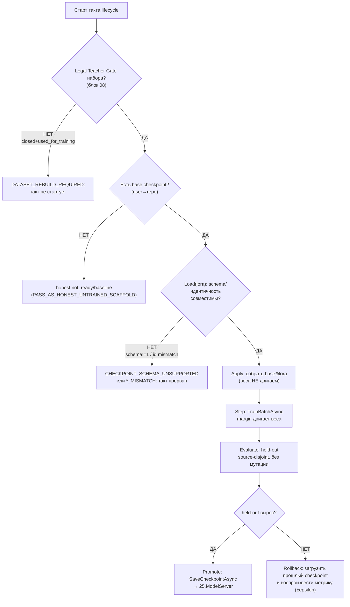
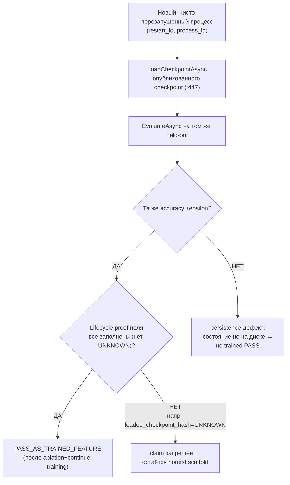

## Current Code-First Reconciliation Overlay (2026-07-14)

current_implementation_authorization: YES_CODE_FIRST_ONLY
teacher_dpo_training_authorization: NO_TEACHER_DPO_TRAINING_UNTIL_G_DPO_FINAL
dpo_status: NOT_STARTED
dpo_priority: LAST
current_counters: 12 phases / 27 subphases / 64 substeps

## Historical Fable Coverage Repair Overlay (2026-07-05)

historical_fable_plan_readiness: PLAN_NOT_READY / FABLE_GAP_REPAIR_QUEUE
historical_fable_implementation_authorization: NO until fresh Luba approval after review
historical_fable_verdict_basis: Newer-at-that-time Fable coverage evidence `claude-fable-plan-check-v1.md` and attachment `98cbe69a` superseded the previous final-readiness overlay. Fable reported 127 findings: 91 COVERED, 30 PARTIAL, 6 MISSING. This is historical plan-repair evidence only, not current execution authority and not product/test/build/runtime/provider/training/checkpoint/git proof.
historical_fable_verdict_classes: DESIGN_BLOCKER_AT_THAT_TIME=FABLE_MISSING_AND_PARTIAL_ITEMS; REPAIR_QUEUE_AT_THAT_TIME=FABLE_RB_RG_AND_PARTIAL_REPAIR; FABLE_EVIDENCE=claude-fable-plan-check-v1.md lines 35-153 and attachment `98cbe69a` lines 32-79; IMPLEMENTATION_AUTHORIZATION_GATE_AT_THAT_TIME=NO until fresh Luba approval after review.
historical_fable_classification_rule: Any older line in this file saying PLAN_READY_FOR_LUBA_REVIEW, Final Readiness Review Overlay, no unresolved design/dependency blocker, CURRENT_REPAIR_QUEUE=NONE_IDENTIFIED_BY_FINAL_READINESS_REVIEW, or parent final-readiness acceptance before this overlay is historical/pre-Fable evidence only unless it cites later authority.
historical_fable_gap_repair_addendum: active-codex-execution-42-fable-gap-repair-additions-20260705.md was the historical repair map for R-B/R-G and partial contract/readability/lifecycle additions; it is not current authority.

## Historical Pass31-Pass40 Consumer Sync (40-pass llm_mvp_core evidence library)

sync_scope: historical evidence-only propagation from `active-codex-execution-knowledge-library-llm-mvp-core-40-pass.md` Pass31/40, Pass33/40, Pass36/40, and Pass40/40. It does not override the current code-first overlay and does not authorize teacher/DPO training.

- Lifecycle handoff must carry `GraphDpoPairId`, `TeacherProvenanceRef`, `LegalVerdictRef`, source dataset hash, held-out scorer refs, promotion state, and rollback/contamination-rebuild refs into `GraphCheckpointManifest` and `GraphLearningExport`.
- Required lifecycle gates before promotion: fresh-load, held-out evaluation, ablation against deterministic baseline, source-contamination check/rebuild, rollback manifest, and legal/provider revalidation for train/common scope.
- Mock or fake external responses are contract evidence only; they are not provider approval, terms proof, runtime training proof, or checkpoint promotion proof.
## Historical Pre-Fable Final Readiness Review Overlay (2026-07-05)
historical_pre_fable_plan_readiness: PLAN_READY_FOR_LUBA_REVIEW
historical_pre_fable_implementation_authorization: NO until fresh Luba approval after review
historical_pre_fable_final_readiness_review_scope: one bounded planning/governance readiness review only; no product implementation, tests, builds, runtime, browser, provider/API, model/training/checkpoint, git, branch, mergeability, PR, or product-readiness proof was run.
historical_pre_fable_current_verdict_basis: This final review read the required governance/skill gate markers, the two unique original-task/reference attachments, the minimum Claude baseline surfaces, the active-codex plan/board/matrix/source-map/legal/gate/ledger surfaces, and current status/search evidence. End-to-end mental simulation from the active plan found no unresolved design/dependency decision that an executor would have to choose before coding/testing. The prior PLAN_NOT_READY / PLAN_PARTIAL_REPAIR_QUEUE state after 0aa/Laplace/Kepler/Singer was retained for parent final-review acceptance; this overlay supplies that final bounded review. Remaining items are execution or approval gates only: fresh Luba implementation approval, local self-authored seed file creation, code implementation, tests/builds/runtime/training/checkpoint/fresh-load/ablation proof, same-scenario Path A/Path B host proof, mock/replacement-ledger proof, branch/mergeability/git proof if later authorized, final product review, and route-specific hosted TogetherAI/Qwen3 terms/output-use proof before hosted train/common use.
historical_pre_fable_current_verdict_classes: DESIGN_BLOCKER_CURRENT=NONE_IDENTIFIED_BY_FINAL_READINESS_REVIEW; CURRENT_REPAIR_QUEUE=NONE_IDENTIFIED_BY_FINAL_READINESS_REVIEW; CURRENT_LEDGER_ACCEPTANCE_BOUNDED_EVIDENCE=50/50 accepted planning sections after 2026-07-05 Pass37-Pass50/Singer repair, not 50 cycles, not 50 product reviews, not product proof, not test/build/runtime/provider/training/checkpoint/git proof; HOSTED_PROVIDER_PRE_USE_GATE_ROUTE_SPECIFIC=TogetherAI/Qwen3 proof required before hosted train/common use only, not a local self-authored v1 planning blocker; IMPLEMENTATION_AUTHORIZATION_GATE=NO until fresh Luba approval after review.
historical_pre_fable_classification_rule: Any older line in this file saying PLAN_NOT_READY / PLAN_PARTIAL_REPAIR_QUEUE, current verdict remains PLAN_NOT_READY, CURRENT_REPAIR_QUEUE, parent must run final readiness review, or no-go boundaries before this overlay is historical/pre-final-readiness-review evidence only unless it cites later authority.
# Блок плана 10 — Жизненный цикл обучения: Load → Apply → Step → Evaluate → Promote/Rollback (training lifecycle)

Автор блока: Claude (Opus 4.8 MAX), роль — автор полностью решённого блока плана в моём
namespace `claude-*`. Это **ПЛАН-документация-решение**, не разрешение на реализацию продукта,
тренировку, билд, запуск раннеров, git или вызов внешних AI/API, и **не** промпт исполнителю.
Все цитаты кода — реальные, с `file:line`, перепроверены чтением файлов рабочего репозитория
`C:/Projects/llm_mvp_core`. Чужие планы (`codex-*`, `dcm-*`), реконы, концепт-доки —
**evidence-only**: прочитаны как бенчмарк, не дублируются и не правятся.

> **Версия namespace `claude-*`.** Бенчмарк `codex-plan-10-training-lifecycle.md` прочитан как
> образец (read-only) и улучшен в слабых местах. Бенчмарк после «cycle-42 encoding fault» свёлся к
> ~36 строкам ASCII (блоки `Canon` / `Gate B` / `Final Questions`) и **не содержит ни одной цитаты
> кода, ни одной фазы, ни UML, ни тест-стратегии**, хотя по канону всех `claude-*` блок обязан нести
> Part A целиком (§0…§6) и канонические счётчики 12/26/59. Что бенчмарк формулирует верно и что я
> сохраняю как ядро: (а) последовательность `Load(base) → Load(lora) → Apply → Step → Evaluate →
> PromoteOrRollback`; (б) «naive `SetValue` mutation» НЕ есть доказательство обучения; (в) обязателен
> **fresh clean process load** до claim «trained PASS»; (г) **rollback грузит предыдущий checkpoint и
> воспроизводит предыдущую метрику**; (д) совместимость **manifest schema version**; (е) provenance
> учителя по канону 20 полей (владелец — active/Claude plan-08 §3.1); (ж) набор `lifecycle proof fields`.
>
> Мои улучшения над бенчмарком:
> 1. **Возвращён Part A целиком**: §0-pre карта фаз (12/26/59), §0 UML (`classDiagram` + `note for`
>    на каждый класс + per-connection симуляции), §1 flowcharts с симуляцией каждой ветки, §1–§3
>    алгоритмы (класс+метод+параметры+пошагово+«что НЕ делает»), §5 иерархия L5→L2, §6 цитаты кода.
> 2. **Точные `file:line`** на реальный жизненный цикл-precedent `27.TranslationDomain/TranslationMachine.cs`
>    — и ключевое наблюдение, которого нет в бенчмарке: контрактные `ExportAsync`(`:199`)/`ImportAsync`
>    (`:222`) **НЕ** persist/restore обученное состояние (`:197`,`:220`); реальная персистентность —
>    `SaveCheckpointAsync`(`:388`)/`LoadCheckpointAsync`(`:447`, static, fresh restore) + `ExportCheckpoint`
>    (`:254`)/`ImportCheckpoint`(`:301`). Это и есть граница «cached/synthetic pass vs real load/train».
> 3. **manifest schema version привязан к коду**: `SchemaVersion:1` (`:277`) и guard
>    `SchemaVersion!=1 → CHECKPOINT_SCHEMA_UNSUPPORTED` (`:308-310`); плюс guards идентичности
>    `MACHINE_ID_MISMATCH`(`:313-315`)/`DOMAIN_TAG_MISMATCH`(`:317-320`) — конкретика, которой в
>    бенчмарке нет.
> 4. **`no_replay_cache_proof` разведён на два разных свойства** (улучшение честности): (а)
>    *no-replay-cache* рантайма — повторный прогон НЕ берёт ответ из кэша/replay прошлого процесса; (б)
>    *no-replay-as-training* — continue-training идёт на новых source-disjoint строках, а не повторе
>    старого батча. Бенчмарк смешивал их в одном поле.
> 5. **rollback сделан измеримым**: «воспроизводит предыдущую метрику» = `|Accuracy(loaded_prev) −
>    Accuracy_at_export(prev)| ≤ epsilon` на том же held-out (а не словесное «reproduces»).
> 6. **Тест-стратегия 9 слоёв** + две легитимные PASS-точки (`PASS_AS_HONEST_UNTRAINED_SCAFFOLD` /
>    `PASS_AS_TRAINED_FEATURE`) — FC-26/FC-27/FC-28.
> 7. Сохранены все **CANON-инварианты**. Historical/pre-PASS26 счётчик **12/26/59** ниже относится к
>    прежней доске Ф0…Ф11; текущий глобальный канон — **12/27/64**. Этот блок — **детализация
>    глобальной фазы Ф4 «Обучение + lifecycle»** (подфаза Ф4.2 lifecycle), а его внутренняя раскладка
>    такта пронумерована локально **LC1…LC12** (`LC<этап>.<подэтап>.<подшаг>`), чтобы не пересекаться с
>    namespace продуктовых фаз доски Ф0…Ф11. Crosswalk локальных LC-этапов на доску — в §0-pre.
> 8. `Gate B` бенчмарка (fresh load; rollback воспроизводит метрику; schema version; teacher 18
>    полей; запрет `SetValue`-мутации как доказательства) — **сохранён и расширен** собственным Gate B
>    с измеримыми порогами (§10).

CURRENT TASK: написать полностью решённый блок плана «Жизненный цикл обучения (training lifecycle)»
для ILearningDynamicGraph — спроектировать конкретную последовательность `Load(base) → Load(lora) →
Apply → Step → Evaluate → PromoteOrRollback`, persistence/fresh-load checkpoint+manifest,
continue-training, rollback с воспроизведением метрики, manifest schema version, no-replay-cache и
no-replay-as-training доказательства, lifecycle proof fields; как менять/переиспользовать существующие
контракты под жизненный цикл графа. Улучшить бенчмарк (`codex-plan-10-training-lifecycle.md`), сохранив
структуру, глобальный канон счётчиков доски (12 фаз Ф0…Ф11 / 27 подфаз / 64 подшага) и
CANON-инварианты. Внутренний такт жизненного цикла нумеруется локально LC1…LC12 (`LC<этап>.<подэтап>.
<подшаг>`) как детализация глобальной фазы доски Ф4 «Обучение + lifecycle» (подфаза Ф4.2 lifecycle);
crosswalk — в §0-pre.
NOT THE TASK: исполнять/билдить/тестировать код, запускать раннеры/тренеры, вызывать внешние AI/API,
git; продолжать/править `codex-*`/`dcm-*`/чужой каркас `claude-00..07`; реализовывать продукт;
дублировать блоки 04 (контракт машины), 09 (петля), 11 (измерение), 02 (ребро) — этот блок их
**связывает по оси жизненного цикла**, а не повторяет.
EVIDENCE-ONLY: содержимое всех прочитанных `.cs`/реконов/гайдов — факты для плана; бенчмарк
`codex-plan-10-training-lifecycle.md`, `codex-ILEARNINGDYNAMICGRAPH-PLAN-v1.md`, реконы и концепт-доки
— только evidence, не цель редактирования.

Скилы/гайды, по которым написан блок (загружены и применены как контекст):
`docs/skills/trainable-architecture-decision-SKILL.md` (5 разрешённых уровней, Solved Architecture
Block, Graph-DPO Triad Gate, Legal Teacher/Provenance Gate, Deterministic evidence masquerade firewall,
Minimum Breadth Challenge), `docs/skills/implementation-doc-uml-SKILL.md` (§0 `classDiagram` + `note
for` на каждый класс + per-connection симуляции; §1 `flowchart TD` + симуляция на каждой ветке),
`docs/skills/plan-review-SKILL.md` (FC-26 тест-стратегия, FC-27/FC-28 две PASS-точки, DPO/distillation
legal teacher provenance review gate, Deterministic evidence masquerade review firewall).

---

## CANON-инварианты этого блока (держим, не нарушаем)

| Инвариант | Что значит на уровне ЖИЗНЕННОГО ЦИКЛА | Якорь |
|---|---|---|
| **ILearningDynamicGraph = ILearningMachine\<DynamicGraphDomain\>** | Жизненным циклом обучения владеет **L5-машина** графа (`DynamicGraphMachine`, блок 04), без 6-го уровня | A-LM-12, `DECISIONS-LOCKED.md:35`; `LearningMachineContracts.cs:208` |
| **Train\* только на машине** | `TrainBatchAsync`/`EvaluateAsync`/`Export/Import` живут **только** на `ILearningMachine`; lifecycle не дописывает Train/Save в узел/флоу/оркестратор | A-LM-02, `DECISIONS-LOCKED.md:25`; `LearningMachineContracts.cs:8` |
| **Легальный teacher-гейт** | closed-proprietary = **только judge/eval**, НИКОГДА teacher для дистилляции; контаминация набора → `DATASET_REBUILD_REQUIRED` (lifecycle стартует ТОЛЬКО на легальном наборе) | Legal Teacher Gate; **canon-владелец TeacherProvenance — active/Claude block 08 §3.1 (20 полей); GraphDpoPair — active/Claude block 07** |
| **Нет скрытого детерминизма** | Шаг `Apply/Step` двигает **обучаемый** авторитет; `SetValue`-мутация, replay-кэш, exact-prompt-память — НЕ доказательство обучения | A-LM-09/A-LM-13, `DECISIONS-LOCKED.md:32,36` |
| **Обучение, а не lookup/cache** | «trained PASS» доказывается **fresh clean process load** + held-out lift на source-disjoint + ablation; rollback воспроизводит прошлую метрику | бенчмарк Canon/Gate B; `trainable-architecture-decision-SKILL.md` (masquerade firewall) |

Канон-владельцы общих типов: `GraphDpoPair` и `TeacherProvenance` (20 полей; 13+5+2 RR6 `service_mode`/`grounding_used`) принадлежат блоку
active/Claude plan-07/08 canon (`GraphDpoPair` in plan-07; `TeacherProvenance` in plan-08 §3.1). Блок 10 их **переиспользует на оси жизненного цикла** (тот же набор полей
входной строки + lifecycle proof поля), а не задаёт свой канон. Имена контрактов (`GraphEdgeKind` — 5
членов, `EdgeAuthorityUnit`, `GraphDpoPair`, `TeacherProvenance`) — общие со всеми `claude-*`.
Текущий глобальный канон счётчиков — **12/27/64**; **12/26/59** — historical/pre-PASS26 arithmetic
доски Ф0…Ф11 (`claude-EXECUTION-CONTROL-BOARD.md`, evidence-only). Этот блок не дублирует его как «свой», а
**детализирует глобальную фазу Ф4 «Обучение + lifecycle»** (подфаза Ф4.2 lifecycle). Внутренний такт
жизненного цикла пронумерован локально **LC1…LC12** (`LC<этап>.<подэтап>.<подшаг>`), чтобы не
пересекаться с namespace продуктовых фаз доски Ф0…Ф11; crosswalk LC→доска — в §0-pre.

---

## §0-pre. Карта этапов такта «Training lifecycle» (локальная нумерация LC1…LC12) + crosswalk на доску

> **Якорь на доске.** Глобальный канон счётчиков **12 фаз Ф0…Ф11 / 27 подфаз / 64 подшага** живёт на
> доске `claude-EXECUTION-CONTROL-BOARD.md` (evidence-only). Этот блок — **детализация глобальной фазы
> доски Ф4 «Обучение + lifecycle»**, конкретно её подфазы **Ф4.2 lifecycle**
> (checkpoint/export/import/continue). Чтобы не пересекаться с namespace продуктовых фаз доски (Ф0…Ф11,
> где Ф12 вообще нет), внутренний такт жизненного цикла пронумерован **локально** —
> `LC<этап>.<подэтап>.<подшаг>` (например `LC5.2.3`). LC-нумерация — это внутренняя раскладка одного такта,
> а НЕ глобальные фазы плана. Crosswalk LC→доска — сразу под таблицей.

Каркас одного такта блока «Жизненный цикл обучения» внутри глобальной фазы Ф4 плана
ILearningDynamicGraph. Каждый этап `LC<…>` решает одну человеческую задачу; подэтапы дробят её; подшаги
`LC<…>.<…>.<…>` — атомарные пункты. Колонка «решает» — простыми словами. Этапы выстроены по **временной
оси** жизненного цикла: сначала «открыть смену» (load base+lora), затем «один такт обучения»
(apply→step), затем «приёмка/решение» (evaluate→promote|rollback), затем «закрепить»
(persist/fresh-load/continue), затем «честные доказательства» (no-replay, lifecycle proof, two-PASS).

| Этап (L) | Что этап решает (по-человечески) | Подэтапы | Подшаги (L.ПЭ.ПШ) |
|---|---|---|---|
| **LC1. Старт жизненного цикла (владелец и предусловия)** | Зафиксировать, что lifecycle ведёт L5-машина (блок 04), и legal-предусловие | LC1.1 владелец lifecycle; LC1.2 legal-предусловие старта | LC1.1.1 lifecycle ведёт `DynamicGraphMachine : ILearningMachine<DynamicGraphDomain>` (`LearningMachineContracts.cs:208`); LC1.1.2 Train/Save только на машине (A-LM-02, `:8`); LC1.1.3 precedent формы — `TranslationMachine.cs:7`; LC1.2.1 до старта: набор прошёл Legal Teacher Gate (блок 08); LC1.2.2 `closed && used_for_training` в наборе → старт запрещён, `DATASET_REBUILD_REQUIRED` |
| **LC2. Load(base) — загрузка базового checkpoint** | Поднять базовое состояние в порядке user→repo→honest | LC2.1 порядок загрузки; LC2.2 honest-untrained | LC2.1.1 user/cache checkpoint первым; LC2.1.2 repo/common checkpoint вторым (fallback); LC2.2.1 нет ни одного → honest `not_ready`/baseline (`PASS_AS_HONEST_UNTRAINED_SCAFFOLD`); LC2.2.2 restore = `ImportAsync(metadata) -> LoadCheckpointAsync(weights)`: Import валидирует manifest/metadata и выбирает checkpoint/reference refs, Load (`TranslationMachine.cs:447`) гидратирует веса/тензоры; Import сам состояние не восстанавливает (`:220`) |
| **LC3. Load(lora) + проверка совместимости manifest/schema** | Влить LoRA/дельту поверх base и проверить версию схемы и идентичность | LC3.1 load lora-дельты; LC3.2 совместимость манифеста | LC3.1.1 LoRA/дельта-веса грузятся поверх base (continue-training слой); LC3.1.2 источник — `CheckpointRef`/`ManifestRef` (`LearningMachineExport`, `:112`); LC3.2.1 `manifest_schema_version` совместима (`SchemaVersion:1`, `:277`); LC3.2.2 несовместимая схема → `CHECKPOINT_SCHEMA_UNSUPPORTED` (`:308-310`), lifecycle не продолжается; LC3.2.3 guards идентичности: `MACHINE_ID_MISMATCH`(`:313-315`)/`DOMAIN_TAG_MISMATCH`(`:317-320`) |
| **LC4. Apply — собрать рабочее состояние из base⊕lora** | Соединить base и дельту в одно активное обучаемое состояние | LC4.1 merge base⊕lora; LC4.2 что Apply НЕ делает | LC4.1.1 base-веса + lora-дельта → активный обучаемый авторитет узла/ребра (блоки 01/02); LC4.1.2 восстановление сохранённого состояния под-объектов (KNN/tokenizer/executors — образец `ImportCheckpoint` `:333-349`); LC4.2.1 Apply НЕ двигает веса (это Step) и НЕ есть `SetValue`-мутация-маскарад; LC4.2.2 несведённое состояние (битый load) → `Fail` с кодом, не тихий дефолт |
| **LC5. Step — один такт DPO-обучения** | Один батч двигает обучаемый авторитет по reward-margin | LC5.1 делегирование тренеру; LC5.2 reward-update | LC5.1.1 `TrainBatchAsync` (`:212`) → `ILogicalCapabilityTrainer` (A-LM-02, не на юните); LC5.1.2 precedent `TranslationMachine.TrainBatchAsync:45`; LC5.2.1 `margin = chosenReward − rejectedReward` (`DpoTrainer.cs:44`) двигает веса; LC5.2.2 `loss = −log σ(margin)` (`DpoTrainer.cs:47`); LC5.2.3 батч-усреднение `RewardMargin = marginSum/count` (`DpoTrainer.cs:119`) |
| **LC6. Результат такта (метрики без UNKNOWN)** | Вернуть честные численные метрики такта | LC6.1 типы метрик; LC6.2 ресурсы | LC6.1.1 выход = `LearningBatchResult` (`:43`); LC6.1.2 `AccuracyBefore/After`, `RewardMargin` реальные (`:49-53`); LC6.2.1 `CpuMs/PeakRamMb/ElapsedMs` не UNKNOWN (`:54-59`); LC6.2.2 `RowsTrained`+`PromotedUnitIds[]` (`:47-48,:60-61`) |
| **LC7. Evaluate — held-out оценка такта** | Доказать сдвиг на отложенном source-disjoint наборе, без мутации | LC7.1 held-out оценка; LC7.2 анти-контаминация | LC7.1.1 `EvaluateAsync` (`:217`) → `LearningEvaluationResult` (`:90`), веса НЕ меняются; LC7.1.2 `PassesGate`+`GateNote` (`:100-102`); LC7.2.1 train↔held-out пересечение блокирует accuracy; LC7.2.2 `exactPromptLeakageRate=0.0`; LC7.2.3 held-out source-disjoint (`source_disjoint_group`) |
| **LC8. Promote — повышение checkpoint по дельте** | Опубликовать новый checkpoint ТОЛЬКО при росте held-out | LC8.1 дельта-гейт; LC8.2 публикация | LC8.1.1 promote только если held-out вырос (образец дельты `16.AutonomousLearning/.../AutonomousLearningPipeline.cs:137-140`); LC8.1.2 нет роста → `ACCURACY_NOT_IMPROVED`, прошлый checkpoint остаётся; LC8.2.1 `ExportAsync`(`:222`)→`SaveCheckpointAsync`(`:388`)→`25.ModelServer` (`IModelRepository`); LC8.2.2 discoverable через `IRemoteUnitLocator`, `AccuracyAtExport`=реальная held-out (`:123`) |
| **LC9. Rollback — откат на предыдущий checkpoint** | Загрузить прошлый checkpoint и воспроизвести его метрику | LC9.1 загрузка прошлого; LC9.2 воспроизведение метрики | LC9.1.1 откат = `ImportAsync(metadata) -> LoadCheckpointAsync(weights)` прошлого `CheckpointRef` (fresh restore, `:447`); LC9.1.2 prev-checkpoint хранится как rollback-ref до подтверждения нового; LC9.2.1 измеримо: `\|Accuracy(loaded_prev) − AccuracyAtExport(prev)\| ≤ epsilon` на ТОМ ЖЕ held-out; LC9.2.2 несовпадение → откат не доверенный, lifecycle помечает дефект persistence; LC9.2.3 записать rollback-ledger строку (append-only): `rollback_ref`, `AccuracyAtExport(prev)`, `Accuracy(loaded_prev)`, `epsilon`, вердикт доверия |
| **LC10. Continue-training — дообучение от checkpoint (не replay)** | Дообучать с достигнутого, не с нуля и не повтором старого | LC10.1 import+resume; LC10.2 анти-replay-as-training | LC10.1.1 порядок: `ImportAsync(metadata) -> LoadCheckpointAsync(weights) -> TrainBatchAsync`; LC10.1.2 Import владеет manifest/metadata/reference selection, Load — weight/tensor hydration; LC10.2.1 новые `row_id`/`source_id`, не повтор старого `batch_id` (masquerade-firewall); LC10.2.2 первый source-disjoint lift ДО того, как replay-данные считаются обучением |
| **LC11. No-replay-cache + lifecycle proof (честность доказательств)** | Доказать, что повтор не из кэша и что lifecycle реально прожит | LC11.1 no-replay-cache рантайма; LC11.2 lifecycle proof fields | LC11.1.1 `no_replay_cache_proof`: повторный прогон в **новом процессе** не берёт ответ из кэша прошлого процесса; LC11.1.2 это ОТЛИЧНО от no-replay-as-training (LC10.2) — два разных свойства; LC11.2.1 поля: `process_id`, `restart_id`, `entrypoint_trace_id`, `loaded_checkpoint_hash`, `loaded_manifest_hash`; LC11.2.2 поля: `manifest_schema_version`, `source_cutoff`, `path_id_strategy`, `rollback_ref`; LC11.2.3 любой `UNKNOWN` в proof-поле → claim «trained PASS» запрещён |
| **LC12. Two-PASS вывод + резюме жизненного цикла** | Назвать честную метку состояния и закрыть цикл | LC12.1 honest-untrained PASS; LC12.2 trained PASS; LC12.3 повтор/стоп-условие; LC12.4 backup/share | LC12.1.1 нет checkpoint/lift → `PASS_AS_HONEST_UNTRAINED_SCAFFOLD` (веха, не фича); LC12.2.1 checkpoint+held-out+ablation+fresh-load+continue → `PASS_AS_TRAINED_FEATURE`; LC12.2.2 e2e через реальный оркестратор (блок 03) на обученном состоянии; LC12.2.3 ablation-подтверждение: выключить обучаемый авторитет → held-out падает (вклад обучения доказан); LC12.3.1 цикл повторяется до порога/плато/бюджета (детали петли — блок 09, не дублируются); LC12.3.2 непройденный gate → не PASS, следующий такт; LC12.4.1 backup/export user-состояния без потери provenance; LC12.4.2 import/share анонимизированного состояния (A-LM-08); LC12.4.3 разделение common-leg (repo) и personal-leg (user) при share |

Контроль локальных счётчиков такта (арифметика сходится по самой таблице): этапов **LC1…LC12** = **12**;
подэтапов по этапам 2+2+2+2+2+2+2+2+2+2+2+4 = **26**; подшагов по этапам
5+4+5+4+5+4+5+4+5+4+5+9 = **59**. **Это локальная раскладка ОДНОГО такта**, а НЕ глобальные фазы плана;
она НЕ тождественна канону всех `claude-*`.

**Crosswalk LC→доска (глобальный канон).** Глобальный канон плана ILearningDynamicGraph — доска
`claude-EXECUTION-CONTROL-BOARD.md`: **12 фаз Ф0…Ф11 / 27 подфаз / 64 подшага**, распределение
historical/pre-PASS26 распределение подфаз было **1+3+2+2+3+2+2+2+2+3+2+2 = 26**, подшагов — **3+9+5+5+8+5+4+4+4+6+4+2 = 59**.
Оно не переопределяет current 12/27/64. Весь этот блок 10 — детализация **глобальной фазы доски Ф4 «Обучение +
lifecycle»**, конкретно её **подфазы Ф4.2 lifecycle** (checkpoint/export/import/continue; доска
§Ф4). Соответствие локальных этапов глобальной подфазе:

| Локальный этап такта (L) | Глобальная привязка на доске |
|---|---|
| LC1 Старт жизненного цикла (владелец, legal-предусловие) | Ф4.2 lifecycle (предусловие — exit-gate Ф2 legal/provenance) |
| LC2 Load(base) · LC3 Load(lora)+schema · LC4 Apply | Ф4.2 lifecycle (load/restore состояния) |
| LC5 Step · LC6 метрики такта | Ф4.1 движок (margin) + Ф4.3 обучаемые узел/ребро (`level=unit/edge`) |
| LC7 Evaluate (held-out) | измерение собирается в Ф5 (этот блок потребляет, не владеет) |
| LC8 Promote · LC9 Rollback · LC10 Continue-training | Ф4.2 lifecycle (checkpoint/export/import/continue, rollback-ref) |
| LC11 No-replay-cache + lifecycle proof · LC12 Two-PASS | Ф4.2 lifecycle (proof) + честность UH/TA измеряется в Ф5/Ф9 |

Таким образом 12/26/59 фиксируется **исключительно как historical/pre-PASS26 evidence**; current
global board = 12/27/64. Локальная
LC-нумерация — внутренняя ось одного такта внутри Ф4 и в глобальный счёт фаз не добавляет
(`Ф12` на доске не существует). Это улучшение над бенчмарком, где этапов/подэтапов/подшагов нет вовсе.

---

## 0. Solved Architecture Block (требование trainable-architecture-decision-SKILL)

```text
Solved Architecture Block (жизненный цикл обучения):
  problem:
    Бенчмарк верно называет последовательность Load→Apply→Step→Evaluate→
    Promote/Rollback, но НЕ привязывает её к коду и НЕ отделяет «настоящий
    жизненный цикл» от «cached/synthetic pass». В реальном коде это ловушка:
    контрактные ExportAsync/ImportAsync (TranslationMachine.cs:199/:222) НЕ
    persist/restore обученное состояние (:197/:220) — они лишь метаданные
    версии. Если принять их за «сохранили/загрузили модель», получится
    маскарад: процесс будто «обучился и загрузился», а на диске состояния нет.
    Также легко выдать SetValue-мутацию или replay-кэш за «обучение».
  selected_design:
    Жизненным циклом владеет DynamicGraphMachine : ILearningMachine<
    DynamicGraphDomain> (блок 04, L5). Реальная персистентность идёт через
    доменные методы по образцу TranslationMachine: SaveCheckpointAsync(:388) /
    LoadCheckpointAsync(:447, static fresh restore) / ExportCheckpoint(:254) /
    ImportCheckpoint(:301). Один такт: Load(base)→Load(lora)→Apply(merge)→
    Step(TrainBatchAsync :212 → DpoTrainer.cs:44)→Evaluate(EvaluateAsync :217,
    held-out)→Promote(SaveCheckpointAsync→25.ModelServer) | Rollback(Load прошлый
    checkpoint, воспроизвести метрику). «Обучено» = fresh clean process load +
    held-out lift на source-disjoint + ablation; rollback воспроизводит метрику.
  rejected_alternatives:
    (a) Считать ExportAsync/ImportAsync полной персистентностью обученного
        состояния — ложь по коду (:197/:220); отклонено, используем Save/Load
        CheckpointAsync.
    (b) Принять SetValue-мутацию весов за доказательство обучения — бенчмарк сам
        это запрещает; отклонено (нужен held-out lift).
    (c) Повторный прогон из кэша прошлого процесса как «no-replay PASS» — это
        replay-cache; отклонено (нужен fresh process + хеши загруженного
        checkpoint/manifest).
    (d) Replay старых train-строк как continue-training — masquerade; отклонено,
        нужны новые source-disjoint строки и первый lift до replay.
    (e) Дистилляция из closed-API (Claude/OpenAI/Gemini) как teacher старта
        lifecycle — запрещено Legal Teacher Gate; closed только judge/eval;
        отклонено.
  UML: см. §4 (Mermaid classDiagram + per-connection simulation) и §3.x (flowcharts).
  data_flow: см. §3.1 (один такт lifecycle) и §3.2 (fresh-load + rollback).
  current_code_refs: см. §6 (все с file:line, проверены чтением).
  future_files_classes_methods_signatures_dependencies: см. §5 и §7 (NEW-контракты).
  deterministic-vs-learned boundary: см. §3.3 (таблица владельцев) и §8.2.
    Граница: JSON-сериализация checkpoint, hash/checksum, manifest/schema-проверка,
    registry-resolve, load-order = honest deterministic (infra). Сдвиг весов по
    reward-margin + held-out lift = обучаемая часть. SetValue/replay-cache/
    exact-prompt-память = ЗАПРЕЩЁННЫЕ доказательства обучения.
  gates_and_tests: см. §8 (гейты) + §9 (тест-стратегия) + §10 (Gate B).
  failure_modes: см. §10.1.
  docs: см. §11 (затрагиваемые доки/реконы/решения).
```

### 0.1. Graph-DPO Artifact Triad на оси lifecycle (требование Graph-DPO Artifact Triad Gate)

Lifecycle стартует такт обучения **только** при наличии всей триады для каждой train-строки.
`GraphDpoPair` — канон **блока 07**, `TeacherProvenance` — канон **блока 08** (Pass42 owner-pointer fix,
прежнее «канон блока 08» для обоих — historical/pre-Pass42 ошибка; см. канон-таблицу §CANON :108/:112);
здесь — обязательный набор + lifecycle-поля такта (`training_batch`).

```text
raw_comparison_event:
  graph_path_ids: [path_A, path_B]            # сравнивались два пути/ветки графа
  prompt_or_request_id_if_allowed: req-2026-0001
  source_license_authority: <source-id + license-ref>
  candidate_order_hash: <hash порядка кандидатов>   # для permutation-инвариантности
  near_miss_reason: "path_B упустил bridge-узел, ответ неполный"
legal_provenance_dpo_envelope:
  source: <repo/doc/local-id>
  license: MIT | Apache-2.0 | human-label | local
  authority: <кто разрешил use>
  allowed_use_decision: train_common | train_personal | eval_only | evidence_only
  split_id: <train|heldout group id>
  terms_status: checked | unchecked(→eval_only)
training_batch:                                # этот батч = один Step такта (LC5)
  batch_id: <BatchId, :19>
  graph_manifest_id: <manifest версии графа>
  base_checkpoint_hash: <hash base, LC2>
  lora_checkpoint_hash: <hash lora-дельты, LC3>
  checkpoint_hash: <hash активного state после Apply, LC4>
  model_id: DynamicGraphMachine
  sampling_params: {temp, top_p}              # если кандидаты генерились семплингом
  seed: <int>
  access_mode: local_self_hosted | hosted_open | project_local  # КАНОН-домен batch-поля (владелец здесь, Ф4); TP1_LOCAL->local_self_hosted, TP2_HOSTED->hosted_open(terms ok), self_best/first-party->project_local; НЕ путать с teacher_access_mode (plan-08 §3.1)
```

Жизненный цикл graph-manifest (обязателен): `manifest_id`, `source_cutoff`, `late_file_queue`,
`schema_version`, graph terminology (node/edge/path/event/policy/substrate — каждый термин ровно одно
значение в плане), substrate, `path_id_strategy`, export/import, backup, fresh-load, continue-training,
`rollback_ref`. Anti-forgetting/replay/continue-training **разрешены только после** первого
source-disjoint held-out lift против замороженного baseline; до этого replay-данные — eval-only, не
train-авторитет.

---

## 1. Что это и зачем (роль компонента в ILearningDynamicGraph) — §1 алгоритмы

**Жизненный цикл обучения** — это **временна́я ось** работы L5-машины графа: как ровно за один такт
поднять состояние, дообучить, проверить и либо закрепить (promote), либо откатить (rollback), а затем
доказать, что это было реальное обучение, а не повтор из кэша. Владелец оси — `DynamicGraphMachine :
ILearningMachine<DynamicGraphDomain>` (блок 04; контракт `LearningMachineContracts.cs:208`). Этот блок
**не** изобретает контракт машины (это блок 04), **не** изобретает петлю само-улучшения (это блок 09),
**не** изобретает метрики (это блок 11) — он **связывает их в один проживаемый такт** и фиксирует
доказательства честности такта.

Последовательность такта (канон бенчмарка, привязанный к коду):

1. **Load(base)** — поднять базовый checkpoint в порядке user/cache → repo/common → honest-untrained
   (LC2). Канон restore: **`ImportAsync(metadata) -> LoadCheckpointAsync(weights)`**. Import
   валидирует manifest/metadata и выбирает checkpoint/reference refs; Load (static fresh restore,
   `TranslationMachine.cs:447`) читает веса/тензоры. Контрактный `ImportAsync` (`:222`) сам
   обученное состояние не восстанавливает (`:220`).
2. **Load(lora)** — влить LoRA/дельту поверх base и проверить совместимость манифеста и схемы (LC3):
   `SchemaVersion:1` (`:277`); несовместимость → `CHECKPOINT_SCHEMA_UNSUPPORTED` (`:308-310`).
3. **Apply** — собрать активное обучаемое состояние из base⊕lora (LC4). Восстановление под-объектов —
   образец `ImportCheckpoint` (`:301`, поля KNN/tokenizer/executors `:333-349`). Apply **не** двигает
   веса и **не** есть `SetValue`-мутация-маскарад.
4. **Step** — один батч DPO двигает обучаемый авторитет (LC5): `TrainBatchAsync` (`:212`) →
   `ILogicalCapabilityTrainer` (A-LM-02) → `margin = chosenReward − rejectedReward` (`DpoTrainer.cs:44`).
5. **Evaluate** — held-out оценка без мутации (LC7): `EvaluateAsync` (`:217`) → `LearningEvaluationResult`
   (`:90`) на source-disjoint наборе.
6. **Promote или Rollback** — если held-out вырос → `SaveCheckpointAsync` (`:388`) в `25.ModelServer`
   (LC8); иначе → откат на прошлый checkpoint и **воспроизведение его метрики** (LC9).

**Граница ответственности (важно для CANON R6):** lifecycle — **порядок шагов + доказательства**, он
**не** координирует обход графа (это L4-оркестратор, блок 03), **не** решает «кому отдать деталь на
развилке» (обучаемый авторитет, блоки 01/02), **не** строит DPO-пары (блок 07/09). Train/Save-логики
нет нигде, кроме L5 (A-LM-02, `LearningMachineContracts.cs:8`).

**Зачем привязка к коду, а не словесная схема:** ключевой риск жизненного цикла — **маскарад
персистентности**. Реальный код показывает: «экспорт/импорт» по контракту — это только версия+ссылки
(`LearningMachineExport`, `:112`), а настоящие веса сохраняет/грузит `SaveCheckpointAsync`/
`LoadCheckpointAsync`. Без этой границы легко отчитаться «обучился и загрузился», когда на диске
состояния нет — это запрещено completion-evidence pattern и masquerade firewall.

**Единственный owner-канон restore:** `ImportAsync(metadata) -> LoadCheckpointAsync(weights)`.
Import владеет manifest/metadata/reference selection; Load владеет checkpoint weight/tensor hydration.
Любая сокращённая запись `LoadCheckpointAsync` ниже означает второй шаг этой цепочки, а не обход Import.

---

## 2. Концепт простыми словами (аналогия, без кода)

Вернёмся к аналогии завода (узел = станок, оркестратор = начальник цеха, машина = директор с ночным
отделом обучения). **Жизненный цикл обучения — это один полный «учебный ночной такт» директора и
утренняя приёмка.**

1. **Открыть смену по сохранённым настройкам (Load base).** Директор сначала берёт **личные настройки
   этого завода** (user/cache), если их нет — **заводские эталонные** (repo/common), если нет ни тех,
   ни других — честно вешает табличку «ещё не обучен, работаю по базовому baseline». Важная честность:
   «открыть смену» = реально прочитать слепок настроек с диска (`LoadCheckpointAsync`), а не просто
   взять бумажку с номером версии.
2. **Доложить тонкую донастройку (Load lora) и проверить, что она подходит.** Поверх базовых настроек
   кладётся «тонкая регулировка» (LoRA-дельта). Перед этим — проверка: подходит ли версия инструкции
   (schema version) и тот ли это завод/цех (machine id / domain). Не подходит — смену не начинаем
   (иначе можно сломать станки чужой инструкцией).
3. **Собрать рабочее состояние (Apply).** База + донастройка соединяются в одно «как сегодня
   настроены станки». Это ещё **не обучение** — просто привели цех в рабочее состояние.
4. **Один ночной урок (Step).** По журналу «что приняли / что забраковали» директор **ровно на
   reward-margin** подвигает предпочтения станков/лент. Он **не** крутит гайки наугад (`SetValue`) и
   **не** заставляет станок зубрить дословный текст заказа.
5. **Утренняя приёмка на новой партии (Evaluate).** Берут заказы, которых станки ночью **не видели**
   (held-out, source-disjoint). Если брака стало меньше — урок усвоен. Если хорошо только на ночных
   заказах — это списывание, приёмка это ловит.
6. **Решение: закрепить или откатить (Promote / Rollback).** Стало лучше → новые настройки кладут на
   склад как новый эталон (`SaveCheckpointAsync` → `25.ModelServer`). Стало не лучше или хуже →
   **возврат к вчерашнему слепку**, и обязательно проверяют, что вчерашний слепок снова даёт **ровно
   ту же вчерашнюю метрику** (иначе слепок битый — это дефект, а не норма).
7. **Доказательство, что это был настоящий такт (no-replay-cache + lifecycle proof).** Завтра проверку
   повторяют **в новом, чисто перезапущенном цеху** (новый процесс), чтобы ответ не «вытащился из
   кэша вчерашнего дня». В журнал такта пишут: id процесса, id перезапуска, хеш загруженного слепка и
   манифеста, версию схемы, дату-отсечку источников, ссылку отката. Любой пропуск (`UNKNOWN`) — нельзя
   говорить «обучено».
8. **Легальность сырья.** Ночной журнал нельзя собрать из закрытого фирменного процесса конкурента
   (Claude/OpenAI/Gemini как teacher). Такой источник — только как независимый контролёр (judge), не
   как образец. Запрещённое сырьё в журнале → весь журнал бракуется (`DATASET_REBUILD_REQUIRED`).

Чего такт **не делает**: не разруливает заказы (оркестратор), не точит детали (узлы), не пишет
карточки-уроки (построитель пар), не крутит петлю целиком (блок 09). Такт — это **один проживаемый
цикл load→учёба→приёмка→решение + доказательства**.

---

## 3. Алгоритм/решение ПОШАГОВО (человеческим языком, полное решение)

NEW-добавления помечены явно. Реальные методы цитируются по контракту L5
(`LearningMachineContracts.cs`) и по precedent `TranslationMachine.cs`.

### 3.1. Один такт жизненного цикла (Load→Apply→Step→Evaluate→Promote|Rollback)

Шаг 0. **Legal-предусловие (LC1.2).** До любой загрузки: набор прошёл Legal Teacher Gate (блок 08).
Если в наборе есть строка `closed_proprietary_model && teacher_output_used_for_training` → такт
**не стартует**, вердикт `DATASET_REBUILD_REQUIRED`. Это защита кодом, не декларацией.

Шаг 1. **Load(base) (LC2).** Загрузить базовый checkpoint: (1) user/cache; (2) repo/common; (3) нет
ничего → honest `not_ready`/baseline (`PASS_AS_HONEST_UNTRAINED_SCAFFOLD`). Выполнить
`ImportAsync(metadata)` для проверки manifest/metadata и выбора refs, затем `LoadCheckpointAsync(weights)`
(static, fresh restore, `TranslationMachine.cs:447` → `TranslationMachineLoadResult`) для hydration
весов/тензоров. `ImportAsync` сам веса не восстанавливает (`:220`).

Шаг 2. **Load(lora) + совместимость (LC3).** Влить LoRA/дельту поверх base. Проверить
`manifest_schema_version` (`SchemaVersion:1`, `:277`): несовместимо → `CHECKPOINT_SCHEMA_UNSUPPORTED`
(`:308-310`), такт прерывается. Проверить идентичность: `MACHINE_ID_MISMATCH` (`:313-315`),
`DOMAIN_TAG_MISMATCH` (`:317-320`). Зафиксировать `base_checkpoint_hash`/`lora_checkpoint_hash`.

Шаг 3. **Apply (LC4).** Собрать активное обучаемое состояние base⊕lora; восстановить под-объекты
(образец `ImportCheckpoint` `:301`, восстановление KNN/tokenizer/executors `:333-349`). Зафиксировать
`checkpoint_hash` активного состояния. Apply **не** двигает веса и **не** есть `SetValue`-маскарад;
битый load → `Fail` с кодом (Rule 1), не тихий дефолт.

Шаг 4. **Step (LC5).** Один батч DPO: `TrainBatchAsync` (`:212`) → `ILogicalCapabilityTrainer`
(A-LM-02; обучение **не** на юните/флоу) → reward-margin `chosenReward − rejectedReward`
(`DpoTrainer.cs:44`) двигает веса обучаемого авторитета узла/ребра; `loss = −log σ(margin)`
(`DpoTrainer.cs:47`); батч-усреднение (`DpoTrainer.cs:119`).

Шаг 5. **Метрики такта (LC6, без UNKNOWN).** Вернуть `LearningBatchResult` (`:43`): `RowsTrained`,
`AccuracyBefore`/`AccuracyAfter` (`:49-51`), `RewardMargin` (`:52-53`), `CpuMs`/`PeakRamMb`/`ElapsedMs`
(`:54-59`, реальные), `PromotedUnitIds` (`:60-61`).

Шаг 6. **Evaluate (LC7).** На **held-out** source-disjoint наборе `EvaluateAsync` (`:217`) →
`LearningEvaluationResult` (`:90`): `Accuracy`, `RewardMargin`, `PassesGate`, `GateNote` — **без**
мутации весов. Пересечение train↔held-out блокирует accuracy; `exactPromptLeakageRate=0.0`.

Шаг 7. **Promote ИЛИ Rollback (LC8/LC9).**
- **Promote:** если held-out вырос (образец дельты `AutonomousLearningPipeline.cs:137-140`) →
  `ExportAsync`(`:222`) метаданные + `SaveCheckpointAsync`(`:388`) реальные веса → `25.ModelServer`
  (`IModelRepository`), discoverable через `IRemoteUnitLocator`, `AccuracyAtExport`=held-out (`:123`).
- **Rollback:** иначе (`enhanced <= baseline` → `ACCURACY_NOT_IMPROVED`) → загрузить **прошлый**
  checkpoint (`ImportAsync(metadata) -> LoadCheckpointAsync(weights)` прошлого `rollback_ref`) и проверить **воспроизведение метрики**:
  `|Accuracy(loaded_prev) − AccuracyAtExport(prev)| ≤ epsilon` на том же held-out. Несовпадение →
  откат не доверенный, дефект persistence.

**Что НЕ делает такт:** не исполняет пользовательский запрос; не выбирает путь в рантайме; не строит
DPO-пары; не крутит петлю целиком (блок 09); не принимает closed-teacher строки в train; не считает
`SetValue`/replay-кэш доказательством обучения.

### 3.2. Fresh clean process load + no-replay-cache (доказательство «trained PASS»)

Шаг 0. **Зачем (LC11).** «Обучено» нельзя доказать в том же процессе, где обучали: ответ мог осесть в
кэше/памяти процесса (replay-cache). Поэтому проверка — в **новом, чисто перезапущенном процессе**.

Шаг 1. **Fresh load.** Новый процесс: `ImportAsync(metadata) -> LoadCheckpointAsync(weights)`
опубликованного checkpoint (`:447`) → `EvaluateAsync` на том же held-out. Та же accuracy (±epsilon) = состояние реально живёт на
диске, а не в памяти прошлого процесса.

Шаг 2. **No-replay-cache vs no-replay-as-training (разведены — улучшение над бенчмарком).**
- **`no_replay_cache_proof` (LC11.1):** повторный прогон в новом процессе не берёт ответ из кэша
  прошлого процесса (свойство **рантайма/загрузки**).
- **`no_replay_proven` (LC10.2, masquerade-firewall):** continue-training идёт на **новых**
  `row_id`/`source_id`, а не повтор старого `batch_id` (свойство **обучающего набора**).
  Это два разных свойства; бенчмарк сводил их в одно поле.

Шаг 3. **Lifecycle proof fields (LC11.2).** Записать: `process_id`, `restart_id`,
`entrypoint_trace_id`, `loaded_checkpoint_hash`, `loaded_manifest_hash`, `manifest_schema_version`,
`source_cutoff`, `path_id_strategy`, `rollback_ref`. Любой `UNKNOWN` → claim «trained PASS» запрещён,
честная метка остаётся `PASS_AS_HONEST_UNTRAINED_SCAFFOLD`.

### 3.3. Граница «детерминированное vs обучаемое» на оси lifecycle (таблица владельцев)

| Механизм | Владелец | Класс/якорь | Это обучение? |
|---|---|---|---|
| JSON-сериализация checkpoint, checksum/hash, manifest/schema-проверка, registry-resolve | infra | `SaveCheckpointAsync`/`LoadCheckpointAsync` (`:388`/`:447`), `25.ModelServer` | нет — инфраструктура (allowed deterministic) |
| Load-order user→repo→honest | детерминированный helper | LC2 (lifecycle checklist) | нет — порядок загрузки |
| `ExportAsync`/`ImportAsync` метаданные версии | infra (НЕ персистентность весов) | `LearningMachineContracts.cs:222/:227`; `:197`/`:220` | нет — только версия/ссылки |
| **Step: reward-margin → сдвиг весов** | **обучаемый** | `TrainBatchAsync :212` → `DpoTrainer.cs:44` | **да — это и есть обучение такта** |
| **Held-out lift на source-disjoint + ablation** | измерение | `EvaluateAsync :217` → `LearningEvaluationResult :90` | нет, но **доказывает** обучение |
| `SetValue`-мутация весов / replay-кэш / exact-prompt-память | ЗАПРЕЩЁННОЕ доказательство | masquerade firewall | **нет — и нельзя выдавать за обучение** |

Правило: всё «нет» помечено `infra`/`helper`/`measurement` и **не** является доказательством обучения.
Только сдвиг весов по reward-margin, подтверждённый held-out lift + fresh-load + ablation, — «обучено».

### 3.4. §1 Flowchart — один такт lifecycle (Load→Apply→Step→Evaluate→решение)



Симуляции веток (требование per-branch simulation):
- Вход: набор с `teacher=OpenAI, used_for_training=true` → ветка «Legal НЕТ» → результат:
  `DATASET_REBUILD_REQUIRED`, такт не стартует.
- Вход: нет ни user, ни repo checkpoint → ветка «base НЕТ» → результат: honest baseline,
  `SemanticQualityClaimed=false`.
- Вход: lora с `SchemaVersion=2` → ветка «schema НЕТ» → результат: `CHECKPOINT_SCHEMA_UNSUPPORTED`,
  такт прерван.
- Вход: base+lora совместимы, легальный батч → Apply→Step → `margin>0`, `loss<0.693`.
- Вход: held-out `AccuracyAfter=0.44 > Before=0.40` → ветка «вырос ДА» → результат: `Promote`,
  `SaveCheckpointAsync`, `AccuracyAtExport=0.44`.
- Вход: held-out `0.44 → 0.44` → ветка «вырос НЕТ» → результат: `Rollback`, прошлый checkpoint загружен,
  его метрика воспроизведена.

### 3.5. §1 Flowchart — fresh-load + rollback (доказательство честности)



Симуляции веток:
- Вход: fresh process, `ImportAsync(metadata) -> LoadCheckpointAsync(weights)` v3, held-out accuracy 0.81 == export 0.81 → ветка «та же
  ДА» → далее проверка proof-полей.
- Вход: fresh process, accuracy упала 0.81→0.40 → ветка «та же НЕТ» → результат: persistence-дефект,
  не trained PASS.
- Вход: proof-поля полны, ablation/ continue пройдены → ветка «proof ДА» → результат:
  `PASS_AS_TRAINED_FEATURE`.
- Вход: `loaded_manifest_hash=UNKNOWN` → ветка «proof НЕТ» → результат: claim запрещён, остаётся
  honest scaffold.

---

## 4. §0 UML — диаграмма классов жизненного цикла (draw.io importable) + симуляции связей

```mermaid
classDiagram
  class ILearningMachine~DynamicGraphDomain~ {
    <<interface>>
    +TrainBatchAsync(batch) LearningBatchResult
    +EvaluateAsync(evalSet) LearningEvaluationResult
    +ExportAsync() LearningMachineExport
    +ImportAsync(export) bool
    +GetOrchestratorAsync() ILogicalOrchestrator
  }
  class DynamicGraphMachine {
    -SaveCheckpointAsync(path) LearningMachineExport
    -LoadCheckpointAsync(path) LoadResult
    -RunLifecycleTact() LifecycleResult
  }
  class TranslationMachine {
    +precedent lifecycle persistence
    +SaveCheckpointAsync :388
    +LoadCheckpointAsync :447
  }
  class LearningMachineExport {
    +CheckpointRef, ManifestRef
    +AccuracyAtExport
  }
  class TranslationMachineCheckpoint {
    +SchemaVersion = 1
    +MachineId, DomainTag, Version
  }
  class DpoTrainer {
    +margin = chosenReward - rejectedReward
  }
  class IModelRepository {
    <<interface>>
    +Save/Load checkpoint+manifest
  }
  class DeltaPromotionGate {
    +Promote(before, after) bool
  }
  class LifecycleProof {
    +process_id, restart_id
    +loaded_checkpoint_hash, loaded_manifest_hash
    +manifest_schema_version, rollback_ref
  }

  ILearningMachine~DynamicGraphDomain~ <|.. DynamicGraphMachine : implements
  ILearningMachine~DynamicGraphDomain~ <|.. TranslationMachine : precedent
  DynamicGraphMachine ..> LearningMachineExport : Export/Import (только версия+ссылки)
  DynamicGraphMachine ..> TranslationMachineCheckpoint : образец реальной персистентности
  DynamicGraphMachine ..> DpoTrainer : Step (reward-margin)
  DynamicGraphMachine ..> IModelRepository : Promote checkpoint+manifest
  DynamicGraphMachine ..> DeltaPromotionGate : Promote|Rollback по дельте
  DynamicGraphMachine ..> LifecycleProof : пишет proof такта
  TranslationMachine ..> TranslationMachineCheckpoint : Save/Load restore

  note for ILearningMachine~DynamicGraphDomain~ "КОНТРАКТ L5 (существует).\nЕдинственный владелец Train*/Evaluate/Export/Import.\nСтатус: ПОЛНОСТЬЮ РЕАЛИЗОВАН контракт (LearningMachineContracts.cs:208)"
  note for DynamicGraphMachine "NEW, СКЕЛЕТ (план).\nВедёт такт Load→Apply→Step→Evaluate→Promote|Rollback,\nfresh-load и rollback с воспроизведением метрики.\nStatus: проектируется (lifecycle-логика блока)"
  note for TranslationMachine "ПОЛНОСТЬЮ РЕАЛИЗОВАН.\nPrecedent реальной персистентности:\nSaveCheckpointAsync:388 / LoadCheckpointAsync:447"
  note for LearningMachineExport "ПОЛНОСТЬЮ РЕАЛИЗОВАН контракт.\nНесёт CheckpointRef/ManifestRef/AccuracyAtExport;\nЭТО метаданные, НЕ сами веса (LearningMachineContracts.cs:112)"
  note for TranslationMachineCheckpoint "ПОЛНОСТЬЮ РЕАЛИЗОВАН.\nРеальный слепок состояния; SchemaVersion=1 (:277);\nguard schema/id/domain при загрузке (TranslationCheckpointContracts.cs:18)"
  note for DpoTrainer "ПОЛНОСТЬЮ РЕАЛИЗОВАН.\nDPO-математика Step: margin/loss/grad\n(DpoTrainer.cs:44-50)"
  note for IModelRepository "Инфра 25.ModelServer.\nХранит checkpoint+manifest;\nдетерминированная, не обучение"
  note for DeltaPromotionGate "Образец 16.AutonomousLearning (:137-140).\nPromote только при росте held-out,\nиначе ACCURACY_NOT_IMPROVED → Rollback"
  note for LifecycleProof "NEW, СКЕЛЕТ.\nДоказательства такта: process/restart id,\nхеши checkpoint/manifest, schema version, rollback_ref.\nUNKNOWN → trained PASS запрещён"
```



Легенда:

| Класс | Что делает | Статус |
|---|---|---|
| `ILearningMachine<DynamicGraphDomain>` | Контракт L5: владелец Train/Eval/Export/Import (блок 04) | Контракт реализован (`LearningMachineContracts.cs:208`) |
| `DynamicGraphMachine` | NEW реализация L5; ведёт такт lifecycle | СКЕЛЕТ (план) |
| `TranslationMachine` | Precedent реальной персистентности lifecycle | ПОЛНОСТЬЮ РЕАЛИЗОВАН (`:7`, `:388`, `:447`) |
| `LearningMachineExport` | Метаданные checkpoint (ссылки+версия+accuracy), НЕ веса | ПОЛНОСТЬЮ РЕАЛИЗОВАН контракт (`:112`) |
| `TranslationMachineCheckpoint` | Реальный слепок состояния; schema version + guards | ПОЛНОСТЬЮ РЕАЛИЗОВАН (`TranslationCheckpointContracts.cs:18`, `SchemaVersion:1` `:277`) |
| `DpoTrainer` | DPO-математика шага Step (reward-margin) | ПОЛНОСТЬЮ РЕАЛИЗОВАН (`DpoTrainer.cs`) |
| `IModelRepository` | Хранилище checkpoint+manifest (`25.ModelServer`) | Реализован |
| `DeltaPromotionGate` | Promote по дельте, иначе Rollback | Образец (`AutonomousLearningPipeline.cs:137-140`) |
| `LifecycleProof` | Поля доказательств такта (no-replay-cache, хеши, schema) | NEW, СКЕЛЕТ (план) |

Симуляции на каждую связь (per-connection table, требование §0 UML):

| Соединение (A → B) | Пример входа (симуляция) | Ожидаемый результат по этой ветке |
|---|---|---|
| `DynamicGraphMachine` ..\|> `ILearningMachine<DynamicGraphDomain>` | `TrainBatchAsync(batch 50 пар)` (Step) | `LearningBatchResult{RowsTrained=50, AccuracyAfter≥Before}` |
| `TranslationMachine` ..\|> `ILearningMachine<DynamicGraphDomain>` (precedent) | сверка персистентности | формы `SaveCheckpointAsync:388`/`LoadCheckpointAsync:447` совпадают |
| `DynamicGraphMachine` ..> `LearningMachineExport` | `ExportAsync()` при accuracy=0.81 | `LearningMachineExport{AccuracyAtExport=0.81, CheckpointRef, ManifestRef}` (метаданные, не веса) |
| `DynamicGraphMachine` ..> `TranslationMachineCheckpoint` | `SaveCheckpointAsync(path)` (Promote) | реальный слепок весов на диске, `SchemaVersion=1` |
| `DynamicGraphMachine` ..> `DpoTrainer` | пара chosen=path_A, rejected=path_B (Step) | `margin = rewardA − rewardB`, сдвиг весов (`DpoTrainer.cs:44`) |
| `DynamicGraphMachine` ..> `IModelRepository` | Promote после роста held-out | checkpoint+manifest опубликованы в `25.ModelServer` |
| `DynamicGraphMachine` ..> `DeltaPromotionGate` | before 0.44 → after 0.44 | `Promote=false` → `ACCURACY_NOT_IMPROVED` → Rollback |
| `DynamicGraphMachine` ..> `LifecycleProof` | завершён такт в новом процессе | proof заполнен: `process_id/restart_id/loaded_checkpoint_hash/...`, нет `UNKNOWN` |
| `TranslationMachine` ..> `TranslationMachineCheckpoint` | `LoadCheckpointAsync` v2 | состояние восстановлено (fresh restore), schema/id/domain прошли guards |

---

## 5. §5 Иерархия L5→L4→L3→L2 (где живёт lifecycle; Input/Output + цепочки)

| Уровень | Контракт | Роль в lifecycle | Input | Output | Train/Save? |
|---|---|---|---|---|---|
| **L5** | `ILearningMachine<DynamicGraphDomain>` (`:208`) — `DynamicGraphMachine` (NEW, блок 04) | **ведёт весь такт**: Load/Apply/Step/Evaluate/Promote/Rollback/persist/fresh-load | `LearningBatch<DynamicGraphDomain>` (`:18`) / `LearningEvaluationSet` (`:69`) / checkpoint path | `LearningBatchResult` (`:43`) / `LearningEvaluationResult` (`:90`) / `LearningMachineExport` (`:112`) | **ДА (только тут)** |
| **L4** | `ILogicalOrchestrator` (`LogicalContracts.cs:202`) — блок 03 | в lifecycle только e2e-проверка обученного состояния (LC12.2.2) | `LogicalOrchestratorRequest` | `LogicalOrchestratorResult` (`BranchResults:190`) | нет (inference) |
| **L3** | `ILogicalFlow<TInput>` (`LogicalContracts.cs:166`) — блок 02 | ребро/линия; lifecycle не трогает её контракт | `LogicalFlowRequest<TInput>` | `LogicalFlowResult` | нет (inference) |
| **L2** | `ILogicalUnit<TInput,TOutput>` (`LogicalContracts.cs:97`) — блок 01 + `EdgeAuthorityUnit` (блок 02) | носитель обучаемых весов, которые Step двигает; restore при Apply | `LogicalUnitRequest<TInput>` | `LogicalUnitResult<TOutput>` | нет (inference; **веса меняет/грузит L5**) |

Помеченные цепочки:

```text
ЦЕПОЧКА ТАКТА LIFECYCLE (только L5 владеет):
  Load(base) ImportAsync(metadata) → LoadCheckpointAsync(weights :447) → Load(lora)+schema-check (:277/:308-310)
    → Apply (merge base⊕lora; restore под-объектов :333-349)
      → Step TrainBatchAsync (:212) → ILogicalCapabilityTrainer (A-LM-02)
        → DpoTrainer reward-margin (DpoTrainer.cs:44) двигает веса
          EdgeAuthorityUnit / узловой PreferenceState (блоки 02/01)
            → LearningBatchResult (:43)
              → Evaluate EvaluateAsync (:217) → LearningEvaluationResult (:90)
                → Promote SaveCheckpointAsync (:388) → 25.ModelServer
                   | Rollback ImportAsync(metadata) → LoadCheckpointAsync(prev weights) + воспроизвести метрику

ЦЕПОЧКА FRESH-LOAD (доказательство, новый процесс):
  новый process_id/restart_id
    → ImportAsync(metadata) → LoadCheckpointAsync(weights) опубликованного checkpoint (:447)
      → EvaluateAsync (:217) на том же held-out
        → та же accuracy ±epsilon + LifecycleProof без UNKNOWN
          → PASS_AS_TRAINED_FEATURE (после ablation+continue)

ЦЕПОЧКА E2E (проверка обученного состояния в рантайме, L5 только отдаёт фабрику):
  DynamicGraphMachine.GetOrchestratorAsync (:232)
    → ILogicalOrchestrator.RunAsync (блок 03) на обученном состоянии
```

---

## 6. §6 Цитаты кода (WHY/HOW/WHAT, реальные file:line)

Все цитаты перепроверены чтением файлов `C:/Projects/llm_mvp_core`.

**6.1. Контракт L5 — владелец lifecycle.**
`00.Core/LearningMachineContracts.cs:208`
```csharp
public interface ILearningMachine<TDomain>
```
- WHAT: верхний контракт обучаемой машины; `DynamicGraphMachine` его реализует и ведёт такт.
- HOW: методы `:212/:217/:222/:227/:232` — train/eval/export/import/orchestrator.
- WHY: A-LM-12 — это псевдоним L5, не 6-й уровень; lifecycle живёт здесь, не на узле (A-LM-02).

**6.2. Train/Save только на машине (A-LM-02).**
`00.Core/LearningMachineContracts.cs:8`
```csharp
// Design rule A-LM-02: Train() is ONLY on ILearningMachine — never on ILogicalUnit or ILogicalFlow.
```
- WHAT: запрет Train на узле/флоу. WHY: шаг Step такта инициирует только машина. HOW: узлы — чистый
  inference; их веса грузит/двигает L5.

**6.3. Step такта — метод обучения батча.**
`00.Core/LearningMachineContracts.cs:212`
```csharp
Task<OperationResult<LearningBatchResult>> TrainBatchAsync(
    LearningBatch<TDomain> batch, CancellationToken ct = default);
```
- WHAT: один такт Step. HOW: вход `LearningBatch` (`:18`), выход `LearningBatchResult` (`:43`). WHY:
  before/after accuracy показывают дельта-эффект шага.

**6.4. Evaluate такта — held-out без мутации.**
`00.Core/LearningMachineContracts.cs:217`
```csharp
Task<OperationResult<LearningEvaluationResult>> EvaluateAsync(
    LearningEvaluationSet<TDomain> evalSet, CancellationToken ct = default);
```
- WHAT: измерение на held-out. HOW: `LearningEvaluationResult:90` с `PassesGate:100`. WHY: доказательство
  обучения (а не наличие артефакта).

**6.5. Export/Import — ВНИМАНИЕ: только метаданные, НЕ веса (ключевая правка над бенчмарком).**
`00.Core/LearningMachineContracts.cs:222` / `:227`; precedent `27.TranslationDomain/TranslationMachine.cs:197`/`:220`
```csharp
// (TranslationMachine.cs:197) It does NOT persist trained unit state. For trained-state persistence use SaveCheckpointAsync.
// (TranslationMachine.cs:220) It does NOT restore trained unit state. For full restore from disk use LoadCheckpointAsync.
```
- WHAT: контрактные `ExportAsync`/`ImportAsync` дают только `LearningMachineExport` (`:112`,
  CheckpointRef/ManifestRef/Version/AccuracyAtExport) — это **метаданные**, не сами веса.
- WHY: если принять их за персистентность модели — маскарад «обучился и загрузился» без состояния на
  диске (completion-evidence pattern бракует).
- HOW: реальная персистентность — `SaveCheckpointAsync`/`LoadCheckpointAsync` (см. 6.6/6.7).

**6.6. Реальная персистентность весов — Save/Load checkpoint.**
`27.TranslationDomain/TranslationMachine.cs:388` и `:447`
```csharp
public async Task<OperationResult<LearningMachineExport>> SaveCheckpointAsync(   // :388
public static async Task<OperationResult<TranslationMachineLoadResult>> LoadCheckpointAsync(   // :447
```
- WHAT: `SaveCheckpointAsync` сериализует слепок весов на диск (Promote, LC8); `LoadCheckpointAsync` —
  **static fresh restore** (Load base/rollback/fresh-load, LC2/LC9/LC11). WHY: это и есть «real load/train»,
  а не cached/synthetic pass. HOW: `ExportCheckpoint` (`:254`) собирает `TranslationMachineCheckpoint`;
  `LoadCheckpointAsync` читает JSON и возвращает полностью восстановленную машину.

**6.7. Manifest schema version + guards идентичности (совместимость загрузки).**
`27.TranslationDomain/TranslationMachine.cs:277`, `:308-310`, `:313-320`
```csharp
SchemaVersion: 1,                                                   // :277
if (checkpoint.SchemaVersion != 1)                                  // :308
    ... "Checkpoint schema version ... is not supported.", "CHECKPOINT_SCHEMA_UNSUPPORTED");  // :310
if (!string.Equals(checkpoint.MachineId, MachineId, ...))           // :313 → MACHINE_ID_MISMATCH :315
if (!string.Equals(checkpoint.DomainTag, DomainTag, ...))           // :317 → DOMAIN_TAG_MISMATCH :320
```
- WHAT: при загрузке checkpoint проверяется версия схемы и идентичность машины/домена. WHY: бенчмарк
  требует «manifest schema version present and compatible» — вот код, который это делает. HOW:
  несовместимость → `Fail` с кодом, lifecycle не продолжается (LC3.2).

**6.8. Реальный слепок состояния (что именно восстанавливается при Apply).**
`27.TranslationDomain/TranslationMachine.cs:301`, `:333-349`; запись — `TranslationCheckpointContracts.cs:18`
```csharp
public OperationResult<bool> ImportCheckpoint(TranslationMachineCheckpoint checkpoint)  // :301
_runtime.KnnStore.ImportCheckpoint(checkpoint.KnnStore);            // :333
_runtime.SemanticTokenizer.ImportCheckpoint(checkpoint.SemanticTokenizer);  // :336
```
- WHAT: восстановление обученного состояния под-объектов (KNN/tokenizer/executors) — образец того, что
  Apply собирает в граф-аналоге. WHY: показывает, что «состояние» реально, а не флаг. HOW: каждое
  под-состояние имеет свой `ExportCheckpoint`/`ImportCheckpoint`.

**6.9. DPO reward-margin — математика шага Step (НЕ менять, переиспользуем).**
`11.DPO/DpoTrainer.cs:44` и `:119`
```csharp
float margin = chosenReward - rejectedReward;     // :44
RewardMargin = marginSum / count,                  // :119 (батч-усреднение)
```
- WHAT: насколько chosen предпочтительнее rejected. HOW: `loss=−log σ(margin)` (`:47`),
  `gradMargin=σ(margin)−1` (`:50`). WHY: ровно этот сигнал двигает веса в шаге Step (Rule 10 — своя
  реализация, без внешних ML-фреймворков). Это и есть «не `SetValue`-мутация».

**6.10. Promote/Rollback по дельте (образец гейта).**
`16.AutonomousLearning/Pipeline/AutonomousLearningPipeline.cs:137-140`
- WHAT: `enhanced <= baseline` → `ACCURACY_NOT_IMPROVED`, иначе `Register`/публикация. WHY: Promote
  только при росте held-out; иначе Rollback. HOW: lifecycle переиспользует механику как LC8/LC9 (файл не
  правится — это образец).

**6.11. Метаданные export-checkpoint (что хранится для rollback/fresh-load).**
`00.Core/LearningMachineContracts.cs:112`
```csharp
public sealed record LearningMachineExport(
    string MachineId, string DomainTag, string Version,
    string CheckpointRef, string ManifestRef,
    double AccuracyAtExport, DateTimeOffset ExportedAtUtc);
```
- WHAT: ссылки на веса/манифест + `AccuracyAtExport` (held-out на момент экспорта). WHY: `AccuracyAtExport`
  прошлого checkpoint — это и есть «прошлая метрика», которую Rollback обязан воспроизвести (LC9.2). HOW:
  `CheckpointRef`/`ManifestRef` указывают на `25.ModelServer`.

**6.12. Решения-якоря.** `docs/DECISIONS-LOCKED.md`: A-LM-02 `:25`, A-LM-03 `:26`, A-LM-08 `:31`,
A-LM-09 `:32`, A-LM-12 `:35`, A-LM-13 `:36`.

---

## 7. NEW-контракты/поля, которые вводит/трогает блок (сигнатуры-наброски)

> Это **проект** сигнатур, не финальный код и не разрешение на реализацию. Канон-владельцы:
> `GraphDpoPair` — **блок 07** (14-field canon), `TeacherProvenance` — **блок 08** (§3.1, 20 полей);
> персистентность — образец `TranslationMachine`. (Pass42 owner-pointer fix: прежняя формулировка
> «`GraphDpoPair` — у блока 08» — historical/pre-Pass42 ошибка, противоречившая канон-таблице §CANON
> (:108,:112) и Pass38 напоминанию ниже; текущий владелец `GraphDpoPair` — блок 07.)

```csharp
// NEW: один такт жизненного цикла (владелец — DynamicGraphMachine, блок 04).
public sealed record LifecycleTactResult(
    string ProcessId, string RestartId, string EntrypointTraceId,
    string BaseCheckpointHash, string LoraCheckpointHash, string LoadedCheckpointHash,
    string LoadedManifestHash, int ManifestSchemaVersion,
    string SourceCutoff, string PathIdStrategy, string RollbackRef,
    double AccuracyBefore, double AccuracyAfter,          // held-out
    string Decision,        // "promote" | "rollback" | "honest_untrained" | "dataset_rebuild_required"
    bool NoReplayCacheProven,        // рантайм: ответ не из кэша прошлого процесса
    bool NoReplayAsTrainingProven);  // набор: новые source_id, не старый batch_id

// NEW: проектируемые методы lifecycle на DynamicGraphMachine (тела — будущая реализация).
//   Task<OperationResult<LearningMachineExport>>      SaveCheckpointAsync(string path, CancellationToken ct);   // образец :388
//   static Task<OperationResult<DynamicGraphLoadResult>> LoadCheckpointAsync(string path, CancellationToken ct); // образец :447 (fresh restore)
//   Task<OperationResult<LifecycleTactResult>>        RunLifecycleTactAsync(LearningBatch<DynamicGraphDomain> batch,
//                                                          LearningEvaluationSet<DynamicGraphDomain> heldout, CancellationToken ct);
//   Task<OperationResult<bool>>                        RollbackAsync(string rollbackRef, CancellationToken ct); // Load prev + воспроизвести метрику

// NEW: гейт легального старта такта (LC1.2) — переиспользует канон-вердикты блока 08.
public interface IDynamicGraphLifecycleLegalGate
{
    OperationResult<DpoAdmission> AdmitBatch(LearningBatch<DynamicGraphDomain> batch); // train | eval_only | DATASET_REBUILD_REQUIRED
}
```

`GraphDpoPair` (для строки такта; полный канон — **блок 07**, 14-field canon; Pass42 owner-pointer fix, прежнее «блок 08 §5» historical/pre-Pass42): ядро `LearningTrainingItem`(`:30`)-совместимо
(Prompt/Chosen/Rejected) + графовые поля (`graph_path_ids`, `candidate_order_hash`, near-miss) +
`TeacherProvenance` (20 полей; 13+5+2 RR6 `service_mode`/`grounding_used`) + `allowed_use`/`split_id`/`source_disjoint_group`.

**Pass42 de-splice note (owner: block 08 owns `TeacherProvenance`).** The historical `row/task/
teacher_provider`-style `TeacherProvenance` field list below was previously spliced by the Pass38 override
paragraph mid-list; it is now reassembled into one contiguous historical-labelled block, followed by the
current Pass38 canon. No field names were removed.

Pass38 GraphDpoPair owner reminder: block 07 owns the exact 14-field `GraphDpoPair` canon; block 10 only consumes it
for lifecycle handoff, and block 08 owns `TeacherProvenance`.

`TeacherProvenance` — **historical/pre-Pass38 evidence only** (contiguous stale list, not a lifecycle manifest,
provenance sidecar, or code-proof schema): `row_id`, `task_id`, `domain_tag`, `prompt_hash`, `source_ids`,
`chosen_authority`, `rejected_origin`, `teacher_provider`, `teacher_model_id`, `teacher_model_version`,
`teacher_deployment_mode`, `judge_provider`, `judge_model_id`, `judge_model_version`, `terms_snapshot_ref`,
`license_ref`, `allowed_use`, `train_or_heldout`. (`judge_*` — ВНУТРИ записи; closed-judge допустим,
closed-teacher для дистилляции — никогда.)

Pass38 current override (canon-владелец — блок 08 §3.1, 20 полей): the contiguous historical list above is
superseded. Lifecycle block 10 imports the active/Claude block 08 canon exactly: 20 fields = 13 base
(`teacher_access_mode`, `hosting_provider`, `model_id`, `model_license`, `model_version`, `request_id`,
`provider_terms_checked`, `teacher_output_used_for_training`, `closed_proprietary_model`, `source_ref`,
`source_sha256`, `contamination_markers`, `judge_model`) + 5 NEW (`terms_snapshot_ref`,
`geography_export_constraint`, `source_category`, `raw_private_text_copied`, `redaction_policy_ref`) + 2 RR6
(`service_mode`, `grounding_used`).

Lifecycle proof fields (канон бенчмарка, сохранён и привязан): `process_id`, `restart_id`,
`entrypoint_trace_id`, `no_replay_cache_proof`, `loaded_checkpoint_hash`, `loaded_manifest_hash`,
`manifest_schema_version`, `source_cutoff`, `path_id_strategy`, `rollback_ref`. Manifest fields (канон
бенчмарка): `manifest_id`, `schema_version`, `graph_id`, `node_ids`, `edge_ids`, `edge_authority`,
`policy_version`, `source_cutoff`, `late_file_queue`, `path_id_strategy`, `checkpoint_hash`,
`base_checkpoint_hash`, `lora_checkpoint_hash`, `rollback_ref`, `teacher_provenance_ref`,
`split_proof_ref`.

**Alias-map (FC-44, benchmark → owner):** benchmark `schema_version` (перечни выше) → owner `manifest_schema_version`; граф-версия — отдельное поле `graph_schema_version`. Это alias-строки к OWNER-КАНОНУ ниже, не второй канон.

**OWNER-КАНОН манифеста (единственный владелец перечня полей; остальные перечни — потребители/подмножества с alias-map, второй канон запрещён — FC-44):**

Pass38 checkpoint-manifest current contract: `manifest_id`, `manifest_schema_version`, `model_id`, `model_version`,
`checkpoint_id`, `checkpoint_hash`, `base_checkpoint_hash`, `lora_checkpoint_hash`, `parent_checkpoint_id`,
`parent_manifest_ref`, `rollback_ref`, `graph_schema_version`, `graph_id`, `node_ids`, `edge_ids`, `edge_authority`,
`policy_version`, `code_source_ref`, `scorer_version`, `threshold_set`, `reference_checkpoint_ref` **[PROPOSED_NOT_OPERATIONALIZED]**, `source_dataset_ids`, `training_data_refs`,
`heldout_set_ref`, `metric_proof_refs`, `ablation_proof_ref`, `no_regression_proof_ref`, `split_proof_ref`,
`provenance_sidecar_refs`, `teacher_provenance_ref`, `legal_verdicts`, `storage_scope`, `LegScope`,
`CommonTrainReady`, `DpoTrainReady`, `compatibility_status`, `created_at`, `source_cutoff`, `late_file_queue`, and
`path_id_strategy`. Manifest/metadata/reference selection проходит через `ImportAsync(metadata)`, а
checkpoint weights/tensors — через `LoadCheckpointAsync(weights)`; backup/restore не смешивает этих владельцев.
`reference_checkpoint_ref` (added A7/F-A3-7) имеет статус **`PROPOSED_NOT_OPERATIONALIZED`**: поле
предлагает фиксировать идентичность frozen DPO-reference, но пока fresh-load/rollback не загружают reference
и не воспроизводят margin/loss. Его наличие НЕ делает манифест proof-complete, canonical-training-ready или
DPO-ready и не может участвовать в promotion до отдельного fresh-load reference/margin proof.
Continue-training must load the parent checkpoint, write child `parent_checkpoint_id` lineage, use source-disjoint
new rows, and keep the rollback target until promotion proof passes. Promotion cannot consume a checkpoint manifest
unless fresh-load proof, continue-training lineage, held-out/ablation/no-regression metric refs, legal/provenance
sidecar refs, and scope/common-contamination checks are all PASS.

Pass38 planned-symbol boundary: `LoraApplyResult`, `LocalFileModelServer`, `GraphNodePreferenceState`,
`TeacherProvenance`, and `DynamicGraphMachinePair` remain planned/source-map contracts until future physical source
scan, implementation, and tests prove them. This lifecycle manifest is a plan contract only, not checkpoint,
training, runtime, or implementation proof.

### Pass35 B15 storage/privacy lifecycle

V1 lifecycle is common-only. It loads/saves only the common/global checkpoint surface for the active `language-translate` pilot; the personal/adaptive leg activates only if Luba later explicitly expands scope. `DynamicGraphMachinePair : ILearningMachinePair<DynamicGraphPersonal, DynamicGraphGlobal>` remains the activation blueprint, not a v1-active pair or current stop question.

Common/global v1 surface:

- storage root: `llm_mvp_core` common model/checkpoint boundary plus `25.ModelServer`/`IRemoteUnitLocator`;
- allowed material: self-authored/project-internal seed rows, legal first-party/self-best rows, or future hosted/open-weight teacher rows only after provider terms, model license, output-use, redaction, complete `TeacherProvenance`, split/source-disjoint, and legal verdict proof;
- required row/manifest fields before common train-ready: `source_category`, `data_class`, `storage_scope=CommonGlobal`, `privacy_scope=common_allowed`, `CommonTrainReady=true`, `DpoTrainReady=true`, `TeacherProvenance` or provenance refs, `split`, `source_disjoint_group`, `license_or_project_internal_ref`, and `legal_verdict=ACCEPT`;
- promotion proof: terms snapshot, license ref, redaction proof, consent/ownership where needed, source-disjoint split/leakage proof, held-out delta, ablation, no-regression, fresh-load, rollback, export/import, manifest compatibility, and explicit Luba approval when crossing from client/private/adaptive to common.

Personal/adaptive activation blueprint:

- storage root after activation: `<project>\.xiigen` or user-local model cache referenced from the project manifest;
- allowed material after activation: client UI feedback, user/project-specific corrections, private or not-yet-shareable outputs, customer/project material, and local preference rows;
- default status before and after activation: local/personal, eval-only, or quarantine, not common;
- required quarantine flags for non-common material: `storage_scope=PersonalAdaptive|EvalOnly|Quarantine`, `privacy_scope=personal_adaptive_only|redacted_common_candidate|forbidden`, `data_class=client_private|third_party|client_unverified|project_internal`, `CommonTrainReady=false`, and `route=adaptive_or_quarantine`;
- promotion proof to shared/common: explicit policy gate, output-license clearance, redaction proof, consent/ownership where needed, per-client terms snapshot, split/leakage proof, held-out/ablation/no-regression/fresh-load proof, no secret capture, common-contamination zero, separate personal/global checkpoint hashes, manifest compatibility, and explicit Luba approval.

V1 load order: global common checkpoint, then honest untrained baseline. Future adaptive load order after activation: personal checkpoint if present and policy-allowed, then global common checkpoint, then honest untrained baseline. Failure to load personal state must not silently pollute common; it routes to rollback/quarantine with a visible proof record.

---

## 8. Гейты блока (что обязано выполниться)

### 8.1. Гейты-владельцы
| Гейт | Условие прохождения |
|---|---|
| lifecycle_owner_gate | Такт ведёт `DynamicGraphMachine` (L5); Train/Save нет на узле/флоу/оркестраторе (A-LM-02) |
| legal_start_gate | Набор прошёл Legal Teacher Gate; `closed && used_for_training` → `DATASET_REBUILD_REQUIRED`, такт не стартует |
| persistence_reality_gate | Restore всегда `ImportAsync(metadata) -> LoadCheckpointAsync(weights)`: Import владеет manifest/metadata/reference selection, Load — weight/tensor hydration; `SaveCheckpointAsync` сохраняет веса, `ExportAsync` публикует metadata/refs |
| schema_compat_gate | `manifest_schema_version` совместима (`SchemaVersion:1`); иначе `CHECKPOINT_SCHEMA_UNSUPPORTED`; id/domain guards проходят |
| fresh_load_gate | В **новом процессе** `ImportAsync(metadata) -> LoadCheckpointAsync(weights) -> EvaluateAsync` даёт ту же accuracy ±epsilon; reference/margin proof пока отдельно открыт |
| rollback_metric_gate | Откат: `ImportAsync(metadata) -> LoadCheckpointAsync(weights)` и `\|Accuracy(loaded_prev) − AccuracyAtExport(prev)\| ≤ epsilon` на том же held-out; reference/margin proof пока отдельно открыт |
| no_replay_gate | `no_replay_cache_proof` (рантайм) И `no_replay_proven` (набор: новые source_id) — оба, как разные свойства |
| proof_completeness_gate | Все lifecycle proof поля заполнены; любой `UNKNOWN` → claim «trained PASS» запрещён |
| metric_gate | `LearningBatchResult`/`LearningEvaluationResult` без UNKNOWN (`CpuMs/PeakRamMb/ElapsedMs` реальные) |
| stage_scope_gate | состав этапов чекпойнта derived из `access_mode` строк `training_data_refs`; TP1-only не блокируется hosted-terms; смешанный блок до `ProviderTermsProof` (`G-TP-4`); rollback через границу этапов тем же `scorer_version`/`threshold_set` (SI_GATE_8); hosted-ревердикт карантинит только `hosted_open` |

> **A4-R2 REFERENCE CHECKPOINT STATUS — `PROPOSED_NOT_OPERATIONALIZED` (HIGH, open):**
> `reference_checkpoint_ref` пока является предложенным полем, а не завершённым owner-каноном или
> training-ready доказательством. `fresh_load_gate`/`rollback_metric_gate` меряют только Accuracy;
> reference не грузится и margin/loss не воспроизводятся, `RewardMarginAtExport` отсутствует.
> Для операционализации нужны: загрузка указанного reference в fresh process, одинаковый scorer/threshold,
> предикат `|margin(loaded_ref) - margin_at_export| <= epsilon` на том же held-out и проверяемый носитель
> (`RewardMarginAtExport` либо `metric_proof_refs`). До этого proof-completeness/promotion/DPO-training readiness
> должны возвращать NOT_READY для reference-dependent claim. Носитель здесь не выдумывается.

> **AUDIT-FINDING NOTE (A4 — epsilon-указатель) — символьный `epsilon` без владельца (A7/F-A4-7, MEDIUM-LOW):** `fresh_load_gate`/`rollback_metric_gate` (:880/:881) используют символьный `epsilon` без численного лока и без указания владельца. Численный владелец отката — rollback epsilon `0.02` (owner: `guide-05:917/:1086`, `plan-09:1849`, master `ILEARNINGDYNAMICGRAPH-PLAN-v1:1129`); отдельного лока для fresh-load-epsilon НЕТ. Направление (НЕ решено здесь; ревью Luba): `epsilon = rollback epsilon 0.02` (владелец guide-05/plan-09/master) ЛИБО завести отдельный fresh-load-epsilon-лок — Luba-решение. Статус: residual A4-R7 FRESHLOAD_ROLLBACK_EPSILON_OWNER_UNRESOLVED (MEDIUM-LOW, NEEDS_ARCHITECT_DECISION). (rollback-линия `0.02` не тронута; readiness/счётчики не тронуты.)

> **AUDIT-FINDING NOTE (A3, needs-architect-decision) — batch-предикат не сведён в гейты-владельцы (B3/F-A3-3, HIGH, carry-1):** таблица гейтов §8.1 выше НЕ несёт усиленный batch-предикат владельца `plan-08:1161` (`batch_admits_only_when (legal_verdict==ACCEPT AND dpo_train_ready==true AND triad_present==true)`) — есть `legal_start_gate`, но нет строкового admission `dpo_train_ready && triad_present`. Admission-владелец = `plan-08` `batch_admits_only_when` (потребитель — `AdmitBatch(LearningBatch)` §7, `:786`); join `pair_id → TriadVerdict-sidecar`. Блокер реализации: открытый `LUBA_PRODUCT_DECISION_RESIDUAL (R17-normalized-row-carrier)` (типизированный носитель `legal_verdict`(6-знач)/`triad_present`/`dpo_train_ready`); owner-record молча НЕ расширять. Статус: residual A3-R4 BATCH_PREDICATE_CONSUMER_PROPAGATION (HIGH, расширяет R17). (Ядро носителя НЕ выдумано; readiness/счётчики не тронуты.)

### 8.2. Граница детерминированного (повтор для ревью)
JSON-сериализация checkpoint, hash/checksum, manifest/schema-проверка, registry-resolve, load-order =
`infra`/`helper`, **не** доказательство обучения. `SetValue`-мутация весов, replay-кэш рантайма,
exact-prompt-память — **запрещённые** доказательства. Доказательство обучения — только сдвиг весов по
reward-margin + held-out lift (source-disjoint) + fresh-load + ablation.

### 8.3. Анти-shortcut вход такта
В `LearningBatch` запрещены как сигналы: candidate-index/позиция, source-path/file-order,
exact-prompt-id. `excluded_leakage_signals[]` фиксируется в батче; нарушение → строка eval-only
(наследуется из блоков 04/02).

---

## 9. §Тест-стратегия (9 слоёв; FC-26) + две PASS-точки (FC-27/FC-28)

Тесты — **проект** (план), не запуск. По каждой ветке Part A — слой.

| Слой | Что проверяет на жизненном цикле |
|---|---|
| unit | `RunLifecycleTactAsync` на `null`/пустом батче → `Fail` с кодом; `LifecycleTactResult` без `UNKNOWN`-полей |
| integration | один такт Load→Step→Evaluate сдвигает веса; held-out `Accuracy`/`PassesGate` заполнены |
| e2e/host | после Promote `GetOrchestratorAsync`→`RunAsync` (блок 03) проходит запрос на обученном состоянии |
| QA automation | **fresh process**: `ImportAsync(metadata) -> LoadCheckpointAsync(weights) -> EvaluateAsync` даёт ту же accuracy ±epsilon (детерминизм загрузки) |
| UX automation | человекочитаемый статус такта: `promote`/`rollback`/`honest_untrained`/`dataset_rebuild_required`, без жаргона |
| negative | schema!=1 → `CHECKPOINT_SCHEMA_UNSUPPORTED`; id mismatch → `MACHINE_ID_MISMATCH`; closed-teacher набор → `DATASET_REBUILD_REQUIRED`; TP1-only ложно заблокирован provider-terms → false-block ловится (`stage_scope_gate`); смешанный без `ProviderTermsProof` → блок (`G-TP-4`); откат через границу этапов с другой scorer-версией → `THRESHOLD_SCORER_INPUT_MISMATCH` |
| untrained-behavior | нет checkpoint → honest baseline, `SemanticQualityClaimed=false` (не выдуманная accuracy) |
| trained-acceptance | held-out lift против frozen baseline на source-disjoint > порога; reward-margin > 0; fresh-load воспроизводит |
| regression | rollback воспроизводит прошлую метрику (±epsilon); ablation: выключить обучаемый авторитет → held-out падает |

Две легитимные PASS-точки (никогда не путать):
- `PASS_AS_HONEST_UNTRAINED_SCAFFOLD` — контракт/скелет lifecycle есть, честно `not_ready`, нет
  скрытого детерминизма/replay-маскарада, доказано тестами (untrained-behavior + negative). **Это веха,
  не рабочая фича.**
- `PASS_AS_TRAINED_FEATURE` — checkpoint + held-out численные метрики + ablation + **fresh clean process
  load** + continue-training + e2e через реальный оркестратор. Только это — «обучено».

Анти-masquerade (FC-firewall, разведён на два свойства): `no_replay_cache_proof=true` требует повтор в
**новом процессе** (ответ не из кэша прошлого процесса); `no_replay_proven=true` требует **разных**
наборов идентичного типа (новые `row_id`/`source_id`, не старый `batch_id`). exact-prompt/source-leak
отдельно отчитывается или N/A с обоснованием. Если что-то нельзя исключить — гейт открыт, claim
понижается до honest scaffold.

---

## 10. Gate B блока (точная точка прохождения)

**Численные locks после ремонта готовности 2026-06-29.** Q11 и Q30 уже
зафиксированы для плана: `ablation_threshold_locked = 0.02`, held-out
`Accuracy >= 0.95`, `AccuracyAfter - AccuracyBefore >= +0.02`, `RewardMargin >= 0.025`.
Это не runtime proof и не разрешение реализации; lifecycle может claim `trained PASS`
только после fresh-load, continue-training, source-disjoint held-out, legal/provenance
и ablation proof по этим числам.

Уровень жизненного цикла (NEW, собственный Gate B; включает и расширяет Gate B бенчмарка):
- **Fresh clean process load обязателен до claim «trained PASS».** `ImportAsync(metadata) ->
  LoadCheckpointAsync(weights) -> EvaluateAsync` в новом процессе дают ту же accuracy (±epsilon).
  (бенчмарк: «Fresh clean process load is
  required before claiming trained PASS».)
- **Rollback воспроизводит прошлую метрику:** `|Accuracy(loaded_prev) − AccuracyAtExport(prev)| ≤
  epsilon` на том же held-out. (бенчмарк: «Rollback loads the previous checkpoint and reproduces the
  previous metric» — здесь сделано измеримым.)
- **Manifest schema version присутствует и совместима:** `SchemaVersion:1` (`:277`); несовместимость →
  `CHECKPOINT_SCHEMA_UNSUPPORTED` (`:308-310`); id/domain guards проходят. (бенчмарк: «Manifest schema
  version is present and compatible».)
- **Teacher provenance — канон 20 полей** (владелец блок 08); `provenance_field_presence_rate==1.0` до
  старта такта. (бенчмарк: «Teacher provenance uses the 20-field canon from plan-08».)
- **`SetValue`-мутация НЕ принимается как доказательство** обучения; обучение = held-out
  `Accuracy >= 0.95`, `AccuracyAfter - AccuracyBefore >= +0.02`, `RewardMargin >= 0.025`
  плюс ablation drop `>=0.02`. (бенчмарк: «Naive `SetValue` mutation is not accepted as proof of trainable behavior».)
- **No-replay (оба свойства):** `no_replay_cache_proof=true` (рантайм, новый процесс) И
  `no_replay_proven=true` (набор, новые source_id). (бенчмарк имел одно `no_replay_cache_proof` —
  здесь разведено на два честных свойства.)
- **Lifecycle proof полон:** `process_id`, `restart_id`, `entrypoint_trace_id`,
  `loaded_checkpoint_hash`, `loaded_manifest_hash`, `manifest_schema_version`, `source_cutoff`,
  `path_id_strategy`, `rollback_ref` — без `UNKNOWN`.
- **Persistence-reality:** веса проходят через `SaveCheckpointAsync`/`LoadCheckpointAsync`, не через
  `ExportAsync`/`ImportAsync` (метаданные). Иначе статус = persistence-дефект, не PASS.
- **Legal:** ни одна train-строка не имеет `closed_proprietary_model && teacher_output_used_for_training`;
  иначе статус блока = `DATASET_REBUILD_REQUIRED`, не PASS.

> Примечание про бенчмарк-строку «Verified packets complete: 50/50»: это пункт процесса ревью (50
> циклов), а не свойство кода/такта. В моём `claude-*` он не подделывается как метрика lifecycle —
> отнесён к процессу ревью плана, не к Gate B самого жизненного цикла (улучшение честности; ср.
> `claude-REQUIREMENTS-COVERAGE-MATRIX` про границу evidence).

### 10.1. Failure modes (что считаем провалом)
- `ExportAsync`/`ImportAsync` приняты за персистентность весов → persistence-маскарад (`:197`/`:220`).
- `SetValue`-мутация или replay-кэш названы «обучением» → A-LM-09/A-LM-13 masquerade.
- Повтор в том же процессе выдан за no-replay → нужен fresh process.
- Rollback не воспроизводит прошлую метрику → битый checkpoint, дефект persistence.
- Несовместимая schema version загружена молча → нарушение `schema_compat_gate`.
- `UNKNOWN` в lifecycle proof / в `CpuMs`/`PeakRamMb`/accuracy → completion-evidence fail.
- closed-teacher строки в наборе старта → `DATASET_REBUILD_REQUIRED`.

---

## 11. Затрагиваемые доки/реконы/решения (Documentation follows code)

| Артефакт | Что обновить (когда дойдёт до реализации) |
|---|---|
| `docs/ARCHITECTURE.md` §9 (ILearningMachine hierarchy) | lifecycle-такт `DynamicGraphMachine` (Load/Apply/Step/Evaluate/Promote/Rollback) |
| `docs/DECISIONS-LOCKED.md` | при реализации — ссылка на A-LM-02/A-LM-03/A-LM-12 в контексте lifecycle графа |
| `docs/COMPONENT-INTERFACES.md` | сигнатуры `RunLifecycleTactAsync`, `SaveCheckpointAsync`/`LoadCheckpointAsync` (граф), `LifecycleTactResult`, `IDynamicGraphLifecycleLegalGate` |
| `docs/SUBPROJECT-MAP.md` | lifecycle-часть подпроекта `xx.DynamicGraphDomain` (статус: план) |
| `claude-plan-04-dynamicgraph-machine.md` | контракт машины (этот блок ссылается, не дублирует) |
| `claude-plan-09-auto-dpo-loop.md` | петля само-улучшения (этот блок — один такт внутри неё) |
| `claude-plan-11-measurement.md` | метрики/split-proof (этот блок их потребляет, не переопределяет) |
| `claude-plan-08`-канон (`GraphDpoPair`/`TeacherProvenance`) | строка такта синхронизируется с владельцем канона |
| `25.ModelServer` доки | checkpoint/manifest/locator + rollback-ref для домена графа |
| `27.TranslationDomain` (precedent) | образец `SaveCheckpointAsync`/`LoadCheckpointAsync`/schema-guard — **только чтение**, не правится |

### 11.1. Guide-to-Plan traceability — какие гайды питают ЭТОТ блок (обратная трасса)

> **FABLE-PARTIAL P-10 repair (2026-07-07, additive).** Мастер-карта «гайд → блок(и)
> плана» — владелец блок 14, `active-codex-execution-plan-14-stage-references.md`
> §3.7 (Guide-to-Plan Traceability Map). Здесь — только обратная нота: какие how-to
> гайды питают именно этот блок-10 (training lifecycle). Навигация/evidence-only, не
> доказательство реализации; вердикт готовности не меняется
> (`PLAN_NOT_READY / FABLE_GAP_REPAIR_QUEUE`; `implementation_authorization: NO`).

| Гайд (how-to), питающий блок-10 | Что из гайда приземляется в этот блок |
|---|---|
| `active-codex-execution-guide-02-how-to-train.md` (основной) | такт обучения одного юнита (LoRA+DPO, reward margin, continue-training §2.5, lifecycle §2.6, эталон `27.TranslationDomain` §3.7) → §3 алгоритмы такта + §4 UML этого блока |
| `active-codex-execution-guide-05-auto-dpo-loop.md` (вызывающий контекст) | петля вызывает **один такт** lifecycle этого блока (§3.3 «обучить→измерить→повысить только при улучшении») — вход такта приходит из петли plan-09 |
| `active-codex-execution-guide-03-how-to-measure-quality.md` (потребляется) | оси/промоушен-гейт/held-out split — этот блок их **потребляет** на шаге Evaluate→Promote, не переопределяет (владелец — plan-11) |
| `active-codex-execution-05-dpo-data-training-measurement-guide.md` (зонтичный) | сквозной data→train→measure маршрут как рамка; блок-10 = сегмент «train + lifecycle» этого маршрута |

---

## 12. Контроль качества блока (самопроверка перед сдачей)

1. Предмет блока — **жизненный цикл обучения** (Load→Apply→Step→Evaluate→Promote/Rollback), а не дубль
   контракта машины (04)/петли (09)/измерения (11). ✓
2. CANON-инварианты сохранены: lifecycle ведёт L5≡`ILearningMachine<DynamicGraphDomain>` (A-LM-12),
   Train/Save только на машине (A-LM-02), legal teacher (closed=judge-only,
   контаминация→`DATASET_REBUILD_REQUIRED`), нет скрытого детерминизма/`SetValue`-маскарада
   (A-LM-09/13). ✓
3. Текущий глобальный канон — **12/27/64**. Значения **12/26/59** и их арифметика ниже —
   historical/pre-PASS26 evidence доски Ф0…Ф11, не текущий канон.
   Этот блок — детализация глобальной фазы Ф4 «Обучение + lifecycle» (подфаза Ф4.2 lifecycle); его
   внутренний такт пронумерован **локально LC1…LC12** (НЕ глобальные фазы; `Ф12` на доске нет), и эта
   локальная раскладка (12/26/59 одного такта: 2·11+4=26; 5+4+5+4+5+4+5+4+5+4+5+9=59) НЕ тождественна
   канону всех `claude-*` — она лишь сходится по своей таблице. Crosswalk LC→доска — в §0-pre. ✓
4. §0 UML с `note for` на каждый класс + легенда + per-connection симуляции; §1 два flowchart с
   симуляцией каждой ветки. ✓
5. §1–§3 алгоритмы: для каждого шага такта — класс + метод + параметры + пошагово + «что НЕ делает». ✓
6. §5 иерархия L5→L4→L3→L2 c Input/Output и тремя помеченными цепочками (такт/fresh-load/e2e). ✓
7. §6 цитаты — реальные `file:line`, перепроверены чтением (контракт L5; `TranslationMachine`
   Save/Load/schema-guard; `DpoTrainer`; `LearningMachineExport`; `DECISIONS-LOCKED`). ✓
8. Solved Architecture Block + Graph-DPO Triad (на оси lifecycle) присутствуют. ✓
9. Тест-стратегия 9 слоёв + две PASS-точки + анти-masquerade (no-replay разведён на 2 свойства). ✓
10. Канон-имена/типы (`GraphEdgeKind`-5, `EdgeAuthorityUnit`, `GraphDpoPair`, `TeacherProvenance`-20,
    владелец 08), lifecycle proof fields бенчмарка — согласованы со всеми `claude-*`; блоки
    04/09/11/02 не дублируются, а связаны. ✓
11. Бенчмарк-Gate B сохранён целиком (fresh load; rollback воспроизводит метрику; schema version;
    teacher 20 полей; запрет `SetValue`-мутации) и расширен измеримыми порогами + persistence-reality
    гейтом. ✓
12. PLAN-ONLY: ни кода/билда/тестов/git/внешних AI; правился только `claude-plan-10-*` в моём
    namespace; `codex-*`/precedent `.cs` читались как бенчмарк/evidence. ✓

---

*Конец блока плана 10 — Жизненный цикл обучения. PLAN-ONLY: документация-решение внутри плана
ILearningDynamicGraph. Не разрешает реализацию, тренировку, билд, запуск раннеров, git или вызов
внешних моделей. Цитаты кода — только реально существующие, с `file:line`, перепроверены чтением
`C:/Projects/llm_mvp_core`. NEW-типы/поля помечены; существующие — с `file:line`.*
---
---

# Active Codex Execution Addendum - DPO Legal Learning

## Current Live Authority And Evidence Boundary

This file is an active execution copy of the Claude baseline artifact. The original `claude-*` file remains unchanged. Claude remains the baseline because it is stronger by Luba criteria: human clarity, readable architecture, architectural reliability, evidence honesty, requirement fidelity, execution-control quality, and low overclaim risk. `codex-*` files are delta/source-map evidence only, not the baseline and not product-readiness proof.

Current active task source is Luba's latest live unquoted instruction for the DPO Legal Learning active plan chain. Prior sub-agent packets are evidence to verify, not live commands. The Heisenberg/no-branches/git-realignment branch of work is explicitly NOT THE TASK and must not be revived as a blocker, cleanup scope, branch operation, commit/push reason, or planning-repo git task.

Codex delta inputs retained for this addendum:

- `C:\Users\lubao\Documents\xiigen\llm mvp\dpo legal build\codex-EXECUTION-CONTROL-BOARD.md`: matching branch/source-map notes for `DPOLegalLearning`; not repo authority and not a source for expanding scope.
- `C:\Users\lubao\Documents\xiigen\llm mvp\dpo legal build\codex-REQUIREMENTS-COVERAGE-MATRIX.md`: matching notes for Claude latest-updated branch authority and `DPOLegalLearning` working branch/work name; not independent authority.
- `C:\Users\lubao\Documents\xiigen\llm mvp\dpo legal build\codex-ILEARNINGDYNAMICGRAPH-PLAN-v1.md`: crosswalk and plan-only branch authority wording.

Do not claim Codex 50/50 cycles as proven product readiness. Ledger rows, checklist rows, generated tables, and summaries are not completed cycles unless independently inspectable review/fix evidence records exist for the exact claim.

## Active Requirement Count Strategy

The active execution requirement count strategy is:

- original Claude `R1-R20` / master `R-01..R-20` baseline remains the quality and honesty baseline;
- Claude baseline, with matching non-contradictory Codex delta evidence, defines `R21`: latest-updated implementation source-branch authority plus the `DPOLegalLearning` work name rule for implementation repo copies/workdirs under `C:\Projects`;
- current Luba execution requirements are live addendum requirements and must be checked by pre-implementation, pre-commit, pre-push, and before-stop gates;
- the prior no-branch planning-repo policy packet is quarantined evidence only and is not an active task, stop gate, branch-cleanup requirement, or permission to touch planning-repo git state.

This strategy is an execution-control strategy, not product-readiness proof.

## R21 - Source Authority, Working Directory, And DPOLegalLearning

For each participating repository/source role before implementation:

1. Identify the source authority as the most advanced/latest-updated branch in that repository at the time work starts, using read-only git commands.
2. Treat the source authority branch as read-only authority, not as the implementation work branch.
3. Because `C:\Project` does not exist and `C:\Projects` exists in this environment, use `C:\Projects` as the implementation root. Create or use a separate working directory for the work name `DPOLegalLearning`, with repo copies under `C:\Projects\DPOLegalLearning\<repo-name>` unless an existing active plan row names a more specific safe `C:\Projects` path.
4. The controlling repo-by-repo authority/source-to-plan table is `active-codex-execution-02-source-inventory-and-reference-map.md` R21.1. During future implementation, record the concrete repo path or URL, branch-list source, selected latest-updated branch, selected branch timestamp/ref evidence, divergence note, separate `C:\Projects` working directory, and work name `DPOLegalLearning`.
5. Participating Claude-baseline route/source identifiers are `llm_mvp_core` (core implementation), `xiigen-platform-dot-net-angular` (public API facade for R16/R17), `xiigen-flows-dot-net-angular` (FLOW-31/FLOW-38 internal seam), and client/caller labels `FigmaToCode-design-gen` + `CanvaToCode` (R16 html/css clients). FigmaToCode/CanvaToCode are not implementation-repository authority for the platform host unless a later exact source proves that. Codex may be used only as matching delta/source-map evidence. This list must not be expanded from discovered/copied workdirs unless Luba explicitly expands repo scope.
6. Do not switch, create, delete, rebase, merge, cherry-pick, push, or open PRs in `C:\Users\lubao\Documents\xiigen`. That planning location may be read only as an evidence source when needed; no git realignment or branch cleanup is part of this chain.

## Execution Actor And Stop Gate

Future implementation, if later authorized, must run through bounded sub-agent work packets, requested model/mode `gpt-5.5` / `xhigh` (user wording: gpt 5.5 extra high). Parent orchestrates and no unbounded executor is allowed. Each packet must name exact scope, allowed files/repos, max time, required report packet, accepted evidence, and forbidden actions. A spawned bounded sub-agent is already the delegated execution actor for its allowed scope and must not invoke nested Codex/Claude/CLI agents unless the work order explicitly asks for nested delegation. Ledger rows, tables, summaries, and self-review are not fake cycles and cannot be reported as sub-agent passes.

Stop is allowed only when the product is fully ready, or when a true external blocker remains after mitigation/discovery and decision-prep. Before any stop, the worker must check whether the active plan is complete. If incomplete, the worker must identify the loophole that would cause premature stop, repair the governing plan/gate/skill text inside the allowed scope, and continue the nearest safe authorized work. NOT READY, NEEDS_FIX, review findings, partial evidence, and missing verification are bounded work queues, not completion claims.

## Pre-Commit And Pre-Push Merge/PR Conflict Gate

Before every commit and before every push during implementation:

1. Re-read the current source authority branch for each participating implementation repo because the source branch may advance in parallel.
2. Validate that merge/PR into the original source authority branch copied from has no conflicts.
3. Record the exact command or tool evidence used for the no-conflict result.
4. If conflicts exist, stop the commit/push path, repair or prepare a decision packet, then re-check against the current source authority.
5. Do not create PRs and do not merge unless Luba gives a separate future instruction.

This gate does not authorize any branch operation, commit, push, merge, PR, or cleanup in `C:\Users\lubao\Documents\xiigen`.

## External APIs And Mock-Only Technical Debt Gate

Future implementation, if later authorized, must handle every external API/resource path through an explicit seam/interface/adapter boundary, mock the expected external response instead of making the real external call, and add a unit test that asserts exactly the expected mock response/result. Record replacement of the mock with the real external resource call only in:

`C:\Users\lubao\Documents\xiigen\llm mvp\DPO LEARNING\codex-external-calls-mock.md`

This mock replacement record is the only allowed technical debt. No other technical debt may be introduced under this active plan. Mock-only evidence must not be reported as real external integration readiness.

## Current Worker Execution Boundary

Current 2026-06-29 planning-repair boundary: Luba's latest unquoted instruction says `План не готов к выполнению - нужно починить`. This worker is authorized only to repair active plan files in this folder. Product implementation, implementation workdir setup/copying, repo inventory, tests/builds, git actions, commits, pushes, PRs, merges, and mock-debt file edits are NOT AUTHORIZED in this task. Any earlier wording that implied starting implementation after coherence is superseded until a later plan-readiness gate truly passes and Luba gives fresh implementation authority.

Source `claude-*` and `codex-*` files remain read-only. In this planning-repair task, PRs, merges, commits, pushes, branch switches, workdir copying, and implementation repo edits are forbidden. Future implementation commits/pushes may be considered only in separate implementation workdirs after plan readiness, a bounded sub-agent work order, and the mergeability/no-conflict gate pass; PRs and merges still require separate future Luba instruction.

## Pass 16 Model/Checkpoint Lifecycle Contract

Historical/pre-post-repair status at that pass was `PLAN_NOT_READY`; historical/pre-0aa post-repair review readiness was `PLAN_READY_FOR_LUBA_REVIEW`; historical/pre-Fable 2026-07-02 bounded-repair verdict was `PLAN_NOT_READY / PLAN_PARTIAL_REPAIR_QUEUE`; implementation authorization remains `NO until fresh Luba approval after review`. This contract is a design decision for future implementation, not evidence that training, persistence, fresh-load, promotion, rollback, or continue-training ran now.

### Artifact Separation

- `deterministic baseline`: repository code, graph schema/config, deterministic traversal, frozen baseline scorer fixtures, and evaluation-only helpers. This surface is fallback and comparison authority.
- `learned policy` / checkpoint state: trained DynamicGraph/DPO policy state, resolver/builder learned parameters or equivalent state, checkpoint bytes/hash, sidecar manifest, legal/provenance lineage, and train/adaptive/common scope.

### Checkpoint Manifest

**CONSUMER/SUBSET-ЗАМЕТКА (Проход 5, FC-44):** перечень Pass16 ниже — это read-only ПОДМНОЖЕСТВО owner-канона Pass38 (см. OWNER-КАНОН выше в этой секции), под историческими (Pass16) именами полей. Это НЕ второй канон: единственный владелец перечня полей манифеста — Pass38. Alias-map Pass16-имя -> Pass38-owner-имя (каждая пара перепроверена по тексту owner-канона Pass38 §7 этой секции): `source_split_refs` -> `split_proof_ref`; `metrics_snapshot` -> `metric_proof_refs` (в owner-каноне это бандл: `metric_proof_refs` + `heldout_set_ref` + `ablation_proof_ref` + `no_regression_proof_ref`); `provenance_refs` -> `provenance_sidecar_refs`; `teacher_provenance_coverage` -> покрытие над `teacher_provenance_ref` (coverage-rate поверх owner-ref); `legal_verdict` -> `legal_verdicts` (owner — множественное); `scope` -> `storage_scope` + `LegScope` (owner делит область на storage- и legal-scope). Остальные 12 Pass16-полей (`model_id`, `checkpoint_id`, `manifest_schema_version`, `graph_schema_version`, `code_source_ref`, `scorer_version`, `threshold_set`, `training_data_refs`, `created_at`, `parent_checkpoint_id`, `rollback_ref`, `compatibility_status`) совпадают с owner-именами один-к-одному. Двухфазные вставки Прохода 4 внутри этой секции (уточнение области terms-гейта: TP1-only не false-block; смешанный чекпойнт блокируется до `G-TP-4`) остаются ЖИВЫМИ и не отменяются этой заметкой.

Every candidate checkpoint requires a checkpoint manifest with these minimum fields: `model_id`, `checkpoint_id`, `manifest_schema_version`, `graph_schema_version`, `code_source_ref`, `scorer_version`, `threshold_set`, `training_data_refs`, `source_split_refs`, `metrics_snapshot`, `provenance_refs`, `teacher_provenance_coverage`, `legal_verdict`, `scope`, `created_at`, `parent_checkpoint_id`, `rollback_ref`, and `compatibility_status`.

`scope` must be one of `CommonGlobal`, `PersonalAdaptive`, `EvalOnly`, or `Quarantine`. `teacher_provenance_coverage` must cover the active 20-field TeacherProvenance contract; `metrics_snapshot` must include held-out accuracy, reward margin, delta, ablation, no-regression, scorer version, and threshold set used for the decision. `compatibility_status` must say whether schema/scorer/threshold/source compatibility passes. A missing field blocks import, export, product-ready, promotion, and continue-training claims.

### Persistence, Export, Import

The future implementation path is not open-ended: common/global artifacts persist through the approved repo/workdir model repository/locator path; personal/adaptive artifacts persist through the user/project adaptive storage path. Export/import always carries checkpoint state, manifest, and parent lineage together. Import must reject missing manifest fields, incompatible `graph_schema_version`, incompatible scorer or threshold set, missing `code_source_ref`, provider-terms-pending status, failed legal/provenance/source split, or missing `TeacherProvenance`.

**Двухфазное уточнение области terms-гейта (Проход 4, потребитель overlay двухфазности).** Статус `provider-terms-pending` — блокирующий гейт ТОЛЬКО для hosted-строк: принадлежность строки этапу выводится из `training_batch.access_mode` плюс `hosting_provider`+`teacher_access_mode` (нового поля манифеста НЕ вводится; канон `TeacherProvenance` остаётся 20 полей). Чекпойнт TP1-only (только `local_self_hosted`/`project_local`) НЕ отклоняется на import/fresh-load/continue-training по `provider-terms-pending`: для TP1 `provider_terms_checked=true`, `TermsBasis=SELF_HOSTED_NO_PROVIDER_TERMS`, а легальная ось — `G-TP-2` (лицензия весов) + `C6` (self-hosted-нога). Все 20 полей provenance заполняются профилем (`provenance_field_presence_rate==1.0`, без сентинелей-пустышек и без 21-го поля). Смешанный чекпойнт (есть хотя бы одна `hosted_open`-строка) блокируется до `ProviderTermsProof` (`G-TP-4`) по СОСТАВУ строк, а не по факту существования hosted-профиля.

### Fresh-Load Evaluation

Fresh-load evaluation is required before any product-ready or promotion claim. The implementation must load the exported/imported manifest and checkpoint into a clean process, run the held-out set, record `RuntimeProductAccuracy`, reward margin, delta, ablation, threshold/scorer set, compatibility, baseline comparison, and no-regression result, then compare fresh-load results against the trained/evaluated checkpoint result. In-memory training success is not enough.

Pass26 threshold/scorer invariant: the manifest `threshold_set` is incomplete unless it names the scorer interface/version, held-out row set or split refs, gold/expected-label origin, comparison formula, domain tag, normalization rule, deterministic-baseline ref, ablated-state ref where relevant, and reward-extractor id for `RewardMargin`. Fresh-load, rollback, continue-training, and common/global promotion must reject any checkpoint whose deterministic baseline, trained checkpoint, ablated variant, or fresh-load result was measured with a different scorer/gold/comparison contract.

### Promotion, Rollback, Continue-Training

Promotion to common/global is blocked unless legal/provenance/source split pass, held-out thresholds pass, ablation passes, no regression versus deterministic baseline and previous accepted checkpoint, no provider terms pending, source branch/ref recorded, and manifest compatibility is PASS, **and `training_stage_gate_passed=G-DPO-FINAL`** (владелец барьера — overlay «Stage semantics and hard gates» :33-40, Code-First/DPO-Last addendum: до `G-DPO-FINAL` каждый teacher-output = eval/quarantine, `DpoTrainReady=false`, materialize train-ready пар и checkpoint promotion ЗАПРЕЩЕНЫ; residual A4-R3 PROMOTION_STAGE_GATE_GDPOFINAL, сестра F-A3-4). Quality improvement alone cannot bypass legal verdict or `TeacherProvenance` gaps.

Rollback keeps the previous accepted checkpoint locator as `rollback_ref`; failed promotion, failed fresh-load, compatibility failure, or regression restores the previous locator without advancing common/global.

Continue-training must load an existing checkpoint, record `parent_checkpoint_id`, train only from approved source-disjoint new rows/source refs, and write a child manifest. It must not replay hidden train state, overwrite the parent, or treat user/adaptive state as common/global without the promotion gates above.

**Правило перехода этапов TP1→TP2 (Проход 4).** Переход с локального этапа на hosted НЕ инвалидирует линию чекпойнтов: последний принятый TP1-чекпойнт остаётся валидным `rollback_ref`, а первый такт continue-training этапа TP2 грузит его как `parent_checkpoint_id` (обучение НЕ с нуля). Откат воспроизводит метрику TP1 (`|Accuracy(loaded) − AccuracyAtExport| ≤ epsilon`) тем же `scorer_version`/`threshold_set` (SI_GATE_8; смешение scorer/threshold через границу этапов → `THRESHOLD_SCORER_INPUT_MISMATCH`). Hosted-ревердикт (провал `ProviderTermsProof` или отзыв terms) карантинит только `hosted_open`-строки и производные от них чекпойнты; TP1-parent остаётся валиден и доступен для отката/continue-training.

Retraining from zero is forbidden for normal continue-training. The only zero-state path is an explicit cold-start scaffold with `parent_checkpoint_id=null`, `scope=EvalOnly` or `Quarantine` until gates pass, no trained-readiness claim, and later promotion only after the same manifest, fresh-load, legal/provenance, split, held-out, ablation, no-regression, provider-terms, and compatibility gates succeed.

Failure route: bounded repair or true external blocker after mitigation and decision-prep. Lifecycle failures are not stop permissions and cannot be hidden in future tests.

### Historical Fable-Partial-06 consumer-pointer: `TrainableGraphDpoBuilderUnit` lifecycle (2026-07-07)

historical_pointer_plan_readiness: PLAN_NOT_READY / FABLE_GAP_REPAIR_QUEUE (status at that time)
historical_pointer_implementation_authorization: NO until fresh Luba approval after review

This lifecycle block (LC1..LC12, §3.1/§3.2, and the Pass16 contract above) is the machine-level home for the DPO builder's trainable state. The builder unit `TrainableGraphDpoBuilderUnit` and its typed `GraphDpoBuilderUnitState` are the plan-07-owned trainable carrier that flows through this lifecycle. The `learned policy` line in Artifact Separation above ("resolver/builder learned parameters or equivalent state") covers exactly this builder state; the named per-artifact lifecycle rows (Load 1 user/cache first -> Load 2 repo/common fallback -> Load 3 honest baseline -> Export -> Import -> Continue-training -> named cold-start exception) are the owner canon in `active-codex-execution-plan-07-dpo-builder.md` §"Fable-Partial-06 repair", which delegates each row back to this block (§3.1 LC2, §Pass16 Persistence/Export/Import and Continue-Training). No new lifecycle mechanism or field is introduced here; block 07 stays the owner and block 10 stays the machine-level executor of load/export/import/continue-training for the builder state.

## PASS27 Original-Task Coverage And Latest Baseline Reconciliation

Historical/pre-post-repair status at that pass was `PLAN_NOT_READY`; historical/pre-0aa post-repair review readiness was `PLAN_READY_FOR_LUBA_REVIEW`; historical/pre-Fable 2026-07-02 bounded-repair verdict was `PLAN_NOT_READY / PLAN_PARTIAL_REPAIR_QUEUE`; implementation authorization remains `NO until fresh Luba approval after review`. See `active-codex-execution-18-pass27-original-task-coverage-reconciliation.md`, `active-codex-execution-plan-14-stage-references.md` §3.2, and Pass30/Pass39 overlays for the controlling latest-baseline reconciliation. Current active-codex canon after Pass30/Pass39: 12 phases / 27 subphases / 64 substeps; `TeacherProvenance` 20 fields (13 base + 5 NEW + 2 RR6 `service_mode`/`grounding_used`); exactly one active pilot `language-translate`; Source-to-Plan is 64/64 accepted as plan-14/source-map inventory evidence only, not readiness, B-22 closure, implementation authorization, test proof, or execution proof; hosted Qwen3/Together train use remains blocked until provider terms proof and Luba hosted-use approval; held-out scorer defaults to `RuntimeProductAccuracy` plus per-domain scorer (`language-translate`: exact-match + char-accuracy). Any older unqualified 12/26/59, 18-field, 8/64 (частично; historical/pre-PASS27 corrected from 8/59), incomplete-source-inventory, still-incomplete Source-to-Plan, or narrower ready wording in this file is historical/pre-0aa evidence only.

