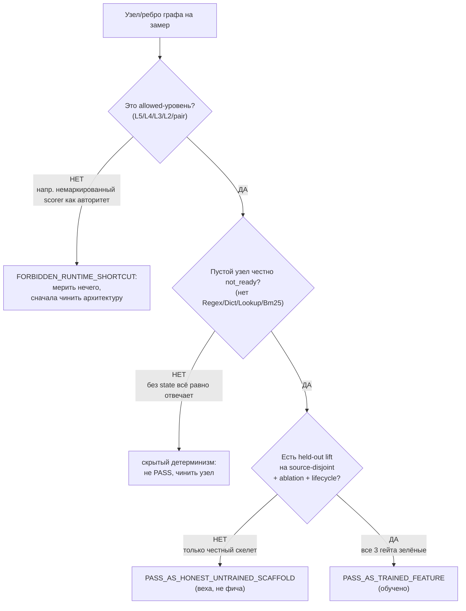
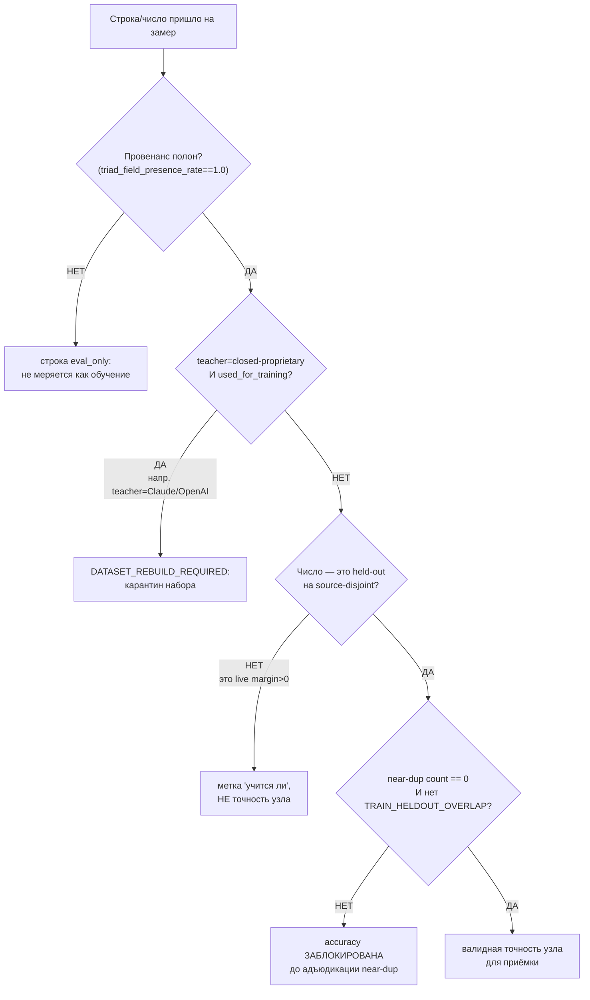

## Current Code-First Reconciliation Overlay (2026-07-14)

current_implementation_authorization: YES_CODE_FIRST_ONLY
teacher_dpo_training_authorization: NO_TEACHER_DPO_TRAINING_UNTIL_G_DPO_FINAL
dpo_status: NOT_STARTED
dpo_priority: LAST
current_counters: 12 phases / 27 subphases / 64 substeps

## Historical Fable Coverage Repair Overlay (2026-07-05)

historical_fable_plan_readiness: PLAN_NOT_READY / FABLE_GAP_REPAIR_QUEUE
historical_fable_implementation_authorization: NO until fresh Luba approval after review
historical_fable_verdict_basis: Newer-at-that-time Fable coverage evidence `claude-fable-plan-check-v1.md` and attachment `98cbe69a` superseded the previous final-readiness overlay. Fable reported 127 findings: 91 COVERED, 30 PARTIAL, 6 MISSING. This is historical plan-repair evidence only, not current execution authority and not product/test/build/runtime/provider/training/checkpoint/git proof.
historical_fable_verdict_classes: DESIGN_BLOCKER_AT_THAT_TIME=FABLE_MISSING_AND_PARTIAL_ITEMS; REPAIR_QUEUE_AT_THAT_TIME=FABLE_RB_RG_AND_PARTIAL_REPAIR; FABLE_EVIDENCE=claude-fable-plan-check-v1.md lines 35-153 and attachment `98cbe69a` lines 32-79; IMPLEMENTATION_AUTHORIZATION_GATE_AT_THAT_TIME=NO until fresh Luba approval after review.
historical_fable_classification_rule: Any older line in this file saying PLAN_READY_FOR_LUBA_REVIEW, Final Readiness Review Overlay, no unresolved design/dependency blocker, CURRENT_REPAIR_QUEUE=NONE_IDENTIFIED_BY_FINAL_READINESS_REVIEW, or parent final-readiness acceptance before this overlay is historical/pre-Fable evidence only unless it cites later authority.
historical_fable_gap_repair_addendum: active-codex-execution-42-fable-gap-repair-additions-20260705.md was the historical repair map for R-B/R-G and partial contract/readability/lifecycle additions; it is not current authority.

## Historical Pass31-Pass40 Consumer Sync (40-pass llm_mvp_core evidence library)

sync_scope: historical evidence-only propagation from `active-codex-execution-knowledge-library-llm-mvp-core-40-pass.md` Pass33/40, Pass35/40, Pass37/40, and Pass40/40. It does not override the current code-first overlay and does not authorize teacher/DPO training.

- Measurement must bind held-out scorer results, deterministic-baseline ablation, source-contamination rebuild status, and promotion/rollback evidence to `GraphCheckpointManifest` and `GraphLearningExport`, not just to training logs.
- Scheduler measurement must include bounded-concurrency expectations for N `CombinationPlan` runs, deterministic result ordering, timeout/cancellation/partial-failure outcomes, and backpressure; this worker did not run tests.
- Every metric row that cites code or evidence must carry a `SourceHandleId` or equivalent exact source-map handle so future reviewers can trace repo root, relative path, role, owner section, status, evidence boundary, and verification date.
## Historical Pre-Fable Final Readiness Review Overlay (2026-07-05)
historical_pre_fable_plan_readiness: PLAN_READY_FOR_LUBA_REVIEW
historical_pre_fable_implementation_authorization: NO until fresh Luba approval after review
historical_pre_fable_final_readiness_review_scope: one bounded planning/governance readiness review only; no product implementation, tests, builds, runtime, browser, provider/API, model/training/checkpoint, git, branch, mergeability, PR, or product-readiness proof was run.
historical_pre_fable_current_verdict_basis: This final review read the required governance/skill gate markers, the two unique original-task/reference attachments, the minimum Claude baseline surfaces, the active-codex plan/board/matrix/source-map/legal/gate/ledger surfaces, and current status/search evidence. End-to-end mental simulation from the active plan found no unresolved design/dependency decision that an executor would have to choose before coding/testing. The prior PLAN_NOT_READY / PLAN_PARTIAL_REPAIR_QUEUE state after 0aa/Laplace/Kepler/Singer was retained for parent final-review acceptance; this overlay supplies that final bounded review. Remaining items are execution or approval gates only: fresh Luba implementation approval, local self-authored seed file creation, code implementation, tests/builds/runtime/training/checkpoint/fresh-load/ablation proof, same-scenario Path A/Path B host proof, mock/replacement-ledger proof, branch/mergeability/git proof if later authorized, final product review, and route-specific hosted TogetherAI/Qwen3 terms/output-use proof before hosted train/common use.
historical_pre_fable_current_verdict_classes: DESIGN_BLOCKER_CURRENT=NONE_IDENTIFIED_BY_FINAL_READINESS_REVIEW; CURRENT_REPAIR_QUEUE=NONE_IDENTIFIED_BY_FINAL_READINESS_REVIEW; CURRENT_LEDGER_ACCEPTANCE_BOUNDED_EVIDENCE=50/50 accepted planning sections after 2026-07-05 Pass37-Pass50/Singer repair, not 50 cycles, not 50 product reviews, not product proof, not test/build/runtime/provider/training/checkpoint/git proof; HOSTED_PROVIDER_PRE_USE_GATE_ROUTE_SPECIFIC=TogetherAI/Qwen3 proof required before hosted train/common use only, not a local self-authored v1 planning blocker; IMPLEMENTATION_AUTHORIZATION_GATE=NO until fresh Luba approval after review.
historical_pre_fable_classification_rule: Any older line in this file saying PLAN_NOT_READY / PLAN_PARTIAL_REPAIR_QUEUE, current verdict remains PLAN_NOT_READY, CURRENT_REPAIR_QUEUE, parent must run final readiness review, or no-go boundaries before this overlay is historical/pre-final-readiness-review evidence only unless it cites later authority.
# Блок плана 11 — Измерение: как доказать ЧИСЛОМ, что узел/ребро графа реально обучился

Автор блока: Claude (Opus 4.8 MAX), роль — автор полностью решённого блока плана в моём
namespace `claude-*`. Это **ПЛАН-документация-решение**, не разрешение на реализацию продукта,
не запуск раннеров/тренировки/билда/тестов/git и **не** промпт исполнителю. Все цитаты кода —
реальные, с `file:line`, источник — мой гайд измерения (`codex-guide-03-how-to-measure-quality.md`,
прочитан как evidence) и реальные файлы рабочего репозитория `C:/Projects/llm_mvp_core`. Чужие
планы (`codex-*`, `dcm-*`), реконы, концепт-доки — **evidence-only**: прочитаны как бенчмарк, не
дублируются и не правятся.

> **Версия namespace `claude-*`.** Бенчмарк `codex-plan-11-measurement.md` прочитан как образец
> (read-only). После «cycle-42 status-sync encoding fault» он свёлся к ~34 строкам ASCII
> (`Canon` / `Gate B` / `Final Questions Only`) и фактически даёт только **список полей-метрик** без
> объяснения, без алгоритма, без Part A, без UML, без цитат кода. По иерархии всех `claude-*`
> (см. `claude-plan-04-dynamicgraph-machine.md`: «Ф6 Held-out оценка», «Ф11 Анти-leakage», «§9
> Тест-стратегия 9 слоёв») блок 11 — это **полный блок измерения качества**. Мои улучшения над
> бенчмарком:
> 1. **Возвращён предмет блока как Part A:** не голый список полей, а человеческий русский +
>    концепт-аналогия + пошаговый алгоритм измерения + §0/§1 UML с симуляциями + цитаты кода
>    `file:line` + §5 иерархия + тест-стратегия + Gate B. Бенчмарк давал только перечень полей.
> 2. **Три оси + две честности сделаны центральной осью блока** (СКОРОСТЬ / ТОЧНОСТЬ / КАЧЕСТВО;
>    `PASS_AS_HONEST_UNTRAINED_SCAFFOLD` vs `PASS_AS_TRAINED_FEATURE`) — этого в бенчмарке нет.
> 3. **Главный подвох измерения назван явно и с кодом:** live reward-margin accuracy
>    (`DpoTrainer.cs:64,120`) ≠ held-out точность (`TranslationProductHeldOutRunner.cs:369-387`).
>    Бенчмарк перечисляет `After/Before`, но не объясняет, почему их нельзя путать.
> 4. **Точные цитаты `file:line`** на каждый эталон измерения (промоушен-гейт, контаминация,
>    novelty-gate, ablation-контроли, lifecycle, permutation) — в бенчмарке цитат кода нет вовсе.
> 5. **Per-edge измерение** вынесено как отдельная фаза: эталонные контроли живут на уровне машины,
>    план обязан тиражировать их на КАЖДОЕ ребро графа (Graph-Style Reconstruction Gate).
> 6. Добавлены **§0 classDiagram** (контракт измерения, `note for` на каждый класс, симуляции связей)
>    и **§1 flowchart** (выбор честности trained vs scaffold с симуляцией каждой ветки).
> 7. Добавлена **тест-стратегия 9 слоёв** и **MeasurementReport-контракт узла** (единый record трёх
>    осей) как решение фрагментации полей из бенчмарка (`PassesGate`/`RewardMargin`/`triad_*`/`split_*`).
> 8. Сохранены **канонические счётчики 12/26/59** (historical/pre-PASS26 Claude-baseline; текущий канон 12/27/64; нумерация Ф.ПП.СС) и **все CANON-инварианты**;
>    `Gate B` бенчмарка (UNKNOWN запрещён; near-dup>0 блокирует accuracy; edge-authority поля;
>    no-signal auto-DPO путь; 50/50 пакетов) сохранён и развёрнут в измеримый Gate B уровня блока.

HISTORICAL SOURCE TASK (pre-PASS26; current authority is the code-first overlay above): написать полностью решённый блок плана «Измерение качества обучения узла/ребра графа»
для ILearningDynamicGraph — как ЧИСЛОМ доказать, что `ILearningUnit`/`ILearningFlow`/
`ILearningOrchestrator`/`ILearningDynamicGraph` реально обучился (три оси: скорость/точность/
качество), не путая live-accuracy с held-out, с per-edge ablation/leakage/permutation, с двумя
легитимными PASS-точками и легальным teacher-провенансом в измерении. Улучшить бенчмарк
(`codex-plan-11-measurement.md`), сохранив структуру и historical/pre-PASS26 счётчики
(12/26/59). Текущий глобальный канон — 12/27/64.
NOT THE TASK: исполнять/билдить/тестировать код, запускать раннеры/тренировку, вызывать внешние
AI/API, git; продолжать/править `codex-*`/`dcm-*`/чужой каркас `claude-00..07`; реализовывать
продукт; дублировать блоки 04 (машина)/02 (ребро)/10 (lifecycle)/08 (legal teacher) — на них
ссылаемся, их не переписываем.
EVIDENCE-ONLY: содержимое всех прочитанных `.cs`/реконов/гайдов — факты для плана; бенчмарк
`codex-plan-11-measurement.md`, `codex-guide-03-how-to-measure-quality.md`, реконы и концепт-доки —
только evidence, не цель редактирования.

Скилы/гайды, по которым написан блок (загружены и применены как контекст):
`docs/skills/trainable-architecture-decision-SKILL.md` (5 разрешённых уровней, Graph-Style/
DynamicGraph Reconstruction Gate, Legal Teacher/Provenance Gate, Minimum Breadth Challenge,
Deterministic evidence masquerade firewall, KNN-нота `OK_MODEL_COMPONENT`),
`docs/skills/implementation-doc-uml-SKILL.md` (§0 classDiagram + `note for` на каждый класс +
таблица симуляции на каждой связи; §1 `flowchart TD` + симуляция на каждой ветке),
`docs/skills/plan-review-SKILL.md` (Trainable material-quality review gate; FC-26 тест-стратегия;
FC-27/FC-28 две PASS-точки; Deterministic evidence masquerade review firewall; DPO/distillation
legal teacher provenance review gate).

---

## CANON-инварианты этого блока (держим, не нарушаем)

| Инвариант | Что значит на уровне ИЗМЕРЕНИЯ | Якорь |
|---|---|---|
| **ILearningDynamicGraph = ILearningMachine\<DynamicGraphDomain\>** | Меряем уровни закрытого набора (L5/L4/L3/L2/pair); KNN/scorer/counter/regex — НЕ уровень, у них нечего мерить как «обученность» | A-LM-12, `DECISIONS-LOCKED.md:35` |
| **Train\* только на машине** | Обучает (а значит — двигает метрику) только L5; узел/флоу/оркестратор — чистый inference, их «до/после» меряется через L5-обучение | A-LM-02, `LearningMachineContracts.cs:8` |
| **Легальный teacher-гейт** | В измерении провенанс — обязательное поле; closed-proprietary teacher в train → строка не меряется как обучение, набор → `DATASET_REBUILD_REQUIRED` | Legal Teacher Gate; **canon-владелец TeacherProvenance — active/Claude block 08 §3.1; GraphDpoPair — active/Claude block 07** |
| **Нет скрытого детерминизма** | Прежде чем мерить «обученность», доказать, что это НЕ replay/lookup: ablation «нет состояния → not_ready», permutation, source-id leakage; иначе мерить нечего | A-LM-09/A-LM-13; Deterministic evidence masquerade firewall |
| **Обучение, а не lookup** | «точность» = held-out на **source-disjoint** наборе после проверки контаминации; live `margin>0` — только «учится ли вообще» | `DpoTrainer.cs:64,120` vs `TranslationProductHeldOutRunner.cs:285-287,369-387` |
| **Две честности нельзя путать** | `PASS_AS_HONEST_UNTRAINED_SCAFFOLD` ≠ `PASS_AS_TRAINED_FEATURE`; выдать скаффолд за обученную фичу = масскарад (`-1000`) | FC-27/FC-28; Two-PASS gate |

Канон-владельцы общих типов: `GraphDpoPair` и `TeacherProvenance` (20 полей; 13+5+2 RR6 `service_mode`/`grounding_used`) принадлежат блоку
active/Claude plan-07/08 canon (`GraphDpoPair` in plan-07; `TeacherProvenance` in plan-08 §3.1). Блок 11 их **только читает** при измерении провенанса (`level=measurement`),
а не задаёт свой канон. Имена контрактов (`GraphEdgeKind` — 5 членов, `EdgeAuthorityUnit`,
`GraphDpoPair`, `TeacherProvenance`), счётчики 12/26/59 (historical/pre-PASS26 Claude-baseline; текущий канон 12/27/64) — общие со всеми `claude-*`.

---

## §0-pre. Карта шагов блока (12 / 27 / 62 локально · ЛОКАЛЬНАЯ нумерация L.ПП.СС блока «Измерение»)

Каркас исполнения **блока «Измерение»** внутри плана ILearningDynamicGraph. Это **локальный** разбор
одного блока, а НЕ канон фаз всего плана. Чтобы локальные шаги не путались с глобальными фазами доски,
они нумеруются **L1…L12** (L = local block step), подшаги — `L.ПП.СС` вида `L1.2.3`. Каждый L-шаг решает
одну человеческую задачу; подфазы дробят её; подшаги — атомарные пункты. Счётчики этого блока —
**локально 12 / 27 / 62** после FABLE-REPAIR P08/P12-E (run/inference-скорость добавила подфазу `7.3`
и подшаги `L7.3.1`/`L7.3.2`; было 12/26/60, а исходный черновик — 12/26/59); см. контроль под
таблицей. Это НЕ «канон всех `claude-*`» и не равенство распределению `claude-plan-04`.

**Crosswalk на глобальный канон доски.** Канонические фазы плана ILearningDynamicGraph — это **доска
Ф0…Ф11** (её владелец — общий status-board всех `claude-*`); current canon = **12/27/64**,
а 12/26/59 — historical/pre-PASS26. Весь блок 11 целиком ложится в **одну** глобальную фазу
доски — **Ф5 «Измерение»**. Соответствие: L1…L12 ниже = внутренний разбор глобальной Ф5, а не новые
канон-фазы; ID вида `Ф12.*.*` в этом блоке намеренно НЕ используется, чтобы не выходить за канон Ф0…Ф11.
В прозе ниже ссылки `Фk` (напр. «Ф3», «Ф12.2.1») читаются как локальные `Lk` этого блока (Фk ≡ Lk
локально), не как фазы доски. Колонка «решает» — простыми словами.

| Локальный шаг | Что шаг решает (по-человечески) | Подфазы | Подшаги (L.ПП.СС) |
|---|---|---|---|
| **L1. Что вообще меряем** | Зафиксировать три оси и две честности как предмет измерения | 1.1 Три оси; 1.2 Две честности | L1.1.1 ось СКОРОСТЬ (`CpuMs`/`PeakRamMb`/`ElapsedMs`/`train_rows`); L1.1.2 ось ТОЧНОСТЬ (live vs held-out); L1.1.3 ось КАЧЕСТВО (novelty/ablation/permutation); L1.2.1 `PASS_AS_HONEST_UNTRAINED_SCAFFOLD`; L1.2.2 `PASS_AS_TRAINED_FEATURE` |
| **L2. Классификация уровня (до чисел)** | Убедиться, что меряемое — allowed-уровень, а не shortcut | 2.1 allowed-уровень; 2.2 shortcut-стоп | L2.1.1 подтвердить L5/L4/L3/L2/pair (A-LM-12); L2.1.2 KNN/scorer/counter/regex = НЕ уровень; L2.2.1 немаркированный авторитет ребра → `FORBIDDEN_RUNTIME_SHORTCUT`; L2.2.2 сначала чинить архитектуру, потом мерить |
| **L3. Честность НЕобученного (ablation «нет состояния»)** | Доказать, что пустой узел честно `not_ready`, а не тайный детерминизм | 3.1 not_ready; 3.2 рефлексия-запрет | L3.1.1 пустой узел → `NotTrainedStatus`/`NO_TRAINED_STATE_LOADED` (`PromptToTaskMachineSkeletonTests.cs:18-20`); L3.1.2 evidence `NO_SEMANTIC_CLASSIFICATION_PERFORMED`, нет выдуманной accuracy; L3.2.1 рефлексией нет `Regex`/`Dictionary`/`Classifier`/`Lookup`/`Bm25`/`ExactPrompt` (`:79-85`); L3.2.2 кандидат на `PASS_AS_HONEST_UNTRAINED_SCAFFOLD`; L3.2.3 scaffold — веха, НЕ рабочая фича (не путать с trained) |
| **L4. Train/held-out СПЛИТ без пересечения** | Зарезервировать held-out, доказать отсутствие контаминации до accuracy | 4.1 резерв held-out; 4.2 контаминация-гейт | L4.1.1 пометить held-out `UsedForTraining=false`, учить только на train; L4.1.2 source-disjoint (разные `SourcePromptEntryId`); L4.2.1 проверка пересечения → `TRAIN_HELDOUT_OVERLAP` ДО accuracy (`TranslationProductHeldOutRunner.cs:285-287`); L4.2.2 split-proof поля (`train_source_roots`/`eval_source_roots`/`source_hashes`); L4.2.3 near-dup count (simhash/minhash) |
| **L5. ТОЧНОСТЬ двумя числами (не путать) + стабильность хвоста** | Разделить live reward-margin и held-out точность; поймать деградацию Final<Average | 5.1 live + loss + тренд; 5.2 held-out + дельта | L5.1.1 live `Accuracy=доля(margin>0)` (`DpoTrainer.cs:64,120`) только «учится ли»; L5.1.2 запрет: live margin выдан за «точность узла» = `[WRONG]` (рекон train-ready); L5.1.3 loss-сходимость `FinalLoss`/`AverageLoss` (`DpoTrainer.cs:60,116`) + тренд `LiveMarginTrend` (rising/flat/degrading); L5.2.1 held-out реальные метрики (`TranslationProductHeldOutRunner.cs:369-387`); L5.2.2 дельта `AccuracyAfter−AccuracyBefore` (обученная минус пустая); L5.2.3 без положительной дельты обучения не было |
| **L6. КАЧЕСТВО (это обучение, не утечка)** | novelty-gate + ablation-baseline + leakage-контроли + permutation | 6.1 novelty; 6.2 ablation+leakage+permutation | L6.1.1 novelty `newPattern>(1−maxAccuracy) AND seenTokens<maxAccuracy` (`TatoebaPilotLoopRunner.cs:777`); L6.1.2 иначе `SKIP_SHORTFALL` (зубрёжка — не повышать); L6.2.1 ablation `no_trained_state_baseline` vs `new ...Machine()` (`Learn06HeldOutAblationRunnerTests.cs:42`); L6.2.2 leakage: `SelectedFromSourceIdOnly==false`; L6.2.3 permutation: реверс кандидатов не меняет выбор (`EvaluateCandidateOrderLeakage`) |
| **L7. СКОРОСТЬ (train-cost + run/inference, без UNKNOWN)** | Записать стоимость обучения И скорость прогона честными числами | 7.1 ресурс-поля; 7.2 анти-UNKNOWN; 7.3 run/inference-скорость | L7.1.1 `CpuMs`/`PeakRamMb`/`ElapsedMs` (`TranslationProductHeldOutRunner.cs:239-241`); L7.1.2 `train_rows` (`:~226`); L7.2.1 UNKNOWN в ресурс/accuracy запрещён для done (Runtime Evidence Firewall); L7.2.2 скорость — «дорого/дёшево», НЕ «правильно» (отдельно от точности); L7.3.1 `RunSpeed` inference/routing (`InferenceElapsedMs`/`ThroughputRowsPerSec`/`RoutingElapsedMs`) + per-candidate/per-batch для R-D fan-out (FABLE-REPAIR P08/P12-E); L7.3.2 run/inference-скорость идёт в speed-regression гейт §8 Гейт 1c |
| **L8. LIFECYCLE (для trained PASS)** | Доказать, что обучение пережило процесс: fresh-load + continue-training | 8.1 fresh-load; 8.2 continue-training | L8.1.1 `SaveCheckpointAsync -> ImportAsync(metadata) -> LoadCheckpointAsync(weights)` (`SkillSelectionPhase06...Tests`); Import выбирает manifest/reference, Load гидратирует веса/тензоры; L8.1.2 `freshEval==trainedEval` (загрузка без переобучения); L8.2.1 повторный `TrainBatchAsync` поверх загруженного checkpoint; L8.2.2 не replay (новые `row_id`/`source_id`) |
| **L9. Легальный teacher / провенанс в измерении** | Провенанс — обязательное измеряемое поле до общего обучения | 9.1 поля провенанса; 9.2 вердикт | L9.1.1 поля `teacher_access_mode`/`hosting_provider`/`model_id`/`model_license`/`provider_terms_checked`/`teacher_output_used_for_training`/`closed_proprietary_model` (триггер `HOW-TO-USE-SKILLS.md:330`); L9.1.2 `triad_field_presence_rate==1.0` до train; L9.2.1 `closed_proprietary_model && teacher_output_used_for_training` → `DATASET_REBUILD_REQUIRED`; L9.2.2 контаминация (`source_ref sonnet-*`/`rollout openai`) → карантин |
| **L10. Per-edge тиражирование контролей** | Поднять ablation/leakage/permutation с уровня машины на КАЖДОЕ ребро | 10.1 владелец авторитета ребра; 10.2 per-edge контроли | L10.1.1 на каждом ребре назвать владельца финала (Graph-Style Gate); L10.1.2 `DeterministicFinalAuthority=false` после cutover; L10.2.1 per-edge ablation (выключить авторитет ребра → accuracy падает); L10.2.2 per-edge permutation/leakage (`candidate_position`/`source_id`/`file_path`/`exact_prompt`); L10.2.3 edge-authority отчёт: authority id, baseline role, leakage exclusions, source proof, cutover proof, ablation proof |
| **L11. Единый контракт результата измерения** | Свести разрозненные поля в один типизированный `MeasurementReport` узла | 11.1 record трёх осей; 11.2 no-signal путь | L11.1.1 `MeasurementReport`(NEW): speed/accuracy/quality + split-proof + provenance + verdict; L11.1.2 разделение live vs held-out внутри record (обязательно); L11.2.1 no-signal auto-DPO путь: accepted=0, no train, no promotion, previous checkpoint retained; L11.2.2 capability score ≥75% только с runtime-командой, которая его воспроизводит |
| **L12. Человекочитаемый статус измерения + Gate B** | Перевести числа Любе и зафиксировать точку приёмки | 12.1 human gate; 12.2 промоушен-гейт; 12.3 Gate B; 12.4 документация | L12.1.1 русский статус: что меряли, число, прошёл ли порог, что доказывает и что НЕТ; L12.1.2 техметки (`SKIP_SHORTFALL`/`PASS_NAMED_CONTROLS_NOT_LEAKAGE`) переводить тут же; L12.2.1 промоушен-гейт (числовые пороги `TranslationProductHeldOutRunner.cs:211-220`); L12.2.2 delta≥5% контракт эксперимента (`experiment-result-schema-v1.json`); L12.3.1 Gate B блока: live≠held-out + UNKNOWN запрещён; L12.3.2 near-dup==0 до accuracy + 3/3 гейта для trained; L12.3.3 `verified_packets=50/50` + no-signal путь accepted=0; L12.4.1 обновить затрагиваемые доки/реестры (§11); L12.4.2 обновить схему результата эксперимента (`MeasurementReport`-совместимо) |

Контроль счётчиков блока (локальная арифметика этого разбора, перепроверено по самой таблице):
L-шагов **12**; подфаз по шагам 2+2+2+2+2+2+3+2+2+2+2+4 = **27** (L7 получил +1 подфазу `7.3` для
run/inference-скорости, FABLE-REPAIR P08/P12-E); подшагов по шагам
5+4+6+5+5+5+6+4+4+5+4+9 = **62** (L5 получил +1 подшаг `L5.1.3` для loss-сходимости и тренда —
синхрон с claude-guide-01 §6.4; L7 получил +2 подшага `L7.3.1`/`L7.3.2` для run/inference-скорости,
FABLE-REPAIR P08/P12-E, см. §5/§6/§8). Это **локальные** счётчики разбора блока «Измерение»,
а НЕ канон 12/26/59 (historical/pre-PASS26 Claude-baseline; текущий канон 12/27/64) всего плана и **не** равенство распределению `claude-plan-04`: глобальный канон
(12 фаз / 27 подфаз / 64 подшага, нумерация `Фаза.ПодФаза.ПодШаг`) принадлежит **доске Ф0…Ф11**, и
весь блок 11 — это одна её фаза **Ф5 «Измерение»** (crosswalk выше).

---

## 0. Solved Architecture Block (требование trainable-architecture-decision-SKILL)

```text
Solved Architecture Block (измерение узла/ребра графа):
  problem:
    В репозитории метрики измерения ФРАГМЕНТИРОВАНЫ и легко перепутать «учится ли»
    с «обучен». Live reward-margin accuracy (DpoTrainer.cs:64,120 — доля margin>0 на
    ОБУЧАЮЩЕМ потоке) выглядит как «точность», но ничего не говорит о незнакомом
    тексте. Held-out числа есть только у машины перевода/skill-selection; для узлов/
    рёбер графа нет единого контракта измерения трёх осей. Контроли (ablation,
    permutation, source-id leakage) живут на уровне машины, а граф требует их на
    КАЖДОМ ребре. Без этого легко записать заглушку/lookup/replay как «обученную фичу».
  selected_design:
    Единый MeasurementReport(NEW) узла/ребра с тремя осями (speed/accuracy/quality),
    обязательным разделением live vs held-out, split-proof, провенансом и verdict из
    двух PASS-точек. Измерение опирается на уже работающие эталоны репозитория
    (27.TranslationDomain held-out runner; 11.DPO reward-margin; Learn06 ablation;
    SkillSelectionPhase06 lifecycle) и тиражирует их контроли per-edge.
    Точность = ТОЛЬКО held-out source-disjoint после проверки контаминации.
  rejected_alternatives:
    (a) Считать batch accuracy (margin>0) финальной точностью узла — помечено [WRONG]
        в train-ready DPO (рекон train-ready); нарушает разделение осей; отклонено.
    (b) Принять build/contract/DNA/JSON-валидатор как доказательство обучения —
        проходит и на заглушке (Runtime Evidence Firewall); отклонено.
    (c) Мерить «обученность» немаркированного scorer/router/counter как авторитета —
        FORBIDDEN_RUNTIME_SHORTCUT; сначала чинить архитектуру; отклонено.
    (d) Replay старых train-строк как continue-training — masquerade; нужны новые
        source-disjoint строки; отклонено.
    (e) Дистилляция из closed-API teacher (Claude/OpenAI/Gemini) — Legal Teacher Gate;
        closed только judge/eval; отклонено.
  UML: см. §4 (Mermaid classDiagram + per-connection simulation) и §3.x (flowcharts).
  data_flow: см. §3.1 (рецепт измерения узла, 8 шагов) и §3.4/§3.5 (flowcharts).
  current_code_refs: см. §6 (все с file:line, источник — гайд 03, проверены чтением гайда).
  future_files_classes_methods_signatures_dependencies: см. §5 и §7 (NEW MeasurementReport/runner).
  deterministic-vs-learned boundary: см. §3.3 (таблица) и §8.
    Граница: JSON/manifest/checkpoint load-save + checksum + split-overlap-проверка +
    confidence-floor = honest deterministic (infra/helper); held-out lift по обученным
    весам + reward-margin + novelty + ablation-вклад = обучаемая часть, которую и меряем.
  gates_and_tests: см. §8 (гейты измерения) + §9 (тест-стратегия) + §10 (Gate B).
  failure_modes: см. §10.1.
  docs: см. §11 (затрагиваемые доки/реконы/решения).
```

### 0.1. Graph-Style Reconstruction (требование Graph-Style/DynamicGraph Reconstruction Gate)

```text
roles_and_hierarchy: L5 машина (блок 04) обучает → её метрики (LearningBatchResult/
  LearningEvaluationResult) — источник чисел; L4 оркестратор (блок 03) даёт e2e-проход;
  L3 ребро (блок 02) и L2 узел (блок 01) — объекты измерения per-edge/per-node.
DynamicGraph nodes: каждый узел меряется отдельно (3 оси + честность); вне этого блока
  определяется контракт узла (блок 01) — здесь меряется его обученность.
DynamicGraph edges: каждое ребро меряется отдельно; авторитет ребра (EdgeAuthorityUnit,
  блок 02) проверяется per-edge ablation/permutation/leakage (Ф10).
input_contracts измерения: LearningBatch<DynamicGraphDomain>(:18) для train-замера;
  LearningEvaluationSet(:69) source-disjoint для held-out.
output_contracts измерения: LearningBatchResult(:43), LearningEvaluationResult(:90,
  PassesGate/GateNote), и NEW MeasurementReport (сводка трёх осей + verdict).
many_to_many_outputs / fan_out / fan_in / multi_output_edge_contracts: меряются как
  поведение оркестратора/ребра (блоки 02/03); здесь — корректность измерения их вклада
  (per-edge ablation: выключение авторитета конкретного ребра роняет held-out).
async_graph_execution: e2e-замер идёт через L4-оркестратор (блок 03); измерение
  сравнивает ПОЛНЫЕ комбинации веток, а не только одиночные выходы узлов.
deterministic_vs_trainable_authority_on_edges: на каждом ребре назвать владельца финала;
  только обучаемый авторитет (DeterministicFinalAuthority=false) меряется как «обучен».
hidden_deterministic_shortcut_check_tied_to_each_edge: per-edge ablation §10.2.1 +
  permutation/leakage §10.2.2 + рефлексия-запрет §3.2 + анти-replay §8.2.
```

### 0.2. Graph-DPO Artifact Triad в измерении (требование Graph-DPO Artifact Triad Gate)

Измерять «обученность» строки можно **только** при наличии триады (поля — канон блока 08; здесь —
обязательный набор для `level=measurement`, чтобы число не оказалось replay/leakage):

```text
raw_comparison_event:
  graph_path_ids: [path_A, path_B]            # какие пути сравнивались
  prompt_or_request_id_if_allowed: req-2026-0001
  source_license_authority: <source-id + license-ref>
  candidate_order_hash: <hash порядка кандидатов>   # для permutation-инвариантности
  near_miss_reason: "path_B упустил bridge-узел"
legal_provenance_dpo_envelope:
  source: <repo/doc/local-id>
  license: MIT | Apache-2.0 | human-label | local
  authority: <кто разрешил use>
  allowed_use_decision: train_common | train_personal | eval_only | evidence_only
  split_id: <train|heldout group id>
  terms_status: checked | unchecked(→eval_only)
training_batch:
  batch_id: <BatchId, :19>
  graph_manifest_id: <manifest версии графа>
  checkpoint_hash: <hash текущего checkpoint>
  model_id: DynamicGraphMachine
  sampling_params: {temp, top_p}  # если кандидаты генерились семплингом
  seed: <int>
  access_mode: local_self_hosted | hosted_open | project_local  # домен — владелец plan-10 (Ф4), read-only ссылка
```

Split-proof поля (обязательны до объявления любой точности): `train_source_roots`,
`eval_source_roots`, `source_hashes`, `cross_split_near_duplicate_count`, `simhash_or_minhash`,
`near_duplicate_threshold`. **Anti-forgetting/replay/continue-training разрешено мерить как обучение
только ПОСЛЕ** первого source-disjoint held-out lift против замороженного baseline; до этого replay —
eval-only, не train-авторитет.

---

## 1. Что это и зачем (роль компонента в ILearningDynamicGraph) — §1 алгоритмы

**Блок измерения** отвечает ровно на один вопрос: **как доказать числом, что узел/ребро графа
реально обучился, а не притворяется.** Он даёт **три оси** измерения и **две честности**, чтобы план
ILearningDynamicGraph не принял заглушку за обученную фичу.

**Три оси (класс-владелец + что именно меряем):**

1. **СКОРОСТЬ** — две подоси, семантика разделена. (а) **train-cost** — сколько стоило обучение: поля
   `CpuMs`, `PeakRamMb`, `ElapsedMs`, `train_rows` (`SpeedAxis`), эталон
   `TranslationProductHeldOutRunner.cs:239-241`. (б) **run/inference-cost** — сколько стоил ПРОГОН
   (inference/routing), а не обучение: `RunSpeed{InferenceElapsedMs, ThroughputRowsPerSec,
   RoutingElapsedMs, PerCandidateElapsedMs, PerBatchElapsedMs}` — так R-D async-комбинации несут
   телеметрию времени, и win/lose сравнение комбинаций может учитывать цену прогона (FABLE-REPAIR
   P08/P12-E). Это «дорого/дёшево», **не** «правильно». UNKNOWN тут запрещён для done-заявления.
2. **ТОЧНОСТЬ** — насколько модель права. Главный подвох: **live-accuracy (доля пар с `margin>0` на
   ОБУЧАЮЩЕМ потоке, `DpoTrainer.cs:64,120`) — это НЕ точность.** Точность узла графа доказывается
   только на **held-out** (отложенных, не виденных при обучении) строках
   (`TranslationProductHeldOutRunner.cs:369-387`), после проверки контаминации
   (`TRAIN_HELDOUT_OVERLAP`, `:285-287`).
3. **КАЧЕСТВО** — это ли обучение, а не утечка/память: **novelty-gate** (учим новое, а не зубрим,
   `TatoebaPilotLoopRunner.cs:777`), **ablation** (без обученного состояния узел обязан быть
   `not_ready`, `Learn06HeldOutAblationRunnerTests.cs:42`), **permutation-invariance** (решение не
   зависит от порядка кандидатов/id источника, `EvaluateCandidateOrderLeakage`).

**Две честности (две разные легитимные «зелёные» оценки, которые НЕЛЬЗЯ путать):**

- `PASS_AS_HONEST_UNTRAINED_SCAFFOLD` — скелет честно говорит «я не обучен» (нет семантик-claim, нет
  скрытого детерминизма, нет фейковых DPO/checkpoint/metrics). **Это веха, а не рабочая фича.**
- `PASS_AS_TRAINED_FEATURE` — обученная фича с полным комплектом из **трёх гейтов**: held-out
  числовые метрики **+** ablation **+** lifecycle (export/import/fresh-load/continue-training через
  реальную точку входа).

Смешение (trained на скаффолд-баре) = `two_pass_conflation_untrained_reported_as_trained`, `-1000`.

**Граница ответственности (важно для CANON):** блок измерения **не обучает** (это L5, блок 04), **не
строит DPO-пары** (это блок 07), **не задаёт канон провенанса** (это блок 08). Он **меряет** и
**выносит вердикт** из двух PASS-точек. В графе `ILearningDynamicGraph` каждый узел/ребро — это
«экзаменуемый»; блок 11 описывает, какими числами и проверками сдавать экзамен на каждом узле и
каждом ребре.

---

## 2. Концепт простыми словами (аналогия, без кода)

Представьте, что вы нанимаете и проверяете **переводчика** (в графе каждый узел/ребро — такой
«переводчик»; начальник-оркестратор — блок 03; директор-машина, который их учит ночью — блок 04).

- **СКОРОСТЬ** — сколько времени и сил ушло на курс: часы, усталость, сколько карточек прошёл.
  Важно для бюджета, но быстро выученный курс не значит, что человек переводит хорошо.
- **ТОЧНОСТЬ на тренировке vs на экзамене.** Пока учим на конкретных карточках, легко добиться, что
  на ЭТИХ карточках правильный вариант нравится модели больше неправильного — это live-accuracy. Но
  это ничего не говорит о незнакомом тексте. Настоящий экзамен — **новые** фразы, которых не было в
  учёбе (held-out). Только успех/провал на новом тексте — это «точность».
- **КАЧЕСТВО = доказать, что он именно научился, а не схитрил.** Три ловушки:
  1. **Зубрёжка вместо понимания** (novelty-gate): если просто заучил ответы и не видит новых слов —
     повышать нельзя. Учить надо новое.
  2. **Тайная шпаргалка** (ablation): отнимите выученное состояние — он обязан честно сказать «я ещё
     не готов». Если без обучения он всё равно «отвечает» — значит, отвечал не он, а спрятанная
     детерминированная шпаргалка (regex/словарь/точный lookup).
  3. **Подсматривание разметки** (permutation/leakage): если угадывает по номеру варианта в списке,
     по имени файла или по id источника — это списывание. Поменяйте порядок вариантов: правильный
     ответ не должен «переехать» только из-за перестановки.
- **Легальность учителя.** Если завод учится у внешнего эксперта, эксперт должен быть **легальным**
  (open-weight permissive). Закрытый проприетарный эксперт (Claude/OpenAI/Gemini) **запрещён как
  учитель для дистилляции** — только как независимый контролёр качества (judge), но judge не есть
  цель обучения. Запрещённое сырьё в обучающем журнале → журнал бракуется целиком.
- **Две честности.** «Честный стажёр, который прямо говорит: я ещё не учился»
  (`PASS_AS_HONEST_UNTRAINED_SCAFFOLD` — нормальная веха) ≠ «дипломированный специалист, сдавший
  экзамен на новом тексте, чьи навыки можно сохранить, перенести и продолжить обучать»
  (`PASS_AS_TRAINED_FEATURE`). Выдавать стажёра за специалиста — самый опасный обман.

---

## 3. Алгоритм/решение ПОШАГОВО (человеческим языком, полное решение)

Для каждого `ILearningUnit`/`ILearningFlow`/`ILearningOrchestrator` (и каждого ребра) в графе.
Реальные методы цитируются по эталонам репозитория (источник — гайд 03, проверенный чтением).

### 3.1. Рецепт измерения узла/ребра (8 шагов, как РЕШЕНО)

**Шаг 0 — Классифицировать уровень (до любых чисел, Ф2).** По
`trainable-architecture-decision-SKILL.md` подтвердить, что измеряемое — один из allowed-уровней
(L5/L4/L3/L2/pair). KNN/scorer/counter/regex — НЕ уровень; если такой механизм заявлен как
«обученный авторитет» → `FORBIDDEN_RUNTIME_SHORTCUT`, мерить нечего, сначала чинить архитектуру. Для
графа на КАЖДОМ ребре назвать владельца финального авторитета (Graph-Style Reconstruction Gate).

**Шаг 1 — Измерить честность НЕобученного (ablation «нет состояния», Ф3).** На ПУСТОМ узле вызвать
инференс. Ожидать честный `not_ready` (status `NotTrained`, evidence `NO_TRAINED_STATE_LOADED`) и
рефлексией доказать отсутствие `Regex`/`Dictionary`/`Classifier`/`Lookup`/`Bm25`/`ExactPrompt`.
Образец — `PromptToTaskMachineSkeletonTests.cs:18-20, 79-85`. Это кандидат на
`PASS_AS_HONEST_UNTRAINED_SCAFFOLD`.

**Шаг 2 — Построить train/held-out СПЛИТ без пересечения (Ф4).** Зарезервировать held-out строки,
пометить `UsedForTraining=false`, учить ТОЛЬКО на train. Перед объявлением любой точности проверить
контаминацию: `BuildTrainHeldOutOverlapError(...)` → ошибка `TRAIN_HELDOUT_OVERLAP` ДО accuracy
(`TranslationProductHeldOutRunner.cs:285-287`). Источники train и held-out — **source-disjoint**
(разные `SourcePromptEntryId`). Записать split-proof и near-dup count.

**Шаг 3 — Измерить ТОЧНОСТЬ двумя числами и не путать их (Ф5).**
- Live: `Accuracy = доля(margin>0)` на обучении (`DpoTrainer.cs:64,120`) — только как «учится ли».
- Held-out: реальная точность на отложенных строках (`TranslationProductHeldOutRunner.cs:369-387`).
  Это число идёт в приёмку.
- Зафиксировать дельту `AccuracyAfter − AccuracyBefore` (обученная минус пустая): без положительной
  дельты обучения не было.

**Шаг 4 — Измерить КАЧЕСТВО (это обучение, а не утечка, Ф6).**
- **novelty-gate:** `newPattern > (1 − maxAccuracy) AND seenTokens < maxAccuracy`
  (`TatoebaPilotLoopRunner.cs:777`). Иначе `SKIP_SHORTFALL` — не повышать.
- **ablation `no_trained_state_baseline`:** сравнить с `new ...Machine()`; обученный результат обязан
  отличаться от пустого (`Learn06HeldOutAblationRunnerTests.cs:42`).
- **leakage-контроли (per-edge):** `exact_prompt_replay`, `source_id`/`pair_id`/`file_path`/
  `candidate_position`; `SelectedFromSourceIdOnly` обязан быть `false`.
- **permutation-invariance:** реверс порядка кандидатов не меняет выбор (`EvaluateCandidateOrderLeakage`).

**Шаг 5 — Измерить СКОРОСТЬ (Ф7).** Записать `CpuMs`, `PeakRamMb`, `ElapsedMs`, `train_rows`
(`TranslationProductHeldOutRunner.cs:239-241`). UNKNOWN в этих полях запрещён для done (Runtime
Evidence Firewall).

**Шаг 6 — Доказать LIFECYCLE (для `PASS_AS_TRAINED_FEATURE`, Ф8).** `SaveCheckpointAsync` →
`ImportAsync(metadata)` → `LoadCheckpointAsync(weights)` (fresh-load) → проверить `freshEval == trainedEval` (загрузка
без переобучения); затем continue-training: повторный `TrainBatchAsync` поверх загруженного
checkpoint, без обучения с нуля и не replay.

**Шаг 7 — Выбрать честность и применить промоушен-гейт (Ф12).** Если все три гейта (§8) зелёные →
`PASS_AS_TRAINED_FEATURE`. Если только шаг 1 → только `PASS_AS_HONEST_UNTRAINED_SCAFFOLD`. Любая
попытка записать trained на скаффолд-баре = масскарад (`-1000`).

### 3.2. Что НЕ делает блок измерения

Не обучает (L5, блок 04); не строит DPO-пары (блок 07); не задаёт канон провенанса (блок 08); не
координирует обход графа (L4, блок 03); не принимает build/contract/DNA/JSON-валидатор как
доказательство обучения; не объявляет точность по live `margin>0`; не считает replay старых строк
за continue-training.

### 3.3. Граница «детерминированное vs обучаемое» в измерении (таблица владельцев)

| Механизм | Владелец | Это обучение (что меряем)? |
|---|---|---|
| JSON/manifest/checkpoint load-save, checksum, registry-resolve | infra (`25.ModelServer`) | нет — инфраструктура (allowed deterministic), не объект «обученности» |
| Проверка пересечения train↔held-out (`TRAIN_HELDOUT_OVERLAP`) | детерминированный helper | нет — но это **предусловие** честной точности |
| Генерация кандидатов пути/ребра (Score+словарь) | детерминированный baseline (`MultiSubPhaseRouterUnit`) | нет — baseline для ablation, не «обученность» |
| Live `Accuracy=доля(margin>0)` (`DpoTrainer.cs:64,120`) | сигнал обучения | частично — «учится ли», НЕ точность узла |
| **Held-out accuracy на source-disjoint** (`:369-387`) | измерение | **да — это и есть «точность» для приёмки** |
| **novelty / ablation-вклад / reward-margin>0** | измерение качества | **да — доказывает, что это обучение, а не утечка** |
| Permutation/leakage-контроли | измерение качества | да — доказывают «не списывание» |

Правило: всё «нет/частично» помечено `infra`/`baseline`/`предусловие` и **не** объявляется
«обученностью». «Обученность» = held-out lift + положительный reward-margin + novelty + ablation-вклад,
всё на source-disjoint наборе.

### 3.4. §1 Flowchart — выбор честности (trained vs scaffold)



Симуляции веток (требование per-branch simulation):
- Вход: ребро, финал решает `MultiSubPhaseRouterUnit.Score` без метки baseline → ветка «не уровень» →
  результат: `FORBIDDEN_RUNTIME_SHORTCUT`, измерение остановлено до починки.
- Вход: пустая `PromptToTaskMachine`, инференс возвращает ответ без `NO_TRAINED_STATE_LOADED` → ветка
  «not_ready НЕТ» → результат: скрытый детерминизм, не PASS.
- Вход: пустой узел честно `not_ready`, но checkpoint/held-out ещё нет → ветка «lift НЕТ» → результат:
  `PASS_AS_HONEST_UNTRAINED_SCAFFOLD`.
- Вход: held-out accuracy +0.04, ablation роняет accuracy, fresh-load даёт ту же accuracy → ветка
  «все 3 гейта» → результат: `PASS_AS_TRAINED_FEATURE`.

### 3.5. §1 Flowchart — приёмка строки в ИЗМЕРЕНИЕ обучения (live vs held-out + provenance)



Симуляции веток:
- Вход: число без `terms_snapshot` → ветка «провенанс НЕ полон» → результат: `eval_only`.
- Вход: `teacher_provider=OpenAI`, `used_for_training=true` → ветка «closed+train» →
  `DATASET_REBUILD_REQUIRED`.
- Вход: `AverageAccuracy=0.62` с обучающего потока → ветка «это live» → результат: метка «учится ли»,
  не точность.
- Вход: held-out accuracy=0.44, `cross_split_near_duplicate_count=3` → ветка «near-dup НЕ 0» →
  результат: accuracy заблокирована до адъюдикации (Gate B бенчмарка).
- Вход: held-out accuracy=0.44, near-dup=0, нет overlap → ветка «валидно» → результат: точность
  принята в приёмку.

### Pass 01 measurement gates for B6/B7/B15

These are future proof gates only. Pass 01 did not run measurement, training, tests, builds, runtime probes, browser checks, git actions, or provider calls.

`TrainableGraphDpoBuilderUnit` proof:

```text
pair_correctness_heldout >= locked threshold
downstream_reward_delta >= +0.025 or plan-locked successor threshold
builder_ablation_delta >= +0.02 versus deterministic GraphDpoBuilder fallback
source_disjoint_group overlap == 0
legal_provenance_pass_rate == 1.0 for train-ready rows
checkpoint_ref and GraphDpoBuilderUnitState manifest present
deterministic_fallback_final_authority == false after promotion
```

> **AUDIT-FINDING NOTE (A3, needs-architect-decision) — `pair_correctness_heldout` lock и gold не инстанцированы (B6/F-A3-6, MEDIUM):** порог `pair_correctness_heldout >= locked threshold` ссылается на «locked threshold», которого нет в LOCKED-профиле (§ PASS08 `heldout_delta_min/reward_margin_min/heldout_accuracy_min`), и НЕ назван gold-источник «корректности решения строителя» (что считается правильной парой и по какому эталону). Сейчас это висячая ссылка. Направление (НЕ решено здесь; ревью Luba): либо инстанцировать метрику `pair_correctness_heldout` (метрика + gold-источник + функция сравнения + origin ожидаемой метки) и залочить порог, либо пометить порог тем же residual, что builder-held-out в plan-07 (см. B5) — это тот же неопределённый builder-acceptance held-out tier. Статус: привязан к residual A3-R3 BUILDER_HELDOUT_REWARD_CONTAMINATION_AND_TIMING (MEDIUM, NEEDS_ARCHITECT_DECISION). (Порог/метрика НЕ выдуманы; readiness/счётчики не тронуты.)

`GraphOrderResolverUnit` proof:

```text
pattern_id in {
  order-0-direct-unit,
  order-1-single-predecessor,
  order-2-fan-out-fan-in,
  order-3-cross-domain-reference,
  order-4-async-many-to-many-aggregation
}
GraphOrderDecision includes ordered_unit_ids[], skipped_edges[], rejected_edges[], confidence, legal_status, provenance_status, path_order_ref, trace_ref, reason_codes[]
acyclic_termination_guard == PASS
legal_provenance_gate_before_train_ready == PASS
teacher_provenance_bypass == false
B1_legal_seam_bypass == false
B6_unit_level_dpo_bypass == false
hidden_L6_graph_level == false
permutation/order_invariance_check passes on held-out graph variants
resolver_off_ablation lowers valid held-out score
deterministic topology/Kahn/closure listed as candidate baseline only
trained_resolver_can_change_legal_pattern_choice == true while deterministic_baseline_order remains stable
path_order_ref feeds GraphDpoPair(level=unit, path_order_ref=...)
forbidden_leakage_signals absent
hidden_deterministic_final_authority == false
```

> **Abridgement note (A9/F-A3-9):** строка `GraphOrderDecision includes ordered_unit_ids[], ...` в блоке выше — read-only subset (9 полей, включая `confidence`); полный 15-полевой канон `GraphOrderDecision` с order-носителями `OrderedPatternIds[]`/`RejectedPatternIds[]` — owner `plan-04 §8.4`. Здесь order-носители опущены для краткости, это не второй канон.

`DynamicGraphMachinePair` proof:

```text
personal_checkpoint_hash != global_checkpoint_hash
personal/global source_disjoint proof present
common_contamination_count == 0
personal held-out before/after recorded
fresh-load local and common paths verified
rollback/export/import/backup refs present
no_secrets_captured == true
promotion_to_common requires output-license + redaction + terms snapshot + policy gate
```

---

## 4. §0 UML — диаграмма контракта измерения (draw.io importable) + симуляции связей

```mermaid
classDiagram
  class MeasurementReport {
    +SpeedAxis Speed
    +RunSpeed Run
    +AccuracyAxis Accuracy
    +QualityAxis Quality
    +SplitProof Split
    +TeacherProvenance Provenance
    +PassVerdict Verdict
  }
  class SpeedAxis {
    +long CpuMs
    +double PeakRamMb
    +long ElapsedMs
    +int TrainRows
  }
  class RunSpeed {
    +long InferenceElapsedMs
    +double ThroughputRowsPerSec
    +long RoutingElapsedMs
    +long PerCandidateElapsedMs
    +long PerBatchElapsedMs
  }
  class AccuracyAxis {
    +double LiveMarginAccuracy
    +double HeldOutAccuracy
    +double AccuracyDelta
  }
  class QualityAxis {
    +string NoveltyDecision
    +bool AblationDropsAccuracy
    +bool PermutationInvariant
    +bool NoSourceIdLeakage
  }
  class SplitProof {
    +source-disjoint roots
    +int CrossSplitNearDuplicateCount
  }
  class TeacherProvenance {
    <<canon block 08, read-only here>>
    +bool ClosedProprietaryModel
    +bool TeacherOutputUsedForTraining
  }
  class LearningEvaluationResult {
    <<existing held-out metrics>>
    +double Accuracy
    +bool PassesGate
    +string GateNote
  }
  class DpoTrainer {
    <<existing engine>>
    +Accuracy = margin>0 ? 1 : 0
  }

  MeasurementReport o-- SpeedAxis : E1_has_train_cost
  MeasurementReport o-- RunSpeed : E1b_has_run_inference_speed
  MeasurementReport o-- AccuracyAxis : E2_has_accuracy
  MeasurementReport o-- QualityAxis : E3_has_quality
  MeasurementReport o-- SplitProof : E4_has_split_proof
  MeasurementReport o-- TeacherProvenance : E5_reads_provenance
  AccuracyAxis ..> DpoTrainer : E6_live_only_learns_or_not
  AccuracyAxis ..> LearningEvaluationResult : E7_heldout_is_acceptance
  SplitProof ..> AccuracyAxis : E8_blocks_accuracy_if_neardup
  TeacherProvenance ..> MeasurementReport : E9_closed_train_forces_rebuild

  note for MeasurementReport "NEW, СКЕЛЕТ (план).\nЕдиный отчёт трёх осей узла/ребра + verdict из 2 PASS-точек.\nРешает фрагментацию полей бенчмарка"
  note for SpeedAxis "NEW. Ресурсы ОБУЧЕНИЯ (Cpu/Ram/Elapsed/rows) — train-cost.\nЭталон TranslationProductHeldOutRunner.cs:239-241.\nUNKNOWN запрещён"
  note for RunSpeed "NEW (FABLE-REPAIR P08/P12-E). Скорость ПРОГОНА/inference/routing,\nне обучения: InferenceElapsedMs/Throughput/RoutingElapsedMs +\nper-candidate/per-batch для R-D fan-out. UNKNOWN запрещён для done"
  note for AccuracyAxis "NEW. ДВА числа: live (учится ли) и held-out (точность).\nИх НЕЛЬЗЯ путать; delta=after-before"
  note for QualityAxis "NEW. Доказательство 'это обучение': novelty/ablation/permutation/no-leakage"
  note for SplitProof "NEW. source-disjoint + near-dup count.\nnear-dup>0 → accuracy заблокирована (Gate B)"
  note for TeacherProvenance "Канон блока 08 (тут только ЧИТАЕТСЯ).\nclosed+train → DATASET_REBUILD_REQUIRED"
  note for LearningEvaluationResult "ПОЛНОСТЬЮ РЕАЛИЗОВАН контракт.\nHeld-out Accuracy/PassesGate/GateNote (LearningMachineContracts.cs:90)"
  note for DpoTrainer "ПОЛНОСТЬЮ РЕАЛИЗОВАН.\nLive Accuracy=доля(margin>0) (DpoTrainer.cs:64,120) — НЕ точность узла"
```



Легенда:

| Класс | Что делает | Статус |
|---|---|---|
| `MeasurementReport` | NEW единый отчёт трёх осей + verdict | СКЕЛЕТ (план) |
| `SpeedAxis` | NEW ресурс-метрики ОБУЧЕНИЯ (train-cost) | СКЕЛЕТ (план) |
| `RunSpeed` | NEW скорость ПРОГОНА/inference/routing (FABLE-REPAIR P08/P12-E) | СКЕЛЕТ (план) |
| `AccuracyAxis` | NEW два числа: live + held-out | СКЕЛЕТ (план) |
| `QualityAxis` | NEW novelty/ablation/permutation/leakage | СКЕЛЕТ (план) |
| `SplitProof` | NEW source-disjoint + near-dup | СКЕЛЕТ (план) |
| `TeacherProvenance` | Канон блока 08 (здесь read-only) | Канон 08 (план) |
| `LearningEvaluationResult` | Held-out метрики + PassesGate | ПОЛНОСТЬЮ РЕАЛИЗОВАН контракт (`LearningMachineContracts.cs:90`) |
| `DpoTrainer` | Live margin-accuracy (движок) | ПОЛНОСТЬЮ РЕАЛИЗОВАН (`DpoTrainer.cs:64,120`) |

Симуляции на каждую связь (per-connection table, требование §0 UML):

| Соединение (A → B) | Пример входа (симуляция) | Ожидаемый результат по этой ветке |
|---|---|---|
| `MeasurementReport` o-- `SpeedAxis` (E1) | замер батча 50 строк (обучение) | `Speed{CpuMs=1234, PeakRamMb=210, ElapsedMs=5600, TrainRows=50}` train-cost, без UNKNOWN |
| `MeasurementReport` o-- `RunSpeed` (E1b) | held-out прогон 100 задач + R-D fan-out 8 комбинаций | `Run{InferenceElapsedMs=820, ThroughputRowsPerSec=122, RoutingElapsedMs=140, PerCandidateElapsedMs=95, PerBatchElapsedMs=760}` inference/routing-cost, без UNKNOWN |
| `MeasurementReport` o-- `AccuracyAxis` (E2) | live=0.62, held-out=0.44 | `Accuracy{Live=0.62, HeldOut=0.44, Delta=+0.04}` — разделены |
| `MeasurementReport` o-- `QualityAxis` (E3) | ablation выключила авторитет | `Quality{AblationDropsAccuracy=true, PermutationInvariant=true}` |
| `MeasurementReport` o-- `SplitProof` (E4) | near-dup=0 | `Split{CrossSplitNearDuplicateCount=0}` → accuracy разрешена |
| `MeasurementReport` o-- `TeacherProvenance` (E5) | `closed_proprietary=true,used_for_training=true` | verdict=`DATASET_REBUILD_REQUIRED` |
| `AccuracyAxis` ..> `DpoTrainer` (E6) | `Accuracy=margin>0?1:0` | помечено «live, учится ли», НЕ точность узла |
| `AccuracyAxis` ..> `LearningEvaluationResult` (E7) | eval-set 100 строк source-disjoint | `HeldOutAccuracy` + `PassesGate` — идёт в приёмку |
| `SplitProof` ..> `AccuracyAxis` (E8) | near-dup=3 | accuracy ЗАБЛОКИРОВАНА до адъюдикации |
| `TeacherProvenance` ..> `MeasurementReport` (E9) | teacher=Claude в train | строка не меряется как обучение; набор → rebuild |

---

## 5. §5 Иерархия L5→L4→L3→L2 (что и как меряем на каждом уровне)

| Уровень | Контракт | Что меряем | Источник числа (Input) | Вердикт (Output) |
|---|---|---|---|---|
| **L5** | `ILearningMachine<DynamicGraphDomain>` (`:208`) — блок 04 | дельту обучения + held-out lift всей машины графа | `LearningBatch`(:18) train + `LearningEvaluationSet`(:69) held-out | `LearningBatchResult`(:43) + `LearningEvaluationResult`(:90) → `MeasurementReport` |
| **L4** | `ILogicalOrchestrator` (`LogicalContracts.cs:202`) — блок 03 | e2e-проход полной комбинации веток на обученном состоянии | `LogicalOrchestratorRequest` | e2e accuracy/качество ответа (held-out задачи) |
| **L3** | `ILogicalFlow<TInput>` (`LogicalContracts.cs:166`) — блок 02 (ребро) | per-edge ablation/permutation/leakage вклада ребра | `LogicalFlowRequest<TInput>` + edge-authority отчёт | edge passes/blocks (authority id, baseline role, cutover/ablation proof) |
| **L2** | `ILogicalUnit<TInput,TOutput>` (`LogicalContracts.cs:97`) — блок 01 (узел) + `EdgeAuthorityUnit` | честность not_ready + per-node held-out + permutation | `LogicalUnitRequest<TInput>` | scaffold vs trained вердикт узла |

Помеченные цепочки:

```text
ЦЕПОЧКА ИЗМЕРЕНИЯ ТОЧНОСТИ (held-out, источник истины):
  LearningEvaluationSet<DynamicGraphDomain> (:69, source-disjoint)
    → DynamicGraphMachine.EvaluateAsync (:217, блок 04, без мутации весов)
      → LearningEvaluationResult (:90): Accuracy/RewardMargin/PassesGate/GateNote
        → AccuracyAxis.HeldOutAccuracy в MeasurementReport

ЦЕПОЧКА ИЗМЕРЕНИЯ КАЧЕСТВА (это обучение, не утечка):
  обученный узел vs new ...Machine() (ablation, no_trained_state_baseline)
    + реверс кандидатов (permutation) + novelty (newPattern/seenTokens)
      → QualityAxis в MeasurementReport (verdict scaffold|trained)

ЦЕПОЧКА LIFECYCLE (для trained PASS):
  ExportAsync (:222) → новый процесс → ImportAsync(metadata :227)
    → LoadCheckpointAsync(weights) → EvaluateAsync (:217)
    → freshEval == trainedEval → continue-training (новый disjoint TrainBatchAsync)
```

> **A4-R1 RESTORE OWNER RECONCILIATION (plan-contract resolved; execution proof pending):** все fresh-load/continue-training цепочки сведены к `ImportAsync(metadata) -> LoadCheckpointAsync(weights)`. Import владеет manifest/metadata/reference selection; Load владеет weight/tensor hydration. Runtime proof этой цепочки остаётся обязательным и пока не является readiness/training proof.

---

## 6. §6 Цитаты кода (WHY/HOW/WHAT, реальные file:line)

Источник цитат — мой гайд измерения `codex-guide-03-how-to-measure-quality.md` (прочитан как
evidence; в гайде каждая строка перепроверена по файлам `C:/Projects/llm_mvp_core`). Здесь они
переиспользуются как эталоны измерения, не дублируя гайд.

**6.1. Live margin-accuracy — НЕ точность узла.**
`11.DPO/DpoTrainer.cs:64` и `:120`
```csharp
Accuracy = margin > 0 ? 1f : 0f;      // :64 (один батч)
Accuracy = accuracySum / count;       // :120 (усреднение)
```
- WHAT: доля пар, где chosen ранжируется выше rejected на ТЕКУЩЕМ потоке обучения.
- WHY: рабочий сигнал «учится ли вообще», но это **не** семантическая точность узла графа.
- HOW: в `MeasurementReport` идёт в `AccuracyAxis.LiveMarginAccuracy`, помеченным как live.

**6.2. Held-out точность — это и есть точность для приёмки.**
`27.TranslationDomain/TranslationProductHeldOutRunner.cs:369-387`
- WHAT: реальные метрики на отложенных кейсах (`RuntimeExactAccuracy`, `RuntimeProductAccuracy`,
  `RuntimeBootstrapRate`, `TargetScriptAccuracy`, `Bleu1`, `ChrF1`).
- WHY: только число на **новых** строках доказывает обучение (а не существование артефакта).
- HOW: идёт в `AccuracyAxis.HeldOutAccuracy`; это число — источник истины приёмки.

**6.3. Контаминация блокируется ДО объявления accuracy.**
`27.TranslationDomain/TranslationProductHeldOutRunner.cs:285-287`
```csharp
BuildTrainHeldOutOverlapError(...)   // → ошибка TRAIN_HELDOUT_OVERLAP
```
- WHAT: проверка пересечения train↔held-out перед accuracy. WHY: точность объявляется только если
  обучение и экзамен не пересеклись. HOW: предусловие `SplitProof` (Ф4.2.1).

**6.4. Ресурсные метрики (ось СКОРОСТЬ).**
`27.TranslationDomain/TranslationProductHeldOutRunner.cs:239-241`
```csharp
CpuMs: trainResult.Value.CpuMs, PeakRamMb: trainResult.Value.PeakRamMb,
ElapsedMs: Environment.TickCount64 - startMs
```
- WHAT: стоимость обучения. WHY: ось скорости (дорого/дёшево, не правильно). HOW: `SpeedAxis`; UNKNOWN
  запрещён для done (Runtime Evidence Firewall).

**6.5. Промоушен-гейт (числовые пороги held-out).**
`27.TranslationDomain/TranslationProductHeldOutRunner.cs:211-220`
```csharp
AccuracyAfter >= AccuracyBefore + 0.02 && RewardMargin >= 0.025
&& RuntimeProductAccuracy >= 0.95 && RuntimeBootstrapRate <= 0.15 ...
```
- WHAT: обучение должно поднять минимум на 2 п.п. + пороги качества. WHY: «не прошёл гейт = не
  повышать» (`:244-247` `PassesGate`/`GateNote`). HOW: Ф12.2.1.
- PASS08 canonical threshold names: `heldout_delta_min>=+0.02`, `reward_margin_min>=0.025`,
  `heldout_accuracy_min>=0.95`, plus Q11 `ablation_delta_min=0.02` for trained-authority
  ablation. Source/evidence status for these four is `LOCKED_FROM_LUBA_OR_PLAN`; implementation
  and runtime proof remain future Gate B evidence.

  > **AUDIT-FINDING NOTE (A3, needs-architect-decision) — 4-row quantization для LOCKED 0.02-гейтов (B8/F-A3-8, MEDIUM):** на 4 held-out строках accuracy достижима только на решётке `0.00/0.25/0.50/0.75/1.00`. Дельта `+0.02` не разрешается отдельно: минимальная ненулевая наблюдаемая дельта `0.25`. Но предикат `heldout_accuracy >= 0.95` наблюдаем как pass/fail на достижимой решётке (`1.00` PASS, `0.75` FAIL); threshold нельзя целиком называть физически неизмеримым. Открытый выбор: принять грубую решётку, где `+0.02` фактически означает любую положительную ступень, либо потребовать `held_out_rows >= ceil(1/0.02)=50` для отдельной 0.02-resolution. Статус: residual A3-R5 HELDOUT_ROWCOUNT_VS_LOCKED_DELTA_QUANTIZATION (MEDIUM, NEEDS_ARCHITECT_DECISION). Прецедент 50+50: `active-codex-execution-knowledge-library-llm-mvp-20-pass.md:445`. Пороги не переписаны.
- FABLE-REPAIR P08/P12-E — SPEED теперь тоже участвует в промоушене (Гейт 1c §8): рост run-cost
  (`RunSpeed`) сверх порога регрессии vs предыдущего accepted checkpoint в **v1** выдаёт
  **предупреждение** (advisory), а train-cost (`SpeedAxis`) — только наблюдается. Предложенная политика
  (`SpeedRegressionPolicy`, RECOMMENDATION/PROPOSED_DEFAULT): `Mode=Warn`, `WarnRatio=1.30` (+30%
  run-cost), `BlockRatio=null`, `MinRunsForRunCost=5`; абсолютного wall-clock-бюджета в v1 нет
  (`AsyncCombinationBudget.Timeout` = `null`). Полный labeled residual + выбор Luba drop-blocking(a) vs
  keep-blocking(b) — в §8. accuracy-only-промоушен без записи speed-сигнала больше НЕ считается полным
  (accuracy-гейты §6.5 при этом остаются жёсткими).

**6.6. Novelty-gate (учим новое, а не зубрим).**
`27.TranslationDomain/TatoebaPilotLoopRunner.cs:777`
- WHAT: `promotionDecision` с порогами от `maxAccuracy`: `MinimumNewPatternRate = 1 − maxAccuracy`,
  `MaximumSeenTokenRate = maxAccuracy`. WHY: совпадает с CLAUDE.md (строгий novelty-gate). HOW:
  `QualityAxis.NoveltyDecision` (`PROMOTE_*` или `SKIP_SHORTFALL`).

**6.7. Ablation-контроли (не утечка).**
`Tests/Learn06HeldOutAblationRunnerTests.cs:42`
- WHAT: вердикт `PASS_NAMED_CONTROLS_NOT_LEAKAGE`; пять именованных контролей: `exact_prompt_replay`,
  `path_title_source_id_leakage`, `nearest_neighbor_memorization`, `no_trained_state_baseline`,
  `shuffled_chosen_rejected`. `no_trained_state_baseline` сравнивает обученную модель с
  `new OrchestrationReasoningMachine()`. WHY: прямая проверка, что результат от обученного state, а не
  от детерминированного fallback. HOW: `QualityAxis.AblationDropsAccuracy`.

**6.8. Честный not_ready НЕобученного + запрет скрытого детерминизма.**
`Tests/PromptToTaskMachineSkeletonTests.cs:18-20` и `:79-85`
```csharp
// :18-20  пустая машина → ContractStatus==NotTrainedStatus, evidence NO_TRAINED_STATE_LOADED
// :79-85  рефлексия: НЕТ полей Regex/Dictionary и членов Classifier/Trainer/Lookup/Bm25/ExactPrompt
```
- WHAT: эталон `PASS_AS_HONEST_UNTRAINED_SCAFFOLD` + анти-shortcut. WHY: без этого «обученность»
  мерить нельзя — может оказаться шпаргалкой. HOW: Ф3.

**6.9. Lifecycle обученной машины (эталон приёмки trained).**
`Tests/SkillSelectionPhase06TrainedSelectorEvidenceTests.cs`
- WHAT: train→eval baseline vs trained → `SaveCheckpointAsync`→`ImportAsync`→`LoadCheckpointAsync`
  (fresh-load) → `freshEval.Accuracy == evalResult.Accuracy`. WHY: загрузка без переобучения = эталон
  `PASS_AS_TRAINED_FEATURE` (lifecycle-гейт). HOW: Ф8.

**6.10. Permutation-invariance (не списывание по позиции).**
`Tests` — `SkillSelectionPhase06TrainedSelectorEvidenceTests` (`EvaluateCandidateOrderLeakage`)
- WHAT: реверс `AvailableSkillIds`; запрет `CandidatePositionScaffoldEvidence`; негативный контроль
  `SelectedFromSourceIdOnly` обязан быть `false`. WHY: решение не должно зависеть от порядка
  кандидатов/id источника. HOW: `QualityAxis.PermutationInvariant`/`NoSourceIdLeakage`, per-edge Ф10.

**6.11. Контракты-источники чисел.**
`00.Core/LearningMachineContracts.cs`: `LearningBatchResult` `:43`, `LearningEvaluationResult` `:90`
(`PassesGate`), `EvaluateAsync` `:217`, `ExportAsync`/`ImportAsync` `:222`/`:227`.
- WHAT: типизированные контракты метрик. WHY: числа берутся отсюда, без UNKNOWN для claim trained.

**6.12. Решения-якоря.** `docs/DECISIONS-LOCKED.md`: A-LM-02 `:25`, A-LM-03 `:26`, A-LM-09 `:32`,
A-LM-12 `:35`, A-LM-13 `:36`, D-17 (`exactPromptLeakageRate=0.0`).

---

## 7. NEW-контракты, которые вводит/трогает блок (сигнатуры-наброски)

> Это **проект** сигнатур, не финальный код и не разрешение на реализацию. `TeacherProvenance`/
> `GraphDpoPair` — канон блока 08; здесь только читаются для `level=measurement`.

```csharp
// NEW: единый отчёт измерения узла/ребра графа (решает фрагментацию метрик).
public sealed record MeasurementReport(
    string TargetId, string Level /*unit|edge|orchestrator|machine*/,
    SpeedAxis Speed, RunSpeed Run, AccuracyAxis Accuracy, QualityAxis Quality,  // FABLE-REPAIR P08/P12-E: + Run (inference/routing speed)
    SplitProof Split, TeacherProvenance Provenance,  // provenance — read-only канон 08
    string PassVerdict /*HONEST_UNTRAINED_SCAFFOLD|TRAINED_FEATURE|DATASET_REBUILD_REQUIRED|FORBIDDEN_RUNTIME_SHORTCUT*/);

public sealed record SpeedAxis(long CpuMs, double PeakRamMb, long ElapsedMs, int TrainRows);

// FABLE-REPAIR P08/P12-E (2026-07-07): SPEED axis прежде была ТОЛЬКО стоимостью обучения
// (Cpu/Ram/Elapsed/rows). Добавлена ось run/inference-скорости, чтобы R-D async-комбинации несли
// телеметрию времени выполнения (routing/inference), а не только train-cost. Семантика РАЗДЕЛЕНА:
// SpeedAxis = train-cost; RunSpeed = inference/routing-cost одного прохода/пакета кандидатов.
public sealed record RunSpeed(
    long InferenceElapsedMs,     // время одного inference/routing-прохода узла/ребра (НЕ обучение)
    double ThroughputRowsPerSec, // пропускная способность прогона (строк/сек)
    long RoutingElapsedMs,       // время маршрутизации через L4-оркестратор на held-out задаче
    long? PerCandidateElapsedMs, // среднее время на кандидата (для R-D fan-out комбинаций); null если не измерялось
    long? PerBatchElapsedMs);    // время на пакет кандидатов (AsyncCandidateBatch); null если не измерялось
// Semantics-disambiguation: guide-03:552 scaffold-пример `SpeedAxis.ElapsedMs=2` для NO-training
// прогона относится к RunSpeed.InferenceElapsedMs, а НЕ к SpeedAxis (train-cost) плана 11.
// Carrier-mirror (SECONDARY files, out of scope здесь): plan-06 GraphCandidateOutput/AsyncCandidateBatch
// должны получить per-candidate/per-batch ElapsedMs; guide-03 §1/§4 Step 5 — зеркальную правку семантики.

public sealed record AccuracyAxis(
    double LiveMarginAccuracy,   // DpoTrainer.cs:64,120 — «учится ли», НЕ точность
    double HeldOutAccuracy,      // TranslationProductHeldOutRunner.cs:369-387 — приёмка
    double AccuracyDelta);       // after − before; >0 обязательно для «обучение было»

public sealed record QualityAxis(
    string NoveltyDecision,      // PROMOTE_* | SKIP_SHORTFALL
    bool AblationDropsAccuracy,  // no_trained_state_baseline отличается от обученного
    bool PermutationInvariant,   // реверс кандидатов не меняет выбор
    bool NoSourceIdLeakage);     // SelectedFromSourceIdOnly == false

public sealed record SplitProof(
    IReadOnlyList<string> TrainSourceRoots, IReadOnlyList<string> EvalSourceRoots,
    IReadOnlyList<string> SourceHashes, int CrossSplitNearDuplicateCount,
    string SimhashOrMinhash, double NearDuplicateThreshold);

// NEW (Проход 4): носитель разрыва учителя между этапами — план-сигнатура, НЕ код.
public sealed record TeacherStageGapReport(
    string Stage,                                                 // TP1_LOCAL | TP2_HOSTED
    string ScorerId, string ScorerVersion, string ThresholdSetId, // один на все три метрики (SI_GATE_8)
    double HeldOutAccuracyYgoal, double HeldOutAccuracyYbest,
    double TeacherGapToGold,                                      // 1 − HeldOutAccuracy(Y_goal)
    double TeacherBeatRate,                                       // доля Score(Y_goal) > Score(Y_best)
    double? StageGap9bVs235b,                                     // nullable до легального TP2-замера (после G-TP-4)
    bool EvalOnly,                                                // true: замер eval-only, НЕ train-сигнал
    string WindowRef);                                           // ссылка на localCeilingWindow / окно измерения

// ПРИВЯЗКА ИМЕНИ (Проход 5): поле `StageGap9bVs235b` зашивает в имя конкретную ПАРУ
// профилей учителей: TP1 = `qwen35-local-v1` (Qwen3.5-9B, plan-08 §3.5.2) и
// TP2 = `qwen3-together-v1` (Qwen/Qwen3-235B-A22B, plan-08 §3.5.1/§3.5.1b). Имя
// СОХРАНЯЕТСЯ как есть (не переименовывается). Если Luba сменит профиль любого
// этапа, это rename-триггер: single-owner sweep имени `StageGap9bVs235b` — владелец
// здесь, plan-11 §7 (`TeacherStageGapReport`), зеркало — guide-03. Это метрика-поле
// ПЛАНА (eval-only), не runtime-код; решение о переходе TP1->TP2 остаётся за Luba.

// NEW: раннер измерения уровня (проект). Не запускается здесь — план.
public interface IGraphMeasurementRunner {
    OperationResult<MeasurementReport> Measure(MeasurementRequest req);
    // Measure обязан: split-overlap проверку ДО accuracy; live и held-out раздельно;
    // ablation/permutation/novelty; UNKNOWN запрещён для done; near-dup>0 блокирует accuracy.
}
```

---

## 8. Гейты измерения (что обязано выполниться, повтор для ревью)

| Гейт измерения | Условие прохождения |
|---|---|
| Гейт 1 — не путать live и held-out | `AccuracyAxis.Live` и `.HeldOut` раздельны; точность приёмки = только held-out source-disjoint после `TRAIN_HELDOUT_OVERLAP`-проверки |
| **Гейт 1a — loss-сходимость (DPO live)** | `FinalLoss < 0.685` = сигнал обучения; `FinalLoss >= 0.693 (~ln 2)` = random-guess = брак (no-train, не promotion); зона `0.685..0.693` = `WEAK_NEAR_RANDOM` (требует SCALE_UP/диагностики, **не** PASS). Источник: `AverageLoss`/`Loss` из `DpoTrainer.DpoMetrics.Loss` (`11.DPO/DpoTrainer.cs:60` одиночный, `:116` усреднение); живой v196 `FinalLoss≈0.6882` ⇒ `WEAK_NEAR_RANDOM`. Синхрон с claude-guide-01 §6.4 |
| **Гейт 1b — стабильность хвоста прогона (Final vs Average)** | если `FinalRewardMargin < AverageRewardMargin` ИЛИ `FinalLoss > AverageLoss` (как в живом v196: margin 0.01013<0.01217, loss 0.6882>0.6873) → вердикт `UNSTABLE_RUN`: брать **best-checkpoint по held-out**, а не последний; запрет `PASS_AS_TRAINED_FEATURE` на деградирующем хвосте. Тренд `LiveMarginTrend` (rising/flat/degrading) из последовательности `DpoMetrics.Accuracy`/`RewardMargin` по батчам (`DpoTrainer.cs:64,116-120`). Согласует «margin растёт» из claude-guide-01 §6.4 |
| **Гейт 1c — speed-регрессия / бюджет при промоушене (FABLE-REPAIR P08/P12-E)** | СКОРОСТЬ теперь ГЕЙТИТСЯ, а не только записывается. При промоушене сравнить с предыдущим принятым checkpoint: если `SpeedAxis.ElapsedMs`/`SpeedAxis.CpuMs` (train-cost) ИЛИ `RunSpeed.InferenceElapsedMs`/`RunSpeed.RoutingElapsedMs`/`RunSpeed.PerCandidateElapsedMs` (run-cost) выросли больше порога регрессии → промоушен **блокируется** ИЛИ (в v1) выдаёт **предупреждение** с причиной. **v1 = REPORT-ONLY/advisory (RECOMMENDATION, Luba-confirm; `Mode=Warn`, не Block):** гейт **предупреждает**, если run-cost вырос `> 30%` vs предыдущего accepted checkpoint (`WarnRatio=1.30`), но промоушен НЕ блокирует. Основной run-cost-сигнал = `RunSpeed.PerCandidateElapsedMs` (медиана `>= 5` like-for-like нормализованных прогонов на кандидата, `MinRunsForRunCost=5`); train-cost (`SpeedAxis.ElapsedMs`/`CpuMs`) — только advisory (single-run на строку, без блокировки). **Абсолютного wall-clock-бюджета в v1 НЕТ** (`AsyncCombinationBudget.Timeout` остаётся `null`). Владелец политики — конфиг training-runner'а (типизированный `SpeedRegressionPolicy`, см. residual ниже), значение эхом в каждый runner-report. Полные значения/статус/grounding — в блоке residual «FABLE-REPAIR P08/P12-E» ниже. Обученный узел, ставший в N× медленнее при тех же accuracy, не проходит молча (в v1 — видимое предупреждение, не блок) |
| Гейт 2 — Runtime Evidence Firewall | отвергнуть `validation_only:true`, `metric_type` со `static/contract/mixed`, `cpu_ms`/`ram_mb`/`accuracy`=`UNKNOWN`; build/contract/DNA на заглушке НЕ доказательство |
| Гейт 3 — Two-PASS (3 гейта для trained) | `PASS_AS_TRAINED_FEATURE` только при held-out числах + ablation + lifecycle (fresh-load + continue-training + e2e через реальную точку входа); иначе scaffold |
| Гейт 4 — анти-leakage / permutation (per-edge) | `SelectedFromSourceIdOnly==false`; реверс кандидатов не меняет выбор; запрет `candidate_position`/`source_id`/`pair_id`/`file_path`/`exact_prompt_replay` |
| Гейт 5 — запрет скрытого детерминизма | KNN/scorer/router/counter/regex как немаркированный финал → `FORBIDDEN_RUNTIME_SHORTCUT`, мерить нельзя; рефлексия-эталон `PromptToTaskMachineSkeletonTests.cs:79-85` |
| Гейт 6 — легальный teacher/provenance | поля провенанса до train; `closed_proprietary_model && teacher_output_used_for_training` → `DATASET_REBUILD_REQUIRED`; контаминация → карантин |
| **Гейт 6a — один scorer через границу этапов (SI_GATE_8)** | один `scorer_id`/`scorer_version`/`threshold_set` для `Score(Y_goal)`/`Score(Y_best)`/`RuntimeProductAccuracy` в обоих этапах И через границу TP1→TP2 (calibration-comparability); смешение → `THRESHOLD_SCORER_INPUT_MISMATCH`. Алиас `IndependentDomainScorer` разрешается в `IHeldOutScorer` (eval-only) + `ChosenSelectionRule` (B12), НЕ новый класс. Sidecar несёт `scorer_category=deterministic_baseline`, `scorer_id`, `scorer_version`, `threshold_set_id`; `threshold_set_id` — wire-alias owner-поля plan-10 `threshold_set`. Пропуск/пустота или unregistered sentinel → C18 `QUARANTINE(scorer_ref_missing)` |
| **Гейт 6b — разрыв учителя (eval-only)** | `TeacherGapToGold = 1 − HeldOutAccuracy(Y_goal)`; `TeacherBeatRate` = доля `Score(Y_goal) > Score(Y_best)`; `StageGap9bVs235b = HeldOutAcc(Y_goal_TP2) − HeldOutAcc(Y_goal_TP1)` на тех же строках, замер ТОЛЬКО после `G-TP-4`, eval-only (не train). Сигнал потолка `LOCAL_TEACHER_CEILING_CANDIDATE` (PROPOSED_DEFAULT `localCeilingWindow=3`: плато `< +0.02` И `TeacherBeatRate(TP1) < 0.10`); носитель — `TeacherStageGapReport` (§7); критерии перехода — владелец overlay §6; решение о переходе — Luba |
| Гейт 7 — контракт эксперимента (delta≥5%) | один эксперимент = baseline vs improved, 5 групп метрик, `verdict.passed=true` только при улучшении ≥5%; `next_action` enum |
| Гейт 8 — near-dup блокирует accuracy | `cross_split_near_duplicate_count > 0` → accuracy заблокирована до адъюдикации (Gate B бенчмарка) |
| Гейт 9 — capability score только с runtime-командой | любой score ≥75% спарен с командой раннера/теста, которая его воспроизводит |
| Гейт читаемости (Human gate) | статус измерения Любе на человеческом русском: что меряли, число, прошёл ли порог, что доказывает и что НЕТ; техметки переводить тут же |

**W-159 carrier synchronization (reference-only, не второй registry owner).** Owner — plan-08
§3.5/§4.1. Qwen остаётся `source_category=open_weight`; scorer — отдельная ось
`scorer_category=deterministic_baseline`. Точный owner-list содержит 19 строк:
`C2, C3, C4, C5, C6, C7, C8, C9, C10, C11-blocked, C11, C12, C13, C14, C15, C15b, C16, C17, C18`.
C15/C15b имеют приоритет до C18. Полный зарегистрированный scorer продолжает eval, но не даёт
auto-ACCEPT/train-ready; missing/unregistered scorer даёт C18 quarantine, Candidate false, no
projection. Self-score учителя под sentinel — `forbidden_self_label` → C14. `LegalVerdict` остаётся
ровно 6 значений, `SourceCategory` — ровно 8; `first_party_deterministic` допустим только как
`chosen_origin`.

Machine readback: `legal_gate_owner_row_count=19`; `LegalVerdict_count=6`;
`SourceCategory_count=8`.

> **AUDIT-FINDING NOTE (A4 — расширение области A3-R5) — coarse predicates на 4 held-out строках (A5/F-A4-5, MEDIUM):** `+0.02` и `delta>=5%` не разрешаются отдельно на шаге 0.25. Однако rate-thresholds остаются наблюдаемыми pass/fail на достижимой решётке: для `<0.10` и `<=0.15` проходит только `0.00`, а `0.25` уже не проходит. Значит, предикаты не «физически невозможны», но грубо вырождаются и не различают малые изменения. Решение то же, что A3-R5: принять coarse semantics явно либо увеличить held-out размер под минимальную требуемую resolution. Статус: residual A4-R5 QUANTIZATION_SCOPE_EXTENSION (MEDIUM, NEEDS_ARCHITECT_DECISION; расширяет A3-R5). Пороги не переписаны.

**FABLE-REPAIR P08/P12-E — residual (Гейт 1c) — теперь с RECOMMENDATION/PROPOSED_DEFAULT:**

> Гейт 1c — это Fable-ДОБАВЛЕНИЕ, которого НЕТ в Claude-baseline. Ниже вместо пустого residual
> записано **предложение** (grounded), а не выдумка и **не** locked-фиксация Luba. Значения помечены
> метками (`RECOMMENDATION` = Luba-confirm; `PROPOSED_DEFAULT` = empirically-tunable; `DERIVED` =
> forced). Гейт **не удаляется молча** — он остаётся как предложение с явной точкой подтверждения
> Luba. Historical plan-review status здесь был `PLAN_NOT_READY`; current authority разделена:
> code-first = `YES_CODE_FIRST_ONLY`, teacher/DPO/training = `NO_TEACHER_DPO_TRAINING_UNTIL_G_DPO_FINAL`. Это planning-предложение,
> не runtime proof и не cutover.

**Предлагаемая политика v1 (типизированный owner — конфиг training-runner'а):**

```csharp
// RECOMMENDATION (Luba-confirm) — v1 REPORT-ONLY/advisory speed-regression policy.
// Владелец: конфиг training-runner'а; эхом копируется в КАЖДЫЙ runner-report (SpeedRegressionPolicy echoed).
public sealed record SpeedRegressionPolicy(
    SpeedRegressionMode Mode,        // Off | Warn | Block ; v1 PROPOSED_DEFAULT = Warn
    double WarnRatio,                // PROPOSED_DEFAULT = 1.30 (+30% run-cost vs previous accepted checkpoint → warn)
    double? BlockRatio,              // PROPOSED_DEFAULT = null в v1 (нет жёсткой блокировки)
    int MinRunsForRunCost);          // PROPOSED_DEFAULT = 5 (медиана >= 5 like-for-like прогонов для run-cost)
public enum SpeedRegressionMode { Off, Warn, Block }
// v1 инстанс: new SpeedRegressionPolicy(Mode: Warn, WarnRatio: 1.30, BlockRatio: null, MinRunsForRunCost: 5)
```

| Поле политики | Значение (v1) | Метка | Обоснование (одна строка) | Grounding-цитата |
|---|---|---|---|---|
| `Mode` | `Warn` (REPORT-ONLY/advisory) | **RECOMMENDATION (Luba-confirm)** | v1 не блокирует промоушен по скорости — сначала собрать реальную телеметрию, потом решать про Block; accuracy-гейты остаются жёсткими | Гейт 1c механизм (регрессия vs accepted checkpoint) выше; carrier `RunSpeed` (`§7 плана 11:775-780`) |
| `WarnRatio` | `1.30` (+30%) | **PROPOSED_DEFAULT (tunable=yes)** | +30% — заметная, но не шумовая деградация прогона; ниже — тонет в дисперсии измерения, выше — пропускает реальные регрессии | run-cost carrier `RunSpeed.PerCandidateElapsedMs` (`§7:779`); сравнение с предыдущим accepted checkpoint (`SpeedAxis`/`RunSpeed` §8 Гейт 1c) |
| `BlockRatio` | `null` (в v1 не блокирует) | **DERIVED (forced из Mode=Warn)** | пока `Mode=Warn`, порог блокировки не задействован; отдельное число появится только если Luba выберет keep-blocking(b) | следствие `Mode=Warn`; активируется вместе с решением (b) ниже |
| `MinRunsForRunCost` | `5` | **PROPOSED_DEFAULT (tunable=yes)** | одиночный прогон run-cost шумный; медиана `>=5` даёт устойчивую центральную оценку без дорогой большой выборки | timing-протокол run-cost ниже; carrier `RunSpeed` (`§7:775-780`) |

**Timing-протокол (как мерить, чтобы сравнение было честным):**
- **run-cost** (гейтится в v1 как warn): медиана `>= 5` (`MinRunsForRunCost`) **like-for-like** прогонов,
  **нормализованных на кандидата** (`RunSpeed.PerCandidateElapsedMs`); «like-for-like» = тот же
  held-out набор, та же машина/окружение, что и у предыдущего accepted checkpoint;
- **train-cost** (только advisory, НЕ блокирует и НЕ warn-гейтит в v1): single-run на строку
  (`SpeedAxis.ElapsedMs`/`CpuMs`, per-row), записывается для бюджет-наблюдения, но не влияет на промоушен;
- **абсолютного wall-clock-бюджета в v1 НЕТ:** `AsyncCombinationBudget.Timeout` остаётся `null`
  (`plan-06`, SECONDARY-зеркало ниже) — v1 сравнивает ТОЛЬКО относительную регрессию vs предыдущего
  accepted checkpoint, а не абсолютный потолок времени.

**RECOMMENDATION — что должна подтвердить Luba (единственный настоящий выбор блока):**
- **(a) drop-blocking** — оставить Гейт 1c как чистый REPORT-ONLY advisory (`Mode=Warn` навсегда в v1;
  скорость только логируется/предупреждает, промоушен по ней никогда не блокируется); ИЛИ
- **(b) keep-blocking** — включить блокировку при пробитии run-cost-порога (`Mode=Block`,
  `BlockRatio` = проектируемое `1.30` = «блок при росте run-cost > 30%»), т.е. speed-регрессия
  жёстко останавливает промоушен.
- v1-предложение этого файла = вариант **(a)** advisory (`Mode=Warn`), потому что реальной
  speed-телеметрии ещё нет; но выбор (a) vs (b) — продуктовое решение Luba, гейт **не** удаляется
  молча и **не** объявляется locked до её подтверждения. `WarnRatio=1.30`, `MinRunsForRunCost=5` —
  `PROPOSED_DEFAULT`, tunable по реальной телеметрии.

План 11 фиксирует МЕХАНИЗМ гейта (регрессия vs предыдущий принятый checkpoint), разделённые
carrier-поля (`SpeedAxis` train-cost / `RunSpeed` run-cost) и предложенную политику `SpeedRegressionPolicy`.
SECONDARY-зеркала вне scope этого файла (правятся отдельными срезами): `plan-06 AsyncCombinationBudget`
(в v1 `Timeout` остаётся `null` — нет абсолютного бюджета), `execution-05:87` («stay within product
budget» — назвать владельца бюджета или пометить wording).

*(HISTORICAL/pre-Fable-grounding: ранее этот блок гласил «`LUBA_PRODUCT_DECISION_RESIDUAL:` точное
числовое значение порога speed-регрессии и абсолютного speed/cost-бюджета промоушена … а также
ВЛАДЕЛЕЦ бюджета … — это продуктовое решение Luba, здесь не назначается самовольно»; та формулировка
оставляла residual пустым. Она — pre-grounding evidence only, заменена на RECOMMENDATION/PROPOSED_DEFAULT
с типизированным `SpeedRegressionPolicy` выше; конечная фиксация значений (или выбор (a)/(b)) по-прежнему
за Luba.)*

---

## 9. §Тест-стратегия (9 слоёв; FC-26) + две PASS-точки (FC-27/FC-28)

Тесты — **проект** (план), не запуск. По каждой ветке Part A — слой.

| Слой | Что проверяет в блоке измерения |
|---|---|
| unit | `MeasurementReport` поля заполнены без UNKNOWN; `AccuracyAxis` раздельно несёт live и held-out |
| integration | замер батча 50 пар: `SpeedAxis` реальный, `AccuracyDelta` вычислен; held-out через `EvaluateAsync` |
| e2e/host | e2e-проход через L4-оркестратор (блок 03) на обученном состоянии даёт held-out число задачи |
| QA automation | split-overlap проверка срабатывает ДО accuracy; near-dup>0 действительно блокирует accuracy |
| UX automation | человекочитаемый статус: `scaffold`/`trained`/`rebuild_required`, без жаргона; техметки переведены |
| negative | closed-teacher в train → `DATASET_REBUILD_REQUIRED`; live margin выдан за точность → тест ловит как ошибку |
| untrained-behavior | пустой узел честно `not_ready`; рефлексией нет `Regex/Dictionary/Classifier/Lookup/Bm25/ExactPrompt` |
| trained-acceptance | held-out lift на **source-disjoint** > порога + ablation роняет accuracy + fresh-load даёт ту же accuracy |
| regression | per-edge: выключение авторитета конкретного ребра роняет held-out (вклад обучения доказан); baseline-набор тестов не падает |

Две легитимные PASS-точки (никогда не путать):
- `PASS_AS_HONEST_UNTRAINED_SCAFFOLD` — контракт/скелет есть, честно `not_ready`, нет скрытого
  детерминизма, доказано тестами (untrained-behavior + negative). **Это веха, не рабочая фича.**
- `PASS_AS_TRAINED_FEATURE` — checkpoint + held-out численные метрики + ablation + fresh-load +
  continue-training + e2e через реальную точку входа. Только это — «обучено».

Анти-masquerade (Deterministic evidence masquerade firewall): `no_replay_proven=true` требует
**разных** наборов идентичного типа (новые `row_id`/`source_id`, не старый `batch_id`); exact-prompt/
source-leak отдельно отчитывается или помечается N/A с обоснованием. Если replay/exact-memory нельзя
исключить — гейт открыт, `no_replay_proven=false`, и это FAIL, не PASS.

---

## 10. Gate B блока (точная измеримая точка прохождения)

Блок 11 принят, когда **ВСЕ** выполнено (проверяется чтением артефакта + структурой, не «работает
корректно»):

1. `MeasurementReport` разделяет **live** (`DpoTrainer.cs:64,120`) и **held-out**
   (`TranslationProductHeldOutRunner.cs:369-387`) точность; точность приёмки = только held-out
   source-disjoint после `TRAIN_HELDOUT_OVERLAP`-проверки (`:285-287`).
2. `UNKNOWN` **не** является проходным значением метрики (Runtime Evidence Firewall): `CpuMs`/
   `PeakRamMb`/`ElapsedMs`/accuracy реальные.
3. `cross_split_near_duplicate_count == 0`; near-dup > 0 блокирует любые accuracy-claim до адъюдикации.
4. Для `PASS_AS_TRAINED_FEATURE` присутствуют **все три гейта**: held-out числа + ablation
   (`Learn06HeldOutAblationRunnerTests.cs:42`, Q11 `ablation_delta_min=0.02`) + lifecycle
   (`SkillSelectionPhase06...`: fresh-load + continue-training + e2e). Held-out числа use the
   PASS08 canonical Q30 profile: `heldout_accuracy_min>=0.95`, `heldout_delta_min>=+0.02`,
   `reward_margin_min>=0.025`.
5. Per-edge: edge-authority отчёт несёт authority id, baseline role, leakage exclusions, source proof,
   cutover proof, ablation proof; немаркированный детерминированный финал → `FORBIDDEN_RUNTIME_SHORTCUT`.
6. No-signal auto-DPO путь: `accepted_auto_pair_count_after_all_gates == 0` → нет train, нет promotion,
   предыдущий checkpoint сохранён.
7. Легально: ни одна train-строка не имеет `closed_proprietary_model && teacher_output_used_for_training`;
   иначе статус блока = `DATASET_REBUILD_REQUIRED`, не PASS.
8. Permutation/leakage: `SelectedFromSourceIdOnly==false`; реверс кандидатов не меняет выбор.
9. `verified_packets = 50/50` (как в бенчмарке: измерительные пакеты завершены полностью).
10. **SPEED-carrier и speed-гейт присутствуют (FABLE-REPAIR P08/P12-E):** `MeasurementReport` несёт
    ОБА поля — `SpeedAxis` (train-cost) и `RunSpeed` (inference/routing-cost с per-candidate/per-batch);
    при промоушене применяется speed-регрессионный Гейт 1c (§8) vs предыдущего accepted checkpoint;
    политика гейта — предложенный `SpeedRegressionPolicy` (RECOMMENDATION/PROPOSED_DEFAULT: `Mode=Warn`,
    `WarnRatio=1.30`, `BlockRatio=null`, `MinRunsForRunCost=5`; выбор Luba drop-blocking(a) vs
    keep-blocking(b) в §8), МЕХАНИЗМ гейта и carrier-поля измеримо присутствуют (accuracy-only-промоушен
    без записи speed-сигнала не полон). v1 = REPORT-ONLY/advisory, не блокирует.

Измеримо: `live` и `held-out` — два разных поля; `0` метрик с `UNKNOWN` в done-отчёте; `near-dup==0`
до accuracy-claim; `3/3` гейта для trained; `accepted_auto_pair_count_after_all_gates==0` на
no-signal пути; `0` train-строк с closed-teacher; `50/50` пакетов; `SpeedAxis` И `RunSpeed` оба
заполнены + speed-регрессионный Гейт 1c применён при промоушене.

### 10.1. Failure modes (что считаем провалом измерения)
- live `margin>0` объявлена «точностью узла» → нарушение Гейта 1 (помечено `[WRONG]` в train-ready DPO).
- build/contract/DNA/JSON-валидатор предъявлен как доказательство обучения → Runtime Evidence Firewall.
- trained заявлен на скаффолд-баре → `two_pass_conflation_untrained_reported_as_trained`, `-1000`.
- continue-training оказался replay старых строк → masquerade (`no_replay_proven=false`).
- closed-teacher строки в train → `DATASET_REBUILD_REQUIRED`.
- near-dup > 0, но accuracy всё равно объявлена → нарушение Gate B п.3.
- метрики с UNKNOWN (`CpuMs`/`PeakRamMb`/accuracy) → completion-evidence fail.
- score ≥75% без runtime-команды, его воспроизводящей → нарушение Гейта 9.

---

## 11. Затрагиваемые доки/реконы/решения (Documentation follows code)

| Артефакт | Что обновить (когда дойдёт до реализации) |
|---|---|
| `docs/EXPERIMENT-RESULTS-MAP.md` | контракт результата эксперимента (delta≥5%, `next_action` enum) для домена графа |
| `docs/plans/test hypothesys/small experiment/experiment-result-schema-v1.json` | схема `MeasurementReport`-совместимого результата |
| `docs/COMPONENT-INTERFACES.md` | сигнатуры `MeasurementReport`, `SpeedAxis/AccuracyAxis/QualityAxis/SplitProof`, `IGraphMeasurementRunner` |
| `docs/skills/capability-measurement-SKILL.md` | per-edge измерение + «score только с runtime-командой» для графа |
| `claude-plan-04-dynamicgraph-machine.md` | источник чисел (`LearningBatchResult`/`LearningEvaluationResult`); этот блок ссылается, не дублирует |
| `claude-plan-02-edge.md` | per-edge ablation/permutation/leakage; этот блок меряет их, не переопределяет ребро |
| active/Claude plan-08/plan-07 canon (`TeacherProvenance`/`GraphDpoPair`) | measurement-view только читает провенанс |
| `codex-plan-10-training-lifecycle.md` | fresh-load/continue-training проверки согласованы с lifecycle-блоком |
| `25.ModelServer` доки | checkpoint/manifest/locator — источник для fresh-load замера |

---

## 12. Контроль качества блока (самопроверка перед сдачей)

1. Предмет блока — **полный блок измерения** (три оси + две честности), а не голый список полей, как
   в бенчмарке. ✓
2. CANON-инварианты сохранены: меряем закрытый набор уровней (A-LM-12); Train* только на машине
   (A-LM-02); legal teacher (closed=judge-only, контаминация→`DATASET_REBUILD_REQUIRED`); нет
   скрытого детерминизма (A-LM-09/13); точность = held-out source-disjoint, не live. ✓
3. Нумерация блока — **локальная L1…L12** (НЕ канон-фазы плана); счётчики разбора блока 12 / 27 / 62
   (L5 несёт +1 подшаг для loss-сходимости; L7 несёт +1 подфазу `7.3` и +2 подшага для run/inference-
   скорости, FABLE-REPAIR P08/P12-E), сумма строк сходится; канон плана (12 фаз / 27 подфаз / 64
   подшага) и нумерация `Фаза.ПодФаза.ПодШаг` принадлежат **доске Ф0…Ф11**, а блок 11 = её фаза
   **Ф5 «Измерение»** (crosswalk в §0-pre); ID вида `Ф12.*.*` за канон Ф0…Ф11 не выводится. ✓
4. §0 UML с `note for` на каждый класс + легенда + per-connection симуляции; §1 flowcharts с
   симуляцией каждой ветки. ✓
5. §1–§3 алгоритмы: 8-шаговый рецепт измерения + «что НЕ делает» + таблица границы детерминизма. ✓
6. §5 иерархия L5→L4→L3→L2 c тем, что меряем на каждом уровне, и тремя помеченными цепочками
   (точность/качество/lifecycle). ✓
7. §6 цитаты — реальные `file:line` (live vs held-out, контаминация, novelty, ablation, lifecycle,
   permutation), источник — гайд 03. ✓
8. Solved Architecture Block + Graph-Style Reconstruction + Graph-DPO Triad присутствуют. ✓
9. Тест-стратегия 9 слоёв + две PASS-точки + анти-masquerade firewall. ✓
10. Gate B бенчмарка сохранён и развёрнут (UNKNOWN запрещён; near-dup>0 блокирует accuracy;
    edge-authority поля; no-signal auto-DPO путь; 50/50 пакетов). ✓
11. Канон-имена/типы (`TeacherProvenance`-20 владелец 08, `GraphDpoPair`, `GraphEdgeKind`-5,
    `EdgeAuthorityUnit`) согласованы со всеми `claude-*`; блоки 04/02/10/08 не дублируются, а связаны. ✓
12. PLAN-ONLY: ни кода/билда/тестов/git/внешних AI; правился только `claude-plan-11-*` в моём
    namespace; `codex-*` читались как бенчмарк. ✓

---

*Конец блока плана 11 (Измерение). PLAN-ONLY: документация-решение внутри плана ILearningDynamicGraph.
Не разрешает реализацию, тренировку, билд, запуск раннеров, git или вызов внешних моделей. Цитаты кода —
реально существующие, с `file:line` (источник — гайд 03). NEW-типы помечены; существующие — с
`file:line`. Канон `GraphDpoPair`/`TeacherProvenance` принадлежит блоку 08 и здесь только читается.*
---
---

# Active Codex Execution Addendum - DPO Legal Learning

## Current Live Authority And Evidence Boundary

This file is an active execution copy of the Claude baseline artifact. The original `claude-*` file remains unchanged. Claude remains the baseline because it is stronger by Luba criteria: human clarity, readable architecture, architectural reliability, evidence honesty, requirement fidelity, execution-control quality, and low overclaim risk. `codex-*` files are delta/source-map evidence only, not the baseline and not product-readiness proof.

Current active task source is Luba's latest live unquoted instruction for the DPO Legal Learning active plan chain. Prior sub-agent packets are evidence to verify, not live commands. The Heisenberg/no-branches/git-realignment branch of work is explicitly NOT THE TASK and must not be revived as a blocker, cleanup scope, branch operation, commit/push reason, or planning-repo git task.

Codex delta inputs retained for this addendum:

- `C:\Users\lubao\Documents\xiigen\llm mvp\dpo legal build\codex-EXECUTION-CONTROL-BOARD.md`: matching branch/source-map notes for `DPOLegalLearning`; not repo authority and not a source for expanding scope.
- `C:\Users\lubao\Documents\xiigen\llm mvp\dpo legal build\codex-REQUIREMENTS-COVERAGE-MATRIX.md`: matching notes for Claude latest-updated branch authority and `DPOLegalLearning` working branch/work name; not independent authority.
- `C:\Users\lubao\Documents\xiigen\llm mvp\dpo legal build\codex-ILEARNINGDYNAMICGRAPH-PLAN-v1.md`: crosswalk and plan-only branch authority wording.

Do not claim Codex 50/50 cycles as proven product readiness. Ledger rows, checklist rows, generated tables, and summaries are not completed cycles unless independently inspectable review/fix evidence records exist for the exact claim.

## Active Requirement Count Strategy

The active execution requirement count strategy is:

- original Claude `R1-R20` / master `R-01..R-20` baseline remains the quality and honesty baseline;
- Claude baseline, with matching non-contradictory Codex delta evidence, defines `R21`: latest-updated implementation source-branch authority plus the `DPOLegalLearning` work name rule for implementation repo copies/workdirs under `C:\Projects`;
- current Luba execution requirements are live addendum requirements and must be checked by pre-implementation, pre-commit, pre-push, and before-stop gates;
- the prior no-branch planning-repo policy packet is quarantined evidence only and is not an active task, stop gate, branch-cleanup requirement, or permission to touch planning-repo git state.

This strategy is an execution-control strategy, not product-readiness proof.

## R21 - Source Authority, Working Directory, And DPOLegalLearning

For each participating repository/source role before implementation:

1. Identify the source authority as the most advanced/latest-updated branch in that repository at the time work starts, using read-only git commands.
2. Treat the source authority branch as read-only authority, not as the implementation work branch.
3. Because `C:\Project` does not exist and `C:\Projects` exists in this environment, use `C:\Projects` as the implementation root. Create or use a separate working directory for the work name `DPOLegalLearning`, with repo copies under `C:\Projects\DPOLegalLearning\<repo-name>` unless an existing active plan row names a more specific safe `C:\Projects` path.
4. The controlling repo-by-repo authority/source-to-plan table is `active-codex-execution-02-source-inventory-and-reference-map.md` R21.1. During future implementation, record the concrete repo path or URL, branch-list source, selected latest-updated branch, selected branch timestamp/ref evidence, divergence note, separate `C:\Projects` working directory, and work name `DPOLegalLearning`.
5. Participating Claude-baseline route/source identifiers are `llm_mvp_core` (core implementation), `xiigen-platform-dot-net-angular` (public API facade for R16/R17), `xiigen-flows-dot-net-angular` (FLOW-31/FLOW-38 internal seam), and client/caller labels `FigmaToCode-design-gen` + `CanvaToCode` (R16 html/css clients). FigmaToCode/CanvaToCode are not implementation-repository authority for the platform host unless a later exact source proves that. Codex may be used only as matching delta/source-map evidence. This list must not be expanded from discovered/copied workdirs unless Luba explicitly expands repo scope.
6. Do not switch, create, delete, rebase, merge, cherry-pick, push, or open PRs in `C:\Users\lubao\Documents\xiigen`. That planning location may be read only as an evidence source when needed; no git realignment or branch cleanup is part of this chain.

## Execution Actor And Stop Gate

Future implementation, if later authorized, must run through bounded sub-agent work packets, requested model/mode `gpt-5.5` / `xhigh` (user wording: gpt 5.5 extra high). Parent orchestrates and no unbounded executor is allowed. Each packet must name exact scope, allowed files/repos, max time, required report packet, accepted evidence, and forbidden actions. A spawned bounded sub-agent is already the delegated execution actor for its allowed scope and must not invoke nested Codex/Claude/CLI agents unless the work order explicitly asks for nested delegation. Ledger rows, tables, summaries, and self-review are not fake cycles and cannot be reported as sub-agent passes.

Stop is allowed only when the product is fully ready, or when a true external blocker remains after mitigation/discovery and decision-prep. Before any stop, the worker must check whether the active plan is complete. If incomplete, the worker must identify the loophole that would cause premature stop, repair the governing plan/gate/skill text inside the allowed scope, and continue the nearest safe authorized work. NOT READY, NEEDS_FIX, review findings, partial evidence, and missing verification are bounded work queues, not completion claims.

## Pre-Commit And Pre-Push Merge/PR Conflict Gate

Before every commit and before every push during implementation:

1. Re-read the current source authority branch for each participating implementation repo because the source branch may advance in parallel.
2. Validate that merge/PR into the original source authority branch copied from has no conflicts.
3. Record the exact command or tool evidence used for the no-conflict result.
4. If conflicts exist, stop the commit/push path, repair or prepare a decision packet, then re-check against the current source authority.
5. Do not create PRs and do not merge unless Luba gives a separate future instruction.

This gate does not authorize any branch operation, commit, push, merge, PR, or cleanup in `C:\Users\lubao\Documents\xiigen`.

## External APIs And Mock-Only Technical Debt Gate

Future implementation, if later authorized, must handle every external API/resource path through an explicit seam/interface/adapter boundary, mock the expected external response instead of making the real external call, and add a unit test that asserts exactly the expected mock response/result. Record replacement of the mock with the real external resource call only in:

`C:\Users\lubao\Documents\xiigen\llm mvp\DPO LEARNING\codex-external-calls-mock.md`

This mock replacement record is the only allowed technical debt. No other technical debt may be introduced under this active plan. Mock-only evidence must not be reported as real external integration readiness.

## Current Worker Execution Boundary

Current 2026-06-29 planning-repair boundary: Luba's latest unquoted instruction says `План не готов к выполнению - нужно починить`. This worker is authorized only to repair active plan files in this folder. Product implementation, implementation workdir setup/copying, repo inventory, tests/builds, git actions, commits, pushes, PRs, merges, and mock-debt file edits are NOT AUTHORIZED in this task. Any earlier wording that implied starting implementation after coherence is superseded until a later plan-readiness gate truly passes and Luba gives fresh implementation authority.

Source `claude-*` and `codex-*` files remain read-only. In this planning-repair task, PRs, merges, commits, pushes, branch switches, workdir copying, and implementation repo edits are forbidden. Future implementation commits/pushes may be considered only in separate implementation workdirs after plan readiness, a bounded sub-agent work order, and the mergeability/no-conflict gate pass; PRs and merges still require separate future Luba instruction.

## Pass 16 Fresh-Load Measurement Gate

Historical/pre-post-repair status at that pass was `PLAN_NOT_READY`; historical/pre-0aa post-repair review readiness was `PLAN_READY_FOR_LUBA_REVIEW`; historical/pre-Fable 2026-07-02 bounded-repair verdict was `PLAN_NOT_READY / PLAN_PARTIAL_REPAIR_QUEUE`; implementation authorization remains `NO until fresh Luba approval after review`. This measurement gate is plan/governance repair only and does not claim a fresh-load run happened now.

Measurement must distinguish in-memory training evaluation from persisted artifact evaluation. A trained DynamicGraph/DPO candidate can advance only after the checkpoint manifest is imported/loaded in a clean process and the fresh-load run records: `model_id`, `checkpoint_id`, `graph_schema_version`, `scorer_version`, `threshold_set`, `training_data_refs`, `provenance_refs`, `legal verdict`, `TeacherProvenance`, `parent_checkpoint_id`, `compatibility_status`, `RuntimeProductAccuracy`, reward margin, delta, ablation, baseline comparison, and no-regression result.

Promotion measurement must compare the learned policy/checkpoint state against the deterministic baseline and previous accepted checkpoint. Common/global promotion is blocked if legal/provenance/source split fails, provider terms are pending, compatibility is not PASS, held-out thresholds miss, ablation fails, or `RuntimeProductAccuracy`/reward margin/delta regress. Rollback and continue-training reports must preserve parent lineage and must not claim hidden train state as fresh-load proof.

**Двухфазное зеркало (Проход 4).** Статус `provider-terms-pending` блокирует только `hosted_open`-строки; чекпойнт TP1-only гейтится осью `G-TP-2` (лицензия весов) + `C6` (self-hosted-нога), а НЕ provider-terms. Fresh-load и rollback через границу этапов TP1→TP2 воспроизводят метрику тем же `scorer_version`/`threshold_set` (SI_GATE_8; иначе `THRESHOLD_SCORER_INPUT_MISMATCH`). Строки повторного прогона (replay) — eval-only и не считаются доказательством обучения.
## PASS27 Original-Task Coverage And Latest Baseline Reconciliation

Historical/pre-post-repair status at that pass was `PLAN_NOT_READY`; historical/pre-0aa post-repair review readiness was `PLAN_READY_FOR_LUBA_REVIEW`; historical/pre-Fable 2026-07-02 bounded-repair verdict was `PLAN_NOT_READY / PLAN_PARTIAL_REPAIR_QUEUE`; implementation authorization remains `NO until fresh Luba approval after review`. See `active-codex-execution-18-pass27-original-task-coverage-reconciliation.md`, `active-codex-execution-plan-14-stage-references.md` §3.2, and Pass30/Pass39 overlays for the controlling latest-baseline reconciliation. Current active-codex canon after Pass30/Pass39: 12 phases / 27 subphases / 64 substeps; `TeacherProvenance` 20 fields (13 base + 5 NEW + 2 RR6 `service_mode`/`grounding_used`); exactly one active pilot `language-translate`; Source-to-Plan is 64/64 accepted as plan-14/source-map inventory evidence only, not readiness, B-22 closure, implementation authorization, test proof, or execution proof; hosted Qwen3/Together train use remains blocked until provider terms proof and Luba hosted-use approval; held-out scorer defaults to `RuntimeProductAccuracy` plus per-domain scorer (`language-translate`: exact-match + char-accuracy). Any older unqualified 12/26/59, 18-field, 8/64 (частично; historical/pre-PASS27 corrected from 8/59), incomplete-source-inventory, still-incomplete Source-to-Plan, or narrower ready wording in this file is historical/pre-0aa evidence only.
