## Current Code-First Reconciliation Overlay (2026-07-14)

current_implementation_authorization: YES_CODE_FIRST_ONLY
teacher_dpo_training_authorization: NO_TEACHER_DPO_TRAINING_UNTIL_G_DPO_FINAL
dpo_status: NOT_STARTED
dpo_priority: LAST
current_counters: 12 phases / 27 subphases / 64 substeps

## Historical Fable Coverage Repair Overlay (2026-07-05)

historical_fable_plan_readiness: PLAN_NOT_READY / FABLE_GAP_REPAIR_QUEUE
historical_fable_implementation_authorization: NO until fresh Luba approval after review
historical_fable_verdict_basis: Newer-at-that-time Fable coverage evidence `claude-fable-plan-check-v1.md` and attachment `98cbe69a` superseded the previous final-readiness overlay. Fable reported 127 findings: 91 COVERED, 30 PARTIAL, 6 MISSING. This is historical plan-repair evidence only, not current execution authority and not product/test/build/runtime/provider/training/checkpoint/git proof.
historical_fable_verdict_classes: DESIGN_BLOCKER_AT_THAT_TIME=FABLE_MISSING_AND_PARTIAL_ITEMS; REPAIR_QUEUE_AT_THAT_TIME=FABLE_RB_RG_AND_PARTIAL_REPAIR; FABLE_EVIDENCE=claude-fable-plan-check-v1.md lines 35-153 and attachment 98cbe69a lines 32-79; IMPLEMENTATION_AUTHORIZATION_GATE_AT_THAT_TIME=NO until fresh Luba approval after review.
historical_fable_classification_rule: Any older line in this file saying PLAN_READY_FOR_LUBA_REVIEW, Final Readiness Review Overlay, no unresolved design/dependency blocker, CURRENT_REPAIR_QUEUE=NONE_IDENTIFIED_BY_FINAL_READINESS_REVIEW, or parent final-readiness acceptance before this overlay is historical/pre-Fable evidence only unless it cites later authority.
historical_fable_gap_repair_addendum: active-codex-execution-42-fable-gap-repair-additions-20260705.md was the historical repair map for R-B/R-G and partial contract/readability/lifecycle additions; it is not current authority.
## Historical Pre-Fable Final Readiness Review Overlay (2026-07-05)
historical_pre_fable_plan_readiness: PLAN_READY_FOR_LUBA_REVIEW
historical_pre_fable_implementation_authorization: NO until fresh Luba approval after review
historical_pre_fable_final_readiness_review_scope: one bounded planning/governance readiness review only; no product implementation, tests, builds, runtime, browser, provider/API, model/training/checkpoint, git, branch, mergeability, PR, or product-readiness proof was run.
historical_pre_fable_current_verdict_basis: This final review read the required governance/skill gate markers, the two unique original-task/reference attachments, the minimum Claude baseline surfaces, the active-codex plan/board/matrix/source-map/legal/gate/ledger surfaces, and current status/search evidence. End-to-end mental simulation from the active plan found no unresolved design/dependency decision that an executor would have to choose before coding/testing. The prior PLAN_NOT_READY / PLAN_PARTIAL_REPAIR_QUEUE state after 0aa/Laplace/Kepler/Singer was retained for parent final-review acceptance; this overlay supplies that final bounded review. Remaining items are execution or approval gates only: fresh Luba implementation approval, local self-authored seed file creation, code implementation, tests/builds/runtime/training/checkpoint/fresh-load/ablation proof, same-scenario Path A/Path B host proof, mock/replacement-ledger proof, branch/mergeability/git proof if later authorized, final product review, and route-specific hosted TogetherAI/Qwen3 terms/output-use proof before hosted train/common use.
historical_pre_fable_current_verdict_classes: DESIGN_BLOCKER_CURRENT=NONE_IDENTIFIED_BY_FINAL_READINESS_REVIEW; CURRENT_REPAIR_QUEUE=NONE_IDENTIFIED_BY_FINAL_READINESS_REVIEW; CURRENT_LEDGER_ACCEPTANCE_BOUNDED_EVIDENCE=50/50 accepted planning sections after 2026-07-05 Pass37-Pass50/Singer repair, not 50 cycles, not 50 product reviews, not product proof, not test/build/runtime/provider/training/checkpoint/git proof; HOSTED_PROVIDER_PRE_USE_GATE_ROUTE_SPECIFIC=TogetherAI/Qwen3 proof required before hosted train/common use only, not a local self-authored v1 planning blocker; IMPLEMENTATION_AUTHORIZATION_GATE=NO until fresh Luba approval after review.
historical_pre_fable_classification_rule: Any older line in this file saying PLAN_NOT_READY / PLAN_PARTIAL_REPAIR_QUEUE, current verdict remains PLAN_NOT_READY, CURRENT_REPAIR_QUEUE, parent must run final readiness review, or no-go boundaries before this overlay is historical/pre-final-readiness-review evidence only unless it cites later authority.
---
artifact_type: ilearningdynamicgraph_plan_block_12
authority_source: latest unquoted Luba work order for DPO Legal Learning active execution chain
status: populated_now_planning_only
last_updated: 2026-06-29
write_scope: C:\Users\lubao\Documents\xiigen\llm mvp\dpo legal build\active-codex-execution-*.md
canonical_filename: claude-plan-12-no-hidden-determinism.md
benchmark_read_only: codex-plan-12-no-hidden-determinism.md
phase_map: Блок плана 12 ≡ доска Ф8 (No-hidden-determinism), подшаги Ф8.1.1–2, Ф8.2.1–2
canon_counters: 12 фаз / 27 подфаз / 64 подшага (PASS27 current canon; старое 12/26/59 historical/pre-PASS26); нумерация Ф<P>.<SP>.<SS>
---

# Блок плана 12 — Замена скрытого детерминизма (классификация 9 механизмов + cutover на обучаемый авторитет ребра)

Автор блока: Claude Opus 4.8 MAX (роль — автор полностью решённого блока плана). Это
часть ПЛАНА проекта `ILearningDynamicGraph` (документация-решение), **не** разрешение
на реализацию продукта и **не** промпт исполнителю. Все цитаты кода — реальные,
проверены чтением файла в `C:/Projects/llm_mvp_core`, с `file:line`. Цитаты чужих
планов/транскриптов — evidence-only.

> Версия namespace `claude-*`. Бенчмарк `codex-plan-12-no-hidden-determinism.md`
> прочитан как образец (read-only) и **улучшен** в слабых местах. Бенчмарк — это 48
> строк: один интерфейс `IDynamicGraphEdge`, блок Canon, список Gate B и «Final
> Questions Only: None». Этого недостаточно для Part A-стандарта братских `claude-*`
> блоков (см. `claude-plan-02-edge.md` — 1071 строка). Конкретные улучшения над
> бенчмарком:
>
> 1. **Полный Part A** (§0 UML + per-connection/per-branch симуляции, §1 алгоритм с
>    классом+методом+параметрами+шагами, §2 «что НЕ делает» + примеры значений, §3
>    цитаты кода с `file:line` + сейчас/почему/должно стать/как менять, §4 статус,
>    §5 иерархия L5→L2). В бенчмарке Part A отсутствует.
> 2. **Заполнена таблица 9 механизмов** (`classified_mechanism_count == 9` — канон
>    R-07 / P-12). Бенчмарк только декларирует запрет, но не перечисляет и не
>    классифицирует механизмы. Здесь каждый из 9 имеет вердикт ∈ {OK_ALLOWED_LEVEL /
>    OK_INTERNAL_DETAIL / OK_MODEL_COMPONENT / BASELINE_MUST_BE_LABELLED /
>    FORBIDDEN_RUNTIME_SHORTCUT} с `file:line`.
> 3. **Заполненный per-method блюпринт замены** (`SemanticEdgeRouterUnit` NEW +
>    `SemanticEdgeRoutingState` typed + training-algo + excluded-leakage + DPO
>    позитив/rejected/quarantine) — анти-template FC-30. Бенчмарк даёт только
>    контракт-интерфейс без блюпринта.
> 4. **`CandidateOrderLeakageGuardUnit` (ADAPTED-FROM-EXISTING)** специфицирован с
>    negative-тестом. Честно: одноимённый guard **уже реализован** в основном дереве —
>    `43.SmartSkillsDomain/SkillSelectionLogicalHierarchy.cs:271` (UnitId
>    `candidate_order_leakage_guard`, Role `candidate_position_diagnostics_provenance_only`,
>    возвращает `CandidateOrderLeakageReport`), и он уже классифицирует позицию кандидата
>    как НЕ финальную власть (ровно инвариант R13). Edge-версия — **порт паттерна на
>    ребро**, не скелет с нуля. Это сильнее бенчмарка именно тем, что переиспользует
>    готовый прецедент, а не выдаёт его за новый.
> 5. **Механизм #4 = `OrchestrationScenarioPhasePlanner` (file:line, не «не найден»):**
>    9-й механизм подтверждён чтением кода как детерминированный keyword-планировщик фаз
>    (`OrchestrationScenarioPhasePlanner.cs:5/:21/:30`), вызываемый в рантайме
>    (`OrchestrationTaskDecompositionFlow.cs:70`, `OrchestrationAcceptanceGateEvaluator.cs:39`).
>    Это детерминированный механизм, который A-LM-09/A-LM-13/R4 обязаны классифицировать
>    (при обнаружении помечен `FORBIDDEN_RUNTIME_SHORTCUT` как «финал плана фаз, если оставить»),
>    а не «unverified». Все 9 строк теперь с `file:line` (см. §3.B). Архитектурный вопрос §13
>    Q-P12-M4 (обучаемый план фаз vs baseline) теперь **`RESOLVED_FROM_DOCUMENTED_AUTHORITY`**:
>    v1 = детерминированный **помеченный** `BASELINE_MUST_BE_LABELLED` baseline (`isLearned=false`,
>    не финальная семантическая власть), обучаемый `SemanticPhasePlanUnit` — именованная будущая
>    опция (мастер §E.0 Q-mech4, Luba 2026-06-30; §13 Q-P12-M4).
> 6. **`TeacherProvenance` приведён к каноническим 20 полям** с `JudgeModel` ВНУТРИ
>    записи (владелец канона — блок 08), как во всех братских `claude-*`.
> 7. **Явная §5 иерархия** L5→L4→L3→L2 с Input/Output и помеченными цепочками
>    (cutover/ablation/guard) — в бенчмарке отсутствует.
> 8. **Cutover-гейт усилен:** cutover запрещён, пока выбранный edge-unit не получил
>    `PASS_AS_TRAINED_FEATURE` по two-PASS блока 11 (held-out + ablation + lifecycle +
>    no-UNKNOWN). Бенчмарк упоминает «plan-11 two-PASS proof» одной строкой; здесь это
>    развёрнуто в проверяемый Gate B и failure-mode.

## CANON-инварианты (сохранены без изменений)

- `ILearningDynamicGraph = ILearningMachine<DynamicGraphDomain>` — уровень **L5**, без
  нового 6-го уровня (A-LM-12). В этом блоке **0 новых уровней**.
- Легальный teacher-гейт: closed-модель допустима **только как judge/eval**, НИКОГДА
  как teacher для дистилляции; контаминация → `DATASET_REBUILD_REQUIRED`.
- Нет скрытого детерминизма (A-LM-09 / A-LM-13 / R4): финальный авторитет выбора ребра —
  обучаемая `ILogicalUnit`; детерминированные scorer/router/счётчики/словари/порядок/
  индекс/путь помечены baseline/eval-only/internal/model-component, но **не финальная
  власть** после cutover.
- Канон-имена общие со всеми `claude-*`: `GraphEdgeKind` (РОВНО 5 членов
  {FanOut, FanIn, ManyToMany, MultiOutput, ReturnLoop}), `EdgeAuthorityUnit` /
  `SemanticEdgeRouterUnit` (обучаемый авторитет ребра), `EdgeAuthorityInput` /
  `EdgeAuthorityDecision`, `CandidateOrderLeakageGuardUnit`, `GraphDpoPair`,
  `TeacherProvenance` (20 полей; 13+5+2 RR6 `service_mode`/`grounding_used`).
- Текущий канон счётчиков доски: **12 фаз (Ф0…Ф11), 27 подфаз, 64 подшага**,
  нумерация `Ф<P>.<SP>.<SS>`. Значения **12/26/59** относятся только к
  historical/pre-PASS26 baseline и не являются текущим каноном. Данный блок плана 12 ≡ доска **Ф8** (No-hidden-determinism),
  подшаги **Ф8.1.1, Ф8.1.2, Ф8.2.1, Ф8.2.2** (`claude-EXECUTION-CONTROL-BOARD.md`
  §Ф8:898-937).

Маппинг ролей (CANON): `ILearningUnit` ≡ `ILogicalUnit` (L2,
`00.Core/LogicalContracts.cs:97`); `ILearningFlow` ≡ `ILogicalFlow` (L3,
`00.Core/LogicalContracts.cs:166`); `ILearningOrchestrator` ≡ `ILogicalOrchestrator`
(L4, `00.Core/LogicalContracts.cs:202`); `ILearningDynamicGraph` =
`ILearningMachine<DynamicGraphDomain>` (L5, `00.Core/LearningMachineContracts.cs:208`).

Скилы, по которым написан блок (загружены и применены): `plan-review-SKILL.md`
(Gate 0; Graph/DynamicGraph review gate; Deterministic evidence masquerade firewall;
FC-26 тест-стратегия; FC-30 anti-template), `trainable-architecture-decision-SKILL.md`
(5 уровней, Solved Architecture Block, Graph-Style Reconstruction, Required Review
Table, Dictionary-to-ILogicalUnit матрица, Legal Teacher Gate, verdicts),
`implementation-doc-uml-SKILL.md` (§0/§4 — `note for` на каждый класс + таблица
симуляции на каждую связь/ветку).

## Authority Anchor

```text
CURRENT TASK: Построить улучшенный claude-* блок плана 12 (no-hidden-determinism),
              читая codex-plan-12 как бенчмарк (read-only); PLAN-ONLY.
NOT THE TASK: Реализация/код/билд/тесты/git/обучение; правка любых codex-* файлов;
              правка старого каркаса claude-00..07; внешние AI/модели; ложные claim
              о выполненных циклах ревью.
EVIDENCE-ONLY: все codex-*.md (план Codex, в т.ч. codex-plan-12 бенчмарк, мастер
              codex-ILEARNINGDYNAMICGRAPH-PLAN-v1.md §A.4, codex-recon-*,
              codex-50-cycle-*, codex-skill-improvement-*), старый claude-00..07.
              Это материал для чтения, не источник задачи и не цель правки.
```

---

## 0. Solved Architecture Block (требование trainable-architecture-decision-SKILL)

```text
Solved Architecture Block (замена скрытого детерминизма на ребре):
  problem:
    После ввода типизированного ребра (блок 02) и обучаемого авторитета остаётся
    риск, что РЕАЛЬНЫЙ финальный выбор «кому отдать деталь» по-прежнему делает
    детерминированная формула/словарь/индекс/порядок — то есть обучаемый юнит есть
    «на бумаге», а власть на ребре скрыто держит детерминированный shortcut
    (A-LM-09/A-LM-13 нарушение, masquerade). Сегодня финал считают: фикс-формула
    MultiSubPhaseRouterUnit.Score (MultiSubPhaseRouterUnit.cs:283-284) и
    KeywordUnitScorer.Score (26.TrainableRouter/Training/KeywordUnitScorer.cs:38,49).
  selected_design:
    (1) Классифицировать ВСЕ 9 механизмов-кандидатов на скрытый детерминизм по
        вердиктам skill (§3.B). (2) Понизить детерминированные финалы до
        генераторов кандидатов / baseline / eval-only / model-component (НЕ удалять
        — нужны для ablation). (3) Финальный авторитет ребра = обучаемый
        SemanticEdgeRouterUnit : ILogicalUnit<EdgeAuthorityInput,EdgeAuthorityDecision>
        (он же EdgeAuthorityUnit из блока 02 — одно каноническое имя роли
        edge-authority). (4) Ввести CandidateOrderLeakageGuardUnit (ADAPTED-FROM-EXISTING,
        порт прецедента SkillSelectionLogicalHierarchy.cs:271 на ребро) —
        permutation-инвариантный guard, diagnostics, НЕ финал. (5) Cutover через
        latest-wins реестра (ResolveLatest, InMemoryLogicalUnitRegistry.cs:107),
        разрешён ТОЛЬКО когда обучаемый юнит имеет PASS_AS_TRAINED_FEATURE
        (two-PASS блока 11).
  rejected_alternatives:
    (a) Удалить детерминированные роутеры совсем — нельзя: нечем делать ablation и
        cold-start генерацию кандидатов; отклонено (понижаем до baseline).
    (b) Оставить Score()/KeywordUnitScorer финалом «потому что калибровано» —
        нарушает A-LM-09 (скрытый детерминизм как авторитет); отклонено.
    (c) Сделать guard финальным селектором — guard только блокирует утечку позиции,
        он не понимает смысл; отклонено (guard = diagnostics).
    (d) Ввести новый 6-й уровень под «edge router» — нарушает A-LM-12; отклонено.
    (e) Добавить Train* на флоу/юнит ради быстрого cutover — нарушает A-LM-02
        (Train* только на L5-машине); отклонено.
  UML: см. §4 (Mermaid classDiagram + per-connection simulation).
  data_flow: см. §3.A (рантайм cutover-проход) и §3.D (ablation-проход).
  current_code_refs: см. §3 и §6 (все с file:line, проверены чтением).
  future_files_classes_methods_signatures_dependencies: см. §5 (NEW-контракты).
  deterministic-vs-learned boundary: см. §3.B таблица 9 механизмов и §3.C граница.
    Граница: генерация кандидатов + topology-порядок + confidence-floor + K-NN-память
    + path-free нормализация = honest deterministic/helper/model-component; ФИНАЛЬНЫЙ
    выбор/порядок/уверенность = обучаемый SemanticEdgeRouterUnit.
  gates_and_tests: см. §8 (гейты) + §9 (тест-стратегия FC-26) + §10 (Gate B).
  failure_modes: см. §10.1.
  docs: см. §12 (затрагиваемые доки/реконы/решения).
```

### 0.1. Graph-Style Reconstruction (требование Graph-Style/DynamicGraph Reconstruction Gate)

```text
roles_and_hierarchy: L5 машина учит → L4 оркестратор выбирает ребро → L3 флоу ребра
  исполняет переход → L2 обучаемый SemanticEdgeRouterUnit решает финал; baseline-роутеры
  → генераторы кандидатов; guard-юнит → diagnostics.
DynamicGraph nodes: суб-фазы/узлы (ILogicalUnit), вне данного блока (claude-plan-01-node).
DynamicGraph edges: IDynamicGraphEdge (из блока 02) — типизированный переход; этот блок
  закрывает ВЛАСТЬ на ребре (кто финальный авторитет).
input_contracts: EdgeAuthorityInput (NEW, физически без candidate-index/source-path/
  exact-prompt) для финала; CandidateOrderProbeInput (NEW) для guard.
output_contracts: EdgeAuthorityDecision (финал); CandidateOrderLeakageReport (guard).
many_to_many_outputs / fan_out / fan_in: владелец — блок 02 (DynamicGraphEdgeFlow);
  этот блок только гарантирует, что ВЫБОР целей fan-out делает обучаемый юнит, не формула.
multi_output_edge_contracts: EdgeAuthorityDecision.OrderedTargets[] (из блока 02).
async_graph_execution: ParallelEligible (булев флаг ребра, НЕ член enum); параллельные
  ветки — AdaptiveLogicalOrchestrator.cs:462, зависимые — последовательно (:481).
deterministic_vs_trainable_authority_on_edges: финал РЕБРА = ОБУЧАЕМЫЙ
  SemanticEdgeRouterUnit (DeterministicFinalAuthority=false). 9 механизмов
  классифицированы (§3.B); каждый forbidden/baseline авторитет РЕБРА помечен и снабжён
  блюпринтом (§5.3). Механизм #4 — детерминированный план фаз
  сценария (ВЫБОР `PlanPhases` + ПОРЯДОК `PhaseOrder/PhaseIndex/BuildPhases`) — это
  отдельный L4-авторитет пути оркестрации, НЕ авторитет ребра; v1-диспозиция =
  `BASELINE_MUST_BE_LABELLED` (`RESOLVED_FROM_DOCUMENTED_AUTHORITY`, §13 Q-P12-M4; мастер §E.0
  Q-mech4, Luba 2026-06-30): помечен baseline (`isLearned=false`, НЕ финальная семантическая
  власть, требование пометки), обучаемый `SemanticPhasePlanUnit` — будущая опция, baseline
  НЕ удаляется (ablation) (§3.0, §3.B, §8.2, Gate B п.6, §7). *(HISTORICAL/pre-resolution:
  ранее FORBIDDEN/baseline-ordering, DEFERRED, «блюпринта в блоке 12 не имеет».)*
hidden_deterministic_shortcut_check_tied_to_each_edge: ablation §10 п.3 (выключить
  обучаемый авторитет → accuracy падает ≥ порога) + permutation-invariance §10 п.1
  (CandidateOrderLeakageGuardUnit) + no-source-path/no-candidate-index/no-exact-prompt §8.3.
```

---

## 1. Что это и зачем (роль блока в `ILearningDynamicGraph`)

Этот блок отвечает на один прямой вопрос: **точно ли финальное решение на ребре
принимает обученная модель, а не спрятанная детерминированная формула?** Блоки 01-02
вводят узел и ребро и обучаемый авторитет; но «ввести обучаемый юнит» ещё не значит
«он реально решает». Если после всех контрактов рантайм по-прежнему вызывает
`MultiSubPhaseRouterUnit.Score(...)` (`MultiSubPhaseRouterUnit.cs:283`) или
`KeywordUnitScorer.Score(...)` (`KeywordUnitScorer.cs:38`) как **последнее слово** —
это и есть **скрытый детерминизм** (masquerade), запрещённый A-LM-09/A-LM-13/R4.

Блок делает три вещи:

1. **Инвентаризация + классификация 9 механизмов** (Ф8.1.1). Берём все места в коде,
   которые могут оказаться скрытым авторитетом — scorer'ы, роутеры, реестр
   latest-wins, K-NN-память, path-free нормализацию, confidence-floor — и присваиваем
   каждому ровно один вердикт из набора skill (`OK_ALLOWED_LEVEL` / `OK_INTERNAL_DETAIL`
   / `OK_MODEL_COMPONENT` / `BASELINE_MUST_BE_LABELLED` / `FORBIDDEN_RUNTIME_SHORTCUT`).
   Канон: `classified_mechanism_count == 9` (R-07; `claude-EXECUTION-CONTROL-BOARD.md`
   §Ф8.1.1:926).

2. **Блюпринты замены для FORBIDDEN/BASELINE** (Ф8.1.2). Для каждого механизма, который
   сегодня — финальная власть, пишем заполненный per-method блюпринт: какой обучаемый
   класс его заменяет (`SemanticEdgeRouterUnit` NEW), какое typed-состояние
   (`SemanticEdgeRoutingState` NEW), алгоритм обновления обучения, список запрещённых
   leakage-сигналов, и три DPO-примера (положительный/отклонённый/карантин). Это
   анти-template требование FC-30: «wrap in ILogicalUnit» без имён классов/состояния/
   алгоритма — НЕ решение.

3. **Cutover + guard + ablation** (Ф8.2.1-2). Переиспользуем `CandidateOrderLeakageGuardUnit`
   (ADAPTED-FROM-EXISTING — одноимённый guard уже есть в
   `43.SmartSkillsDomain/SkillSelectionLogicalHierarchy.cs:271`; портируем паттерн на
   ребро, не пишем с нуля) — permutation-инвариантный страж, который ловит утечку «выбор
   по позиции кандидата». Затем делаем cutover: реестр `latest-wins`
   (`InMemoryLogicalUnitRegistry.ResolveLatest`, `:107`, сортировка по
   `RegistrationOrder`, `:118`) начинает отдавать обученный `SemanticEdgeRouterUnit`
   вместо baseline. Baseline-роутеры **не удаляются** — они нужны как генераторы
   кандидатов и как контроль для ablation. Cutover **запрещён**, пока обученный юнит не
   получил `PASS_AS_TRAINED_FEATURE` (two-PASS блока 11).

Почему это отдельный блок (Ф8 на доске), а не часть блока 02: блок 02 проектирует
**контракт** ребра и авторитета; блок 12 — это **операция cutover и анти-masquerade
аудит** над уже существующим кодом. Это разные exit-gate: 02 закрывается «контракт +
скелет авторитета описаны», 12 закрывается «9 механизмов классифицированы, baseline
понижены, обученный юнит — финал, ablation доказывает не-shortcut».

### 1.1. Границы блока (что НЕ решает блок 12)

- НЕ проектирует обучение узла (это блок 01) и не вводит сам контракт ребра/fan-in
  (это блок 02) — опирается на них.
- НЕ запускает обучение/тесты/cutover (PLAN-ONLY). Описывает условие, при котором
  cutover РАЗРЕШЁН.
- НЕ удаляет детерминированные хелперы. Удаление baseline = потеря ablation-контроля,
  это явная ошибка (см. §10.1).
- НЕ владеет классификацией детерминизма **сигнала обучения** (chosen/rejected/
  acceptance). Блок 12 — владелец детерминизма **на РЕБРЕ** (кто финальный авторитет
  выбора ребра); детерминизм сигнала chosen/rejected/acceptance auto-DPO-цикла
  классифицирован в **блоке 09 §OP-66** (Acceptance-signal independence and `Y_best`
  authority): `acceptance_signal_source != trained_unit_self_confidence`,
  self-confidence/fused-score → `diagnostic_only`, а arbiter/reward — независимый
  held-out scorer. Кто хочет пройти R4-свип по DPO-стороне цикла, читает
  `active-codex-execution-plan-09-auto-dpo-loop.md` §OP-66.

---

## 2. Концепт простыми словами (аналогия, без кода)

Аналогия завода: узел = станок, поток = линия, ребро = лента + стрелочник у развилки
(см. блок 02). Блок 12 — это **приёмка стрелочника и его рокировка**.

Представь, что на завод поставили нового «умного» стрелочника (обучаемого), но
старый «тупой» стрелочник с бумажной таблицей всё ещё физически стоит у рычага. Пока
никто не переключил рычаг, деталь по-прежнему едет туда, куда показывает **бумажная
таблица**, а «умный» висит рядом без власти. Это и есть скрытый детерминизм: на словах
«у нас обучаемый выбор», на деле решает формула `0.55·… + 0.25·… + 0.20·… + 0.02·…`
(`MultiSubPhaseRouterUnit.cs:283`).

Блок 12 делает три вещи как начальник цеха:

1. **Обходит весь цех и переписывает, кто на что влияет** (классификация 9
   механизмов): этот рычаг — финальный (плохо, заменить), этот — только подсказывает
   кандидатов (ок как baseline, пометить), этот — память про похожие прошлые случаи
   (ок как model-component), этот — честный «не знаю» при тумане (ок как guard).
2. **Ставит контролёра честности у развилки** (`CandidateOrderLeakageGuardUnit`):
   переставляет кандидатов местами и проверяет, что выбор НЕ изменился. Если выбор
   меняется от перестановки — это значит стрелочник смотрит на «кто первый в списке»,
   а не на смысл. Контролёр поднимает флаг и блокирует такую фичу. Контролёр сам **не
   выбирает** — он только ловит жульничество.
3. **Переключает рычаг на умного — но только после экзамена** (cutover после
   two-PASS): умный стрелочник получает власть, лишь когда доказал на отложенной
   проверке (held-out), что он реально лучше бумажной таблицы, и что если его выключить
   — качество просядет (ablation). Бумажную таблицу не выбрасывают: она остаётся как
   «черновик-подсказчик» и как «эталон для сравнения».

Легальность учителя (Legal Teacher Gate): если «правильные ответы» для обучения умного
стрелочника берём у внешней модели-эксперта, эксперт обязан быть **легальным**
open-weight/permissive (Qwen3 Apache-2.0 / DeepSeek MIT / Kimi K2 / GLM / Mistral)
через нейтрального провайдера. **Claude / OpenAI / Gemini как teacher для дистилляции —
НИКОГДА.** Судья для оценки может быть сильнее, но судья не цель обучения.

---

## 3. Алгоритм/решение ПОШАГОВО (человеческим языком, полное решение)

Ниже — **полное решение**, а не «исполнитель сделает X». Названы конкретные
классы/методы (NEW и существующие с `file:line`), параметры, порядок.

### 3.0. Честное замечание о наличии классов (правило «нет нечестных ответов»)

Доска и бенчмарк называют **9** механизмов. **Все 9 классов подтверждены чтением**
файла в `C:/Projects/llm_mvp_core` (см. §3.B и §6), у каждого есть `file:line`. Девятый
механизм называется в коде не `ScenarioPhasePlanner`, а **`OrchestrationScenarioPhasePlanner`**
(префикс `Orchestration`): класс
`26.TrainableRouter/Training/OrchestrationScenarioPhasePlanner.cs:5`. Это **чистый
детерминированный keyword-планировщик**: захардкоженный массив `PhaseRules`
(`(string Phase, string[] Keywords)[]`, `:7-19`) и метод `PlanPhases` (`:21`), который
выбирает фазы по `text.Contains(keyword)` (`:30`). И это **не мёртвый код**: он вызывается
как рантайм-авторитет в `OrchestrationTaskDecompositionFlow.cs:70`
(`_phasePlanner.PlanPhases(request.Prompt, request.StepHints)`) и в
`OrchestrationAcceptanceGateEvaluator.cs:39`
(`_phasePlanner.PlanPhases(scenario.Prompt, scenario.ExpectedSteps)`). То есть это в
точности тот скрытый детерминированный shortcut (формула ключевых слов решает, какие
фазы оркестрации запускать), который A-LM-09/A-LM-13/R4 обязаны ловить. Предыдущая
пометка «класс не найден / только в worktree-копиях» была **фактически неверной** и
снята. `classified_mechanism_count == 9`, и теперь все 9 строк снабжены `file:line`
(Gate B §10 п.6). Архитектурный вопрос §13 Q-P12-M4 (разрешено ли финальному плану фаз
оставаться детерминированным baseline, или обязан перейти в обучаемый L4/L5-юнит) теперь
**`RESOLVED_FROM_DOCUMENTED_AUTHORITY`**: v1 = детерминированный **помеченный**
`BASELINE_MUST_BE_LABELLED` baseline, обучаемый `SemanticPhasePlanUnit` — будущая опция
(мастер §E.0 Q-mech4, Luba 2026-06-30). *(HISTORICAL/pre-resolution formulation below — вопрос
описан как открытый:)* «разрешено ли
финальному плану фаз сценария оставаться детерминированным, или он обязан перейти в
обучаемый L4/L5-юнит.

**Граница scope #4 — детерминированный ПОРЯДОК фаз (не только выбор).** Помимо
keyword-ВЫБОРА фаз (`PlanPhases`), на том же пути оркестрации есть детерминированная
власть над финальным **ПОРЯДКОМ** фаз: статический массив `PhaseOrder[]`
(`OrchestrationTaskDecompositionFlow.cs:18-30`) → `PhaseIndex` (`:197`) →
`OrderBy(PhaseIndex)` (`:75`) → `BuildPhases` (`:148`). Чтобы не ломать канон-счётчик
`classified_mechanism_count == 9` (R-07) лишней 10-й строкой, этот порядок **явно
включён в scope механизма #4 и в §13 Q-P12-M4**: он помечен как **baseline-ordering**
(детерминированный порядок фаз), а **НЕ финальная семантическая власть**. Его
диспозиция следует за #4 = **`BASELINE_MUST_BE_LABELLED` для v1**
(`RESOLVED_FROM_DOCUMENTED_AUTHORITY`, §13 Q-P12-M4; мастер §E.0 Q-mech4, Luba 2026-06-30):
и выбор `PlanPhases`, и порядок `PhaseOrder/PhaseIndex/BuildPhases` остаются детерминированным
**помеченным** baseline (`isLearned=false`, `phase_plan_semantic_quality_claimed=false`,
не удалять — нужен для ablation); обучаемый подъём (`SemanticPhasePlanUnit`, где выбор+порядок
понижаются как #1/#2) — именованная **будущая** опция, не v1. Так заявление §0.1/§3.B
«немаркированных финальных авторитетов на ребре — 0» остаётся истинным: порядок фаз — это
L4-путь оркестрации (область #4), а не власть на ребре, и он помечен, а не оставлен
немаркированным. *(HISTORICAL/pre-resolution: ранее диспозиция #4 = `DEFERRED` до §13 Q-P12-M4.)*

### 3.A. Рантайм-проход ребра ПОСЛЕ cutover (инференс, кто реально решает)

Контекст вызова сегодня: `AdaptiveLogicalOrchestrator.RunAsync`
(`AdaptiveLogicalOrchestrator.cs:85`) → `RouteAsync` (`:316`) → юнит-резолвинг через
реестр `InMemoryLogicalUnitRegistry.ResolveLatest` (`:107`). Решение (как должно стать):

1. **Шаг A — генерация кандидатов (baseline, детерминированная).** Поток ребра
   (`DynamicGraphEdgeFlow`, блок 02) вызывает понижённые baseline-роутеры как
   `IEdgeCandidateProvider.Propose`: словарь `SubPhaseAnchorTerms`
   (`MultiSubPhaseRouterUnit.cs:23`) + формула `Score` (`:283`) + `KeywordUnitScorer.Score`
   (`KeywordUnitScorer.cs:38,49`). Выход — **неупорядоченный** список кандидатов с
   `BaselineScore`, помечен `authority_role="baseline_candidate_generator"`,
   `isLearned=false`. Это НЕ финал.

2. **Шаг B — guard-проба порядка (diagnostics).** `CandidateOrderLeakageGuardUnit`
   (NEW) прогоняет вход с N перестановками кандидатов и фиксирует
   `CandidateOrderLeakageReport { PermutationInvariant; PermutationCount;
   BlockedFeatures }`. Если выбор менялся бы от перестановки — guard ставит
   `PermutationInvariant=false` и **блокирует** позиционную фичу (она не уйдёт в финал).
   Прецедент уже есть в проекте: `43.SmartSkillsDomain/SkillSelectionContracts.cs:35`
   (`PermutationSelectionInvariant`), `:45` (`CandidateOrderPermutationProbe`),
   `SkillSelectionLogicalHierarchy.cs:150` (`candidate_position_scaffold_final_authority=false`).

3. **Шаг C — анти-leakage нормализация входа.** `EdgeAuthorityInput` (NEW) строится
   так, чтобы **физически не содержать**: (а) индекс/позицию кандидата
   (permutation-invariance), (б) `SourcePath` как фичу скоринга (повторяем образец
   `MultiSubPhaseRouterUnit.BuildPathFreeScoringText`, `:291`; путь остаётся **только**
   как warning `source_path_used_for_scoring=false`, `:373`), (в) exact-prompt/source-id
   replay. Несёт только семантику: токены смысла, предикаты, контекст-сигналы.

4. **Шаг D — обучаемый финал.** Реестр `ResolveLatest` (`:107`,
   `OrderByDescending(RegistrationOrder)`, `:118`) отдаёт **обученный**
   `SemanticEdgeRouterUnit` (NEW, `IsLearned=true`), а не baseline. Юнит:
   - ранжирует кандидатов **по выходу обученной модели**; K-NN (K-Nearest Neighbours)-
     ретривер по обученному индексу — допустимый **model-component** ВНУТРИ уровня
     (прецедент `KnnLogicalUnit.ExecuteAsync` → `_index.Search(query, _k)`,
     `KnnLogicalUnit.cs:218`), а не exact-prompt replay;
   - возвращает `EdgeAuthorityDecision { OrderedTargets[(id,confidence)]; FanOutCount;
     KnowledgeEdge; AuthoritySource="trained_edge_unit"; AblationBaselineRank[] }`;
   - **confidence-floor честность**: если максимальная уверенность ниже порога — НЕ
     выдумывает выбор, ставит `KnowledgeEdge=true` (питает существующую ветку
     `AdaptiveLogicalOrchestrator.cs:504`).

5. **Шаг E — cutover-гейт (когда обученный получает власть).** До регистрации обученного
   юнита как `latest` проверяется two-PASS блока 11: held-out `PassesGate=true`,
   `RewardMargin>0`, `AccuracyAfter>AccuracyBefore` (без UNKNOWN) **И** lifecycle
   (fresh-load + continue-training) **И** ablation (§3.D). Только тогда регистрация даёт
   ему больший `RegistrationOrder`, и `ResolveLatest` начинает его отдавать (A-LM-03).

   > **Cross-ref (единственный владелец — plan-11 §8 Гейт 1c, здесь НЕ дублируется).**
   > На этой же точке промоушена plan-11 добавляет speed-регрессионный **Гейт 1c** (Fable-ADDITION,
   > не в Claude-baseline). В **v1 он REPORT-ONLY/advisory** (RECOMMENDATION, Luba-confirm;
   > `SpeedRegressionPolicy.Mode=Warn`): run-cost-регрессия vs предыдущего accepted checkpoint
   > даёт **предупреждение**, но cutover/two-PASS выше **НЕ** блокирует. Канон значений/политики
   > (`WarnRatio`, `MinRunsForRunCost`, выбор Luba drop-blocking(a) vs keep-blocking(b)) принадлежит
   > **plan-11 §8** и здесь намеренно не повторяется (single-owner). Блок 12 фиксирует лишь, что Гейт 1c
   > — advisory-вход промоушена, а не отдельный cutover-блокер в v1.

6. **Шаг F — baseline остаётся для ablation.** Понижённые роутеры не удаляются; они
   доступны как «обученный авторитет выключен» режим для §3.D.

### 3.B. Таблица 9 механизмов (Required Review Table; вердикт на каждый, file:line)

> Канон R-07 / P-12: `classified_mechanism_count == 9`; каждый вердикт ∈ {OK_ALLOWED_LEVEL,
> OK_INTERNAL_DETAIL, OK_MODEL_COMPONENT, BASELINE_MUST_BE_LABELLED, FORBIDDEN_RUNTIME_SHORTCUT};
> every quote has file:line.

| # | Механизм (класс/метод) | file:line (проверено) | Что вычисляет сейчас | Авторитет сейчас | Вердикт | Что должно стать |
|---|---|---|---|---|---|---|
| 1 | `MultiSubPhaseRouterUnit.Score` | `21.AgentInfrastructure/Logical/MultiSubPhaseRouterUnit.cs:283-284` | фикс-формула `0.55/0.25/0.20/0.02` ранжирует кандидата fan-out | финальный выбор | **FORBIDDEN_RUNTIME_SHORTCUT** (если оставить финалом) | понизить до `IEdgeCandidateProvider` baseline; финал → `SemanticEdgeRouterUnit` |
| 2 | `KeywordUnitScorer.Score` | `26.TrainableRouter/Training/KeywordUnitScorer.cs:38,49` | `BaseScore + hits + domainBoost + directionBoost`, `OrderByDescending(:31)` | финальный ранг юнита | **FORBIDDEN_RUNTIME_SHORTCUT** (если финал) → **BASELINE_MUST_BE_LABELLED** после понижения | baseline-генератор кандидатов; `isLearned:false` |
| 3 | `SubPhaseRouterUnit` (`SubPhaseRoutingDecision`) | `21.AgentInfrastructure/Logical/SubPhaseRouterUnit.cs:21`; `KnowledgeEdge:29` | строит «решение ребра» (одиночный роутинг) + честный флаг неуверенности | частичный финал (одиночное ребро) | **BASELINE_MUST_BE_LABELLED** (роутинг) + **OK_INTERNAL_DETAIL** (`KnowledgeEdge`) | роутинг → baseline; `KnowledgeEdge` сохранить как honest-degraded |
| 4 | `OrchestrationScenarioPhasePlanner.PlanPhases` (планировщик фаз сценария; префикс `Orchestration`) | класс `26.TrainableRouter/Training/OrchestrationScenarioPhasePlanner.cs:5`; keyword-массив `PhaseRules` `:7-19`; `PlanPhases` `:21`; `text.Contains(keyword)` `:30`. Рантайм-вызовы: `OrchestrationTaskDecompositionFlow.cs:70`, `OrchestrationAcceptanceGateEvaluator.cs:39` | захардкоженный массив `(Phase, Keywords)[]`; фаза выбирается, если текст содержит любое ключевое слово (`text.Contains`) | детерминированный план фаз оркестрации (v1 — помеченный baseline, НЕ финальная семантическая власть) | **`BASELINE_MUST_BE_LABELLED`** (`RESOLVED_FROM_DOCUMENTED_AUTHORITY` §13 Q-P12-M4; ранее `FORBIDDEN_RUNTIME_SHORTCUT` — HISTORICAL/pre-resolution) | v1: пометить как baseline/eval (`authority_role="baseline_phase_planner"`, `isLearned=false`, `phase_plan_semantic_quality_claimed=false`; НЕ удалять — нужен для ablation); обучаемый `SemanticPhasePlanUnit` (L4/L5) — именованная **будущая** опция, не v1 (мастер §E.0 Q-mech4, Luba 2026-06-30) |
| 5 | `RoutingProfileTrainer.Train` | `26.TrainableRouter/Training/RoutingProfileTrainer.cs:5,22` | строит keyword-профили (`Dictionary<string,HashSet<string>>:33`) из примеров | offline-построитель состояния (не рантайм-финал) | **OK_INTERNAL_DETAIL** (offline builder) → но обучает **детерминированный** scorer, не L5 | переориентировать: обучение авторитета — на L5 `ILearningMachine.TrainBatchAsync`; этот тренер остаётся для baseline-профилей |
| 6 | `KnnLogicalUnit` (`_index.Search`) | `21.AgentInfrastructure/Logical/KnnLogicalUnit.cs:218` | поиск k ближайших обученных примеров | поддержка решения (память) | **OK_MODEL_COMPONENT** | оставить как model-component ВНУТРИ `SemanticEdgeRouterUnit`; НЕ exact-prompt replay (тест leakage) |
| 7 | `InMemoryLogicalUnitRegistry.ResolveLatest` | `21.AgentInfrastructure/Logical/InMemoryLogicalUnitRegistry.cs:107`; `OrderByDescending(RegistrationOrder):118` | выбирает новейший доверенный юнит по роли/домену/типам | механизм cutover (инфраструктура) | **OK_ALLOWED_LEVEL** (latest-wins, A-LM-03) | оставить; гейт cutover §3.A Шаг E (two-PASS перед регистрацией latest) |
| 8 | `MultiSubPhaseRouterUnit.BuildPathFreeScoringText` / source-path warnings | `21.AgentInfrastructure/Logical/MultiSubPhaseRouterUnit.cs:291`; warning `:373` | намеренно исключает путь из скоринга; путь → только provenance-warning | анти-leakage хелпер | **OK_INTERNAL_DETAIL** (образец для повтора) | повторить инвариант в `EdgeAuthorityInput`; расширить запретом candidate-index |
| 9 | Confidence-floor (`decision.KnowledgeEdge` ветка) | `21.AgentInfrastructure/Logical/AdaptiveLogicalOrchestrator.cs:504`; флаг `SubPhaseRouterUnit.cs:29` | при низкой уверенности возвращает честный «knowledge edge», не выдуманный выбор | honest-degraded guard | **OK_INTERNAL_DETAIL** (антимаскарад) | сохранить; питать тем же `EdgeAuthorityDecision.KnowledgeEdge` |

Сводка вердиктов: FORBIDDEN (финал) — 1, 2 (до понижения); BASELINE_MUST_BE_LABELLED —
2 (после), 3 (роутинг), **4 (v1-диспозиция `RESOLVED_FROM_DOCUMENTED_AUTHORITY`, см. §13
Q-P12-M4)**; OK_INTERNAL_DETAIL — 3 (KnowledgeEdge), 5, 8, 9; OK_MODEL_COMPONENT — 6;
OK_ALLOWED_LEVEL — 7. **Немаркированных финальных авторитетов на РЕБРЕ после плана — 0**
(Gate B R-07). Все 9 строк имеют `file:line` (Gate B §10 п.6). Область механизма #4
(план фаз сценария на пути оркестрации L4) включает не только keyword-ВЫБОР фаз
(`PlanPhases`), но и детерминированный финальный **ПОРЯДОК** фаз
(`OrchestrationTaskDecompositionFlow.cs:18-30 PhaseOrder`, `:75 OrderBy(PhaseIndex)`,
`:197 PhaseIndex`, `:148 BuildPhases`) — помечен **baseline-ordering**, **не** финальная
семантическая власть. **Диспозиция #4 (вместе с порядком фаз) = `BASELINE_MUST_BE_LABELLED`
для v1** (`RESOLVED_FROM_DOCUMENTED_AUTHORITY`, мастер §E.0 Q-mech4, Luba 2026-06-30;
обучаемый `SemanticPhasePlanUnit` — именованная будущая опция); *(HISTORICAL/pre-resolution:
ранее `DEFERRED` до §13 Q-P12-M4)*. Это L4-путь оркестрации, поэтому он не входит в счёт
«9 механизмов» отдельной строкой и не нарушает канон `classified_mechanism_count == 9`.

#### 3.B.1. Negative-sweep: нет 10-го скрытого механизма (подозрительные семейства CLAUDE.md)

> Почему это нужно: канон `classified_mechanism_count == 9` закрывает **счёт**, но сам по
> себе не доказывает, что не существует необнаруженного 10-го детерминированного
> авторитета. Урок §3.0: механизм #4 сначала ошибочно помечали «класс не найден», а он
> оказался живым рантайм-shortcut'ом. Поэтому счёт «== 9» подкреплён явным
> negative-свипом по подозрительным семействам методов из CLAUDE.md (`TryDecide*`,
> `ChooseBestPattern`, `SelectBestPattern`, `CountMatchingSignals`) над затронутыми
> проектами. Свип **evidence-bound**: паттерны реально прогнаны инструментом поиска по
> дереву `C:/Projects/llm_mvp_core`.

| grep-паттерн | scope (проект) | результат |
|---|---|---|
| `TryDecide\|ChooseBestPattern\|SelectBestPattern\|CountMatchingSignals` | `21.AgentInfrastructure` | **0 hits** (0 попаданий) |
| `TryDecide\|ChooseBestPattern\|SelectBestPattern\|CountMatchingSignals` | `26.TrainableRouter` | **0 hits** (0 попаданий) |
| `TryDecide\|ChooseBestPattern\|SelectBestPattern\|CountMatchingSignals` | `16.AutonomousLearning` | **0 hits** (0 попаданий) |

Итог свипа: ни одного попадания подозрительных семейств `TryDecide*` /
`ChooseBestPattern` / `SelectBestPattern` / `CountMatchingSignals` в трёх затронутых
проектах (`21.AgentInfrastructure`, `26.TrainableRouter`, `16.AutonomousLearning`). Все
три папки существуют (проверено). Классифицированный набор из §3.B (9 механизмов) не
скрывает 10-й механизм этих семейств; закрытие `classified_mechanism_count == 9` теперь
подкреплено negative-свипом, а не только счётом. Границы честности: свип покрывает только
перечисленные паттерны и проекты; иные скрытые формы (напр. частные `Select*`/`Rank*`
методы вне этих имён) остаются вне охвата этого свипа и, при обнаружении, требуют
повторной классификации по §3.B.

#### 3.B.2. Двухфазный teacher-маршрут: детерминированные data-path helper'ы (вне счёта 9) + Layer 5D примитив tie-break

> **Почему вне `classified_mechanism_count == 9`:** это путь ПРОИЗВОДСТВА ДАННЫХ (teacher goal/кандидаты → provenance → пара), НЕ рантайм-авторитет РЕБРА. Как и механизм #4 (L4-план фаз оркестрации), он классифицируется отдельно и НЕ входит в счёт «9 механизмов» отдельной строкой (прецедент §3.B #4, `RESOLVED_FROM_DOCUMENTED_AUTHORITY`). Канон `classified_mechanism_count == 9` сохраняется.

| helper (data-path) | file/owner | что вычисляет | вердикт |
|---|---|---|---|
| `TwoPhaseTeacherRouter` | overlay двухфазности (конфиг-helper) | детерминированно выбирает этап TP1/TP2 по конфигу; НЕ authority, НЕ обучаем | `OK_INTERNAL_DETAIL` |
| `IndependentDomainScorer` (= `IHeldOutScorer` eval-only + `ChosenSelectionRule` B12) | plan-11 Pass26 / plan-09 B12 | пер-доменный детерминированный scorer; решает `chosen` против `Y_best` независимо от self-confidence учителя | `BASELINE_MUST_BE_LABELLED` (eval-only) |
| best-of-K argmax + tie-break | plan-09 §3 Шаг 3a | `Y_goal := argmax_k Score(g_k)`; при ничье — детерминированный tie-break | `deterministic_eval_only` |
| `TeacherProvenanceAdapter` | plan-08 §3.1 | детерминированный C#-адаптер: 20 полей provenance после ответа | `OK_INTERNAL_DETAIL` |

**Layer 5D — примитив tie-break (именован).** `named_primitive = sort + tiebreak`: при равенстве `max Score(g_k)` победитель — генерация с **лексикографически наименьшим SHA-256-hex** канонической сериализации (тот же сериализатор, что `ContentHash`/`goal_hash`, plan-07). Запрещены `String.GetHashCode`, порядок поступления генераций и per-process random. Cold-start вычислим: первый выбор определяется только детерминированной сериализацией + SHA-256, без обученного состояния.

**Две разные ничьи (не путать).** (1) Ничья ВНУТРИ best-of-K учителя (`Score(g_i)==Score(g_j)` среди `g_1..g_K`) → tie-break по SHA-256 выбирает `Y_goal`. (2) Ничья МЕЖДУ учеником и учителем (`Score(Y_goal)==Score(Y_best)`) → `chosen = Y_best` (правило `ChosenSelectionRule`, plan-09 B12). Зеркало в `plan-09 §3 Шаг 3a` применено (Проход 4).

### 3.C. Граница deterministic vs learned (после cutover)

| Подшаг ребра | Владелец СЕЙЧАС | Владелец ДОЛЖЕН СТАТЬ | Класс/метод | Вердикт |
|---|---|---|---|---|
| Генерация кандидатов | фикс-формула + словарь + keyword-scorer | **остаётся** детерминированным baseline | `IEdgeCandidateProvider` над `MultiSubPhaseRouterUnit.cs:283` + `KeywordUnitScorer.cs:38` | `BASELINE_MUST_BE_LABELLED` |
| Проверка порядка/позиции | guard уже есть в SmartSkills (`SkillSelectionLogicalHierarchy.cs:271`), на ребре — нет | **порт guard на ребро** (diagnostics, блокирует позицию) | `CandidateOrderLeakageGuardUnit` (ADAPTED-FROM-EXISTING) | `OK_INTERNAL_DETAIL` (guard) |
| K-NN-память похожих случаев | `KnnLogicalUnit._index.Search` `:218` | model-component внутри финала | `SemanticEdgeRouterUnit` (NEW) | `OK_MODEL_COMPONENT` |
| Финальный выбор/порядок/уверенность | `MultiSubPhaseRouterUnit.Score` `:283` (фикс-веса) | **обучаемый** финал | `SemanticEdgeRouterUnit.ExecuteAsync` (NEW) | `NEEDS_ILOGICALUNIT_WRAPPER` → trained |
| Подмена baseline→trained | (нет) | latest-wins после two-PASS | `ResolveLatest` `:107` (A-LM-03) | `OK_ALLOWED_LEVEL` |
| Обучение авторитета | детерминированный `RoutingProfileTrainer` `:22` | **L5** `ILearningMachine.TrainBatchAsync` `:212` | через `ILogicalCapabilityTrainer.TrainAndRegisterAsync` | `OK_ALLOWED_LEVEL` |
| Confidence-floor / return-loop | `AdaptiveLogicalOrchestrator.cs:504` | остаётся honest-degraded | `EdgeAuthorityDecision.KnowledgeEdge` | `OK_INTERNAL_DETAIL` |

### 3.D. Ablation-проход (доказательство, что финал держит обученный, не shortcut)

1. Зафиксировать **тот же** source-disjoint held-out набор, что в §10 п.2.
2. **Прогон A (полный):** `SemanticEdgeRouterUnit` (обучен) — финал. Замерить accuracy.
3. **Прогон B (ablation):** обучаемый авторитет **выключен**, финал считает только
   baseline-формула (`MultiSubPhaseRouterUnit.Score`, `:283`). Замерить accuracy.
4. **Условие не-shortcut:** accuracy(A) − accuracy(B) ≥ заранее зафиксированный порог
   (`ablation_threshold_locked`, Ф0 Q11). Если просадки нет → финал фиктивен, реально
   решает baseline shortcut → `FORBIDDEN_RUNTIME_SHORTCUT`, cutover откатить.
5. **Прогон C (permutation):** через `CandidateOrderLeakageGuardUnit` — 5 перестановок
   входа дают идентичный `OrderedTargets`. Иначе order-leakage (провал §10 п.1).

### 3.E. Цикл обучения и DPO (тот же канон, что блок 02; ссылка)

Pass04 supersession: `EdgeTraversalTrace` is source/path metadata for a unit-level
pair, not train-ready `GraphDpoPair(Level="edge")`. Current train-ready shape is
`GraphDpoPair(level=unit, unit_id=<edge authority unit>, chosen_unit_output_ref,
rejected_unit_output_ref, path_order_ref=<edge trace>, provenance_ref, legal_scope)`,
with `ExcludedLeakageSignals=["candidate_index","source_path","exact_prompt"]`,
`CandidateOrderInvariant=true`, `TeacherProvenance{20 полей}`, `DpoTrainReady` →
маппинг в `LearningTrainingItem` (`00.Core/LearningMachineContracts.cs:30`) → батч
`LearningBatch<DynamicGraphDomain>` (`:18`) → `ILearningMachine.TrainBatchAsync` (`:212`)
→ `ILogicalCapabilityTrainer.TrainAndRegisterAsync` → новый `SemanticEdgeRouterUnit`
(`IsLearned=true`) → cutover latest-wins (`ResolveLatest`, `:107`). Метрики —
`LearningBatchResult` (`:43`), гейт — `LearningEvaluationResult.PassesGate` (`:100`).
Lifecycle: user/cache checkpoint первым → repo/common вторым → честный untrained если
нет ни одного → `ExportAsync`/`ImportAsync` (`:222/:227`) сохраняют provenance →
continue-training **от** checkpoint, не с нуля.

### 3.F. Graph-DPO Artifact Triad (требование Graph-DPO Artifact Triad Gate)

Ни одна DPO-строка cutover не train-ready, пока не существует триада:

```text
raw_comparison_event:
  graph_path_ids: [edge:<edgeId>, from=<nodeFrom>, to_candidates=[5.1,4.4,4.1]]
  prompt_or_request_id_if_allowed: req-<hash>  (только если разрешено провенансом)
  source_license_authority: <source_ref + license_ref>
  candidate_order_hash: <hash набора кандидатов БЕЗ позиции>  (perm-invariance)
  near_miss_reason: "rejected повернул на 4.1 по слову 'сервис', смысл = тест/баг"
legal_provenance_dpo_envelope:
  source: project-local trace | approved teacher
  license: Apache-2.0/MIT (teacher) | local (project)
  authority: human/Luba | legal-approved open-weight
  allowed_use_decision: train_common | train_personal | eval_only
  split_id: source-disjoint train|heldout
  terms_status: terms_snapshot_ref + provider_terms_checked
training_batch:
  batch_id: <id>
  graph_manifest_id: <semantic-edge-router manifest id>
  checkpoint_hash: <hash базового checkpoint, если continue-training>
  model_id: <teacher/judge model id, если применялся>
  sampling_params: <если кандидаты генерировались стохастически>
  seed: <seed>
  access_mode: local_self_hosted | hosted_open | project_local  # домен — владелец plan-10 (Ф4), read-only ссылка
```

---

## 4. UML-фрагмент компонента (Mermaid classDiagram)

```mermaid
classDiagram
    direction LR

    class ILogicalUnit~TInput,TOutput~ {
        <<interface, L2, EXISTING>>
        +ExecuteAsync(LogicalUnitRequest) LogicalUnitResult
    }
    note for ILogicalUnit~TInput,TOutput~ "СУЩЕСТВУЕТ 00.Core/LogicalContracts.cs:97. Финал ребра — обучаемая реализация. Чистый inference (Train НЕТ, A-LM-02). ПОЛНОСТЬЮ РЕАЛИЗОВАН как контракт."

    class SemanticEdgeRouterUnit {
        <<class, NEW, : ILogicalUnit>>
        +ExecuteAsync(LogicalUnitRequest~EdgeAuthorityInput~) EdgeAuthorityDecision
    }
    note for SemanticEdgeRouterUnit "NEW (СКЕЛЕТ, цель PASS_AS_TRAINED_FEATURE). ОБУЧАЕМЫЙ финальный авторитет ребра (= роль EdgeAuthorityUnit блока 02). Вход БЕЗ candidate-index/source-path. K-NN внутри как model-component. IsLearned=true."

    class CandidateOrderLeakageGuardUnit {
        <<class, NEW, : ILogicalUnit>>
        +ExecuteAsync(LogicalUnitRequest~CandidateOrderProbeInput~) CandidateOrderLeakageReport
    }
    note for CandidateOrderLeakageGuardUnit "ADAPTED-FROM-EXISTING. Аналогичный guard УЖЕ реализован: 43.SmartSkillsDomain/SkillSelectionLogicalHierarchy.cs:271 (UnitId candidate_order_leakage_guard :273, Role candidate_position_diagnostics_provenance_only :274, возвращает CandidateOrderLeakageReport). DIAGNOSTICS/GUARD, НЕ финал. Здесь — порт паттерна на ребро (CandidateOrderProbeInput -> CandidateOrderLeakageReport), не скелет с нуля."

    class IEdgeCandidateProvider {
        <<interface, NEW>>
        +Propose(EdgeTraversalInput) EdgeCandidate[]
    }
    note for IEdgeCandidateProvider "NEW (СКЕЛЕТ). ДЕТЕРМИНИРОВАННЫЙ baseline-генератор кандидатов (обёртка над понижёнными роутерами). authority_role=baseline_candidate_generator. НЕ финал."

    class MultiSubPhaseRouterUnit {
        <<class, EXISTING, baseline>>
        -Score() double
    }
    note for MultiSubPhaseRouterUnit "СУЩЕСТВУЕТ MultiSubPhaseRouterUnit.cs:8. Фикс-веса 0.55/0.25/0.20/0.02 (:283). FORBIDDEN как финал → ПОНИЖАЕТСЯ до baseline-генератора. НЕ удаляется (нужен для ablation)."

    class KeywordUnitScorer {
        <<class, EXISTING, baseline>>
        -Score() UnitScoringResult
    }
    note for KeywordUnitScorer "СУЩЕСТВУЕТ 26.TrainableRouter/Training/KeywordUnitScorer.cs:6. score=BaseScore+hits+boosts (:49). FORBIDDEN как финал → BASELINE_MUST_BE_LABELLED (isLearned:false)."

    class KnnLogicalUnit {
        <<class, EXISTING, model-component>>
        +ExecuteAsync() LogicalUnitResult
    }
    note for KnnLogicalUnit "СУЩЕСТВУЕТ 21.AgentInfrastructure/Logical/KnnLogicalUnit.cs. _index.Search(:218). OK_MODEL_COMPONENT внутри SemanticEdgeRouterUnit. НЕ exact-prompt replay."

    class InMemoryLogicalUnitRegistry {
        <<class, EXISTING>>
        +ResolveLatest() ILogicalUnit
    }
    note for InMemoryLogicalUnitRegistry "СУЩЕСТВУЕТ InMemoryLogicalUnitRegistry.cs:30. ResolveLatest (:107) сортирует по RegistrationOrder (:118). OK_ALLOWED_LEVEL (latest-wins cutover, A-LM-03). Гейт: two-PASS перед регистрацией latest."

    class ILearningMachine~DynamicGraphDomain~ {
        <<interface, L5, EXISTING>>
        +TrainBatchAsync(LearningBatch) LearningBatchResult
    }
    note for ILearningMachine~DynamicGraphDomain~ "СУЩЕСТВУЕТ LearningMachineContracts.cs:208. ЕДИНСТВЕННЫЙ владелец Train* (A-LM-02). Учит SemanticEdgeRouterUnit. Контракт РЕАЛИЗОВАН; DynamicGraphDomain — СКЕЛЕТ."

    ILogicalUnit~TInput,TOutput~ <|.. SemanticEdgeRouterUnit : implements
    ILogicalUnit~TInput,TOutput~ <|.. CandidateOrderLeakageGuardUnit : implements
    IEdgeCandidateProvider ..> MultiSubPhaseRouterUnit : wraps as baseline (понижен)
    IEdgeCandidateProvider ..> KeywordUnitScorer : wraps as baseline (понижен)
    SemanticEdgeRouterUnit o-- KnnLogicalUnit : K-NN model-component (internal)
    CandidateOrderLeakageGuardUnit ..> SemanticEdgeRouterUnit : probes (diagnostics, не финал)
    InMemoryLogicalUnitRegistry ..> SemanticEdgeRouterUnit : ResolveLatest -> trained (после two-PASS)
    InMemoryLogicalUnitRegistry ..> MultiSubPhaseRouterUnit : baseline остаётся для ablation
    ILearningMachine~DynamicGraphDomain~ ..> SemanticEdgeRouterUnit : TrainBatchAsync -> publish (latest-wins)
```



### 4.1. Легенда

| Класс | Что делает | Статус |
|---|---|---|
| `ILogicalUnit<TInput,TOutput>` | L2-контракт юнита, реализуется финалом ребра | EXISTING (контракт) |
| `SemanticEdgeRouterUnit` | ОБУЧАЕМЫЙ финал ребра (= роль EdgeAuthorityUnit) | NEW (СКЕЛЕТ → цель trained) |
| `CandidateOrderLeakageGuardUnit` | permutation-guard, diagnostics, НЕ финал | ADAPTED-FROM-EXISTING (`SkillSelectionLogicalHierarchy.cs:271`) → порт на ребро |
| `IEdgeCandidateProvider` | детерминированный baseline-генератор кандидатов | NEW (СКЕЛЕТ) |
| `MultiSubPhaseRouterUnit` | сегодняшний фикс-формульный финал → понижен в baseline | EXISTING → baseline |
| `KeywordUnitScorer` | keyword-scorer → понижен в baseline | EXISTING → baseline |
| `KnnLogicalUnit` | K-NN-память (model-component внутри финала) | EXISTING (model-component) |
| `InMemoryLogicalUnitRegistry` | latest-wins резолвинг (механизм cutover, A-LM-03) | EXISTING |
| `ILearningMachine<DynamicGraphDomain>` | L5, единственный владелец Train*, учит финал | EXISTING (контракт) |

Обозначения связей: `<|..` implements · `o--` композиция-владение · `-->` поток вызова
· `..>` зависимость.

### 4.2. Таблица симуляции (на каждую связь/ветку: пример входа → ожидаемый результат)

| Связь / ветка | Пример входа | Ожидаемый результат |
|---|---|---|
| `IEdgeCandidateProvider ..> MultiSubPhaseRouterUnit` (генерация, понижен) | «исправь падающий unit-тест в backend-сервисе оплаты» | кандидаты {5.1, 4.4, 4.1} **без порядка**, `BaselineScore` заполнен, `authority_role=baseline_candidate_generator` |
| `IEdgeCandidateProvider ..> KeywordUnitScorer` (генерация, понижен) | тот же | вклад в кандидаты через `hits/boosts` (`:49`); `isLearned:false`, не финал |
| `CandidateOrderLeakageGuardUnit ..> SemanticEdgeRouterUnit` (guard, инвариантность) | те же кандидаты в порядке [4.1,5.1,4.4] **и** [4.4,5.1,4.1] | `CandidateOrderLeakageReport{PermutationInvariant=true}`; **тот же** выбор; позиционная фича блокирована |
| guard — ветка УТЕЧКИ (negative) | искусственно: выбор зависит от позиции | `PermutationInvariant=false` → guard **блокирует** фичу, тест FAIL ожидаемо |
| анти-leakage вход (нормализация) | тот же + `SourcePath=/payments/x.cs` | `EdgeAuthorityInput` БЕЗ позиции и БЕЗ пути; путь → warning `source_path_used_for_scoring=false` (`:373`) |
| `ResolveLatest ..> SemanticEdgeRouterUnit` (cutover, обучен) | реестр содержит baseline + обученный (two-PASS пройден) | `ResolveLatest` (`:107`) отдаёт обученный (больший `RegistrationOrder`, `:118`); финал — `trained_edge_unit` |
| `SemanticEdgeRouterUnit o-- KnnLogicalUnit` (K-NN model-component) | нормализованный вход | k ближайших обученных примеров (`_index.Search`, `:218`) поддерживают решение; НЕ точный реплей промпта |
| финал (смысл, не слово) | нормализованный вход выше | `OrderedTargets=[(5.1,0.86),(4.4,0.74)]` (смысл «тест/баг», не слово «сервис») |
| confidence-floor (честность) | «сделай что-нибудь хорошее» (нет сигнала) | `KnowledgeEdge=true`, выбор не выдуман (`AdaptiveLogicalOrchestrator.cs:504`) |
| `ResolveLatest ..> MultiSubPhaseRouterUnit` (baseline для ablation) | held-out набор, обучаемый авторитет ВЫКЛЮЧЕН | финал считает только формула `:283` → accuracy **просаживается** ≥ порога (доказывает не-shortcut) |
| `ILearningMachine ..> SemanticEdgeRouterUnit` (обучение) | батч из 100 Pass04 unit-level `GraphDpoPair(level=unit, unit_id=<edge authority unit>, path_order_ref=<edge trace>)` | `LearningBatchResult{AccuracyAfter>Before, RewardMargin>0, без UNKNOWN}`; trained-юнит публикуется (latest-wins) |

---

## 5. Контракты/типы (предлагаемые сигнатуры; NEW vs существующее)

Существующее (на это опираемся, не меняем сигнатуры; все проверены чтением файла —
см. §6/§12):
- `interface ILogicalUnit<TInput,TOutput>` — `00.Core/LogicalContracts.cs:97`.
- `record SubPhaseRoutingDecision` — `SubPhaseRouterUnit.cs:21` (поле `KnowledgeEdge:29`).
- `class MultiSubPhaseRouterUnit` — `MultiSubPhaseRouterUnit.cs:8` (`Score:283`, словарь `:23`, path-free `:291`, warning `:373`, HybridRanker `:361`).
- `class KeywordUnitScorer : IUnitScorer` — `26.TrainableRouter/Training/KeywordUnitScorer.cs:6` (`Score:38`, формула `:49`, `OrderByDescending:31`).
- `class RoutingProfileTrainer` — `26.TrainableRouter/Training/RoutingProfileTrainer.cs:5` (`Train:22`, keyword-map `:33`).
- `class KnnLogicalUnit` — `KnnLogicalUnit.cs` (`_index.Search:218`).
- `class InMemoryLogicalUnitRegistry` — `InMemoryLogicalUnitRegistry.cs:30` (`ResolveLatest:107`, `OrderByDescending(RegistrationOrder):118`, дескриптор `IsLearned:21`).
- `interface ILearningMachine<TDomain>` — `LearningMachineContracts.cs:208` (Train:212 / Export:222 / Import:227); DPO-формат `LearningTrainingItem:30`; метрики `LearningBatchResult:43`, `PassesGate:100`.
- Прецедент permutation-guard — `43.SmartSkillsDomain/SkillSelectionContracts.cs:35` (`PermutationSelectionInvariant`), `:45` (`CandidateOrderPermutationProbe`); `SkillSelectionLogicalHierarchy.cs:150` (`candidate_position_scaffold_final_authority=false`).

NEW (проектируется здесь; в коде НЕТ — пометка NEW):

```csharp
// NEW. Вход обучаемого финала ребра: ФИЗИЧЕСКИ без leakage-сигналов.
// (Тот же контракт, что в блоке 02 §5; повторён для самодостаточности блока.)
public sealed record EdgeAuthorityInput(
    string EdgeId,
    string[] SemanticTokens,                 // смысл заявки, НЕ путь
    string[] PredicateIds,
    ContextSignals Context,                   // EXISTING тип (контекст-ридер)
    IReadOnlyList<EdgeCandidate> Candidates,  // порядок несущественен (perm-invariant)
    string[] ExcludedLeakageSignals);         // ["candidate_index","source_path","exact_prompt"]

// NEW. Решение обучаемого финала ребра.
public sealed record EdgeAuthorityDecision(
    IReadOnlyList<(string TargetSubPhaseId, double Confidence)> OrderedTargets,
    int FanOutCount,
    bool KnowledgeEdge,                        // честный "не знаю" при пробитии floor
    string AuthoritySource,                   // = "trained_edge_unit"
    IReadOnlyList<string> AblationBaselineRank);

// NEW. ОБУЧАЕМЫЙ финальный авторитет ребра (учится на L5).
// Каноническая роль edge-authority (= EdgeAuthorityUnit блока 02). Имя класса для
// cutover-блока: SemanticEdgeRouterUnit (мастер §A; доска §Ф8). Это одна роль, не два юнита.
public sealed class SemanticEdgeRouterUnit : ILogicalUnit<EdgeAuthorityInput, EdgeAuthorityDecision>
{
    public const string Id = "unit-semantic-edge-router-v1";
    public const string Role = "edge-authority";          // та же роль, что EdgeAuthorityUnit
    public Task<OperationResult<LogicalUnitResult<EdgeAuthorityDecision>>> ExecuteAsync(
        LogicalUnitRequest<EdgeAuthorityInput> request, CancellationToken ct = default);
}

// NEW. Типизированное обучаемое состояние финала (НЕ сырой вложенный словарь).
public sealed record SemanticEdgeRoutingState(
    IReadOnlyDictionary<string, int> SemanticVocabulary,   // токен смысла -> id
    IReadOnlyDictionary<string, int> PredicateVocabulary,  // предикат -> id
    IReadOnlyDictionary<string, int> TargetVocabulary,     // целевая суб-фаза -> id
    float[] LearnedWeights,                                 // веса DPO
    float[] Calibration,                                    // калибровка уверенности
    KnnMemoryRef KnnMemory,                                 // ссылка на обученный индекс
    TeacherProvenance Provenance);                          // 20 полей (см. ниже)

// NEW. Вход guard-пробы порядка кандидатов.
public sealed record CandidateOrderProbeInput(
    string EdgeId,
    EdgeAuthorityInput BaseInput,
    int PermutationCount);                                  // напр. 5

// ADAPTED-FROM-EXISTING. Отчёт guard'а (diagnostics; НЕ финальный селектор).
// Тип-имя CandidateOrderLeakageReport УЖЕ существует в проекте (возвращается guard'ом
// 43.SmartSkillsDomain/SkillSelectionLogicalHierarchy.cs:271); здесь — edge-scoped
// форма с тем же смыслом. При желании переиспользовать общий тип — пометить shared.
public sealed record CandidateOrderLeakageReport(
    bool PermutationInvariant,
    int PermutationCount,
    IReadOnlyList<string> BlockedFeatures,                  // напр. ["candidate_index"]
    IReadOnlyList<CandidateOrderPermutationProbe> Probes);  // EXISTING тип прецедента

// ADAPTED-FROM-EXISTING. Guard-юнит: ловит order-leakage, блокирует позиционные фичи,
// НЕ выбирает. Аналог УЖЕ реализован в основном дереве:
//   43.SmartSkillsDomain/SkillSelectionLogicalHierarchy.cs:271
//   class CandidateOrderLeakageGuardUnit : ILogicalUnit<SkillSelectionRequest, CandidateOrderLeakageReport>
//   UnitId="candidate_order_leakage_guard" (:273),
//   Role="candidate_position_diagnostics_provenance_only" (:274).
// Здесь — порт того же паттерна на ребро (вход CandidateOrderProbeInput вместо
// SkillSelectionRequest), а НЕ скелет с нуля. Если нужен отдельный edge-scoped тип —
// он ADAPTED-FROM-EXISTING с источником выше.
public sealed class CandidateOrderLeakageGuardUnit
    : ILogicalUnit<CandidateOrderProbeInput, CandidateOrderLeakageReport>
{
    public const string Id = "unit-candidate-order-leakage-guard-v1";
    public const string Role = "edge-leakage-guard";       // diagnostics, не edge-authority
    public Task<OperationResult<LogicalUnitResult<CandidateOrderLeakageReport>>> ExecuteAsync(
        LogicalUnitRequest<CandidateOrderProbeInput> request, CancellationToken ct = default);
}

// NEW. Детерминированный baseline-генератор кандидатов (обёртка над понижёнными роутерами).
public interface IEdgeCandidateProvider
{
    OperationResult<EdgeCandidate[]> Propose(EdgeTraversalInput input);   // EdgeTraversalInput/EdgeCandidate — блок 02 §5
}

// Pass37/latest-Claude current. GraphDpoPair owner block 07 defines exactly
// 14 fields with nested TeacherProvenance. Train-ready authority remains
// unit-level only; edge/graph/path data is carried as path/order/provenance
// envelope metadata and does not become a separate train-ready edge/graph pair
// unless Luba explicitly approves an override.
public sealed record GraphDpoPair(
    string PairId,
    string Level,                  // train-ready requires "unit"
    string NodeOrEdgeId,           // unit id for train-ready rows
    string InputContext,
    string Chosen,
    string Rejected,
    string[] WrongMarkers,         // ["[WRONG: ...]"]
    string Reason,
    TeacherProvenance TeacherProvenance,
    string[] SourceIds,
    bool HeldOut,
    bool CandidateOrderInvariant,
    string[] ExcludedLeakageSignals,
    bool DpoTrainReady);

// NEW. Провенанс учителя (в коде/данных СЕЙЧАС НЕТ — построить).
// КАНОН-набор = 20 полей; JudgeModel — ВНУТРИ этой записи (владелец канона — блок 08).
public sealed record TeacherProvenance(
    // 13 базовых:
    string TeacherAccessMode,
    string HostingProvider,
    string ModelId,
    string ModelLicense,
    string ModelVersion,
    string RequestId,
    bool   ProviderTermsChecked,
    bool   TeacherOutputUsedForTraining,
    bool   ClosedProprietaryModel,   // ДОЛЖНО быть false для дистилляции
    string SourceRef,
    string SourceSha256,
    string[] ContaminationMarkers,
    string JudgeModel,               // судья ВНУТРИ провенанса; не цель обучения
    // 5 NEW:
    string TermsSnapshotRef,
    string GeographyExportConstraint,
    string SourceCategory,
    bool   RawPrivateTextCopied,
    string RedactionPolicyRef);
// Предусловие DpoTrainReady=true: provenance_field_presence_rate == 1.0 по всем 20 полям.
```

### 5.3. Dictionary-to-ILogicalUnit матрица замены (FC-30 anti-template, заполнено)

> Требование FC-30: на каждый словарь/счётчик/формулу-авторитет — одна строка с
> конкретной заменой + ЗАПОЛНЕННЫЕ DPO-примеры. Ниже — для главного FORBIDDEN-механизма
> (фикс-формула финала) и для guard.

```text
old code quote: MultiSubPhaseRouterUnit.cs:283 — score = predicateScore*0.55 + exactSubPhaseMention*0.25 + tokenScore*0.20 + hybridScore*0.02
current runtime calculation: линейная сумма с фикс-весами выбирает победителя fan-out
  как ФИНАЛ; KeywordUnitScorer.cs:49 даёт аналогичный keyword-ранг.
why it is weak/leaky: фикс-веса не учат смысл; уязвимы к случайному совпадению слова
  («сервис»); риск, что добавят candidate-index/SourcePath как фичу.
replacement allowed level: ILogicalUnit (L2), обучается на ILearningMachine (L5).
replacement ILogicalUnit: SemanticEdgeRouterUnit.
input contract: EdgeAuthorityInput (SemanticTokens, PredicateIds, Context, Candidates
  без позиции, ExcludedLeakageSignals).
output contract: EdgeAuthorityDecision (OrderedTargets[(id,confidence)], FanOutCount,
  KnowledgeEdge, AuthoritySource, AblationBaselineRank).
typed trained state: SemanticEdgeRoutingState { SemanticVocabulary, PredicateVocabulary,
  TargetVocabulary, LearnedWeights, Calibration, KnnMemory, Provenance } — именованная
  typed-запись, НЕ сырой вложенный словарь.
training update algorithm:
  input example: GraphDpoPair(level=unit, unit_id="semantic_edge_router_unit",
    chosen_unit_output_ref=[5.1,4.4], rejected_unit_output_ref=[4.1 WRONG],
    unit_context_ref="исправь падающий unit-тест в backend-сервисе оплаты",
    path_order_ref="edge-trace").
  state mutation: сдвинуть LearnedWeights в сторону Chosen vs Rejected (DPO reward
    margin); добавить нормализованный пример в KnnMemory с целевой меткой.
  checkpoint save: ExportAsync -> checkpoint + manifest (SemanticEdgeRouterUnit v1).
KNN/nearest methods:
  signature: IReadOnlyList<Neighbor> Search(float[] query, int k)  (прецедент
    KnnLogicalUnit.cs:218 _index.Search).
  role: model component (поддержка решения ближайшими примерами), НЕ exact-prompt replay.
positive DPO row:
  source: project-local trace + human/Luba label.
  input: "исправь падающий unit-тест в backend-сервисе оплаты"
  chosen: переход на [5.1 (тест/баг), 4.4]
  rejected: переход на [4.1] [WRONG: повернул по слову «сервис», смысл = тест/баг]
  teaches: смысл «тест/баг» важнее случайного слова «сервис».
rejected DPO row:
  wrong signal: выбор по позиции «4.1 первый в списке».
  why chosen is better: chosen стабилен при перестановке кандидатов (perm-invariant).
quarantine row:
  leakage reason: chosen предсказуем из candidate_index или из SourcePath.
  rebuild action: QUARANTINE_DO_NOT_TRAIN; пересобрать с perm-парами и без пути.
affected sets: edge-authority train + held-out (source-disjoint).
tests:
  exact test name: SemanticEdgeRouterUnit_PermutationInvariance.
  assertion: OrderedTargets идентичны для 5 перестановок одного входа.
  exact test name: SemanticEdgeRouterUnit_NoSourcePathAuthority.
  assertion: изменение SourcePath не меняет OrderedTargets; warning присутствует.
  exact test name: SemanticEdgeRouterUnit_AblationDrop.
  assertion: выключение обученного авторитета роняет accuracy ≥ порога.
load/cache/repo lifecycle: user/cache checkpoint -> repo/common fallback -> honest
  untrained если нет ни одного.
backup/export/import/share lifecycle: ExportAsync/ImportAsync сохраняют
  TeacherProvenance (20 полей; 13+5+2 RR6 service_mode/grounding_used) и typed state.
continue-training lifecycle: загрузить существующий checkpoint, затем TrainBatchAsync
  (не с нуля).
source/license examples:
  candidate source: project-local trace (local) для rejected/baseline; teacher
    Qwen3 (Apache-2.0) / DeepSeek (MIT) для chosen — после проверки license-файла.
  license file/ref to verify: LICENSE Apache-2.0 / MIT в репозитории модели.
  common vs user-adaptive leg: common = общие смысловые пары; user-adaptive =
    приватные пользовательские трассы (train_personal).
old method replaced: MultiSubPhaseRouterUnit.Score / KeywordUnitScorer.Score как ФИНАЛ
  (оба остаются baseline-генераторами кандидатов).
```

```text
old code quote: (нет явного класса) — позиционная утечка «выбор по индексу кандидата»
current runtime calculation: риск, что финал коррелирует с позицией кандидата в списке.
why it is weak/leaky: порядок кандидатов — не смысл задачи; это order leakage.
replacement allowed level: ILogicalUnit (L2), diagnostics/guard (НЕ финал).
replacement ILogicalUnit: CandidateOrderLeakageGuardUnit.
input contract: CandidateOrderProbeInput (BaseInput, PermutationCount).
output contract: CandidateOrderLeakageReport (PermutationInvariant, BlockedFeatures, Probes).
typed trained state: (нет обучения) — guard детерминированный по построению; не учится,
  не является финалом. OK_INTERNAL_DETAIL.
training update algorithm: N/A (guard не обучается).
KNN/nearest methods: N/A.
positive DPO row: N/A (guard не строит DPO; он валидирует пары на perm-инвариантность).
rejected DPO row: N/A.
quarantine row: пара, где chosen меняется при перестановке → QUARANTINE_DO_NOT_TRAIN.
affected sets: все edge-DPO наборы фильтруются guard'ом перед train.
tests:
  exact test name: CandidateOrderLeakageGuardUnit_BlocksPositionFeature.
  assertion: при искусственной позиционной фиче PermutationInvariant=false и фича блокирована.
load/cache/repo lifecycle: N/A (детерминированный guard).
old method replaced: неявная позиционная уязвимость → явный страж.
```

---

## 6. Цитаты кода «как сейчас» (file:line) + сейчас / почему / должно стать / как менять

> Все цитаты ниже проверены чтением файла в `C:/Projects/llm_mvp_core` (см. §12).

### 6.1. Фикс-формула финала выбора (главный FORBIDDEN, механизм #1)

`21.AgentInfrastructure/Logical/MultiSubPhaseRouterUnit.cs:283-284`:
```csharp
var score = contextSignals.IsEmpty
    ? ((predicateScore * 0.55) + (exactSubPhaseMention * 0.25) + (tokenScore * 0.20) + (hybridScore * 0.02))
    : ((predicateScore * 0.50) + (exactSubPhaseMention * 0.20) + (tokenScore * 0.15) + (hybridScore * 0.05) + (contextScore * 0.10));
```
- **Сейчас:** финальный балл кандидата на развилке fan-out — ручная линейная формула.
- **Почему плохо:** калиброванный честный baseline ОК, пока нет claim «умный выбор».
  Плохо станет, если объявить семантическим/обученным финалом (A-LM-09: скрытый
  детерминизм как власть). Именно это блок 12 запрещает на ребре.
- **Должно стать:** финал считает обучаемый `SemanticEdgeRouterUnit` (NEW). Формула
  становится `BaselineScore` внутри `IEdgeCandidateProvider` и участвует только в ablation.
- **Как менять:** обернуть в `IEdgeCandidateProvider.Propose`
  (`authority_role="baseline_candidate_generator"`); финал — из
  `EdgeAuthorityDecision.OrderedTargets`. Не удалять формулу — пометить baseline.

### 6.2. Keyword-scorer как финальный ранг (механизм #2)

`26.TrainableRouter/Training/KeywordUnitScorer.cs:49`:
```csharp
var score = profile.BaseScore + hits + domainBoost + directionBoost;
```
(сортировка финала — `OrderByDescending(result => result.Score)`, `:31`.)
- **Сейчас:** ранг юнита = база + совпадения ключевых слов + бусты; `OrderByDescending`
  даёт «победителя».
- **Почему плохо:** keyword-matching как ФИНАЛ — детерминированный shortcut (A-LM-09).
- **Должно стать:** генератор кандидатов внутри `IEdgeCandidateProvider`,
  `isLearned:false`; финал — обучаемый юнит.
- **Как менять:** оставить класс, перенаправить его выход в кандидаты; в обучаемый
  `EdgeAuthorityInput` keyword-веса как фичу **не** прокидывать.

### 6.3. Permutation-guard прецедент (НЕ менять — переиспользовать как канон, механизм-страж)

Сам guard-КЛАСС уже реализован в основном дереве —
`43.SmartSkillsDomain/SkillSelectionLogicalHierarchy.cs:271`:
```csharp
public sealed class CandidateOrderLeakageGuardUnit : ILogicalUnit<SkillSelectionRequest, CandidateOrderLeakageReport>
{
    public const string UnitId = "candidate_order_leakage_guard";                 // :273
    public const string Role = "candidate_position_diagnostics_provenance_only";  // :274
```
и его контракты/инвариант — `43.SmartSkillsDomain/SkillSelectionContracts.cs:35,45`,
`SkillSelectionLogicalHierarchy.cs:150`:
```csharp
bool PermutationSelectionInvariant,                 // SkillSelectionContracts.cs:35
public sealed record CandidateOrderPermutationProbe( // SkillSelectionContracts.cs:45
["candidate_position_scaffold_final_authority"] = bool.FalseString,  // SkillSelectionLogicalHierarchy.cs:150
```
- **Сейчас:** в SmartSkills **уже есть готовый guard-юнит** (`:271`, Role
  `candidate_position_diagnostics_provenance_only`, возвращает `CandidateOrderLeakageReport`)
  + честный инвариант «позиция кандидата НЕ финальная власть» + проба перестановки. Это
  ровно тот R13-инвариант, который нужен на ребре.
- **Почему ок:** это правильный, уже работающий образец анти-order-leakage. Не
  изобретаем — переиспользуем.
- **Должно стать:** `CandidateOrderLeakageGuardUnit` для ребра — **ADAPTED-FROM-EXISTING**
  (порт паттерна `:271` на ребро): вход `CandidateOrderProbeInput` вместо
  `SkillSelectionRequest`, тот же инвариант — перестановка кандидатов не меняет
  `OrderedTargets`.
- **Как менять:** не ломать SmartSkills; переиспользовать тип
  `CandidateOrderPermutationProbe` для отчёта guard'а.

### 6.4. Latest-wins реестр (механизм cutover #7, НЕ менять — добавить гейт)

`21.AgentInfrastructure/Logical/InMemoryLogicalUnitRegistry.cs:107,118`:
```csharp
public OperationResult<ILogicalUnit<TInput, TOutput>> ResolveLatest<TInput, TOutput>(string unitRole, string domainTag, LogicalUnitTrustState minimumTrustState = LogicalUnitTrustState.Probationary)
// ...
    .OrderByDescending(candidate => candidate.Descriptor.RegistrationOrder)
```
- **Сейчас:** реестр отдаёт новейший доверенный юнит по роли/домену/типам (latest-wins).
- **Почему ок:** это легальный механизм cutover (A-LM-03), OK_ALLOWED_LEVEL.
- **Должно стать:** cutover (регистрация обученного как latest) РАЗРЕШЁН только после
  two-PASS блока 11 (held-out + ablation + lifecycle + no-UNKNOWN).
- **Как менять:** не менять `ResolveLatest`; добавить **предусловие регистрации**
  (гейт §3.A Шаг E) — обучаемый юнит получает больший `RegistrationOrder` лишь по PASS.

### 6.5. K-NN как model-component (механизм #6, НЕ менять — пометить роль)

`21.AgentInfrastructure/Logical/KnnLogicalUnit.cs:218`:
```csharp
var hits = _index.Search(query, _k);
```
- **Сейчас:** поиск k ближайших обученных примеров.
- **Почему ок:** KNN/retrieval — допустимый model-component ВНУТРИ уровня (skill: «KNN
  audit-triggered, not forbidden»).
- **Должно стать:** model-component внутри `SemanticEdgeRouterUnit`; не финал сам по себе,
  не exact-prompt replay.
- **Как менять:** ничего не ломать; тест leakage (eval-промпт=train-промпт → fail) и
  отчёт exact-memory hit count отдельно от generalization.

### 6.6. Честный confidence-floor (механизм #9, НЕ менять — сохранить)

`21.AgentInfrastructure/Logical/AdaptiveLogicalOrchestrator.cs:504`:
```csharp
if (decision.KnowledgeEdge)
```
- **Сейчас:** при низкой уверенности — честный «knowledge edge», не выдуманный выбор.
- **Почему ок:** антимаскарад (honest-degraded), OK_INTERNAL_DETAIL.
- **Должно стать:** сохранить; `EdgeAuthorityDecision.KnowledgeEdge` питает этот же путь.
- **Как менять:** ничего не ломать; пробросить новый флаг в существующую ветку.

### 6.7. Path-free нормализация (механизм #8, НЕ менять — повторить инвариант)

`21.AgentInfrastructure/Logical/MultiSubPhaseRouterUnit.cs:373`:
```csharp
var warnings = new List<string> { "source_path_used_for_scoring=false" };
```
(метод `BuildPathFreeScoringText`, `:291`, исключает путь из скоринга.)
- **Сейчас:** путь источника НЕ участвует в скоринге; держится как warning.
- **Почему ок:** правильная защита от path-leakage. Образец для повтора.
- **Должно стать:** тот же инвариант обязателен для `EdgeAuthorityInput` + запрет
  candidate-index (permutation-invariance).
- **Как менять:** перенести инвариант в построение `EdgeAuthorityInput`; добавить
  `ExcludedLeakageSignals=["candidate_index","source_path","exact_prompt"]`.

---

## 7. Статус (что работает, что заглушка) — честно

| Элемент | Статус | Двух-PASS |
|---|---|---|
| Фикс-формула финала (`MultiSubPhaseRouterUnit.Score:283`) | РАБОТАЕТ, честно `isLearned:false` | `PASS_AS_HONEST_UNTRAINED_SCAFFOLD` (как baseline) |
| Keyword-scorer (`KeywordUnitScorer.cs:49`) | РАБОТАЕТ как детерминированный scorer | baseline (после понижения) |
| Latest-wins реестр (`ResolveLatest:107`) | РАБОТАЕТ (A-LM-03) | n/a (инфраструктура) |
| K-NN-память (`_index.Search:218`) | РАБОТАЕТ как model-component | n/a (компонент) |
| Path-free нормализация / warning (`:291/:373`) | РАБОТАЕТ как образец | — |
| Confidence-floor честность (`:504`) | РАБОТАЕТ (honest-degraded) | honest-degraded |
| Permutation-guard прецедент (`SkillSelectionContracts.cs:35,45`) | РАБОТАЕТ в SmartSkills | — |
| `SemanticEdgeRouterUnit` (обучаемый финал) | ОТСУТСТВУЕТ (NEW, СКЕЛЕТ) | целевой `PASS_AS_TRAINED_FEATURE` |
| `CandidateOrderLeakageGuardUnit` (страж) | АНАЛОГ УЖЕ СУЩЕСТВУЕТ (`SkillSelectionLogicalHierarchy.cs:271`, UnitId `candidate_order_leakage_guard`, Role `candidate_position_diagnostics_provenance_only`); edge-версия — ADAPTED-FROM-EXISTING (порт паттерна на ребро) | — |
| `IEdgeCandidateProvider` (обёртка baseline) | ОТСУТСТВУЕТ (NEW, СКЕЛЕТ) | — |
| `SemanticEdgeRoutingState` / `GraphDpoPair` / `TeacherProvenance` (20; 13+5+2 RR6) | ОТСУТСТВУЮТ (NEW) | — |
| Cutover-гейт / ablation-прогон | ОТСУТСТВУЕТ (PLAN-ONLY) | — |
| `OrchestrationScenarioPhasePlanner.PlanPhases` (механизм #4, `OrchestrationScenarioPhasePlanner.cs:5/:21/:30`) | РАБОТАЕТ как детерминированный keyword-планировщик фаз; вызывается в рантайме (`OrchestrationTaskDecompositionFlow.cs:70`, `OrchestrationAcceptanceGateEvaluator.cs:39`) | **`BASELINE_MUST_BE_LABELLED`** (eval-only honest deterministic baseline, `isLearned=false`, `phase_plan_semantic_quality_claimed=false`, **не** финальная семантическая власть). **Диспозиция = `RESOLVED_FROM_DOCUMENTED_AUTHORITY`** (§13 Q-P12-M4): v1 оставляет план фаз детерминированным помеченным baseline (мастер §E.0 Q-mech4, Luba 2026-06-30); обучаемый `SemanticPhasePlanUnit` — именованная **будущая** опция, не v1; baseline НЕ удаляется (ablation). *(HISTORICAL/pre-resolution: ранее `FORBIDDEN_RUNTIME_SHORTCUT` / `DEFERRED`; заменено извлечением из документированной авторитетной части.)* |

Главный честный вывод: сегодня финал на ребре считает **детерминированная формула,
честно помеченная baseline**; **обучаемого финала ребра нет, cutover не сделан**. Это
`PASS_AS_HONEST_UNTRAINED_SCAFFOLD`, не `PASS_AS_TRAINED_FEATURE`. Репортить «у нас
обученный no-determinism выбор» сейчас = masquerade.

---

## 8. Гейты

### 8.1. Легальный teacher (Legal Teacher / Provenance Gate)
Перед тем как строка станет `Chosen/Rejected`, заполнить `TeacherProvenance` (NEW, 20
полей; `provenance_field_presence_rate == 1.0`). Разрешены только open-weight/permissive
через нейтральных провайдеров (Qwen3 Apache-2.0 / DeepSeek MIT / Kimi K2 / GLM /
Mistral). Если `ClosedProprietaryModel=true` И `TeacherOutputUsedForTraining=true` →
`DATASET_REBUILD_REQUIRED`. Claude/OpenAI/Gemini как teacher — НИКОГДА. Контаминированные
строки → quarantine. Судья (`JudgeModel`, внутри провенанса) может быть сильнее, но не
цель обучения.

### 8.2. Запрет скрытого детерминизма (A-LM-09 / A-LM-13 / R4) — ядро блока
Финал на ребре — обучаемый `SemanticEdgeRouterUnit` (`DeterministicFinalAuthority=false`).
Все 9 механизмов классифицированы (§3.B); `classified_mechanism_count == 9`;
немаркированных финальных авторитетов **на РЕБРЕ** после плана — **0**. Удаление формулы
≠ покрытие: план называет trainable unit + typed state + checkpoint/manifest +
export/import + locator + fresh-load + continue-training + ablation (§5.3 + §10).

**Граница владения детерминизмом сигнала обучения (указатель на блок 09 §OP-66).**
Блок 12 — владелец R4/A-LM-09-свипа детерминизма **на РЕБРЕ** (финальный авторитет
выбора ребра). Детерминизм **сигнала обучения** DPO — то есть кто решает
chosen/rejected и acceptance для авто-DPO пары — классифицирован не здесь, а в
**блоке 09 §OP-66** (`active-codex-execution-plan-09-auto-dpo-loop.md`,
«Acceptance-signal independence and `Y_best` authority»). Там зафиксировано:
`acceptance_signal_source != trained_unit_self_confidence`, self-confidence/fused-score
(`0.50 + fused*0.49`) → `diagnostic_only` (`forbidden_self_label`, если используется как
arbiter/reward), а authority над chosen/rejected/acceptance — независимый held-out
scorer/ablation, не самооценка обучаемого юнита. Читающий R4-свип из блока-12 (владельца
семейного детерминизма) находит DPO-сторонние детерминированные авторитеты именно по
этому указателю.

**Граница блока 12 по #4 (`RESOLVED_FROM_DOCUMENTED_AUTHORITY`):** механизм #4
(`OrchestrationScenarioPhasePlanner.PlanPhases`, план фаз сценария) — это **отдельный
L4-авторитет на пути оркестрации**, а не авторитет ребра. Его v1-вердикт —
**`BASELINE_MUST_BE_LABELLED`** (eval-only honest deterministic baseline, `isLearned=false`,
`phase_plan_semantic_quality_claimed=false`, **не** финальная семантическая власть),
извлечён из документированной авторитетной части (мастер
`claude-ILEARNINGDYNAMICGRAPH-PLAN-v1.md` §E.0 Q-mech4 / B-22 / R13-reconcile, прецедент
Q14, решение Luba 2026-06-30; принцип задачи «deterministic baseline **separated from**
trainable authority», `...19-30-pass-...ledger.md:785` + CLAUDE.md). **Требование пометки
(labelling):** класс/вызовы плана фаз обязаны нести `authority_role="baseline_phase_planner"`,
`isLearned=false`, `phase_plan_semantic_quality_claimed=false` и **не** заявляться финальной
семантической властью; обучаемый L4/L5-cutover (`SemanticPhasePlanUnit`, инстанцированный
блюпринт — мастер §E.0, строки 1375-1391) — именованная **будущая** опция, **не** v1.
Поэтому утверждение «немаркированных финальных авторитетов — 0» теперь истинно **и для
ребра, и для L4-пути #4**; `classified_mechanism_count == 9` сохранён; baseline НЕ
удаляется (нужен для ablation). Это не самовольное назначение (R2/R4): диспозиция взята из
документированного решения Luba, а не выдумана здесь.
*(HISTORICAL/pre-resolution, Pass06-трейс: ранее эта граница гласила «НЕ закрыто», вердикт
#4 = `FORBIDDEN_RUNTIME_SHORTCUT`, диспозиция = `DEFERRED` до §13 Q-P12-M4, блюпринта нет;
заменено извлечением документированного v1-решения выше.)*

### 8.3. Анти-leakage
- D-17: `exactPromptLeakageRate=0.0` во всех eval-гейтах; eval-промпт = train-промпт → `PassesGate=false`.
- Permutation-invariance: `CandidateOrderLeakageGuardUnit` — переставь кандидатов → выбор не меняется.
- Запрещённые фичи: candidate-index/позиция, `SourcePath` в скоринге, source-id/exact-prompt replay.
- `ExcludedLeakageSignals` в `GraphDpoPair` и `EdgeAuthorityInput` — обязательны.

### 8.4. Измерение
Численные метрики из `LearningBatchResult` (`LearningMachineContracts.cs:43`:
`AccuracyBefore/After`, `RewardMargin`, `CpuMs`, `PeakRamMb`, `ElapsedMs`) и
`LearningEvaluationResult.PassesGate` (`:100`). Без UNKNOWN/static/validation-only для
claim «trained feature». Ablation-дельта (§3.D) — обязательна.

### 8.5. Cutover-гейт (two-PASS блока 11)
Регистрация обученного юнита как `latest` (cutover) РАЗРЕШЕНА только если выбранный
edge-unit имеет `PASS_AS_TRAINED_FEATURE`: held-out `PassesGate=true` + `RewardMargin>0`
+ `AccuracyAfter>AccuracyBefore` (без UNKNOWN) + lifecycle (fresh-load + continue-training)
+ ablation-просадка ≥ порога. Иначе baseline остаётся финалом (честный untrained).

---

## 9. Тест-стратегия (FC-26 — все слои, обе фазы untrained/trained)

| Слой | Что проверяем |
|---|---|
| unit | `SemanticEdgeRouterUnit.ExecuteAsync` на фикстуре → правильный `OrderedTargets`; `CandidateOrderLeakageGuardUnit` блокирует позиционную фичу |
| integration | `IEdgeCandidateProvider` (понижённые роутеры) → guard → нормализация → обучаемый финал через реальные реестры |
| e2e-host | проход через `AdaptiveLogicalOrchestrator.RunAsync` (`:85`) с обученным `SemanticEdgeRouterUnit` (latest-wins подмена baseline через `ResolveLatest:107`) |
| QA-automation | prompt-suite: разные смыслы дают разные рёбра; путь и позиция не влияют |
| negative | искусственная позиционная фича → guard FAIL (блокирует); closed-teacher в train → `DATASET_REBUILD_REQUIRED` |
| untrained-honesty | без checkpoint финал честно `KnowledgeEdge`/not-ready; **не** прячет детерминизм (perm-invariance, no-position, no-source-id, no-exact-prompt) → `PASS_AS_HONEST_UNTRAINED_SCAFFOLD` |
| trained-acceptance | checkpoint + held-out (`PassesGate=true`) + **ablation** (выключение финала роняет accuracy ≥ порога) + fresh-load + continue-training → `PASS_AS_TRAINED_FEATURE` |
| regression | baseline ≥ 1488 тестов зелёный; router/floor/path-warning/SmartSkills permutation не сломаны; baseline-роутеры НЕ удалены |

---

## 10. Gate B — измеримое условие готовности

**Численные locks после ремонта готовности 2026-06-29.** Q11/Q30 уже
зафиксированы для плана: `ablation_threshold_locked = 0.02`, held-out
`Accuracy >= 0.95`, `AccuracyAfter - AccuracyBefore >= +0.02`, `RewardMargin >= 0.025`.
Это planning lock; блок 12 всё равно не может claim cutover/runtime readiness без
source-disjoint held-out, anti-leakage, ablation, lifecycle и legal/provenance proof.

Блок 12 (no-hidden-determinism cutover) считается готовым, когда **все** выполнены:

1. **Permutation-инвариантность:** `CandidateOrderLeakageGuardUnit` подтверждает, что для
   5 перестановок одного входа `EdgeAuthorityDecision.OrderedTargets` идентичен
   (`PermutationInvariant=true`); искусственная позиционная фича → guard FAIL и блокировка.
2. **Held-out:** `LearningEvaluationResult.PassesGate == true`, `RewardMargin >= 0.025`,
   `Accuracy >= 0.95`, `AccuracyAfter - AccuracyBefore >= +0.02` (без UNKNOWN).
3. **Ablation (§3.D):** accuracy(полный) − accuracy(baseline-only) ≥
   `0.02` (`ablation_threshold_locked`, Ф0 Q11). Иначе `FORBIDDEN_RUNTIME_SHORTCUT`.
4. **Анти-leakage:** `exactPromptLeakageRate == 0.0` (D-17) и
   `source_path_used_for_scoring=false` в warnings каждого решения.
5. **Cutover-гейт:** `ResolveLatest` отдаёт обученный `SemanticEdgeRouterUnit` поверх
   baseline ТОЛЬКО после `PASS_AS_TRAINED_FEATURE`; baseline-роутеры **остались** в
   реестре (для ablation), не удалены.
6. **Классификация:** `classified_mechanism_count == 9`; каждый вердикт ∈ набора skill;
   0 немаркированных финальных авторитетов **на ребре**; каждый forbidden/baseline
   авторитет **ребра** имеет блюпринт (§5.3). **Механизм #4 (`RESOLVED_FROM_DOCUMENTED_AUTHORITY`):**
   `OrchestrationScenarioPhasePlanner.PlanPhases` — отдельный L4-авторитет плана фаз
   сценария; его v1-диспозиция = **`BASELINE_MUST_BE_LABELLED`** (eval-only honest baseline,
   `isLearned=false`, `phase_plan_semantic_quality_claimed=false`, **не** финал), извлечена
   из документированной авторитетной части (мастер §E.0 Q-mech4, решение Luba 2026-06-30;
   см. §13 Q-P12-M4). Gate B для #4 требует **пометки baseline** (labelling), а не блюпринта
   замены в блоке 12: обучаемый `SemanticPhasePlanUnit` (L4/L5-cutover) — именованная
   **будущая** опция, не v1. baseline НЕ удаляется (нужен для ablation).
   *(HISTORICAL/pre-resolution: ранее #4 = `DEFERRED` / `FORBIDDEN_RUNTIME_SHORTCUT`, «вынесен
   из условия как открытый»; заменено извлечением документированного v1-решения.)*
7. **Lifecycle:** fresh-load из checkpoint = результат сразу после train; continue-training
   стартует **от** checkpoint; export→import сохраняет `TeacherProvenance` (20 полей; 13+5+2 RR6 `service_mode`/`grounding_used`).
8. **Легальность:** каждая обучающая строка `ClosedProprietaryModel=false` (или явный
   `DATASET_REBUILD_REQUIRED`), `provenance_field_presence_rate == 1.0`.

Формулировки вида «работает корректно» — НЕ Gate B.

### 10.1. Failure modes (что считаем провалом блока)

- Выбор меняется при перестановке кандидатов → order leakage (провал п.1).
- `AccuracyAfter ≈ AccuracyBefore` или `RewardMargin ≤ 0` → нет обучения (провал п.2).
- Ablation не роняет accuracy → финал фиктивен, реально решает baseline shortcut
  (провал п.3, `FORBIDDEN_RUNTIME_SHORTCUT`) — это и есть скрытый детерминизм.
- `SourcePath`/candidate-index влияет на выбор → leakage (провал п.4).
- **baseline-роутеры УДАЛЕНЫ** → нечем делать ablation, нельзя доказать не-shortcut
  (провал п.5; явная архитектурная ошибка — понижать, не удалять).
- cutover сделан до `PASS_AS_TRAINED_FEATURE` → masquerade (провал п.5).
- `classified_mechanism_count != 9` или остался немаркированный финал (провал п.6).
- Fresh-load даёт другой результат → checkpoint не воспроизводим (провал п.7).
- В батче `ClosedProprietaryModel=true & TeacherOutputUsedForTraining=true` →
  `DATASET_REBUILD_REQUIRED` (провал п.8).

### 10.2. Порог/floor маршрутизации — locked-or-tunable классификация (FABLE-PARTIAL P-09)

> Threshold-scorer-input completeness / Runtime routing confidence-floor gate.
> Каждый порог и routing-floor этого блока ниже помечен как **LOCKED** (значение +
> источник Luba/plan), **DERIVED** (forced legacy-unit literal), **PROPOSED_DEFAULT**
> (empirically-tunable предложенный дефолт, tunable=yes, НЕ locked Luba-решение) **или**
> **TUNABLE/per-carrier** (настраивается, не фикс-число). Правило: confidence-floor теперь
> получает **предложенные** per-carrier значения PROPOSED_DEFAULT (grounded, tunable), а не
> оставляется пустым; это не locked-фиксация Luba (см. `LUBA_PRODUCT_DECISION_RESIDUAL`
> ниже). Cutover/runtime readiness всё равно НЕ заявляется. Current authority: code-first =
> `YES_CODE_FIRST_ONLY`; teacher/DPO/training = `NO_TEACHER_DPO_TRAINING_UNTIL_G_DPO_FINAL`.
> Это planning-таблица, не runtime proof.
> *(HISTORICAL/pre-Fable-grounding: ранее правило гласило «НИ ОДНО новое пороговое значение
> здесь не вводится … явная пометка ещё-не-заданного confidence-floor»; это pre-grounding
> формулировка, заменена на PROPOSED_DEFAULT-подход выше.)*

| Порог / routing-floor | Значение | Статус | Источник (lock) / правило (tunable) | Применяется к carrier |
|---|---|---|---|---|
| `ablation_threshold_locked` (§3.D п.4, §10 п.3): accuracy(A)−accuracy(B) | `0.02` | **LOCKED** | Ф0 Q11, RESOLVED 2026-06-29 (§13 п.3) | delta двух прогонов (trained финал vs baseline-only); carrier-agnostic по построению |
| held-out `Accuracy` floor (§10 п.2) | `>= 0.95` | **LOCKED** | Q30/ремонт готовности 2026-06-29 (§10 header) | обученный `SemanticEdgeRouterUnit` на source-disjoint held-out |
| `AccuracyAfter − AccuracyBefore` floor (§10 п.2) | `>= +0.02` | **LOCKED** | ремонт готовности 2026-06-29 (§10 header) | обучающий батч `LearningBatchResult` |
| `RewardMargin` floor (§10 п.2) | `>= 0.025` | **LOCKED** | ремонт готовности 2026-06-29 (§10 header) | обучающий батч DPO-margin |
| `exactPromptLeakageRate` (§10 п.4, D-17) | `== 0.0` | **LOCKED** | D-17 (`DECISIONS-LOCKED.md`) | eval-гейт leakage; carrier-agnostic |
| **`EdgeConfidenceFloor.Trained`** (carrier: обученный) — `max(OrderedTargets.Confidence) < 0.70` (калиброванная шкала) → `KnowledgeEdge=true` (`AdaptiveLogicalOrchestrator.cs:504`; §3.A шаг D, §6.6) | `0.70` (calibrated scale) | **PROPOSED_DEFAULT (tunable=yes)** — НЕ locked Luba-решение | rationale: 0.70 — обычная точка «уверенно/неуверенно» на калиброванной вероятностной шкале; при непригнанной калибровке fallback `0.50` = uncalibrated softmax max. tuning rule: поднять tau, если selective accuracy отвеченного подмножества `< 0.95` на source-disjoint held-out. grounding: калиброванная уверенность `SemanticEdgeRoutingState.Calibration` (`:709`), питает существующую ветку `AdaptiveLogicalOrchestrator.cs:504`; часть measurement threshold-set id | **ТОЛЬКО** обученный carrier `SemanticEdgeRouterUnit` (калиброванная `confidence`); хранится независимо, **не** делится с baseline |
| **`EdgeConfidenceFloor.Trained` fallback (Calibration unfitted)** — если калибровка не пригнана → `max < 0.50` на сыром softmax max | `0.50` (raw uncalibrated softmax max) | **PROPOSED_DEFAULT (tunable=yes)** — НЕ locked Luba-решение | rationale: пока `SemanticEdgeRoutingState.Calibration` (`:709`) не пригнана, калиброванный порог 0.70 неприменим; 0.50 на сыром softmax max — консервативный honest-degraded fallback. grounding: `SemanticEdgeRoutingState.Calibration` (`:709`); тот же carrier, отдельный режим | **ТОЛЬКО** обученный carrier, режим unfitted-calibration; независимое значение |
| **`EdgeConfidenceFloor.BaselineRaw`** (carrier: понижённый baseline) — `max(rawScore) < 0.20` на сырой `Score`-шкале | `0.20` (raw Score scale) | **PROPOSED_DEFAULT (tunable=yes)** — НЕ locked Luba-решение | rationale: baseline `MultiSubPhaseRouterUnit.Score` (`:283`) даёт НЕ калиброванную вероятность, а сырой ранговый скор; 0.20 на сырой шкале — отдельный, явно помеченный floor для demoted baseline; **никогда не делит 0.70** с обученным carrier'ом (иначе скрытая calibration-hole). grounding: фикс-формула `0.55/0.25/0.20/0.02` (`MultiSubPhaseRouterUnit.cs:283`); хранится как второе независимое значение | **ТОЛЬКО** демотированный baseline `MultiSubPhaseRouterUnit.Score` (`:283`); хранится независимо, **не** делится с trained |

**Calibration-comparability note (confidence-floor применяется к trained и к deterministic источникам одного поля `OrderedTargets[(id,confidence)]`).**
Поле `confidence` может приходить из ДВУХ разных carrier'ов: (а) обученный
`SemanticEdgeRouterUnit` (калиброванная уверенность из `SemanticEdgeRoutingState.Calibration`,
`:693`); (б) понижённый baseline `MultiSubPhaseRouterUnit.Score` (фикс-формула
`0.55/0.25/0.20/0.02`, `:283`), чья «уверенность» — это НЕ калиброванная вероятность, а
сырой ранговый скор. Поэтому единый фикс-порог, настроенный на семантику одного carrier'а,
НЕЛЬЗЯ считать одинаково валидным для другого без явного инварианта. Инвариант блока 12:
confidence-floor — **per-carrier**, т.е. порог обученного финала калибруется на семантике
обученной уверенности, а baseline-режим (ablation/untrained) использует свой отдельный,
явно помеченный floor (или отдельную калибровку той же величины). Фикс-единый порог,
предполагаемый равно валидным для trained и baseline источников без этой per-carrier
калибровки, — скрытая calibration-hole и запрещён. Per-carrier инвариант теперь несёт
ДВА независимо хранимых значения (никогда не общих): `EdgeConfidenceFloor.Trained`
(`0.70` калиброванная шкала; fallback `0.50` при непригнанной калибровке) и
`EdgeConfidenceFloor.BaselineRaw` (`0.20` сырая `Score`-шкала). Оба помечены
**PROPOSED_DEFAULT (tunable=yes)** и входят в measurement threshold-set id как отдельные
поля. Это по-прежнему planning-предложение, не runtime proof и не locked Luba-решение.

**Deterministic/learned authority split (обязательный, не маскируемый обучением).**
`EdgeConfidenceFloor.BaselineRaw` — явное детерминированное safety/abstention-решение для
demoted baseline; `EdgeConfidenceFloor.Trained` — отдельный порог калиброванного learned-carrier.
Обучение не имеет права переписать, спрятать или выдать baseline-floor за learned decision, а
baseline-floor не имеет права выбирать финальную семантическую цель вместо обученного authority.
Trace обязан отдельно писать `carrier=baseline_raw|trained`, `floor_value`, `floor_status`,
`abstained`, `semantic_authority_id`; смешение carrier'ов или одно общее поле =
`FORBIDDEN_RUNTIME_SHORTCUT`. Learned confidence может вызвать честный abstention, но не скрывает
детерминированное решение о safety-floor и не превращает его в DPO/семантический сигнал.

**Rider: no-abstention-credit (abstention НЕ засчитывается как правильный ответ).**
`KnowledgeEdge=true` / abstention на held-out строке считается **НЕ correct**: строка
**остаётся** в знаменателе LOCKED-гейта (held-out `Accuracy >= 0.95`, `AccuracyAfter −
AccuracyBefore >= +0.02`). То есть честный «не знаю» не убирает строку из знаменателя и не
даёт кредита — иначе поднятие floor'а искусственно завышало бы accuracy отвеченного
подмножества. Метрика tuning rule (`EdgeConfidenceFloor.Trained`) — это **selective**
accuracy отвеченного подмножества (`< 0.95` → поднять tau); она отдельна от общего
LOCKED-гейта, где abstention остаётся в знаменателе и стоит как not-correct.

> **LUBA_PRODUCT_DECISION_RESIDUAL (P-09 confidence-floor) — теперь с PROPOSED_DEFAULT.**
> Per-carrier значения confidence-floor теперь ЗАПОЛНЕНЫ как **PROPOSED_DEFAULT
> (empirically-tunable, tunable=yes)**, а не оставлены пустыми:
> `EdgeConfidenceFloor.Trained = 0.70` (calibrated; fallback `0.50` при unfitted Calibration),
> `EdgeConfidenceFloor.BaselineRaw = 0.20` (raw Score). Это **предложенные дефолты**, а НЕ
> зафиксированное продуктовое решение Luba: финальная фиксация значений (или их правка)
> остаётся за Luba. Пока Luba явно не подтвердит, значения носят статус PROPOSED_DEFAULT и
> НЕ считаются locked; блок 12 не заявляет cutover/runtime readiness по этому порогу.
> Historical/evidence-only status был PLAN_NOT_READY. Current code-first authorization =
> `YES_CODE_FIRST_ONLY`; teacher/DPO/training остаётся запрещённым до `G_DPO_FINAL`.
> Настоящий residual не превращает proposed floors в runtime readiness.
> *(HISTORICAL/pre-Fable-grounding: ранее этот routing-floor был помечен «НЕ ЗАДАН /
> значение — открытое решение Luba / TUNABLE, значение НЕ locked / НЕ выдумывается в этом
> плане»; та формулировка — pre-grounding evidence only, заменена на PROPOSED_DEFAULT выше.)*
>
> **AUDIT-FINDING NOTE (A5, needs-architect/Luba-decision) — confidence-floor классифицирован двумя способами (F-A5-7, MEDIUM):** этот блок (:1262) классифицирует confidence-floor как `LUBA_PRODUCT_DECISION_RESIDUAL` (`EdgeConfidenceFloor.Trained=0.70` PROPOSED_DEFAULT), тогда как `active-codex-execution-07-execution-gates-open-questions.md:23` (и зеркало matrix :50, 17/40/41 S17-B04) относит runtime confidence-floor к `EXECUTION_TUNING` с владельцами `plan-09:333-337` + `plan-02/04/06/11` — **plan-12 в этом owner-списке НЕ назван**. Направление (НЕ решено здесь; ревью Luba): либо добавить plan-12 в owner-список 07/matrix (единая классификация floor), либо записать propagation-item, что plan-12 §-floor = отдельный per-carrier residual. Статус: residual A5-R3 CONFIDENCE_FLOOR_CLASSIFICATION_SPLIT_PLAN12_VS_07 (MEDIUM, NEEDS_ARCHITECT/LUBA_DECISION). (Значение 0.70 PROPOSED_DEFAULT НЕ тронуто; readiness/счётчики не тронуты.)

---

## 11. §5 Иерархия уровней (Input/Output + помеченные цепочки исполнения)

> FC-18: когда план трогает ILearningMachine/ILogicalOrchestrator/ILogicalFlow/
> ILogicalUnit — обязателен §5 со всеми уровнями, типами Input/Output и помеченными
> цепочками. (В бенчмарке отсутствовал — здесь явный.)

```text
L5  ILearningMachine<DynamicGraphDomain>            (LearningMachineContracts.cs:208)
      Input  : LearningBatch<DynamicGraphDomain>     (:18)  [GraphDpoPair → LearningTrainingItem :30]
      Output : LearningBatchResult                   (:43)  / LearningEvaluationResult.PassesGate (:100)
      Роль   : ЕДИНСТВЕННЫЙ владелец Train* (A-LM-02); учит SemanticEdgeRouterUnit; export/import (:222/:227)
        │  публикует обученный юнит (latest-wins, A-LM-03)
        ▼
L4  ILogicalOrchestrator                            (LogicalContracts.cs:202)
      Input  : LogicalOrchestratorRequest
      Output : LogicalOrchestratorResult (BranchResults :190)
      Роль   : резолвит юнит через ResolveLatest (:107) — ПОСЛЕ cutover отдаёт обученный
        │  выбирает ребро и его финальный авторитет
        ▼
L3  ILogicalFlow<EdgeTraversalInput>  ← DynamicGraphEdgeFlow (блок 02)   (контракт LogicalContracts.cs:166)
      Input  : LogicalFlowRequest<EdgeTraversalInput> (:105)
      Output : LogicalFlowResult                      (:131) + LogicalContextPacket (:158)
      Роль   : генерация кандидатов (baseline) → guard-проба → анти-leakage вход → финал → fan-out/fan-in
        │  вызывает финальный авторитет (и guard как diagnostics)
        ▼
L2  ILogicalUnit<EdgeAuthorityInput, EdgeAuthorityDecision>  ← SemanticEdgeRouterUnit (NEW)  (контракт LogicalContracts.cs:97)
      Input  : LogicalUnitRequest<EdgeAuthorityInput>  (leakage-free)
      Output : LogicalUnitResult<EdgeAuthorityDecision>
      Роль   : ОБУЧАЕМЫЙ финал ребра; K-NN model-component внутри (KnnLogicalUnit.cs:218)
    L2' ILogicalUnit<CandidateOrderProbeInput, CandidateOrderLeakageReport> ← CandidateOrderLeakageGuardUnit (ADAPTED-FROM-EXISTING, прецедент SkillSelectionLogicalHierarchy.cs:271)
      Роль   : diagnostics/guard (НЕ финал); блокирует позиционные фичи
```

Помеченные цепочки исполнения:
- **Цепочка cutover (рантайм после two-PASS):** L4 `ResolveLatest` (`:107`) → обученный
  `SemanticEdgeRouterUnit` (L2) → финал; baseline-роутеры понижены до кандидатов на L3.
- **Цепочка ablation (доказательство):** тот же held-out → прогон A (обучен) vs прогон B
  (baseline-only финал) → дельта ≥ порога доказывает не-shortcut.
- **Цепочка guard (честность порядка):** L3 даёт кандидаты → `CandidateOrderLeakageGuardUnit`
  (L2') прогоняет N перестановок → `PermutationInvariant`; при утечке блокирует фичу.
- **Цепочка обучения (offline):** трасса L3 → Pass04 unit-level
  `GraphDpoPair(level=unit, unit_id=<edge authority unit>, path_order_ref=<trace>)` →
  `LearningTrainingItem` → L5 `TrainBatchAsync` → новый `SemanticEdgeRouterUnit`
  публикуется (latest-wins) → подменяет baseline на L2.

---

## 12. Референсы (Stage 2): затрагиваемые проекты/доки/реконы/гайды

Код (с путями, все цитаты проверены чтением в `C:/Projects/llm_mvp_core`):
- `00.Core/LogicalContracts.cs` (L2/L3/L4 контракты, `:97/:166/:202`; конверты `:105/:131/:158/:190`).
- `00.Core/LearningMachineContracts.cs` (L5, DPO-формат, метрики; `:18/:30/:43/:100/:208/:212/:222/:227`).
- `21.AgentInfrastructure/Logical/MultiSubPhaseRouterUnit.cs` (механизмы #1/#8; `:8/:23/:283/:291/:361/:373`).
- `26.TrainableRouter/Training/KeywordUnitScorer.cs` (механизм #2; `:6/:31/:38/:49`).
- `26.TrainableRouter/Training/RoutingProfileTrainer.cs` (механизм #5; `:5/:22/:33`).
- `21.AgentInfrastructure/Logical/SubPhaseRouterUnit.cs` (механизм #3; `SubPhaseRoutingDecision:21`, `KnowledgeEdge:29`).
- `21.AgentInfrastructure/Logical/KnnLogicalUnit.cs` (механизм #6, K-NN model-component; `:218`).
- `21.AgentInfrastructure/Logical/InMemoryLogicalUnitRegistry.cs` (механизм #7, cutover; `IsLearned:21`, `ResolveLatest:107`, `OrderByDescending(RegistrationOrder):118`).
- `21.AgentInfrastructure/Logical/AdaptiveLogicalOrchestrator.cs` (механизм #9, рантайм; `:85/:316/:504`).
- `43.SmartSkillsDomain/SkillSelectionContracts.cs` (прецедент guard; `PermutationSelectionInvariant:35`, `CandidateOrderPermutationProbe:45`).
- `43.SmartSkillsDomain/SkillSelectionLogicalHierarchy.cs` (**существующий guard-класс** `CandidateOrderLeakageGuardUnit:271`, UnitId `candidate_order_leakage_guard:273`, Role `candidate_position_diagnostics_provenance_only:274`; `candidate_position_scaffold_final_authority=false:150`). Источник для edge-версии (ADAPTED-FROM-EXISTING).
- `21.AgentInfrastructure/Logical/LogicalCapabilityTrainingContracts.cs` (`ILogicalCapabilityTrainer.TrainAndRegisterAsync` — мост обучения).
- `25.ModelServer` + `IModelRepository` / `IRemoteUnitLocator` (checkpoint/manifest/locator авторитета ребра).
- `docs/DECISIONS-LOCKED.md` (A-LM-02/A-LM-03/A-LM-09/A-LM-12/A-LM-13, D-15, D-17).
- `26.TrainableRouter/Training/OrchestrationScenarioPhasePlanner.cs` (механизм #4, детерминированный keyword-планировщик фаз; `:5/:7-19/:21/:30`).
- `26.TrainableRouter/Training/OrchestrationTaskDecompositionFlow.cs` (рантайм-вызов планировщика фаз `:70`; детерминированный финальный ПОРЯДОК фаз — `PhaseOrder[]:18-30`, `OrderBy(PhaseIndex):75`, `BuildPhases:148`, `PhaseIndex:197`; область #4/§13 Q-P12-M4, помечен baseline-ordering).
- `26.TrainableRouter/Training/OrchestrationAcceptanceGateEvaluator.cs` (рантайм-вызов планировщика фаз; `:39`).

Доки/скилы:
- `docs/skills/trainable-architecture-decision-SKILL.md`, `implementation-doc-uml-SKILL.md`,
  `implementation-doc-algorithms-SKILL.md`, `implementation-doc-hierarchy-SKILL.md`,
  `plan-review-SKILL.md`, `dpo-triple-format-SKILL.md`.
- `CLAUDE.md` (двух-PASS, Part A Contract, anti-shortcut, Deterministic-Boundary Code Review Gate).

Реконы/гайды/братские артефакты (evidence-only, база `C:/Users/lubao/Documents/xiigen/llm mvp/dpo legal build/`):
- `claude-04-dpo-legal-model-policy.md`, `claude-05-dpo-data-training-measurement-guide.md`,
  `claude-06-ilearningdynamicgraph-architecture-brief.md`, `claude-07-execution-gates-open-questions.md`,
  `claude-plan-02-edge.md` (братский блок — канон имён/контрактов/`TeacherProvenance`/`GraphDpoPair`),
  `claude-EXECUTION-CONTROL-BOARD.md` §Ф8:898-937 (источник подшагов Ф8.1.1–2, Ф8.2.1–2).
- `codex-plan-12-no-hidden-determinism.md` — **бенчмарк этого блока, read-only**.
- `codex-ILEARNINGDYNAMICGRAPH-PLAN-v1.md` §A.4 / §C (мастер-канон 9 механизмов, R-07, счётчики 12/26/59 (historical/pre-PASS26 Claude-baseline; текущий канон 12/27/64); read-only).
- `codex-recon-core-21-infra.md`, `codex-recon-core-26-router.md`, `codex-recon-core-17-dynamic.md`,
  `codex-recon-core-43-smartskills.md`.

---

## 13. Historical/pre-current open-question evidence only

Current verdict: PLAN_NOT_READY only because the 50-pass evidence chain and parent synthesis are incomplete. This legacy question section is retained as historical/pre-0aa evidence only; it is not current implementation authorization and does not reopen resolved no-hidden-determinism decisions.

1. **`Q-P12-M4` — Авторитет механизма #4 (план фаз сценария: ВЫБОР + ПОРЯДОК).**
   `status: RESOLVED_FROM_DOCUMENTED_AUTHORITY (2026-07-07, slice B02-plan12-deterministic-baseline)`
   (Family-unique id `Q-P12-M4`; ранее назывался локально «§13 Q1» — переименован
   2026-07-07, чтобы снять коллизию имён с семейным `Ф0 Q1`. `Q-P12-M4` — это
   plan-12-local архитектурный вопрос, а не F0-семейный вопрос.) Класс
   подтверждён чтением (`OrchestrationScenarioPhasePlanner.cs:5/:21/:30`) и вызывается в
   рантайме (`OrchestrationTaskDecompositionFlow.cs:70`,
   `OrchestrationAcceptanceGateEvaluator.cs:39`) как детерминированный keyword-планировщик
   фаз. **Область вопроса включает два детерминированных финала на одном L4-пути:**
   (а) keyword-**ВЫБОР** фаз `PlanPhases` (`:21/:30`); (б) детерминированный финальный
   **ПОРЯДОК** фаз — `PhaseOrder[]` (`OrchestrationTaskDecompositionFlow.cs:18-30`) →
   `PhaseIndex` (`:197`) → `OrderBy(PhaseIndex)` (`:75`) → `BuildPhases` (`:148`). Вопрос
   был **архитектурный, не «существует ли класс»**: разрешено ли финальному плану фаз
   сценария (и его порядку) оставаться детерминированным baseline/eval-генератором
   (как #1/#2), или этот выбор+порядок фаз обязан перейти в обучаемый L4/L5-юнит.

   **РЕШЕНИЕ (из документированной авторитетной части, не выдумано здесь).** Ответ уже
   зафиксирован в документах задачи/плана и извлечён, а не задан заново:
   - **Принцип задачи (no-hidden-determinism).** Документированный ролевой контракт
     мастер-плана: «`ILearningDynamicGraph` L5 graph learner **with deterministic baseline
     separated from trainable authority**» — цитата
     `active-codex-execution-19-30-pass-sequential-original-task-coverage-ledger.md:785`
     (repairs_made, PASS04 R-OT-04). Это же — паттерн CLAUDE.md «deterministic baseline
     separated from trainable authority»: обучение **не должно скрывать детерминистические
     решения**; детерминированный baseline допустим, но обязан быть **явно помечен** и
     **не** быть финальной властью, выдаваемой за обученную.
   - **Диспозиция #4 для v1 (документированная авторитетом Luba).** Мастер-план
     `claude-ILEARNINGDYNAMICGRAPH-PLAN-v1.md` §E.0 «Блок 12 … Q-mech4» (строки 1361-1391;
     B-22 / R13-reconcile, прецедент §E.0 Q14): **`RESOLVED (Luba 2026-06-30)`** — обучаемый
     `SemanticPhasePlanUnit` **НЕ активируется в v1**; план фаз сценария (и его выбор, и его
     порядок) остаётся детерминистическим **`BASELINE_MUST_BE_LABELLED` baseline**
     (`isLearned=false`, `phase_plan_semantic_quality_claimed=false`), **не** финальная
     семантическая власть. Baseline **НЕ удаляется** (нужен для ablation).
   - **Будущий обучаемый путь (назван, не v1).** Инстанцированный (не промпт) обучаемый
     блюпринт замены `SemanticPhasePlanUnit` (typed `PhasePlanState`:
     PhaseVocabulary/PhaseSelectMargins/PhaseOrderMargins/FeatureWeights/KNN K=5;
     training-update `GraphDpoPair(Level="unit", NodeOrEdgeId=SemanticPhasePlanUnit)` →
     DPO-сдвиг маржинов `DpoTrainer.cs:44/119` → checkpoint `graph-phase-plan/1`;
     forbidden-leakage candidate-index/array-order/source-path/source-id/exact-prompt/
     BaselinePlanHash; ablation Kahn-baseline `≥0.02` единый Q11) **сохраняется как
     deferred-to-later-phase**, исполняется только при будущей активации L4/L5-cutover.
     Это документированный **FUTURE path**, а не v1-обязательство (мастер §E.0, строки 1375-1391).

   **Итог диспозиции #4 в блоке 12 (baked-in из авторитета):** рантайм-вердикт механизма #4
   для v1 меняется с `FORBIDDEN_RUNTIME_SHORTCUT` на **`BASELINE_MUST_BE_LABELLED`**
   (eval-only honest deterministic baseline, `isLearned=false`,
   `phase_plan_semantic_quality_claimed=false`), с **обязательным требованием пометки**:
   класс/вызовы плана фаз должны нести `authority_role="baseline_phase_planner"`,
   `isLearned=false`, `phase_plan_semantic_quality_claimed=false` и **НЕ** заявляться
   финальной семантической властью; обучаемый L4/L5-cutover (`SemanticPhasePlanUnit`) —
   именованная **будущая** опция, не v1. Это делает истинным заявление §0.1/§3.B/§8.2
   «немаркированных финальных авторитетов — 0» и для ребра, и для L4-пути #4;
   `classified_mechanism_count == 9` сохранён (порядок фаз — область #4, не 10-я строка).
   Синхронно обновлены: §3.0/§3.B (сноска #4), §8.2 (честная граница #4), Gate B §10 п.6,
   строка #4 в §7-статусе.
   *(Источник: мастер `claude-ILEARNINGDYNAMICGRAPH-PLAN-v1.md` §E.0 Q-mech4 / B-22 /
   R13-reconcile, прецедент Q14, решение Luba 2026-06-30; принцип
   `...ledger.md:785` + CLAUDE.md «deterministic baseline separated from trainable authority».)*

   `HISTORICAL/pre-resolution (заменено выше, оставлено как Pass06-трейс):` до этого извлечения
   диспозиция #4 (вместе с порядком фаз) в блоке 12 стояла как **DEFERRED**, а рантайм-вердикт —
   `FORBIDDEN_RUNTIME_SHORTCUT` (если финал), с формулировкой «блок 12 её закрытой не заявляет».
   Это историческая до-извлечения формулировка; текущая диспозиция — `BASELINE_MUST_BE_LABELLED`
   из документированной авторитетной части выше.
2. **Имя обучаемого финала ребра.** Подтвердить, что `SemanticEdgeRouterUnit` (имя
   cutover-блока 12) и `EdgeAuthorityUnit` (имя контракт-блока 02) — это **одна роль**
   `edge-authority`, а не два разных юнита. Я свёл их в одну роль; нужно явное «да».
3. **Порог ablation** (`ablation_threshold_locked`, Gate B п.3): RESOLVED
   2026-06-29. Число = `0.02`. Это больше не вопрос к Luba; implementation proof
   всё ещё должен показать просадку accuracy ≥ `0.02` при выключении обученного финала.
4. **Где хранить `SemanticEdgeRoutingState` checkpoint/manifest (R5/A-LM-10):**
   common — в `llm_mvp_core` (`models/`+`training-data/`), user-adaptive — на стороне
   пользователя (`.xiigen/smart-skills/`)? Подтвердить директорию/манифест/локатор.
5. **`TeacherProvenance` — 20 полей (13+5+2 RR6 `service_mode`/`grounding_used`) и размещение `JudgeModel`.** Подтвердить, что
   `JudgeModel` живёт ВНУТРИ `TeacherProvenance`, и что владелец канона числа полей —
   блок 08. Где физически хранить (строка `GraphDpoPair` / батч / манифест экспорта)?
6. **Удаление vs понижение baseline.** Подтвердить правило: детерминированные роутеры
   (#1, #2) **не удаляются**, а понижаются до генераторов кандидатов (нужны для
   ablation). Это в плане как hard-rule; нужно «да», что это не временный костыль.
7. **Confidence-floor маршрутизации — конкретное значение (P-09).** OPEN
   (`LUBA_PRODUCT_DECISION_RESIDUAL`, полный блок в §10.2). Порог, при пробитии
   которого решение переходит в честный `KnowledgeEdge=true`
   (`AdaptiveLogicalOrchestrator.cs:504`), в плане помечен как **TUNABLE/per-carrier,
   значение НЕ locked** — конкретное число (и, при per-carrier решении, отдельные
   значения для обученного carrier'а и baseline carrier'а) НЕ выдумано здесь и требует
   решения Luba. Calibration-comparability инвариант зафиксирован (per-carrier
   калибровка обязательна, единый фикс-порог для trained+baseline запрещён — см. §10.2).
   Это НЕ создаёт runtime/training readiness: code-first разрешён, teacher/DPO/training запрещён до `G_DPO_FINAL`;
   делает ранее неклассифицированный routing-floor явным открытым решением.
---
---

# Active Codex Execution Addendum - DPO Legal Learning

## Current Live Authority And Evidence Boundary

This file is an active execution copy of the Claude baseline artifact. The original `claude-*` file remains unchanged. Claude remains the baseline because it is stronger by Luba criteria: human clarity, readable architecture, architectural reliability, evidence honesty, requirement fidelity, execution-control quality, and low overclaim risk. `codex-*` files are delta/source-map evidence only, not the baseline and not product-readiness proof.

Current active task source is Luba's latest live unquoted instruction for the DPO Legal Learning active plan chain. Prior sub-agent packets are evidence to verify, not live commands. The Heisenberg/no-branches/git-realignment branch of work is explicitly NOT THE TASK and must not be revived as a blocker, cleanup scope, branch operation, commit/push reason, or planning-repo git task.

Codex delta inputs retained for this addendum:

- `C:\Users\lubao\Documents\xiigen\llm mvp\dpo legal build\codex-EXECUTION-CONTROL-BOARD.md`: matching branch/source-map notes for `DPOLegalLearning`; not repo authority and not a source for expanding scope.
- `C:\Users\lubao\Documents\xiigen\llm mvp\dpo legal build\codex-REQUIREMENTS-COVERAGE-MATRIX.md`: matching notes for Claude latest-updated branch authority and `DPOLegalLearning` working branch/work name; not independent authority.
- `C:\Users\lubao\Documents\xiigen\llm mvp\dpo legal build\codex-ILEARNINGDYNAMICGRAPH-PLAN-v1.md`: crosswalk and plan-only branch authority wording.

Do not claim Codex 50/50 cycles as proven product readiness. Ledger rows, checklist rows, generated tables, and summaries are not completed cycles unless independently inspectable review/fix evidence records exist for the exact claim.

## Active Requirement Count Strategy

The active execution requirement count strategy is:

- original Claude `R1-R20` / master `R-01..R-20` baseline remains the quality and honesty baseline;
- Claude baseline, with matching non-contradictory Codex delta evidence, defines `R21`: latest-updated implementation source-branch authority plus the `DPOLegalLearning` work name rule for implementation repo copies/workdirs under `C:\Projects`;
- current Luba execution requirements are live addendum requirements and must be checked by pre-implementation, pre-commit, pre-push, and before-stop gates;
- the prior no-branch planning-repo policy packet is quarantined evidence only and is not an active task, stop gate, branch-cleanup requirement, or permission to touch planning-repo git state.

This strategy is an execution-control strategy, not product-readiness proof.

## R21 - Source Authority, Working Directory, And DPOLegalLearning

For each participating repository/source role before implementation:

1. Identify the source authority as the most advanced/latest-updated branch in that repository at the time work starts, using read-only git commands.
2. Treat the source authority branch as read-only authority, not as the implementation work branch.
3. Because `C:\Project` does not exist and `C:\Projects` exists in this environment, use `C:\Projects` as the implementation root. Create or use a separate working directory for the work name `DPOLegalLearning`, with repo copies under `C:\Projects\DPOLegalLearning\<repo-name>` unless an existing active plan row names a more specific safe `C:\Projects` path.
4. The controlling repo-by-repo authority/source-to-plan table is `active-codex-execution-02-source-inventory-and-reference-map.md` R21.1. During future implementation, record the concrete repo path or URL, branch-list source, selected latest-updated branch, selected branch timestamp/ref evidence, divergence note, separate `C:\Projects` working directory, and work name `DPOLegalLearning`.
5. Participating Claude-baseline route/source identifiers are `llm_mvp_core` (core implementation), `xiigen-platform-dot-net-angular` (public API facade for R16/R17), `xiigen-flows-dot-net-angular` (FLOW-31/FLOW-38 internal seam), and client/caller labels `FigmaToCode-design-gen` + `CanvaToCode` (R16 html/css clients). FigmaToCode/CanvaToCode are not implementation-repository authority for the platform host unless a later exact source proves that. Codex may be used only as matching delta/source-map evidence. This list must not be expanded from discovered/copied workdirs unless Luba explicitly expands repo scope.
6. Do not switch, create, delete, rebase, merge, cherry-pick, push, or open PRs in `C:\Users\lubao\Documents\xiigen`. That planning location may be read only as an evidence source when needed; no git realignment or branch cleanup is part of this chain.

## Execution Actor And Stop Gate

Future implementation, if later authorized, must run through bounded sub-agent work packets, requested model/mode `gpt-5.5` / `xhigh` (user wording: gpt 5.5 extra high). Parent orchestrates and no unbounded executor is allowed. Each packet must name exact scope, allowed files/repos, max time, required report packet, accepted evidence, and forbidden actions. A spawned bounded sub-agent is already the delegated execution actor for its allowed scope and must not invoke nested Codex/Claude/CLI agents unless the work order explicitly asks for nested delegation. Ledger rows, tables, summaries, and self-review are not fake cycles and cannot be reported as sub-agent passes.

Stop is allowed only when the product is fully ready, or when a true external blocker remains after mitigation/discovery and decision-prep. Before any stop, the worker must check whether the active plan is complete. If incomplete, the worker must identify the loophole that would cause premature stop, repair the governing plan/gate/skill text inside the allowed scope, and continue the nearest safe authorized work. NOT READY, NEEDS_FIX, review findings, partial evidence, and missing verification are bounded work queues, not completion claims.

## Pre-Commit And Pre-Push Merge/PR Conflict Gate

Before every commit and before every push during implementation:

1. Re-read the current source authority branch for each participating implementation repo because the source branch may advance in parallel.
2. Validate that merge/PR into the original source authority branch copied from has no conflicts.
3. Record the exact command or tool evidence used for the no-conflict result.
4. If conflicts exist, stop the commit/push path, repair or prepare a decision packet, then re-check against the current source authority.
5. Do not create PRs and do not merge unless Luba gives a separate future instruction.

This gate does not authorize any branch operation, commit, push, merge, PR, or cleanup in `C:\Users\lubao\Documents\xiigen`.

## External APIs And Mock-Only Technical Debt Gate

Future implementation, if later authorized, must handle every external API/resource path through an explicit seam/interface/adapter boundary, mock the expected external response instead of making the real external call, and add a unit test that asserts exactly the expected mock response/result. Record replacement of the mock with the real external resource call only in:

`C:\Users\lubao\Documents\xiigen\llm mvp\DPO LEARNING\codex-external-calls-mock.md`

This mock replacement record is the only allowed technical debt. No other technical debt may be introduced under this active plan. Mock-only evidence must not be reported as real external integration readiness.

## Current Worker Execution Boundary

Current 2026-06-29 planning-repair boundary: Luba's latest unquoted instruction says `План не готов к выполнению - нужно починить`. This worker is authorized only to repair active plan files in this folder. Product implementation, implementation workdir setup/copying, repo inventory, tests/builds, git actions, commits, pushes, PRs, merges, and mock-debt file edits are NOT AUTHORIZED in this task. Any earlier wording that implied starting implementation after coherence is superseded until a later plan-readiness gate truly passes and Luba gives fresh implementation authority.

Source `claude-*` and `codex-*` files remain read-only. In this planning-repair task, PRs, merges, commits, pushes, branch switches, workdir copying, and implementation repo edits are forbidden. Future implementation commits/pushes may be considered only in separate implementation workdirs after plan readiness, a bounded sub-agent work order, and the mergeability/no-conflict gate pass; PRs and merges still require separate future Luba instruction.
## PASS27 Original-Task Coverage And Latest Baseline Reconciliation

Historical/pre-post-repair status at that pass was `PLAN_NOT_READY`; historical/pre-0aa post-repair review readiness was `PLAN_READY_FOR_LUBA_REVIEW`; historical/pre-Fable 2026-07-02 bounded-repair verdict was `PLAN_NOT_READY / PLAN_PARTIAL_REPAIR_QUEUE`; implementation authorization remains `NO until fresh Luba approval after review`. See `active-codex-execution-18-pass27-original-task-coverage-reconciliation.md` for the controlling coverage matrix and latest-baseline reconciliation. Current active-codex canon after Pass29 Ф8 source-map repair: 12 phases / 27 subphases / 64 substeps; `TeacherProvenance` 20 fields (13 base + 5 NEW + 2 RR6 `service_mode`/`grounding_used`); exactly one active pilot `language-translate`; Source-to-Plan target 64 has 58 accepted-delta rows and remains incomplete because 6 code/source inventory rows remain; hosted Qwen3/Together train use remains blocked until provider terms proof; held-out scorer defaults to `RuntimeProductAccuracy` plus per-domain scorer (`language-translate`: exact-match + char-accuracy). Any older unqualified 12/26/59, 18-field, 8/64 (частично; historical/pre-PASS27 corrected from 8/59), 50/14, 54/10, or narrower ready wording in this file is historical/pre-0aa evidence only.

## Pass29 Owner Mirror - Ф8 No-Hidden-Determinism Source-to-Plan

Historical/pre-post-repair status at that pass was `PLAN_NOT_READY`; historical/pre-0aa post-repair review readiness was `PLAN_READY_FOR_LUBA_REVIEW`; historical/pre-Fable 2026-07-02 bounded-repair verdict was `PLAN_NOT_READY / PLAN_PARTIAL_REPAIR_QUEUE`; implementation authorization remains `NO until fresh Luba approval after review`. Pass29 accepts only the Source-to-Plan mapping for the owner rows Ф8.1.1, Ф8.1.2, Ф8.2.1, and Ф8.2.2. It does not claim that source code was changed, hidden deterministic final authority was removed in production, tests/builds/runtime/provider/API/network/git/training ran, or DynamicGraph cutover happened.

| owner row | Pass29 source-map state | owner boundary |
|---|---|---|
| Ф8.1.1 inventory/classify 9 deterministic or baseline mechanisms | `MAPPED_ACCEPTED_DELTA`; plan-14 SR-63/SR-64/SR-68. | The 9 mechanisms are classified for planning, including `OrchestrationScenarioPhasePlanner` as mechanism #4 and not as deferred unknown. |
| Ф8.1.2 replacement blueprints | `MAPPED_ACCEPTED_DELTA`; plan-14 SR-63/SR-65/SR-68. | Forbidden/baseline mechanisms have planned replacement blueprints with trainable unit/state/update/checkpoint/ablation/excluded-leakage contracts; mechanism #4 remains labelled v1 baseline/eval with no trained claim. |
| Ф8.2.1 `CandidateOrderLeakageGuardUnit` permutation guard | `MAPPED_ACCEPTED_DELTA`; plan-14 SR-66/SR-68. | The planned guard must keep candidate-index, array-order, original/file order, source-path, source-id, exact-prompt, correlation id, and merge order out of final authority. Existing SmartSkills guard is a precedent, not physical edge-guard proof. |
| Ф8.2.2 latest-wins cutover plus ablation proof | `MAPPED_ACCEPTED_DELTA`; plan-14 SR-61/SR-67/SR-68. | Latest-wins cutover remains forbidden until trained proof passes checkpoint, held-out, fresh-load, continue-training, `RuntimeProductAccuracy >= 0.95`, `AccuracyAfter - AccuracyBefore >= +0.02`, `RewardMargin >= 0.025`, and ablation `>=0.02`. Baseline remains baseline for ablation. |

Current Source-to-Plan count after Pass29: total=64; `MAPPED_VERIFIED=0`; `MAPPED_ACCEPTED_DELTA=58`; `PARTIAL_NEEDS_OWNER_REVIEW=0`; `NEEDS_CODE_REF_INVENTORY=6`; `ROSTER_ONLY_NEEDS_SOURCE_REF=0`.


