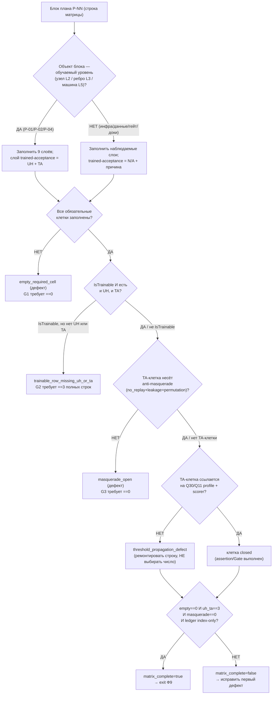

## Current Code-First Reconciliation Overlay (2026-07-14)

current_implementation_authorization: YES_CODE_FIRST_ONLY
teacher_dpo_training_authorization: NO_TEACHER_DPO_TRAINING_UNTIL_G_DPO_FINAL
dpo_status: NOT_STARTED
dpo_priority: LAST
current_counters: 12 phases / 27 subphases / 64 substeps

## Historical Fable Coverage Repair Overlay (2026-07-05)

historical_fable_plan_readiness: PLAN_NOT_READY / FABLE_GAP_REPAIR_QUEUE
historical_fable_implementation_authorization: NO until fresh Luba approval after review
historical_fable_verdict_basis: Newer-at-that-time Fable coverage evidence `claude-fable-plan-check-v1.md` and attachment `98cbe69a` superseded the previous final-readiness overlay. Fable reported 127 findings: 91 COVERED, 30 PARTIAL, 6 MISSING. This is historical plan-repair evidence only, not current execution authority and not product/test/build/runtime/provider/training/checkpoint/git proof.
historical_fable_verdict_classes: DESIGN_BLOCKER_AT_THAT_TIME=FABLE_MISSING_AND_PARTIAL_ITEMS; REPAIR_QUEUE_AT_THAT_TIME=FABLE_RB_RG_AND_PARTIAL_REPAIR; FABLE_EVIDENCE=claude-fable-plan-check-v1.md lines 35-153 and attachment 98cbe69a lines 32-79; IMPLEMENTATION_AUTHORIZATION_GATE_AT_THAT_TIME=NO until fresh Luba approval after review.
historical_fable_classification_rule: Any older line in this file saying PLAN_READY_FOR_LUBA_REVIEW, Final Readiness Review Overlay, no unresolved design/dependency blocker, CURRENT_REPAIR_QUEUE=NONE_IDENTIFIED_BY_FINAL_READINESS_REVIEW, or parent final-readiness acceptance before this overlay is historical/pre-Fable evidence only unless it cites later authority.
historical_fable_gap_repair_addendum: active-codex-execution-42-fable-gap-repair-additions-20260705.md was the historical repair map for R-B/R-G and partial contract/readability/lifecycle additions; it is not current authority.
## Historical Pre-Fable Final Readiness Review Overlay (2026-07-05)
historical_pre_fable_plan_readiness: PLAN_READY_FOR_LUBA_REVIEW
historical_pre_fable_implementation_authorization: NO until fresh Luba approval after review
historical_pre_fable_final_readiness_review_scope: one bounded planning/governance readiness review only; no product implementation, tests, builds, runtime, browser, provider/API, model/training/checkpoint, git, branch, mergeability, PR, or product-readiness proof was run.
historical_pre_fable_current_verdict_basis: This final review read the required governance/skill gate markers, the two unique original-task/reference attachments, the minimum Claude baseline surfaces, the active-codex plan/board/matrix/source-map/legal/gate/ledger surfaces, and current status/search evidence. End-to-end mental simulation from the active plan found no unresolved design/dependency decision that an executor would have to choose before coding/testing. The prior PLAN_NOT_READY / PLAN_PARTIAL_REPAIR_QUEUE state after 0aa/Laplace/Kepler/Singer was retained for parent final-review acceptance; this overlay supplies that final bounded review. Remaining items are execution or approval gates only: fresh Luba implementation approval, local self-authored seed file creation, code implementation, tests/builds/runtime/training/checkpoint/fresh-load/ablation proof, same-scenario Path A/Path B host proof, mock/replacement-ledger proof, branch/mergeability/git proof if later authorized, final product review, and route-specific hosted TogetherAI/Qwen3 terms/output-use proof before hosted train/common use.
historical_pre_fable_current_verdict_classes: DESIGN_BLOCKER_CURRENT=NONE_IDENTIFIED_BY_FINAL_READINESS_REVIEW; CURRENT_REPAIR_QUEUE=NONE_IDENTIFIED_BY_FINAL_READINESS_REVIEW; CURRENT_LEDGER_ACCEPTANCE_BOUNDED_EVIDENCE=50/50 accepted planning sections after 2026-07-05 Pass37-Pass50/Singer repair, not 50 cycles, not 50 product reviews, not product proof, not test/build/runtime/provider/training/checkpoint/git proof; HOSTED_PROVIDER_PRE_USE_GATE_ROUTE_SPECIFIC=TogetherAI/Qwen3 proof required before hosted train/common use only, not a local self-authored v1 planning blocker; IMPLEMENTATION_AUTHORIZATION_GATE=NO until fresh Luba approval after review.
historical_pre_fable_classification_rule: Any older line in this file saying PLAN_NOT_READY / PLAN_PARTIAL_REPAIR_QUEUE, current verdict remains PLAN_NOT_READY, CURRENT_REPAIR_QUEUE, parent must run final readiness review, or no-go boundaries before this overlay is historical/pre-final-readiness-review evidence only unless it cites later authority.
---
artifact_type: ilearningdynamicgraph_plan_block_13_test_strategy
authority_source: latest unquoted Luba work order for DPO Legal Learning active execution chain
status: populated_now_planning_only
last_updated: 2026-06-29
write_scope: C:\Users\lubao\Documents\xiigen\llm mvp\dpo legal build\active-codex-execution-*.md
canonical_filename: claude-plan-13-test-strategy.md
benchmark_read_only: codex-plan-13-test-strategy.md
plan_phase_anchor: Ф9 (Тесты/QA матрица) — Ф9.1.1 / Ф9.1.2 / Ф9.2.1 / Ф9.2.2 / Ф9.3.1 / Ф9.3.2
canon_counters: 12 фаз / 27 подфаз / 64 подшага (Ф0…Ф11), нумерация Ф<P>.<SP>.<SS>
canon_owner: блок 13 — владелец канона ТЕСТ-СТРАТЕГИИ (матрица 14×9 FC-26, две PASS-точки UH/TA, Gate B P-13)
---

# Блок плана 13 — Консолидированная тест-стратегия (матрица 14×9 FC-26): чем доказывается КАЖДЫЙ блок плана, отдельно для НЕобученного и обученного состояния

Автор блока: Claude (Opus 4.8 MAX), роль — автор полностью решённого блока плана в
моём namespace `claude-*`. Это **ПЛАН-документация-решение** проекта
**ILearningDynamicGraph**, а не разрешение на реализацию продукта, не запуск
тестов/раннеров/билда/тренировки/git и **не** промпт исполнителю. Цитаты кода —
реальные, с `file:line`, проверены чтением файла в `C:/Projects/llm_mvp_core` на
2026-06-23. Чужие планы (`codex-*`, `dcm-*`), реконы, гайды — **evidence-only**:
прочитаны как бенчмарк/доказательство, не дублируются и не правятся.

> **Версия namespace `claude-*`.** Бенчмарк `codex-plan-13-test-strategy.md`
> прочитан как образец (read-only). Он восстановлен «после cycle-42 status-sync
> encoding fault» и сведён к ~50 строкам: Authority Anchor, Canon-нота, **плоская**
> таблица `P-01..P-14` (один столбец «Planned test» — по одной фразе на строку),
> Gate B и «Final Questions Only: None». Это законная **canon-карточка** внутри
> большого плана, но как самостоятельный читаемый блок Part A она **не проходит**
> гейт читаемости (R3 / `implementation-doc-uml-SKILL.md` / Part A Completeness
> Contract): нет §0 UML, нет §1 флоучарта с симуляциями, нет §2 алгоритма
> построения матрицы по шагам, нет §3 цитат `file:line`, нет §5 иерархии, и —
> главное — **нет самой матрицы 14×9** (9 слоёв FC-26), которую канон требует от
> P-13 (мастер §C.4 строка P-13: «матрица 14 строк P-01..P-14, 0 пустых клеток (9
> колонок слоёв); каждая ✔ с assertion/Gate; 3 IsTrainable c обеими колонками
> UH+TA»). Бенчмарк даёт **строки**, но не даёт **столбцы**.

---

## 0а. Якорь задачи (Current task anchor — обязателен по plan-review-SKILL)

```text
CURRENT TASK: написать МОЙ (claude-namespace) улучшенный блок-13 «консолидированная
              тест-стратегия (FC-26)» — план-решение Ф9 для ILearningDynamicGraph,
              человеческим русским, Part A-формат (§0 UML + §1 флоучарт + §2 алгоритм
              + §3 код-цитаты + §4 статус + §5 иерархия) с явной матрицей 14×9 и
              раздельными колонками UH/TA для трейнабл-строк, сохранив структуру
              бенчмарка (Authority Anchor / Canon / Gate B / Final Questions), его
              канон-инвентарь (14 строк P-01..P-14), канонические счётчики
              (12 фаз / 27 подфаз / 64 подшага, Ф<P>.<SP>.<SS>) и CANON-инварианты
              (L5-машина без 6-го уровня A-LM-12; легальный teacher-гейт; запрет
              скрытого детерминизма A-LM-09/A-LM-13). Записать ровно в
              claude-plan-13-test-strategy.md.
NOT THE TASK: исполнять/тестировать/билдить код, запускать раннеры/тренировку,
              вызывать внешние AI/API/модели, git; править/создавать любые codex-*
              (только чтение); продолжать чужой codex-план или claude-00..07 каркас;
              реализовывать продукт; ложные claim о выполненных циклах ревью
              («50/50» из бенчмарка — index-only, не доказанные циклы).
EVIDENCE-ONLY: codex-plan-13 (бенчмарк), codex-ILEARNINGDYNAMICGRAPH-PLAN-v1
              §C.4 строка P-13 / §B.1 R-16 / §E.2 Q34/Q35/Q39/Q40, codex-plan-11
              §9 (9-слойный шаблон), codex-EXECUTION-CONTROL-BOARD §Ф9, реконы
              codex-recon-* (в т.ч. -mvp-extensions, -core-tests), claude-00..12
              (мой каркас и блоки — синхрон канона), реальный код llm_mvp_core
              (читается для цитат), скилы plan-review / trainable-architecture-decision /
              implementation-doc-uml. Это материал для чтения, не источник задачи и
              не цель правки.
```

## 0б. Где этот claude-блок осознанно лучше бенчмарка `codex-plan-13` (delta-нота, не слепая копия)

Бенчмарк перечисляет **14 строк** (P-01…P-14) как одну колонку «Planned test» —
это **строки матрицы без столбцов**. Канон P-13 (мастер §C.4) и R-16 (мастер §B.1)
требуют **матрицу 14×9** (9 слоёв FC-26) с нулём пустых обязательных клеток и с
раздельными колонками **UH (untrained-honesty)** и **TA (trained-acceptance)** для
трейнабл-строк. Я разворачиваю карточку в полноценный блок Part A и чиню точечные
расхождения:

| # | Слабое место бенчмарка `codex-plan-13` | Улучшение в этом claude-блоке |
|---|---|---|
| D1 | **Нет матрицы 14×9.** Бенчмарк даёт 14 строк в один столбец; нет ни одного из 9 слоёв FC-26 как колонки. Канон P-13 требует «0 пустых клеток (9 колонок слоёв)». | §3.1 — **полная матрица 14×9** с каждой клеткой = конкретный assertion/Gate (`unit / integration / e2e/host / QA automation / UX automation / negative / untrained-behavior / trained-acceptance / regression`). |
| D2 | **Нет раздельных UH/TA для трейнабл-строк.** Бенчмарк не отмечает, у каких строк две легитимные PASS-точки. Канон требует «3 IsTrainable c обеими колонками UH+TA». | §3.2 — явная классификация `IsTrainable` (P-01 узел, P-02 ребро, P-04 машина — 3 трейнабл-строки канона) и для них **обе** колонки: `PASS_AS_HONEST_UNTRAINED_SCAFFOLD` (UH) и `PASS_AS_TRAINED_FEATURE` (TA) с конкретными гейтами (FC-27/FC-28). |
| D3 | **Нет Part A.** Карточка не содержит §0 UML, §1 флоучарта с симуляциями ветвей, §2 алгоритма построения/верификации матрицы, §3 цитат `file:line`, §5 иерархии. | Полный Part A: §1 (роль), §2 (5-шаговая машина `TestStrategyMatrix.Build/Verify` плоским русским + сигнатуры), §3 (проверенные цитаты), §4 статус, §5 иерархия, §0 classDiagram + флоучарт V1-V6 с per-connection/per-branch симуляциями. |
| D4 | **«Verified packets complete: 50/50» прямо в Gate B.** Бенчмарк объявляет 50 циклов ревью завершёнными как факт приёмки. По `plan-review-SKILL.md` Dishonest Claim Rejection Gate / Review Depth Floor **N строк ledger ≠ N доказанных циклов**. | §7 Gate B G9 и §8.5 — claim «50/50» помечен `benchmark-sourced, index-only`; для МОЕГО блока честно: `this_block_real_pass_count = 1` авторский проход, внешних sub-agent review-пакетов = 0. |
| D5 | **Связь слоёв с реальными тестами-эталонами отсутствует.** Карточка не цитирует ни одного реального теста проекта, на который опирается каждый слой. | §3 цитирует **реальные** тесты-эталоны: `PromptToTaskMachineSkeletonTests.cs:18-20,79-85` (UH), `Learn06HeldOutAblationRunnerTests.cs:41-44` (ablation/TA), `TranslationProductHeldOutRunner.cs:211-220,285-287` (промоушен-гейт + overlap), `SkillSelectionContracts.cs:35,45` (permutation). |
| D6 | **No-signal / proof-field гейты (P-13/P-14) не разложены на слои.** Бенчмарк держит их как 2 отдельные строки. | §3.1 строки P-13/P-14 встроены в ту же матрицу 14×9 (мета-строки: тест-стратегия проверяет саму себя и proof-field-полноту), а §7 G7/G8 даёт измеримые exit-условия. |
| D7 | **Нет привязки 6 архитектурных гейтов §8 блока 11 к слоям (мастер требует «6 гейтов §8 сопоставлены»).** | §4.1 — таблица соответствия «6 архитектурных гейтов измерения → слой FC-26 / строка матрицы», чтобы ни один гейт не остался без теста. |
| D8 | **Final Questions: None.** Бенчмарк закрывал вопросы слишком рано. Historical/pre-PASS08 Q34 был открыт; current status closes Q34 by reusing the Q30/Q11 locked profile for unit/edge/graph (`RuntimeProductAccuracy>=0.95`, delta `>=+0.02`, `RewardMargin>=0.025`, ablation `>=0.02`). Q35/Q39/Q40 remain separate scope/wrapper questions only where applicable; they do not reopen the held-out/scorer/ablation numbers. | §11 now labels Q34 as resolved and keeps any remaining non-threshold questions separate, so Future Gate B verifies tests instead of choosing numeric thresholds. |

CANON-инварианты сохранены: маппинг ролей Luba → реальные контракты (мастер §A.3);
5 закрытых уровней (A-LM-12, без 6-го); легальный teacher-гейт (closed = только
judge при `used_for_training=false`; контаминация → `DATASET_REBUILD_REQUIRED`);
запрет скрытого детерминизма (A-LM-09/A-LM-13). Канон-имена контрактов **не
переопределяются** здесь (владельцы — блоки 01/02/04/07/08/12): `GraphDpoPair`
(14 полей), `TeacherProvenance` (20 полей; 13+5+2 RR6 `service_mode`/`grounding_used`), `GraphEdgeKind` (5 членов),
`EdgeAuthorityUnit`/`SemanticEdgeRouterUnit`, `CandidateOrderLeakageGuardUnit`,
`GraphNodePreferenceState`, `DynamicGraphMachine`; блок 13 на них только
**ссылается** как на объекты тестирования.

Скилы/гайды, по которым написан блок (загружены и применены как контекст):
`docs/skills/plan-review-SKILL.md` (Gate 0; FC-26 тест-стратегия; FC-27/FC-28 две
PASS-точки; Trainable material-quality review gate; Deterministic evidence
masquerade firewall; Dishonest Claim Rejection Gate; Review Depth Floor),
`docs/skills/trainable-architecture-decision-SKILL.md` (5 разрешённых уровней,
Graph-Style/DynamicGraph Reconstruction Gate, Legal Teacher/Provenance Gate,
Minimum Breadth Challenge, verdicts), `docs/skills/implementation-doc-uml-SKILL.md`
(§0 classDiagram + `note for` на каждый класс + таблица симуляции на каждую
связь; §1 `flowchart TD` + симуляция на каждой ветке).

---

## §0-pre. Карта фаз блока (12 фаз / 27 подфаз / 64 подшага · нумерация Ф.ПП.СС)

Каркас исполнения блока «Тест-стратегия» внутри плана ILearningDynamicGraph. Якорь
доски — **Ф9** (Тесты/QA матрица), подфазы **Ф9.1 / Ф9.2 / Ф9.3**, подшаги
**Ф9.1.1, Ф9.1.2, Ф9.2.1, Ф9.2.2, Ф9.3.1, Ф9.3.2**
(`claude-EXECUTION-CONTROL-BOARD.md` §Ф9, evidence-only). Полная карта — текущий канон
**12/27/64** (12/26/59 — historical/pre-PASS26) — канон всех `claude-*`; ниже она приведена целиком для самодостаточности блока, а
**предмет именно этого блока** — фаза Ф9 (выделена).

| Фаза | Что фаза решает (по-человечески) | Подфазы | Подшаги (Ф.ПП.СС) |
|---|---|---|---|
| **Ф0. Решения Luba** | Зафиксировать locked-ответы (host/legal/scope) до старта | 0.1 решения | Ф0.1.1 host-locked; Ф0.1.2 scope-locked; Ф0.1.3 legal/teacher-locked |
| **Ф1. Контракты/фундамент** | Ввести NEW-контракты графа (узел/ребро/L5) | 1.1 контракты; 1.2 узел; 1.3 ребро/оркестр/L5-каркас | Ф1.1.1–3; Ф1.2.1–3; Ф1.3.1–3 |
| **Ф2. Legal-гейт + канон** | `GraphDpoPair` + provenance (20 полей) + teacher-вердикт | 2.1 канон+provenance; 2.2 контаминация | Ф2.1.1–3; Ф2.2.1–2 |
| **Ф3. DPO-строитель** | Авто-построение пар из 5 форматов в 1 канон | 3.1 строитель; 3.2 chosen_origin | Ф3.1.1–3; Ф3.2.1–2 |
| **Ф4. Обучение+lifecycle** | LoRA+DPO, checkpoint/export/import/continue, split R5 | 4.1 движок; 4.2 lifecycle; 4.3 обучаемые узел/ребро | Ф4.1.1–2; Ф4.2.1–3; Ф4.3.1–3 |
| **Ф5. Измерение** | Скорость/точность/качество (held-out, без UNKNOWN) | 5.1 оси; 5.2 дельта | Ф5.1.1–3; Ф5.2.1–2 |
| **Ф6. Async-комбинации** | Один вход → N комбинаций → лучший | 6.1 fan-out; 6.2 merge | Ф6.1.1–2; Ф6.2.1–2 |
| **Ф7. Авто-DPO петля** | Сердце проекта: петля строит/учит/мерит | 7.1 петля; 7.2 промоушен | Ф7.1.1–2; Ф7.2.1–2 |
| **Ф8. No-hidden-determinism** | Классификация 9 механизмов + cutover на обучаемый авторитет | 8.1 классификация; 8.2 cutover | Ф8.1.1–2; Ф8.2.1–2 |
| **★ Ф9. Тесты/QA матрица (ЭТОТ БЛОК)** | **Доказать ЧЕМ проверяется каждый блок плана: матрица 14×9 FC-26 + две PASS-точки UH/TA** | **9.1 матрица слоёв; 9.2 две честности; 9.3 анти-masquerade+human-gate** | **Ф9.1.1 построить 14×9 (0 пустых клеток); Ф9.1.2 каждая клетка = assertion/Gate; Ф9.2.1 трейнабл-строки несут UH; Ф9.2.2 трейнабл-строки несут TA (3 гейта); Ф9.3.1 анти-masquerade firewall на каждую TA-строку; Ф9.3.2 человекочитаемый статус матрицы + Gate B** |
| **Ф10. API/клиенты** | Карта референсов + швы figma/better-output (R16/R17) | 10.1 figma-шов; 10.2 better-output; 10.3 пилот | Ф10.1.1–2; Ф10.2.1–2; Ф10.3.1–5 (пилот, включены в baseline; канон 12/27/64) |
| **Ф11. Финальная приёмка** | Completion matrix + 10 execution reviews | 11.1 матрица; 11.2 ревью | Ф11.1.1; Ф11.2.1 |

Контроль счётчиков (текущий канон **12/27/64**): фаз **12** (Ф0…Ф11); подфаз по фазам
1+3+2+2+3+2+2+2+2+**3**+**3**+2 = **27** (Ф10 = 3 подфазы: 10.1/10.2/10.3-пилот);
подшагов по фазам 3+9+5+5+8+5+4+4+4+**6**+**9**+2 = **64** (Ф10 = 4 базовых Ф10.1.1–2,
Ф10.2.1–2 + 5 пилотных Ф10.3.1–5, включены в baseline). Фаза Ф9 (этот блок) несёт
**3 подфазы** и **6 подшагов** (Ф9.1.1–2, Ф9.2.1–2, Ф9.3.1–2), как на доске.
Historical/pre-PASS26: 12/26/59 (Ф10 = 2 подфазы / 4 подшага; Ф10.3 был вне baseline).

---

## 0. Solved Architecture Block (требование trainable-architecture-decision-SKILL)

```text
Solved Architecture Block (консолидированная тест-стратегия графа):
  problem:
    Тест-доказательства РАЗБРОСАНЫ по 14 блокам плана: у каждого блока свой §9, но
    нет единого артефакта, который доказывает, что ВСЕ 14 блоков покрыты ВСЕМИ 9
    слоями FC-26, и что для трейнабл-блоков различены ДВЕ честности (untrained vs
    trained). Без такого артефакта легко (а) пропустить слой (например, UX или
    e2e) для какого-то блока, (б) выдать честный скаффолд за обученную фичу
    (masquerade — самый опасный false positive), (в) объявить N циклов ревью по N
    строкам ledger. Бенчмарк P-13 дал строки, но не матрицу и не UH/TA-разделение.
  selected_design:
    (1) Ввести единый planning-артефакт + (в реализации) класс TestStrategyMatrix :
        ILogicalUnit (docs-sync/верификатор), который строит МАТРИЦУ 14×9
        (строки = P-01..P-14, колонки = 9 слоёв FC-26) и заполняет КАЖДУЮ
        обязательную клетку конкретным assertion/Gate с привязкой к §-блоку и при
        наличии — к реальному тесту-эталону (file:line).
    (2) Для каждой строки задать флаг IsTrainable. Трейнабл-строки (P-01 узел,
        P-02 ребро, P-04 машина) ОБЯЗАНЫ нести ОБЕ PASS-колонки:
        UH = PASS_AS_HONEST_UNTRAINED_SCAFFOLD (контракт есть, честно not_ready,
        нет скрытого детерминизма) и TA = PASS_AS_TRAINED_FEATURE (checkpoint +
        held-out + ablation + fresh-load + continue-training + e2e). Не-трейнабл
        строки (карта/референсы/инфраструктура) несут только наблюдаемые слои и
        честно помечаются «нет TA — это не обучаемая модель».
    (3) Анти-masquerade firewall на КАЖДУЮ TA-клетку: no_replay_proven=true,
        exact_memory_leakage_proven_absent, иначе клетка остаётся открытой.
    (4) Pass Ledger = ИНДЕКС, не доказательство: real_pass_count считается только
        из инспектируемых пакетов (reviewer id / before-after / findings / recheck).
    (5) Сам блок 13 НЕ обучается: матрица — детерминистический навигационно-
        верификационный реестр, поэтому её приёмочный класс —
        PASS_AS_HONEST_UNTRAINED_SCAFFOLD, а НЕ trained feature.
  rejected_alternatives:
    (a) Оставить 14 строк в один столбец (бенчмарк) — нарушает канон «0 пустых
        клеток, 9 колонок»; отклонено.
    (b) Слить UH и TA в одну колонку «pass» — стирает разницу двух честностей,
        открывает masquerade (FC-27/FC-28 нарушение); отклонено.
    (c) Считать «50/50 циклов» по строкам ledger — Dishonest Claim Rejection Gate;
        отклонено (ledger = index-only).
    (d) Объявить блок 13 «обучаемым качеством тестов» — у реестра нет обучаемого
        состояния; назвать его trained = masquerade; отклонено (honest scaffold).
    (e) Запускать тесты прямо здесь — это PLAN-ONLY; блок ОПИСЫВАЕТ стратегию, не
        исполняет; отклонено.
  UML: см. §0-UML (Mermaid classDiagram + per-connection simulation) и §1-флоучарт.
  data_flow: см. §2.2 (5-шаговая машина Build/Verify) и §3.1 (матрица 14×9).
  current_code_refs: см. §3 (все с file:line, проверены чтением 2026-06-23).
  future_files_classes_methods_signatures_dependencies: см. §2.2 + §5 (NEW-типы).
  deterministic-vs-learned boundary:
    Матрица 13 = ДЕТЕРМИНИСТИЧЕСКИЙ навигационно-верификационный артефакт (honest
    internal/eval helper), НЕ runtime-authority и НЕ обучаемая модель. Объекты,
    КОТОРЫЕ она тестирует (узел/ребро/машина), — обучаемые (L2/L3/L5); граница
    «обучен vs lookup» проверяется именно слоями UH/TA + анти-masquerade firewall
    (это и есть назначение блока). Сам блок 13: learned-компонента N/A — он
    помечен honest scaffold.
  gates_and_tests: см. §7 (Gate B) + §3.1 (матрица — это и есть «tests»).
  failure_modes: см. §8.1.
  docs: см. §10 (затрагиваемые доки/реконы/схемы).
```

### 0.1. Graph-Style Reconstruction (требование Graph-Style/DynamicGraph Reconstruction Gate)

```text
roles_and_hierarchy: тест-стратегия — ПОПЕРЕЧНЫЙ слой над всеми уровнями: L5
  машина (блок 04) меряется слоем trained-acceptance; L4 оркестратор (блок 03) —
  слоем e2e/host; L3 ребро (блок 02) и L2 узел (блок 01) — per-edge/per-node
  слоями unit/untrained-behavior/regression. Матрица не несёт обучаемого состояния.
DynamicGraph nodes: каждый узел графа = строка-объект тестирования (P-01); тест
  доказывает not_ready (UH) и held-out lift (TA). Сами узлы — вне этого блока (01).
DynamicGraph edges: каждое ребро (P-02) тестируется per-edge: permutation-инвариант
  (`SkillSelectionContracts.cs:35`), ablation вклада ребра, leakage-исключения.
input_contracts: TestStrategyMatrix.Build(PlanModel plan, IReadOnlyList<TestArtifact> tests)
  — план (14 блоков, 64 подшага; канон 12/27/64) + реестр реальных тестов-эталонов.
output_contracts: TestStrategyMatrixModel (14×9 заполненная) + TestStrategyVerdict
  (cells_total/cells_filled/empty_required_cells/trainable_rows_with_uh_and_ta/
  masquerade_open_count/pass_ledger_index_only).
many_to_many_outputs / fan_out / fan_in: владелец — блоки 02/06; здесь матрица лишь
  ТРЕБУЕТ, чтобы у async/fan-out строк (P-03/P-06) были слои integration+e2e+regression.
multi_output_edge_contracts: проверяются строкой P-02 (OrderedTargets инвариантен).
async_graph_execution: e2e-слой строки P-03 идёт через L4-оркестратор (блок 03);
  матрица требует, чтобы async-комбинации мерились ПОЛНЫМ проходом, не одиночным.
deterministic_vs_trainable_authority_on_edges: матрица САМА детерминирована (honest
  scaffold), но обязана на каждой TA-строке доказать, что ТЕСТИРУЕМЫЙ финал ребра —
  обучаемый (ablation роняет accuracy), иначе строка = FORBIDDEN_RUNTIME_SHORTCUT.
hidden_deterministic_shortcut_check_tied_to_each_edge: слой trained-acceptance каждой
  трейнабл-строки несёт анти-masquerade firewall (§3.1 / §9.3.1) — no_replay_proven +
  exact_memory_leakage_proven_absent + permutation-invariance.
```

---

## 1. Что это и зачем (роль компонента в ILearningDynamicGraph)

**Тест-стратегия — это «приёмочная ведомость завода обучения».** План
ILearningDynamicGraph состоит из 14 блоков (P-01…P-14): узел, ребро, оркестратор,
L5-машина, async-комбинации, DPO-строитель, legal-гейт, авто-петля, обучение+
lifecycle, измерение, замена детерминизма, эта тест-стратегия и карта референсов.
У каждого блока есть свой §9 с тестами. Но **разрозненные §9 не доказывают
полноту**: легко пропустить целый слой проверки (например, UX-читаемость статуса
или e2e через реальную точку входа) у какого-то блока, и легко выдать честный
скелет за обученную фичу.

Блок 13 закрывает один прямой вопрос: **чем именно — каким конкретным
assertion/Gate — проверяется КАЖДЫЙ блок плана по КАЖДОМУ из 9 слоёв FC-26, и
различены ли две легитимные честности (НЕобученный скаффолд vs обученная фича) для
обучаемых блоков?** Он строит **матрицу 14×9**: строки — блоки P-01…P-14, колонки —
9 слоёв (`unit / integration / e2e/host / QA automation / UX automation / negative /
untrained-behavior / trained-acceptance / regression`). Каждая обязательная клетка
заполнена конкретной проверкой; пустых обязательных клеток быть не должно (Gate B
G1).

Зачем это нужно именно для **обучаемого** графа. Граф учится на DPO-парах; его
качество легко подделать тремя способами — и тест-стратегия ловит каждый:

- **подделка «обучен»** (masquerade): scorer/lookup/replay выдаются за
  обученную модель → ловит слой **trained-acceptance** (held-out на
  source-disjoint + ablation + fresh-load) и анти-masquerade firewall;
- **подделка «не врёт»**: пустой узел тихо отвечает детерминизмом вместо честного
  `not_ready` → ловит слой **untrained-behavior** (рефлексия: нет
  `Regex/Dictionary/Classifier/Lookup/Bm25/ExactPrompt`,
  `PromptToTaskMachineSkeletonTests.cs:79-85`);
- **подделка «проверено»**: N строк ledger выдаются за N циклов ревью → ловит
  правило Pass Ledger index-only (§8.5, Dishonest Claim Rejection Gate).

Граница ответственности (CANON R6 — тонкий агент, ядро в `llm_mvp_core`): матрица —
это planning-артефакт + (в реализации) `TestStrategyMatrix` как `ILogicalUnit`
внутри `llm_mvp_core` для docs-sync/верификации покрытия; агент/расширение её не
содержит и не дублирует.

### 1.1. Чем тест-стратегия НЕ является (границы блока)

- НЕ выбирает skill, не маршрутизирует ребро, не несёт обучаемого состояния и не
  является runtime-authority. Это детерминистический навигационно-верификационный
  реестр (honest internal/eval helper по скилу), и так он помечается.
- НЕ запускает тесты/раннеры/билд (PLAN-ONLY). Описывает, ЧЕМ должен проверяться
  каждый блок; исполнение тестов — стадия реализации (после approve Luba).
- НЕ переопределяет канон контрактов (`GraphDpoPair`/`TeacherProvenance`/
  `GraphEdgeKind`/…). Владельцы — блоки 01/02/04/07/08/12; матрица только ссылается.
- НЕ заявляет semantic quality о себе. У реестра нет `PASS_AS_TRAINED_FEATURE`;
  его честный класс — `PASS_AS_HONEST_UNTRAINED_SCAFFOLD`.

---

## 2. Концепт простыми словами (аналогия + машина построения/верификации по шагам)

### 2.1. Аналогия

Тест-стратегия — это **«экзаменационная ведомость» для всех станков завода**.
Завод собран из 14 станков (блоков плана). У каждого экзамен идёт по 9 предметам
(слоям): «работает деталь» (unit), «работает в сборке» (integration), «работает на
живой линии» (e2e/host), «контроль качества ловит брак» (QA), «оператор понимает
табло» (UX), «ломается правильно на плохом входе» (negative), «честно говорит „я
ещё не обучен“» (untrained-behavior), «доказал, что реально обучился» (trained-
acceptance), «старые станки не сломались» (regression).

Главное правило ведомости — **две разные оценки для обучаемых станков**:

1. **«Зачёт по честности» (UH)** — станок-новичок ещё не обучен, но он **честно**
   об этом говорит и **не жульничает** скрытой бумажной таблицей. Это веха, а
   **не** рабочая фича.
2. **«Зачёт по мастерству» (TA)** — станок реально научился: на **незнакомых**
   деталях (held-out) он лучше новичка (есть прирост), и если выключить его мозг
   (ablation) — качество падает (значит, решает он, а не формула). И его навык
   пережил выключение-включение (fresh-load) и доучивание (continue-training).

Экзаменатор-каталогизатор обходит все 14 станков и для каждого заполняет 9 клеток
ведомости. **Пустая клетка = непринятый экзамен** (дефект). И отдельно: **число
строк в журнале экзаменов ≠ число реально принятых экзаменов** — засчитываются
только экзамены с протоколом (кто принимал, до/после, что нашли, перепроверка).

Легальность учителя (Legal Teacher Gate): если «эталонные ответы» для экзамена
«по мастерству» берём у внешней модели-эксперта, эксперт обязан быть **легальным**
open-weight/permissive; **Claude / OpenAI / Gemini как teacher для дистилляции —
НИКОГДА**, только как судья при `used_for_training=false`.

### 2.2. Машина построения+верификации `TestStrategyMatrix` — 5 шагов (плоский русский, без кода)

Класс **`TestStrategyMatrix`** (planning-артефакт сейчас; в реализации — L2
`ILogicalUnit` для docs-sync), методы
**`Build(PlanModel plan, IReadOnlyList<TestArtifact> tests)`** →
**`TestStrategyMatrixModel`** и
**`Verify(TestStrategyMatrixModel matrix)`** → **`TestStrategyVerdict`**.
Параметры: `plan` — модель плана (14 блоков P-01..P-14, 64 подшага; канон 12/27/64); `tests` —
реестр реальных тестов-эталонов проекта (`file:line`). Поля вердикта:
`cells_total`, `cells_filled`, `empty_required_cells`, `trainable_rows`,
`trainable_rows_with_uh_and_ta`, `masquerade_open_count`, `pass_ledger_index_only`.
Алгоритм:

```text
Шаг 1. EnumerateRowsAndLayers(plan)                      ← каркас матрицы (§3.1)
  Строки = 14 блоков P-01..P-14. Колонки = 9 слоёв FC-26 (фикс-список):
  unit, integration, e2e/host, QA automation, UX automation, negative,
  untrained-behavior, trained-acceptance, regression.
  cells_total = 14 строк × 9 слоёв (минус явно помеченные N/A с причиной).

Шаг 2. ClassifyTrainable(row)                            ← флаг IsTrainable (§3.2)
  IsTrainable=true для строк, чей объект — обучаемый уровень (узел L2 / ребро L3 /
  машина L5): P-01, P-02, P-04 (канон «3 IsTrainable»). P-03/P-06/P-09/P-10/P-11 —
  трейнабл-СМЕЖНЫЕ (тестируют обучаемое поведение, но владелец обучения — P-04);
  у них обязательны e2e/regression, а UH/TA наследуются от тестируемой машины и
  помечаются ссылкой. P-05/P-07/P-08/P-12/P-13/P-14 — инфраструктура/гейты/доки:
  IsTrainable=false, колонка trained-acceptance = N/A с причиной (не обучаемая модель).

Шаг 3. FillCell(row, layer)                              ← заполнение клетки (§3.1)
  В каждую обязательную клетку кладём конкретный assertion/Gate (НЕ «works
  correctly»): что проверяем + к какому §-блоку привязано + (если есть) реальный
  тест-эталон file:line. Для IsTrainable-строк слой trained-acceptance разворачивается
  в ДВЕ под-клетки: UH (PASS_AS_HONEST_UNTRAINED_SCAFFOLD) и TA (PASS_AS_TRAINED_FEATURE).

Шаг 4. AntiMasqueradeGate(row)                           ← firewall на TA (§3.1/§9.3.1)
  Для каждой TA-клетки: требуем no_replay_proven=true (старый и новый набор одного
  типа id), exact_memory_leakage_proven_absent, permutation-invariance. Если хоть
  один не доказан → клетка masquerade_open (masquerade_open_count++), TA не закрыта.

Шаг 5. VerifyAndLedger(matrix) + финальный вердикт       ← §7 Gate B + §8.5
  empty_required_cells = число обязательных пустых клеток (должно быть 0).
  trainable_rows_with_uh_and_ta = число IsTrainable-строк с ОБЕИМИ колонками
  (должно быть == trainable_rows == 3).
  Pass Ledger остаётся index-only: real_pass_count считается ОТДЕЛЬНО (НЕ из числа
  строк/клеток). «50/50» из бенчмарка помечается benchmark-sourced.
  matrix_complete = (empty_required_cells==0 && trainable_rows_with_uh_and_ta==3
                     && masquerade_open_count==0 && pass_ledger_index_only==true).
```

Возврат `Verify`: `matrix_complete` + перечень дефектов (`empty_required_cell`,
`trainable_row_missing_uh_or_ta`, `masquerade_open`, `ledger_counted_as_cycles`) +
флаг `pass_ledger_index_only=true`. **Предусловие закрытия Ф9** =
`matrix_complete==true` (current Q34 числовые пороги для клеток узлов/рёбер
закрыты Q30/Q11 профилем; если TA-клетка не ссылается на этот профиль и scorer,
это `threshold_propagation_defect`, а не выбор числа в Future Gate B).

---

## 3. Канон (нормативная часть) — owner block 13: матрица 14×9 + UH/TA + анти-masquerade

### 3.1. Матрица тест-стратегии 14×9 (FC-26) — каждая клетка = конкретный assertion/Gate

> Канон P-13 / R-16: 14 строк (P-01..P-14) × 9 слоёв; 0 пустых обязательных клеток;
> каждая клетка несёт assertion/Gate; 3 IsTrainable строки (P-01/P-02/P-04) несут
> ОБЕ колонки UH+TA. Слой `trained-acceptance` для IsTrainable-строк показан как
> **UH | TA** (две честности); для не-трейнабл строк — `N/A (не обучаемая модель)`.
> Сокращения слоёв в шапке: U=unit, I=integration, E=e2e/host, QA=QA-automation,
> UX=UX-automation, N=negative, UH=untrained-behavior(честность скаффолда),
> TA=trained-acceptance(обучение доказано), R=regression.

**Строки P-01..P-07:**

| Блок | U (unit) | I (integration) | E (e2e/host) | QA | UX | N (negative) | UH \| TA (две честности) | R (regression) |
|---|---|---|---|---|---|---|---|---|
| **P-01** узел L2 (IsTrainable) | `Train`-методов на узле == 0 (A-LM-02); features·weights→top-N даёт детерминированный shape | узел в составе ребра/оркестратора отдаёт top-N + honest NoDecision | проход узла внутри L4 на обученном состоянии | NoDecision при пустом сигнале срабатывает | статус узла читаем: `scaffold`/`trained`/`no_decision`, без жаргона | пустой узел НЕ выдаёт выдуманный выбор; permutation не меняет выбор | **UH:** пустой → `NotTrainedStatus`/`NO_TRAINED_STATE_LOADED` (`PromptToTaskMachineSkeletonTests.cs:18-20`); рефлексией нет `Regex/Dictionary/Classifier/Lookup/Bm25/ExactPrompt` (`:79-85`) **\| TA:** held-out lift на source-disjoint > порога + ablation роняет accuracy + fresh-load==trained | базовый набор тестов узла не падает после миграции |
| **P-02** ребро L3 (IsTrainable) | `EdgeAuthorityDecision.OrderedTargets` имеет shape (id,confidence); 5 членов `GraphEdgeKind` | ребро в обходе L4 отдаёт переход; baseline→trained подмена без правки `RunAsync` | e2e: полный путь через ребро на обученном состоянии | leakage-скан: `SelectedFromSourceIdOnly==false` | edge-authority отчёт читаем: authority id, baseline role, cutover/ablation proof | closed-teacher в train-строке ребра → `DATASET_REBUILD_REQUIRED` | **UH:** ребро без обученного авторитета честно `KnowledgeEdge=true` (не выдуманный выбор) **\| TA:** `OrderedTargets` инвариантен к 5 перестановкам (`SkillSelectionContracts.cs:35,45`); held-out `PassesGate`+RewardMargin>0+After>Before; ablation просадка ≥ порог; `exactPromptLeakageRate==0.0`; lifecycle | per-edge: выключение авторитета конкретного ребра роняет held-out (вклад доказан) |
| **P-03** оркестратор L4 (async) | G1..G8 контракты обхода присутствуют | fan-out/fan-in/петля/knowledge-edge собираются в один проход | **e2e через реальную точку входа** L4 на обученном состоянии | budget.Max=4 → ровно 4 async (`Task.WhenAll`) | человекочитаемый трейс обхода (что→куда→почему) | при провале ветки — honest degrade, не молчаливый выбор | UH/TA **наследуются** от тестируемых узла(P-01)/ребра(P-02)/машины(P-04); 0 скрытых финалов на L4; *Q35 влияет на UH/TA для обёрток-рёбер* | подмена baseline→trained через `ResolveLatest` не ломает старый обход |
| **P-04** L5-машина (IsTrainable) | маппинг `:208`; 5 методов `ILearningMachine` присутствуют | `TrainBatchAsync` принимает батч → `LearningBatchResult` с метриками | e2e: `GetOrchestratorAsync`→L4-проход на обученном | `LearningEvaluationResult.PassesGate` считается ДО промоушена | статус машины читаем: `scaffold`/`trained`/`rebuild_required` | пустой батч/контаминация → честный отказ, не фейк-accuracy | **UH:** свежая машина честно `not_ready`, ablation `no_trained_state_baseline` vs `new ...Machine()` (`Learn06HeldOutAblationRunnerTests.cs:41-44`) **\| TA:** held-out числа + ablation + lifecycle (fresh-load + continue-training + e2e); промоушен-гейт (`TranslationProductHeldOutRunner.cs:211-220`) | continue-training Δ>0 ≥2 шага; baseline-тесты машины зелёные |
| **P-05** async N-комбинаций | `budget.Max=4` → 4 ветки | N≥2 → `GraphDpoPair[]` overlap<0.60 | e2e: победитель из N веток через L4 | overlap<0.60 проверка срабатывает | ветки B/C honest-degrade читаемы | победитель == немаркированная формула → тест ловит (ablation) | `N/A (не обучаемая модель — инфраструктура комбинаций; обучение у P-04)` | добавление веток не меняет baseline-счётчики |
| **P-06** many-to-many merge | `IEdgeFanInMerger.Merge` returns `GraphFanInMergeResult` typed carrier | fan-in слияние N→1 интегрируется through `Merged` + `Context` | e2e merge on approved implementation still future; v1 role is deterministic baseline | дубликаты целей при merge отсекаются; `MergedBranchCount` is recorded | merge-результат читаем from fields: `MergeRole=FanInMergeRole.DeterministicFanInBaseline`, `MergeOrderIsAuthority=false` | конфликт целей → honest conflict/rejected alternatives/reason refs, not silent drop; branch order is never authority | `N/A (инфраструктура merge; UH/TA у тестируемых рёбер P-02)`; permutation proof reads typed fields and identical `Merged`/`Context` | merge не ломает одиночный обход |
| **P-07** DPO-строитель (`GraphDpoPair` unit-level invariant) | `BuildPairAsync` overlap<0.60, reason≥24; train-ready pair has `level=unit`, `unit_id`, chosen/rejected unit output refs, unit context, path/order metadata, provenance, legal scope | 5 форматов → 1 unit-level канон (integration-тест) | материализация в `DpoDataset.Load` (`11.DPO/DpoDataset.cs:18`) | QA-скан: 0 train-ready строк с closed-маркерами и 0 whole-graph blob pairs | `[WRONG: ...]` маркеры читаемы в паре | `TeacherProvenanceGate` closed→`DATASET_REBUILD_REQUIRED`; learned score cannot bypass legal/provenance; permutation order-invariant | trainable fixture changes `TrainableGraphDpoBuilderUnit` unit-pair selection/rejection reason while deterministic `GraphDpoBuilder` baseline stays stable | новый формат-источник не ломает unit-level канон |

> **Нумерационная нота (A5 2026-07-13, владелец таксономии — мастер PLAN-v1):** строки `P-05`/`P-06` этой тест-матрицы = контент блока `plan-06` (мастер-канон `P-06` async мульти-комбинации; master PLAN-v1 §3.1:706 и §3.1:944 «без отдельного P-05»), разбитый на 2 строки: `P-05` = async N-комбинаций, `P-06` = many-to-many merge. Блок `plan-05` (partA-hierarchy) НЕ имеет отдельной продуктовой P-строки. Ссылки `P-05`/`P-06` читать по этой ноте. Счётчики 14×9/126/3 НЕ меняются.

**Строки P-08..P-14:**

| Блок | U (unit) | I (integration) | E (e2e/host) | QA | UX | N (negative) | UH \| TA (две честности) | R (regression) |
|---|---|---|---|---|---|---|---|---|
| **P-08** legal-гейт (provenance 20 полей) | `provenance_field_presence_rate==1.0` по 20 | гейт стоит перед train в петле (P-09) | вердикт применяется на реальном наборе | accept с пустым provenance == 0 | вердикт читаем: `ACCEPT/BLOCK_FOR_COMMON/...` | closed-judge при `used_for_training=false` ⇒ C11 ACCEPT only with terms true/non-pending and plain/no-grounding; otherwise C11-blocked/C17; closed-teacher ⇒ REBUILD | `N/A (легальный гейт, не обучаемая модель)`; точный 19-строчный owner-list plan-08 §4.1, включая C15/C15b, C16 и C18, покрыт negative+QA | контаминация `sonnet-*` помечается REBUILD (рекон R-17) |
| **P-09** авто-DPO петля | в `TrainBatchAsync` ≥1 авто-пара (не []) | петля: строитель→legal→train→измерение связаны | e2e: один оборот петли на реальном входе | held-out reward≥0, loss<0.693 | `ShouldStop`-причина читаема (threshold/plateau/budget) | промоушен без роста запрещён | трейнабл-СМЕЖНАЯ: UH/TA **через P-04** (After≥Before+0.02); honest two-PASS метка | повторный оборот не деградирует baseline |
| **P-10** обучение+lifecycle (LoRA+DPO) | LoRA реально вклеена (ablation Δ≠0) | export/import round-trip в пайплайне | e2e: continue-training поверх загруженного checkpoint | литерал 0.03 устранён (R-19), margin из движка | `LegScope` (common/personal) читаем | closed→REBUILD; replay (старые row_id) ловится | трейнабл-СМЕЖНАЯ: TA **через P-04/P-11** (fresh-load без replay; SHA-256) | 0 UNKNOWN; baseline lifecycle-тесты зелёные |
| **P-11** измерение (скорость/точность/качество) | `MeasurementReport` без UNKNOWN; `AccuracyAxis` раздельно live/held-out | замер батча 50 пар через `EvaluateAsync` | e2e через L4 даёт held-out число задачи | split-overlap ДО accuracy (`...HeldOutRunner.cs:285-287`); near-dup>0 блокирует | статус `scaffold/trained/rebuild_required` без жаргона | live margin выдан за точность → тест ловит как ошибку | трейнабл-СМЕЖНАЯ: задаёт сами пороги UH/TA для P-01/P-02/P-04; `PASS_AS_TRAINED` только 3/3 гейта | per-edge: выключение авторитета ребра роняет held-out |
| **P-12** замена детерминизма (9 механизмов) | `classified_mechanism_count==9` | `SemanticEdgeRouterUnit` встаёт как latest через `ResolveLatest` | e2e: cutover-проход на обученном авторитете | каждый forbidden/baseline имеет blueprint | классификация механизмов читаема (вердикт на каждый) | немаркированный финал → `FORBIDDEN_RUNTIME_SHORTCUT` | трейнабл-СМЕЖНАЯ: **P-12 continue-training прогоном** (канон Gate B); `CandidateOrderLeakageGuardUnit` permutation; ablation | baseline-роутеры не удалены (нужны для ablation) |
| **P-13** ТЕСТ-СТРАТЕГИЯ (этот блок, мета) | матрица 14×9 построена; `cells_filled==cells_total` | каждая клетка привязана к §-блоку/тесту | `TestStrategyMatrix.Verify` прогон даёт `matrix_complete` | `empty_required_cells==0`; `trainable_rows_with_uh_and_ta==3` | матрица читаема Любе (русский статус §9.3.2) | строка без UH или TA у IsTrainable → дефект ловится | `N/A (реестр, не обучаемая модель — honest scaffold, §9)` | добавление блока в план требует +1 строки (матрица не «протухает» молча) |
| **P-14** карта референсов (Stage 2) | `count(distinct StageId)==13` (P-01..P-13) | строки карты связаны с блоками-владельцами | проверка наличия путей read-only | `forbidden_target_count==0`; пути EXISTS | префикс=авторство, не authority — читаемо | строка target=`claude-*/codex-*/dcm-*` → `forbidden_target` | `N/A (навигационный реестр — honest scaffold)`; teacher/router помечены legal/baseline | Ф10.3.* (пилот) включены в baseline-счётчики; канон 12/27/64 (историч. 12/26/59) |

> **Контроль полноты матрицы (Gate B G1):** обязательных клеток —
> `14 строк × 9 слоёв = 126`, минус осознанные `N/A` (слой trained-acceptance у 8
> не-трейнабл строк P-05/P-06/P-07/P-08/P-10*/P-13/P-14 и трейнабл-смежных, где TA
> наследуется ссылкой) — каждая `N/A` несёт **причину** (не пустая). Канон «0 пустых
> клеток» = 0 клеток БЕЗ assertion/Gate И БЕЗ помеченной причины N/A. Трейнабл-строк
> с обеими колонками UH+TA — ровно **3** (P-01, P-02, P-04).

### 3.1a Двухфазный teacher — детализация клеток P-07/P-08/P-09/P-10

> **ДЕТАЛИЗАЦИЯ клеток, НЕ новая строка матрицы.** Счётчики `14×9`/`126`/`3` не меняются — это подсекция негативных/честностных проверок ВНУТРИ существующих клеток P-07 (DPO-строитель), P-08 (legal-гейт), P-09 (авто-DPO петля), P-10 (обучение+lifecycle). Владельцы: NEG-имена — `plan-09 §9`; permutation goal-winner — `plan-07`; профиль `qwen35-local-v1` — `plan-08 §3.5.2`; `stage_scope_gate` — `plan-10 §8.1`; tie-break SHA-256 — `plan-12 §3.B.2` / `plan-09 §3 Шаг 3a`.

| # | тест | клетка (владелец-строка) | ожидаемый результат |
|---|---|---|---|
| NEG-2P-a | best-of-K по self-confidence/logprob учителя | P-09 (N) | `forbidden_self_label` (SI_GATE_7); строка не train-ready |
| NEG-2P-b | бюджет TP1 превышен | P-09 (N) | `teacher_context_budget_exceeded`; goal не строится; контекст НЕ обрезан тихо |
| NEG-2P-c | все `K` генераций невалидны по JSON-schema | P-09 (N) | `TEACHER_STRUCTURED_OUTPUT_INVALID` → уход в `self_best` |
| NEG-2P-d | `observed_model_id`-digest ≠ запиненный | P-09 (N) | `BLOCK(served_model_mismatch)` |
| NEG-2P-e | ничья `Score(Y_goal)==Score(Y_best)` | P-07/P-09 (N) | `chosen=Y_best` (не teacher) |
| NEG-2P-f | нет gold (`gold_ref=null`) | P-09 (N) | нет тихого default-to-teacher (quarantine/eval-only или judge verdict-metadata-only) |
| NEG-2P-g | provenance, сгенерированный LLM | P-08 (N) | строка невалидна; 20 полей пишет только `TeacherProvenanceAdapter` |
| NEG-2P-h | tie-break при равенстве max `Score(g_k)` | P-07/P-09 (N) | `Y_goal` = генерация с лексикографически наименьшим SHA-256-hex; `String.GetHashCode`/порядок поступления/random запрещены; детерминизм воспроизводим |
| NEG-2P-i | permutation входных кандидатов | P-07 (N/permutation) | goal-winner инвариантен к перестановке; выбор не зависит от позиции |
| UH-2P-j | локальный Ollama-учитель БЕЗ обученного состояния | P-01/P-09 (UH) | честный `not_ready`/`NO_TRAINED_STATE_LOADED`; нет `Regex/Dictionary/Bm25/ExactPrompt` как финала = `PASS_AS_HONEST_UNTRAINED_SCAFFOLD` |
| TA-2P-k | локальный этап после обучения | P-04/P-10 (TA) | held-out числа + ablation + fresh-load + continue-training = `PASS_AS_TRAINED_FEATURE` (scaffold как trained → masquerade-FAIL) |
| NEG-2P-l | TP1-only ложно заблокирован provider-terms (lifecycle false-block) | P-10 (N) | `stage_scope_gate` ловит false-block; TP1-only грузится по `G-TP-2`+`C6` |
| NEG-2P-m | смешанный чекпойнт без `ProviderTermsProof` (отмыв одобрения) | P-10 (N) | блок до `G-TP-4` по составу строк; hosted-одобрение не отмывает terms-proof |

> **Индекс смежных владельцев-тестов (A2, F-A2-12):** легальные NEG/UH-владельцы этих клеток живут в `plan-08 §9` — `G18` (approval-non-transfer: одобрение `qwen35-local-v1` НЕ переносится на hosted), `G21` (FamilyOf near-miss: `Qwen2.5` ≠ `Qwen3`), `G22` (сентинел `__deterministic_domain_scorer__`: teacher `source_category=open_weight`; scorer-sidecar `scorer_category=deterministic_baseline` + `scorer_id`/`scorer_version`/`threshold_set_id`, иначе C18 `QUARANTINE(scorer_ref_missing)`), `G23` (`LocalOllamaTeacherMock`, 4 формы). Владельцы — `plan-08 §9`; здесь только индекс-ссылка (тесты НЕ дублируются).

**W-159 test carrier (reference-only).** Registry и ветки принадлежат plan-08 §3.5/§4.1; здесь
нет второго определения. Проверки обязаны фиксировать: точный 19-строчный list
`C2, C3, C4, C5, C6, C7, C8, C9, C10, C11-blocked, C11, C12, C13, C14, C15, C15b, C16, C17, C18`;
C15/C15b раньше C18; complete registered scorer лишь продолжает eval (не auto-ACCEPT/train-ready);
missing/unregistered scorer → C18, Candidate false, no projection; self-score под sentinel →
`forbidden_self_label` → C14. `threshold_set_id` — alias owner-поля plan-10 `threshold_set`.
Enum-домены неизменны: `LegalVerdict` = 6,
`SourceCategory` = 8; `first_party_deterministic` остаётся только `chosen_origin`.

### 3.2. Классификация IsTrainable и две PASS-точки (FC-27/FC-28)

```text
IsTrainable=true (3 канон-строки — несут ОБЕ колонки UH и TA):
  P-01 узел  — объект обучения = ILogicalUnit (L2) поверх GraphNodePreferenceState.
  P-02 ребро — объект обучения = EdgeAuthorityUnit/SemanticEdgeRouterUnit (L3-авторитет).
  P-04 машина — объект обучения = ILearningMachine<DynamicGraphDomain> (L5, владелец Train*).

IsTrainable-СМЕЖНЫЕ (тестируют обучаемое поведение, владелец обучения = P-04;
  UH/TA наследуются ССЫЛКОЙ на тестируемую машину, не дублируются):
  P-03 оркестратор, P-06 merge, P-09 авто-петля, P-10 lifecycle, P-11 измерение,
  P-12 замена детерминизма.

IsTrainable=false (инфраструктура/данные/гейты/доки — TA = N/A с причиной):
  P-05 async-комбинации, P-07 DPO-строитель, P-08 legal-гейт, P-13 тест-стратегия,
  P-14 карта референсов.

Две легитимные PASS-точки (НИКОГДА не путать — FC-27/FC-28):
  UH = PASS_AS_HONEST_UNTRAINED_SCAFFOLD:
    контракт/скелет есть; честно not_ready; нет скрытого детерминизма; доказано
    тестами (untrained-behavior + negative). ЭТО ВЕХА, НЕ РАБОЧАЯ ФИЧА.
    Эталон: PromptToTaskMachineSkeletonTests.cs:18-20 (NotTrainedStatus) + :79-85
    (рефлексия: нет Regex/Dictionary/Classifier/Lookup/Bm25/ExactPrompt).
  TA = PASS_AS_TRAINED_FEATURE:
    checkpoint + held-out численные метрики (source-disjoint) + ablation роняет
    accuracy + fresh-load==trained + continue-training Δ>0 + e2e через реальную
    точку входа. ТОЛЬКО ЭТО — «обучено».
    Эталон гейта: TranslationProductHeldOutRunner.cs:211-220 (промоушен-гейт);
    ablation Learn06HeldOutAblationRunnerTests.cs:41-44.

Анти-masquerade firewall на КАЖДУЮ TA-клетку (Deterministic evidence masquerade firewall):
  no_replay_proven=true (старый и новый набор ОДНОГО типа id: pair_id/example_id/source_id);
  exact_memory_leakage_proven_absent (exact prompt/source lookup не выдаётся за generalization);
  permutation-invariance (реверс кандидатов не меняет выбор).
  Если хоть один не доказан → клетка masquerade_open, TA НЕ закрыта (verdict FAIL).
```

### 3.3. Pass Ledger (index-only — честная версия D4)

```text
ledger_is_index_only = true
real_pass_count_rule = считать только инспектируемые пакеты с reviewer_id,
                       artifact_before_ref, artifact_after_ref, findings,
                       fix_refs_or_no_fix_rationale, recheck_evidence.
benchmark_claim "Verified packets complete: 50/50" = benchmark-sourced, index-only,
                       НЕ доказательство 50 циклов (Dishonest Claim Rejection Gate;
                       Review Depth Floor: ledger_row_count никогда не доказывает
                       завершение сам по себе).
this_block_real_pass_count = 1 авторский проход (этот файл); внешних sub-agent
                       review-пакетов на claude-plan-13 = 0 (честно).
matrix_completeness != review_completeness: заполненная матрица 14×9 доказывает
                       ПОКРЫТИЕ тест-планом, НЕ доказывает прохождение тестов и НЕ
                       доказывает N циклов ревью.
```

---

## 4. Статус-таблица (§4 Part A — что готово / что заглушка)

| Компонент блока 13 | Что делает | Статус |
|---|---|---|
| Матрица 14×9 (§3.1) | строки P-01..P-14 × 9 слоёв FC-26, каждая клетка = assertion/Gate | ГОТОВО как план: 14 строк, 9 колонок, обязательные клетки заполнены, N/A с причиной |
| Классификация IsTrainable + UH/TA (§3.2) | 3 трейнабл-строки с обеими колонками; смежные — ссылкой; инфра — N/A | ГОТОВО: P-01/P-02/P-04 = UH+TA; FC-27/FC-28 разведены |
| Анти-masquerade firewall (§3.2) | на каждую TA-клетку: no_replay/leakage/permutation | ГОТОВО как нормативное правило (прогон — стадия реализации) |
| `TestStrategyMatrix.Build/Verify` (§2.2/§5) | 5-шаговая машина построения+верификации | СКЕЛЕТ-проект (NEW; в коде НЕТ — пометка NEW) |
| Pass Ledger index-only (§3.3) | индекс циклов (НЕ доказательство) | ГОТОВО (честный режим): index-only; real_pass=1 |
| Реальные тесты-эталоны (§3) | UH/TA/ablation/overlap/permutation цитаты | СВЕРЕНО чтением 2026-06-23 (см. §3 ниже) |
| Числовые пороги клеток узлов/рёбер | конкретные числа для held-out/margin/ablation | Q34 resolved by Q30/Q11 profile: `RuntimeProductAccuracy>=0.95`, delta `>=+0.02`, `RewardMargin>=0.025`, ablation `>=0.02`; no pending-threshold status remains for held-out/scorer/ablation. Q35 wrapper nuance is separate and cannot change these locked values. |

### 4.1. Соответствие 6 архитектурных гейтов измерения (блок 11 §8) → слой FC-26 / строка матрицы

> Канон P-13 Gate B: «6 гейтов §8 сопоставлены». Ни один архитектурный гейт не
> должен остаться без теста в матрице.

| Гейт (блок 11 §8) | Слой FC-26 | Строка матрицы |
|---|---|---|
| Гейт 1 — не путать live и held-out | trained-acceptance + QA | P-04 / P-11 |
| Гейт 2 — Runtime Evidence Firewall (UNKNOWN/static/validation-only запрещены) | negative + QA | P-11 / все TA-клетки |
| Гейт 3 — Two-PASS (3 гейта для trained) | trained-acceptance (TA) | P-01 / P-02 / P-04 |
| Гейт 4 — анти-leakage / permutation (per-edge) | trained-acceptance + regression | P-02 / P-12 |
| Гейт 5 — запрет скрытого детерминизма (немаркированный финал → FORBIDDEN) | negative + untrained-behavior | P-12 / P-01 |
| Гейт 6 — честность НЕобученного (рефлексия-стоп) | untrained-behavior (UH) | P-01 / P-04 |

---

## 5. Иерархия и связи (где тест-стратегия стоит) — §5 Part A

```text
ILearningDynamicGraph ≡ ILearningMachine<DynamicGraphDomain>  (L5)   ← блок 04
  ├── TrainBatchAsync(LearningBatch)            (LearningMachineContracts.cs:208/210)
  │     └── метрики LearningBatchResult/LearningEvaluationResult — ИСТОЧНИК чисел для TA-клеток
  └── GetOrchestratorAsync()                    (LearningMachineContracts.cs:232) → L4 inference (e2e-слой)

Тест-стратегия (этот блок 13) — ПОПЕРЕЧНЫЙ слой НАД планом, не в runtime-пути обучения:
  TestStrategyMatrix.Build(plan, tests)
     ├── строки P-01..P-14         → объекты тестирования (блоки-владельцы)
     ├── колонки = 9 слоёв FC-26   → unit..regression
     ├── IsTrainable-строки        → UH (FC-27) | TA (FC-28) + анти-masquerade firewall
     └── Verify(matrix) → matrix_complete? (Gate B §7)
  Навигация: 13 (тест-стратегия) ── поперечно проверяет ──> P-01..P-14 (НЕ владеет их каноном)

Какой слой меряет какой уровень иерархии:
  L5 машина (04)      → trained-acceptance (held-out lift всей машины)
  L4 оркестратор (03) → e2e/host (полный проход комбинации)
  L3 ребро (02)       → unit + untrained-behavior + regression (per-edge ablation/permutation)
  L2 узел (01)        → unit + untrained-behavior (not_ready) + trained-acceptance (per-node held-out)
```

Контракты/тесты, на которые опирается блок (реальные, проверены чтением):

| Имя | Роль в тест-стратегии | file:line (сверено 2026-06-23) |
|---|---|---|
| `ILearningMachine<TDomain>` | L5 — источник чисел TA (Train/Eval) | `00.Core/LearningMachineContracts.cs:208/232` |
| `PromptToTaskMachineSkeletonTests` | эталон UH: not_ready + рефлексия-стоп | `Tests/PromptToTaskMachineSkeletonTests.cs:18-20, 79-85` |
| `Learn06HeldOutAblationRunnerTests` | эталон ablation/TA-вердикт | `Tests/Learn06HeldOutAblationRunnerTests.cs:41-44` |
| `TranslationProductHeldOutRunner` | эталон промоушен-гейта + overlap | `27.TranslationDomain/TranslationProductHeldOutRunner.cs:211-220, 285-287` |
| `SkillSelectionContracts` | эталон permutation-инвариантности (per-edge) | `43.SmartSkillsDomain/SkillSelectionContracts.cs:35, 45` |
| `DpoDataset.Load` | материализация DPO для integration-слоя | `11.DPO/DpoDataset.cs:18` |

> NEW-типы этого блока (в коде их НЕТ, проектируются): `TestStrategyMatrix`,
> `TestStrategyMatrixModel`, `TestStrategyVerdict`, `TestArtifact`, `PlanModel`,
> `MatrixCell` (с полями `Layer`, `Assertion`, `SourceBlockRef`, `TestRefOrNull`,
> `IsTrainable`, `UhGateOrNull`, `TaGateOrNull`, `MasqueradeProven`). Уровень (в
> реализации) — L2 `ILogicalUnit` для docs-sync/верификации покрытия; финальной
> обучающей authority не несёт (A-LM-02: train — только на L5). Имена каноничных
> доменных типов (`GraphDpoPair`, `TeacherProvenance`, `GraphEdgeKind`,
> `SemanticEdgeRouterUnit`, `EdgeAuthorityUnit`, `CandidateOrderLeakageGuardUnit`,
> `GraphNodePreferenceState`, `DynamicGraphMachine`) здесь только **цитируются** —
> владельцы — блоки 01/02/04/07/08/12.

---

## 6. §3 Part A — цитаты кода (file:line) + сейчас/почему/должно стать

> Требование §3: для каждого цитируемого блока — WHY/HOW/WHAT + сейчас/почему/как
> менять, точные `file:line` отражают код КАК РЕАЛЬНО РЕАЛИЗОВАН (проверено чтением).

### 6.1. Эталон UH (untrained-honesty) — честность НЕобученного

```text
Цитата (file:line, сверено): Tests/PromptToTaskMachineSkeletonTests.cs:18-20
  18:  Assert.Equal(PromptToTaskMachine.NotTrainedStatus, result.Value!.ContractStatus);
  19:  Assert.Equal(PromptToTaskMachine.NotReadyTaskType, result.Value.StructuredTask.TaskType);
  20:  Assert.Contains("NO_TRAINED_STATE_LOADED", result.Value.ContractEvidence);
Цитата (file:line, сверено): Tests/PromptToTaskMachineSkeletonTests.cs:79-85
  79:  Assert.DoesNotContain(typeof(Regex), fieldTypes);
  80:  Assert.DoesNotContain(fieldTypes, type => type.Name.Contains("Dictionary", ...));
  81:  ...Classifier...  82:...Trainer... 83:...Lookup... 84:...Bm25... 85:...ExactPrompt...
сейчас: эталонный тест доказывает, что НЕобученная машина (а) честно отдаёт
  not_ready-статус с evidence `NO_TRAINED_STATE_LOADED`, и (б) рефлексией не несёт
  детерминированных полей (Regex/Dictionary/Classifier/Lookup/Bm25/ExactPrompt).
почему ок: это ровно UH-слой (PASS_AS_HONEST_UNTRAINED_SCAFFOLD) — контракт есть,
  врать не врёт, скрытого детерминизма нет.
должно стать: блок 13 ТИРАЖИРУЕТ этот эталон как обязательную UH-клетку для КАЖДОЙ
  IsTrainable-строки (P-01 узел, P-02 ребро, P-04 машина DynamicGraph), заменив
  PromptToTask на соответствующий узел/ребро/машину графа. Класс теста (план):
  DynamicGraphNodeSkeletonTests / DynamicGraphEdgeSkeletonTests /
  DynamicGraphMachineSkeletonTests (NEW). Затрагиваемые сеты: held-out фикстуры
  графа. Lifecycle: тест НЕ грузит checkpoint (проверяет именно пустое состояние).
```

### 6.2. Эталон TA (trained-acceptance) — промоушен-гейт + ablation

```text
Цитата (file:line, сверено): 27.TranslationDomain/TranslationProductHeldOutRunner.cs:211-220
  211: var passesGate =
  212:   trainResult.Value!.AccuracyAfter >= trainResult.Value.AccuracyBefore + 0.02 &&
  213:   trainResult.Value.RewardMargin >= 0.025 &&
  214:   runtimeProductAccuracy >= 0.95 && ... (script/copied/direction/emoji/NE gates)
Цитата (file:line, сверено): 27.TranslationDomain/TranslationProductHeldOutRunner.cs:285-287
  285: var contaminationError = BuildTrainHeldOutOverlapError(trainRows, cases);
  287:   return ...Fail(contaminationError, "TRAIN_HELDOUT_OVERLAP");
Цитата (file:line, сверено): Tests/Learn06HeldOutAblationRunnerTests.cs:41-44
  42: ...Verdict == "PASS_NAMED_CONTROLS_NOT_LEAKAGE"
  43-44: PromptToTask/SkillSelection => "PARTIAL_NOT_FULL_MACHINE_EVAL"
сейчас: эталон TA требует ОДНОВРЕМЕННО прирост After−Before≥0.02, RewardMargin≥0.025,
  held-out accuracy≥0.95, и проверку overlap (TRAIN_HELDOUT_OVERLAP) ДО accuracy;
  ablation-раннер выдаёт вердикт PASS_NAMED_CONTROLS_NOT_LEAKAGE только когда
  контроли честны.
почему ок: это ровно TA-слой (PASS_AS_TRAINED_FEATURE) — числа на source-disjoint +
  контроль контаминации + ablation.
должно стать: блок 13 делает эти три проверки обязательной TA-клеткой для P-01/P-02/
  P-04. PASS08 repair: Q30/Q34 numeric profile is now locked for DynamicGraphDomain too:
  `heldout_accuracy_min>=0.95`, `heldout_delta_min>=+0.02`, `reward_margin_min>=0.025`;
  Q11 `ablation_delta_min=0.02` supplies the ablation number. Q35 still decides how
  non-transformer wrapper edges are classified, but it must not reopen the numeric Q30 profile.
  Класс гейта (план):
  DynamicGraphHeldOutRunner (NEW) по образцу TranslationProductHeldOutRunner.
  Затрагиваемые сеты: source-disjoint held-out графа. Lifecycle: после промоушена —
  fresh-load + continue-training прогон.
```

### 6.3. Эталон permutation/leakage (per-edge) — анти-masquerade

```text
Цитата (file:line, сверено): 43.SmartSkillsDomain/SkillSelectionContracts.cs:35, 45
  35:  bool PermutationSelectionInvariant,
  45:  public sealed record CandidateOrderPermutationProbe(
сейчас: проект УЖЕ имеет прецедент permutation-инвариантности выбора (выбор не
  должен меняться от перестановки кандидатов) и тип-пробу порядка.
почему ок: это анти-masquerade сигнал — ловит order-leakage (выбор «по позиции»,
  а не по смыслу).
должно стать: блок 13 делает permutation-инвариантность обязательной частью
  TA-клетки строки P-02 (ребро) и строки P-12 (через CandidateOrderLeakageGuardUnit,
  владелец — блок 12). Класс теста (план): DynamicGraphEdgePermutationTests (NEW).
  Запрещённые сигналы в TA: candidate_position / source_id / pair_id / file_path /
  exact_prompt_replay (наследуется из канона измерения блока 11 §8 Гейт 4).
```

---

## 7. Gate B — измеримые exit-условия Ф9 / приёмка тест-стратегии (улучшено vs бенчмарк)

Каждый пункт — точное сравнение/счётчик (Rule 8: «works correctly» запрещено).
Бенчмарк-Gate B P-13 = «матрица 14 строк, 0 пустых клеток (9 колонок); каждая ✔ с
assertion/Gate; 3 IsTrainable c обеими колонками UH+TA; P-12 continue-training
прогоном; 6 гейтов §8 сопоставлены» + «Verified packets complete: 50/50». Я сохраняю
измеримую часть и **уточняю честностью** (убираю 50/50 из приёмки в index-only):

```text
G1.  empty_required_cells == 0: каждая обязательная клетка матрицы 14×9 несёт
     конкретный assertion/Gate; каждая N/A несёт причину (не пустая).             [§3.1]
G2.  trainable_rows_with_uh_and_ta == 3: строки P-01/P-02/P-04 несут ОБЕ колонки
     UH (PASS_AS_HONEST_UNTRAINED_SCAFFOLD) и TA (PASS_AS_TRAINED_FEATURE).        [§3.2]
G3.  masquerade_open_count == 0: каждая TA-клетка несёт no_replay_proven=true +
     exact_memory_leakage_proven_absent + permutation-invariance.                 [§3.2/§6.3]
G4.  six_arch_gates_mapped == 6: 6 архитектурных гейтов измерения (блок 11 §8)
     сопоставлены слою FC-26 и строке матрицы.                                    [§4.1]
G5.  P-12 строка несёт continue-training прогон в TA-клетке (канон Gate B P-13).  [§3.1 P-12]
G6.  layers_count == 9 и rows_count == 14 (P-01..P-14); фикс-список слоёв
     (unit..regression) не сокращён.                                              [§3.1]
G7.  no_signal_path: строка авто-DPO (P-09) в negative-слое проверяет no-signal
     путь — accepted==0, no train, no promotion, previous checkpoint retained.    [§3.1 P-09]
G8.  proof_field_completeness: строки P-11/P-14 в QA-слое проверяют присутствие
     proof-полей (split, lifecycle, provenance, edge-authority, client-host/R16).  [§3.1 P-11/P-14]
G9.  pass_ledger_index_only == true: «50/50» помечено benchmark-sourced;
     this_block_real_pass_count == 1 (честно); ledger-строки ≠ доказанные циклы.   [§3.3]
G10. self_test (мета): строка P-13 проверяет САМУ матрицу
     (`TestStrategyMatrix.Verify` даёт matrix_complete); реестр помечен honest
     scaffold (нет TA у самого блока 13 — он не обучаемая модель).                [§3.1 P-13/§9]
G11. canonical_thresholds_resolved: TA-клетки узлов/рёбер используют PASS08/Q30
     profile (`heldout_accuracy_min>=0.95`, `heldout_delta_min>=+0.02`,
     `reward_margin_min>=0.025`) plus Q11 `ablation_delta_min=0.02`.
     Q35 may still mark wrapper-edge policy as review-open, but not numeric-threshold-open. [§4/§11]
```

---

## 8. Уточнения подсистем (нормативные детали)

### 8.1. Failure-modes (что считается провалом блока 13)

- **Пустая обязательная клетка** без assertion/Gate и без причины N/A → дефект
  `empty_required_cell` (G1 провален).
- **IsTrainable-строка без UH или без TA** → дефект `trainable_row_missing_uh_or_ta`
  (G2 провален). Самый опасный частный случай: есть TA, нет UH — значит не проверена
  честность НЕобученного состояния (потенциальный скрытый детерминизм).
- **TA-клетка без анти-masquerade доказательства** → `masquerade_open` (G3 провален).
  Это и есть masquerade-класс: «обучен» заявлен, но может быть replay/lookup.
- **Ledger-строки выданы за циклы** → `ledger_counted_as_cycles` (G9 провален,
  Dishonest Claim Rejection Gate).
- **Слой сокращён** (например, выкинут UX или e2e) → `layer_dropped` (G6 провален).
- **Блок 13 объявлен «обученным качеством тестов»** → masquerade самого реестра
  (он honest scaffold, у него нет TA).

### 8.2. Untrained-honesty vs trained-readiness (два класса, не путать)

Блок 13 **сам** не несёт обученного состояния: матрица — детерминистический
навигационно-верификационный реестр. Поэтому его приёмочный класс —
`PASS_AS_HONEST_UNTRAINED_SCAFFOLD` (честно показывает покрытие и честно метит дыры
`empty_required_cell`/`threshold_propagation_defect`/`masquerade_open`). У него **нет**
`PASS_AS_TRAINED_FEATURE`. Любой отчёт, называющий заполненную матрицу «обученным
качеством» или ledger-строки «доказанными циклами», — masquerade (запрещено
`plan-review-SKILL.md` deterministic-masquerade firewall + Dishonest Claim Rejection
Gate).

### 8.3. Полнота матрицы ≠ полнота тестирования ≠ полнота ревью

Три разных факта, которые нельзя подменять:
- **matrix_complete** — каждая клетка ИМЕЕТ план-проверку (это доказывает блок 13).
- **tests_green** — проверки РЕАЛЬНО прогнаны и зелёные (это стадия реализации,
  НЕ этот блок).
- **review_complete** — N реальных независимых review-пакетов (это Pass Ledger,
  index-only; real_pass_count, НЕ число клеток).

### 8.4. Тонкий агент (R6) и граница ядра

В реализации `TestStrategyMatrix` живёт в `llm_mvp_core` (docs-sync/верификатор
покрытия), а не в агентном/extension-слое. Агент только ВЫЗЫВАЕТ результат
(«покрытие полное?»), но не содержит логику построения матрицы.

### 8.5. Честность по «50/50» (No Dishonest Answers)

Бенчмарк объявляет «Verified packets complete: 50/50» прямо в Gate B. По
`plan-review-SKILL.md` это нарушение: ledger-строки ≠ доказанные циклы. Честная
правка: «50/50» = `benchmark-sourced, index-only`; для МОЕГО блока claim =
«1 авторский проход (этот файл); внешних sub-agent review-пакетов на claude-plan-13
= 0». Это не понижение результата задачи (задача — написать план-блок), а честная
пометка доказательной базы.

---

## 9. Тест-стратегия самого блока 13 (мета-axis, OP-55 / plan-review testability gate)

> Парадокс: блок про тесты сам должен быть тестируемым. Блок 13 —
> детерминистический реестр, поэтому у него нет `PASS_AS_TRAINED_FEATURE`;
> правильный приёмочный класс — `PASS_AS_HONEST_UNTRAINED_SCAFFOLD`.

| Слой | Что проверяем в самой матрице | Привязка |
|---|---|---|
| **U** (unit) | `Build` строит 14×9; `Verify` считает `empty_required_cells`/`trainable_rows_with_uh_and_ta`/`masquerade_open_count` корректно | §2.2, G1/G2/G3 |
| **I** (integration) | каждая клетка привязана к существующему §-блоку и (где есть) к реальному тесту-эталону file:line | §3/§6 |
| **E** (e2e/host) | `TestStrategyMatrix.Verify` end-to-end на полной модели плана даёт `matrix_complete` | §2.2 шаг 5 |
| **QA** | скан: `empty_required_cells==0`; `trainable_rows_with_uh_and_ta==3`; `six_arch_gates_mapped==6`; `layers_count==9` | §3.1/§4.1, G1/G2/G4/G6 |
| **UX** | матрица читаема Любе: русский статус (§9.2), техметки переведены | §9.2 |
| **NEG** (negative) | IsTrainable-строка без UH ⇒ `trainable_row_missing_uh_or_ta`; TA без firewall ⇒ `masquerade_open`; ledger-строки как циклы ⇒ `ledger_counted_as_cycles` | §8.1, G2/G3/G9 |
| **UH** (untrained-honesty) | блок 13 честно репортит, что НЕ обучаемая модель; Pass Ledger index-only; «50/50» помечено benchmark-sourced | §3.3/§8.2, G9/G10 |
| **REG** (regression) | добавление блока в план требует +1 строки (матрица не «протухает» молча); Ф10.3.* (пилот) включены в baseline; канон 12/27/64 (историч. 12/26/59) | §3.1 P-13/P-14 |

> Untrained-vs-trained честность блока 13: он **не** заявляет semantic quality.
> Класс приёмки — `PASS_AS_HONEST_UNTRAINED_SCAFFOLD`. `PASS_AS_TRAINED_FEATURE`
> неприменим (нет обучаемого состояния) — и это явно записано, а не скрыто.

### 9.2. Человекочитаемый статус матрицы (UX-слой, для Luba)

Шаблон статуса (русский первичен, техметки — в скобках):

```text
Матрица тест-стратегии (блок 13): строк 14 / слоёв 9.
Заполнено обязательных клеток: <X>/<всего обязательных>; пустых обязательных: <0 ожидается>.
Трейнабл-строк с обеими честностями (UH+TA): <3 ожидается> (P-01 узел, P-02 ребро, P-04 машина).
Открытых masquerade-клеток: <0 ожидается>.
Числовые пороги узлов/рёбер: <PASS08/Q30/Q11 canonical profile locked; Q35 wrapper-edge policy may
  remain review-open, but numeric threshold deferral is no longer the current state>.
Реальных авторских проходов: 1; внешних review-пакетов: 0 (НЕ «50/50» — то benchmark-sourced).
Что доказано: ПОКРЫТИЕ тест-планом (чем проверять каждый блок). Что НЕ доказано здесь:
  что тесты зелёные (стадия реализации) и что было N циклов ревью (Pass Ledger index-only).
```

---

## 10. Документация/реестры, затрагиваемые при реализации блока (§3 Documentation-follows-code)

- `docs/ARCHITECTURE.md` — добавить `TestStrategyMatrix` как L2 docs-sync `ILogicalUnit`
  (поперечный верификатор покрытия), без нового уровня иерархии (A-LM-12).
- `docs/SUBPROJECT-MAP.md` — отметить расположение верификатора покрытия в `llm_mvp_core`.
- `experiment-result-schema-v1.json` — поля результата прогонов TA-клеток
  (`MeasurementReport`-совместимо, владелец схемы — блок 11) должны нести
  `untrained_pass`/`trained_pass` раздельно (UH/TA), чтобы отчёт не сливал две
  честности.
- `docs/HOW-TO-USE-SKILLS.md` — ссылка на FC-26/FC-27/FC-28 как канон тест-стратегии
  (триггер `:330` для provenance-полей уже существует — read-only).
- доска `codex-EXECUTION-CONTROL-BOARD.md` §Ф9 и матрица покрытия — **evidence-only**,
  здесь не правятся; синхрон счётчиков 12/27/64 сохранён (12/26/59 — historical/pre-PASS26).

---

## 11. Финальные вопросы Luba (привязаны к мастер §E.2 — улучшение D8)

> Бенчмарк закрывает вопросы («Final Questions Only: None») слишком рано. Historical/pre-PASS08
> текст держал Q34/Q35 (плюс Q39/Q40 для строк P-11/P-13) открытыми. Current status:
> Q34 is resolved by Q30/Q11 locked thresholds and scorer defaults; remaining Q35/Q39/Q40
> items are separate scope/wrapper questions and cannot reopen held-out/scorer/ablation values.

1. **(= мастер Q34, числовые пороги Gate B узлов/рёбер) — RESOLVED.**
   Historical/pre-PASS08 asked whether to reuse translation thresholds or create a separate
   `DynamicGraphDomain` profile. **PASS08/current status:** resolved by §E.0/Q30/Q11 and
   attachment 483d propagation:
   reuse the translation profile for unit/edge/graph
   (`RuntimeProductAccuracy>=0.95`, `RewardMargin>=0.025`, After−Before>=+0.02,
   ablation>=0.02).
   No separate `DynamicGraphDomain` numeric profile is introduced.
2. **(= мастер Q35, margin для не-трансформерных рёбер)** Требовать ли вычисленный
   `RewardMargin` (из `11.DPO/DpoTrainer.cs`) для КАЖДОГО «обученного» ребра, или
   допускать рёбра-обёртки с честной пометкой `baseline/eval-only`? Это напрямую
   определяет, несёт ли строка **P-03** (и обёртки-рёбра) полноценную TA-колонку или
   честно помечается «не trained, baseline» в UH-колонке. Предложение блока: рёбра-
   обёртки допустимы только с явной пометкой `baseline` (UH), без права закрыть TA.
3. **(= мастер Q39, extensions-распаковка для строк P-11/P-13)** Распаковывать ли
   отдельной задачей `extensions/plugin-plans-*.zip` ради Claude/Cursor/Codex-
   специфичных деталей хуков для e2e/host-слоя, или рекон
   `codex-recon-mvp-extensions.md` достаточен как backing для строк хост-проходов?
4. **(= мастер Q40, CanvaToCode → optional-пометка)** Если CanvaToCode держится как
   опциональный второй шов design→code, помечать ли соответствующие клетки строк
   **P-11/P-13** как `optional` (чтобы они не считались обязательными в G1)? До
   решения держу их обязательными.
5. **(уточнение охвата матрицы, R16)** Достаточно ли, что блок 13 приводит матрицу
   14×9 с опорными assertion/Gate на клетку и инвариантами полноты (G1/G2/G6), а
   физический реестр всех тестов-эталонов (`TestArtifact[]` с file:line на каждую
   клетку) собирается на стадии реализации, — или нужна полная таблица всех
   file:line уже в этом файле?

---

## §0-UML. Класс-диаграмма + per-connection симуляции (implementation-doc-uml-SKILL)

```mermaid
classDiagram
    direction LR

    class TestStrategyMatrix {
        <<class, NEW, : ILogicalUnit>>
        +Build(plan, tests) TestStrategyMatrixModel
        +Verify(matrix) TestStrategyVerdict
    }
    note for TestStrategyMatrix "NEW (СКЕЛЕТ, план). L2 ILogicalUnit (docs-sync) — поперечный ВЕРИФИКАТОР покрытия. 5-шаговая машина Build/Verify (§2.2). ДЕТЕРМИНИСТИЧЕСКИЙ, НЕ обучаемый, НЕ authority. Класс приёмки = PASS_AS_HONEST_UNTRAINED_SCAFFOLD."

    class PlanModel {
        <<record, evidence>>
        +rows_P01_to_P14
        +substeps_64
    }
    note for PlanModel "Источник — мастер-план + доска (evidence-only). 14 блоков P-01..P-14, 64 подшага (канон 12/27/64). Матрица их ТЕСТИРУЕТ, не владеет их каноном."

    class TestArtifact {
        <<record, data>>
        +file_line
        +layer
        +machine_id
    }
    note for TestArtifact "Реестр РЕАЛЬНЫХ тестов-эталонов (file:line). Backing для клеток. Напр. PromptToTaskMachineSkeletonTests.cs:18-20 (UH), HeldOutRunner:211-220 (TA)."

    class TestStrategyMatrixModel {
        <<record, NEW>>
        +Cells_14x9
        +Layers_9_FC26
    }
    note for TestStrategyMatrixModel "NEW (план). Матрица 14 строк × 9 слоёв FC-26. Каждая обязательная клетка = assertion/Gate; N/A несёт причину. 3 IsTrainable строки несут UH|TA."

    class MatrixCell {
        <<record, NEW>>
        +Layer
        +Assertion
        +IsTrainable
        +UhGate
        +TaGate
        +MasqueradeProven
    }
    note for MatrixCell "NEW (план). Одна клетка. Для IsTrainable: слой trained-acceptance = UH (FC-27) + TA (FC-28). TA закрыта только при MasqueradeProven=true."

    class TestStrategyVerdict {
        <<record, NEW>>
        +empty_required_cells
        +trainable_rows_with_uh_and_ta
        +masquerade_open_count
        +pass_ledger_index_only
    }
    note for TestStrategyVerdict "NEW (план). matrix_complete=true ⇐ empty==0 И trainable_with_uh_ta==3 И masquerade_open==0 И pass_ledger_index_only=true."

    class ILearningMachine_DynamicGraphDomain {
        <<interface, L5, EXISTING>>
        +TrainBatchAsync(batch) LearningBatchResult
    }
    note for ILearningMachine_DynamicGraphDomain "СУЩЕСТВУЕТ LearningMachineContracts.cs:208. Владелец Train* (A-LM-02). Источник ЧИСЕЛ для TA-клеток (held-out lift). Владелец — блок 04."

    class FC27_FC28_PassPoints {
        <<policy>>
        +UH_honest_untrained_scaffold
        +TA_trained_feature
    }
    note for FC27_FC28_PassPoints "Две легитимные PASS-точки. UH = честный скаффолд (веха). TA = checkpoint+held-out+ablation+fresh-load+continue+e2e. Путать = masquerade (-1000)."

    TestStrategyMatrix ..> PlanModel : читает 14 строк P-01..P-14
    TestStrategyMatrix ..> TestArtifact : привязывает клетки к file:line
    TestStrategyMatrix --> TestStrategyMatrixModel : строит 14×9
    TestStrategyMatrixModel *-- MatrixCell : содержит 126 клеток (минус N/A)
    TestStrategyMatrix --> TestStrategyVerdict : Verify -> matrix_complete
    MatrixCell ..> FC27_FC28_PassPoints : TA-клетка применяет UH|TA
    MatrixCell ..> ILearningMachine_DynamicGraphDomain : TA-клетка берёт числа held-out
    TestStrategyMatrixModel ..> ILearningMachine_DynamicGraphDomain : строки P-01/P-02/P-04 тестируют обучаемые уровни
```

### §0-UML.1. Легенда

| Класс | Что делает | Статус |
|---|---|---|
| `TestStrategyMatrix` | 5-шаговая машина построения+верификации матрицы 14×9 | NEW (план), СКЕЛЕТ-проект |
| `PlanModel` | модель плана: 14 блоков + 64 подшага (канон 12/27/64) | источник — мастер/доска (evidence) |
| `TestArtifact` | реестр реальных тестов-эталонов (file:line) | данные (часть сверена §3) |
| `TestStrategyMatrixModel` | заполненная матрица 14×9 (9 слоёв FC-26) | NEW (план) |
| `MatrixCell` | одна клетка: assertion + (для трейнабл) UH/TA | NEW (план) |
| `TestStrategyVerdict` | вердикт: empty/uh_ta/masquerade/ledger | NEW (план) |
| `ILearningMachine<DynamicGraphDomain>` | L5-машина — источник чисел TA | владелец блок 04 (`:208`) |
| `FC27_FC28_PassPoints` | две честности UH/TA как политика | политика (FC-27/FC-28) |

Обозначения связей: `..>` зависимость · `-->` поток построения · `*--` композиция-владение.

### §0-UML.2. Таблица симуляции (на каждую связь: пример входа → ожидаемый результат)

| Связь (A → B) | Пример входа (симуляция) | Ожидаемый результат по этой ветке |
|---|---|---|
| `TestStrategyMatrix ..> PlanModel` | план с 14 блоками P-01..P-14 | собрано 14 строк; колонок 9 (FC-26); `cells_total` посчитан |
| `TestStrategyMatrix ..> TestArtifact` | `PromptToTaskMachineSkeletonTests.cs:18-20` | клетка P-04/UH получает backing file:line (UH-эталон) |
| `TestStrategyMatrix --> TestStrategyMatrixModel` | строка P-02, слой trained-acceptance | клетка разворачивается в UH (`KnowledgeEdge`) + TA (permutation+held-out+ablation) |
| `TestStrategyMatrixModel *-- MatrixCell` | строка P-05, слой trained-acceptance | клетка = `N/A (не обучаемая модель — инфраструктура)` с причиной (не пустая) |
| `TestStrategyMatrix --> TestStrategyVerdict` | матрица, где у P-01 нет UH-клетки | `trainable_rows_with_uh_and_ta=2` → `matrix_complete=false` (G2 провален) |
| `MatrixCell ..> FC27_FC28_PassPoints` | TA-клетка P-04 без анти-masquerade | `MasqueradeProven=false` → `masquerade_open_count++` → TA не закрыта (G3) |
| `MatrixCell ..> ILearningMachine<DynamicGraphDomain>` | TA-клетка P-04, held-out набор | число `AccuracyAfter−Before` берётся из `LearningBatchResult` (источник чисел) |
| `TestStrategyMatrixModel ..> ILearningMachine<DynamicGraphDomain>` | строка P-01 узел | UH=not_ready (пустой узел), TA=per-node held-out lift (обучаемый L2) |

## §1-флоучарт. Машина построения+верификации матрицы + per-branch симуляции



### §1-флоучарт.1. Per-branch симуляции (для КАЖДОЙ ветки решения — вход + ожидаемый исход)

| Узел/ветка | Вход (симуляция) | Ожидаемый исход |
|---|---|---|
| Tr → ДА | строка P-02 (ребро L3) | заполнить 9 слоёв; trained-acceptance = UH (`KnowledgeEdge`) + TA (permutation+held-out+ablation) |
| Tr → НЕТ | строка P-08 (legal-гейт) | trained-acceptance = `N/A (не обучаемая модель)` + причина; остальные слои заполнены |
| Empty → НЕТ | у строки P-03 не заполнен слой e2e/host | `empty_required_cell` (дефект G1) |
| Empty → ДА | у P-01 все 9 слоёв несут assertion | перейти к проверке UH/TA |
| UhTa → нет UH | P-04 имеет TA, но нет UH-клетки (not_ready не проверен) | `trainable_row_missing_uh_or_ta` (дефект G2) — опасный: честность НЕобученного не проверена |
| UhTa → ДА | P-01 несёт и UH (`NotTrainedStatus`), и TA (held-out lift) | перейти к анти-masquerade |
| Masq → НЕТ | TA-клетка P-02 без доказательства no_replay | `masquerade_open` (дефект G3) — «обучен» может быть replay |
| Masq → ДА | TA-клетка P-02 несёт permutation-инвариант (`SkillSelectionContracts.cs:35`) | перейти к проверке порога |
| Thr → НЕТ | TA-клетка не ссылается на Q30/Q11 locked profile or scorer default | `threshold_propagation_defect` (ремонтировать текст/тест-строку; не выбирать число в Future Gate B) |
| Thr → ДА | Q30/Q11 locked profile and scorer default are present: `RuntimeProductAccuracy>=0.95`, delta `>=+0.02`, `RewardMargin>=0.025`, ablation `>=0.02`, `RuntimeProductAccuracy` + per-domain scorer | клетка `closed` |
| Verdict → ДА | empty==0, uh_ta==3, masquerade==0, ledger index-only | `matrix_complete=true` → exit Ф9 |
| Verdict → НЕТ | uh_ta==2 (у P-01 нет UH) | `matrix_complete=false` → исправить первый дефект (добавить UH-клетку P-01) |

> Валидация UML (implementation-doc-uml-SKILL §«Validation gate»): `note for` на
> каждом классе ✓; легенда после диаграммы ✓; решающие узлы — человеческие вопросы
> ✓; каждая связь §0 имеет ≥1 симуляцию ✓; каждая ветка §1 имеет вход + ожидаемый
> результат ✓; флоучарт `flowchart TD`, человеческие метки ветвей ✓.

---

## 12. Сводный чек-лист соответствия (для ревью)

```text
[x] Структура бенчмарка сохранена: Authority Anchor (§0а) / Canon (§3) / Gate B (§7) / Final Questions (§11).
[x] Канон-инвентарь сохранён и РАЗВЁРНУТ: 14 строк P-01..P-14 → полная матрица 14×9 (9 слоёв FC-26).
[x] Канон P-13 выполнен: 0 пустых обязательных клеток (G1); 3 IsTrainable (P-01/P-02/P-04) с обеими колонками UH+TA (G2); 6 гейтов §8 сопоставлены (G4); P-12 continue-training прогоном (G5).
[x] Канон-счётчики: 12 фаз / 27 подфаз / 64 подшага, Ф<P>.<SP>.<SS>; якорь Ф9 (3 подфазы Ф9.1/9.2/9.3, 6 подшагов Ф9.1.1–2/9.2.1–2/9.3.1–2); арифметика 27/64 (59+5 пилотных Ф10.3, 26+1 подфаза).
[x] CANON-инварианты: A-LM-12 (5 уровней, без 6-го); legal teacher-гейт (closed=judge-only при used_for_training=false, контаминация→DATASET_REBUILD_REQUIRED); A-LM-09/A-LM-13 (матрица помечена детерминистическим реестром, не authority; анти-masquerade firewall на каждую TA-клетку).
[x] Две честности FC-27/FC-28 разведены: UH=PASS_AS_HONEST_UNTRAINED_SCAFFOLD, TA=PASS_AS_TRAINED_FEATURE; путать = masquerade.
[x] Имена контрактов НЕ переопределены: GraphDpoPair(14)/TeacherProvenance(20)/GraphEdgeKind(5)/SemanticEdgeRouterUnit/EdgeAuthorityUnit/CandidateOrderLeakageGuardUnit/GraphNodePreferenceState — владельцы блоки 01/02/04/07/08/12; здесь только цитируются.
[x] Part A: §1 роль, §2 алгоритм (5 шагов Build/Verify) + сигнатуры, §3/§6 file:line (проверены чтением), §4 статус, §5 иерархия, §0 UML (classDiagram + флоучарт с симуляциями).
[x] file:line сверены чтением 2026-06-23: PromptToTaskMachineSkeletonTests.cs:18-20/79-85; Learn06HeldOutAblationRunnerTests.cs:41-44; TranslationProductHeldOutRunner.cs:211-220/285-287; SkillSelectionContracts.cs:35/45; LearningMachineContracts.cs:208/232; DpoDataset.cs:18.
[x] Честность по доказательствам: «50/50» помечено benchmark-sourced/index-only; this_block_real_pass_count==1; ledger-строки ≠ циклы; пороги узлов/рёбер now use PASS08/Q30 canonical profile, while Q35 wrapper-edge policy remains review-open if needed.
[x] Тест-стратегия самого блока (§9): U/I/E/QA/UX/NEG/UH/REG; блок 13 = honest scaffold, НЕ trained feature (нет TA у самого реестра — явно записано).
[x] Final Questions восстановлены честно (§11): historical/pre-PASS08 Q34 был открыт, current Q34 закрыт Q30/Q11 profile; Q35/Q39/Q40/охват остаются отдельными review/scope вопросами, не числовым threshold-defer.
[x] codex-* не редактировались (только чтение); ни одна строка не назначает claude-*/codex-*/dcm-* целью реализации.
```
---
---

# Active Codex Execution Addendum - DPO Legal Learning

## Current Live Authority And Evidence Boundary

This file is an active execution copy of the Claude baseline artifact. The original `claude-*` file remains unchanged. Claude remains the baseline because it is stronger by Luba criteria: human clarity, readable architecture, architectural reliability, evidence honesty, requirement fidelity, execution-control quality, and low overclaim risk. `codex-*` files are delta/source-map evidence only, not the baseline and not product-readiness proof.

Current active task source is Luba's latest live unquoted instruction for the DPO Legal Learning active plan chain. Prior sub-agent packets are evidence to verify, not live commands. The Heisenberg/no-branches/git-realignment branch of work is explicitly NOT THE TASK and must not be revived as a blocker, cleanup scope, branch operation, commit/push reason, or planning-repo git task.

Codex delta inputs retained for this addendum:

- `C:\Users\lubao\Documents\xiigen\llm mvp\dpo legal build\codex-EXECUTION-CONTROL-BOARD.md`: matching branch/source-map notes for `DPOLegalLearning`; not repo authority and not a source for expanding scope.
- `C:\Users\lubao\Documents\xiigen\llm mvp\dpo legal build\codex-REQUIREMENTS-COVERAGE-MATRIX.md`: matching notes for Claude latest-updated branch authority and `DPOLegalLearning` working branch/work name; not independent authority.
- `C:\Users\lubao\Documents\xiigen\llm mvp\dpo legal build\codex-ILEARNINGDYNAMICGRAPH-PLAN-v1.md`: crosswalk and plan-only branch authority wording.

Do not claim Codex 50/50 cycles as proven product readiness. Ledger rows, checklist rows, generated tables, and summaries are not completed cycles unless independently inspectable review/fix evidence records exist for the exact claim.

## Active Requirement Count Strategy

The active execution requirement count strategy is:

- original Claude `R1-R20` / master `R-01..R-20` baseline remains the quality and honesty baseline;
- Claude baseline, with matching non-contradictory Codex delta evidence, defines `R21`: latest-updated implementation source-branch authority plus the `DPOLegalLearning` work name rule for implementation repo copies/workdirs under `C:\Projects`;
- current Luba execution requirements are live addendum requirements and must be checked by pre-implementation, pre-commit, pre-push, and before-stop gates;
- the prior no-branch planning-repo policy packet is quarantined evidence only and is not an active task, stop gate, branch-cleanup requirement, or permission to touch planning-repo git state.

This strategy is an execution-control strategy, not product-readiness proof.

## R21 - Source Authority, Working Directory, And DPOLegalLearning

For each participating repository/source role before implementation:

1. Identify the source authority as the most advanced/latest-updated branch in that repository at the time work starts, using read-only git commands.
2. Treat the source authority branch as read-only authority, not as the implementation work branch.
3. Because `C:\Project` does not exist and `C:\Projects` exists in this environment, use `C:\Projects` as the implementation root. Create or use a separate working directory for the work name `DPOLegalLearning`, with repo copies under `C:\Projects\DPOLegalLearning\<repo-name>` unless an existing active plan row names a more specific safe `C:\Projects` path.
4. The controlling repo-by-repo authority/source-to-plan table is `active-codex-execution-02-source-inventory-and-reference-map.md` R21.1. During future implementation, record the concrete repo path or URL, branch-list source, selected latest-updated branch, selected branch timestamp/ref evidence, divergence note, separate `C:\Projects` working directory, and work name `DPOLegalLearning`.
5. Participating Claude-baseline route/source identifiers are `llm_mvp_core` (core implementation), `xiigen-platform-dot-net-angular` (public API facade for R16/R17), `xiigen-flows-dot-net-angular` (FLOW-31/FLOW-38 internal seam), and client/caller labels `FigmaToCode-design-gen` + `CanvaToCode` (R16 html/css clients). FigmaToCode/CanvaToCode are not implementation-repository authority for the platform host unless a later exact source proves that. Codex may be used only as matching delta/source-map evidence. This list must not be expanded from discovered/copied workdirs unless Luba explicitly expands repo scope.
6. Do not switch, create, delete, rebase, merge, cherry-pick, push, or open PRs in `C:\Users\lubao\Documents\xiigen`. That planning location may be read only as an evidence source when needed; no git realignment or branch cleanup is part of this chain.

## Execution Actor And Stop Gate

Future implementation, if later authorized, must run through bounded sub-agent work packets, requested model/mode `gpt-5.5` / `xhigh` (user wording: gpt 5.5 extra high). Parent orchestrates and no unbounded executor is allowed. Each packet must name exact scope, allowed files/repos, max time, required report packet, accepted evidence, and forbidden actions. A spawned bounded sub-agent is already the delegated execution actor for its allowed scope and must not invoke nested Codex/Claude/CLI agents unless the work order explicitly asks for nested delegation. Ledger rows, tables, summaries, and self-review are not fake cycles and cannot be reported as sub-agent passes.

Stop is allowed only when the product is fully ready, or when a true external blocker remains after mitigation/discovery and decision-prep. Before any stop, the worker must check whether the active plan is complete. If incomplete, the worker must identify the loophole that would cause premature stop, repair the governing plan/gate/skill text inside the allowed scope, and continue the nearest safe authorized work. NOT READY, NEEDS_FIX, review findings, partial evidence, and missing verification are bounded work queues, not completion claims.

## Pre-Commit And Pre-Push Merge/PR Conflict Gate

Before every commit and before every push during implementation:

1. Re-read the current source authority branch for each participating implementation repo because the source branch may advance in parallel.
2. Validate that merge/PR into the original source authority branch copied from has no conflicts.
3. Record the exact command or tool evidence used for the no-conflict result.
4. If conflicts exist, stop the commit/push path, repair or prepare a decision packet, then re-check against the current source authority.
5. Do not create PRs and do not merge unless Luba gives a separate future instruction.

This gate does not authorize any branch operation, commit, push, merge, PR, or cleanup in `C:\Users\lubao\Documents\xiigen`.

## External APIs And Mock-Only Technical Debt Gate

Future implementation, if later authorized, must handle every external API/resource path through an explicit seam/interface/adapter boundary, mock the expected external response instead of making the real external call, and add a unit test that asserts exactly the expected mock response/result. Record replacement of the mock with the real external resource call only in:

`C:\Users\lubao\Documents\xiigen\llm mvp\DPO LEARNING\codex-external-calls-mock.md`

This mock replacement record is the only allowed technical debt. No other technical debt may be introduced under this active plan. Mock-only evidence must not be reported as real external integration readiness.

## Pass 40 External API Resource Seam Register - Not Executed In This Planning Repair

This register is a plan-only repair for the external API/resource mock debt rule. It does not run tests, builds, runtime probes, browser checks, provider/API/network calls, screenshots, git, or create `codex-external-calls-mock.md`. Future implementation must keep every real external call behind the named seam/interface/adapter, start with the mock request/response named here, assert the exact unit-test expectation, and record later real replacement only in `C:\Users\lubao\Documents\xiigen\llm mvp\DPO LEARNING\codex-external-calls-mock.md` after product readiness and fresh approval.

| # | external route | required seam/interface/adapter | expected mock request/response | exact future unit-test expectation | replacement record path/status |
|---|---|---|---|---|---|
| 1 | Teacher provider hosted route, selected blueprint `qwen3-together-v1` but real train/common use blocked until provider terms proof and Luba hosted-use approval. | `ITeacherGoalClient.GetGoalAsync(TeacherGoalRequest, ct)` behind provider adapter; `ITeacherGoalProviderUnit` may wrap it but cannot replace the seam. | Request: `provider_id=mock-open-weight-provider`, `model_id=mock-qwen3-teacher`, `endpoint_profile=mock-hosted-open-weight`, unit ids, source/provenance ids, `license_policy_snapshot`, `terms_snapshot_id`, redaction/safety refs, request hash. Response: `TeacherGoalResponse` with `observed_service_mode=plain`, `response_hash=sha256:teacher-response-fixture`, complete 20-field `TeacherProvenance`, unit-level goal refs, and accepted or quarantine legal status according to proof. | `ExternalTeacherMock_ExpectedRequestResponse_NoRealCall` plus `ExternalTeacherMock_PermissiveProof_ReturnsTrainAllowedGraphDpoPairMaterial`, `ExternalTeacherMock_MissingTermsOrLicense_ReturnsQuarantine_NoCommonGraphDpoPair`, `ExternalTeacherMock_ServedModelMismatch_ReturnsBlockServedModelMismatch`, and `ExternalTeacherMock_GroundingOrSearch_ReturnsBlock`; assertion includes no real provider/API call and no common train-ready row when proof is missing. | `C:\Users\lubao\Documents\xiigen\llm mvp\DPO LEARNING\codex-external-calls-mock.md`; future row must include seam id, mock request/response hash, unit-test name, real endpoint/profile, terms/license/provenance refs, Luba approval ref, and status. |
| 2 | Judge/eval external route, including closed judge-only models. | `IJudgeScoreClient.ScoreAsync(JudgeScoreRequest, ct)` behind eval-only judge adapter; closed provider output cannot author chosen/rejected training text. | Request: closed/eval provider id, rubric id/version, thresholds snapshot, chosen/rejected candidate hashes, `eval_only_required=true`, source/provenance/legal refs. Response: `JudgeScoreResponse` with `score=0.82`, redacted reasoning summary ref, `legal_status=EVAL_ONLY`, `may_train=false`, `judge_only=true`, and `judge_did_not_author_chosen=true`. | `ExternalJudgeMock_ClosedEvalOnly_NoTrainableText`, `ExternalJudgeMock_ClosedProvider_ReturnsEvalOnly_NoTrainableText`, and `ExternalJudgeMock_ClosedProviderAuthorsChosen_ReturnsDatasetRebuildRequired`; assertion rejects any judge-authored chosen/rejected text and no trainable text leaves the judge route. | Same replacement ledger path; real judge replacement row is allowed only after approval and must stay eval-only unless the full teacher proof route is separately satisfied. |
| 3 | FLOW-38 better-output resource feedback to DPO source row. | `Flow38FeedbackAdapter` from `GeneratedUiOutputFeedbackEvent` to `GraphDpoSourceRow`, then legal/provenance gate and unit-level DPO candidate quarantine/promotion routing. | Mock event: `scenarioId=SCN-R17-BETTER-OUTPUT-DPO`, `flowId=FLOW-38`, `flow38ResourceRef=mock://flow38/feedback/scn-r17`, `eventId`, `correlationId`, prompt/input hashes, chosen/rejected output hashes, `sourceCategory=client_unverified`. Response/normalized row: `GraphDpoSourceRow` with `legalVerdict=QUARANTINE`, `allowedUse=PersonalAdaptive`, `dpoTrainReady=false`, `normalizedGraphDpoSourceRowId`, and provenance sidecar ref. | `FLOW38FeedbackAdapter_MockResource_NormalizesGraphDpoSourceRow` and `BETTER_OUTPUT_FEEDBACK_TO_DPO`; assertion maps the mock event to the normalized row, preserves correlation/provenance ids, and emits no common `GraphDpoPair` for unverified client/third-party origin. | Same replacement ledger path; future replacement row must name FLOW-38 resource, adapter, mock event hash, normalized row hash, test name, real resource endpoint/ref, legal/provenance refs, and status. |
| 4 | Host/design-to-code route R16/R17, including FigmaToCode/CanvaToCode caller surfaces and platform/flow facade. | R16 `DesignConversionDomain\|FLOW-31` adapter and R17 `Flow38FeedbackAdapter`; Path A automated/API/core route plus Path B host/client UI route joined by plan-15 same-scenario equality key. | R16 mock request/response: `SCN-R16-DESIGN-TO-HTMLCSS`, `sourceClient=FigmaToCode\|CanvaToCode`, design snapshot hash, `mockHtmlCandidate`, `mockCssCandidate`, `licenseState=client_unverified_quarantine`. R17 mock event/response follows row 3. Path B screenshots are future proof only. | `DesignToHtmlCssDualPathMockTests.DesignSnapshot_CorrelationId_MapsToHtmlCssCandidate`, `BetterOutputDpoDualPathMockTests.FeedbackEvent_CorrelationId_ReachesGraphDpoLegalGate`, `FIGMA_CANVA_DESIGN_TO_HTMLCSS`, and `CLIENT_OUTPUT_DEFAULTS_ADAPTIVE_QUARANTINE_NO_COMMON_TRAIN`; assertion proves mock Path A contract and requires future Path B screenshots/join before host readiness. | Same replacement ledger path; future real route replacement cannot rely on screenshot-only evidence and must record both Path A mock hash/test and Path B join evidence refs. |
| 5 | Provider terms/legal proof retrieval. | `ProviderTermsProof`/`LicenseProof` retrieval adapter or manual-proof import seam feeding `AllowedTeacherRegistry`, `ProviderProofRef`, `LicenseProofRef`, `terms_snapshot_ref`, and legal gate; no automated web/provider retrieval is authorized during planning. | Mock proof response: pending/missing terms or mock-only metadata returns `ProviderTermsChecked=false`, `TermsSnapshotRef=PENDING_LUBA_OR_EXTERNAL_TERMS_REVIEW(...)`, proof refs missing or mock-only, and legal verdict `QUARANTINE`, `EVAL_ONLY`, or `BLOCK` according to route. | `ProviderMetadataMockPending_BlocksTrainingCommonUse`, `MissingTermsHostedOpenWeight_ReturnsQuarantine_DpoTrainReadyFalse`, and `LegalGate_ProviderRoleDisambiguation_SeparatesVendorFromHost`; assertion says model license alone, provider name alone, or `codex-external-calls-mock.md` alone is not proof. | Same replacement ledger path plus future proof artifact refs; no real terms retrieval or provider lookup is performed in this planning pass. |
| 6 | Browser/host screenshots and desktop/browser host observations. | Plan-15 Path B host/window/browser evidence adapter: screenshot capture, env-context JSON, redaction log, and same-scenario join file; not a data-training or provider seam. | Mock/planned observation response: named screenshot filenames, no-secret redaction log, visible scenario ids/correlation ids, host environment context, and `sameScenarioEquality.matched=true` only after Path A and Path B tuple comparison. | `DualPathHostScreenshotEvidence_NoSecrets_SameScenarioJoinRequired` plus plan-15 Path B checks; assertion rejects screenshot-only readiness, marker-only/correlation-only proof, and host readiness without the join file. | Same replacement ledger path only if a screenshot/host observation replaces a mock external route; otherwise screenshots remain future execution evidence under plan-15 artifacts, not mock-debt proof. |
| 7 | Mock replacement ledger after product readiness. | `ExternalMockReplacementLedger` append/validation seam, planned file `C:\Users\lubao\Documents\xiigen\llm mvp\DPO LEARNING\codex-external-calls-mock.md`; this planning pass must not create it. | Mock ledger row fields: `seam_id`, mock request hash, mock response hash, unit-test name, real endpoint/resource/profile, terms/license/provenance refs, approval ref, replacement status, and evidence refs. | `MockReplacementLedger_RequiredBeforeRealReplacement` and `MockReplacementLedger_MissingRow_BlocksRealReplacement`; assertion blocks real external replacement/readiness if the ledger row is missing, stale, or lacks proof refs. | This exact path is the only allowed technical debt record; omission is a blocker, not an implementation footnote. |
| 8 | QA negative guard for real-call attempt during mock phase and missing replacement ledger. | Test safety guard around all provider/host/API/resource adapters: mock-mode transport must reject real endpoint/profile use until approved replacement is recorded. | Mock negative inputs: a real endpoint URL/API profile is supplied while `mockOrRealMode=mock_until_replacement`, or a replacement attempt omits the ledger row/proof refs. Expected response: `REAL_EXTERNAL_CALL_BLOCKED_IN_MOCK_PHASE` or `MISSING_MOCK_REPLACEMENT_LEDGER`, no provider/browser/API call made, and no readiness upgrade. | `ExternalCallAttemptDuringMockPhase_BlocksAndRequiresMock`, `MockReplacementLedgerMissing_BlocksRealReplacement`, and `DynamicGraphRegressionAntiLoopholeReportTests`; assertion checks every external seam list row, forbids silent real calls, and treats missing ledger proof as PLAN_NOT_READY for replacement/readiness claims. | Same replacement ledger path; real-call replacement remains blocked until the row and proof refs exist after product readiness and fresh approval. |

## Blocker 2 Mock Unit-Test Addendum - Not Executed In This Planning Repair

These are future approved test intents only. This worker did not run tests, builds, runtime probes, provider calls, or network calls.

| seam_id | future unit-test intent | expected mock assertion | current status |
|---|---|---|---|
| `FIGMA_CANVA_DESIGN_TO_HTMLCSS` | Map deterministic platform-facade mock response into `HtmlCssCandidate`. | Preserves `designSnapshotHash`, `generationProvenance`, `licenseState=client_unverified_quarantine`, and `engineRoute=platform_facade_to_FLOW31_to_client_generator`; html/css output is not common train-ready without positive output-license/provenance proof. | SPECIFIED_NOT_RUN |
| `BETTER_OUTPUT_FEEDBACK_TO_DPO` | Feed mock `GeneratedUiOutputFeedbackEvent` through FLOW-38/core adapter. | `sourceCategory=client_unverified` or `third_party` with missing/non-positive provenance returns `legalVerdict=QUARANTINE`, `allowedUse=PersonalAdaptive`, `dpoTrainReady=false`, and no common `GraphDpoPair`. | SPECIFIED_NOT_RUN |
| `LEGAL_TEACHER_JUDGE_PROVIDER` | Normalize hosted/open-weight and closed-judge mock responses through legal teacher/judge gate. | Hosted/open-weight mock with missing terms is quarantine; closed judge with `teacher_output_used_for_training=false` is eval-only; closed provider with `teacher_output_used_for_training=true` blocks/rebuilds. | SPECIFIED_NOT_RUN |
| `PROVIDER_TERMS_LICENSE_METADATA` | Resolve pending provider terms/license mock through legal registry. | Missing/pending terms metadata blocks training/common use and cannot be inferred from model id, marker absence, or benchmark row. | SPECIFIED_NOT_RUN |
| `TEACHER_GOAL_CLIENT_OPEN_WEIGHT_MOCK_ACCEPTS_ONLY_WITH_PROOF` | Feed mock `ITeacherGoalClient` response through provider seam. | Accepts only when allowlist, terms snapshot, license/output-use proof, redaction policy, and teacher provenance are present; otherwise quarantine/eval-only. | SPECIFIED_NOT_RUN |
| `JUDGE_SCORE_CLIENT_CLOSED_EVAL_ONLY_CANNOT_AUTHOR_CHOSEN` | Feed mock `IJudgeScoreClient` closed-provider score through legal gate. | Closed judge may return scalar/rank/wrong markers for eval, but cannot author chosen/rejected trainable text. | SPECIFIED_NOT_RUN |
| `TRAINABLE_GRAPH_DPO_BUILDER_ABLATION_REQUIRED` | Compare `TrainableGraphDpoBuilderUnit` checkpoint against deterministic `GraphDpoBuilder` fallback on a unit-level fixture. | Promotion requires source-disjoint held-out unit-pair correctness, downstream reward lift, changed unit-pair selection or rejection reason from trained state, stable deterministic baseline, hard legal/provenance gate, and no train-ready whole-graph pair. | SPECIFIED_NOT_RUN |
| `GRAPH_ORDER_RESOLVER_PATTERN_CLASSIFICATION` | Feed fixtures for `order-0-direct-unit`, `order-1-single-predecessor`, `order-2-fan-out-fan-in`, `order-3-cross-domain-reference`, and `order-4-async-many-to-many-aggregation`. | `GraphOrderDecision.pattern_id` matches the fixture, includes ordered units/path refs, skipped/rejected edges, confidence, trace, reason codes, and stable `path_order_ref`. | SPECIFIED_NOT_RUN |
| `EDGE_FAN_IN_MERGER_TYPED_CARRIER_PERMUTATION_INVARIANCE` | Feed the same branch result set through `IEdgeFanInMerger.Merge` in at least five branch-order permutations. | Every output is `GraphFanInMergeResult` with `MergeOrderIsAuthority==false`, `MergeRole==FanInMergeRole.DeterministicFanInBaseline`, identical `Merged` and `Context` by stable key, correct `MergedBranchCount`, and preserved conflicts/rejected alternatives/provenance/trace/failure reason refs. Missing fields or order-dependent `Merged` fails B-16. | SPECIFIED_NOT_RUN |
| `GRAPH_ORDER_RESOLVER_NO_CYCLE_TERMINATION` | Feed a cyclic or nonterminating candidate graph into `GraphOrderResolverUnit`. | Hard reject before train-ready output; `legal_status`/`provenance_status` do not hide the termination failure; no `GraphDpoPair` is emitted. | SPECIFIED_NOT_RUN |
| `GRAPH_ORDER_RESOLVER_LEGAL_PROVENANCE_GATE` | Feed missing/negative provenance or illegal source scope with otherwise attractive learned order features. | Resolver rejects/quarantines before B6; learned order cannot bypass `TeacherProvenance`, B1 legal seam, B6 unit-level DPO invariant, or quarantine routing. | SPECIFIED_NOT_RUN |
| `GRAPH_ORDER_RESOLVER_TRAINABLE_CHANGE_STABLE_BASELINE` | Compare deterministic baseline output with trained resolver output on a legal held-out fixture. | Trained resolver changes selected legal pattern or ordered units while deterministic topology/Kahn/closure baseline remains stable and recorded for ablation. | SPECIFIED_NOT_RUN |
| `GRAPH_ORDER_RESOLVER_PATH_ORDER_REF_FEEDS_B6` | Pass `GraphOrderDecision` to `TrainableGraphDpoBuilderUnit`. | B6 receives `GraphDpoPair(level=unit, path_order_ref=...)` metadata only; whole-graph train-ready DPO pair is forbidden. | SPECIFIED_NOT_RUN |
| `V1_COMMON_ONLY_REJECTS_PERSONAL_ADAPTIVE_LOAD` | Start the v1 lifecycle with a personal/adaptive checkpoint present beside the common checkpoint. | V1 ignores or blocks the personal/adaptive checkpoint unless a later Luba activation flag/proof exists; no personal row mutates the common checkpoint and `CommonTrainReady=false` for the personal source. | SPECIFIED_NOT_RUN |
| `CLIENT_OUTPUT_DEFAULTS_ADAPTIVE_QUARANTINE_NO_COMMON_TRAIN` | Feed FigmaToCode/CanvaToCode/FLOW-38 or private project output without positive output-license/provenance/redaction/terms proof. | Row gets `storage_scope=PersonalAdaptive\|EvalOnly\|Quarantine`, `privacy_scope=personal_adaptive_only\|forbidden`, `legalVerdict=QUARANTINE` or `BLOCK_FOR_COMMON`, `CommonTrainReady=false`, `DpoTrainReady=false`, and no common `GraphDpoPair`. | SPECIFIED_NOT_RUN |
| `PROMOTION_TO_COMMON_REQUIRES_PROVENANCE_LICENSE_CONSENT_HELDOUT_LUBA_APPROVAL` | Attempt cross-boundary promotion from personal/adaptive or client/private material to common/global. | Promotion fails unless license/provenance, consent/ownership where needed, redaction, per-client terms snapshot, split/leakage proof, held-out, ablation, no-regression, fresh-load, manifest compatibility, and explicit Luba approval all pass. | SPECIFIED_NOT_RUN |
| `PROJECT_INTERNAL_SELF_AUTHORED_SEED_COMMON_ELIGIBLE_THIRD_PARTY_NOT` | Compare `SeedCorpus-LanguageTranslate-v1` self-authored/project-internal rows with a third-party/client asset row. | Self-authored seed is common-eligible only after `TeacherProvenance`, split/source-disjoint, and held-out gates; third-party/client asset stays quarantine/adaptive until positive proof and approval exist. | SPECIFIED_NOT_RUN |
| `AUTO_DPO_SELF_CONFIDENCE_CANNOT_ACCEPT_ROW` | Future `WeaknessDetectionResult` has high `trained_unit_self_confidence` or producer self-score but no independent scorer/judge/gold/user signal. | Row is `diagnostic_only` / `forbidden_self_label`, `dpoTrainReady=false`, and no promotion occurs; equality between `acceptance_signal_source` and `trained_unit_self_confidence` is rejected. | SPECIFIED_NOT_RUN |
| `AUTO_DPO_Y_BEST_AUTHORITY_CLASSIFICATION_REQUIRED` | Future `WinnerSelectionDecision` omits `signal_classification` or marks both deterministic baseline and judge as final authority. | Gate fails as hidden-authority ambiguity; exactly one authority route is named and the other is eval/critic-only. | SPECIFIED_NOT_RUN |
| `AUTO_DPO_USER_BETTER_OUTPUT_PROVENANCE_ROUTE` | Future FLOW-38 better-output feedback selects a better candidate and rejected candidate. | Feedback may be an `independent_acceptance_signal` only after provenance/legal/quarantine routing; client/third-party or closed-origin feedback cannot silently become common train-ready DPO. | SPECIFIED_NOT_RUN |
| `AUTO_DPO_PROMOTION_REQUIRES_HELDOUT_NOT_CONFIDENCE` | Future checkpoint has high self-confidence but weak held-out/no ablation/no no-regression proof. | Promotion blocks; held-out scorer, ablation, no-regression, fresh-load, and continue-training evidence remain required. | SPECIFIED_NOT_RUN |

### Pass 03 exact B1 mock response assertions

These rows are specified future tests only. This planning pass did not run tests, builds, provider calls, network calls, or runtime probes.

| test_id | input mock | exact expected response/gate | current status |
|---|---|---|---|
| `ExternalTeacherMock_PermissiveProof_ReturnsTrainAllowedGraphDpoPairMaterial` | `ITeacherGoalClient` request with `provider_id=mock-open-weight-provider`, `model_id=mock-qwen3-teacher`, `endpoint_profile=mock-hosted-open-weight`, `input_unit_ids[]`, complete `license_policy_snapshot`, `terms_snapshot_id`, `source_ids[]`, `provenance_ids[]`, `request_hash`, and `created_at`. | `TeacherGoalResponse` has `response_hash=sha256:teacher-response-fixture`, `raw_response_ref`, `redacted_response_ref`, `safety_status=SAFE_FOR_EVAL`, `legal_status=ACCEPT`, `ObservedModelId=mock-qwen3-teacher`, `ObservedServiceMode=plain`, raw provider metadata ref, `GoalOutput` with a unit target, complete 20-field `TeacherProvenance`, generated `GraphDpoPair(level=unit)` material refs, `unit_target_context`, `allowed_use_decision=TrainAllowedForScope`, and `dpo_train_ready_eligible=true`. | SPECIFIED_NOT_RUN |
| `ExternalTeacherMock_MissingTermsOrLicense_ReturnsQuarantine_NoCommonGraphDpoPair` | Same teacher request but missing or negative `license_policy_snapshot` or `terms_snapshot_id`. | `TeacherGoalResponse` has `legal_status=QUARANTINE`, `allowed_use_decision=EvalOnly`, `dpo_train_ready_eligible=false`, `rebuild_or_quarantine_reason=terms_or_license_snapshot_missing`, and `generated_material=no_common_GraphDpoPair`. | SPECIFIED_NOT_RUN |
| `ExternalJudgeMock_ClosedProvider_ReturnsEvalOnly_NoTrainableText` | `IJudgeScoreClient` request with `provider_id=mock-closed-judge-provider`, `model_id=mock-closed-judge`, `rubric_id=legal-dpo-quality-rubric`, `rubric_version=v1`, candidate hashes, and `eval_only_required=true`. | `JudgeScoreResponse` has `score=0.82`, `reasoning_summary_ref=mock://redacted/judge-reasoning-summary`, `thresholds_snapshot=legal-dpo-thresholds-v1`, `legal_status=EVAL_ONLY`, `may_train=false`, `judge_only=true`, and `judge_did_not_author_chosen=true`. | SPECIFIED_NOT_RUN |
| `ExternalJudgeMock_ClosedProviderAuthorsChosen_ReturnsDatasetRebuildRequired` | Closed proprietary judge response attempts `may_train=true` or any judge response sets `judge_did_not_author_chosen=false`; API-transport teacher route lacks hosted open-weight/permissive model proof, provider terms proof, or model license proof. | Legal gate returns `DATASET_REBUILD_REQUIRED` for closed proprietary training contamination or judge-authored chosen/rejected text, and `QUARANTINE` / not train-ready for missing API-transport teacher proof; affected rows are rebuilt from allowed teacher/source material. | SPECIFIED_NOT_RUN |
| `LegalGate_FamilyCanonicalLicenseMismatch_ReturnsQuarantineOrBlock` | Candidate declares `model_license=Apache-2.0` or `MIT`, but `FamilyOf(model_id)` maps to a family/release whose `CanonicalLicense` is different, unknown, heterogeneous, deferred, or missing. | Declared license is not trusted alone; C4/C5 returns `QUARANTINE` or `BLOCK`, and no common/global train-ready row is emitted. | SPECIFIED_NOT_RUN |
| `LegalGate_AllowlistedFamilyWithoutProfile_ReturnsDeferredNotTrainReady` | Candidate names DeepSeek, Kimi/Moonshot, GLM, or Mistral but lacks exact per-release canonical license, provider terms/output-use proof, model version, and role-disambiguated host/vendor fields. | Route is `deferred_not_train_ready`, `QUARANTINE`, or `BLOCK` according to owner block 08; allowlist family name alone never trains common/global rows. | SPECIFIED_NOT_RUN |
| `LegalGate_ProviderRoleDisambiguation_SeparatesVendorFromHost` | Provider name can be model vendor and host/reseller, e.g. Moonshot/Kimi, DeepSeek, Z.ai/GLM, Mistral platform, or Qwen/Alibaba vs TogetherAI host. | Test fixture records `ModelFamily/Vendor` separately from `HostingProvider/Transport`; host terms proof cannot replace canonical license proof, and family proof cannot replace host output-use proof. | SPECIFIED_NOT_RUN |
| `ExternalTeacherMock_ServedModelMismatch_ReturnsBlockServedModelMismatch` | `ITeacherGoalClient` mock returns `ObservedModelId` or provider metadata family that does not match configured `model_id`. | Legal gate returns `BLOCK(served_model_mismatch)`, `dpo_train_ready_eligible=false`, and no common/train-ready `GraphDpoPair`; the mismatch is a design/test blocker, not a future gate decision. | SPECIFIED_NOT_RUN |
| `ExternalTeacherMock_GroundingOrSearch_ReturnsBlock` | Mock teacher/provider metadata reports `ObservedServiceMode=grounding` or `grounding_used=true` / search. | C17 returns `BLOCK(service_mode_grounding_for_training)`, no train-ready pair is emitted, and no real provider/API call is made. | SPECIFIED_NOT_RUN |
| `SelfBestBaselineProvenanceWriter_FillsSentinelTeacherProvenance` | `self_best` path uses only first-party runtime candidate output and no external teacher. | `BaselineProvenanceWriter` fills all 20 `TeacherProvenance` fields with approved sentinels (`__first_party__`, `__self_best__`, `ProjectInternal`, `__na_baseline__`, `service_mode=plain`, `grounding_used=false`), preserving unit-level DPO context; empty non-sentinel fields fail. | SPECIFIED_NOT_RUN |

## Blocker 4 Provider/Provenance Proof Unit-Test Addendum - Not Executed In This Planning Repair

These are future approved unit-test intents only. This worker did not run tests,
builds, runtime probes, provider calls, web checks, or current provider/license
verification.

| case_id | future unit-test intent | expected assertion | current status |
|---|---|---|---|
| `MissingTermsHostedOpenWeight_ReturnsQuarantine_DpoTrainReadyFalse` | Hosted/open-weight candidate has model/provider id but lacks positive `ProviderProofRef` or `LicenseProofRef`. | `LegalVerdict=QUARANTINE`, `allowedUse=EvalOnly` or `EvidenceOnly`, `dpoTrainReady=false`, no common `GraphDpoPair`. | SPECIFIED_NOT_RUN |
| `ClosedJudgeEvalOnly_DoesNotCreateTrainablePair` | Closed/best provider returns judge/eval output with `teacherOutputUsedForTraining=false`. | Eval score can be stored only as eval evidence; no chosen/rejected trainable pair is authored from the output. | SPECIFIED_NOT_RUN |
| `ClosedTeacherTraining_ReturnsDatasetRebuildRequired` | Closed/proprietary output is used to author chosen/rejected trainable content. | `LegalVerdict=DATASET_REBUILD_REQUIRED`; affected rows quarantine and rebuild path is required. | SPECIFIED_NOT_RUN |
| `SelfLocalPermissiveFullProof_ReturnsTrainReadyForProvenScope` | Self/local/open-weight/permissive teacher has `TeacherProvenanceRef`, `ProviderProofRef`, `LicenseProofRef`, hashes, redaction, and positive rights. | `LegalVerdict=ACCEPT`; `dpoTrainReady=true` only for the proven allowed scope. | SPECIFIED_NOT_RUN |
| `ClientThirdPartyCommonWithoutClearance_ReturnsBlockForCommonOrQuarantine` | Client/third-party output requests common dataset use without per-client terms snapshot, redaction, positive proof, and required Luba approval. | `BLOCK_FOR_COMMON` or `QUARANTINE`; personal/adaptive only if local policy allows. | SPECIFIED_NOT_RUN |
| `ProviderMetadataMockPending_BlocksTrainingCommonUse` | `codex-external-calls-mock.md` or mock metadata is the only provider proof. | Pending/mock proof returns quarantine/eval-only and cannot support train-ready/common-ready claims. | SPECIFIED_NOT_RUN |
| `TeacherProvenanceAndProofRefs_RequiredForGraphDpoPair` | A trainable DPO row is missing any of `TeacherProvenanceRef`, `ProviderProofRef`, or `LicenseProofRef`. | Row is rejected or quarantined; no train-ready `GraphDpoPair` is emitted. | SPECIFIED_NOT_RUN |

### Pass 09 B-11 async producer/consumer contract specs

These rows are specified future tests/specs only. Pass09 did not run tests, builds, runtime probes,
browser checks, provider calls, training, or git actions.

| seam_id | future unit/integration-test intent | expected assertion | current status |
|---|---|---|---|
| `ASYNC_COMBINATION_COUNT_BOUNDS` | Build `GraphCandidateRunRequest` with `CombinationCount=1`, `2`, `4`, `9`, and `Budget.MaxCombinations=8`. | `<2` rejects; `2` and `4` are valid fixture values; `>Budget.MaxCombinations` rejects; default `4` / ceiling `8` are `LOCKED_BY_LUBA_2026_06_30`; budget ceiling above `8` is forbidden unless later explicit Luba override exists; `combinationCount` is not `qualityThreshold`. | SPECIFIED_NOT_RUN |
| `ASYNC_CANDIDATE_CANCELLED_NO_TRAIN` | Cancel the request before or during `IGraphCandidateRunner.RunCandidatesAsync(request, ct)`. | Returns `AsyncCandidateBatch.Status=CANCELLED`, preserves trace/provenance refs, and emits no train-ready `CandidateSelectionInput` / `GraphDpoPair`. | SPECIFIED_NOT_RUN |
| `ASYNC_CANDIDATE_PARTIAL_FAILURE_METADATA` | One of N combination executions fails or times out while at least two legal unique candidates remain. | Returns `PARTIAL_FAILURE`, records requested vs actual counts, per-candidate/per-combination error codes, and routes to B12/B6 only after legal/provenance gates; no silent duplicate fill. | SPECIFIED_NOT_RUN |
| `ASYNC_CANDIDATE_NO_OBJECT_OUTPUT` | Inspect the canonical producer output types. | `NO_OBJECT_OUTPUT`: `GraphCandidateOutput` has typed `OutputRefs` / candidate refs and no canonical raw `object Output`; B-8/B-9 queryable/materialized shape dependency is explicit. | SPECIFIED_NOT_RUN |
| `ASYNC_QUERYABLE_TO_BATCH_MATERIALIZATION_PRESERVES_METADATA` | Build a queryable node/many-to-many fixture and materialize through `IGraphCandidateRunner.RunCandidatesAsync`. | Public `IQueryable<GraphNodeCandidate>` materializes exactly once into `IReadOnlyList<GraphNodeCandidate>` in `AsyncCandidateBatch`; candidate id, unit/logical-unit refs, output refs/type, confidence/score, provenance, legal/status, source, path-order, and trace metadata are unchanged. | SPECIFIED_NOT_RUN |
| `GRAPH_NODE_CANDIDATE_TYPED_FIELDS_PRESENT` | Inspect the planned `GraphNodeCandidate` contract. | Fields cover `candidate_id`, `unit_id`/`unit_ids`, `logical_unit_ref`, `output_ref`/`output_refs`, `output_type`, `confidence`/`score`, `provenance_refs`, `path_order_ref`, `legal_status`, `status`/`error_codes`, `source_ids`, `trace_ref`/`trace_refs`, and B1/B7/B11/B12/B6 handoff refs. | SPECIFIED_NOT_RUN |
| `ASYNC_CANDIDATE_METADATA_PRESENT` | Produce a valid `AsyncCandidateBatch` fixture. | Every candidate has `CandidateId`, typed `OutputRefs: IReadOnlyList<GraphNodeCandidate>`, `UnitId`/`UnitIds`, `CombinationId`, confidence/score, provenance refs, path/trace refs, legal/status/error-code fields; batch has `RequestedCombinationCount`, `ActualCombinationCount`, `Status`, and `ErrorCodes`. | SPECIFIED_NOT_RUN |
| `ASYNC_CANDIDATE_DOWNSTREAM_HANDOFF` | Feed a valid batch into B12 winner selection / `GraphOrderResolverUnit` / `TrainableGraphDpoBuilderUnit`. | Consumer uses `CandidateSelectionInput`; B12 consumes typed candidates; B6 receives unit-level candidate refs, output refs, path/order metadata, legal/provenance refs, and trace refs only; whole-graph train-ready pair and direct training from async batch are forbidden. | SPECIFIED_NOT_RUN |
| `ASYNC_CANDIDATE_INVALID_PROVENANCE_LOW_CONTRAST_DUPLICATE` | Provide duplicate `CombinationId`, low chosen/rejected contrast, or missing/invalid provenance. | Status is `DUPLICATE_CANDIDATES`, `LOW_CONTRAST`, or `INVALID_PROVENANCE`; output routes quarantine/eval-only and emits no train-ready row. | SPECIFIED_NOT_RUN |

## Blocker 3 Same-Scenario Dual-Path Addendum - Not Executed In This Planning Repair

These are future approved Path A/Path B evidence intents only. This worker did not run tests, builds, runtime probes, browser/host/UI checks, login actions, or screenshots.

| scenario_id | future Path A evidence intent | future Path B evidence intent | same-scenario equality key | current status |
|---|---|---|---|---|
| `SCN-R16-DESIGN-TO-HTMLCSS` | Run the plan-15 `DesignToHtmlCssDualPathMockTests.DesignSnapshot_CorrelationId_MapsToHtmlCssCandidate` command against `SCN-R16-design-snapshot.fixture.json` and capture named Path A JSON/TRX/log files, normalized evidence row, provenance sidecar, expected artifact ids, and run id. | Run the plan-15 FigmaToCode/CanvaToCode client/caller host UI scenario with login/session preflight, Russian clicks, visible `SCN-R16`/`FLOW-31`/`Mock button`, screenshots, env-context JSON, redaction log, and same-scenario join file. FigmaToCode/CanvaToCode remain client/caller surfaces, not platform-host authority. | `scenarioId + sourceClient + designSourceRef + designSnapshotHash + sourceUnitRef + sourcePathRef + expectedOutputArtifactIds + provenanceSidecarRef + runId + capturedAtUtcConvention + correlationId + tenantScope` | SPECIFIED_NOT_RUN |
| `SCN-R17-BETTER-OUTPUT-DPO` | Run the plan-15 `BetterOutputDpoDualPathMockTests.FeedbackEvent_CorrelationId_ReachesGraphDpoLegalGate` command against `SCN-R17-better-output-feedback.fixture.json` and capture named FLOW-38/core/legal evidence files, normalized rows, provenance sidecar, expected artifact ids, and run id. | Run the plan-15 Xiigen platform/client feedback UI scenario with login/session preflight, better/worse selection, visible `eventId`/`correlationId`/`FLOW-38`/legal verdict, env-context JSON, screenshots, redaction log, and same-scenario join file. | `scenarioId + eventId + flow38ResourceRef + promptHash + inputContextHash + sourceUnitRef + sourcePathRef + chosenOutputHash + rejectedOutputHash + expectedOutputArtifactIds + provenanceSidecarRef + normalizedGraphDpoSourceRowId + runId + capturedAtUtcConvention + correlationId + tenantScope` | SPECIFIED_NOT_RUN |
| `SCN-HIST-HOST-EVIDENCE-ONLY` | Not accepted as current Path A product evidence unless re-run/re-bound to SCN-R16 or SCN-R17. | Not accepted as current Path B product evidence unless re-run/re-bound to SCN-R16 or SCN-R17. | Not accepted without current tuple. | EVIDENCE_ONLY_NOT_PRODUCT_READINESS |

## Current Worker Execution Boundary

Current 2026-06-29 planning-repair boundary: Luba's latest unquoted instruction says `План не готов к выполнению - нужно починить`. This worker is authorized only to repair active plan files in this folder. Product implementation, implementation workdir setup/copying, repo inventory, tests/builds, git actions, commits, pushes, PRs, merges, and mock-debt file edits are NOT AUTHORIZED in this task. Any earlier wording that implied starting implementation after coherence is superseded until a later plan-readiness gate truly passes and Luba gives fresh implementation authority.

Source `claude-*` and `codex-*` files remain read-only. In this planning-repair task, PRs, merges, commits, pushes, branch switches, workdir copying, and implementation repo edits are forbidden. Future implementation commits/pushes may be considered only in separate implementation workdirs after plan readiness, a bounded sub-agent work order, and the mergeability/no-conflict gate pass; PRs and merges still require separate future Luba instruction.

## Pass 15 Test/Build/Mock Verification Continuation Gate

This planning pass did not run tests, builds, runtime probes, browser/host checks, provider/API/network calls, or git. The following rows are future implementation proof obligations, not current pass results and not stop permissions.

| proof category | future required evidence before product-ready claim | failure route |
|---|---|---|
| Build | Exact build command, exit code 0, output summary, and changed-project scope after implementation code exists. | Bounded repair worker fixes build failure or records true external blocker if the failure is outside safe repair. |
| Unit-level DPO | Unit tests prove `GraphDpoPair(level=unit)` semantics, unit refs, chosen/rejected unit outputs, provenance refs, legal scope, no whole-graph train-ready pair, and builder rejection/quarantine paths. | Repair the specific builder/provenance/legal slice; do not ask Luba merely because a repairable test failed. |
| External seam mocks | For every external API/resource seam, define request fixture, exact expected mock response/result, unit test name, and exact assertion. Include `BETTER_OUTPUT_FEEDBACK_TO_DPO`, provider teacher/judge clients, provider terms/license metadata, R16 design route, and R17 feedback route. | Repair mock contract/test/adapter or record true external blocker; mock evidence stays mock-only. |
| Legal/provenance | Unit tests cover provider policy, C16/C17, 20-field `TeacherProvenance`, ProviderProof, LicenseProof, terms snapshots, service-mode/grounding/search ban, sidecar refs/readback, and `ACCEPT`/`QUARANTINE`/`EVAL_ONLY`/`BLOCK`/`DATASET_REBUILD_REQUIRED`/`BLOCK_FOR_COMMON`. | Repair legal gate/provenance mapping; provider policy cannot be decided by a test gate later. |
| Measurement/scorer | Tests cover speed/accuracy/quality, `RuntimeProductAccuracy >= 0.95`, `delta >= +0.02`, `RewardMargin >= 0.025`, ablation `>= 0.02`, fresh-load, continue-training, baseline stability, per-domain scorer defaults, and negative leakage/near-dup cases. | Repair measurement/scorer or dataset slice; missing threshold/scorer choice is a design blocker, not a future test. |
| Threshold/scorer calibration | Tests assert every locked value has scorer/input carrier/gold origin/comparison/domain/calibration metadata before promotion: held-out scorer for `RuntimeProductAccuracy`, delta, ablation, and teacher-gap; DPO reward extractor for `RewardMargin`; held-out metric history for plateau/regression; weakness/legal/provenance signal ledger for no-signal; replay selection for `70/30`. | Reject as `SCORER_INPUT_UNDEFINED` or `THRESHOLD_SCORER_INPUT_MISMATCH`; do not choose metric/gold/comparison in a future test gate. |
| Integration/runtime | Same-scenario dual-path proof joins Path A adapter/API/core output and Path B host/UI output for the same scenario tuple, with no-secrets redaction evidence and exact artifacts. | Repair failing path or record a true host/external blocker after mitigation; no final stop while safe bounded work remains. |
| Replacement audit | After product readiness only, `C:\Users\lubao\Documents\xiigen\llm mvp\DPO LEARNING\codex-external-calls-mock.md` records each mock replacement with seam id, mock hash/name, test evidence, real endpoint/resource, terms/license/provenance refs, approval ref, and replacement status. This is the only allowed technical debt. | Missing audit row blocks replacement/readiness claim; do not create the file in this planning pass. |

No row above can hide an unresolved design/dependency decision. If provider policy, provenance policy, source-map authority, thresholds, input/output contracts, mock response contract, or replacement-ledger contract is missing, verdict is `PLAN_NOT_READY` and implementation authorization remains `NO`.

## Pass 16 Model/Checkpoint Lifecycle Test Gate

Historical/pre-post-repair status at that pass was `PLAN_NOT_READY`; historical/pre-0aa post-repair review readiness was `PLAN_READY_FOR_LUBA_REVIEW`; historical/pre-Fable 2026-07-02 bounded-repair verdict was `PLAN_NOT_READY / PLAN_PARTIAL_REPAIR_QUEUE`; implementation authorization remains `NO until fresh Luba approval after review`. This test gate is plan/governance repair only; no tests/builds/runtime/training ran now.

Future implementation tests must cover:

| lifecycle test slice | required assertion before product-ready or common/global promotion | failure route |
|---|---|---|
| checkpoint manifest schema | Candidate checkpoint has `model_id`, `checkpoint_id`, `graph_schema_version`, `code_source_ref`, `scorer_version`, `threshold_set`, `training_data_refs`, `provenance_refs`, `legal verdict`, `TeacherProvenance`, `scope`, `created_at`, `parent_checkpoint_id`, and `compatibility_status`. | Reject import/export/promotion; bounded repair. |
| artifact separation | Deterministic baseline code/config/traversal remains separate from learned policy/checkpoint state. | Repair state boundary; no product-ready claim. |
| export/import round trip | Export/import carries checkpoint, manifest, and lineage; missing/incompatible schema/scorer/threshold/source/legal/provenance data is rejected. | Quarantine or rollback; no common/global advancement. |
| fresh-load evaluation | Clean-process load records `RuntimeProductAccuracy`, reward margin, delta, ablation, threshold/scorer set, compatibility, and baseline/no-regression comparison. | Rollback/repair; in-memory training success is insufficient. |
| promotion blocking | Common/global promotion fails when legal/provenance/source split, `TeacherProvenance`, provider terms, held-out threshold, ablation, no-regression, or source branch/ref proof is missing. | Keep PersonalAdaptive/EvalOnly/Quarantine or repair. |
| rollback and continue-training | Rollback restores previous accepted checkpoint locator; continue-training loads parent, records `parent_checkpoint_id`, uses approved source-disjoint new rows/refs, and writes child manifest. | Missing lineage/replay risk blocks continue-training claim. |

> **AUDIT-FINDING NOTE (A4, needs-architect-decision) — дыры test-strategy по lifecycle (B4/F-A4-4, HIGH):** три дыры остаются открыты. **(a) locator/ModelServer:** нужен именованный publish-test через `25.ModelServer`/`IModelRepository` и discovery-test через `IRemoteUnitLocator`; export/import round-trip этого не заменяет. **(b) manifest abridgement:** локальный перечень теста — только read-only subset; полный owner-list живёт в `plan-10` §OWNER-КАНОН и не дублируется здесь. **(c) quantization:** при 4 held-out строках accuracy имеет шаг 0.25, поэтому `+0.02`/ablation `0.02` не разрешаются отдельно (минимальная ненулевая ступень 0.25). Threshold `accuracy>=0.95` при этом наблюдаем как pass/fail (`1.00` PASS, `0.75` FAIL), поэтому весь threshold нельзя называть физически неизмеримым. Нужна явная coarse-semantics либо `held_out_rows >= ceil(1/min_delta)`. Статус: residual A4-R4 TEST_STRATEGY_LIFECYCLE_HOLES (HIGH, NEEDS_ARCHITECT_DECISION). Тесты остаются `SPECIFIED_NOT_RUN`; readiness не заявляется.

These tests are execution-continuation checkpoints after approval. They cannot be used to defer lifecycle design choices.

## Pass30 Ф9 Consolidated Test Strategy Source-to-Plan Addendum

Historical/pre-post-repair status at that pass was `PLAN_NOT_READY`; historical/pre-0aa post-repair review readiness was `PLAN_READY_FOR_LUBA_REVIEW`; historical/pre-Fable 2026-07-02 bounded-repair verdict was `PLAN_NOT_READY / PLAN_PARTIAL_REPAIR_QUEUE`; implementation authorization remains `NO until fresh Luba approval after review`. This addendum specifies the six Ф9 future test rows for Source-to-Plan inventory acceptance only. It did not create test classes, edit product source, run tests/builds/runtime/provider/API/network/git, or prove training/product readiness.

| Pass30 Ф9 row | future test path now specified | expected assertion boundary |
|---|---|---|
| Ф9.1.1 topology mutation tests for fan-out/fan-in/many-to-many | `DynamicGraphTopologyMutationTests` creates and mutates topology with fan-out, fan-in, and many-to-many edges, then checks typed edge endpoints, edge kind, source/target ids, topology lookup, and mutation revision. | ACCEPTED as test design. Existing topology mutation/transition anchors are precedents only; no DynamicGraph topology test ran. |
| Ф9.1.2 edge determinism and leakage ablation tests | `GraphEdgeDeterminismGuardTests`, `GraphEdgeLeakageAblationTests`, and `GraphOrderResolverOffAblation_DropsOrBlocksOrderClaim` permute candidate order, source ids, prompt ids, source path, and order/path resolver state; then ablate trained edge/order authority versus labelled deterministic baseline. | ACCEPTED as test design. Expected assertions include no authority leakage, no source-id/prompt-id/path final authority, deterministic warning-only provenance, resolver-off ablation drop/block, and ablation delta threshold; no ablation ran now. |
| Ф9.2.1 DPO generator and TeacherProvenance gate tests | `GraphDpoGeneratorTests` and `GraphDpoTeacherProvenanceGateTests` build train-ready and blocked/quarantine datasets; require 20-field `TeacherProvenance`; allow closed proprietary output as judge-only when `used_for_training=false`; reject closed proprietary chosen/rejected train target as `DATASET_REBUILD_REQUIRED`. | ACCEPTED as test design. DPO pairs remain unit-level; no graph-level scalar pair semantics are authorized. No provider/legal runtime proof is claimed. |
| Ф9.2.2 continue-training tests with merge/duplicate/empty-state cases | `GraphNodeContinueTrainingTests` imports/exports/continues from parent, merges approved new/source-disjoint rows, rejects duplicate replay, rejects empty-state continue, preserves held-out split, and records parent/child lineage. | ACCEPTED as test design. Existing metadata-only continue-training precedents do not prove real DynamicGraph continue-training or trained weights. |
| Ф9.3.1 component-to-layer assertion/Gate matrix | `ComponentToLayerGateMatrixTests` maps components to L1-L5/ILearning roles and FC-26 layers: unit, integration, e2e/host, QA, UX, negative, untrained-honesty, trained-acceptance, and regression. | ACCEPTED as test design. The Gate matrix must include assertions/Gate B conditions for every component/layer cell; no matrix execution proof is claimed. |
| Ф9.3.2 regression and anti-loophole report | `DynamicGraphRegressionAntiLoopholeReportTests` checks fake ready, hidden deterministic authority, missing mock replacement plan, stale statuses, count inflation, no-permission-prompt regressions, and untrained/trained PASS conflation. | ACCEPTED as test design. Future regression may include baseline counts only when tests actually run; this pass claims no baseline green count. |

Source-to-Plan inventory rows are 64/64 accepted after Pass30 as inventory evidence only. PLAN_NOT_READY was the historical/pre-post-repair status at that pass; implementation authorization remains NO.

## Pass35 SeedCorpus-LanguageTranslate Test-Strategy Mirror

Historical/pre-post-repair status at that pass was `PLAN_NOT_READY`; historical/pre-0aa post-repair review readiness was `PLAN_READY_FOR_LUBA_REVIEW`; historical/pre-Fable 2026-07-02 bounded-repair verdict was `PLAN_NOT_READY / PLAN_PARTIAL_REPAIR_QUEUE`; implementation authorization remains `NO until fresh Luba approval after review`.

Future tests for the active `language-translate` pilot must use `SeedCorpus-LanguageTranslate-v1` only after a later approved implementation worker creates `llm_mvp_core/27.TranslationDomain/SeedData/language-translate-seed-v1.jsonl` or the equivalent active path under `27.TranslationDomain/SeedData/`. This pass does not create data, tests, builds, runtime proof, training proof, or product proof.

Domain E2E scope guard: only `language-translate` is the active v1 executable pilot. Future test plans must not mark `local-wiki`, `small-model`, `extensions`, `figma-html-css`, `design-to-code`, FigmaToCode, or CanvaToCode E2E-ready from recon files, generic templates, Source-to-Plan inventory rows, or Future Gate B alone. Each non-pilot/reference/client domain needs its own seed/data fixture, held-out scorer/gold, legal/provenance manifest, activation substeps, lifecycle/fresh-load or promotion gate, and tests before any E2E-ready claim.

Required future assertions:

- JSONL schema includes `seed_id`, `source_language`, `target_language`, `input_text`, `chosen_translation`, `rejected_translation`, `wrong_marker` or `rejected_reason`, `split=train|held_out`, `source_category=synthetic_self_authored`, `license=project_internal_self_authored`, `TeacherProvenance` or provenance refs, `semantic_quality_claimed=false`, and held-out `expected_label` equal to `chosen_translation`.
- Fixture coverage default is at least 12 train rows plus 4 held_out rows across at least 2 language directions.
- Legal/provenance gate accepts common use only because the rows are self-authored/project-internal, then still checks `TeacherProvenance`, source-disjoint split, and held-out routing before training.
- Measurement uses held-out exact-match, char-accuracy, and `RuntimeProductAccuracy`; the gold source is held-out `expected_label`, derived only from self-authored `chosen_translation`. Scorer tests must assert normalization (Unicode NFC, trim, line-ending normalization, repeated ASCII whitespace collapse, no case/punctuation/script/diacritic/emoji/name-entity forgiveness), exact-match equality after normalization, char-accuracy as normalized edit-distance similarity, rejection/quarantine for mismatched or non-self-authored gold, and no train-row leakage. The seed fixture can prove scaffold/test path but cannot by itself prove product quality, trained-feature success, ablation, fresh-load, continue-training, or the 0.95 threshold.
- Threshold/scorer completeness tests must fail when a locked threshold lacks a named scorer/input carrier/gold/comparison/domain/calibration rule, when deterministic baseline and trainable checkpoint use different held-out sets/scorer versions/normalization/domain tags, when `RewardMargin` comes from a judge scalar/confidence/literal instead of the DPO reward extractor, or when plateau/regression/no-signal/replay controls redefine the acceptance scorer.

## Pass36 Qwen3/Together Test-Strategy Mirror

Historical/pre-post-repair status at that pass was `PLAN_NOT_READY`; historical/pre-0aa post-repair review readiness was `PLAN_READY_FOR_LUBA_REVIEW`; historical/pre-Fable 2026-07-02 bounded-repair verdict was `PLAN_NOT_READY / PLAN_PARTIAL_REPAIR_QUEUE`; implementation authorization remains `NO until fresh Luba approval after review`.

Future tests must treat hosted Qwen3 as `QWEN3_SELECTED_RECOMMENDED_PROVIDER_TERMS_PROOF_PENDING`: Qwen3 Apache-2.0 is selected/recommended model-license evidence and `qwen3-together-v1` / TogetherAI is the selected v1 hosted-provider recommendation, but hosted use is not train/common-ready without proof. Hosted provider train/common use must fail to `BLOCK` or `QUARANTINE` unless the test fixture includes `ProviderTermsProof.Provider=TogetherAI`, `ModelFamily=Qwen3`, exact `ModelId`, Apache-2.0 source, Together ToS snapshot, Together privacy/security/ZDR or no-store snapshot, `passthrough` disabled or upstream policy captured, `service_mode=plain`, `grounding_used=false`, `provider_terms_checked=true`, non-pending `terms_snapshot_ref`, `data_retention_mode=ZDR_or_no_store`, `output_ownership_checked=true`, `third_party_model_terms_checked=true`, and Luba hosted-use approval. Fireworks/OpenRouter/DashScope are deferred alternates only if a later plan explicitly selects and proves them.

## Pass37 Test Strategy Latest-Claude Sync

Historical/pre-post-repair status at that pass was `PLAN_NOT_READY`; historical/pre-0aa post-repair review readiness was `PLAN_READY_FOR_LUBA_REVIEW`; historical/pre-Fable 2026-07-02 bounded-repair verdict was `PLAN_NOT_READY / PLAN_PARTIAL_REPAIR_QUEUE`; implementation authorization remains `NO until fresh Luba approval after review`.

Pass37 supersedes the optional-disabled phrase above. Tests must treat hosted Qwen3/Together as the selected v1 provider config/recommendation only after terms proof; while `ProviderTermsChecked=false` or `TermsSnapshotRef` is pending, train/common use must fail to `BLOCK` or `QUARANTINE`. Qwen3 Apache-2.0 remains model-license evidence only, not hosted output-use approval. This test strategy remains design-only; no tests were run by Pass37.

Judge/eval-only tests may allow hosted Qwen3/Together only when `used_for_training=false`, terms are non-pending, organization privacy/ZDR proof exists, no passthrough gap exists, no grounding/search is used, and no sensitive/private raw data is sent. These are future tests only; no tests/builds/runtime/provider/API/git work ran in Pass36.

## Pass44 Test Strategy Hosted-Proof Boundary

Historical/pre-post-repair status at that pass was `PLAN_NOT_READY`; historical/pre-0aa post-repair review readiness was `PLAN_READY_FOR_LUBA_REVIEW`; historical/pre-Fable 2026-07-02 bounded-repair verdict was `PLAN_NOT_READY / PLAN_PARTIAL_REPAIR_QUEUE`; implementation authorization remains `NO until fresh Luba approval after review`.

Future tests must prove both routes separately. Local self-authored/self-best v1 tests must not require hosted provider proof: they validate seed schema, legal provenance, source-disjoint split, held-out scorer, unit-level DPO, and common eligibility from project-internal/self-authored material. Hosted Qwen3/Together tests must assert missing provider terms/output-use/training-rights proof returns `BLOCK`, `QUARANTINE`, or `EVAL_ONLY` and never emits a common train-ready row. External provider seam tests still use mocks plus expected responses until a future approved replacement records proof and approval.

## Reward/Projection/Order Leakage Test Obligations

Historical/pre-post-repair status at that pass was `PLAN_NOT_READY`; historical/pre-0aa post-repair review readiness was `PLAN_READY_FOR_LUBA_REVIEW`; historical/pre-Fable 2026-07-02 bounded-repair verdict was `PLAN_NOT_READY / PLAN_PARTIAL_REPAIR_QUEUE`; implementation authorization remains `NO until fresh Luba approval after review`.

Future implementation tests for P-07/P-09 must prove the block-07 owner rules
before any train-ready graph DPO row is accepted:

| test obligation | required fixture | expected result |
|---|---|---|
| `BuildSourceRows_N4_EmitsThreeUnitRows` | four `GraphCandidateOutput` values with one winner and three losers, stable ids and content hashes | exactly three `GraphDpoSourceRow` rows, each `Level="unit"`, each with one chosen and one rejected; no single row stores a loser list |
| `BuildSourceRows_N2_IsOneVsOneSpecialCase` | two candidates | exactly one winner-vs-loser row; same algorithm as N>2 |
| `StructuredReward_OrderedPatternIds_UsesCanonicalSerialization` | chosen/rejected sides with `OrderedPatternIds` | `SerializeCandidate` returns stable `PatternId` pipe-joined sequence; `reward(side,input_context)` uses whole serialized sequence policy/ref log-probability |
| `StructuredReward_MissingSerializer_RejectsRow` | object/sequence side without declared serializer or log-prob path | row is not train-ready with `REWARD_EXTRACTOR_MISSING` or `STRUCTURED_SIDE_SERIALIZER_MISSING`; no deferred reward fallback |
| `CandidateOrderPermutation_DoesNotChangeRows` | same candidate set in at least five shuffled input orders | same winner id, same loser id set, same `candidate_order_hash`, same N-1 row set after deterministic stable-id sort |
| `CandidateIndexLeakage_QuarantinesRow` | selector/scorer attempts to use `candidate_index`, array position, original/file order, source path, source id, exact prompt, correlation id, or merge order | row is quarantine/eval-only with explicit rejection reason; no train-ready `GraphDpoPair` |
| `CandidateOrderHash_NotConfidenceInput` | model/scorer attempts to consume `candidate_order_hash` as score/confidence | test fails the gate; hash remains provenance/permutation proof only |
| `OrderedContext_NotHiddenAuthority` | `OrderedPatternIds`, `graph_path_ids`, and fan-in merge metadata present | ordered payload serializes inside chosen/rejected or context; `graph_path_ids` remain evidence-only; `GraphFanInMergeResult.MergeOrderIsAuthority=false` is asserted |
| `GraphOrderResolverOffAblation_DropsOrBlocksOrderClaim` | same held-out split and scorer run with trained `GraphOrderResolverUnit` enabled, then with resolver state disabled or replaced by deterministic topology/Kahn/closure baseline | learned-order claim is accepted only if resolver-on beats resolver-off by the locked ablation threshold; otherwise the row is baseline/eval-only and no DPO training signal may come from path order |
| `ThresholdScorerInputCompleteness_AllLockedValues` | threshold metadata omits scorer/input carrier/gold origin/comparison/domain/calibration for any locked value (`0.95`, `+0.02`, `0.025`, Q24 windows, `70/30`) | gate fails with `SCORER_INPUT_UNDEFINED`; no future implementation/test may defer the missing metric choice |
| `HeldOutComparability_SameScorerSplitAndGoldRequired` | deterministic baseline, trained checkpoint, ablated variant, and fresh-load checkpoint use different scorer versions, held-out row ids, normalization rules, domain tags, or gold refs | gate fails with `THRESHOLD_SCORER_INPUT_MISMATCH`; no promotion/common advancement |
| `RewardMargin_UsesDpoRewardExtractorOnly` | reward margin is supplied by judge score, confidence, held-out product score, or stale literal instead of `reward(chosen,input_context)-reward(rejected,input_context)` | gate fails with `REWARD_EXTRACTOR_MISSING` or `STRUCTURED_SIDE_SERIALIZER_MISSING`; no train-ready row/promotion |
| `LoopControlMetrics_DoNotRedefineAcceptanceScorer` | plateau/regression/no-signal/replay controls use live training-stream metrics, confidence, or replay/cache data as held-out acceptance proof | gate fails; plateau/regression/no-signal/replay remain loop-control signals only |

These are future test requirements only. This planning pass did not run tests,
builds, runtime probes, provider/API/model calls, browser checks, or product
source changes.

## Pass32 QA/Test Proof Completeness Consolidation - Not Executed In This Planning Repair

Historical/pre-post-repair status at that pass was `PLAN_NOT_READY`; historical/pre-0aa post-repair review readiness was `PLAN_READY_FOR_LUBA_REVIEW`; historical/pre-Fable 2026-07-02 bounded-repair verdict was `PLAN_NOT_READY / PLAN_PARTIAL_REPAIR_QUEUE`; implementation authorization remains `NO until fresh Luba approval after review`.
This consolidation names the QA/test proof obligations as future executable specs only.
Pass32 did not run tests, builds, runtime probes, browser/host checks,
provider/API/model calls, training, screenshots, git actions, or product source edits.

| category | future test/proof gate | expected result | current status |
|---|---|---|---|
| 1. Unit-level DPO schemas | `GraphDpoPair_UnitLevelCanon_RejectsWholeGraphPair`, `TeacherProvenance_20Fields_SidecarReadbackRequired`, `GraphDpoPair_ProjectionKeepsGraphOrderAsContextOnly`. | `GraphDpoPair(level=unit)` has the locked 14-field owner canon, nested/ref 20-field `TeacherProvenance`, sidecar/readback refs, source/split/provenance refs, and no whole-graph scalar train-ready row. Missing sidecar/readback or stale field shape rejects/quarantines. | SPECIFIED_NOT_RUN |
| 2. Legal/provider gates | `LegalGate_ProviderProofMissing_BlocksTrainCommonUse`, `LegalGate_C5FamilyCanonicalLicenseProviderRoleMismatch_Blocks`, `ClosedApi_JudgeOnly_NoTrainableText`, `GroundingSearch_ServiceMode_BlocksTraining`. | Qwen3/Together remains selected/recommended but not train/common-ready until non-pending provider terms/output-use/privacy proof and Luba hosted-use approval exist. C5/family/canonical-license/host-role mismatch returns `QUARANTINE` or `BLOCK`. Closed APIs can judge/eval only and cannot author chosen/rejected trainable text. | SPECIFIED_NOT_RUN |
| 3. Mock external calls | `ExternalTeacherMock_ExpectedRequestResponse_NoRealCall`, `ExternalJudgeMock_ClosedEvalOnly_NoTrainableText`, `MockReplacementLedger_RequiredBeforeRealReplacement`. | Every provider/host/API/resource seam has explicit request fixture, exact mock response, exact assertion, and later replacement ledger entry path; mock evidence is never reported as real external integration or legal/provider proof. | SPECIFIED_NOT_RUN |
| 4. Training/scoring/lifecycle | `TrainingAcceptance_N4N8HeldOutAblationFreshLoadContinueRollback`, `NoHiddenDeterminism_FreshLoadWithoutSeed_DoesNotImprove`, `ThresholdScorerInputCompleteness_AllLockedValues`. | Default N=4 and ceiling N=8 are enforced; promotion requires same held-out scorer/split/gold, `RuntimeProductAccuracy>=0.95`, lift `>=+0.02`, `RewardMargin>=0.025`, ablation drop `>=0.02`, fresh-load, continue-training lineage, rollback ref, and no hidden deterministic shortcut. | SPECIFIED_NOT_RUN |
| 5. Async/graph contracts | `ASYNC_CANDIDATE_NO_OBJECT_OUTPUT`, `ASYNC_COMBINATION_COUNT_BOUNDS`, `EDGE_FAN_IN_MERGER_TYPED_CARRIER_PERMUTATION_INVARIANCE`, `CandidateIndexLeakage_QuarantinesRow`, `GraphOrderResolverOffAblation_DropsOrBlocksOrderClaim`. | Async outputs are typed candidates, not raw `object Output`; FanIn returns typed `GraphFanInMergeResult`; `EdgeAuthority`/order channel data is evidence/context, not hidden authority; resolver-off ablation must prove path/order learning over deterministic topology/Kahn/closure baseline; invalid provenance/low contrast/duplicate/order leakage routes quarantine/eval-only with no train-ready row. | SPECIFIED_NOT_RUN |
| 6. Seed corpus | `SeedCorpusLanguageTranslate_SchemaSplitProvenanceHoldout`, `LanguageTranslateScorer_SelfAuthoredGold_NoLeakage`. | `language-translate` seed JSONL has self-authored/project-internal provenance, train/held_out split, at least 12 train plus 4 held_out rows across at least two directions, held-out expected labels, exact-match/char-accuracy scorer rules, and no train-row leakage. | SPECIFIED_NOT_RUN |
| 7. Host/extension dual path | `DualPath_SameScenario_PathAPathB_EquivalentArtifacts` for `SCN-R16-DESIGN-TO-HTMLCSS` and `SCN-R17-BETTER-OUTPUT-DPO`. | Path A adapter/API/core artifacts and Path B host/UI/screenshots/redaction artifacts join on the same scenario tuple. Partial or historical host evidence downgrades to partial/evidence-only and does not prove product readiness. | SPECIFIED_NOT_RUN |
| 8. Repo/workdir/mergeability | `DPOLegalLearning_WorkdirAuthority_PreCommitMergeabilityGate`, `PlanningRepo_NoGitMutationBoundary`. | Future implementation uses `C:\Projects\DPOLegalLearning\<repo>` with current source-branch authority refreshed per repo; before commit/push, no-write mergeability/no-conflict evidence is recorded against the original authority branch and `main` where required. Planning-library git is not mutated. | SPECIFIED_NOT_RUN |
| 9. Negative/failure cases | `LowContrast_NoPair`, `MissingProvenance_Quarantine`, `ProviderProofMissing_Block`, `StaleSchema_Reject`, `ClosedTeacherOutput_NoTrain`, `WrongRepo_Reject`. | Low contrast emits no pair; missing provenance quarantines; provider proof missing blocks/common-use; stale schema rejects; closed teacher train target requires rebuild; wrong repo/source/workdir rejects or blocks the future action. | SPECIFIED_NOT_RUN |
| 10. Proof hygiene and continuation | `NoFakeExecutionProof_ReportSpecsOnly`, `FutureGateFailure_RoutesToBoundedFixWorker`. | Tests/builds/runtime/provider/browser/git proof is not claimed until actually run. Future failed gates route to bounded fix/mitigation worker or true external blocker record, not to a final stop while safe bounded work remains. | SPECIFIED_NOT_RUN |

No row above can hide an unresolved design/dependency decision. If a future worker
finds missing provider policy, provenance policy, source-map authority, thresholds,
input/output contracts, mock response contract, replacement-ledger contract,
seed corpus contract, dual-path scenario tuple, or model/checkpoint lifecycle,
the verdict is `PLAN_NOT_READY` for that slice and implementation/product-ready
claims remain forbidden until repaired or proven external.
