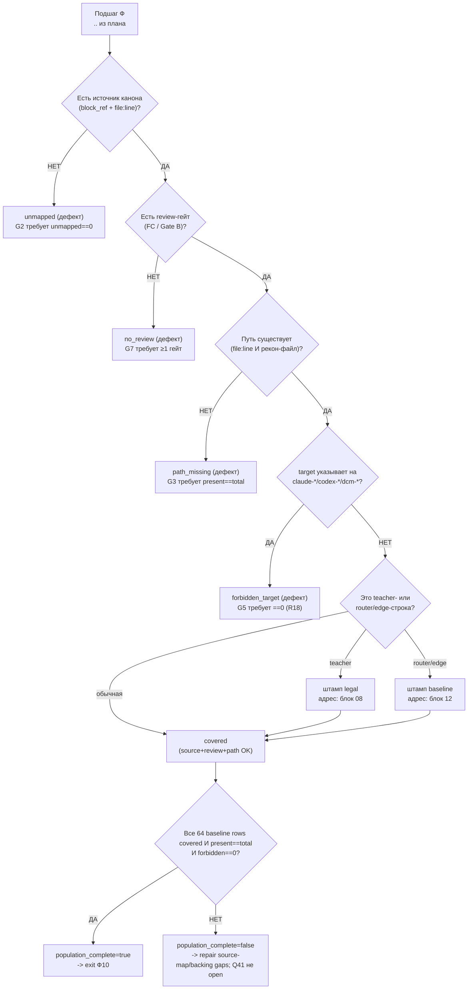

## Current Implementation Branch/Workdir Convention Overlay (2026-07-09, Luba live authority)
> Пометка 14.08.26: упоминания ветки `DpoImplementation` в этом файле — historical; ветка-канон = `codex/dpo-implementation` (см. 14.08.26WorkLeft-05-branch-reconciliation-codex-dpo-implementation.md). Overlay 2026-07-09 ниже (branch `DpoImplementation` per repo) — historical для `llm_mvp_core`; для 4 не-core репо имя локальной ветки этим проходом не переадъюдицировано (upstream = `origin/codex/dpo-implementation`). Пути `C:\Projects\<repo>-DpoImplementation` — каталоги, не ветки.

authority: Luba current unquoted instruction 2026-07-09 — create per-repo branch `DpoImplementation` from each repo's latest-updated branch, place its worktree at `C:\Projects\<repo-name>-DpoImplementation`, and make that branch the folder's main (HEAD).

current_convention (supersedes the older `DPOLegalLearning` work-branch and `C:\Projects\DPOLegalLearning\<repo>` workdir convention wherever it appears in this plan family):
- implementation branch name per repo: `DpoImplementation` (NOT a branch named `DPOLegalLearning`). — historical (2026-07-09); с 14.08.26 ветка-канон для `llm_mvp_core` = `codex/dpo-implementation` (ветка-канон исправлена 14.08.26; прежде ошибочно DpoImplementation).
- implementation workdir per repo: git worktree at `C:\Projects\<repo-name>-DpoImplementation`, with `DpoImplementation` as HEAD (main/active branch of that folder). (HEAD `DpoImplementation` — historical; канон 14.08.26 для core = `codex/dpo-implementation`; путь каталога не меняется).
- mechanism: `git worktree add -b DpoImplementation "C:\Projects\<repo>-DpoImplementation" <latest-updated-source-branch>`; source branch stays read-only authority.
- participating repos + source startpoint (latest updated branch per repo, verified 2026-07-09): llm_mvp_core -> DesignToCode-clean; xiigen-platform-dot-net-angular -> DesignToCode-pass75; xiigen-flows-dot-net-angular -> DesignToCode-pass70; FigmaToCode-design-gen -> DPOLegalLearning (that repo's latest-updated branch); CanvaToCode -> DPOLegalLearning (that repo's latest-updated branch).
- planning repo `dpo legal build` gets no branch (no-branch policy unchanged).
- status 2026-07-09: all 5 worktrees created and populated, clean; no commit, no push yet; pre-commit/pre-push mergeability check into the original source branch AND `main` remains required before the first commit (unchanged OP-67 / Pass 14 gate).

name_scope_rule (avoid dual-live-canon): the DPO effort's TASK/PROJECT/work name remains "DPO Legal Learning" / `DPOLegalLearning` — this overlay does NOT rename the task. ONLY the implementation BRANCH name and the implementation WORKDIR PATH change.

historical_classification_rule: any older line in this plan family stating the implementation workdir as `C:\Projects\DPOLegalLearning\<repo>` or the implementation work BRANCH as `DPOLegalLearning` is historical/pre-2026-07-09 evidence only, superseded by this overlay, unless a later unquoted Luba instruction changes it again. Older `DPOLegalLearning` mentions that name the TASK/PROJECT remain current.

## Fable Coverage Repair Overlay (2026-07-05)

plan_readiness: PLAN_NOT_READY / FABLE_GAP_REPAIR_QUEUE
implementation_authorization: NO until fresh Luba approval after review
current_verdict_basis: Newer Fable coverage evidence `claude-fable-plan-check-v1.md` and attachment `98cbe69a` supersede the previous final-readiness overlay. Fable reports 127 findings: 91 COVERED, 30 PARTIAL, 6 MISSING. Mental implementation from active-codex would still hit plan-level design/source/dependency blockers: R-B 20/40 knowledge-library artifacts are not accepted built artifacts; R-G source addressability is incomplete; several shared contracts/readability/lifecycle carriers need plan-family repair. This is plan repair evidence only, not product implementation, not tests/builds/runtime/provider/training/checkpoint/git proof.
current_verdict_classes: DESIGN_BLOCKER_CURRENT=FABLE_MISSING_AND_PARTIAL_ITEMS; CURRENT_REPAIR_QUEUE=FABLE_RB_RG_AND_PARTIAL_REPAIR; FABLE_EVIDENCE=claude-fable-plan-check-v1.md lines 35-153 and attachment 98cbe69a lines 32-79; CURRENT_LEDGER_ACCEPTANCE_BOUNDED_EVIDENCE=previous 50/50 planning-section acceptance remains historical/process evidence only and cannot override later Fable MISSING/PARTIAL findings; IMPLEMENTATION_AUTHORIZATION_GATE=NO until fresh Luba approval after review.
historical_classification_rule: Any older line in this file saying PLAN_READY_FOR_LUBA_REVIEW, Final Readiness Review Overlay, no unresolved design/dependency blocker, CURRENT_REPAIR_QUEUE=NONE_IDENTIFIED_BY_FINAL_READINESS_REVIEW, or parent final-readiness acceptance before this overlay is historical/pre-Fable evidence only unless it cites a later unquoted Luba instruction or later evidence-bound review after 2026-07-05.
fable_gap_repair_addendum: active-codex-execution-42-fable-gap-repair-additions-20260705.md is the current repair map for R-B/R-G and the partial contract/readability/lifecycle additions.
## Current R-G Source Addressability Overlay (2026-07-05)

This overlay is the current plan-14 navigation authority for the original-task source roots. It supersedes older short-name rows that pointed at `C:\Projects\xiigen-platform`, `C:\Projects\xiigen-flows`, or `C:\Users\lubao\Documents\xiigen\llm mvp\Planning sessions\session-start-extracted`.

| source/root | exact path | role | plan consumer (navigation row) | current state |
|---|---|---|---|---|
| Planning library | `C:\Users\lubao\Documents\xiigen\llm mvp\dpo legal build` | active plan library | this plan-14 file + `active-codex-execution-*` active plan surface (§5 navigation) | `PATH_EXISTS_VERIFIED`; not implementation repo |
| `llm mvp` background root | `C:\Users\lubao\Documents\xiigen\llm mvp` | required 20-pass docs/background corpus | `active-codex-execution-knowledge-library-llm-mvp-20-pass.md` (R-B evidence library) | `PATH_EXISTS_VERIFIED`; R-B closed as evidence-only: 20-pass library accepted `20/20` (parent-verified). Prior "20-pass artifact still incomplete" is historical/pre-closure evidence only; current verdict is evidence-library-closed, not readiness. |
| `Small model racional` | `C:\Users\lubao\Documents\xiigen\llm mvp\Small model racional` | background/domain reference | R15 §6.3 navigation/reference-only domain `small-model`; 20-pass library MVP-SMALL | `PATH_EXISTS_VERIFIED`; navigation/library rows present: Pass 01, Pass 13 (20-pass library). Prior "needs library/navigation row" is historical/pre-closure evidence only. |
| `language translate learning` | `C:\Users\lubao\Documents\xiigen\llm mvp\language translate learning` | v1 pilot background | R15 §6.3 active v1 pilot `language-translate` (Ф10.3.1..Ф10.3.5); 20-pass library MVP-LANG | `PATH_EXISTS_VERIFIED`; navigation/library rows present: Pass 02, Pass 03, Pass 10 (20-pass library). Prior "needs library/navigation row" is historical/pre-closure evidence only. |
| `local wiki learning` | `C:\Users\lubao\Documents\xiigen\llm mvp\local wiki learning` | deferred/reference domain | R15 §6.3 navigation/reference-only domain `local-wiki`; 20-pass library MVP-WIKI | `PATH_EXISTS_VERIFIED`; navigation/library rows present: Pass 04, Pass 11 (20-pass library). Prior "needs library/navigation row" is historical/pre-closure evidence only. |
| `extensions` | `C:\Users\lubao\Documents\xiigen\llm mvp\extensions` | local/offline extension boundary | R15 §6.3 navigation/reference-only domain `extensions`; 20-pass library MVP-EXT | `PATH_EXISTS_VERIFIED`; navigation/library rows present: Pass 06, Pass 14 (20-pass library). Prior "needs library/navigation row" is historical/pre-closure evidence only. |
| `documentation learning` | `C:\Users\lubao\Documents\xiigen\llm mvp\documentation learning` | documentation-learning domain | R15 §6.3 navigation/reference-only domain `documentation-learning`; 20-pass library MVP-DOC | `PATH_EXISTS_VERIFIED`; navigation/library rows present: Pass 05, Pass 12 (20-pass library). Prior "needs library/navigation row" is historical/pre-closure evidence only. |
| `Planning sessions/session-start-extracted` | `C:\Users\lubao\Documents\xiigen\Planning sessions\session-start-extracted` | original session-start material from task | R15 §6.3 navigation/reference-only domain `session-start`; 20-pass library MVP-SESSION (outside `llm mvp` root, task-named) | `PATH_EXISTS_VERIFIED`; navigation/library rows present: Pass 07, Pass 15 (20-pass library, MVP-SESSION). Prior "needs recon/navigation row" is historical/pre-closure evidence only; old `llm mvp\Planning sessions` path is `PATH_NOT_FOUND_VERIFIED`. |
| `llm_mvp_core` | `C:\Projects\llm_mvp_core` | core implementation authority | `active-codex-execution-knowledge-library-llm-mvp-core-40-pass.md` (R-B evidence library) | `PATH_EXISTS_VERIFIED`; R-B closed as evidence-only: 40-pass docs+code library accepted `40/40` (parent-verified). Prior "40-pass docs+code artifact still incomplete" is historical/pre-closure evidence only; current verdict is evidence-library-closed, not readiness. |
| `xiigen-platform-dot-net-angular` | `C:\Projects\xiigen-platform-dot-net-angular` | public facade repo for R16/R17 | R16/R17 seam §6.2.1 `FIGMA_CANVA_DESIGN_TO_HTMLCSS` / `BETTER_OUTPUT_FEEDBACK_TO_DPO` (platform facade) | `PATH_EXISTS_VERIFIED`; old `C:\Projects\xiigen-platform` path is `PATH_NOT_FOUND_VERIFIED` |
| `xiigen-flows-dot-net-angular` | `C:\Projects\xiigen-flows-dot-net-angular` | FLOW-31/FLOW-38 seam repo | R16/R17 seam §6.2.1 FLOW-31 design-analysis / FLOW-38 feedback event | `PATH_EXISTS_VERIFIED`; old `C:\Projects\xiigen-flows` path is `PATH_NOT_FOUND_VERIFIED` |
| `FigmaToCode-design-gen` | `C:\Projects\FigmaToCode-design-gen` | client/caller surface | R16 §6.3 client/caller surface (not host authority); SCN-R16 Path B host UI | `PATH_EXISTS_VERIFIED`; not host authority |
| `CanvaToCode` | `C:\Projects\CanvaToCode` | client/caller surface | R16 §6.3 client/caller surface (not host authority); SCN-R16 Path B host UI | `PATH_EXISTS_VERIFIED`; not host authority |

Readiness impact: R-G source addressability is now CLOSED at plan-14 navigation level. Every named source root above carries an exact path, a plan consumer (navigation row), and a library/navigation row (accepted pass rows in the 20-pass library, or the named R-B evidence-library artifact for the two >=N-pass corpora). The prior wording "R-G is not fully closed until navigation rows and library records exist for the named roots" is historical/pre-closure evidence only and is superseded by the navigation rows present in the table above. R-B is closed as evidence-only corpus synthesis: `active-codex-execution-knowledge-library-llm-mvp-20-pass.md` carries `20/20` and `active-codex-execution-knowledge-library-llm-mvp-core-40-pass.md` carries `40/40` accepted focused-pass records (parent-verified); the prior "R-B remains a current blocker / must contain accepted focused-pass records" wording is historical/pre-closure for the count half. This changes no readiness/implementation verdict: R-G/R-B closure is navigation + evidence-only corpus synthesis, not PLAN_READY, product readiness, B-22 closure, implementation authorization, or tests/builds/runtime/provider/training/checkpoint/git proof. Current verdict remains `PLAN_NOT_READY / FABLE_GAP_REPAIR_QUEUE`; `implementation_authorization: NO` until fresh Luba approval after review.

> **R-B count-authority reconciliation (Fable v2 P07, 2026-07-07).** The two named library artifacts are now the SOLE R-B focused-pass count authorities and `active-codex-execution-00-library-index.md:104-105` already declares them so: `active-codex-execution-knowledge-library-llm-mvp-20-pass.md` carries `20/20` accepted focused-pass records and `active-codex-execution-knowledge-library-llm-mvp-core-40-pass.md` carries `40/40` accepted focused-pass records (parent-verified). The "R-B remains a current blocker / must contain accepted focused-pass records" wording above is historical/pre-closure for the *count* half and is superseded by those two artifacts as count authorities; any residual R-B blocker is now the whole-family status-carrier reconciliation sweep (owner: `active-codex-execution-00-library-index.md` / `active-codex-execution-EXECUTION-CONTROL-BOARD.md`), not a missing pass count. This pointer changes no readiness/implementation verdict: R-B closure is evidence-only corpus synthesis, not product/test/build/runtime/provider/training/checkpoint/git proof.
## Historical Pre-Fable Final Readiness Review Overlay (2026-07-05)
historical_pre_fable_plan_readiness: PLAN_READY_FOR_LUBA_REVIEW
implementation_authorization: NO until fresh Luba approval after review
final_readiness_review_scope: one bounded planning/governance readiness review only; no product implementation, tests, builds, runtime, browser, provider/API, model/training/checkpoint, git, branch, mergeability, PR, or product-readiness proof was run.
historical_pre_fable_current_verdict_basis: This final review read the required governance/skill gate markers, the two unique original-task/reference attachments, the minimum Claude baseline surfaces, the active-codex plan/board/matrix/source-map/legal/gate/ledger surfaces, and current status/search evidence. End-to-end mental simulation from the active plan found no unresolved design/dependency decision that an executor would have to choose before coding/testing. The prior PLAN_NOT_READY / PLAN_PARTIAL_REPAIR_QUEUE state after 0aa/Laplace/Kepler/Singer was retained for parent final-review acceptance; this overlay supplies that final bounded review. Remaining items are execution or approval gates only: fresh Luba implementation approval, local self-authored seed file creation, code implementation, tests/builds/runtime/training/checkpoint/fresh-load/ablation proof, same-scenario Path A/Path B host proof, mock/replacement-ledger proof, branch/mergeability/git proof if later authorized, final product review, and route-specific hosted TogetherAI/Qwen3 terms/output-use proof before hosted train/common use.
historical_pre_fable_current_verdict_classes: DESIGN_BLOCKER_CURRENT=NONE_IDENTIFIED_BY_FINAL_READINESS_REVIEW; CURRENT_REPAIR_QUEUE=NONE_IDENTIFIED_BY_FINAL_READINESS_REVIEW; CURRENT_LEDGER_ACCEPTANCE_BOUNDED_EVIDENCE=50/50 accepted planning sections after 2026-07-05 Pass37-Pass50/Singer repair, not 50 cycles, not 50 product reviews, not product proof, not test/build/runtime/provider/training/checkpoint/git proof; HOSTED_PROVIDER_PRE_USE_GATE_ROUTE_SPECIFIC=TogetherAI/Qwen3 proof required before hosted train/common use only, not a local self-authored v1 planning blocker; IMPLEMENTATION_AUTHORIZATION_GATE=NO until fresh Luba approval after review.
historical_classification_rule: Any older line in this file saying PLAN_NOT_READY / PLAN_PARTIAL_REPAIR_QUEUE, current verdict remains PLAN_NOT_READY, CURRENT_REPAIR_QUEUE, parent must run final readiness review, or no-go boundaries before this overlay is historical/pre-final-readiness-review evidence only unless it cites a later unquoted Luba instruction or later evidence-bound review after 2026-07-05.
## Current Readiness Verdict Reconciliation Overlay (2026-07-02)

historical_pre_final_review_plan_readiness: PLAN_NOT_READY / PLAN_PARTIAL_REPAIR_QUEUE
implementation_authorization: NO until fresh Luba approval after review
historical_pre_final_current_verdict_basis: Newer evidence attachment 0aa5730c, the Erdos bounded worker packet, and the 2026-07-05 Pass37-Pass50/Singer correction supersede stale READY and stale acceptance-count overlays. Historical/pre-Fable evidence supported PLAN_NOT_READY / PLAN_PARTIAL_REPAIR_QUEUE: current-ledger 50-pass acceptance is repaired as bounded planning-section evidence (50 headings exist and strict acceptance-field/readability evidence is 50/50 after the 2026-07-05 Pass37-Pass50/Singer repair). This queue-classification repair finds no current plan/design blocker in the stale CURRENT_REPAIR_QUEUE labels: F0 locks are recorded with implementation proof pending; legal/provenance is propagated in active plan, policy, and source-map surfaces; hosted-provider proof is a route-specific external pre-use gate before hosted Qwen3/Together train/common use, not a local self-authored v1 planning blocker; future execution proof remains after approval; fresh Luba post-review approval is implementation authorization, not a plan-design blocker. This is not 50 cycles, not product readiness, not PLAN_READY, not B-22 closure, and not implementation authorization. The current B owner table now gives a single B-6/B-8/B-9/B-12/B-22 status; implementation cannot start until parent readiness review accepts the candidate state and Luba gives fresh post-review approval.
historical_pre_final_current_verdict_classes: DESIGN_BLOCKER_CURRENT=NONE_IDENTIFIED_BY_THIS_QUEUE_CLASSIFICATION; CURRENT_LEDGER_ACCEPTANCE_BOUNDED_EVIDENCE=50/50 accepted planning sections after 2026-07-05 Pass37-Pass50/Singer repair, not cycles/readiness/product/implementation proof; CURRENT_REPAIR_QUEUE=NONE_IDENTIFIED_BY_THIS_QUEUE_CLASSIFICATION; F0_LOCKS_RECORDED_IMPLEMENTATION_PROOF_PENDING=Q3/Q6/Q8/Q11/Q14/Q30/Q38 recorded, Q37/Q-host implementation checks only; LEGAL_PROVENANCE_PROPAGATED_IN_PLAN_EXECUTION_PROOF_PENDING=20-field TeacherProvenance, ProviderProof, LicenseProof, LegalVerdict, C16/C17 quarantine/block/rebuild behavior present in active plan/policy/source-map surfaces; HOSTED_PROVIDER_PRE_USE_GATE_ROUTE_SPECIFIC=TogetherAI/Qwen3 proof required before hosted train/common use, not local self-authored v1 planning blocker; IMPLEMENTATION_AUTHORIZATION_GATE=fresh Luba post-review approval required before execution, not plan-design blocker; EXECUTION_PROOF_PENDING_AFTER_APPROVAL=code implementation, seed file creation, tests/builds/runtime, mock execution/replacement, training/checkpoint/fresh-load/ablation, same-scenario dual-path proof, branch/mergeability/git; readiness_candidate_for_parent_review=ZERO_CURRENT_DESIGN_BLOCKERS_FOUND_BY_THIS_QUEUE_CLASSIFICATION; parent must run final readiness review before any PLAN_READY wording; HISTORICAL_PRE_0AA_EVIDENCE=older PLAN_READY_FOR_LUBA_REVIEW / READY and older NOT_READY records unless a later evidence-bound repair proves current status.
resolved_residue_evidence:
current_b_inventory_owner: `active-codex-execution-16-full-task-coverage-simulation-gate.md` section `Current B-1..B-22 Status Reconciliation post-0aa5730c`; current B-row status is B-2 EXTERNAL_PRE_USE_PROOF_GATE, B-8 RESOLVED_SCOPE_EXECUTION_PENDING, B-18/B-21 HISTORICAL_OR_TRACE_ONLY, B-22 RESOLVED_IN_ACTIVE_PLAN_EXECUTION_PROOF_PENDING, and all other B rows RESOLVED_IN_PLAN_EXECUTION_PROOF_PENDING. Current verdict remains PLAN_NOT_READY / PLAN_PARTIAL_REPAIR_QUEUE; implementation authorization remains NO.
- plan-09 B-15 / IGraphWeaknessDetectorUnit edge/graph wording is now v1 diagnostic/deferred scope only; v1 train-ready DPO rows remain unit-level and edge/graph acceptance/training/promotion stays deferred unless Luba later expands scope.
- plan-06 fan-in merger canon is IEdgeFanInMerger.Merge(GraphFanInMergeInput input) -> OperationResult<GraphFanInMergeResult>; bare LogicalFlowResult merger wording is historical/pre-0aa only.
historical_pre_current_43c2_plan_readiness: PLAN_NOT_READY / PLAN_PARTIAL_REPAIR_QUEUE
historical_classification_rule: Any older line in this file saying PLAN_READY_FOR_LUBA_REVIEW, READY, PLAN_NOT_READY, or PLAN_PARTIAL_REPAIR_QUEUE is historical/pre-0aa evidence unless it appears in the current top overlay or cites a later evidence-bound repair after attachment 0aa5730c.
## Historical/pre-43c2 Pass50 Readiness Verdict Overlay (2026-07-02)

historical_pre_43c2_pass50_plan_readiness: PLAN_READY_FOR_LUBA_REVIEW
implementation_authorization: NO until fresh Luba approval after review
current_pass_chain: 50 canonical pass headings exist and strict current-ledger acceptance-field/readability evidence is now 50/50 after the 2026-07-05 Pass37-Pass50 bounded acceptance repair recorded in active-codex-execution-41-current-ledger-50-pass-acceptance-index.md. This is 50 accepted planning pass sections, not 50 cycles, not product readiness, not PLAN_READY, not B-22 closure, and not implementation authorization.

Historical/pre-43c2 Pass50 basis:
- Original-task R1-R10 are FULLY_COVERED_PLAN_LEVEL by Pass46 and this Pass50 adversarial review.
- B-1..B-22 have no remaining implementable active-codex design/dependency blocker under the Pass39/Pass43/Pass44 current overlays. Hosted provider proof remains required only before hosted train/common use.
- Source-to-Plan inventory is 64/64 by exact canonical row-id audit, with 0 noncanonical row-like offenders.
- Claude/latest-baseline details are carried in active-codex: five participating repos, DPOLegalLearning work name, C:\Projects workdir boundary, latest-updated source-branch authority as active/Codex delta, xiigen-platform facade plus xiigen-flows seam, FigmaToCode/CanvaToCode as clients/callers, unit-level 14-field GraphDpoPair, 20-field TeacherProvenance, exactly one active language-translate pilot, and provider/terms boundary.
- QA, tests, builds, screenshots, same-scenario dual-path proof, mock replacement, provider/API proof, runtime/training/checkpoint proof, branch/mergeability, git, PR, and product review remain future execution-continuation gates after fresh Luba approval. They are not design decisions and were not run in Pass50.
- This Pass50 overlay is historical/pre-43c2 evidence only. Newer attachment 43c2 supersedes it; READY wording in this block is not current readiness, not B-22 closure, and not implementation authorization.

Readback: This Pass50 paragraph is historical/pre-43c2 evidence only. Attachment 43c2 triggered a downgrade, the residues were repaired in active plan text, and historical/pre-0aa bounded reconciliation restored the evidence-supported plan-level verdict to PLAN_READY_FOR_LUBA_REVIEW at that time; historical/pre-Fable verdict was PLAN_NOT_READY / PLAN_PARTIAL_REPAIR_QUEUE and implementation_authorization remains NO until fresh Luba approval after review.
---
artifact_type: ilearningdynamicgraph_plan_block_14_stage_references
authority_source: latest unquoted Luba work order for DPO Legal Learning active execution chain
status: populated_now_planning_only
last_updated: 2026-06-30
write_scope: C:\Users\lubao\Documents\xiigen\llm mvp\dpo legal build\active-codex-execution-*.md
plan_phase_anchor: Ф10 (primary) — Ф10.1.1 / Ф10.1.2 / Ф10.2.1 / Ф10.2.2 + active pilot Ф10.3.1…Ф10.3.5 `language-translate` (R15, baseline-64)
canon_counters: 12 фаз / 27 подфаз / 64 подшага (Ф0…Ф11), нумерация Ф<P>.<SP>.<SS>
benchmark_read_only_source: codex-plan-14-stage-references.md (НЕ редактируется)
canon_owner: блок 14 — владелец канона КАРТЫ РЕФЕРЕНСОВ (Reference Inventory / Source-to-Plan / Source-to-Review / Knowledge Library Manifest / Population Proof / Pass Ledger) и Gate B P-14
---

## Pass 13 Code Reference Inventory Overlay

Historical/pre-post-repair status at that pass was `PLAN_NOT_READY`; historical/pre-0aa post-repair review readiness was `PLAN_READY_FOR_LUBA_REVIEW`; historical/pre-Hubble 2026-07-02 bounded-repair verdict was `PLAN_NOT_READY / PLAN_PARTIAL_REPAIR_QUEUE`; historical/pre-0aa post-reconciliation verdict was `PLAN_READY_FOR_LUBA_REVIEW`; historical/pre-Fable verdict was `PLAN_NOT_READY / PLAN_PARTIAL_REPAIR_QUEUE`; implementation authorization remains `NO until fresh Luba approval after review`.

This stage-reference owner file is the active place where future code anchors are collected. Current evidence classes are `PATH_EXISTS_ONLY`, `LINE_REF_VERIFIED`, `QUOTE_VERIFIED`, `NEEDS_CODE_REF_INVENTORY`, and `HISTORICAL_UNVERIFIED`. This Pass 13 confirmed only path existence for `LogicalContracts.cs`, `LearningMachineContracts.cs`, and `AdaptiveLogicalOrchestrator.cs`; it did not open source files at exact lines and did not verify quotes.

No fake line refs or invented quotes are allowed. Older `file:line` rows below are owner-doc/historical anchors unless a current inventory row explicitly says `LINE_REF_VERIFIED` or `QUOTE_VERIFIED`. Before implementation, refresh the latest updated branch into the `DPOLegalLearning` workdir and rebuild exact source anchors there; otherwise keep the row `NEEDS_CODE_REF_INVENTORY`, with implementation proof pending.

## Pass 14 Repo/Branch/Workdir Authority Overlay

Historical/pre-post-repair status at that pass was `PLAN_NOT_READY`; historical/pre-0aa post-repair review readiness was `PLAN_READY_FOR_LUBA_REVIEW`; historical/pre-Hubble 2026-07-02 bounded-repair verdict was `PLAN_NOT_READY / PLAN_PARTIAL_REPAIR_QUEUE`; historical/pre-0aa post-reconciliation verdict was `PLAN_READY_FOR_LUBA_REVIEW`; historical/pre-Fable verdict was `PLAN_NOT_READY / PLAN_PARTIAL_REPAIR_QUEUE`; implementation authorization remains `NO until fresh Luba approval after review`.

This stage-reference owner file now points future implementation work to the source-map Pass 14 authority gate. For every implementation repo, the source authority is the selected latest updated branch or most advanced branch in that repo, identified at implementation start. `DPOLegalLearning` is the working branch/workdir name, and future working copies must live under `C:\Projects`, normally `C:\Projects\DPOLegalLearning\<repo-name>`.

`C:\Users\lubao\Documents\xiigen` remains the planning library/workspace evidence location and is not implementation branch authority. Copied folders, `planning-dpo-learning`, and stale branch memory are historical/error evidence unless current Luba instruction reauthorizes them. Before every future commit/push, refresh/check the original authority branch and run a no-write mergeability/no-conflict check back into that original branch, and into `main` where project rules require main-branch mergeability. PR/merge is forbidden unless Luba later explicitly asks. This overlay proves no mergeability, branch creation, workdir creation, commit, push, PR, merge, or implementation authorization.

# Блок плана 14 — Карта референсов (Stage 2): источники → план → ревью (владелец канона `GraphReferenceMap`)

Автор: Claude (Opus 4.8 MAX), роль — автор полностью решённого блока плана в моём
namespace `claude-*`. Это часть **ПЛАНА** проекта **ILearningDynamicGraph**, а не
разрешение на реализацию продукта (R2/R3: PLAN-ONLY; исполнение — только после
свежего явного approve Luba в текущем ходе). Имена `ILearning*` из задачи Любы —
псевдонимы существующих контрактов (CANON-маппинг — мастер §A.3), а не новые
архитектурные уровни (A-LM-12 — закрытый список из 5 уровней).

Псевдоним этого блока отсутствует как уровень иерархии: блок 14 — **не уровень**,
а **навигационный реестр** (карта референсов). Он не несёт обучаемого состояния,
не маршрутизирует рёбра графа и не является runtime-authority. Его задача —
доказать, что каждый исполняемый подшаг плана (Ф0…Ф11) опирается на реальный
источник канона (`NN §...` + код `file:line`) и на проверяемый рекон-артефакт, и
что ни одна строка карты не назначает целью реализации `claude-*`/`codex-*`/`dcm-*`
(они — только evidence). Это прямой субъект требований **R11** (референсы на
каждый этап), **R12** (Stage3-читаемость + референсы кода), частично **R15**
(охват доп.референс-доменов) и **R18** (разделение авторства по префиксу).

> **Якорь фазы (доска `claude-EXECUTION-CONTROL-BOARD`, evidence-only).**
> Блок-14 — источник канона для подфаз **Ф10.1** (шов figma→html+css, R16),
> **Ф10.2** (шов better-output→DPO + тонкий агент, R17), а также активного пилота
> **Ф10.3.1…Ф10.3.5 `language-translate`** (R15, Q41=Вариант B RESOLVED 2026-06-30). Его
> Gate B (§7) = exit-условие подшагов Ф10.1.1/Ф10.1.2/Ф10.2.1/Ф10.2.2/Ф10.3.1..Ф10.3.5. Канонические
> счётчики плана: **12 фаз (Ф0…Ф11) / 27 подфаз / 64 подшага**, нумерация
> `Ф<P>.<SP>.<SS>`. Доска и мастер-план — evidence-only, здесь не правятся.

---

## 0а. Якорь задачи

```text
CURRENT TASK: написать МОЙ (claude-namespace) улучшенный блок-14 «карта референсов
              (Stage 2)» — план-решение Ф10 для ILearningDynamicGraph, человеческим
              русским, Part A-формат (§0 UML + §1 флоучарты + §2 алгоритм + §3
              код-цитаты + §4 статус + §5 иерархия) с тест-стратегией, сохранив
              структуру бенчмарка (Authority Anchor / Canon / Gate B / Final
              Questions), его канон-инвентари (Reference Inventory / Source-to-Plan /
              Source-to-Review / Knowledge Library Manifest / Population Proof /
              Pass Ledger), текущие канонические счётчики доски (12 фаз / 27 подфаз / 64 подшага;
              Ф<P>.<SP>.<SS>) и CANON-инварианты (L5-машина без 6-го уровня A-LM-12;
              легальный teacher-гейт; запрет скрытого детерминизма A-LM-09/A-LM-13).
              Записать ровно в claude-plan-14-stage-references.md.
NOT THE TASK: исполнять/тестировать/билдить код, запускать раннеры, тренировать,
              вызывать внешние AI/API/модели, git; править/создавать любые codex-*
              (только чтение), продолжать чужой codex-план или claude-00..07 каркас.
EVIDENCE-ONLY: codex-plan-14 (бенчмарк), codex-ILEARNINGDYNAMICGRAPH-PLAN-v1 §C.4
              строка P-14 / §E.3 (канон R15/R16/R17, Gate B P-14, счётчики),
              codex-EXECUTION-CONTROL-BOARD (Ф10/Ф10.3 резерв), codex-plan-08/12/13
              (канон provenance/детерминизма/тестов), codex-recon-*/
              codex-knowledge-library-* (рекон-источники — проверяются на наличие),
              claude-00..08 (мой каркас и блоки — синхрон канона), реальный код
              llm_mvp_core (читается для цитат), скилы plan-review /
              trainable-architecture-decision / implementation-doc-uml.
```

## 0б. Где этот claude-блок осознанно лучше бенчмарка `codex-plan-14` (delta-нота, не слепая копия)

Бенчмарк `codex-plan-14` (37 строк) — это **компактная canon-карточка**: он
называет шесть обязательных инвентарей (Reference Inventory, Source-to-Plan Map,
Source-to-Review Map, Knowledge Library Manifest, Population Proof, Pass Ledger),
фиксирует R15-резерв (6 доменов → Ф10.3.1…Ф10.3.6) и даёт Gate B. Это законная
роль карточки внутри большого плана, но как **самостоятельный читаемый блок
Part A** она не проходит гейт читаемости (R3 / `implementation-doc-uml-SKILL.md` /
Part A Completeness Contract): нет ни одного инвентаря с реальными строками, нет
UML, нет алгоритма по шагам, нет цитат `file:line`, нет тест-стратегии. Я её
разворачиваю и чиню точечные расхождения:

| # | Слабое место бенчмарка `codex-plan-14` | Улучшение в этом claude-блоке |
|---|---|---|
| D1 | **Нет Part A.** Карточка перечисляет имена инвентарей, но не содержит §0 UML, §1 флоучарта с симуляциями ветвей, §2 алгоритма построения/верификации карты по шагам, §3 цитат `file:line`, §5 иерархии. | Полный Part A: §1 (что/зачем — навигационный реестр), §2 (6-шаговая машина построения+верификации карты в плоском русском + сигнатуры `GraphReferenceMap.Build`/`Verify`), §3 (проверенные цитаты `LearningMachineContracts.cs:26,30,208,232,245`, `DpoPair.cs:1-8`, `DpoDataset.cs:18-26`, `ResultGapDpoWriters.cs:192-196`), §4 (статус-таблица инвентарей), §5 (иерархия — где карта стоит относительно L5-L2), §0 (классдиаграмма с `note for` + per-connection симуляции; флоучарт V1-V6 + per-branch симуляции). |
| D2 | **Инвентари названы, но не заполнены.** «Required inventories: …» — это список заголовков, без единой строки. Читатель не видит ни одного источника, ни маппинга. | **Заполнены все 6 инвентарей реальными строками** (§3.1–§3.6): Reference Inventory (SR-NN с `file:line` и проверенным наличием), Source-to-Plan Map (Ф<P>.<SP>.<SS> → SR-NN для опорных подшагов), Source-to-Review Map (SR-NN → review-гейт FC/Gate B), Knowledge Library Manifest (поля строки-знания), Population Proof (объективный счёт наличия путей), Pass Ledger (честная пометка index ≠ доказательство цикла). |
| D3 | **Gate B говорит «6 осей-проектов ≥1 строкой», но скрывает, что `session-start` не имеет backing-рекона.** Бенчмарк-карточка и общий Gate B P-14 (`34/34 путей существуют`) не отмечают честно, что один из 6 R15-доменов backing-источника НЕ имеет, и не разводят «covered ссылкой» от «файл существует». | **Честность по доказательствам** (CLAUDE.md «No Dishonest Answers»): Population Proof (§3.5) считает covered по навигационной привязке (мастер §E.3 Вариант-A), а не по наличию файла. Честный счёт: **3 домена covered навигационной строкой-целью** (extensions, language-translate, documentation-learning); **3 домена evidence-only** — `small-model` и `local-wiki` имеют рекон-файл (`codex-recon-mvp-small-model.md`, `codex-recon-mvp-local-wiki.md` — read-only сверено 2026-06-23), но навигационной строки-цели в карте блока 14 у них нет; `session-start` не имеет ни рекона, ни строки. Поэтому Gate B G4 переформулирован: «6 строк присутствуют; covered (навигационная строка-цель) == 3; evidence-only == 3 (small-model/local-wiki — рекон есть, нав.строки нет; session-start — backing вовсе отсутствует), что само по себе является exit-условием (предусловие закрытия — назвать навигационную строку-цель ИЛИ убрать из R15-набора решением Luba)». Live-проверка наличия путей выполнена read-only (§3.5). |
| D4 | **«Verified packets complete: 50/50» как Gate B.** Бенчмарк объявляет 50/50 циклов ревью завершёнными прямо в Gate B карточки. По `plan-review-SKILL.md` Review Depth / Dishonest Claim Rejection Gate **N строк ledger ≠ N доказанных циклов**. | Pass Ledger (§3.6) переведён в **честный режим**: ledger — это **индекс**, а не доказательство; `real_pass_count` считает только инспектируемые пакеты с reviewer-id/before-after/findings/recheck. Заявление «50/50» помечено `benchmark-sourced, index-only`; для МОЕГО блока claim = «1 авторский проход (этот файл), внешних sub-agent review-пакетов = 0», и это записано как `PASS_AS_HONEST_UNTRAINED_SCAFFOLD`-эквивалент (карта — детерминистический навигационный артефакт, у неё нет TA-PASS). |
| D5 | **Final Questions: 2 вопроса без привязки к мастер-§E / Q-канону.** Бенчмарк задаёт «активировать Q41 Variant B?» и «дефолтить R16 hosted→PersonalAdaptive?», не связав с Q37/Q38/Q41 мастера. | §11 связывает мои финальные вопросы с мастер **Q41 (R15-scope), Q-host (R16), Q37/Q38 (R17 origin-legality)** и сохраняет оба бенчмарк-вопроса дословно по смыслу — без потери ни одного и без дублирования уже решённого. |
| D6 | **Нет тест-стратегии (axis верификации).** Карточка даёт Gate B (исходы), но не план тестов untrained/trained для самого реестра. | Добавлена **тест-стратегия** (`plan-review-SKILL.md` testability gate / OP-55): U/NEG/INT/QA/REG/UH + честный статус-PASS. Карта — навигационный детерминистический артефакт, поэтому у неё **нет** `PASS_AS_TRAINED_FEATURE`; правильный класс — `PASS_AS_HONEST_UNTRAINED_SCAFFOLD` (честно показывает охват и честно метит дыры). |
| D7 | **R11 «референс на КАЖДЫЙ этап» не разведён с «референс только для Ф10».** Бенчмарк говорит про карту как Stage-2 артефакт, но не фиксирует, что R11 требует строку Source-to-Plan для ВСЕХ 64 baseline-подшагов, а не только для Ф10.*. | §3.2 явно вводит правило R11: **полная** карта `Ф<P>.<SP>.<SS> → SR-NN` обязана покрыть все 64 baseline-подшага; в этом блоке приведены опорные строки и честный инвариант полноты `target==64 / filled=partial / unmapped_remaining>0` (Gate B G2, без ложного `unmapped==0`), без претензии, что таблица здесь физически перечисляет все 64 (она ссылается на доску §B как single source). |

CANON-инварианты сохранены: маппинг ролей Luba → реальные контракты (мастер §A.3);
5 закрытых уровней (A-LM-12); легальный teacher-гейт (closed = только judge при
`used_for_training=false`; контаминация → `DATASET_REBUILD_REQUIRED`); запрет
скрытого детерминизма (A-LM-09/A-LM-13 — карта **помечена** навигационным
детерминистическим реестром, не authority). Канон `GraphDpoPair` (14 полей) и
`TeacherProvenance` (20 полей; 13+5+2 RR6 `service_mode`/`grounding_used`) **не переопределяются** здесь (владельцы — блоки 07
и 08); карта на них только **ссылается**. Имена контрактов держатся теми же, что в
мастер §A и в claude-01..08: `DynamicGraphMachine`, `GraphNodePreferenceState`,
`SemanticEdgeRouterUnit`, `EdgeAuthorityUnit`, `CandidateOrderLeakageGuardUnit`,
`GraphDpoPair`, `TeacherProvenance`.

---

## 1. Что это и зачем (роль компонента в ILearningDynamicGraph)

**Карта референсов — это «оглавление с адресами» всего плана.** Любой исполняемый
подшаг `Ф<P>.<SP>.<SS>` обязан иметь две привязки: (1) **источник канона** — где
описано, что именно делать (`NN §...` блока плана) и на какой реальный код это
ложится (`file:line`); (2) **рекон-артефакт** — проверяемый файл `codex-recon-*` /
`codex-knowledge-library-*`, подтверждающий, что зона уже разведана. Карта связывает
эти две привязки и доказывает, что план **не висит в воздухе**.

Зачем это нужно именно для **обучаемого** графа. Граф учится на DPO-парах
(`GraphDpoPair`), а качество обучения зависит от качества источников. Если подшаг
ссылается на несуществующий путь, на чужой план как на «истину», или на закрытую
модель как на teacher — это либо мёртвая ссылка, либо легальная мина. Карта —
это **навигационный фильтр**, который ловит три класса дефектов до реализации:

- **мёртвая ссылка**: `file:line`/рекон-путь не существует → строка `path_missing`;
- **leakage авторства**: строка назначает целью реализации `claude-*`/`codex-*`/
  `dcm-*` (они — evidence, не target) → строка `forbidden_target`;
- **легальная мина**: teacher-строка ссылается на закрытую модель как на источник
  обучения → помечается `legal` и переадресуется к гейту блока 08 (не решается
  здесь, но **обязана** быть помечена).

Граница ответственности (CANON R6 — тонкий агент, ядро в `llm_mvp_core`): карта —
это planning-артефакт + (в реализации) `GraphReferenceMap` как `ILogicalUnit`
внутри `llm_mvp_core` для docs-sync/валидации ссылок; агент/расширение её не
содержит и не дублирует.

**Чем карта НЕ является.** Она не выбирает skill, не маршрутизирует ребро, не
несёт обучаемого состояния и не является финальной authority обучения. Это
детерминистический **навигационный реестр** (honest internal/eval helper по скилу),
и именно так он помечается: его строки — провенанс-навигация, а не «семантическое
качество модели». Семантику предпочтения учит L5-машина (блок 04) на строках,
уже прошедших legal-гейт (блок 08); карта лишь доказывает, что эти строки опираются
на реальные, легальные, не-leakage источники.

---

## 2. Концепт простыми словами (аналогия + машина построения/верификации по шагам)

### 2.1. Аналогия

Карта референсов — это **«библиотечный каталог» фабрики обучения**. Каждая
книга (подшаг плана) должна иметь карточку каталога: **на какой полке стоит
первоисточник** (источник канона `NN §...` + `file:line`) и **есть ли акт
инвентаризации** (рекон-артефакт). Каталогизатор:

1. берёт список всех подшагов (Ф0…Ф11) из доски;
2. для каждого находит **первоисточник** (блок-источник + код) и **акт
   инвентаризации** (рекон-файл);
3. **физически проверяет**, что полка и акт существуют (путь на диске есть);
4. ставит штамп авторства: первоисточник — это **рабочий канон проекта**, а не
   **чужая/соседняя книга** (`claude-*`/`codex-*`/`dcm-*` — это каталоги других
   читателей, не сам товар);
5. помечает «особые» книги: teacher/router-строки несут штамп `legal`/`baseline`,
   чтобы их не приняли за обычный источник без досмотра.

Главное правило каталога: **отсутствие карточки ≠ «книги нет проблем»**. Подшаг
без источника — это дефект `unmapped`, а ссылка на несуществующую полку — дефект
`path_missing`. «Полная инвентаризация» (Population Proof) объявляется только когда
все обязательные пути проверены **положительно**, а честно отсутствующие
(`session-start`) помечены как отсутствующие, а не спрятаны.

### 2.2. Машина построения+верификации `GraphReferenceMap` — 6 шагов (плоский русский, без кода)

Класс **`GraphReferenceMap`** (planning-артефакт сейчас; в реализации — L2
`ILogicalUnit` для docs-sync), методы **`Build(PlanModel plan, IReadOnlyList<ReconArtifact> recon)`** → **`ReferenceMapModel`**
и **`Verify(ReferenceMapModel map)`** → **`ReferenceMapVerdict`**
(поля вердикта: `mapped_substeps`, `paths_total`, `paths_present`, `forbidden_target_count`,
`legal_baseline_marked`, `population_complete`, `pass_ledger_index_only`). Параметры:
`plan` — модель плана с подшагами `Ф<P>.<SP>.<SS>`; `recon` — список рекон-артефактов
с путями. Алгоритм:

```text
Шаг 1. CollectSubsteps(plan)
  Берём все baseline-подшаги Ф0…Ф11. Канон после RR4/Q41/PASS26: 64 baseline rows = 59 прежних + 5 активного пилота Ф10.3 `language-translate`.
  mapped_target = 64 (R11: источник на КАЖДЫЙ baseline-подшаг). Старый резерв Ф10.3.1..Ф10.3.6 вне 59 — historical/pre-PASS26 only.
  Owner полной 64-строчной карты = блок 14 (этот файл), НЕ codex-plan-14 §11.0 (не существует).

Шаг 2. MapSourceToPlan(substep)                         ← Reference Inventory + Source-to-Plan (§3.1/§3.2)
  Для каждого подшага находим источник канона: (block_ref="NN §...", code_ref="file:line").
  Если источника нет → строка unmapped (дефект). Честно сейчас: filled=8 (Ф10-опоры),
  unmapped_remaining>0 (future-fill); Gate B G2 измеряет target==64 и honest partial-fill,
  exit-условие строки — заполнить её до старта её подшага (НЕ ложное unmapped==0).

Шаг 3. MapSourceToReview(substep)                       ← Source-to-Review (§3.3)
  Привязываем подшаг к review-гейту: FC-NN скила plan-review ИЛИ Gate B блока.
  Каждый исполняемый подшаг обязан иметь ≥1 review-гейт (иначе нечем проверять exit).

Шаг 4. VerifyPathExists(code_ref, recon_path)           ← Population Proof (§3.5)
  ФИЗИЧЕСКИ проверяем наличие: файл кода существует; рекон-файл существует.
  paths_present++ при наличии; путь отсутствует → строка path_missing (G3 требует present==total).
  Честность: session-start backing НЕТ → строка помечается evidence-only (НЕ как present).

Шаг 5. AuthorshipAndLeakageGate(block_ref, code_ref)    ← R18 + forbidden-target (§3.4)
  source_kind = project_canon (рабочий код/блок) | evidence (claude-*/codex-*/dcm-*).
  Если target-of-implementation указывает на claude-*/codex-*/dcm-* → forbidden_target (G5 требует ==0).
  Префикс помечает АВТОРСТВО, не authority (R18): codex-recon-* — это evidence-источник разведки,
  он МОЖЕТ быть backing-артефактом, но НЕ может быть «целью реализации».

Шаг 6. LegalBaselineMark(substep) + финальный вердикт   ← teacher/router строки (блок 08/12)
  Строки про teacher (Ф0.1.3, Ф2.1.*, Ф4.2.3, Ф10.2.1) → штамп legal (адрес: гейт блока 08).
  Строки про router/edge-authority (Ф4.3.2, Ф10.*) → штамп baseline (адрес: блок 12, SemanticEdgeRouterUnit).
  population_complete = (mapped_substeps_filled==64 && paths_present==paths_total_required
                         && forbidden_target_count==0 && legal_baseline_marked==true).
  Current honest status after Pass18: source_to_plan_roster_rows==64 denominator rows
  are enumerated below, mapped_substeps_filled is not claimed as 64, and therefore
  population_complete=false.
  Remaining rows are unenumerated/proven-later repair work, not a current 51-row count.
  Pass Ledger остаётся index-only (real_pass_count считается отдельно, НЕ из числа строк).
```

Возврат `Verify`: `population_complete` + перечень дефектов (`unmapped`,
`path_missing`, `forbidden_target`) + флаг `pass_ledger_index_only=true`.
**Предусловие закрытия Ф10** = `population_complete==true` ИЛИ явная нота Luba по
`session-start` (Q41) + по R16/R17 (Q-host/Q37/Q38).

---

## 3. Канон (нормативная часть) — owner block 14: шесть инвентарей карты референсов

### 3.1. Reference Inventory (опорные источники SR-NN, проверены на наличие read-only)

#### 3.1-P13. Code Reference Inventory Contract

The rows in this inventory must separate path existence from line and quote proof. Current Pass 13 statuses:

| source path | evidence class in this pass | exact line/quote status |
|---|---|---|
| `C:\Projects\llm_mvp_core\00.Core\LogicalContracts.cs` | `PATH_EXISTS_ONLY` | `NEEDS_CODE_REF_INVENTORY`; no source line or quote opened in Pass 13. |
| `C:\Projects\llm_mvp_core\00.Core\LearningMachineContracts.cs` | `PATH_EXISTS_ONLY` | `NEEDS_CODE_REF_INVENTORY`; no source line or quote opened in Pass 13. |
| `C:\Projects\llm_mvp_core\21.AgentInfrastructure\Logical\AdaptiveLogicalOrchestrator.cs` | `PATH_EXISTS_ONLY` | `NEEDS_CODE_REF_INVENTORY`; no source line or quote opened in Pass 13. |

Older SR rows may still point future readers toward likely anchors, but they are `HISTORICAL_UNVERIFIED` or owner-doc evidence until refreshed. A future implementer must rebuild exact `LINE_REF_VERIFIED` / `QUOTE_VERIFIED` anchors from the latest updated branch copied into `DPOLegalLearning`; no fake line refs, no invented quotes, and no implementation proof from docs alone.

Current Pass 13 downgrade for the legacy SR table: each `SR-NN` row below is a planning/source-map pointer. Treat existing `file:line` values as owner-doc or historical anchors until a future inventory reopens the source line and reclassifies the row as `LINE_REF_VERIFIED` or `QUOTE_VERIFIED`. Without that refresh, the exact anchor remains `NEEDS_CODE_REF_INVENTORY`.

Pass18/50 current SR-id boundary for this table: active `SR-17` now follows Claude plan-14 and means the `language-translate` seed input-prompt corpus. The older active LogicalContracts anchors formerly labelled `SR-17` are preserved only as `SR-17-legacy-active-logicalcontracts` (historical/local alias; not current `SR-17`). Rows below and Source-to-Plan consumers must use the legacy alias when referring to `LogicalContracts.cs` L2/L3/L4 anchors. This repairs the Pass17 `ACTIVE_LAGS_CLAUDE_FOR_SR17_ID_SPLIT` slice for searched active surfaces, but it does not close B-22 globally, prove readiness, create seed data, run tests, or authorize implementation.

Каждая строка: `SR-NN | путь | тип | проверено наличие`. Это **рабочий канон
проекта** (project_canon), на который ложатся подшаги. Цитаты кода — реально
существующие (проверены чтением, §3 Part A-требование):

| SR-NN | путь (источник канона) | тип | наличие (read-only) |
|---|---|---|---|
| SR-00 | `00.Core/LearningMachineContracts.cs:208/232/245` (`ILearningMachine<TDomain>` L5, `GetOrchestratorAsync`, `ILearningMachinePair`) | project_canon (контракт) | EXISTS (сверено) |
| SR-01 | `00.Core/LearningMachineContracts.cs:30` (`LearningTrainingItem` — DPO-триплет) | project_canon | EXISTS |
| SR-02 | `00.Core/LearningMachineContracts.cs:26` (`LearningBatch.SourceIds` — боковой провенанс) | project_canon | EXISTS |
| SR-03 | `00.Core/LogicalContracts.cs` (`ILogicalUnit/Flow/Orchestrator` L2-L4) | project_canon | EXISTS |
| SR-04 | `11.DPO/Models/DpoPair.cs:1-8` (минимальная DPO-пара Prompt/Chosen/Rejected) | project_canon | EXISTS |
| SR-05 | `11.DPO/DpoDataset.cs:18-26` (`DpoDataset.Load` — материализация JSONL) | project_canon | EXISTS |
| SR-06 | `26.TrainableRouter/Training/RoutingDpoPairBuilder.cs` (прецедент routing-DPO) | project_canon | EXISTS |
| SR-07 | `43.SmartSkillsDomain/ResultGapDpoWriters.cs:192-196` (`IsAllowedCommonLicense` — точка расширения legal-гейта) | project_canon | EXISTS |
| SR-08 | `17.DynamicDomains/DynamicDomainGraph.cs` (замыкание графа, bridge-расширение) | project_canon | EXISTS (карта C-004) |
| SR-09 | `21.AgentInfrastructure/Logical/AdaptiveLogicalOrchestrator.cs` (адаптивная маршрутизация L4 — generic-роутер; НЕ владелец дизайн→код) | project_canon | EXISTS (карта C-003) |
| SR-10 | `27.TranslationDomain/TranslationMachine.cs` (прецедент lifecycle `ILearningMachine`) | project_canon | EXISTS (карта C-010) |
| SR-11 | `xiigen-flows-dot-net-angular/FLOW-31` `DesignIntelligenceEngineService.AnalyzeDesignAsync` (`DesignIntelligenceEngineService.cs:47-90`) — **реальный канон шва R16: дизайн-АНАЛИЗ** (валидирует BFA-rule-pack, считает componentCount/tokenCount, апсертит analysis-документ, пишет outbox, возвращает `analysis_ready`/`needs_review` — html+css НЕ эмитит) | evidence-only (benchmark-sourced) | `EXISTS per benchmark, not re-read here` (код вне репозитория `llm_mvp_core`; читано бенчмарком :47-90) |
| SR-12 | `controller.ts` (FigmaToCode, `prepareCssForElement`/`controller.ts:3` — **клиентская генерация html+css** на стороне FigmaToCode) | evidence-only (benchmark-sourced) | `EXISTS per benchmark, not re-read here` (код вне `llm_mvp_core`) |
| SR-13 | `canva-adapter.ts` (CanvaToCode — **клиентская генерация html+css** на стороне CanvaToCode) | evidence-only (benchmark-sourced) | `EXISTS per benchmark, not re-read here` (код вне `llm_mvp_core`) |
| SR-14 | **входной якорь R17-шва FLOW-38** (better-output entrypoint): planned `GeneratedUiOutputFeedbackEvent` -> `IFlow38FeedbackResourceClient.SubmitFeedbackAsync` / `IBetterOutputDpoIngestApi.IngestAsync(...)` -> `Flow38FeedbackAdapter.Normalize(...)` -> `GraphDpoSourceRow`; physical scan in `C:\Projects\llm_mvp_core` still has 0 .cs matches for `RecordFeedbackAsync`, `RagQualityFeedbackService`, `GeneratedUiOutputFeedbackEvent`, `Flow38FeedbackResourceResponse`, and `GraphDpoSourceRow`. | **NEW_PLANNED_CONTRACT / no physical implementation proof** | Planned owner paths: `xiigen-platform-dot-net-angular/.../IBetterOutputFeedbackFacade.cs`, `xiigen-flows-dot-net-angular/.../Flow38BetterOutputSeam.cs`, and `llm_mvp_core/44.DesignConversionDomain/Flow38FeedbackAdapter.cs` or the future owner-approved core adapter path. Mock response: `Flow38FeedbackResourceResponse(resource_status=mock_feedback_recorded, feedback_ref=mock://flow38/feedback/pass20, score_delta=0.42, terms_snapshot_status=missing_or_pending, output_license_status=pending, provenance_status=client_supplied_unverified)`. Future unit test: `Flow38FeedbackAdapterTests.MockFeedbackEvent_NormalizesToQuarantinedGraphDpoSourceRow`. Replacement ledger after product readiness only: `C:\Users\lubao\Documents\xiigen\llm mvp\DPO LEARNING\codex-external-calls-mock.md`. |
| SR-16 | `44.DesignConversionDomain/DesignConversionMachine.cs:7` (`DesignConversionMachine : ILearningMachine<DesignConversionDomain>`), `DesignConversionMachine.cs:31` (`TrainBatchAsync`), `DesignConversionMachine.cs:337-345` (`GetOrchestratorAsync` returning `InlineDesignConversionOrchestrator`), `DesignConversionContracts.cs:3-8` (`DesignConversionSourceKind` includes `Figma` and `Canva`), `DesignConversionContracts.cs:34-44` (`SubmittedDesignConversionRequest` carries `Html`, `Css`, tree payloads, render artifacts, budget, and provenance), and `DesignConversionDpoGenerator.cs:602-681` (builds accepted/quarantined design-conversion DPO records with provenance/license/quarantine). | **LINE_REF_VERIFIED in this Pass20 read-only source inventory** | In-repo trainable/lifecycle backing for R16 figma/canva -> html+css in `llm_mvp_core`; platform/FLOW-31/Figma/Canva host adapters and client-host e2e proof remain future implementation evidence. |
| SR-17 | Claude-current `language-translate` seed input-prompt corpus; active local fixture contract remains `SeedCorpus-LanguageTranslate-v1` until execution proof. | **NEW/path_missing per latest Claude plan-14; active plan shape resolved, file proof future** | Current Claude SR-17. Seed file creation, legal/provenance/split gates, held-out exact-match + char-accuracy + `RuntimeProductAccuracy`, tests, training, and runtime proof remain future execution evidence. |
| SR-17-legacy-active-logicalcontracts | `00.Core/LogicalContracts.cs:61-100` (`LogicalUnitRequest`, `LogicalUnitResult`, `ILogicalUnit` L2), `:165-170` (`ILogicalFlow` L3), `:181-207` (`LogicalOrchestratorResult`, `ILogicalOrchestrator` L4) | **LINE_REF_VERIFIED in Pass22 read-only source inventory; historical/local active alias formerly labelled SR-17** | Existing L2/L3/L4 contracts support Ф1 role mapping and wrapper boundaries only. This is not current Claude `SR-17`, not the seed corpus, and not DynamicGraph-specific implementation proof. |
| SR-18 | `00.Core/LearningMachineContracts.cs:16-30` (`LearningBatch<TDomain>`, `LearningTrainingItem` DPO row), `:208-232` (`ILearningMachine<TDomain>` Train/Evaluate/Export/Import/GetOrchestrator), `:245` (`ILearningMachinePair`) | **LINE_REF_VERIFIED in Pass22 read-only source inventory** | Existing L5 machine and DPO-batch contract backing for `ILearningDynamicGraph = ILearningMachine<DynamicGraphDomain>` and `DynamicGraphMachine` skeleton planning. |
| SR-19 | `17.DynamicDomains/DynamicDomainGraph.cs:3` (`DynamicDomainTransition`), `:33-39` adjacency, `:70-87` bridge expansion; `07.GraphEngine/Models/GraphNode.cs:3-12`, `GraphEdge.cs:3-8`, `KnowledgeGraph.cs:17-48` | **LINE_REF_VERIFIED in Pass22 read-only source inventory** | Graph/edge/topology precedents only. `GraphEdge` and `DynamicDomainTransition` are not the planned `IDynamicGraphEdge` implementation. |
| SR-20 | `21.AgentInfrastructure/Logical/LogicalTopologyRegistry.cs:50-105` (`LogicalTransition`, `ILogicalTopologyRegistry`), `:399-505` transition add/resolve/list mutation path | **LINE_REF_VERIFIED in Pass22 read-only source inventory** | Existing topology-registry precedent for planned `DynamicGraphTopology`; not a finished `DynamicGraphTopology` implementation. |
| SR-21 | `21.AgentInfrastructure/Logical/AdaptiveLogicalOrchestrator.cs:268-279` (`ResolveActiveUnit` latest-learned fallback), `:315-320` route entry, `:361-440` transition follow-up, `:824-837` `BuildDynamicDomainTransitions` adapter | **LINE_REF_VERIFIED in Pass22 read-only source inventory** | Existing L4 adapter/per-edge-authority precedent for Ф1.3.2. No new `RunAsync` DynamicGraph implementation proof is claimed. |
| SR-22 | `43.SmartSkillsDomain/SkillSelectionLogicalHierarchy.cs:429-485` feature-weight scoring and `score <= 0 -> NoDecision`, `:529-545` no-decision shape; `21.AgentInfrastructure/Logical/MultiSubPhaseRouterUnit.cs:248-299` weighted candidate scoring with path-free scoring text; `SubPhaseRouterUnit.cs:129-185` candidate ranking and honest knowledge-edge fallback | **LINE_REF_VERIFIED in Pass22 read-only source inventory** | Node algorithm precedent for weighted features/top-N/honest no-decision and leakage boundary. It is not physical `IDynamicGraphNode` code. |
| SR-23 | `27.TranslationDomain/TranslationMachine.cs:7/45/147/199/222/489`, `43.SmartSkillsDomain/SkillSelectionMachine.cs:10-11/302/345/397/412/523`, `44.DesignConversionDomain/DesignConversionMachine.cs:7/31/72/103/120/337` | **LINE_REF_VERIFIED in Pass22 read-only source inventory** | Existing `ILearningMachine<TDomain>` implementation precedents for the future `DynamicGraphMachine` five-method skeleton and lifecycle. No `DynamicGraphMachine.cs` physical proof exists. |
| SR-24 | Planned DynamicGraph contract family: `DynamicGraphDomain`, `IDynamicGraphNode`, `DynamicGraphNodeDescriptor`, `GraphNodeCandidate`, `IDynamicGraphEdge`, `GraphEdgeKind`, `DynamicGraphTopology`, `DynamicGraphEdgeFlow`, `IEdgeCandidateProvider`, `IEdgeFanInMerger`, `DynamicGraphMachine` | **NEW_PLANNED_CONTRACT / no physical implementation proof in Pass22** | Direct `.cs` scan of `C:\Projects\llm_mvp_core` for `DynamicGraph|GraphEdgeKind|IDynamicGraph|DynamicGraphTopology|DynamicGraphMachine` returned no physical implementation hits. Claude baseline and active board define these as planned contracts layered over SR-17..SR-23. |
| SR-25 | Test precedent paths found: `Tests/LogicalTopologyRegistryTests.cs`, `Tests/GraphEngineTests.cs`, `Tests/GraphEngineEdgeCaseTests.cs`, `Tests/LearningMachineContractsTests.cs`, `Tests/TranslationDomainTests.cs`, `Tests/SkillSelectionMachineTests.cs`, `Tests/SkillSelectionLogicalHierarchyTests.cs` | **TEST_PATH_INVENTORY_ONLY / not run in Pass22** | Test files exist as future implementation verification references. Pass22 did not run tests/builds and does not claim runtime proof. |
| SR-26 | `00.Core/LearningMachineContracts.cs:16-30` (`LearningBatch<TDomain>`, `SourceIds`, `LearningTrainingItem`), `11.DPO/Models/DpoPair.cs:3-7`, `11.DPO/DpoDataset.cs:18-25`, `11.DPO/Models/DpoBatch.cs:6-13`, `11.DPO/DpoTrainer.cs:31-53` and `:331` (`DpoVectorBatch`) | **LINE_REF_VERIFIED in Pass23-F2 read-only source inventory** | Existing DPO triple, batch, JSONL materialization, and trainer/vector-batch anchors. They support projection/materialization only; they are not physical `GraphDpoPair` implementation proof. |
| SR-27 | `14.ContinuousLearning/Core/Core.cs:14-20`, `14.ContinuousLearning/Feedback/FeedbackRouter.cs:5-10` and `:67-94`, `14.ContinuousLearning/Pipeline/ContinuousLearningPipeline.cs:9-12` and `:59-77`, `18.CapabilityTraining/LlmIngredientLogicalUnits.cs:281-309`, `:355-365`, `:417-436` | **LINE_REF_VERIFIED in Pass23-F2 read-only source inventory** | Existing feedback-to-DPO and logical-unit DPO training precedents. They support unit-level DPO flow and tensor projection only; no DynamicGraph-specific trainer proof is claimed. |
| SR-28 | `43.SmartSkillsDomain/ResultGapDpoWriters.cs:7-24`, `:109-164`, `:174-196`, `:298-343`, `:471-484`; `tools/ResultGapPhase07Runner/Program.cs:67-80`, `:268-287`, `:422-434`, `:453-483` | **LINE_REF_VERIFIED in Pass23-F2 read-only source inventory** | Existing provenance/source-route, license allowlist, quarantine routing, manifest/report, and external-vendor quarantine precedent. This is policy/code precedent, not a live scan of `sonnet-*` contamination rows. |
| SR-29 | Five physical input-format anchors: `11.DPO/Models/DpoPair.cs:3-7`, `26.TrainableRouter/Models/RoutingModels.cs:75-82`, `26.TrainableRouter/Training/OrchestrationPromptDpoPairBuilder.cs:54-62`, `42.ProjectWikiDomain/CodeTraceBuilderDpoGenerator.cs:35-48` plus `ProjectWikiDomainModels.cs:988-999`, and `42.ProjectWikiDomain/ProjectWikiDomainModels.cs:918-926` | **LINE_REF_VERIFIED in Pass23-F2 read-only source inventory** | The five source formats exist and can be adapted into a future canon. This does not prove the future adapter implementation or batch gate execution. |
| SR-30 | Planned `GraphDpoPair`, `TeacherProvenance`, and `TeacherProvenanceGate` from `claude-plan-07-dpo-builder.md:191-220`, `:441-456`, and `claude-plan-08-legal-teacher-gate.md:164-176`, `:228-235`, `:242-273`; direct `rg -g "*.cs"` for `GraphDpoPair|TeacherProvenance` returned no source hits in `C:\Projects\llm_mvp_core` | **NEW_PLANNED_CONTRACT / no physical implementation proof in Pass23-F2** | `GraphDpoPair` remains planned 14-field canon with nested 20-field `TeacherProvenance`; `TeacherProvenanceGate` remains planned legal gate. Do not cite this as an implemented class. |
| SR-31 | Claude baseline/source authority for the three Pass23-F2 rows: `claude-plan-08-legal-teacher-gate.md:77-80`, `:174-176`, `:228-235`, `:242-273`; `claude-plan-07-dpo-builder.md:71-75`, `:179-183`, `:191-220`, `:278-288`, `:441-456`, `:1035-1051`; active board rows `Ф2.1.3`, `Ф2.2.1`, `Ф2.2.2` | **QUOTE_VERIFIED / BASELINE_AUTHORITY_READ in Pass23-F2** | Baseline supports plan-level acceptance for quarantine/rebuild policy, NEW `GraphDpoPair` canon, five-format normalization, projection, and legal batch gate. It does not prove runtime, tests, provider/API/browser/git, or a live contamination scan. |
| SR-32 | Claude/active DPO-builder baseline for Pass24 rows: `claude-plan-07-dpo-builder.md:306-324` anti-leakage/permutation/overlap/train-ready gates, `:329-345` rejected-origin taxonomy, `:353-380` NEW `GraphDpoBuilder`/`GraphDpoPair`, `:452-463` branch simulation, `:1032-1059` Gate B, and active board rows `Ф3.1.3`, `Ф3.2.1`, `Ф3.2.2`; constrained exact `.cs` scan for `\b(GraphDpoSchemaValidator|GraphDpoBuilder|GraphDpoPair|GraphDpoSourceRow)\b` returned no physical implementation hits in top-level source. | **QUOTE_VERIFIED / NEW_PLANNED_CONTRACT in Pass24 read-only source inventory** | Supports planned `GraphDpoSchemaValidator`, builder invariants, rejected taxonomy, and materialization contract only. It is not physical class proof and not runtime/test proof. |
| SR-33 | Anti-leakage, split, and schema/quarantine precedents: `21.AgentInfrastructure/Logical/SubPhaseRouterUnit.cs:124-150`, `:200-218`, `:266-274`; `27.TranslationDomain/TranslationStructuredBatchBuilder.cs:188-229`; `43.SmartSkillsDomain/ResultGapDpoWriters.cs:111-196`, `:241-266`, `:296-345`, `:448-459`. | **LINE_REF_VERIFIED in Pass24 read-only source inventory** | Existing code separates scoring text from path provenance, filters near-duplicate training rows, validates 14-field DPO-like candidates, blocks raw private/vendor/source-id-as-feature leakage, and carries source provenance. This is a precedent for planned GraphDPO anti-leakage, not proof that `GraphDpoSchemaValidator` exists. |
| SR-34 | Rejected near-miss and wrong-marker precedents: `27.TranslationDomain/TranslationStructuredBatchBuilder.cs:80-98`, `:139-173`, `:264-284`, `:314-320`, `:525-542`; `27.TranslationDomain/TranslationUnitContracts.cs:121-144`; `42.ProjectWikiDomain/CodeTraceBuilderDpoGenerator.cs:35-52`, `:133-144`; `42.ProjectWikiDomain/WikiContextRoutingDpoGenerator.cs:63-84`, `:244-289`. | **LINE_REF_VERIFIED in Pass24 read-only source inventory** | Existing builders produce structured chosen/rejected pairs, extract rejected type via `[WRONG:]`, generate near-miss rejected candidates, require wrong annotations, and keep held-out flags. This supports planned `BuildRejected` taxonomy only; no GraphDPO execution is claimed. |
| SR-35 | Projection/materialization and unit-DPO precedents: `00.Core/LearningMachineContracts.cs:16-30`, `:29-39`; `11.DPO/Models/DpoPair.cs:3-7`; `11.DPO/DpoDataset.cs:18-26`; `11.DPO/Models/DpoBatch.cs:5-13`; `11.DPO/DpoTrainer.cs:31-53`, `:331`; `14.ContinuousLearning/Feedback/FeedbackRouter.cs:5-12`, `:67-94`; `18.CapabilityTraining/LlmIngredientLogicalUnits.cs:281-309`, `:417-436`. | **LINE_REF_VERIFIED in Pass24 read-only source inventory** | Existing code supports `GraphDpoPair -> LearningTrainingItem -> DpoPair/DpoBatch/DpoDataset` as a planned projection/materialization path and feedback/logical-unit DPO precedent. It does not prove adapter implementation or materialization execution. |
| SR-36 | LoRA/dropout primitives for Pass25 Ф4.1.1: `10.LoRA/LoraApplicator.cs:6-12`, `:35`, `:39`; `10.LoRA/LoraConfig.cs:3-12`; `10.LoRA/LoraLinear.cs:18-23`, `:40-43`, `:46-58`; `00.TensorCore/Layers/Dropout.cs:7`, `:20-24`; `03.TransformerModel/Layers/CausalSelfAttention.cs:12-15`, `:48-50`, `:70`; `03.TransformerModel/TransformerBlock.cs:19-20`; `18.CapabilityTraining/LlmIngredientLogicalUnits.cs:338-340`, `:393-399`. | **LINE_REF_VERIFIED / PLANNED_BRIDGE in Pass25 read-only source inventory** | Existing LoRA adapters, low-rank params, dropout inference-off precedent, attention target fields, and logical-DPO training unit are real source precedents. `LoraApplyResult`, `ForwardWired`, and in-attention adapter-map wiring remain planned bridge work; no product execution or trained-feature proof is claimed. |
| SR-37 | Reward-margin source/defect evidence for Pass25 Ф4.1.2: `11.DPO/Models/DpoMetrics.cs:3-10`; `11.DPO/DpoTrainer.cs:41-64`, `:127-165`, `:169-219`; `00.Core/LearningMachineContracts.cs:41-61`; `27.TranslationDomain/TranslationMachine.cs:60-70`, `:123-137`, `:183-187`. | **LINE_REF_VERIFIED / DEFECT_ANCHOR in Pass25 read-only source inventory** | Existing DPO trainer computes `RewardMargin` from chosen/rejected rewards and averages it in `EvaluateMany`/`StepVector`; TranslationMachine still contains literal `0.03` anchors to remove in future implementation. This supports engine-metric mapping only, not a code fix. |
| SR-38 | Continue-training/checkpoint precedents for Pass25 Ф4.2.1: `18.CapabilityTraining/LlmIngredientLogicalUnits.cs:283-294`, `:338-345`, `:352-380`; `11.DPO/DpoTrainer.cs:322-327`; `27.TranslationDomain.Tools/Program.cs:2784-2914`; Claude lifecycle baseline `claude-plan-10-training-lifecycle.md:121-130`, `:443-459`, `:1030-1044`; `claude-plan-04-dynamicgraph-machine.md:275-284`, `:324-330`. | **LINE_REF_VERIFIED / NEW_PLANNED_CONTRACT in Pass25 read-only source inventory** | Existing code shows parent checkpoint load before DPO steps, metric checkpoint writes, and a translation continue-training probe path. DynamicGraph-specific `LoraCheckpointIo` and graph checkpoint lifecycle remain planned contracts; no continue-training run was executed in Pass25. |
| SR-39 | Model-server/repository/locator evidence for Pass25 Ф4.2.2: `25.ModelServer/Contracts/IModelServer.cs:5-15`; `25.ModelServer/Contracts/IModelRepository.cs:6-17`; `25.ModelServer/Contracts/IRemoteUnitLocator.cs:5-13`; `25.ModelServer/Remote/RemoteUnitManifest.cs:3-17`, `:28-32`; `25.ModelServer/Local/LocalModelRepository.cs:8-29`, `:32-85`; `25.ModelServer/Remote/InMemoryRemoteUnitLocator.cs:6-43`; `25.ModelServer/Remote/RemoteLogicalUnitProxy.cs:7-41`; `00.Core/LearningMachineContracts.cs:109-126`, `:220-228`. | **LINE_REF_VERIFIED / PLANNED_BRIDGE in Pass25 read-only source inventory** | Existing interfaces and local repository support weights stream load, upload-to-manifest with SHA-256, locator registration/lookup, and remote logical-unit proxy precedent. `LocalFileModelServer` remains a new planned bridge; HTTP is out of scope. |
| SR-40 | Lifecycle manifest/provenance evidence for Pass25 Ф4.2.3: `18.CapabilityTraining/TeachingRegistrySnapshot.cs:40-83`; `18.CapabilityTraining/TeachingRegistryPersistence.cs:64-80`, `:277-310`; `27.TranslationDomain.Tools/Program.cs:2941-3025`; Claude provenance/lifecycle baseline `claude-plan-08-legal-teacher-gate.md:242-273`, `:1147`, `:1300`, `:1525-1526`; `claude-plan-10-training-lifecycle.md:1030-1046`, `:1092-1105`; `claude-plan-04-dynamicgraph-machine.md:246-250`, `:1218-1227`. | **LINE_REF_VERIFIED / NEW_PLANNED_CONTRACT in Pass25 read-only source inventory** | Existing generated-capability manifest carries LoRA/checkpoint metadata and can rebuild units; Claude owns `TeacherProvenance` 20-field canon and lifecycle proof fields. Graph lifecycle manifest fields, sidecar provenance linkage, rollback proof, and physical `TeacherProvenance` type remain planned. |
| SR-41 | Unit-level trainable node evidence for Pass25 Ф4.3.1: `00.Core/LearningMachineContracts.cs:29-39`, `:41-61`, `:193-234`; `00.Core/LogicalContracts.cs:97`; `18.CapabilityTraining/LlmIngredientLogicalUnits.cs:307-340`, `:352-390`; `11.DPO/DpoTrainer.cs:41-64`, `:169-219`; Claude baseline `claude-plan-04-dynamicgraph-machine.md:264-274`, `:313-323`; active board row Ф4.3.1. | **LINE_REF_VERIFIED / NEW_PLANNED_CONTRACT in Pass25 read-only source inventory** | Existing contracts and logical-DPO unit support unit-level training via L5 and DPO reward margin. `GraphNodePreferenceState`/`PreferenceWeights` are still new planned graph-node state, not implemented physical symbols. |
| SR-42 | Common/adaptive split and machine-pair evidence for Pass25 Ф4.3.3: `00.Core/LearningMachineContracts.cs:240-252`; `25.ModelServer/Contracts/IModelRepository.cs:6-17`; `25.ModelServer/Contracts/IRemoteUnitLocator.cs:5-13`; `25.ModelServer/Remote/RemoteUnitManifest.cs:3-17`; Claude baseline `claude-plan-04-dynamicgraph-machine.md:119`, `:1200-1227`; `claude-plan-10-training-lifecycle.md:1084-1105`; active board row Ф4.3.3. | **LINE_REF_VERIFIED / NEW_PLANNED_CONTRACT in Pass25 read-only source inventory** | Existing `ILearningMachinePair` defines personal/global legs and 25.ModelServer has common-leg precedents; Claude locks v1 as one common leg with later pair activation. `DynamicGraphMachinePair` and graph-specific `LegScope` manifest wiring remain planned. |
| SR-43 | Constrained absence scan for Pass25 planned symbols: read-only `rg -n -g '*.cs' -g '!bin/**' -g '!obj/**' -g '!docs/**' -g '!tools/**' -g '!artifacts/**' '\b(LoraApplyResult|LocalFileModelServer|GraphNodePreferenceState|DynamicGraphMachinePair|TeacherProvenance)\b' C:\Projects\llm_mvp_core` returned no matches. | **NO_PHYSICAL_SYMBOL_FOUND / NEW_PLANNED_CONTRACT in Pass25 read-only source inventory** | Confirms these names must stay planned-contract/bridge language in Ф4.1.1, Ф4.2.2, Ф4.2.3, Ф4.3.1, and Ф4.3.3. Do not cite them as implemented source classes. |
| SR-44 | Measurement metric/source primitives for Pass26 Ф5.1.1/Ф5.1.2: `00.Core/LearningMachineContracts.cs:41-59`, `:68-99`, `:109-127`, `:193-228`. | **LINE_REF_VERIFIED / PLANNED_BRIDGE in Pass26 read-only source inventory** | Existing `LearningBatchResult`, `LearningEvaluationSet`, `LearningEvaluationResult`, `LearningMachineExport`, and `ILearningMachine<TDomain>` expose rows trained, held-out accuracy before/after, reward margin, CPU/RAM/elapsed fields, evaluate/export/import contracts. This supports a graph measurement report/coordinator bridge; it is not a physical `GraphMeasurementReport` or `IGraphMeasurementRunner` implementation. |
| SR-45 | DPO live-metric evidence for Pass26 Ф5.1.1/Ф5.1.2: `11.DPO/DpoTrainer.cs:41-64`, `:79-120`, `:127-165`, `:174-219`; quality-check precedent `15.OrchestratorModel/QualityOrchestrator.cs:5-45` and `15.OrchestratorModel/Core/Interfaces.cs:56-65`. | **LINE_REF_VERIFIED / BOUNDARY_SOURCE in Pass26 read-only source inventory** | Existing DPO trainer computes loss, reward margin, and live `Accuracy = margin > 0`, including averaged/vector metrics. QualityOrchestrator proves check/report precedent only. Live margin accuracy is not held-out product accuracy and cannot be used as trained-feature acceptance. |
| SR-46 | Held-out, source-disjoint, no-shortcut, leakage/ablation precedents for Pass26 Ф5.1.2/Ф5.1.3/Ф5.2.1: `tools/PromptToTaskPhase04Runner/Program.cs:46-72`, `:136-145`, `:396-455`, `:526-528`, `:613-642`; `27.TranslationDomain.Tools/Program.cs:3405-3448`. | **LINE_REF_VERIFIED / PRECEDENT_ONLY in Pass26 read-only source inventory** | Existing runner code separates train/eval source families, records source-disjoint pass/fail, keeps `semanticQualityClaimed=false`, performs source/prompt id ablation, labels baseline/internal mechanisms, and exposes exact-memory leakage status. These are no-shortcut/leakage precedents, not DynamicGraph per-edge execution proof. |
| SR-47 | Lifecycle and held-out probe precedents for Pass26 Ф5.2.2: `27.TranslationDomain.Tools/Program.cs:40-65`, `:153-199`, `:221-318`, `:325-404`, `:442-528`; Claude lifecycle baseline `claude-plan-10-training-lifecycle.md:120-131`, `:368-380`, `:474-493`, `:555-563`, `:963-981`, `:1002-1011`. | **LINE_REF_VERIFIED / NEW_PLANNED_CONTRACT in Pass26 read-only source inventory** | Existing tool surface has export/import/load/continue/probe commands plus fresh-load, continued fresh-load, and held-out diagnostic probes with explicit no semantic-quality/host/runtime claims. DynamicGraph `GraphLifecycleProbe`, fresh-load equality, continue-training delta, rollback proof, and graph lifecycle proof fields remain planned contracts; no lifecycle probe was executed in Pass26. |
| SR-48 | Low-result discovery, quality/quarantine, and generic-bad-output guard precedents for Pass26 Ф5.2.1: `tools/ResultGapPhase07Runner/Program.cs:68-121`, `:127-173`, `:250-314`, `:345-411`. | **LINE_REF_VERIFIED / PRECEDENT_ONLY in Pass26 read-only source inventory** | Existing ResultGap runner records train-ready/quarantine states, rejects generic bad output as train-ready, records provenance/source-route counts, and keeps lifecycle/semantic-quality claims scoped. This supports measurement-quality and DPO-input hygiene only; it is not DynamicGraph quality-meter execution. |
| SR-49 | Claude measurement baseline for Pass26 Ф5 rows: `claude-plan-11-measurement.md:69-74`, `:104-115`, `:240-260`, `:434-509`, `:771-789`, `:797-849`, `:972-1053`; `claude-guide-03-how-to-measure-quality.md:729-739`, `:747-782`, `:812-824`; `claude-guide-04-ilearningmachine-pattern-and-graph.md:404-409`, `:593-604`, `:768-784`. | **QUOTE_VERIFIED / BASELINE_AUTHORITY_READ in Pass26** | Claude owns the Ф5 measurement contract: three axes, live-vs-held-out separation, source-disjoint split, untrained honesty, no hidden regex/dictionary/lookup shortcut, per-unit/per-edge ablation/novelty/leakage/permutation, `IHeldOutScorer`, `IGraphMeasurementRunner`, and lifecycle gates. It is plan authority, not execution proof. |
| SR-50 | Constrained absence scan for Pass26 planned measurement symbols: read-only `rg -n -g "*.cs" -g "!bin/**" -g "!obj/**" -g "!docs/**" -g "!artifacts/**" "\b(GraphMeasurementReport|MeasurementReport|IGraphMeasurementRunner|IHeldOutScorer|HeldOutScoringRequest|ProductAccuracyScore|SpeedAxis|AccuracyAxis|QualityAxis|SplitProof|GraphHeldOutSet|LevelThresholds|ExpectedLabelSource|MeasurementRequest)\b" C:\Projects\llm_mvp_core` returned no matches. | **NO_PHYSICAL_SYMBOL_FOUND / NEW_PLANNED_CONTRACT in Pass26 read-only source inventory** | Confirms the Ф5 report/runner/scorer/split/axis types must stay planned-contract language. Do not cite them as implemented source classes or runtime proof. |
| SR-51 | Parallel/dependency-order precedents for Pass27 Ф6.1.1/Ф6.1.2: `22.AgentAlgorithms/MultiAgent/DependencyGraph.cs:5-7`, `:35-73`; `21.AgentInfrastructure/Logical/AdaptiveLogicalOrchestrator.cs:18-19`, `:445-473`, `:496-537`, `:681-712`; `00.Core/LogicalContracts.cs:180-192`. | **LINE_REF_VERIFIED / PRECEDENT_ONLY in Pass27 read-only source inventory** | Existing code proves bounded adaptive branch count, dependency-level Kahn/BFS parallel levels, `Task.WhenAll` branch execution, deterministic result ordering, transition-dependency ordering, and `BranchResults` collection. This is orchestration precedent only; it is not physical DynamicGraph async-combination implementation. |
| SR-52 | Claude async-combination owner baseline for Pass27 Ф6.1.1: `claude-plan-06-async-combinations.md:305-312`, `:520-585`, `:808-832`, `:1238-1270`. | **BASELINE_AUTHORITY_READ / NEW_PLANNED_CONTRACT in Pass27** | Claude block 06 owns `IGraphCandidateRunner.RunCandidatesAsync`, `IGraphCombinationStrategy`, `CombinationPlan`, `GraphCandidateOutput`, `combination_id`, default `N=combinationCount=4`, ceiling 8, variation axes, deterministic hash, and dedup/no duplicate-padding. These are design contracts; physical types are not implemented. |
| SR-53 | Candidate stream and many-to-many shape for Pass27 Ф6.1.2/Ф6.2.2: `claude-plan-06-async-combinations.md:520-564`, `:783-804`; `claude-plan-04-dynamicgraph-machine.md:488-550`. | **BASELINE_AUTHORITY_READ / NEW_PLANNED_CONTRACT in Pass27** | Claude preserves the node output as `IQueryable<GraphNodeCandidate>` until the runner materializes one `IReadOnlyList<GraphNodeCandidate>` snapshot in `GraphCandidateOutput`; raw `object Output` is deleted. Existing `LogicalFlowResult`/`BranchResults` are only bridge precedents; `GraphCandidateOutput`, `GraphNodeCandidate`, `GraphManyToManyRoute`, and `IEdgeFanInMerger` remain planned contracts. |
| SR-54 | Arbiter/judge/legal-gate precedents for Pass27 Ф6.1.2/Ф6.2.1: `22.AgentAlgorithms/Pipeline/InternalFirstAiSupport.cs:17-18`, `:189-204`, `:247-286`; `00.Core/LogicalContracts.cs:23-30`, `:50-54`; `claude-plan-06-async-combinations.md:314-357`, `:1295-1304`; `claude-plan-08-legal-teacher-gate.md:116-118`, `:140-157`, `:198-200`. | **LINE_REF_VERIFIED / PLANNED_BRIDGE in Pass27 read-only source inventory** | Existing arbiter constraints and rejection flow support the constraint-enforcement pattern. Claude requires judge not author chosen, fallback baseline marked non-authoritative, closed teacher for training rejected/rebuilt, and service-mode/grounding blocks for training. `ICombinationJudgeUnit`, `DeterministicCombinationJudgeUnit`, and `TeacherGoalGate` remain planned bridges. |
| SR-55 | Unit-level DPO pair assembly support for Pass27 Ф6.2.2: `00.Core/LearningMachineContracts.cs:18-30`, `:208-213`; `claude-plan-06-async-combinations.md:339-368`; `claude-plan-07-dpo-builder.md:22-27`, `:72-74`; `claude-plan-04-dynamicgraph-machine.md:556-572`, `:996-1003`, `:1183-1186`. | **LINE_REF_VERIFIED / NEW_PLANNED_CONTRACT in Pass27 read-only source inventory** | Existing learning contracts support unit-level DPO batches through `LearningBatch`/`LearningTrainingItem`/`TrainBatchAsync`. Claude keeps path/order metadata as envelope/evidence (`raw_comparison_event`, `graph_path_ids`, `candidate_order_hash`) and keeps `TeacherProvenance` sidecar/provenance gates. `GraphDpoPairAssembler` and graph-specific materialization remain planned. |
| SR-56 | Constrained absence scan for Pass27 planned async-combination symbols: read-only `rg -n -g "*.cs" -g "!bin/**" -g "!obj/**" -g "!docs/**" -g "!artifacts/**" "GraphCombination|CombinationPlan|IGraphCombinationStrategy|IGraphCandidateRunner|GraphAsyncBranchResult|GraphCandidateOutput|GraphCombinationJudge|GraphPairAssembler|RunCandidatesAsync|combination_id|combinationCount|MaxCombinations|candidate_order_hash|many-to-many|many to many" C:\Projects\llm_mvp_core` returned no matches. | **NO_PHYSICAL_SYMBOL_FOUND / NEW_PLANNED_CONTRACT in Pass27 read-only source inventory** | Confirms the Ф6 async-combination planner, runner, candidate output, judge, and pair-assembler names must stay planned-contract/bridge language. Do not cite them as implemented source classes, runtime proof, or executed async proof. |
| SR-57 | Pass28 Ф7 weakness and low-result source anchors: `43.SmartSkillsDomain/SkillSelectionContracts.cs:729-760`, `:927-967`, `:1017-1087`; `43.SmartSkillsDomain/SkillSelectionMachine.cs:1006-1035`, `:2213-2282`; `tools/ResultGapPhase07Runner/Program.cs:68-121`, `:127-173`, `:250-314`, `:345-411`; Claude plan-09 lines 291-296 and 363-370. | **LINE_REF_VERIFIED / PRECEDENT_ONLY / BASELINE_AUTHORITY_READ in Pass28 read-only source inventory** | Existing ResultGap code can detect low-result/missing-skill patterns and stage redacted chosen/rejected refs; Claude owns the graph-specific `IGraphWeaknessDetectorUnit` and legal teacher goal provider contract. No DynamicGraph weakness detector runtime execution is proven. |
| SR-58 | Pass28 Ф7 legal teacher goal and provenance gate baseline: `claude-plan-08-legal-teacher-gate.md:116-118`, `:140-170`, `:198-200`, `:228-235`, `:242-273`; `claude-plan-09-auto-dpo-loop.md:203-214`, `:363-370`. | **BASELINE_AUTHORITY_READ / NEW_PLANNED_CONTRACT in Pass28** | Claude requires 20-field `TeacherProvenance`, blocks closed proprietary train-output authorship, blocks grounded/search service-mode training rows, and permits closed models only as judge/eval scorers. Graph teacher-goal code is planned, not implemented proof. |
| SR-59 | Pass28 Ф7 unit-level pair builder and replay anchors: `00.Core/LearningMachineContracts.cs:18-30`, `:208-213`; `claude-plan-07-dpo-builder.md:191-220`, `:278-324`, `:441-456`, `:1038-1059`; `16.AutonomousLearning/Training/ReplayBuffer.cs:6-8`, `:27-54`; `16.AutonomousLearning/Training/AutonomousTrainer.cs:37-42`, `:55-70`; `16.AutonomousLearning/Pipeline/AutonomousLearningPipeline.cs:118-145`. | **LINE_REF_VERIFIED / NEW_PLANNED_CONTRACT in Pass28** | Existing contracts support unit-level `LearningTrainingItem` batches and replay-buffer precedent. Claude owns the planned 14-field `GraphDpoPair` plus nested `TeacherProvenance`. No physical graph pair builder or anti-forgetting graph replay loop is proven. |
| SR-60 | Pass28 Ф7 AutoDPO loop train/evaluate anchors: `00.Core/LearningMachineContracts.cs:41-53`, `:68-98`, `:208-218`; `43.SmartSkillsDomain/SkillSelectionMachine.cs:302-342`, `:345-392`; `tools/OrchestrationReasoningPhase05Runner/Program.cs:52-63`, `:72`, `:133-137`, `:467-490`, `:537-547`; `claude-plan-09-auto-dpo-loop.md:191-202`, `:250-284`, `:1120-1125`, `:1151-1160`; `claude-plan-10-training-lifecycle.md:431-438`, `:443-458`. | **LINE_REF_VERIFIED / PLANNED_BRIDGE in Pass28** | Existing `ILearningMachine` train/evaluate and held-out/source-disjoint precedents support the future AutoDPO loop shape. `AutoDpoLoopOrchestrator` remains a planned graph contract; no train/evaluate loop ran in Pass28. |
| SR-61 | Pass28 Ф7 ShouldStop, metric, threshold, no-signal, and promotion anchors: `11.DPO/Models/DpoMetrics.cs:3-10`; `11.DPO/DpoTrainer.cs:41-64`, `:127-165`, `:169-219`; `27.TranslationDomain/TranslationProductHeldOutRunner.cs:110-122`, `:212-214`, `:285-287`, `:390-392`, `:475-500`; `27.TranslationDomain/TatoebaPilotLoopRunner.cs:768-800`; `claude-plan-09-auto-dpo-loop.md:1230-1286`; `claude-plan-11-measurement.md:830-836`, `:1021-1053`. | **LINE_REF_VERIFIED / BOUNDARY_SOURCE / BASELINE_AUTHORITY_READ in Pass28** | Existing code exposes `RewardMargin`, held-out threshold precedent, and promotion gating precedent. Claude locks `RuntimeProductAccuracy >= 0.95`, `AccuracyAfter - AccuracyBefore >= +0.02`, `RewardMargin >= 0.025`, `teacherGapEpsilon=0.02`, `plateauWindow=3`, and `maxIterations=20`. No `ShouldStop` graph execution is proven. |
| SR-62 | Pass28 constrained absence scan for graph-specific AutoDPO symbols: read-only source scan found no physical top-level `.cs` implementation for `GraphDpoPair`, `TeacherProvenance`, `AutoDpoLoopOrchestrator`, `IGraphWeaknessDetectorUnit`, `ITeacherGoalProviderUnit`, `IGraphDpoPairBuilderUnit`, `NO_AUTO_DPO_SIGNAL`, or `accepted_auto_pair_count_after_all_gates`. Existing hits for `ShouldStop`, `ReplayBuffer`, `RuntimeProductAccuracy`, and `AccuracyAfter` are boundary/predecessor anchors only. | **NO_PHYSICAL_SYMBOL_FOUND / NEW_PLANNED_CONTRACT in Pass28** | Confirms Pass28 can accept Ф7 rows only as precise planned source-map deltas over existing anchors and Claude baseline, not as implemented graph AutoDPO code, runtime proof, provider proof, training proof, or product readiness. |
| SR-63 | Pass29 Ф8 Claude no-hidden-determinism baseline: `claude-plan-12-no-hidden-determinism.md:208-235`, `:394-410`, `:426-450`, `:354-390`, `:520-585`; active plan-12 mirrors the same Ф8 scope and current active boundary. | **BASELINE_AUTHORITY_READ / NEW_PLANNED_CONTRACT in Pass29** | Claude/active plan-12 define the 9 mechanisms, replacement blueprint requirement, `CandidateOrderLeakageGuardUnit`, latest-wins cutover, and ablation. This is plan authority only, not implementation or runtime proof. |
| SR-64 | Pass29 Ф8 deterministic/baseline mechanism code anchors: `21.AgentInfrastructure/Logical/MultiSubPhaseRouterUnit.cs:283-284`, `:291`, `:373`; `26.TrainableRouter/Training/KeywordUnitScorer.cs:31`, `:38`, `:49`; `21.AgentInfrastructure/Logical/SubPhaseRouterUnit.cs:21`, `:29`, `:201-218`; `26.TrainableRouter/Training/OrchestrationScenarioPhasePlanner.cs:5`, `:7-19`, `:21`, `:30`; runtime callers `26.TrainableRouter/Training/OrchestrationTaskDecompositionFlow.cs:70` and `OrchestrationAcceptanceGateEvaluator.cs:39`; `26.TrainableRouter/Training/RoutingProfileTrainer.cs:5`, `:22`; `21.AgentInfrastructure/Logical/KnnLogicalUnit.cs:218`; `21.AgentInfrastructure/Logical/InMemoryLogicalUnitRegistry.cs:107`, `:118`; `21.AgentInfrastructure/Logical/AdaptiveLogicalOrchestrator.cs:504`. | **LINE_REF_VERIFIED / PRECEDENT_ONLY in Pass29** | Existing code supports inventory/classification only: formulas, keyword rankers, phase planner, KNN, latest-wins registry, source-path warning, and confidence-floor are anchors for the 9 mechanisms. They do not prove hidden determinism was removed from production code. |
| SR-65 | Pass29 Ф8 replacement-blueprint anchors: active/Claude plan-12 require `SemanticEdgeRouterUnit`, `SemanticEdgeRoutingState`, `EdgeAuthorityInput`, `EdgeAuthorityDecision`, `IEdgeCandidateProvider`, excluded leakage signals, and DPO positive/rejected/quarantine examples; source support includes `00.Core/LearningMachineContracts.cs:8`, `:41-61`, `:208-228`, `:258-260`; `00.Core/LogicalContracts.cs:61-100`; and `SR-30`/`SR-35` planned GraphDPO/unit-level DPO anchors. | **PLANNED_BRIDGE / BASELINE_AUTHORITY_READ in Pass29** | Replacement blueprints are accepted as named future trainable contracts. Deterministic/baseline mechanisms stay labelled baseline/internal/eval/model-component until physical trainable implementation and proof exist. |
| SR-66 | Pass29 Ф8 `CandidateOrderLeakageGuardUnit` and excluded-leakage anchors: `43.SmartSkillsDomain/SkillSelectionContracts.cs:30-45`; `43.SmartSkillsDomain/SkillSelectionLogicalHierarchy.cs:60`, `:105-118`, `:150-153`, `:271-295`, `:318-342`, `:353-394`, `:397-425`; active/Claude plan-12 require permutation guard, no candidate-index, no array-order authority, no source-path scoring, no source-id authority, and no exact-prompt replay. | **LINE_REF_VERIFIED / ADAPTED_FROM_EXISTING in Pass29** | Existing SmartSkills guard is a precedent to port/adapt to edge authority diagnostics. It is not physical DynamicGraph edge guard implementation and is not final authority. |
| SR-67 | Pass29 Ф8 latest-wins/cutover/ablation anchors: `21.AgentInfrastructure/Logical/InMemoryLogicalUnitRegistry.cs:107-118`; `00.Core/LearningMachineContracts.cs:48-53`, `:60-61`, `:220-228`, `:258-260`; `16.AutonomousLearning/Pipeline/AutonomousLearningPipeline.cs:83-87`, `:135-151`; `tools/PromptToTaskPhase04Runner/Program.cs:396-455`, `:526-528`, `:613-642`; `tools/OrchestrationReasoningPhase05Runner/Program.cs:138`, `:347-365`, `:741-742`, `:837-860`; Claude plan-11 measurement thresholds `RuntimeProductAccuracy >= 0.95`, delta `>= +0.02`, `RewardMargin >= 0.025`, and ablation `>= 0.02`. | **LINE_REF_VERIFIED / BOUNDARY_SOURCE in Pass29** | Existing latest-wins, export/import, pull-latest-global, baseline-vs-enhanced promotion, and leakage/ablation precedents support the planned cutover gate. No trained DynamicGraph cutover, fresh-load, ablation run, or promotion occurred in Pass29. |
| SR-68 | Pass29 constrained absence/boundary scan for Ф8 planned edge-authority names: source anchors found existing `CandidateOrderLeakageGuardUnit` only in SmartSkills and no physical DynamicGraph `SemanticEdgeRouterUnit`, `SemanticEdgeRoutingState`, `EdgeAuthorityInput`, edge `CandidateOrderLeakageGuardUnit`, `IEdgeCandidateProvider`, or trained `DynamicGraph` cutover implementation in the inspected source set. | **NO_PHYSICAL_DYNAMICGRAPH_EDGE_CUTOVER_PROOF / NEW_PLANNED_CONTRACT in Pass29** | Confirms Ф8 rows can be accepted only as planning/source-map deltas over existing anchors and Claude baseline, not as product implementation, training, runtime, test/build, provider/API, browser, network, git, B-22 closure, or readiness proof. |
| SR-69 | Pass30 Ф9 topology mutation and typed transition anchors: `21.AgentInfrastructure/Logical/TopologyMutationFlow.cs:7-13`, `:24-25`, `:47-82`, `:353-428`; `21.AgentInfrastructure/Logical/LogicalTopologyRegistry.cs:50-60`, `:98-105`, `:399-505`; `Tests/DevelopmentLifecycleTopologySeederTests.cs:12-33`, `:102-133`; active board rows Ф9.1.1/Ф9.1.2 and active/Claude plan-13 test strategy. | **LINE_REF_VERIFIED / PRECEDENT_ONLY in Pass30** | Existing topology mutation flow, transition storage, transition listing, and lifecycle topology tests support future topology mutation tests for fan-out, fan-in, many-to-many, and typed edge semantics. They do not prove physical DynamicGraph topology tests exist or ran. |
| SR-70 | Pass30 Ф9 edge determinism, leakage, and ablation anchors: `21.AgentInfrastructure/Logical/MultiSubPhaseRouterUnit.cs:7-14`, `:147-165`, `:222-229`, `:291-298`, `:373-432`; `tools/OrchestrationReasoningPhase05Runner/Program.cs:137-166`, `:319-360`; SR-63/SR-67; active/Claude plan-12 and plan-13. | **LINE_REF_VERIFIED / PRECEDENT_ONLY in Pass30** | Existing path-free scoring, warning-only source-path provenance, source-id negative control, and leakage/ablation runner precedents support the future per-edge determinism test path. They do not prove DynamicGraph edge authority, guard, ablation, or tests ran. |
| SR-71 | Pass30 Ф9 DPO generator and unit-level DPO anchors: `00.Core/LearningMachineContracts.cs:29-39`, `:199-232`; `11.DPO/DpoDataset.cs:7-40`; `11.DPO/DpoTrainer.cs:31-130`; `18.CapabilityTraining/LlmIngredientLogicalUnits.cs:280-418`; `tools/ResultGapPhase07Runner/Program.cs:67-121`, `:149-178`, `:250-314`; SR-26/SR-30/SR-35/SR-59. | **LINE_REF_VERIFIED / PRECEDENT_ONLY in Pass30** | Existing DPO pairs, load/shuffle, reward-margin trainer, logical DPO unit, train-ready/quarantine writer evidence, and unit-level `LearningTrainingItem` anchors support future DPO generator tests. `GraphDpoPair`, graph generator, and graph teacher-provenance gate remain planned contracts. |
| SR-72 | Pass30 Ф9 legal TeacherProvenance and closed proprietary gate anchors: `claude-plan-08-legal-teacher-gate.md:86-118`, `:140-182`, `:226-273`, `:950-960`, `:1147-1176`; active plan-13 rows around legal/provenance and mock teacher cases; `Tests/DesignConversionRealS3EvidenceBundleValidatorTests.cs:113-188`, `:677-690`. | **BASELINE_AUTHORITY_READ / TEST_PRECEDENT_ONLY in Pass30** | Claude owns 20-field `TeacherProvenance`, closed proprietary judge-only/train-forbidden behavior, and `DATASET_REBUILD_REQUIRED`. Existing tests show provenance/license blocking and structural bundle gates only. No provider call, legal proof retrieval, physical `TeacherProvenance` class, or graph gate execution is claimed. |
| SR-73 | Pass30 Ф9 continue-training, merge, duplicate, and empty-state anchors: `00.Core/LearningMachineContracts.cs:220-228`; `18.CapabilityTraining/LlmIngredientLogicalUnits.cs:340-348`; `Tests/DesignConversionTrainingPipelineTests.cs:153-184`, `:327-363`, `:436-471`; `Tests/DesignConversionPromotionTests.cs:110-153`; `Tests/DesignConversionRealS3EvidenceBundleValidatorTests.cs:677-690`; Claude plan-10 lifecycle baseline. | **LINE_REF_VERIFIED / PRECEDENT_ONLY in Pass30** | Existing export/import, parent checkpoint load, metadata-only continue-training probe, train/held-out overlap rejection, near-threshold continue decision, and promotion-blocking precedents support future continue-training tests with merge, duplicate, and empty-state cases. They do not prove real DynamicGraph continue-training or trained weights. |
| SR-74 | Pass30 Ф9 component-to-layer and Gate matrix anchors: active/Claude plan-13 `14x9`/FC-26 matrix sections including rows P-01..P-14 and Gate B; `AGENTS.md:4966-4995`, `:5009-5058`; active board rows Ф9.3.1/Ф9.3.2. | **BASELINE_AUTHORITY_READ / GOVERNANCE_SOURCE in Pass30** | The active/Claude test strategy and OP-55/OP-56/OP-57 gates require unit/integration/e2e/host/QA/UX/negative/untrained/trained/regression layers, UH/TA separation, and measurable Gate B assertions. This supports a future component-to-layer assertion/Gate matrix, not a run result. |
| SR-75 | Pass30 Ф9 regression and anti-loophole anchors: `AGENTS.md:5488-5503`, `:4966-5067`; `docs/skills/claim-verification-SKILL.md:65-80`; `docs/skills/audit-protocol-SKILL.md:65-80`, `:467-471`; active/Claude plan-13 anti-masquerade/Gate B sections. | **GOVERNANCE_SOURCE / ANTI_OVERCLAIM_BOUNDARY in Pass30** | Governance requires no count inflation, no ledger-as-cycle, explicit no-mojibake readback, no future-gate design laundering, no permission prompts under full access, and no untrained/trained PASS conflation. This supports the future regression and anti-loophole report only. |
| SR-76 | Pass30 constrained absence/boundary scan for planned Ф9 test-class names: read-only `rg -n -g "*.cs" -g "!bin/**" -g "!obj/**" -g "!artifacts/**" "DynamicGraphTopologyMutationTests|GraphEdgeDeterminismGuardTests|GraphEdgeLeakageAblationTests|GraphDpoGeneratorTests|GraphDpoTeacherProvenanceGateTests|GraphNodeContinueTrainingTests|ComponentToLayer|GateMatrix|AntiLoophole" C:\Projects\llm_mvp_core` returned no matches. | **NO_PHYSICAL_F9_TEST_PROOF / NEW_PLANNED_TESTS in Pass30** | Confirms the Ф9 rows are accepted only as Source-to-Plan test-strategy mapping and future specified tests. No source/test code was edited, and no tests/builds/runtime/provider/API/network/git/training ran. |

> **Binding-mapping шва R16 (load-bearing факт бенчмарка, §6.1):** требование R16
> называет хост `xiigen-platform`; реальный код шва — `xiigen-flows/FLOW-31`
> (`DesignIntelligenceEngineService.cs:47-90`); в `xiigen-platform` сервиса
> `DesignIntelligence*`/figma→code **НЕТ** (Glob = No files found); `xiigen-platform`
> отдаёт design→code **только через marketplace-клиентов** (`Smart*` в
> `Xiigen.Platform.Marketplace`). Поэтому SR-11/SR-12/SR-13 — backing **вне**
> `llm_mvp_core`, локализован в `xiigen-flows`/клиентах (а не нейтральная опора);
> это прямое предусловие Q-host (Gate B §7 `requirement_host_project_mapping_recorded`).

> Полный Reference Inventory в реализации обязан перечислить все опорные `file:line`
> для 64 подшагов; Pass20 current boundary: SR-00…SR-10 are earlier
> `llm_mvp_core` support anchors, SR-16 is the in-repo R16 backing read in this
> pass, SR-11/SR-12/SR-13 are external/client adapter pointers, and SR-14 is
> `NEW_PLANNED_CONTRACT` for R17 with no physical implementation proof. Цитаты `LearningMachineContracts.cs:26/30/208/232/245`,
> `DpoPair.cs:1-8`, `DpoDataset.cs:18-26`, `ResultGapDpoWriters.cs:192-196` сверены
> чтением на 2026-06-23. **Честность по доказательствам (CLAUDE.md No Dishonest
> Answers):** заявление «11/11 опорных кодовых путей EXISTS» относится **только** к
> SR-00…SR-10 (`llm_mvp_core`) и **НЕ** распространяется на SR-11/SR-12/SR-13 (external/client adapter pointers) or
> SR-14 (planned-new R17 contract, not physical proof). Pass20 adds SR-16 as
> line-read in-repo R16 backing and keeps all host/client/runtime proof future.

#### 3.1а. Политика веток per-repository (NEW) — authority + рабочая ветка `DPOLegalLearning`

Карта референсов покрывает **пять** участвующих репозиториев. В **каждом** из них
действует единая **Политика веток (NEW)**: authority = самый последний
**ОБНОВЛЁННЫЙ** branch (по дате последнего коммита) на момент старта работ; рабочая
ветка проекта **создаётся ОТ authority** и называется **`DPOLegalLearning`**. Префикс
помечает АВТОРСТВО артефакта, а ветка — рабочую дорожку реализации; одно другому не
противоречит (R18).

| Репозиторий (участник) | Опорные SR-NN (этот блок) | authority-ветка | рабочая ветка |
|---|---|---|---|
| `llm_mvp_core` (ядро, R5) | SR-00…SR-10, SR-14 | **самый последний обновлённый branch** (по дате коммита, на старте) | **`DPOLegalLearning`** (от authority) |
| `xiigen-platform-dot-net-angular` (хост marketplace, R16/R17) | §6.1 host-mapping (Q-host) | **самый последний обновлённый branch** | **`DPOLegalLearning`** |
| `xiigen-flows-dot-net-angular` (шов `FLOW-31`/`FLOW-38`, R16/R17) | SR-11 (`FLOW-31`) | **самый последний обновлённый branch** | **`DPOLegalLearning`** |
| `FigmaToCode-design-gen` (клиент html+css, R16) | SR-12 (`controller.ts`) | **самый последний обновлённый branch** | **`DPOLegalLearning`** |
| `CanvaToCode` (клиент html+css, R16) | SR-13 (`canva-adapter.ts`) | **самый последний обновлённый branch** | **`DPOLegalLearning`** |

> **План-only (CLAUDE.md No Dishonest Answers).** Это политика плана, а не выполненное
> действие: фактическое определение authority-ветки (по реальной дате последнего
> коммита) и **создание** `DPOLegalLearning` от неё — это **реализация** (git-запись),
> запрещённая в текущей задаче; выполняется только после свежего явного approve Luba.
> Конкретные имена authority-веток здесь не зафиксированы намеренно — они вычисляются
> на момент старта работ, а не на момент написания плана.

> **Authority repair (2026-06-29; tightened by PASS14 2026-06-30).**
> `CanvaToCode` appears in the Claude baseline participant/client list, not as
> proof that CanvaToCode is the implementation authority for the platform host.
> PASS14 canonical mapping: `xiigen-platform-dot-net-angular` = public/API
> facade, `xiigen-flows-dot-net-angular` = internal FLOW-31/FLOW-38 seam where
> directly referenced, `FigmaToCode-design-gen` + `CanvaToCode` = clients/callers.
> Copied/discovered workdirs remain non-authority. The implementation working
> branch name is `DPOLegalLearning`; `planning-dpo-learning` is not Claude
> implementation authority and must not authorize planning-repo branch work.
> Physical code location is still `PLAN_ROUTE_SPECIFIED_BUT_CODE_LOCATION_UNPROVEN`
> until future implementation inventory names exact repo/path/branch/file evidence.
>
> **Blocker 1 closure (2026-06-29).** The controlling concrete source-to-plan
> map is now `active-codex-execution-02-source-inventory-and-reference-map.md`
> R21.1/R21.2. This block keeps the same policy but does not own the table:
> five implementation repos only, latest-updated source branch read-only,
> separate `C:\Projects\DPOLegalLearning\<repo>` workdirs, no PR/merge, and
> planning repo excluded from implementation authority.
>
> **PASS20 B-22 plan-14 route/repo reconciliation (2026-06-30).** This block
> is classified as `ACTIVE_HAS_ACCEPTED_DELTA_FOR_PLAN14_ROUTE_REPO_AUTHORITY`
> for the narrow plan-14 route/repo-authority slice only. The five implementation
> repos remain exactly `llm_mvp_core`, `xiigen-platform-dot-net-angular`,
> `xiigen-flows-dot-net-angular`, `FigmaToCode-design-gen`, and `CanvaToCode`.
> FigmaToCode/CanvaToCode are implementation repos only for their client/caller
> surfaces; they are not platform-host implementation authority. B-22 remains
> open for remaining plan blocks, guide 01-02, and downstream master/board/matrix
> reconciliation.

### 3.2. Source-to-Plan Map (F<P>.<SP>.<SS> -> SR-NN; R11 covers every substep)

Current **R11** rule: the Source-to-Plan map target is all 64 baseline substeps.
Owner of the full Source-to-Plan map is block 14, this file; it is not the board
and not `codex-plan-14 section 11.0`. Current status after Pass18 is partial:
this owner block now enumerates the 64-row denominator roster below, but it does
not prove 64/64 Source-to-Plan completion. Pass17RR did not enumerate or verify
all 64 rows; Pass18 enumerates row ids/order and conservative continuation
states only. Rows stay non-verified until a later bounded repair proves owner,
source, consumer, accepted-delta status, and readback evidence per row. Readiness
and implementation authorization remain blocked until the full 64-row map is
reconciled. Existing support rows below remain anchors, not completed rows:

| Подшаг | источник канона (блок §) | SR-NN (код) | рекон-артефакт |
|---|---|---|---|
| Support anchor: Ф0.1.3 (locked-решения legal/host) | блок 08 §3 + мастер §E (Q-host/Q37) | SR-07 | codex-recon-mvp-external-sources.md |
| Support anchor: Ф2.1.1-2 (provenance + машина вердикта) | блок 08 §2.2/§4 | SR-02, SR-07 | codex-recon-core-11-dpo.md |
| Support anchor: Ф3.1.1-2 (строитель DPO + chosen_origin) | блок 07 §2 | SR-04, SR-05, SR-06 | codex-recon-core-26-router.md |
| Support anchor: Ф4.3.2 (per-edge authority) | блок 12 §canon (`IDynamicGraphEdge`) | SR-03, SR-09 | codex-recon-core-17-dynamic.md |
| Support anchor: Ф10.1.1 (шов figma→html+css, R16) | мастер §E Q-host; доска Ф10.1.1; Claude plan-14 §ADD-14.1 | SR-16 (`44.DesignConversionDomain` in-repo backing) + SR-00 (`LearningMachineContracts.cs:232` `GetOrchestratorAsync` core seam) + SR-11 as future external host-adapter target only | PASS20: in-repo R16 backing is no longer missing. Current accepted evidence is `LINE_REF_VERIFIED` for SR-16; FLOW-31/platform facade/client-host proof remains future implementation/e2e evidence, not a Luba route question. |
| Support anchor: Ф10.1.2 (клиенты FigmaToCode/CanvaToCode) | мастер R16; доска Ф10.1.2; original attachments lines 334/336 name caller projects | SR-12/SR-13 remain client/caller surfaces, not platform-host authority; SR-16 provides core design-conversion contract with `DesignConversionSourceKind.Figma`/`Canva`, `Html`, `Css`, and provenance fields | PASS20: clients are mapped as caller/adapters only. Future adapter contract must preserve generated-output provenance and route closed/proprietary or client-unverified outputs to quarantine/rebuild, never platform-host authority. |
| Support anchor: Ф10.2.1 (FLOW-38 better-output→DPO, R17) | блок 08 §8.7 (C16) + мастер Q37/Q38 + Claude plan-14 §6.2/§ADD target-outcome | SR-02, SR-07 (legal anchors) + SR-14 (`NEW_PLANNED_CONTRACT`, not physical proof) | PASS20: planned-new contract replaces the unqualified `path_missing/NEW` stop: `GeneratedUiOutputFeedbackEvent` -> `Flow38FeedbackResourceResponse` -> `GraphDpoSourceRow` with QUARANTINE/PersonalAdaptive default, mock response, unit test, and replacement-ledger obligation. |
| Support anchor: Ф10.2.2 (Smart* + тонкий агент) | блок 07 §canon + R6 + Claude plan-14 FLOW-38 design-complete boundary | SR-04 + SR-14 (`NEW_PLANNED_CONTRACT`, not physical proof) | PASS20: Smart*/thin-agent lifecycle consumes the same planned FLOW-38 contract; no real Smart* `.cs` proof is claimed in this pass, and future proof must distinguish adaptive/personal route from common train-ready route. |

> **Honest completeness invariant (Gate B G2, no false completeness):**
> `mapped_substeps_filled == 8` support row groups are listed. Historical
> pre-Pass20 R16/R17 partial wording is superseded: R16 now has SR-16 line-read
> core backing and R17 has SR-14 `NEW_PLANNED_CONTRACT`. `target == 64` after
> RR4/Q41/PASS26, but complete Source-to-Plan proof is still not claimed.
> Pass18 enumerates the full 64-row denominator roster below, but
> `mapped_substeps_filled == 64` and `unmapped_remaining == 0` are not claimed.
> Owner of the full table is block 14 (this file), not `codex-plan-14 section
> 11.0` and not the board.
> Older `mapped_substeps == 59 / unmapped == 0` and `51 remaining` wording is
> historical/pre-PASS27 evidence-only and cannot support readiness or B-22 closure.
> The older "8 support rows verified" wording is narrowed: 6 have positive recon
> backing and 2 F10.1.1/F10.1.2 rows are partial because R16 seam recon-backing
> is absent. Mistargeted recon files were replaced by benchmark support anchors:
> `DesignIntelligenceEngineService.cs:47-90` (xiigen-flows),
> `controller.ts:3/14/53-62` (FigmaToCode), `canva-adapter.ts` (CanvaToCode),
> `LearningMachineContracts.cs:232`).

#### Pass18 Source-to-Plan baseline-64 roster (denominator only)

Pass18 roster boundary: this table converts `target 64` into one inspectable
denominator row per active baseline substep. It uses the active execution board
row ids/order as denominator evidence and keeps the acceptance state conservative.
It does not claim completed `64/64` Source-to-Plan coverage, B-22 closure,
PLAN_READY, Claude Repair2 acceptance, implementation authorization,
tests/builds/runtime/provider checks,
browser checks, network checks, or git actions.

Row-state count after Pass22 Ф1 DynamicGraph contract/skeleton repair: total roster rows = 64; `MAPPED_VERIFIED` = 0;
`MAPPED_ACCEPTED_DELTA` = 28; `PARTIAL_NEEDS_OWNER_REVIEW` = 0;
`NEEDS_CODE_REF_INVENTORY` = 36; `ROSTER_ONLY_NEEDS_SOURCE_REF` = 0.
These counts describe only the row evidence upgraded through Pass22; they do not
claim completed `64/64` Source-to-Plan coverage.

| row_id | requirement/substep label excerpt | baseline source evidence | active owner/source-map reference | current row state | downstream consumers to mirror | next repair route |
|---|---|---|---|---|---|---|
| Ф0.1.1 | Canon level: `ILearningDynamicGraph` as L5 specialization | active board line 605; Claude board line 555; attachment a6/dc3 line 20 | source-map Pass19 mirror + plan-14 §3.2 Pass19 audit | `MAPPED_ACCEPTED_DELTA` | source-map, master, board, matrix, gate, index | Pass19 accepted-delta row; still no implementation authorization |
| Ф0.1.2 | Canon format: `GraphDpoPair`, `TeacherProvenance`, Q8/Q14 | active board line 606; Claude board line 556; attachment a6/dc3 line 20 | source-map Pass19 mirror + plan-14 §3.2 Pass19 audit | `MAPPED_ACCEPTED_DELTA` | source-map, master, board, matrix, gate, index | Pass19 accepted-delta row; still no implementation authorization |
| Ф0.1.3 | Legal/policy canon, teacher list, thresholds, host checks | active board line 607; Claude board line 557; attachment a6/dc3 lines 33-104 | source-map Pass19 mirror + plan-14 §3.2 Pass19 audit | `MAPPED_ACCEPTED_DELTA` | source-map, master, board, matrix, gate, index | Pass19 accepted-delta row; still no implementation authorization |
| Ф1.1.1 | `DynamicGraphDomain` and L2/L3/L4/L5 role mapping | active board line 640; Claude board line 591; Claude master lines 162-176; attachments a6/dc3 lines 11-20; SR-17-legacy-active-logicalcontracts/SR-18/SR-24 | plan-14 §3.2 Pass22 Ф1 audit | `MAPPED_ACCEPTED_DELTA` | source-map, master, board, matrix, gate, index | Accepted as planned `DynamicGraphDomain` + verified existing L2/L3/L4/L5 anchors; current `SR-17` is reserved for the `language-translate` seed corpus |
| Ф1.1.2 | `IDynamicGraphEdge`, `GraphEdgeKind`, authority id, multi-target | active board line 641; Claude board line 592; Claude master lines 242-257; SR-19/SR-24 | plan-14 §3.2 Pass22 Ф1 audit | `MAPPED_ACCEPTED_DELTA` | source-map, master, board, matrix, gate, index | Accepted as planned edge contract; existing `GraphEdge`/`DynamicDomainTransition` are precedents, not finished `IDynamicGraphEdge` |
| Ф1.1.3 | `DynamicGraphTopology` and `IDynamicGraphNode` wrapper | active board line 642; Claude board line 593; SR-20/SR-21/SR-24 | plan-14 §3.2 Pass22 Ф1 audit | `MAPPED_ACCEPTED_DELTA` | source-map, master, board, matrix, gate, index | Accepted as planned topology/node-wrapper contract over verified registry/orchestrator adapters; no finished `DynamicGraphTopology` proof |
| Ф1.2.1 | Node contract: `IDynamicGraphNode`, descriptor, candidate | active board line 651; Claude board line 602; Claude plan-01 lines 604-611; SR-17-legacy-active-logicalcontracts/SR-24 | plan-14 §3.2 Pass22 Ф1 audit | `MAPPED_ACCEPTED_DELTA` | source-map, master, board, matrix, gate, index | Accepted as planned node contract over existing `ILogicalUnit`; `IDynamicGraphNode`/descriptor/candidate remain NEW planned types |
| Ф1.2.2 | Node algorithm: weighted features, top-N, honest no-decision | active board line 652; Claude board line 603; Claude plan-01 lines 183-220 and 535-553; SR-22 | plan-14 §3.2 Pass22 Ф1 audit | `MAPPED_ACCEPTED_DELTA` | source-map, master, board, matrix, gate, index | Accepted as planned algorithm with source precedents for weighted scoring, top candidate, path-free scoring, and honest no-decision; no trained-node proof |
| Ф1.2.3 | Migrate existing `ILogicalUnit` cases under graph node | active board line 653; Claude board line 604; Claude plan-01 lines 303-327; SR-17-legacy-active-logicalcontracts/SR-22/SR-23/SR-24 | plan-14 §3.2 Pass22 Ф1 audit | `MAPPED_ACCEPTED_DELTA` | source-map, master, board, matrix, gate, index | Accepted as wrapper migration plan for existing `ILogicalUnit` classes; implementation wrappers remain future code |
| Ф1.3.1 | Edge flow plus candidate provider and fan-in merger | active board line 662; Claude board line 613; Claude plan-02 lines 986-1091 and 1270-1282; SR-17-legacy-active-logicalcontracts/SR-21/SR-24 | plan-14 §3.2 Pass22 Ф1 audit | `MAPPED_ACCEPTED_DELTA` | source-map, master, board, matrix, gate, index | Accepted as planned L3 edge-flow/candidate/merge contract with verified L3 and branch-result precedents; no physical `DynamicGraphEdgeFlow` proof |
| Ф1.3.2 | L4 orchestrator topology adapter and per-edge authority | active board line 663; Claude board line 614; Claude plan-02 lines 1415-1452; SR-21/SR-24 | plan-14 §3.2 Pass22 Ф1 audit | `MAPPED_ACCEPTED_DELTA` | source-map, master, board, matrix, gate, index | Accepted as planned L4 adapter/per-edge authority design using verified `ResolveActiveUnit` and `BuildDynamicDomainTransitions`; no new `RunAsync` implementation proof |
| Ф1.3.3 | `DynamicGraphMachine` L5 machine skeleton and lifecycle load | active board line 664; Claude board line 615; Claude plan-04; SR-18/SR-23/SR-24 | plan-14 §3.2 Pass22 Ф1 audit | `MAPPED_ACCEPTED_DELTA` | source-map, master, board, matrix, gate, index | Accepted as planned L5 machine skeleton over existing `ILearningMachine<TDomain>` and example machines; no `DynamicGraphMachine.cs` physical proof |
| Ф2.1.1 | `TeacherProvenance` 20-field canon and teacher registry | active board line 745; Claude board line 692; attachment a6/dc3 lines 78-93 | source-map Pass19 mirror + plan-14 section 3.2 Pass19 audit | `MAPPED_ACCEPTED_DELTA` | source-map, master, board, matrix, gate, index | Pass19 accepted-delta row; provider terms proof remains future evidence |
| Ф2.1.2 | `TeacherProvenanceGateUnit.Evaluate` verdict machine | active board line 746; Claude board line 693; attachment a6/dc3 lines 100-104 | source-map Pass19 mirror + plan-14 section 3.2 Pass19 audit | `MAPPED_ACCEPTED_DELTA` | source-map, master, board, matrix, gate, index | Pass19 accepted-delta row; provider terms proof remains future evidence |
| Ф2.1.3 | Audit/quarantine contaminated `sonnet-*` rows | active board line 746; Claude plan-08 lines 77-80, 174-176, 228-235; SR-28/SR-30/SR-31 | plan-14 §3.2 Pass23-F2 source inventory | `MAPPED_ACCEPTED_DELTA` | source-map, master, board, matrix, gate, index | Accepted as quarantine/rebuild policy plus scanner route only. `contaminated_rows_found` remains `DATA_SCAN_REQUIRED_AT_IMPLEMENTATION`; no current live `sonnet-*` scan or quarantine result is claimed. |
| Ф2.2.1 | `GraphDpoPair` current exact 14-field unit-level train-ready canon and projection | active board line 755; Claude plan-07 lines 191-220, 278-288, 441-456; SR-18/SR-26/SR-27/SR-30/SR-31 | plan-14 §3.2 Pass23-F2 source inventory | `MAPPED_ACCEPTED_DELTA` | source-map, master, board, matrix, gate, index | Accepted as NEW `GraphDpoPair` planned canon plus projection to existing `LearningTrainingItem`/DPO anchors. Direct `.cs` scan found no physical `GraphDpoPair` or `TeacherProvenance` implementation. |
| Ф2.2.2 | Five input formats to one canon plus batch/legal manifest gate | active board line 756; Claude plan-07 lines 71-75, 179-183, 1035-1051; Claude plan-08 lines 228-235; SR-26/SR-28/SR-29/SR-30/SR-31 | plan-14 §3.2 Pass23-F2 source inventory | `MAPPED_ACCEPTED_DELTA` | source-map, master, board, matrix, gate, index | Accepted as five existing input formats plus NEW canon/legal-manifest gate. Existing format lines are read; adapter implementation, batch execution, tests, and provider/legal runtime proof remain future evidence. |
| Ф3.1.1 | `GraphDpoBuilder.BuildPairAsync` classification/legal/input gates | active board line 788; Claude board line 735; attachment a6/dc3 lines 20, 322 | source-map Pass19 mirror + plan-14 section 3.2 Pass19 audit | `MAPPED_ACCEPTED_DELTA` | source-map, master, board, matrix, gate, index | Pass19 accepted-delta row; implementation proof remains future evidence |
| Ф3.1.2 | `ResolveChosenAsync` teacher or first-party baseline chosen origin | active board line 789; Claude board line 736; attachment a6/dc3 lines 20, 84 | source-map Pass19 mirror + plan-14 section 3.2 Pass19 audit | `MAPPED_ACCEPTED_DELTA` | source-map, master, board, matrix, gate, index | Pass19 accepted-delta row; implementation proof remains future evidence |
| Ф3.1.3 | Invariants and `GraphDpoSchemaValidator` anti-leakage | active board line 789; Claude plan-07 lines 306-324, 452-463, 1032-1059; SR-32/SR-33/SR-34 | plan-14 §3.2 Pass24 DPO-builder source inventory | `MAPPED_ACCEPTED_DELTA` | source-map, master, board, matrix, gate, index | Accepted as planned validator/invariants plus existing anti-leakage/schema/quarantine/near-duplicate precedents. `GraphDpoSchemaValidator` remains `NEW_PLANNED_CONTRACT`; constrained `.cs` scan found no physical class proof. |
| Ф3.2.1 | `BuildRejected` near-miss and wrong-annotation taxonomy | active board line 798; Claude plan-07 lines 329-345; SR-34 | plan-14 §3.2 Pass24 DPO-builder source inventory | `MAPPED_ACCEPTED_DELTA` | source-map, master, board, matrix, gate, index | Accepted as planned `BuildRejected` taxonomy backed by existing `[WRONG:]`, rejected type, near-miss, and held-out precedents only. No `BuildRejected` GraphDPO execution or test run is claimed. |
| Ф3.2.2 | Old generator adapter and `GraphDpoPair` to `DpoPair` materialization | active board line 799; Claude plan-07 lines 277-282, 430-463, 617-637, 1032-1059; SR-26/SR-29/SR-32/SR-35 | plan-14 §3.2 Pass24 DPO-builder source inventory | `MAPPED_ACCEPTED_DELTA` | source-map, master, board, matrix, gate, index | Accepted as planned old-generator adapter/materialization path over existing DPO primitives and source-format precedents. `GraphDpoPair`, adapter implementation, `DpoDataset.Load` execution, and tests remain future evidence. |
| Ф4.1.1 | LoRA wiring blueprint and inference/dropout mode | active board line 840; Claude plan-10 lines 52-54, 121-124, 443-459; SR-36/SR-43 | plan-14 §3.2 Pass25 Ф4 trained-state/lifecycle source inventory | `MAPPED_ACCEPTED_DELTA` | source-map, master, board, matrix, gate, index | Accepted as existing LoRA/dropout primitives plus planned bridge for `LoraApplyResult`/`ForwardWired`; no physical bridge or trained-feature proof |
| Ф4.1.2 | Reward margin from engine, remove literal 0.03 use | active board line 841; Claude plan-10 lines 124-125, 430-441; SR-37 | plan-14 §3.2 Pass25 Ф4 trained-state/lifecycle source inventory | `MAPPED_ACCEPTED_DELTA` | source-map, master, board, matrix, gate, index | Accepted as engine-metric mapping plus literal-defect anchors; no code removal or test proof |
| Ф4.2.1 | Continue-training via checkpoint load/apply/step | active board line 850; Claude plan-10 lines 121-130, 416-426, 443-459, 1030-1044; Claude plan-04 lines 275-284, 324-330; SR-38 | plan-14 §3.2 Pass25 Ф4 trained-state/lifecycle source inventory | `MAPPED_ACCEPTED_DELTA` | source-map, master, board, matrix, gate, index | Accepted as lifecycle/checkpoint/continue-training contract with source precedents; graph `LoraCheckpointIo` remains `NEW_PLANNED_CONTRACT` |
| Ф4.2.2 | `IModelServer`, local file server, repository upload/download | active board line 851; Claude plan-10 lines 127, 377-378, 1084-1090; SR-39/SR-43 | plan-14 §3.2 Pass25 Ф4 trained-state/lifecycle source inventory | `MAPPED_ACCEPTED_DELTA` | source-map, master, board, matrix, gate, index | Accepted as existing server/repository/locator contract plus planned `LocalFileModelServer`; no HTTP/runtime publish proof |
| Ф4.2.3 | Full lifecycle manifest with `TeacherProvenance` | active board line 852; Claude plan-08 lines 242-273, 1147, 1300, 1525-1526; Claude plan-10 lines 1030-1046, 1092-1105; SR-40/SR-43 | plan-14 §3.2 Pass25 Ф4 trained-state/lifecycle source inventory | `MAPPED_ACCEPTED_DELTA` | source-map, master, board, matrix, gate, index | Accepted as manifest/provenance lifecycle contract and precedents; physical `TeacherProvenance`, graph manifest fields, rollback proof, and tests remain future evidence |
| Ф4.3.1 | Trainable `level=unit` node and `GraphNodePreferenceState` | active board line 864; Claude plan-04 lines 264-274, 313-323; SR-41/SR-43 | plan-14 §3.2 Pass25 Ф4 trained-state/lifecycle source inventory | `MAPPED_ACCEPTED_DELTA` | source-map, master, board, matrix, gate, index | Accepted as unit-level trainable-node contract backed by L5/DPO precedents; `GraphNodePreferenceState` remains `NEW_PLANNED_CONTRACT` |
| Ф4.3.2 | Trainable edge-authority unit / `SemanticEdgeRouterUnit` | active board line 866; Claude board line 813; matrix R5 line 313 | source-map Pass19 mirror + plan-14 section 3.2 Pass19 audit | `MAPPED_ACCEPTED_DELTA` | source-map, master, board, matrix, gate, index | Pass19 accepted-delta row; implementation proof remains future evidence |
| Ф4.3.3 | R5 split and `DynamicGraphMachinePair` scope separation | active board line 866; Claude plan-04 line 119 and lines 1200-1227; Claude plan-10 lines 1084-1105; SR-42/SR-43 | plan-14 §3.2 Pass25 Ф4 trained-state/lifecycle source inventory | `MAPPED_ACCEPTED_DELTA` | source-map, master, board, matrix, gate, index | Accepted as common/adaptive split and machine-pair planned contract; physical `DynamicGraphMachinePair`/`LegScope` graph wiring remains future code |
| Ф5.1.1 | Measurement report/coordinator/speed meter | active board line 900; Claude plan-11 lines 104, 110, 114, 434-498, 797-849; SR-44/SR-45/SR-49/SR-50 | plan-14 §3.2 Pass26 Ф5 measurement/quality/lifecycle source inventory | `MAPPED_ACCEPTED_DELTA` | source-map, master, board, matrix, gate, index | Accepted as planned `GraphMeasurementReport`/coordinator/speed-meter contract over existing metrics/source primitives. `GraphMeasurementReport`, `GraphMeasurementCoordinator`, `GraphSpeedMeter`, and `IGraphMeasurementRunner` remain `NEW_PLANNED_CONTRACT`; no metric run or runtime proof is claimed. |
| Ф5.1.2 | Accuracy meter and held-out split guard | active board line 901; Claude plan-11 lines 73, 107-108, 240-247, 771-789, 972-981; SR-44/SR-45/SR-46/SR-49/SR-50 | plan-14 §3.2 Pass26 Ф5 measurement/quality/lifecycle source inventory | `MAPPED_ACCEPTED_DELTA` | source-map, master, board, matrix, gate, index | Accepted as planned accuracy/split contract: live DPO margin is separated from held-out product accuracy, split/source-disjoint/near-dup proof is mandatory, and `IHeldOutScorer` remains `NEW_PLANNED_CONTRACT`. No held-out graph scoring was executed. |
| Ф5.1.3 | Measure untrained honesty and no hidden regex/dictionary authority | active board line 902; Claude plan-11 lines 69-74, 105-106, 253-259, 972-979, 999-1012; SR-46/SR-47/SR-49/SR-50 | plan-14 §3.2 Pass26 Ф5 measurement/quality/lifecycle source inventory | `MAPPED_ACCEPTED_DELTA` | source-map, master, board, matrix, gate, index | Accepted as planned untrained-honesty/no-shortcut measurement gate with existing source-id/prompt-id ablation and semantic-quality=false precedents. DynamicGraph reflection/no-regex probe remains planned; no physical untrained probe or tests ran. |
| Ф5.2.1 | Per-unit/per-edge quality meter, novelty and ablation gates | active board line 911; Claude plan-11 lines 109, 113, 248-251, 797-809, 972-978, 993-1001; SR-45/SR-46/SR-48/SR-49/SR-50 | plan-14 §3.2 Pass26 Ф5 measurement/quality/lifecycle source inventory | `MAPPED_ACCEPTED_DELTA` | source-map, master, board, matrix, gate, index | Accepted as planned quality-meter contract for per-unit/per-edge novelty, ablation, leakage, and permutation gates. Existing quality/leakage/quarantine rows are precedents only; no `GraphQualityMeter`, per-edge ablation run, or quality proof exists. |
| Ф5.2.2 | Lifecycle probe: export, import, fresh-load, continue-training | active board line 912; Claude plan-11 lines 111, 257-259, 347-349, 1003-1007, 1035-1037; Claude plan-10 lines 120-131, 368-380, 474-493, 963-981, 1002-1011; SR-44/SR-47/SR-49/SR-50 | plan-14 §3.2 Pass26 Ф5 measurement/quality/lifecycle source inventory | `MAPPED_ACCEPTED_DELTA` | source-map, master, board, matrix, gate, index | Accepted as planned lifecycle-probe/two-PASS contract over existing export/import and fresh-load/continued probe precedents. `GraphLifecycleProbe`, graph fresh-load equality, continue-training delta, rollback proof, and trained-feature verdict remain future implementation/execution evidence. |
| Ф6.1.1 | Combination planner, async flag, budget and dedup spec | active board line 953; Claude plan-06 lines 305-312, 808-832, 1253-1269; SR-51/SR-52/SR-56 | plan-14 §3.2 Pass27 Ф6 async-combinations source inventory | `MAPPED_ACCEPTED_DELTA` | source-map, master, board, matrix, gate, index | Accepted as planned async-combination planner/strategy contract: default `N=combinationCount=4`, ceiling 8, deterministic `CombinationId`, axis variation, and dedup/no duplicate-padding. `IGraphCombinationStrategy`, `CombinationPlan`, and `IGraphCandidateRunner` remain `NEW_PLANNED_CONTRACT`; no runtime async proof. |
| Ф6.1.2 | Async combination arbiter and candidate collection | active board line 954; `AdaptiveLogicalOrchestrator.cs:445-473`, `:496-537`; Claude plan-06 lines 520-564, 789-832; SR-51/SR-53/SR-54/SR-56 | plan-14 §3.2 Pass27 Ф6 async-combinations source inventory | `MAPPED_ACCEPTED_DELTA` | source-map, master, board, matrix, gate, index | Accepted as planned async arbiter/candidate-collection bridge over existing branch parallelism and arbiter-precedent code. `GraphAsyncBranchResult`, `GraphCandidateOutput`, runtime candidate collection, and DynamicGraph-specific arbiter flow remain planned; no async combination execution ran. |
| Ф6.2.1 | Combination judge unit, deterministic fallback, teacher-goal gate | active board line 963; Claude plan-06 lines 314-357, 1295-1304; Claude plan-08 lines 116-118, 140-157, 198-200; SR-54/SR-56 | plan-14 §3.2 Pass27 Ф6 async-combinations source inventory | `MAPPED_ACCEPTED_DELTA` | source-map, master, board, matrix, gate, index | Accepted as planned judge/legal gate contract: learned/allowed judge may rank, deterministic fallback is baseline only, closed teacher for train routes to rebuild/block, and service-mode/grounding blocks training. `ICombinationJudgeUnit`, `DeterministicCombinationJudgeUnit`, and `TeacherGoalGate` remain planned. |
| Ф6.2.2 | Pair assembler and many-to-many merge on final candidates | active board line 964; `LearningMachineContracts.cs:18-30`, `:208-213`; Claude plan-06 lines 339-368, 520-564, 783-804; Claude plan-04 lines 556-572, 996-1003; SR-53/SR-55/SR-56 | plan-14 §3.2 Pass27 Ф6 async-combinations source inventory | `MAPPED_ACCEPTED_DELTA` | source-map, master, board, matrix, gate, index | Accepted as planned pair-assembler/many-to-many merge contract preserving unit-level DPO: candidate/path/order metadata stays envelope/evidence, `LearningTrainingItem` remains unit-level training input, and raw `object Output` is not canonical. `GraphDpoPairAssembler`/graph merge implementation remains planned. |
| Ф7.1.1 | Weakness detector and teacher-goal proposal units | active board line 1008; active plan-09 lines 196, 241-261; Claude plan-09 lines 191-214, 291-296, 363-370; Claude plan-08 lines 116-118, 140-170, 198-200, 228-235, 242-273; SR-57/SR-58/SR-62 | plan-14 §3.2 Pass28 Ф7 auto-DPO-loop source inventory | `MAPPED_ACCEPTED_DELTA` | source-map, master, board, matrix, gate, index | Accepted as planned weakness detector and TeacherGoal/legal teacher contract with ResultGap/low-result precedents. Graph units remain planned contracts; no runtime detector, provider call, train run, or closed-train leakage proof is claimed. |
| Ф7.1.2 | Loop pair builder and anti-forgetting replay | active board line 1009; active plan-09 lines 282-308; Claude plan-07 lines 191-220, 278-324, 1038-1059; Claude plan-09 lines 1120-1125, 1293-1305; SR-59/SR-62 | plan-14 §3.2 Pass28 Ф7 auto-DPO-loop source inventory | `MAPPED_ACCEPTED_DELTA` | source-map, master, board, matrix, gate, index | Accepted as planned unit-level `GraphDpoPair` builder plus replay contract over existing `LearningTrainingItem`, `TrainBatchAsync`, and replay-buffer precedents. No physical graph pair builder, graph replay loop, or graph-level scalar DPO authority is proven. |
| Ф7.2.1 | `AutoDpoLoopOrchestrator` prepare/run/train/evaluate loop | active board line 1017; active plan-09 lines 196-333; Claude plan-09 lines 191-202, 250-284, 1120-1125, 1151-1160; Claude plan-10 lines 431-438, 443-458; SR-60/SR-61/SR-62 | plan-14 §3.2 Pass28 Ф7 auto-DPO-loop source inventory | `MAPPED_ACCEPTED_DELTA` | source-map, master, board, matrix, gate, index | Accepted as planned AutoDPO prepare/run/train/evaluate loop over existing `ILearningMachine.TrainBatchAsync`, `EvaluateAsync`, held-out/source-disjoint, and metric anchors. `AutoDpoLoopOrchestrator` remains planned; no loop execution or training proof is claimed. |
| Ф7.2.2 | `ShouldStop` threshold/plateau/budget/no-signal and promotion | active board line 1018; active plan-09 lines 333-360; Claude plan-09 lines 1230-1286; Claude plan-11 lines 830-836, 1021-1053; SR-61/SR-62 | plan-14 §3.2 Pass28 Ф7 auto-DPO-loop source inventory | `MAPPED_ACCEPTED_DELTA` | source-map, master, board, matrix, gate, index | Accepted as planned `ShouldStop` and promotion/no-signal contract with locked threshold defaults: `RuntimeProductAccuracy >= 0.95`, `AccuracyAfter - AccuracyBefore >= +0.02`, `RewardMargin >= 0.025`, `teacherGapEpsilon=0.02`, `plateauWindow=3`, and `maxIterations=20`. No graph stop loop or promotion runtime proof is claimed. |
| Ф8.1.1 | Inventory/classify 9 deterministic or baseline mechanisms | active board line 1051; Claude plan-12 lines 394-410; SR-63/SR-64/SR-68 | plan-14 §3.2 Pass29 Ф8 no-hidden-determinism source inventory | `MAPPED_ACCEPTED_DELTA` | source-map, master, board, matrix, gate, index | Accepted as plan/source-map inventory of 9 mechanisms, including mechanism #4 `OrchestrationScenarioPhasePlanner` as `FORBIDDEN_RUNTIME_SHORTCUT` until lowered to labelled baseline/eval. Existing anchors prove classifications only; no production hidden-determinism removal is claimed. |
| Ф8.1.2 | Replacement blueprints for forbidden/baseline mechanisms | active board line 1052; active/Claude plan-12 lines 208-235 and 520-585; SR-63/SR-65/SR-68 | plan-14 §3.2 Pass29 Ф8 no-hidden-determinism source inventory | `MAPPED_ACCEPTED_DELTA` | source-map, master, board, matrix, gate, index | Accepted as planned replacement blueprint: forbidden/baseline finals are downgraded to labelled baseline/internal/eval/model-component roles and future trained authority is `SemanticEdgeRouterUnit` with typed state/update/checkpoint/ablation/excluded-leakage contracts. Mechanism #4 remains v1 baseline/eval with trainable phase-plan activation deferred and no trained claim. |
| Ф8.2.1 | `CandidateOrderLeakageGuardUnit` permutation guard | active board line 1061; Claude plan-12 lines 354-390 and 426-434; SR-66/SR-68 | plan-14 §3.2 Pass29 Ф8 no-hidden-determinism source inventory | `MAPPED_ACCEPTED_DELTA` | source-map, master, board, matrix, gate, index | Accepted as planned/adapted permutation guard contract. Existing SmartSkills guard proves the diagnostics pattern only; future edge guard must block candidate-index, array-order, original/file order, source-path, source-id, exact-prompt, correlation id, and merge order leakage from final authority. |
| Ф8.2.2 | Cutover latest-wins plus ablation proof | active board line 1062; Claude plan-12 lines 438-450; Claude plan-11 threshold lines; SR-61/SR-67/SR-68 | plan-14 §3.2 Pass29 Ф8 no-hidden-determinism source inventory | `MAPPED_ACCEPTED_DELTA` | source-map, master, board, matrix, gate, index | Accepted as planned latest-wins cutover and ablation gate only: baseline stays labelled baseline for ablation until trained proof passes `RuntimeProductAccuracy >= 0.95`, `AccuracyAfter - AccuracyBefore >= +0.02`, `RewardMargin >= 0.025`, and ablation drop `>=0.02`. No trained cutover, fresh-load, ablation run, or promotion proof is claimed. |
| Ф9.1.1 | Topology mutation tests for fan-out/fan-in/many-to-many | active board line 1090; active/Claude plan-13 matrix; SR-69/SR-76 | plan-14 §3.2 Pass30 Ф9 consolidated test-strategy source inventory | `MAPPED_ACCEPTED_DELTA` | source-map, master, board, matrix, gate, index | Accepted as specified future topology mutation test design over existing topology/transition anchors; no DynamicGraph test implementation or execution proof |
| Ф9.1.2 | Edge determinism and leakage ablation tests | active board line 1091; active/Claude plan-12/13; SR-70/SR-76 | plan-14 §3.2 Pass30 Ф9 consolidated test-strategy source inventory | `MAPPED_ACCEPTED_DELTA` | source-map, master, board, matrix, gate, index | Accepted as specified future edge determinism, leakage, permutation, and ablation test design; no per-edge guard/cutover/test run proof |
| Ф9.2.1 | DPO generator and teacher-provenance gate tests | active board line 1099; Claude plan-07/08/13; SR-71/SR-72/SR-76 | plan-14 §3.2 Pass30 Ф9 consolidated test-strategy source inventory | `MAPPED_ACCEPTED_DELTA` | source-map, master, board, matrix, gate, index | Accepted as specified future DPO generator and TeacherProvenance gate test design, including closed proprietary -> DATASET_REBUILD_REQUIRED; no provider/legal runtime proof |
| Ф9.2.2 | Continue-training tests with merge/duplicate/empty-state cases | active board line 1100; Claude plan-10/13; SR-73/SR-76 | plan-14 §3.2 Pass30 Ф9 consolidated test-strategy source inventory | `MAPPED_ACCEPTED_DELTA` | source-map, master, board, matrix, gate, index | Accepted as specified future continue-training test design for merge, duplicate, empty-state, lineage, and split boundaries; no real DynamicGraph training proof |
| Ф9.3.1 | Component-to-layer assertion/Gate matrix | active board line 1109; active/Claude plan-13; SR-74/SR-76 | plan-14 §3.2 Pass30 Ф9 consolidated test-strategy source inventory | `MAPPED_ACCEPTED_DELTA` | source-map, master, board, matrix, gate, index | Accepted as specified future component-to-layer Gate matrix design across FC-26 layers and L1-L5/ILearning roles; no matrix execution proof |
| Ф9.3.2 | Regression and anti-loophole report | active board line 1110; active/Claude plan-13; SR-75/SR-76 | plan-14 §3.2 Pass30 Ф9 consolidated test-strategy source inventory | `MAPPED_ACCEPTED_DELTA` | source-map, master, board, matrix, gate, index | Accepted as specified future regression and anti-loophole report design; no baseline test run, no count/pass proof, no readiness |
| Ф10.1.1 | Design-to-code seam, FLOW-31 role, R16 host mapping | active board line 1145; Claude plan-14 §ADD-14.1 lines 1200-1226; `DesignConversionMachine.cs:7/31/337-345`; `DesignConversionContracts.cs:3-8/34-44` | plan-14 SR-16 + Pass20 seam repair + source-map Pass20 mirror | `MAPPED_ACCEPTED_DELTA` | source-map, master, board, matrix, gate, index | planning/source-map acceptance only; platform/FLOW-31/client-host implementation proof remains future evidence |
| Ф10.1.2 | FigmaToCode/CanvaToCode thin clients and provenance note | original attachments a6/dc3 lines 334/336; active board line 1146; SR-16 source contracts include Figma/Canva, html/css, and provenance | plan-14 SR-12/SR-13 client role + SR-16 core contract + Pass20 seam repair | `MAPPED_ACCEPTED_DELTA` | source-map, master, board, matrix, gate, index | planning/source-map acceptance only; client adapter and provenance enforcement proof remains future evidence |
| Ф10.2.1 | FLOW-38 better-output to DPO plus client-origin provenance | Claude plan-14 lines 704-729 and 956-963; source scan has 0 physical .cs hits for FLOW-38 terms; active R22 PASS16 mock seam | plan-14 SR-14 `NEW_PLANNED_CONTRACT` + Pass20 seam repair | `MAPPED_ACCEPTED_DELTA` | source-map, master, board, matrix, gate, index | planned-new artifact contract only; no implementation, external call, or train-ready proof |
| Ф10.2.2 | Smart* lifecycle, thin-agent docs, output license policy | Claude plan-14 lines 731-739; source scan has 0 physical .cs hits for Smart*/FLOW-38 terms; active R22 PASS16 mock seam | plan-14 SR-14 `NEW_PLANNED_CONTRACT` + Pass20 seam repair | `MAPPED_ACCEPTED_DELTA` | source-map, master, board, matrix, gate, index | planned-new artifact contract only; adaptive/personal route and real replacement proof remain future evidence |
| Ф10.3.1 | `language-translate` domain contract and graph I/O | active board line 1173; Claude board line 1151; matrix R15 line 323 | source-map Pass19 mirror + plan-14 section 3.2 Pass19 audit | `MAPPED_ACCEPTED_DELTA` | source-map, master, board, matrix, gate, index | Pass19 accepted-delta pilot row; runtime/test proof remains future evidence |
| Ф10.3.2 | `language-translate` DPO builder and chosen/rejected paths | active board line 1174; Claude board line 1152; matrix R15 line 323 | source-map Pass19 mirror + plan-14 §3.2 Pass19 audit | `MAPPED_ACCEPTED_DELTA` | source-map, master, board, matrix, gate, index | Pass19 accepted-delta pilot row; runtime/test proof remains future evidence |
| Ф10.3.3 | `language-translate` legal gate and C16 branch | active board line 1175; Claude board line 1153; matrix R15 line 323 | source-map Pass19 mirror + plan-14 §3.2 Pass19 audit | `MAPPED_ACCEPTED_DELTA` | source-map, master, board, matrix, gate, index | Pass19 accepted-delta pilot row; runtime/test proof remains future evidence |
| Ф10.3.4 | `language-translate` held-out, ablation, Q30 measurement | active board line 1176; Claude board line 1154; matrix R15 line 323 | source-map Pass19 mirror + plan-14 §3.2 Pass19 audit | `MAPPED_ACCEPTED_DELTA` | source-map, master, board, matrix, gate, index | Pass19 accepted-delta pilot row; runtime/test proof remains future evidence |
| Ф10.3.5 | `language-translate` 9-layer test strategy | active board line 1177; Claude board line 1155; matrix R15 line 323 | source-map Pass19 mirror + plan-14 §3.2 Pass19 audit | `MAPPED_ACCEPTED_DELTA` | source-map, master, board, matrix, gate, index | Pass19 accepted-delta pilot row; runtime/test proof remains future evidence |
| Ф11.1.1 | Requirement-to-phase-to-evidence completion matrix | active board line 1217; Claude board line 1201; active matrix Ф11 row; original attachments a6/dc3 lines 27-29 require stage/subtask references and full requirement coverage | plan-14 §3.2 Pass21 final-control repair + source-map Pass21 mirror | `MAPPED_ACCEPTED_DELTA` | source-map, master, board, matrix, gate, index | plan-control row accepted only; actual completion matrix rows still need execution evidence before any final-readiness claim |
| Ф11.2.1 | Ten execution reviews and final architect verdict | active board line 1226; Claude board line 1210; active/Claude board §B.6 10-review sub-ledger says all 10 rows are still not run/count false; `CLAUDE.md` Final Execution Review Gate lines 638-642 and verdict token lines 1365-1380 | plan-14 §3.2 Pass21 final-control repair + source-map Pass21 mirror | `MAPPED_ACCEPTED_DELTA` | source-map, master, board, matrix, gate, index | planned review/verdict control accepted only; 0 execution reviews counted and no final architect verdict is claimed |

#### Pass19 row-evidence audit

Pass19 upgrades only rows with direct source evidence, an active owner/source-map
mirror, downstream consumer mirrors, and readback evidence. Historical/pre-Pass30
Pass19 did not claim `64/64` Source-to-Plan completion, and historical/pre-Pass39
B-22 remained open at that time. Current boundary after Pass30/Pass39: 64/64 is
accepted as Source-to-Plan inventory evidence only, B-22 is
`RESOLVED_IN_ACTIVE_PLAN_EXECUTION_PROOF_PENDING`, current verdict remains
`PLAN_NOT_READY`, implementation authorization remains `NO`, Claude Repair2
acceptance is not claimed, and no tests/builds/runtime/browser/provider/API/network/git
action was run.

| Pass19 row group | rows | Pass19 state | direct source/owner evidence used | downstream mirror requirement | remaining boundary |
|---|---|---|---|---|---|
| Canon and legal decisions | Ф0.1.1, Ф0.1.2, Ф0.1.3 | `MAPPED_ACCEPTED_DELTA` | attachments a6/dc3 line 20 for ILearningDynamicGraph/DPO; a6/dc3 lines 33-104 for open-weight teacher policy and Gemini Grounding/Search ban; Claude board lines 555-557; active board rows Ф0.1.1-3 | source map, master, board, matrix, gate, index mirror Pass19 counts | planning/source-map acceptance only; no implementation authorization |
| Legal provenance gate | Ф2.1.1, Ф2.1.2 | `MAPPED_ACCEPTED_DELTA` | attachments a6/dc3 lines 78-93 for hosted-open-weight provenance fields and line 100-104 for Gemini ban; active/Claude board rows Ф2.1.1-2 | source map, master, board, matrix, gate, index mirror Pass19 counts | provider terms proof and implementation proof remain future evidence |
| DPO builder / chosen origin | Ф3.1.1, Ф3.1.2 | `MAPPED_ACCEPTED_DELTA` | attachments a6/dc3 line 20 for auto-DPO by ILearningDynamicGraph/legal model; line 322 DPO machine heading; active/Claude board rows Ф3.1.1-2 | source map, master, board, matrix, gate, index mirror Pass19 counts | implementation proof remains future evidence |
| Edge authority | Ф4.3.2 | `MAPPED_ACCEPTED_DELTA` | active matrix R5 row states trainable edge final with no hidden deterministic routing; active/Claude board row Ф4.3.2 | source map, master, board, matrix, gate, index mirror Pass19 counts | implementation proof remains future evidence |
| Active `language-translate` pilot | Ф10.3.1, Ф10.3.2, Ф10.3.3, Ф10.3.4, Ф10.3.5 | `MAPPED_ACCEPTED_DELTA` | active board rows Ф10.3.1-5; active matrix R15 row says Q41 resolved and the five pilot rows are in baseline-64; Claude board pilot rows | source map, master, board, matrix, gate, index mirror Pass19 counts | runtime/test proof remains future evidence |
| R16 design/client seam | Ф10.1.1, Ф10.1.2 | `PARTIAL_NEEDS_OWNER_REVIEW` | Historical/pre-Pass20: plan-14 support rows had SR-11/SR-12/SR-13, but R16 seam recon-backing was still marked missing | superseded by Pass20 section below | Pass20 state became `MAPPED_ACCEPTED_DELTA`; implementation/e2e proof remains future |
| R17/FLOW-38 intake | Ф10.2.1, Ф10.2.2 | `PARTIAL_NEEDS_OWNER_REVIEW` | Historical/pre-Pass20: plan-14 support rows had SR-14 as `path_missing/NEW`; active board said implementation/legal/provenance proof still future | superseded by Pass20 section below | Pass20 state became `MAPPED_ACCEPTED_DELTA` via `NEW_PLANNED_CONTRACT`; implementation/legal/provenance proof remains future |
| Final review rows | Ф11.1.1, Ф11.2.1 | `MAPPED_ACCEPTED_DELTA` | Pass21 uses exact active/Claude board Ф11 rows, active/Claude 10-review visibility ledger §B.6, requirements matrix Ф11 row, original-task coverage/mapping lines, and `CLAUDE.md` final-review/verdict token gate as concrete plan-control evidence | superseded by Pass21 section below | plan-control rows accepted only; completion matrix, 10 real reviews, `ARCHITECT_VERDICT_ALLOW_FINAL`, B-22 closure, readiness, and implementation authorization remain unproven |

#### Pass20 R16/R17 seam row-evidence repair

Pass20 upgrades only the four remaining seam rows from `PARTIAL_NEEDS_OWNER_REVIEW` to `MAPPED_ACCEPTED_DELTA` at planning/source-map level. It does not prove implementation, tests/builds/runtime, provider/API/network calls, browser checks, git actions, B-22 closure, plan readiness, or `64/64` completion.

| Pass20 row group | rows | Pass20 state | evidence used | current boundary |
|---|---|---|---|---|
| R16 design/client seam | Ф10.1.1, Ф10.1.2 | `MAPPED_ACCEPTED_DELTA` | Claude plan-14 §ADD-14.1 SR-16 plus direct UTF-8 readback of `44.DesignConversionDomain/DesignConversionMachine.cs:7/31/337-345`, `DesignConversionContracts.cs:3-8/34-44`, and `DesignConversionDpoGenerator.cs:602-681`; original attachments a6/dc3 lines 334/336 name FigmaToCode/CanvaToCode as callers. | In-repo core backing exists; FigmaToCode/CanvaToCode stay client/caller surfaces; platform/FLOW-31 facade and client-host e2e proof remain future implementation evidence. |
| R17/FLOW-38 intake | Ф10.2.1, Ф10.2.2 | `MAPPED_ACCEPTED_DELTA` | Claude plan-14 lines 704-729 and 956-963 define the planned-new event/entrypoint/adapter contract; active R22/PASS16 carries mock input, mock resource response, normalized quarantined output, unit-test name, and replacement-ledger path; read-only source scan returned no physical `.cs` implementation for FLOW-38 terms. | `NEW_PLANNED_CONTRACT` only: `GeneratedUiOutputFeedbackEvent`, `Flow38FeedbackResourceResponse`, `GraphDpoSourceRow`, QUARANTINE/PersonalAdaptive default, future unit test `Flow38FeedbackAdapterTests.MockFeedbackEvent_NormalizesToQuarantinedGraphDpoSourceRow`, and future replacement row in `codex-external-calls-mock.md` after product readiness. |

Historical/pre-Pass21 state counts after Pass20: total=64; `MAPPED_VERIFIED=0`; `MAPPED_ACCEPTED_DELTA=17`; `PARTIAL_NEEDS_OWNER_REVIEW=0`; `NEEDS_CODE_REF_INVENTORY=45`; `ROSTER_ONLY_NEEDS_SOURCE_REF=2`. This was planning/source-map acceptance only, not implementation proof.

#### Pass21 Ф11 final-control row-evidence repair

Pass21 upgrades only the two remaining roster-only final-control rows from `ROSTER_ONLY_NEEDS_SOURCE_REF` to `MAPPED_ACCEPTED_DELTA` at planning/source-map level. It does not prove the completion matrix is filled with execution evidence, does not run or count ten execution reviews, does not write `ARCHITECT_VERDICT_ALLOW_FINAL`, does not prove implementation, and does not close B-22, readiness, or `64/64` completion.

| Pass21 row group | rows | Pass21 state | evidence used | current boundary |
|---|---|---|---|---|
| Completion matrix control | Ф11.1.1 | `MAPPED_ACCEPTED_DELTA` | Original attachments a6/dc3 lines 27-29 require stage/subtask references and full coverage checks; active board row Ф11.1.1 and Claude board row Ф11.1.1 define the requirement-to-phase-to-evidence matrix and Gate B; active/Claude requirements matrices include Ф11 as final acceptance with a matrix without gaps. | Plan-control mapping only: actual matrix rows must later be filled with proof, including 0 `NOT_PROVEN` and two-PASS markers, before readiness. |
| Ten-review/final-verdict control | Ф11.2.1 | `MAPPED_ACCEPTED_DELTA` | Active board row Ф11.2.1 and Claude board row Ф11.2.1 define the ten-review/final-verdict gate; active/Claude board §B.6 exposes ten review rows but all are still "ещё не прогонялось" with `counts_toward_10=false`; `CLAUDE.md` Final Execution Review Gate requires at least 10 real independent execution reviews and exact verdict token `ARCHITECT_VERDICT_ALLOW_FINAL`. | Planned review/verdict control only: 0 reviews are counted, no final verdict is claimed, and non-PASS or ledger-only rows cannot count. |

Historical/pre-Pass22 state counts after Pass21: total=64; `MAPPED_VERIFIED=0`; `MAPPED_ACCEPTED_DELTA=19`; `PARTIAL_NEEDS_OWNER_REVIEW=0`; `NEEDS_CODE_REF_INVENTORY=45`; `ROSTER_ONLY_NEEDS_SOURCE_REF=0`. This was planning/source-map acceptance only, not implementation proof.

#### Pass22 Ф1 DynamicGraph contract/skeleton row-evidence repair

Pass22 upgrades only the nine Ф1 DynamicGraph contract/skeleton rows from `NEEDS_CODE_REF_INVENTORY` to `MAPPED_ACCEPTED_DELTA` at planning/source-map level. It does not prove physical DynamicGraph implementation, does not run tests/builds/runtime/browser/provider/API/network/git, does not close B-22, does not claim `64/64`, and does not authorize implementation.

| Pass22 row group | rows | Pass22 state | evidence used | current boundary |
|---|---|---|---|---|
| Group P1.1 graph contracts | Ф1.1.1, Ф1.1.2, Ф1.1.3 | `MAPPED_ACCEPTED_DELTA` | `SR-17-legacy-active-logicalcontracts` plus SR-18 verified L2/L3/L4/L5 anchors, SR-19/SR-20/SR-21 graph/topology/orchestrator precedents, SR-24 `NEW_PLANNED_CONTRACT`, active board Ф1.1 rows, Claude board Ф1.1 rows, Claude master `GraphEdgeKind` canon, original attachments a6/dc3 role lines. | DynamicGraph-specific types are planned-new contracts; existing `GraphEdge`, `DynamicDomainTransition`, topology registry, and orchestrator adapter are precedents only. Current `SR-17` is the seed corpus. |
| Group P1.2 node contract/algorithm/wrapper migration | Ф1.2.1, Ф1.2.2, Ф1.2.3 | `MAPPED_ACCEPTED_DELTA` | `SR-17-legacy-active-logicalcontracts` `ILogicalUnit`/request/result anchors, SR-22 skill-selection/router weighted-score and honest no-decision precedents, SR-23 example machines, SR-24 planned node family, active/Claude Ф1.2 rows. | Node wrapper, descriptor, candidate, and migration wrappers remain planned-new; no trained-node or wrapper implementation proof is claimed. Current `SR-17` is the seed corpus. |
| Group P1.3 edge flow/L4 adapter/L5 machine | Ф1.3.1, Ф1.3.2, Ф1.3.3 | `MAPPED_ACCEPTED_DELTA` | `SR-17-legacy-active-logicalcontracts` `ILogicalFlow`/`ILogicalOrchestrator`, SR-18 `ILearningMachine`, SR-21 `ResolveActiveUnit`/`BuildDynamicDomainTransitions`, SR-23 machine precedents, SR-24 planned edge/machine family, active/Claude Ф1.3 rows. | Edge-flow/provider/merger/topology adapter/machine skeleton remain planned-new; no `DynamicGraphMachine.cs` or `DynamicGraphEdgeFlow` physical proof is claimed. Current `SR-17` is the seed corpus. |

State counts after Pass22: total=64; `MAPPED_VERIFIED=0`; `MAPPED_ACCEPTED_DELTA=28`; `PARTIAL_NEEDS_OWNER_REVIEW=0`; `NEEDS_CODE_REF_INVENTORY=36`; `ROSTER_ONLY_NEEDS_SOURCE_REF=0`. This is planning/source-map acceptance only, not implementation proof.

#### Pass23-F2 Source-to-Plan DPO/legal row-evidence repair

Pass23-F2 upgrades only the three in-scope Ф2 rows `Ф2.1.3`, `Ф2.2.1`, and `Ф2.2.2` from `NEEDS_CODE_REF_INVENTORY` to `MAPPED_ACCEPTED_DELTA` at planning/source-map level. It does not prove physical `GraphDpoPair`/`TeacherProvenance` implementation, does not run a live `sonnet-*` contamination scan, does not run tests/builds/runtime/browser/provider/API/network/git, does not close B-22, does not claim `64/64`, and does not authorize implementation.

| Pass23-F2 row | Pass23-F2 state | evidence used | current boundary |
|---|---|---|---|
| Pass23-F2 item: Ф2.1.3 quarantine/rebuild policy | `MAPPED_ACCEPTED_DELTA` | SR-28 license/quarantine/provenance route, SR-30 planned legal-gate contract, SR-31 Claude plan-08 contamination/re-scan baseline, active board Ф2.1.3. | `DATA_SCAN_REQUIRED_AT_IMPLEMENTATION`; no live contamination count or quarantine execution proof. |
| Pass23-F2 item: Ф2.2.1 `GraphDpoPair` canon/projection | `MAPPED_ACCEPTED_DELTA` | SR-26 DPO batch/triple/materialization anchors, SR-27 feedback/logical-DPO precedents, SR-30 planned `GraphDpoPair`/`TeacherProvenance`, SR-31 Claude plan-07 canon/projection baseline. | `GraphDpoPair` and `TeacherProvenance` are `NEW_PLANNED_CONTRACT`; no physical class proof. |
| Pass23-F2 item: Ф2.2.2 five formats/batch legal gate | `MAPPED_ACCEPTED_DELTA` | SR-29 five physical source-format anchors, SR-26 DPO materialization, SR-28 quarantine/manifest precedent, SR-30/SR-31 planned canon/legal-gate baseline. | Existing formats are line-read; adapters, manifest enforcement, batch execution, and tests remain future work. |

State counts after Pass23-F2: total=64; `MAPPED_VERIFIED=0`; `MAPPED_ACCEPTED_DELTA=31`; `PARTIAL_NEEDS_OWNER_REVIEW=0`; `NEEDS_CODE_REF_INVENTORY=33`; `ROSTER_ONLY_NEEDS_SOURCE_REF=0`. This is planning/source-map acceptance only, not implementation proof, not B-22 closure, and not `64/64` Source-to-Plan completion.

#### Pass24 Source-to-Plan DPO-builder row-evidence repair

Pass24 upgrades only the three in-scope Ф3 rows `Ф3.1.3`, `Ф3.2.1`, and `Ф3.2.2` from `NEEDS_CODE_REF_INVENTORY` to `MAPPED_ACCEPTED_DELTA` at planning/source-map level. It does not prove physical `GraphDpoBuilder`, `GraphDpoSchemaValidator`, `GraphDpoPair`, or `GraphDpoSourceRow` implementation, does not run `BuildRejected`, does not materialize data, does not run tests/builds/runtime/browser/provider/API/network/git, does not close B-22, does not claim `64/64`, and does not authorize implementation.

| Pass24 row | Pass24 state | evidence used | current boundary |
|---|---|---|---|
| Pass24 item: Ф3.1.3 invariants / schema validator | `MAPPED_ACCEPTED_DELTA` | SR-32 planned GraphDPO invariants/validator baseline plus SR-33/SR-34 anti-leakage, schema/quarantine, near-duplicate, wrong-marker, and held-out precedents. | `GraphDpoSchemaValidator` is `NEW_PLANNED_CONTRACT`; no physical class or runtime validation proof. |
| Pass24 item: Ф3.2.1 `BuildRejected` taxonomy | `MAPPED_ACCEPTED_DELTA` | SR-34 existing `[WRONG:]`, `ExtractRejectedType`, near-miss candidate, `RejectedType`, and wrong-annotation builders plus Claude rejected-origin taxonomy. | Planned taxonomy/adapter acceptance only; no GraphDPO `BuildRejected` execution or tests. |
| Pass24 item: Ф3.2.2 adapter/materialization | `MAPPED_ACCEPTED_DELTA` | SR-26/SR-35 existing `LearningTrainingItem`, `DpoPair`, `DpoDataset.Load`, `DpoBatch`, `DpoTrainer`, feedback/logical-DPO anchors plus SR-29/SR-32 source formats/planned adapter. | Planned projection/materialization only; no adapter implementation, JSONL load execution, batch count proof, or tests. |

State counts after Pass24: total=64; `MAPPED_VERIFIED=0`; `MAPPED_ACCEPTED_DELTA=34`; `PARTIAL_NEEDS_OWNER_REVIEW=0`; `NEEDS_CODE_REF_INVENTORY=30`; `ROSTER_ONLY_NEEDS_SOURCE_REF=0`. This is planning/source-map acceptance only, not implementation proof, not B-22 closure, and not `64/64` Source-to-Plan completion.

#### Pass26 Source-to-Plan Ф5 measurement/quality/lifecycle-probe row-evidence repair

Pass26 upgrades only the five in-scope Ф5 rows `Ф5.1.1`, `Ф5.1.2`, `Ф5.1.3`, `Ф5.2.1`, and `Ф5.2.2` from `NEEDS_CODE_REF_INVENTORY` to `MAPPED_ACCEPTED_DELTA` at planning/source-map level. It does not prove physical `GraphMeasurementReport`, `IGraphMeasurementRunner`, `IHeldOutScorer`, `GraphQualityMeter`, or `GraphLifecycleProbe` implementation, does not execute measurement, held-out scoring, ablation, fresh-load, continue-training, tests/builds/runtime/browser/provider/API/network/git, does not close B-22, does not claim `64/64`, and does not authorize implementation.

| Pass26 row | Pass26 state | evidence used | current boundary |
|---|---|---|---|
| Pass26 item: Ф5.1.1 measurement report/coordinator/speed | `MAPPED_ACCEPTED_DELTA` | SR-44/SR-45/SR-49/SR-50 support existing metrics contracts, live DPO metric boundaries, Claude `MeasurementReport`/runner baseline, and absence of physical graph measurement symbols. | Planned report/coordinator/speed bridge only; no graph metric run, no runtime proof, and no physical `GraphMeasurementReport`. |
| Pass26 item: Ф5.1.2 accuracy meter and held-out split guard | `MAPPED_ACCEPTED_DELTA` | SR-44/SR-45/SR-46/SR-49/SR-50 support held-out evaluation contracts, live-vs-held-out separation, source-disjoint/leakage precedents, Claude `IHeldOutScorer`/split proof, and absence of physical scorer/runner symbols. | Planned accuracy/split/scorer contract only; no graph held-out scoring execution or `RuntimeProductAccuracy` proof. |
| Pass26 item: Ф5.1.3 untrained honesty/no hidden shortcut | `MAPPED_ACCEPTED_DELTA` | SR-46/SR-47/SR-49/SR-50 support source/prompt ablation, semantic-quality=false/fresh-load scoped precedents, Claude two-PASS/no-regex dictionary ban, and no physical graph probe symbols. | Planned untrained-honesty/no-shortcut gate only; no reflection/test run or DynamicGraph probe execution. |
| Pass26 item: Ф5.2.1 per-unit/per-edge quality meter | `MAPPED_ACCEPTED_DELTA` | SR-45/SR-46/SR-48/SR-49/SR-50 support reward-margin/loss metrics, quality/leakage/quarantine precedents, Claude per-unit/per-edge novelty/ablation/permutation gates, and absence of physical quality meter symbols. | Planned quality-meter contract only; no per-edge ablation, novelty, permutation, or quality proof has run. |
| Pass26 item: Ф5.2.2 lifecycle probe/two-PASS | `MAPPED_ACCEPTED_DELTA` | SR-44/SR-47/SR-49/SR-50 support export/import/evaluate contracts, fresh-load/continued fresh-load/held-out probe precedents, Claude lifecycle/two-PASS gates, and absence of graph lifecycle symbols. | Planned lifecycle-probe/two-PASS contract only; no graph export/import/fresh-load/continue-training run or trained-feature proof. |

State counts after Pass26: total=64; `MAPPED_VERIFIED=0`; `MAPPED_ACCEPTED_DELTA=46`; `PARTIAL_NEEDS_OWNER_REVIEW=0`; `NEEDS_CODE_REF_INVENTORY=18`; `ROSTER_ONLY_NEEDS_SOURCE_REF=0`. This is planning/source-map acceptance only, not implementation proof, not B-22 closure, and not `64/64` Source-to-Plan completion.

#### Pass27 Source-to-Plan Ф6 async-combinations row-evidence repair

Pass27 upgrades only the four in-scope Ф6 rows `Ф6.1.1`, `Ф6.1.2`, `Ф6.2.1`, and `Ф6.2.2` from `NEEDS_CODE_REF_INVENTORY` to `MAPPED_ACCEPTED_DELTA` at planning/source-map level. It does not prove physical `IGraphCombinationStrategy`, `CombinationPlan`, `IGraphCandidateRunner`, `GraphAsyncBranchResult`, `GraphCandidateOutput`, `ICombinationJudgeUnit`, `TeacherGoalGate`, `GraphDpoPairAssembler`, `GraphManyToManyRoute`, or `IEdgeFanInMerger` implementation, does not execute async combinations, candidate collection, judging, pair assembly, fan-in merge, tests/builds/runtime/browser/provider/API/network/git, does not close B-22, does not claim `64/64`, and does not authorize implementation.

| Pass27 row | Pass27 state | evidence used | current boundary |
|---|---|---|---|
| Pass27 item: Ф6.1.1 combination planner / async flag / budget / dedup | `MAPPED_ACCEPTED_DELTA` | SR-51/SR-52/SR-56 support existing bounded branch/dependency precedents plus Claude owner contract for `N=combinationCount=4`, ceiling 8, unique `combination_id`, variation axes, and dedup. | Planned planner/strategy contract only; no physical DynamicGraph combination planner or runtime async proof. |
| Pass27 item: Ф6.1.2 async arbiter and candidate collection | `MAPPED_ACCEPTED_DELTA` | SR-51/SR-53/SR-54/SR-56 support existing `Task.WhenAll`/branch result/arbiter precedents plus Claude candidate-stream contract. | Planned async arbiter/collector bridge only; no physical graph candidate collection execution. |
| Pass27 item: Ф6.2.1 combination judge, deterministic fallback, teacher-goal gate | `MAPPED_ACCEPTED_DELTA` | SR-54/SR-56 plus Claude plan-06/08 support judge-origin, baseline-fallback, legal teacher, closed-provider, and service-mode/grounding constraints. | Planned judge/gate contract only; no legal teacher route execution, provider proof, or physical judge unit. |
| Pass27 item: Ф6.2.2 pair assembler and many-to-many merge | `MAPPED_ACCEPTED_DELTA` | SR-53/SR-55/SR-56 support many-to-many/queryable candidate shape, unit-level `LearningTrainingItem` input, and metadata-as-envelope boundary. | Planned pair-assembler/merge contract only; no graph pair assembly execution and no graph-level DPO pair semantics. |

State counts after Pass27: total=64; `MAPPED_VERIFIED=0`; `MAPPED_ACCEPTED_DELTA=50`; `PARTIAL_NEEDS_OWNER_REVIEW=0`; `NEEDS_CODE_REF_INVENTORY=14`; `ROSTER_ONLY_NEEDS_SOURCE_REF=0`. This is planning/source-map acceptance only, not implementation proof, not B-22 closure, and not `64/64` Source-to-Plan completion.

#### Pass28 Source-to-Plan Ф7 auto-DPO-loop row-evidence repair

Historical/pre-post-repair status at that pass was `PLAN_NOT_READY`; historical/pre-0aa post-repair review readiness was `PLAN_READY_FOR_LUBA_REVIEW`; historical/pre-Hubble 2026-07-02 bounded-repair verdict was `PLAN_NOT_READY / PLAN_PARTIAL_REPAIR_QUEUE`; historical/pre-0aa post-reconciliation verdict was `PLAN_READY_FOR_LUBA_REVIEW`; historical/pre-Fable verdict was `PLAN_NOT_READY / PLAN_PARTIAL_REPAIR_QUEUE`; implementation authorization remains `NO until fresh Luba approval after review`. Pass28 upgrades only the four in-scope Ф7 rows `Ф7.1.1`, `Ф7.1.2`, `Ф7.2.1`, and `Ф7.2.2` from `NEEDS_CODE_REF_INVENTORY` to `MAPPED_ACCEPTED_DELTA` at planning/source-map level. It does not prove physical `GraphDpoPair`, `TeacherProvenance`, `AutoDpoLoopOrchestrator`, `IGraphWeaknessDetectorUnit`, `ITeacherGoalProviderUnit`, `IGraphDpoPairBuilderUnit`, graph `ShouldStop`, no-signal marker, or accepted-auto-pair counter implementation, does not execute train/evaluate loops, tests/builds/runtime/browser/provider/API/network/git, does not close B-22, does not claim `64/64`, and does not authorize implementation.

| Pass28 row | Pass28 state | evidence used | current boundary |
|---|---|---|---|
| Pass28 item: Ф7.1.1 weakness detector and TeacherGoal/legal teacher units | `MAPPED_ACCEPTED_DELTA` | SR-57/SR-58/SR-62 plus active plan-09 and Claude plan-09/08. | Planned weakness detector/teacher-goal contract only. Existing ResultGap/low-result anchors are precedents; graph unit code and provider calls are not proven. |
| Pass28 item: Ф7.1.2 unit-level pair builder and anti-forgetting replay | `MAPPED_ACCEPTED_DELTA` | SR-59/SR-62 plus Claude plan-07/09 and active plan-09. | Planned unit-level `GraphDpoPair` plus replay contract only. Existing `LearningTrainingItem`, `TrainBatchAsync`, and replay-buffer anchors do not prove graph pair-builder runtime execution. |
| Pass28 item: Ф7.2.1 AutoDPO prepare/run/train/evaluate loop | `MAPPED_ACCEPTED_DELTA` | SR-60/SR-61/SR-62 plus Claude plan-09/10 and active plan-09. | Planned loop contract over existing `ILearningMachine` train/evaluate and held-out/source-disjoint anchors; no training loop was run and no product quality proof exists. |
| Pass28 item: Ф7.2.2 ShouldStop threshold/plateau/budget/no-signal and promotion | `MAPPED_ACCEPTED_DELTA` | SR-61/SR-62 plus Claude plan-09/11. | Planned stop/promotion/no-signal contract only. Locked thresholds are design defaults, not runtime stop evidence or promotion proof. |

State counts after Pass28: total=64; `MAPPED_VERIFIED=0`; `MAPPED_ACCEPTED_DELTA=54`; `PARTIAL_NEEDS_OWNER_REVIEW=0`; `NEEDS_CODE_REF_INVENTORY=10`; `ROSTER_ONLY_NEEDS_SOURCE_REF=0`. This is planning/source-map acceptance only, not implementation proof, not B-22 closure, not plan readiness, not product readiness, and not `64/64` Source-to-Plan completion.

#### Pass29 Source-to-Plan Ф8 no-hidden-determinism row-evidence repair

Historical/pre-post-repair status at that pass was `PLAN_NOT_READY`; historical/pre-0aa post-repair review readiness was `PLAN_READY_FOR_LUBA_REVIEW`; historical/pre-Hubble 2026-07-02 bounded-repair verdict was `PLAN_NOT_READY / PLAN_PARTIAL_REPAIR_QUEUE`; historical/pre-0aa post-reconciliation verdict was `PLAN_READY_FOR_LUBA_REVIEW`; historical/pre-Fable verdict was `PLAN_NOT_READY / PLAN_PARTIAL_REPAIR_QUEUE`; implementation authorization remains `NO until fresh Luba approval after review`. Pass29 upgrades only the four in-scope Ф8 rows `Ф8.1.1`, `Ф8.1.2`, `Ф8.2.1`, and `Ф8.2.2` from `NEEDS_CODE_REF_INVENTORY` to `MAPPED_ACCEPTED_DELTA` at planning/source-map level. It does not prove physical `SemanticEdgeRouterUnit`, `SemanticEdgeRoutingState`, `EdgeAuthorityInput`, edge `CandidateOrderLeakageGuardUnit`, `IEdgeCandidateProvider`, DynamicGraph latest-wins cutover, ablation execution, training, tests/builds/runtime/browser/provider/API/network/git, B-22 closure, `64/64`, plan readiness, product readiness, or implementation authorization.

| Pass29 row | Pass29 state | evidence used | current boundary |
|---|---|---|---|
| Pass29 item: Ф8.1.1 inventory/classify 9 deterministic or baseline mechanisms | `MAPPED_ACCEPTED_DELTA` | SR-63/SR-64/SR-68 plus active/Claude plan-12 mechanism table. | Accepted as a 9-mechanism source-map classification, including `OrchestrationScenarioPhasePlanner` mechanism #4. Existing formulas/keyword planners/latest-wins/KNN/source-path/confidence-floor anchors are classification evidence only. |
| Pass29 item: Ф8.1.2 replacement blueprints | `MAPPED_ACCEPTED_DELTA` | SR-63/SR-65/SR-68 plus active/Claude plan-12 blueprint sections. | Planned replacement blueprint only: forbidden/baseline mechanisms remain labelled baseline/internal/eval/model-component until future trained edge authority proof exists. Mechanism #4 remains v1 labelled baseline/eval with no trained claim. |
| Pass29 item: Ф8.2.1 CandidateOrderLeakageGuardUnit permutation guard | `MAPPED_ACCEPTED_DELTA` | SR-66/SR-68 plus active/Claude plan-12 guard and no-leakage sections. | Planned/adapted edge guard contract only; existing SmartSkills guard is a precedent and future edge guard must exclude candidate-index, array-order, original/file order, source-path, source-id, exact-prompt, correlation id, and merge order as authority/leakage features. |
| Pass29 item: Ф8.2.2 latest-wins cutover plus ablation proof | `MAPPED_ACCEPTED_DELTA` | SR-61/SR-67/SR-68 plus active/Claude plan-12 and plan-11 threshold gates. | Planned cutover gate only. Latest-wins can select trained authority only after checkpoint, held-out, fresh-load, continue-training, and ablation proof; baseline remains baseline for ablation. |

Historical/pre-Pass30 state counts after Pass29: total=64; `MAPPED_VERIFIED=0`; `MAPPED_ACCEPTED_DELTA=58`; `PARTIAL_NEEDS_OWNER_REVIEW=0`; `NEEDS_CODE_REF_INVENTORY=6`; `ROSTER_ONLY_NEEDS_SOURCE_REF=0`. This was planning/source-map acceptance only, not implementation proof, not B-22 closure, not plan readiness, not product readiness, and not `64/64` Source-to-Plan completion at that time.

#### Pass30 Source-to-Plan Ф9 consolidated test-strategy row-evidence repair

Historical/pre-post-repair status at that pass was `PLAN_NOT_READY`; historical/pre-0aa post-repair review readiness was `PLAN_READY_FOR_LUBA_REVIEW`; historical/pre-Hubble 2026-07-02 bounded-repair verdict was `PLAN_NOT_READY / PLAN_PARTIAL_REPAIR_QUEUE`; historical/pre-0aa post-reconciliation verdict was `PLAN_READY_FOR_LUBA_REVIEW`; historical/pre-Fable verdict was `PLAN_NOT_READY / PLAN_PARTIAL_REPAIR_QUEUE`; implementation authorization remains `NO until fresh Luba approval after review`. Pass30 upgrades only the six in-scope Ф9 rows `Ф9.1.1`, `Ф9.1.2`, `Ф9.2.1`, `Ф9.2.2`, `Ф9.3.1`, and `Ф9.3.2` from `NEEDS_CODE_REF_INVENTORY` to `MAPPED_ACCEPTED_DELTA` at planning/source-map level. It specifies future tests and assertions; it does not prove physical DynamicGraph tests exist, does not run tests/builds/runtime/browser/provider/API/network/git, does not prove training, does not close B-22, does not claim PLAN_READY, does not prove product readiness, and does not authorize implementation.

| Pass30 row | Pass30 state | evidence used | current boundary |
|---|---|---|---|
| Pass30 item: Ф9.1.1 topology mutation tests for fan-out, fan-in, and many-to-many | `MAPPED_ACCEPTED_DELTA` | SR-69/SR-76 plus active/Claude plan-13 and board Ф9.1.1. | Future topology mutation test must create/mutate graph topology, validate typed edge semantics, and prove fan-out/fan-in/many-to-many behavior. Existing topology mutation/transition anchors are precedents only. |
| Pass30 item: Ф9.1.2 edge determinism, leakage, and ablation tests | `MAPPED_ACCEPTED_DELTA` | SR-70/SR-76 plus SR-63/SR-67 and active/Claude plan-12/13. | Future edge determinism test must permute order/source ids/prompt ids, prove no authority leakage, and show ablation threshold behavior. Existing leakage/ablation anchors are precedents only. |
| Pass30 item: Ф9.2.1 DPO generator and TeacherProvenance gate tests | `MAPPED_ACCEPTED_DELTA` | SR-71/SR-72/SR-76 plus Claude plan-07/08/13 and active board Ф9.2.1. | Future DPO generator test must produce train-ready and blocked/quarantine cases, require 20-field `TeacherProvenance`, and enforce closed proprietary judge-only/train-forbidden branches; train target from closed output expects `DATASET_REBUILD_REQUIRED`. |
| Pass30 item: Ф9.2.2 continue-training tests with merge, duplicate, and empty-state cases | `MAPPED_ACCEPTED_DELTA` | SR-73/SR-76 plus Claude plan-10/13 and active board Ф9.2.2. | Future continue-training test must import/export/continue from parent, reject duplicate or empty-state misuse, preserve held-out separation, and record lineage. Existing local metadata probes do not prove real graph training. |
| Pass30 item: Ф9.3.1 component-to-layer assertion/Gate matrix | `MAPPED_ACCEPTED_DELTA` | SR-74/SR-76 plus active/Claude plan-13 and board Ф9.3.1. | Future component-to-layer Gate matrix must map components to L1-L5/ILearning roles and FC-26 test layers with assertions/Gate B conditions. Matrix design acceptance is not execution proof. |
| Pass30 item: Ф9.3.2 regression and anti-loophole report | `MAPPED_ACCEPTED_DELTA` | SR-75/SR-76 plus active/Claude plan-13 and governance gates. | Future regression and anti-loophole report must catch fake ready, hidden deterministic authority, missing mock replacement plan, stale statuses, count inflation, and no-permission-prompt regressions. No baseline regression run is claimed. |

State counts after Pass30: total=64; `MAPPED_VERIFIED=0`; `MAPPED_ACCEPTED_DELTA=64`; `PARTIAL_NEEDS_OWNER_REVIEW=0`; `NEEDS_CODE_REF_INVENTORY=0`; `ROSTER_ONLY_NEEDS_SOURCE_REF=0`. Source-to-Plan inventory rows are 64/64 accepted as source-map inventory evidence only. This is not implementation proof, not B-22 closure, not PLAN_READY, not product readiness, not test execution, not training proof, and not implementation authorization.

### 3.3. Source-to-Review Map (SR-NN/substep -> review gate)

Каждый исполняемый подшаг привязан к ≥1 review-гейту (чем проверяется exit):

| Подшаг/строка | review-гейт (где проверяется) |
|---|---|
| Review group: Ф2.1.* provenance | `plan-review-SKILL.md` «DPO/distillation legal teacher provenance review gate» + Gate B блока 08 G1..G12 |
| Review group: Ф3.1.* DPO-строитель | `trainable-architecture-decision-SKILL.md` «Graph-DPO Artifact Triad Gate» + Gate B блока 07 |
| Review group: Ф4.3.2 edge-authority | `plan-review-SKILL.md` «Graph/DynamicGraph architecture review gate» (per-edge authority) + блок 12 Gate B |
| Review group: Ф10.1.* figma-шов (R16) | `plan-review-SKILL.md` Full Extension Definition Gate + мастер R16 partial-нота; **две раздельные строки evidence:** (a) **core-seam e2e** = task→`GetOrchestratorAsync().RunAsync` (помечено CORE, НЕ host клиента); (b) **client-host e2e** FigmaToCode/CanvaToCode = explicitly-scoped handler-evidence ИЛИ названный плагинный механизм (Figma plugin sandbox / Canva SDK harness); ЗАПРЕЩЕНО подменять (b) ядром (a) |
| Review group: Ф10.2.* better-output (R17) | deterministic-masquerade firewall + блок 08 ветка C16 + мастер Q37/Q38 |
| вся карта (этот блок) | FC-0 traceability + Current task anchor / benchmark focus review gate |

### 3.4. Knowledge Library Manifest (поля строки-знания)

Канон строки рекон-знания (для согласования с High-Risk Architecture Recon Library
Gate скила plan-review): `path`, `type`, `summary`, `why_to_use`, `when_to_use`,
`relevance_to_target_plan`, `document_locations`, `implementation_locations`,
`evidence_line_range`, `decision_supported`, `source_disjoint_evidence`,
`confidence_effect`, `held_out_roots_or_sources`, `status`, `coverage_critic`.

> Эти поля = требование скила (15 полей). В моём блоке манифест объявляется как
> **канон формы** для рекон-строк; физическое заполнение 15 полей по каждому из
> 63 `codex-recon-*` — это будущая фаза сбора (Ф-сбор/Stage S3-S4 по `claude-07`),
> а не претензия этого блока. Честно: `knowledge_library_rows_filled = future`.

### 3.5. Population Proof (объективный счёт наличия — честная версия D3)

Объективная проверка наличия путей (read-only, 2026-06-23):

```text
Опорных source-кодовых путей (Reference Inventory §3.1): 11 — все EXISTS (сверено awk/ls).
Рекон-артефактов в каталоге codex-recon-*: 63 файла (ls codex-recon-*.md | wc -l == 63).
Knowledge-library файлов: 2 (codex-knowledge-library-llm-mvp-core.md, -llm-mvp.md) — оба EXISTS.
```

**R15-домены (6) — backing-статус (дословно по мастер §E.3 строки 1055-1062, НЕ «6 строк и всё»):**

Критерий «covered» (мастер §E.3 Вариант-A, строки 1044-1045): домен covered **только
когда у него есть навигационная строка-цель в карте блока 14** (точный `codex-recon-*` /
блок P-NN / контракт `00.Core`). **Наличие файла на диске — НЕ критерий covered**
(«удаление/ссылка ≠ покрытие замены»). Поэтому ниже статус берётся из мастер-классификации,
а не из факта существования рекон-файла.

| Домен R15 | backing-артефакт (мастер §E.3) | наличие файла | статус навигационной цели (мастер §E.3) |
|---|---|---|---|
| extensions | codex-recon-mvp-extensions.md; блок 14 (Ф10) | EXISTS | **covered** ссылкой (рекон есть + строка Ф10) |
| language-translate | codex-recon-mvp-lang-translate.md; блоки 10/11 (эталон) | EXISTS | **covered** ссылкой + **эталон** margin/lifecycle |
| documentation-learning | codex-recon-mvp-doc-learning.md | EXISTS | **covered** ссылкой (рекон есть) |
| small-model | codex-recon-mvp-small-model.md есть, но отдельной строки в карте блока 14 нет | EXISTS | **evidence-only**: рекон есть, навигационной строки-цели в карте блока 14 нет (мастер §E.3 стр.1060) |
| local-wiki | `codex-recon-mvp-local-wiki.md` есть (read-only сверено 2026-06-23; также `codex-recon-core-42-wiki.md` / `codex-recon-core-43-localwiki.md`), но отдельной навигационной строки-цели в карте блока 14 нет | EXISTS | **evidence-only**: рекон есть, навигационной строки-цели в карте блока 14 нет — причина evidence-only = отсутствие строки-цели, НЕ отсутствие рекона (симметрично small-model; мастер §E.3 стр.958) |
| **session-start** | **`codex-recon-*` НЕТ; строки в картах/библиотеках НЕТ** | **MISSING** | **evidence-only, навигационная цель отсутствует** (мастер §E.3 стр.1062) |

> **No Dishonest Answers (CLAUDE.md) + согласование с мастер §E.3.** Честный счёт R15
> по мастер-канону: **covered = 3** (extensions, language-translate,
> documentation-learning); **evidence-only = 3** (small-model, local-wiki,
> session-start). Прежняя пометка «5/6 covered, только session-start MISSING»
> снята как **дефект честного счёта и Contradiction-Sweep** (она противоречила
> собственному цитируемому канону §E.3 и завышала покрытие): small-model и local-wiki
> были помечены «covered ссылкой» по факту существования файла, тогда как мастер
> §E.3 Вариант-A (стр.1044-1045) явно требует навигационную строку-цель в карте
> блока 14, а не наличие файла. Поэтому `population_complete` по R15 = true только
> когда для всех **трёх** evidence-only доменов либо названа навигационная
> строка-цель в блоке 14, либо домен убран из R15-набора решением Luba (Q41). Число
> «34/34» держу как **benchmark-sourced** ориентир общего пути-набора; для МОИХ
> опорных кодовых путей `llm_mvp_core` факт = 11/11 EXISTS (SR-00…SR-10).
> *(Я не правил данные и не запускал сбор — PLAN-ONLY; цифры наличия получены
> read-only `ls` как честная нота.)*
>
> **Нота по local-wiki (read-only коррекция backing-ячейки мастера).** Backing-ячейка
> мастера §E.3 (стр.958) для `local-wiki` — «присутствует в блоке 14 только как
> graph-proto evidence под P-09» — фактически **неполна**: она игнорирует
> существующий выделенный рекон-файл `codex-recon-mvp-local-wiki.md` (read-only
> сверено 2026-06-23; рядом `codex-recon-core-42-wiki.md`, `codex-recon-core-43-localwiki.md`).
> Здесь backing-факт скорректирован честным read-only фактом (CLAUDE.md «No Dishonest
> Answers»): рекон для `local-wiki` **есть**, поэтому по backing-факту он
> **неотличим** от `small-model`. Статус обоих остаётся **evidence-only** по
> Варианту-A (covered только при навигационной строке-цели в карте блока 14), но
> причина — отсутствие строки-цели, а **НЕ** отсутствие рекона.

### 3.6. Pass Ledger (index-only — честная версия D4)

```text
ledger_is_index_only = true
real_pass_count_rule = считать только инспектируемые пакеты с reviewer_id,
                       artifact_before_ref, artifact_after_ref, findings,
                       fix_refs_or_no_fix_rationale, recheck_evidence.
benchmark_claim "Verified packets complete: 50/50" = benchmark-sourced, index-only,
                       НЕ доказательство 50 циклов (Dishonest Claim Rejection Gate).
this_block_real_pass_count = 1 авторский проход (этот файл); внешних sub-agent
                       review-пакетов на claude-plan-14 = 0 (честно).
```

> По `plan-review-SKILL.md` «Review depth floor»: `ledger_row_count` никогда не
> доказывает завершение сам по себе. Карта референсов — детерминистический
> навигационный артефакт, у неё нет `PASS_AS_TRAINED_FEATURE`; правильный класс —
> `PASS_AS_HONEST_UNTRAINED_SCAFFOLD` (честно показывает охват и честно метит дыры).

### 3.7. Guide-to-Plan Traceability Map (гайд → блок(и) плана, которые он питает)

> **FABLE-PARTIAL P-10 repair (2026-07-07, additive).** Ранее карта референсов
> покрывала `source-код → план` (Reference Inventory §3.1), `Ф<P>.<SP>.<SS> → SR-NN`
> (Source-to-Plan §3.2) и `подшаг → review-гейт` (Source-to-Review §3.3), но **не
> было явной строки-трассы `гайд-01..05 → блок(и) плана`**. Fable отметил это как
> `PARTIAL` (guide-to-plan traceability). Блок 14 — владелец канона КАРТЫ
> РЕФЕРЕНСОВ, поэтому мастер-карта «гайд → план» живёт здесь. Это навигационная
> трасса (evidence-only), **не** доказательство реализации и **не** изменение
> вердикта готовности: `PLAN_NOT_READY / FABLE_GAP_REPAIR_QUEUE`;
> `implementation_authorization: NO` до свежего одобрения Luba.

Каждый гайд «как строить DPO / как обучать / как мерить» питает конкретные блоки
плана (алгоритмы + гейты + канон-контракты). Направление трассы: **гайд (how-to)
→ блок(и) плана-решения**. Обратную трассу (какие гайды питают ОДИН блок) блоки
плана несут у себя в разделе «Затрагиваемые доки» (например plan-10 §11).

| Гайд (how-to) | Ключевые разделы гайда | Питает блок(и) плана | Что именно из гайда приземляется в план |
|---|---|---|---|
| `active-codex-execution-guide-01-how-to-build-dpo.md` | §4 рецепт авто-построения пары; §5 примеры; §6.5 канон формата `GraphDpoPair`-14; §6.2 legal teacher-гейт; §6.6 enum вердикта строки | **plan-07** (dpo-builder, владелец `GraphDpoPair`); **plan-08** (legal teacher-гейт / `TeacherProvenance`); **plan-09** (авто-DPO петля — построение пары из наблюдённой ветки) | правила и рецепт построения канонической DPO-пары графа + анти-leakage + предусловие train-ready → §-алгоритмы plan-07 и legal-гейт plan-08 |
| `active-codex-execution-guide-02-how-to-train.md` | §1A/§1B диаграмма+флоучарт обучающего пути; §4 рецепт «как обучить один юнит»; §2.5 continue-training; §2.6 lifecycle; §3.7 эталон `27.TranslationDomain` | **plan-10** (жизненный цикл обучения: Load→Apply→Step→Evaluate→Promote/Rollback) | такт обучения одного юнита/узла (LoRA+DPO, reward margin, continue-training) + lifecycle-переходы → §3 алгоритмы и §4 UML plan-10 |
| `active-codex-execution-guide-03-how-to-measure-quality.md` | §0.1 flowchart scaffold/trained/rebuild/shortcut; §0.2 `MeasurementReport`; §4 рецепт измерения узла/ребра; §3.2 две точности; §3.3 gate/novelty/ablation/leakage | **plan-11** (измерение: доказать числом, что узел/ребро обучился) | оси скорость/точность/качество + промоушен-гейт + novelty/ablation/leakage → §-алгоритмы и гейты plan-11 (plan-10 их потребляет, не переопределяет) |
| `active-codex-execution-guide-04-ilearningmachine-pattern-and-graph.md` | §3.1 пять уровней иерархии; §3.3–§3.6 граф-субстрат/топология/edge-роутер; §3.7 KnnLogicalUnit; §5.2 unit-level `GraphDpoPair` | **plan-04** (dynamicgraph-machine, L5-контракт); **plan-05** (partA-hierarchy L5→L2) | паттерн `ILearningMachine`/динамический граф + куда вешать обучение по иерархии → контракт машины plan-04 и иерархия plan-05 (plan-10 ссылается, не дублирует) |
| `active-codex-execution-guide-05-auto-dpo-loop.md` | §3.5 контракт петли (NEW); §3.6 кумулятивность/regression-окно; §4 §0 UML+§1 flowchart петли; §3.3 контур «обучить→измерить→повысить только при улучшении» | **plan-09** (авто-DPO петля — сердце проекта); питает вход **plan-10** (петля вызывает один такт lifecycle) | замкнутая авто-DPO петля (наблюдение → пара → обучение → измерение → promote/rollback) → §-алгоритмы и §0 UML plan-09; один такт петли = plan-10 |
| `active-codex-execution-05-dpo-data-training-measurement-guide.md` (зонтичный data→train→measure) | Goal; Pair Shape; data → training → measurement сквозной путь | **plan-07 / plan-09 / plan-10 / plan-11** (зонтично) | сквозной data→train→measure маршрут как рамка для четырёх блоков DPO-цепочки; не владеет каноном ни одного блока — только связывает |

> **Единый владелец трассы (single-owner).** Эта карта — навигация; она **не
> владеет** каноном блоков плана и не дублирует их содержимое. При изменении
> ответственности блока (переименование раздела гайда/блока) строку правит владелец
> блока 14, а обратные ноты в разделах «Затрагиваемые доки» соответствующих блоков
> синхронизируются в том же проходе (`plan-file-family single-owner consistency`).
> Направления `guide-04 → plan-04/05` показаны для полноты трассы; ядро задачи
> FABLE-PARTIAL P-10 — «how-to-build-DPO / train / measure → plan-07/09/10/11».

---

### 3.8. Двухфазные stage-references (Проход 5, навигация; НЕ новые SR-строки)

Русское человеческое резюме: двухфазный teacher-маршрут (Этап 1 `TP1_LOCAL`, Этап 2 `TP2_HOSTED`) — это ИМЕНА ЭТАПОВ развёртывания учителя ВНУТРИ уже существующих фаз доски, а НЕ новые фазы/подфазы/подшаги. Этапы ложатся внутрь существующих фаз: teacher-goal и legal-гейт в Ф2/Ф3 (построение DPO), авто-DPO петля в Ф7, обучение+lifecycle в Ф10.3. Счётчики `12/27/64` (фазы/подфазы/подшаги) и Source-to-Plan `64/64` НЕ меняются. Ниже — pointer-навигация к владельцам; НИ ОДНОЙ новой SR-строки и НИ ОДНОГО нового Source-to-Plan row-id не добавляется.

| двухфазный концепт | владелец (pointer) | где в фазах доски |
|---|---|---|
| структура этапов / критерии перехода / UML | `two-phase-local-remote-overlay.md` §0-§9 (единый владелец) | сквозной overlay поверх Ф2/Ф3/Ф7/Ф10.3 |
| профиль `qwen35-local-v1` (Qwen3.5-9B/Ollama) | plan-08 §3.5.2 | Ф2/Ф3 (teacher/legal) |
| teacher-контракт этапа (Шаг 3a) | plan-09 §3 Шаг 3a / §9 | Ф7 (авто-DPO петля) |
| lifecycle этапов / `stage_scope_gate` | plan-10 §8.1 + Pass16 | Ф10.3 (обучение+lifecycle) |
| разрыв учителя 9B vs 235B | plan-11 §7 (`TeacherStageGapReport`) | Ф10.3 (измерение) |
| негатив/честность/trained тесты | plan-13 §3.1a (13 строк a..m) | тесты клеток P-07/P-08/P-09/P-10 |
| детерминизм tie-break (SHA-256) | plan-12 §3.B.2 | Ф7 (goal-winner) |
| открытые Luba-решения `Q-TP-*` | 07 (финальная секция) + F0 | LUBA_PRODUCT_DECISION_RESIDUAL |

## 4. Inventory Status Table (section 4 Part A - ready vs placeholder)

| Inventory | Function | Status |
|---|---|---|
| Reference Inventory (section 3.1) | Support SR-NN rows with `file:line`, planned-new contracts, and path presence boundaries. | PASS20 historical/pre-Pass30 status: SR-00 through SR-10 remained historical/path support; SR-16 was direct in-repo R16 backing with line readback; SR-11/SR-12/SR-13 remained external/client adapter pointers only; SR-14 was `NEW_PLANNED_CONTRACT` for FLOW-38/R17, not physical implementation proof. Current Pass30/Pass31 boundary: Source-to-Plan has 64/64 inventory acceptance only; implementation proof is still future. |
| Source-to-Plan Map (section 3.2) | F<P>.<SP>.<SS> -> SR-NN. | Historical/pre-Pass30 status: 8 F10 support row groups were listed and complete 64/64 was not proven. Current Pass30/Pass31 boundary: 64 canonical Source-to-Plan rows are accepted as inventory evidence only (`MAPPED_ACCEPTED_DELTA=64`, `MAPPED_VERIFIED=0`), not B-22 closure, not implementation proof, and not readiness. |
| Source-to-Review Map (section 3.3) | Substep -> review gate. | PARTIAL: support gates are named; full table remains future repair work. |
| Knowledge Library Manifest (section 3.4) | Canonical 15-field recon row shape. | SKELETON-CANON: shape is fixed; filling 63 rows remains future repair work. |
| Population Proof (section 3.5) | Objective path/count proof. | PARTIAL read-only evidence: 11/11 support code paths in `llm_mvp_core` are EXISTS; R15 covered=3 / evidence-only=3 (small-model, local-wiki, session-start); session-start file is MISSING; R16 seam recon-backing for F10.1.* is absent by read-only grep. |
| Pass Ledger (section 3.6) | Cycle index, not proof by itself. | Index-only mode present; real_pass=1. |
| Guide-to-Plan Traceability Map (section 3.7) | `гайд-01..05` (+ зонтичный `execution-05-dpo-data-training-measurement-guide`) → блок(и) плана, которые он питает (how-to-build-DPO/train/measure → plan-07/09/10/11; guide-04 → plan-04/05 для полноты). | POPULATED (2026-07-07, FABLE-PARTIAL P-10 repair): все 6 гайдов имеют строку-трассу с целевыми блоками; навигация/evidence-only, не implementation/readiness proof. |

---

## 5. Иерархия и связи (где карта стоит) — §5 Part A

```text
ILearningDynamicGraph ≡ ILearningMachine<DynamicGraphDomain>  (L5)   ← блок 04
  ├── TrainBatchAsync(LearningBatch)            (LearningMachineContracts.cs:208/210)
  │     └── строки приходят из блока 07 (строитель) ПОСЛЕ гейта блока 08 (legal)
  └── GetOrchestratorAsync()                    (LearningMachineContracts.cs:232) → L4 inference

Карта референсов (этот блок 14) — НАД планом, не в runtime-пути обучения:
  GraphReferenceMap.Build(plan, recon)
     ├── Reference Inventory (§3.1)  → SR-NN с file:line (project_canon)
     ├── Source-to-Plan (§3.2)       → Ф<P>.<SP>.<SS> → SR-NN  (R11: все 64 baseline rows)
     ├── Source-to-Review (§3.3)     → подшаг → FC/Gate B
     └── Verify(map) → population_complete? (Gate B §7)
  Навигация: 14 (референсы) ── ссылается ──> P-01..P-13 (НЕ владеет их каноном)
```

Контракты, на которые опирается блок (реальные, проверены чтением):

| Имя | Контракт/уровень | file:line (сверено) |
|---|---|---|
| `ILearningMachine<TDomain>` | L5, владелец `TrainBatchAsync`/`GetOrchestratorAsync` | `00.Core/LearningMachineContracts.cs:208/232` |
| `LearningTrainingItem` | DPO-триплет (Prompt/Chosen/Rejected) | `00.Core/LearningMachineContracts.cs:30` |
| `LearningBatch.SourceIds` | связь строки с боковым DPO-манифестом | `00.Core/LearningMachineContracts.cs:26` |
| `ILearningMachinePair<TPersonal,TGlobal>` | two-leg (common/adaptive) | `00.Core/LearningMachineContracts.cs:245` |
| `DpoPair` | минимальная DPO-пара (прецедент) | `11.DPO/Models/DpoPair.cs:1-8` |
| `DpoDataset.Load(path)` | материализация JSONL | `11.DPO/DpoDataset.cs:18-26` |
| `IsAllowedCommonLicense` | license-хелпер (MIT/Apache-2.0/ProjectInternal/Synthetic) | `43.SmartSkillsDomain/ResultGapDpoWriters.cs:192-196` |

> NEW-типы этого блока (в коде их НЕТ, проектируются): `GraphReferenceMap`,
> `ReferenceMapModel`, `ReferenceMapVerdict`, `ReconArtifact`, `PlanModel`. Уровень
> (в реализации) — L2 `ILogicalUnit` для docs-sync/валидации ссылок; финальной
> обучающей authority не несёт (A-LM-02: train — только на L5). Имена каноничных
> доменных типов (`DynamicGraphMachine`, `GraphNodePreferenceState`,
> `SemanticEdgeRouterUnit`, `EdgeAuthorityUnit`, `GraphDpoPair`, `TeacherProvenance`)
> здесь только **цитируются** — владельцы — блоки 04/12/07/08.

---

## 6. R16 / R17 / R15 — original-task route/origin locks plus remaining policy gaps

### 6.1. R16 (figma→html+css API host) — Ф10.1, route scope resolved by original task
Шов figma→html+css: дизайн-анализ живёт в `xiigen-flows/FLOW-31`, html+css генерят
клиенты (FigmaToCode/CanvaToCode).

**Binding-mapping (load-bearing R16-факт, по бенчмарку codex board Ф10.1.1):**
требование R16 называет хост **`xiigen-platform`**, а реальный код шва —
**`xiigen-flows/FLOW-31`** (`DesignIntelligenceEngineService.cs:47-90`, проверено
бенчмарком на диске); в **`xiigen-platform` сервиса `DesignIntelligence*`/figma→code
НЕТ** (Glob = No files found), он отдаёт design→code **только через marketplace-клиентов**
(`Smart*` в `Xiigen.Platform.Marketplace`). Это прямое несоответствие требование↔код
и **mapping proof requirement**: в Gate B (§7) добавлен измеримый пункт
`requirement_host_project_mapping_recorded==true`.

Поведение FLOW-31 (дословно по бенчмарку): валидирует BFA-rule-pack, считает
componentCount/tokenCount, апсертит analysis-документ, пишет outbox, возвращает
`analysis_ready`/`needs_review` — html+css **НЕ** эмитит.

**Тег SR-11/SR-12/SR-13 уточнён:** backing **вне** `llm_mvp_core`, локализован в
`xiigen-flows`/клиентах (по бенчмарку, «проверено на диске»), это **не** нейтральная
внешняя опора.

**Развязка двух уровней e2e (Full Extension Definition Gate, blocker R16):**
- **core-seam e2e** = задача дизайн→код доходит до `GetOrchestratorAsync().RunAsync`
  (помечено **CORE**, это НЕ host-entrypoint клиента);
- **client-host e2e** для FigmaToCode/CanvaToCode = **explicitly-scoped
  handler-evidence** (плагин `figma.showUI` / Canva SDK нельзя гонять обычным
  host-тестом) ИЛИ названный плагинный механизм (Figma plugin sandbox / Canva SDK
  harness);
- **ЗАПРЕЩЕНО** выдавать core `GetOrchestratorAsync`-прогон за host-entrypoint клиента
  (Gate B §7: `client_host_entrypoint_not_substituted_by_core_seam==true`).

**PASS20 R16 backing correction:** the old recon-only statement is historical/pre-Pass20 and too narrow. Claude plan-14 §ADD-14.1 plus direct readback found SR-16 in `llm_mvp_core/44.DesignConversionDomain`: `DesignConversionMachine.cs:7/31/337-345`, `DesignConversionContracts.cs:3-8/34-44`, and `DesignConversionDpoGenerator.cs:602-681`. This is accepted in-repo core backing for R16 at planning/source-map level. External `xiigen-platform` facade, FLOW-31 adapter, Figma/Canva client adapters, and client-host e2e proof remain future implementation evidence, not a current `path_missing` stop. Original-task lines 330-336 resolve Q-host route scope:
`xiigen-platform` is the figma API project and FigmaToCode/CanvaToCode are callers;
Ф10.1.1/Ф10.1.2 are now `MAPPED_ACCEPTED_DELTA` for source-to-plan design acceptance only, not implementation/e2e proof and not
a Luba route question. Закрытый teacher (если используется для анализа) —
**только judge**, не источник дистилляции (адрес: блок 08).

**PASS14 route-authority repair.** This block must not promote FigmaToCode or
CanvaToCode to implementation-repository authority for the platform host. They
are client/caller labels unless a later exact source proves a different role.
The route is specified (`xiigen-platform` facade -> `xiigen-flows/FLOW-31`), but
physical implementation location remains `PLAN_ROUTE_SPECIFIED_BUT_CODE_LOCATION_UNPROVEN`.
This is B-19/Q-host evidence, not B-14 EdgeAuthority I/O closure and not B-16
better-output adapter closure.

#### 6.1.1. Surface-(a) фасад-контракт (Fable v2 P10, 2026-07-07) — паритет с surface-(b) §7 PASS16

**Дефект, который чинит этот блок (Fable v2 P10):** surface (b) (better-output→DPO)
имеет 4 именованных контракта с I/O (см. §7 PASS16, строка `owner/interface path`:
`IBetterOutputFeedbackFacade` -> `IFlow38FeedbackResourceClient.SubmitFeedbackAsync(GeneratedUiOutputFeedbackEvent)`
/ `IBetterOutputDpoIngestApi.IngestAsync(...)` -> `Flow38FeedbackAdapter.Normalize(...)`
-> `GraphDpoSourceRow`), а surface (a) (figma→html+css) до сих пор жил как «field-lists
without owning types»: ни фасад-интерфейса, ни сигнатуры метода, ни request/response
record. Ниже — единый owner-контракт surface (a), зеркалящий трактовку surface (b) и
привязанный к РЕАЛЬНЫМ типам `llm_mvp_core/44.DesignConversionDomain` (сверено read-only
2026-07-07: `DesignConversionContracts.cs:34-44`, `:73-79`, `:122-129`;
`DesignConversionThinClientJobRuntime.cs:26/75`).

| item | surface-(a) stage-reference decision |
|---|---|
| seam type | `internal_host_api_or_resource_seam` под external-call mock policy Любы (тот же класс, что surface (b)). |
| owner/interface path (платформа→ядро) | `IDesignToHtmlCssFacade` (public facade, `xiigen-platform-dot-net-angular`) -> `IDesignConversionSubmitApi.SubmitDesignConversionAsync(SubmittedDesignConversionRequest)` -> `DesignConversionThinClientJobRuntime.Submit(SubmittedDesignConversionRequest)` -> `OperationResult<DesignConversionThinClientJob>`; статус/результат: `IDesignConversionStatusApi.GetStatusAsync(jobId)` -> `DesignConversionThinClientStatusResult`. FLOW-31 (`xiigen-flows`) остаётся отдельным design-analysis-адаптером (`analysis_ready`/`needs_review`, html+css НЕ эмитит). |
| request record (owner, реальный тип) | `SubmittedDesignConversionRequest(RequestId, DesignConversionSourceKind SourceKind, string Html, string Css, DesignTreePayload DesignTreePayload, DesignTreePayload OriginalTreePayload, IReadOnlyList<DesignRenderArtifact> Screenshots, IReadOnlyList<DesignRenderArtifact> DesignRenders, DesignConversionBudgetMetadata Budget, IReadOnlyDictionary<string,string> Provenance)` — `DesignConversionContracts.cs:34-44`. Клиентски сгенерированные `Html`/`Css` присутствуют В ЗАПРОСЕ: это тот самый leg, по которому платформа/ядро получают клиентский вывод для DPO/quarantine (см. §6.1.2). |
| response record (owner, реальные типы) | приём: `DesignConversionThinClientJob(JobId, RequestId, Status, StatusUri, SubmittedAtUtc, UpdatedAtUtc?, Metadata)` — `:56-63`; статус/артефакты: `DesignConversionThinClientStatusResult(Job, ContractStatus, Message, IReadOnlyList<DesignConversionThinClientArtifactRef> Artifacts, Warnings, Provenance)` — `:73-79`; улучшенный кандидат для DPO: `DesignConversionImprovementCandidate(CandidateId, RequestId, string Html, string Css, ChangeReasons, EvidenceRefs, Metadata)` — `:122-129`. |
| authority note | это navigation/source-map контракт-owner для surface (a), НЕ host/route proof: `IDesignToHtmlCssFacade`/`IDesignConversionSubmitApi` — planned platform-facade имена; physical route/controller/endpoint остаётся `PLAN_ROUTE_SPECIFIED_BUT_CODE_LOCATION_UNPROVEN` под B-19 (см. §6.1.3). `DesignConversionThinClientStatus.ContractOnlyNoRuntime` (`:48`) честно метит contract-only режим. |

#### 6.1.2. html/css emitter leg внутри surface-(a) контракта (Fable v2 P10, 2026-07-07)

**Дефект, который чинит этот блок (Fable v2 P10):** граница шва (`plan-readiness-repair:136`,
плюс §6.1 выше) говорит, что html+css генерируют КЛИЕНТЫ (FigmaToCode/CanvaToCode), а
FLOW-31/платформа html+css НЕ эмитят; но seam-response при этом нёс `html`/`css` и mock
возвращал заполненные html/css — не было designed-leg, по которому клиентский html/css
доходит до платформы/ядра для DPO/quarantine-правила.

**Решение (facade echoes client-generated output):** клиентский html/css поднимается на
платформу/ядро именно в ЗАПРОСЕ `SubmittedDesignConversionRequest.Html`/`.Css`
(`DesignConversionContracts.cs:34-44`), НЕ в ответе FLOW-31. Направление legs:

- **client → platform/core (upload/report leg):** FigmaToCode/CanvaToCode кладут свой
  сгенерированный `Html`+`Css` (+ `DesignTreePayload`, `Screenshots`, `Provenance`) в
  `SubmittedDesignConversionRequest` и вызывают `IDesignConversionSubmitApi.SubmitDesignConversionAsync`.
  Это и есть источник для DPO/quarantine: клиентский вывод физически заходит в ядро.
- **platform/core → client (echo/improve leg):** ответные `Html`/`Css` в
  `DesignConversionImprovementCandidate`/`DesignConversionImprovementOutput` (`:122-135`) —
  это echo/улучшение клиентского вывода ядром, а НЕ первичная html/css-эмиссия FLOW-31.
  FLOW-31-ответ остаётся `analysis_ready`/`needs_review` без html/css.

Так снимается неоднозначность «кто заполняет response html/css»: response-html/css — это
echo/improved-кандидат ядра над клиентским входом; primary html/css всегда клиентский и
приходит через request-leg. `plan-13:1085` («platform-facade mock response» → `HtmlCssCandidate`)
согласуется как ответ improve-leg (echo клиентского входа), не как эмиссия FLOW-31.
LUBA_PRODUCT_DECISION_RESIDUAL: если Luba захочет, чтобы ядро само генерировало первичный
html/css (а не только echo/improve клиентского входа), это отдельное продуктовое решение —
здесь по умолчанию зафиксирован echo/improve-режим (клиент генерирует, ядро улучшает).

#### 6.1.3. B-19 endpoint/controller inventory binding для ОБОИХ API (Fable v2 P10, 2026-07-07)

**Дефект, который чинит этот блок (Fable v2 P10 PARTIAL):** endpoint identity (HTTP
route/verb/controller/physical file) для обоих API отсутствует — это честно отложено под
B-19, но под R-E-3 (code citations + how to change) не была написана named read-only
inventory-подзадача, привязывающая B-19 к конкретным endpoint/controller-местам per repo
ПЕРЕД implementation authorization. Ниже эта привязка добавлена как work-order-строка к
Ф10.1.1/Ф10.1.2 (surface a) и Ф10.2.1/Ф10.2.2 (surface b).

| B-19 inventory subtask (read-only, no code write) | repo | что произвести перед implementation authorization |
|---|---|---|
| `B19-INV-R16-DESIGN` (Ф10.1.1/Ф10.1.2) | `xiigen-platform-dot-net-angular` (facade), `xiigen-flows-dot-net-angular` (FLOW-31 seam) | точное physical placement для `IDesignToHtmlCssFacade`/`IDesignConversionSubmitApi`: controller class + HTTP route + verb + физический файл (или NEW-entrypoint work order, если отсутствует), плюс подтверждение, что FLOW-31 остаётся design-analysis-only. Выход: `endpoint_owner_file`, `route`, `verb`, `EXISTS|NEW_ENTRYPOINT_REQUIRED`. |
| `B19-INV-R17-FEEDBACK` (Ф10.2.1/Ф10.2.2) | `xiigen-platform-dot-net-angular` (facade), `xiigen-flows-dot-net-angular` (FLOW-38 seam) | точное physical placement для `IBetterOutputFeedbackFacade`/`IFlow38FeedbackResourceClient`: controller class + HTTP route + verb + физический файл (или NEW-entrypoint work order), плюс FLOW-38 seam-файл. Выход: те же поля. |

Правило гейта (добавляется к Ф10.1.1/Ф10.1.2/Ф10.2.1/Ф10.2.2): implementation authorization
для любого из двух API ЗАПРЕЩЕНА, пока соответствующая B19-INV-* подзадача не произвела
`endpoint_owner_file`+`route`+`verb`+`EXISTS|NEW_ENTRYPOINT_REQUIRED` и это не принято
владельцем плана. Это read-only inventory, не реализация: билд/тест/рантайм/сеть/git не
запускаются. Пока подзадача не выполнена, physical route остаётся
`PLAN_ROUTE_SPECIFIED_BUT_CODE_LOCATION_UNPROVEN` (см. §6.1 PASS14, §6.1.1 authority note).

#### 6.1.4. Тонкий клиент-адаптер per client repo — Ф10.1.2 (Fable v2 P10, 2026-07-07)

**Дефект, который чинит этот блок (Fable v2 P10 PARTIAL):** для Ф10.1.2 назван только
role + Path-B scenario level; клиентский адаптер (class/method/fields), делающий вызов
фасада, нигде не назван (единственный клиентский код — benchmark-sourced `controller.ts`
SR-12, помечен evidence-only «not re-read here», plan-14:339). Ниже назван тонкий адаптер
per client repo, СОГЛАСНО R-6 simple-agent boundary (агент = набор API-вызовов: собрать
запрос → вызвать фасад → получить ответ; никакой алгоритмической логики ядра в клиенте).

| client repo | thin client adapter (class/method — PLANNED имена, не physical proof) | поля запроса, которые он заполняет | вызываемый фасад-метод |
|---|---|---|---|
| `FigmaToCode-design-gen` (SR-12 `controller.ts`, evidence-only) | `FigmaDesignConversionClientAdapter.SubmitAsync(figmaOutput) -> jobId` | `SubmittedDesignConversionRequest{ SourceKind=Figma, Html, Css (клиентски сгенерированные), DesignTreePayload, OriginalTreePayload, Screenshots, Provenance{ sourceClient=FigmaToCode, designSourceRef, designSnapshotHash } }` | `IDesignConversionSubmitApi.SubmitDesignConversionAsync` (см. §6.1.1) |
| `CanvaToCode` (SR-13 `canva-adapter.ts`, evidence-only) | `CanvaDesignConversionClientAdapter.SubmitAsync(canvaOutput) -> jobId` | тот же `SubmittedDesignConversionRequest` c `SourceKind=Canva` и `Provenance{ sourceClient=CanvaToCode, ... }` | `IDesignConversionSubmitApi.SubmitDesignConversionAsync` |

Обязанности адаптера ограничены R-6: (1) собрать клиентский html/css и design-payload в
`SubmittedDesignConversionRequest`; (2) проставить `Provenance` (client-origin) для legal/
quarantine-правила ядра; (3) вызвать фасад и вернуть `jobId`; (4) опросить статус через
`IDesignConversionStatusApi.GetStatusAsync`. Никакой генерации/скоринга/DPO-логики в
клиенте нет — это остаётся в `llm_mvp_core`. Имена адаптеров — PLANNED; physical client
code остаётся future evidence (Ф10.1.2 `remaining boundary`), а SR-12/SR-13 — evidence-only
benchmark-pointers, не target реализации (R18/G5).

### 6.2. R17 (better-output→DPO) — Ф10.2, Q37 resolved, Q38 remains
FLOW-38 better-output + Smart*: `SourceCategory ∈ {client_unverified, third_party}`
по умолчанию → ветка C16 блока 08 → QUARANTINE, пока провенанс не установлен
**положительно**. Original-task lines 20 and 76-84 resolve Q37 origin:
better-output teacher is self `ILearningDynamicGraph` or legal hosted open-weight
model with provider/model/license/version/request provenance and terms/license
permission. Historical/pre-Pass20 map wording marked Ф10.2.1/Ф10.2.2 as partial
until Q38 and input-source proof. Current Pass20 state is `MAPPED_ACCEPTED_DELTA`
only for the SR-14 planned-new contract; Q38/input-source/legal/provenance
implementation proof remains future. Закрыт путь «отмыва»: отсутствие маркера ≠
open_weight (адрес: блок 08 §8.7).

**PASS20 planned-new existence-status входа FLOW-38 (R17).**
Read-only scan of `C:\Projects\llm_mvp_core` still finds no physical `.cs` implementation for `RecordFeedbackAsync`, `RagQualityFeedbackService`, `GeneratedUiOutputFeedbackEvent`, `Flow38FeedbackResourceResponse`, `GraphDpoSourceRow`, `SmartCodeAssistantService`, or `SmartWikiService`. Therefore SR-14 is not `EXISTS`. The current design state is `NEW_PLANNED_CONTRACT`: `GeneratedUiOutputFeedbackEvent` -> `IFlow38FeedbackResourceClient.SubmitFeedbackAsync` / `IBetterOutputDpoIngestApi.IngestAsync(...)` -> `Flow38FeedbackAdapter.Normalize(...)` -> `GraphDpoSourceRow`, with QUARANTINE/PersonalAdaptive default until positive legal/provenance/license proof exists. Ф10.2.1/Ф10.2.2 are now `MAPPED_ACCEPTED_DELTA` for this plan contract only; implementation, real origin/provenance proof, approved unit-test execution, and replacement-ledger evidence remain future work.

**PASS15 better-output/five-format alias repair.** The alias is no longer
downstream-unmapped. It is owned by B-4/R17 for the output-feedback adapter
contract and by B-19 only for host/API physical-route proof. B-16 remains
strictly N-to-1 fan-in merge and cannot close this requirement. The five named
DPO input formats stay in plan-07 (`DpoPair`, `RoutingDpoPair`,
`OrchestrationPromptDpoPair`, `CodeTraceBuilderDpoPair`,
`CrossStackBusinessFlowGraphDpoPair`); FLOW-38/better-output is a separate/new
feedback event path through `GeneratedUiOutputFeedbackEvent` and
`Flow38FeedbackAdapter`. The contract input is the host feedback event with
event/correlation/tenant refs, chosen/rejected output refs or hashes, score or
outcome, reason, source category, terms snapshot refs, and provenance refs. The
contract output is normalized `GraphDpoSourceRow` plus quarantine/personal/common
routing; `dpo_train_ready` stays false unless legal/provenance/split proof is
positive. Mock response and unit-test execution are future approved execution
evidence, not proof from this pass.

### 6.3. R15 — активный пилот Ф10.3 `language-translate` + navigation/reference-only домены
Q41=Вариант B RESOLVED 2026-06-30 ровно для одного пилота: `language-translate`.
Ф10.3.1…Ф10.3.5 входят в baseline-64 со статусом `remaining`; это не blocked reserve.
Остальные R15-домены `{ small-model, local-wiki, extensions, documentation-learning, session-start }`
остаются navigation/reference-only и не создают текущих строк доски. Старый вариант
`Ф10.3.1…Ф10.3.6 blocked outside baseline-59` — historical/pre-PASS26 evidence-only.
`session-start` backing gap остаётся честным source-map/navigation blocker, но не reopen Q41.

Current source-map guard: recon files and generic per-domain templates are not
data-backing, scorer/gold proof, legal/provenance proof, lifecycle proof, or E2E
readiness. Only `language-translate` may be treated as the v1 active executable
pilot after approval. `local-wiki`, `small-model`, `extensions`, `figma-html-css`,
`design-to-code`, FigmaToCode, and CanvaToCode remain navigation/reference/deferred
until a future accepted source-map row cites the complete activation bundle:
seed/data, held-out scorer/gold, legal/provenance manifest, activation substeps,
lifecycle/checkpoint/fresh-load or promotion gates, and tests. FigmaToCode and
CanvaToCode remain client/caller surfaces, not platform-host authority.

### 6.2.1. Blocker 2 external seam contract supersession

Current blocker-2 verdict for this plan slice: `CLOSED_IN_PLAN_EXECUTION_EVIDENCE_PENDING`.
The canonical seam contract table is in `active-codex-execution-plan-readiness-repair-20260629.md`; source-to-plan coverage is R22 in `active-codex-execution-02-source-inventory-and-reference-map.md`.

| R16/R17 seam | current plan contract | still future evidence, not current seam-design blocker |
|---|---|---|
| `FIGMA_CANVA_DESIGN_TO_HTMLCSS` | Platform facade + FLOW-31 design-analysis + FigmaToCode/CanvaToCode client html/css generation are separated; request/response fields, deterministic html/css mock, unit-test intent, and quarantine/provenance rule are defined. | Concrete implementation/file evidence, plugin/host e2e proof, and future approved mock unit-test execution. |
| `BETTER_OUTPUT_FEEDBACK_TO_DPO` | Platform feedback facade + FLOW-38 event + `llm_mvp_core` legal/GraphDPO gate are separated. PASS15 maps the better-output/five-format alias to B-4/R17: `GeneratedUiOutputFeedbackEvent` -> `Flow38FeedbackAdapter` -> `GraphDpoSourceRow` -> legal/provenance/split gate -> unit-level `GraphDpoPairCandidate` only with positive proof; otherwise quarantine/personal/eval-only and `dpo_train_ready=false`. PASS16 specifies the exact synthetic mock request, mock resource response, normalized output, unit-test expectation, and replacement-ledger path. | Concrete FLOW-38 entrypoint/file evidence, adapter implementation, future approved mock unit-test execution, real host/resource replacement proof, and legal/provenance/split evidence. B-19 owns host/API physical-route proof; B-16 cannot close this row. |
| `LEGAL_TEACHER_JUDGE_PROVIDER` | External provider output is normalized through `TeacherProvenance`; open/hosted teacher with missing terms is quarantine; closed judge is eval-only when `used_for_training=false`; closed+training blocks/rebuilds. | Provider terms/license proof and any real provider call, after approval only. |
| `PROVIDER_TERMS_LICENSE_METADATA` | Terms/license retrieval is a proof/resource seam with pending mock and a test intent that blocks training/common use until positive proof exists. | Real proof collection or approved network/manual evidence task. |

### 6.2.2. Blocker 3 same-scenario dual-path supersession

Current blocker-3 verdict for this plan slice: `CLOSED_IN_PLAN_EXECUTION_EVIDENCE_PENDING`.
The canonical same-scenario design is in `active-codex-execution-plan-15-same-scenario-dual-path-proof-design.md`; source-to-plan coverage is R23 in `active-codex-execution-02-source-inventory-and-reference-map.md`.

| scenario | current plan design | still future evidence, not current same-scenario design blocker |
|---|---|---|
| `SCN-R16-DESIGN-TO-HTMLCSS` | Same design snapshot is tied across Path A automated/API/core evidence and Path B FigmaToCode/CanvaToCode client/caller host UI evidence by `scenarioId + sourceClient + designSourceRef + designSnapshotHash + sourceUnitRef + sourcePathRef + expectedOutputArtifactIds + provenanceSidecarRef + runId + capturedAtUtcConvention + correlationId + tenantScope`; exact future command, fixture shape, UI actions, expected visible literals, screenshot filenames, env-context JSON, no-secrets rule, and multi-monitor fallback are specified. FigmaToCode/CanvaToCode are not platform-host authority. | Future approved Path A test execution, Path B host/UI execution, screenshots/env-context/redaction log, and same-scenario join file; Path A-only is `api_only`, Path B-only is `ui_only`, neither is accepted coverage. |
| `SCN-R17-BETTER-OUTPUT-DPO` | Same feedback event is tied across Path A FLOW-38/core legal evidence and Path B Xiigen platform/client feedback UI evidence by `scenarioId + eventId + flow38ResourceRef + promptHash + inputContextHash + sourceUnitRef + sourcePathRef + chosenOutputHash + rejectedOutputHash + expectedOutputArtifactIds + provenanceSidecarRef + normalizedGraphDpoSourceRowId + runId + capturedAtUtcConvention + correlationId + tenantScope`; exact future command, fixture shape, UI actions, expected visible legal/quarantine state, screenshot filenames, env-context JSON, no-secrets rule, and multi-monitor fallback are specified. | Future approved Path A test execution, Path B host/UI execution, screenshots/env-context/redaction log, and same-scenario join file; Path A-only is `api_only`, Path B-only is `ui_only`, neither is accepted coverage. |
| `SCN-HIST-HOST-EVIDENCE-ONLY` | Historical Claude/Cursor/Codex host packets are evidence-only unless re-run/re-bound to the current SCN-R16 or SCN-R17 equality tuple. | Future re-run/re-bind only if someone wants to use those packets as current product evidence. |

---

## 7. Gate B — измеримые exit-условия Ф10 / приёмка карты (улучшено vs бенчмарк)

Каждый пункт — точное сравнение/счётчик (Rule 8: «works correctly» запрещено).
Бенчмарк-Gate B P-14 = `count(distinct StageId)==13; 6 осей ≥1 строкой; 34/34 путей
существуют; teacher/router помечены legal/baseline; 0 строк на claude-*/dcm- как
target`. Я сохраняю его и **уточняю честностью**:

```text
G1.  count(distinct StageId) == 13 (P-01..P-13); карта 14 ссылается на них, НЕ владеет каноном.   [навигация §5]
G2.  Source-to-Plan: target == 64 (R11: источник на КАЖДЫЙ baseline-подшаг после RR4/Q41/PASS26);
     historical/pre-Pass30 `filled == 8+partial anchors` is superseded by current Pass30/Pass31 inventory-only
     boundary: 64/64 canonical rows accepted as Source-to-Plan inventory, with implementation/test/runtime proof still
     future and no readiness or B-22 closure claimed; owner полной 64-строчной карты = блок 14.                 [§3.2/§2.2]
G3.  Опорные кодовые пути Reference Inventory: present == total (факт: 11/11 EXISTS, сверено).     [§3.1/§3.5]
G4.  R15: current execution scope has exactly 1 active pilot `language-translate` (Ф10.3.1..Ф10.3.5, remaining);
     other five R15 domains are navigation/reference-only. `session-start` backing remains MISSING as a navigation evidence gap,
     not an open Q41 decision. Old six-domain blocked reserve is historical/pre-PASS26 only.                 [§3.5/§6.3]
G5.  forbidden_target_count == 0: ни одна строка не назначает целью реализации claude-*/codex-*/dcm-*.  [§3.4]
G6.  legal_baseline_marked == true: teacher-строки (Ф0.1.3/Ф2.1.*/Ф4.2.3/Ф10.2.1) помечены `legal`
     (адрес блок 08); router/edge-строки (Ф4.3.2/Ф10.*) помечены `baseline` (адрес блок 12).        [§2.2 шаг 6]
G7.  Source-to-Review: каждый исполняемый подшаг имеет ≥1 review-гейт (FC/Gate B).                  [§3.3]
G8.  Knowledge Library Manifest: форма = 15 полей зафиксирована; заполнение строк помечено future
     (НЕ выдаётся за готовое).                                                                       [§3.4]
G9.  Pass Ledger index-only: real_pass_count считается отдельно; «50/50» помечено benchmark-sourced;
     this_block_real_pass_count == 1 (честно).                                                       [§3.6]
G10. R16 (Ф10.1) route scope resolved by original task, partial for implementation/e2e proof; R17 (Ф10.2) origin resolved by original task, partial for Q38/input-source proof; R15 (Ф10.3) active
     pilot `language-translate` is resolved (Q41=Вариант B, 1 pilot) and baseline-64; Q41 is not open. [§6]
G11. R16 binding-mapping: `requirement_host_project_mapping_recorded == true` — зафиксировано, что
     требование называет хост `xiigen-platform`, реальный код шва в `xiigen-flows/FLOW-31`
     (`DesignIntelligenceEngineService.cs:47-90`), в `xiigen-platform` сервиса `DesignIntelligence*`/
     figma→code НЕТ (Glob=No files found), design→code только через marketplace-клиентов; плюс
     `client_host_entrypoint_not_substituted_by_core_seam == true` (core `GetOrchestratorAsync`-прогон
     НЕ выдаётся за host-entrypoint клиента FigmaToCode/CanvaToCode).                          [§3.1/§6.1/§9]
G12. R16 backing шва (Ф10.1.1/Ф10.1.2): `r16_in_repo_backing_present == true` via SR-16
     (`44.DesignConversionDomain/DesignConversionMachine.cs`, `DesignConversionContracts.cs`,
     `DesignConversionDpoGenerator.cs`) with direct Pass20 readback. External FLOW-31/platform/client
     host proof remains future implementation evidence; core evidence must not be substituted for a
     client-host e2e run.                                                                        [§3.1/§3.2/§6.1]
G13. R17 вход FLOW-38 (Ф10.2.1/Ф10.2.2): `input_source_existence_status == NEW_PLANNED_CONTRACT`.
     Physical `.cs` implementation remains absent in the read-only scan, but the design contract is
     explicit: `GeneratedUiOutputFeedbackEvent` -> mock `Flow38FeedbackResourceResponse` ->
     `GraphDpoSourceRow` with QUARANTINE/PersonalAdaptive default, future unit test, and future
     replacement-ledger row after product readiness.                                              [§3.1/§3.2/§6.2]
```

### PASS16 R17 Mock-Seam Addendum

This addendum does not change the G13 physical-code boundary: FLOW-38/R17 remains without physical implementation proof until future implementation inventory proves exact files. Pass20 now represents it as `NEW_PLANNED_CONTRACT`, not an unqualified missing path, with mock response, unit-test, quarantine/personal route, and replacement-ledger obligations.

| item | PASS16 stage-reference decision |
|---|---|
| seam type | `internal_host_api_or_resource_seam` under Luba's external-call mock policy. |
| owner/interface path | `IBetterOutputFeedbackFacade` (platform facade) -> `IFlow38FeedbackResourceClient.SubmitFeedbackAsync(GeneratedUiOutputFeedbackEvent)` / `IBetterOutputDpoIngestApi.IngestAsync(...)` -> `Flow38FeedbackAdapter.Normalize(...)` -> `GraphDpoSourceRow`. |
| mock input | `GeneratedUiOutputFeedbackEvent(event_id=evt-flow38-pass16-001, correlation_id=corr-flow38-pass16-001, tenant_scope=tenant:test-local, prompt_hash=sha256:prompt-r17-pass16, chosen_output_hash=sha256:chosen-r17-pass16, rejected_output_hash=sha256:rejected-r17-pass16, source_category=client_unverified, mock_source=SYNTHETIC_FIXTURE)`. |
| mock resource response | `Flow38FeedbackResourceResponse(resource_status=mock_feedback_recorded, feedback_ref=mock://flow38/feedback/pass16, score_delta=0.42, terms_snapshot_status=missing_or_pending, output_license_status=pending, provenance_status=client_supplied_unverified, route=platform_facade_to_FLOW38_to_core_adapter, mock_source=SYNTHETIC_FIXTURE)`. |
| normalized output | One `GraphDpoSourceRow` with chosen/rejected hashes preserved, `legal_verdict=QUARANTINE`, `allowed_use=PersonalAdaptive`, `route=adaptive_or_quarantine`, `semantic_quality_claimed=false`, `mock_source=SYNTHETIC_FIXTURE`, and `dpo_train_ready=false`; any `GraphDpoPairCandidate` preview is unit-level and quarantined. |
| future test | `Flow38FeedbackAdapterTests.MockFeedbackEvent_NormalizesToQuarantinedGraphDpoSourceRow` asserts exact row count, exact event/hash preservation, quarantine/personal route, synthetic mock source, and zero common/train-ready output. |
| replacement ledger | Real replacement after product readiness is recorded only in `C:\Users\lubao\Documents\xiigen\llm mvp\DPO LEARNING\codex-external-calls-mock.md`; the file is not created by this plan pass. |

---

## 8. Уточнения подсистем (нормативные детали)

### 8.1. Пустая/мёртвая ссылка
Подшаг без источника — **никогда** «covered». Минимум `unmapped` (дефект G2).
Ссылка на несуществующий `file:line`/рекон-путь — `path_missing` (дефект G3).
«covered» — только при положительно проверенном наличии пути.

> **Нота (R16/R17, read-only коррекция, historical/pre-Pass20 -> current):** раньше
> Ф10.1.1/Ф10.1.2 были частичными из-за missing recon-backing, а FLOW-38 Ф10.2.*
> был `NEW/path_missing`. Current Pass20 boundary: R16 has SR-16 in-repo backing
> with line readback; R17 has SR-14 `NEW_PLANNED_CONTRACT` and still no physical
> implementation proof. Мис-таргетный рекон (файл существует, но не про шов) НЕ
> закрывает Шаг 4 `VerifyPathExists`.

### 8.2. Авторство ≠ authority (R18)
Префикс `codex-`/`claude-`/`dcm-` помечает **автора** артефакта, не его право быть
целью реализации. `codex-recon-*` — законный **backing-источник** (evidence
разведки), но **никогда** не `target-of-implementation` (G5). Это прямое
требование Current task anchor / benchmark focus review gate.

### 8.3. Legal/baseline-штамп обязателен, но решение — не здесь
Карта **обязана** пометить teacher/router-строки `legal`/`baseline` и дать **адрес**
гейта (блок 08 / блок 12). Сам вердикт (`ACCEPT/QUARANTINE/...`) выносит блок 08;
карта только гарантирует, что строка не пройдёт мимо досмотра.

### 8.4. Полнота vs honesty
`population_complete` не может быть `true`, пока `session-start` backing отсутствует
**и** не вынесено решение Luba (Q41). Честная неполнота лучше ложной полноты
(CLAUDE.md No Dishonest Answers).

---

## 9. Тест-стратегия (axis верификации, OP-55 / plan-review testability gate) — улучшение D6

Карта — **детерминистический навигационный реестр**, а не обучаемая модель.
Поэтому у неё нет `PASS_AS_TRAINED_FEATURE`; правильный приёмочный класс —
`PASS_AS_HONEST_UNTRAINED_SCAFFOLD`: карта **честно** показывает охват и **честно**
метит дыры (`path_missing`/`unmapped`/session-start MISSING), не маскируя их.

| Слой | Что проверяем | Привязка |
|---|---|---|
| **U** (unit) | `Build` даёт строку на каждый из 64 подшагов; `Verify` считает mapped/present/forbidden корректно | §2.2, G2/G3 |
| **NEG** (negative) | мёртвая ссылка ⇒ `path_missing`; строка с target=claude-*/codex-*/dcm-* ⇒ `forbidden_target`; подшаг без источника ⇒ `unmapped`; session-start НЕ помечается present | §3.4/§3.5, G3/G5 |
| **INT** (integration) | F10.2.1 row carries the `legal` stamp and block 08 address; F4.3.2 carries the `baseline` stamp and block 12 address; a row without the stamp fails G6. | section 2.2 step 6, G6 |
| **E2E/UX** (R16 seam) | two separate required rows: (a) **core-seam e2e** task -> `GetOrchestratorAsync().RunAsync` marked CORE, not host client; (b) **client-host e2e** FigmaToCode/CanvaToCode = explicitly scoped handler evidence OR named plugin mechanism (Figma plugin sandbox / Canva SDK harness); the core run is not presented as the client host entrypoint. | section 6.1, G11 (Full Extension Definition Gate) |
| **QA** | map scan: `forbidden_target_count==0`; `unmapped_remaining` is reported honestly, not as a false `==0`; 11/11 support code paths EXIST; R15 covered=3 / evidence-only=3 (small-model/local-wiki/session-start) plus the session-start file is marked MISSING. | section 3.5, G3/G4/G5 |
| **REG** (regression) | Current regression target is baseline-64: adding/activating the Q41 `language-translate` pilot keeps the board at 12 phases / 27 subphases / 64 substeps; older 12/26/59 is historical/pre-PASS26 evidence only. | section 6.3 |
| **UH** (untrained-honesty) | the map carries no trained state and reports that honestly; Pass Ledger is index-only; `50/50` is labelled benchmark-sourced. | section 3.6, G9 |

Untrained-vs-trained honesty: block 14 does **not** claim semantic quality. Any
report that calls map rows "trained quality" or ledger rows "proven cycles" is a
masquerade forbidden by `plan-review-SKILL.md` deterministic-masquerade firewall
plus the Dishonest Claim Rejection Gate.

---

## 10. Сводный чек-лист соответствия (для ревью)

```text
[x] Структура бенчмарка сохранена: Authority Anchor (§0а) / Canon (§3, 6 инвентарей) / Gate B (§7) / Final Questions (§11).
[x] 6 канон-инвентарей заполнены реальными строками: Reference Inventory / Source-to-Plan / Source-to-Review / Knowledge Library Manifest / Population Proof / Pass Ledger.
[x] Канон-счётчики: 12 фаз / 27 подфаз / 64 подшага, Ф<P>.<SP>.<SS>; якорь Ф10.1.1-2 / Ф10.2.1-2 / активный пилот Ф10.3.1-5 `language-translate`.
[x] CANON-инварианты: A-LM-12 (5 уровней, без 6-го); legal teacher-гейт (адрес блок 08, closed=judge-only, контаминация→REBUILD); A-LM-09/A-LM-13 (карта помечена навигационным детерминистическим реестром, не authority).
[x] R15 current scope = 1 active pilot `language-translate` + 5 navigation/reference-only domains; session-start backing честно MISSING as navigation evidence gap, not Q41 blocker.
[x] R16 (Ф10.1) route scope resolved by original task, partial for implementation/e2e proof; R17 (Ф10.2) origin resolved by original task, partial for Q38/input-source proof; R15 (Ф10.3) active pilot resolved, not blocked.
[x] Имена контрактов НЕ переопределены: GraphDpoPair(14)/TeacherProvenance(20) — владельцы блоки 07/08; DynamicGraphMachine/GraphNodePreferenceState/SemanticEdgeRouterUnit/EdgeAuthorityUnit только цитируются.
[x] Part A: §1 роль, §2 алгоритм (6 шагов Build/Verify) + сигнатуры, §3 file:line (проверены), §4 статус инвентарей, §5 иерархия, §0 UML (ниже).
[x] file:line проверены чтением: LearningMachineContracts.cs:26/30/208/232/245; DpoPair.cs:1-8; DpoDataset.cs:18-26; ResultGapDpoWriters.cs:192-196.
[x] Честность по доказательствам: «34/34»/«50/50» помечены benchmark-sourced; мои факты — 11/11 кодовых EXISTS, R15 covered=3/evidence-only=3 (small-model/local-wiki/session-start), real_pass=1.
[x] Тест-стратегия: U/NEG/INT/QA/REG/UH; карта = honest scaffold, не trained feature.
[x] codex-* не редактировались (только чтение); ни одна строка не назначает claude-*/codex-*/dcm- целью реализации.
```

---

## 11. Финальные вопросы Luba (привязаны к мастер §E — улучшение D5)

> Бенчмарк задаёт 2 вопроса; я сохраняю их смысл и **связываю** с каноном мастер-§E
> (Q41/Q-host/Q37/Q38), чтобы ни один не потерялся и не дублировал уже решённое.

1. **Q41 / R15-scope — RESOLVED 2026-06-30, не открытый вопрос.** Claude board-owner фиксирует
   Q41=Вариант B ровно для одного активного пилота `language-translate`: Ф10.3.1..Ф10.3.5
   входят в baseline-64 со статусом `remaining`, `blocked=0`. Остальные пять R15-доменов
   (`small-model`, `local-wiki`, `extensions`, `documentation-learning`, `session-start`) остаются
   navigation/reference-only и НЕ создают текущих строк доски. Старый вариант «6 blocked-слотов
   вне baseline-59» — historical/pre-PASS26 evidence-only.
2. **(= бенчмарк-вопрос 2 = мастер Q37/Q38, R17-legality)** Должны ли
   сгенерированный HTML/CSS (R16) и фидбэк FLOW-38 (R17) по умолчанию идти в
   `PersonalAdaptive`/`Quarantine`, пока нет легального доказательства пригодности
   для common-training? Предложение блока: **да** — по умолчанию `PersonalAdaptive`/
   `Quarantine` (ветка C16 блока 08), `CommonGlobal` только при положительном
   allowlist-провенансе.
3. **(original-task route lock, R16/R17)** Q-host больше не вопрос к Luba:
   original task names `xiigen-platform` for figma API, FigmaToCode/CanvaToCode
   as callers, and `xiigen-platform` + `xiigen-flows` for better-output-to-DPO API.
   Ф10.1.1/Ф10.1.2 are `MAPPED_ACCEPTED_DELTA` for source-to-plan design acceptance after Pass20; implementation/e2e proof remains future.
4. **(уточнение охвата карты, R11/R12)** Достаточно ли, что **полная** таблица
   Source-to-Plan на все 64 baseline-подшага живёт в доске (single source), а блок-14
   приводит опорные строки + инвариант полноты, — или нужна физическая копия всех
   64 строк прямо в этом файле?

---

## §0. UML — класс-диаграмма + per-connection симуляции (implementation-doc-uml-SKILL)

```mermaid
classDiagram
    class GraphReferenceMap {
        +Build(plan, recon) ReferenceMapModel
        +Verify(map) ReferenceMapVerdict
    }
    class PlanModel {
        +substeps_59
        +reserve_F10_3
    }
    class ReconArtifact {
        +path
        +type
        +exists
    }
    class ReferenceMapModel {
        +ReferenceInventory
        +SourceToPlan
        +SourceToReview
        +KnowledgeLibraryManifest
        +PopulationProof
        +PassLedger
    }
    class ReferenceMapVerdict {
        +mapped_substeps
        +paths_present
        +forbidden_target_count
        +legal_baseline_marked
        +population_complete
    }
    class ILearningMachine_DynamicGraphDomain {
        +TrainBatchAsync(batch)
    }
    class P01_to_P13_blocks {
        +canon_owners
    }

    GraphReferenceMap ..> PlanModel : читает 64 подшага
    GraphReferenceMap ..> ReconArtifact : проверяет наличие путей
    GraphReferenceMap --> ReferenceMapModel : строит 6 инвентарей
    GraphReferenceMap --> ReferenceMapVerdict : возвращает population_complete
    ReferenceMapModel ..> P01_to_P13_blocks : ссылается (НЕ владеет каноном)
    ReferenceMapModel ..> ILearningMachine_DynamicGraphDomain : опора SR-00 (file:line)

    note for GraphReferenceMap "ДОЛЖЕН БЫТЬ РЕАЛИЗОВАН (NEW, план)\nL2 ILogicalUnit (docs-sync) — навигационный реестр\n6-шаговая машина Build/Verify (§2.2)\nНЕ несёт обучаемого состояния, НЕ authority"
    note for PlanModel "Источник — доска (evidence-only)\nbaseline-64: 12 фаз / 27 подфаз / 64 подшага\nФ10.3.1..Ф10.3.5 = активный пилот language-translate"
    note for ReconArtifact "63 codex-recon-* + 2 knowledge-library (EXISTS)\nbacking-источник, НЕ цель реализации (R18)"
    note for ReferenceMapModel "NEW (план)\n6 инвентарей: Reference/Source-to-Plan/Source-to-Review/Manifest/Population/Pass\nPass Ledger = index-only"
    note for ReferenceMapVerdict "NEW (план)\npopulation_complete=true ⇐ mapped==64 И present==total И forbidden==0 И legal/baseline помечены"
    note for ILearningMachine_DynamicGraphDomain "Владелец — блок 04 (L5)\nОпора SR-00 (LearningMachineContracts.cs:208/232)"
    note for P01_to_P13_blocks "Владельцы канона — блоки 01..13\nКарта 14 на них ССЫЛАЕТСЯ (навигация)"
```

**Легенда:**

| Класс | Что делает | Статус |
|---|---|---|
| `GraphReferenceMap` | 6-шаговая машина построения+верификации карты референсов | NEW (план), СКЕЛЕТ-проект |
| `PlanModel` | модель плана: baseline-64 с активным пилотом Ф10.3 `language-translate` | источник — доска (evidence) |
| `ReconArtifact` | рекон-файл (path/type/exists) | данные (63+2 EXISTS) |
| `ReferenceMapModel` | 6 заполненных инвентарей | NEW (план) |
| `ReferenceMapVerdict` | вердикт: mapped/present/forbidden/legal/population_complete | NEW (план) |
| `ILearningMachine<DynamicGraphDomain>` | L5-машина (опора SR-00) | владелец блок 04 (`LearningMachineContracts.cs:208`) |
| `P-01..P-13` | блоки-владельцы канона узла/ребра/.../тестов | владельцы блоки 01..13 |

**Per-connection симуляции (для КАЖДОГО соединения — вход + ожидаемый результат):**

| Соединение (A → B) | Пример входа (симуляция) | Ожидаемый результат по этой ветке |
|---|---|---|
| `GraphReferenceMap ..> PlanModel` | план с 64 baseline-подшагами, включая активный пилот Ф10.3.1..Ф10.3.5 `language-translate` | карта должна собрать 64 строки baseline; missing rows остаются plan coverage blockers, Q41 не open |
| `GraphReferenceMap ..> ReconArtifact` | путь `codex-recon-mvp-small-model.md` | `exists=true` (файл есть), но навигационной строки-цели в карте блока 14 нет → small-model = **evidence-only** (НЕ covered); путь session-start → `exists=false` → MISSING |
| `GraphReferenceMap --> ReferenceMapModel` | подшаг Ф10.2.1 (FLOW-38) | строка: source=блок08 §8.7, SR-07, штамп `legal`, рекон=core-43-smartskills |
| `GraphReferenceMap --> ReferenceMapVerdict` | карта со строкой target=`dcm-foo.md` | `forbidden_target_count=1` → `population_complete=false` (G5 провален) |
| `ReferenceMapModel ..> P01_to_P13_blocks` | строка Ф2.1.1 | ссылка на блок 08 §4 как владельца канона provenance (карта не дублирует 20 полей) |
| `ReferenceMapModel ..> ILearningMachine<DynamicGraphDomain>` | опора SR-00 | `file:line` = `LearningMachineContracts.cs:208/232` (EXISTS, сверено) |

## §1. Флоучарт машины построения+верификации + per-branch симуляции



**Per-branch симуляции (для КАЖДОЙ ветки решения — вход + ожидаемый исход):**

| Узел/ветка | Вход (симуляция) | Ожидаемый исход |
|---|---|---|
| Src → НЕТ | подшаг без block_ref/file:line | `unmapped` (дефект G2) |
| Src → ДА | Ф2.1.1, source=блок08 §4, SR-07 | перейти к review-проверке |
| Rev → НЕТ | подшаг есть, но review-гейт не назван | `no_review` (дефект G7) |
| Rev → ДА | Ф10.2.1 → masquerade-firewall + блок08 C16 | перейти к проверке пути |
| Path → НЕТ | строка ссылается на `codex-recon-*session*` (не существует) | `path_missing` (G3); session-start → MISSING (§3.5) |
| Path → ДА | SR-00 = `LearningMachineContracts.cs:208` (EXISTS) | перейти к проверке авторства |
| Auth → ДА | target-of-implementation = `dcm-foo.md` | `forbidden_target` (дефект G5, R18) |
| Auth → НЕТ | backing = `codex-recon-core-11-dpo.md` (evidence, не target) | перейти к штампу |
| Mark → teacher | Ф0.1.3 / Ф10.2.1 (FLOW-38) | штамп `legal`, адрес блок 08 |
| Mark → router/edge | Ф4.3.2 (per-edge authority) | штамп `baseline`, адрес блок 12 (`SemanticEdgeRouterUnit`) |
| Mark → обычная | Ф3.1.1 строитель DPO | `covered` без спец-штампа |
| Pop -> ДА | все 64 baseline-подшага покрыты source-map, пути существуют, forbidden==0 | `population_complete=true` -> exit Ф10 |
| Pop -> НЕТ | baseline-64 source-map ещё не 64/64 или есть missing/backing gap | `population_complete=false` -> repair queue; Q41 не open |

> Валидация UML (implementation-doc-uml-SKILL §«Validation gate»): `note for` на
> каждом классе ✓; легенда после диаграммы ✓; решающие узлы — человеческие
> вопросы ✓; каждая связь §0 имеет ≥1 симуляцию ✓; каждая ветка §1 имеет вход +
> ожидаемый результат ✓.
---
---

# Active Codex Execution Addendum - DPO Legal Learning

## Current Live Authority And Evidence Boundary

This file is an active execution copy of the Claude baseline artifact. The original `claude-*` file remains unchanged. Claude remains the baseline because it is stronger by Luba criteria: human clarity, readable architecture, architectural reliability, evidence honesty, requirement fidelity, execution-control quality, and low overclaim risk. `codex-*` files are delta/source-map evidence only, not the baseline and not product-readiness proof.

Current active task source is Luba's latest live unquoted instruction for the DPO Legal Learning active plan chain. Prior sub-agent packets are evidence to verify, not live commands. The Heisenberg/no-branches/git-realignment branch of work is explicitly NOT THE TASK and must not be revived as a blocker, cleanup scope, branch operation, commit/push reason, or planning-repo git task.

Codex delta inputs retained for this addendum:

- `C:\Users\lubao\Documents\xiigen\llm mvp\dpo legal build\codex-EXECUTION-CONTROL-BOARD.md`: matching branch/source-map notes for `DPOLegalLearning`; not repo authority and not a source for expanding scope.
- `C:\Users\lubao\Documents\xiigen\llm mvp\dpo legal build\codex-REQUIREMENTS-COVERAGE-MATRIX.md`: matching notes for Claude latest-updated branch authority and `DPOLegalLearning` working branch/work name; not independent authority.
- `C:\Users\lubao\Documents\xiigen\llm mvp\dpo legal build\codex-ILEARNINGDYNAMICGRAPH-PLAN-v1.md`: crosswalk and plan-only branch authority wording.

Do not claim Codex 50/50 cycles as proven product readiness. Ledger rows, checklist rows, generated tables, and summaries are not completed cycles unless independently inspectable review/fix evidence records exist for the exact claim.

## Active Requirement Count Strategy

The active execution requirement count strategy is:

- original Claude `R1-R20` / master `R-01..R-20` baseline remains the quality and honesty baseline;
- Claude baseline, with matching non-contradictory Codex delta evidence, defines `R21`: latest-updated implementation source-branch authority plus the `DPOLegalLearning` work name rule for implementation repo copies/workdirs under `C:\Projects`;
- current Luba execution requirements are live addendum requirements and must be checked by pre-implementation, pre-commit, pre-push, and before-stop gates;
- the prior no-branch planning-repo policy packet is quarantined evidence only and is not an active task, stop gate, branch-cleanup requirement, or permission to touch planning-repo git state.

This strategy is an execution-control strategy, not product-readiness proof.

## R21 - Source Authority, Working Directory, And DPOLegalLearning

For each participating repository/source role before implementation:

1. Identify the source authority as the most advanced/latest-updated branch in that repository at the time work starts, using read-only git commands.
2. Treat the source authority branch as read-only authority, not as the implementation work branch.
3. Because `C:\Project` does not exist and `C:\Projects` exists in this environment, use `C:\Projects` as the implementation root. Create or use a separate working directory for the work name `DPOLegalLearning`, with repo copies under `C:\Projects\DPOLegalLearning\<repo-name>` unless an existing active plan row names a more specific safe `C:\Projects` path.
4. The controlling repo-by-repo authority/source-to-plan table is `active-codex-execution-02-source-inventory-and-reference-map.md` R21.1. During future implementation, record the concrete repo path or URL, branch-list source, selected latest-updated branch, selected branch timestamp/ref evidence, divergence note, separate `C:\Projects` working directory, and work name `DPOLegalLearning`.
5. Participating Claude-baseline implementation repos are exactly five: `llm_mvp_core` (core implementation), `xiigen-platform-dot-net-angular` (public API facade for R16/R17), `xiigen-flows-dot-net-angular` (FLOW-31/FLOW-38 internal seam), `FigmaToCode-design-gen` (R16 html/css client/caller), and `CanvaToCode` (R16 html/css client/caller). Codex may be used only as matching delta/source-map evidence. This list must not be expanded from discovered/copied workdirs unless Luba explicitly expands repo scope.
6. FigmaToCode/CanvaToCode are implementation repos only for their client/caller surfaces; they are not implementation-repository authority for the platform host unless a later exact source proves that.
7. Do not switch, create, delete, rebase, merge, cherry-pick, push, or open PRs in `C:\Users\lubao\Documents\xiigen`. That planning location may be read only as an evidence source when needed; no git realignment or branch cleanup is part of this chain.

## Execution Actor And Stop Gate

Future implementation, if later authorized, must run through bounded sub-agent work packets, requested model/mode `gpt-5.5` / `xhigh` (user wording: gpt 5.5 extra high). Parent orchestrates and no unbounded executor is allowed. Each packet must name exact scope, allowed files/repos, max time, required report packet, accepted evidence, and forbidden actions. A spawned bounded sub-agent is already the delegated execution actor for its allowed scope and must not invoke nested Codex/Claude/CLI agents unless the work order explicitly asks for nested delegation. Ledger rows, tables, summaries, and self-review are not fake cycles and cannot be reported as sub-agent passes.

Stop is allowed only when the product is fully ready, or when a true external blocker remains after mitigation/discovery and decision-prep. Before any stop, the worker must check whether the active plan is complete. If incomplete, the worker must identify the loophole that would cause premature stop, repair the governing plan/gate/skill text inside the allowed scope, and continue the nearest safe authorized work. NOT READY, NEEDS_FIX, review findings, partial evidence, and missing verification are bounded work queues, not completion claims.

## Pre-Commit And Pre-Push Merge/PR Conflict Gate

Before every commit and before every push during implementation:

1. Re-read the current source authority branch for each participating implementation repo because the source branch may advance in parallel.
2. Validate that merge/PR into the original source authority branch copied from has no conflicts.
3. Record the exact command or tool evidence used for the no-conflict result.
4. If conflicts exist, stop the commit/push path, repair or prepare a decision packet, then re-check against the current source authority.
5. Do not create PRs and do not merge unless Luba gives a separate future instruction.

This gate does not authorize any branch operation, commit, push, merge, PR, or cleanup in `C:\Users\lubao\Documents\xiigen`.

## External APIs And Mock-Only Technical Debt Gate

Future implementation, if later authorized, must handle every external API/resource path through an explicit seam/interface/adapter boundary, mock the expected external response instead of making the real external call, and add a unit test that asserts exactly the expected mock response/result. Record replacement of the mock with the real external resource call only in:

`C:\Users\lubao\Documents\xiigen\llm mvp\DPO LEARNING\codex-external-calls-mock.md`

This mock replacement record is the only allowed technical debt. No other technical debt may be introduced under this active plan. Mock-only evidence must not be reported as real external integration readiness.

## Current Worker Execution Boundary

Current 2026-06-29 planning-repair boundary: Luba's latest unquoted instruction says `План не готов к выполнению - нужно починить`. This worker is authorized only to repair active plan files in this folder. Product implementation, implementation workdir setup/copying, repo inventory, tests/builds, git actions, commits, pushes, PRs, merges, and mock-debt file edits are NOT AUTHORIZED in this task. Any earlier wording that implied starting implementation after coherence is superseded until a later plan-readiness gate truly passes and Luba gives fresh implementation authority.

Source `claude-*` and `codex-*` files remain read-only. In this planning-repair task, PRs, merges, commits, pushes, branch switches, workdir copying, and implementation repo edits are forbidden. Future implementation commits/pushes may be considered only in separate implementation workdirs after plan readiness, a bounded sub-agent work order, and the mergeability/no-conflict gate pass; PRs and merges still require separate future Luba instruction.
## Sequential Pass 05 R-OT-05 Reference Propagation Note

Historical/pre-post-repair status at that pass was `PLAN_NOT_READY`; historical/pre-0aa post-repair review readiness was `PLAN_READY_FOR_LUBA_REVIEW`; historical/pre-Hubble 2026-07-02 bounded-repair verdict was `PLAN_NOT_READY / PLAN_PARTIAL_REPAIR_QUEUE`; historical/pre-0aa post-reconciliation verdict was `PLAN_READY_FOR_LUBA_REVIEW`; historical/pre-Fable verdict was `PLAN_NOT_READY / PLAN_PARTIAL_REPAIR_QUEUE`; implementation authorization remains `NO until fresh Luba approval after review`.

Plan-14 reference navigation must use the Pass 05 source contract from `active-codex-execution-02-source-inventory-and-reference-map.md`: planning library `dpo legal build`; original roots `llm mvp` and `C:\Projects\llm_mvp_core`; five Claude baseline participating repos; `DPOLegalLearning` latest updated branch / mergeability / no PR gate; and evidence-only handling for Codex recon/knowledge files. CanvaToCode and FigmaToCode remain client/caller references, not platform-host or `llm_mvp_core` authority.

The `20-pass` and `40-pass` recon requirements remain required reference gates unless exact focused-pass records are listed. A file count or ledger row is not a focused pass. Any plan-14 source-to-plan row that relies on an unanswered reference question must first check Claude baseline, active-codex, Codex evidence-only files, and source roots before asking Luba.

> **R-B count-authority reconciliation (Fable v2 P07, 2026-07-07), consistent with the top-overlay note.** The "exact focused-pass records are listed" precondition above is now satisfied by the two count-authority artifacts: `active-codex-execution-knowledge-library-llm-mvp-20-pass.md` = `20/20` and `active-codex-execution-knowledge-library-llm-mvp-core-40-pass.md` = `40/40` accepted focused-pass records (parent-verified; declared as sole count authorities in `active-codex-execution-00-library-index.md:104-105`). The "remain required reference gates unless..." wording is historical/pre-closure for the *count* half; the current residual is only the family-wide status-carrier sweep, not a missing pass count. No readiness/implementation verdict changes.

## PASS27 Original-Task Coverage And Latest Baseline Reconciliation

## PASS11 Source-to-Plan Current Count Override

Historical/pre-post-repair status at that pass was `PLAN_NOT_READY`; historical/pre-0aa post-repair review readiness was `PLAN_READY_FOR_LUBA_REVIEW`; historical/pre-Hubble 2026-07-02 bounded-repair verdict was `PLAN_NOT_READY / PLAN_PARTIAL_REPAIR_QUEUE`; historical/pre-0aa post-reconciliation verdict was `PLAN_READY_FOR_LUBA_REVIEW`; historical/pre-Fable verdict was `PLAN_NOT_READY / PLAN_PARTIAL_REPAIR_QUEUE`; implementation authorization remains `NO until fresh Luba approval after review`.

This section controls older Source-to-Plan count wording in this file for Pass 11.

| field | current value |
|---|---|
| Source-to-Plan target | `target 64` baseline substeps |
| active actual directly listed here | `8 support row groups` |
| complete actual | `64/64 accepted as Source-to-Plan inventory only after Pass30` |
| status | `source-map inventory complete; PLAN_NOT_READY was the historical/pre-post-repair status at that pass` |
| stale text handling | Older `59`, `51 remaining`, `8/59`, or unqualified `8/64` wording is historical/pre-PASS27 trace evidence only unless a later accepted section lists direct row evidence for a replacement count. |

Historical/pre-Pass30 Claude baseline evidence in `claude-plan-14-stage-references.md` included newer SR-15 host-facade and F10.3 active-pilot details that active-codex still had to reconcile as Source-to-Plan/B-22 repair work. Current Pass30/Pass31/Pass39 boundary: active-codex carries 64/64 Source-to-Plan inventory acceptance and the Pass39 B-22 classification, but this does not inspect physical host repositories, prove code paths, or turn Claude baseline details into execution proof.

Plan-14 rule: every implementation-facing substep must have a Source-to-Plan row before readiness. Missing rows are PLAN_NOT_READY repair queue items, not future gates that can hide source/reference decisions and not a stop.

## Pass 17 Source-to-Plan 64/B-22 Row Contract

Historical/pre-post-repair status at that pass was `PLAN_NOT_READY`; historical/pre-0aa post-repair review readiness was `PLAN_READY_FOR_LUBA_REVIEW`; historical/pre-Hubble 2026-07-02 bounded-repair verdict was `PLAN_NOT_READY / PLAN_PARTIAL_REPAIR_QUEUE`; historical/pre-0aa post-reconciliation verdict was `PLAN_READY_FOR_LUBA_REVIEW`; historical/pre-Fable verdict was `PLAN_NOT_READY / PLAN_PARTIAL_REPAIR_QUEUE`; implementation authorization remains `NO until fresh Luba approval after review`. Historical/pre-Pass30 Pass 17 did not enumerate or verify all 64 rows and did not claim `64/64`; historical/pre-Pass39 B-22 remained open at that time. Current Pass30/Pass31 boundary is 64/64 Source-to-Plan inventory acceptance only, and Pass39 B-22 classification is `RESOLVED_IN_ACTIVE_PLAN_EXECUTION_PROOF_PENDING`.

Future row records must use one of these states: `MAPPED_VERIFIED`, `MAPPED_ACCEPTED_DELTA`, `PARTIAL_NEEDS_OWNER_REVIEW`, `MISSING_ACTIVE_COUNTERPART`, `STALE_HISTORICAL_ONLY`, `CLAUDE_REPAIR2_UNVERIFIED`, or `NEEDS_CODE_REF_INVENTORY`.

Minimum row fields before any count closure: row id/category, source requirement/substep, active owner file/section, Claude/latest baseline source, accepted delta reason if any, downstream consumers that mirror the row, current acceptance state, and next repair route.

Current Source-to-Plan boundary after Pass30:
- Source-to-Plan denominator remains target 64.
- Existing 8 support row groups are category anchors, not 64 completed rows.
- Active pilot/source-map/final-control/F1 contract/F2 DPO-legal/F3 DPO-builder/F4 trained-state+lifecycle/F5 measurement-quality-lifecycle/F6 async-combinations/F7 auto-DPO-loop/F8 no-hidden-determinism/F9 consolidated test-strategy row states follow the current Pass30 count: `MAPPED_ACCEPTED_DELTA=64`, `PARTIAL_NEEDS_OWNER_REVIEW=0`, `NEEDS_CODE_REF_INVENTORY=0`, and `ROSTER_ONLY_NEEDS_SOURCE_REF=0`; this is Source-to-Plan inventory completion only.
- Claude/latest rows with no active owner are `MISSING_ACTIVE_COUNTERPART`.
- Historical counters are `STALE_HISTORICAL_ONLY`.
- Running or uninspected Claude Repair2 evidence is `CLAUDE_REPAIR2_UNVERIFIED`.
- Future implementation/test/runtime evidence still requires separate authorization and execution proof; Source-to-Plan inventory completion is not implementation authorization.

## Pass31 Plan-14 Source/Stage Reconciliation Overlay

Historical/pre-post-repair status at that pass was `PLAN_NOT_READY`; historical/pre-0aa post-repair review readiness was `PLAN_READY_FOR_LUBA_REVIEW`; historical/pre-Hubble 2026-07-02 bounded-repair verdict was `PLAN_NOT_READY / PLAN_PARTIAL_REPAIR_QUEUE`; historical/pre-0aa post-reconciliation verdict was `PLAN_READY_FOR_LUBA_REVIEW`; historical/pre-Fable verdict was `PLAN_NOT_READY / PLAN_PARTIAL_REPAIR_QUEUE`; implementation authorization remains `NO until fresh Luba approval after review`.

Current Source-to-Plan inventory after Pass31 remains Pass30's inventory boundary: total=64, `MAPPED_ACCEPTED_DELTA=64`, `MAPPED_VERIFIED=0`, and no remaining Source-to-Plan inventory rows. This is not B-22 closure and not implementation proof.

Plan-14 current repair queue:

1. Pass18 keeps active `SR-17` aligned to Claude as the `language-translate` seed input-prompt corpus; old LogicalContracts evidence uses `SR-17-legacy-active-logicalcontracts`.
2. Pass33 resolved the SR-16 overload in plan text: `SR-16-CoreBacking` is DesignConversion/R16 backing, `SR-16-RouteFacade` is the platform/FLOW-31/client-caller route surface, and `SR-17`/`SeedCorpus-LanguageTranslate-v1` is the separate seed-corpus dependency.
3. Mark older "filled == 8+partial anchors", "complete 64/64 not proven", and related pre-Pass30 rows historical/pre-current unless a nearby line restates the current inventory-only 64/64 boundary.
4. Preserve that R16/FigmaToCode/CanvaToCode are client/API surfaces and not v1 training-domain authority; v1 training pilot remains exactly `language-translate`.
5. Keep implementation/test/runtime/provider/host/git evidence as future execution gates after readiness and approval.
6. Pass35 resolves `SeedCorpus-LanguageTranslate` sourcing/shape in plan only through `SeedCorpus-LanguageTranslate-v1`, a self-authored synthetic local fixture planned for `llm_mvp_core/27.TranslationDomain/SeedData/language-translate-seed-v1.jsonl`; file creation and proof remain future execution.

Pass33 SR-16 disambiguation table:

| source id | plan role | boundary |
|---|---|---|
| `SR-16-CoreBacking` | `llm_mvp_core` DesignConversion/R16 backing. | In-core backing only; not platform host proof, not seed corpus. |
| `SR-16-RouteFacade` | `xiigen-platform-dot-net-angular` public facade, `xiigen-flows-dot-net-angular` FLOW-31 internal seam, and FigmaToCode/CanvaToCode as client/caller surfaces. | Design/source-map authority surface only; physical route files and host proof remain future execution evidence. |
| `SR-17` | Claude-current `language-translate` seed input-prompt corpus; active local fixture contract `SeedCorpus-LanguageTranslate-v1`: self-authored synthetic local fixture with train/held_out split. | Current seed-corpus source id; not SR-16 route proof and not DesignConversion backing. Future JSONL creation, legal/provenance/split gates, exact-match + char-accuracy + `RuntimeProductAccuracy`, tests, training, and product proof remain pending. |
| `SeedCorpus-LanguageTranslate` | Historical/local descriptive alias for the same `SR-17` seed-corpus dependency. | Alias only; future source-id references should prefer current `SR-17`. |
| `SR-17-legacy-active-logicalcontracts` | Historical/local active alias for older `LogicalContracts.cs` L2/L3/L4 anchors formerly labelled `SR-17`. | Not current `SR-17`, not seed corpus, and not DynamicGraph implementation proof. |

## Existing Encoding-Damaged Current Canon Note

The following pre-existing line contains historical mojibake marker characters in the phase label display. Use the Pass31 overlay above for current readiness boundaries.

Historical/pre-post-repair status at that pass was `PLAN_NOT_READY`; historical/pre-0aa post-repair review readiness was `PLAN_READY_FOR_LUBA_REVIEW`; historical/pre-Hubble 2026-07-02 bounded-repair verdict was `PLAN_NOT_READY / PLAN_PARTIAL_REPAIR_QUEUE`; historical/pre-0aa post-reconciliation verdict was `PLAN_READY_FOR_LUBA_REVIEW`; historical/pre-Fable verdict was `PLAN_NOT_READY / PLAN_PARTIAL_REPAIR_QUEUE`; implementation authorization remains `NO until fresh Luba approval after review`. See `active-codex-execution-18-pass27-original-task-coverage-reconciliation.md` for the controlling latest-baseline reconciliation context. Current active-codex canon after latest-baseline reconciliation plus Pass30 Ф9 consolidated test-strategy source-map repair: 12 phases / 27 subphases / 64 substeps; `TeacherProvenance` 20 fields (13 base + 5 NEW + 2 RR6 `service_mode`/`grounding_used`); exactly one active pilot `language-translate`; Source-to-Plan inventory rows are 64/64 accepted as inventory evidence only; hosted Qwen3/Together train use remains blocked until provider terms proof; held-out scorer defaults to `RuntimeProductAccuracy` plus per-domain scorer (`language-translate`: exact-match + char-accuracy). Any older unqualified 12/26/59, 18-field, 8/64 partial, 41/23, 46/18, 50/14, 54/10, 58/6, incomplete-source-inventory, or narrower ready wording in this file is historical/pre-0aa evidence only.


