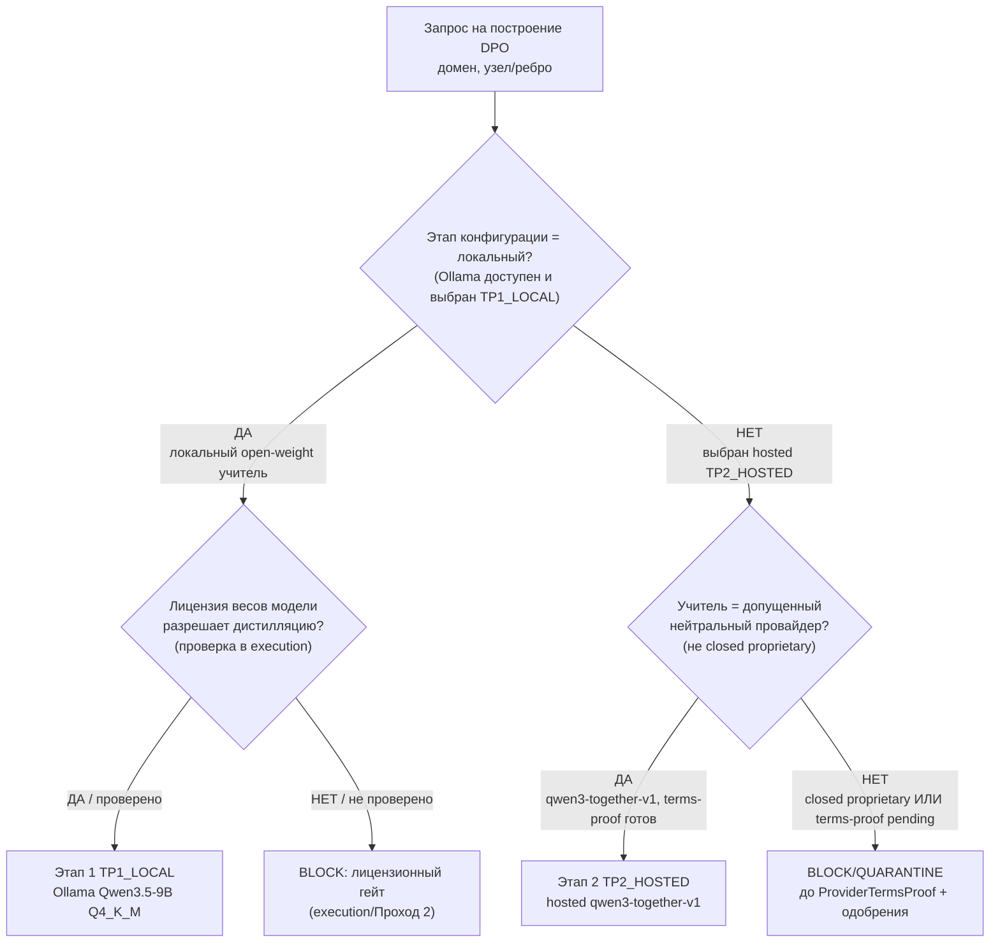
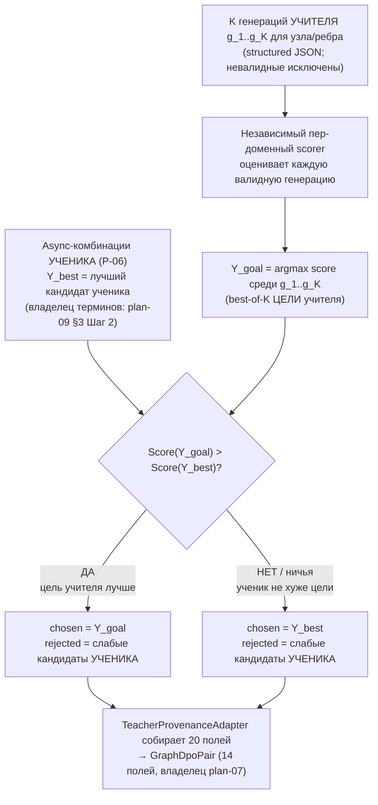

# Overlay: двухфазная реализация teacher-маршрута (единый владелец)

## Current Code-First / DPO-Last Execution Boundary Addendum (2026-07-14)

This addendum is the current live authority for the **execution boundary** of the two teacher rollout stages. It supersedes older statements in this file only where they imply that TP1 or TP2 can author train-ready DPO pairs, call training, or bypass the final human/legal gate. The older body remains design/history evidence. Board phase and substep counters are unchanged.

```text
execution_state: ACTIVE_CODE_FIRST
implementation_authorization: YES_CODE_FIRST_ONLY
teacher_dpo_training_authorization: NO_TEACHER_DPO_TRAINING_UNTIL_G_DPO_FINAL
canonical_sequence: CODE_FIRST → TP1_LOCAL eval-only → TP2_HOSTED eval-only → G-DPO-FINAL → DPO/training
current_remote_branch: origin/codex/dpo-implementation
current_core_tip: e2a6bce7448a1672a90bdec95106da279b077c5b
published_core_slices: [07, 08, 09, 10, 11, 12, 13]
next_code_slice: HOST_REFERENCE_SEAM_FIRST_IN_MANUAL_CHAIN__BOUNDED_SLICE_NOT_SELECTED
teacher_stage_state: TP1_LOCAL_NOT_STARTED; TP2_HOSTED_NOT_STARTED
dpo_training_state: NOT_STARTED
architecture_review_state: A1_A5_RESIDUALS_CURRENT
```

Slices 12 and 13 are accepted and published. Slice 12 adds the bootstrap facade (`14/14`, six-class `132/132`, seven-class including Adaptive `156/156`, build `0/0`); slice 13 adds the explicit composition profile and first production caller outside tests (`20/20`, runtime `14/14`, DynamicGraph `271/271`, Assistant+Adaptive `44/44`, build `0/0`). These are bounded capabilities, not deployment hosting, full-machine completion or composite Gate B. The manual-only chain begins with deployment host/reference selection, then profile deserialization/selection and runtime lifetime, `Runtime.Assistant`, persistence/restart of profile plus revision/CAS, authority schema/canon/resolver, and remaining `CODE_FIRST`; no bounded next slice is declared selected. TP1_LOCAL remains eval-only and not started; TP2_HOSTED remains eval-only, not started and unavailable before its legal proof; `G-DPO-FINAL` still precedes all DPO/training, which remains last and not started.

### Stage semantics and hard gates

`TP1_LOCAL` and `TP2_HOSTED` are teacher rollout **stages**, not new board phases. Before `G-DPO-FINAL`, every teacher output is evaluation/quarantine evidence only: `DpoTrainReady=false`; no train-ready pair materialization; no `TrainBatchAsync`; no checkpoint promotion.

1. `TP1_LOCAL` may start only after the code-first pre-DPO queue is closed and the local route proves all three artifact gates: (a) Ollama runtime/deployment availability, (b) the exact Qwen3.5-9B artifact/tag and immutable digest are pinned, and (c) the canonical weight license is verified as permitting the intended evaluation use.
2. `TP1_LOCAL` may exit only after its evaluation evidence is independently accepted and `Q-TP-NUMS` is resolved. `TP2_HOSTED` may then start only when a current `ProviderTermsProof` for the exact hosted open-weight Qwen route at a neutral provider is attached and a human approval reference authorizes that provider/model/version for evaluation.
3. `TP2_HOSTED` may exit only after source-disjoint `TeacherStageGapReport` evaluation is independently accepted and `Q-TP-235B-EVAL` is resolved.
4. `G-DPO-FINAL` passes only when `TP1_EXIT=PASS`, `TP2_EXIT=PASS`, every `Q-TP-*` human decision is resolved, legal/provenance/split gates are accepted, closed-proprietary authoring count is zero, and Luba gives explicit activation approval. Only after this gate may plan-07 materialize train-ready pairs and L5 training begin.

Deterministic validation, graph enumeration, routing, merge policy and tie-break logic remain infrastructure/baselines outside learned authority. Training may optimize bounded learned components only; it must never conceal or replace these deterministic decisions.

### Accepted-slice publication gate

Every independently accepted implementation slice is isolated and published before another slice starts:

1. builder changes code/tests for one bounded slice;
2. an independent reviewer returns `ACCEPTED` with commands and observed evidence;
3. that exact slice receives its own commit;
4. the commit is successfully pushed to `origin/codex/dpo-implementation`;
5. local `HEAD` is verified equal to the remote tip and the worktree is clean;
6. only then may the next slice start.

Accumulated accepted-but-unpushed slices are forbidden. `ACCEPTED_PUSHED_SLICE` proves only that bounded slice; it does **not** imply strict composite Gate-B `done`, close any of the existing board rows, authorize TP1/TP2, or authorize DPO/training.

## Русское человеческое резюме

Задача Luba (живое указание 2026-07-13): реализовать построение легального DPO
через учителя (teacher) в две фазы, чтобы сначала проверять всё дёшево и
безопасно локально, а потом — при сохранённом одобрении — переключаться на
hosted-учителя.

- Этап 1, кодовое имя `TP1_LOCAL`: учитель работает ЛОКАЛЬНО в Ollama, модель
  Qwen3.5-9B в квантовании Q4_K_M, окно контекста примерно 8192 токена. Локальный
  запуск открытой permissive-модели — самый безопасный вариант для дистилляции,
  потому что нет провайдерского ToS-гейта; остаётся только гейт лицензии весов
  самой модели (проверяется в execution, см. §8).
- Этап 2, кодовое имя `TP2_HOSTED`: учитель — hosted `qwen3-together-v1`
  (Qwen3, hosted у нейтрального провайдера TogetherAI) и другие допущенные
  нейтральные провайдеры. Бизнес-одобрение hosted-use уже сохранено
  (APPROVED_BY_LUBA_2026-07-07); этот overlay лишь секвенирует его в Этап 2.
  Технический гейт `ProviderTermsProof` остаётся открытым до execution.

> Пометка 17.08.26: дефолт раунда 17.08 (регистр `design to code session\17.08.26WorkLeft-03-decisions-register.md` D-02/D-03; решение архитектора — `17.08.26WorkLeft-00-ИТОГ.md` §5): `TP2_HOSTED` исполняется как тот же локальный Qwen через собственный серверный хост `25.ModelServer` (композиция 14); `TP2_EXIT` считается по этому хосту; внешний hosted-профиль `qwen3-together-v1`/TogetherAI — OPTIONAL/evidence-only, только по свежей незацитированной отмашке Лубы (R7 EXTERNAL-TOOL BAN; DEC-03 №10/№31/№48; №53 не переоткрывается; одобрение 07.07 — historical/evidence, не обязательство). `TeacherStageGapReport` (гейт п.3) читать как отчёт «локальная eval-only оценка vs локальный серверный контур». Текст overlay не переписан; правка матрицы §5/диаграммы — отдельный наряд владельца канона.

Оба этапа подчиняются одному легальному инварианту (§7): closed proprietary
модели (Claude, OpenAI GPT, Gemini, Gemini Grounding/Search) ЗАПРЕЩЕНЫ как
teacher/distillation-цели в ОБЕИХ фазах. Судьями (judges/eval) сильные модели
быть могут, но их выход не используется как training-цель.

Важно про единственного владельца: имена этапов `TP1_LOCAL` / `TP2_HOSTED` — это
уровни развёртывания учителя, а не фазы доски. Счётчики плана (12 фаз /
27 подфаз / 64 подшага) НЕ меняются. Контракты `TeacherProvenance` (20 полей,
владелец plan-08 §3.1) и `GraphDpoPair` (14 полей, владелец plan-07) здесь
только упоминаются со ссылкой на владельца — второго канона не создаётся.
Принадлежность строки этапу выводится из уже существующих полей
`hosting_provider` и `teacher_access_mode`, а НЕ из нового 21-го поля.

> **A5-R1 RESOLVED FOR CODE-FIRST (2026-07-14):** живое указание Luba уже является подтверждением `YES_CODE_FIRST_ONLY`; дополнительное разрешение для deterministic code-first не требуется. Teacher/DPO/training остаётся `NO_TEACHER_DPO_TRAINING_UNTIL_G_DPO_FINAL`. Остальные A1-A5 residuals остаются текущими; прежние zero-blocker/no-design-choice оценки — historical.

Статус готовности не меняется: план остаётся `PLAN_NOT_READY`; code-first
авторизован как `YES_CODE_FIRST_ONLY`, а teacher/DPO/training запрещён до
`G-DPO-FINAL`. Этот файл — планово-
проектная (design) очевидность, а не продукт, тесты, билд, runtime, провайдер,
обучение, checkpoint или git-доказательство.

---

## §0. UML класс-диаграмма (Mermaid, importable в draw.io)

Диаграмма показывает проектные сущности двухфазного маршрута. Сущности со
статусом СКЕЛЕТ/ПЛАН будут реализованы в Проходе 2 (владелец-блок plan-08 §3.5.2).
`TeacherProvenance` и `GraphDpoPair` показаны как read-only ссылки на владельца
(см. примечание об аббревиатуре под легендой).

```mermaid
classDiagram
    class TwoPhaseTeacherRouter {
        +SelectStageAsync(config) OperationResult~TeacherStage~
    }
    class LocalOllamaTeacherClient {
        +GenerateCandidatesAsync(request, k) OperationResult~IReadOnlyList~TeacherCandidate~~
    }
    class HostedQwen3TeacherClient {
        +GenerateCandidatesAsync(request, k) OperationResult~IReadOnlyList~TeacherCandidate~~
    }
    class IndependentDomainScorer {
        +SelectChosen(scoringInput) OperationResult~ChosenSelection~
    }
    class TeacherProvenanceAdapter {
        +BuildProvenance(callContext) OperationResult~TeacherProvenance~
    }
    class TeacherProvenanceProfile {
        +ProfileId string
        +Stage TeacherStage
    }
    class TeacherProvenance {
        +read_only_subset
    }
    class GraphDpoPair {
        +read_only_subset
    }

    TwoPhaseTeacherRouter --> LocalOllamaTeacherClient : TP1_LOCAL
    TwoPhaseTeacherRouter --> HostedQwen3TeacherClient : TP2_HOSTED
    LocalOllamaTeacherClient --> IndependentDomainScorer : K генераций
    HostedQwen3TeacherClient --> IndependentDomainScorer : Y_goal + кандидаты
    IndependentDomainScorer ..> GraphDpoPair : chosen/rejected
    LocalOllamaTeacherClient ..> TeacherProvenanceAdapter : контекст вызова
    HostedQwen3TeacherClient ..> TeacherProvenanceAdapter : контекст вызова
    TeacherProvenanceAdapter ..> TeacherProvenance : заполняет 20 полей
    TeacherProvenanceProfile --> TeacherProvenanceAdapter : профиль этапа

    note for TwoPhaseTeacherRouter "СКЕЛЕТ/ПЛАН (Проход 2)\nВыбирает этап TP1_LOCAL или TP2_HOSTED\nпо конфигу и легальному гейту.\nНе меняет фазы доски и счётчики 12/27/64."
    note for LocalOllamaTeacherClient "СКЕЛЕТ/ПЛАН (владелец plan-08 §3.5.2, OWNER_BLOCK_CREATED_PASS2 2026-07-13)\nЭтап 1: вызывает локальный Ollama Qwen3.5-9B Q4_K_M,\nnum_ctx~8192, node/edge-level, structured JSON, K генераций."
    note for HostedQwen3TeacherClient "СКЕЛЕТ/ПЛАН (маршрут hosted, владелец plan-08)\nЭтап 2: вызывает hosted qwen3-together-v1 у нейтрального провайдера.\nБизнес-одобрение сохранено; ProviderTermsProof pending."
    note for IndependentDomainScorer "БАЗЛАЙН eval-only (детерминированный, не trainable authority)\nПер-доменный scorer (language-translate: exact-match + char-accuracy).\nРешает chosen против Y_best независимо от self-confidence учителя."
    note for TeacherProvenanceAdapter "ДЕТЕРМИНИРОВАННЫЙ адаптер (C#, не LLM)\nСобирает provenance из метаданных вызова.\nProvenance НЕ генерируется языковой моделью."
    note for TeacherProvenanceProfile "СКЕЛЕТ/ПЛАН (владелец plan-08 §3.5.2, OWNER_BLOCK_CREATED_PASS2 2026-07-13)\nПрофиль этапа: qwen35-local-v1 или qwen3-together-v1.\nЗаполняет уже существующие 20 полей, нового поля не добавляет."
    note for TeacherProvenance "ССЫЛКА read-only (владелец plan-08 §3.1)\nКанон = 20 полей. Здесь показано подмножество.\nПринадлежность этапу выводится из hosting_provider + teacher_access_mode."
    note for GraphDpoPair "ССЫЛКА read-only (владелец plan-07)\nКанон = 14 полей. Здесь только ссылка, не второй канон."
```



Примечание об аббревиатуре (read-only subset disclaimer): классы
`TeacherProvenance` и `GraphDpoPair` показаны в диаграмме как read-only
подмножество. Полный канон `TeacherProvenance` = 20 полей, владелец
`active plan-08 §3.1`; полный канон `GraphDpoPair` = 14 полей, владелец
`active plan-07`. Диаграмма НЕ переопределяет эти контракты и не создаёт
второй канон.

### Легенда

| Класс | Что делает | Статус |
|---|---|---|
| `TwoPhaseTeacherRouter` | Выбирает этап учителя (TP1_LOCAL / TP2_HOSTED) по конфигу и легальному гейту | СКЕЛЕТ/ПЛАН (Проход 2) |
| `LocalOllamaTeacherClient` | Этап 1: локальный Ollama Qwen3.5-9B Q4_K_M, K структурированных генераций | СКЕЛЕТ/ПЛАН (владелец plan-08 §3.5.2, OWNER_BLOCK_CREATED_PASS2 2026-07-13) |
| `HostedQwen3TeacherClient` | Этап 2: hosted qwen3-together-v1 у нейтрального провайдера | СКЕЛЕТ/ПЛАН (маршрут hosted, владелец plan-08) |
| `IndependentDomainScorer` | Детерминированный eval-only пер-доменный scorer; решает chosen против Y_best | БАЗЛАЙН eval-only (не trainable authority) |
| `TeacherProvenanceAdapter` | C#-адаптер: собирает 20 полей provenance из метаданных вызова (не LLM) | ДЕТЕРМИНИРОВАННЫЙ адаптер |
| `TeacherProvenanceProfile` | Профиль этапа (qwen35-local-v1 / qwen3-together-v1) | СКЕЛЕТ/ПЛАН (владелец plan-08 §3.5.2, OWNER_BLOCK_CREATED_PASS2 2026-07-13) |
| `TeacherProvenance` | Канон provenance, 20 полей | ССЫЛКА read-only (владелец plan-08 §3.1) |
| `GraphDpoPair` | Канон DPO-пары, 14 полей | ССЫЛКА read-only (владелец plan-07) |

Примечание об алиасах (cross-file owner resolution, SI_GATE_2): дизайн-имена этого overlay
разрешаются в существующие контракты, второго канона не создаётся:
- `IndependentDomainScorer` = дизайн-имя пер-доменного eval-only scorer'а (held-out/accuracy —
  владелец измерения plan-11 Pass26; сам scorer-контракт = Claude-baseline `IHeldOutScorer`,
  упоминается в plan-07/plan-09/plan-14) ПЛЮС правило `ChosenSelectionRule` ВНУТРИ B12
  `IGraphWeaknessDetectorUnit` (plan-09) — это НЕ новый класс;
- `LocalOllamaTeacherClient` / `HostedQwen3TeacherClient` реализуют B1-seam
  `ITeacherGoalClient.GetGoalAsync` (владелец plan-08 Pass03);
- `TwoPhaseTeacherRouter` — детерминированный конфиг-helper (не trainable authority).

### Таблица симуляций по соединениям (по каждой стрелке)

| Соединение (A → B) | Пример входа (симуляция) | Ожидаемый результат по этой ветке |
|---|---|---|
| TwoPhaseTeacherRouter → LocalOllamaTeacherClient | config: stage=TP1_LOCAL, ollama_available=true, domain=language-translate | Маршрут выбирает Этап 1, вызывает локальный Ollama-клиент |
| TwoPhaseTeacherRouter → HostedQwen3TeacherClient | config: stage=TP2_HOSTED, provider_terms_proof=present, luba_approval_ref=present | Маршрут выбирает Этап 2, вызывает hosted qwen3-together-v1 |
| LocalOllamaTeacherClient → IndependentDomainScorer | K=4 сгенерированных структурированных JSON-кандидата для одного узла | Scorer получает 4 кандидата на независимую оценку |
| HostedQwen3TeacherClient → IndependentDomainScorer | Y_goal (внешняя цель) + K=4 hosted-кандидата | Scorer получает Y_goal и кандидатов для сравнения |
| IndependentDomainScorer ..> GraphDpoPair | chosen=Y_goal (score 0.93), rejected=кандидат score 0.71 | Формируется GraphDpoPair (14 полей, владелец plan-07) с chosen/rejected |
| LocalOllamaTeacherClient ..> TeacherProvenanceAdapter | call_context: model_id=Qwen/Qwen3.5-9B (OllamaModelRef qwen3.5:9b-q4_K_M@sha256:<pin>), access_mode=local_self_hosted_open_weight | Адаптер получает контекст локального вызова |
| HostedQwen3TeacherClient ..> TeacherProvenanceAdapter | call_context: model_id=qwen3, provider=together, access_mode=open_weight_hosted | Адаптер получает контекст hosted-вызова |
| TeacherProvenanceAdapter ..> TeacherProvenance | контекст локального вызова, домен language-translate | Заполнены 20 полей provenance; closed_proprietary_model=false; этап выведен из hosting_provider+teacher_access_mode |
| TeacherProvenanceProfile → TeacherProvenanceAdapter | profile_id=qwen35-local-v1, stage=TP1_LOCAL | Адаптер использует значения профиля для заполнения полей (без нового 21-го поля) |

---

## §1. Человеко-язычные flowchart (Part A)

### Flowchart 1 — выбор этапа учителя и легальный гейт



Симуляции веток flowchart 1:

- Вход: домен=language-translate, stage=TP1_LOCAL, ollama_available=true → ветка B=ДА → далее C.
- Вход: stage=TP2_HOSTED → ветка B=НЕТ → далее D.
- Вход: model_license=Apache-2.0 (проверено) → ветка C=ДА → результат: Этап 1 TP1_LOCAL запущен локально.
- Вход: model_license=unknown (не проверено) → ветка C=НЕТ → результат: BLOCK лицензионного гейта, ждём execution/Проход 2.
- Вход: provider=together, model=qwen3, provider_terms_proof=present, luba_approval_ref=present → ветка D=ДА → результат: Этап 2 TP2_HOSTED запущен hosted.
- Вход: provider=openai (closed proprietary) ИЛИ provider_terms_proof=pending → ветка D=НЕТ → результат: BLOCK/QUARANTINE, hosted train/common use запрещён.

### Flowchart 2 — построение DPO-пары и выбор chosen



Симуляции веток flowchart 2:

- Вход: K=4 генераций учителя, scores [0.93, 0.88, 0.80, 0.75] → Y_goal (best-of-K учителя)=0.93; Y_best (лучший кандидат ученика из P-06)=0.71 → ветка J=ДА → результат: chosen=Y_goal (0.93), rejected=слабые кандидаты УЧЕНИКА.
- Вход: Y_goal (best-of-K учителя)=0.80; Y_best ученика=0.88 → ветка J=НЕТ → результат: chosen=Y_best (0.88), rejected=слабые кандидаты УЧЕНИКА. Непобедившая цель учителя Y_goal(0.80) НЕ становится rejected (eval-only; teacher-as-loser/teacher-vs-teacher запрещён, plan-07).
- Вход: ничья Score(Y_goal)==Score(Y_best) → ветка J=НЕТ → chosen=Y_best.
- Вход (любая ветка): домен=language-translate, teacher_access_mode=local_self_hosted_open_weight → результат M: заполнены 20 полей provenance (closed_proprietary_model=false), сформирована GraphDpoPair из 14 полей владельца plan-07.

Замечание об инвариантах Part A: `IndependentDomainScorer` — детерминированный
eval-only базлайн (пер-доменный), он НЕ является trainable authority; сигнал
приёмки chosen независим от self-confidence самого учителя (acceptance-signal
independence). Provenance собирает детерминированный C#-адаптер, а не LLM.

---

## §2. Описание алгоритмов простым языком (без кода)

1. Выбор этапа (routing). Аналогия: диспетчер решает, обслуживать заказ своим
   локальным поваром (Этап 1) или заказать у проверенной внешней кухни (Этап 2).
   Диспетчер смотрит на конфиг (какой этап выбран, доступен ли Ollama) и на
   легальный гейт (лицензия весов для локального; для hosted — что провайдер
   нейтральный, есть terms-proof и одобрение). Closed proprietary кухни (Claude,
   OpenAI, Gemini) не обслуживаются ни в одном этапе.

2. Локальная генерация K кандидатов. Этап 1 просит локальный Ollama Qwen3.5-9B
   (квант Q4_K_M, окно ~8192 токена) сгенерировать K вариантов структурированного
   JSON-ответа для конкретного узла/ребра графа. Это дёшево и приватно.

3. Независимая оценка и выбор chosen. Отдельный, детерминированный пер-доменный
   scorer (для language-translate: точное совпадение + посимвольная точность)
   оценивает каждую из K генераций и цель Y_goal. Берём Y_best как лучший локальный
   вариант. chosen = Y_goal, только если Score(Y_goal) > Score(Y_best); иначе
   chosen = Y_best. Проигравшие уходят в rejected. Судья не спрашивает у учителя
   его собственную уверенность — это защита от самоподтверждающегося цикла.

4. Сборка provenance. C#-адаптер (не языковая модель) детерминированно заполняет
   20 полей `TeacherProvenance` из метаданных вызова: access-mode, провайдер,
   model_id, лицензия, флаг closed_proprietary=false и т.д. Принадлежность этапу
   (TP1_LOCAL / TP2_HOSTED) ВЫВОДИТСЯ из полей `hosting_provider` и
   `teacher_access_mode` — новое 21-е поле не добавляется.

---

## §3. Ссылки на код (forward-reference)

Кода ещё нет: сущности этого overlay — проектные (design) заготовки. Реальные
классы/записи/методы создаются в Проходе 2 во владельце-блоке
`active plan-08 §3.5.2` (профили `qwen35-local-v1`, `qwen3-together-v1`) и
подключаются через существующие маршруты plan-07 (`GraphDpoPair`) и
plan-08 §3.1 (`TeacherProvenance`). Владелец-блок §3.5.2
создан Проходом 2 (2026-07-13); точные `file:line` код-ссылки появятся только
после реализации кода, поэтому
любые code-ref здесь были бы overclaim и намеренно не приводятся.

---

## §4. Алгоритмы: класс + метод + параметры + шаги

Все сущности ниже — проектные (Проход 2, владелец plan-08 §3.5.2). Указаны как
план; статус СКЕЛЕТ.

### Алгоритм 1 — маршрутизация этапа
- Класс: `TwoPhaseTeacherRouter`
- Метод: `SelectStageAsync(TwoPhaseRolloutConfig config)` → `OperationResult<TeacherStage>`
- Параметры: `config.SelectedStage` (TP1_LOCAL|TP2_HOSTED), `config.OllamaAvailable`,
  `config.ModelLicenseVerified`, `config.ProviderTermsProofPresent`,
  `config.LubaHostedApprovalRef`, `config.Domain`.
- Шаги:
  1. Если `SelectedStage=TP1_LOCAL`: проверить `OllamaAvailable` и
     `ModelLicenseVerified`; при неуспехе вернуть `Fail("LOCAL_LICENSE_OR_ENV_GATE")`.
  2. Если `SelectedStage=TP2_HOSTED`: проверить, что провайдер допущенный
     (не closed proprietary), `ProviderTermsProofPresent=true`,
     `LubaHostedApprovalRef` присутствует; иначе `Fail("HOSTED_TERMS_OR_APPROVAL_GATE")`.
  3. Вернуть `Ok(stage)`.

### Алгоритм 2 — локальная генерация кандидатов
- Класс: `LocalOllamaTeacherClient`
- Метод: `GenerateCandidatesAsync(TeacherGenerationRequest request, int k)` →
  `OperationResult<IReadOnlyList<TeacherCandidate>>`
- Параметры: `request.Prompt`, `request.Domain`, `request.NodeOrEdgeRef`,
  `request.NumCtx` (≈8192), `request.ModelId` (qwen3.5-9b-q4_K_M), `k` (число генераций).
- Шаги:
  1. Сформировать structured-JSON-схему ожидаемого выхода для узла/ребра.
  2. Вызвать локальный Ollama k раз (или один вызов с k сэмплами) с num_ctx.
  3. Валидировать каждую генерацию как structured JSON; невалидные пометить.
  4. Вернуть `Ok(list of TeacherCandidate)`.

### Алгоритм 3 — независимая оценка и выбор chosen
- Класс: `IndependentDomainScorer` (детерминированный eval-only базлайн)
- Метод: `SelectChosen(ScoringInput input)` → `OperationResult<ChosenSelection>`
- Параметры: `input.Ygoal`, `input.Candidates` (K штук), `input.Domain`,
  `input.ScorerId` (language-translate: exact-match + char-accuracy).
- Шаги:
  1. Оценить `Score(Ygoal)` пер-доменным scorer.
  2. Оценить `Score(candidate)` для каждого кандидата; `Ybest = argmax`.
  3. Если `Score(Ygoal) > Score(Ybest)` → `chosen = Ygoal`, иначе `chosen = Ybest`.
  4. `rejected` = все проигравшие; вернуть `Ok(ChosenSelection)`.
  5. Инвариант: scorer НЕ использует self-confidence учителя (независимость арбитра).

### Алгоритм 4 — сборка provenance (детерминированная, не LLM)
- Класс: `TeacherProvenanceAdapter`
- Метод: `BuildProvenance(TeacherCallContext ctx)` → `OperationResult<TeacherProvenance>`
- Параметры: `ctx.TeacherAccessMode` (local_self_hosted_open_weight|open_weight_hosted — домен владельца plan-08 §3.1),
  `ctx.HostingProvider`, `ctx.ModelId`, `ctx.ModelLicense`, `ctx.RequestId`,
  `ctx.ProfileId` (qwen35-local-v1|qwen3-together-v1).
- Шаги:
  1. Детерминированно заполнить 20 полей `TeacherProvenance` (владелец plan-08 §3.1)
     из `ctx`; выставить `closed_proprietary_model=false`.
  2. Вывести принадлежность этапу из `hosting_provider` + `teacher_access_mode`
     (не добавляя нового поля).
  3. Вернуть `Ok(TeacherProvenance)`; при неполном контексте — `Fail("PROVENANCE_INCOMPLETE")`.

---

## §5. Матрица этапов: Этап 1 TP1_LOCAL / Этап 2 TP2_HOSTED

| Аспект | Этап 1 — TP1_LOCAL | Этап 2 — TP2_HOSTED |
|---|---|---|
| Учитель (модель) | Qwen3.5-9B Q4_K_M | qwen3-together-v1 (Qwen3) + др. допущенные |
| Доступ (`teacher_access_mode`, домен — владелец plan-08 §3.1) | `local_self_hosted_open_weight` | `open_weight_hosted` |
| `hosting_provider` | локальный (нет провайдера) | together (и др. нейтральные) |
| Легальный гейт | лицензия весов модели (execution) | ProviderTermsProof + одобрение Luba |
| Окно контекста | num_ctx ≈ 8192 | по провайдеру |
| Гранулярность | node/edge-level | node/edge-level |
| Формат выхода | structured JSON, K генераций | structured JSON, K генераций |
| Scorer | независимый пер-доменный (eval-only baseline) | тот же независимый пер-доменный scorer |
| Выбор chosen | Y_goal если Score(Y_goal)>Score(Y_best), иначе Y_best | так же |
| Сборка provenance | C#-адаптер (не LLM) | C#-адаптер (не LLM) |
| Профиль provenance | qwen35-local-v1 (полный канон plan-08 §3.5.2) | qwen3-together-v1 (канон plan-08 §3.5.1/§3.5.1b; указатель в §3.5.2) |
| `TeacherProvenance` | 20 полей, владелец plan-08 §3.1 (ссылка) | 20 полей, владелец plan-08 §3.1 (ссылка) |
| `GraphDpoPair` | 14 полей, владелец plan-07 (ссылка) | 14 полей, владелец plan-07 (ссылка) |
| Closed proprietary | ЗАПРЕЩЁН | ЗАПРЕЩЁН |
| Готовность | PLAN_NOT_READY, impl auth NO | PLAN_NOT_READY, impl auth NO |

---

## §6. Критерии перехода Этап 1 → Этап 2 (G-TP-1..G-TP-7)

- G-TP-1: локальная среда доказана — Docker/Ollama установлены, модель Qwen3.5-9B
  Q4_K_M скачана (pull) и запускается (execution-гейт; сейчас не проверено).
- G-TP-2: лицензия весов Qwen3.5 проверена как permissive для дистилляции
  (execution-гейт; сейчас не проверено).
- G-TP-3: Этап 1 произвёл принятые DPO-пары, проходящие порог пер-доменного
  scorer на held-out наборе.
- G-TP-4: для `qwen3-together-v1` собран bundle `ProviderTermsProof` (Together
  ToS-snapshot, ZDR/privacy, output-use/training-rights) — остаётся PENDING.
- G-TP-5: присутствует ссылка на hosted-use одобрение Luba
  (бизнес-одобрение APPROVED_BY_LUBA_2026-07-07 записано и секвенировано; при
  этом G-TP-4 terms-proof всё ещё отдельный открытый гейт).
- G-TP-6: ВЫПОЛНЕНО Проходом 2 (2026-07-13, план-уровень): владелец-блок active plan-08 §3.5.2 создан
  (qwen35-local-v1 полный канон; qwen3-together-v1 указатель на §3.5.1b). Execution-гейты G-TP-1..G-TP-4 остаются открытыми.
- G-TP-7: сохранена single-owner консистентность: нет closed proprietary ни в
  одном этапе; счётчики 12/27/64 не изменены; `TeacherProvenance`=20 полей,
  `GraphDpoPair`=14 полей — без второго канона и без 21-го поля.

---

## §7. Легальный инвариант обеих фаз

- Разрешены как teacher/distillation-цели только open-weight permissive модели:
  локально (Этап 1) или hosted у нейтрального провайдера (Этап 2), при
  проверенной лицензии/terms.
- ЗАПРЕЩЕНЫ как distillation-teacher в ОБЕИХ фазах: Claude API, OpenAI GPT API,
  Gemini API, Gemini Grounding/Search, а также официальные chatbot-выходы
  Kimi/DeepSeek/Qwen/GLM, если их terms не проверены.
- Judges/eval могут быть от сильных моделей, но их выход НЕ используется как
  training-цель (`used_for_training=false`), только как оценка/критика.
- Локальный запуск (Этап 1) снимает провайдерский ToS-гейт, но НЕ снимает гейт
  лицензии весов модели.
- Hosted-маршрут (Этап 2) требует `ProviderTermsProof` до любого train/common
  use; до этого — BLOCK/QUARANTINE или только judge/eval, где легальный план
  это позволяет.

---

## §8. Честные границы (что НЕ сделано)

- Ничего не выполнено: ни кода, ни тестов, ни билда, ни runtime, ни провайдер-
  вызовов, ни обучения, ни checkpoint, ни git.
- Docker/Ollama НЕ установлены/не проверены здесь; модель Qwen3.5-9B Q4_K_M НЕ
  скачана; лицензия весов Qwen3.5 НЕ проверена — это execution/Проход 2.
- `ProviderTermsProof` для TogetherAI/Qwen3 НЕ собран; hosted train/common use
  остаётся заблокирован до его сбора, несмотря на сохранённое бизнес-одобрение.
- Владелец-блок профилей active plan-08 §3.5.2 СОЗДАН Проходом 2 (2026-07-13). Execution-артефакты
  (deployment proof, retention policy, пин digest, per-release license) НЕ созданы — это execution.
- Readiness-носители НЕ тронуты: план остаётся `PLAN_NOT_READY`, авторизация
  реализации `NO`. Этот overlay — планово-проектная очевидность, не продукт.
- Ссылки на код (§3) намеренно отсутствуют, чтобы не создавать overclaim до
  реализации.

---

## §9. Handoff в Проход 2

- [ВЫПОЛНЕНО Проходом 2, 2026-07-13] Создан владелец-блок `active plan-08 §3.5.2` с записью-профилем
  `TeacherProvenanceProfile`: профили `qwen35-local-v1` (TP1_LOCAL, полный канон) и
  `qwen3-together-v1` (TP2_HOSTED, указатель на §3.5.1b), поля профиля, дефолты, привязка к 20-полевому
  `TeacherProvenance` (plan-08 §3.1) через `hosting_provider` + `teacher_access_mode`.
- [ВЫПОЛНЕНО Проходом 2, 2026-07-13] Статус PENDING_PASS2_OWNER_EDIT снят: владелец-блок §3.5.2 создан.
- [ВЫПОЛНЕНО Проходами 3-5, 2026-07-13] Алгоритмы §4 детализированы до владельцев: plan-09 §3 Шаг 3a; plan-10 §8.1/Pass16; plan-11 §7; plan-12 §3.B.2; plan-13 §3.1a; Проход 5 добавил coverage/навигацию в матрицу/02/07/F0/plan-14/16 и Q-TP-* residuals; execution-гейты G-TP-1..G-TP-4 открыты; матрица §5 синхронизирована без второго канона.
- Инвариант передачи: этот файл остаётся единственным владельцем структуры
  двухфазного маршрута; потребители только ссылаются. Никакой правки readiness и
  счётчиков 12/27/64 в Проходе 2 без явного указания Luba.
