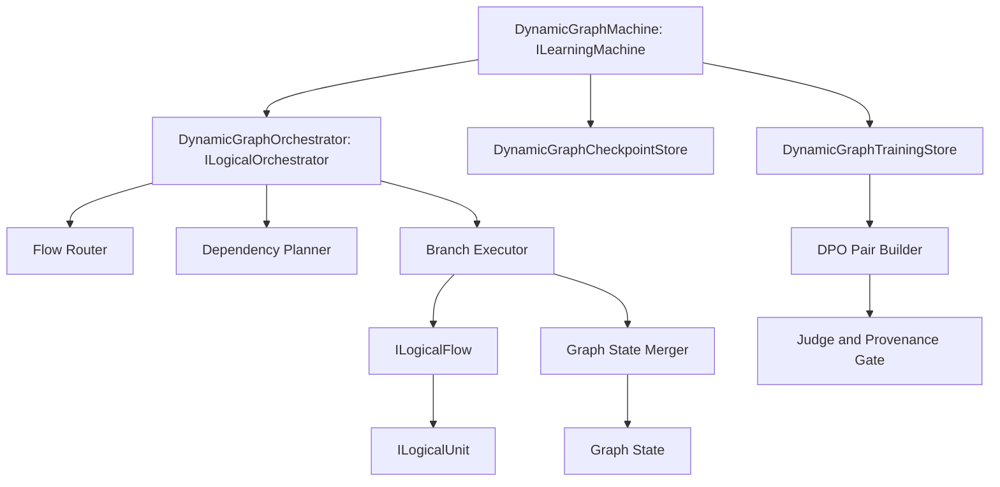
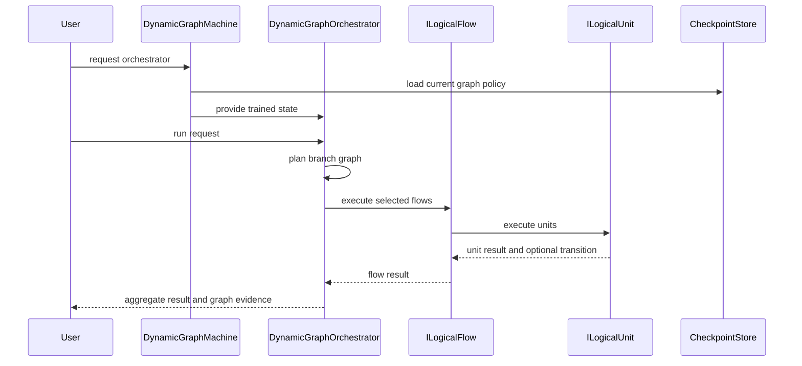
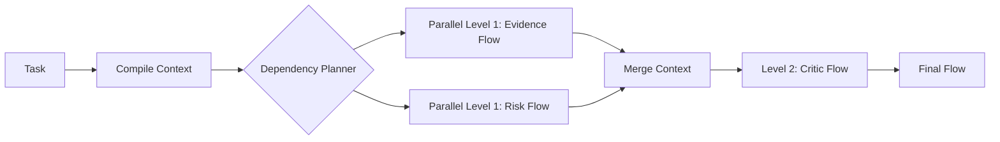

# ILearningDynamicGraph Architecture Brief

## Architecture Intent

`ILearningDynamicGraph` is a trainable graph-policy layer for choosing, combining, and improving logical flows. It should learn from DPO rows which graph path, branch combination, evidence route, or final answer is better for a task, while preserving the existing project hierarchy.

## Component View



## Data Flow



## Graph State

Graph state should include:

```text
node registry
edge registry
flow binding map
unit capability map
branch run history
transition signal history
evidence id map
dpo preference history
metric snapshots
checkpoint manifest
```

Graph state must distinguish deterministic infrastructure from learned policy. Closure and bridge detection are helper functions. DPO-trained path preference is learned policy.

## Routing Model

The routing model should accept:

```text
user request
compiled prompt features
available flow bindings
known graph transitions
context packet
source evidence ids
current graph policy checkpoint
```

It should return:

```text
selected flow ids
parallel branch levels
sequential dependency edges
bridge subphases
transition follow-up plan
confidence metrics
reason codes
```

## Async Experimentation

Independent branches should run as parallel candidates when dependency analysis permits. Dependent branches must wait for their prerequisites. The measurement layer compares complete branch combinations, not just isolated unit outputs.



## Interfaces In Prose

`DynamicGraphMachine` owns training, evaluation, export, import, and runtime orchestrator construction.

`DynamicGraphDpoPairBuilder` turns graph run comparisons into legal DPO rows with chosen and rejected paths.

`DynamicGraphLegalGate` validates source state, model or judge route, and provider terms status before rows enter train or held-out sets.

`DynamicGraphTrainingRunner` trains on source-disjoint rows and evaluates held-out rows without mutating during evaluation.

`DynamicGraphMeasurementRunner` reports DPO, graph, lifecycle, leakage, and resource metrics.

`DynamicGraphOrchestrator` runs selected graph branches through existing `ILogicalFlow` and `ILogicalUnit` contracts.

## Solved Subtasks

| subtask | decision |
|---|---|
| hierarchy | Use `ILearningMachine` above `ILogicalOrchestrator`, do not put training on unit or flow |
| runtime entry | Runtime requests enter through orchestrator returned by machine |
| DPO row shape | Use prompt, chosen, rejected plus graph provenance metadata |
| legal boundary | Closed APIs blocked for training until provider terms gate passes |
| branch execution | Use dependency levels for parallel and sequential branch planning |
| transition handling | Reuse transition signals and context packets |
| graph helpers | Use closure and bridge detection as deterministic helpers |
| learned claim | Require held-out metrics, fresh-load, and ablation |
| implementation state | Not authorized in this library work |

## Evidence-To-Architecture Mapping

| evidence path | architecture consequence |
|---|---|
| `00.Core\LearningMachineContracts.cs` | Machine owns training and returns orchestrator |
| `00.Core\LogicalContracts.cs` | Units, flows, orchestrator, transition signals, context packets are the runtime spine |
| `21.AgentInfrastructure\Logical\AdaptiveLogicalOrchestrator.cs` | Branch execution and transition follow-up already have precedent |
| `17.DynamicDomains\DynamicDomainGraph.cs` | Closure and bridge subphase expansion can support dynamic graph planning |
| `22.AgentAlgorithms\MultiAgent\DependencyGraph.cs` | Kahn-level dependency sorting supports parallel branch levels |
| `11.DPO\DpoTrainer.cs` | Reward margin and accuracy are existing DPO measurement primitives |
| `27.TranslationDomain\TranslationMachine.cs` | Existing machine lifecycle shows training history and checkpoint boundary concerns |
