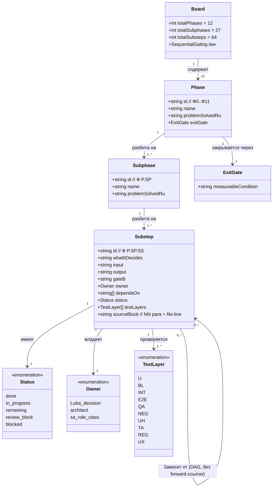
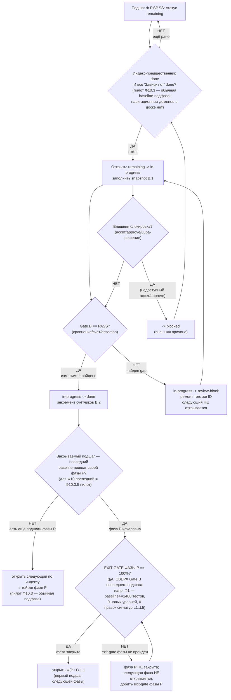

# Доска исполнения ILearningDynamicGraph — строго последовательная (claude-EXECUTION-CONTROL-BOARD)

> **Артефакт:** `claude-EXECUTION-CONTROL-BOARD.md` (мой namespace `claude-*`).
> **Автор-роль:** архитектор доски исполнения (Opus 4.8 MAX).
> **Тип артефакта:** ПЛАН-ONLY (документация-решение: перестройка плана в строго
> последовательную исполнительную доску). Это **НЕ** разрешение реализовывать
> продукт/код, тренировать, билдить, запускать раннеры, делать git или вызывать
> внешние AI/API/модели. Реализация требует свежего явного approve Luba после ревью.
> **Источник канона (EVIDENCE-ONLY, не редактируется):** мастер-план
> `codex-ILEARNINGDYNAMICGRAPH-PLAN-v1.md` + 16 решённых блоков (`codex-plan-00..14`);
> бенчмарк `codex-EXECUTION-CONTROL-BOARD.md`; старый каркас `claude-00..07`.
> **Согласованность:** счётчики (12 фаз / 27 подфаз / 64 подшага — включают активный пилот
> Ф10.3 `language-translate`, Q41=Вариант B RESOLVED 2026-06-30, ровно 1 пилот; прежний
> baseline 12/26/59 относился к снятой схеме «6 blocked-слотов вне 59», RR4-pilot-activation),
> нумерация `Ф<P>.<SP>.<SS>`, имена контрактов (`GraphDpoPair`, `TeacherProvenance`,
> `DynamicGraphMachine`, …) и CANON-инварианты — едины с остальными `claude-*` и
> мастером. Бенчмарк `codex-*` — только чтение.
> **Язык:** русский (человеческим языком); имена типов/полей — английский.
> **GOVERNANCE-ЗАМЕТКА — Политика веток (NEW).** В **каждом** участвующем репозитории
> (5: `llm_mvp_core`, `xiigen-platform-dot-net-angular`, `xiigen-flows-dot-net-angular`,
> `FigmaToCode-design-gen`, `CanvaToCode`) authority = самый последний **ОБНОВЛЁННЫЙ**
> branch (по дате последнего коммита) на момент старта работ; рабочая ветка проекта
> **создаётся ОТ authority** и называется **`DPOLegalLearning`**. Это **предусловие
> реализации** (актуально на старте Ф0→Ф1), а **не** новый подшаг: счётчики доски
> **12 фаз / 27 подфаз / 64 подшага** (с активным пилотом Ф10.3) не меняются Политикой веток.
> План-only: определение
> authority-ветки и **создание** `DPOLegalLearning` — это git-запись (реализация),
> запрещённая здесь и выполняемая только после свежего явного approve Luba. Единая
> формулировка — мастер §B.4 «Политика веток (NEW)» и `claude-plan-14` §3.1а.

---

## ЯКОРЬ ЗАДАЧИ (CURRENT TASK / NOT THE TASK / EVIDENCE-ONLY)

```text
CURRENT TASK:  построить МОЙ улучшенный артефакт claude-EXECUTION-CONTROL-BOARD.md —
               перестроить план ILearningDynamicGraph в строго последовательную
               исполнительную доску с трёхуровневой нумерацией Ф<P>.<SP>.<SS>
               (Фаза.ПодФаза.ПодШаг), exit-gate на каждую фазу, статусами
               execution-control, EXECUTION-VISIBILITY, сводными счётчиками,
               картой зависимостей (DAG) и обязательным Part A §0/§1 UML самой доски.
               Читая codex-* как бенчмарк, улучшить слабые места, СОХРАНИВ
               канонические счётчики и CANON-инварианты.
NOT THE TASK:  исполнять/тестировать/билдить код, запускать раннеры, тренировать,
               вызывать внешние AI/API/модели, git; править/создавать любые codex-*
               файлы (план Codex — только чтение), править claude-00..07 или dcm-*;
               слепо копировать бенчмарк; дублировать содержимое блоков (доска
               ИНДЕКСирует и упорядочивает блоки, а не копирует их текст).
EVIDENCE-ONLY: все codex-* (мастер-план, 16 блоков codex-plan-*, бенчмарк-доска
               codex-EXECUTION-CONTROL-BOARD.md, codex-recon-*, codex-50-cycle-*,
               codex-skill-improvement-*, codex-GPT55-50-CYCLE-REVIEW-LEDGER.md),
               старый каркас claude-00..07, концепт-доки llm dynamic flow/,
               транскрипты, STATE-файлы. Continuation/do-not-stop правила к этим
               evidence-артефактам НЕ применяются.
```

---

## CANON-инварианты (сохраняются дословно во всех claude-*)

```text
A-LM-12  ILearningDynamicGraph ≡ ILearningMachine<DynamicGraphDomain> — это уровень L5,
         БЕЗ 6-го уровня иерархии. DynamicGraph — это домен L5, а не новый уровень.
LEGAL    Легальный teacher-гейт: closed-проприетарная модель (Claude/OpenAI/Gemini)
         может быть ТОЛЬКО judge/eval, НЕ teacher-целью для дистилляции/DPO.
         Контаминация обучающих строк closed-моделью ⇒ DATASET_REBUILD_REQUIRED.
A-LM-09/13  Нет скрытого детерминизма: ни один детерминированный scorer/router/
         lookup/counter не является немаркированной финальной/обучаемой властью
         там, где требуется обучаемый юнит. Детерминированные помощники допустимы
         только как eval-only / helper / internal baseline / candidate-generator.
A-LM-02  Train-методы существуют ТОЛЬКО на ILearningMachine (L5). Узел (L2) и ребро
         (L3) — чистые inference-контракты, без Train.
A-LM-03  latest-wins: обученный юнит замещает baseline в реестре без правки RunAsync.
```

---

# §0. Part A — UML самой доски (классодиаграмма мета-модели + легенда + симуляции)

> Part A требует §0 UML, importable в draw.io (Mermaid classDiagram), с `note for`
> на каждом классе, легендой и таблицей симуляций на каждое соединение
> (`implementation-doc-uml-SKILL.md`; R3; OP-54/FC-14). Здесь §0/§1 описывают
> **мета-модель самой доски** (как устроена доска: фаза→подфаза→подшаг→статус→владелец
> →гейт), потому что доска — это управляющий артефакт, а §0/§1 архитектуры ПРОДУКТА
> (узлы/рёбра/машина графа) живут в `claude-06` и блоках `codex-plan-00..14`. Это
> улучшение бенчмарка: у `codex-EXECUTION-CONTROL-BOARD.md` §0/§1 UML самой доски нет.

## 0.0. Классодиаграмма мета-модели доски (Mermaid, draw.io-importable)



**Легенда классов (что делает / статус мета-модели):**

| Класс | Что делает | Статус |
|---|---|---|
| `Board` | Корень доски; держит инварианты счётчиков и закон строгой последовательности | ПОЛНОСТЬЮ ОПРЕДЕЛЁН (план-only) |
| `Phase` | Верхний уровень исполнения Ф0..Ф11; несёт человеко-язычную задачу и exit-gate | ПОЛНОСТЬЮ ОПРЕДЕЛЁН |
| `Subphase` | Средний уровень (группа работ) внутри фазы | ПОЛНОСТЬЮ ОПРЕДЕЛЁН |
| `Substep` | Атомарная единица работы со своим Gate B и владельцем | ПОЛНОСТЬЮ ОПРЕДЕЛЁН |
| `ExitGate` | Измеримое условие закрытия фазы | ПОЛНОСТЬЮ ОПРЕДЕЛЁН |
| `Status` | Словарь статусов (ровно 5 значений) | ПОЛНОСТЬЮ ОПРЕДЕЛЁН |
| `Owner` | Класс владельца (Luba-решение / архитектор / роль-класс sa-*) | ПОЛНОСТЬЮ ОПРЕДЕЛЁН |
| `TestLayer` | Слои тест-стратегии FC-26 (10 значений) | ПОЛНОСТЬЮ ОПРЕДЕЛЁН |

**Таблица симуляций на каждое соединение (per-connection, REQUIRED §0):**

| Соединение (A → B) | Пример входа (симуляция) | Ожидаемый результат по этой ветке |
|---|---|---|
| `Board → Phase` | запрос «перечисли фазы» | 12 фаз Ф0…Ф11 в порядке DAG (§2) |
| `Phase → ExitGate` | Ф2, проверка закрытия | exit-gate Ф2: 18 полей provenance + ветки C2-C16 (вкл. C16 client-origin/R17 QUARANTINE) + 5 форматов→1 канон = PASS |
| `Phase → Subphase` | Ф1 раскрыть | Ф1.1, Ф1.2, Ф1.3 (3 подфазы) |
| `Subphase → Substep` | Ф1.1 раскрыть | Ф1.1.1, Ф1.1.2, Ф1.1.3 (3 подшага) |
| `Substep → Status` | Ф1.1.1 на момент плана | `remaining` (план-only) |
| `Substep → Owner` | Ф0.1.1 | `Luba_decision`; Ф4.3.1 → `sa_role_class` (sa-train); Ф11.2.1 → `architect` (gate) + sa-* (10 ревью) |
| `Substep → TestLayer` | Ф1.2.2 | {U, BL, UH, NEG} |
| `Substep → Substep (Зависит от)` | Ф4.3.2 зависит от Ф0.1.3 (Q11) | Ф4.3.2 не стартует, пока Ф0.1.3 ≠ `done` (предпосылка СВЕРХ индекс-порядка) |

## 0.1. Нумерация — `Ф<P>.<SP>.<SS>`

- **Ф`<P>`** — Фаза `P` (верхний уровень). Всего фаз: **Ф0…Ф11** (12 фаз).
- **`.<SP>`** — ПодФаза `SP` внутри фазы (средний уровень, группа работ).
- **`.<SS>`** — ПодШаг `SS` (нижний уровень, атомарная единица со своим Gate B).

Каждый ID **уникален**, **без дублей**, **без дыр**: подфазы идут `1,2,3,…` подряд;
подшаги идут `1,2,3,…` подряд. Пример: `Ф1.2.3` = Фаза 1, ПодФаза 2, ПодШаг 3.

## 0.2. Статусы (execution-control) — ровно 5 значений

| Статус | Значение |
|---|---|
| `done` | Подшаг/подфаза/фаза завершены, Gate B пройден на 100%, evidence записан. |
| `in-progress` | Сейчас исполняется (ровно один активный подшаг во всём плане — единственная глобальная дорожка; см. §0.5). |
| `remaining` | Ещё не начато (нельзя начать, пока зависимости не закрыты и фаза не открыта). |
| `review-block` | Исполнение сделано, но REVIEW_INTERNAL нашёл gap; вернулось в ремонт того же ID. |
| `blocked` | Заблокировано ВНЕШНЕЙ причиной: недоступный ассет, отсутствие authority/approve, внешняя зависимость или ожидание конкретного нерешённого решения Luba. НЕ применяется к Ф0 (нормальная первая фаза) и НЕ применяется к пилоту Ф10.3: его решение Luba (Q41=Вариант B, 1 пилот) уже RESOLVED, поэтому Ф10.3 — обычная `remaining` baseline-подфаза, а не `blocked`. |

> **На момент плана ВСЁ = `remaining`** (план-only; ни один реализационный подшаг не
> начат и начнётся только после approve Luba). Пилот Ф10.3 (`language-translate`) — активная
> baseline-подфаза (Q41 RESOLVED, 1 пилот), НЕ blocked резерв. Остальные 5 R15-доменов =
> навигация (reference-only), они вообще не подшаги доски (см. Ф10.3 / §C строка R15).

## 0.3. Правило строгой последовательности (закон доски, для всех уровней)

```text
ПРАВИЛО СТРОГОЙ ПОСЛЕДОВАТЕЛЬНОСТИ (SEQUENTIAL GATING):

ЕДИНАЯ СЕМАНТИКА ПОРЯДКА (разрешение конфликта индекс vs DAG): закон исполнения —
строгий тотальный порядок по индексу Ф<P>.<SP>.<SS>, И этот индекс-порядок СОГЛАСОВАН
с частичным порядком «Зависит от» (DAG): для baseline-доски «Зависит от» никогда не
ссылается ВПЕРЁД по индексу, поэтому индекс и DAG дают ОДИН ответ на «какой ровно один
подшаг сейчас». Индекс — это и порядок исполнения, и метка; «Зависит от» — это
дополнительные кросс-фазовые предпосылки, которые не противоречат индексу, а уточняют
готовность (если ID из «Зависит от» не `done`, подшаг ждёт, даже когда
индекс-предшественник уже закрыт).

1. Фаза N+1 НЕ начинается, пока exit-gate Фазы N не пройден на 100%.
2. ПодФаза SP закрыта ⇔ Gate B ВСЕХ её подшагов == PASS (exit-gate подфазы — это
   ПРОИЗВОДНОЕ условие, а не отдельный независимый гейт; правило 3 уже его обеспечивает по
   подшагам). ПодФаза SP+1 внутри фазы НЕ начинается, пока ПодФаза SP не закрыта в этом
   смысле (все её подшаги `done`). Так средний уровень иерархии вычислим без отдельной
   строки «Exit-gate подфазы».
3. ПодШаг SS+1 внутри подфазы НЕ начинается, пока Gate B ПодШага SS == PASS.
4. Если у подшага есть «Зависит от» с ID из ДРУГОЙ фазы/подфазы — он не стартует, пока
   ВСЕ перечисленные ID не `done` (предпосылка СВЕРХ индекс-порядка, не альтернатива;
   она никогда не открывает подшаг раньше его индекс-предшественника).
5. Любой проваленный Gate B → статус `review-block`, исполнение возвращается в ремонт
   ЭТОГО же ID (ARCHITECT_INTERNAL_REPAIR); следующий ID не открывается.
6. Единственное исключение порядка — Ф0: её exit-gate (ответы Luba) обязателен перед
   стартом Ф1; внутри Ф0 решения могут собираться параллельно (это сбор решений Luba,
   а не реализация на дорожке исполнения), но фаза закрывается, только когда ВСЕ ответы
   есть.
7. ПИЛОТ Ф10.3 — АКТИВНАЯ baseline-подфаза в тотальном порядке (Q41=Вариант B RESOLVED,
   ровно 1 пилот; RR4-pilot-activation снят). Подфаза Ф10.3 (`language-translate`,
   подшаги Ф10.3.1…Ф10.3.5) входит в строгий тотальный индекс-порядок baseline-64 как
   обычная подфаза: она идёт после Ф10.2 и перед Ф11, по правилам 1-4 без исключений.
   Эффективный индекс-предшественник Ф11.1.1 = **Ф10.3.5** (последний подшаг пилота), а
   exit-gate Ф10 достигается его последней подфазой Ф10.3. Никакого `blocked` scope-gated
   резерва больше нет: остальные 5 R15-доменов = навигация (reference-only), они НЕ
   создают строк-подшагов доски и потому не участвуют в индекс-порядке вовсе (их не нужно
   «пропускать» — их в доске нет). Будущая активация кандидата №2 (`extensions`) — это
   отдельный approve Luba и добавление новой подфазы той же 5-шаговой структуры; до такого
   approve навигационные домены остаются вне доски.
```

В каждый момент времени видно ровно один `in-progress` ID **во всём плане**
(единственная глобальная дорожка, §0.5), весь «хвост» — `remaining`.

> **Семантика exit-gate подфазы (S2-gating, разрешение):** доска принимает производное
> определение (§0.3 правило 2): подфаза закрыта ⇔ Gate B всех её подшагов == PASS;
> отдельной независимой строки «Exit-gate подфазы Ф`<P>`.`<SP>`» НЕТ и она не требуется —
> средний уровень иерархии вычислим по подшагам. **Зависимость (cross-file, plan-00 НЕ
> редактируется в этом задании):** обещание `claude-plan-00 §1.1` про «полные exit-gate'ы
> каждой подфазы в соответствующих claude-plan-NN» должно быть приведено к этому
> производному определению (убрать обещание отдельного subphase-gate ИЛИ добавить 26 явных
> строк) — зафиксировано здесь как дефект Contradiction Sweep для plan-00, синхронно с §D.1
> пунктом 2 и §B.5 шагом 4.

## 0.4. Поля строки подшага и таксономия владельцев

Каждый подшаг описан строкой-таблицей с полями:
`Что решает | Вход | Выход | Gate B (измеримо) | Owner | Зависит от (ID) | Статус | Тест-слои | Блок-источник`.

**Owner — три класса владельцев** (легенда обязана совпадать с реальными ячейками).
Ячейка несёт РОЛЬ-КЛАСС; конкретный НИК суб-агента назначается в bounded work order при
старте и пишется в snapshot §B.1, когда подшаг переходит в `in-progress`:

| Класс владельца | Где применяется | Кол-во | Кто исполняет |
|---|---|---|---|
| `Luba (решение)` | Ф0.1.1-3 (канон-решения) | 3 | Решения Luba (не реализация, не суб-агент-работа) |
| `sa-*` (роль-класс) | Ф1…Ф10, все 59 реализационных подшагов (вкл. Ф4.3.1 + пилот Ф10.3.1-5) | 59 | суб-агенты `gpt-5.5 / xhigh` (firewall CLAUDE.md) |
| `архитектор` | Ф11.1.1 (doc/governance-ревью); Ф11.2.1 (review-gate + финальный вердикт) | 2 | архитектор (Opus 4.8 MAX); **Ф11.2.1 — SPLIT: 10 execution-ревью ИСПОЛНЯЮТ суб-агенты, архитектор владеет только токеном `ARCHITECT_VERDICT_ALLOW_FINAL`** |

Сумма владельцев: **59 sa-исполнителей (Ф1–Ф10, вкл. пилот Ф10.3.1-5) + 3 Luba-решения (Ф0)
+ 2 архитектор (Ф11) = 64**.

**Reconciliation R9 (две грани, во избежание ложного числа 56):**
1. «Через суб-агентов» в смысле РЕАЛИЗАЦИИ = **59** исполнителей Ф1–Ф10 (54 baseline-подшага
   до пилота + 5 подшагов активного пилота Ф10.3 `language-translate`; Q41=Вариант B RESOLVED).
2. Ф0.1.1-3 — это РЕШЕНИЯ Luba, законное исключение из R9 (НЕ суб-агент-работа).
3. Ф11.1.1 + Ф11.2.1-gate — архитектор-ревью/вердикт; 10 execution-ревью Ф11.2.1
   исполняют суб-агенты.
   **Каноническое число суб-агент-исполнителей реализации = 59 (после активации пилота
   Ф10.3); число 56 НЕ каноническое** (возникает только при ошибочном счёте Ф0 как
   суб-агент-работы). Авторский facet R9 (написание самого плана
   суб-агентами) трассируется на мастер R-13 + R20-протокол, а НЕ на execution-owner
   колонку доски.

**Тест-слои (FC-26):** U=unit, BL=business-logic, INT=integration, E2E=e2e-host,
QA=QA-automation, NEG=negative, UH=untrained-honesty, TA=trained-acceptance,
REG=regression, UX=ux-automation.

**Блок-источник + нота R11 (референс на каждый этап, исполняемый слой):** колонка
«Блок-источник» = источник канона (`NN §...`) + код `file:line`. Чтобы R11 «референсы на
каждый этап» закрывался на исполняемом слое (а не только для Ф10), каждый подшаг
резолвится к ПРОЕКТАМ+ДОКУМЕНТАЦИИ затрагиваемых компонентов через crosswalk
`claude-plan-14 §3.2` (Source-to-Plan Map; owner полной 59-строчной карты): исполнитель
берёт «Блок-источник» → находит SR-строку (project + README/docs/CONTRACT) в claude-plan-14
§3.2. **Honest-статус карты (claude-plan-14 §3.2):** на момент плана заполнено **8** опорных
строк (фокус Ф10), **56** строк = `unmapped (future-fill)` (включают 5 подшагов активного
пилота Ф10.3 `language-translate`); exit-условие каждой строки —
заполнить её до старта своего подшага (карта 64/64 ещё НЕ готова). Прежний таргет
`codex-plan-14 §11.0` снят: этой секции в бенчмарке физически НЕТ (`codex-plan-14` = 36 строк,
без §11), владелец карты — `claude-plan-14 §3.2`, а не codex-файл.

> **Точность цитат (улучшение):** `file:line` ссылки унаследованы из бенчмарка и блоков
> `codex-plan-*` как EVIDENCE (бенчмарк помечает часть как «читано»/«проверено на
> диске»). В этом плане-only они НЕ переисполнялись через Read кода; перед стартом
> подшага исполнитель обязан перечитать цитату и при расхождении строки/имени —
> зафиксировать дрейф в snapshot §B.1 (а не доверять номеру строки слепо). Это явная
> честная граница, которой у бенчмарка нет.

## 0.5. Дорожка исполнения (определение)

**Дорожка исполнения ровно ОДНА и глобальная.** На всю доску в каждый момент существует
не более одного `in-progress` подшага (`in-progress P ∈ {0,1}` относится ко ВСЕЙ доске).
Параллельных дорожек реализации НЕТ. Это делает формулы счётчиков §B.2
(`done + in-progress + remaining + review-block + blocked = 64`) арифметически
корректными без суммирования по нескольким дорожкам и сохраняет инвариант строгой
последовательности.

Единственное допускаемое «параллельно» — сбор решений Luba в Ф0 (§0.3 правило 6): это
сбор ответов, а НЕ работа на дорожке исполнения, поэтому он не создаёт второго
`in-progress` подшага реализации.

## 0.6. Поток статуса подшага (Part A §1 — flowchart мета-модели)



**Симуляции на каждую ветку (per-branch, REQUIRED §1):**

| Ветка | Вход (симуляция) | Ожидаемый результат |
|---|---|---|
| B → НЕТ | Ф4.3.2, но Ф0.1.3 (Q11) ещё `remaining` | подшаг ждёт, остаётся `remaining` |
| B → ДА | Ф1.1.1, Ф0.1.1 = `done` | открыть Ф1.1.1 → `in-progress` |
| D → ДА | Ф2.1.1: 18 полей provenance present, denylist-вердикт протестирован | `done`, далее проверка границы фазы (узел I) |
| D → НЕТ | Ф4.1.2: grep всё ещё находит литерал `0.03` как RewardMargin | `review-block`, ремонт Ф4.1.2 |
| I → НЕТ | Ф1.1.1 закрыт, но в Ф1 ещё есть Ф1.1.2…Ф1.3.3 | открыть Ф1.1.2 (следующий подшаг той же фазы Ф1) |
| I → ДА | Ф1.3.3 закрыт — последний активный подшаг Ф1 | перейти к проверке exit-gate фазы Ф1 (узел K) |
| K → ДА (phase-boundary) | Ф1.3.3 `done` И exit-gate Ф1 = 100% (baseline≥1488, 0 новых уровней, 0 правок сигнатур L1..L5) | открыть Ф2.1.1 (первый подшаг Ф2) |
| K → НЕТ (phase-boundary) | Ф1.3.3 `done`, но регрессионный exit-gate Ф1 (baseline≥1488) НЕ пройден | Ф2.1.1 НЕ открывается; ждём закрытия exit-gate Ф1 (узел M) |
| G → ДА | реализационный подшаг, но внешний ассет/approve недоступен | `blocked` (внешняя причина; для пилота Ф10.3 это НЕ Q41 — Q41 уже RESOLVED) |
| G → НЕТ | Ф6.1.2 ассеты доступны, approve есть | идём на проверку Gate B |
| I → ДА (Ф10) | Ф10.3.5 закрыт — последний подшаг пилота `language-translate` (последняя подфаза Ф10) | перейти к проверке exit-gate фазы Ф10 (узел K), затем Ф11.1.1 |

---

# §0R. Тест-стратегия по фазам (Plan testability gate — сводка)

> Plan testability gate (OP-55 / FC-26): каждая ветка несёт тест-стратегию по слоям,
> отдельно для untrained-honesty (UH) и trained-acceptance (TA). Это сводный индекс;
> точные слои — в колонке «Тест-слои» каждого подшага. Улучшение бенчмарка: единый
> rollup, по которому видно, что UH+TA покрыты для всех обучаемых веток.

| Фаза | Основные слои | UH (untrained-honesty) | TA (trained-acceptance) |
|---|---|---|---|
| Ф0 | — (решения) | n/a | n/a |
| Ф1 | U, BL, INT, REG, E2E | Ф1.2.2, Ф1.3.3 | n/a (контракты, не обучение) |
| Ф2 | U, BL, NEG, INT, QA | Ф2.1.2 | n/a |
| Ф3 | U, BL, INT, NEG, leakage | Ф3.1.2 | n/a (строит данные) |
| Ф4 | U, BL, INT, TA, leakage, REG | n/a | **Ф4.2.1, Ф4.2.3, Ф4.3.1, Ф4.3.2** |
| Ф5 | U, BL, NEG, TA, INT, QA | **Ф5.1.3** | **Ф5.2.1, Ф5.2.2** |
| Ф6 | INT, BL, NEG, leakage, judge-origin-NEG | n/a | n/a (через L5/Ф5) |
| Ф7 | INT, E2E, TA, BL, REG, NEG | n/a | **Ф7.2.1, Ф7.2.2** |
| Ф8 | BL, NEG, U, INT, E2E, TA, REG | n/a | **Ф8.2.2** |
| Ф9 | все 9 слоёв | **Ф9.1.2** | **Ф9.1.2, Ф9.2.2** |
| Ф10 | E2E, INT, UX, NEG, BL, REG + 9 слоёв (пилот Ф10.3) | **Ф10.3.5** (пилот UH) | **Ф10.3.4, Ф10.3.5** (пилот `language-translate` TA: held-out+ablation+Q30-триада) |
| Ф11 | все слои через ревью | — | — |

Обе колонки честности (UH+TA) обязательны для 3 IsTrainable-веток (узел `level=unit`
Ф4.3.1, ребро `level=edge` Ф4.3.2, граф) — измеряются в Ф5 и собираются в матрицу Ф9
(P-01/P-02/P-03 несут обе колонки, 3×2=6 обязательных).

---

# §1. Сводные счётчики

| Метрика | Значение |
|---|---|
| Всего фаз (Ф0…Ф11) | **12** |
| Всего подфаз | **27** (включает Ф10.3 — активный пилот `language-translate`, Q41=Вариант B RESOLVED) |
| Всего подшагов | **64** (включает Ф4.3.1 — обучаемый узел `level=unit`; и Ф10.3.1-5 — пилот `language-translate`, прямые субъекты R1/R15) |
| `done` | **0** |
| `in-progress` | **0** |
| `remaining` | **64** |
| `review-block` | **0** |
| `blocked` | **0** (на момент плана Ф0 = `remaining` и откроется как `in-progress` при старте; `blocked` зарезервирован только для внешних причин; пилот Ф10.3 НЕ `blocked` — Q41 уже RESOLVED; реализация всех фаз ждёт approve Luba) |
| Решённых блоков-документов (источник) | **16** (Part A §0/§4/§5 + P-01..P-14) |

> Счётчики подфаз/подшагов по фазам (самоконтроль без дыр):
> Ф0=1/3 · Ф1=3/9 · Ф2=2/5 · Ф3=2/5 · Ф4=3/8 · Ф5=2/5 · Ф6=2/4 · Ф7=2/4 · Ф8=2/4 ·
> Ф9=3/6 · Ф10=3/9 · Ф11=2/2.
> Σ подфаз = 1+3+2+2+3+2+2+2+2+3+3+2 = **27**.
> Σ подшагов = 3+9+5+5+8+5+4+4+4+6+9+2 = **64** (Ф4 = 8: Ф4.1.1-2, Ф4.2.1-3, Ф4.3.1/2/3;
> Ф10 = 9: Ф10.1.1-2 + Ф10.2.1-2 + Ф10.3.1-5 пилот `language-translate`).
>
> **RR4-pilot-activation (RESOLVED 2026-06-30):** пилот `language-translate` (Ф10.3) теперь
> АКТИВНАЯ baseline-подфаза, а не `blocked` scope-gated резерв. Прежний baseline 12/26/59
> относился к схеме «6 blocked-слотов вне 59»; после активации единственного RESOLVED-пилота
> канон-счётчик = **12/27/64**. Остальные 5 R15-доменов = навигация (не подшаги доски).

---

# §2. Карта зависимостей фаз (DAG) с обоснованием порядка

```text
Ф0  Решения Luba (Exit-gate Ф0 — §A «Exit-gate Ф0 (измеримо…)», сбор ответов Luba как exit-gate, §0.3 правило 6)
      │  (канон уровня L5, схема GraphDpoPair, teacher-список, judge-политика,
      │   размещение common/adaptive, судьба baseline-роутеров — без них нельзя
      │   фиксировать контракты и легальный гейт)
      ▼
Ф1  Контракты и фундамент графа (узел/ребро/оркестратор/L5-машина/домен/топология)
      │  (NEW-типы и маппинг уровней — скелет, на который ложится всё остальное)
      ▼
Ф2  Легальный teacher-гейт + provenance + канон GraphDpoPair
      │  (ни одна строка не обучает без легального провенанса; формат пары — общий)
      ▼
Ф3  DPO-строитель (GraphDpoBuilder: chosen/rejected/[WRONG:], 5 форматов → 1 канон)
      │  (производит обучающие данные; нужен legal-гейт Ф2 как встроенный шаг)
      ▼
Ф4  Обучение + lifecycle (LoRA wiring, margin из движка, checkpoint/export/import/locator, split R5)
      │  (реальный сдвиг весов; нужны пары Ф3 и легальные данные Ф2)
      ▼
Ф5  Измерение (held-out / ablation / permutation / two-PASS)
      │  (доказывает обучаемость числом; нужен обученный узел Ф4)
      ▼
Ф6  Async мульти-комбинации (1 вход → N комбинаций → лучший)
      │  (генератор тренировочного сигнала; опирается на оркестратор Ф1, измерение Ф5)
      ▼
Ф7  Авто-DPO петля (интеграция Ф2-Ф6 в замкнутый цикл само-улучшения)
      │  (прогон → пара → обучение → измерение → промоушен → повтор)
      ▼
Ф8  Замена скрытого детерминизма (cutover baseline-роутеров → обучаемые юниты)
      │  (после того как обучаемый путь Ф4-Ф7 доказан — переключаем финал ребра)
      ▼
Ф9  Тесты/QA полная матрица (FC-26 по 14 строкам P-01..P-14, per-edge контроли)
      │  (сквозная верификация всего, что построено в Ф1-Ф8)
      ▼
Ф10 API/клиенты (figma→html+css; better-output→DPO; тонкий агент R-11)
      │  (прикладные швы наружу; ядро в llm_mvp_core)
      ▼
Ф11 Финальная приёмка (full completion gate + 10 execution reviews)
```

**Обоснование порядка (почему именно так):**

1. **Ф0 первой** — канон (L5, поля `GraphDpoPair`/`TeacherProvenance`, teacher-список,
   размещение ассетов) повторяется как открытый вопрос почти в каждом блоке (Q1 во всех
   16). Без ответов нельзя зафиксировать ни контракты, ни легальный гейт — иначе
   переделка всего скелета.
2. **Ф1 раньше Ф2-Ф4** — NEW-типы (`IDynamicGraphNode/Edge`, `DynamicGraphDomain`,
   `DynamicGraphTopology`, `DynamicGraphMachine`) — это скелет; на него ссылаются и
   `GraphDpoPair`, и legal-гейт, и обучение (§C.5 мастер-плана).
3. **Ф2 раньше Ф3** — legal-гейт встроен в `GraphDpoBuilder` шагом 1 (блок 07 §3 Шаг 1;
   блок 08 — владелец гейта). Строить пары без гейта = риск контаминации.
4. **Ф3 раньше Ф4** — обучение (`TrainBatchAsync`) кормится парами `GraphDpoPair` (блок
   10 §3 Шаг 1; блок 09 Шаг 4). Нет пар — нечем обучать.
5. **Ф4 раньше Ф5** — измерение меряет обученный узел; пустую заглушку мерить нечем
   (блок 11 §3 вход).
6. **Ф6 после Ф5** — async-арбитр выбирает «лучший» и доказывает это измерением (блок 06
   §8 G4 — метрики на стороне L5/Ф5).
7. **Ф7 после Ф2-Ф6** — петля по определению интегрирует все предыдущие (блок 09 §1:
   связывает P-06/P-07/P-08/P-10/P-11 в один цикл).
8. **Ф8 после Ф7** — cutover (замена baseline на обученный финал ребра) безопасен только
   когда обучаемый путь доказан; иначе сломаем рабочий baseline (блок 12 §E Q5: удаление
   ≠ покрытие; baseline остаётся для ablation).
9. **Ф9 после Ф8** — полная тест-матрица верифицирует уже построенное (блок 13 —
   поперечный, но финальная матрица собирается после cutover).
10. **Ф10 после Ф9** — прикладные швы (figma→html, better-output→DPO) подключают
    проверенное ядро; ядро остаётся в llm_mvp_core (блок 14, R5/R6).
11. **Ф11 последней** — full completion gate + 10 execution reviews только когда всё
    построено и проверено.

> Внутри Ф2..Ф6 есть «горизонтальные» зависимости между блоками (08↔07, 07↔06, 11↔09/10):
> они отражены в поле «Зависит от» каждого подшага, а не нарушают вертикальный порядок фаз.

---

# §A. ФАЗЫ — детально (название, что решает, exit-gate, подфазы, подшаги)

---

## Ф0 — Решения Luba (канон как exit-gate)

**Что решает (человеческим языком):** фиксирует все канонические решения, без которых
нельзя проектировать контракты и легальный гейт. Это семь решающих вопросов §E
мастер-плана плюс конечный per-block остаток. На момент плана — все = `remaining`:
ответы даёт Luba.

**Exit-gate Ф0 (измеримо — фаза завершена, когда):**
- получены ответы Luba на **все 7 решающих вопросов** (Q1 уровень L5; Q2 канон
  `GraphDpoPair`; Q3 место `TeacherProvenance`; Q4 teacher-список + судьба `sonnet-*`;
  Q5 judge-политика; Q6 размещение common/adaptive; Q7 судьба `MultiSubPhaseRouterUnit`);
- закрыт **конечный (не «минимум»)** список блокирующих per-block вопросов с lock-флагом
  и явной картой «вопрос → первый зависимый подшаг» (так `decisions_open_count == 0`
  вычислим, а DAG-рёбра Ф0→{Ф1.x, Ф4.3.2, Ф5.x, Ф10.1.1, Ф10.2.1, Ф10.2.2} явные):
  - **Q8** строение выхода `IQueryable` vs массив → `output_shape_locked==true`
    (владелец Ф0.1.2; первый зависимый подшаг Ф1.2.1);
  - **Q11** порог просадки ablation → `ablation_threshold_locked==true`
    (владелец Ф0.1.3; первые зависимые Ф4.3.2, Ф5.2.1);
  - **Q14** обучаемость порядка обхода → `traversal_order_trainability_locked==true`
    (владелец Ф0.1.2; первый зависимый Ф1.3.2);
  - **Q30** порог held-out accuracy приёмки → `heldout_accuracy_threshold_locked==true`
    (владелец Ф0.1.3; первые зависимые Ф5.1.x/Ф5.2.1, exit-gate Ф5);
  - **Q37** origin better-output клиентов — open-weight permissive ИЛИ следы закрытых →
    `better_output_origin_policy_locked==true` (владелец Ф0.1.3; первый зависимый
    Ф10.2.1; матрица §3.5 трактует Q37 как блокер R17);
  - **Q38** политика лицензий выходов клиентов (common vs user-adaptive, R5) →
    `output_license_policy_locked==true` (владелец Ф0.1.3; первый зависимый Ф10.2.2);
  - **Q-host (R16)** место шва дизайн→код: A=`xiigen-flows/FLOW-31` каноническое место
    шва (xiigen-platform — хост marketplace-клиентов); B=новый design→code endpoint в
    `xiigen-platform` → `figma_host_project_locked==true` (владелец Ф0.1.3; первый
    зависимый Ф10.1.1);
- закрытие формализовано как конечный чек-лист:
  **Ф0 закрыта ⇔ Q1..Q7 отвечены И {Q8,Q11,Q14,Q30,Q37,Q38, Q-host} locked**;
- `decisions_open_count == 0` по этому конечному набору; никаких открытых «минимум …».

**Подфазы:** Ф0.1 (сбор и закрытие решающих вопросов).

### Ф0.1 — Решающие вопросы и канон

**Что решает:** собрать 7 решающих + конечный блокирующий per-block остаток в один
список и получить ответы Luba.

| ID | Что решает | Вход | Выход | Gate B (измеримо) | Owner | Зависит от | Статус | Тест-слои | Блок-источник |
|---|---|---|---|---|---|---|---|---|---|
| Ф0.1.1 | Канон уровня: `ILearningDynamicGraph ≡ ILearningMachine<DynamicGraphDomain>` (L5), без 6-го уровня (A-LM-12) | §E Q1 мастер-плана; `DECISIONS-LOCKED.md:35` | Ответ Luba «да/нет/новый уровень»; запись в STATE `canon_level` | `canon_level` зафиксирован одним значением; если «новый уровень» → создана отдельная задача правки `DECISIONS-LOCKED.md` | Luba (решение) | — | remaining | — (decision) | мастер §E.1 Q1; 00/04/05 §12 |
| Ф0.1.2 | Канон формата: поля `GraphDpoPair` (14 обязательных) + `TeacherProvenance` (где хранить: строка/батч/манифест) **+ владелец Q8 (строение выхода) + владелец Q14 (обучаемость порядка обхода)** | §E Q2/Q3; per-block Q8/Q14; блоки 06/07/08/09 §5 | Утверждённый набор полей; решение «боковой DPO-манифест + проекция на `LearningTrainingItem`»; значения Q8 и Q14 | `graphdpopair_fields_locked == true`; `teacherprovenance_storage ∈ {row,batch,manifest}`; **`output_shape_locked == true` (Q8; зависимый Ф1.2.1)**; **`traversal_order_trainability_locked == true` (Q14; зависимый Ф1.3.2)** | Luba (решение) | — | remaining | — (decision) | мастер §E.1 Q2/Q3; per-block Q8/Q14 |
| Ф0.1.3 | Канон легальности и политик: teacher-список (Qwen3/DeepSeek/Kimi/GLM/Mistral + провайдеры), judge-политика (closed только judge), размещение common/adaptive (R5), судьба baseline-роутеров (понизить, не удалять), судьба `sonnet-*` (REBUILD) **+ владелец Q11 (порог ablation) + Q30 (порог held-out) + Q37 (origin better-output, R17) + Q38 (лицензии выходов, R5) + Q-host (место шва, R16)** | §E Q4/Q5/Q6/Q7; per-block Q11/Q30/Q37/Q38/Q-host; R16/R17; блок 08 §12 | Замороженный allow-list teacher/провайдеров; judge allow-list; директория common+adaptive; `MultiSubPhaseRouterUnit`=baseline; `sonnet-*`=DATASET_REBUILD_REQUIRED; пороги Q11/Q30; политики Q37/Q38; место хоста Q-host | `teacher_allowlist_frozen`; `judge_policy_set`; `asset_split_dirs_set`; `baseline_router_fate=="demote_keep_for_ablation"`; `sonnet_rows_fate=="DATASET_REBUILD_REQUIRED"`; **`ablation_threshold_locked` (Q11; зависимые Ф4.3.2, Ф5.2.1)**; **`heldout_accuracy_threshold_locked` (Q30; зависимые Ф5.1.x/Ф5.2.1, exit-gate Ф5)**; **`better_output_origin_policy_locked` (Q37; зависимый Ф10.2.1)**; **`output_license_policy_locked` (Q38; зависимый Ф10.2.2)**; **`figma_host_project_locked` (Q-host; зависимый Ф10.1.1)** | Luba (решение) | — | remaining | — (decision) | мастер §E.1 Q4-Q7; per-block Q11/Q30/Q37/Q38/Q-host; R16/R17 |

---

## Ф1 — Контракты и фундамент графа

**Что решает:** вводит типизированный скелет графа как контракты (узлы, рёбра,
топология, домен, L5-машина) и фиксирует маппинг ролей Luby на реальные уровни.
Превращает «поведение оркестратора» в явные типы fan-out/fan-in/many-to-many/return-loop.

**Exit-gate Ф1 (измеримо):**
- все NEW-контракты определены с сигнатурами и помечены NEW vs существующее с `file:line`
  (блоки 00/05/01/02/03/04 §5);
- число введённых новых архитектурных уровней == **0** (A-LM-12: DynamicGraph = домен L5);
- маппинг ролей с `file:line` (00.Core/LogicalContracts.cs:97/166/202,
  LearningMachineContracts.cs:208) зафиксирован;
- 0 правок сигнатур существующих контрактов L1..L5 (совместимость);
- узел/ребро БЕЗ Train-метода (A-LM-02): счётчик Train-методов в обёртках == 0;
- регрессия: baseline ≥ 1488 тестов не падает от введения NEW-контрактов.

**Подфазы:** Ф1.1 (NEW-контракты графа), Ф1.2 (узел L2), Ф1.3 (ребро L3 + L4/L5 связка).

### Ф1.1 — NEW-контракты графа (скелет типов)

**Что решает:** ввести `DynamicGraphDomain`, `IDynamicGraphNode`, `IDynamicGraphEdge`
(+канон-enum `GraphEdgeKind` + `string AuthorityUnitId`), `DynamicGraphTopology` как
сигнатуры (0 правок 00.Core). **КАНОН ребра (мастер §A.4.1):** имя enum — `GraphEdgeKind`
(РОВНО 5 членов `{FanOut, FanIn, ManyToMany, MultiOutput, ReturnLoop}`); устаревшие
псевдонимы `EdgeKind`/`AuthorityKind`/поле `AuthorityUnit`/член `AsyncParallel` НЕ
используются; async-параллельность ребра — булев флаг `ParallelEligible`, а не член enum
(мастер §A.4.1 стр.178; §E Q13 стр.758).

| ID | Что решает | Вход | Выход | Gate B (измеримо) | Owner | Зависит от | Статус | Тест-слои | Блок-источник |
|---|---|---|---|---|---|---|---|---|---|
| Ф1.1.1 | `DynamicGraphDomain` (sealed marker TDomain) + маппинг ролей L2/L3/L4/L5 | Ф0.1.1; `LearningMachineContracts.cs:208` | NEW `DynamicGraphDomain`; таблица маппинга с file:line | тип компилируется как marker; маппинг 4 ролей с file:line; 0 новых уровней | sa-contracts | Ф0.1.1 | remaining | U, REG | 00 §5.2; 05 §5.2; 04 §5.2 |
| Ф1.1.2 | `IDynamicGraphEdge` (+канон-enum `GraphEdgeKind` + `string AuthorityUnitId` + `IReadOnlyList<string> ToNodeIds` для multi-target) — типизированное ребро + булев флаг `ParallelEligible` | Ф0.1.1; `DynamicDomainGraph.cs:3`; **канон — мастер §A.4.1** (блоки 02/03/04/05 §5 выравниваются на него) | NEW `IDynamicGraphEdge`, канон-enum `GraphEdgeKind {FanOut, FanIn, ManyToMany, MultiOutput, ReturnLoop}`, `string AuthorityUnitId`, `IReadOnlyList<string> ToNodeIds`, флаг `ParallelEligible` | **РОВНО 5 видов ребра в enum `GraphEdgeKind`** (источник канона — мастер §A.4.1; блок-03 одиночный `ToNodeId` расширяется до `ToNodeIds`, блок-04 5-членный набор дополняется `ReturnLoop`); `AuthorityUnitId` (string) ссылается на обучаемый L2; `ParallelEligible` (bool) выражает async без члена enum; `DeterministicFinalAuthority` поле present (=false в проде) | sa-contracts | Ф1.1.1 | remaining | U, BL, REG | мастер §A.4.1 (канон); 02 §5; 03 §5; 04 §5.2 |
| Ф1.1.3 | `DynamicGraphTopology` (мутируемая на лету проекция реестра) + `IDynamicGraphNode` (обёртка узла) | Ф0.1.1; `LogicalTopologyRegistry.cs:69/105`; блок 04 §3.5/§5.2 | NEW `DynamicGraphTopology` (Add/Mutate), `IDynamicGraphNode`, `BuildDynamicTopology(DynamicGraphBuildSignal, TopologyBuildBudget)` | топология читается через адаптер `BuildDynamicDomainTransitions` **и** строится/мутируется через `BuildDynamicTopology(signal,budget)`; Gate B: `source_kind` allowed, `budget.MaxNodes/MaxEdges/MaxDepth/MaxParallelBranches` checked, `budget_exceeded` blocks mutation, mutation evidence recorded; обёртка БЕЗ Train | sa-contracts | Ф1.1.2 | remaining | U, BL, INT, REG | 00 §5.2; 04 §3.5/§5.2; 05 §5.2 |

### Ф1.2 — Узел графа (L2, «упрощённая матрица»)

**Что решает:** обёртка `IDynamicGraphNode` поверх `ILogicalUnit` без Train; алгоритм
features·weights→top-N + honest `NoDecision`; миграция существующих юнитов.

| ID | Что решает | Вход | Выход | Gate B (измеримо) | Owner | Зависит от | Статус | Тест-слои | Блок-источник |
|---|---|---|---|---|---|---|---|---|---|
| Ф1.2.1 | Контракт узла: `IDynamicGraphNode<TInput,TOutput>` + `DynamicGraphNodeDescriptor` + `GraphNodeCandidate` (many→many) | Ф1.1.3; `LogicalContracts.cs:97/62/72` | NEW узловые типы; решение `IQueryable` vs массив (Ф0 Q8) | Train-методов в обёртке == 0 (A-LM-02); descriptor несёт `IsTrained/AuthorityRole/CheckpointRef`; выход = коллекция (many→many) | sa-node | Ф1.1.3, Ф0.1.2 | remaining | U, REG | 01 §5 |
| Ф1.2.2 | Алгоритм узла: features·weights→top-N + honest `NoDecision` (счёт ≤0 → не выдумывать); анти-leakage входа (без candidate-index/source-path) | Ф1.2.1; образец `SkillSelectionLogicalHierarchy.cs:455-463`, `MultiSubPhaseRouterUnit.cs:291` | Описанный inference-путь узла; список `excluded_leakage_signals` | при счёте ≤0 → `HasDecision=false`, `SemanticQualityClaimed=false`; вход не содержит candidate-index/source-path как фич | sa-node | Ф1.2.1 | remaining | U, BL, UH, NEG | 01 §3.А; 01 §6 |
| Ф1.2.3 | Миграция существующих `ILogicalUnit` под узел: 3 класса случаев (обучаемый / детерминистический baseline / доменный trainable-интерфейс) | Ф1.2.2; `SkillSelectionLogicalHierarchy.cs:429+`, `MultiSubPhaseRouterUnit.cs:8`, `27.TranslationDomain` | План обёртки для 3 классов с file:line | для каждого из 3 классов named обёртка с file:line; baseline-узел несёт `IsTrained=false`, `AuthorityRole=baseline_candidate_generator` | sa-node | Ф1.2.2 | remaining | INT, REG | 01 §3.В |

### Ф1.3 — Ребро L3 + связка оркестратор L4 + машина L5

**Что решает:** ребро как L3-флоу с местом под обучаемую authority; оркестратор L4 читает
топологию как контракт (без правки RunAsync); L5-машина-каркас на существующих реестрах.

| ID | Что решает | Вход | Выход | Gate B (измеримо) | Owner | Зависит от | Статус | Тест-слои | Блок-источник |
|---|---|---|---|---|---|---|---|---|---|
| Ф1.3.1 | Флоу ребра `DynamicGraphEdgeFlow : ILogicalFlow` + `IEdgeCandidateProvider` (baseline) + `IEdgeFanInMerger` (контракт слияния) | Ф1.1.2; `LogicalContracts.cs:166`, `AdaptiveLogicalOrchestrator.cs:311/316` | NEW флоу ребра + контракты кандидатов/слияния (сигнатуры) | флоу реализует L3 без Train; merger — явный контракт fan-in (сегодня только массив `BranchResults`); candidate-provider помечен baseline | sa-edge | Ф1.1.2, Ф1.2.1 | remaining | U, BL, INT, REG | 02 §3.1/§5 |
| Ф1.3.2 | Оркестратор L4 читает топологию как контракт: адаптер `DynamicGraphTopology` поверх `BuildDynamicDomainTransitions` + вход от `BuildDynamicTopology(signal,budget)`; per-edge authority через `ResolveActiveUnit` (без нового кода в RunAsync); порядок обхода — по канону Q14 (Ф0.1.2) | Ф1.3.1, Ф0.1.2 (Q14); `AdaptiveLogicalOrchestrator.cs:269/316/825`; блок 04 §5.2 | Решение «adapter + BuildDynamicTopology + ResolveActiveUnit»; 0 новых решающих веток в RunAsync | подмена baseline→trained не требует нового кода в RunAsync (latest-wins, A-LM-03); `BuildDynamicTopology` output accepted only with budget proof and mutation evidence; G1..G8 блока 03 = 8/8; 0 скрытых финалов на L4; порядок обхода соответствует `traversal_order_trainability_locked` (Q14) | sa-orch | Ф1.3.1, Ф0.1.2 | remaining | U, BL, INT, E2E, REG | 03 §3/§10 (G1..G8); 04 §5.2 |
| Ф1.3.3 | L5-машина-каркас `DynamicGraphMachine : ILearningMachine<DynamicGraphDomain>`: 5 методов (Train/Eval/Export/Import/GetOrchestrator) поверх существующих реестров + lifecycle-загрузка (user→repo→honest scaffold) | Ф1.3.2; `LearningMachineContracts.cs:208-232`, `LogicalCapabilityTrainingContracts.cs:68` | NEW `DynamicGraphMachine` (сигнатуры 5 методов) + порядок загрузки чекпойнта | 5 методов реализуют контракт L5; число рёбер-с-authority == числу типов рёбер; lifecycle: user/cache→repo/common→`TRAINING_RUNNER_MISSING` | sa-machine | Ф1.3.2 | remaining | U, BL, INT, UH, REG | 04 §3/§10 |

---

## Ф2 — Легальный teacher-гейт + provenance + канон GraphDpoPair

**Что решает:** «dpo legal build» — ни одна строка не обучает без легального провенанса.
Вводит `TeacherProvenance` как обязательное поле строки, машину вердикта
ACCEPT/QUARANTINE/BLOCK/BLOCK_FOR_COMMON/DATASET_REBUILD_REQUIRED/EVAL_ONLY (6 значений,
канон — `claude-plan-08` §3.3), реестр разрешённых teacher, и канон `GraphDpoPair`
(объединяет 5 форматов в 1).

> **Канон вердиктов (улучшение — единый словарь, без разнобоя; владелец — `claude-plan-08`
> §3.3, ровно 6 значений):**
> `ACCEPT` (легальность доказана положительно) · `QUARANTINE` (легальность НЕ доказана
> положительно: teacher не в allowlist / terms_snapshot отсутствует / geography не
> разрешена / client-origin не верифицирован) · `BLOCK` (closed-teacher для обучения по
> denylist-идентичности) · `BLOCK_FOR_COMMON` (личное/raw без redaction — только adaptive
> leg) · `DATASET_REBUILD_REQUIRED` (контаминация: строка обучает на closed-выходе) ·
> `EVAL_ONLY` (**NEW, фикс R17, `claude-plan-08` §3.3/§8.6**: легально-чистая, но
> train-ineligible строка — неполная триада C15/C15b или невоспроизводимый конверт C8;
> отдельный отвергаемый вердикт, **не** `ACCEPT`, поэтому batch-гейт §7 отсеивает её на
> уровне вердикта). `PENDING` — не член канон-enum, а пред-вердиктное gate-состояние
> (вердикт ещё не проставлен — в `TrainBatchAsync` не допускается).

**Exit-gate Ф2 (измеримо):**
- `TeacherProvenance` определён со всеми **18 полями (13 + 5 NEW:** `TermsSnapshotRef`,
  `GeographyExportConstraint`, `SourceCategory`, `raw_private_text_copied`,
  `redaction_policy_ref`**)**; домены значений заданы;
- машина вердикта покрывает все **ветки C2-C16 по таблице §4 plan-08 (включая C15/C15b —
  Graph-DPO Artifact Triad Gate, фикс #3 plan-08 §8.6, И C16 client-origin/R17 QUARANTINE,
  NEG-тест marker-absence ≠ open_weight)**; перечень строк-владельцев по таблице §4 plan-08:
  `C2,C3,C4,C5,C6,C7,C8,C9,C10,C11,C12,C13,C14,C15/C15b,C16` (board-local уточнения тестов
  `C3-identity,C3-scan,C6a,C6b,C10-neg` — это NEG/под-тесты соответствующих строк-владельцев
  C3/C6/C10, не отдельные owner-строки; счёт сводится к owner-перечню C2-C16);
  для каждой фиксированной строки возвращает точный `verdict`+`reason`;
- **C16 client-origin (зеркало block 08 G10, чтобы фаза не закрывалась без R17-ветки):**
  `source_category ∈ {client_unverified, third_party} && used_for_training=true && provenance
  NOT allowlisted ⇒ QUARANTINE`; NEG-тест «marker-absence ≠ open_weight» present и зелёный
  (`c16_client_origin_quarantine_gated == true`, `c16_neg_test_present == true`);
- **Graph-DPO Artifact Triad Gate (CANON-предусловие `dpo_train_ready`,
  trainable-architecture-decision-SKILL §Graph-DPO Artifact Triad Gate):**
  `triad_field_presence_rate == 1.0` для всех строк с `dpo_train_ready=true` (триада
  `raw_comparison_event` + `legal_provenance_dpo_envelope` + `training_batch` с
  `candidate_order_hash`/`split_id`/`seed`/`sampling_params`);
  `train_ready_without_triad_count == 0`; `legal_verdict==ACCEPT` без полной триады ⇒
  строка остаётся eval-only (`dpo_train_ready=false`) — plan-08 §10 п.11;
- `accept_without_provenance == 0`; правило **по идентичности (R2)**
  `IsClosedByDenylist(model_id) && used_for_training=true ⇒ BLOCK` в 100%
  (`closed_proprietary_model` ВЫВОДИТСЯ из denylist, не доверяется как вход);
- `judge_model=closed` при `used_for_training=false ⇒ ACCEPT && judge_is_closed=true`;
- `provenance_field_presence_rate == 1.0` по всем 18 полям;
  `self_judge_train_ready_without_legal_gate == 0`;
- канон `GraphDpoPair` (14 обязательных полей) утверждён; адаптеры из 5 форматов → 1
  канон (integration-тест «5 форматов → 1 канон»);
- `AllowedTeacherRegistry` создан (Qwen3/DeepSeek/Kimi/GLM/Mistral; denylist
  Claude/OpenAI/Gemini; denylist-вердикт по `model_id` протестирован NEG);
- манифест `legal-provenance-manifest.json` содержит только `legal_verdict==ACCEPT`;
  гейт батча допускает в `TrainBatchAsync` **ТОЛЬКО `legal_verdict==ACCEPT`** и отвергает
  `LearningBatch` со строкой `legal_verdict ∈ {BLOCK, DATASET_REBUILD_REQUIRED,
  BLOCK_FOR_COMMON, QUARANTINE, EVAL_ONLY}` ИЛИ `legal_verdict==PENDING`
  (`batch_admits_only_legal_verdict_ACCEPT == true`; plan-08 §3.3/§8.1);
  **зависимость:** plan-08 §3.3/Gate B п.7 — та же формулировка (только `ACCEPT` в общий
  корпус);
- **связка plan-08 §3.3 шаг-7:** `dpo_train_ready == true` требует
  `legal_verdict == ACCEPT` (`legal_gate_passed == true`) как необходимое предусловие.

**Подфазы:** Ф2.1 (TeacherProvenance + реестр + машина вердикта), Ф2.2 (канон GraphDpoPair
+ адаптеры + гейт батча).

### Ф2.1 — TeacherProvenance + реестр + машина вердикта

**Что решает:** легальный шлагбаум данных как обязательное поле + детерминированный
гейт-юнит (governance/eval-only, НЕ семантическая власть — A-LM-09/13).

| ID | Что решает | Вход | Выход | Gate B (измеримо) | Owner | Зависит от | Статус | Тест-слои | Блок-источник |
|---|---|---|---|---|---|---|---|---|---|
| Ф2.1.1 | `TeacherProvenance` (18 полей: 13 + 5 NEW) + домены значений + `AllowedTeacherRegistry` (data: allowlist/denylist/провайдеры/`geography_allowed[]`) | Ф0.1.3; образец `ResultGapDpoWriters.cs:7-14/192-196`; benchmark T2 (`claude-04:60`; `claude-02:61`) | NEW `TeacherProvenance` (18 полей, включая `SourceCategory`); `allowed-teacher-registry.json` (+ `geography_allowed[]`) | 18 полей с доменами; `SourceCategory` present в record; allowlist=Qwen3/DeepSeek/Kimi/GLM/Mistral; denylist=Claude/OpenAI/Gemini; **denylist-вердикт по идентичности (R2):** `IsClosedByDenylist(model_id) ⇒ closed_proprietary_model=true` (флаг ВЫВОДИТСЯ из denylist), ветка `IsClosedByDenylist(model_id) && teacher_output_used_for_training=true ⇒ BLOCK` present и протестирована **NEG-тестом**; **ветка terms_snapshot:** `open_weight_hosted && used_for_training=true && TermsSnapshotRef==UNKNOWN ⇒ QUARANTINE`; **ветка geography:** hosted teacher вне `geography_allowed[]` ⇒ QUARANTINE; **R17 client/third_party:** `SourceCategory` несёт `client_unverified`/`third_party` сверх enum plan-08 §3.1 (нота «мой канон расширяет plan-08 T5»); все значения present | sa-legal | Ф0.1.3 | remaining | U, NEG | 08 §3.1/§3.2/§5 (расширено client/third_party); benchmark T2 |
| Ф2.1.2 | `TeacherProvenanceGateUnit.Evaluate` — машина вердикта (8 шагов §3.3): scan contamination (по `model_id` И `judge_model`) → closed-block-by-denylist → lookup → license → reproducibility → first-party → ACCEPT → judge-ветка; + под-гейт §8.5 privacy/retention | Ф2.1.1; `training-data/orchestration-reasoning/*.jsonl` (контаминация); benchmark T3 (`claude-07:43`; `claude-04:26,79,90`) | NEW гейт-юнит + `TeacherProvenanceGateResult` (+ privacy/retention) | ветки C2-C16 (вкл. C15/C15b triad gate И C16 client-origin) → точный verdict+reason; **триада:** `triad_field_presence_rate==1.0` для `dpo_train_ready=true`, `train_ready_without_triad_count==0`, ACCEPT без триады ⇒ eval-only; **идентичность важнее флага (R2):** `IsClosedByDenylist(model_id) && used_for_training=true ⇒ BLOCK` 100%; `ScanContamination` покрывает `model_id` И `judge_model`; judge-closed при `!used ⇒ ACCEPT`; `accept_without_provenance==0`; `provenance_field_presence_rate==1.0`; `self_judge_train_ready_without_legal_gate==0`; **privacy:** `hosted_provider && raw_private_text_copied=true && redaction_policy_ref==none ⇒ BLOCK_FOR_COMMON`; **R17 ветка C16 client-origin:** `source_category ∈ {client_unverified, third_party} && used_for_training=true && provenance NOT allowlisted ⇒ QUARANTINE`; NEG-тест «marker-absence ≠ open_weight» | sa-legal | Ф2.1.1 | remaining | U, BL, NEG, UH | 08 §3.3/§8.5/§10 (+C16); benchmark T3 |
| Ф2.1.3 | Аудит/карантин контаминированных `sonnet-*` строк → DATASET_REBUILD_REQUIRED (рекон-1: 19 файлов/72 вхождения; 35/10 в reasoning) | Ф2.1.2 (gate); R17 | Список строк с вердиктом REBUILD; решение rebuild/quarantine | `contaminated_rows_marked_REBUILD == contaminated_rows_found`; 0 train-ready строк с `sonnet/openai/gpt/claude/gemini` в source_ref | sa-legal | Ф2.1.2, Ф0.1.3 | remaining | INT, QA, NEG | 08 §6.3; 07 §6.5; R17 |

### Ф2.2 — Канон GraphDpoPair + адаптеры + гейт батча

**Что решает:** единый формат пары для всего графа; адаптеры из 5 существующих форматов;
гейт батча перед обучением.

| ID | Что решает | Вход | Выход | Gate B (измеримо) | Owner | Зависит от | Статус | Тест-слои | Блок-источник |
|---|---|---|---|---|---|---|---|---|---|
| Ф2.2.1 | `GraphDpoPair` (14 обязательных полей; `judge_model` внутри `TeacherProvenance`; `wrong_markers`=IReadOnlyList) + проекция на `LearningTrainingItem` | Ф0.1.2; `LearningMachineContracts.cs:30` | NEW `GraphDpoPair`; маппинг chosen/rejected/input→триплет | 14 полей утверждены; проекция на `LearningTrainingItem` без правки 00.Core; **`dpo_train_ready==true` требует `legal_verdict==ACCEPT` (`legal_gate_passed==true`)** как необходимое предусловие (plan-08 §3.3 шаг-7) | sa-legal | Ф2.1.1, Ф0.1.2 | remaining | U, REG | 07 §5.1; 06/08/09 §5 |
| Ф2.2.2 | Адаптеры из 5 форматов → 1 канон + гейт батча (только `legal_verdict==ACCEPT`; `BLOCK/DATASET_REBUILD_REQUIRED/BLOCK_FOR_COMMON/QUARANTINE/EVAL_ONLY/PENDING` не допускаются — закрыт путь необработанной строки И путь недоказанной легальности) + `legal-provenance-manifest.json` | Ф2.2.1, Ф2.1.2 | Адаптеры (DpoPair/Wiki/Orchestration/jsonl/P5H → GraphDpoPair); гейт батча; манифест | integration «5 форматов → 1 канон» PASS; манифест содержит только `legal_verdict==ACCEPT`; **`batch_admits_only_legal_verdict_ACCEPT == true`**; батч отвергнут до `TrainBatchAsync` при любой строке `∈ {BLOCK, DATASET_REBUILD_REQUIRED, BLOCK_FOR_COMMON, QUARANTINE, EVAL_ONLY, PENDING}`; зависимость: plan-08 §3.3/§8.1/Gate B п.7 — та же формулировка | sa-legal | Ф2.2.1, Ф2.1.2 | remaining | INT, BL, NEG, QA | 07 §10; 08 §3.3/§10 |

---

## Ф3 — DPO-строитель (GraphDpoBuilder)

**Что решает:** сердце «авто-DPO из несуществующих данных» — машинно строит тройки
`(вход, chosen, rejected + [WRONG:])` из прогона графа, прогоняя через 3 гейта
(legal/leakage/near-miss-quality). Заменяет self-label `chosen` на легального teacher.

**Exit-gate Ф3 (измеримо):**
- `GraphDpoBuilder.BuildPairAsync` на фикстуре даёт валидный `GraphDpoPair`:
  `WrongMarkers` непуст, `overlap_ratio < 0.60`, `reason.Length >= 24`,
  `ValidationOutcome="accepted"`;
- `TeacherProvenanceGate` встроен шагом 1: closed → DATASET_REBUILD_REQUIRED;
- permutation-инвариантность для edge: при ≥3 перестановках `candidate_node_ids` `chosen`
  идентичен → `candidate_order_invariant=true`; иначе QUARANTINE;
- материализация `GraphDpoPair → DpoPair` читается `DpoDataset.Load`
  (`11.DPO/DpoDataset.cs:18-26`) без исключения;
- QA-скан: 0 train-ready строк с closed-маркерами.

**Подфазы:** Ф3.1 (builder + 3 гейта), Ф3.2 (rejected near-miss + адаптер старых
генераторов).

### Ф3.1 — GraphDpoBuilder + три гейта построения

**Что решает:** оркестратор построения пары (классификация уровня → legal-гейт → вход A →
chosen → invariants → schema-validator).

| ID | Что решает | Вход | Выход | Gate B (измеримо) | Owner | Зависит от | Статус | Тест-слои | Блок-источник |
|---|---|---|---|---|---|---|---|---|---|
| Ф3.1.1 | `GraphDpoBuilder.BuildPairAsync`: Шаг 0 классификация уровня (unit/edge/graph) + Шаг 1 legal-гейт (вызов `TeacherProvenanceGate`) + Шаг 2 вход A (`LeakageScrubber`) | Ф2.2.1, Ф2.1.2; `WikiContextRoutingDpoGenerator.cs:40-45` | NEW `GraphDpoBuilder` (BuildPairAsync/BuildBatchAsync) | level из {unit,edge,graph} иначе Fail; legal-гейт встроен; вход прогнан через scrubber (пути/id/имена вычищены) | sa-builder | Ф2.2.1, Ф2.1.2 | remaining | U, BL, INT | 07 §3 Шаг0-2 |
| Ф3.1.2 | `ResolveChosenAsync`: teacher-путь (легальный) ИЛИ first-party baseline (`chosen_origin`, `semantic_quality_claimed=false`); **домен `chosen_origin` расширен значением `client_supplied_unverified` (R17, определяющий юнит)** | Ф3.1.1; `WikiContextRoutingDpoGenerator.cs:58` | chosen + `chosen_origin` (`legal_teacher`/`first_party_deterministic`/`human_correction`/**`client_supplied_unverified`**) + флаг semantic-claim | teacher-путь → `chosen_origin=legal_teacher`; first-party → `semantic_quality_claimed=false`; **`chosen_origin=client_supplied_unverified ⇒ QUARANTINE`** (значение определено здесь, лист Ф10.2.1 на него ссылается, а не вводит впервые) | sa-builder | Ф3.1.1 | remaining | U, BL, UH, NEG | 07 §3 Шаг3; 07 §6.2 (+client_supplied_unverified) |
| Ф3.1.3 | `CheckInvariants` + `GraphDpoSchemaValidator`: overlap<0.60, no-exact-prompt-overlap, permutation-инвариантность (edge), schema-валидатор анти-leakage | Ф3.1.2; `OrchestrationCorpusBuilder.cs:243-262`, `ResultGapDpoWriters.cs:241-266` | NEW `GraphDpoSchemaValidator`; вердикт invariants | overlap≥0.60 → quarantine; permutation меняет выбор → QUARANTINE_DO_NOT_TRAIN; schema-fail → `GRAPH_DPO_SCHEMA_INVALID` | sa-builder | Ф3.1.2 | remaining | U, BL, NEG, leakage | 07 §3 Шаг5-6/§10 |

### Ф3.2 — Rejected near-miss + адаптер старых генераторов

**Что решает:** построение rejected как near-miss + `[WRONG:]` (не мусор); адаптация
существующих генераторов в канон; материализация в движок.

| ID | Что решает | Вход | Выход | Gate B (измеримо) | Owner | Зависит от | Статус | Тест-слои | Блок-источник |
|---|---|---|---|---|---|---|---|---|---|
| Ф3.2.1 | `BuildRejected`: реальная ошибка прогона ИЛИ синтетический near-miss из таксономии + `[WRONG: код последствие]`; запрет rejected-мусора/отрицания-шаблона | Ф3.1.3; `WikiContextRoutingDpoGenerator.cs:230-267`, `ResultGapDpoWriters.cs:199-235` | rejected near-miss + wrong-annotation | rejected отличается от chosen РОВНО одной ошибкой; `[WRONG:]` непуст; мусор «I don't know» → QUARANTINE | sa-builder | Ф3.1.3 | remaining | U, BL, NEG | 07 §3 Шаг4; 07 §6 |
| Ф3.2.2 | Адаптер `WikiContextRoutingDpoGenerator`→`GraphDpoPair` (с `chosen_origin=first_party_deterministic`) + материализация `GraphDpoPair → DpoPair` (`DpoDataset.Load`) | Ф3.2.1; `WikiContextRoutingDpoGenerator.cs`, `11.DPO/DpoDataset.cs:18-26` | Адаптер 50-строчного батча; ref→текст материализация | адаптер даёт валидный `GraphDpoPair` на каждую строку; `DpoDataset.Load` парсит без исключения, `Count`=числу train-ready | sa-builder | Ф3.2.1, Ф2.2.2 | remaining | INT, QA, REG | 07 §3 Шаг7/§9/§10 |

---

## Ф4 — Обучение + lifecycle (LoRA+DPO, checkpoint/export/import/locator, split R5)

**Что решает:** делает обучение настоящим, а не заглушкой. Реальная вклейка LoRA в
Forward; reward margin из движка (устранить литерал 0.03); continue-training от
checkpoint; export/import через 25.ModelServer (SHA-256 round-trip), locator, fresh-load;
SPLIT common/personal (`DynamicGraphMachinePair`).

**Exit-gate Ф4 (измеримо, 10 строк блока 10 §10 + обучаемый узел level=unit):**
- **обучаемый узел `level=unit` (Ф4.3.1, прямой субъект R1):** `GraphNodePreferenceState`
  обучен DPO reward-margin'ом — `PreferenceWeights` сдвинуты, held-out `PassesGate`,
  `RewardMargin>0`, `After>Before`, `TrainedNotCounterBaseline==true` (counter-baseline
  только eval-only ablation);
- LoRA wired (структурно: `ForwardWired==true`, `AttachedCount>0`, градиент течёт в
  `lora_a/lora_b`) И trained (output-дельта≠0 после ≥1 DPO-шага) — раздельно;
- литерал 0.03 как RewardMargin устранён; margin из `DpoMetrics.RewardMargin`;
- continue-training замкнут: `Load(base)→Load(lora)→Apply→Step`, Δ>0 за ≥2 шага;
- `IModelServer` работает локально (`LocalFileModelServer`: SHA-256 совпадает);
- lifecycle полный: checkpoint + манифест с `TeacherProvenance` + locator + fresh-load
  (рестарт→LoadCheckpoint→та же метрика без replay);
- легальный гейт: closed → DATASET_REBUILD_REQUIRED;
- анти-leakage: `CandidateOrderInvariant` подтверждён перестановкой; ablation ≠
  детерминированный пол confidence;
- split R5: манифест несёт `LegScope`; `DynamicGraphMachinePair` разделяет
  common/personal; sync только обезличенный;
- числа без UNKNOWN (`AccuracyBefore/After`, `RewardMargin`, `CpuMs`, `PeakRamMb`,
  `ElapsedMs`).

**Подфазы:** Ф4.1 (LoRA wiring + margin из движка), Ф4.2 (continue-training + IModelServer
+ lifecycle), Ф4.3 (split R5 + обучаемый узел level=unit + EdgeAuthorityUnit).

### Ф4.1 — LoRA wiring + reward margin из движка

**Что решает:** починка двух заглушек обучения — LoRA реально влияет на Forward, и margin
вычисляется, а не хардкодится.

| ID | Что решает | Вход | Выход | Gate B (измеримо) | Owner | Зависит от | Статус | Тест-слои | Блок-источник |
|---|---|---|---|---|---|---|---|---|---|
| Ф4.1.1 | LoRA wiring (блюпринт A, ведущий вариант A3): `Apply` возвращает `LoraApplyResult` + карта адаптеров в `CausalSelfAttention.Forward` (поля Linear/readonly целы); inference-режим dropout | Ф3.2.2; `LoraApplicator.cs:9/35`, `CausalSelfAttention.cs:12-15/48`, `LoraLinear.cs:52` | Wired LoRA (`AttachedCount/ForwardWired`); dropout-флаг | (wired) `ForwardWired==true`, `AttachedCount>0`, градиент в `lora_a/lora_b`; output-дельта НЕ требуется на init (B=Zeros) | sa-train | Ф3.2.2, Ф1.3.3 | remaining | U, INT, REG | 10 §6 блюпринт A; 10 §10 п.1 |
| Ф4.1.2 | Reward margin из движка (блюпринт C): устранить литерал 0.03 в `TranslationMachine.cs:70/123-126/187`; `RewardMargin` из `DpoMetrics.RewardMargin` (`EvaluateMany`/`StepVector`) | Ф4.1.1; `TranslationMachine.cs:70/123-126/187`, `DpoMetrics.cs:9`, `DpoTrainer.cs:127-167` | Margin из движка во всех 3 местах | grep по `TranslationMachine.cs` НЕ находит `0.03` как RewardMargin; `RewardMargin == DpoMetrics.RewardMargin` | sa-train | Ф4.1.1 | remaining | U, BL, REG | 10 §6 блюпринт C; 10 §10 п.2; R19 |

### Ф4.2 — Continue-training + IModelServer + lifecycle

**Что решает:** замкнуть жизненный цикл: дообучение от чекпойнта, локальный транспорт
весов, fresh-load, манифест с teacher-провенансом.

| ID | Что решает | Вход | Выход | Gate B (измеримо) | Owner | Зависит от | Статус | Тест-слои | Блок-источник |
|---|---|---|---|---|---|---|---|---|---|
| Ф4.2.1 | Continue-training (блюпринт E): `LoraCheckpointIo.Save/Load` + порядок `Load(base)→Load(lora)→Apply→Step`; `IncrementalTrainer` (блюпринт B, ведущий B2) → `NOT_ON_GRAPH_TRAINING_PATH` | Ф4.1.2; `LlmIngredientLogicalUnits.cs:339-350`, `IncrementalTrainer.cs:50-52` | NEW `LoraCheckpointIo`; решение IncrementalTrainer | порядок load подтверждён; margin после родителя Δ>0 за ≥2 шага; `IncrementalTrainer` не no-op (B2: REBUILD-маркер) | sa-train | Ф4.1.2 | remaining | U, INT, TA | 10 §6 блюпринт B/E; 10 §10 п.3-4 |
| Ф4.2.2 | `IModelServer` (блюпринт F): `LocalFileModelServer` (stream↔файл, атомарно) + публикация через `IModelRepository.UploadAsync` (SHA-256) + locator `IRemoteUnitLocator` | Ф4.2.1; `IModelServer.cs:5-15`, `LocalModelRepository.cs:32-77` | NEW `LocalFileModelServer`; путь публикации | `PublishAsync`→`OpenWeightsAsync` SHA-256 совпадает; HTTP явно вне scope; locator резолвит unitId | sa-train | Ф4.2.1 | remaining | INT, QA | 10 §6 блюпринт F; 10 §10 п.5 |
| Ф4.2.3 | Lifecycle полный (блюпринт D/G): манифест с `TeacherProvenance` (`GeneratedCapabilityCheckpointManifest`) + поля lifecycle `manifest_id`/`schema_version`/`source_cutoff`/`late_file_queue`/`path_id_strategy`/`rollback_ref` + held-out/ablation/fresh-load/rollback раннер; числа без UNKNOWN | Ф4.2.2; `TeachingRegistrySnapshot.cs:41-83`, `LlmIngredientLogicalUnits.cs:389-390`; benchmark T1 (`codex-50-cycle…:233,240,242`); скил `trainable-architecture-decision-SKILL.md:96-99` | Расширенный манифест (+ lifecycle/rollback-поля); held-out+rollback-раннер | манифест несёт teacher-поля **И** `manifest_id`/`schema_version`/`source_cutoff`/`late_file_queue`/`path_id_strategy`/`rollback_ref`; `schema_version` обязателен и проверяется при import; fresh-load: рестарт→LoadCheckpoint→та же метрика без replay; **тест отката:** `Rollback(prev_checkpoint)` загружает прошлый чекпойнт и воспроизводит прошлую held-out метрику; 0 полей UNKNOWN | sa-train | Ф4.2.2 | remaining | INT, QA, TA, NEG | 10 §6 блюпринт D/G; 10 §10 п.6-7/п.10; benchmark T1 |

### Ф4.3 — Split R5 + обучаемый узел level=unit + EdgeAuthorityUnit

**Что решает:** разделение common/adaptive ноги, обучаемый узел `level=unit`
(`GraphNodePreferenceState` — прямой субъект R1) и обучаемый финальный решатель ребра
(заготовка под cutover Ф8; baseline пока не трогаем). **Покрытие R1:** `level=unit`
обучается ОТДЕЛЬНЫМ подшагом Ф4.3.1 (узел), `level=edge` — Ф4.3.2 (ребро); удаление/перенос
одного не покрывает другой (plan-review «removal/deferral != coverage»).

| ID | Что решает | Вход | Выход | Gate B (измеримо) | Owner | Зависит от | Статус | Тест-слои | Блок-источник |
|---|---|---|---|---|---|---|---|---|---|
| Ф4.3.1 | **Обучаемый узел `level=unit` (прямой субъект R1):** `GraphNodePreferenceState` (plan-01 §5.2) обучается через L5 на `GraphDpoPair(level=unit)` DPO reward-margin'ом — раздельно от ребра Ф4.3.2 | Ф4.2.3, Ф1.2.1, Ф4.1.2 (margin из движка); `GraphDpoPair(level=unit)` из Ф3.1.1; **plan-01 §3.Б/§5.2**, `11.DPO/DpoTrainer.cs:42-65` | trained `GraphNodePreferenceState` (`PreferenceWeights`) + checkpoint узла | для `level=unit` пары: `PreferenceWeights` сдвинуты DPO reward-margin (margin = chosenReward − rejectedReward, `DpoTrainer.cs:42-65`); held-out `PassesGate`; `RewardMargin>0`; `After>Before`; `TrainedNotCounterBaseline==true`; counter-baseline `Dictionary<string,int>`+(+1) ТОЛЬКО eval-only ablation (не финальная власть) | sa-train | Ф4.2.3, Ф1.2.1, Ф4.1.2 | remaining | U, BL, TA, leakage | 01 §3.Б/§5.2; 01 Gate B п.5; 10 §6 |
| Ф4.3.2 | Обучаемый `EdgeAuthorityUnit`/`SemanticEdgeRouterUnit` (NEW, `level=edge`): вход `EdgeAuthorityInput` (физически без candidate-index/source-path) → `EdgeAuthorityDecision`; обучается через L5 | Ф4.3.1, Ф1.3.1, Ф0.1.3 (Q11 порог ablation); `GraphDpoPair(level=edge)` из Ф3; `MultiSubPhaseRouterUnit.cs:291`, блок 02 §5 | NEW обучаемый узел-решатель ребра + typed state | вход НЕ `SubPhaseRouterSourceDocument` (нормализующий адаптер); для `level=edge` пары: held-out PassesGate, RewardMargin>0, After>Before; ablation просадка ≥ порог (Ф0 Q11, `ablation_threshold_locked`) | sa-train | Ф4.3.1, Ф1.3.1, Ф0.1.3 | remaining | U, BL, TA, leakage | 02 §3/§5/§10; 12 §6.2 |
| Ф4.3.3 | Split R5: `LegScope` (CommonGlobal/PersonalAdaptive) в манифесте + `DynamicGraphMachinePair : ILearningMachinePair` (common в llm_mvp_core, personal у пользователя, sync обезличенный) | Ф4.3.2; `LearningMachineContracts.cs:245-261` | NEW `DynamicGraphMachinePair`; `LegScope` в манифесте | манифест несёт `LegScope`; pair разделяет common/personal; `SyncPersonalToGlobalAsync` шлёт только обезличенный сигнал (инспекция payload) | sa-train | Ф4.3.2, Ф0.1.3 | remaining | INT, BL | 10 §6 блюпринт H; 10 §10 п.9; R10 |

---

## Ф5 — Измерение (held-out / ablation / permutation / two-PASS)

**Что решает:** экзаменатор графа — доказывает числом, что узел/ребро/граф обучился, а не
притворяется. Единый `GraphMeasurementReport` для трёх масштабов; разделяет
honest-scaffold vs trained-feature (two-PASS).

**Exit-gate Ф5 (измеримо, блок 11 §10):**
- `GraphMeasurementReport` покрывает 3 оси (СКОРОСТЬ/ТОЧНОСТЬ с разделением
  live-vs-held-out/КАЧЕСТВО) + `HonestyVerdict` + `ToHumanRu()`;
- разделение точности доказано тестом (`LiveMarginAccuracy != HeldOutAccuracy`, приёмка
  использует только held-out);
- two-PASS реализуем: `PASS_AS_TRAINED_FEATURE` только при held-out числа + ablation
  (`no_trained_state_baseline`) + lifecycle (fresh-load==trained И continue Δ>0);
- per-edge контроли: `SelectedFromSourceIdOnly==false`, permutation-invariance, 5
  именованных leakage-контролей на каждом ребре;
- пороги: novelty-gate `newPattern > (1-maxAccuracy) AND seenTokens < maxAccuracy`;
  held-out Δ≥+0.02; reward-margin≥0.025; held-out accuracy ≥ порог Q30
  (`heldout_accuracy_threshold_locked`, владелец Ф0.1.3);
- анти-стаб: 0 полей UNKNOWN/static/contract/mixed для trained-claim;
- teacher-provenance present; контаминация → DATASET_REBUILD_REQUIRED.

**Подфазы:** Ф5.1 (контракт отчёта + точность/скорость + честность untrained), Ф5.2
(качество per-edge + lifecycle-проба + two-PASS).

### Ф5.1 — Контракт отчёта + точность/скорость + untrained-honesty

**Что решает:** единый отчёт измерения, разделение live/held-out точности, ресурсы,
честность необученного.

| ID | Что решает | Вход | Выход | Gate B (измеримо) | Owner | Зависит от | Статус | Тест-слои | Блок-источник |
|---|---|---|---|---|---|---|---|---|---|
| Ф5.1.1 | `GraphMeasurementReport` (3 оси + honesty + ToHumanRu) + `GraphMeasurementCoordinator` (ClassifyLevel) + `GraphSpeedMeter` (CpuMs/RamMb/ElapsedMs/rows) | Ф4.2.3; `LearningMachineContracts.cs:43-62`, `CrossStackBusinessFlowGraphTrainingRunner.cs:35-39` | NEW отчёт + координатор + speed-meter | отчёт несёт 3 оси + honesty + ToHumanRu; ClassifyLevel отвергает scorer/KNN как финал (`FORBIDDEN_RUNTIME_SHORTCUT`); скорость без UNKNOWN | sa-measure | Ф4.2.3 | remaining | U, QA | 11 §3 Шаг0/5; 11 §10 п.1/6 |
| Ф5.1.2 | `GraphAccuracyMeter` (live vs held-out РАЗДЕЛЕНЫ) + `HeldOutSplitGuard` (контаминация до точности, source-disjoint); порог приёмки held-out — по канону Q30 (Ф0.1.3) | Ф5.1.1, Ф0.1.3 (Q30 порог held-out); `DpoTrainer.cs:64/120`, `LearningMachineContracts.cs:217`, `TranslationProductHeldOutRunner.cs:285-287`; блок 11 §split proof | NEW accuracy-meter + split-guard | `LiveMarginAccuracy != HeldOutAccuracy` доказано тестом; приёмка только held-out против порога Q30; split proof содержит `train_source_roots`, `eval_source_roots`, `source_hashes`, `cross_split_near_duplicate_count`, `simhash_or_minhash`, `near_duplicate_threshold`; `cross_split_near_duplicate_count>0` или overlap → точность запрещена | sa-measure | Ф5.1.1, Ф0.1.3 | remaining | U, BL, NEG | 11 §3 Шаг2-3; 11 §10 п.2; 11 §split proof |
| Ф5.1.3 | `MeasureUntrainedHonesty`: пустой узел/ребро честно `not_ready` (`NO_TRAINED_STATE_LOADED`) + рефлексия без Regex/Dictionary/Classifier/Lookup/Bm25/ExactPrompt | Ф5.1.2; `PromptToTaskMachineSkeletonTests.cs:18-20/79-85` | NEW untrained-honesty-проба | пустой элемент → `not_ready` + evidence-токен; рефлексия не находит запрещённых членов → `PASS_AS_HONEST_UNTRAINED_SCAFFOLD` | sa-measure | Ф5.1.2 | remaining | UH, NEG | 11 §3 Шаг1 |

### Ф5.2 — Качество per-edge + lifecycle-проба + two-PASS

**Что решает:** качество (novelty/ablation/permutation/leakage) на каждом ребре, реальный
continue-training, финальный выбор честности.

| ID | Что решает | Вход | Выход | Gate B (измеримо) | Owner | Зависит от | Статус | Тест-слои | Блок-источник |
|---|---|---|---|---|---|---|---|---|---|
| Ф5.2.1 | `GraphQualityMeter` (per-unit И per-edge): novelty-gate + ablation `no_trained_state_baseline` + 5 leakage-контролей + permutation-invariance | Ф5.1.3, Ф4.3.1, Ф4.3.2, Ф0.1.3 (Q11 порог ablation); `TatoebaPilotLoopRunner.cs:777`, `Learn06HeldOutAblationRunnerTests.cs:42` | NEW quality-meter (per-unit + per-edge) | **per-unit (`level=unit`, узел Ф4.3.1):** held-out обученного `GraphNodePreferenceState` против frozen-baseline даёт `RewardMargin>0`, `After>Before`, ablation просадка ≥ порог (Ф0 Q11) — узел реально обучился, а не counter-baseline; **per-edge (`level=edge`, ребро Ф4.3.2):** novelty `newPattern>(1-maxAcc) AND seenTokens<maxAcc`; `SelectedFromSourceIdOnly==false`; permutation не меняет выбор; ablation просадка ≥ порог (Ф0 Q11); 5 контролей на каждом ребре | sa-measure | Ф5.1.3, Ф4.3.1, Ф4.3.2, Ф0.1.3 | remaining | BL, NEG, TA, leakage | 11 §3 Шаг4; 11 §10 п.4-5 |
| Ф5.2.2 | `GraphLifecycleProbe` (export→import→fresh-load→continue-training реальным прогоном) + `Compose` (two-PASS: held-out+ablation+lifecycle → trained; масскарад → FAIL) | Ф5.2.1; `LearningMachineContracts.cs:222/227`, `OrchestrationReasoningMachineContinueTrainingTests.cs:13-19`; блок 11 §lifecycle proof | NEW lifecycle-проба + two-PASS логика | `freshEval==trainedEval`; continue Δ>0 прогоном; lifecycle proof содержит `process_id`, `restart_id`, `entrypoint_trace_id`, `no_replay_cache_proof`, loaded checkpoint/manifest hashes, `manifest_schema_version`, `source_cutoff`, `path_id_strategy`, `rollback_ref`; масскарад → `two_pass_conflation_untrained_reported_as_trained` | sa-measure | Ф5.2.1, Ф4.2.3 | remaining | TA, INT, NEG | 11 §3 Шаг6-7; 11 §10 п.3; 11 §lifecycle proof |

---

## Ф6 — Async мульти-комбинации (1 вход → N → лучший)

**Что решает:** «один вход → N комбинаций → лучший» параллельно, с честным выбором
победителя. Генератор тренировочного сигнала для авто-DPO петли: вместо шаблона chosen
приходит от лучшей реально прогнанной комбинации (или легального teacher).

**Exit-gate Ф6 (измеримо, блок 06 §10):**
- для `budget.Max=4` flow стартует ровно 4 async комбинации (`Task.WhenAll`) и собирает 4
  кандидата (упавшая = error-evidence, не chosen);
- победитель != немаркированная детерминированная формула; ablation без baseline-judge
  сохраняет held-out accuracy (`delta_without_helper >= 0`); иначе honest baseline;
- из N≥2 валидных кандидатов построены `GraphDpoPair[]` с `overlap<0.60`,
  `candidate_order_invariant=true`, `[WRONG:]` непуст;
- legal: каждая train-ready пара `closed_proprietary_model=false` ИЛИ chosen=Y_best;
  judge_model отдельно; 0 строк с teacher=Claude/OpenAI/Gemini;
- **judge-origin под-гейт (измеримая защита CANON «judge != teacher-цель», plan-09 §8
  G1/G2 + §10 п.2; обязателен в self_best и teacher_on):** для каждой принятой строки
  `chosen_equals_runtime_candidate_or_legal_goal == true` (chosen побитово равен выходу
  одной из реально прогнанных async-комбинаций ученика ИЛИ легальному Y_goal при
  `teacher_on`) И `judge_did_not_author_chosen == true` (closed `judge_model` вернул
  ТОЛЬКО ranking/scalar/wrong_reason, без поставки/правки текста chosen); нарушение любой
  ⇒ `DATASET_REBUILD_REQUIRED`, строка НЕ принимается;
- honest-ветки: всё плохо → KNOWLEDGE_EDGE без chosen; overlap≥0.60 → NO_PREFERENCE_SIGNAL,
  0 train-ready;
- learning-delta (на стороне L5/Ф5): RewardMargin≥0, loss<0.693 на held-out.

**Подфазы:** Ф6.1 (планировщик + async-арбитр + сбор кандидатов), Ф6.2 (judge +
teacher-goal-gate + сборщик пар + many-to-many merge).

### Ф6.1 — Планировщик комбинаций + async-арбитр

**Что решает:** какие комбинации пробовать (baseline) и параллельный прогон одного входа
через N комбинаций.

| ID | Что решает | Вход | Выход | Gate B (измеримо) | Owner | Зависит от | Статус | Тест-слои | Блок-источник |
|---|---|---|---|---|---|---|---|---|---|
| Ф6.1.1 | `CombinationPlanner.BuildCombinations` (baseline: узлы/порядок/флаги) + async-режим через канон-флаг ребра `ParallelEligible=true` (НЕ член enum; канон-enum — `GraphEdgeKind` 5 членов, мастер §A.4.1; член `AsyncParallel` устарел) + budget.Max=4 (потолок 8) + детерминированный дедуп spec по `SpecSignature` | Ф5.2.2, Ф1.3.2; `AdaptiveLogicalOrchestrator.cs:19/544`, `LogicalContracts.cs:46-59` | NEW планировщик + `CombinationSpec[]` + `SpecSignature` на каждый spec | помечен baseline (не выбирает победителя); потолок 8 = `MaxAdaptiveBranchCount`; async-параллельность выражена флагом `ParallelEligible`, а не членом enum; **дедуп (G6, plan-06 §10 п.7):** `|distinct SpecSignature| == |specs|` И `|specs| <= budget.Max`, детерминированно при `budget.Seed` | sa-async | Ф5.2.2, Ф1.3.2 | remaining | U, BL, unit-dedup | 06 §3 Шаг0; 06 §8 G6; 06 §10 п.1/п.7; мастер §A.4.1 |
| Ф6.1.2 | `AsyncCombinationArbiterFlow.RunCombinationsAsync` (`Task.WhenAll`, изоляция metadata-копий) + `CollectCandidates` (pre-filter, honest knowledge-edge, runtime-дедуп одинаковых выходов) | Ф6.1.1; `AdaptiveLogicalOrchestrator.cs:462-465/976` | NEW async-flow + `CombinationCandidate[]` | budget.Max=4 → ровно 4 async (integration-тест, не последовательно); упавшая = error-evidence; metadata изолирована; **runtime-дедуп (G7):** два разных spec с идентичным output на X ⇒ к судье доходит ОДИН кандидат, `duplicate_candidates_collapsed` учтён; вырожденная пара overlap≈1.0 НЕ строится | sa-async | Ф6.1.1 | remaining | INT, BL, NEG, unit-dedup | 06 §3 Шаг1-2; 06 §8 G7; 06 §10 п.1 |

### Ф6.2 — Judge + teacher-goal + сборщик пар + merge

**Что решает:** судейство лучшего, легальный teacher-эталон при слабом Y_best, сборка пар,
правило слияния fan-in.

| ID | Что решает | Вход | Выход | Gate B (измеримо) | Owner | Зависит от | Статус | Тест-слои | Блок-источник |
|---|---|---|---|---|---|---|---|---|---|
| Ф6.2.1 | `ICombinationJudgeUnit` (лучшая модель как judge, источники скрыты) + `DeterministicCombinationJudgeUnit` (fallback baseline, isLearned:false) + `TeacherGoalGate` (Y_best или легальный Y_goal) | Ф6.1.2, Ф2.1.2; `AdaptiveLogicalOrchestrator.cs:913-927` | NEW judge-юниты + teacher-goal-gate | judge не видит combination_id/позицию; fallback помечен baseline; Y_best<floor → легальный teacher; closed teacher-цель → DATASET_REBUILD_REQUIRED; **judge-origin под-гейт (plan-09 §8 G1/G2):** `chosen_equals_runtime_candidate_or_legal_goal == true` И `judge_did_not_author_chosen == true`; нарушение любой ⇒ `DATASET_REBUILD_REQUIRED`; проверка обязательна в self_best и teacher_on | sa-async | Ф6.1.2, Ф2.1.2 | remaining | U, BL, NEG, leakage, judge-origin-NEG | 06 §3 Шаг3-4; 06 §10 п.2/4; 09 §8 G1/G2/§10 п.2 |
| Ф6.2.2 | `GraphDpoPairAssembler` (chosen/rejected/[WRONG:]/overlap<0.60) + `CombinationVerdict` (A/B/C) + many-to-many merge на fan-in (обучаемый ИЛИ honest baseline-merge с пометкой) | Ф6.2.1, Ф3.2.1, Ф1.3.1 | NEW сборщик пар + merge-правило | A=COMBINATIONS_RANKED→пары; B=NO_PREFERENCE_SIGNAL (overlap≥0.60, 0 train-ready); C=KNOWLEDGE_EDGE без chosen; merge N→1 `FinalHumanResult` | sa-async | Ф6.2.1, Ф3.2.1, Ф1.3.1 | remaining | BL, INT, NEG | 06 §3 Шаг5-6; 05 §3.4; 06 §10 п.3/5 |

---

## Ф7 — Авто-DPO петля (интеграция Ф2-Ф6)

**Что решает:** замыкает само-обучение графа в один цикл «прогон → пара → TrainBatchAsync
→ измерение → промоушен → повтор». Сердце проекта: ученик сам себе готовит карточки-уроки
из ошибок и эталона наставника, непрерывно.

**Exit-gate Ф7 (измеримо, блок 09 §10):**
- канал не пуст: в `TrainBatchAsync` реально передаётся ≥1 авто-пара (не `[]`),
  построенная из шага 2 (слабый выход) и шага 3 (goal);
- гейты зелёные: `LegalTeacherGate=PASS` (или `used_for_training=false`),
  `AntiLeakageGate=PASS` (overlap<0.60, candidate_order_invariant=true);
- **опорная (reference) политика DPO для петли — явно (plan-09 §6.4, `DpoTrainer.cs:42-65`,
  `margin = Beta*(polChosenLogP−refChosenLogP) − Beta*(polRejectedLogP−refRejectedLogP)`,
  `loss=−log(sigmoid(margin))`):** reference = ЗАМОРОЖЕННЫЙ предыдущий принятый чекпойнт
  (frozen baseline), относительно которого считаются margin/loss на held-out, а НЕ текущая
  обучаемая policy;
- обучение измеримо на held-out: reward_margin≥0, loss<0.693, After≥Before+0.02, где margin
  = policy_after против frozen reference_before;
- **обработка первой итерации/cold-start:** на итерации 0 reference == стартовый чекпойнт
  (policy==reference ⇒ margin≡0 ⇒ loss=ln2=0.693 по построению), поэтому ACCEPT_ROW по
  `loss<0.693` применяется к строке ПОСЛЕ ≥1 DPO-шага, а НЕ к нулевому шагу;
- промоушен только при росте held-out; иначе `ACCURACY_NOT_IMPROVED`;
- `ShouldStop` возвращает stopReason ∈ {threshold, plateau, budget, no_signal}; threshold —
  режимная конъюнкция (teacher-on: `quality И teacher_gap_closed` epsilon; self-best:
  только `quality`) согласно блоку 09 §3 Шаг6;
- **judge-origin под-гейт (plan-09 §8 G1/G2 + §10 п.2, обязателен в self_best и
  teacher_on):** для каждой принятой строки `chosen_equals_runtime_candidate_or_legal_goal
  == true` И `judge_did_not_author_chosen == true`; нарушение любой ⇒
  `DATASET_REBUILD_REQUIRED`, строка не принимается;
- честная метка two-PASS (scaffold vs trained).

**Подфазы:** Ф7.1 (детектор слабости + teacher-goal + сборка пары), Ф7.2 (оркестратор петли
+ ShouldStop + промоушен).

### Ф7.1 — Юниты петли (слабость → goal → пара)

**Что решает:** обнаружить слабый выход, взять легальный goal, собрать пару (всё —
inference-юниты, A-LM-02).

| ID | Что решает | Вход | Выход | Gate B (измеримо) | Owner | Зависит от | Статус | Тест-слои | Блок-источник |
|---|---|---|---|---|---|---|---|---|---|
| Ф7.1.1 | `IGraphWeaknessDetectorUnit` (выбор Y_best + пометка слабых как rejected-сырьё; judge_model отдельно) + `ITeacherGoalProviderUnit` (legal teacher как goal через `LegalTeacherGate`) | Ф6.2.2, Ф2.1.2; `AutonomousLearningPipeline.cs:137-140` | NEW детектор слабости + teacher-goal-провайдер | Y_best выбран; слабые помечены; teacher-goal через legal-гейт; режим self-best (без teacher) допустим; **judge-origin под-гейт (plan-09 §8 G1/G2):** в `self_best` closed `judge_model` РАЗРЕШЁН только если переранжирует/НЕ авторствует chosen — `chosen_equals_runtime_candidate_or_legal_goal == true` И `judge_did_not_author_chosen == true`; если closed-судья переписал/поставил chosen ⇒ обход легального гейта ⇒ `DATASET_REBUILD_REQUIRED` | sa-loop | Ф6.2.2, Ф2.1.2 | remaining | U, BL, NEG, judge-origin-NEG | 09 §3 Шаг2-3; 09 §8 G1/G2/§10 п.2 |
| Ф7.1.2 | `IGraphDpoPairBuilderUnit` (= Ф3 builder в петле): собрать пару + анти-leakage + anti-forgetting replay (70/30) | Ф7.1.1, Ф3.1.1; `ReplayBuffer.cs` | Пара из петли + replay-микс | пара построена через builder Ф3; overlap<0.60; replay подмешан 70/30 | sa-loop | Ф7.1.1, Ф3.1.1 | remaining | U, BL, INT | 09 §3 Шаг4 |

### Ф7.2 — Оркестратор петли + ShouldStop + промоушен

**Что решает:** управляющий цикл L5, условие остановки, промоушен по дельте.

| ID | Что решает | Вход | Выход | Gate B (измеримо) | Owner | Зависит от | Статус | Тест-слои | Блок-источник |
|---|---|---|---|---|---|---|---|---|---|
| Ф7.2.1 | `AutoDpoLoopOrchestrator : ILearningMachine<DynamicGraphDomain>` (PrepareAsync/RunCandidatesAsync/TrainBatchAsync/EvaluateAsync) — один оборот петли шаги 1→6 | Ф7.1.2, Ф5.2.2, Ф4.2.3 | NEW оркестратор петли | `batch.Items.Count ≥ 1` (не `[]`); один оборот: пара→Train→Eval→промоушен; **reference = frozen baseline (предыдущий принятый чекпойнт), margin/loss считаются policy_after против frozen reference_before; ACCEPT_ROW `loss<0.693` применяется ПОСЛЕ ≥1 DPO-шага, не к cold-start итерации 0**; held-out reward_margin≥0, loss<0.693, After≥Before+0.02 | sa-loop | Ф7.1.2, Ф5.2.2, Ф4.2.3 | remaining | INT, E2E, TA | 09 §3 Шаг1-5; 09 §10 п.1-3 |
| Ф7.2.2 | `ShouldStop` (threshold/plateau/budget/no_signal; threshold — режимная КОНЪЮНКЦИЯ по блоку 09 §3 Шаг6) + промоушен по дельте (только рост held-out) + append-only ledger + кумулятивность (regression window) | Ф7.2.1; `AutonomousLearningPipeline.cs:137-140`; блок 09 §no-signal | Условие остановки + промоушен-гейт | stopReason ∈ {threshold,plateau,budget,no_signal}; **threshold в режиме teacher-on требует `quality И teacher_gap_closed` (epsilon); в self-best — только `quality`**; no-signal ветка: `NO_AUTO_DPO_SIGNAL=true`, `accepted_auto_pair_count_after_all_gates=0`, `stop_reason=no_signal`, no training, no promotion, previous checkpoint retained; промоушен только при росте (иначе `ACCURACY_NOT_IMPROVED`); regression-ретест прошлых входов | sa-loop | Ф7.2.1 | remaining | BL, REG, TA, NEG | 09 §3 Шаг6; 09 §10 п.4-6; 09 §no-signal |

---

## Ф8 — Замена скрытого детерминизма (cutover на обучаемые юниты)

**Что решает:** закрывает все скрытые детерминистические финалы (анти-masquerade,
A-LM-09/13). Классифицирует 9 механизмов, заменяет финал ребра обученным
`SemanticEdgeRouterUnit`, понижает baseline-роутеры до генераторов кандидатов (не
удаляет), вводит `CandidateOrderLeakageGuardUnit`.

**Exit-gate Ф8 (измеримо, блок 12 §10):**
- `classified_mechanism_count == 9`; каждый forbidden/baseline имеет blueprint;
- blueprint называет trainable-класс (`SemanticEdgeRouterUnit`), typed state
  (`SemanticEdgeRoutingState`), training-algo, excluded-leakage;
- `CandidateOrderLeakageGuardUnit` специфицирован + negative-тест;
- legal-teacher поля специфицированы + правило DATASET_REBUILD_REQUIRED;
- ablation-gate специфицирован (прогон без обученного юнита);
- every code quote has file:line; 0 новых уровней;
- cutover через latest-wins: `ResolveLatest` отдаёт обученный поверх baseline; baseline
  остаётся с `IsLearned=false` для ablation.

**Подфазы:** Ф8.1 (классификация 9 механизмов + блюпринты), Ф8.2 (cutover latest-wins +
guard + ablation-доказательство).

### Ф8.1 — Классификация механизмов + блюпринты замены

**Что решает:** дать каждому из 9 механизмов вердикт и блюпринт замены (per-method, не
«заверни в unit»).

| ID | Что решает | Вход | Выход | Gate B (измеримо) | Owner | Зависит от | Статус | Тест-слои | Блок-источник |
|---|---|---|---|---|---|---|---|---|---|
| Ф8.1.1 | Инвентаризация + классификация 9 механизмов (KeywordUnitScorer, MultiSubPhaseRouterUnit, SubPhaseRouterUnit, ScenarioPhasePlanner, RoutingProfileTrainer, KnnLogicalUnit, ResolveLatest, BuildPathFreeScoringText, confidence-floor) по правилу вердикта §3C | Ф7.2.2; `KeywordUnitScorer.cs:38-52`, `MultiSubPhaseRouterUnit.cs:283`, `InMemoryLogicalUnitRegistry.cs:118` | Сводная таблица вердиктов (9 строк) | `classified_mechanism_count == 9`; каждый вердикт ∈ {OK_ALLOWED_LEVEL/OK_INTERNAL_DETAIL/OK_MODEL_COMPONENT/BASELINE_MUST_BE_LABELLED/FORBIDDEN_RUNTIME_SHORTCUT}; every quote has file:line | sa-determinism | Ф7.2.2 | remaining | BL, NEG | 12 §6.1/§10 |
| Ф8.1.2 | Блюпринты замены для FORBIDDEN/BASELINE: `SemanticEdgeRouterUnit` (NEW) + `SemanticEdgeRoutingState` (typed) + training-algo + excluded-leakage; DPO позитив/rejected/quarantine примеры | Ф8.1.1, Ф4.3.2; блок 12 §6.2 | Блюпринты (per-method) с named классами | каждый forbidden/baseline имеет blueprint; назван trainable-класс + typed state + training-algo + excluded-leakage список | sa-determinism | Ф8.1.1, Ф4.3.2 | remaining | U, BL | 12 §6.2/§10 |

### Ф8.2 — Cutover latest-wins + guard + ablation

**Что решает:** подключить обученный финал ребра через реестр (baseline остаётся), guard от
order-leakage, доказать ablation.

| ID | Что решает | Вход | Выход | Gate B (измеримо) | Owner | Зависит от | Статус | Тест-слои | Блок-источник |
|---|---|---|---|---|---|---|---|---|---|
| Ф8.2.1 | `CandidateOrderLeakageGuardUnit` (NEW): перестановка кандидатов не меняет выбор; diagnostics/guard, не финал | Ф8.1.2; образец `SkillSelectionLogicalHierarchy.cs:271-274` | NEW guard-юнит + negative-тест | guard PASS при инвариантности; FAIL при position-feature (блокирует); negative-кейс с искусственной позицией → FAIL | sa-determinism | Ф8.1.2 | remaining | U, NEG, leakage | 12 §6.3/§5.3 |
| Ф8.2.2 | Cutover: `ResolveLatest` отдаёт обученный `SemanticEdgeRouterUnit` вместо baseline (latest-wins, A-LM-03); baseline `MultiSubPhaseRouterUnit`/`KeywordUnitScorer` → генератор кандидатов (`isLearned:false`); ablation-доказательство | Ф8.2.1, Ф7.2.2; `InMemoryLogicalUnitRegistry.cs:107-118`; plan-11 two-PASS | Cutover-решение + ablation-прогон | обученный юнит выбран поверх baseline; baseline НЕ удалён (для ablation); **cutover запрещён, пока selected edge unit не имеет `PASS_AS_TRAINED_FEATURE` по plan-11 two-PASS** (held-out + ablation + lifecycle + no-UNKNOWN); ablation: без обученного accuracy просаживается ≥ порог | sa-determinism | Ф8.2.1, Ф7.2.2, plan-11 trained-acceptance | remaining | INT, E2E, TA, NEG, REG | 12 §3 Шаг E-F; 12 §10; 11 §8 |

---

## Ф9 — Тесты/QA полная матрица (FC-26)

**Что решает:** доказывает, что граф работает И что обученные узлы реально обучились.
Сквозная тест-стратегия: матрица 14 строк P-01..P-14, 9 слоёв, per-edge контроли, обе
колонки честности (UH+TA) для 3 обучаемых веток.

**Exit-gate Ф9 (измеримо, блок 13 §10):**
- матрица содержит ровно 14 строк P-01..P-14, 0 пустых клеток (9 колонок слоёв);
- каждая ✔ несёт конкретную assertion/Gate (file:line эталона или числовой порог);
- 3 IsTrainable-ветки (P-01/P-02/P-03) несут обе колонки UH+TA (3×2=6 обязательных);
- P-12 continue-training прогоном (не флагом);
- 6 гейтов §8 сопоставлены ≥1 строке;
- каждый NEW-тест-класс сопоставлен пробелу из §7;
- регрессия: baseline ≥ 1488 тестов зелёный.

**Подфазы:** Ф9.1 (структурные слои графа), Ф9.2 (генератор DPO + teacher-provenance), Ф9.3
(финальная матрица + честность + регрессия).

### Ф9.1 — Структурные тесты графа (fan-out/in/many-to-many/on-the-fly)

**Что решает:** unit/business-logic/integration слои для топологии и рёбер графа.

| ID | Что решает | Вход | Выход | Gate B (измеримо) | Owner | Зависит от | Статус | Тест-слои | Блок-источник |
|---|---|---|---|---|---|---|---|---|---|
| Ф9.1.1 | `DynamicGraphTopologyMutationTests` (NEW): fan-out/fan-in/many-to-many/multi-output + on-the-fly мутация (ребро между исполняющимися узлами, инвариант сохранён) | Ф8.2.2, Ф1.3.1; `TopologyMutationFlowTests.cs:7-64` | NEW структурный тест-класс | fan-out/in/many-to-many покрыты; on-the-fly мутация сохраняет инвариант; verdict + lookup PASS | sa-qa | Ф8.2.2, Ф1.3.1 | remaining | U, BL, INT, NEG | 13 §3.3/§9 P-04/P-05/P-06 |
| Ф9.1.2 | `GraphEdgeDeterminismGuardTests` + `GraphEdgeLeakageAblationTests` (NEW, per-edge): no-hidden-determinism на каждом ребре + ablation/permutation/source-id на каждом ребре | Ф9.1.1, Ф8.2.1; `PromptToTaskMachineSkeletonTests.cs:79-85`, `SkillSelectionPhase06...:269-305` | NEW per-edge тест-классы | каждое ребро: рефлексия no-determinism; `CandidateOrderInvariant=true`; `SelectedFromSourceIdOnly=false`; 5 ablation-контролей | sa-qa | Ф9.1.1, Ф8.2.1 | remaining | UH, TA, NEG, leakage | 13 §3.2/§9 P-03 |

### Ф9.2 — Тесты генератора DPO + teacher-provenance + continue-training

**Что решает:** слои генератора пар, легального гейта, реального continue-training.

| ID | Что решает | Вход | Выход | Gate B (измеримо) | Owner | Зависит от | Статус | Тест-слои | Блок-источник |
|---|---|---|---|---|---|---|---|---|---|
| Ф9.2.1 | `GraphDpoGeneratorTests` + `GraphDpoTeacherProvenanceGateTests` (NEW): train-ready записан / Set Quarantine bad-taxonomy / no-raw-text / leakage-exclusion; permissive→Pass, closed→DATASET_REBUILD_REQUIRED | Ф3.2.2, Ф2.2.2; `ResultGapPhase07DpoWriterTests.cs:6-236` | NEW тест-классы генератора + teacher-гейта | `Written=true` для train-ready; bad-taxonomy → Quarantined+файл НЕ создан; closed teacher → REBUILD; no-raw-text | sa-qa | Ф3.2.2, Ф2.2.2 | remaining | U, BL, NEG, QA | 13 §3.4/§3.5/§9 P-08/P-09/P-10/P-11 |
| Ф9.2.2 | `GraphNodeContinueTrainingTests` (NEW): continue-training ПРОГОНОМ (merge сохраняет старое + добавляет новое; дубликат отвергнут; нет состояния → отказ) | Ф4.2.1, Ф5.2.2; `OrchestrationReasoningMachineContinueTrainingTests.cs:13-19` | NEW continue-training тест | continue-training доказан прогоном (не флагом); merge корректен; дубликат/пустое состояние отвергнуты | sa-qa | Ф4.2.1, Ф5.2.2 | remaining | TA, INT, REG | 13 §3.2 Шаг6/§9 P-12 |

### Ф9.3 — Финальная матрица + честность + регрессия

**Что решает:** собрать матрицу 14×9 без дыр, проверить обе колонки честности, прогнать
регрессию.

| ID | Что решает | Вход | Выход | Gate B (измеримо) | Owner | Зависит от | Статус | Тест-слои | Блок-источник |
|---|---|---|---|---|---|---|---|---|---|
| Ф9.3.1 | Матрица «компонент → слои → assertion/Gate» (14 строк P-01..P-14, 9 колонок) + сопоставление 6 гейтов §8 + NEW-классы ↔ пробелы §7 | Ф9.1.2, Ф9.2.1, Ф9.2.2 | Заполненная матрица 14×9 | `строк==14` AND `пустых_клеток==0` AND `IsTrainable_с_обеими_колонками==3` AND `гейтов_сопоставлено==6`; каждая ✔ с assertion/Gate | sa-qa | Ф9.1.2, Ф9.2.1, Ф9.2.2 | remaining | все 9 слоёв | 13 §9/§10 |
| Ф9.3.2 | Регрессия + анти-loophole (FM-1/FM-3/FM-6/FM-7/FM-8): coverage-vs-execution, trainable-architecture-evidence, ui/ux scope, stub-fix masking | Ф9.3.1; `test-integrity-SKILL.md` | Регрессионный прогон + анти-loophole отчёт | baseline ≥ 1488 тестов зелёный; FM-3/FM-8 PASS для каждой строки; нет ослабления gate для «позеленить» | sa-qa | Ф9.3.1 | remaining | REG, QA | 13 §9 анти-loophole |

---

## Ф10 — API/клиенты (figma→html+css; better-output→DPO; тонкий агент R-11)

**Что решает:** прикладные швы наружу, ради которых граф обучается. Держит ядро в
llm_mvp_core (R5), агентный слой тонкий (R-11: только API-вызовы; не путать с требованием
R6 про рекон-библиотеку). Два шва: figma→html+css (FLOW-31 + FigmaToCode + CanvaToCode) и
better-output→DPO (FLOW-38 + Smart*).

**Exit-gate Ф10 (измеримо, блок 14 §10 адаптировано на реализацию):**
- шов figma→html+css: FLOW-31 `AnalyzeDesignAsync` → `GetOrchestratorAsync` → `RunAsync`;
  алгоритм генерации/выбора остаётся в llm_mvp_core; клиенты FigmaToCode/CanvaToCode тонкие
  (R-11: 0 строк алгоритм-логики в агенте);
- шов better-output→DPO: FLOW-38 outcome+score → `GraphDpoPair`; better-output проходит
  legal-гейт (closed → DATASET_REBUILD_REQUIRED);
- лицензии выходов клиентов классифицированы (common-training vs user-adaptive, R5/Ф0 Q38);
- e2e через реальный host-entrypoint клиента (или явно scoped handler-evidence);
- 0 строк переносят алгоритм-логику в агентный слой (R-11);
- **гейт Q41 (R15) — RESOLVED(Luba 2026-06-30):** Q41=Вариант B принят для **ровно 1 пилота**
  = `language-translate`; поэтому подфаза Ф10.3 (`language-translate`, подшаги Ф10.3.1…Ф10.3.5)
  — **активная baseline-подфаза**, и закрытие Ф10 ОБЯЗАНО включать её exit (5 подшагов пилота
  = PASS). Остальные 5 R15-доменов = навигация (Вариант A, reference-only), они НЕ добавляют
  подшагов; их будущая активация (кандидат №2 `extensions` и т.д.) — отдельный approve Luba.

**Подфазы:** Ф10.1 (шов figma→html+css), Ф10.2 (шов better-output→DPO + тонкий агент),
Ф10.3 (пилот `language-translate`, Q41=Вариант B RESOLVED).

**Dual-path host-сценарии (OP-64, RR7-dualpath) — синхронная копия, evidence-only;
владелец матрицы = `claude-plan-14` §6.4, Gate B G15.** Для каждого host-сценария OP-64
требует ОБА контура: **Path A** (автоматический boundary `adapter/API/core` запрос→ответ→
trace) и **Path B** (локальный прогон того же сценария в реальном host-UI на этой машине со
скриншотом/логом). **host-entrypoint разведён ОТДЕЛЬНО от core-seam** (запрет
`client_host_entrypoint_not_substituted_by_core_seam==true`). Это НЕ возрождение
impossible-live-host product-readiness гейта: `Dual-Path Same-Scenario Coverage`,
`boundary/API evidence != host readiness`, `marker-only != full local desktop pass`,
`same scenario Path A plus Path B`; при блокировке Path B пишется host-path blocker
(экран/состояние + ремонт), НЕ `product-ready count = 0`.

| ScenarioId | Seam | HostEntrypointRef (host, НЕ core) | CoreSeamRef (core, НЕ host) | Path A (boundary) | Path B (local host UI) | Path B blocker (экран/состояние → ремонт) | accepted? |
|---|---|---|---|---|---|---|---|
| SC-R16-figma-analyze | R16 | Figma plugin sandbox `figma.showUI` (`controller.ts:3`) | `GetOrchestratorAsync().RunAsync` (`LearningMachineContracts.cs:232`) | `not_started` (через `IDesignToCodeFacade.AnalyzeDesignAsync`→`IDesignToCodeSeam`) | `blocked` | плагин Figma нельзя гонять обычным host-тестом → Figma plugin sandbox harness; экран = Figma desktop plugin pane; ремонт = scoped handler-evidence harness | нет |
| SC-R16-canva-analyze | R16 | Canva SDK harness (`canva-adapter.ts`) | `GetOrchestratorAsync().RunAsync` | `not_started` (тот же фасад, `ClientKind="canva_to_code"`) | `blocked` | Canva SDK runtime недоступен из host-теста; экран = Canva editor app pane; ремонт = Canva SDK harness scoped-evidence | нет |
| SC-R17-betteroutput-feedback | R17 | клиентский UI xiigen (FLOW-38/Smart*) | core-граница `IBetterOutputDpoIngestApi` (НЕ host-UI) | `not_started` (через `IBetterOutputFeedbackFacade.SubmitFeedbackAsync`→`Flow38BetterOutputSeam`→`Flow38FeedbackAdapter`) | `blocked` | вход FLOW-38 = `NEW` (0 .cs на диске); экран = xiigen Smart*-панель; ремонт = реализация входа + scoped handler-evidence | нет |

```text
scenario coverage (host-швы R16/R17, план-only): total=3; accepted=0; api_only=0; ui_only=0; blocked=3; not_started=3(PathA)
```

Все 3 = `blocked` по Path B (рекон-backing R16 MISSING; вход FLOW-38 NEW) и `not_started`
по Path A (план-only). Evidence accounting, НЕ completion: каждый blocked несёт точный
экран/состояние + ремонт; закрытие до `accepted (PathA && PathB)` ИЛИ host-path blocker =
execution-долг (`repo/slice-local no-safe-work is not a final stop`).

### Ф10.1 — Шов figma → html+css

**Что решает:** подключить FLOW-31 и клиенты FigmaToCode/CanvaToCode к ядру через тонкий
API-вызов.

| ID | Что решает | Вход | Выход | Gate B (измеримо) | Owner | Зависит от | Статус | Тест-слои | Блок-источник |
|---|---|---|---|---|---|---|---|---|---|
| Ф10.1.1 | Шов дизайн→код: **точная роль FLOW-31 — design-АНАЛИЗ, а НЕ эмиссия html+css.** `DesignIntelligenceEngineService.AnalyzeDesignAsync` (бенчмарк: читано :47-90) валидирует BFA-rule-pack, считает componentCount/tokenCount, апсертит analysis-документ, пишет outbox-события и возвращает `analysis_ready`/`needs_review` — он не генерирует html+css. Генерация html+css живёт ТОЛЬКО в клиентах (FigmaToCode `prepareCssForElement`, controller.ts). Шов: тонкий клиент шлёт задачу «дизайн→код» в ядро через API (`GetOrchestratorAsync().RunAsync`); алгоритм генерации/выбора в llm_mvp_core; FLOW-31 остаётся analysis/governance-sidecar (ИЛИ вводится НОВЫЙ design→code endpoint). **Binding-mapping (R16 vs код, бенчмарк-evidence):** R16 называет хост `xiigen-platform`, реальный код шва — `xiigen-flows-dot-net-angular/FLOW-31` (`DesignIntelligenceEngineService.cs:47-90`); в `xiigen-platform-dot-net-angular` НЕТ `DesignIntelligence*`/figma→code сервиса, `xiigen-platform` отдаёт design→code только через marketplace-клиентов (`Smart*` в `Xiigen.Platform.Marketplace`). | Ф9.3.2; `DesignIntelligenceEngineService.cs:47-90` (xiigen-flows), `controller.ts:3` (FigmaToCode), `LearningMachineContracts.cs:232` | Точка вызова ядра из FLOW-31/клиента + контракт задачи + явная binding-mapping-строка + лейбл роли FLOW-31 | клиент/FLOW-31 вызывает ядро через API-шов; 0 строк алгоритм-логики в FLOW-31; **`flow31_role_labelled = design_analysis_not_code_generation`**; **`html_css_generation_owner_named = client(FigmaToCode/CanvaToCode)`**; **`requirement_host_project_mapping_recorded == true`** (несоответствие `xiigen-platform`↔`xiigen-flows/FLOW-31` названо явно); **`figma_host_project_locked == true` (Ф0 Q-host) И принятая интерпретация R16 зафиксирована строкой «не сводить API xiigen-platform к xiigen-flows без пометки»** (дизъюнкция «ИЛИ открытый вопрос» УБРАНА — подшаг нельзя закрыть с открытым вопросом); **два уровня e2e разведены честно:** (a) **core-seam e2e** = задача «дизайн→код» доходит до `GetOrchestratorAsync().RunAsync` (plan-13 §3 стр.62-64) — CORE-evidence, НЕ host-entrypoint клиента; (b) **client-host e2e** для FigmaToCode/CanvaToCode = либо explicitly-scoped handler-evidence (плагин Figma `figma.showUI` нельзя гонять обычным host-тестом — пометить явно), либо назван конкретный механизм плагинного e2e (Figma plugin sandbox / Canva SDK harness); ЗАПРЕЩЕНО выдавать core `GetOrchestratorAsync`-прогон за host-entrypoint клиента; **RR7-dualpath (OP-64): сценарии `SC-R16-figma-analyze`/`SC-R16-canva-analyze` несут РАЗДЕЛЬНО `HostEntrypointRef`(host) и `CoreSeamRef`(core), Path A(boundary adapter/API/core) и Path B(local host UI) разведены; `dualpath_matrix_present==true`; `host_entrypoint_separated_from_core_seam==true`; при блокировке Path B — host-path blocker (экран/состояние+ремонт), НЕ `product-ready count = 0`; `boundary/API evidence != host readiness`** (владелец матрицы 14 §6.4, Gate B G15) | sa-api | Ф9.3.2, Ф0.1.3 | remaining | E2E (core-seam + client-host scoped) + dual-path (Path A boundary + Path B local host UI), INT, UX | 14 §6.1; 14 §6.4 (RR7-dualpath) G15; 14 P-11; plan-13 §3 (e2e-host определение) |
| Ф10.1.2 | Клиенты FigmaToCode (`controller.ts`) + CanvaToCode (`canva-adapter.ts`): тонкие хосты (R6), отправляют задачу через FLOW-31→ядро; «ML classifier» плагина помечен baseline. **Провенанс-нота (R16↔R17, CANON-инвариант legal):** `controller.ts:14` (бенчмарк: читано) показывает генерацию имён, назначенных Claude («Design Gen session state — maps Claude-assigned names → real Figma IDs»), т.е. выход клиента FigmaToCode может быть Claude-derived. Любой сгенерированный html+css FigmaToCode/CanvaToCode, попадающий в DPO, обязан нести `TeacherProvenance`; при `closed_proprietary_model=true` и обучении — BLOCK / `DATASET_REBUILD_REQUIRED` (допустим только как judge/eval или style-only a_side). | Ф10.1.1; `controller.ts:1/14/53-62`, `canva-adapter.ts` | Тонкие клиенты design→code + провенанс-нота закрытого teacher на выходе клиента | клиенты тонкие (R6: 0 алгоритм-логики); **client-host entrypoint существует и его e2e — explicitly-scoped handler-evidence ИЛИ названный плагинный механизм (Figma plugin sandbox / Canva SDK harness); НЕ core `GetOrchestratorAsync` выдаётся за host клиента**; «ML classifier» помечен baseline/helper; **`client_generated_output_provenance_checked == true`**; **closed-derived figma→code выход ⇒ не chosen для обучения (`DATASET_REBUILD_REQUIRED`)** (кросс-линк на Ф10.2.1); **plan-13 P-14 несёт явную assertion клиентского шва/R16 через proof-field gate client-host/R16 seam evidence** | sa-api | Ф10.1.1 | remaining | E2E (client-host scoped), UX, NEG | 14 §6.5; 14 P-11/P-14; plan-13 P-14 |

### Ф10.2 — Шов better-output → DPO + тонкий агент

**Что решает:** петля улучшения локальной модели из фидбека клиентов; граница агента.

| ID | Что решает | Вход | Выход | Gate B (измеримо) | Owner | Зависит от | Статус | Тест-слои | Блок-источник |
|---|---|---|---|---|---|---|---|---|---|
| Ф10.2.1 | FLOW-38 `RecordFeedbackAsync` outcome+score → `GeneratedUiOutputFeedbackEvent` → `GraphDpoPair` (chosen=better-output, rejected=worse) через builder Ф3; better-output проходит legal-гейт. **R17-сценарий — клиенты xiigen (FLOW-38/Smart*) в проде:** better-output чаще приходит из собственной модельной интеграции клиента с НЕИЗВЕСТНЫМ/третьесторонним провенансом. **Закрыт путь «отмыва»:** marker-absence ≠ open-weight. Любой client/customer-origin better-output обязан нести явный `SourceCategory` и по умолчанию = QUARANTINE + `semantic_quality_claimed=false`, пока провенанс не установлен ПОЛОЖИТЕЛЬНО (allowlist-match), никогда не молчаливый ACCEPT при отсутствии маркера. Значения `chosen_origin=client_supplied_unverified ⇒ QUARANTINE` (определено в Ф3.1.2) и `SourceCategory ∈ {client_unverified, third_party}` (определено в Ф2.1.1; ветка C16 client-origin в Ф2.1.2) — этот лист ССЫЛАЕТСЯ на уже-определённые в апстриме значения. **judge→teacher (self_judge):** если better/worse выбран judge-моделью, строка тегается `SourceCategory=self_judge` и обязана пройти legal-гейт (closed judge допустим ТОЛЬКО при `used_for_training=false`; если судейский «better» становится chosen, `used_for_training=true` и closed ⇒ `DATASET_REBUILD_REQUIRED`). | Ф10.1.2, Ф7.1.2, Ф2.1.2, Ф3.1.2; `RagQualityFeedbackService.cs:48`; `GeneratedUiOutputFeedbackEvent` contract | Конверсия фидбека → event → пара + правила client-origin/self_judge провенанса | outcome+score → `GeneratedUiOutputFeedbackEvent` с `output_provenance`; event may_build_graph_dpo_pair=true только при legal_verdict=ACCEPT; better-output от closed → `DATASET_REBUILD_REQUIRED`; chosen легален; **client/customer-origin без положительного провенанса ⇒ QUARANTINE**; **`chosen_origin` поддерживает `client_supplied_unverified ⇒ QUARANTINE`**; **`SourceCategory` имеет client/third_party значение**; **`self_judge_train_ready_without_legal_gate == 0`** (блок 08 §8.4 / C14); judge-выбранный «better», ставший chosen, при closed ⇒ `DATASET_REBUILD_REQUIRED`; **RR7-dualpath (OP-64): сценарий `SC-R17-betteroutput-feedback` несёт РАЗДЕЛЬНО `HostEntrypointRef`(клиентский UI xiigen FLOW-38/Smart*) и `CoreSeamRef`(core-граница `IBetterOutputDpoIngestApi`), Path A(boundary `IBetterOutputFeedbackFacade.SubmitFeedbackAsync`→`Flow38BetterOutputSeam`→`Flow38FeedbackAdapter`) и Path B(local host UI) разведены; `host_entrypoint_separated_from_core_seam==true`; вход FLOW-38=NEW ⇒ Path B `blocked` с host-path blocker (экран/ремонт), НЕ `product-ready count = 0`; `same scenario Path A plus Path B`** (владелец 14 §6.4, Gate B G15) | sa-api | Ф10.1.2, Ф7.1.2, Ф2.1.2, Ф3.1.2 | remaining | INT, NEG, BL + dual-path (Path A boundary + Path B local host UI) | 14 §6.2; 14 §6.4 (RR7-dualpath) G15; 14 P-12 |
| Ф10.2.2 | Smart*-клиенты lifecycle (`SmartCodeAssistantService` export/import/locator; `SmartWikiService` abstention=honest negative) + лицензии выходов (common vs user-adaptive, R5; политика по канону Q38, Ф0.1.3) + docs-sync | Ф10.2.1, Ф4.3.3, Ф0.1.3 (Q38 политика лицензий); `SmartCodeAssistantService.cs:44/133`, `SmartWikiService.cs:217` | Стыковка клиентского lifecycle + классификация лицензий | Smart* export/import стыкуется с `IModelRepository`/locator; abstention=образец rejected; лицензии выходов классифицированы по политике Q38 (`output_license_policy_locked`, Ф0.1.3); docs обновлены | sa-api | Ф10.2.1, Ф4.3.3, Ф0.1.3 | remaining | INT, UX, REG | 14 §6.3/§6.4; 14 P-12/P-13; R10/R17 |

### Ф10.3 — Пилот №1: домен `language-translate` (АКТИВНАЯ подфаза baseline — Q41=Вариант B RESOLVED ровно для 1 пилота)

**Что решает:** Q41 (R15-scope) RESOLVED(Luba 2026-06-30): объём v1 = **РОВНО 1 пилот
реализации** = `language-translate` (Вариант B), остальные 5 R15-доменов = **навигация**
(Вариант A, reference-only, см. §C строка R15 / мастер §E.3 / `claude-plan-14` §3.5/§6.3).
Поскольку решение Luba уже принято, пилот `language-translate` — **активная подфаза baseline**
со статусом `remaining` (план-only: откроется после approve реализации, как любая baseline-фаза),
а **НЕ** `blocked` scope-gated резерв. `blocked` (§0.2) зарезервирован для ожидания внешнего
решения/ассета — для пилота это решение УЖЕ есть (Q41=Вариант B, 1 пилот), поэтому держать его
`blocked` было бы прямым противоречием RESOLVED-состоянию (дефект RR4-pilot-activation, снят).

Пилот выбран `language-translate`, т.к. это единственный домен с доказанным lifecycle-эталоном
(margin из движка `11.DPO/DpoTrainer.cs`, checkpoint/export/import/continue-training, R-19,
блоки 10/11) — им калибруется весь граф. Структура подшагов — каноническая 5-шаговая по
мастер §E.3-bis «подшаг на домен» (контракт → DPO-строитель → legal-гейт → измерение →
тест-стратегия FC-26 UH/TA).

| ID | Что решает | Вход | Выход | Gate B (измеримо) | Owner | Зависит от | Статус | Тест-слои | Блок-источник |
|---|---|---|---|---|---|---|---|---|---|
| Ф10.3.1 | Контракт домена `language-translate`: `DomainTag="LanguageTranslateDomain"`, I/O узла/ребра графа домена | Ф10.2.2; мастер §E.3-bis | Контракт домена (DomainTag + I/O узла/ребра) | `DomainTag=="LanguageTranslateDomain"` объявлен; I/O узла/ребра графа домена названы; 0 строк алгоритм-логики в агентном слое (R-11) | sa-train | Ф10.2.2 | remaining | U, BL, INT | мастер §E.3-bis; блоки 10/11; R15 |
| Ф10.3.2 | DPO-строитель домена: `GraphDpoBuilder.BuildPairAsync` на корпусе `language-translate` (chosen/rejected пути домена) | Ф10.3.1, Ф3.1.2 | `GraphDpoPair` домена (chosen=лучший перевод, rejected=[WRONG:]) | `BuildPairAsync` на корпусе домена даёт валидный `GraphDpoPair` (14 полей); chosen/rejected/[WRONG:] заполнены; leakage-сигналы исключены | sa-train | Ф10.3.1, Ф3.1.2 | remaining | U, BL, INT, NEG | мастер §E.3-bis; 14 P-07; R15 |
| Ф10.3.3 | Legal-гейт домена: `TeacherProvenanceGateUnit` + ветка C16 (LegScope) над строками `language-translate` | Ф10.3.2, Ф2.1.2 | Вердикт legal-гейта над строками домена | строки домена несут `TeacherProvenance` (18 полей); closed-teacher ⇒ `DATASET_REBUILD_REQUIRED`; манифест домена = только `verdict==ACCEPT` | sa-train | Ф10.3.2, Ф2.1.2 | remaining | NEG, BL, INT | мастер §E.3-bis; блок 08; R15 |
| Ф10.3.4 | Измерение домена: held-out source-disjoint + ablation ≥0.02 (Q11) + Q30-триада (0.95/+0.02/0.025) на `language-translate` | Ф10.3.3, Ф5.* | Метрики домена (held-out, ablation, Q30-триада) | `RuntimeProductAccuracy>=0.95` И `delta>=+0.02` И `RewardMargin>=0.025`; ablation Δ≥0.02; 0 UNKNOWN; margin из движка, НЕ литерал 0.03 (R-19) | sa-train | Ф10.3.3 | remaining | TA, BL, INT, REG | мастер §E.3-bis; блоки 10/11; Q11/Q30; R15 |
| Ф10.3.5 | Тест-стратегия FC-26 домена: 9 слоёв + РАЗДЕЛЬНЫЕ колонки UH (`PASS_AS_HONEST_UNTRAINED_SCAFFOLD`) / TA (`PASS_AS_TRAINED_FEATURE`) | Ф10.3.4 | Тест-матрица домена (9 слоёв, UH/TA раздельно) | 9 слоёв FC-26 присутствуют; UH-колонка доказывает честный `not_ready` без скрытого детерминизма; TA-колонка = checkpoint+held-out+ablation+fresh-load+continue-training+e2e | sa-train | Ф10.3.4 | remaining | все 9 слоёв (UH+TA раздельно) | мастер §E.3-bis; 14 P-13; FC-26; R15 |

> **Навигация (остальные 5 R15-доменов — Вариант A, reference-only, НЕ подшаги доски):**
> `extensions`, `documentation-learning` = covered навигационной ссылкой; `small-model`,
> `local-wiki` = evidence-only (предусловие — дотянуть строку-цель в карту блока 14);
> `session-start` = убран из обязательного R15-набора (нет backing, conditional re-add).
> Эти 5 доменов **не** создают строк-подшагов доски: они живут как навигация в §C строке
> R15, мастер §E.3 и карте `claude-plan-14` §3.5/§6.3. Будущая активация кандидата №2
> (`extensions`) требует отдельного approve Luba и добавит новую подфазу той же 5-шаговой
> структуры (deferred-to-later-phase).

> **Счётчики:** активация пилота `language-translate` = **новая baseline-подфаза Ф10.3 (+1
> подфаза) с 5 подшагами (+5 подшагов)**, поэтому baseline пересчитан с 12/26/59 на
> **12 фаз / 27 подфаз / 64 подшага** (Ф10 → 3 подфазы / 9 подшагов: Ф10.1=2 + Ф10.2=2 +
> Ф10.3=5). Это НЕ scope-gated резерв и НЕ ожидание Q41: Q41 уже RESOLVED (1 пилот). Прежняя
> схема «6 blocked-слотов вне baseline-59» снята как противоречие RESOLVED-состоянию
> (RR4-pilot-activation). Остальные 5 доменов = навигация, в подшаги доски не входят.

---

## Ф11 — Финальная приёмка (full completion gate + 10 execution reviews)

**Что решает:** доказывает, что весь план реализован: швы (если применимо), обученный граф
с lifecycle, легальные данные, тесты/QA, нет скрытого детерминизма, ядро в llm_mvp_core.
Запускает 10 реальных независимых execution reviews.

**Exit-gate Ф11 (измеримо):**
- completion coverage matrix: каждая строка requirement→phase→evidence (§B.1 мастер-плана,
  R-01..R-19) = `доказано`; 0 строк `NOT_PROVEN`;
- two-PASS: каждый обучаемый узел/ребро = `PASS_AS_TRAINED_FEATURE` (held-out + ablation +
  fresh-load + continue-training + e2e) ИЛИ честно `PASS_AS_HONEST_UNTRAINED_SCAFFOLD`;
- 10 реальных независимых execution reviews (gpt-5.5/xhigh), каждый non-PASS не считается;
  каждый review: agent id, scope, verdict, findings, recheck;
- `STATE.json`: `goal_reached=true`, `ARCHITECT_VERDICT_ALLOW_FINAL` записан, hole register
  пуст;
- live git/state согласованы (если коммит-граница пройдена).

**Подфазы:** Ф11.1 (completion coverage matrix), Ф11.2 (10 execution reviews + финальный
вердикт).

### Ф11.1 — Completion coverage matrix

**Что решает:** свести requirement→phase→evidence и доказать каждую строку.

| ID | Что решает | Вход | Выход | Gate B (измеримо) | Owner | Зависит от | Статус | Тест-слои | Блок-источник |
|---|---|---|---|---|---|---|---|---|---|
| Ф11.1.1 | Матрица requirement→phase→evidence (R-01..R-19) — каждая строка с evidence-артефактом и статусом | Ф10.2.2; мастер §D.3 | Заполненная матрица завершения | каждая из R-01..R-19 = `доказано`; 0 строк `NOT_PROVEN`; два-PASS метка на каждый обучаемый элемент | архитектор (ревью) | Ф10.2.2 | remaining | — (матрица) | мастер §D.3; CLAUDE.md completion matrix |

### Ф11.2 — 10 execution reviews + финальный вердикт

**Что решает:** 10 реальных независимых ревью через суб-агентов; финальный
архитект-вердикт.

| ID | Что решает | Вход | Выход | Gate B (измеримо) | Owner | Зависит от | Статус | Тест-слои | Блок-источник |
|---|---|---|---|---|---|---|---|---|---|
| Ф11.2.1 | 10 реальных независимых execution-ревью реализации (код/runtime/тесты): швы, no-hidden-determinism, llm_mvp_core ownership, trainable lifecycle, DPO/source quality, тесты/e2e/QA, docs, live runtime; затем финальный архитект-вердикт | Ф11.1.1 | 10 review-пакетов (исполняют суб-агенты, видимы в суб-леджере §B.6) + финальный вердикт (архитектор) | **измеряется по 10-review суб-леджеру §B.6:** `k == 10` PASS-строк (non-PASS не считается), каждая строка с agent id/scope/verdict/findings/recheck/counts_toward_10; snapshot §B.1 несёт «ПРОГРЕСС 10 РЕВЬЮ: PASS k/10»; затем `goal_reached=true`; точный токен `ARCHITECT_VERDICT_ALLOW_FINAL` | review-gate owner = архитектор (Opus 4.8 MAX); исполнители 10 ревью = суб-агенты gpt-5.5/xhigh (10 независимых пакетов); архитектор владеет только финальным вердиктом `ARCHITECT_VERDICT_ALLOW_FINAL` | Ф11.1.1 | remaining | все слои (через ревью) | CLAUDE.md Final Execution Review Gate; мастер §B |

---

# §B. EXECUTION-VISIBILITY (как в любой момент понять, где мы)

> Этот раздел отвечает на вопрос Luby: «в любой момент — какая фаза/подфаза/подшаг сейчас,
> что решается, сколько done/осталось, и что остаётся». Это человеко-читаемая доска, не
> машинный лог.

## B.1. Где мы сейчас (snapshot — заполняется при исполнении)

> Этот snapshot ДОСЛОВНО несёт обязательный человеко-читаемый шаблон статуса
> (`plan-review-SKILL.md:640-651` + Sequential Execution-Control Gate): помимо указателей
> фаза/подфаза/подшаг — поля «Сейчас / Что найдено / Что исправлено / Что решает фаза / Что
> осталось» и встроенные счётчики. Технический label
> (`done|in-progress|remaining|review-block|blocked`) допустим ТОЛЬКО в скобках.

```text
CURRENT Ф<P>.<SP>.<SS>:  <id текущего in-progress подшага>   (на момент плана: НЕ НАЧАТО)
ЧТО РЕШАЕТСЯ СЕЙЧАС:     <поле «Что решает» текущего подшага>
ТЕКУЩАЯ ФАЗА:            Ф<P> — <название>
ЧТО РЕШАЕТ ФАЗА:         <одно простое русское предложение — что решает текущая фаза>
ТЕКУЩАЯ ПОДФАЗА:         Ф<P>.<SP> — <название>
OWNER ТЕКУЩЕГО ПОДШАГА:  <Luba (решение) | архитектор (ревью) | роль-класс sa-* + назначенный НИК суб-агента gpt-5.5/xhigh>
                          (роль-класс взят из ячейки Owner; конкретный ник назначается
                           в work order при старте подшага и пишется здесь;
                           Ф0.1.* → owner=Luba (решение); Ф11.1.1 → owner=архитектор;
                           Ф11.2.1 → архитектор владеет review-gate/вердиктом, а 10
                           execution-ревью исполняют суб-агенты gpt-5.5/xhigh;
                           Ф1–Ф10 → суб-агент (роль-класс sa-*); см. таксономию §0.4)
СЕЙЧАС:                  <человеческий перевод статуса; технический label
                          done|in-progress|remaining|review-block|blocked только в скобках>
ЧТО НАЙДЕНО:             <что REVIEW_INTERNAL / Gate B-проверка увидела, или «пока не проверялось»>
ЧТО ИСПРАВЛЕНО:          <что fix изменил, или «пока ничего не менялось»>
ЧТО ОСТАЛОСЬ:            <оставшаяся работа и boundary простыми словами>
ЦИТАТА file:line:        <перечитана при старте? да/нет; дрейф строки/имени зафиксирован, если есть>
EXIT-GATE ТЕКУЩЕЙ ФАЗЫ:  <измеримое условие закрытия фазы>
СЛЕДУЮЩИЙ ПОДШАГ:        <id следующего по порядку>  (откроется после Gate B текущего)
СЧЁТЧИКИ ФАЗЫ:           сделано <X>/<Y>, осталось <Y-X>/<Y>   (см. §B.2)
СЧЁТЧИКИ ВСЕГО ПЛАНА:    сделано <Z>/64, осталось <64-Z>/64    (см. §B.2)
ПРОГРЕСС 10 РЕВЬЮ:       <активно ТОЛЬКО при CURRENT=Ф11.2.1: PASS <k>/10, текущий ревьюер
                          <sa-ник gpt-5.5/xhigh>, осталось <10-k>; иначе «n/a»>  (см. §B.6)
```

> **Улучшение бенчмарка:** добавлено поле «ЦИТАТА file:line» — при старте подшага
> исполнитель перечитывает цитату кода и фиксирует дрейф строки/имени (см. §0.4 нота о
> точности цитат). У бенчмарка такого поля нет, поэтому устаревшая строка-цитата может
> пройти незамеченной.

## B.2. Счётчики прогресса (заполняются при исполнении)

> Разбиение **исчерпывающее, непересекающееся и суммируется в фиксированный итог** при
> любом состоянии. `remaining` = только ещё-не-начатое (review-block и blocked считаются
> ОТДЕЛЬНО, не входят в remaining). `in-progress P ∈ {0,1}` во всём плане (единственная
> глобальная дорожка, §0.5; не захардкожена 1: в ремонте/на финише P может быть 0).

```text
ФАЗЫ:     done X + in-progress P + remaining = 12            (P ∈ {0,1})
ПОДФАЗЫ:  done Y + in-progress P + remaining = 27            (P ∈ {0,1})
ПОДШАГИ:  done Z + in-progress P + remaining R + review-block W + blocked V = 64   (P ∈ {0,1})
```

На момент плана: `done 0`, `in-progress 0`, `remaining 64`, `review-block 0`, `blocked 0`
(0+0+64+0+0=64), всё в ожидании approve Luba и закрытия Ф0. Пилот `language-translate`
(Ф10.3.1-5) входит в baseline-64 как активная подфаза (Q41=Вариант B RESOLVED, 1 пилот);
остальные 5 R15-доменов = навигация, в подшаги не входят.

## B.3. Доска фаз (плоский список с прогрессом)

| Фаза | Название | Подфазы | Подшаги | Exit-gate (краткий) | Статус фазы |
|---|---|---|---|---|---|
| Ф0 | Решения Luba | 1 | 3 | 7 решающих вопросов + 7 lock-флагов закрыты | remaining |
| Ф1 | Контракты и фундамент графа | 3 | 9 | NEW-контракты + 0 новых уровней + 0 правок L1..L5 | remaining |
| Ф2 | Легальный teacher-гейт + GraphDpoPair | 2 | 5 | 18 полей provenance + ветки C2-C16 (denylist-by-id; C15/C15b = triad gate; C16 = client-origin/R17 QUARANTINE, NEG marker-absence≠open_weight) + триада (`triad_field_presence_rate==1.0`) + 5 форматов→1 канон + манифест только ACCEPT (QUARANTINE/PENDING не в TrainBatchAsync) | remaining |
| Ф3 | DPO-строитель | 2 | 5 | BuildPairAsync валидная пара + permutation-инвариантность + материализация | remaining |
| Ф4 | Обучение + lifecycle | 3 | 8 | LoRA wired+trained + margin из движка + lifecycle полный + обучаемый узел level=unit (Ф4.3.1) + split R5 | remaining |
| Ф5 | Измерение | 2 | 5 | held-out≠live + two-PASS + per-edge контроли + 0 UNKNOWN | remaining |
| Ф6 | Async мульти-комбинации | 2 | 4 | 4 async + honest winner + judge-origin под-гейт + пары overlap<0.60 + honest-ветки | remaining |
| Ф7 | Авто-DPO петля | 2 | 4 | канал не пуст + гейты PASS + frozen reference + held-out delta + ShouldStop | remaining |
| Ф8 | Замена скрытого детерминизма | 2 | 4 | 9 классиф. + блюпринты + guard + cutover latest-wins + ablation | remaining |
| Ф9 | Тесты/QA матрица | 3 | 6 | 14 строк / 0 пустых клеток / UH+TA×3 / baseline≥1488 | remaining |
| Ф10 | API/клиенты + пилот | 3 | 9 | 2 швa + пилот `language-translate` (Ф10.3, 5 подшагов) + ядро в llm_mvp_core + тонкий агент R-11 + legal-гейт | remaining |
| Ф11 | Финальная приёмка | 2 | 2 | coverage matrix 0 NOT_PROVEN + 10 reviews + ALLOW_FINAL | remaining |

> **Исправление консистентности (улучшение):** строка Ф9 в бенчмарке писала «12 строк» в
> кратком exit-gate, хотя весь остальной план (Exit-gate Ф9, §C R13, мастер) говорит про
> матрицу **14 строк P-01..P-14**. Здесь приведено к **14** — это устранение
> внутреннего противоречия бенчмарка (Contradiction Sweep, §D.1 пункт 4).

## B.4. Список оставшегося (на момент плана — все 64 подшага)

На момент плана оставшиеся подшаги = ВСЕ 64 (`remaining`):
Ф0.1.1-3 · Ф1.1.1-3, Ф1.2.1-3, Ф1.3.1-3 · Ф2.1.1-3, Ф2.2.1-2 · Ф3.1.1-3, Ф3.2.1-2 ·
Ф4.1.1-2, Ф4.2.1-3, Ф4.3.1-3 · Ф5.1.1-3, Ф5.2.1-2 · Ф6.1.1-2, Ф6.2.1-2 ·
Ф7.1.1-2, Ф7.2.1-2 · Ф8.1.1-2, Ф8.2.1-2 · Ф9.1.1-2, Ф9.2.1-2, Ф9.3.1-2 ·
Ф10.1.1-2, Ф10.2.1-2, Ф10.3.1-5 (пилот `language-translate`) · Ф11.1.1, Ф11.2.1.

При исполнении (одно определение, согласованное с §B.2 — review-block и blocked считаются
ОТДЕЛЬНО, не складываются в `remaining`):
- `remaining` = только ещё-не-начатые подшаги;
- `review-block` = исполнено, но Gate B провален (в ремонте) — отдельный счётчик;
- `blocked` = заблокировано внешней причиной — отдельный счётчик;
- `done` = завершённые; текущее = единственный `in-progress` во всём плане (одна глобальная
  дорожка, §0.5).
«Незакрытая работа» в человеческом смысле = `remaining + review-block + blocked`, но в
счётчиках §B.2 это ТРИ отдельных слагаемых, а не одно `remaining`.

## B.5. Как обновлять доску (протокол видимости)

1. При старте подшага: статус `remaining` → `in-progress`; заполнить B.1 snapshot
   (включая перечитку цитаты file:line и фиксацию дрейфа, если есть).
2. При прохождении Gate B: `in-progress` → `done`; инкремент счётчиков B.2; открыть
   следующий по порядку baseline-подшаг (пилот Ф10.3 `language-translate` — обычная
   baseline-подфаза в порядке; навигационных доменов в доске нет; проверив поле «Зависит от»).
3. При провале Gate B: `in-progress` → `review-block`; не открывать следующий; вернуть в
   ремонт того же ID (ARCHITECT_INTERNAL_REPAIR).
4. При закрытии последнего подшага подфазы: подфаза закрыта по ПРОИЗВОДНОМУ условию §0.3
   правило 2 (Gate B всех её подшагов == PASS — отдельной строки «exit-gate подфазы» нет);
   затем открыть первую подфазу следующей по порядку (только если exit-gate фазы достигается
   её последней АКТИВНОЙ подфазой).
5. При закрытии последней подфазы фазы: проверить exit-gate фазы; только при 100% — открыть
   Ф`<P+1>`.1.1 (для Ф10 последняя подфаза = пилот Ф10.3 `language-translate`, поэтому после
   Ф10.3.5 → открыть Ф11.1.1; Q41=Вариант B RESOLVED, навигационных доменов в доске нет).

## B.6. Суб-леджер видимости 10 ревью Ф11.2.1 (10-review visibility sub-ledger)

> **Зачем (S3-visibility):** доска видит мир на гранулярности 64 подшагов, а Ф11.2.1 — ОДИН
> подшаг. Без этого суб-леджера самая ревью-ёмкая фаза приёмки схлопывается в «Ф11.2.1
> (in-progress)», и не видно прогресса «PASS k/10», ника каждого ревьюера, его verdict/
> findings/recheck. Это закрывает Final Execution Review Gate
> (`plan-review-SKILL.md:857 subagent_visibility_ledger_present=true`) и Ten-Review Evidence
> Gate (`plan-review-SKILL.md:609-614` — видимые записи 1..10, не сводка «10 passed`).
> **Gate B Ф11.2.1 измеряется ИМЕННО по этой таблице** (`k == 10`, каждая строка с
> id/scope/verdict/findings/recheck), а НЕ по одному статусу подшага; non-PASS не считается.
> На момент плана все 10 строк = `remaining` («ещё не прогонялось»). Бенчмарк
> `codex-EXECUTION-CONTROL-BOARD.md` той же §B без 10-review суб-леджера не имеет — это
> неполнота, закрытая в claude независимо (паритет дефекта).

| # ревью (1..10) | reviewer sa-ник (gpt-5.5/xhigh) | scope | verdict (PASS/non-PASS; non-PASS НЕ считается) | findings | fix/recheck | counts_toward_10 (true/false) |
|---|---|---|---|---|---|---|
| 1 | — (ещё не прогонялось) | швы/no-hidden-determinism/llm_mvp_core ownership | — | — | — | false |
| 2 | — (ещё не прогонялось) | trainable lifecycle (export/import/locator/continue) | — | — | — | false |
| 3 | — (ещё не прогонялось) | DPO/source quality + legal-гейт | — | — | — | false |
| 4 | — (ещё не прогонялось) | held-out/ablation/two-PASS | — | — | — | false |
| 5 | — (ещё не прогонялось) | тесты/e2e/QA матрица | — | — | — | false |
| 6 | — (ещё не прогонялось) | docs-sync / drift | — | — | — | false |
| 7 | — (ещё не прогонялось) | live runtime evidence | — | — | — | false |
| 8 | — (ещё не прогонялось) | client-host швы (R16/R17) | — | — | — | false |
| 9 | — (ещё не прогонялось) | no-hidden-determinism cutover (Ф8) | — | — | — | false |
| 10 | — (ещё не прогонялось) | сводная проверка матрицы завершения | — | — | — | false |

> **Owner-отображение Ф11.2.1 (SPLIT, §0.4):** review-gate/финальный вердикт
> `ARCHITECT_VERDICT_ALLOW_FINAL` — архитектор (Opus 4.8 MAX); 10 execution-ревью ИСПОЛНЯЮТ
> суб-агенты gpt-5.5/xhigh. Ник каждого из 10 суб-агентов пишется в колонку «reviewer sa-ник»
> при старте его ревью; счётчик «PASS k/10» обновляется в snapshot §B.1.
> **Засчитывается только PASS-пакет** с reviewer id, scope, verdict, findings, fix/recheck;
> сводка «10 passed» без 10 строк — провал гейта.

---

# §C. Трассировка требований R1-R20 → фазы/подшаги

> Каждое требование задания Luby покрыто фазами доски. Это доказывает, что перестройка в
> доску ничего не потеряла.

> **КАНОН covered/partial (cycle-37 honest state — идентично матрице §4 и мастеру §D.2).**
> `requirements_total=20`; **`covered=12`** (R2, R3, R4, R5, R7, R8, R10, R11, R12, R13,
> R18, R19); **`partial=8`** (R1, R6, R9, R14, R15, R16, R17, R20); `unmapped=0`. Из 8
> partial: **R16/R17 — решения Luba host/origin** (§E мастера: host-mapping R16 /
> origin-legality Q37/Q38 R17); **R15 — scope RESOLVED (Q41=Вариант B, 1 пилот
> `language-translate`), но pilot execution evidence ещё не реализован** — поэтому R15
> остаётся `partial` по реализации пилота Ф10.3, НЕ по открытости scope-решения Luba
> (scope залочен 2026-06-30; навигация для остальных 5 доменов = covered/evidence-only);
> **R6/R9 — честная мета** (passes-unproven; per-документный
> authoring); **R1/R14 — pending implementation/readback evidence** (R1 unit-подшаг есть,
> R14 field-parity propagated, но runtime/data-manifest evidence ещё не является
> реализацией); **R20 partial — benchmark-disputed, claude real_pass=0**: 50/50 оспорено
> Luba дословно и признано бенчмарком верным; ledger-строки ≠ доказанные циклы; covered
> недостижим через ledger-строки.
> Структурный счёт подшагов: 12 фаз / 27 подфаз / 64 подшага (§1).

| Требование | Суть | Покрыто фазами/подшагами |
|---|---|---|
| R1 | ILearningDynamicGraph строит DPO для разных ILearningUnit внутри машины | Ф3 (builder, классиф. level∈{unit,edge,graph}), **Ф4.3.1 (per-unit: `GraphNodePreferenceState`)**, Ф4.3.2 (per-edge: `EdgeAuthorityUnit`), Ф5.2.1 (измерение per-unit И per-edge), Ф7 (петля) |
| R2 | DPO строить только разрешёнными моделями (легальный список) | Ф0.1.3, Ф2.1 (гейт+реестр), Ф2.2.2 (гейт батча) |
| R3 | Все документы планирования в dpo legal build | Все артефакты `claude-*`/`codex-*` в `dpo legal build/` (мета); этот файл несёт Part A §0/§1 UML самой доски |
| R4 | Динамический graph помогает создавать DPO | Ф1.1 (топология), Ф6 (комбинации), Ф7 (петля) |
| R5 | Роли: Unit=матрица; Flow=коррекция; Orchestrator=async; DynamicGraph=паттерны разного порядка | Ф1.2 (узел), Ф1.3.1 (ребро), Ф1.3.2 (оркестратор), Ф1.3.3 (L5) |
| R6 | Рекон-фон: проверенный library/evidence corpus по `llm_mvp` и `llm_mvp_core` → библиотека | `codex-recon-*` и knowledge-library evidence; exact file/report inventory допустим как evidence, но `passes_unproven=true`: количество реальных проходов не утверждается без ledger packet evidence |
| R7 | Авто-DPO из несуществующих данных (прогон→низкий результат→teacher goal→обучать) | Ф6 (N-комбинаций), Ф7.1 (слабость→goal→пара), Ф7.2 (цикл) |
| R8 | Async-прогон одного входа через несколько комбинаций | Ф6.1.2 (Task.WhenAll), Ф6.2 (judge/merge) |
| R9 | План строится через суб-агентов (Opus 4.8 MAX оркестрирует) | Owner-колонка по трём классам (§0.4): 54 подшага Ф1–Ф10 — суб-агенты gpt-5.5/xhigh (вкл. Ф4.3.1); 3 подшага Ф0 — Luba (решение, законное исключение из R9); 2 подшага Ф11 — архитектор. **Reconciliation: каноническое число суб-агент-исполнителей реализации = 54; «56» НЕ каноническое.** Авторский facet R9 → мастер R-13 + R20-протокол, НЕ execution-owner-колонка; мета |
| R10 | Stage1 — паттерн ILearningMachine + скилы → гайды | Ф1 (контракты по гайдам), Ф2-Ф4 (DPO/обучение/измерение по гайдам); мета |
| R11 | Stage2 — разбить этап на под-задачи + референсы | Вся трёхуровневая структура (26 подфаз/59 подшагов). **Референс «на каждый этап» резолвится на исполняемом слое (см. §0.4 нота R11):** колонка «Блок-источник» → проекты+документация через crosswalk claude-plan-14 §3.2 (Source-to-Plan Map; owner полной 59-строчной карты); для НЕ-Ф10 подшагов SR-строка резолвится правилом §0.4. Owner карты «каждый Ф<P>.<SP>.<SS> → SR-NN» = claude-plan-14 §3.2 (honest: 8 строк заполнено / 51 unmapped future-fill / target 59; codex-plan-14 §11.0 НЕ существует — 36 строк, без §11) |
| R12 | Stage3 — человеческим языком + референсы кода + UML/решение/алгоритмы | §0/§1 UML доски + §A фаз (что решает) + блок-источник каждого подшага (§1/§2/§3 в блоках) |
| R13 | Stage4 — все требования учтены, нет скрытых под-задач, обучение не прячет детерминизм | §C (эта таблица) + Ф8 (no-hidden-determinism) + Ф9 (матрица 14×9) |
| R14 | Легальный гейт: только open-weight permissive; никогда Claude/OpenAI/Gemini; provenance | Ф0.1.3, Ф2.1.1-2, Ф2.2.2, Ф4.2.3 (манифест), Ф10.2.1 (better-output) |
| R15 | Доп. референсы: **1 пилот реализации** (`language-translate`) + **5 навигация** (`extensions`, `documentation-learning`, `small-model`, `local-wiki`, `session-start`) | Ф10 (швы+клиенты) + **Ф10.3 АКТИВНЫЙ пилот `language-translate`** (Q41=Вариант B RESOLVED 2026-06-30, ровно 1 пилот; подшаги Ф10.3.1 контракт / Ф10.3.2 DPO-строитель / Ф10.3.3 legal-гейт / Ф10.3.4 измерение / Ф10.3.5 тест-стратегия FC-26 UH/TA) + блок 14 карта (мета). **5 навигационных доменов = Вариант A reference-only (НЕ подшаги доски):** extensions/documentation-learning covered ссылкой; small-model/local-wiki evidence-only; session-start убран из обязательного R15-набора (conditional re-add). **Q41 RESOLVED-sync: пилот active, не blocked резерв — един с мастером §E.3-bis и `claude-plan-14` §6.3; прежняя схема «6 blocked-слотов» снята (RR4-pilot-activation); расхождение = дефект Contradiction Sweep** |
| R16 | API figma→html+css на xiigen-platform; клиенты FigmaToCode/CanvaToCode | Ф0.1.3 (Q-host `figma_host_project_locked`), Ф10.1.1 (binding-mapping xiigen-platform↔xiigen-flows/FLOW-31; FLOW-31=design-анализ, html+css генерят клиенты; core-seam vs client-host e2e разведены), Ф10.1.2 (FigmaToCode/CanvaToCode + провенанс-нота закрытого teacher); **статус: partial до ответа Luba на Q-host** |
| R17 | API better-output→learning-DPO на xiigen-platform + xiigen-flows | Ф0.1.3 (Q37 `better_output_origin_policy_locked`), Ф2.1.1/Ф2.1.2 (SourceCategory client/third_party + ветка C16), Ф3.1.2 (`chosen_origin=client_supplied_unverified`), Ф10.2.1 (FLOW-38), Ф10.2.2 (Smart*); **статус: partial до ответа Luba на Q37+Q38** |
| R18 | Префикс claude для моих файлов (этот namespace) | Имя `claude-EXECUTION-CONTROL-BOARD.md` + claude-00..07 (мета); бенчмарк-аналог под префиксом codex — EVIDENCE-ONLY |
| R19 (NEW) | Строгая последовательность + полная execution-видимость + нумерация Фаза.ПодФаза.ПодШаг | §0.1 нумерация, §0.3 sequential gating, §0.6 flowchart статуса, §A exit-gates, §B EXECUTION-VISIBILITY |
| R20 (NEW) | До 50 проходов review/fix пока план корректно выстроен и покрывает требования | §D Review-Fix протокол; **для этого claude-артефакта `real_review_fix_pass_count` считается только по реальным returned packets `gpt-5.5/xhigh`, не по ledger-строкам**; Ф11.2 (10 execution reviews при реализации). **partial (benchmark-disputed, claude real_pass=0; ledger-строки ≠ доказанные циклы)**; `covered_for_R20_protocol_definition`, НЕ `covered_for_proven_cycles`; execution review gate остаётся отдельным |

---

# §D. Протокол review/fix доски (R20: до 50 проходов)

> R20 требует прогнать review/fix, пока доска полностью корректно выстроена и покрывает все
> требования. Это протокол ревью самой ДОСКИ (план-артефакта), не реализации. При исполнении
> плана действует отдельный 10-review gate Ф11.2.

## D.1. Что проверяет каждый проход ревью доски

```text
REVIEW-FIX CHECK (для доски исполнения):
1. NUMBERING:  каждый ID Ф<P>.<SP>.<SS> уникален; нет дублей; нет дыр
               (подфазы 1..N подряд; подшаги 1..M подряд). Σ совпадает со счётчиками §1.
2. SEQUENTIAL: каждая фаза имеет exit-gate; КАЖДЫЙ из трёх уровней гейтинга вычислим — фаза
               (exit-gate §A), ПОДФАЗА (производное условие §0.3 правило 2: Gate B всех
               подшагов == PASS; отдельной строки «exit-gate подфазы» нет и не требуется),
               подшаг (Gate B §1/§A); правило строгой последовательности §0.3 явно; «Зависит
               от» у каждого подшага не ссылается вперёд по фазам; ЕДИНСТВЕННАЯ семантика
               порядка (индекс не противоречит DAG «Зависит от», §0.3); пилот Ф10.3
               `language-translate` — активная baseline-подфаза в тотальном порядке (§0.3
               правило 7; Q41 RESOLVED, не blocked резерв); число дорожек определено = 1
               глобальная (§0.5).
3. GATE_B:     каждый подшаг имеет измеримый Gate B (сравнение/счёт/assertion), не «работает
               корректно».
4. COVERAGE:   каждое R1-R20 покрыто ≥1 фазой/подшагом (§C); нет потерянного блока
               P-01..P-14 (каждый блок-источник присутствует); счётчики (12/27/64, с активным пилотом Ф10.3) и краткие
               exit-gate §B.3 не противоречат детальным exit-gate §A (напр. Ф9 = 14 строк
               везде).
5. STATUS:     все статусы на момент плана = remaining (план-only); легенда статусов полная
               (5 значений).
6. VISIBILITY: §B отвечает «какая фаза/подфаза/подшаг сейчас, сколько done/total, что
               остаётся» без машинного лога; Part A §0/§1 UML доски присутствует; **для
               Ф11.2.1 присутствует 10-review суб-леджер §B.6** (10 строк 1..10 с reviewer
               sa-ник/scope/verdict/findings/fix-recheck/counts_toward_10), и snapshot §B.1
               несёт поле «ПРОГРЕСС 10 РЕВЬЮ: PASS k/10» при CURRENT=Ф11.2.1 — Gate B Ф11.2.1
               измеряется по этому суб-леджеру (k==10, non-PASS не считается), а не по одному
               статусу подшага.
7. DAG:        порядок фаз обоснован; нет циклов; зависимости блоков (§C.5 мастер-плана)
               отражены в «Зависит от».
8. CANON:      CANON-инварианты (A-LM-12 L5/без 6-го уровня; legal teacher-гейт; A-LM-09/13
               no-hidden-determinism; A-LM-02; A-LM-03) сохранены дословно; имена контрактов
               (GraphDpoPair/TeacherProvenance/…) едины с claude-00..07 и мастером.
```

## D.2. Ledger проходов ревью (заполняется при ревью; каждая строка — реальный пакет)

> Этот claude-артефакт — улучшенная версия, написанная заново в моём namespace. На момент
> написания число реальных returned review-пакетов ИМЕННО ПО ЭТОМУ файлу = **0** (план-only,
> ревью Luba/архитектора ещё не прогонялось). Бенчмарк `codex-*` отдельно фиксирует свои 50
> пакетов в `codex-GPT55-50-CYCLE-REVIEW-LEDGER.md` — это **EVIDENCE-ONLY** для меня, НЕ мои
> циклы (нельзя присвоить чужие пакеты; CLAUDE.md «Cycle-as-action rule»).

| Проход | Reviewer (id, model/effort) | Что проверено | Найдено | Фикс | Recheck |
|---|---|---|---|---|---|
| (план-only) | — (ещё не прогонялось по claude-файлу) | 8 проверок §D.1 | — | — | — |

> Правило R20: проходы засчитываются ТОЛЬКО как реальные пакеты ревью (reviewer id, artifact
> before/after, findings или no-fix justification, recheck). N строк ledger после одного
> ревью — провал (CLAUDE.md «Cycle-as-action rule»). **Честный учёт для этого файла:**
> `real_review_fix_pass_count=0` на момент написания; 50-пакетный счёт бенчмарка `codex-*` —
> evidence-only, не переносится на claude-артефакт.

## D.3. Что улучшено относительно бенчмарка `codex-EXECUTION-CONTROL-BOARD.md`

```text
1. PART A §0/§1 UML САМОЙ ДОСКИ (новое): classDiagram мета-модели (Board/Phase/Subphase/
   Substep/Status/Owner/TestLayer) с note for, легендой и per-connection симуляциями +
   flowchart перехода статуса подшага с per-branch симуляциями. У бенчмарка §0/§1 UML
   самой доски нет (R3/§0/implementation-doc-uml-SKILL).
2. ТЕСТ-СТРАТЕГИЯ (§0R, новое): единый rollup тест-слоёв по фазам с явными колонками
   UH/TA — видно, что Plan testability gate (OP-55/FC-26) и обе колонки честности
   покрыты для 3 обучаемых веток.
3. ЕДИНЫЙ СЛОВАРЬ ВЕРДИКТОВ (Ф2): ACCEPT/QUARANTINE/BLOCK/BLOCK_FOR_COMMON/
   DATASET_REBUILD_REQUIRED/EVAL_ONLY (6 значений, канон — claude-plan-08 §3.3; PENDING —
   пред-вердиктное gate-состояние вне канон-enum) вынесен в один канон-блок — устранён
   разнобой формулировок по тексту бенчмарка.
4. КОНСИСТЕНТНОСТЬ Ф9 (фикс противоречия бенчмарка): краткий exit-gate §B.3 приведён к
   «14 строк» (бенчмарк писал «12 строк», конфликтуя со своим же Exit-gate Ф9/§C R13).
5. ТОЧНОСТЬ ЦИТАТ (честная граница): file:line помечены как унаследованный EVIDENCE и НЕ
   переисполнялись через Read в план-only; добавлено поле snapshot «ЦИТАТА file:line»
   (перечитка + фиксация дрейфа при старте подшага).
6. CANON-БЛОК (новое в шапке): A-LM-12/legal/A-LM-09/13/A-LM-02/A-LM-03 собраны явно,
   плюс пункт 8 CANON в REVIEW-FIX CHECK §D.1.
7. ВЛАДЕЛЬЦЫ (ясность): таксономия трёх классов владельцев дана таблицей + reconciliation
   59/3/2=64 (54 sa-исполнителя Ф1–Ф10 + 5 sa-train пилота Ф10.3 + 3 Luba-решения Ф0 + 2
   архитектор Ф11) и явное «56 не каноническое».
8. R18 (namespace): префикс claude вместо codex; бенчмарк codex-аналог — EVIDENCE-ONLY.

СОХРАНЕНО ДОСЛОВНО (CANON/счётчики): 12 фаз / 27 подфаз / 64 подшага; нумерация
Ф<P>.<SP>.<SS>; разбивка Ф0=1/3 … Ф10=3/9 … Ф11=2/2; Ф4.3.1 unit / Ф4.3.2 edge / Ф4.3.3 split;
Ф10.3.1..5 пилот `language-translate` активная baseline-подфаза (Q41 RESOLVED, 1 пилот; не blocked резерв);
имена контрактов GraphDpoPair/TeacherProvenance/
DynamicGraphMachine/GraphNodePreferenceState/SemanticEdgeRouterUnit/…; covered=12/partial=8
(R20 в partial, benchmark-disputed); CANON-инварианты A-LM-12/legal/A-LM-09/13/A-LM-02/A-LM-03.
```

---

*Конец доски исполнения ILearningDynamicGraph (claude-EXECUTION-CONTROL-BOARD). PLAN-ONLY:
документация-решение, перестраивающая план в строго последовательную исполнительную доску.
Нумерация Ф<P>.<SP>.<SS> (12 фаз / 27 подфаз / 64 подшага, с активным пилотом Ф10.3), Part A §0/§1 UML самой доски,
exit-gate на каждую фазу, статусы execution-control, EXECUTION-VISIBILITY, сводные счётчики,
DAG зависимостей. Не разрешает реализацию продукта/кода, тренировку, билд, запуск раннеров,
git или вызов внешних моделей. Реализация требует свежего явного approve Luba. Чужие
`codex-*`/`dcm-*`/claude-00..07 артефакты — evidence-only.*

# CYCLE-PLAN-ONLY HONEST BOARD STATUS

```text
artifact = claude-EXECUTION-CONTROL-BOARD.md (мой namespace claude-*)
benchmark_read = codex-EXECUTION-CONTROL-BOARD.md (EVIDENCE-ONLY, не редактировался)
real_review_fix_pass_count_for_this_file = 0   (план-only; ревью ещё не прогонялось)
codex_50_packets = EVIDENCE_ONLY_not_my_cycles
baseline_phases = 12
baseline_subphases = 27
baseline_substeps = 64
phase4_3_numbering = Ф4.3.1 unit / Ф4.3.2 edge / Ф4.3.3 split  (clean 1..3, no .0)
pilot_subphase = Ф10.3 language-translate (Q41=Вариант B RESOLVED 2026-06-30; ровно 1 пилот)
pilot_rows = Ф10.3.1..Ф10.3.5 (контракт/DPO-строитель/legal-гейт/измерение/тест-стратегия)
pilot_rows_in_baseline_count = true   (активная baseline-подфаза, НЕ blocked резерв)
pilot_rows_status = remaining   (план-only; откроется после approve, как любая baseline-фаза)
navigation_domains = extensions, documentation-learning, small-model, local-wiki, session-start  (Вариант A reference-only; НЕ подшаги доски)
rr4_pilot_activation_resolved = true   (прежняя схема 6 blocked-слотов вне baseline-59 снята; противоречие RESOLVED-состоянию устранено)
coverage_summary_current = covered 12 / partial 8 / unmapped 0
covered_set_current = R2, R3, R4, R5, R7, R8, R10, R11, R12, R13, R18, R19
partial_set_current = R1, R6, R9, R14, R15, R16, R17, R20
canon_invariants_preserved = A-LM-12, legal_teacher_gate, A-LM-09/13, A-LM-02, A-LM-03
part_a_uml_of_board_present = true   (§0 classDiagram + §1 flowchart, улучшение над бенчмарком)
current_execution_pointer = NONE_PLAN_ONLY
ordered_phase_queue = [Ф0, Ф1, Ф2, Ф3, Ф4, Ф5, Ф6, Ф7, Ф8, Ф9, Ф10, Ф11]
implementation_authorized = false
false_50_cycle_claims_allowed = false
```
