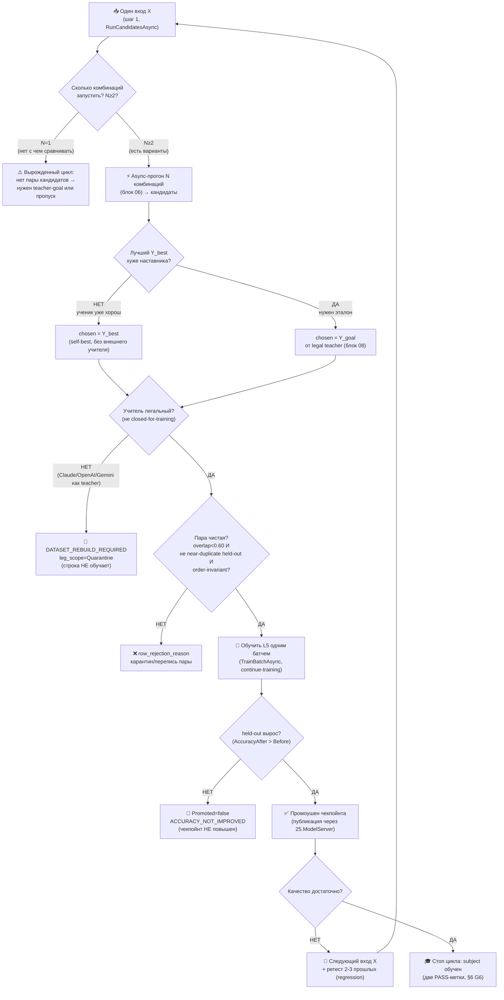

# Гайд 05 — Замкнутая авто-DPO петля (сердце проекта ILearningDynamicGraph)

Автор гайда: Claude (Opus 4.8 MAX), роль — автор гайда в моём namespace `claude-*`.
Это часть **ПЛАНА** (документация-гайд) проекта **ILearningDynamicGraph**, а не
разрешение на реализацию продукта. R2/R3: PLAN-ONLY; исполнение продукта — только
после свежего явного approve Luba в текущем ходе. Все цитаты кода — из реально
существующих файлов рабочего репозитория `C:/Projects/llm_mvp_core` с `file:line`,
перепроверены чтением. Иерархия и уровни проверены по
`docs/skills/trainable-architecture-decision-SKILL.md` и
`00.Core/LearningMachineContracts.cs`.

> **Версия namespace `claude-*`.** Бенчмарк `codex-guide-05-auto-dpo-loop.md`
> (582 строки) прочитан как образец (read-only) и **улучшен в слабых местах** —
> см. дельта-ноту §0.1. Канонические имена `GraphDpoPair`/`TeacherProvenance`/
> `GraphCandidateOutput`/`RunCandidatesAsync`/`EdgeAuthorityUnit`/
> `GraphNodePreferenceState` — общие со всеми `claude-*` и мастер-планом; новых
> архитектурных уровней не вводится (A-LM-12 — закрытый список из 5 уровней).

Связанные блоки/гайды этого плана (evidence-only, не правятся здесь):
- **claude-plan-08** (legal teacher / `TeacherProvenance`) — гейт легальности `chosen`/goal;
- **claude-plan-11** (измерение) — held-out / ablation / две PASS-метки;
- **claude-plan-06** (async-комбинации) — прогон ОДНОГО входа через РАЗНЫЕ комбинации;
- **claude-plan-07** (строитель DPO) — авто-сборка канона `GraphDpoPair`;
- **claude-plan-10** (обучение+lifecycle) — `TrainBatchAsync`/LoRA/continue-training/публикация чекпойнта;
- **claude-plan-12** (no-hidden-determinism) — замена детерминированного выбора на ребре.

Этот гайд 05 — про **петлю**, которая связывает их в один цикл само-улучшения
(фаза доски **Ф7**).

---

## 0. Якорь задачи

```text
CURRENT TASK: написать МОЙ (claude-namespace) улучшенный гайд 05 «Авто-DPO петля» —
              план-документ-решение замкнутого цикла само-обучения графа,
              человеческим русским, Part A-формат, с сохранением структуры и
              канонических счётчиков (12 фаз / 26 подфаз / 59 подшагов,
              нумерация Ф<P>.<SP>.<SS>) и CANON-инвариантов (L5-машина без 6-го
              уровня A-LM-12; легальный teacher-гейт closed=только judge;
              запрет скрытого детерминизма A-LM-09/A-LM-13). Записать ровно в
              claude-guide-05-auto-dpo-loop.md.
NOT THE TASK: исполнять/тестировать/билдить код, запускать раннеры, тренировать,
              вызывать внешние AI/API/модели, git; править/создавать любые codex-*
              (только чтение); продолжать чужой codex-план или каркас claude-00..07.
EVIDENCE-ONLY: codex-guide-05 (бенчмарк, 582 строки), codex-guide-01..04, реконы
              codex-recon-*, доска claude-EXECUTION-CONTROL-BOARD (Ф7 счётчики),
              мастер claude-ILEARNINGDYNAMICGRAPH-PLAN-v1, соседние claude-plan-*
              (мой namespace, согласован), реальный код llm_mvp_core (для цитат).
```

Скилы/гайды, по которым написан гайд (загружены и применены как контекст):
`docs/skills/trainable-architecture-decision-SKILL.md` (5 разрешённых уровней,
Solved Architecture Block, Graph-Style/DynamicGraph Reconstruction Gate,
Graph-DPO Artifact Triad Gate, Legal Teacher Gate, Minimum Breadth Challenge,
KNN-нота `OK_MODEL_COMPONENT`); `docs/skills/implementation-doc-uml-SKILL.md`
(§0 classDiagram + `note for` на каждый класс + симуляция на каждой связи;
§1 `flowchart TD` + симуляция на каждой ветке); `docs/skills/plan-review-SKILL.md`
(Graph/DynamicGraph review gate; DPO/distillation legal teacher provenance gate;
FC-26/FC-27/FC-28 — тест-стратегия и две PASS-метки).

### 0.1. Где этот гайд осознанно лучше бенчмарка `codex-guide-05` (delta-нота, не слепая копия)

Бенчмарк `codex-guide-05` — **сильный** гайд: у него есть концепт-аналогия,
честная оговорка про masquerade, рабочие `file:line` на `DpoTrainer`/`16`/`18`/`26`,
6 гейтов и список пробелов. Он улучшается не «переписыванием», а **достройкой
Part A и устранением конкретных слабых мест**:

| # | Слабое место бенчмарка `codex-guide-05` | Улучшение в этом claude-гайде |
|---|---|---|
| D1 | **Нет §0 UML и §5 иерархии в Part A-формате.** Есть ASCII-«где приземляется» (codex-guide-05:352-359), но нет `classDiagram` с `note for` на каждый класс, нет таблицы симуляции на каждую связь, нет `flowchart TD` с симуляцией каждой ветки, нет §5 с Input/Output типами. По R3/Part-A Completeness такой гайд читается, но как **план-артефакт неполон**. | Достроил §0 (`classDiagram` + легенда + таблица симуляции S1..S12), §1 (`flowchart TD` + per-branch симуляция), §5 (иерархия L5→L2 с Input/Output и цепочками исполнения). |
| D2 | **«разные комбинации» — словами, без контракта.** codex-guide-05:290-297 ссылается на «гайд 04», но не называет контракт поставщика кандидатов. | Назвал канон owner-типом `IGraphCandidateRunner.RunCandidatesAsync(string input, int combinationCount) → IReadOnlyList<GraphCandidateOutput>` (владелец — claude-plan-06 §5.2; B-7 — единый owner-контракт, alias `GraphAsyncCombinationRunner` устранён), с `CombinationId`/`Confidence`/node-trace; `N==combinationCount`, дефолт `N=4`/потолок 8; петля **потребитель** этого контракта, а не изобретатель. |
| D3 | **`chosen`/`rejected`/`[WRONG:]` без типизированного выхода петли.** codex-guide-05:315-320 строит пару, но не фиксирует, что выход — канон `GraphDpoPair` и как `TeacherProvenance` встроен. | Зафиксировал: выход шага 4 — канон `GraphDpoPair` (вложенный `TeacherProvenance`, 18 полей, владелец блок 08); петля **зовёт** `GraphDpoBuilder.BuildPairAsync` (claude-plan-07), а не строит поля заново. |
| D4 | **Контракт самой петли не назван.** codex-guide-05 описывает 6 шагов, но не даёт класс/метод цикла и его вход/выход. | Ввёл **NEW** `GraphAutoDpoLoop.RunCycleAsync(GraphAutoDpoCycleRequest) → GraphAutoDpoCycleResult` с явными полями (§3, §5); это координатор, а не новый уровень иерархии. |
| D5 | **Порог принятия строки задан, но не сведён в единый гейт-конвейер с ранним выходом.** codex-guide-05:336-339,478-487 даёт `margin≥0 ∧ loss<0.693 ∧ overlap`, но порядок гейтов и `row_rejection_reason` на каждом отказе не выписан как алгоритм. | Свёл в §3.4 конвейер legal→split→overlap→permutation→held-out с ранним выходом и `RowRejectionReason` (синхрон с claude-plan-07 §3.4 и claude-plan-11 G-гейтами). |
| D6 | **Промоушен и кумулятивность названы, но без типов состояния и regression-окна как контракта.** codex-guide-05:341-349 ссылается на `AutonomousLearningPipeline:137-140` и «ретест 2-3 прошлых». | Привязал к `EdgeAuthorityUnit` / `GraphNodePreferenceState` (обучаемые субъекты), `LearningBatchResult.AccuracyBefore/After` (`LearningMachineContracts.cs:43`), `ReplayBuffer` 70/30 и явному `RegressionWindow=2..3` (§3.6, §6). |
| D7 | **FLOW-38 / UI-фидбэк как источник `chosen` не пройден через legal-гейт явно.** В бенчмарке UI-фидбэк не выделен как риск teacher-контаминации. | Добавил ветку: `GeneratedUiOutputFeedbackEvent` (**NEW**) с `closed_proprietary_model=true` → `DATASET_REBUILD_REQUIRED`, по умолчанию `PersonalAdaptive`/`Quarantine` (§3.3 шаг 3, §6 C-таблица, синхрон с claude-plan-08). |

CANON-инварианты сохранены (см. §0.2). NEW-типы помечены `NEW`; существующие —
с `file:line`. Структура (1..8) и счётчики (12/26/59, Ф<P>.<SP>.<SS>) сохранены.

### 0.2. CANON-инварианты этого гайда (держим, не нарушаем)

| Инвариант | Что значит | Якорь |
|---|---|---|
| **ILearningDynamicGraph = ILearningMachine\<DynamicGraphDomain\>** | Граф — это L5-машина над доменом графа, **без 6-го уровня**; петля живёт ВНУТРИ L5, не создаёт новый уровень | A-LM-12, `00.Core/LearningMachineContracts.cs:208` |
| **Обучение только на L5 (A-LM-02)** | `Train*` — только на `ILearningMachine`; петля обучает через `TrainBatchAsync`, а не дописывает Train в `ILogicalUnit`/`ILogicalFlow` | `00.Core/LearningMachineContracts.cs:8` |
| **Финал ребра — обучаемый, не детерминированный «победитель»** | async-ветки дают кандидатов; выбор edge принимает обучаемая `EdgeAuthorityUnit`, проверяемая leakage/permutation | A-LM-09/A-LM-13; владелец 02 |
| **Легальный teacher-гейт** | closed-proprietary (Claude/OpenAI/Gemini) = только **judge/eval**, никогда teacher/`chosen`/ranking-target; контаминация → `DATASET_REBUILD_REQUIRED` | Legal Teacher Gate; владелец 08 §5/§8 |
| **Нет скрытого детерминизма** | любой скорер/счётчик/роутер на ребре — обучаемый `ILogicalUnit` либо явный `eval-only/baseline`; немаркированной финальной авторитетности нет | A-LM-09/A-LM-13; claude-plan-12 |

Канон-владельцы общих типов (этот гайд их **синхронизирует**, не задаёт свой набор):
`GraphDpoPair`/`TeacherProvenance` — блок 08; `GraphCandidateOutput`/
`RunCandidatesAsync`/`combination_id` — блок 06; `EdgeAuthorityUnit`/`GraphEdgeKind` —
блок 02; `GraphNodePreferenceState` — блок 04.

### 0.3. Карта фаз гайда (12 фаз / 26 подфаз / 59 подшагов · нумерация Ф.ПП.СС)

Этот гайд — источник канона петли для фазы доски **Ф7 «Авто-DPO петля»**. Его
Gate B (§7) = exit-условие подшагов Ф7.1.1–2, Ф7.2.1–2. Петля **потребляет**
выходы соседних фаз; она не дублирует их канон.

| Подшаг Ф7 | Что решает (человеческим языком) | Источник канона |
|---|---|---|
| **Ф7.1.1** | Один проход петли: прогон входа X через N комбинаций → кандидаты | блок 06 (`RunCandidatesAsync`) |
| **Ф7.1.2** | Обнаружить слабый выход и взять legal-goal как `chosen` | блок 08 (`TeacherProvenanceGate`) |
| **Ф7.2.1** | Построить `GraphDpoPair` и обучить L5 одним батчем (continue-training) | блок 07 (строитель) + блок 10 (`TrainBatchAsync`) |
| **Ф7.2.2** | Измерить (held-out/ablation), промоушен по дельте, regression-окно, повтор | блок 11 (измерение) + блок 10 (публикация чекпойнта) |

Соседние фазы (evidence-only для этого гайда): **Ф2** legal-гейт+канон,
**Ф3** строитель DPO, **Ф4** обучение+lifecycle, **Ф5** измерение, **Ф6**
async-комбинации, **Ф8** no-hidden-determinism. На стадии плана все статусы
доски = `remaining` (план-only) — корректное состояние плана-документа.

---

## 1. Назначение гайда

Гайд описывает **замкнутую авто-DPO петлю** — главный механизм проекта, который
делает граф (`ILearningDynamicGraph` / его узлы и рёбра) само-обучающимся без
ручного написания каждой DPO-пары. Петля выглядит так:

1. **прогнать** граф на реальной задаче — ОДИН вход `X` через **N разных
   комбинаций** юнитов/маршрутов (async, блок 06);
2. **обнаружить** низкокачественный выход узла/ребра/маршрута;
3. **взять выход РАЗРЕШЁННОГО teacher как goal** (правильный ответ-цель) — либо
   лучшую внутреннюю комбинацию `Y_best`, если она достаточна;
4. **обучить L5-машину СТРОИТЬ DPO** — авто-собрать канон `GraphDpoPair`:
   `chosen` (goal/лучшая комбинация) / `rejected` (слабый выход) + `[WRONG: ...]`;
5. **измерить** (блок 11), что обучение реально произошло (reward margin, loss,
   held-out accuracy, ablation);
6. **повторять** до достаточного качества (промоушен чекпойнта только при росте).

ОБЯЗАТЕЛЬНОЕ ядро петли (требование задачи): на шаге 1 один и тот же вход
прогоняется **async через РАЗНЫЕ комбинации юнитов** (блок 06,
`RunCandidatesAsync`), и лучший выход становится обучающим сигналом `chosen`.
DPO строит **либо сам граф (L5), либо разрешённый teacher** (МОДЕЛЬ-учитель из
открытых весов/permissive). **Никогда не используются Claude/OpenAI/Gemini** как
teacher/distillation-цель — только как judge/eval, и только если Luba явно
разрешит (см. §6 G1 и блок 08).

Гайд отвечает на 4 практических вопроса для плана:
- что из этого УЖЕ есть в коде (и работает), а что — ЗАГЛУШКА (§3);
- какой именно алгоритм петли построить (§3.x, контракт `GraphAutoDpoLoop`);
- как выглядит правильная `GraphDpoPair` на реальных значениях (§5-примеры в §4/§ниже);
- какие гейты (анти-leakage, легальный teacher, запрет скрытого детерминизма,
  измерение) защищают петлю от само-обмана (§6).

---

## 2. Концепт простыми словами (аналогия, без кода)

Представьте мастерскую с **учеником** (наша маленькая обучаемая модель — граф
`ILearningDynamicGraph` и его узлы/рёбра) и **наставником** (разрешённый teacher —
открытая модель с дружественной лицензией).

Цикл одного «урока»:

1. **Ученику дают задачу.** Например: «по запросу пользователя выбрать домен и
   под-фазу на ребре `orchestrator→unit`». Ученик решает её **несколькими
   способами одновременно** — разными комбинациями своих инструментов (узлов).
   Это как если бы он написал несколько вариантов ответа разными методами
   (блок 06: async-прогон РАЗНЫХ комбинаций, `RunCandidatesAsync`).
2. **Сравниваем варианты ученика между собой и с эталоном наставника.** Если
   лучший вариант ученика (`Y_best`) всё ещё хуже наставника — фиксируем разрыв.
   Эталон (`goal`) берём ТОЛЬКО у легального наставника, не у запрещённых
   закрытых моделей.
3. **Делаем «карточку урока» (`GraphDpoPair`).** На карточке: тот же вопрос
   (`input_context`), в графе «правильно» (`chosen`) — лучший/эталонный ответ, в
   графе «неправильно» (`rejected`) — слабый ответ ученика, и короткая пометка
   `[WRONG: ...]` (`wrong_markers`) — ПОЧЕМУ слабый ответ хуже (одно
   функциональное последствие, а не «потому что плохо»).
4. **Ученик учится на карточке** — но не зубрит дословно, а сдвигает
   предпочтение в сторону `chosen`. В терминах DPO: повышает `log P(chosen)`
   относительно `log P(rejected)` так, чтобы **reward margin стал > 0**.
5. **Проверяем, что урок усвоен** (блок 11): на отложенных задачах (held-out),
   а не на тех же карточках. И проверяем, что ученик не сжульничал — не выучил
   позицию варианта в списке, имя файла или дословный текст вопроса
   (ablation / permutation).
6. **Повторяем**, пока качество не станет достаточным; «диплом» (промоушен
   чекпойнта) выдаём ТОЛЬКО если измеренное качество выросло.

Ключевая идея «сердца проекта»: **ученик сам себе готовит карточки-уроки** из
своих же ошибок и эталона наставника. Человек не пишет каждую DPO-пару руками —
петля строит их автоматически и непрерывно.

Важная честная оговорка (анти-masquerade): «решать несколькими способами» и
«сравнивать» — это НЕ обязательно «модель умная». Если выбор лучшего варианта
делает фиксированная формула подсчёта ключевых слов, то это **детерминированный
baseline**, а не обученный интеллект (см. §3.4 про `26.TrainableRouter` и §6 G3
про запрет скрытого детерминизма). Петля имеет право называться обучающей только
когда обучаемый уровень (`EdgeAuthorityUnit` / `GraphNodePreferenceState` через
L5) реально сдвигает веса и это доказано измерением (две PASS-метки, §6 G6).

---

## 3. Как это сейчас реализовано в нашем коде

Здесь — точные ссылки `file:line`, что РАБОТАЕТ, а что ЗАГЛУШКА. Классификация
по `trainable-architecture-decision-SKILL.md`.

### 3.1. Сам DPO-движок — РАБОТАЕТ (реальная математика)

`11.DPO/DpoTrainer.cs` — настоящий DPO-тренер, не заглушка.

- Формула потерь и reward margin (комментарий-инвариант): `11.DPO/DpoTrainer.cs:8-9`
  ```
  // Loss = -E[log σ(β · (log π(y_w|x) - log π(y_l|x) - log π_ref(y_w|x) + log π_ref(y_l|x)))]
  ```
- Реальный расчёт margin/loss/accuracy на шаге: `11.DPO/DpoTrainer.cs:42-65`
  ```csharp
  float chosenReward   = Beta * (polChosenLogP   - refChosenLogP);
  float rejectedReward = Beta * (polRejectedLogP - refRejectedLogP);
  float margin         = chosenReward - rejectedReward;
  float loss           = -MathF.Log(Sigmoid(margin) + 1e-8f);
  ...
  Accuracy = margin > 0 ? 1f : 0f
  ```
  `Beta = 0.1f` (`11.DPO/DpoTrainer.cs:13`). Есть ручной backward через logits
  (`BackwardLogProbs`, `:264-309`) и AdamW (`:54`). Метрики сохраняются атомарно
  до возврата (`SaveMetrics`, `:322-328`, tmp→Move). Это реальный обучающий шаг.
- `StepVector(...)` (`:169-224`) — батч с teaching-вектором и весами; именно его
  зовёт обучающий юнит из проекта 18.

**Вывод по §3.1:** ядро «как именно учить на паре chosen/rejected» в проекте
есть и работает. Петле НЕ нужно изобретать DPO-математику — нужно её **кормить
правильными авто-построенными парами (`GraphDpoPair`) и измерять результат**.

Контракт пары — намеренно простой (это конечная точка обучения):
`11.DPO/Models/DpoPair.cs:3-8`
```csharp
public record DpoPair { public string Prompt; public string Chosen; public string Rejected; }
```
Канон `GraphDpoPair` (блок 08) **проецируется** в `LearningTrainingItem`
(`00.Core/LearningMachineContracts.cs:30`) для обучения L5, а в `DpoPair` —
только при материализации JSONL (`11.DPO/DpoDataset.cs:18`).

### 3.2. Авто-построение DPO «из наблюдённой ветки» — РАБОТАЕТ ЧАСТИЧНО (есть пайплайн, но teacher-цели нет)

`18.CapabilityTraining` — ближайший готовый референс авто-DPO для узлов/флоу.
Пайплайн `DefaultLogicalCapabilityTrainer.TrainAndRegisterAsync`:

- Авто-сборка обучающего ряда из наблюдённой ветки:
  `18.CapabilityTraining/DefaultLogicalCapabilityTrainer.cs:167-175`
  ```csharp
  var trainingText = BuildTrainingTextCore(compiledPrompt, compiledText, request.OriginalRequest.UserRequest, branch, subPhase.Value!.SubPhase);
  branchPlans.Add(new TrainingBranchPlan(
      branch, subPhaseId, subPhase.Value.SubPhase,
      trainingText.Text,
      BuildChosenCapabilityText(subPhase.Value.SubPhase),                                  // chosen
      $"Do not generate a capability for sub-phase {subPhase.Value.SubPhase.SubPhaseId}.", // rejected
      trainingText.TeachingVector));
  ```
- Реальный обучающий юнит DPO: `18.CapabilityTraining/LlmIngredientLogicalUnits.cs:308-415`
  (`LogicalDpoTrainingUnit : ILogicalUnit<LogicalDpoTrainingRequest, LogicalDpoTrainingResult>`):
  применяет LoRA (`LoraApplicator.Apply`, `:339`), грузит родительский чекпойнт
  для continue-training (`:340-350`), кодирует пары в тензоры (`BuildBatch`,
  `:418-438`) и крутит `DpoTrainer.StepVector` с ранней остановкой (`:367-376`).
  Метрики — реальные (`LastLoss/LastAccuracy`, `:385-391`).
- Inference learned-юнита: `TransformerEmbeddingKnnLogicalUnit<TOutput>`
  (`:31-171`) — embedding + HNSW поиск + fusion-скоринг (`:151-156`), confidence
  `0.50 + fused*0.49` (`:156`).

**ЧТО ЗАГЛУШКА / СЛАБО здесь (важно для плана):**

1. **`chosen`/`rejected` строятся ДЕТЕРМИНИРОВАННЫМ шаблоном, без teacher.**
   - `chosen`: `BuildChosenCapabilityText` — шаблон-строка, не выход наставника:
     `18.CapabilityTraining/DefaultLogicalCapabilityTrainer.cs:680-683`
     ```csharp
     return $"Generated capability for sub-phase {subPhase.SubPhaseId}: {subPhase.Name}. Execute the requested work through task type {BuildTaskType(subPhase)}.";
     ```
   - `rejected`: дословный шаблон-отрицание
     `"Do not generate a capability for sub-phase {Id}."` (`:174`). По рекону
     `mvp-internal-learn` именно этот шаблон-отрицание дал overlap ~0.70 и провал
     калибровки 2026-05-06 (29/40 батчей с отрицательным margin, loss=ln2≈0.693).
     Это **анти-пример качества пары**.
   - Для авто-DPO петли `chosen` ОБЯЗАН приходить от лучшей async-комбинации
     (блок 06, `Y_best`) или легального teacher (блок 08); `rejected` — реальный
     слабый выход с осмысленным `[WRONG: ...]` (`wrong_markers`).
2. **Нет полей teacher-provenance** в манифесте (нет `model_id`,
   `model_license`, `teacher_access_mode` — рекон `core-18-capability` §5).
   Канон — `TeacherProvenance` (18 полей, блок 08).
3. **Held-out/ablation отсутствуют** — выводятся `LastLoss/LastAccuracy` на
   обучающих парах, нет отдельного held-out и no-shortcut доказательства. Для
   `PASS_AS_TRAINED_FEATURE` этого мало (§6 G4/G6).
4. **Checkpoint-root по умолчанию ВНЕ репозитория**
   (`Path.GetTempPath()/llm-mvp-capability-training`, рекон §2) — нарушает
   R5/Trainable Unit pattern, нет публикации в `25.ModelServer`.

Классификация по скилу: `LogicalDpoTrainingUnit` = `OK_ALLOWED_LEVEL` (реальное
обучение); `TransformerEmbeddingKnnLogicalUnit` = `OK_MODEL_COMPONENT` (KNN/HNSW
как memory-слой); fusion-re-ranker `ScoreCandidates` (`:177-204`) =
`OK_INTERNAL_DETAIL`, ПОКА он re-ranker внутри обученного юнита, НО требует
ablation, иначе риск, что выбор сводится к детерминированной формуле.

### 3.3. Контур «обучить → измерить → повысить только при улучшении» — РАБОТАЕТ как образец (но DPO-канал ПУСТОЙ)

`16.AutonomousLearning` — готовый прецедент само-улучшения с гейтом дельты, НО
именно «авто-DPO» здесь **не подключён**:

- Гейт «повышать только при улучшении»:
  `16.AutonomousLearning/Pipeline/AutonomousLearningPipeline.cs:137-140`
  ```csharp
  if (enhanced <= baseline)
      return OperationResult<CycleResult>.Fail(
          $"Candidate adapter was not promoted because enhanced accuracy {enhanced:0.###} did not exceed baseline {baseline:0.###}.",
          "ACCURACY_NOT_IMPROVED");
  ```
  Это прямой образец шага 6 петли (промоушен по дельте) + кандидат на
  ablation/no-shortcut гейт.
- **DPO-канал ПРОЛОЖЕН, но вызывается ПУСТЫМ** — «розетка без вилки»:
  `16.AutonomousLearning/Pipeline/AutonomousLearningPipeline.cs:120`
  ```csharp
  var trainResult = await _trainer.TrainAsync(domain, weightedExamples, []); // <- [] = пустой список DPO-пар
  ```
  Сигнатура реально принимает DPO-пары:
  `16.AutonomousLearning/Training/AutonomousTrainer.cs:44-47,61`
  ```csharp
  public async Task<OperationResult<string>> TrainAsync(
      string domain, IReadOnlyList<TrainingExample> newExamples, IReadOnlyList<DpoPair> dpoPairs)
  ...
  var trainResult = await _trainer.TrainAsync(domain, mixedBatch, dpoPairs); // проброс в 14.ContinuousLearning
  ```
  То есть место для авто-DPO определено, но «модель сама находит слабые места →
  строит пары» здесь НЕ реализовано: нет анализа ошибок → нет chosen/rejected.
- **UI-фидбэк как источник `chosen` (FLOW-38) — НЕ пройден через legal-гейт.**
  Канон петли: событие `GeneratedUiOutputFeedbackEvent` (**NEW**, в коде нет)
  входит ТОЛЬКО через `TeacherProvenanceGate`. Если фидбэк правил текст `chosen`
  и `closed_proprietary_model=true` → `DATASET_REBUILD_REQUIRED`; по умолчанию
  UI-фидбэк идёт в `PersonalAdaptive`/`Quarantine`, не в `CommonGlobal` без
  доказательства (синхрон с блоком 08, §6 C-таблица).

**Вывод по §3.3:** у нас есть и гейт дельты, и проброс DPO-канала, и
anti-forgetting (`ReplayBuffer` 70/30). Не хватает именно **генератора пар из
ошибок + легального teacher-goal** — это и есть дельта до «сердца проекта».

### 3.4. «Trainable» маршрутизация — СЕЙЧАС ДЕТЕРМИНИРОВАННАЯ (masquerade-риск)

`26.TrainableRouter` называет себя обучаемым, но рантайм-authority —
детерминированный подсчёт ключевых слов (рекон `core-26-router`
§«Классификация»):

- `KeywordUnitScorer.Score` — `text.Contains(keyword)` подсчёт + boosts →
  вердикт скила `FORBIDDEN_RUNTIME_SHORTCUT` (детерминизм как финальная
  authority там, где заявлен trainable router).
- `RoutingProfileTrainer.Train` — сбор словаря ключевых слов, без весов/loss/
  чекпойнта → `REPORT_CLAIM_TOO_STRONG` (это keyword-harvest, не обучение).
- `RoutingTrainingResult.RewardMargin/DpoAccuracy/Promoted` — контрактные
  плейсхолдеры, нигде реально не считаются (рекон §«Классификация»).
- Lifecycle отсутствует целиком: grep по проекту НЕ нашёл `checkpoint`,
  `ExportAsync`, `ImportAsync`, реального DPO-цикла (рекон §«Lifecycle»).

**Вывод по §3.4:** `26` даёт ГОТОВЫЙ ФОРМАТ DPO-пар (`RoutingDpoPairBuilder`,
`OrchestrationPromptDpoPairBuilder`) и метрики acceptance — переиспользуем как
заготовку формата (один из 5 источников строителя, блок 07). Но его
рантайм-выбор юнита нельзя использовать как «обученный» — он
`PASS_AS_HONEST_UNTRAINED_SCAFFOLD` только при честной пометке baseline. В
авто-DPO петле его роль — **источник `rejected` (слабый детерминированный выход)
и формат пары**, а `chosen` приходит от обученного уровня/teacher. Замена
детерминированного выбора на обучаемую `EdgeAuthorityUnit` — фаза **Ф8**
(claude-plan-12).

### 3.5. Контракт самой петли (NEW) и куда она «приземляется» по иерархии

Петля — это **координатор** (helper-уровень оркестрации цикла), а НЕ новый
уровень иерархии. Она зовёт существующие уровни, не добавляя 6-й (A-LM-12).

```csharp
// NEW — координатор замкнутого авто-DPO цикла (helper-оркестрация; НЕ новый уровень).
public sealed class GraphAutoDpoLoop
{
    // Один полный цикл само-улучшения: прогон → обнаружение → goal → строитель → обучение → измерение → промоушен.
    public Task<OperationResult<GraphAutoDpoCycleResult>> RunCycleAsync(
        GraphAutoDpoCycleRequest request, CancellationToken ct = default);
}

// NEW — вход одного цикла.
public sealed record GraphAutoDpoCycleRequest(
    string TrainableSubjectId,     // что учим: ребро (EdgeAuthorityUnit) или узел (GraphNodePreferenceState)
    string Input,                  // реальный вход X
    int CombinationCount,          // N комбинаций для RunCandidatesAsync (блок 06)
    string CheckpointRef,          // текущий чекпойнт L5 (continue-training, не с нуля)
    int RegressionWindow);         // сколько прошлых строк ретестировать (2..3)

// NEW — результат одного цикла (для доски/леджера, без перезаписи).
public sealed record GraphAutoDpoCycleResult(
    GraphDpoPair BuiltPair,        // канон-пара (блок 08); может быть dpo_train_ready=false
    bool RowAccepted,              // прошла ли триаду гейтов
    double RewardMargin,           // из LearningBatchResult (LearningMachineContracts.cs:43)
    double AccuracyBefore,
    double AccuracyAfter,
    bool Promoted,                 // повышен ли чекпойнт (гейт дельты)
    string NextAction);            // "next-input" | "stop-sufficient" | "rebuild-required" | ...
```

Иерархия обучаемых уровней объявлена в `00.Core/LearningMachineContracts.cs`
(namespace `AgentInfrastructure.Logical`):

- `ILearningMachine<TDomain>` — Level 5, методы `TrainBatchAsync / EvaluateAsync /
  ExportAsync / ImportAsync / GetOrchestratorAsync`:
  `00.Core/LearningMachineContracts.cs:208-234`.
- DPO-триплет типизирован как `LearningTrainingItem(ItemId, Prompt,
  ChosenResponse, RejectedResponse)`: `:30-39`; батч `LearningBatch<TDomain>`: `:18-27`.
- Метрики батча `LearningBatchResult` несут `AccuracyBefore/AccuracyAfter/
  RewardMargin/CpuMs/PeakRamMb/ElapsedMs/PromotedUnitIds`: `:43-62` — готовая
  рамка измерения для петли (блок 11).
- Правило A-LM-02 (шапка файла, `:8`): `Train()` только на `ILearningMachine`;
  `ILogicalUnit`/`ILogicalFlow` — чистый инференс. Петля это уважает: обучает
  через машину/тренер, а не дописывает Train* в юниты.

**Где НЕТ кода (это новая надстройка плана):** типов `ILearningDynamicGraph` как
отдельного интерфейса в репозитории НЕТ — в задаче это **псевдоним** существующего
`ILearningMachine<DynamicGraphDomain>` (канон-маппинг, мастер §A.3), не новый
уровень. Граф-контракты (узлы/рёбра/fan-out/fan-in/many-to-many/async) и
координатор `GraphAutoDpoLoop` — **NEW**, проектируются по Graph-Style
Reconstruction Gate (блоки 01/02/03/04/06; §4 ниже).

### 3.6. Кумулятивность и regression-окно (контракт, не словами)

Обучаемые субъекты петли:
- **ребро** → `EdgeAuthorityUnit` (обучаемый выбор цели на ребре; владелец 02);
- **узел** → `GraphNodePreferenceState` (типизированное обучаемое состояние узла,
  `level=unit`; владелец 04, доска Ф4.3.1).

Одно состояние графа живёт через все строки (continue-training из `CheckpointRef`,
не с нуля). После строки N петля **ретестирует** `RegressionWindow=2..3` прошлых
принятых строк (regression-окно), чтобы новый урок не сломал старые. Образец
anti-forgetting — `16.AutonomousLearning/Training/ReplayBuffer.cs` (70/30).

---

## 4. Архитектура петли (§0 UML + §1 flowchart + симуляции)

### 4.1. §0 Class diagram (классы петли + что каждый делает)

```mermaid
classDiagram
    class GraphAutoDpoLoop {
        <<NEW координатор цикла>>
        +RunCycleAsync(req) GraphAutoDpoCycleResult
    }
    class IGraphCandidateRunner {
        <<блок 06 — ВЛАДЕЛЕЦ контракта; поставщик кандидатов>>
        +RunCandidatesAsync(string input, int combinationCount, ct) OperationResult~IReadOnlyList~GraphCandidateOutput~~
    }
    class GraphDpoBuilder {
        <<блок 07 — строитель канон-пары>>
        +BuildPairAsync(raw, ctx) GraphDpoPair
    }
    class TeacherProvenanceGate {
        <<блок 08 — legal-гейт>>
        +Evaluate(provenance) LegalVerdict
    }
    class DynamicGraphMachine {
        <<L5 ILearningMachine~DynamicGraphDomain~>>
        +TrainBatchAsync(batch) LearningBatchResult
        +EvaluateAsync(heldout) LearningBatchResult
    }
    class GraphCandidateOutput {
        <<блок 06 — кандидат комбинации>>
        +CombinationId string
        +Output string
        +Confidence double
    }
    class GraphDpoPair {
        <<блок 08 — канон пары>>
        +Chosen string
        +Rejected string
        +WrongMarkers string[]
        +TeacherProvenance TeacherProvenance
        +DpoTrainReady bool
    }

    note for GraphAutoDpoLoop "NEW. Координирует один полный цикл само-улучшения (6 шагов). НЕ новый уровень иерархии, НЕ обучает сам. Статус: ПРОЕКТ."
    note for IGraphCandidateRunner "Блок 06 — ВЛАДЕЛЕЦ контракта (claude-plan-06 §5.2). Прогоняет ОДИН вход X через N разных комбинаций async. N == combinationCount (единственный источник N); рекомендуемый дефолт N=4, потолок 8 (мастер §E Q16 / блок 06 §12 Q4). Источник chosen/rejected. Гайд/петля — ПОТРЕБИТЕЛИ owner-формы, не переобъявляют. Статус: ПРОЕКТ (опирается на AdaptiveLogicalOrchestrator)."
    note for GraphDpoBuilder "Блок 07. Детерминированный нормализатор: кандидаты → канон GraphDpoPair → триада гейтов. Helper, НЕ обучаемый уровень. Статус: ПРОЕКТ."
    note for TeacherProvenanceGate "Блок 08. Проверяет легальность учителя/goal. closed-for-training → DATASET_REBUILD_REQUIRED. Статус: ПРОЕКТ."
    note for DynamicGraphMachine "L5. Единственный обучаемый уровень петли (A-LM-02). TrainBatchAsync/EvaluateAsync реальны через DpoTrainer. Статус: каркас ПРОЕКТ, движок РАБОТАЕТ (11.DPO)."
    note for GraphCandidateOutput "Блок 06. Один выход одной комбинации: id комбинации, текст, confidence, node-trace. Статус: ПРОЕКТ."
    note for GraphDpoPair "Блок 08. Канон DPO-пары графа; provenance вложен (18 полей). Выход строителя, вход обучения. Статус: ПРОЕКТ."

    GraphAutoDpoLoop ..> IGraphCandidateRunner : шаг 1 (прогон N комбинаций; делегирует, не переобъявляет)
    IGraphCandidateRunner ..> GraphCandidateOutput : RunCandidatesAsync(input, N) → N кандидатов
    GraphAutoDpoLoop ..> GraphDpoBuilder : шаг 4 (строит пару)
    GraphDpoBuilder ..> TeacherProvenanceGate : гейт 1 (legal)
    GraphDpoBuilder ..> GraphDpoPair : output
    GraphCandidateOutput ..> GraphDpoPair : chosen=Y_best / rejected=Y_weak
    GraphAutoDpoLoop ..> DynamicGraphMachine : шаг 4 (TrainBatchAsync) / шаг 5 (EvaluateAsync)
    GraphDpoPair ..> DynamicGraphMachine : проекция в LearningTrainingItem
```

### 4.2. Легенда классов §0

| Класс | Что делает | Статус |
|---|---|---|
| `GraphAutoDpoLoop` | Координатор цикла (6 шагов); НЕ обучает сам, НЕ новый уровень | NEW (ПРОЕКТ) |
| `IGraphCandidateRunner` | `RunCandidatesAsync(string input, int combinationCount)`: X → N комбинаций async (поставщик кандидатов); единый owner-контракт; N==combinationCount, дефолт N=4/потолок 8 | NEW, владелец 06; гайд = потребитель |
| `GraphDpoBuilder` | 5 форматов → канон `GraphDpoPair` → триада гейтов (helper) | NEW, владелец 07 |
| `TeacherProvenanceGate` | Legal-гейт учителя/goal (18 полей провенанса) | NEW, владелец 08 |
| `DynamicGraphMachine` | L5-машина: единственный обучаемый уровень петли | каркас NEW; движок РАБОТАЕТ (`11.DPO/DpoTrainer.cs`) |
| `GraphCandidateOutput` | Один кандидат-выход комбинации (id/текст/confidence/trace) | NEW, владелец 06 |
| `GraphDpoPair` | Канон DPO-пары графа, provenance вложен | NEW, владелец 08 |

### 4.3. Таблица симуляции §0 (для каждой связи: вход → ожидаемый результат)

| # | Связь | Пример входа | Ожидаемый результат |
|---|---|---|---|
| S1 | `GraphAutoDpoLoop ..> IGraphCandidateRunner` | `X="добавь проверку конфиденциальности"`, `N=combinationCount=4` (дефолт) | 4 `GraphCandidateOutput` с разными `CombinationId`, `Confidence`, node-trace (прообраз `LlmIngredientLogicalUnits.cs:156`); вызвана owner-форма с N |
| S2 | `IGraphCandidateRunner ..> GraphCandidateOutput` | комбинация C3 завершилась, verdict=PASS | `CombinationId="C3"`, `Confidence` посчитан, порядок комбинаций НЕ авторитет |
| S3 | `GraphCandidateOutput ..> GraphDpoPair` (self_best) | `Y_best` conf 0.92 vs `Y_weak` conf 0.31 | `chosen=Y_best`, `rejected=Y_weak`+`[WRONG:...]`; `chosen` == реальная лучшая комбинация |
| S4 | `GraphAutoDpoLoop ..> GraphDpoBuilder` | кандидаты + ctx с goal | `Ok(GraphDpoPair)`; при пустом `chosen` — `dpo_train_ready=false`, `row_rejection_reason="EMPTY_SIDE"` (не throw, Rule 1) |
| S5 | `GraphDpoBuilder ..> TeacherProvenanceGate` (closed-for-train) | provenance `closed_proprietary_model=true, used_for_training=true` (напр. `model=claude-*`) | `legal_verdict=DATASET_REBUILD_REQUIRED`, `leg_scope=Quarantine`, `dpo_train_ready=false` |
| S6 | `GraphDpoBuilder ..> TeacherProvenanceGate` (judge-only) | closed-модель `used_for_judging_only=true, used_for_training=false`, chosen НЕ от неё | гейт пройден; `leg_scope` может быть `CommonGlobal` (если остальное чисто) |
| S7 | `GraphDpoBuilder ..> GraphDpoPair` (overlap) | `chosen`≈`rejected`, `overlap_score=0.74` | `row_rejection_reason="LOW_CONTRAST"` (≥0.60), `dpo_train_ready=false` |
| S8 | `GraphDpoPair` permutation | chosen меняется при перестановке кандидатов | `candidate_order_invariant=false`, `rejected_origin="order-artifact"`, карантин (A-LM-09) |
| S9 | `GraphAutoDpoLoop ..> DynamicGraphMachine` (train) | батч из train-ready пар, `CheckpointRef` задан | `TrainBatchAsync` → `LearningBatchResult` с реальным `RewardMargin` (continue-training, не с нуля) |
| S10 | `GraphAutoDpoLoop ..> DynamicGraphMachine` (eval) | held-out набор (источник-дизъюнктный) | `EvaluateAsync` → `AccuracyAfter`; held-out НЕ из обучающих пар (блок 11) |
| S11 | `GraphDpoPair ..> DynamicGraphMachine` (проекция) | train-ready пара | `ItemId←pair_id, Prompt←input_context, ChosenResponse←chosen, RejectedResponse←rejected` (`LearningMachineContracts.cs:30`) |
| S12 | промоушен по дельте | `AccuracyAfter ≤ AccuracyBefore` | `Promoted=false`, `ACCURACY_NOT_IMPROVED` (`AutonomousLearningPipeline.cs:137-140`); чекпойнт НЕ повышен |

### 4.4. §1 Человеко-язычный flowchart петли (per-branch simulation)



### 4.5. Per-branch симуляция веток §1

| Ветка | Симуляция входа | Ожидаемый результат |
|---|---|---|
| B → N=1 | `CombinationCount=1` | вырожденный цикл: нет пары кандидатов, требуется teacher-goal или пропуск входа |
| B → N≥2 | `CombinationCount=4` | 4 кандидата async, можно сравнивать |
| D → НЕТ | `Y_best` conf 0.92, наставник не лучше | `chosen=Y_best` (self-best), внешний teacher не нужен |
| D → ДА | `Y_best` conf 0.45, наставник даёт 0.92 | `chosen=Y_goal` от legal teacher |
| F → НЕТ | provenance `closed_proprietary_model=true, used_for_training=true` | `DATASET_REBUILD_REQUIRED`, строка не обучает |
| F → ДА | open-weight `model_license=Apache-2.0` | пара проходит legal-гейт |
| G → НЕТ | `overlap_score=0.74` | `row_rejection_reason="LOW_CONTRAST"`, карантин/перепись |
| G → ДА | `overlap=0.18`, order-invariant, не near-dup | `dpo_train_ready=true` |
| I → НЕТ | `AccuracyBefore=0.71`, `AccuracyAfter=0.70` | `Promoted=false`, `ACCURACY_NOT_IMPROVED` |
| I → ДА | `AccuracyBefore=0.71`, `AccuracyAfter=0.84` | промоушен чекпойнта |
| K → НЕТ | held-out lift есть, но цель не достигнута | следующий вход + regression-окно 2..3 |
| K → ДА | held-out на целевом пороге, две PASS-метки | стоп цикла, subject обучен |

---

## 5. Пошаговый рецепт / алгоритм петли + §5 иерархия

Ниже — алгоритм без кода: что происходит, где, в каком порядке, какие
классы/контракты задействованы. Это рецепт для ПЛАНА, не реализация.

### Шаг 0 — Подготовка (один раз на петлю)
- Зафиксировать **обучаемый объект** (`TrainableSubjectId`): какое ребро
  (`EdgeAuthorityUnit`, владелец 02) или узел (`GraphNodePreferenceState`,
  владелец 04) учим.
- Зафиксировать **legal teacher** (блок 08): `teacher_access_mode`,
  `hosting_provider`, `model_id`, `model_license`, `provider_terms_checked`,
  `closed_proprietary_model=false`. Без зелёного гейта teacher-выходы как
  `chosen` запрещены.
- Загрузить чекпойнт L5 (`CheckpointRef`): сначала user/cache, затем repo/common;
  если нет — честный `untrained scaffold` (lifecycle, §6 G5).

### Шаг 1 — Прогон одного входа через РАЗНЫЕ комбинации (ОБЯЗАТЕЛЬНО, async; блок 06) [Ф7.1.1]
- Взять реальный вход `X`.
- Async прогнать `X` через `N` **разных комбинаций юнитов/маршрутов** графа через
  owner-форму `IGraphCandidateRunner.RunCandidatesAsync(string input, int combinationCount)`
  (владелец 06; гайд — потребитель, не переобъявляет; опирается на `AdaptiveLogicalOrchestrator`).
  `N == combinationCount` — единственный источник N; **N LOCKED=4, потолок 8** (Luba 2026-06-30)
  (`MaxAdaptiveBranchCount`, `AdaptiveLogicalOrchestrator.cs:19`); источник числа — мастер
  §E Q16 / блок 06 §12 Q4 (финальное N=4/потолок 8 ЗАЛОЧЕНО).
- Собрать `{GraphCandidateOutput_1..N}` с `CombinationId`/`Confidence`/трассой.
  Прообраз confidence — `TransformerEmbeddingKnnLogicalUnit.ExecuteAsync`
  (`18.CapabilityTraining/LlmIngredientLogicalUnits.cs:129-171`).

### Шаг 2 — Обнаружить низкокачественный выход [Ф7.1.2]
- Оценить кандидатов (блок 11 + judges из лучших моделей разрешены как
  СУДЬИ-eval, не teacher): выбрать лучший внутренний `Y_best`.
- Признать «слабыми» выходы заметно хуже `Y_best`/эталона: низкий confidence,
  провал verdict, расхождение с held-out ожиданием. Это кандидаты в `rejected`.
  (Прецедент гейта дельты: `AutonomousLearningPipeline.cs:137-140`.)

### Шаг 3 — Взять выход разрешённого teacher как goal [Ф7.1.2]
- Если `Y_best` всё ещё хуже наставника — получить эталон `Y_goal` у **legal
  teacher** (открытая permissive-модель), пройдя гейт §6 G1 / блок 08.
- Если teacher недоступен/не нужен — `chosen = Y_best` (лучшая комбинация
  ученика). Запрещённые модели (Claude/OpenAI/Gemini) НЕ могут давать `Y_goal`
  как обучающую цель (только судить, если Luba явно разрешит).
- Зафиксировать `TeacherProvenance` (кто сгенерировал `chosen`).
- UI-фидбэк (`GeneratedUiOutputFeedbackEvent`, NEW) входит ТОЛЬКО через тот же
  гейт; по умолчанию `PersonalAdaptive`/`Quarantine`.

### Шаг 4 — Обучить L5 СТРОИТЬ DPO (авто-сборка пары + обучение) [Ф7.2.1]
- Собрать пару через `GraphDpoBuilder.BuildPairAsync` (блок 07):
  `input_context = X`, `chosen = Y_goal/Y_best`, `rejected = слабый выход`,
  `wrong_markers=[WRONG: <одно функциональное последствие>]`.
- Прогнать **триаду гейтов** §3.4 (порядок ниже).
- Обучить уровень одним батч-шагом: `DynamicGraphMachine.TrainBatchAsync`
  (`00.Core/LearningMachineContracts.cs:212-213`) → `LogicalDpoTrainingUnit` →
  `DpoTrainer.StepVector` (`11.DPO/DpoTrainer.cs:169-224`). Если subject уже
  обучался — continue-training из `CheckpointRef`
  (`LlmIngredientLogicalUnits.cs:340-350`), не с нуля.
- Anti-forgetting: подмешать прошлые принятые пары (replay), образец —
  `16.AutonomousLearning/Training/ReplayBuffer.cs` (70/30).

### Шаг 5 — Измерить (блок 11) [Ф7.2.2]
- На **held-out** наборе (не на обучающих парах) замерить
  `AccuracyBefore/After`, `RewardMargin` (`LearningBatchResult`,
  `00.Core/LearningMachineContracts.cs:43-62`; `EvaluateAsync`, `:217-218`).
- Гейт принятия строки (рекон `mvp-internal-learn` §2 + блок 11):
  `reward_margin ≥ 0` И `loss < 0.693` (ln2 = random-guess) И overlap-scan
  пройден. Плюс ablation/permutation: chosen стабилен при перестановке
  кандидатов и без позиционного сигнала.

### Шаг 6 — Промоушен и повтор [Ф7.2.2]
- Повышать чекпойнт (регистрация/публикация через `25.ModelServer` — Trainable
  Unit pattern) **только если** held-out качество выросло (образец гейта:
  `AutonomousLearningPipeline.cs:137-140`).
- Сохранить ledger-строки (одна строка на цикл, без перезаписи) — образец
  `TeachingRowRecord` (рекон `mvp-orch-teaching` §2).
- Если качество ещё недостаточно — следующий вход и повтор с шага 1.
  Кумулятивность: одно состояние графа живёт через все строки; после строки N
  ретест `RegressionWindow=2..3` прошлых (§3.6).

### 5.1. §5 Иерархия уровней (где петля приземляется, Input/Output)

| Уровень | Контракт | Роль в петле | Input → Output |
|---|---|---|---|
| L5 | `ILearningMachine<DynamicGraphDomain>` (`LearningMachineContracts.cs:208`) | **владеет петлёй и обучением** | `LearningBatch<DynamicGraphDomain>` → `LearningBatchResult` |
| L4 | `ILogicalOrchestrator` | маршрут + reprocessing-петля | `LogicalOrchestratorRequest` → `LogicalOrchestratorResult` |
| L3 | `ILogicalFlow<T>` | async-комбинации узлов (fan-out/fan-in), блок 06 | `LogicalFlowRequest<T>` → `LogicalFlowResult` |
| L2 | `ILogicalUnit<TIn,TOut>` | узел; learned: `LogicalDpoTrainingUnit`/KnnUnit (18); edge: `EdgeAuthorityUnit` | `LogicalUnitRequest<TIn>` → `LogicalUnitResult<TOut>` |
| вне иерархии (A-LM-02) | тренер: `DefaultLogicalCapabilityTrainer` + `DpoTrainer` | реальный шаг обучения | пара/батч → margin/loss/accuracy |

Цепочка исполнения одного цикла:
`GraphAutoDpoLoop.RunCycleAsync` → (L3/L4) `RunCandidatesAsync` → кандидаты →
(helper) `GraphDpoBuilder.BuildPairAsync` → (L2-гейт) `TeacherProvenanceGate` →
(L5) `TrainBatchAsync`/`EvaluateAsync` → промоушен/повтор.

---

## 6. Гейты и правила петли

Каждый гейт защищает петлю от само-обмана. Гейт = жёсткое условие, провал =
строка/чекпойнт не принимается.

### G1 — Легальный teacher / provenance (связь с блоком 08)
- `chosen`/`Y_goal` для обучения может прийти ТОЛЬКО от first-party данных, от
  обученного уровня (лучшая async-комбинация), или от **разрешённого hosted
  open-weight/permissive teacher** после проверки terms+license.
- **Claude / OpenAI / Gemini / Gemini Grounding — ЗАПРЕЩЕНЫ как
  distillation-teacher / chosen / rejected / ranking-target.** Если
  `closed_proprietary_model=true` И `used_for_training=true` →
  `DATASET_REBUILD_REQUIRED` (без исключений по скилу; даже разрешение Luba это
  не снимает — closed допустимы лишь как non-training judge/eval).
- Обязательные поля `TeacherProvenance` (18, владелец 08): `teacher_access_mode,
  hosting_provider, model_id, model_license, provider_terms_checked,
  used_for_training, used_for_judging_only, closed_proprietary_model,
  source_category, request_id/model_version`, и т.д. Лицензии для common:
  MIT/Apache-2.0 предпочтительны; CC BY 4.0 только с атрибуцией; RFC/CWE/NIST —
  public domain; CC BY-SA/AGPL/GPL/unknown — запрет (рекон `mvp-external-sources`
  §2). Источники с model-output risk (ShareGPT/WizardLM/Alpaca/Dolly/FLAN-raw)
  дают только A-side форму, ассистент-ответ НЕ копируется как `chosen`.
- Вердикт-enum гейта (6 значений, владелец — `claude-plan-08` §3.3): `ACCEPT | QUARANTINE | BLOCK | DATASET_REBUILD_REQUIRED |
  BLOCK_FOR_COMMON | EVAL_ONLY`. `LegScope`: `CommonGlobal | PersonalAdaptive | EvalOnly |
  Quarantine`. Client/private origin без allowlist + `used_for_training=true` →
  `QUARANTINE` (ветка R17, блок 08).

### G2 — Анти-leakage качества пары
- `overlap_ratio(chosen, rejected) < 0.60` (иначе брак; token-overlap test).
- `rejected` правдоподобен и близок к `chosen`, отличается на ОДНОЙ границе
  решения; имеет код таксономии (`rejected_origin`) и осмысленный
  `[WRONG: ...]` (функциональное последствие, не «плохо»).
- Запрещено, чтобы `chosen` предсказывался по: позиции кандидата в списке
  (`candidate_index`), имени файла/пути (`source_path`), source/pair id,
  дословной памяти промпта (`exact_prompt`), project-specific команде (для
  универсальной модели). Это прямые `QUARANTINE`-сигналы
  (`excluded_leakage_signals`); см. `dpo-triple-format-SKILL.md` +
  `trainable-architecture-decision-SKILL.md`.
- Permutation-инвариантность: `candidate_order_invariant=true`,
  `chosen_skill_stable_across_permutations=true`, иначе
  `QUARANTINE_DO_NOT_TRAIN` или переписать пару.

### G3 — Запрет скрытого детерминизма (Graph-Style edge authority)
- Для КАЖДОГО ребра графа назвать владельца финальной authority:
  детерминированный хелпер / обучаемый unit / flow / orchestrator / machine.
- Скрытый детерминированный scorer/router/lookup/counter на ребре, выдающий
  себя за trainable → `FORBIDDEN_RUNTIME_SHORTCUT` (как `KeywordUnitScorer` в
  проекте 26). Детерминированный хелпер допустим ТОЛЬКО явно помеченным как
  eval-only/baseline/helper, и должен быть перекрыт обученным уровнем
  (`EdgeAuthorityUnit`) с ablation-доказательством, что выбор НЕ сводится к
  формуле (фаза Ф8, claude-plan-12).
- `RewardMargin/DpoAccuracy/Promoted` нельзя оставлять контрактными
  плейсхолдерами (как в `RoutingTrainingResult`) → `REPORT_CLAIM_TOO_STRONG`.

### G4 — Гейты измерения (связь с блоком 11)
- Строка принимается (`ACCEPT_ROW`) только если: verdict=PASS И
  `reward_margin ≥ 0` И `loss < 0.693` И overlap-scan пройден.
- Качество доказывается на **held-out**, а не на обучающих парах
  (`EvaluateAsync`, `00.Core/LearningMachineContracts.cs:217-218`). Самоотчёт
  `LastAccuracy` на train-парах ≠ доказательство (рекон `mvp-internal-learn-2`:
  «unit-test pass rate ≠ DPO accuracy»; валидный отчёт идёт от раннера: rows,
  loss, accuracy, reward margin, CPU, RAM-delta, elapsed).
- Промоушен только при росте held-out (гейт дельты,
  `AutonomousLearningPipeline.cs:137-140`).

### G5 — Lifecycle обучаемого уровня (Trainable Unit pattern, R5)
- Загрузка состояния: user/cache → repo/common → честный untrained scaffold.
- Continue-training из существующего чекпойнта (не с нуля), кроме явно
  названного cold-start.
- Export/import/share + публикация чекпойнта через `25.ModelServer`
  (`IModelRepository`), локатор `IRemoteUnitLocator`, манифест с checkpoint-ref.
- Common-модель + логика + общие сеты — в `llm_mvp_core`; адаптивная
  user-модель + user-сеты — на стороне пользователя (R5). Checkpoint-root НЕ
  должен быть `GetTempPath()` (текущий дефект проекта 18).

### G6 — Honest-untrained vs trained (две легальные PASS-метки)
- `PASS_AS_HONEST_UNTRAINED_SCAFFOLD`: контракт есть, честно сообщает
  `not_ready`, не прячет детерминизм, и эта честность доказана тестами.
- `PASS_AS_TRAINED_FEATURE`: чекпойнт + held-out метрики + ablation + fresh-load
  + continue-training + e2e через реальный entrypoint.
- Подавать scaffold как trained feature = masquerade (самый опасный
  false-positive). Петля обязана различать эти метки в отчёте (`NextAction`).

---

## 7. Gate B петли (exit-условие фазы Ф7)

Это план-документ; статусы доски на стадии плана = `remaining`. Gate B — условие
ВЫХОДА фазы Ф7 при будущем исполнении (после approve Luba).

| Gate | Pass-условие (измеримое) | Подшаг |
|---|---|---|
| **G-Ф7.1** | `RunCandidatesAsync(X, N≥2)` возвращает N кандидатов с разными `CombinationId`; порядок не используется как авторитет | Ф7.1.1 |
| **G-Ф7.2** | `Y_best` выбран измеримо (confidence/verdict); ≥1 кандидат помечен `rejected` правдоподобно | Ф7.1.2 |
| **G-Ф7.3** | `chosen`/goal прошёл `TeacherProvenanceGate`; closed-for-training → `DATASET_REBUILD_REQUIRED` (NEG-тест) | Ф7.1.2 |
| **G-Ф7.4** | `GraphDpoPair.dpo_train_ready=true` только при overlap<0.60 И order-invariant И не near-dup held-out; иначе `row_rejection_reason` заполнен | Ф7.2.1 |
| **G-Ф7.5** | `TrainBatchAsync` обучил из `CheckpointRef` (continue-training, не с нуля); `RewardMargin` реален (не плейсхолдер) | Ф7.2.1 |
| **G-Ф7.6** | held-out `AccuracyAfter > AccuracyBefore` ⇒ `Promoted=true`; иначе `ACCURACY_NOT_IMPROVED` и чекпойнт не повышен | Ф7.2.2 |
| **G-Ф7.7** | regression-окно `2..3` прошлых строк перепроверено; новый урок не сломал старые | Ф7.2.2 |
| **G-Ф7.8** | две PASS-метки различены в `NextAction`; scaffold не подан как trained feature | Ф7.2.2 |

---

## 8. Тест-стратегия (9 слоёв, FC-26; untrained + trained раздельно)

План не допускается к исполнению без тест-стратегии по слоям (FC-26). Для петли
тестируем ОТДЕЛЬНО честность untrained-каркаса (FC-27) и реальность trained-фичи
(FC-28).

| Слой | Что проверяет в петле | Пример ассерта |
|---|---|---|
| **unit** | `GraphAutoDpoLoop.RunCycleAsync` на пустом `chosen` → `dpo_train_ready=false`, не throw (Rule 1) | `result.BuiltPair.DpoTrainReady == false && row_rejection_reason=="EMPTY_SIDE"` |
| **integration** | связка runner→builder→gate→machine на одном входе | один цикл доходит до `LearningBatchResult` без потери контекста |
| **e2e/host** | петля через реальный entrypoint (или явно scoped handler) | цикл запускается из host-команды, не только из теста |
| **QA-automation** | батч из N входов, ledger без перезаписи | N строк в ledger, ни одна не затёрта |
| **UX-automation** | человеко-читаемый отчёт цикла (что выбрано/почему/promoted) | отчёт несёт `chosen`/`[WRONG:]`/margin/promoted без внутреннего жаргона |
| **negative** | closed-teacher → `DATASET_REBUILD_REQUIRED`; overlap≥0.60 → `LOW_CONTRAST`; permutation-флип → карантин | каждый NEG-кейс даёт нужный `row_rejection_reason` |
| **untrained-honesty (FC-27)** | до обучения петля честно репортит `not_ready`, не прячет детерминизм | `PASS_AS_HONEST_UNTRAINED_SCAFFOLD`, нет фейковых margin/checkpoint |
| **trained-acceptance (FC-28)** | после обучения held-out lift + fresh-load + ablation + continue-training | `PASS_AS_TRAINED_FEATURE` со всеми доказательствами |
| **regression** | ретест `RegressionWindow=2..3` прошлых строк после строки N | прошлые принятые строки не деградировали |

Minimum Breadth Challenge (после фокусных находок — второй проход по смежным
зонам): confidence-floors кандидатов; export-accuracy claim; target-label
leakage; runtime routing confidence floors; source/path/provenance leakage;
fallback-to-first-candidate shortcut. Вопрос родительского ревью: «что более
широкий аудит, вероятно, найдёт, что этот гайд пропустил?» — если назовётся
вероятная BLOCKING/HIGH зона, её надо покрыть или явно ограничить scope.

---

## 9. Пробелы / что нужно построить в плане

Это «дельта до сердца проекта» — что в коде отсутствует/заглушено и должно стать
work-order'ами плана (без реализации здесь). Каждая строка маппится на фазу доски.

1. **Координатор `GraphAutoDpoLoop` + генератор пар из ошибок (шаги 1-4).**
   Сейчас `chosen/rejected` — шаблоны (`DefaultLogicalCapabilityTrainer.cs:173-174,
   680-683`), DPO-канал в `16` пустой (`AutonomousLearningPipeline.cs:120`).
   Нужно: NEW-координатор + связка с `RunCandidatesAsync` (блок 06) и
   `GraphDpoBuilder` (блок 07). → **Ф7.1.1, Ф7.2.1**.
2. **Legal teacher интеграция (блок 08).** Нет полей `TeacherProvenance` и вызова
   разрешённого teacher как источника `Y_goal`. → **Ф7.1.2** (гейт), канон **Ф2.1**.
3. **Held-out + ablation/permutation измерение (блок 11).** Нет held-out и
   no-shortcut в проекте 18. Построить eval-набор и ablation-гейт. → **Ф7.2.2**,
   канон **Ф5**.
4. **Граф-контракты + обучаемые субъекты.** `EdgeAuthorityUnit` (ребро, 02),
   `GraphNodePreferenceState` (узел, 04), `GraphCandidateOutput`/
   `RunCandidatesAsync` (06). → **Ф1/Ф4/Ф6** (петля их потребляет).
5. **Замена детерминированного роутинга проекта 26 на обучаемый уровень.**
   `KeywordUnitScorer`/`RoutingProfileTrainer` — `FORBIDDEN_RUNTIME_SHORTCUT`/
   `REPORT_CLAIM_TOO_STRONG`. → **Ф8** (claude-plan-12).
6. **Lifecycle/публикация чекпойнтов (R5/Trainable Unit pattern).**
   Checkpoint-root вне репо (`GetTempPath`), нет публикации в `25.ModelServer`,
   нет export/import/locator. → **Ф4** (claude-plan-10).
7. **Provenance самих chosen/rejected в существующих корпусах (блокер legal).**
   Не доказано, какой моделью сгенерированы `chosen`/`[WRONG:]` в `train-ready-v2`
   — если закрытой → `DATASET_REBUILD_REQUIRED`. Проверить per-source (реконы
   `mvp-internal-learn-2` §5, `mvp-local-wiki` §5, `mvp-orch-teaching` §5: rollout
   Codex/GPT-5 запрещён как teacher). → **Ф2.1.3** (карантин).
8. **Расхождение указателей версии train-ready** (V192/3884 vs V309/1404) —
   определить канонический train-ready (рекон `mvp-internal-learn-2` §5). → **Ф2/Ф3**.
9. **Связка петли с измерением «одна строка за раз» + regression-окно**
   (кумулятивность, continue-training, ретест 2-3 прошлых) — образец в рекон
   `mvp-orch-teaching` §2; перенести в work-order петли. → **Ф7.2.2**.

---

## 10. Ссылки

### Реконы (evidence-only, эта же папка `dpo legal build`)
- `codex-recon-core-16-autonomous.md` — прецедент само-улучшения; пустой DPO-канал.
- `codex-recon-core-18-capability.md` — рабочий референс авто-DPO пайплайна.
- `codex-recon-mvp-internal-learn.md` — метод авто-построения DPO + измерение.
- `codex-recon-mvp-internal-learn-2.md` — model-led прогон, формат trainable-строк.
- `codex-recon-mvp-local-wiki.md` — per-node A→B метод; provenance-блокер.
- `codex-recon-mvp-orch-teaching.md` — «одна пара за раз», lifecycle, continue-training.
- `codex-recon-mvp-external-sources.md` — лицензии/provenance/формат пар (legal).
- `codex-recon-core-26-router.md` — детерминированный роутинг (masquerade-риск).

### Реальные файлы кода (с путями)
- `C:/Projects/llm_mvp_core/11.DPO/DpoTrainer.cs` — DPO-математика (margin/loss/accuracy), `StepVector`.
- `C:/Projects/llm_mvp_core/11.DPO/Models/DpoPair.cs` — контракт пары Prompt/Chosen/Rejected.
- `C:/Projects/llm_mvp_core/11.DPO/DpoDataset.cs` — материализация JSONL (`:18`).
- `C:/Projects/llm_mvp_core/16.AutonomousLearning/Pipeline/AutonomousLearningPipeline.cs` — гейт дельты (`:137-140`); пустой DPO-канал (`:120`).
- `C:/Projects/llm_mvp_core/16.AutonomousLearning/Training/AutonomousTrainer.cs` — проброс `dpoPairs` (`:44-47,61`).
- `C:/Projects/llm_mvp_core/16.AutonomousLearning/Training/ReplayBuffer.cs` — anti-forgetting 70/30.
- `C:/Projects/llm_mvp_core/18.CapabilityTraining/DefaultLogicalCapabilityTrainer.cs` — авто-сборка ряда (`:167-175`); chosen/rejected шаблоны (`:173-174,680-683`).
- `C:/Projects/llm_mvp_core/18.CapabilityTraining/LlmIngredientLogicalUnits.cs` — `LogicalDpoTrainingUnit` (`:308-415`); KNN-юнит (`:31-171`); `LogicalDpoPreferenceExample` (`:281`).
- `C:/Projects/llm_mvp_core/26.TrainableRouter/Training/KeywordUnitScorer.cs` — детерминированный scorer (FORBIDDEN_RUNTIME_SHORTCUT).
- `C:/Projects/llm_mvp_core/00.Core/LearningMachineContracts.cs` — иерархия и DPO-records (`:18-39,43-62,208-234`).

### Соседние блоки/гайды плана (claude-namespace, evidence-only здесь)
- `claude-plan-06-async-combinations.md` — владелец `RunCandidatesAsync`/`GraphCandidateOutput`.
- `claude-plan-07-dpo-builder.md` — владелец `GraphDpoBuilder`/проекции в `LearningTrainingItem`.
- `claude-plan-08-legal-teacher-gate.md` — владелец `TeacherProvenance` (18 полей) + вердикт-enum.
- `claude-plan-10-training-lifecycle.md` — `TrainBatchAsync`/LoRA/continue-training/публикация.
- `claude-plan-11-measurement.md` — held-out/ablation/две PASS-метки.
- `claude-plan-12-no-hidden-determinism.md` — замена детерминированного выбора на ребре (Ф8).

### Скилы/гайды (правила)
- `C:/Projects/llm_mvp_core/docs/skills/trainable-architecture-decision-SKILL.md` — уровни, Legal Teacher Gate, Graph-Style Reconstruction Gate, вердикты.
- `C:/Projects/llm_mvp_core/docs/skills/dpo-triple-format-SKILL.md` — формат триплета, set-quarantine, permutation-инвариантность.
- `C:/Projects/llm_mvp_core/docs/skills/planning-dpo-authoring-SKILL.md` — GENERATED vs REINFORCEMENT, outcome attribution, source curation.
- `C:/Projects/llm_mvp_core/docs/skills/implementation-doc-uml-SKILL.md` — §0 classDiagram + симуляции, §1 flowchart.
- `C:/Projects/llm_mvp_core/docs/skills/plan-review-SKILL.md` — Graph/DynamicGraph review gate; legal teacher provenance gate; FC-26/27/28.

---

## §ADD-05 — Additive: инстанцирование cold-start первичных чисел (закрывает HIGH: stable_hash, from-zero init)

> **Additive**: cross-ref к инстанцированным blueprint-ам plan-09; guide держит канон-ссылку.

**stable_hash (первый held-out, детерминизм) — инстанцирован (см. plan-09 §ADD-09.2):**
конкретная функция = **FNV-1a 64-bit по UTF-8 байтам `SourcePromptEntryId`**, `bucket = hash % 100`,
held-out ⇔ `bucket < heldOutPercent`. **ЗАПРЕЩЁН `System.String.GetHashCode`** (рандомизирован
per-process → сплит невоспроизводим). `stable_hash(...)` как имя-плейсхолдер = НЕ инстанцирование.
`source_sha256` — другое поле (хэш контента), к сплиту не относится.

**cold-start первый TrainBatchAsync from-zero — инстанцирован (см. plan-09 §ADD-09.7):**
при отсутствии чекпойнта `TrainedState := ZeroInitVector(dim)`, `KnnMemory := пусто`,
`ConfidenceTemperature := 1.0`; создатель = `PrepareAsync` при `cold_start && checkpoint==null`.
Первая дельта before/after исчислима: before = untrained scaffold честно `not_ready`.

**Первое число no_signal-стопа:** носитель = `AutoDpoLoopState.consecutiveNoSignal` (число, стоп
при `>= noSignalWindow=3`); не «устойчиво», а конкретный счётчик (plan-09 §5.3).
