# Блок плана 02 — Ребро графа: `ILearningFlow` ≡ `ILogicalFlow` (L3) + ОБУЧАЕМАЯ авторитетность ребра

Автор блока: Claude Opus 4.8 MAX (роль — автор полностью решённого блока плана). Это
часть ПЛАНА проекта `ILearningDynamicGraph` (документация-решение), **не** разрешение
на реализацию продукта и **не** промпт исполнителю. Все цитаты кода — реальные,
проверены чтением файла, с `file:line`. Цитаты чужих планов/транскриптов —
evidence-only.

> Версия namespace `claude-*`. Бенчмарк `codex-plan-02-edge.md` прочитан как
> образец (read-only) и улучшен в слабых местах: (1) исправлены неточные цитаты
> (`BranchResults` живёт на `LogicalOrchestratorResult:190`, а не на
> `LogicalFlowResult`; **сбор веток fan-in уточнён по реальному коду:** коллекция
> `branches` — `AdaptiveLogicalOrchestrator.cs:141` (исполнение `ExecuteBranchesAsync`
> — вызов `:135` / тело `:445`), агрегация fan-in — `:151`
> (`branches.Concat(transitionFollowUp…Branches)`); `:147` — это
> `FollowTransitionSignalsAsync` (петля возврата/return-loop), НЕ fan-in, что
> совпадает с сестринским `claude-plan-00-partA-uml-status.md`); (2) добавлен явный **Solved Architecture Block** и
> **Graph-Style Reconstruction** (требование `trainable-architecture-decision-SKILL.md`);
> (3) добавлена полноценная **§5 иерархия** L5→L4→L3→L2 с Input/Output (требование
> FC-18, в бенчмарке была только неявной); (4) добавлена **Dictionary-to-ILogicalUnit
> матрица замены** с заполненными положительным/отклонённым/карантинным DPO-примерами
> (FC-30 anti-template); (5) `TeacherProvenance` приведён к каноническим **18 полям**
> с `judge_model` ВНУТРИ записи (мастер §A.4 / блок 08 — владелец канона), бенчмарк
> перечислял ~12; (6) добавлены §2-блоки «что НЕ делает» + примеры значений
> параметров; (7) добавлен **Graph-DPO Artifact Triad**.

## CANON-инварианты (сохранены без изменений)

- `ILearningDynamicGraph = ILearningMachine<DynamicGraphDomain>` — уровень **L5**,
  без нового 6-го уровня (A-LM-12).
- Легальный teacher-гейт: closed-модель допустима **только как judge/eval**, НИКОГДА
  как teacher для дистилляции; контаминация → `DATASET_REBUILD_REQUIRED`.
- Нет скрытого детерминизма (A-LM-09 / A-LM-13): финальный авторитет ребра —
  обучаемая `ILogicalUnit`, детерминированные хелперы помечены baseline/eval-only.
- Канон-имена общие со всеми `claude-*`: `GraphEdgeKind` (5 членов),
  `EdgeAuthorityUnit`, `GraphDpoPair`, `TeacherProvenance`.

Маппинг ролей (CANON, обязателен): `ILearningUnit` ≡ `ILogicalUnit` (L2,
`00.Core/LogicalContracts.cs:97`); **`ILearningFlow` ≡ `ILogicalFlow` (L3,
`00.Core/LogicalContracts.cs:166`) — фокус данного блока**; `ILearningOrchestrator`
≡ `ILogicalOrchestrator` (L4, `00.Core/LogicalContracts.cs:202`);
`ILearningDynamicGraph` = `ILearningMachine<DynamicGraphDomain>` (L5,
`00.Core/LearningMachineContracts.cs:208`) поверх динамического графа узлов/рёбер.

Скилы, по которым написан блок (загружены и применены): `implementation-doc-uml-SKILL.md`
(§0/§4 — `note for` на каждый класс + таблица симуляции на каждую связь/ветку),
`implementation-doc-algorithms-SKILL.md` (§1–§3 — класс + метод + параметры + шаги +
«что НЕ делает»), `implementation-doc-hierarchy-SKILL.md` (§5 — уровни Input/Output),
`trainable-architecture-decision-SKILL.md` (5 уровней, Solved Architecture Block,
Graph-Style Reconstruction, Graph-DPO Triad, Legal Teacher Gate, per-edge authority,
anti-shortcut), `plan-review-SKILL.md` FC-26 (тест-стратегия), FC-30 (anti-template
DPO-матрица), `dpo-triple-format-SKILL.md` (канон chosen/rejected/`[WRONG:]`).

---

## 0. Solved Architecture Block (требование trainable-architecture-decision-SKILL)

```text
Solved Architecture Block (ребро графа):
  problem:
    Финальный выбор «кому отдать деталь на развилке fan-out» сегодня считает
    детерминированная формула с фиксированными весами (MultiSubPhaseRouterUnit.Score,
    MultiSubPhaseRouterUnit.cs:283-284) + захардкоженный словарь якорных слов
    (MultiSubPhaseRouterUnit.cs:23). Это честный baseline, но НЕ обучаемый авторитет;
    «ребро» при этом не имеет ни типа (GraphEdgeKind), ни владельца авторитета.
  selected_design:
    Ребро = L3-флоу DynamicGraphEdgeFlow : ILogicalFlow<EdgeTraversalInput>.
    Финальный авторитет ребра = обучаемая L2-юнит EdgeAuthorityUnit :
    ILogicalUnit<EdgeAuthorityInput, EdgeAuthorityDecision>. Обучение — на L5
    ILearningMachine<DynamicGraphDomain>.TrainBatchAsync. Детерминированная
    формула+словарь становятся IEdgeCandidateProvider (baseline-генератор кандидатов
    для ablation), не финал.
  rejected_alternatives:
    (a) Оставить Score() финальным — нарушает A-LM-09 (скрытый детерминизм как
        авторитет); отклонено.
    (b) Сделать обучаемым GraphEdge.Weight — вес живёт в детерминированном
        PageRank-движке 07.GraphEngine, не должен нести семантику; отклонено.
    (c) Ввести новый 6-й уровень иерархии под "DynamicGraph edge" — нарушает
        A-LM-12 (закрытый набор 5 уровней); отклонено.
    (d) Положить авторитет на флоу/юнит как Train* — нарушает A-LM-02 (Train*
        только на машине L5); отклонено.
  UML: см. §4 (Mermaid classDiagram + per-connection simulation).
  data_flow: см. §3.1 (кандидаты → анти-leakage вход → обучаемый авторитет →
    fan-out → fan-in merge) и §3.3 (цикл обучения DPO на L5).
  current_code_refs: см. §6 (все с file:line, проверены чтением).
  future_files_classes_methods_signatures_dependencies: см. §5 (NEW-контракты).
  deterministic-vs-learned boundary: см. §3.2 (таблица владельцев) и §8.2.
    Граница: генерация кандидатов + порядок по зависимостям + confidence-floor +
    петля коррекции = honest deterministic; финальный выбор/порядок fan-out +
    per-target confidence = обучаемый EdgeAuthorityUnit.
  gates_and_tests: см. §8 (гейты) + §9 (тест-стратегия) + §10 (Gate B).
  failure_modes: см. §10.1.
  docs: см. §11 (затрагиваемые доки/реконы/решения).
```

### 0.1. Graph-Style Reconstruction (требование Graph-Style/DynamicGraph Reconstruction Gate)

```text
roles_and_hierarchy: L5 машина учит → L4 оркестратор выбирает → L3 флоу ребра
  исполняет переход → L2 юнит-авторитет решает порядок fan-out.
DynamicGraph nodes: суб-фазы/узлы (ILogicalUnit), вне данного блока (см. claude-plan-01-node).
DynamicGraph edges: IDynamicGraphEdge (NEW) — типизированный переход узел→узел(ы).
input_contracts: EdgeTraversalInput (NEW) для флоу; EdgeAuthorityInput (NEW,
  leakage-free) для авторитета.
output_contracts: EdgeTraversalResult / LogicalFlowResult для флоу;
  EdgeAuthorityDecision для авторитета.
many_to_many_outputs: GraphEdgeKind.ManyToMany + MultiOutput; OrderedTargets[] —
  упорядоченный список целей перехода.
fan_out: GraphEdgeKind.FanOut — деталь рассылается нескольким узлам;
  cap = MaxAdaptiveBranchCount=8 (AdaptiveLogicalOrchestrator.cs:19).
fan_in: GraphEdgeKind.FanIn — IEdgeFanInMerger.Merge(branchResults) (NEW) сливает
  N веток в один LogicalFlowResult + LogicalContextPacket.
multi_output_edge_contracts: GraphEdgeKind.MultiOutput — одно ребро отдаёт
  несколько типизированных выходов; контракт EdgeAuthorityDecision.OrderedTargets[].
async_graph_execution: ParallelEligible (булев флаг ребра, НЕ член enum, мастер
  §A.4.1:181); параллельные ветки исполняются как в AdaptiveLogicalOrchestrator.cs:462,
  зависимые — последовательно (:481).
deterministic_vs_trainable_authority_on_edges: финальный авторитет = ОБУЧАЕМЫЙ
  EdgeAuthorityUnit (DeterministicFinalAuthority=false). Score()/словарь/Weight/
  closure = deterministic helper, помечены baseline/eval-only.
hidden_deterministic_shortcut_check_tied_to_each_edge: ablation-гейт §10 п.3
  (выключить авторитет → accuracy падает) + permutation-invariance §10 п.1 +
  no-source-path/no-candidate-index §8.3.
```

---

## 1. Что это и зачем (роль компонента в `ILearningDynamicGraph`)

Этот блок проектирует **ребро** динамического графа. Ребро в нашем графе — это не
пассивная «стрелка с весом», а **управляемый переход «выход одного узла → вход
следующего узла(ов)»**, у которого есть собственная **обучаемая авторитетность**:
кому отдать деталь дальше, сколько копий сделать (fan-out), как собрать несколько
входов в один (fan-in), и какой именно вариант перехода правильный по смыслу задачи.

Две вещи, которые блок решает (и которые сегодня в коде разнесены/детерминированы):

1. **Сам тип ребра как явный контракт.** Сегодня «ребро» существует в коде в трёх
   несовместимых видах: (а) структурный `GraphEdge { From; To; RelationType;
   Weight=1.0 }` (`07.GraphEngine/Models/GraphEdge.cs:3-8`) — вес задаётся вручную,
   неизменяем, **не обучаем**; (б) топологический `DynamicDomainTransition(FromId,
   ToId)` (`17.DynamicDomains/DynamicDomainGraph.cs:3`) — голая пара id без типа
   ребра и без авторитета; (в) неявное «ребро» внутри оркестратора как массив
   `SubPhaseRoutingDecision[]` (`21.AgentInfrastructure/Logical/SubPhaseRouterUnit.cs:21`).
   Ни один из них не описывает fan-out / fan-in / many-to-many / multi-output /
   return-loop (коррекция) и **владельца финального авторитета ребра**. Блок вводит
   NEW-тип `IDynamicGraphEdge`.

2. **Обучаемую авторитетность ребра вместо детерминированной формулы.** Сегодня
   финальное «кому отдать деталь на развилке fan-out» считает детерминированная
   взвешенная формула `MultiSubPhaseRouterUnit.Score(...)` (метод-владелец строки —
   `MultiSubPhaseRouterUnit.cs:283-284`) с **фиксированными весами**
   `0.55 / 0.25 / 0.20 / 0.02` и захардкоженным словарём якорных слов
   `SubPhaseAnchorTerms` (`MultiSubPhaseRouterUnit.cs:23`). Блок заменяет это
   **обучаемым уровнем**: per-edge authority = обучаемая `ILogicalUnit`
   (`EdgeAuthorityUnit` NEW), а словарь+формула остаются **baseline-генератором
   кандидатов для ablation**, не финальной властью (A-LM-09:
   `DeterministicFinalAuthority = false`; A-LM-13).

Почему это **L3-флоу**, а не просто «юнит»: ребро живёт между узлами и принадлежит
**потоку** (`ILogicalFlow`, `00.Core/LogicalContracts.cs:166`). Поток знает порядок
узлов, рассылает деталь по рёбрам (fan-out), собирает результаты (fan-in; коллекция
веток — `AdaptiveLogicalOrchestrator.cs:141` после `ExecuteBranchesAsync` `:135`/`:445`,
агрегация — `:151` `branches.Concat(...)`, агрегат-тип — `LogicalOrchestratorResult.
BranchResults`, `00.Core/LogicalContracts.cs:190`; `:147` — это return-loop
`FollowTransitionSignalsAsync`, не fan-in) и передаёт контекст между ветками
(`LogicalContextPacket`, `00.Core/LogicalContracts.cs:158`). **Обучение** же этого
ребра — НЕ на флоу и НЕ на юните (A-LM-02: Train* только на машине), а на L5
`ILearningMachine<DynamicGraphDomain>` через `TrainBatchAsync`
(`00.Core/LearningMachineContracts.cs:212`). То есть: ребро **исполняется** на L3,
его авторитет **вычисляет** обучаемая L2-юнит, а **учится** этот юнит на L5.

### 1.1. Роль L3-потока — не только транспорт, но и КОРРЕКЦИЯ (return-loop)

Под линзой R5 уровню flow (L3, `ILearningFlow` ≡ `ILogicalFlow`) назначена роль
**КОРРЕКЦИИ**, а не только «транспорт + маршрутизация». Поэтому поток ребра отвечает
за две связанные функции:

1. **Транспорт/раздача** (выше, §1): fan-out (разослать деталь по рёбрам), fan-in
   (собрать), передача контекста (`LogicalContextPacket`, `00.Core/LogicalContracts.cs:158`).
2. **Корректирующий цикл (return-loop):** обнаружить **слабый/непринятый выход узла**
   и инициировать его **исправление / повторный проход** в пределах лимита глубины —
   это **обратное ребро коррекции** (`GraphEdgeKind.ReturnLoop`, КАНОН §A.4.1; в
   блоке 05 тот же член фигурирует как алиас `BackEdge`).

Важно, **где живёт коррекция по канону**. Сама семантика «исправить результат»
(роли Encoder/Critic/Repair) канонически приписана **узлу** (`ILogicalUnit`, L2):
узел-Critic находит проблему, узел-Repair чинит. **Поток коррекцию не «думает»** —
поток **организует возврат** детали к корректирующему узлу. То есть на L3 коррекция
выражена как управление обратным ребром, а не как «умный выбор почина».

Конкретные механизмы коррекции на потоке (всё уже есть в коде как honest
deterministic; план их **типизирует** как роль ребра, не изобретает заново):

- **Триггер коррекции по честному confidence-floor.** Если узел/авторитет вернул
  результат ниже порога уверенности, поток не «выдумывает» успех, а помечает
  `KnowledgeEdge=true` (`SubPhaseRoutingDecision.KnowledgeEdge`,
  `21.AgentInfrastructure/Logical/SubPhaseRouterUnit.cs:29`; обработка
  `decision.KnowledgeEdge` → `AdaptiveLogicalOrchestrator.cs:504`). Это и есть
  сигнал «деталь надо вернуть/доработать, а не пропускать дальше».
- **Сам возврат — петля коррекции (return-loop): кто ИНИЦИИРУЕТ vs кто ИСПОЛНЯЕТ
  обход.** Это две разные роли на ОДНОМ механизме, и их нельзя смешивать (R5):
  - **L3-поток ИНИЦИИРУЕТ возврат:** поток ребра помечает слабый/непринятый выход
    (`KnowledgeEdge=true`, `SubPhaseRouterUnit.cs:29`) и/или эмитит сигнал перехода
    `PhaseTransitionSignal` с узла-источника (поле `LogicalFlowResult.TransitionSignals`,
    читается на `AdaptiveLogicalOrchestrator.cs:367`). L3 только **подаёт сигнал
    «деталь надо вернуть»** — он НЕ обходит граф сам.
  - **L4-оркестратор ИСПОЛНЯЕТ обход обратного ребра по графу:** сам проход по
    `PhaseTransitionSignal` делает `AdaptiveLogicalOrchestrator.FollowTransitionSignalsAsync`
    (тело `:361`, вызывается из `RunAsync` на `:147`) с жёстким лимитом
    `MaxTransitionDepth = 3` (`:22`, проверка `:380`) — обратные рёбра без бесконечных
    циклов. То есть `FollowTransitionSignalsAsync:361` — это **механизм L4**, на который
    L3 лишь подаёт сигнал, а НЕ «роль потока L3».
  Этот путь и есть `GraphEdgeKind.ReturnLoop`: **инициатива — на L3, обход графа —
  на L4**. Канон-владелец размещения обхода возврата на L4 — сестринский
  `claude-plan-00-partA-uml-status.md` (там `FollowTransitionSignalsAsync:361`
  отнесён к L4-`AdaptiveLogicalOrchestrator`, петля — на оркестраторе); та же
  L3↔L4 роль-граница ReturnLoop держится одинаково во всех трёх claude-блоках
  (claude-02 здесь, claude-03, claude-05).

CANON-инварианты коррекции (не нарушаются):

- **Нет скрытого детерминизма (A-LM-09/A-LM-13/R4):** петля коррекции — honest
  deterministic обратное ребро, оно НЕ претендует на «умный выбор». Финальный
  авторитет ребра (кому и с какой уверенностью отдать) остаётся **обучаемым**
  `EdgeAuthorityUnit` (`DeterministicFinalAuthority=false`). Confidence-floor и
  возврат — это честный guard/transport, помеченный baseline/eval-only.
- **Обучение коррекции — только на L5 (A-LM-02):** если позже «решение о возврате»
  делается обучаемым (а не порогом), оно учится на
  `ILearningMachine<DynamicGraphDomain>.TrainBatchAsync`
  (`00.Core/LearningMachineContracts.cs:212`), а исполняется на L3; Train* на
  флоу/юнит НЕ добавляем.

---

## 2. Концепт простыми словами (аналогия, без кода)

Вернёмся к аналогии завода (станок = узел `ILogicalUnit`, конвейерная линия = поток
`ILogicalFlow`). **Ребро — это лента между станками плюс стрелочник у развилки.**

- Простая лента (1→1) просто несёт деталь дальше.
- **Развилка с веером наружу (fan-out)**: деталь надо отдать сразу нескольким
  станкам (например, «почини баг» → и на «юнит-тесты», и на «рефактор»). Решает
  **стрелочник**: кому и сколько копий.
- **Точка сборки (fan-in)**: несколько лент сходятся в одну, и сборщик из нескольких
  входов делает один согласованный выход.
- **Многоходовое ребро (many-to-many / multi-output)**: одна развилка отдаёт сразу
  несколько типизированных выходов на несколько входов.
- **Петля возврата (return-loop)**: брак едет обратно на корректирующий станок.

Сегодняшний стрелочник — **тупой**: он смотрит в бумажную таблицу «если в заявке есть
слово test/fix — поверни сюда» и складывает баллы по жёсткой формуле `0.55·… +
0.25·… + 0.20·… + 0.02·…`. Это работает как **честный baseline**, но это не
понимание смысла: достаточно во входе случайно встретить слово «сервис», и деталь
поедет не туда (см. пример 3 в §4.2). Хуже того, если стрелочник начнёт
ориентироваться на **позицию кандидата в списке** («первый в списке — значит
правильный») — это уже **скрытая утечка** (leakage): переставь кандидатов местами,
и ответ изменится, хотя смысл задачи тот же.

Наш план меняет стрелочника на **обучаемого**: он смотрит на **смысл заявки** (а не
на позицию в списке и не на путь файла-источника), сам предлагает кому отдать и с
какой уверенностью, и **учится** на парах «как было правильно / как было неправильно»
(DPO). Бумажная таблица якорных слов и старая формула остаются — но только как
**черновик-подсказчик** и как **точка отсчёта для проверки**, что обучаемый стрелочник
реально лучше (ablation: «выключим обучаемого — качество должно просесть»).

Легальность учителя (Legal Teacher Gate): если «правильные ответы» для обучения берём
у внешней модели-эксперта, эксперт обязан быть **легальным** open-weight/permissive
(Qwen3 Apache-2.0 / DeepSeek MIT / Kimi K2 / GLM / Mistral) через нейтрального
провайдера. **Claude / OpenAI / Gemini как teacher для дистилляции — НИКОГДА.** Судья
(judge) для оценки может быть и сильнее, но судья не цель обучения.

### 2.1. Параметры авторитета простыми словами (что НЕ делает + примеры значений)

Аналогия `EdgeAuthorityUnit` (обучаемый стрелочник):

- **Что получает на вход (пример):** `SemanticTokens=["исправь","падающий","unit-тест",
  "backend","оплата"]`, `PredicateIds=["fix","test","payments-domain"]`,
  `Candidates` = неупорядоченный набор {5.1, 4.4, 4.1}, `ExcludedLeakageSignals=
  ["candidate_index","source_path","exact_prompt"]`.
- **Что отдаёт (пример):** `OrderedTargets=[(5.1, 0.86),(4.4, 0.74)]`,
  `FanOutCount=2`, `KnowledgeEdge=false`, `AuthoritySource="trained_edge_unit"`.
- **Что НЕ делает:** не смотрит на позицию кандидата в списке (perm-invariant); не
  использует путь файла-источника как фичу выбора (путь — только provenance-warning);
  не реплеит точный обучающий промпт; не обучается сам (Train* живёт на L5); не
  выдумывает выбор при низкой уверенности (вместо этого `KnowledgeEdge=true`).

---

## 3. Алгоритм/решение ПОШАГОВО (человеческим языком, полное решение)

Ниже — **полное решение**, а не «исполнитель сделает X». Названы конкретные
классы/методы (NEW и существующие с `file:line`), параметры и порядок.

### 3.1. Рантайм-проход ребра fan-out (инференс, L3 → L2)

Контекст вызова сегодня: `AdaptiveLogicalOrchestrator.RunAsync`
(`21.AgentInfrastructure/Logical/AdaptiveLogicalOrchestrator.cs:85`) →
`RouteAsync` (`:316`) → внутри маршрутизации `ExpandRoutedDecisions` (вызов `:340`,
реализация `:772`) → ветки исполняются `ExecuteBranchesAsync` (вызов `:135`, тело
`:445`) и собираются в `branches` (`:141`) → по каждой ветке `ExecuteBranchAsync`
(`:496`); агрегация fan-in добавляется на `:151`, а `:147` — это return-loop
`FollowTransitionSignalsAsync`.

Решение (как должно стать). Вводим **флоу ребра** `DynamicGraphEdgeFlow` (NEW,
реализует `ILogicalFlow<EdgeTraversalInput>`), который владеет одним ребром и делает
ровно следующие шаги:

1. **Сбор кандидатов перехода (генерация, детерминированная, baseline).**
   `DynamicGraphEdgeFlow.ExecuteAsync` вызывает `IEdgeCandidateProvider.Propose(input)`
   (NEW). По умолчанию провайдер = тонкая обёртка над существующей детерминированной
   логикой: словарь `SubPhaseAnchorTerms` (`MultiSubPhaseRouterUnit.cs:23`) +
   `HybridRanker` (`MultiSubPhaseRouterUnit.cs:361`) + topology bridges
   `DynamicDomainGraph.FindBridgeSubPhases` (`17.DynamicDomains/DynamicDomainGraph.cs:68`).
   Выход — **неупорядоченный** список кандидатов `EdgeCandidate[]` (NEW). Это
   **только кандидаты**, не финал. Помечается `authority_role="baseline_candidate_generator"`.

2. **Анти-leakage нормализация входа (обязательна перед авторитетом).**
   `EdgeAuthorityInput` (NEW) строится так, чтобы **физически не содержать**
   запрещённых сигналов: (а) индекс/позиция кандидата в списке (permutation-invariance),
   (б) `SourcePath` как scoring-фича (прецедент уже есть:
   `MultiSubPhaseRouterUnit.BuildPathFreeScoringText`, `MultiSubPhaseRouterUnit.cs:291`
   намеренно исключает путь; путь остаётся **только** как provenance-warning,
   `MultiSubPhaseRouterUnit.cs:373` пишет `source_path_used_for_scoring=false`),
   (в) exact-prompt/source-id replay. Вход несёт только семантику: токены смысла
   заявки, предикаты, контекст-сигналы (`ContextSignals`, читается через
   контекст-ридер, использование — `MultiSubPhaseRouterUnit.cs:301`).

3. **Обучаемая авторитетность ребра (финал).** `DynamicGraphEdgeFlow` вызывает
   `EdgeAuthorityUnit.ExecuteAsync(LogicalUnitRequest<EdgeAuthorityInput>)` (NEW,
   `: ILogicalUnit<EdgeAuthorityInput, EdgeAuthorityDecision>`). Внутри юнит:
   - сортирует кандидатов **по выходу обученной модели** (K-NN (K-Nearest
     Neighbours)-ретривер по обученному индексу как model-component — прецедент
     `KnnLogicalUnit.ExecuteAsync` → `_index.Search`, `21.AgentInfrastructure/
     Logical/KnnLogicalUnit.cs:218` — допустимо ВНУТРИ уровня), а не по
     фиксированной формуле;
   - возвращает `EdgeAuthorityDecision { OrderedTargets[]; FanOutCount;
     KnowledgeEdge; AuthoritySource="trained_edge_unit"; AblationBaselineRank[] }`.
   - **Confidence-floor честность.** Если максимальная уверенность ниже порога, юнит
     не выдумывает выбор, а помечает `KnowledgeEdge=true` — это сохраняет уже
     существующее честное поведение (`SubPhaseRoutingDecision.KnowledgeEdge`,
     `SubPhaseRouterUnit.cs:29`; обработка → `AdaptiveLogicalOrchestrator.cs:504`).

4. **Применение fan-out / fan-in флоу.** `DynamicGraphEdgeFlow` берёт `OrderedTargets`
   (после cap по `MaxAdaptiveBranchCount = 8`, `AdaptiveLogicalOrchestrator.cs:19`,
   логика обрезки `:810`), исполняет ветки (fan-out) и агрегирует их через
   `IEdgeFanInMerger.Merge(branchResults)` (NEW) → типизированный `GraphFanInMergeResult`
   (`Merged` = один `LogicalFlowResult` + `Context` `LogicalContextPacket`
   `00.Core/LogicalContracts.cs:158`; поля-носители `MergeRole`/`MergeOrderIsAuthority=false`,
   §5A.3). **Порядок** при
   наличии зависимостей остаётся детерминированным графовым обходом
   (`DynamicDomainGraph.BuildPredecessorMap`, `17.DynamicDomains/DynamicDomainGraph.cs:15`;
   используется в `AdaptiveLogicalOrchestrator.OrderByTransitions`, `:544`) — это
   `OK_INTERNAL_DETAIL` (топологический порядок без семантической claim). Если план
   позже объявит **предсказание зависимости** обучаемым — тогда
   Jaccard/closure становятся baseline, а финал — обучаемый предиктор (см. блок
   «узел/граф», вне данного блока).

### 3.2. Кто чем владеет (граница deterministic vs trainable на ребре)

| Подшаг ребра | Владелец СЕЙЧАС | Владелец ДОЛЖЕН СТАТЬ | Класс/метод | Вердикт |
|---|---|---|---|---|
| Генерация кандидатов | детерминированный словарь+формула | **остаётся** детерминированным baseline | `IEdgeCandidateProvider` (NEW) над `SubPhaseAnchorTerms` `MultiSubPhaseRouterUnit.cs:23` | `BASELINE_MUST_BE_LABELLED` |
| Финальный выбор/порядок fan-out | `MultiSubPhaseRouterUnit.Score` (фикс-веса) `MultiSubPhaseRouterUnit.cs:283` | **обучаемый** `EdgeAuthorityUnit` (NEW) | `EdgeAuthorityUnit.ExecuteAsync` (NEW) | `NEEDS_ILOGICALUNIT_WRAPPER` |
| Fan-in слияние | неявно `BranchResults=[…]` `LogicalContracts.cs:190` (коллекция `AdaptiveLogicalOrchestrator.cs:141`, агрегация `:151`; `:147`=return-loop, не fan-in) | **явный контракт** `IEdgeFanInMerger` (NEW) | `IEdgeFanInMerger.Merge` (NEW) | `OK_INTERNAL_DETAIL`→явный контракт |
| Порядок по зависимостям | `BuildPredecessorMap` (DFS) `DynamicDomainGraph.cs:15` | остаётся детерминированным, ЕСЛИ нет claim | `OrderByTransitions` `AdaptiveLogicalOrchestrator.cs:544` | `OK_INTERNAL_DETAIL` |
| Обучение авторитета ребра | (нет) | **L5** `ILearningMachine.TrainBatchAsync` `LearningMachineContracts.cs:212` | через `ILogicalCapabilityTrainer.TrainAndRegisterAsync` | `OK_ALLOWED_LEVEL` |
| Замена baseline на trained | (нет) | реестр `latest-wins` `InMemoryLogicalUnitRegistry.ResolveLatest` | A-LM-03 | `OK_ALLOWED_LEVEL` |

### 3.3. Цикл обучения авторитета ребра (DPO, L5)

1. **Сбор сигнала.** Каждый рантайм-проход ребра логирует `EdgeTraversalTrace` (NEW):
   вход (нормализованный, без leakage), предложенные кандидаты, выбор, итог ветки
   (принят/отклонён downstream-арбитром).
2. **Построение пары `GraphDpoPair`** (CANON, см. §5): `Level="edge"`,
   `NodeOrEdgeId=<edgeId>`, `Chosen` = верный набор переходов, `Rejected` = неверный
   с `[WRONG: …]`, `ExcludedLeakageSignals=["candidate_index","source_path",
   "exact_prompt"]`, `CandidateOrderInvariant=true`, `TeacherProvenance{…}` (легальный,
   18 полей), `DpoTrainReady` (gate).
3. **Маппинг в `LearningTrainingItem`** (`00.Core/LearningMachineContracts.cs:30`):
   `Prompt`=InputContext; `ChosenResponse`=Chosen; `RejectedResponse`=Rejected+`[WRONG:]`.
   Батч — `LearningBatch<DynamicGraphDomain>` (`:18`), провенанс — `SourceIds` (`:26`)
   плюс teacher-поля (см. §5/§8).
4. **Train + публикация.** `ILearningMachine.TrainBatchAsync`
   (`LearningMachineContracts.cs:212`) → `ILogicalCapabilityTrainer.TrainAndRegisterAsync`
   → новый `EdgeAuthorityUnit` регистрируется как `IsLearned=true`; `latest-wins`
   реестра заменяет baseline (A-LM-03). Метрики — `LearningBatchResult`
   (`:43`, без UNKNOWN в production) и `LearningEvaluationResult.PassesGate` (`:100`).
5. **Lifecycle загрузки (обязателен):** user/cache checkpoint первым → repo/common
   вторым (fallback) → честный untrained-статус, если нет ни одного → backup/export/import
   (`ExportAsync`/`ImportAsync`, `:222/:227`) → continue-training **от** checkpoint, не с нуля.

### 3.4. Graph-DPO Artifact Triad (требование Graph-DPO Artifact Triad Gate)

Ни одна DPO-строка ребра не train-ready, пока не существует триада артефактов:

```text
raw_comparison_event:
  graph_path_ids: [edge:<edgeId>, from=<nodeFrom>, to_candidates=[5.1,4.4,4.1]]
  prompt_or_request_id_if_allowed: req-<hash>  (только если разрешено провенансом)
  source_license_authority: <source_ref + license_ref>
  candidate_order_hash: <hash набора кандидатов БЕЗ позиции>  (для perm-invariance)
  near_miss_reason: "rejected повернул на 4.1 по слову 'сервис', смысл = тест/баг"
legal_provenance_dpo_envelope:
  source: project-local trace | approved teacher
  license: Apache-2.0/MIT (teacher) | local (project)
  authority: human/Luba | legal-approved open-weight
  allowed_use_decision: train_common | train_personal | eval_only
  split_id: source-disjoint train|heldout
  terms_status: terms_snapshot_ref + provider_terms_checked
training_batch:
  batch_id: <id>
  graph_manifest_id: <edge-authority manifest id>
  checkpoint_hash: <hash базового checkpoint, если continue-training>
  model_id: <teacher/judge model id, если применялся>
  sampling_params: <если кандидаты генерировались стохастически>
  seed: <seed>
  access_mode: hosted-open | self-hosted | project-local
```

---

## 4. UML-фрагмент компонента (Mermaid classDiagram)

```mermaid
classDiagram
    direction LR

    class ILogicalFlow~TInput~ {
        <<interface, L3, EXISTING>>
        +ExecuteAsync(LogicalFlowRequest) LogicalFlowResult
    }
    note for ILogicalFlow~TInput~ "СУЩЕСТВУЕТ 00.Core/LogicalContracts.cs:166. L3 поток = владелец ребра. Чистый inference (Train НЕТ). ПОЛНОСТЬЮ РЕАЛИЗОВАН как контракт."

    class ILogicalUnit~TInput,TOutput~ {
        <<interface, L2, EXISTING>>
        +ExecuteAsync(LogicalUnitRequest) LogicalUnitResult
    }
    note for ILogicalUnit~TInput,TOutput~ "СУЩЕСТВУЕТ LogicalContracts.cs:97. Авторитет ребра — обучаемая реализация этого контракта. ПОЛНОСТЬЮ РЕАЛИЗОВАН как контракт."

    class IDynamicGraphEdge {
        <<interface, NEW>>
        +EdgeId : string
        +FromNodeId : string
        +ToNodeIds : IReadOnlyList~string~
        +Kind : GraphEdgeKind
        +ParallelEligible : bool
        +AuthorityUnitId : string
        +DeterministicFinalAuthority : bool
        +BaselineUnitId : string
        +ExcludedLeakageSignals : IReadOnlyList~string~
        +TraverseAsync(EdgeTraversalInput) EdgeTraversalResult
    }
    note for IDynamicGraphEdge "NEW (СКЕЛЕТ). Типизированное ребро, ЕДИНЫЙ КАНОН (источник истины claude-plan-03 §5 / claude-plan-00 §A.4.2). Цель МНОЖЕСТВЕННАЯ: ToNodeIds (Sequential/OneToOne => 1) — иначе нельзя выразить FanOut/MultiOutput/ManyToMany. Kind = КАНОН GraphEdgeKind (5 членов §A.4.1): FanOut/FanIn/ManyToMany/MultiOutput/ReturnLoop (КОРРЕКЦИЯ, honest deterministic back-edge). Async = булев флаг ParallelEligible, НЕ член enum. Владелец финала = AuthorityUnitId (ССЫЛКА в реестр, latest-wins A-LM-03), НЕ прямой объект ILogicalUnit. DeterministicFinalAuthority=false в проде (носитель A-LM-09)."

    class DynamicGraphEdgeFlow {
        <<class, NEW, : ILogicalFlow>>
        -_candidates : IEdgeCandidateProvider
        -_authority : EdgeAuthorityUnit
        -_merger : IEdgeFanInMerger
        +ExecuteAsync(LogicalFlowRequest) LogicalFlowResult
    }
    note for DynamicGraphEdgeFlow "NEW (СКЕЛЕТ). L3-реализация ребра. Порядок: кандидаты(baseline) -> анти-leakage вход -> обучаемый авторитет -> fan-out -> fan-in merge."

    class IEdgeCandidateProvider {
        <<interface, NEW>>
        +Propose(EdgeTraversalInput) EdgeCandidate[]
    }
    note for IEdgeCandidateProvider "NEW (СКЕЛЕТ). ДЕТЕРМИНИРОВАННЫЙ baseline-генератор кандидатов (словарь+HybridRanker+bridges). authority_role=baseline_candidate_generator. НЕ финал."

    class EdgeAuthorityUnit {
        <<class, NEW, : ILogicalUnit>>
        +ExecuteAsync(LogicalUnitRequest~EdgeAuthorityInput~) EdgeAuthorityDecision
    }
    note for EdgeAuthorityUnit "NEW (СКЕЛЕТ, цель PASS_AS_TRAINED_FEATURE). ОБУЧАЕМЫЙ финальный авторитет ребра. Вход без candidate-index/source-path. K-NN-ретривер как model-component внутри. IsLearned=true."

    class IEdgeFanInMerger {
        <<interface, NEW>>
        +Merge(LogicalFlowResult[]) GraphFanInMergeResult
    }
    note for IEdgeFanInMerger "NEW (СКЕЛЕТ). Явный контракт fan-in: many-to-many слияние веток в ТИПИЗИРОВАННЫЙ GraphFanInMergeResult (Merged + Context + MergeRole=DeterministicFanInBaseline + MergeOrderIsAuthority=false). Поля-носители инварианта перм-инвариантности merge (§10 п.8), симметрично IDynamicGraphEdge.DeterministicFinalAuthority."

    class GraphFanInMergeResult {
        <<record, NEW>>
        +Merged : LogicalFlowResult
        +Context : LogicalContextPacket
        +MergeRole : FanInMergeRole
        +MergeOrderIsAuthority : bool = false
        +MergedBranchCount : int
    }
    note for GraphFanInMergeResult "NEW (СКЕЛЕТ). ТИПИЗИРОВАННЫЙ носитель N→1 merge. MergeOrderIsAuthority=false + MergeRole=DeterministicFanInBaseline = машинно-проверяемый свидетель Gate §10 п.8 (симметрия A-LM-09 носителю ребра). Раньше жило только в прозе."

    class MultiSubPhaseRouterUnit {
        <<class, EXISTING, baseline>>
        -Score() double
    }
    note for MultiSubPhaseRouterUnit "СУЩЕСТВУЕТ MultiSubPhaseRouterUnit.cs:8. Фикс-веса 0.55/0.25/0.20/0.02 (:283). ПОЛНОСТЬЮ РЕАЛИЗОВАН, но СТАНОВИТСЯ baseline внутри IEdgeCandidateProvider, НЕ финал."

    class GraphEdge {
        <<record, EXISTING, struct>>
        +Weight : double = 1.0
    }
    note for GraphEdge "СУЩЕСТВУЕТ 07.GraphEngine/Models/GraphEdge.cs:3. Вес ручной, неизменяем = НЕ обучаем. Остаётся структурным хелпером, не авторитетом."

    class DynamicDomainTransition {
        <<record, EXISTING>>
        +FromId : string
        +ToId : string
    }
    note for DynamicDomainTransition "СУЩЕСТВУЕТ 17.DynamicDomains/DynamicDomainGraph.cs:3. Голое ребро топологии. IDynamicGraphEdge оборачивает его, добавляя Kind+Authority."

    class ILearningMachine~DynamicGraphDomain~ {
        <<interface, L5, EXISTING>>
        +TrainBatchAsync(LearningBatch) LearningBatchResult
    }
    note for ILearningMachine~DynamicGraphDomain~ "СУЩЕСТВУЕТ LearningMachineContracts.cs:208. ЕДИНСТВЕННЫЙ владелец Train* (A-LM-02). Учит EdgeAuthorityUnit. Контракт РЕАЛИЗОВАН; DynamicGraphDomain-реализация — СКЕЛЕТ."

    ILogicalFlow~TInput~ <|.. DynamicGraphEdgeFlow : implements
    ILogicalUnit~TInput,TOutput~ <|.. EdgeAuthorityUnit : implements
    IDynamicGraphEdge ..> EdgeAuthorityUnit : resolve AuthorityUnitId (latest-wins A-LM-03)
    DynamicGraphEdgeFlow --> IEdgeCandidateProvider : 1 propose candidates
    DynamicGraphEdgeFlow --> EdgeAuthorityUnit : 2 final order/fan-out
    DynamicGraphEdgeFlow --> IEdgeFanInMerger : 3 merge fan-in
    IEdgeFanInMerger --> GraphFanInMergeResult : returns typed carrier (MergeOrderIsAuthority=false)
    IEdgeCandidateProvider ..> MultiSubPhaseRouterUnit : wraps as baseline
    IDynamicGraphEdge ..> DynamicDomainTransition : wraps topology edge
    EdgeAuthorityUnit ..> GraphEdge : Weight = eval-only, not authority
    ILearningMachine~DynamicGraphDomain~ ..> EdgeAuthorityUnit : TrainBatchAsync -> publish (latest-wins)
```



### 4.1. Легенда

| Класс | Что делает | Статус |
|---|---|---|
| `ILogicalFlow<TInput>` | L3-контракт потока, владелец ребра, чистый inference | EXISTING (контракт) |
| `ILogicalUnit<TInput,TOutput>` | L2-контракт юнита, реализуется авторитетом ребра | EXISTING (контракт) |
| `IDynamicGraphEdge` | типизированное ребро (FromNodeId + ToNodeIds[] + Kind + ParallelEligible + AuthorityUnitId-ссылка) | NEW (СКЕЛЕТ) |
| `DynamicGraphEdgeFlow` | L3-реализация: кандидаты→вход→авторитет→fan-out→fan-in | NEW (СКЕЛЕТ) |
| `IEdgeCandidateProvider` | детерминированный baseline-генератор кандидатов | NEW (СКЕЛЕТ) |
| `EdgeAuthorityUnit` | ОБУЧАЕМЫЙ финал ребра (порядок/уверенность fan-out) | NEW (СКЕЛЕТ→цель trained) |
| `IEdgeFanInMerger` | явный контракт fan-in слияния веток (→ `GraphFanInMergeResult`) | NEW (СКЕЛЕТ) |
| `GraphFanInMergeResult` | типизированный носитель N→1 merge (`MergeRole` + `MergeOrderIsAuthority=false`) | NEW (СКЕЛЕТ) |
| `MultiSubPhaseRouterUnit` | сегодняшний детерминированный стрелочник (фикс-веса) | EXISTING → baseline |
| `GraphEdge` | структурный вес ребра (PageRank), не обучаем | EXISTING (eval-only) |
| `DynamicDomainTransition` | голое ребро топологии (FromId/ToId) | EXISTING |
| `ILearningMachine<DynamicGraphDomain>` | L5, единственный владелец Train*, учит авторитет | EXISTING (контракт) |

Обозначения связей: `<|..` implements · `-->` поток вызова · `..>` зависимость
(в т.ч. резолв `AuthorityUnitId` ребра в реестр по ссылке, НЕ композиция-владение —
ребро не держит юнит объектом, см. §5 канон).

### 4.2. Таблица симуляции (на каждую связь/ветку: пример входа → ожидаемый результат)

| Связь / ветка | Пример входа | Ожидаемый результат |
|---|---|---|
| `DynamicGraphEdgeFlow --> IEdgeCandidateProvider` (генерация) | «исправь падающий unit-тест в backend-сервисе оплаты» | кандидаты {5.1, 4.4, 4.1} **без порядка**, `authority_role=baseline_candidate_generator` |
| `IDynamicGraphEdge ..> EdgeAuthorityUnit` (резолв `AuthorityUnitId`) | ребро с `AuthorityUnitId="unit-edge-authority-v1"`, `DeterministicFinalAuthority=false` | реестр `latest-wins` (A-LM-03) отдаёт **обученный** `EdgeAuthorityUnit`; baseline-формула НЕ финал; ребро держит **ссылку по ID**, не объект |
| анти-leakage вход (нормализация) | тот же + список кандидатов в порядке [4.1,5.1,4.4] и `SourcePath=/payments/x.cs` | `EdgeAuthorityInput` БЕЗ позиции и БЕЗ пути; путь → только warning `source_path_used_for_scoring=false` |
| `DynamicGraphEdgeFlow --> EdgeAuthorityUnit` (финал, обучен) | нормализованный вход выше | `OrderedTargets=[(5.1,0.86),(4.4,0.74)]`, `AuthoritySource=trained_edge_unit` (смысл «тест/баг», не слово «сервис») |
| permutation-инвариантность (ветка leakage) | те же кандидаты в порядке [4.4,5.1,4.1] | **тот же** `OrderedTargets=[5.1,4.4]` (выбор не зависит от позиции) |
| confidence-floor (ветка честности) | «сделай что-нибудь хорошее» (нет сигнала) | `KnowledgeEdge=true`, выбор не выдуман (`AdaptiveLogicalOrchestrator.cs:504`) |
| коррекция / return-loop (обратное ребро, §1.1) | узел вернул слабый/непринятый результат (`KnowledgeEdge=true` или downstream REPROCESS) | **L3-поток ИНИЦИИРУЕТ** возврат (метит `KnowledgeEdge`/эмитит `PhaseTransitionSignal`); **L4-оркестратор ИСПОЛНЯЕТ обход** обратного ребра `GraphEdgeKind.ReturnLoop` через `FollowTransitionSignalsAsync` (тело `AdaptiveLogicalOrchestrator.cs:361`, вызов `:147`, чтение сигналов `:367`) в пределах `MaxTransitionDepth=3` (`:22`, проверка `:380`); honest deterministic back-edge, без claim «умного почина» |
| `DynamicGraphEdgeFlow --> IEdgeFanInMerger` (fan-in) | две ветки 5.1 и 4.4 вернули результаты | один `GraphFanInMergeResult { Merged=LogicalFlowResult; Context с двумя фрагментами; MergeRole=DeterministicFanInBaseline; MergeOrderIsAuthority=false; MergedBranchCount=2 }` |
| `IEdgeFanInMerger --> GraphFanInMergeResult` (типизированный носитель) | тот же вход в 5 перестановках | `MergeOrderIsAuthority=false` и `MergeRole=DeterministicFanInBaseline` на КАЖДОМ выходе; merged идентичен → Gate §10 п.8 читает свидетель с поля типа, не из прозы |
| `IEdgeCandidateProvider ..> MultiSubPhaseRouterUnit` (baseline) | тот же вход | формула `0.55/0.25/0.20/0.02` (`:283`) даёт черновой ранг — используется **только** в ablation-сравнении |
| `EdgeAuthorityUnit ..> GraphEdge` | ребро с `Weight=1.0` | `Weight` НЕ влияет на выбор (eval-only); влияет только обученный выход |
| `ILearningMachine ..> EdgeAuthorityUnit` (обучение) | батч из 100 `GraphDpoPair(Level=edge)` | `LearningBatchResult{AccuracyAfter>Before, RewardMargin>0, без UNKNOWN}`; trained-юнит публикуется (latest-wins) |
| ablation (no-shortcut) | тот же held-out набор, обучаемый авторитет выключен | accuracy **просаживается** ≥ порога → доказывает, что качество держит обученный юнит, не baseline |

---

## 5. Контракты/типы (предлагаемые сигнатуры; NEW vs существующее)

Существующее (на это опираемся, не меняем сигнатуры; все проверены чтением файла):
- `interface ILogicalFlow<TInput>` — `00.Core/LogicalContracts.cs:166` (фокус: ребро это L3-флоу).
- `interface ILogicalUnit<TInput,TOutput>` — `LogicalContracts.cs:97` (авторитет ребра — реализация).
- `record LogicalFlowRequest<TInput>` / `LogicalFlowResult` — `LogicalContracts.cs:105 / :131`.
- `record LogicalContextPacket` / `LogicalContextFragment` — `LogicalContracts.cs:158 / :146` (носители fan-in контекста).
- `record LogicalOrchestratorResult` с `BranchResults` — `LogicalContracts.cs:190` (агрегат fan-in; **именно тут** живёт `BranchResults`, не на `LogicalFlowResult`).
- `record SubPhaseRouterSourceDocument` — `SubPhaseRouterUnit.cs:6`.
- `record SubPhaseRoutingDecision` — `SubPhaseRouterUnit.cs:21` (текущий «результат ребра»; поле `KnowledgeEdge:29`).
- `record LearningTrainingItem(ItemId, Prompt, ChosenResponse, RejectedResponse)` — `LearningMachineContracts.cs:30` (целевой DPO-формат).
- `record LearningBatch<TDomain>` (`SourceIds:26`) / `LearningBatchResult` / `LearningEvaluationResult` (`PassesGate:100`) — `LearningMachineContracts.cs:18 / :43 / :90`.
- `interface ILearningMachine<TDomain>` — `LearningMachineContracts.cs:208` (Train:212 / Export:222 / Import:227).

NEW (проектируется здесь; в коде НЕТ — пометка NEW):

```csharp
// NEW. Вид ребра графа. КАНОН вида ребра — МАСТЕР §A.4.1
// (codex-ILEARNINGDYNAMICGRAPH-PLAN-v1.md:154-188); здесь — детализация I/O
// авторитета §A.4.2. Имя/набор enum БЕРЁМ из мастера, не объявляем свой:
//   - КАНОН-имя типа: GraphEdgeKind (мастер §A.4.1:165,170);
//     EdgeKind / DynamicGraphEdgeKind / GraphEdgeKind{...Bridge} /
//     EdgeKind{...BackEdge,AsyncParallel} — УСТАРЕВШИЕ ПСЕВДОНИМЫ (мастер §A.4.1:183-187);
//     расхождение имени или числа членов = дефект, а не «своя резолюция блока»;
//   - КАНОН-набор — РОВНО 5 членов {FanOut,FanIn,ManyToMany,MultiOutput,ReturnLoop}
//     (мастер §A.4.1:170; Gate B доски «5 видов ребра»);
//   - член ReturnLoop ОБЯЗАТЕЛЕН (КОРРЕКЦИЯ: инициатива на L3-потоке, обход ребра
//     исполняет L4-оркестратор FollowTransitionSignalsAsync:361 — §1.1 и §4.2);
//     в блоке 05 он же фигурирует как алиас BackEdge — один и тот же член,
//     каноническое имя ReturnLoop (мастер §A.4.1:177);
//   - AsyncParallel — НЕ член enum (мастер §A.4.1:181): режим исполнения,
//     выражается отдельным БУЛЕВЫМ флагом ребра ParallelEligible (ниже), не kind;
//   - OneToOne — НЕ член (мастер §A.4.1:179): вырожденный FanOut с одной целью;
//   - Sequential/Bridge — НЕ отдельные kind (мастер §A.4.1:178,180): Sequential =
//     порядок обхода зависимостей (BuildPredecessorMap DynamicDomainGraph.cs:15),
//     Bridge = флаг KnowledgeEdge.
public enum GraphEdgeKind { FanOut, FanIn, ManyToMany, MultiOutput, ReturnLoop }

// NEW. Вход обхода ребра (нормализованный поток несёт его в TInput флоу).
public sealed record EdgeTraversalInput(
    string RunId,
    string EdgeId,
    SubPhaseRouterSourceDocument Source,   // EXISTING тип, SubPhaseRouterUnit.cs:6
    ContextSignals Context);               // EXISTING тип (контекст-ридер)

// NEW. Один кандидат перехода (БЕЗ позиции/индекса в типе).
public sealed record EdgeCandidate(
    string TargetSubPhaseId,
    string[] EvidencePredicates,
    double BaselineScore,                   // только baseline/ablation, НЕ финал
    string AuthorityRole);                  // = "baseline_candidate_generator"

// NEW. Вход обучаемого авторитета: ФИЗИЧЕСКИ без leakage-сигналов.
public sealed record EdgeAuthorityInput(
    string EdgeId,
    string[] SemanticTokens,                // смысл заявки, не путь
    string[] PredicateIds,
    ContextSignals Context,
    IReadOnlyList<EdgeCandidate> Candidates,// порядок несущественен (perm-invariant)
    string[] ExcludedLeakageSignals);       // ["candidate_index","source_path","exact_prompt"]

// NEW. Решение обучаемого авторитета ребра.
public sealed record EdgeAuthorityDecision(
    IReadOnlyList<(string TargetSubPhaseId, double Confidence)> OrderedTargets,
    int FanOutCount,
    bool KnowledgeEdge,                      // честный "не знаю" при пробитии floor
    string AuthoritySource,                 // = "trained_edge_unit"
    IReadOnlyList<string> AblationBaselineRank);

// NEW. Обучаемый финальный авторитет ребра (учится на L5).
public sealed class EdgeAuthorityUnit : ILogicalUnit<EdgeAuthorityInput, EdgeAuthorityDecision>
{
    public const string Id = "unit-edge-authority-v1";
    public const string Role = "edge-authority";
    public Task<OperationResult<LogicalUnitResult<EdgeAuthorityDecision>>> ExecuteAsync(
        LogicalUnitRequest<EdgeAuthorityInput> request, CancellationToken ct = default);
}

// NEW. Детерминированный baseline-генератор кандидатов (обёртка над существующим).
public interface IEdgeCandidateProvider
{
    OperationResult<EdgeCandidate[]> Propose(EdgeTraversalInput input);
}

// NEW. Явный контракт fan-in слияния. Возвращает ТИПИЗИРОВАННЫЙ носитель
// GraphFanInMergeResult (поля MergeRole + MergeOrderIsAuthority=false, §5A.3),
// а НЕ голый LogicalFlowResult — носитель инварианта перм-инвариантности на уровне ТИПА.
public interface IEdgeFanInMerger
{
    OperationResult<GraphFanInMergeResult> Merge(
        IReadOnlyList<LogicalFlowResult> branchResults, string runId);
}

// NEW. Типизированное ребро графа.
// ЕДИНЫЙ КАНОН ребра (источник истины — claude-plan-03-orchestrator.md §5 строки
// 461-477 + claude-plan-00-partA-uml-status.md §A.4.2 строки 678-679; согласован с
// мастером §A.4.1/§A.4.2). Расхождение этих полей между claude-блоками = ДЕФЕКТ,
// а не «деталь именования». УСТАРЕВШИЕ ПСЕВДОНИМЫ (НЕ использовать): прямой объект
// ILogicalUnit Authority и AuthorityUnitRef — ребро ССЫЛАЕТСЯ на обученного владельца
// ПО ID (резолв latest-wins A-LM-03), а НЕ держит объектом.
public interface IDynamicGraphEdge
{
    string EdgeId { get; }
    string FromNodeId { get; }                  // канон: узел-источник перехода
    IReadOnlyList<string> ToNodeIds { get; }    // канон: МНОЖЕСТВО целей; Sequential/OneToOne => 1 элемент
                                                // (закрывает структурную невозможность выразить FanOut/MultiOutput/ManyToMany)
    GraphEdgeKind Kind { get; }                 // КАНОН §A.4.1 (5 членов), НЕ EdgeKind
    bool ParallelEligible { get; }              // async = флаг, НЕ член enum (§A.4.1:181)
    string AuthorityUnitId { get; }             // ССЫЛКА в реестр на обученного владельца (latest-wins A-LM-03), НЕ прямой объект
    string AuthorityUnitLevel { get; }          // уровень владельца (ожидается L2 ILogicalUnit)
    bool DeterministicFinalAuthority { get; }   // ОБЯЗАТЕЛЬНО = false в проде (машинно-проверяемый носитель A-LM-09)
    string? BaselineUnitId { get; }             // baseline-генератор кандидатов (напр. MultiSubPhaseRouterUnit)
    string BaselineRole { get; }                // напр. "candidate_generator" | "ablation_baseline"
    IReadOnlyList<string> ExcludedLeakageSignals { get; } // [candidate_index, source_path, exact_prompt]
    string SourceProof { get; }                 // провенанс происхождения ребра
    string CutoverProof { get; }                // доказательство перехода baseline→trained
    string AblationProofRef { get; }            // ссылка на ablation-доказательство (§10 п.3)
    Task<OperationResult<EdgeTraversalResult>> TraverseAsync(
        EdgeTraversalInput input, CancellationToken ct = default);
}

// NEW. Результат обхода ребра (для трассировки/обучения).
public sealed record EdgeTraversalResult(
    EdgeAuthorityDecision Decision,
    LogicalFlowResult Merged,
    EdgeTraversalTrace Trace);

// NEW. Трасса обхода ребра -> сырьё для GraphDpoPair.
public sealed record EdgeTraversalTrace(
    string EdgeId,
    EdgeAuthorityInput NormalizedInput,
    IReadOnlyList<EdgeCandidate> ProposedCandidates,
    EdgeAuthorityDecision Chosen,
    bool DownstreamAccepted);   // ИСТОЧНИК: EdgeDownstreamAcceptanceUnit (§5A.1) — не «голый булев»,
                                // а вердикт названного L2-арбитра приёмки; питает Chosen/Rejected DPO.

// NEW. L3-флоу ребра.
public sealed class DynamicGraphEdgeFlow : ILogicalFlow<EdgeTraversalInput>
{
    public Task<OperationResult<LogicalFlowResult>> ExecuteAsync(
        LogicalFlowRequest<EdgeTraversalInput> request, CancellationToken ct = default);
}

// NEW. Канон DPO-пары (общий для блоков unit/edge/graph; утвердить у Luba — §12).
public sealed record GraphDpoPair(
    string PairId,
    string Level,                  // "edge" для этого блока
    string NodeOrEdgeId,
    string InputContext,
    string Chosen,
    string Rejected,
    string[] WrongMarkers,         // ["[WRONG: ...]"]
    string Reason,
    TeacherProvenance TeacherProvenance,
    string[] SourceIds,
    bool HeldOut,
    bool CandidateOrderInvariant,
    string[] ExcludedLeakageSignals,
    bool DpoTrainReady);

// NEW. Провенанс учителя (в коде/данных СЕЙЧАС НЕТ — построить).
// КАНОН-набор = 18 полей (мастер §A.4: 13 базовых + 5 NEW); judge_model — ВНУТРИ
// этой записи, НЕ отдельным верхнеуровневым полем (мастер §A.4:143; владелец канона
// — блок 08). При расхождении числа полей/размещения judge_model — владелец канона блок 08.
public sealed record TeacherProvenance(
    // 13 базовых:
    string TeacherAccessMode,
    string HostingProvider,
    string ModelId,
    string ModelLicense,
    string ModelVersion,
    string RequestId,
    bool   ProviderTermsChecked,
    bool   TeacherOutputUsedForTraining,
    bool   ClosedProprietaryModel,   // ДОЛЖНО быть false для дистилляции
    string SourceRef,
    string SourceSha256,
    string[] ContaminationMarkers,
    string JudgeModel,               // судья ВНУТРИ провенанса; не цель обучения
    // 5 NEW (мастер §A.4:144-149):
    string TermsSnapshotRef,         // T2
    string GeographyExportConstraint,// T2
    string SourceCategory,           // T5
    bool   RawPrivateTextCopied,     // T3
    string RedactionPolicyRef);      // T3
// Предусловие DpoTrainReady=true: provenance_field_presence_rate == 1.0 по всем 18 полям.
```

> **Единый канон ребра (обязательная ссылка, чинит дефект блока 02).**
> `IDynamicGraphEdge` в этом блоке — тот же единственный канонический тип, что и в
> `claude-plan-03-orchestrator.md §5` (строки 461-477) и `claude-plan-00-partA-uml-status.md
> §A.4.2` (строки 678-679); они и есть **источник истины** формы ребра. Канон:
> цель **МНОЖЕСТВЕННАЯ** (`IReadOnlyList<string> ToNodeIds`; `Sequential/OneToOne` => 1
> элемент — иначе нельзя выразить FanOut/MultiOutput/ManyToMany); вид —
> `GraphEdgeKind` **5 членов**; async — флаг `ParallelEligible` (НЕ член enum); владелец
> финала — `string AuthorityUnitId` (**ссылка** в реестр, резолв latest-wins A-LM-03);
> носитель A-LM-09 — `bool DeterministicFinalAuthority` (в проде `false`); плюс поля
> доказательств `BaselineUnitId/BaselineRole/ExcludedLeakageSignals/SourceProof/
> CutoverProof/AblationProofRef`. **УСТАРЕВШИЕ ПСЕВДОНИМЫ (НЕ использовать):** прямой
> объект `ILogicalUnit Authority` и `AuthorityUnitRef` — ребро ССЫЛАЕТСЯ на обученного
> владельца по ID, а НЕ держит его объектом. Расхождение этих полей между claude-блоками —
> **ДЕФЕКТ**, а не «деталь именования» (та же формулировка — claude-plan-03 §5, claude-plan-04
> §6, claude-plan-00 §A.4.2). Сам обучаемый `EdgeAuthorityUnit` остаётся целью обучения;
> меняется только способ владения — по ссылке-ID, не объектом.

---

## 5A. Роли рёбер R4: downstream-арбитр приёмки + узел коррекции Critic/Repair + fan-in merge (B-14/B-15/B-16, RESOLVED — инстанцированный blueprint)

> Эта секция закрывает шаг починки **R4-edge-roles** тремя инстанцированными
> blueprint-ами (не промптами исполнителю): **B-14** материализованные поля
> `EdgeAuthorityInput`/`EdgeAuthorityDecision` (выше §5 — подтверждено block-level
> ниже §5A.0); **B-15** downstream-арбитр приёмки (`DownstreamAccepted` —
> класс/метод/критерий/источник learning-сигнала) + корректирующий узел
> Critic/Repair как **коррекция вход→выход** на L3 (`ILearningFlow`); **B-16** выбор
> и выписанный алгоритм N→1 fan-in merge `IEdgeFanInMerger` (baseline vs trainable —
> РЕШЕНО). Консистентно с уже принятыми решениями шагов: канон-форма выхода узла =
> отложенный `IQueryable<GraphNodeCandidate>`, материализация ровно одна на границе
> узел→раннер, порядок массива на границе раннер→ребро НЕ авторитет (B-9/CROSS);
> ребро ссылается на владельца по `AuthorityUnitId` (latest-wins A-LM-03);
> `GraphDpoPair` — владелец блок 07; `TeacherProvenance` (18 полей) — владелец блок 08.

### 5A.0. B-14 — материализованные поля `EdgeAuthorityInput`/`EdgeAuthorityDecision` (block-level подтверждение)

`EdgeAuthorityInput` и `EdgeAuthorityDecision` материализованы полями уже в §5
(строки `record EdgeAuthorityInput(...)` / `record EdgeAuthorityDecision(...)`).
Block-level фиксация инвариантов входа/выхода авторитета ребра:

| Поле | Тип | Роль | Инвариант (machine-checkable) |
|---|---|---|---|
| `EdgeAuthorityInput.SemanticTokens` | `string[]` | смысл заявки (НЕ путь, НЕ позиция) | leakage-free |
| `EdgeAuthorityInput.PredicateIds` | `string[]` | предикаты доказательства | leakage-free |
| `EdgeAuthorityInput.Context` | `ContextSignals` | контекст-сигналы | leakage-free |
| `EdgeAuthorityInput.Candidates` | `IReadOnlyList<EdgeCandidate>` | НЕупорядоченный набор кандидатов | `candidate_order_invariant=true` (порядок несущественен) |
| `EdgeAuthorityInput.ExcludedLeakageSignals` | `string[]` | физический запрет фич | содержит `candidate_index`,`source_path`,`exact_prompt` |
| `EdgeAuthorityDecision.OrderedTargets` | `(string,double)[]` | финальный порядок целей + confidence | перм-инвариантен входу |
| `EdgeAuthorityDecision.FanOutCount` | `int` | сколько целей разослать | `<= MaxAdaptiveBranchCount=8` |
| `EdgeAuthorityDecision.KnowledgeEdge` | `bool` | честный «не знаю» при пробитии floor | при низкой уверенности = true |
| `EdgeAuthorityDecision.AuthoritySource` | `string` | провенанс решения | `"trained_edge_unit"` (или `"baseline"` в untrained) |
| `EdgeAuthorityDecision.AblationBaselineRank` | `IReadOnlyList<string>` | baseline-ранг для ablation | заполнен всегда (для §10 п.3) |

Block-level вердикт B-14: `edge_authority_io_materialized=true`,
`fields_are_block_level=true`, `leakage_free_input=true`,
`perm_invariant_decision=true`.

### 5A.1. B-15 (часть 1) — Downstream-арбитр приёмки `EdgeDownstreamAcceptanceUnit` (источник `DownstreamAccepted`)

**Зачем (человеческим языком).** В трассе ребра (`EdgeTraversalTrace`, §5) есть поле
`bool DownstreamAccepted`. Сегодня это «голый булев» без владельца — кто и по какому
критерию решает, что выход ветки приняли «вниз по конвейеру»? Это и есть **источник
learning-сигнала** для авторитета ребра: пара `GraphDpoPair(Level=edge)` строится из
того, что downstream **принял** (→ кандидат в `Chosen`) против того, что downstream
**отклонил/вернул на доработку** (→ кандидат в `Rejected` с `[WRONG:]`). Без честного
арбитра приёмки авто-DPO петля (блок 09) не знает, какая ветка была хорошей.

**Что это (роль и уровень).** Арбитр приёмки — **L2 `ILogicalUnit`**
(`EdgeDownstreamAcceptanceUnit : ILogicalUnit<DownstreamAcceptanceInput,
DownstreamAcceptanceDecision>`), **детерминированный честный baseline** (НЕ финальный
семантический авторитет, НЕ обучается): он лишь читает уже вычисленный вердикт ветки
и решает приёмку по явному порогу. Он помечен `BaselineRole="acceptance_baseline"`,
`DeterministicFinalAuthority` к нему не применяется (он не выбирает цель ребра — это
делает обучаемый `EdgeAuthorityUnit`). Арбитр **производит learning-сигнал**, но сам
не является обучаемым выбором (R4: нет скрытого «умного» детерминизма, потому что он
не претендует на семантический выбор — он лишь маркирует исход).

**Класс/метод/критерий (инстанцировано).**

```csharp
// NEW. Вход арбитра приёмки (читает РЕЗУЛЬТАТ ветки, не выбирает цель).
public sealed record DownstreamAcceptanceInput(
    string EdgeId,
    string TargetSubPhaseId,            // какая ветка проверяется
    LogicalFlowResult BranchResult,     // результат исполнения ветки (EXISTING тип :131)
    double BranchConfidence,            // уверенность ветки [0..1]; НОСИТЕЛЬ ИСПРАВЛЕН:
                                        // источник = EdgeAuthorityDecision.OrderedTargets[].Confidence
                                        // обученного авторитета (NEW, §5 :620), для baseline-ветки =
                                        // SubPhaseRoutingDecision.Confidence (SubPhaseRouterUnit.cs:21).
                                        // НЕ из LogicalFlowSummary:114 — у того типа полей confidence НЕТ
                                        // (его поля = Baseline/Enhanced/Passed/NextAction, см. claude-plan-03 §8.4 :720-721).
    bool DownstreamReprocessRequested); // downstream явно попросил REPROCESS?

// NEW. Решение арбитра приёмки = источник learning-сигнала для DPO.
public sealed record DownstreamAcceptanceDecision(
    bool DownstreamAccepted,            // → поле EdgeTraversalTrace.DownstreamAccepted
    string AcceptanceVerdict,           // "ACCEPTED" | "REJECTED" | "RETURN_FOR_REPAIR"
    string AcceptanceReason,            // человекочит. причина (для [WRONG:] / ledger)
    double AcceptanceScore);            // нормализованный балл приёмки [0..1] (диагностика)

// NEW. Детерминированный baseline-арбитр приёмки (L2 ILogicalUnit, eval/signal-only).
public sealed class EdgeDownstreamAcceptanceUnit
    : ILogicalUnit<DownstreamAcceptanceInput, DownstreamAcceptanceDecision>
{
    public const string Id = "unit-edge-downstream-acceptance-v1";
    public const string Role = "edge-downstream-acceptance";
    public const string BaselineRole = "acceptance_baseline"; // НЕ финальный семантический авторитет
    // СТОП-ЧИСЛО (EDGE-io). Порог приёмки = тот же confidence-floor, что у роутера/триггера.
    // ЗАЛОЧЕН = 0.80 (единое v1-число, выровнено с WeaknessTriggerConfig.confidenceFloor=0.80
    // claude-plan-09 §5.3 :750 и GoalConfidenceFloor мастер Q17). Приёмка и маршрутизация
    // мерят честность ОДНИМ числом, а не разными порогами.
    public const double AcceptanceFloor = 0.80;
    public Task<OperationResult<LogicalUnitResult<DownstreamAcceptanceDecision>>> ExecuteAsync(
        LogicalUnitRequest<DownstreamAcceptanceInput> request, CancellationToken ct = default);
}
```

**Критерий приёмки (пошаговый алгоритм, детерминированный честный baseline).**
Вход — `DownstreamAcceptanceInput`. Шаги внутри `ExecuteAsync`:
1. **Verdict-rank ветки.** Прочитать `BranchResult` и вычислить ранг вердикта по
   существующему `VerdictRank` (`AdaptiveLogicalOrchestrator.cs:913`): `PASS` >
   `PASS_WITH_GAPS` > `KNOWLEDGE_EDGE` > `REJECT`. Это уже работающая шкала «худший
   вердикт главный» (fan-in), переиспользуется как критерий приёмки одной ветки.
2. **Confidence-floor (число).** Если `BranchConfidence < AcceptanceFloor` → ветка НЕ
   принята. `AcceptanceFloor` ЗАЛОЧЕН `= 0.80` (`EdgeDownstreamAcceptanceUnit.AcceptanceFloor`,
   §5 выше) — то же число, что у триггера слабости (`WeaknessTriggerConfig.confidenceFloor
   = 0.80`, claude-plan-09 §5.3 :750) и `GoalConfidenceFloor` (мастер Q17), чтобы приёмка
   и маршрутизация мерили честность ОДНИМ порогом. Это измеримый стоп-критерий приёмки,
   а не «предлагаемый дефолт».
3. **Явный REPROCESS.** Если `DownstreamReprocessRequested=true` → вердикт
   `RETURN_FOR_REPAIR` (downstream сам попросил вернуть; см. §5A.2 — это триггер узла
   коррекции).
4. **Решение:** `ACCEPTED`, если вердикт ∈ {`PASS`,`PASS_WITH_GAPS`} И confidence ≥
   floor И нет REPROCESS; иначе `REJECTED` (низкий вердикт/уверенность) или
   `RETURN_FOR_REPAIR` (явный возврат). `DownstreamAccepted = (verdict==ACCEPTED)`.
5. **`AcceptanceScore`** = нормализованная комбинация verdict-rank и confidence (только
   диагностика/провенанс, НЕ авторитет выбора).

**Источник learning-сигнала (как `DownstreamAccepted` рождает DPO-пару).** В §3.3
шаг 1 трасса `EdgeTraversalTrace.DownstreamAccepted` заполняется ИМЕННО этим арбитром.
Затем построитель пары (блок 07, `IGraphDpoPairBuilderUnit`) использует:
- ветки с `DownstreamAccepted=true` (вердикт `ACCEPTED`) → кандидат в `Chosen`;
- ветки с `DownstreamAccepted=false` (`REJECTED`/`RETURN_FOR_REPAIR`) → кандидат в
  `Rejected` с `[WRONG: <AcceptanceReason>]` (одно функциональное последствие).
Это закрывает «голый булев»: `DownstreamAccepted` — теперь типизированный исход
названного L2-арбитра с явным критерием и явной ролью в DPO.

**Почему НЕ обучаемый (честная граница R4).** Арбитр приёмки — это **измеритель
исхода**, а не **семантический выбор**. Семантический выбор «кому отдать деталь» —
обучаемый `EdgeAuthorityUnit` (§3.1, §5). Если приёмку сделать обучаемой, возникнет
цикл «модель сама себе ставит оценку» (reward-hacking). Поэтому арбитр приёмки
ДЕТЕРМИНИРОВАН и помечен `acceptance_baseline`; его выход — независимый сигнал для
обучения авторитета. Это прямо отвечает запрету скрытого детерминизма: он не выдаёт
себя за trainable — он честный eval/signal-only компонент (A-LM-12 деталь реализации
внутри уровня).

### 5A.2. B-15 (часть 2) — Узел коррекции Critic/Repair как L3-коррекция вход→выход (`EdgeCorrectionFlow`)

**Зачем.** §1.1 уже назначила L3-потоку роль **КОРРЕКЦИИ** (return-loop): инициатива
возврата — на L3, обход обратного ребра `GraphEdgeKind.ReturnLoop` исполняет L4. Но
«что именно чинит брак» канонически приписано **узлу** (`ILogicalUnit`): Critic
находит проблему, Repair чинит. B-15 материализует это как **коррекцию вход→выход
между юнитами** — ровно роль `ILearningFlow` (R5: flow = коррекция).

**Что это (роль и уровень).** `EdgeCorrectionFlow : ILogicalFlow<EdgeCorrectionInput>`
(L3) — корректирующий поток, который оркеструет пару узлов Critic→Repair как
**коррекцию выхода предыдущего узла во вход следующего**. Поток коррекцию НЕ
«думает» (это узлы), он **организует возврат и повторный проход** в пределах лимита.
Сами Critic/Repair — L2-узлы (вне фокус-блока 02 детально — это блок 01), но их
**подключение как коррекция вход→выход** живёт здесь на L3.

```csharp
// NEW. Вход корректирующего потока (получает непринятую ветку от арбитра §5A.1).
public sealed record EdgeCorrectionInput(
    string EdgeId,
    string TargetSubPhaseId,
    LogicalFlowResult RejectedBranchResult,    // что вернул downstream-арбитр как непринятое
    DownstreamAcceptanceDecision Acceptance,   // вердикт RETURN_FOR_REPAIR/REJECTED + причина
    int CorrectionDepth);                      // текущая глубина коррекции (лимит — ниже)

// NEW. Результат коррекции (вход для повторного прохода или честная сдача).
public sealed record EdgeCorrectionResult(
    bool RepairAttempted,
    LogicalFlowResult RepairedOrOriginal,      // исправленный выход ИЛИ исходный, если чинить нечем
    string CorrectionVerdict,                  // "REPAIRED" | "NO_REPAIR_POSSIBLE" | "DEPTH_LIMIT"
    string CritiqueReason);                    // что Critic нашёл (→ [WRONG:] для DPO)

// NEW. L3-поток коррекции = коррекция вход→выход между Critic-узлом и Repair-узлом.
public sealed class EdgeCorrectionFlow : ILogicalFlow<EdgeCorrectionInput>
{
    public const string Id = "flow-edge-correction-v1";
    // Внутри: _critic (ILogicalUnit, находит проблему) → _repair (ILogicalUnit, чинит).
    // Лимит глубины = MaxTransitionDepth=3 (AdaptiveLogicalOrchestrator.cs:22) — общий с return-loop.
    public Task<OperationResult<LogicalFlowResult>> ExecuteAsync(
        LogicalFlowRequest<EdgeCorrectionInput> request, CancellationToken ct = default);
}
```

**Пошаговый алгоритм коррекции вход→выход (L3).**
1. **Триггер.** Поток вызывается, когда downstream-арбитр (§5A.1) вернул
   `RETURN_FOR_REPAIR` (или `REJECTED` с разрешённой попыткой починки).
2. **Critic (вход→диагноз).** L2-узел `_critic.ExecuteAsync` получает
   `RejectedBranchResult` и выдаёт `CritiqueReason` (что именно слабо) — это «вход
   коррекции».
3. **Repair (диагноз→исправленный выход).** L2-узел `_repair.ExecuteAsync` получает
   диагноз Critic и пытается построить улучшенный выход — это «коррекция вход→выход»
   (выход Critic становится входом Repair; результат Repair — новый выход ветки).
4. **Лимит глубины.** Если `CorrectionDepth >= MaxTransitionDepth=3`
   (`AdaptiveLogicalOrchestrator.cs:22`) → `CorrectionVerdict="DEPTH_LIMIT"`, честная
   сдача (НЕ бесконечная петля), исходный выход возвращается как есть.
5. **Возврат на повторный проход.** Если Repair дал улучшение —
   `CorrectionVerdict="REPAIRED"`, исправленный выход уходит обратно на downstream
   (через инициируемый L3 `PhaseTransitionSignal`; обход исполняет L4
   `FollowTransitionSignalsAsync:361`, §1.1). Если починить нечем —
   `"NO_REPAIR_POSSIBLE"` (честный degraded, knowledge-edge).
6. **DPO-сигнал.** `(исходный слабый выход, CritiqueReason)` → кандидат в `Rejected`
   с `[WRONG: <CritiqueReason>]`; `(исправленный выход)` → кандидат в `Chosen`, если
   downstream-арбитр после повтора дал `ACCEPTED`. Так коррекция тоже питает обучение
   авторитета (через блок 07/09), не нарушая A-LM-02 (учится на L5, не на flow).

**Граница R4/R5 (честно).** Critic/Repair-узлы могут быть **обучаемыми L2**
(семантика «что слабо / как починить»), но обучаются на L5
`ILearningMachine.TrainBatchAsync` (A-LM-02). `EdgeCorrectionFlow` сам Train* НЕ несёт
— он чистая L3-коррекция-оркестрация вход→выход. Лимит глубины — детерминированный
честный guard (`OK_INTERNAL_DETAIL`).

### 5A.3. B-16 — Алгоритм N→1 fan-in merge `IEdgeFanInMerger` (РЕШЕНИЕ: detерминированный baseline merge; обучаемость — отложенный residual)

**Решение (явно).** Для v1 `IEdgeFanInMerger.Merge` = **ДЕТЕРМИНИРОВАННЫЙ честный
baseline merge** (`MergeRole="deterministic_fanin_baseline"`), НЕ обучаемый. Обоснование
(R4/Q12/Q14-симметрия): слияние N веток в 1 результат — это **структурная агрегация**
(собрать фрагменты + выбрать худший вердикт), а не семантический выбор цели; семантику
держит обучаемый `EdgeAuthorityUnit` (он уже решил, КОМУ отдать). Поэтому fan-in merge
остаётся детерминированной инфраструктурой (как уже работает `BuildAggregateResult`
`AdaptiveLogicalOrchestrator.cs:841`), честно помеченной baseline/eval-only.
Контрадикцию с «всё должно быть обучаемым» снимаем тем же приёмом, что Q14: порядок/
сборка = инфраструктура; обучаемость = выбор авторитета.

**Алгоритм N→1 merge (пошагово, переиспользует существующий рабочий код).**
`IEdgeFanInMerger.Merge(IReadOnlyList<LogicalFlowResult> branchResults, string runId)`:
1. **Защита.** Пустой `branchResults` → `Fail(...,"NO_BRANCHES_TO_MERGE")` (Rule 1, без
   throw). Один элемент → вернуть его как есть (вырожденный fan-in).
2. **Худший вердикт.** `OverallVerdict` = худший из веток по `VerdictRank`
   (`AdaptiveLogicalOrchestrator.cs:913`): `REJECT` < `KNOWLEDGE_EDGE` <
   `PASS_WITH_GAPS` < `PASS`. Это канон «худший главный» (уже работает на :841).
3. **Слияние контекста.** Собрать `LogicalContextPacket` из всех веток: конкатенация
   `LogicalContextFragment[]` (`LogicalContracts.cs:146`) в порядке, который **НЕ
   авторитет** (как и порядок массива кандидатов B-9): фрагменты складываются по
   стабильному ключу (`TargetSubPhaseId`), а не по позиции в массиве, чтобы merge был
   **перм-инвариантен** (тот же набор веток → тот же merged результат).
4. **Человекочитаемый итог.** Склеить `FinalHumanResult` из веток с пометкой
   источника каждой (`from sub-phase X`), без internal-жаргона (UX-гейт).
5. **Дедуп many-to-many.** Если две ветки дали один и тот же типизированный выход
   (ManyToMany/MultiOutput), оставить один + список источников (детерминированный
   дедуп по контент-ключу, НЕ по позиции).
6. **Выход.** Типизированный `GraphFanInMergeResult` (NEW), несущий сам слитый
   `LogicalFlowResult Merged` + `LogicalContextPacket Context` **и типизированные
   поля-носители инварианта**: `MergeRole = "deterministic_fanin_baseline"` (enum
   `FanInMergeRole`) и `MergeOrderIsAuthority = false` (bool). Эти два поля —
   **машинно-проверяемый носитель на уровне ТИПА**, симметричный
   `IDynamicGraphEdge.DeterministicFinalAuthority` (§5 :665): раньше «merge не
   авторитет по порядку» жило только в прозе/комментарии, теперь Gate §10 п.8
   читает `result.MergeOrderIsAuthority == false` и `result.MergeRole ==
   FanInMergeRole.DeterministicFanInBaseline` прямо с поля выхода, а не из текста.

**Материализация носителя N→1 merge (B-16, симметрия с A-LM-09 на ребре).**
Как `IDynamicGraphEdge` несёт `DeterministicFinalAuthority` типизированным `bool`
(§5 :665), так выход merge несёт роль/авторитет-порядка типизированными полями —
чтобы перм-инвариантность merge (§10 п.8) имела свидетель на уровне записи, а не
только в комментарии. Сигнатура `IEdgeFanInMerger.Merge` согласована с §5.1
иерархией (L3 fan-in): возвращается `GraphFanInMergeResult`, а `Merged` внутри —
это тот же `LogicalFlowResult`, что раньше был прямым выходом.

```csharp
// NEW. Роль merge как ТИП (носитель, не строка-в-прозе). v1 = единственный член;
// обучаемый арбитр слияния (deferred) добавил бы TrainedFanInArbiter в этот enum.
public enum FanInMergeRole { DeterministicFanInBaseline }

// NEW. Типизированный результат N→1 merge = НОСИТЕЛЬ инварианта перм-инвариантности.
// Симметричен IDynamicGraphEdge.DeterministicFinalAuthority (§5 :665): поле-свидетель
// на уровне ТИПА, читаемый Gate §10 п.8, а не только прозой/комментарием.
public sealed record GraphFanInMergeResult(
    LogicalFlowResult Merged,               // тот же тип, что раньше был прямым выходом Merge
    LogicalContextPacket Context,           // слитый контекст (LogicalContracts.cs:158)
    FanInMergeRole MergeRole,               // = FanInMergeRole.DeterministicFanInBaseline (v1)
    bool MergeOrderIsAuthority,             // ОБЯЗАТЕЛЬНО = false (машинно-проверяемый носитель B-16)
    int MergedBranchCount);                 // сколько веток слито (диагностика/провенанс)

// NEW. Явный контракт fan-in merge (РЕШЕНИЕ B-16: detерминированный baseline).
public interface IEdgeFanInMerger
{
    // Возвращает ТИПИЗИРОВАННЫЙ GraphFanInMergeResult (носитель MergeRole +
    // MergeOrderIsAuthority=false), а НЕ голый LogicalFlowResult — чтобы Gate §10 п.8
    // проверял перм-инвариантность merge по полю типа. Перм-инвариантен набору веток.
    OperationResult<GraphFanInMergeResult> Merge(
        IReadOnlyList<LogicalFlowResult> branchResults, string runId);
}
```

**Перм-инвариантность merge (machine-checkable, синхрон с §10).** Для одного набора из
N веток в 5 перестановках merged `OverallVerdict`, merged `FinalHumanResult` (по
стабильному ключу) и merged context-набор ИДЕНТИЧНЫ: `merge_order_is_authority=false`.
Это ровно тот же leakage-инвариант, что у выбора цели (§10 п.1), применённый к слиянию.

**Residual (отложенная обучаемость merge).** Если позже Luba потребует **обучаемое**
слияние (например, обучаемый арбитр конфликтов между ветками, когда две ветки дают
противоречивые выводы), то по правилу R4 это станет НАСТОЯЩИМ trainable `ILogicalUnit`
(`EdgeFanInArbiterUnit`, типизированное состояние + checkpoint + ablation-гейт число
`>= 0.02` Q11), а текущий детерминированный merge — его ablation-baseline. **RESOLVED(Luba
2026-06-30): в v1 НЕ вводится** — обучаемый fan-in арбитр = deferred-to-later-phase (см. §13).

### 5A.4. Симуляция новых ролей (вход → ожидаемый результат)

| Связь / ветка | Пример входа | Ожидаемый результат |
|---|---|---|
| `EdgeDownstreamAcceptanceUnit` (приёмка, PASS) | ветка `PASS`, `BranchConfidence=0.86 ≥ AcceptanceFloor 0.80`, no reprocess | `DownstreamAccepted=true`, `AcceptanceVerdict=ACCEPTED` → кандидат в `Chosen` |
| `EdgeDownstreamAcceptanceUnit` (приёмка, низкая уверенность) | ветка `PASS_WITH_GAPS`, `BranchConfidence=0.31 < AcceptanceFloor 0.80` | `DownstreamAccepted=false`, `REJECTED` → кандидат в `Rejected` с `[WRONG:]` |
| `EdgeDownstreamAcceptanceUnit` (явный возврат) | `DownstreamReprocessRequested=true` | `RETURN_FOR_REPAIR` → триггер `EdgeCorrectionFlow` |
| `EdgeCorrectionFlow` (Critic→Repair, успех) | непринятая ветка, depth 0 | Critic даёт причину → Repair чинит → `REPAIRED`, повтор через `PhaseTransitionSignal` (обход L4) |
| `EdgeCorrectionFlow` (лимит глубины) | depth=3 (`MaxTransitionDepth`) | `DEPTH_LIMIT`, честная сдача, исходный выход без петли |
| `EdgeCorrectionFlow` (чинить нечем) | Repair не улучшил | `NO_REPAIR_POSSIBLE`, honest knowledge-edge |
| `IEdgeFanInMerger.Merge` (N→1) | 3 ветки: `PASS`,`PASS_WITH_GAPS`,`REJECT` | `GraphFanInMergeResult { Merged.OverallVerdict=REJECT (худший); Context из 3 фрагментов; MergeRole=DeterministicFanInBaseline; MergeOrderIsAuthority=false; MergedBranchCount=3 }` |
| `IEdgeFanInMerger.Merge` (перм-инвариантность, носитель ТИПА) | те же 3 ветки в обратном порядке | ИДЕНТИЧНЫЙ merged результат; `GraphFanInMergeResult.MergeOrderIsAuthority=false` и `MergeRole=DeterministicFanInBaseline` — свидетель на поле типа (Gate §10 п.8), не в прозе |
| `IEdgeFanInMerger.Merge` (вырожденный) | 1 ветка | вернуть её как `GraphFanInMergeResult(MergedBranchCount=1)`; пустой набор → `NO_BRANCHES_TO_MERGE` |

### 5A.5. Статус новых ролей (честно)

| Элемент | Статус | Метка |
|---|---|---|
| `EdgeDownstreamAcceptanceUnit` (источник `DownstreamAccepted`) | ОТСУТСТВУЕТ (NEW, СКЕЛЕТ) | детерминированный signal/eval-only baseline (НЕ обучаемый) |
| `EdgeCorrectionFlow` (Critic→Repair, L3-коррекция вход→выход) | ОТСУТСТВУЕТ (NEW, СКЕЛЕТ) | L3-коррекция; Critic/Repair-узлы могут быть обучаемыми (учатся на L5) |
| `IEdgeFanInMerger.Merge` (N→1) → `GraphFanInMergeResult` | ОТСУТСТВУЕТ (NEW, СКЕЛЕТ) | **РЕШЕНО: детерминированный baseline merge** (B-16); носитель типа `MergeRole`+`MergeOrderIsAuthority=false`; обучаемость = отложенный residual |
| `GraphFanInMergeResult` / `FanInMergeRole` (типизированный носитель merge) | ОТСУТСТВУЕТ (NEW, СКЕЛЕТ) | машинно-проверяемый свидетель Gate §10 п.8 (симметрия A-LM-09 носителю ребра) |

Честный вывод 5A: downstream-приёмка и fan-in merge — **детерминированные честные
baseline** (signal/eval-only), коррекция — L3-оркестрация обучаемых узлов;
**семантический финальный авторитет ребра остаётся единственным обучаемым** —
`EdgeAuthorityUnit`. Скрытого «trained»-детерминизма нет (R4): каждый детерминированный
компонент назван, помечен baseline/eval-only и снабжён перм-инвариантным гейтом.

---

## 6. Цитаты кода «как сейчас» (file:line) + сейчас / почему / должно стать / как менять

> Все цитаты ниже проверены чтением файла в `C:/Projects/llm_mvp_core` (см. §11).

### 6.1. Фиксированные веса формулы выбора на ребре (главная замена)

`21.AgentInfrastructure/Logical/MultiSubPhaseRouterUnit.cs:283-284`:
```csharp
var score = contextSignals.IsEmpty
    ? ((predicateScore * 0.55) + (exactSubPhaseMention * 0.25) + (tokenScore * 0.20) + (hybridScore * 0.02))
    : ((predicateScore * 0.50) + (exactSubPhaseMention * 0.20) + (tokenScore * 0.15) + (hybridScore * 0.05) + (contextScore * 0.10));
```
- **Сейчас:** финальный балл кандидата на развилке fan-out — ручная линейная формула
  с захардкоженными весами.
- **Почему так / почему плохо:** калиброванный детерминированный baseline; честно
  зарегистрирован `isLearned:false`. Нарушения нет, ПОКА нет claim «умный выбор».
  Плохо станет, если этот балл объявить семантическим/обученным авторитетом
  (A-LM-09: скрытый детерминизм как финальная власть).
- **Должно стать:** финал считает обучаемый `EdgeAuthorityUnit` (NEW). Эта формула
  становится `BaselineScore` внутри `EdgeCandidate` и участвует только в ablation.
- **Как менять:** обернуть текущую логику в `IEdgeCandidateProvider.Propose`
  (`authority_role="baseline_candidate_generator"`); финальный порядок брать из
  `EdgeAuthorityDecision.OrderedTargets`. Не удалять формулу — пометить baseline.

### 6.2. Захардкоженный словарь якорных слов

`MultiSubPhaseRouterUnit.cs:23` (фрагмент):
```csharp
private static readonly IReadOnlyDictionary<string, string[]> SubPhaseAnchorTerms = new Dictionary<string, string[]>(StringComparer.Ordinal)
{
    ["5.1"] = ["unit", "test", "tests", "fixture", "verify", "fix", "bug", "issue", "error", "failure", "failed", "log"],
    // ...
};
```
- **Сейчас:** keyword-таблица `subPhaseId -> string[]`.
- **Почему так / почему ок:** дешёвый guard, чтобы один широкий предикат не разлил
  веер на всю семью суб-фаз; это keyword-matching = по A-LM-12 деталь реализации,
  не уровень. ОК как baseline-сигнал.
- **Должно стать:** остаётся как **сигнал-кандидат** внутри baseline-провайдера; смысл
  заявки оценивает обучаемый юнит по обученному состоянию, не по таблице.
- **Как менять:** перенести в `IEdgeCandidateProvider`; в обучаемый `EdgeAuthorityInput`
  словарь как фичу **не** прокидывать (только семантические токены/предикаты).

### 6.3. Вес ребра — не обучаем

`07.GraphEngine/Models/GraphEdge.cs:8`:
```csharp
public double Weight       { get; init; } = 1.0;
```
- **Сейчас:** вес задаётся вручную (init), значение 1.0, неизменяем.
- **Почему так / почему ок:** `07.GraphEngine` — детерминированный структурный движок
  (PageRank), не обучаемый граф. ОК как eval-only.
- **Должно стать:** `Weight` остаётся **eval-only** структурным хелпером; авторитет
  ребра НЕ берётся из `Weight`.
- **Как менять:** не превращать `Weight` в обучаемый параметр; обучаемое состояние
  живёт в typed checkpoint `EdgeAuthorityUnit`, не в `GraphEdge`.

### 6.4. Ребро топологии без типа/авторитета

`17.DynamicDomains/DynamicDomainGraph.cs:3`:
```csharp
public sealed record DynamicDomainTransition(string FromId, string ToId);
```
- **Сейчас:** голая пара id; нет `GraphEdgeKind` (КАНОН §A.4.1), нет владельца авторитета.
- **Почему так:** 17 — чистый граф-калькулятор (замыкание/мосты) над готовыми рёбрами.
- **Должно стать:** `IDynamicGraphEdge` (NEW) оборачивает `DynamicDomainTransition`,
  добавляя `Kind` (FanOut/FanIn/ManyToMany/MultiOutput/ReturnLoop) и `Authority` (trained).
- **Как менять:** не ломать 17 (его `BuildPredecessorMap:15` / `FindBridgeSubPhases:68`
  остаются детерминированным помощником порядка/мостов); ввести обёртку на уровне графа.

### 6.5. Правильный образец анти-leakage пути (НЕ менять — повторить как канон)

`MultiSubPhaseRouterUnit.cs:291` (`BuildPathFreeScoringText`, исключает путь) и `:373`
(`BuildSourcePathWarnings`, путь — только provenance/warning):
```csharp
var warnings = new List<string> { "source_path_used_for_scoring=false" };  // :373
```
- **Сейчас:** путь источника намеренно НЕ участвует в скоринге; держится как warning
  `source_path_used_for_scoring=false`.
- **Почему так / почему ок:** правильная защита от path-leakage. Образец для повтора.
- **Должно стать:** этот же инвариант обязателен для `EdgeAuthorityInput` (NEW) +
  расширить запретом candidate-index (permutation-invariance).
- **Как менять:** перенести инвариант в построение `EdgeAuthorityInput`; добавить
  `ExcludedLeakageSignals=["candidate_index","source_path","exact_prompt"]`.

### 6.6. Честный confidence-floor (НЕ менять — сохранить)

`AdaptiveLogicalOrchestrator.cs:504`:
```csharp
if (decision.KnowledgeEdge)
    return OperationResult<LogicalFlowResult>.Ok(BuildKnowledgeEdgeFlowResult(request, decision, "routing confidence below floor", missingFlow: false));
```
- **Сейчас:** при низкой уверенности — честный «knowledge edge», не выдуманный выбор.
- **Почему так / почему ок:** антимаскарад (honest-degraded).
- **Должно стать:** сохранить; `EdgeAuthorityDecision.KnowledgeEdge` (NEW) питает этот
  же путь.
- **Как менять:** ничего не ломать; пробросить новый флаг в существующую ветку.

### 6.7. Dictionary-to-ILogicalUnit матрица замены (FC-30 anti-template, заполнено)

> Требование FC-30: на каждый словарь/счётчик/формулу-авторитет — одна строка с
> конкретной заменой + ЗАПОЛНЕННЫЕ DPO-примеры (положительный/отклонённый/карантин),
> точный алгоритм обучения, роль K-NN, lifecycle. Ниже — для главного кандидата.

```text
old code quote: MultiSubPhaseRouterUnit.cs:283 — score = predicateScore*0.55 + ... + hybridScore*0.02
current runtime calculation: линейная сумма 4-5 сигналов с фикс-весами выбирает
  победителя fan-out; словарь SubPhaseAnchorTerms (:23) даёт predicateScore.
why it is weak/leaky: фикс-веса не учат смысл; уязвимы к случайному совпадению
  слова (напр. «сервис»); риск, что добавят candidate-index/SourcePath как фичу.
replacement allowed level: ILogicalUnit (L2), обучается на ILearningMachine (L5).
replacement ILogicalUnit: EdgeAuthorityUnit.
input contract: EdgeAuthorityInput (SemanticTokens, PredicateIds, Context,
  Candidates без позиции, ExcludedLeakageSignals).
output contract: EdgeAuthorityDecision (OrderedTargets[(id,confidence)], FanOutCount,
  KnowledgeEdge, AuthoritySource, AblationBaselineRank).
typed trained state: EdgeAuthorityUnitState { semanticVocabulary, predicateVocabulary,
  targetVocabulary, learnedWeights, calibration, knnMemory(индекс примеров),
  provenance } — НЕ сырой вложенный словарь, а именованная typed-запись.
training update algorithm:
  input example: GraphDpoPair(Level=edge, Chosen=[5.1,4.4], Rejected=[4.1 WRONG],
    InputContext="исправь падающий unit-тест в backend-сервисе оплаты").
  state mutation: обновить learnedWeights в сторону Chosen vs Rejected (DPO reward
    margin), добавить нормализованный пример в knnMemory с целевой меткой.
  checkpoint save: ExportAsync -> checkpoint + manifest (EdgeAuthorityUnit v1).
KNN/nearest methods:
  signature: IReadOnlyList<Neighbor> Search(float[] query, int k)  (прецедент
    KnnLogicalUnit.cs:218 _index.Search).
  role: model component (поддержка решения ближайшими примерами), НЕ exact-prompt replay.
positive DPO row:
  source: project-local trace + human/Luba label.
  input: "исправь падающий unit-тест в backend-сервисе оплаты"
  chosen: переход на [5.1 (тест/баг), 4.4]
  rejected: переход на [4.1] [WRONG: повернул по слову «сервис», смысл = тест/баг]
  teaches: смысл «тест/баг» важнее случайного слова «сервис».
rejected DPO row:
  wrong signal: выбор по позиции «4.1 первый в списке».
  why chosen is better: chosen стабилен при перестановке кандидатов (perm-invariant).
quarantine row:
  leakage reason: chosen предсказуем из candidate_index или из SourcePath.
  rebuild action: QUARANTINE_DO_NOT_TRAIN; пересобрать с perm-парами и без пути.
affected sets: edge-authority train + held-out (source-disjoint).
tests:
  exact test name: EdgeAuthorityUnit_PermutationInvariance.
  assertion: OrderedTargets идентичны для 5 перестановок одного входа.
  exact test name: EdgeAuthorityUnit_NoSourcePathAuthority.
  assertion: изменение SourcePath не меняет OrderedTargets; warning присутствует.
load/cache/repo lifecycle: user/cache checkpoint -> repo/common fallback -> honest
  untrained если нет ни одного.
backup/export/import/share lifecycle: ExportAsync/ImportAsync сохраняют
  TeacherProvenance (18 полей) и typed state.
continue-training lifecycle: загрузить существующий checkpoint, затем TrainBatchAsync
  (не с нуля).
source/license examples:
  candidate source: project-local trace (local) для rejected/baseline; teacher
    Qwen3 (Apache-2.0) / DeepSeek (MIT) для chosen — после проверки license-файла.
  license file/ref to verify: LICENSE Apache-2.0 / MIT в репозитории модели.
  common vs user-adaptive leg: common = общие смысловые пары; user-adaptive =
    приватные пользовательские трассы (train_personal).
old method replaced: MultiSubPhaseRouterUnit.Score как ФИНАЛ (остаётся baseline).
```

---

## 7. Статус (что работает, что заглушка) — честно

| Элемент | Статус | Двух-PASS |
|---|---|---|
| L3 `ILogicalFlow` контракт | РАБОТАЕТ как контракт (`LogicalContracts.cs:166`) | n/a (контракт) |
| Fan-out рантайм (router→ветки) | РАБОТАЕТ, авторитет **детерминированный** (`MultiSubPhaseRouterUnit.cs:283`) | `PASS_AS_HONEST_UNTRAINED_SCAFFOLD` (baseline честно `isLearned:false`) |
| Fan-in сбор | РАБОТАЕТ неявно (`BranchResults` `LogicalContracts.cs:190`, коллекция `AdaptiveLogicalOrchestrator.cs:141`, агрегация `:151`; `:147`=return-loop, не fan-in); явного контракта НЕТ | — |
| Анти-path-leakage | РАБОТАЕТ как образец (`MultiSubPhaseRouterUnit.cs:291,373`) | — |
| Confidence-floor честность | РАБОТАЕТ (`AdaptiveLogicalOrchestrator.cs:504`) | honest-degraded |
| Return-loop (коррекция) | РАБОТАЕТ как honest deterministic; **инициатива на L3** (`KnowledgeEdge`/`PhaseTransitionSignal`), **обход на L4** (`FollowTransitionSignalsAsync:361`, вызов `:147`, `MaxTransitionDepth:22`) | honest-degraded |
| `IDynamicGraphEdge` (типизированное ребро) | ОТСУТСТВУЕТ (NEW, СКЕЛЕТ). Канон-форма: `FromNodeId`+`ToNodeIds[]`+`Kind`(5)+`ParallelEligible`+`AuthorityUnitId`-ссылка+`DeterministicFinalAuthority`+proof-поля (источник истины claude-plan-03 §5 / claude-plan-00 §A.4.2) | — |
| Носители Gate B на ребре (`AuthorityUnitId` non-null, `DeterministicFinalAuthority=false`) | ОТСУТСТВУЮТ (NEW, СКЕЛЕТ); проверяются **на полях интерфейса ребра** (§10 п.7), а не только в прозе про `EdgeAuthorityUnit` | — |
| `EdgeAuthorityUnit` (обучаемый авторитет) | ОТСУТСТВУЕТ (NEW, СКЕЛЕТ) | целевой `PASS_AS_TRAINED_FEATURE` |
| `IEdgeFanInMerger` / `IEdgeCandidateProvider` | ОТСУТСТВУЮТ (NEW, СКЕЛЕТ) | — |
| `EdgeDownstreamAcceptanceUnit` (источник `DownstreamAccepted`, B-15 §5A.1) | ОТСУТСТВУЕТ (NEW, СКЕЛЕТ) | детерминированный signal/eval-only baseline |
| `EdgeCorrectionFlow` (Critic→Repair, L3-коррекция, B-15 §5A.2) | ОТСУТСТВУЕТ (NEW, СКЕЛЕТ) | L3-коррекция вход→выход |
| `IEdgeFanInMerger.Merge` алгоритм N→1 → `GraphFanInMergeResult` (B-16 §5A.3) | ОТСУТСТВУЕТ (NEW, СКЕЛЕТ) | **РЕШЕНО: детерминированный baseline merge**; типизированный носитель `MergeRole`+`MergeOrderIsAuthority=false` (Gate §10 п.8) |
| `GraphDpoPair` / `TeacherProvenance` (18 полей) | ОТСУТСТВУЮТ в коде и в training-data (NEW) | — |
| Checkpoint/ablation/fresh-load авторитета ребра | ОТСУТСТВУЕТ | — |

Главный честный вывод: сегодня ребро **исполняется** и **честно помечено baseline**;
**обучаемого авторитета ребра нет**. Это `PASS_AS_HONEST_UNTRAINED_SCAFFOLD`, не
`PASS_AS_TRAINED_FEATURE`. Репортить ребро как «умный обученный выбор» сейчас = masquerade.

---

## 8. Гейты

### 8.1. Легальный teacher (Legal Teacher / Provenance Gate)
Перед тем как строка станет `Chosen/Rejected`, заполнить `TeacherProvenance` (NEW, 18
полей; `provenance_field_presence_rate == 1.0`). Разрешены только open-weight/permissive
через нейтральных провайдеров (Qwen3 Apache-2.0 / DeepSeek MIT / Kimi K2 / GLM /
Mistral; Together/Fireworks/OpenRouter/Novita/DashScope/DeepSeek/Moonshot/Z.ai). Если
`ClosedProprietaryModel=true` И `TeacherOutputUsedForTraining=true` →
`DATASET_REBUILD_REQUIRED`. Claude/OpenAI/Gemini как teacher — НИКОГДА.
Контаминированные строки (`SourceRef sonnet-*` / `rollout openai`) → quarantine
`DATASET_REBUILD_REQUIRED`. Судья (`JudgeModel`, внутри провенанса) может быть сильнее,
но не цель обучения.

### 8.2. Запрет скрытого детерминизма (A-LM-09 / A-LM-13 / R4)
Финал на ребре — обучаемый `EdgeAuthorityUnit` (`DeterministicFinalAuthority=false`).
`MultiSubPhaseRouterUnit.Score` (фикс-веса `:283`), `SubPhaseAnchorTerms` (`:23`),
`HybridRanker` (`:361`), `GraphEdge.Weight` (`GraphEdge.cs:8`) → помечены
baseline/eval-only/model-component, НЕ финальная власть. Удаление формулы ≠ покрытие:
план называет trainable unit + typed state + checkpoint/manifest + export/import +
locator + fresh-load + continue-training + ablation (см. §6.7 + §10).

### 8.3. Анти-leakage
- D-17: `exactPromptLeakageRate=0.0` во всех eval-гейтах; eval-промпт = train-промпт → `PassesGate=false`.
- Permutation-invariance: переставь кандидатов — выбор не меняется (тест-ветка §4.2, §10 п.1).
- Запрещённые фичи: candidate-index/позиция, `SourcePath` в скоринге, source-id/exact-prompt replay.
- `ExcludedLeakageSignals` в `GraphDpoPair` и `EdgeAuthorityInput` — обязательны.

### 8.4. Измерение
Численные метрики из `LearningBatchResult` (`LearningMachineContracts.cs:43`:
`AccuracyBefore/After`, `RewardMargin`, `CpuMs`, `PeakRamMb`, `ElapsedMs`) и
`LearningEvaluationResult.PassesGate` (`:100`). Без UNKNOWN/static/validation-only для
claim «trained feature».

---

## 9. Тест-стратегия (FC-26 — все слои, обе фазы untrained/trained)

| Слой | Что проверяем на ребре |
|---|---|
| unit | `EdgeAuthorityUnit.ExecuteAsync` на фикстуре: правильный `OrderedTargets`; `IEdgeFanInMerger.Merge` склеивает N веток в 1 `GraphFanInMergeResult` (тест `EdgeFanInMerger_PermutationInvariance` — 5 перестановок набора веток дают идентичный `Merged` результат, и на КАЖДОМ выходе `GraphFanInMergeResult.MergeOrderIsAuthority==false` + `MergeRole==FanInMergeRole.DeterministicFanInBaseline` — свидетель на поле типа, не в прозе); `EdgeDownstreamAcceptanceUnit.ExecuteAsync` — PASS+conf≥floor → `ACCEPTED`, низкая conf → `REJECTED`, reprocess → `RETURN_FOR_REPAIR`; `EdgeCorrectionFlow` — depth=3 → `DEPTH_LIMIT` (нет бесконечной петли) |
| integration | `DynamicGraphEdgeFlow` end-to-end: candidates → authority → fan-out → fan-in через реальные реестры |
| e2e-host | проход через `AdaptiveLogicalOrchestrator.RunAsync` (`:85`) с trained `EdgeAuthorityUnit` (latest-wins подмена baseline) |
| QA-automation | прогон prompt-suite: разные смыслы дают разные рёбра, путь не влияет |
| negative | пустая топология (`NO_SUB_PHASES_REGISTERED`), нет кандидатов → честный fallback/knowledge-edge |
| untrained-honesty | без checkpoint авторитет честно `KnowledgeEdge`/not-ready; **не** прячет детерминизм (perm-invariance, no-position, no-source-id, no-exact-prompt) → `PASS_AS_HONEST_UNTRAINED_SCAFFOLD` |
| trained-acceptance | checkpoint + held-out метрики (`PassesGate=true`) + **ablation** (выключение авторитета роняет accuracy) + fresh-load + continue-training → `PASS_AS_TRAINED_FEATURE` |
| regression | baseline ≥ 1488 тестов зелёный; существующее поведение router/floor/path-warning/return-loop не сломано |

---

## 10. Gate B — измеримое условие готовности

Ребро считается готовым (для `PASS_AS_TRAINED_FEATURE`), когда **все** выполнены:

1. `EdgeAuthorityDecision.OrderedTargets` **инвариантен к перестановке** входных
   кандидатов: для 5 перестановок одного входа порядок целей идентичен (permutation
   test PASS).
2. `LearningEvaluationResult.PassesGate == true` на held-out наборе, и
   `RewardMargin > 0`, и `AccuracyAfter > AccuracyBefore` (без UNKNOWN).
3. **Ablation:** при выключенном обучаемом авторитете (только baseline-формула)
   accuracy на том же held-out наборе **строго ниже** минимум на `ablation_threshold_locked`
   = **0.02** абсолютной accuracy (2 процентных пункта; Решение Luba 2026-06-29, Q11; ЕДИНЫЙ
   порог для unit/edge/graph; до lock — `blocked_not_configured`, теперь сконфигурирован =
   0.02, симметрия с lift-гейтом +0.02 claude-plan-11 §6.5) — доказывает, что качество держит
   обученный юнит, а не shortcut.
4. `exactPromptLeakageRate == 0.0` (D-17) и `source_path_used_for_scoring=false`
   присутствует в warnings каждого решения.
5. Lifecycle-проба: fresh-load из checkpoint даёт тот же результат, что и сразу после
   train; continue-training стартует **от** checkpoint, не с нуля; export→import
   сохраняет `TeacherProvenance` (18 полей).
6. Каждая обучающая строка имеет `ClosedProprietaryModel=false` (или явный
   `DATASET_REBUILD_REQUIRED` для контаминированных), `provenance_field_presence_rate==1.0`.
7. **Носители канона ребра проверяются на полях самого `IDynamicGraphEdge`** (а не
   только в прозе про `EdgeAuthorityUnit`): (а) `IDynamicGraphEdge.AuthorityUnitId`
   **non-null** и резолвится в реестре (latest-wins A-LM-03) в обученный
   `EdgeAuthorityUnit`; (б) `IDynamicGraphEdge.DeterministicFinalAuthority == false`
   **после cutover** (носитель A-LM-09 на уровне типа); (в) `ToNodeIds` непустой и
   согласован с `Kind` (для FanOut/MultiOutput/ManyToMany — допускает >1 цели;
   Sequential/OneToOne => ровно 1); (г) `ExcludedLeakageSignals` содержит
   `candidate_index`, `source_path`, `exact_prompt`. Совпадает с источником истины
   формы ребра — claude-plan-03 §5 / claude-plan-00 §A.4.2.
8. **Носитель перм-инвариантности fan-in merge проверяется на полях самого выхода
   `GraphFanInMergeResult`** (а не только в прозе §5A.3): (а)
   `GraphFanInMergeResult.MergeOrderIsAuthority == false` (типизированный `bool`-
   носитель, симметрия `IDynamicGraphEdge.DeterministicFinalAuthority` п.7б); (б)
   `GraphFanInMergeResult.MergeRole == FanInMergeRole.DeterministicFanInBaseline`;
   (в) для 5 перестановок ОДНОГО набора веток `Merged` (`OverallVerdict`,
   `FinalHumanResult` по стабильному ключу, context-набор) ИДЕНТИЧЕН. Это делает Gate
   перм-инвариантности merge **машинно-проверяемым на уровне ТИПА**, а не текстовой
   декларацией. Провал: `MergeOrderIsAuthority=true`, отсутствие поля, или разный
   `Merged` при перестановке → `FORBIDDEN_RUNTIME_SHORTCUT` (порядок веток стал
   скрытым авторитетом слияния).

Формулировки вида «работает корректно» — НЕ Gate B.

### 10.1. Failure modes (что считаем провалом ребра)

- Выбор меняется при перестановке кандидатов → order leakage (провал п.1).
- `AccuracyAfter ≈ AccuracyBefore` или `RewardMargin ≤ 0` → нет обучения (провал п.2).
- Ablation не роняет accuracy → авторитет фиктивен, реально решает baseline shortcut
  (провал п.3, `FORBIDDEN_RUNTIME_SHORTCUT`).
- `SourcePath` влияет на выбор → path leakage (провал п.4).
- Fresh-load даёт другой результат → checkpoint не воспроизводим (провал п.5).
- В батче есть `ClosedProprietaryModel=true & TeacherOutputUsedForTraining=true` →
  `DATASET_REBUILD_REQUIRED` (провал п.6).
- `IDynamicGraphEdge.AuthorityUnitId` null/не резолвится, или
  `DeterministicFinalAuthority=true` в прод-пути после cutover, или ребро держит
  авторитет прямым объектом/`AuthorityUnitRef` вместо ссылки-ID → детерминированный
  хелпер прошёл бы собственный контракт ребра как финальная власть →
  `FORBIDDEN_RUNTIME_SHORTCUT` (провал п.7).
- `GraphFanInMergeResult.MergeOrderIsAuthority=true`, отсутствие поля-носителя, или
  разный `Merged` при перестановке набора веток → порядок веток стал скрытым
  авторитетом слияния (merge order leakage) → `FORBIDDEN_RUNTIME_SHORTCUT` (провал п.8).

---

## 11. §5 Иерархия уровней (Input/Output + помеченные цепочки исполнения)

> FC-18: когда план трогает ILearningMachine/ILogicalOrchestrator/ILogicalFlow/
> ILogicalUnit — обязателен §5 со всеми уровнями, типами Input/Output и
> помеченными цепочками. (В бенчмарке был неявным — здесь явный.)

```text
L5  ILearningMachine<DynamicGraphDomain>            (LearningMachineContracts.cs:208)
      Input  : LearningBatch<DynamicGraphDomain>     (:18)  [GraphDpoPair → LearningTrainingItem :30]
      Output : LearningBatchResult                   (:43)  / LearningEvaluationResult.PassesGate (:100)
      Роль   : ЕДИНСТВЕННЫЙ владелец Train* (A-LM-02); учит EdgeAuthorityUnit; export/import (:222/:227)
        │  GetOrchestratorAsync()
        ▼
L4  ILogicalOrchestrator                            (LogicalContracts.cs:202)
      Input  : LogicalOrchestratorRequest
      Output : LogicalOrchestratorResult (BranchResults :190)
      Роль   : выбирает и запускает флоу; собирает ветки fan-in (коллекция AdaptiveLogicalOrchestrator.cs:141, агрегация :151; :147=return-loop FollowTransitionSignals, не fan-in)
        │  выбирает ребро
        ▼
L3  ILogicalFlow<EdgeTraversalInput>  ← DynamicGraphEdgeFlow (NEW)   (контракт LogicalContracts.cs:166)
      Input  : LogicalFlowRequest<EdgeTraversalInput> (:105)
      Output : LogicalFlowResult                      (:131) + LogicalContextPacket (:158)
      Роль   : ИСПОЛНЯЕТ ребро: кандидаты → анти-leakage вход → авторитет → fan-out → fan-in merge; КОРРЕКЦИЯ (return-loop)
        │  вызывает финальный авторитет
        ▼
L2  ILogicalUnit<EdgeAuthorityInput, EdgeAuthorityDecision>  ← EdgeAuthorityUnit (NEW)  (контракт LogicalContracts.cs:97)
      Input  : LogicalUnitRequest<EdgeAuthorityInput>  (leakage-free)
      Output : LogicalUnitResult<EdgeAuthorityDecision>
      Роль   : ОБУЧАЕМЫЙ финал ребра (OrderedTargets + confidence); K-NN-ретривер как model-component внутри (KnnLogicalUnit.cs:218)
```

Помеченные цепочки исполнения:
- **Цепочка инференса (рантайм):** L4 выбирает ребро → L3 `DynamicGraphEdgeFlow`
  собирает кандидаты (baseline) → нормализует вход → L2 `EdgeAuthorityUnit` отдаёт
  `OrderedTargets` → L3 исполняет fan-out и сливает fan-in.
- **Цепочка обучения (offline):** трасса L3 → `GraphDpoPair(Level=edge)` →
  `LearningTrainingItem` → L5 `TrainBatchAsync` → новый `EdgeAuthorityUnit`
  публикуется (latest-wins) → подменяет baseline на L2.
- **Цепочка коррекции (return-loop), L3 инициирует → L4 исполняет:** L3
  `DynamicGraphEdgeFlow` видит `KnowledgeEdge=true` (`SubPhaseRouterUnit.cs:29`) и
  эмитит `PhaseTransitionSignal` (**инициатива на L3**) → **L4**
  `AdaptiveLogicalOrchestrator` читает сигнал (`:367`) и обходит обратное ребро
  `GraphEdgeKind.ReturnLoop` через `FollowTransitionSignalsAsync` (тело `:361`,
  вызов `:147`, limit `MaxTransitionDepth=3` `:22`/`:380` — **исполнение обхода на
  L4**) → деталь возвращается к корректирующему узлу L2. Канон-владелец L4-обхода —
  сестринский `claude-plan-00-partA-uml-status.md` (см. §1.1).

---

## 12. Референсы (Stage 2): затрагиваемые проекты/доки/реконы/гайды

Код (с путями, все цитаты проверены чтением):
- `C:/Projects/llm_mvp_core/00.Core/LogicalContracts.cs` (L2/L3/L4 контракты, `:97/:166/:202`; конверты `:105/:131/:146/:158/:190`).
- `C:/Projects/llm_mvp_core/00.Core/LearningMachineContracts.cs` (L5, DPO-формат, метрики; `:18/:26/:30/:43/:90/:100/:208/:212/:222/:227`).
- `C:/Projects/llm_mvp_core/21.AgentInfrastructure/Logical/MultiSubPhaseRouterUnit.cs` (фокус замены; `:8/:23/:283/:291/:301/:361/:373`).
- `C:/Projects/llm_mvp_core/21.AgentInfrastructure/Logical/SubPhaseRouterUnit.cs` (`SubPhaseRouterSourceDocument:6`, `SubPhaseRoutingDecision:21`, `KnowledgeEdge:29`).
- `C:/Projects/llm_mvp_core/21.AgentInfrastructure/Logical/AdaptiveLogicalOrchestrator.cs` (рантайм ребра; `:19/:22/:85/:135/:141/:147/:151/:316/:340/:361/:380/:445/:496/:504/:544/:772/:810`). Роли: `:135`/`:445` исполнение веток `ExecuteBranchesAsync`; `:141` коллекция `branches` (fan-in); `:151` агрегация fan-in `branches.Concat(...)`; **`:147` = return-loop `FollowTransitionSignalsAsync` (НЕ fan-in)**; `:361` тело `FollowTransitionSignalsAsync`; `:380` проверка лимита `MaxTransitionDepth`.
- `C:/Projects/llm_mvp_core/21.AgentInfrastructure/Logical/KnnLogicalUnit.cs` (K-NN как model-component; `:218`).
- `C:/Projects/llm_mvp_core/07.GraphEngine/Models/GraphEdge.cs` (`Weight=1.0` неизменяем; `:8`).
- `C:/Projects/llm_mvp_core/17.DynamicDomains/DynamicDomainGraph.cs` (`DynamicDomainTransition:3`, `BuildPredecessorMap:15`, `FindBridgeSubPhases:68`).
- `C:/Projects/llm_mvp_core/21.AgentInfrastructure/Logical/LogicalCapabilityTrainingContracts.cs` (`ILogicalCapabilityTrainer.TrainAndRegisterAsync` — мост обучения).
- `C:/Projects/llm_mvp_core/21.AgentInfrastructure/Logical/InMemoryLogicalUnitRegistry.cs` (`ResolveLatest` — latest-wins подмена, A-LM-03).
- `C:/Projects/llm_mvp_core/15.OrchestratorModel/Logical/LogicalOrchestratorAssistant.cs` (`CreateDefault` — регистрация флоу/юнитов; точка включения NEW-флоу ребра).
- `C:/Projects/llm_mvp_core/25.ModelServer` + `IModelRepository` / `IRemoteUnitLocator` (checkpoint/manifest/locator авторитета ребра).
- `C:/Projects/llm_mvp_core/docs/DECISIONS-LOCKED.md` (A-LM-02/A-LM-03/A-LM-09/A-LM-12/A-LM-13, D-15, D-17).

Доки/скилы:
- `C:/Projects/llm_mvp_core/docs/skills/trainable-architecture-decision-SKILL.md`,
  `implementation-doc-uml-SKILL.md`, `implementation-doc-algorithms-SKILL.md`,
  `implementation-doc-hierarchy-SKILL.md`, `plan-review-SKILL.md`, `dpo-triple-format-SKILL.md`.
- `C:/Projects/llm_mvp_core/CLAUDE.md` (двух-PASS, Part A Contract, anti-shortcut).

Реконы/гайды/братские артефакты (evidence-only, база `C:/Users/lubao/Documents/xiigen/llm mvp/dpo legal build/`):
- `claude-03-ilearningmachine-pattern-notes.md`, `claude-04-dpo-legal-model-policy.md`,
  `claude-05-dpo-data-training-measurement-guide.md`,
  `claude-06-ilearningdynamicgraph-architecture-brief.md`,
  `claude-07-execution-gates-open-questions.md` (мои братские claude-* — канон имён/счётчиков).
- `codex-plan-02-edge.md` — **бенчмарк этого блока, read-only**.
- `codex-ILEARNINGDYNAMICGRAPH-PLAN-v1.md` §A.4.1/§A.4.2 — мастер-канон `GraphEdgeKind`/`EdgeAuthorityUnit` (read-only).
- `codex-guide-04-ilearningmachine-pattern-and-graph.md` (маппинг уровней, per-edge authority).
- `codex-recon-core-21-infra.md`, `codex-recon-core-17-dynamic.md`, `codex-recon-core-07-graph.md`, `codex-recon-mvp-local-wiki.md`.

---

## 13. Открытые вопросы для Luba (в финальную секцию плана)

1. **Уровень DynamicGraph.** Подтвердить ведущий вариант: ребро = L3 `ILogicalFlow` +
   обучаемый авторитет (L2-юнит), обучение — на L5 `ILearningMachine<DynamicGraphDomain>`,
   без нового 6-го уровня (A-LM-12). Или ввести `DynamicGraph` отдельным уровнем
   (decision-reopening, нужно явное решение)?
2. **Канон `GraphDpoPair`.** Утвердить поля §5 (`Level/NodeOrEdgeId/Chosen/Rejected/
   WrongMarkers/TeacherProvenance/ExcludedLeakageSignals/CandidateOrderInvariant/
   DpoTrainReady`). Это станет общим форматом для блоков unit/edge/graph.
3. **`TeacherProvenance` — 18 полей и размещение `JudgeModel`.** Подтвердить, что
   `JudgeModel` живёт ВНУТРИ `TeacherProvenance` (а не отдельным верхнеуровневым
   полем), и что владелец канона числа полей — блок 08. Где физически хранить:
   на строке (`GraphDpoPair`), на батче (`LearningBatch.SourceIds` рядом) или в
   манифесте экспорта? Сегодня в контракте есть только `SourceIds`
   (`LearningMachineContracts.cs:26`).
4. **Размещение ассетов авторитета ребра (R5/A-LM-10):** common-checkpoint в
   `llm_mvp_core` (`models/`+`training-data/`), user-adaptive — на стороне пользователя
   (`.xiigen/smart-skills/`)? Подтвердить директорию/манифест/локатор для `EdgeAuthorityUnit`.
5. **Порог ablation** для Gate B п.3 (минимальная просадка accuracy при выключении
   обучаемого авторитета) — назначить численно (например, ≥ X процентных пунктов).
   > **Решение Luba 2026-06-29 (RESOLVED, Q11):** `ablation_threshold_locked = 0.02`
   > абсолютной accuracy (2 п.п.), ЕДИНЫЙ порог для unit/edge/graph; сконфигурирован (ранее
   > `blocked_not_configured`). Подставлен в Gate B п.3 выше. *(Источник: мастер §E.0 / Q11.)*
6. **Many-to-many семантика fan-in:** для блока достаточно «N веток → 1 результат +
   context-packet», или нужен явный multi-output контракт (1 ребро → несколько
   типизированных выходов одновременно) уже в этой фазе?
   > **RESOLVED (B-16, шаг починки R4-edge-roles, спроектировано §5A.3; зеркало мастер
   > §E.2 Q12; F1-merge-carrier).** Для v1 достаточно «N веток → 1 результат +
   > context-packet» через **детерминированный baseline** `IEdgeFanInMerger.Merge`,
   > возвращающий **типизированный** `GraphFanInMergeResult` с полями-носителями
   > `MergeRole = FanInMergeRole.DeterministicFanInBaseline` и
   > `MergeOrderIsAuthority = false` (машинно-проверяемый свидетель Gate §10 п.8,
   > симметрия `IDynamicGraphEdge.DeterministicFinalAuthority` §5 :665 — раньше жил
   > только в прозе): худший вердикт по `VerdictRank`
   > (`AdaptiveLogicalOrchestrator.cs:913`), слияние
   > контекста по стабильному ключу, дедуп many-to-many по контент-ключу. Multi-output
   > (1 ребро → несколько типизированных выходов одновременно) уже выражается каноном
   > `IDynamicGraphEdge.ToNodeIds[]` + `GraphEdgeKind.MultiOutput` (§5), отдельный
   > обучаемый merge НЕ вводится в этой фазе.
   > **RESOLVED(Luba 2026-06-30):** обучаемый арбитр конфликтов слияния
   > (`EdgeFanInArbiterUnit`, настоящий trainable `ILogicalUnit` по R4: typed state +
   > checkpoint + ablation `>= 0.02`) **НЕ вводится в v1** — детерминированный merge достаточен;
   > обучаемость v1 = выбор цели в `EdgeAuthorityUnit`. Обучаемый fan-in арбитр =
   > deferred-to-later-phase. *(Источник: шаг починки R4-edge-roles / B-14/B-15/B-16; решение
   > Luba 2026-06-30.)*

7. **Downstream-арбитр приёмки и узел коррекции (B-15) — подтверждение дефолта.**
   > **RESOLVED (спроектировано §5A.1/§5A.2).** Источник `DownstreamAccepted` =
   > детерминированный baseline `EdgeDownstreamAcceptanceUnit` (L2, `acceptance_baseline`,
   > signal/eval-only — НЕ обучаемый, чтобы не было reward-hacking «модель сама себе
   > ставит оценку»). Коррекция вход→выход = L3 `EdgeCorrectionFlow` (Critic→Repair,
   > лимит глубины `MaxTransitionDepth=3`). Семантический финал ребра остаётся
   > единственным обучаемым — `EdgeAuthorityUnit`.
   > **RESOLVED(Luba 2026-06-30):** Critic/Repair-узлы **остаются честными детерминистическими
   > baseline-узлами в v1** (НЕ обучаемые L2); обучаемость Critic/Repair = deferred-to-later-phase.
   > Семантический финал ребра в v1 = только `EdgeAuthorityUnit`.
   > *(Источник: шаг починки R4-edge-roles / B-15; решение Luba 2026-06-30.)*

---

## §ADD-02 — Additive blueprint: L2-контракты Critic/Repair + независимость арбитра приёмки

> **Additive**: инстанцирует L2-ядро коррекции (v1 = детерминированный baseline, но с
> контрактом+алгоритмом+owner) и устраняет reward-hacking-петлю в источнике BranchConfidence.
> Прежнее RESOLVED-решение (Critic/Repair = baseline в v1) не меняется, лишь инстанцируется.

### §ADD-02.1 — L2-контракты Critic/Repair как owned здесь (закрывает HIGH: блок 01 содержит НОЛЬ Critic/Repair; owner-pointer не разрешается)

**Правило (LOCKED-add, Cross-file dangling-owner):** `EdgeCorrectionFlow._critic/_repair` не
могут ссылаться на «канон в блоке 01», если блок 01 их не содержит. Владелец L2-контрактов
Critic/Repair ПЕРЕНАЗНАЧЕН на ЭТОТ блок (02), т.к. это ядро роли коррекции ребра:

```text
// Critic (v1 = детерминированный baseline-узел, honest, НЕ обучаемый; owner блок 02):
interface ICriticUnit : ILogicalUnit<CriticInput, CriticResult> { }  // NEW
record CriticInput  { string input_context; string branch_output; string domain_tag; }
record CriticResult { bool has_problem; string problem_kind; string evidence_ref; }
// Алгоритм CriticUnit.ExecuteAsync (baseline v1): has_problem := (branch_output пуст)
//   OR (verdict ∈ failingVerdicts) OR (BranchConfidence < AcceptanceFloor). problem_kind = первая
//   сработавшая причина. Помечен BaselineRole="critic_deterministic_baseline", eval-only (не обучаемый v1).

// Repair (v1 = детерминированный baseline-узел; owner блок 02):
interface IRepairUnit : ILogicalUnit<RepairInput, RepairResult> { }  // NEW
record RepairInput  { string input_context; string branch_output; string problem_kind; }
record RepairResult { string repaired_output; string repair_action; }
// Алгоритм RepairUnit.ExecuteAsync (baseline v1): по problem_kind применяет фикс-правило
//   (empty→повторный вызов авторитета; low_conf→запрос альтернативной цели из OrderedTargets[1]).
//   BaselineRole="repair_deterministic_baseline", eval-only.
```
Исполнитель `EdgeCorrectionFlow` теперь имеет строку «что вызвать на шаге 2 (Critic)» и
«на шаге 3 (Repair)» с контрактом+алгоритмом. Обучаемость Critic/Repair = deferred (RESOLVED выше);
DPO-построение для них не требуется в v1. Ссылка «канон в блоке 01» УСТАРЕЛА — владелец = блок 02.

### §ADD-02.2 — Независимость арбитра приёмки от обучаемого выбора (закрывает HIGH: BranchConfidence из OrderedTargets[].Confidence = self-confidence trained authority → reward-hacking)

**Правило (LOCKED-add, Independence-of-acceptance-signal):** входное число, по которому арбитр
решает ACCEPTED/REJECTED, НЕ должно проистекать из self-reported confidence того же обучаемого
юнита (`EdgeAuthorityUnit`), чей выбор становится Chosen. `acceptance_signal_source !=
trained_unit_self_confidence`.

```text
// НОСИТЕЛЬ BranchConfidence ИСПРАВЛЕН (LOCKED-add):
//   БЫЛО: BranchConfidence = EdgeAuthorityDecision.OrderedTargets[].Confidence  (self-confidence обученного авторитета — reward-hacking)
//   СТАЛО: BranchConfidence = НЕЗАВИСИМОЕ измерение ИСХОДА ветки:
//     branch_measured_quality := IHeldOutScorer.Score(branch_output, gold, domain_tag)  // product-accuracy ветки
//        когда held-out gold доступен; ИНАЧЕ (runtime без gold):
//     branch_measured_quality := CriticResult.has_problem ? 0.0 : 1.0  (детерминированный baseline-исход, не self-confidence авторитета)
//   AcceptanceFloor=0.80 сравнивается с branch_measured_quality, НЕ с OrderedTargets[].Confidence.
// Следствие: over-confident обученный авторитет БОЛЬШЕ не самоусиливается — приёмка ветки зависит
//   от измеренного качества выхода, а не от уверенности авторитета в своём выборе. Петля разорвана.
```
`DownstreamAcceptanceInput.BranchConfidence` (:828-833) переопределяется этим источником;
арбитр остаётся «измерителем ИСХОДА, не семантическим выбором» (§5A.1:890-896), теперь по-настоящему.
