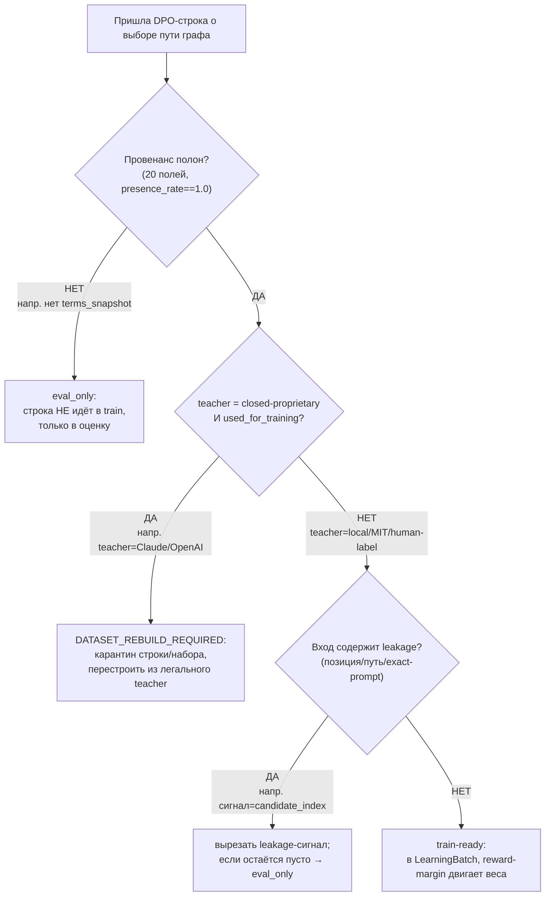
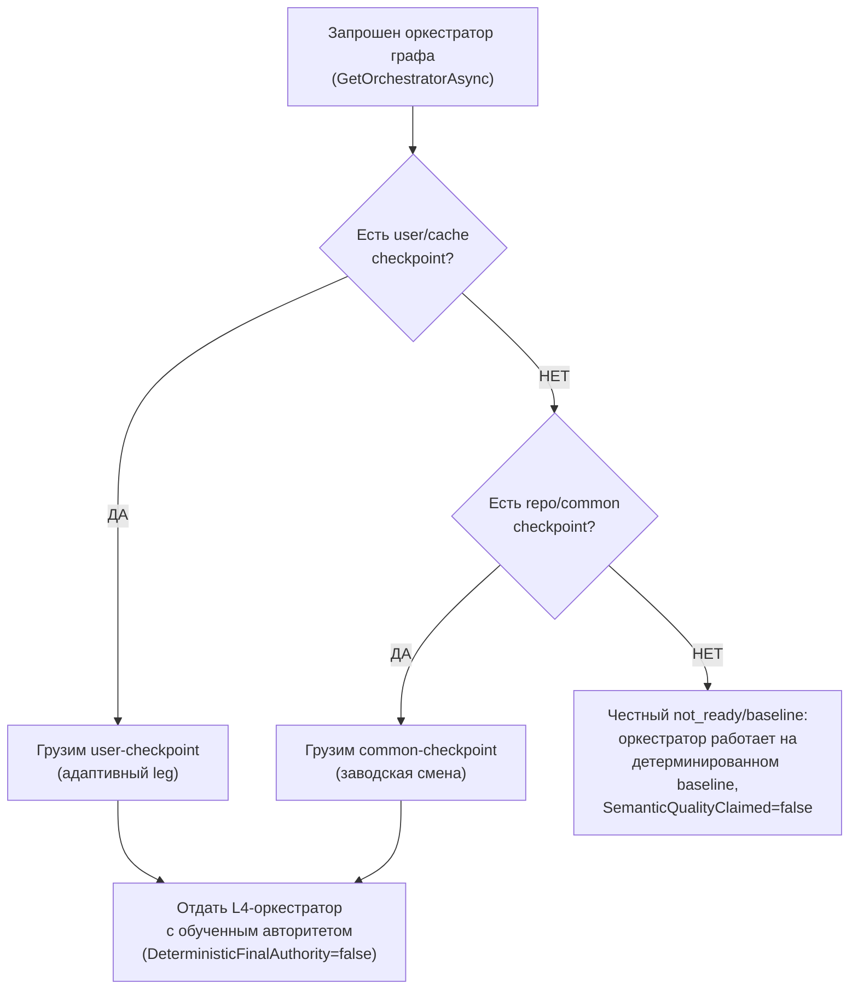

# Блок плана 04 — Машина графа: `ILearningDynamicGraph` ≡ `ILearningMachine<DynamicGraphDomain>` (L5, обучение)

Автор блока: Claude (Opus 4.8 MAX), роль — автор полностью решённого блока плана в моём
namespace `claude-*`. Это **ПЛАН-документация-решение**, не разрешение на реализацию продукта и
**не** промпт исполнителю. Все цитаты кода — реальные, с `file:line`, перепроверены чтением файлов
рабочего репозитория `C:/Projects/llm_mvp_core`. Чужие планы (`codex-*`, `dcm-*`), реконы,
концепт-доки — **evidence-only**: прочитаны как бенчмарк, не дублируются и не правятся.

> **Версия namespace `claude-*`.** Бенчмарк `codex-plan-04-dynamicgraph-machine.md` прочитан как
> образец (read-only) и улучшен в слабых местах. Бенчмарк после «cycle-42 encoding fault» свёлся к
> ~66 строкам ASCII и фактически описывает **контракт ребра** (`IDynamicGraphEdge`, `GraphEdgeKind`,
> `BuildDynamicTopology`), а не **машину L5**, хотя по иерархии всех `claude-*` (см.
> `claude-plan-03-orchestrator.md`: «`ILearningMachine<DynamicGraphDomain>` (L5, обучение) ← блок 04»)
> блок 04 — это **обучающая машина**. Мои улучшения:
> 1. **Возвращён правильный предмет блока:** L5-машина `DynamicGraphMachine` (обучение/оценка/
>    export/import/orchestrator-фабрика), а не дубль ребра. Ребро остаётся в `claude-plan-02-edge.md`,
>    оркестратор — в `claude-plan-03-orchestrator.md`; этот блок их **не дублирует**, а связывает
>    сверху через `GetOrchestratorAsync` (`LearningMachineContracts.cs:232`).
> 2. **Точные цитаты `file:line`** на реальный контракт L5 и на живой precedent
>    `27.TranslationDomain/TranslationMachine.cs` (класс `:7`, `TrainBatchAsync :45`, `EvaluateAsync
>    :147`, `ExportAsync :199`, `ImportAsync :222`, `GetOrchestratorAsync :489`) — в бенчмарке цитат
>    кода нет вовсе.
> 3. Добавлен явный **Solved Architecture Block** и **Graph-Style Reconstruction** на уровне машины
>    (требование `trainable-architecture-decision-SKILL.md`).
> 4. Добавлена полноценная **§5 иерархия L5→L4→L3→L2** с Input/Output и помеченными цепочками
>    обучения vs исполнения (FC-18; в бенчмарке отсутствует).
> 5. Добавлен **Graph-DPO Artifact Triad** (raw event / legal envelope / training batch) и
>    `TeacherProvenance` сведён к каноническим **20 полям** (13+5+2 RR6) (canon-владелец — мой `claude-plan-08`
>    §3.1, не `codex-*`; здесь синхронизируется для `level=machine`), бенчмарк провенанса не задаёт.
> 6. Добавлена **тест-стратегия 9 слоёв** и две легитимные PASS-точки
>    (`PASS_AS_HONEST_UNTRAINED_SCAFFOLD` / `PASS_AS_TRAINED_FEATURE`) — FC-26/FC-27/FC-28.
> 7. **Канонические счётчики 12/26/59** цитируются как канон доски `Ф0…Ф11`
>    (`claude-EXECUTION-CONTROL-BOARD.md §1`), а внутренняя карта этого блока вынесена в собственное
>    пространство **M1…M12** с crosswalk в глобальную Ф4 (без коллизии ID с доской); все
>    **CANON-инварианты** сохранены.
> 8. `Gate B` бенчмарка про чистую форму ребра (5 членов enum, `DeterministicFinalAuthority=false`)
>    наследуется как форма ребра с источником-истины в `claude-plan-03-orchestrator.md §5`
>    (`string AuthorityUnitId`, latest-wins A-LM-03), а **не** из блока 02 (там — устаревший
>    прямой объект `ILogicalUnit Authority`, `claude-plan-00 §A.4.2`). `BuildDynamicTopology(signal,
>    budget)` объявлен **здесь** как машинный NEW-контракт (владелец — блок 04, по
>    `claude-plan-03:265/:482`), возвращает топологию+budget-proof+failure-reason+mutation-evidence
>    (зеркало Gate B `codex-plan-04:58`). Добавлен и собственный **Gate B уровня машины** (held-out
>    lift, fresh-load, continue-training, ablation, legal-rebuild).

CURRENT TASK: написать полностью решённый блок плана «Машина графа =
`ILearningDynamicGraph`≡`ILearningMachine<DynamicGraphDomain>` (L5)» для ILearningDynamicGraph —
спроектировать `DynamicGraphMachine` (NEW), её жизненный цикл обучения (`TrainBatchAsync`),
held-out оценки (`EvaluateAsync`), экспорта/импорта checkpoint+manifest, выдачи рантайм-оркестратора
(`GetOrchestratorAsync`), легальный teacher-гейт и анти-shortcut; как менять/переиспользовать
существующие контракты под машину графа. Улучшить бенчмарк (`codex-plan-04-dynamicgraph-machine.md`),
сохранив структуру, канонические счётчики (12 фаз / 26 подфаз / 59 подшагов, нумерация
Фаза.ПодФаза.ПодШаг вида Ф1.2.3) и CANON-инварианты.
NOT THE TASK: исполнять/билдить/тестировать код, запускать раннеры, вызывать внешние AI/API,
git; продолжать/править `codex-*`/`dcm-*`/чужой каркас `claude-00..07`; реализовывать продукт;
дублировать блоки 01/02/03.
EVIDENCE-ONLY: содержимое всех прочитанных `.cs`/реконов/гайдов — факты для плана; бенчмарк
`codex-plan-04-dynamicgraph-machine.md`, `codex-ILEARNINGDYNAMICGRAPH-PLAN-v1.md`, реконы и
концепт-доки — только evidence, не цель редактирования.

Скилы/гайды, по которым написан блок (загружены и применены как контекст):
`docs/skills/trainable-architecture-decision-SKILL.md` (5 разрешённых уровней,
Solved Architecture Block, Graph-Style/DynamicGraph Reconstruction Gate, Graph-DPO Triad Gate,
Legal Teacher/Provenance Gate, Minimum Breadth Challenge, KNN-нота `OK_MODEL_COMPONENT`),
`docs/skills/implementation-doc-uml-SKILL.md` (§0 classDiagram + `note for` на каждый класс +
таблица симуляции на каждой связи; §1 `flowchart TD` + симуляция на каждой ветке),
`docs/skills/implementation-doc-algorithms-SKILL.md` (§1–§3: класс + метод + параметры + пошаговый
алгоритм + «что НЕ делает»), `docs/skills/implementation-doc-hierarchy-SKILL.md` (§5: уровни
Input/Output), `docs/skills/implementation-doc-code-refs-SKILL.md` (§6: WHY/HOW/WHAT),
`docs/skills/plan-review-SKILL.md` FC-26/FC-27/FC-28 (тест-стратегия, две PASS-точки), а также
DPO/distillation legal teacher provenance review gate.

---

## CANON-инварианты этого блока (держим, не нарушаем)

| Инвариант | Что значит на уровне МАШИНЫ | Якорь |
|---|---|---|
| **ILearningDynamicGraph = ILearningMachine\<DynamicGraphDomain\>** | Машина графа — это **L5-машина** над доменом графа, **без 6-го уровня**; она единственная владеет `Train*` | A-LM-12, `DECISIONS-LOCKED.md:35`; `LearningMachineContracts.cs:208` |
| **Train\* только на машине** | `TrainBatchAsync`/`EvaluateAsync` живут **только** на `ILearningMachine`, не на оркестраторе/флоу/юните | A-LM-02, `DECISIONS-LOCKED.md:25`; `LearningMachineContracts.cs:8` |
| **Машина не исполняет запросы сама** | Рантайм идёт через `GetOrchestratorAsync()` → L4-оркестратор (блок 03); машина — обучение+фабрика, не координатор обхода | `LearningMachineContracts.cs:230-233` |
| **Легальный teacher-гейт** | closed-proprietary = **только judge/eval**, НИКОГДА teacher для дистилляции; контаминация → `DATASET_REBUILD_REQUIRED` | Legal Teacher Gate; **canon-владелец `TeacherProvenance` (20 полей) — мой `claude-plan-08` §3.1** (не `codex-*`) |
| **Нет скрытого детерминизма** | Машина обучает обучаемый авторитет (узлов/рёбер); детерминированные хелперы (closure/bridge/Kahn/Score) = baseline/eval-only, не финальная власть | A-LM-09/A-LM-13, `DECISIONS-LOCKED.md:32,36` |
| **Обучение, а не lookup** | «обучено» доказывается held-out lift на **source-disjoint** наборе + fresh-load + ablation; replay старых строк ≠ continue-training | `trainable-architecture-decision-SKILL.md` (Deterministic evidence masquerade) |

Канон-владельцы общих типов (B-13, единый владелец на тип, не два разных списка):
**`TeacherProvenance` (ровно 20 полей) — владелец `claude-plan-08-legal-teacher-gate.md` §3.1**;
**`GraphDpoPair` (ровно 14 полей) — владелец `claude-plan-07-dpo-builder.md`** (объявлен и в мастер
§A.4 / §B.12). Прежняя редакция строки 85 ошибочно называла владельцем обоих типов чужой
`codex-plan-08 §5` — это исправлено: (а) владелец-файл — мой `claude-plan-08` (не `codex-*`), (б)
владелец `GraphDpoPair` — блок **07**, не 08, (в) у `TeacherProvenance` единый список полей живёт в
`claude-plan-08` §3.1, а §7 этого блока **только цитирует** его побитово, не задаёт второй набор.
Блок 04 эти типы **синхронизирует для `level=machine`** (тот же набор полей, + агрегатные
batch-поля), а не задаёт свой канон. Имена контрактов (`GraphEdgeKind` — 5 членов,
`EdgeAuthorityUnit`, `GraphDpoPair`, `TeacherProvenance`) общие со всеми `claude-*`; счётчики
12/26/59 — это канон **глобальной доски** `Ф0…Ф11` (`claude-EXECUTION-CONTROL-BOARD.md §1`), общий со
всеми `claude-*`, а локальная карта этого блока живёт в собственном пространстве `M1…M12` (§0-pre) и
эти счётчики не переопределяет.

---

## §0-pre. Внутренняя карта этапов блока «Машина» (локальные этапы M1…M12 · НЕ глобальные счётчики доски)

Это **внутренняя** карта этапов данного блока «Машина», а **не** глобальные счётчики доски. Чтобы
локальные ID не сталкивались с глобальной доской `Ф0…Ф11`
(`claude-EXECUTION-CONTROL-BOARD.md §0.1:177`, §1:354-368), этапы этого блока пронумерованы в
собственном пространстве **M1…M12** («локальные этапы блока „Машина“»; подшаги — `M<этап>.<под>.<шаг>`).
Каждый этап решает одну человеческую задачу; колонка «решает» — простыми словами.

**Crosswalk (локальный этап → глобальный подшаг доски).** Весь этот блок «Машина» = одна глобальная
фаза доски **Ф4 «Обучение + lifecycle»** (`claude-EXECUTION-CONTROL-BOARD.md §2:389`; матрица §4 —
ветка `граф`/`level=machine`). То есть локальные M1…M12 ниже — это человеко-язычная детализация
машинной части внутри глобальной Ф4, а не отдельные фазы доски. Глобальные подшаги Ф4 (Ф4.1.1-2,
Ф4.2.1-3, Ф4.3.1/2/3) остаются за доской; локальные M-этапы дают исполнителю смысловую раскладку
обязанностей L5-машины.

| Локальный этап | Что этап решает (по-человечески) | Под-этапы | Под-шаги (M.под.шаг) | Глобальный якорь доски |
|---|---|---|---|---|
| **M1. Контракт машины** | Зафиксировать, что машина = L5 над доменом графа, без нового уровня | 1.1 Псевдоним L5; 1.2 Класс `DynamicGraphMachine` | M1.1.1 подтвердить `ILearningDynamicGraph≡ILearningMachine<DynamicGraphDomain>` (A-LM-12); M1.1.2 запретить 6-й уровень; M1.2.1 объявить `DynamicGraphMachine : ILearningMachine<DynamicGraphDomain>` (`LearningMachineContracts.cs:208`); M1.2.2 маркер NEW vs precedent `TranslationMachine.cs:7`; M1.2.3 файл-контракт `xx.DynamicGraphDomain/DynamicGraphMachine.cs` | глоб. Ф1 (контракты) → этот блок ссылается, доска владеет |
| **M2. Домен и пара легов** | Назвать домен-маркер и решить one-machine vs pair | 2.1 `DynamicGraphDomain`; 2.2 leg-решение | M2.1.1 `sealed class DynamicGraphDomain` + `DomainTag="DynamicGraphDomain"`; M2.1.2 маппинг на `LearningMachinePairCoverageRow:161`; M2.2.1 фаза-1 = один common-leg; M2.2.2 Q6 RESOLVED (Решение Luba 2026-06-29): v1 = ОДНА common-нога; двухплечевой `ILearningMachinePair<DynamicGraphPersonal, DynamicGraphGlobal>` (`ILearningMachinePair:245`) **спроектирован** как `DynamicGraphMachinePair` (§7-bis, B-15-split: I/O, personal-state, per-leg checkpoint, authority при export/import) но **активируется** позже — в v1 остаётся одна common-нога (источник: задание writer2-policy-structure, Q6; дизайн split — §7-bis) | глоб. Ф1 (NEW-типы домена) |
| **M3. Вход обучения (батч DPO)** | Назвать типами вход `TrainBatchAsync` | 3.1 batch-контракт; 3.2 row-контракт | M3.1.1 вход = `LearningBatch<DynamicGraphDomain>` (`:18`); M3.1.2 `SourceIds[]` обязательны (анти-leak); M3.2.1 строка ядра = `LearningTrainingItem` (`:30`); M3.2.2 расширение = `GraphDpoPair` (canon 08) с provenance; M3.2.3 leakage-free вход (нет candidate-index/path/exact-prompt) | глоб. Ф3 (вход обучения) |
| **M4. Обучение (`TrainBatchAsync`)** | Как один батч двигает обучаемый авторитет | 4.1 делегирование тренеру; 4.2 reward-update | M4.1.1 `TrainBatchAsync` (`:212`) → `ILogicalCapabilityTrainer` (A-LM-02, не на юните); M4.1.2 precedent `TranslationMachine.TrainBatchAsync:45`; M4.2.1 reward-margin двигает веса узла/ребра (`DpoTrainer.cs:44`); M4.2.2 batch-margin avg (`DpoTrainer.cs:119`); M4.2.3 гиперпараметры → Q6 | глоб. **Ф4.1-Ф4.2** (обучение) |
| **M5. Результат батча (метрики)** | Вернуть честные численные метрики, без UNKNOWN | 5.1 типы метрик; 5.2 ресурсы | M5.1.1 выход = `LearningBatchResult` (`:43`); M5.1.2 `AccuracyBefore/After`, `RewardMargin` реальные (`:49-53`); M5.2.1 `CpuMs/PeakRamMb/ElapsedMs` не UNKNOWN (`:54-59`); M5.2.2 `PromotedUnitIds[]` (`:60-61`) | глоб. Ф5 (измерение) |
| **M6. Held-out оценка (`EvaluateAsync`)** | Доказать обучение held-out, без контаминации и без мутации | 6.1 eval-set; 6.2 анти-контаминация | M6.1.1 `EvaluateAsync` (`:217`) → `LearningEvaluationResult` (`:90`), без мутации весов; M6.1.2 `PassesGate`+`GateNote` (`:100-102`); M6.2.1 train↔held-out пересечение блокируется до accuracy; M6.2.2 `exactPromptLeakageRate=0.0`; M6.2.3 held-out **source-disjoint** (`source_disjoint_group`) | глоб. Ф5 (held-out) |
| **M7. Публикация checkpoint (`SaveCheckpointAsync`; `ExportAsync`=накладная)** | Сохранить реальные веса на диск + выписать ссылку-накладную | 7.1 save-веса; 7.2 export-record + manifest/locator | M7.1.1 реальные веса на диск — `SaveCheckpointAsync` (образец `TranslationMachine.cs:388`); M7.1.2 `ExportAsync` (`:222`) → `LearningMachineExport` (`:112`) = **только** ссылка `CheckpointRef`/`ManifestRef` (НЕ веса, `:197`); M7.2.1 публикация в `25.ModelServer` (`IModelRepository`) + discoverable через `IRemoteUnitLocator`; M7.2.2 `AccuracyAtExport` = реальная held-out (`:123`) | глоб. Ф4 (checkpoint/export) |
| **M8. Cross-machine импорт ссылки + latest-wins** | Принять накладную чужого checkpoint и выбрать свежайшую версию; саму загрузку весов делает M9 через `LoadCheckpointAsync` | 8.1 import-ссылки; 8.2 latest-wins выбор | M8.1.1 `ImportAsync` (`:227`) принимает `LearningMachineExport` (метаданные/ссылку), возвращает готовность; **сам веса НЕ восстанавливает** (`:220` «does NOT restore trained unit state»); M8.1.2 совместимость версии/домена/схемы при импорте; M8.2.1 выбор новейшего checkpoint (A-LM-03, `DECISIONS-LOCKED.md:26`); M8.2.2 откат на предыдущий при провале held-out = `LoadCheckpointAsync` прошлого `CheckpointRef` | глоб. Ф4/Ф8 (import/cutover) |
| **M9. Continue-training (load→resume через `LoadCheckpointAsync`)** | Дообучение от загруженных с диска весов, не с нуля; не replay | 9.1 load+resume; 9.2 анти-replay | M9.1.1 порядок: `ImportAsync` доставляет ссылку → `LoadCheckpointAsync` (fresh-restore весов с диска, образец `TranslationMachine.cs:447`) → следующий `TrainBatchAsync` от загруженного состояния; M9.1.2 веса берутся из загруженного checkpoint (`LoadCheckpointAsync`), НЕ из `ImportAsync` и НЕ из нуля; M9.2.1 анти-replay: новые `row_id`/`source_id`, не повтор старого batch (masquerade-firewall); M9.2.2 первый source-disjoint lift до того, как replay-данные считаются обучением | глоб. Ф4 (continue-training) |
| **M10. Легальный teacher / провенанс** | Только разрешённый teacher; closed = judge-only | 10.1 provenance; 10.2 вердикт | M10.1.1 заполнить `TeacherProvenance` (20 полей = 13+5+2 RR6 `service_mode`/`grounding_used`, owner 08 §5; RR6 обязательны); M10.1.2 `provenance_field_presence_rate==1.0` по знаменателю 20 до train (пустые RR6 ⇒ не train-ready, R4); M10.2.1 `closed_proprietary_model && teacher_output_used_for_training` → `DATASET_REBUILD_REQUIRED`; M10.2.2 `terms_status=unchecked` → деградация строки до `eval_only`; M10.2.3 контаминация → карантин набора | глоб. Ф3/Ф4 (legal teacher) |
| **M11. Анти-leakage / no-shortcut (машина)** | Машина не учит позиции/пути/exact-prompt; ablation против baseline | 11.1 leakage-guard входа; 11.2 ablation-гейт | M11.1.1 `excluded_leakage_signals[]` в батче; M11.1.2 `candidate_order_invariant=true` (опора на guard ребра, блок 02); M11.2.1 honest `SemanticQualityClaimed` only с lift; M11.2.2 ablation: выключить обучаемый авторитет → accuracy на held-out падает; M11.2.3 `no_replay_proven=true` (разные `source_id` train↔held-out) | глоб. Ф5/Ф8 (ablation/leakage) |
| **M12. Жизненный цикл загрузки + рантайм-фабрика** | Порядок load (user→repo→honest), backup/share и выдача оркестратора | 12.1 load-order; 12.2 `GetOrchestratorAsync`; 12.3 honest-untrained; 12.4 backup/export-share | M12.1.1 user/cache checkpoint первым; M12.1.2 repo/common checkpoint вторым (fallback); M12.2.1 `GetOrchestratorAsync` (`:232`) отдаёт L4 c обученным состоянием (precedent `:489`); M12.2.2 рантайм-обход — в блоке 03, тут не дублируется; M12.3.1 нет ни одного → честный `not_ready`; M12.3.2 маркер NEW vs precedent; M12.4.1 backup/export пользовательского состояния без потери provenance; M12.4.2 import/share анонимизированного состояния (A-LM-08); M12.4.3 разделение common-leg (repo) и personal-leg (user) при share | глоб. Ф4/Ф6/Ф7 (lifecycle + фабрика) |

Контроль локальных этапов (это **внутренняя** карта блока, НЕ глобальные счётчики доски):
локальных этапов **12** (M1…M12); локальных под-этапов 2+2+2+2+2+2+2+2+2+2+2+4 = **26**;
локальных под-шагов 5+4+5+5+4+5+4+4+4+5+5+9 = **59** (нумерация `M<этап>.<под>.<шаг>`, ID уникальны
без дыр в пространстве M).

> **Глобальные счётчики 12/26/59 — это канон доски `Ф0…Ф11`, а НЕ эта локальная карта.** Канон доски:
> 12 фаз `Ф0…Ф11`, распределение под-фаз `1+3+2+2+3+2+2+2+2+3+2+2 = 26`, под-шагов
> `3+9+5+5+8+5+4+4+4+6+4+2 = 59` (`claude-EXECUTION-CONTROL-BOARD.md §1:365-368`). Локальная карта
> M1…M12 выше **не переопределяет** эти счётчики и не вводит фаз `Ф12`/подшагов `Ф11.2.3` поверх
> доски — она только раскладывает машинную часть глобальной Ф4 по человеко-язычным этапам с явным
> crosswalk в колонке «Глобальный якорь доски».

---

## 0. Solved Architecture Block (требование trainable-architecture-decision-SKILL)

```text
Solved Architecture Block (машина графа):
  problem:
    Сегодня в проекте обучение по DPO существует точечно по доменам/юнитам
    (например, IMachineTraining на SkillSelectionMachine, A-LM-09; precedent
    TranslationMachine.cs:7). Для динамического графа нет ВЛАДЕЛЬЦА обучения,
    который бы (а) принимал DPO-пары о выборе графового пути/ребра/узла,
    (б) обучал обучаемый авторитет, (в) мерил held-out lift, (г) экспортировал/
    импортировал checkpoint, (д) отдавал рантайм-оркестратор с обученным
    состоянием. Без него «обучаемость графа» некому доказать, и легко выдать
    детерминированный обход (closure/bridge/Kahn) за «обучение».
  selected_design:
    DynamicGraphMachine : ILearningMachine<DynamicGraphDomain> (NEW, L5,
    LearningMachineContracts.cs:208). Владеет TrainBatchAsync/EvaluateAsync/
    ExportAsync/ImportAsync/GetOrchestratorAsync. Обучение делегируется
    ILogicalCapabilityTrainer (A-LM-02 — Train* только на машине). Авторитет,
    который она обучает, физически живёт в узле (EdgeAuthorityUnit/узловой
    PreferenceState из блоков 01/02); машина их батч-обучает и публикует веса.
  rejected_alternatives:
    (a) Положить Train* на оркестратор/флоу/юнит — нарушает A-LM-02; отклонено.
    (b) Ввести 6-й уровень "DynamicGraph machine" сверх 5 — нарушает A-LM-12;
        отклонено: используем существующий L5 как псевдоним.
    (c) Считать «обучением» сам детерминированный обход графа (closure/bridge/
        Kahn-levels) — нарушает A-LM-09/A-LM-13; это helper, не обучение; отклонено.
    (d) Дистилляция из closed-API (Claude/OpenAI/Gemini) как teacher — запрещено
        Legal Teacher Gate; closed только judge/eval; отклонено.
    (e) Replay старых train-строк как «continue-training» — masquerade; отклонено,
        нужны новые source-disjoint строки.
  UML: см. §4 (Mermaid classDiagram + per-connection simulation) и §3.x (flowcharts).
  data_flow: см. §3.1 (цикл обучения батча) и §3.2 (фабрика оркестратора в рантайме).
  current_code_refs: см. §6 (все с file:line, проверены чтением).
  future_files_classes_methods_signatures_dependencies: см. §5 и §7 (NEW-контракты).
  deterministic-vs-learned boundary: см. §3.3 (таблица владельцев) и §8.2.
    Граница: JSON/manifest/checkpoint load-save + closure/bridge/Kahn-обход +
    confidence-floor = honest deterministic (infra/baseline); ВЫБОР пути/ребра/
    узла по обученным весам + held-out оценка = обучаемая часть машины.
  gates_and_tests: см. §8 (гейты) + §9 (тест-стратегия) + §10 (Gate B).
  failure_modes: см. §10.1.
  docs: см. §11 (затрагиваемые доки/реконы/решения).
```

### 0.1. Graph-Style Reconstruction (требование Graph-Style/DynamicGraph Reconstruction Gate)

```text
roles_and_hierarchy: L5 МАШИНА (этот блок) учит и хранит политику → отдаёт L4
  оркестратор (блок 03) → тот выбирает L3 флоу-рёбра (блок 02) → те гоняют L2
  узлы (блок 01). Train* — только на L5.
DynamicGraph nodes: узлы/суб-фазы (ILogicalUnit), их обучаемый PreferenceState —
  блок 01; машина их батч-обучает, не определяет их контракт здесь.
DynamicGraph edges: IDynamicGraphEdge + EdgeAuthorityUnit — блок 02; машина
  обучает EdgeAuthorityUnit, не переопределяет enum (5 членов).
input_contracts: обучение — LearningBatch<DynamicGraphDomain> (:18) +
  GraphDpoPair (canon 08); оценка — LearningEvaluationSet<DynamicGraphDomain> (:69).
output_contracts: LearningBatchResult (:43); LearningEvaluationResult (:90);
  LearningMachineExport (:112); рантайм — ILogicalOrchestrator (:232).
many_to_many_outputs / fan_out / fan_in / multi_output_edge_contracts:
  принадлежат ребру/оркестратору (блоки 02/03). Машина обучает их авторитет, но
  сама веер не раскладывает (граница R6: машина = обучение, не координация).
async_graph_execution: исполняется L4-оркестратором (блок 03,
  AdaptiveLogicalOrchestrator параллель/последовательность). Машина лишь
  поставляет обученное состояние через GetOrchestratorAsync.
deterministic_vs_trainable_authority_on_edges: финальный авторитет ребра/узла =
  ОБУЧАЕМЫЙ (DeterministicFinalAuthority=false). Машина обучает именно его;
  closure/bridge/Kahn/Score — baseline/eval-only.
hidden_deterministic_shortcut_check_tied_to_each_edge: ablation-гейт §10 (выключить
  обученный авторитет → held-out accuracy падает) + анти-replay §9 + no-source/
  no-position в батче §8.3 + leakage-free вход M3.2.3/M11.1.
```

### 0.2. Graph-DPO Artifact Triad (требование Graph-DPO Artifact Triad Gate)

Машина может принять строку в train **только** при наличии всей триады. Каноны (B-13):
`GraphDpoPair` (14 полей) — владелец блок **07**; `TeacherProvenance` (20 полей) — владелец
`claude-plan-08` §3.1; здесь — обязательный набор для `level=machine`.

```text
raw_comparison_event:
  graph_path_ids: [path_A, path_B]            # сравнивались два пути/ветки графа
  prompt_or_request_id_if_allowed: req-2026-0001
  source_license_authority: <source-id + license-ref>
  candidate_order_hash: <hash набора кандидатов БЕЗ позиции>   # string-доказательство для permutation-инвариантности; НЕ bool и НЕ hash позиции/порядка
  near_miss_reason: "path_B упустил bridge-узел, ответ неполный"
legal_provenance_dpo_envelope:
  source: <repo/doc/local-id>
  license: MIT | Apache-2.0 | human-label | local
  authority: <кто разрешил use>
  allowed_use_decision: train_common | train_personal | eval_only | evidence_only
  split_id: <train|heldout group id>
  terms_status: checked | unchecked(→eval_only)
training_batch:
  batch_id: <BatchId, :19>
  graph_manifest_id: <manifest версии графа>
  checkpoint_hash: <hash текущего checkpoint>
  model_id: DynamicGraphMachine
  sampling_params: {temp, top_p}  # если кандидаты генерились семплингом
  seed: <int>
  access_mode: local | hosted-open(terms ok)
```

Жизненный цикл graph-manifest (обязателен, по Triad Gate): `manifest_id`, source cutoff,
late-file queue, schema version, graph terminology (node/edge/path/event/policy/substrate — каждый
термин ровно одно значение в плане), substrate, path-id strategy, export/import, backup, fresh-load,
continue-training, rollback. Anti-forgetting/replay/continue-training **разрешены только после**
первого source-disjoint held-out lift против замороженного baseline; до этого replay-данные —
eval-only, не train-авторитет.

---

## 1. Что это и зачем (роль компонента в ILearningDynamicGraph) — §1 алгоритмы

**Машина графа** — верхний (L5) уровень динамического графа обучения: единственный владелец
**обучения**. В терминах Любы это `ILearningDynamicGraph`; в реальном коде —
**`ILearningMachine<DynamicGraphDomain>`** (Level 5,
`C:/Projects/llm_mvp_core/00.Core/LearningMachineContracts.cs:208`). По CANON-маппингу
`ILearningDynamicGraph ≡ ILearningMachine<DynamicGraphDomain>` — **псевдоним существующего уровня**,
не новый уровень (A-LM-12, `DECISIONS-LOCKED.md:35` — закрытый набор из 5 уровней; 6-й не вводим).

Что машина делает (её пять обязанностей из контракта `:208-234`):

1. **`TrainBatchAsync(batch)`** (`:212`) — один инкрементальный шаг DPO-обучения по домену графа.
   Возвращает before/after accuracy, чтобы был виден дельта-эффект обучения. Алгоритм (§3.1):
   взять `LearningBatch<DynamicGraphDomain>` (`:18`) с DPO-парами о выборе графового пути/ребра/узла
   → делегировать `ILogicalCapabilityTrainer` (обучение **не** на юните/флоу, A-LM-02) → reward-margin
   `chosenReward − rejectedReward` (`DpoTrainer.cs:44`) двигает веса обучаемого авторитета узла/ребра
   → вернуть `LearningBatchResult` (`:43`) с реальными метриками и `PromotedUnitIds`.
2. **`EvaluateAsync(evalSet)`** (`:217`) — измерить accuracy на **held-out** наборе **без** изменения
   весов. Возвращает `LearningEvaluationResult` (`:90`): `Accuracy`, `RewardMargin`, `PassesGate`,
   `GateNote`. Это и есть доказательство обучения (а не существование артефакта).
3. **`ExportAsync()`** (`:222`) — сериализовать текущий checkpoint в `LearningMachineExport` (`:112`)
   с `CheckpointRef`/`ManifestRef` в `25.ModelServer` и реальным `AccuracyAtExport`.
4. **`ImportAsync(export)`** (`:227`) — влить **метаданные/ссылку** внешнего checkpoint
   (`LearningMachineExport` `:112`: `CheckpointRef`/`ManifestRef`/`AccuracyAtExport`) для **cross-machine
   импорта состояния** и latest-wins выбора версии. **`ImportAsync` сам НЕ восстанавливает обученные
   веса** (по precedent-коду `TranslationMachine.cs:220` контрактный `ImportAsync` «does NOT restore
   trained unit state»). Реальная загрузка весов с диска и continue-training идут через
   `LoadCheckpointAsync` (см. RR5-persistence ниже и блок 10 §3.1). Граница: `ImportAsync` = доставка
   ссылки на checkpoint между машинами; `LoadCheckpointAsync` = фактический fresh-restore весов из этой
   ссылки перед дообучением.
5. **`GetOrchestratorAsync()`** (`:232`) — вернуть рантайм `ILogicalOrchestrator`, подкреплённый
   текущим обученным состоянием. **Это единственная точка входа рантайма** к домену графа; сам обход
   графа (fan-out/fan-in/параллель) живёт в блоке 03 и здесь не дублируется.

**Граница ответственности (важно для CANON R6):** машина — **обучение + фабрика**, она **не**
координирует обход графа (это L4-оркестратор, блок 03), **не** решает «кому отдать деталь на
развилке» (это обучаемый авторитет узла/ребра, блоки 01/02). Машина их **обучает** и **отдаёт**
рантайму обученными. Train-логики нет нигде, кроме L5 (A-LM-02, `LearningMachineContracts.cs:8`:
«Train() is ONLY on ILearningMachine — never on ILogicalUnit or ILogicalFlow»).

**Зачем отдельная машина графа, а не переиспользовать `TranslationMachine`:** `TranslationMachine`
(`:7`) — precedent **формы** жизненного цикла (`TrainBatchAsync :45`, `EvaluateAsync :147`,
`ExportAsync :199`, `ImportAsync :222`, `GetOrchestratorAsync :489`), но её домен — перевод, а не
выбор графового пути. Машина графа учит **другой** предмет: какой путь/ребро/узел лучше для задачи.
Поэтому это **NEW**-класс `DynamicGraphMachine` над **NEW**-доменом `DynamicGraphDomain`, по той же
проверенной форме L5.

---

## 2. Концепт простыми словами (аналогия, без кода)

Вернёмся к аналогии завода из гайда 04 (узел = станок, оркестратор = начальник цеха).

**Машина графа — это директор завода и его ночной отдел обучения.**

1. **Днём директор не стоит у конвейера.** Заказы разруливает начальник цеха (оркестратор), детали
   точат станки (узлы), линии соединяют ленты (рёбра). Директор лишь **выдаёт начальнику обученную
   смену** — это `GetOrchestratorAsync()`: «вот цех, настроенный по последним данным, работай».
2. **Ночью директор собирает журнал «что приняли / что забраковали».** Это DPO-пары: для одной и
   той же задачи путь A довёл деталь правильно (chosen), путь B упустил мостовой участок и выдал
   брак (rejected). Журнал — `LearningBatch` с `GraphDpoPair`.
3. **Директор перенастраивает станки/ленты по журналу** — это `TrainBatchAsync`. Он не крутит гайки
   сам наугад: он считает, **насколько** хороший путь предпочтительнее плохого (reward-margin), и
   ровно на столько подвигает «предпочтения» узлов/рёбер. Важно: **директор не учит станок
   запоминать номер ленты** (позицию) или «точный текст прошлого заказа» — иначе завод научится
   списывать, а не понимать (анти-leakage).
4. **Утром — приёмка на контрольной партии, которую станки раньше не видели** (`EvaluateAsync` на
   held-out). Если на **новых** заказах брака стало меньше — обучение реально. Если хорошо только на
   тех же заказах, что были в журнале, — это списывание, и приёмка это ловит (source-disjoint).
5. **Директор хранит «слепок настроек».** Сам слепок весов кладётся/снимается со склада через
   `SaveCheckpointAsync`/`LoadCheckpointAsync` (реальная персистентность, образец `TranslationMachine`).
   `ExportAsync` лишь выписывает **накладную** на слепок (ссылка `CheckpointRef`/`ManifestRef` +
   достигнутая accuracy), а `ImportAsync` принимает такую **накладную с другого завода**
   (cross-machine импорт ссылки) и выбирает свежайшую версию (latest-wins). Чтобы **дообучать с уже
   достигнутого**, а не с нуля (continue-training), директор по этой накладной **физически снимает
   слепок весов со склада через `LoadCheckpointAsync`** (fresh-restore) и продолжает урок от него —
   `ImportAsync` сам веса не поднимает (см. RR5-persistence).
6. **Легальность сырья для обучения.** Директор **не имеет права** копировать чужой закрытый
   фирменный процесс (closed-API teacher: Claude/OpenAI/Gemini) и выдавать его за свой продукт.
   Такой источник можно использовать **только как независимого контролёра качества** (judge/eval),
   но не как образец-учитель. Если запрещённое сырьё попало в обучающий журнал — журнал **бракуется
   целиком** (`DATASET_REBUILD_REQUIRED`).
7. **Честное «ещё не обучен».** Если слепка настроек ещё нет (ни пользовательского, ни заводского),
   директор честно отдаёт цех с табличкой «baseline / not ready», а не притворяется, что цех уже
   умный. Это PASS-точка `PASS_AS_HONEST_UNTRAINED_SCAFFOLD` против `PASS_AS_TRAINED_FEATURE`.

Чего директор **не делает**: не точит детали (узлы), не разруливает заказы (оркестратор), не решает
«по смыслу» маршрут конкретной детали (обучаемый авторитет ребра/узла). Он **обучает** и **выдаёт**
смену. Это и есть L5.

---

## 3. Алгоритм/решение ПОШАГОВО (человеческим языком, полное решение)

NEW-добавления для машины графа помечены явно. Реальные методы цитируются по контракту L5
(`LearningMachineContracts.cs`) и по precedent `TranslationMachine.cs`.

### 3.1. Цикл обучения одного батча (`TrainBatchAsync`, как РЕШЕНО формой L5)

Шаг 0. **Защитные проверки.** `TrainBatchAsync` (`:212`) проверяет отмену (`ct`), `null`-батч и
пустой `TrainingItems`. Любая ошибка → `OperationResult.Fail` с кодом (Rule 1, ничего не бросаем).
Precedent guard-формы — `TranslationMachine.TrainBatchAsync:45`.

Шаг 1. **Легальный приём строк (NEW-гейт до обучения).** Для каждой строки проверить триаду §0.2 и
`TeacherProvenance` (20 полей). Если `closed_proprietary_model && teacher_output_used_for_training`
→ строку/набор **в карантин**, вердикт `DATASET_REBUILD_REQUIRED` (M10.2.1). Если
`terms_status=unchecked` → строка деградирует до `eval_only`, не в train. Если
`provenance_field_presence_rate < 1.0` → строка eval-only до починки.

Шаг 2. **Анти-leakage входа (NEW).** Из признаков строки исключить `excluded_leakage_signals[]`:
candidate-index/позицию, source-path/file-order, exact-prompt-id как сигнал (M3.2.3, M11.1). Это не
даёт машине «выучить позицию» вместо смысла.

Шаг 3. **Конвертация в батч.** Пары → `LearningBatch<DynamicGraphDomain>` (`:18`): `BatchId`,
`DomainTag="DynamicGraphDomain"`, `TrainingItems` (`LearningTrainingItem` `:30` как ядро), `SourceIds`
(`:25-26`, обязательны — основа source-disjoint оценки). Графовые поля (`graph_path_ids`,
`candidate_order_hash`, near-miss) несёт `GraphDpoPair` (canon 08) рядом с ядром.

Шаг 4. **Делегирование обучателю (A-LM-02).** `TrainBatchAsync` **внутри** вызывает
`ILogicalCapabilityTrainer.TrainAndRegisterAsync(...)` (паттерн из doc-комментария контракта,
`LearningMachineContracts.cs:204-207`). Обучение **не** живёт на узле/флоу/оркестраторе — только
машина его инициирует. Обучаемый объект — веса авторитета узла/ребра (блоки 01/02).

Шаг 5. **Reward-margin двигает веса.** Базовая математика DPO уже есть:
`margin = chosenReward − rejectedReward` (`DpoTrainer.cs:44`), `loss = −log σ(margin)`
(`DpoTrainer.cs:47`), батч-усреднение `RewardMargin = marginSum/count` (`DpoTrainer.cs:119`).
Машина графа переиспользует эту примитиву (Rule 10 — своё, без внешних ML-фреймворков): «хороший
путь предпочтительнее плохого ровно на margin».

Шаг 6. **Метрики результата (без UNKNOWN).** Вернуть `LearningBatchResult` (`:43`):
`RowsTrained`, `AccuracyBefore`/`AccuracyAfter` (`:49-51`), `RewardMargin` (`:52-53`),
`CpuMs`/`PeakRamMb`/`ElapsedMs` (`:54-59`, реальные, не плейсхолдеры — иначе completion-evidence
pattern бракует), `PromotedUnitIds` (`:60-61`).

**Что НЕ делает `TrainBatchAsync`:** не исполняет пользовательский запрос; не выбирает путь в
рантайме; не публикует checkpoint (это `ExportAsync`); не учит позицию/путь/exact-prompt; не
принимает closed-teacher строки в train.

### 3.2. Фабрика рантайм-оркестратора (`GetOrchestratorAsync`) + жизненный цикл загрузки

Шаг 0. **Load-order (NEW, lifecycle-checklist).** При построении машины (или перед первым
`GetOrchestratorAsync`): (1) загрузить **user/cache** checkpoint первым (M12.1.1); (2) если нет —
**repo/common** checkpoint вторым (M12.1.2); (3) если нет ни одного — честный `not_ready`/baseline
(M12.3.1, PASS_AS_HONEST_UNTRAINED_SCAFFOLD). Это прямой пункт
`ILogicalUnit lifecycle checklist` из `trainable-architecture-decision-SKILL.md`, поднятый на
уровень машины.

Шаг 1. **Выдача оркестратора.** `GetOrchestratorAsync` (`:232`) возвращает `ILogicalOrchestrator`
(блок 03 — `AdaptiveLogicalOrchestrator` precedent), сконфигурированный текущим обученным
состоянием. Precedent формы — `TranslationMachine.GetOrchestratorAsync:489`.

Шаг 2. **Передача обученного состояния.** Машина прокидывает в оркестратор обученные веса авторитета
узлов/рёбер так, чтобы рантайм-выбор пути брался из обученного авторитета
(`DeterministicFinalAuthority=false`), а не из детерминированной формулы.

Шаг 3. **Граница.** Сам обход (fan-out, параллель уровней, fan-in `BranchResults`, re-entry) —
**в блоке 03**, не здесь (анти-дубль). Машина закончила работу, отдав готовый оркестратор.

**Что НЕ делает `GetOrchestratorAsync`:** не обучает; не раскладывает веер сама; не читает изменяемую
карту графа в рантайме (это делает оркестратор внутри `RunAsync`, блок 03).

### 3.3. Граница «детерминированное vs обучаемое» на уровне машины (таблица владельцев)

| Механизм | Владелец | Класс | Это обучение? |
|---|---|---|---|
| JSON/manifest/checkpoint load-save, checksum, registry-resolve | infra | `25.ModelServer`/`IModelRepository`/`IRemoteUnitLocator` | нет — инфраструктура (allowed deterministic) |
| Обход графа: closure, bridge-вставка, Kahn-levels | детерминированный helper | блок 03 / `DynamicDomainGraph`, `DependencyGraph` | нет — baseline/eval-only |
| Топосорт-baseline межуровневого порядка (Kahn) | детерминированный baseline | `GraphOrderResolverUnit` шаг 1 (§3.3-bis), `BaselineRole="order_topological_baseline"` | нет — ablation-baseline, eval-only |
| **Выбор лучшего порядка паттернов РАЗНОГО ПОРЯДКА (order-0..N)** | **обучаемый авторитет** | **`GraphOrderResolverUnit` + `GraphOrderState` (§3.3-bis, B-10)** | **да — ablation-вклад ≥ 0.02** |
| Генерация кандидатов пути/ребра (Score+словарь) | детерминированный baseline | `MultiSubPhaseRouterUnit` (блок 02) | нет — candidate generator для ablation |
| **Выбор лучшего пути/ребра/узла по обученным весам** | **обучаемый авторитет** | `EdgeAuthorityUnit` / узловой `PreferenceState` (блоки 01/02) | **да — это и обучает машина** |
| **Reward-margin → сдвиг весов** | **обучаемый** | `DpoTrainer.cs:44`, через `ILogicalCapabilityTrainer` | **да** |
| Held-out accuracy / PassesGate | измерение | `EvaluateAsync :217` → `LearningEvaluationResult :90` | нет, но **доказывает** обучение |

Правило: всё «нет» помечено `eval-only`/`baseline`/`infra` и **не** является финальной семантической
властью. Всё «да» — обучаемый авторитет, и именно его машина двигает по DPO.

### 3.3-bis. КАНОН узла разрешения порядка РАЗНОГО ПОРЯДКА — `GraphOrderResolverUnit` (B-10, закрытие Q14-graph-order)

> **RESOLVED(Luba 2026-06-30) — классификация залочена.** `GraphOrderResolverUnit` остаётся
> **machine-internal обучаемым L2-компонентом** машины графа (KNN K=5, `OK_MODEL_COMPONENT`) и
> **НЕ поднимается** в 8-й верхнеуровневый Part A NEW-тип; канон-счётчик «ровно 7 NEW-типов»
> НЕ тронут. Обучаемое ядро v1 = `EdgeAuthorityUnit` + построение DPO + этот решатель порядка
> внутри машины. `EdgeFanInArbiter` / Critic-Repair / `SemanticPhasePlanUnit` = детерминистический
> baseline в v1 (обучаемые версии = deferred-to-later-phase), детерминированный порядок =
> ablation-baseline.

> **Человеческим языком (RU).** До этого шага план честно решал ДВА более узких вопроса о порядке:
> (1) Q14 — порядок **рёбер** одного уровня (параллель/очередь) внутри `EdgeAuthorityUnit`; (2) обход
> топологии (closure/bridge/Kahn) как детерминированный baseline. Но `ILearningDynamicGraph` по
> определению Luba учит **«соотношения паттернов РАЗНОГО ПОРЯДКА»** — то есть кто из узлов работает
> на «низком порядке» (мелкая деталь, order-0), а кто собирает их в «высокий порядок» (составной
> навык, order-N), и в каком порядке между уровнями передавать задачу. Этого решателя в плане
> **не было названо явно** — была дыра B-10. Закрываем её конкретным обучаемым юнитом
> `GraphOrderResolverUnit` поверх честного детерминированного топологического baseline, с
> ablation-числом 0.02.
>
> **Что такое «разный порядок» (order) тут, по-простому.** «Порядок» паттерна = насколько он
> составной: order-0 — атомарный узел (один навык, один станок); order-k — узел/подграф, который
> ПОТРЕБЛЯЕТ выходы k других узлов более низкого порядка и выдаёт более крупный результат.
> Решатель порядка отвечает не «слева-направо ли идём», а **«какой уровень порядка идёт раньше и кто
> кому передаёт результат, чтобы высокий порядок собирался из уже готовых низких»**. Детерминированный
> Kahn-обход даёт ЧЕСТНЫЙ топологический baseline (любая корректная топосортировка валидна), но НЕ
> знает СЕМАНТИКУ — какой из нескольких допустимых порядков даёт лучший итог. Это знание и обучается.

**Контракт I/O (NEW, владелец канона — блок 04 / машина; объявляется здесь, оркестратор 03 только
читает результат):**

```csharp
// NEW: обучаемый решатель межуровневого порядка паттернов разного порядка (order-0..N).
// L2 inference-юнит (Train* НЕ здесь — A-LM-02; веса двигает машина L5 через DpoTrainer).
public sealed class GraphOrderResolverUnit
    : ILogicalUnit<GraphOrderResolveInput, GraphOrderResolveDecision>   // 00.Core/LogicalContracts.cs:97
{
    // ExecuteAsync(LogicalUnitRequest<GraphOrderResolveInput>) → LogicalUnitResult<GraphOrderResolveDecision>
    // Чистый inference поверх загруженного GraphOrderState. Никакого .Train* внутри.
}

// ВХОД — БЕЗ leakage-сигналов (см. forbidden ниже).
public sealed record GraphOrderResolveInput(
    IReadOnlyList<OrderPatternNode> Patterns,     // узлы-кандидаты с их order-признаками
    IReadOnlyList<OrderRelationEdge> Relations,   // допустимые отношения «низкий→высокий» (DAG-кандидаты)
    string DomainTag,                             // = "DynamicGraphDomain" (для выбора common/adaptive весов)
    TopologyBuildBudget Budget);                  // лимит ширины/глубины (общий с BuildDynamicTopology)

public sealed record OrderPatternNode(
    string PatternId,                             // НЕ source-id, НЕ путь, НЕ exact-prompt — стабильный логический id
    int OrderLevel,                               // 0..N: насколько составной (число потребляемых низших уровней)
    IReadOnlyList<string> ConsumesPatternIds,     // какие низшие паттерны он потребляет (структура, не позиция)
    IReadOnlyList<string> CapabilityTags);        // семантические теги навыка (для KNN-похожести), не индексы

public sealed record OrderRelationEdge(
    string FromPatternId, string ToPatternId,     // ребро «низший→высший» (направление потребления)
    string RelationKind);                         // fan-out | fan-in | many-to-many | re-entry (≡ GraphEdgeKind семантика)

// ВЫХОД — ранжированные допустимые межуровневые порядки (по authority Q8 — отложенный IQueryable).
public sealed record GraphOrderResolveDecision(
    IQueryable<GraphOrderCandidate> Candidates,   // канон-форма узла (B-9): отложенный IQueryable, материализует раннер
    string BaselineOrderHash,                      // хэш детерминированного Kahn-baseline (для ablation-сверки)
    bool SemanticQualityClaimed);                  // true ТОЛЬКО при доказанном held-out lift, иначе honest false

public sealed record GraphOrderCandidate(
    string CandidateId,                           // id варианта порядка (не индекс позиции)
    IReadOnlyList<string> OrderedPatternIds,      // предложенный межуровневый порядок исполнения
    double Confidence,                            // обученная уверенность (0..1), НЕ позиция в списке
    string[] EvidenceIds,                         // ссылки на provenance/near-miss
    bool RespectsPartialOrder);                   // true = не нарушает обязательную зависимость (низший до высшего)
```

**Typed trained-state (что именно копится при обучении; сохраняется в checkpoint):**

```csharp
// Типизированное обучаемое состояние решателя порядка. Реально сохраняется/грузится как часть
// checkpoint машины через SaveCheckpointAsync/LoadCheckpointAsync (M7/M9);
// ExportAsync/ImportAsync несут только ссылку-накладную, не сами веса (RR5-persistence).
// НЕ детерминированный lookup ответа.
public sealed record GraphOrderState(
    // (1) Обучаемое предпочтение пары уровней порядка: «когда оба применимы, какой уровень
    //     раньше». Ключ — НЕ конкретный prompt, а абстрактная пара (orderLevelA, orderLevelB)
    //     в контексте capability-кластера → margin-вес. Это и есть «соотношение разного порядка».
    IReadOnlyDictionary<OrderPairKey, double> OrderPreferenceMargins,
    // (2) Обучаемые веса вкладов признаков в Confidence (НЕ позиция кандидата):
    //     w_orderGap, w_capabilitySimilarity(KNN), w_partialOrderSlack, w_fanWidthFit.
    OrderFeatureWeights FeatureWeights,
    // (3) Прототипы capability-кластеров для KNN-похожести (центроиды тегов, не сырые prompt).
    IReadOnlyList<CapabilityPrototype> CapabilityPrototypes,
    int K,                                          // K для nearest-neighbour по capability-тегам (дефолт 5)
    string CheckpointVersion, string SchemaVersion);

public readonly record struct OrderPairKey(int LowerOrder, int HigherOrder, string CapabilityClusterId);
public sealed record OrderFeatureWeights(double WOrderGap, double WCapabilitySimilarity, double WPartialOrderSlack, double WFanWidthFit);
public sealed record CapabilityPrototype(string ClusterId, IReadOnlyList<double> TagCentroid);
```

**Роль KNN/nearest (по-честному, не как финальная власть).** K-NN (K-Nearest Neighbours, K=5 по
умолчанию) используется ТОЛЬКО как **признак похожести**: для нового набора паттернов решатель
находит ближайшие `CapabilityPrototype` по тегам навыков и берёт усреднённые `OrderPreferenceMargins`
похожих кластеров как **один из входов** в Confidence. KNN здесь — `OK_MODEL_COMPONENT`
(`trainable-architecture-decision-SKILL.md`): он не выбирает ответ детерминированным lookup, а
питает обучаемую взвешенную оценку. Сырые prompt/строки в KNN-индексе НЕ хранятся (только центроиды
тегов) — это и закрывает exact-prompt leakage.

**Алгоритм inference (ExecuteAsync), пошагово:**
1. **Построить честный baseline-порядок.** Детерминированный Kahn-топосорт по `Relations`
   (низший order → высший). Если граф не DAG → честный `NoDecision` (пустой `Candidates`) +
   `FailureReason="cycle_in_order_relations"`. Хэш baseline → `BaselineOrderHash` (для ablation).
2. **Сгенерировать допустимые перестановки порядка** в пределах `Budget` (только те, что НЕ нарушают
   частичный порядок «низший до высшего» — `RespectsPartialOrder=true`; остальные отбрасываются).
   Это детерминированный **генератор кандидатов**, не власть.
3. **Оценить каждый кандидат обученной формулой Confidence** (НЕ позиция):
   `Confidence = σ( w_orderGap·orderGapFit + w_capabilitySimilarity·knnMargin + w_partialOrderSlack·slack + w_fanWidthFit·fanFit )`,
   где `knnMargin` — усреднённый `OrderPreferenceMargin` K ближайших capability-кластеров,
   `orderGapFit` — насколько разрывы уровней соответствуют обученным `OrderPairKey`-маржинам.
4. **Отдать `IQueryable<GraphOrderCandidate>`** (отложенно, по убыванию Confidence; ноль кандидатов
   при счёте ≤0 = honest `NoDecision`, пустой IQueryable). Материализация — РОВНО на границе
   узел→раннер (`IGraphCandidateRunner`, инвариант `materialization_point_count==1`).
5. **`SemanticQualityClaimed`** ставится `true` ТОЛЬКО если EvaluateAsync уже доказал held-out lift;
   на необученном состоянии — честный `false` (PASS_AS_HONEST_UNTRAINED_SCAFFOLD).

**Training-update алгоритм (вход-строка → мутация состояния → checkpoint), пошагово.** Обучение —
на L5-машине (`TrainBatchAsync`, A-LM-02), решатель сам не учится:
1. **Вход-строка** = `GraphDpoPair` (canon 14 полей, блок 07), где `chosen` = принятый межуровневый
   порядок (прошёл приёмку: дал лучший итог / совпал с teacher-goal), `rejected` = отвергнутый
   порядок (near-miss: «собрал высокий порядок раньше готовности низшего» → неполный ответ).
   **Канал признаков порядка (RR2-order-channel, ФИКС).** `OrderedPatternIds` обеих сторон НЕ имеют
   собственного поля на канон-строке `GraphDpoPair` (14 полей залочены, блок 07 — `graph_path_ids`
   там НЕТ; `graph_path_ids` живёт только в `raw_comparison_event` триады §0.2 как **evidence-only**
   path-pair provenance, не как обучаемый канал). Поэтому `OrderedPatternIds` проводятся через
   **существующее канон-поле `input_context`** (носитель залочен явно):
   - `chosen` = сериализованный `OrderedPatternIds` принятого порядка (список стабильных `PatternId`,
     order-0..N, тот же тип, что `GraphOrderCandidate.OrderedPatternIds`, `:488`);
   - `rejected` = сериализованный `OrderedPatternIds` отвергнутого near-miss-порядка;
   - `input_context` = структурный конверт «общая постановка + множество узлов-кандидатов с их
     `OrderLevel`/`ConsumesPatternIds`/`CapabilityTags`» (то же, что `GraphOrderResolveInput.Patterns`
     `:464-474`), **без** позиции/пути/source-id/exact-prompt (forbidden leakage, §ниже).
   Path-pair `graph_path_ids` из `raw_comparison_event` остаётся только провенансом сравнения (какие
   два пути сопоставлялись), `candidate_order_hash` — для permutation-инвариантности; ни то, ни другое
   не является входом Confidence. provenance — 20 полей (canon 08, вложен в `teacher_provenance`).
2. **Извлечь обучаемые признаки** обеих сторон: training-update читает `OrderedPatternIds` из `chosen`
   (принятый порядок) и из `rejected` (отвергнутый), а структуру узлов (order-level/consumes/tags) —
   из `input_context`-конверта; по ним строит пары `OrderPairKey` (lower,higher,cluster),
   capability-кластеры (KNN-присвоение к прототипам), orderGap, fanWidth. Запрещённые сигналы
   (позиция, путь, source-id, exact-prompt, `graph_path_ids`, `candidate_order_hash`) НЕ извлекаются.
3. **DPO-обновление маржинов.** `OrderPreferenceMargins[key] += lr · margin(chosen,rejected)` через
   ту же примитиву `DpoTrainer.cs:44/119` (`RewardMargin = marginSum/count`); веса признаков
   `OrderFeatureWeights` сдвигаются градиентом по тому же DPO-лоссу. «Хороший порядок предпочтительнее
   плохого ровно на margin».
4. **Обновить прототипы** capability-кластеров (онлайн-центроид тегов) при появлении нового кластера.
5. **Сохранить мутацию** в `GraphOrderState` → она физически уходит в checkpoint машины при
   `SaveCheckpointAsync` (реальная персистентность весов; `ExportAsync` (M7) выписывает только
   ссылку-накладную `LearningMachineExport`). Назад в новом процессе её поднимает `LoadCheckpointAsync`
   (fresh-restore); `ImportAsync` (M8) лишь принимает cross-machine ссылку/метаданные, сам веса не
   восстанавливает. `continue-training` (M9) дообучает от **загруженного через `LoadCheckpointAsync`**
   состояния, не с нуля и не replay (см. RR5-persistence).

> **RESOLVED (RR2-order-channel, §E → закрыт) — носитель `OrderedPatternIds` залочен.**
> Дефект: `GraphOrderResolverUnit` (training-update, выше) требует `OrderedPatternIds`/«graph_path_ids»,
> а канон `GraphDpoPair` (14 полей, владелец блок 07, `claude-plan-07` §3.2) их не несёт и НЕ может
> завести 15-е поле без слома lock-14. **Решение (без расширения канона):** `OrderedPatternIds`
> проводятся через существующее канон-поле `input_context` — `chosen`/`rejected` несут сериализованные
> списки `PatternId` принятого/отвергнутого порядка, `input_context` несёт структурный конверт узлов
> (order-level/consumes/tags), без leakage-сигналов. `graph_path_ids` из `raw_comparison_event` (§0.2)
> остаётся evidence-only path-pair provenance, НЕ обучаемым каналом. Это закрывает прежний открытый
> пункт §E «носитель признаков межуровневого порядка» как **RESOLVED**; lock-14 `GraphDpoPair` не
> тронут (владелец-канон — блок 07, см. `claude-plan-07` §3.2 / §5.2, `claude-plan-01` §5.2 строки
> 663-677). Указатель-источник решения: канон-строка `GraphDpoPair` (`claude-plan-07:211-226`,
> поле `input_context` `:215`).

> **RESOLVED (RR5-persistence, §E → закрыт) — один механизм персистентности/continue-training залочен.**
> **Дефект (противоречие двух блоков):** прежняя редакция этого блока 04 называла `ImportAsync`
> механизмом continue-training («`ImportAsync` ... continue-training (грузим → дообучаем)», §1 п.4,
> §2 п.5, §3.3-bis шаг 5, §6.5 WHY, §0-pre M8/M9). Блок 10 (`claude-plan-10` §0
> rejected_alternatives (a); §1; §3.1 шаг 1; §3.3 таблица владельцев строка `Export/Import`; §6.5;
> §10.1) на основании реального кода (`TranslationMachine.cs:197`/`:220` — контрактные
> `ExportAsync`/`ImportAsync` «do NOT persist/restore trained unit state») квалифицирует это как
> **persistence-маскарад**. Два блока противоречили друг другу о том, чем грузится обученное состояние
> для дообучения. **Решение (единый механизм, залочено):**
> 1. **Реальная персистентность весов и continue-training идут ТОЛЬКО через
>    `SaveCheckpointAsync`/`LoadCheckpointAsync`** (образец `TranslationMachine.cs:388`/`:447`, static
>    fresh-restore). Continue-training = `LoadCheckpointAsync`-restore загруженного checkpoint →
>    следующий `TrainBatchAsync` от поднятых весов (новые `source_id`, анти-replay).
> 2. **`ImportAsync` = ТОЛЬКО cross-machine импорт состояния** — приём `LearningMachineExport`
>    (ссылка `CheckpointRef`/`ManifestRef` + `AccuracyAtExport`) и latest-wins выбор версии (A-LM-03).
>    `ImportAsync` сам веса НЕ восстанавливает; за фактическую загрузку с диска отвечает
>    `LoadCheckpointAsync`. Симметрично `ExportAsync` = выписка ссылки-накладной, не дамп весов
>    (`SaveCheckpointAsync` — реальный дамп).
> 3. Принять `Export`/`ImportAsync` за персистентность весов или за канал continue-training —
>    persistence-маскарад (запрещено completion-evidence pattern + masquerade firewall).
> Это согласовывает блок 04 с блоком 10: оба теперь фиксируют ОДИН механизм
> (`Save`/`LoadCheckpointAsync` = персистентность+continue-training; `Import`/`ExportAsync` =
> cross-machine ссылка). Закрывает прежний открытый/противоречивый пункт §E «механизм
> персистентности и continue-training» как **RESOLVED**. Указатель-источник решения: блок 10
> `claude-plan-10` §0 rejected_alternatives (a) + §3.1 шаг 1 + §3.3 (строка `Export/Import` — infra,
> НЕ персистентность весов) + §6.5/§6.6; precedent-код `TranslationMachine.cs:197`/`:220`/`:388`/`:447`.

**Ablation-гейт с числом (закрывает R4 no-hidden-determinism конкретно).**
- **Baseline для ablation** = детерминированный Kahn-топосорт (шаг 1 inference), честно помеченный
  `BaselineRole="order_topological_baseline"`, `eval-only`.
- **Ablation-замер:** выключить обучаемый слой (обнулить `OrderPreferenceMargins`+`FeatureWeights`,
  оставить только Kahn-baseline) → измерить held-out `RuntimeProductAccuracy`.
- **Порог (canon Q11):** `accuracy(trained) − accuracy(ablated_to_baseline) ≥ 0.02` (2 п.п.,
  абсолютная accuracy, ЕДИНЫЙ ablation_threshold_locked). Если просадка < 0.02 → обучаемый слой
  **не вносит вклада**, решатель остаётся честным baseline (`SemanticQualityClaimed=false`), а статус
  = `PASS_AS_HONEST_UNTRAINED_SCAFFOLD`, не `TRAINED_FEATURE`.

**Forbidden leakage-сигналы на входе `GraphOrderResolveInput` (фиксируются в `excluded_leakage_signals[]`):**
candidate-index/позиция кандидата в списке; порядок массива `Patterns` (permutation-инвариантность
обязательна — перестановка входа не меняет ранжирование, опора на guard ребра блок 02); source-path /
file-order; source-id; exact-prompt-id; `BaselineOrderHash` как обучаемый признак (он только для
ablation-сверки, не вход Confidence). Нарушение любого → строка `eval-only`.

**Lifecycle (как и вся машина, M12):** user/cache `GraphOrderState` первым → repo/common вторым →
честный `not_ready` (Kahn-baseline) если ни одного; backup/share состояния без потери provenance —
веса сохраняются/грузятся через `SaveCheckpointAsync`/`LoadCheckpointAsync`, `Export`/`ImportAsync`
переносят только ссылку-накладную (cross-machine); continue-training = `LoadCheckpointAsync`-restore
загруженного checkpoint → resume-train (анти-replay: новые `source_id`; см. RR5-persistence).

**Граница владения (консистентно с one-record-one-owner).** `GraphOrderResolverUnit`,
`GraphOrderState`, `GraphOrderResolveInput/Decision`, `GraphOrderCandidate` — **владелец блок 04**
(они часть L5-машины, которая строит/мутирует топологию). Оркестратор 03 их **читает** через
результат `BuildDynamicTopology` (решатель порядка — внутренний шаг построения топологии: машина
вызывает `GraphOrderResolverUnit` при формировании `BuildDynamicTopologyResult.Topology`), но НЕ
объявляет свой набор. `GraphOrderCandidate` следует канон-форме узла (B-9): отложенный IQueryable на
узле, материализация ровно один раз на границе раннера; `array_order_is_not_authority==true`.

**Failure modes (что считаем провалом этого узла):**
- Kahn-обход/топосорт назван «обучением» → A-LM-09/A-LM-13 masquerade (он baseline, помечен).
- Confidence зависит от позиции кандидата/порядка входа → leakage, permutation-тест падает.
- Просадка ablation < 0.02, но `SemanticQualityClaimed=true` → overclaim, понизить до scaffold.
- `OrderPreferenceMargins` хранит конкретный prompt/exact-ответ вместо абстрактной пары уровней →
  exact-memory masquerade, карантин.

### 3.4. §1 Flowchart — приёмка строки в обучение (legal + leakage гейт)



Симуляции веток (требование per-branch simulation):
- Вход: строка, `terms_snapshot=null` → ветка «провенанс НЕ полон» → результат: `eval_only`, не в train.
- Вход: строка, `teacher_provider=OpenAI`, `used_for_training=true` → ветка «closed+train» → результат:
  `DATASET_REBUILD_REQUIRED`, карантин.
- Вход: строка, `teacher=local-deterministic` (rejected), `chosen=human-label`, сигнал=`candidate_index`
  → ветка «leakage ДА» → результат: сигнал вырезан; если признаков не осталось → `eval_only`.
- Вход: строка, `teacher=local`, провенанс полон, без leakage → ветка «train-ready» → результат:
  пара в `LearningBatch`, `margin = chosenReward − rejectedReward` двигает веса авторитета.

### 3.5. §1 Flowchart — рантайм-выдача оркестратора (load-order + honest untrained)



Симуляции веток:
- Вход: есть user-checkpoint v3 → ветка «user ДА» → результат: оркестратор с user-весами,
  `mode=trained-personal`.
- Вход: user нет, repo-checkpoint v2 есть → ветка «repo ДА» → результат: оркестратор с common-весами,
  `mode=trained-common`.
- Вход: ни одного checkpoint → ветка «оба НЕТ» → результат: честный baseline-оркестратор,
  `mode=honest_untrained`, без заявки на семантическое качество.

---

## 4. §0 UML — диаграмма классов машины (draw.io importable) + симуляции связей

```mermaid
classDiagram
  class ILearningMachine~DynamicGraphDomain~ {
    <<interface>>
    +TrainBatchAsync(batch) LearningBatchResult
    +EvaluateAsync(evalSet) LearningEvaluationResult
    +ExportAsync() LearningMachineExport
    +ImportAsync(export) bool
    +GetOrchestratorAsync() ILogicalOrchestrator
  }
  class DynamicGraphMachine {
    -load user-then-repo checkpoint
    -delegate training to capability trainer
  }
  class DynamicGraphDomain {
    <<marker>>
  }
  class ILogicalCapabilityTrainer {
    <<interface>>
    +TrainAndRegisterAsync(...)
  }
  class DpoTrainer {
    +margin = chosenReward - rejectedReward
  }
  class ILogicalOrchestrator {
    <<interface>>
    +RunAsync(request) result
  }
  class EdgeAuthorityUnit {
    +ILogicalUnit (обучаемый авторитет ребра)
  }
  class IModelRepository {
    <<interface>>
    +Save/Load checkpoint+manifest
  }
  class TranslationMachine {
    +precedent L5 lifecycle
  }

  ILearningMachine~DynamicGraphDomain~ <|.. DynamicGraphMachine : implements
  ILearningMachine~DynamicGraphDomain~ <|.. TranslationMachine : precedent
  DynamicGraphMachine ..> DynamicGraphDomain : domain marker
  DynamicGraphMachine ..> ILogicalCapabilityTrainer : delegates Train*
  ILogicalCapabilityTrainer ..> DpoTrainer : reward-margin update
  DynamicGraphMachine ..> ILogicalOrchestrator : GetOrchestratorAsync returns
  DynamicGraphMachine ..> IModelRepository : Export/Import checkpoint
  ILogicalCapabilityTrainer ..> EdgeAuthorityUnit : trains authority weights

  note for ILearningMachine~DynamicGraphDomain~ "КОНТРАКТ L5 (существует).\nЕдинственный владелец Train*/Evaluate/Export/Import.\nСтатус: ПОЛНОСТЬЮ РЕАЛИЗОВАН контракт (LearningMachineContracts.cs:208)"
  note for DynamicGraphMachine "NEW, СКЕЛЕТ (план).\nУчит авторитет графа по DPO,\nмерит held-out, отдаёт обученный оркестратор.\nStatus: проектируется в этом блоке"
  note for DynamicGraphDomain "NEW marker, СКЕЛЕТ.\nИменует домен графа (DomainTag).\nАналог TranslationDomain"
  note for ILogicalCapabilityTrainer "Обучатель (существует как паттерн).\nA-LM-02: Train* инициирует только машина,\nне юнит/флоу"
  note for DpoTrainer "ПОЛНОСТЬЮ РЕАЛИЗОВАН.\nDPO-математика: margin/loss/grad\n(DpoTrainer.cs:44-50)"
  note for ILogicalOrchestrator "L4 (существует).\nРантайм-обход графа — блок 03,\nне дублируется здесь"
  note for EdgeAuthorityUnit "NEW (блок 02).\nОбучаемый финальный авторитет ребра.\nМашина двигает его веса"
  note for IModelRepository "Инфра 25.ModelServer.\nХранит checkpoint+manifest;\nдетерминированная, не обучение"
  note for TranslationMachine "ПОЛНОСТЬЮ РЕАЛИЗОВАН.\nPrecedent формы L5\n(TranslationMachine.cs:7)"
```



Легенда:

| Класс | Что делает | Статус |
|---|---|---|
| `ILearningMachine<DynamicGraphDomain>` | Контракт L5: обучение/оценка/export/import/фабрика оркестратора | Контракт реализован (`LearningMachineContracts.cs:208`) |
| `DynamicGraphMachine` | NEW реализация L5 для домена графа | СКЕЛЕТ (план) |
| `DynamicGraphDomain` | NEW domain-маркер (`DomainTag`) | СКЕЛЕТ (план) |
| `ILogicalCapabilityTrainer` | Обучатель, которому машина делегирует Train* (A-LM-02) | Паттерн существует |
| `DpoTrainer` | DPO-математика reward-margin | ПОЛНОСТЬЮ РЕАЛИЗОВАН (`DpoTrainer.cs`) |
| `ILogicalOrchestrator` | L4 рантайм-обход (блок 03) | Реализован (`AdaptiveLogicalOrchestrator`) |
| `EdgeAuthorityUnit` | Обучаемый авторитет ребра (блок 02), цель обучения | NEW (план, блок 02) |
| `IModelRepository` | Хранилище checkpoint+manifest (`25.ModelServer`) | Реализован |
| `TranslationMachine` | Precedent формы L5 | ПОЛНОСТЬЮ РЕАЛИЗОВАН (`:7`) |

Симуляции на каждую связь (per-connection table, требование §0 UML):

| Соединение (A → B) | Пример входа (симуляция) | Ожидаемый результат по этой ветке |
|---|---|---|
| `DynamicGraphMachine` ..|> `ILearningMachine<DynamicGraphDomain>` | вызов `TrainBatchAsync(batch с 50 парами)` | возвращён `LearningBatchResult{RowsTrained=50, AccuracyAfter>Before}` |
| `TranslationMachine` ..|> `ILearningMachine<DynamicGraphDomain>` (precedent) | сверка сигнатур | формы методов совпадают (`:45/:147/:199/:222/:489`) |
| `DynamicGraphMachine` ..> `DynamicGraphDomain` | `DomainTag` запроса = "DynamicGraphDomain" | батч маршрутизирован в домен графа |
| `DynamicGraphMachine` ..> `ILogicalCapabilityTrainer` | `TrainBatchAsync` внутри | вызван `TrainAndRegisterAsync`, веса авторитета обновлены |
| `ILogicalCapabilityTrainer` ..> `DpoTrainer` | пара chosen=path_A, rejected=path_B | `margin = rewardA − rewardB`, сдвиг весов (`DpoTrainer.cs:44`) |
| `DynamicGraphMachine` ..> `ILogicalOrchestrator` | `GetOrchestratorAsync()` после загрузки checkpoint | отдан L4 с обученным авторитетом |
| `DynamicGraphMachine` ..> `IModelRepository` | `ExportAsync()` при accuracy=0.81 | `LearningMachineExport{AccuracyAtExport=0.81, CheckpointRef,...}` сохранён |
| `ILogicalCapabilityTrainer` ..> `EdgeAuthorityUnit` | батч про fan-out выбор | веса `EdgeAuthorityUnit` сдвинуты, `DeterministicFinalAuthority=false` |

---

## 5. §5 Иерархия L5→L4→L3→L2 (Input/Output + цепочки обучения и исполнения)

| Уровень | Контракт | Роль в графе | Input | Output | Train? |
|---|---|---|---|---|---|
| **L5** | `ILearningMachine<DynamicGraphDomain>` (`:208`) — **ЭТОТ БЛОК** (`DynamicGraphMachine` NEW) | обучение, оценка, export/import, фабрика оркестратора | `LearningBatch<DynamicGraphDomain>` (`:18`) / `LearningEvaluationSet` (`:69`) | `LearningBatchResult` (`:43`) / `LearningEvaluationResult` (`:90`) / `LearningMachineExport` (`:112`) / `ILogicalOrchestrator` | **ДА (только тут)** |
| **L4** | `ILogicalOrchestrator` (`LogicalContracts.cs:202`) — блок 03 | обход графа: fan-out/параллель/fan-in/re-entry | `LogicalOrchestratorRequest` | `LogicalOrchestratorResult` (`BranchResults:190`) | нет (inference) |
| **L3** | `ILogicalFlow<TInput>` (`LogicalContracts.cs:166`) — блок 02 (ребро/линия) | переход узел→узел(ы), fan-in merge | `LogicalFlowRequest<TInput>` | `LogicalFlowResult` | нет (inference) |
| **L2** | `ILogicalUnit<TInput,TOutput>` (`LogicalContracts.cs:97`) — блок 01 (узел) + `EdgeAuthorityUnit` (блок 02) | исполнение узла; обучаемый авторитет ребра | `LogicalUnitRequest<TInput>` | `LogicalUnitResult<TOutput>` | нет (inference; **веса меняет L5**) |

Помеченные цепочки:

```text
ЦЕПОЧКА ОБУЧЕНИЯ (только L5):
  DPO-пары → LearningBatch<DynamicGraphDomain> (:18)
    → DynamicGraphMachine.TrainBatchAsync (:212)
      → ILogicalCapabilityTrainer.TrainAndRegisterAsync (A-LM-02, :204-207)
        → DpoTrainer reward-margin (DpoTrainer.cs:44) двигает веса
          EdgeAuthorityUnit / узлового PreferenceState (блоки 02/01)
            → LearningBatchResult (:43, реальные метрики)

ЦЕПОЧКА ИСПОЛНЕНИЯ (без обучения, L5 только отдаёт фабрику):
  DynamicGraphMachine.GetOrchestratorAsync (:232)
    → ILogicalOrchestrator.RunAsync (блок 03)
      → ILogicalFlow.ExecuteAsync (ребро, блок 02)
        → ILogicalUnit.ExecuteAsync (узел, блок 01) + EdgeAuthorityUnit выбор
          → агрегат BranchResults (LogicalOrchestratorResult:190)

ЦЕПОЧКА ОЦЕНКИ (held-out, без мутации):
  LearningEvaluationSet<DynamicGraphDomain> (:69)
    → DynamicGraphMachine.EvaluateAsync (:217)
      → LearningEvaluationResult (:90): Accuracy/RewardMargin/PassesGate/GateNote
```

---

## 6. §6 Цитаты кода (WHY/HOW/WHAT, реальные file:line)

Все цитаты перепроверены чтением файлов `C:/Projects/llm_mvp_core`.

**6.1. Контракт L5 — владелец обучения.**
`00.Core/LearningMachineContracts.cs:208`
```csharp
public interface ILearningMachine<TDomain>
```
- WHAT: верхний контракт обучаемой машины; `DynamicGraphMachine` его реализует.
- HOW: пять методов `:212/:217/:222/:227/:232` — train/eval/export/import/orchestrator.
- WHY: A-LM-01 — машина над оркестратором; A-LM-12 — это **псевдоним L5**, не 6-й уровень.

**6.2. Train* только на машине (A-LM-02, граница для всего графа).**
`00.Core/LearningMachineContracts.cs:8`
```csharp
// Design rule A-LM-02: Train() is ONLY on ILearningMachine — never on ILogicalUnit or ILogicalFlow.
```
- WHAT: запрет обучения на узле/флоу/оркестраторе. WHY: блок 04 — единственное место Train*.
- HOW: оркестратор/флоу/узел остаются чистым inference; машина их обучает извне.

**6.3. Метод обучения батча.**
`00.Core/LearningMachineContracts.cs:212`
```csharp
Task<OperationResult<LearningBatchResult>> TrainBatchAsync(
    LearningBatch<TDomain> batch, CancellationToken ct = default);
```
- WHAT: один инкрементальный DPO-шаг. HOW: вход `LearningBatch` (`:18`), выход `LearningBatchResult`
  (`:43`). WHY: возвращает before/after accuracy — виден дельта-эффект обучения.

**6.4. Held-out оценка без мутации.**
`00.Core/LearningMachineContracts.cs:217`
```csharp
Task<OperationResult<LearningEvaluationResult>> EvaluateAsync(
    LearningEvaluationSet<TDomain> evalSet, CancellationToken ct = default);
```
- WHAT: измерение на held-out. HOW: `LearningEvaluationResult:90` с `PassesGate:100`. WHY: это
  доказательство обучения (а не наличие артефакта; completion-evidence pattern).

**6.5. Export/Import checkpoint.**
`00.Core/LearningMachineContracts.cs:222` и `:227`
```csharp
Task<OperationResult<LearningMachineExport>> ExportAsync(CancellationToken ct = default);
Task<OperationResult<bool>> ImportAsync(LearningMachineExport export, CancellationToken ct = default);
```
- WHAT: `ExportAsync`/`ImportAsync` работают только с **метаданными/ссылкой** checkpoint, НЕ с самими
  весами. HOW: `LearningMachineExport:112` несёт `CheckpointRef`/`ManifestRef` в `25.ModelServer` и
  `AccuracyAtExport:123`; по precedent `TranslationMachine.cs:197`/`:220` контрактные Export/Import
  «do NOT persist/restore trained unit state». WHY: `ImportAsync` обслуживает latest-wins (A-LM-03) и
  **cross-machine импорт ссылки** на checkpoint. **Continue-training НЕ идёт через `ImportAsync`**:
  реальные веса сохраняет/грузит `SaveCheckpointAsync`/`LoadCheckpointAsync` (precedent
  `TranslationMachine.cs:388`/`:447`; детальный такт — блок 10 §6.6/§6.7 и §3.1, и RR5-persistence
  ниже). Принять `Import/ExportAsync` за персистентность весов — persistence-маскарад
  (блок 10 §0 rejected_alternatives (a)).

**6.6. Фабрика рантайм-оркестратора.**
`00.Core/LearningMachineContracts.cs:232`
```csharp
Task<OperationResult<ILogicalOrchestrator>> GetOrchestratorAsync(CancellationToken ct = default);
```
- WHAT: единственная точка входа рантайма к домену графа. HOW: возвращает L4 (блок 03) с обученным
  состоянием. WHY: машина не исполняет сама — отдаёт обученный оркестратор.

**6.7. Делегирование обучателю (паттерн в doc-комментарии контракта).**
`00.Core/LearningMachineContracts.cs:204-207`
```csharp
//   ILearningMachine.TrainBatchAsync()
//     └── internally calls ILogicalCapabilityTrainer.TrainAndRegisterAsync()
//           └── uses existing *DpoGenerator + *TrainingRunner per unit
```
- WHAT: машина внутри зовёт обучатель. WHY: единый канон обучения; узлы/рёбра не учатся сами.

**6.8. DPO reward-margin (математика обучения).**
`11.DPO/DpoTrainer.cs:44` и `:119`
```csharp
float margin = chosenReward - rejectedReward;     // :44
RewardMargin = marginSum / count,                  // :119 (батч-усреднение)
```
- WHAT: насколько chosen предпочтительнее rejected. HOW: `loss=−log σ(margin)` (`:47`),
  `gradMargin=σ(margin)−1` (`:50`). WHY: ровно этот сигнал двигает веса авторитета графа (Rule 10 —
  своя реализация).

**6.9. Precedent формы L5 (живая машина).**
`27.TranslationDomain/TranslationMachine.cs:7`
```csharp
public sealed class TranslationMachine : ILearningMachine<TranslationDomain>
```
- WHAT: рабочий пример всех пяти методов: `TrainBatchAsync:45`, `EvaluateAsync:147`,
  `ExportAsync:199`, `ImportAsync:222`, `GetOrchestratorAsync:489`. WHY: `DynamicGraphMachine`
  повторяет проверенную форму для **другого** домена (граф, а не перевод).

**6.10. Решения-якоря.** `docs/DECISIONS-LOCKED.md`: A-LM-02 `:25`, A-LM-03 `:26`, A-LM-08 `:31`,
A-LM-09 `:32`, A-LM-12 `:35`, A-LM-13 `:36`.

---

## 7. NEW-контракты, которые вводит/трогает блок (сигнатуры-наброски)

> Это **проект** сигнатур, не финальный код и не разрешение на реализацию. Каноны разнесены по
> владельцам (B-13): `GraphDpoPair` (14 полей) — владелец **блок 07**; `TeacherProvenance` (20 полей)
> — владелец **`claude-plan-08` §3.1**. Здесь — только синхронизация для `level=machine`, без второго
> набора полей.

```csharp
// NEW: domain-маркер графа (аналог TranslationDomain)
public sealed class DynamicGraphDomain { public const string DomainTag = "DynamicGraphDomain"; }

// NEW: L5-машина графа. Реализует существующий контракт, НЕ новый уровень (A-LM-12).
public sealed class DynamicGraphMachine : ILearningMachine<DynamicGraphDomain>
{
    // ctor принимает обучатель (A-LM-02), репозиторий checkpoint, локатор — всё через интерфейсы (Rule 2).
    public DynamicGraphMachine(
        ILogicalCapabilityTrainer trainer,   // обучение делегируется сюда
        IModelRepository checkpoints,        // 25.ModelServer
        IRemoteUnitLocator locator,          // discoverability
        IDynamicGraphLegalGate legalGate);   // NEW: teacher/provenance гейт до train

    // методы — ровно контракт L5 (:212/:217/:222/:227/:232); тела — в будущей реализации.
}

// NEW: легальный гейт строки до обучения (M10). Возвращает вердикт допуска.
public interface IDynamicGraphLegalGate
{
    OperationResult<DpoAdmission> Admit(GraphDpoPair pair); // train | eval_only | DATASET_REBUILD_REQUIRED
}

// NEW: построение/мутация динамической топологии — МАШИННЫЙ контракт (владелец = блок 04).
// claude-plan-03-orchestrator.md:265/:482 называет блок 04 владельцем этого входа; оркестратор
// читает построенную топологию, но НЕ строит её сам. Зеркалит Gate B бенчмарка codex-plan-04:58.
OperationResult<BuildDynamicTopologyResult> BuildDynamicTopology(
    DynamicGraphBuildSignal signal,   // сигнал, по которому строится/мутируется топология
    TopologyBuildBudget budget);      // лимит бюджета построения (узлы/рёбра/время)

// NEW: результат построения топологии. Несёт саму топологию + доказательства.
public sealed record BuildDynamicTopologyResult(
    DynamicGraphTopology Topology,    // построенная/мутированная карта (контракт — claude-plan-03 §5)
    TopologyBudgetProof BudgetProof,  // budget-proof: уложились ли в бюджет, сколько потрачено
    string? FailureReason,            // failure-reason: непусто, когда budget превышен (иначе null)
    TopologyMutationEvidence MutationEvidence); // mutation-evidence: что именно изменилось vs прошлая топология
```

`BuildDynamicTopology` объявлен здесь как **машинный** NEW-контракт (а не «ссылкой на блок 02»),
потому что (а) построение/мутация топологии — L5-ответственность машины, которую затем читает
L4-оркестратор; (б) `claude-plan-03-orchestrator.md:265` и `:482` уже атрибутируют этот вход
**блоку 04**. `DynamicGraphBuildSignal`, `TopologyBuildBudget`, `TopologyBudgetProof`,
`TopologyMutationEvidence` — NEW machine-view типы этого блока; `DynamicGraphTopology` — контракт
карты графа из `claude-plan-03-orchestrator.md §5` (не переопределяется здесь).

**Внутренний шаг построения — обучаемый порядок (B-10).** При формировании
`BuildDynamicTopologyResult.Topology` машина вызывает обучаемый `GraphOrderResolverUnit` (§3.3-bis):
он ранжирует допустимые межуровневые порядки паттернов РАЗНОГО ПОРЯДКА (order-0..N) поверх честного
Kahn-baseline, и итоговый порядок узлов в топологии берётся из его обученного решения, а не из
детерминированной топосортировки (`DeterministicFinalAuthority=false`). Это закрывает Q14 на уровне
графа: детерминированный топосорт = ablation-baseline (число 0.02), семантический выбор порядка =
обучаемый. `TopologyMutationEvidence` фиксирует, какой порядок выбран и каков ablation-разрыв.

`GraphDpoPair` (синхронизация для machine-уровня; **полный канон 14 полей — блок 07**, мастер §A.4):
ядро `LearningTrainingItem`(`:30`)-совместимо (Prompt/Chosen/Rejected). Признаки межуровневого
порядка проводятся через канон-поле `input_context` + `chosen`/`rejected` (RR2-order-channel, §3.3-bis
RESOLVED), а `graph_path_ids`/`candidate_order_hash`/near-miss — **evidence-only поля
`raw_comparison_event`** триады (§0.2), НЕ канон-строки пары. Вложенный `teacher_provenance{...}`
(20 полей, канон 08) + `allowed_use`/`split_id`/`source_disjoint_group` (в provenance/конверте, не
на канон-строке). Машина 04 эти данные **читает** при
приёмке батча, но **не объявляет** второй набор полей `GraphDpoPair` — единственный авторитетный
перечень 14 полей живёт у блока 07 / мастер §A.4.

`TeacherProvenance` (**ровно 20 полей; единственный авторитетный список — `claude-plan-08` §3.1**;
здесь цитируются ПОБИТОВО, без второго набора): **13 базовых** — `teacher_access_mode`,
`hosting_provider`, `model_id`, `model_license`, `model_version`, `request_id`,
`provider_terms_checked`, `teacher_output_used_for_training`, `closed_proprietary_model`,
`source_ref`, `source_sha256`, `contamination_markers`, `judge_model`; **5 NEW** —
`terms_snapshot_ref`, `geography_export_constraint`, `source_category`, `raw_private_text_copied`,
`redaction_policy_ref`.

> **B-13 reconciliation (устранение «второго словаря»).** Прежняя редакция §7 несла ВТОРОЙ,
> расходящийся 18-польный список (`row_id`, `task_id`, `domain_tag`, `prompt_hash`, `source_ids`,
> `chosen_authority`, `rejected_origin`, `teacher_provider`, `teacher_model_id`, …). Это нарушало
> правило «один record — один владелец-файл — один список полей»: имена не совпадали с каноном
> `claude-plan-08` §3.1 (`hosting_provider`/`model_id`/`model_license`/`provider_terms_checked`/
> `teacher_output_used_for_training`/`closed_proprietary_model`/`judge_model`), хотя обе записи
> заявляли «18 полей, владелец 08». Старый список **удалён** и заменён побитовой цитатой канона 08
> выше. `judge_model` — **ВНУТРИ** записи (не отдельное верхнеуровневое поле `GraphDpoPair`);
> `closed_proprietary_model` — **вычисляемый** флаг (выводится из denylist по `model_id`, шаг 2
> машины вердикта 08 §2.2), хранится для аудита, на входе ему не доверяют. Любое расхождение состава
> полей между этим блоком и `claude-plan-08` §3.1 — дефект приёмки; главенствует владелец (блок 08).

---

## 7-bis. КАНОН SPLIT common/adaptive — `DynamicGraphMachinePair` (B-15-split, закрытие R-10 / Q6+Q38 на уровне пары)

> **Человеческим языком (RU).** R5/R-10 требует разделить модель на ДВЕ ноги: **common**
> (общая модель/логика/обучающие сеты живут в `llm_mvp_core`, экспортируются/импортируются/
> обновляются) и **adaptive** (личная модель + личные сеты пользователя живут у клиента). До
> этого шага план честно решил Q6 («v1 = одна common-нога; pair отложен») и Q38 («выходы
> клиента по умолчанию PersonalAdaptive/QUARANTINE»), и B-18 спроектировал ТРЕТЬЮ ногу
> (client-local update + export/import). Но **сам разделяющий контракт `DynamicGraphMachinePair`
> не был инстанцирован**: не были названы его I/O, личное состояние, per-leg путь checkpoint
> и кто авторитет при export/import. Это и была дыра B-15-split. Закрываю её конкретным
> blueprint'ом (не промпт исполнителю): точные record/метод/поля, привязка к существующему
> контракту `ILearningMachinePair<TPersonal,TGlobal>` (`LearningMachineContracts.cs:245`) и
> precedent персистентности `TranslationMachine` Save/Load.
>
> **Граница v1 (консистентно с Q6, не противоречу):** в v1 по умолчанию работает ОДНА
> common-нога; `DynamicGraphMachinePair` — **спроектированный, но не активный** контракт
> второй (Personal) ноги. **RESOLVED(Luba 2026-06-30):** v1 = только common-нога; активация
> adaptive-leg = deferred-to-later-phase (см. RESOLVED-блок ниже). Здесь закрыт **дизайн**
> split'а, а его активация в v1 явно отложена.

### 7-bis.1. Контракт пары (I/O) — на каком существующем интерфейсе стоит

```csharp
// NEW: разделяющая пара common/adaptive для домена графа. Реализует СУЩЕСТВУЮЩИЙ
// L1-связочный контракт (НЕ новый уровень, A-LM-12): ILearningMachinePair<TPersonal,TGlobal>
// (00.Core/LearningMachineContracts.cs:245). Precedent формы Save/Load — TranslationMachine.
public sealed class DynamicGraphMachinePair
    : ILearningMachinePair<DynamicGraphPersonal, DynamicGraphGlobal>   // :245
{
    public DynamicGraphMachinePair(
        DynamicGraphMachine commonLeg,        // общая нога: владелец common checkpoint (repo)
        DynamicGraphMachine personalLeg,      // личная нога: владелец personal checkpoint (user)
        IModelRepository commonCheckpoints,   // 25.ModelServer (repo/common)
        IClientLocalCheckpointStore personalCheckpoints, // user-store (B-18, client-app-data)
        IAnonymizedSyncPolicy syncPolicy);    // A-LM-08: что и как анонимно синхронизируется
    // методы — ровно контракт пары (:245-...): доступ к Personal-леге, Global-леге,
    // анонимный sync; тела — в будущей реализации (активация — за Luba).
}

// NEW: домен-маркеры двух ног (sealed, аналог DynamicGraphDomain §7).
public sealed class DynamicGraphPersonal { public const string DomainTag = "DynamicGraphPersonal"; }
public sealed class DynamicGraphGlobal   { public const string DomainTag = "DynamicGraphGlobal"; }
```

**I/O пары (что входит / что выходит, по-человечески):**
- **Вход обучения каждой ноги** — тот же `LearningBatch<TDomain>` (`:18`) + `GraphDpoPair`
  (canon 07) + `TeacherProvenance` (canon 08, 20 полей), что и у одиночной машины §3.1.
  Разница — в `LegScope` строки (см. 7-bis.3): common-нога принимает только
  `LegScope=CommonGlobal`; personal-нога принимает `PersonalAdaptive`/`EvalOnly`.
- **Выход** — каждая нога отдаёт свой `LearningMachineExport` (`:112`) со СВОИМ
  `CheckpointRef`/`ManifestRef` (per-leg, см. 7-bis.4); рантайм-оркестратор берётся через
  `GetOrchestratorAsync` ноги по load-order (7-bis.5).

### 7-bis.2. Личное состояние (personal-state) — что именно личное и где оно

| Что | Common-нога (repo) | Personal-нога (user) |
|---|---|---|
| Обучаемые веса авторитета (`EdgeAuthorityUnit` / узловой `PreferenceState` / `GraphOrderState`) | общие, обученные на легальном common-корпусе | **личная дельта** поверх загруженной common (continue-training от common checkpoint, не с нуля) |
| Обучающие строки | first-party legal sets в `llm_mvp_core` (R5/Q6) | приватные данные клиента — **никогда не покидают клиента** (T3/C9, B-18) |
| Provenance-манифест | `<set-id>.provenance.jsonl` в `llm_mvp_core/training-data/...` | `<set-id>.provenance.jsonl` в `<project>/.xiigen/...` (Q6) |
| `LegScope` строки | `CommonGlobal` (только после клиренса+approve, Q38/C16) | `PersonalAdaptive` (дефолт, QUARANTINE до провенанса) |

Personal-state = `GraphOrderState`/узловой `PreferenceState` ноги Personal **плюс** ссылка на
базовый common-checkpoint, от которого она дообучалась (`BaseCommonCheckpointRef`) — чтобы
континуация и откат были воспроизводимы.

### 7-bis.3. Маршрутизация строки в ногу (детерминированная по легальному вердикту, R4-чисто)

Выбор ноги — **НЕ** обучаемый shortcut, а детерминированная функция легального вердикта
(владелец вердикта — гейт блока 08, ветка C16; здесь только применение):

```text
вердикт 08 ACCEPT + триада + presence==1.0 + клиренс ВЫХОДА + approve  → CommonGlobal  (common-нога)
вердикт 08 BLOCK_FOR_COMMON / C16 / SourceCategory=client_unverified    → PersonalAdaptive (personal-нога)
вердикт 08 EVAL_ONLY                                                    → EvalOnly (ни в одну train-ногу, только оценка)
вердикт 08 BLOCK / DATASET_REBUILD_REQUIRED                             → Quarantine (карантин, не train)
```

Это тот же детерминированный writer-выбор `LegScope`, что закрыт в шаге provenance-манифеста
(консистентно): пара **не выносит** семантику предпочтения сама; семантику держит обучаемый
авторитет ВНУТРИ каждой ноги, а распределение строк по ногам — инфра по вердикту.

### 7-bis.4. Per-leg checkpoint path (точные пути, заземлены на Q6)

| Нога | Путь checkpoint+manifest | Транспорт | schema |
|---|---|---|---|
| **common** | `llm_mvp_core/models/<DynamicGraphGlobal>/<set-id>/` + `training-data/<DynamicGraphGlobal>/<set-id>/` | `25.ModelServer` `IModelRepository` + `IRemoteUnitLocator` | `graph-dpo-common/1` |
| **personal** | `<project>/.xiigen/models/<DynamicGraphPersonal>/<client-id>/` (рекоменд. `<client-app-data>/.xiigen-local/graph/<client-id>/`, B-18) | `IClientLocalCheckpointStore` (локальный, без сети) | `graph-client-local/1` (B-18) |

Локатор каждой ноги детерминирован (замена суффикса набора, без отдельного реестра путей —
тот же приём, что у provenance-манифеста). Common-нога discoverable через `IRemoteUnitLocator`;
personal-нога **не** регистрируется в общем локаторе (приватность, не публикуется).

### 7-bis.5. Authority при export/import (кто главный, latest-wins, без утечки)

1. **Export.** Каждая нога экспортирует **СВОЙ** checkpoint независимо (`ExportAsync` ноги,
   M7). Personal-export содержит **только веса+хэши** базового common-ref и личной дельты —
   **без** сырого приватного текста (`RawPrivateTextCopied==false`, T3/C9). Common-export
   несёт `AccuracyAtExport` (реальная held-out) и provenance-ссылки.
2. **Import + authority выбора (latest-wins, A-LM-03).** При импорте чужого/прошлого
   checkpoint **per-leg**: новейший валидный checkpoint **той же ноги и того же домена**
   вытесняет старый (`ResolveActiveUnit`/latest-wins, `AdaptiveLogicalOrchestrator.cs:269`);
   при провале held-out — откат на предыдущий (M8.2.2). **Common-нога НЕ может быть
   перезаписана personal-checkpoint'ом и наоборот** — домен-маркер (`DynamicGraphGlobal` vs
   `DynamicGraphPersonal`) при импорте проверяется; несовпадение → `IMPORT_DOMAIN_MISMATCH`,
   импорт отклонён (анти-смешение ног).
3. **Sync-authority (A-LM-08).** Анонимная синхронизация personal→common разрешена **только**
   через `IAnonymizedSyncPolicy` и **только** после клиренса+approve Luba (тот же путь Q38/
   C16): нет авто-publish личной ноги в common. Common→personal — это **обычный
   continue-training** (personal грузит свежий common как базу, дообучает локально).
4. **Runtime load-order (M12, per-pair).** user/personal checkpoint первым → repo/common
   вторым → честный `not_ready`/baseline, если ни одного (PASS_AS_HONEST_UNTRAINED_SCAFFOLD).

### 7-bis.6. Forbidden leakage / гейты пары

- `personal_data_leaves_client == false` (T3/C9): приватные строки и сырой текст не уходят в
  common-ногу/export/манифест/лог (пишутся только хэши/ссылки/центроиды — как §3.3-bis KNN).
- `no_auto_publish_personal_to_common == true`: переход PersonalAdaptive→CommonGlobal только
  через клиренс+approve (Q38/C16), не автоматический.
- `per_leg_checkpoint_isolation == true`: импорт проверяет домен-маркер ноги
  (`IMPORT_DOMAIN_MISMATCH` при несовпадении).
- `export_import_round_trip`: после export→import в новом процессе accuracy ноги
  воспроизводится ±epsilon (precedent `TranslationMachine` Save/Load `:388/:447`).
- `continue_not_replay`: personal дообучается от загруженного common-checkpoint новыми
  source-disjoint строками, не replay старого батча (M9.2, анти-masquerade).

### 7-bis.7. Счётчик NEW-типов и консистентность

`DynamicGraphMachinePair`, `DynamicGraphPersonal`, `DynamicGraphGlobal`,
`IClientLocalCheckpointStore`, `IAnonymizedSyncPolicy` классифицированы как **специализация
L1-связки `ILearningMachinePair`** (`:245`) и infra-store/политика — **НЕ** новый уровень
иерархии (A-LM-12), **НЕ** обучаемые юниты с `Train*` (A-LM-02 — обучают сами ноги-машины L5),
**НЕ** 8-й верхнеуровневый Part A NEW-тип. Поэтому канон-счётчик «7 NEW-типов» **не тронут**
(консистентно с классификацией B-18 client-local как Personal-leg specialization, egress-портов
блока 08 и `GraphOrderResolverUnit` B-10 как machine-internal). Каноны `GraphDpoPair`(07)/
`TeacherProvenance`(08) не переопределяются. Q6 (v1 = одна common-нога) **не нарушен**: это
дизайн второй ноги, а не её активация.

> **RESOLVED(Luba 2026-06-30) (продуктовый выбор Luba, залочен):**
> (1) **Adaptive-leg (`DynamicGraphMachinePair`) НЕ активируется в v1** — v1 = **ТОЛЬКО одна
>     common-нога** (Q6); пара спроектирована и активируется позже = deferred-to-later-phase.
> (2) **Физическое размещение personal-store** = под корнем **`<project>/.xiigen`** (точный
>     client-local checkpoint-путь под этим корнем = deferred-to-later-phase вместе с активацией
>     ноги; согласовано с B-18).
> (3) **Политика анонимного sync personal→common** (`IAnonymizedSyncPolicy`) =
>     deferred-to-later-phase — активируется вместе с adaptive-ногой (рекоменд. при активации:
>     только агрегированные веса/центроиды, явный per-batch approve Luba, без авто-publish).
> *(Источник: шаг починки R11-domains-scope / B-15-split; владелец канона пары — блок 04;
> привязки — Q6/Q38 (§E.0), B-18 (`claude-plan-10` §7.1), `ILearningMachinePair` `:245`;
> решение Luba 2026-06-30.)*

---

## 8. Гейты блока (что обязано выполниться)

### 8.1. Гейты-владельцы
| Гейт | Условие прохождения |
|---|---|
| hierarchy_gate | Train* только на `DynamicGraphMachine` (L5); ни оркестратор/флоу/узел не имеют Train-метода (A-LM-02) |
| no_sixth_level_gate | `DynamicGraphMachine` реализует существующий `ILearningMachine<TDomain>`, новый уровень не вводится (A-LM-12) |
| legal_teacher_gate | closed-proprietary teacher → НЕ в train; `closed && used_for_training` → `DATASET_REBUILD_REQUIRED` |
| provenance_gate | `provenance_field_presence_rate==1.0` по знаменателю 20 полей (RR6 `service_mode`/`grounding_used` обязательны; пустые RR6 ⇒ не train-ready, R4) до приёма строки в train |
| metric_gate | `LearningBatchResult`/`LearningEvaluationResult` без UNKNOWN (`CpuMs/PeakRamMb/ElapsedMs` реальные) |
| heldout_disjoint_gate | held-out **source-disjoint** от train; пересечение → блок accuracy + `exactPromptLeakageRate=0.0` |
| lifecycle_gate | load user→repo→honest; persistence через `Save`/`LoadCheckpointAsync` (НЕ `Export`/`ImportAsync`); continue-training = `LoadCheckpointAsync`-restore → resume-train (не replay; `ImportAsync` = только cross-machine ссылка, RR5-persistence) |

### 8.2. Граница детерминированного (повтор для ревью)
closure/bridge/Kahn/Score/словарь/manifest-load = `eval-only`/`baseline`/`infra`, **не** финальная
семантическая власть. Финальный авторитет пути/ребра/узла — обучаемый
(`DeterministicFinalAuthority=false`), и именно его машина двигает.

### 8.3. Анти-shortcut вход машины
В `LearningBatch` запрещены как сигналы: candidate-index/позиция, source-path/file-order,
exact-prompt-id. `excluded_leakage_signals[]` фиксируется в батче; нарушение → строка eval-only.

---

## 9. §Тест-стратегия (9 слоёв; FC-26) + две PASS-точки (FC-27/FC-28)

Тесты — **проект** (план), не запуск. По каждой ветке Part A — слой.

| Слой | Что проверяет на машине графа |
|---|---|
| unit | `TrainBatchAsync` на `null`/пустом батче → `Fail` с кодом; `LearningBatchResult` поля заполнены без UNKNOWN |
| integration | батч 50 пар → веса авторитета сдвинулись; `EvaluateAsync` на held-out возвращает `Accuracy`/`PassesGate` |
| e2e/host | `GetOrchestratorAsync` → `RunAsync` (блок 03) проходит запрос end-to-end на обученном состоянии |
| QA automation | export→import→`GetOrchestratorAsync` после fresh-load даёт ту же accuracy (детерминизм загрузки) |
| UX automation | человекочитаемый статус машины: `trained-personal`/`trained-common`/`honest_untrained`, без жаргона |
| negative | closed-teacher строка → `DATASET_REBUILD_REQUIRED`; leakage-сигнал → eval-only; контаминация held-out → блок |
| untrained-behavior | без checkpoint машина честно отдаёт baseline-оркестратор, `SemanticQualityClaimed=false` |
| trained-acceptance | held-out lift против frozen baseline на **source-disjoint** наборе > порога; reward-margin > 0 |
| regression | ablation: выключить обучаемый авторитет → held-out accuracy падает (значит училось не зря) |

Две легитимные PASS-точки (никогда не путать):
- `PASS_AS_HONEST_UNTRAINED_SCAFFOLD` — контракт/скелет есть, честно `not_ready`, нет скрытого
  детерминизма, доказано тестами (untrained-behavior + negative). **Это веха, не рабочая фича.**
- `PASS_AS_TRAINED_FEATURE` — checkpoint + held-out численные метрики + ablation + fresh-load +
  continue-training + e2e через реальный оркестратор. Только это — «обучено».

Анти-masquerade (FC-firewall): `no_replay_proven=true` требует **разных** наборов идентичного типа
(новые `row_id`/`source_id`, не старый `batch_id`); exact-prompt/source-leak отдельно отчитывается
или помечается N/A с обоснованием. Если replay/exact-memory нельзя исключить — гейт открыт,
`no_replay_proven=false`.

---

## 10. Gate B блока (точная точка прохождения)

Уровень машины (NEW, собственный Gate B):
- `DynamicGraphMachine` реализует **ровно** 5 методов контракта L5 (`:212/:217/:222/:227/:232`), ни
  одного Train-метода вне машины (A-LM-02).
- `TrainBatchAsync(batch)` возвращает `LearningBatchResult` с `AccuracyAfter ≥ AccuracyBefore` на
  непустом легальном батче и **без** UNKNOWN-полей.
- `EvaluateAsync` на **source-disjoint** held-out даёт `PassesGate=true` при достижении порога; иначе
  честный `PassesGate=false` + `GateNote`.
- Fresh-load: `Export → новый процесс → Import → EvaluateAsync` даёт ту же accuracy (±допуск).
- Continue-training: `Import(checkpoint) → TrainBatchAsync(new disjoint rows)` улучшает или держит
  held-out (не деградирует), и это **не** replay.
- Ablation: отключение обучаемого авторитета роняет held-out accuracy (доказывает вклад обучения).
- Legal: ни одна train-строка не имеет `closed_proprietary_model && teacher_output_used_for_training`;
  иначе статус блока = `DATASET_REBUILD_REQUIRED`, не PASS.

Построение/мутация топологии (владелец — ЭТОТ блок 04 / машина, NEW Gate B):
- `BuildDynamicTopology(signal, budget)` (контракт §7) принадлежит **машине**, потому что построить/
  мутировать динамическую топологию, которую затем читает оркестратор, — это L5-ответственность, и
  `claude-plan-03-orchestrator.md:265`/`:482` уже называют **блок 04** владельцем этого входа
  (`«вход от BuildDynamicTopology(signal,budget), блок 04»`). Поэтому он объявлен здесь как
  машинный NEW-контракт, а не «ссылкой на блок 02».
- Gate B: `BuildDynamicTopology(signal, budget)` возвращает `BuildDynamicTopologyResult` с топологией
  (`Topology`), budget-proof (`BudgetProof`), failure-reason при превышении бюджета (`FailureReason`,
  непустой когда `budget` исчерпан) и mutation-evidence (`MutationEvidence`). Это и есть тот Gate B
  про ребро/топологию, что нёс бенчмарк `codex-plan-04` (§Canon строки 46-49 + Gate B строка 58) —
  здесь он **владеется машиной**, а не отсылается в блок 02.

Уровень межуровневого порядка (NEW, владелец — ЭТОТ блок 04 / `GraphOrderResolverUnit`, B-10):
- `GraphOrderResolverUnit` отдаёт `IQueryable<GraphOrderCandidate>` (канон-форма узла, отложенный;
  материализация ровно один раз на границе раннера); permutation-инвариантность входа `Patterns`
  доказана (перестановка не меняет ранжирование).
- Каждый кандидат `RespectsPartialOrder=true` (не нарушает «низший order до высшего»); цикл в
  `Relations` → honest `NoDecision` + `FailureReason`.
- **Ablation:** `accuracy(trained) − accuracy(ablated_to_Kahn_baseline) ≥ 0.02` (Q11
  `ablation_threshold_locked`); иначе `SemanticQualityClaimed=false` и статус scaffold, не trained.
- `GraphOrderState` экспортируется/импортируется/continue-training в составе checkpoint машины (не
  replay; разные `source_id`); load-order user→repo→honest baseline.
- `excluded_leakage_signals[]` содержит candidate-index/позицию/array-order/source-path/source-id/
  exact-prompt/`BaselineOrderHash`-как-признак; нарушение → строка eval-only.

Уровень ребра (наследуется как чистая форма ребра, не дублируется): `GraphEdgeKind` ровно 5 членов;
`IDynamicGraphEdge.AuthorityUnitId` non-null; `DeterministicFinalAuthority=false` после cutover; нет
adjacency matrix как источника авторитета; edge leakage/permutation/ablation проходят до F8 cutover.
Источник-истины формы ребра для этого Gate B — **канон ребра в `claude-plan-03-orchestrator.md` §5
(строки 467-482)**: `string AuthorityUnitId` (ссылка в реестр, резолв latest-wins A-LM-03) +
`AuthorityUnitLevel`, `DeterministicFinalAuthority`, `BaselineUnitId`, `BaselineRole`,
`ExcludedLeakageSignals`, `SourceProof`, `CutoverProof`, `AblationProofRef`. Проверка Gate B
«`AuthorityUnitId` non-null» удовлетворяется именно этим каноном ребра; любой контракт ребра, несущий
**прямой объект** `ILogicalUnit Authority` (как сейчас в `claude-plan-02-edge.md:625`/`:423`), — это
**устаревший псевдоним** по `claude-plan-00-partA-uml-status.md §A.4.2` (строки 516-518, 659-660:
`object/ILogicalUnit AuthorityUnit` и `AuthorityUnitRef` — устаревшие псевдонимы) и Gate B **не**
удовлетворяет. (Так Gate B ссылается на контракт, который реально определяет `AuthorityUnitId`,
а не на блок 02, где этого поля нет.)

### 10.1. Failure modes (что считаем провалом)
- Train* появился на оркестраторе/флоу/узле → нарушение A-LM-02.
- «Обучением» названы closure/bridge/Kahn-обход → A-LM-09/A-LM-13 masquerade.
- held-out пересекается с train, accuracy завышена → contamination.
- continue-training оказался replay старых строк → masquerade.
- closed-teacher строки в train → `DATASET_REBUILD_REQUIRED`.
- метрики с UNKNOWN (`CpuMs`/`PeakRamMb`/accuracy) → completion-evidence fail.

---

## 11. Затрагиваемые доки/реконы/решения (Documentation follows code)

| Артефакт | Что обновить (когда дойдёт до реализации) |
|---|---|
| `docs/ARCHITECTURE.md` §9 (ILearningMachine hierarchy) | добавить `DynamicGraphMachine`/`DynamicGraphDomain` как новый L5-домен графа |
| `docs/DECISIONS-LOCKED.md` | при реализации — ссылка на A-LM-12/A-LM-02/A-LM-03 в контексте графа |
| `docs/COMPONENT-INTERFACES.md` | сигнатуры `DynamicGraphMachine`, `IDynamicGraphLegalGate`, `GraphDpoPair`(machine-view) |
| `docs/SUBPROJECT-MAP.md` | новый подпроект `xx.DynamicGraphDomain` (статус: план) |
| `claude-plan-02-edge.md` / `claude-plan-03-orchestrator.md` | этот блок ссылается на них (ребро/оркестратор), не дублирует |
| `claude-plan-07`-канон (`GraphDpoPair`, 14 полей) + `claude-plan-08` §3.1-канон (`TeacherProvenance`, 20 полей) | machine-view синхронизируется с двумя владельцами канона (по типу) |
| `25.ModelServer` доки | checkpoint/manifest/locator для домена графа |

---

## 12. Контроль качества блока (самопроверка перед сдачей)

1. Предмет блока — **машина L5** (а не дубль ребра), как требует иерархия `← блок 04`. ✓
2. CANON-инварианты сохранены: L5≡`ILearningMachine<DynamicGraphDomain>` (A-LM-12), Train* только на
   машине (A-LM-02), legal teacher (closed=judge-only, контаминация→`DATASET_REBUILD_REQUIRED`), нет
   скрытого детерминизма (A-LM-09/13). ✓
3. Глобальные счётчики **12 фаз `Ф0…Ф11` / 26 подфаз / 59 подшагов** цитируются как канон доски
   (`claude-EXECUTION-CONTROL-BOARD.md §1`), а локальная карта блока пронумерована в собственном
   пространстве **M1…M12** с crosswalk в глобальную Ф4 — без коллизии ID с доской. ✓
4. §0 UML с `note for` на каждый класс + легенда + per-connection симуляции; §1 flowcharts с
   симуляцией каждой ветки. ✓
5. §1–§3 алгоритмы: для каждого — класс + метод + параметры + пошагово + «что НЕ делает». ✓
6. §5 иерархия L5→L4→L3→L2 c Input/Output и тремя помеченными цепочками (обучение/исполнение/оценка). ✓
7. §6 цитаты — реальные `file:line`, перепроверены чтением (контракт L5, `DpoTrainer`,
   `TranslationMachine`, `DECISIONS-LOCKED`). ✓
8. Solved Architecture Block + Graph-Style Reconstruction + Graph-DPO Triad присутствуют. ✓
9. Тест-стратегия 9 слоёв + две PASS-точки + анти-masquerade. ✓
10. Канон-имена/типы согласованы со всеми `claude-*` по принципу «один тип — один владелец» (B-13):
    `GraphEdgeKind`-5 (мастер §A.4.1), `EdgeAuthorityUnit` (блок 02), `GraphDpoPair`-14 (владелец
    блок 07 / мастер §A.4), `TeacherProvenance`-20 (владелец `claude-plan-08` §3.1); §7 этого блока
    больше не несёт второго расходящегося списка полей. Блоки 01/02/03 не дублируются, а связаны. ✓
11. PLAN-ONLY: ни кода/билда/тестов/git/внешних AI; правился только `claude-plan-04-*` в моём
    namespace; `codex-*` читались как бенчмарк. ✓

---

## §ADD-04 — Additive blueprint-ы: sequence→reward, KNN, двух-осевой ablation, счётчик 20

> **Additive**: инстанцирует недоопределённые механизмы обучающего слоя порядка;
> прежние решения §3–§10 не меняются.

### §ADD-04.1 — reward-scalarization: sequence→reward (закрывает HIGH: мост sequence→reward не инстанцирован)

`DpoTrainer.cs:44` = `chosenReward − rejectedReward` ест УЖЕ готовые скаляры. Функция
`reward(side)` для НЕ-скалярного выхода (последовательность `OrderedPatternIds`) ОПРЕДЕЛЕНА
здесь (владелец = блок 04, не делегируется):

```text
// reward-scalarization rule (LOCKED-add): порядок → один скаляр reward для DPO.
double RewardOfOrder(IReadOnlyList<string> orderedPatternIds, GraphOrderState st) {
  // Сумма попарных обученных предпочтений: для каждой упорядоченной пары (a до b)
  // берём OrderPreferenceMargins[key(a,b)] (обученный маржин «a раньше b — хорошо»).
  double s = 0; int n = orderedPatternIds.Count;
  for (int i = 0; i < n; i++)
    for (int j = i+1; j < n; j++) {
      var key = new OrderPairKey(orderedPatternIds[i], orderedPatternIds[j]);
      s += st.OrderPreferenceMargins.TryGetValue(key, out var m) ? m : 0.0;  // отсутствует → 0
    }
  return s;   // скаляр; масштаб не важен для margin=chosenReward−rejectedReward (относительная величина)
}
// chosenReward = RewardOfOrder(chosen.OrderedPatternIds, st);
// rejectedReward = RewardOfOrder(rejected.OrderedPatternIds, st);
// margin = chosenReward − rejectedReward → DpoTrainer.StepVector (:44).
```
Так «порядок-последовательность превращается в число reward» построчно. Владелец
обязательства (блок 04) закрыл его сам.

### §ADD-04.2 — KNN K=5 инстанцирование (закрывает HIGH: CapabilityPrototypes проекция/дистанция/tie-break undefined)

```text
// KNN Model-Component (LOCKED-add): CapabilityTags → вектор → K ближайших прототипов.
// feature→vector: TagCentroid = среднее one-hot-эмбеддингов CapabilityTags[] (детерминированный
//   словарь тег→индекс; размерность = |известные теги|). Вектор нормализован L2.
// distance: косинусное расстояние 1 − cos(v, prototype.Centroid).
// K = 5 (LOCKED). tie-break при равном расстоянии: наименьший prototype.Id (лексикографически).
// cluster threshold: сосед учитывается только если cos >= 0.60; при <5 подходящих — берём сколько есть;
//   при 0 подходящих → KnnMemory-вклад = 0 (fallback к OrderPreferenceMargins/baseline).
// Роль KNN: даёт стартовые OrderPreferenceMargins для холодного ключа (усреднение по K соседям).
//   KNN — ОБУЧАЕМЫЙ компонент (память прототипов растёт при train), НЕ eval-only baseline.
```

### §ADD-04.3 — Двух-осевой ablation: KNN-память отдельно от весов (закрывает HIGH: KNN-memorization маскируется под trained authority)

**Правило (LOCKED-add, KNN memorization ablation):** одноосевой ablation (обнулить
`OrderPreferenceMargins+FeatureWeights`, оставить Kahn-baseline) НЕ ловит вклад,
произведённый near-exact KNN-retrieval (memorization). Добавляется ВТОРАЯ ось:

```text
Ablation ось A (обобщённые веса): disable trained layer = zero OrderPreferenceMargins+FeatureWeights,
   leave Kahn-baseline + KNN.  lift_A = accuracy_full − accuracy_noWeights.
Ablation ось B (KNN-память):     keep weights, DISABLE KNN index (KnnMemory→пусто, cos-neighbours off).
   lift_B = accuracy_full − accuracy_noKnn.
Gate B (LOCKED-add): обученный юнит проходит ТОЛЬКО если lift_A >= 0.02 (обобщение реально),
   а НЕ когда весь lift даёт lift_B (значит вклад = KNN-запоминание соседей). Если
   lift_A < 0.02 при lift_full >= 0.02 → вердикт KNN_MEMORIZATION_MASQUERADE → карантин.
```

### §ADD-04.4 — pattern-ordering held-out accuracy-функция (закрывает HIGH/BLOCKING: ablation/loop-closure неисчислимы без метрики порядка)

```text
// per-домен scorer для выхода-последовательности OrderedPatternIds (реестр §ADD-09.4):
//   RuntimeProductAccuracy(pred_order, gold_order) := rank_agreement =
//     (число согласованных упорядоченных пар) / (всего пар) ∈ [0..1]   (Kendall-τ, нормированный в [0,1]).
//   gold-источник: held-out reference-порядок в корпусе (source-disjoint).
// Этой функцией питаются: ablation (§ADD-04.3 accuracy_*), EvaluateAsync (:217),
//   замыкание петли на 0.95 (§3 loop). Без неё домен графа-порядка = deferred.
```

### §ADD-04.5 — Self-contained record completeness: per-field закрытие `GraphOrderState` (закрывает HIGH: KnnMemory/ConfidenceTemperature update не инстанцирован)

| Поле `GraphOrderState` | Классификация | update-алгоритм / отметка |
|---|---|---|
| `OrderPreferenceMargins` | обучаемое | §ADD-04.1 `+= lr·margin` (DpoTrainer :44) |
| `FeatureWeights` | обучаемое | DPO StepVector (§3.3-bis шаг 3) |
| `CapabilityPrototypes` (KnnMemory) | обучаемое | при train: upsert прототипа по CapabilityTags; centroid = скользящее среднее (§ADD-04.2) |
| `ConfidenceTemperature` | numeric-hyperparameter | **deferred-to-Q** (Q6 гиперпараметры); дефолт v1 = 1.0; не обучается в v1 |
| `BaselineOrderHash` | eval-only/детерм. | Kahn-baseline хэш; не обучается |

Инвариант: `set(поля record) == set(update-алгоритм) ∪ set(deferred-Q) ∪ set(eval-only/const)`.
Все поля закрыты.

### §ADD-04.6 — §7 TeacherProvenance счётчик 18→20 (закрывает HIGH: 18-vs-20 desync)

§7 этого блока цитирует `TeacherProvenance` «побитово». Явная фиксация: список = **РОВНО 20**
полей (13 базовых + 5 NEW + **2 RR6: `service_mode`, `grounding_used`**). Если где-либо в §7
перечислены только 18 имён — это неполный рендер; авторитетный поимённый список — владелец
`claude-plan-08` §3.1 (20/20). `provenance_field_presence_rate` считается по знаменателю **20**;
пустые RR6 ⇒ presence<1.0 ⇒ `dpo_train_ready=false` (питает C17 service-mode/grounding). Читатель
НЕ должен собирать 18-польный record.
