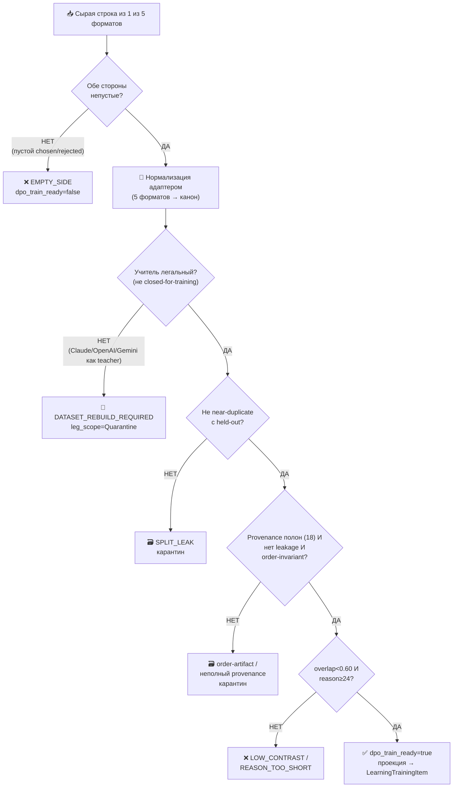
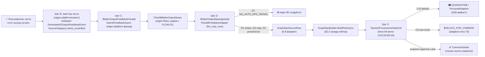

# Блок плана 07 — Авто-строитель DPO: канон `GraphDpoPair` (легальная сборка из 5 форматов)

Автор: Claude (Opus 4.8 MAX), роль — автор полностью решённого блока плана в моём
namespace `claude-*`. Это часть **ПЛАНА** проекта **ILearningDynamicGraph**, а не
разрешение на реализацию продукта (R2/R3: PLAN-ONLY; исполнение — только после
свежего явного approve Luba в текущем ходе). Все цитаты кода — реальные,
перепроверены чтением файлов, с `file:line`. Имена `ILearning*`/`GraphDpoPair`/
`TeacherProvenance` — канон, синхронны со всеми `claude-*` и мастер-планом §E
(A-LM-12 — закрытый список из 5 уровней; новых уровней не вводим).

`GraphDpoBuilder.BuildPairAsync` — это **NEW**-класс (в коде его НЕТ), он
проектируется здесь как авто-строитель канонической DPO-пары графа. Его выход —
типизированная запись `GraphDpoPair` (**NEW**), которая объединяет **5 реально
существующих** форматов DPO-пар проекта и проецируется на существующий
`LearningTrainingItem` (`00.Core/LearningMachineContracts.cs:30`) для обучения
L5-машины.

> **Якорь фазы (доска исполнения `codex-EXECUTION-CONTROL-BOARD`, evidence-only).**
> Этот блок-07 — источник канона строителя DPO для фазы **Ф3 «DPO-строитель»**
> (подшаги Ф3.1.1–Ф3.1.3 — адаптеры 5 форматов; Ф3.2.1–Ф3.2.2 — триада
> train-ready + материализация) и для подшага **Ф2.2.1** «канон `GraphDpoPair` +
> provenance». Его Gate B G1..G10 (§10) = exit-условие Ф3. Канонические счётчики
> плана: **12 фаз (Ф0…Ф11) / 26 подфаз / 59 подшагов**, нумерация
> `Ф<P>.<SP>.<SS>`. Доска и мастер-план — evidence-only, здесь не правятся.

---

## 0. Якорь задачи и где этот claude-блок улучшает бенчмарк

```text
CURRENT TASK: написать МОЙ (claude-namespace) улучшенный блок-07 строителя DPO —
              план-решение авто-сборки канонической пары GraphDpoPair, человеческим
              русским, Part A-формат, с сохранением структуры и канонических
              счётчиков (12 фаз / 26 подфаз / 59 подшагов, Ф<P>.<SP>.<SS>) и
              CANON-инвариантов (L5-машина без 6-го уровня A-LM-12; легальный
              teacher-гейт closed=только judge; запрет скрытого детерминизма
              A-LM-09/A-LM-13). Записать ровно в claude-plan-07-dpo-builder.md.
NOT THE TASK: исполнять/тестировать/билдить код, запускать раннеры, тренировать,
              вызывать внешние AI/API/модели, git; править/создавать любые codex-*
              (только чтение), продолжать чужой codex-план или claude-00..07 каркас.
EVIDENCE-ONLY: codex-plan-07 (бенчмарк-стаб 1.7KB), codex-plan-08 (канон
              TeacherProvenance/LegScope), codex-plan-09 (авто-DPO петля,
              потребитель строителя), codex-plan-00/04/05 (канон GraphDpoPair/ребра),
              codex-ILEARNINGDYNAMICGRAPH-PLAN-v1 §E (канон полей), доска (Ф2/Ф3
              счётчики), claude-02/03/04/06 (мой namespace, согласован), реальный
              код llm_mvp_core (читается для цитат).
```

**Где этот блок осознанно лучше бенчмарка `codex-plan-07` (delta-нота, не слепая
копия).** Бенчмарк `codex-plan-07` — это восстановленный после encoding-fault
**стаб на ~1.7KB**: он перечисляет поля пары, значения `SourceCategory`, классы
`rejected_origin` и Gate B, но **не содержит** Part A (нет §0 UML, нет §1-§3
алгоритма с file:line, нет §5 иерархии, нет тест-стратегии по слоям, нет
человеческого объяснения). Я достраиваю до полного Part A и чиню реальные
пробелы:

| # | Слабое место бенчмарка `codex-plan-07` | Улучшение в этом claude-блоке |
|---|---|---|
| D1 | **Нет Part A вообще.** Стаб — это голый канон-список без §0 диаграммы, §1-§3 алгоритма, §5 иерархии, тест-слоёв. По R3/Part-A Completeness Contract такой артефакт **не допускается** к исполнению. | Достроил полный Part A: §0 classDiagram с `note for` на каждый класс + таблица симуляции каждой связи (§4); §1-§3 пошаговый алгоритм `BuildPairAsync` с классами/методами/параметрами и цитатами реальных форматов; §5 иерархия L5→L2 с Input/Output; §9 тест-стратегия по 9 слоям. |
| D2 | **«5 форматов» не названы.** Бенчмарк говорит «Five input formats are adapted by explicit adapters», но **не называет** ни один реальный формат и не даёт ни одной цитаты `file:line`. Это непроверяемо. | Назвал и процитировал **5 реально существующих** форматов: `DpoPair` (`11.DPO/Models/DpoPair.cs:3`), `RoutingDpoPair` (`26.TrainableRouter/Models/RoutingModels.cs:75`), `OrchestrationPromptDpoPair` (`OrchestrationPromptDpoPairBuilder.cs:54`), `CodeTraceBuilderDpoPair` (`CodeTraceBuilderDpoGenerator.cs:35`), `CrossStackBusinessFlowGraphDpoPair` (`ProjectWikiDomainModels.cs:918`). Каждому — строка адаптера (§3.1, §6). |
| D3 | **Поля пары разъехались с каноном §E.** Бенчмарк перечисляет ~18 полей (`chosen_authority_unit_id`, `leg_scope`, `overlap_score` и т.д.), но мастер §E фиксирует канон `GraphDpoPair` иначе (`level(unit-only)`, `node_or_edge_id(unit_id/ref)`, `wrong_markers`, `candidate_order_invariant`, `excluded_leakage_signals`, `teacher_provenance{...}` как **вложенная запись**, `dpo_train_ready` как **gate**). Бенчмарк держит `teacher_provenance_ref` как плоскую ссылку. | Выровнял на **канон §E**: `teacher_provenance` — вложенный `TeacherProvenance` (20 полей, владелец — блок 08), а не плоский ref; добавил unit-only `level`/`node_or_edge_id`/`wrong_markers`/`candidate_order_invariant`/`excluded_leakage_signals`. Поля бенчмарка-стаба переименованы/поглощены (маппинг — §5.3). |
| D4 | **`dpo_train_ready` без алгоритма.** Бенчмарк объявляет «триаду» (legal+split+authority), но **не описывает**, как `BuildPairAsync` её вычисляет, в каком порядке, что возвращает при провале каждого гейта. | Описал **пошаговый алгоритм** триады (§3): порядок гейтов legal→split→authority→overlap→leakage, ранний выход с `row_rejection_reason`, `dpo_train_ready=false` без выброса (Rule 1). Добавил пороги: `overlap<0.60`, `reason≥24` (синхрон с мастер P-07 Gate B). |
| D5 | **Нет материализации в реальный код.** Бенчмарк не говорит, КУДА превращается пара для обучения. | Зафиксировал проекцию `GraphDpoPair → LearningTrainingItem` (`LearningMachineContracts.cs:30`) и материализацию JSONL через существующий `DpoDataset.Load` (`11.DPO/DpoDataset.cs:18`) — то же, что мастер P-07 Gate B («материализация в `DpoDataset.Load`»). |
| D6 | **FLOW-38 не объяснён.** Бенчмарк: «FLOW-38 and UI feedback enter only through `GeneratedUiOutputFeedbackEvent`», но не говорит, что это **NEW** (в коде нет) и как это проходит legal-гейт. | Пометил `GeneratedUiOutputFeedbackEvent` как **NEW**; описал, что UI-фидбэк → `PersonalAdaptive`/`Quarantine` по умолчанию (§8.3, синхрон с `codex-plan-08` Final Q1), не в `CommonGlobal` без доказательства. |

CANON-инварианты сохранены: маппинг ролей Luba → реальные контракты; 5 закрытых
уровней (A-LM-12); легальный teacher-гейт (closed = только judge); запрет
скрытого детерминизма (A-LM-09/A-LM-13). NEW-типы помечены `NEW`; существующие —
с `file:line`. Имена `GraphDpoPair`/`TeacherProvenance`/`GraphEdgeKind` —
канонические, общие со всеми `claude-*`.

---

## 1. Что это и зачем (роль компонента в ILearningDynamicGraph)

**Строитель DPO — это «сборочный цех обучающих примеров» для графа.** Он берёт
сырые события сравнения (две ветки/два кандидата/два ответа, где один лучше
другого) из пяти разных источников проекта и **собирает из них одну
каноническую, легально-чистую, проверенную пару** `GraphDpoPair`, на которой
потом учится L5-машина (`ILearningMachine<DynamicGraphDomain>`).

Зачем он нужен именно для **обучаемого** графа: сегодня в проекте уже есть **пять
несовместимых форматов** DPO-пар (см. §3.1) — у каждого свои поля, своё понятие
«отклонённого», свои (или вообще отсутствующие) поля провенанса. Обучать
L5-машину графа «зоопарком» форматов нельзя: нет единого train-ready гейта, нет
гарантии легальности учителя, нет защиты от утечки (candidate-index, source-path,
exact-prompt). Строитель — **единственное место**, которое нормализует все
форматы в один канон и **пропускает каждую строку через триаду гейтов** перед
тем, как пометить её `dpo_train_ready=true`.

Граница ответственности (CANON R6 — тонкий агент, простые API; R5 — ядро в
`llm_mvp_core`):

- Строитель **не обучает** (это L5 `TrainBatchAsync`, блок 10) и **не выбирает
  ребро в рантайме** (это L2 `EdgeAuthorityUnit`, блок 02). Он только **строит
  данные** для обучения.
- Строитель **не зовёт внешних учителей сам**. Учительские выходы приходят к нему
  уже как готовый текст `chosen/rejected` + запись `TeacherProvenance`; строитель
  лишь **проверяет** легальность через `TeacherProvenanceGate` (блок 08), а не
  генерирует их.
- Строитель — **детерминированный нормализатор/валидатор** (это инфраструктура
  данных, не семантика): он честно помечен как helper, в нём **нет** заявленной
  «обученной» логики. Его выход — данные для обучаемого уровня, а не сам
  обучаемый уровень.

---

## 2. Концепт простыми словами (аналогия, без кода)

Возьми аналогию завода (она же в блоках 02/03/06). Если оркестратор — начальник
цеха, а ребро — конвейерная линия, то строитель DPO — это **отдел приёмки
учебных образцов для ночной школы рабочих**.

1. **Приходят образцы из пяти разных мастерских.** Каждая мастерская присылает
   «как надо / как не надо» в своём бланке: токарный цех — в одном, сборочный —
   в другом, цех документации — в третьем. Бланки несовместимы.
2. **Отдел приёмки переписывает всё на единый бланк** (`GraphDpoPair`): «вот
   задача → вот правильный образец (chosen) → вот неправильный (rejected) → вот
   почему неправильный плохой (reason + `[WRONG:...]`)».
3. **Проверка легальности учителя.** Прежде чем образец попадёт в учебник, отдел
   спрашивает: «кто сделал правильный образец?». Если это **открытая разрешённая
   модель** (open-weight permissive) — ок, в общий учебник. Если это **закрытая
   фирменная модель** (Claude/OpenAI/Gemini) — её работу **нельзя копировать в
   учебник как эталон** (это нарушение лицензии). Закрытую модель можно звать
   только как **судью-экзаменатора** («этот образец лучше того?»), но не как
   автора эталона. Контаминированный образец → «переделать набор»
   (`DATASET_REBUILD_REQUIRED`).
4. **Проверка «не списано» (split).** Образец не должен быть копией того, что
   уже лежит в экзаменационной (held-out) папке. Иначе студент просто запомнит
   ответ, а не научится. Пара near-duplicate → в карантин.
5. **Проверка «учим смыслу, а не позиции».** Образец не должен позволять угадать
   ответ по **номеру в списке** (candidate-index), по **пути к файлу**
   (source-path) или по **точному тексту запроса** (exact-prompt). Иначе студент
   выучит «всегда бери первый» вместо «пойми задачу». Такие сигналы вырезаются
   (`excluded_leakage_signals`), а строки, где chosen угадывается по позиции, — в
   карантин.
6. **Проверка «достаточно различаются».** Если «правильный» и «неправильный»
   образцы почти одинаковы (overlap высокий) — учить не на чем. Порог: пересечение
   < 0.60.
7. **Печать в учебник.** Только образец, прошедший **все** проверки, получает
   штамп `dpo_train_ready=true` и переписывается в формат, который читает ночная
   школа (`LearningTrainingItem` → JSONL → `DpoDataset.Load`).
8. **Честное «брак».** Если образец не прошёл, отдел **не выбрасывает его молча и
   не подделывает штамп** — он пишет причину брака (`row_rejection_reason`) и
   статус (`Quarantine`/`EvalOnly`). Пустой набор образцов — невалиден для
   обучения (нельзя учить на нуле строк).

Чего отдел приёмки **не делает сам**: не рисует эталонные образцы (это
мастерские/учителя), не проводит саму ночную школу (это L5-обучение) и не решает
в рантайме, какую деталь на какую линию пустить (это L2-юнит ребра).

---

## 3. Алгоритм/решение ПОШАГОВО (человеческим языком, полное решение)

Это **полностью решённый** алгоритм авто-строителя
`GraphDpoBuilder.BuildPairAsync` (**NEW**-класс). Ниже — что происходит, где, в
каком порядке, какие классы/методы/параметры участвуют. Все ссылки на
**существующие** форматы — с `file:line`; NEW-добавления помечены явно.

### 3.1. Пять реальных входных форматов (источники, которые строитель нормализует)

Это **реально существующие** записи проекта (перепроверены чтением). Строитель
имеет по одному явному адаптеру на каждый формат (Ф3.1.1–Ф3.1.3 группируют их):

| # | Существующий формат | file:line | Ключевые поля сейчас | Что несёт |
|---|---|---|---|---|
| F1 | `DpoPair` | `11.DPO/Models/DpoPair.cs:3` | `Prompt; Chosen; Rejected` | базовый формат обучения DPO (без провенанса, без id) |
| F2 | `RoutingDpoPair` | `26.TrainableRouter/Models/RoutingModels.cs:75` | `PairId; ASide; Chosen; Rejected; SourceDecisionRunId; ChosenUnitId; RejectedUnitId` | выбор юнита-роутера (есть id юнитов = почти `authority_unit_id`) |
| F3 | `OrchestrationPromptDpoPair` | `26.TrainableRouter/Training/OrchestrationPromptDpoPairBuilder.cs:54` | пара из файла промптов оркестрации | сценарии оркестратора |
| F4 | `CodeTraceBuilderDpoPair` | `42.ProjectWikiDomain/CodeTraceBuilderDpoGenerator.cs:35` | `Chosen; Rejected` с маркером `[WRONG:...]` (`:48`) | трассировка кода (есть канон `[WRONG:]`) |
| F5 | `CrossStackBusinessFlowGraphDpoPair` | `42.ProjectWikiDomain/ProjectWikiDomainModels.cs:918` | `PairId; BoundaryMap; A; Chosen; Rejected; RejectedType; RequiredPathIds; EvidenceIds` | граф Angular↔.NET↔SQL (есть `RejectedType`, `EvidenceIds`) |

Наблюдение (обоснование канона): ни один из 5 форматов **не несёт легального
провенанса учителя** и ни один не несёт **полей анти-leakage**. Поэтому канон
`GraphDpoPair` обязан добавить `teacher_provenance{...}` (20 полей, блок 08) и
`excluded_leakage_signals[]` — это и есть главная причина существования
строителя, а не «ещё один формат».

### 3.2. Канон выхода `GraphDpoPair` (NEW; РОВНО 14 полей по мастер §E)

**CANON-владелец ТИПА `GraphDpoPair` (14 полей, §E) = блок 07.** Это прямо
зафиксировано мастер-планом (`claude-ILEARNINGDYNAMICGRAPH-PLAN-v1.md:171`
«канон в 07»; `:467` «Поля `GraphDpoPair` = 14 … §A.4 / блок 07») и матрицей
покрытия (`claude-REQUIREMENTS-COVERAGE-MATRIX.md:93` «план-07 (владелец
канона)»). Блок 07 — это одновременно **строитель** и **владелец канона типа
пары**: он МАТЕРИАЛИЗУЕТ пары `level=unit` (их потребляет узловой блок
`claude-plan-01` §5.2). Разделение владения явное: **блок 07 владеет каноном
`GraphDpoPair` (14 полей)**; **блок 08 владеет ТОЛЬКО вложенным
`TeacherProvenance` (20 полей) и вердиктами legal-гейта**. Поля 14-полевого
ядра ниже **синхронны с мастер §E** (`:174-177`); вложенный `teacher_provenance`
— владелец 08. Мастер §E фиксирует **ровно 14 канон-ядро полей** — ниже ровно
эти 14 (parity с `claude-plan-01` §5.2, строки 661-675 — запись `GraphDpoPair`;
не путать со строками 633-646, где лежат `GraphNodeStateProvenance` и
`DynamicGraphNodeDescriptor`). При расхождении числа/имён полей **14-полевого
ядра** побеждает владелец типа — **блок 07** (синхронно с мастер §E); при
расхождении полей **вложенного `TeacherProvenance`** побеждает владелец 08.

```text
GraphDpoPair (канон §E — РОВНО 14 полей; владелец ТИПА — блок 07; поля синхронны с мастер §E):
  pair_id                     // уникальный id строки
  level                       // unit-only: chosen/rejected for one ILearningUnit/domain item
  node_or_edge_id             // unit_id/ref; graph/edge/combo ids stay provenance/context
  input_context               // вход (задача), для которого собраны оба варианта
  chosen                      // лучший вариант (эталон)
  rejected                    // худший вариант
  wrong_markers[]             // [WRONG:...] аннотации в rejected (канон dpo-triple)
  reason                      // человеческое объяснение, почему chosen лучше (≥24 символа)
  teacher_provenance          // ВЛОЖЕННЫЙ TeacherProvenance (20 полей; владелец блок 08)
  source_ids[]                // провенанс источников (что породило строку)
  held_out                    // bool: строка попала в экзаменационный сплит?
  candidate_order_invariant   // bool: выбор устойчив к перестановке кандидатов?
  excluded_leakage_signals[]  // [candidate_index, source_path, exact_prompt]
  dpo_train_ready             // GATE: true только при пройденной триаде (см. 3.3)
```

**Канал признаков межуровневого порядка (RR2-order-channel, RESOLVED §E).**
`GraphOrderResolverUnit` (`claude-plan-04` §3.3-bis, training-update) учится на парах
порядка и требует `OrderedPatternIds` обеих сторон. На канон-строке `GraphDpoPair`
(14 полей, владелец — ЭТОТ блок 07) **нет** отдельного поля `graph_path_ids`/
`OrderedPatternIds`, и 15-е поле НЕ заводится (lock-14 §E). Носитель залочен явно
через **существующее канон-поле `input_context`** + `chosen`/`rejected`:
- `chosen` = сериализованный `OrderedPatternIds` принятого порядка (стабильные `PatternId`, order-0..N);
- `rejected` = сериализованный `OrderedPatternIds` отвергнутого near-miss-порядка;
- `input_context` = структурный конверт узлов-кандидатов (order-level / consumes / capability-tags),
  без позиции/пути/source-id/exact-prompt (forbidden leakage).
Path-pair `graph_path_ids` НЕ является каноном пары: он живёт только в `raw_comparison_event`
триады (`claude-plan-04` §0.2) как **evidence-only** провенанс сравнения путей; `candidate_order_hash`
там же — только для permutation-инвариантности, не вход обучения. training-update читает
`OrderedPatternIds` из `chosen`/`rejected`, а структуру — из `input_context` (`claude-plan-04`
§3.3-bis шаги 1-2). Канон 14 полей не расширяется.

**НЕ-канон-поля пары (вычисляемые строителем атрибуты строки / выходы гейтов —
НЕ персистентные поля канон-пары §E).** Эти 5 полей в мастер §E и в
`claude-plan-01` §5.2 ОТСУТСТВУЮТ; держать их на канон-строке нельзя без явного
расширения канона §E (вопрос Q1 к Luba, §12). Их корректное место — поля
`BuildContext`/`TriadVerdict`/бокового манифеста, а НЕ строки `GraphDpoPair`:

```text
Строительские/диагностические поля (НЕ §E, НЕ на канон-строке):
  rejected_origin       // атрибут строки: ОТКУДА взят rejected (таксономия §3.4); поле TriadVerdict/манифеста
  leg_scope             // ВЫВОД гейта блока 08: CommonGlobal|PersonalAdaptive|EvalOnly|Quarantine (вердикт, не хранимое поле пары)
  overlap_score         // ДИАГНОСТИКА триады: пересечение chosen/rejected (порог < 0.60); выход гейта
  split_proof_ref       // ДИАГНОСТИКА триады: ссылка на доказательство split; выход гейта
  row_rejection_reason  // ДИАГНОСТИКА триады: причина брака, если не train-ready; выход гейта
```

Сравнение с бенчмарком (D3): бенчмарк держал `teacher_provenance_ref` как плоскую
ссылку и поля `chosen_authority_unit_id`/`rejected_authority_unit_id` на верхнем
уровне. Канон §E кладёт провенанс **внутрь** строки вложенной записью (полнота
20 полей проверяется на месте), а id юнитов переезжают в `source_ids[]`/внутрь
provenance — это убирает класс ошибки «строка train-ready, а provenance не
полон» (маппинг — §5.3).

### 3.3. `BuildPairAsync` — пошаговый алгоритм (триада + порог + leakage)

`GraphDpoBuilder.BuildPairAsync(GraphDpoSourceRow raw, BuildContext ctx, ct)` →
`OperationResult<GraphDpoPair>` (Rule 1: никаких throw; при браке —
`Ok(pair)` с `dpo_train_ready=false` + `row_rejection_reason`, либо
`Fail(reason, CODE)` только для системных ошибок).

Шаг 0. **Защитные проверки.** `null` raw → `Fail(..., "ROW_REQUIRED")`; отмена →
`Fail("Cancelled.","CANCELLED")`; пустой `chosen` или `rejected` →
`row_rejection_reason="EMPTY_SIDE"`, `dpo_train_ready=false`.

Шаг 1. **Нормализация формата (адаптер).** По `raw.SourceFormat` выбирается один
из 5 адаптеров (§3.1) → заполняется черновик `GraphDpoPair` (chosen/rejected/
input_context/source_ids/level/node_or_edge_id; `[WRONG:]` сохраняется из F4/F5,
для F1-F3 — пусто). Адаптер **не** изобретает провенанс: если у формата его нет,
provenance берётся из `ctx.TeacherProvenance` (что прислал источник), иначе
строка не может быть `CommonGlobal`.

Шаг 2. **ГЕЙТ 1 — легальность учителя (`TeacherProvenanceGate`, блок 08).**
Проверка `teacher_provenance`:
- если `closed_proprietary_model=true` И `used_for_training=true` →
  **немедленно** `row_rejection_reason="DATASET_REBUILD_REQUIRED"`,
  `leg_scope=Quarantine`, `dpo_train_ready=false`, ранний выход. Это
  безусловно (никакого Luba-исключения, A-LM-04/блок 08);
- если `used_for_judging_only=true` И `used_for_training=false` → допустимо как
  судья, но **не** как эталон: если chosen происходит от closed-judge →
  `leg_scope` не выше `EvalOnly`;
- если все 20 полей присутствуют (включая 2 RR6 `service_mode`/`grounding_used` —
  обязательны; пустые RR6 ⇒ presence_rate<1.0 ⇒ не train-ready, R4), teacher
  open-weight permissive, terms проверены, `service_mode=="plain"` и
  `grounding_used==false` → гейт пройден.

Шаг 3. **ГЕЙТ 2 — split (не near-duplicate с held-out).** Через `ISplitProver`
(NEW, блок 11) проверяется, что (input_context+chosen) не является
near-duplicate уже отложенной held-out строки (simhash/minhash similarity ≥
порога near-dup; **порог `NearDuplicateThreshold = 0.85` ЗАЛОЧЕН** — RR9-lock-numbers,
Luba-default 2026-06-30; владелец числа — блок 11 `SplitProof`). Провал → `row_rejection_reason="SPLIT_LEAK"`,
`rejected_origin="split-leak"`, `leg_scope=Quarantine`. Пройдено → пишется
`split_proof_ref`.

Шаг 4. **ГЕЙТ 3 — authority/provenance complete + anti-leakage.**
- проверка полноты provenance (20 полей, `triad_field_presence_rate==1.0`);
- проверка `excluded_leakage_signals` содержит `[candidate_index, source_path,
  exact_prompt]` и что ни один из них не присутствует в `chosen`/`input_context`
  как решающий сигнал;
- **permutation-invariance:** если выбор chosen меняется только от перестановки
  порядка кандидатов → `candidate_order_invariant=false`,
  `rejected_origin="order-artifact"`, `leg_scope=Quarantine` (это и есть
  анти-shortcut A-LM-09 на уровне данных).

Шаг 5. **ПОРОГ — различимость.** `overlap_score = TokenOverlap(chosen,
rejected)`. Если `overlap_score ≥ 0.60` → `row_rejection_reason="LOW_CONTRAST"`,
`dpo_train_ready=false`. Если `len(reason) < 24` → `row_rejection_reason=
"REASON_TOO_SHORT"` (синхрон с мастер P-07 Gate B: `overlap<0.60, reason≥24`).

Шаг 6. **Штамп train-ready.** `dpo_train_ready = (gate1 && gate2 && gate3 &&
overlap_ok && reason_ok && candidate_order_invariant)`. Только при **всех true**
строка train-ready; `train_ready_without_triad_count` обязан остаться **0**
(инвариант Gate B, §10 G6).

Шаг 7. **Возврат.** `OperationResult<GraphDpoPair>.Ok(pair)` всегда (даже при
браке — с честным `row_rejection_reason`), кроме системных ошибок шага 0.

### 3.4. Таксономия `rejected_origin` (откуда берётся «худший» вариант)

Бенчмарк перечисляет классы; здесь — **с правилом построения** каждого (это
устраняет пустую таксономию):

| `rejected_origin` | Как строится rejected | Чему учит контраст |
|---|---|---|
| `random-rejected` | случайный валидный ответ из другого контекста | «не любой текст подходит» |
| `copied` | дубликат chosen с внесённой ошибкой `[WRONG:...]` | конкретный анти-паттерн |
| `missing-source` | ответ без опоры на источник (выдуманные символы) | «не выдумывай, опирайся на evidence» |
| `teacher-unknown` | ответ от учителя без провенанса | блокируется гейтом 1 (не train-ready) |
| `split-leak` | near-duplicate held-out | блокируется гейтом 2 (карантин) |
| `order-artifact` | выбор зависит от позиции кандидата | блокируется гейтом 3 (карантин) |
| `baseline-loser` | проигравший выход baseline-генератора (напр. `MultiSubPhaseRouterUnit`, блок 03) | «обученный лучше детерминированного baseline» (ablation-данные) |

`baseline-loser` — мост к блоку 06 (async N-комбинаций: из N≥2 веток худшие
становятся rejected) и к ablation блока 03/12.

---

## 4. UML-фрагмент (§0 — Mermaid classDiagram)

```mermaid
classDiagram
    class GraphDpoBuilder {
        <<class NEW>>
        +BuildPairAsync(GraphDpoSourceRow, BuildContext, ct) Task~OperationResult~GraphDpoPair~~
        +BuildBatchAsync(GraphDpoSourceRow[], BuildContext, ct) Task~OperationResult~GraphDpoBatch~~
        -Normalize(raw) GraphDpoPair
        -ApplyTriad(pair, ctx) TriadVerdict
        -TokenOverlap(chosen, rejected) double
    }
    note for GraphDpoBuilder "NEW (в коде НЕТ). Детерминированный сборочный цех DPO: 5 форматов→канон→триада гейтов→train-ready. Это helper-нормализатор/валидатор, НЕ обучаемый уровень. Статус: ПРОЕКТ."

    class GraphDpoPair {
        <<record NEW канон §E — РОВНО 14 полей>>
        +pair_id string
        +level string
        +node_or_edge_id string
        +input_context string
        +chosen string
        +rejected string
        +wrong_markers string[]
        +reason string
        +teacher_provenance TeacherProvenance
        +source_ids string[]
        +held_out bool
        +candidate_order_invariant bool
        +excluded_leakage_signals string[]
        +dpo_train_ready bool
    }
    note for GraphDpoPair "NEW (в коде НЕТ). Канон DPO-пары графа (§E) — РОВНО 14 полей; владелец ТИПА — блок 07 (мастер :171/:467, матрица :93); поля синхронны с мастер §E :174-177. Parity с claude-plan-01 §5.2 (строки 661-675 — запись пары; НЕ 633-646, там дескриптор узла). teacher_provenance — ВЛОЖЕННАЯ запись (20 полей, владелец блок 08), НЕ плоский ref. dpo_train_ready — gate, не флаг по умолчанию. rejected_origin/leg_scope/overlap_score/split_proof_ref/row_rejection_reason — НЕ поля §E (выходы гейтов/строителя), см. §3.2. Статус: ПРОЕКТ."

    class TeacherProvenance {
        <<record NEW канон 20 полей snake_case — владелец блок 08>>
        +model_id string
        +hosting_provider string
        +model_license string
        +teacher_access_mode string
        +teacher_output_used_for_training bool
        +closed_proprietary_model bool
        +judge_model string
        +source_category string
        +source_ref string
        +source_sha256 string
    }
    note for TeacherProvenance "NEW. Канон 20 полей (snake_case) — ВЛАДЕЛЕЦ блок 08 (§3.1) / мастер §A.4. Имена — канон блока 08; при расхождении ПОБЕЖДАЕТ владелец 08. Здесь показаны ключевые из 20 (полный owner-record — блок 08 §5 и claude-plan-01 §5). judge_model — ВНУТРИ provenance; judge-only выводится из teacher_output_used_for_training=false. closed_proprietary_model=true && teacher_output_used_for_training=true => DATASET_REBUILD_REQUIRED. Статус: ПРОЕКТ (канон в блоке 08)."

    class TeacherProvenanceGate {
        <<class NEW — владелец блок 08>>
        +Evaluate(TeacherProvenance) ProvenanceVerdict
    }
    note for TeacherProvenanceGate "NEW. Гейт легальности (блок 08). Строитель ВЫЗЫВАЕТ его на шаге 2, но не владеет каноном. Статус: ПРОЕКТ (канон в блоке 08)."

    class LearningTrainingItem {
        <<record СУЩ.>>
        +ItemId string
        +Prompt string
        +ChosenResponse string
        +RejectedResponse string
    }
    note for LearningTrainingItem "СУЩ. 00.Core/LearningMachineContracts.cs:30. Цель ПРОЕКЦИИ train-ready пары для L5-обучения. Статус: РАБОТАЕТ."

    class DpoDataset {
        <<class СУЩ.>>
        +Load(path) DpoDataset
    }
    note for DpoDataset "СУЩ. 11.DPO/DpoDataset.cs:18. Материализация JSONL (prompt/chosen/rejected). Конечная точка строителя для DPO-обучения. Статус: РАБОТАЕТ."

    class CrossStackBusinessFlowGraphDpoPair {
        <<record СУЩ. формат F5>>
        +PairId string
        +Chosen string
        +Rejected string
        +RejectedType string
        +EvidenceIds string[]
    }
    note for CrossStackBusinessFlowGraphDpoPair "СУЩ. 42.../ProjectWikiDomainModels.cs:918. Один из 5 входных форматов (Angular/.NET/SQL граф). Нормализуется адаптером в GraphDpoPair. Статус: РАБОТАЕТ как формат-источник."

    GraphDpoBuilder ..> GraphDpoPair : builds (output)
    GraphDpoBuilder ..> TeacherProvenanceGate : gate 1 (legal)
    GraphDpoPair *-- TeacherProvenance : contains (nested)
    GraphDpoBuilder ..> CrossStackBusinessFlowGraphDpoPair : adapts (1 of 5 formats)
    GraphDpoPair ..> LearningTrainingItem : projects to (train-ready only)
    LearningTrainingItem ..> DpoDataset : materializes as JSONL
```



### 4.1. Легенда классов

| Класс | Что делает | Статус |
|---|---|---|
| `GraphDpoBuilder` | Детерминированный строитель: 5 форматов→канон→триада→train-ready | NEW (ПРОЕКТ) |
| `GraphDpoPair` | Канон DPO-пары графа (§E), provenance вложен | NEW (ПРОЕКТ) |
| `TeacherProvenance` | 20 полей легальности учителя (владелец — блок 08) | NEW (ПРОЕКТ) |
| `TeacherProvenanceGate` | Гейт легальности, вызывается строителем (блок 08) | NEW (ПРОЕКТ) |
| `LearningTrainingItem` | Цель проекции train-ready пары для L5 | РАБОТАЕТ (`LearningMachineContracts.cs:30`) |
| `DpoDataset` | Материализация JSONL для DPO-обучения | РАБОТАЕТ (`11.DPO/DpoDataset.cs:18`) |
| `CrossStackBusinessFlowGraphDpoPair` | Формат-источник F5 (Angular/.NET/SQL) | РАБОТАЕТ (`ProjectWikiDomainModels.cs:918`) |

### 4.2. Таблица симуляции §0 (для каждой связи: вход → ожидаемый результат)

| # | Связь | Пример входа | Ожидаемый результат |
|---|---|---|---|
| S1 | `GraphDpoBuilder ..> GraphDpoPair` (builds) | `raw` пустой `chosen` | `Ok(pair)` с `dpo_train_ready=false`, `row_rejection_reason="EMPTY_SIDE"` — не throw (Rule 1) |
| S2 | `..> TeacherProvenanceGate` (legal) | provenance `closed_proprietary_model=true, teacher_output_used_for_training=true` (напр. `model_id=claude-*`) | ранний выход: `row_rejection_reason="DATASET_REBUILD_REQUIRED"`, `leg_scope=Quarantine`, `dpo_train_ready=false` |
| S3 | `..> TeacherProvenanceGate` (judge-only) | closed-модель `judge_model` задан, `teacher_output_used_for_training=false`, chosen НЕ от неё | гейт 1 пройден; `leg_scope` может быть `CommonGlobal` (если остальное чисто) |
| S4 | `*-- TeacherProvenance` (nested) | provenance с 19/20 полей snake_case | гейт 3: `provenance_field_presence_rate<1.0` → `dpo_train_ready=false` (полнота провенанса по 20 полям) |
| S5 | `..> CrossStackBusinessFlowGraphDpoPair` (adapts) | F5-пара `RejectedType="missing-edge"`, `EvidenceIds=[...]` | нормализована через unit-level проекцию в `GraphDpoPair`: `rejected_origin` из `RejectedType`, `source_ids` из `EvidenceIds`, `level=unit`; graph/evidence ids остаются provenance/context, не train-ready level |
| S6 | adapts F1 `DpoPair` | F1 `Prompt/Chosen/Rejected` без provenance, `ctx.TeacherProvenance` пуст | нормализована, но `leg_scope` не выше `EvalOnly` (нет provenance для `CommonGlobal`) |
| S7 | split-гейт | (input+chosen) near-duplicate held-out строки | `row_rejection_reason="SPLIT_LEAK"`, `rejected_origin="split-leak"`, карантин |
| S8 | permutation-invariance | chosen меняется при перестановке кандидатов | `candidate_order_invariant=false`, `rejected_origin="order-artifact"`, карантин (A-LM-09) |
| S9 | overlap-порог | `chosen`≈`rejected`, `overlap_score=0.74` | `row_rejection_reason="LOW_CONTRAST"` (≥0.60), `dpo_train_ready=false` |
| S10 | `..> LearningTrainingItem` (projects) | train-ready пара (все гейты true) | проекция `ItemId←pair_id, Prompt←input_context, ChosenResponse←chosen, RejectedResponse←rejected` |
| S11 | `..> DpoDataset` (materializes) | N train-ready строк → JSONL | `DpoDataset.Load(path).Count == N` (`11.DPO/DpoDataset.cs:18`) |
| S12 | пустой батч | 0 строк прошли триаду | `BuildBatchAsync` → `dpo_train_ready` строк 0; батч **невалиден для обучения** (нельзя учить на нуле) |

### 4.3. Flowchart §1 (человеческие ветки `BuildPairAsync` + симуляция веток)



Симуляция веток (каждая ветка — вход → результат):
- `B=НЕТ`: вход `chosen=""` → `EMPTY_SIDE`, не train-ready.
- `D=НЕТ`: вход provenance `model_id=claude-sonnet, teacher_output_used_for_training=true` → `DATASET_REBUILD_REQUIRED` (S2).
- `D=ДА, judge-only`: closed как judge, chosen от open-weight → проходит (S3).
- `E=НЕТ`: (input+chosen) near-dup held-out → `SPLIT_LEAK` (S7).
- `F=НЕТ (order)`: chosen зависит от позиции → `order-artifact`, карантин (S8).
- `F=НЕТ (provenance)`: 19/20 полей → не train-ready (S4).
- `G=НЕТ`: `overlap=0.74` → `LOW_CONTRAST` (S9).
- `G=ДА (всё чисто)`: open-weight teacher, overlap=0.31, reason=40 симв., order-invariant → `dpo_train_ready=true`, проекция в `LearningTrainingItem` (S10).

---

## 5. §5 Иерархия + контракты (NEW vs существующее, с file:line)

### 5.1. Где строитель стоит в пятиуровневой иерархии

Строитель **не является** уровнем иерархии — он **питает данными** L5-машину.
Иерархия (`LearningMachineContracts.cs:197-207`):

```
L5  ILearningDynamicGraph ≡ ILearningMachine<DynamicGraphDomain>
      TrainBatchAsync(IReadOnlyList<LearningTrainingItem>)   ← ПОТРЕБИТЕЛЬ выхода строителя (блок 10)
        ↑ кормится из
   [GraphDpoBuilder]  (NEW, ЭТОТ БЛОК) — helper-нормализатор данных, вне уровней
        ↑ собирает из
   5 форматов (F1..F5, §3.1) — существующие источники сравнений
L4  ILearningOrchestrator ≡ ILogicalOrchestrator   — порождает baseline-loser строки (блок 03)
L3  ILearningFlow ≡ ILogicalFlow                    — ребро (блок 02)
L2  EdgeAuthorityUnit ≡ ILogicalUnit               — ОБУЧАЕТСЯ на train-ready парах (блок 02)
```

Input/Output по уровням (для §5-полноты):

| Уровень | Input | Output | Связь со строителем |
|---|---|---|---|
| L5 `ILearningMachine<DynamicGraphDomain>` | `IReadOnlyList<LearningTrainingItem>` (`:30`) | `LearningBatchResult` (`:43`), `LearningEvaluationResult` (`:90`) | **потребляет** проекцию train-ready пар |
| L2 `EdgeAuthorityUnit` | `EdgeAuthorityInput` (NEW, блок 02) | `EdgeAuthorityDecision` (NEW, блок 02) | **обучается** на этих парах (через L5) |
| строитель `GraphDpoBuilder` | `GraphDpoSourceRow` (NEW, обёртка над F1..F5) | `GraphDpoPair` (NEW) | сам по себе — helper, не уровень |

### 5.2. NEW-контракты (в коде их НЕТ; сигнатуры — утвердить у Luba)

```csharp
// NEW — единая обёртка над 5 входными форматами (адаптер заполняет её).
public sealed record GraphDpoSourceRow(
    string SourceFormat,          // "DpoPair" | "RoutingDpoPair" | "OrchestrationPromptDpoPair"
                                  //   | "CodeTraceBuilderDpoPair" | "CrossStackBusinessFlowGraphDpoPair"
    string InputContext,          // задача/промпт, для которого собраны варианты
    string Chosen,
    string Rejected,
    IReadOnlyList<string> WrongMarkers,     // [WRONG:...] из F4/F5; для F1-F3 пусто
    string Level,                 // unit-only; non-unit graph/edge rows remain source/provenance candidates
    string NodeOrEdgeId,          // unit_id/ref required before train-ready GraphDpoPair materialization
    string RejectedOrigin,        // таксономия §3.4
    TeacherProvenance? Provenance,// что прислал источник; null => не CommonGlobal
    IReadOnlyList<string> SourceIds);

// NEW — канон DPO-пары графа (§E) — РОВНО 14 полей. teacher_provenance ВЛОЖЕН (D3-исправление).
// CANON-владелец ТИПА GraphDpoPair (14 полей) — блок 07 (мастер :171 «канон в 07», :467 «§A.4 / блок 07»;
//   матрица :93 «план-07 (владелец канона)»); поля 14-полевого ядра синхронны с мастер §E :174-177.
// Вложенный TeacherProvenance (20 полей) — владелец блок 08.
// Parity с claude-plan-01 §5.2 (строки 661-675 — запись GraphDpoPair; НЕ 633-646, там
//   GraphNodeStateProvenance/DynamicGraphNodeDescriptor): тот же набор из 14 канон-ядро полей.
// 5 строительских/диагностических полей (RejectedOrigin, LegScope, OverlapScore, SplitProofRef,
// RowRejectionReason) на канон-строке §E ОТСУТСТВУЮТ — они живут в TriadVerdict (ниже), НЕ здесь.
public sealed record GraphDpoPair(
    string PairId,
    string Level,
    string NodeOrEdgeId,
    string InputContext,
    string Chosen,
    string Rejected,
    IReadOnlyList<string> WrongMarkers,
    string Reason,                          // ≥24 символа (Gate B)
    TeacherProvenance TeacherProvenance,    // 20 полей; владелец канона — блок 08
    IReadOnlyList<string> SourceIds,
    bool HeldOut,
    bool CandidateOrderInvariant,
    IReadOnlyList<string> ExcludedLeakageSignals, // [candidate_index, source_path, exact_prompt]
    bool DpoTrainReady);                    // GATE (§3.3 шаг 6)

// NEW — вердикт триады/строителя (НЕ §E-канон, НЕ поле GraphDpoPair). Выходы гейтов
// (§3.3) и вычисляемые строителем атрибуты строки. Держится сбоку от канон-пары
// (в боковом DPO-манифесте / результате BuildPairAsync), чтобы канон §E оставался ровно 14 полей.
public sealed record TriadVerdict(
    string RejectedOrigin,                  // §3.4 — ОТКУДА взят rejected (атрибут строки)
    string LegScope,                        // ВЫВОД гейта 08: CommonGlobal|PersonalAdaptive|EvalOnly|Quarantine
    double OverlapScore,                    // диагностика: < 0.60 для train-ready
    string SplitProofRef,                   // диагностика: ссылка на доказательство split
    string RowRejectionReason);             // диагностика: пусто, если train-ready

// NEW — строитель (helper-нормализатор/валидатор; НЕ обучаемый уровень).
public sealed class GraphDpoBuilder
{
    // Одна строка: 5 форматов → канон → триада гейтов → train-ready.
    public Task<OperationResult<GraphDpoPair>> BuildPairAsync(
        GraphDpoSourceRow raw, BuildContext ctx, CancellationToken ct = default);

    // Батч: применяет BuildPairAsync ко всем; пустой train-ready батч НЕ валиден для обучения.
    public Task<OperationResult<GraphDpoBatch>> BuildBatchAsync(
        IReadOnlyList<GraphDpoSourceRow> rows, BuildContext ctx, CancellationToken ct = default);
}
```

`TeacherProvenance` (20 полей) и `TeacherProvenanceGate` — **канон владеет блок
08** (`codex-plan-08` §5/§8.4; мастер §A.4). Здесь они только **используются**;
дублировать канон 20 полей в блоке 07 нельзя (это разрушит single-owner правило).

> **Стоячая нота согласования имён (как в блоке 09 D2).** Имена полей
> `TeacherProvenance` — **канон блока 08 §3.1 (snake_case)**: `teacher_access_mode,
> hosting_provider, model_id, model_license, model_version, request_id,
> provider_terms_checked, teacher_output_used_for_training, closed_proprietary_model,
> judge_model, source_ref, source_sha256, contamination_markers` (13 базовых) +
> `terms_snapshot_ref, geography_export_constraint, source_category,
> raw_private_text_copied, redaction_policy_ref` (5 NEW T2/T3/T5) + RR6
> `service_mode, grounding_used` = 20. При любом
> расхождении имён/числа полей с другими блоками **побеждает владелец 08**. Блок
> 07 **индексирует** этот 20-полевой record (не переписывает его своими именами):
> PascalCase-имена бенчмарка `codex-plan-07` (ModelName/Provider/LicenseId/
> WeightsAvailability/TrainingUseAllowed/UsedForTraining/UsedForJudgingOnly/
> ClosedProprietaryModel/SourceCategory/TeacherId) **не используются** — это был
> молчаливый занос codex-стиля; canon-имена выше.

### 5.3. Маппинг полей бенчмарка-стаба → канон §E (что куда переехало)

| Поле бенчмарка `codex-plan-07` | Куда в каноне §E (14 полей) или в `TriadVerdict` | Почему |
|---|---|---|
| `chosen_authority_unit_id` / `rejected_authority_unit_id` | `source_ids[]` + внутрь `teacher_provenance` | id юнитов — это провенанс, не верхнеуровневое поле пары |
| `chosen_origin` / `rejected_origin` | `TriadVerdict.RejectedOrigin` (таксономия §3.4) | НЕ поле канон-пары §E — атрибут строки/вердикт гейта, см. §3.2 |
| `source_category` | внутрь `teacher_provenance.source_category` (snake_case, блок 08) | `source_category` — поле провенанса (5 NEW T5, владелец блок 08 §3.1) |
| `teacher_provenance_ref` (плоская ссылка) | `teacher_provenance` (ВЛОЖЕННАЯ запись) | устраняет «train-ready без полного провенанса» (D3) |
| `legal_verdict` | вычисляется гейтом → `TriadVerdict.LegScope`/`TriadVerdict.RowRejectionReason` | вердикт — результат гейта, НЕ хранимое поле канон-пары §E |
| (нет в бенчмарке) | `wrong_markers[]`, `candidate_order_invariant`, `excluded_leakage_signals[]`, `held_out` | добавлено по канону §E (анти-leakage/split) |

---

## 6. Цитаты кода «как сейчас» → сейчас / почему / должно стать / как менять

### Цитата A — формат F1 `DpoPair` (база обучения, без провенанса)

`11.DPO/Models/DpoPair.cs:3-8`:
```
public record DpoPair {
    public string Prompt   { get; init; } = "";
    public string Chosen   { get; init; } = "";
    public string Rejected { get; init; } = "";
}
```
- **Сейчас:** базовый формат DPO без id, без провенанса, без анти-leakage.
- **Почему так (ок как формат):** это конечная точка обучения; `DpoDataset.Load`
  читает именно его JSONL (`11.DPO/DpoDataset.cs:18`). Нарушения нет — это
  **формат-источник** и **цель материализации**.
- **Должно стать:** остаётся целью материализации train-ready пар (проекция §3.3
  шаг 7), но **никогда** не источником истины легальности (у него нет
  provenance). Строитель добавляет provenance/leakage **поверх**.
- **Как менять:** не менять сам `DpoPair`. Менять — добавить адаптер F1 в
  строителе (NEW) + проекцию канона обратно в `DpoPair` для JSONL.

### Цитата B — формат F5 с готовым `RejectedType` и `EvidenceIds`

`42.ProjectWikiDomain/ProjectWikiDomainModels.cs:918`:
```
public sealed record CrossStackBusinessFlowGraphDpoPair(
    string PairId, SystemBoundaryMapResult BoundaryMap, string A,
    string Chosen, string Rejected, string RejectedType,
    string[] RequiredPathIds, string[] EvidenceIds);
```
- **Сейчас:** богатый формат графа Angular/.NET/SQL: уже несёт `RejectedType`
  (≈ `rejected_origin`) и `EvidenceIds` (≈ `source_ids`), но **нет провенанса
  учителя** и **нет анти-leakage**.
- **Почему так (ок как формат):** это легитимный источник сравнений для графа.
- **Должно стать:** адаптер F5 переносит `RejectedType→rejected_origin`,
  `EvidenceIds→source_ids`, `A→input_context`, `level=unit`; graph/evidence ids
  остаются provenance/context, а не train-ready level; провенанс берётся из `ctx`
  (источник обязан приложить), иначе `leg_scope≤EvalOnly`.
- **Как менять:** адаптер F5 в строителе (NEW); сам record не трогать (мастер Q32
  — оставить как формат-источник, не переименовывать).

### Цитата C — образец канона `[WRONG:]` (F4, как надо)

`42.ProjectWikiDomain/CodeTraceBuilderDpoGenerator.cs:48`:
```
var wrongAnnotationRate = pairs.Count(pair => pair.Rejected.Contains("[WRONG:", StringComparison.Ordinal)) / (double)pairs.Length;
```
- **Сейчас:** rejected-сторона помечается маркером `[WRONG:...]`, и считается
  доля размеченных — это канон `dpo-triple-format`.
- **Почему так (ок, образец):** конкретный анти-паттерн в rejected учит лучше,
  чем «просто плохой ответ». Правильный образец.
- **Должно стать:** канон `GraphDpoPair.wrong_markers[]` наследует этот паттерн;
  для `rejected_origin="copied"` маркер `[WRONG:...]` **обязателен**.
- **Как менять:** не менять генератор; перенести правило `[WRONG:]` в адаптеры и
  в тест-слой (§9 negative).

### Цитата D — цель проекции для обучения

`00.Core/LearningMachineContracts.cs:30-39`:
```
public sealed record LearningTrainingItem(
    string ItemId, string Prompt, string ChosenResponse, string RejectedResponse);
```
- **Сейчас:** именно это потребляет `ILearningMachine.TrainBatchAsync` (L5).
- **Почему так (ок):** единая точка входа обучения для всех машин проекта.
- **Должно стать:** train-ready `GraphDpoPair` проецируется в него
  (`ItemId←pair_id`, `Prompt←input_context`, `ChosenResponse←chosen`,
  `RejectedResponse←rejected`). Поля провенанса/leakage **не** уходят в обучение
  (они — гейт до обучения), но сохраняются в боковом DPO-манифесте L5 (блок 10).
- **Как менять:** не менять record; добавить проектор `GraphDpoPair →
  LearningTrainingItem` в строителе + сериализацию манифеста.

### Цитата E — конечная материализация (JSONL)

`11.DPO/DpoDataset.cs:18-26`:
```
public static DpoDataset Load(string path)
{
    var pairs = File.ReadAllLines(path).Where(l => !string.IsNullOrWhiteSpace(l))
        .Select(l => JsonSerializer.Deserialize<DpoPair>(l) ?? throw ...).ToList();
    return new DpoDataset(pairs);
}
```
- **Сейчас:** читает JSONL `{prompt, chosen, rejected}` построчно.
- **Почему так (ок):** это и есть «материализация в `DpoDataset.Load`» из мастер
  P-07 Gate B. Конечная точка строителя для DPO-обучения.
- **Должно стать:** строитель пишет **только train-ready** строки в JSONL этого
  формата; брак (`Quarantine`/`EvalOnly`) — в отдельные файлы, **не** в train
  JSONL. Так `DpoDataset.Load(train).Count` = число train-ready (S11).
- **Как менять:** не менять `Load`; строитель формирует корректный train JSONL +
  отдельные quarantine/eval JSONL.

---

## 7. Статус (честно: что работает, что NEW/заглушка)

| Элемент строителя | Файл:line | Статус |
|---|---|---|
| Формат-источник F1 `DpoPair` | `11.DPO/Models/DpoPair.cs:3` | РАБОТАЕТ как формат |
| Формат-источник F2 `RoutingDpoPair` | `26.../RoutingModels.cs:75` | РАБОТАЕТ как формат |
| Формат-источник F3 `OrchestrationPromptDpoPair` | `26.../OrchestrationPromptDpoPairBuilder.cs:54` | РАБОТАЕТ как формат |
| Формат-источник F4 `CodeTraceBuilderDpoPair` (+`[WRONG:]`) | `42.../CodeTraceBuilderDpoGenerator.cs:35,48` | РАБОТАЕТ как формат (образец `[WRONG:]`) |
| Формат-источник F5 `CrossStackBusinessFlowGraphDpoPair` | `42.../ProjectWikiDomainModels.cs:918` | РАБОТАЕТ как формат |
| Цель проекции `LearningTrainingItem` | `00.Core/LearningMachineContracts.cs:30` | РАБОТАЕТ |
| Материализация `DpoDataset.Load` | `11.DPO/DpoDataset.cs:18` | РАБОТАЕТ |
| Канон `GraphDpoPair` (§E) | — | ОТСУТСТВУЕТ (NEW, проектируется здесь) |
| `GraphDpoBuilder.BuildPairAsync` (триада) | — | ОТСУТСТВУЕТ (NEW) |
| 5 адаптеров формат→канон | — | ОТСУТСТВУЕТ (NEW; Ф3.1.1–3) |
| `TeacherProvenance` (20 полей) / `TeacherProvenanceGate` | — | ОТСУТСТВУЕТ (NEW; **владелец канона — блок 08**) |
| `ISplitProver` (анти near-duplicate) | — | ОТСУТСТВУЕТ (NEW; владелец — блок 11) |
| `GeneratedUiOutputFeedbackEvent` (FLOW-38) + `Flow38FeedbackAdapter` (6-й вход) + `IBetterOutputFeedbackFacade`/`Flow38BetterOutputSeam` (host) + `IBetterOutputDpoIngestApi` (core) | — | ОТСУТСТВУЕТ (NEW; спроектировано построчно §8.3a, B-4) |

Двух-PASS вывод: строитель — **детерминированный helper**, не обучаемый уровень,
поэтому он **не претендует** на `PASS_AS_TRAINED_FEATURE`. Его корректная цель —
`PASS_AS_HONEST_UNTRAINED_SCAFFOLD` для самого строителя (он честно помечен как
нормализатор/валидатор; «обученной» логики в нём нет) **и** производство
легально-чистых, leakage-free, train-ready данных, на которых обучаемый
`EdgeAuthorityUnit` (блок 02) сможет достичь `PASS_AS_TRAINED_FEATURE` (после
блоков 10/11, фазы Ф4-Ф5).

---

## 8. Гейты (применимые к строителю DPO)

### 8.1. Запрет скрытого детерминизма (R4 / A-LM-09 / A-LM-13)

- Строитель **сам по себе детерминирован — и это правильно**: нормализация
  форматов, проверка полей, подсчёт overlap, проверка перестановок — это
  **инфраструктура данных**, не семантический выбор. Он **честно помечен** как
  helper (§7), не делает claim «умной сборки».
- Опасность не в том, что строитель детерминирован, а в том, чтобы он **не
  пропустил** в обучение строки, которые позволяют обучаемому юниту **выучить
  детерминированный shortcut**. Поэтому гейт 3 (§3.3) обязателен:
  `candidate_order_invariant=true`, `excluded_leakage_signals` непуст и не
  присутствует в решающем сигнале. Строка с `order-artifact` → карантин (S8).
- Это синхрон с `codex-plan-12` (no-hidden-determinism) и блоком 02
  (`DeterministicFinalAuthority=false` на ребре): данные не должны учить тому,
  что запрещено в рантайме.

### 8.2. Анти-leakage (на уровне данных)

- Запрещённые сигналы в `chosen`/`input_context`: **candidate-index/позиция**,
  **source-path**, **source-id/exact-prompt**. `excluded_leakage_signals =
  [candidate_index, source_path, exact_prompt]` фиксируется в каждой паре.
- D-17: `exactPromptLeakageRate = 0.0` в train-ready наборе (exclusion-without-
  failure запрещён — строки с exact-prompt не «молча выкидываются», а
  помечаются `Quarantine` с причиной).
- Образец-«как надо»: `MultiSubPhaseRouterUnit.BuildPathFreeScoringText`
  (`21.../MultiSubPhaseRouterUnit.cs:291`) уже исключает путь из скоринга —
  строитель наследует это правило для входа обучаемого юнита.

### 8.3. Легальный teacher-гейт (Legal Teacher / Provenance Gate — владелец блок 08)

- Teacher для дистилляции — **только** open-weight permissive (Qwen3 Apache-2.0,
  DeepSeek MIT, Kimi K2 modified-MIT, GLM, Mistral) через нейтральных провайдеров.
  **Никогда** Claude/OpenAI/Gemini как teacher. Контаминация
  (`closed_proprietary_model=true && teacher_output_used_for_training=true`) →
  `DATASET_REBUILD_REQUIRED` (S2), безусловно (никакого Luba-исключения).
- Closed-модели допустимы **только** как judge (`judge_model` задан,
  `teacher_output_used_for_training=false`); judge ≠ цель обучения (S3).
- **FLOW-38 / `GeneratedUiOutputFeedbackEvent` (NEW).** UI-фидбэк («этот выход
  лучше») — мощный сигнал, но он **приходит от пользователя/хоста**, а значит по
  умолчанию это `PersonalAdaptive` или `Quarantine`, **не** `CommonGlobal`, пока
  нет доказательства легальности и отсутствия скопированного private-текста.
  **Политика маршрутизации (Q38) — RESOLVED Luba 2026-06-29** (ветка C16 блока 08;
  мастер §E Q38): client/host-фидбэк по умолчанию `LegScope=PersonalAdaptive`
  (QUARANTINE до положительного провенанса); `CommonGlobal` — **только** после
  клиренса лицензии/terms ВЫХОДА + redaction + явный approve Luba. **Механика
  входа (record, эмиссия, entrypoint, адаптер) спроектирована построчно в §8.3a
  ниже** (закрывает блокер B-4 / R6-betteroutput; прежний §12 Q3 → RESOLVED).
  `NO_AUTO_DPO_SIGNAL=true` путь: событие **не создаёт** ни пары, ни promotion.

### 8.3a. FLOW-38 better-output entrypoint — построчный blueprint (B-4 / R6-betteroutput; RESOLVED)

**Человеческим языком (что это и зачем).** Когда пользователь в хосте
XIIGen-platform нажимает «этот сгенерённый выход лучше того» (или принимает/
отклоняет вариант), это бесценный сигнал предпочтения — ровно то, на чём учится
DPO. Но это сигнал **с клиентской стороны**: его лицензия/провенанс не доказаны,
он может содержать приватный код клиента. Поэтому FLOW-38 — это **не прямой
кормилец common-обучения**, а **источник кандидатных сравнений**, который обязан
пройти весь legal/triad/leakage-досмотр строителя (§3.3) и по умолчанию уходит в
**adaptive/QUARANTINE-ногу** (Q38, C16). Раньше этот вход существовал только как
фантомная цитата (`RagQualityFeedbackService.cs:48` / `RecordFeedbackAsync` —
**0 .cs** в `llm_mvp_core`, см. блок 14 §6.2/G13). Здесь он спроектирован как
**NEW**-контракт целиком: тип события, точка эмиссии, declaration-entrypoint
(Q-host Вариант B → FLOW-31), и адаптер `событие → GraphDpoSourceRow → канон-вход
строителя`. Ничего детерминированного-умного: адаптер — это helper-нормализатор
(как 5 адаптеров §3.1), не обучаемый уровень (R4/A-LM-09).

**Шаг A — тип события (NEW .cs record; поля).** Канон-владелец типа события =
блок 07 (он владеет канон-входом `GraphDpoSourceRow`); legal-поля провенанса
ссылаются на канон блока 08 (`TeacherProvenance`). Имена snake_case в данных,
PascalCase в C#-record (как остальные NEW-контракты §5.2):

```csharp
// NEW — событие фидбэка о сгенерённом UI-выходе (источник better-output DPO).
// Владелец ТИПА — блок 07. Эмитится хостом xiigen-platform (Шаг B), потребляется
// адаптером Шаг D. teacher_output_used_for_training здесь ВСЕГДА=false на эмиссии
// (клиентский сигнал не объявляет себя обучающим наставником — это решает гейт 08).
public sealed record GeneratedUiOutputFeedbackEvent(
    string EventId,                 // уникальный id события фидбэка
    string SessionId,               // сессия хоста (для adaptive-ноги пользователя)
    string ClientId,                // какой клиент/тенант (per-client terms-snapshot, Q38)
    string FlowOrigin,              // "FLOW-31" | "FLOW-38" | "SmartCode" | "SmartWiki"
    string InputContext,            // задача/промпт, для которого сгенерён выход
    string ChosenOutput,            // вариант, помеченный пользователем как лучший
    string RejectedOutput,          // вариант, помеченный как хуже (или предыдущий)
    string FeedbackKind,            // "explicit_better" | "accept_reject" | "edit_diff"
    string SourceCategory,          // ДЕФОЛТ "client_unverified" (Q38/C16); never молча "open_weight"
    string? ClientTermsSnapshotRef, // per-client terms-snapshot (Q38); null => нет клиренса
    bool RawPrivateTextCopied,      // содержит ли выход скопированный приватный код клиента (T3)
    string? RedactionPolicyRef,     // ссылка на применённую редакцию; null => не редактировано
    DateTimeOffset CapturedAtUtc);  // момент захвата (provenance/retention)
```

Обоснование полей: `SourceCategory` дефолтно `client_unverified` — это **прямой
триггер ветки C16** блока 08 (отсутствие закрытого маркера ≠ open_weight, путь
«отмыва» закрыт). `ClientId`+`ClientTermsSnapshotRef` реализуют per-client
terms-snapshot (Q38 RESOLVED). `RawPrivateTextCopied`+`RedactionPolicyRef`
питают privacy-под-гейт T3 (блок 08 §8.5: hosted+raw+none → `BLOCK_FOR_COMMON`).

**Шаг B — точка эмиссии (где событие рождается).** Эмиссия — **в клиентском
хосте** (xiigen-platform/клиенты FigmaToCode/CanvaToCode), НЕ в `llm_mvp_core`
(R6: ядро не держит UI-логику; R5: ядро принимает уже готовое событие). Эмиттер —
тонкий хост-сервис (NEW): после того как пользователь нажал «лучше/принять»,
хост собирает `GeneratedUiOutputFeedbackEvent` (заполняя `SourceCategory=
"client_unverified"` по умолчанию, `RawPrivateTextCopied` по факту, terms-snapshot
если есть) и **отправляет его через публичный фасад** (Шаг C). Эмиссия **не**
создаёт DPO-пару напрямую — она только публикует событие. Инвариант:
`emission_creates_dpo_pair==false` (R6: агент = простой API send, без алгоритма).

**Шаг C — declaration-entrypoint (Q-host Вариант B → FLOW-31).** По решению Luba
2026-06-29 (Q-host Вариант B, мастер §E / блок 14 §6.1): публичный API-хост =
`xiigen-platform-dot-net-angular` (фасад), который **делегирует** во
`xiigen-flows/FLOW-31` (`DesignIntelligenceEngineService.cs:47-90` — реальный код
шва, проверен на диске бенчмарком). Declaration-entrypoint better-output —
**NEW**-метод на фасаде, делегирующий во FLOW-31-сторону:

```csharp
// NEW — публичный фасад better-output (xiigen-platform). Тонкий: принять событие,
// делегировать в шов FLOW-38 внутри xiigen-flows. Никакой алгоритмики (R6).
public interface IBetterOutputFeedbackFacade            // declaration в xiigen-platform
{
    Task<OperationResult<FeedbackAck>> SubmitFeedbackAsync(
        GeneratedUiOutputFeedbackEvent evt, CancellationToken ct = default);
}
// NEW — шов FLOW-38 внутри xiigen-flows (рядом с FLOW-31 DesignIntelligenceEngineService).
// Делегирует событие в core-адаптер (Шаг D) через простой API-вызов в llm_mvp_core.
public sealed class Flow38BetterOutputSeam            // xiigen-flows (НЕ core)
{
    // принимает событие, вызывает core IBetterOutputDpoIngestApi (граница в llm_mvp_core)
}
```

`xiigen-platform` фасада `DesignIntelligence*` НЕ содержит (Glob=No files found,
блок 14 §6.1/G11) — это **именно** Вариант B: публичный фасад делегирует во
FLOW-31/FLOW-38-шов `xiigen-flows`. Инвариант (блок 14 G11):
`client_host_entrypoint_not_substituted_by_core_seam==true` — core-граница (Шаг
D) **не выдаётся** за host-entrypoint клиента; host-entrypoint — это фасад
`SubmitFeedbackAsync`.

**Шаг D — адаптер `событие → GraphDpoSourceRow → канон-вход строителя`.** Граница
в `llm_mvp_core` (R5: ядро владеет логикой сборки). Адаптер `Flow38FeedbackAdapter`
(**NEW**, helper-нормализатор, как 5 адаптеров §3.1) — это **6-й входной адаптер**
строителя: он превращает событие в `GraphDpoSourceRow` (обёртку §5.2), которую
дальше ест `GraphDpoBuilder.BuildPairAsync` (§3.3). Пошагово:

```csharp
// NEW — core-граница приёма better-output (тонкий API, R6). llm_mvp_core.
public interface IBetterOutputDpoIngestApi
{
    Task<OperationResult<GraphDpoSourceRow>> IngestAsync(
        GeneratedUiOutputFeedbackEvent evt, CancellationToken ct = default);
}
// NEW — адаптер событие→канон-вход (helper-нормализатор, НЕ обучаемый уровень).
public sealed class Flow38FeedbackAdapter : IBetterOutputDpoIngestApi { /* Шаги D1..D5 */ }
```

- **D1. Гард `NO_AUTO_DPO_SIGNAL`.** Если включён режим `NO_AUTO_DPO_SIGNAL=true`
  (или `FeedbackKind` вне белого списка) → `Ok(GraphDpoSourceRow)` НЕ строится:
  адаптер возвращает `Fail("no-auto-dpo","NO_AUTO_DPO_SIGNAL")` — событие
  **не создаёт** ни пары, ни promotion (синхрон §8.3). Инвариант:
  `no_auto_dpo_signal_creates_pair_count==0`.
- **D2. Редакция до сборки (leakage/T3).** До построения строки вызывается
  `IPromptRedactor` (тот же egress-инвариант, что B-9/блок 08 §forbidden-leakage):
  из `InputContext`/`ChosenOutput`/`RejectedOutput` вырезаются `candidate_index`,
  `source_path`, `exact_prompt`, имена файлов, приватные идентификаторы. Если
  `RawPrivateTextCopied==true && RedactionPolicyRef==null` → строка помечается под
  privacy-под-гейт (D5 даст `BLOCK_FOR_COMMON`/adaptive).
- **D3. Маппинг полей в `GraphDpoSourceRow`** (обёртка §5.2):
  `SourceFormat="GeneratedUiOutputFeedbackEvent"` (6-й формат); `InputContext←
  redacted(InputContext)`; `Chosen←redacted(ChosenOutput)`; `Rejected←
  redacted(RejectedOutput)`; `WrongMarkers←[]` (UI-фидбэк не несёт `[WRONG:]`,
  если только не `edit_diff` — тогда diff-маркер); `Level="unit"` only after the
  event is mapped to one ILearningUnit/domain item; otherwise keep the row source/quarantine,
  not train-ready `GraphDpoPair`; `NodeOrEdgeId←UnitId|FlowOrigin+EventId`; `RejectedOrigin=
  "baseline-loser"` для `accept_reject`/`explicit_better` (проигравший вариант),
  `"copied"` для `edit_diff`; `SourceIds←[EventId, ClientId, SessionId]`.
- **D4. Сбор `TeacherProvenance` (20 полей, канон блок 08) из события.**
  `source_category←evt.SourceCategory` (дефолт `client_unverified`);
  `teacher_output_used_for_training=false` (клиентский сигнал не объявляет себя
  обучающим наставником на входе — это решит гейт); `closed_proprietary_model`
  вычисляется из denylist (если выход помечен как пришедший от Claude/OpenAI/
  Gemini → `true`); `raw_private_text_copied←evt.RawPrivateTextCopied`;
  `redaction_policy_ref←evt.RedactionPolicyRef`; `terms_snapshot_ref←
  evt.ClientTermsSnapshotRef`; `hosting_provider←"client_host"`. Остальные поля —
  как `UNKNOWN`, что для `used_for_training` строки даст QUARANTINE/EVAL_ONLY (не
  ACCEPT) в гейте 08.
- **D5. Маршрутизация (Q38 / ветка C16 блока 08) — не в адаптере, а в гейте.**
  Адаптер **не решает** leg-scope сам (R4: это вердикт легального гейта, не
  детерминированный shortcut адаптера). Он только заполняет provenance так, чтобы
  `TeacherProvenanceGateUnit.Evaluate` (блок 08, шаг 2 строителя §3.3) выдал
  правильный вердикт:
  - `source_category∈{client_unverified,third_party} && used_for_training && НЕ
    allowlisted` → **ветка C16 → QUARANTINE** (`client_origin_unverified`) =
    дефолт всего FLOW-38 (Q38);
  - `raw_private_text_copied && redaction_policy_ref==none` → **C9 →
    BLOCK_FOR_COMMON** (privacy T3): личный текст учит **только** adaptive-ногу
    (`ILearningMachinePair`), не common;
  - closed-origin (выход от Claude/OpenAI/Gemini) как chosen → **C2/C3 →
    BLOCK/DATASET_REBUILD_REQUIRED** (closed-for-training запрещён безусловно);
    допустим **только** как A-side style-reference (`a_side_style_only`, Q37);
  - `CommonGlobal` для FLOW-38 достижим **ТОЛЬКО** при положительном клиренсе:
    allowlist-match + permissive `model_license` ВЫХОДА + валидный
    `client_terms_snapshot_ref` + `raw_private_text_copied=false` + явный approve
    Luba (Q38). Иначе максимум `PersonalAdaptive`.

**Схема пути (эмиссия → фасад → шов → core-адаптер → строитель → гейт → leg).**



Симуляция веток (вход → результат):
- UI-фидбэк без клиренса → `SourceCategory=client_unverified` → C16 →
  `PersonalAdaptive`/QUARANTINE (дефолт Q38).
- Выход содержит приватный код, redaction нет → C9 → `BLOCK_FOR_COMMON` (adaptive).
- Выход помечен как от `claude-*`, попытка chosen-обучения → C2/C3 →
  `DATASET_REBUILD_REQUIRED` (безусловно).
- `NO_AUTO_DPO_SIGNAL=true` → D1 → пара не создаётся (`Fail NO_AUTO_DPO_SIGNAL`).
- Полный клиренс (allowlist+permissive license выхода+terms-snapshot+
  redaction+approve Luba) → C13 → может `CommonGlobal`.

**Где это спроектировано (single-owner, консистентность).** Тип события +
адаптер + core-граница = **блок 07** (владелец канон-входа `GraphDpoSourceRow`).
Вердикт-маршрутизация (C16/C9/C2/C3/C13) = **блок 08** (владелец legal-гейта;
адаптер только заполняет provenance, не выносит вердикт). Host-mapping
(фасад→FLOW-31/FLOW-38-шов, Вариант B) + честный existence-status входа =
**блок 14 §6.1/§6.2**. Счётчик NEW-типов Part A **не раздут**: событие/адаптер/
core-граница классифицированы как **infra-шов входа строителя** (как egress-порты
блока 08 и 5 адаптеров §3.1), а НЕ как новый уровень иерархии (A-LM-12) и не
обучаемый юнит (Train* нет, A-LM-02). Инварианты (machine-checkable):
`emission_creates_dpo_pair==false`; `flow38_default_leg_scope==PersonalAdaptive`;
`no_auto_dpo_signal_creates_pair_count==0`;
`client_host_entrypoint_not_substituted_by_core_seam==true`;
`flow38_commonglobal_requires_positive_clearance==true`.

> **T3-targetoutcome-flow38 (2026-07-01) — этот §8.3a = COMMON-PATH intake контура FLOW-38,
> и он DESIGN-COMPLETE.** Построчная цепочка выше (record `GeneratedUiOutputFeedbackEvent`
> → `Flow38FeedbackAdapter` D1..D5 → `GraphDpoSourceRow` → `GraphDpoBuilder.BuildPairAsync` →
> гейт 08) — это полностью спроектированный общий путь intake: ни одно звено НЕ `path_missing`
> по дизайну. Поэтому контур better-output→обучение **НЕ «severed circuit»**, а design-complete;
> adaptive (Personal) нога честно **deferred** с ИНСТАНЦИРОВАННЫМ
> `DeferredAdaptiveLegActivationBlueprint` (`claude-plan-09 §ADD-09.9`: `ILearningMachinePair`,
> Personal/Global-checkpoint, update-алго, lifecycle, триггер=approve Luba). Два exit-условия
> держатся раздельно: этот план даёт EXIT-1 `PASS_AS_HONEST_UNTRAINED_SCAFFOLD` (design-complete,
> честный not-run); EXIT-2 `PASS_AS_TRAINED_FEATURE` (реальный прогон better-output→улучшение) =
> execution, требует (a) активации Personal-ноги + (b) `better_output` в `GraphLoopInput.source`
> + (c) per-домен scorer (`claude-plan-09 §ADD-09.9`). Владелец T3-решения — мастер §ADD-MASTER.4
> + §E Q42; детали exit — `claude-plan-09 §ADD-09.10`. Это осознанная граница scope, не overclaim.

### 8.4. Измерение (completion-evidence строителя)

- Метрики строителя (не обучения): `train_ready_count`, `quarantine_count`,
  `triad_field_presence_rate` (обязан =1.0 для train-ready),
  `train_ready_without_triad_count` (обязан =0), `overlap` распределение,
  `exactPromptLeakageRate` (=0.0). Это **статические метрики данных** — они НЕ
  доказывают семантическое качество обучения (его доказывает L5-eval, блок 11).
- Запрет overclaim: JSON-отчёт строителя с `passed:true` — это «контракт-гейт
  данных пройден», **не** «модель обучена/качество доказано» (мастер
  completion-evidence pattern).

---

## 9. §9 Тест-стратегия (FC-26: по слоям, что применимо к строителю)

| Слой | Что проверяем на строителе | Пример теста |
|---|---|---|
| **unit** | защитные проверки, нормализация одного формата, подсчёт overlap | пустой `chosen` → `EMPTY_SIDE`, `dpo_train_ready=false` (не throw, Rule 1) |
| **business-logic** | триада гейтов в правильном порядке | closed-for-training → ранний выход `DATASET_REBUILD_REQUIRED` до split-гейта (S2) |
| **integration** | **5 форматов → 1 канон** на фикстуре | по 1 строке F1..F5 → 5 валидных `GraphDpoPair` с корректными `level`/`source_ids` |
| **e2e** | строитель → проекция → `DpoDataset.Load` | N train-ready → JSONL → `DpoDataset.Load(path).Count==N` (`11.DPO/DpoDataset.cs:18`) |
| **QA-automation** | скан train JSONL на запрещённые маркеры | 0 строк с `source_ref sonnet-*`/`rollout openai` в train-ready (closed-teacher скан) |
| **negative** | каждый класс брака даёт правильный reason | near-dup→`SPLIT_LEAK`; order→`order-artifact`; overlap≥0.60→`LOW_CONTRAST`; reason<24→`REASON_TOO_SHORT` |
| **untrained-honesty** | строитель не подделывает train-ready | строка без полного provenance НЕ получает `dpo_train_ready=true`; `train_ready_without_triad_count==0` |
| **trained-acceptance** | (после блоков 10/11) данные строителя дают lift обучаемому юниту | held-out lift `EdgeAuthorityUnit` vs baseline на парах строителя; permutation-invariance сохраняется |
| **regression** | существующие 5 форматов/тесты зелёные; baseline ≥1488 | адаптеры не ломают существующие `*DpoPair`-тесты; `DpoDataset.Load` поведение не изменилось |

NEW-замечание: тесты `triad_field_presence_rate==1.0`,
`train_ready_without_triad_count==0`, `exactPromptLeakageRate==0.0`,
permutation-invariance и closed-teacher-скан — **обязательная** часть приёмки
строителя (Ф3); это и есть проверка, что данные не учат shortcut.

---

## 10. Gate B (измеримое условие готовности блока) — exit-условие Ф3

Блок 07 готов (как **план-решение строителя DPO**, exit-gate фазы **Ф3** +
подшага **Ф2.2.1**), когда **все** строки истинны:

```
G1  Канон GraphDpoPair зафиксирован — РОВНО 14 полей, поля синхронны с мастер §E
    :174-177, parity с claude-plan-01 §5.2 строки 661-675 (владелец ТИПА — блок 07:
    мастер :171/:467, матрица :93; вложенный TeacherProvenance 20 полей — владелец 08).
    teacher_provenance ВЛОЖЕН, не плоский ref; level/node_or_edge_id/wrong_markers/
    candidate_order_invariant/excluded_leakage_signals присутствуют. 5
    строительских/диагностических полей (rejected_origin/leg_scope/overlap_score/
    split_proof_ref/row_rejection_reason) НЕ на канон-строке (вынесены в
    TriadVerdict, §3.2/§5.2). Новый уровень иерархии НЕ вводится (A-LM-12). = true; полей = 14/14
G2  Названы и процитированы РОВНО 5 реальных входных форматов с file:line
    (F1..F5, §3.1), на каждый — адаптер. = 5/5
G3  BuildPairAsync описан пошагово: нормализация → ГЕЙТ1 legal → ГЕЙТ2 split →
    ГЕЙТ3 authority/leakage → ПОРОГ overlap/reason → штамп (§3.3). = true
G4  Триада: dpo_train_ready=true ТОЛЬКО при legal && split && authority &&
    overlap<0.60 && reason≥24 && candidate_order_invariant.
    train_ready_without_triad_count=0. = true
G5  Легальный teacher-гейт привязан к блоку 08 (владелец канона 20 полей);
    closed-for-training → DATASET_REBUILD_REQUIRED безусловно; closed=только
    judge. = true
G6  Анти-leakage: excluded_leakage_signals=[candidate_index, source_path,
    exact_prompt]; D-17 exactPromptLeakageRate=0.0; order-artifact → карантин. = true
G7  Материализация: train-ready → LearningTrainingItem (:30) → JSONL →
    DpoDataset.Load (11.DPO/DpoDataset.cs:18); пустой train-батч НЕВАЛИДЕН. = true
G8  Part A полон: §0 classDiagram с note for на каждый класс + таблица симуляции
    каждой связи (§4); §1-§3 алгоритм; §5 иерархия Input/Output; §9 тест-слои. = true
G9  FLOW-38/GeneratedUiOutputFeedbackEvent спроектирован построчно (§8.3a, B-4):
    NEW-record (14 полей) + точка эмиссии (хост, emission_creates_dpo_pair=false) +
    declaration-entrypoint (Вариант B: фасад→FLOW-38-шов xiigen-flows) + адаптер
    Flow38FeedbackAdapter (6-й формат→GraphDpoSourceRow). UI-фидбэк по умолчанию
    PersonalAdaptive/Quarantine (Q38/C16); CommonGlobal только после клиренса+approve
    Luba; NO_AUTO_DPO_SIGNAL=true ничего не создаёт
    (no_auto_dpo_signal_creates_pair_count=0). = true
G10 Открытые вопросы (канон полей, хранение provenance) вынесены в §12 для Luba,
    не решены молча; FLOW-38/leg_scope (бывш. Q3) → RESOLVED (§8.3a, B-4). = true
```

Измеримый порог: **G1..G10 = 10/10 истинно**;
`train_ready_without_triad_count = 0`; `triad_field_presence_rate = 1.0`;
`exactPromptLeakageRate = 0.0`; число введённых новых уровней иерархии = **0**;
число процитированных реальных форматов = **5** (с file:line).

> **RR9-lock-numbers (Luba-default 2026-06-30, LOCKED) — пороги строителя:** DPO
> `overlap_ratio < 0.60` = LOCK (различимость chosen/rejected, G3/G4 `TriadVerdict.OverlapScore`);
> `len(reason) ≥ 24` = LOCK; near-duplicate split-порог `NearDuplicateThreshold = 0.85`
> (simhash/minhash similarity ≥ 0.85 ⇒ `SPLIT_LEAK`; владелец числа — блок 11). Эти значения —
> НЕ open-вопрос; закрыты Luba 2026-06-30 (зеркало мастер §E.0 RR9-блок, `claude-plan-11` §10).

### 10.1. Failure modes (что ломает блок)

- адаптер тихо проставляет `dpo_train_ready=true` без провенанса →
  `train_ready_without_triad_count>0` (G4 fail);
- closed-teacher строка попала в train JSONL → QA-скан ловит (G5/§9 QA fail);
- near-duplicate held-out просочился → метрика split-leak >0 (G6 fail);
- пустой train-батч объявлен валидным для обучения (G7 fail);
- провенанс дублируется в блоке 07 вместо ссылки на блок 08 (нарушение
  single-owner канона — G5 fail).

---

## 11. Референсы (Stage 2: затрагиваемые проекты/доки/реконы/гайды)

### Реальный код (file:line, перепроверено чтением)
- `C:/Projects/llm_mvp_core/11.DPO/Models/DpoPair.cs:3` — формат F1 (Prompt/Chosen/Rejected).
- `C:/Projects/llm_mvp_core/11.DPO/DpoDataset.cs:18` — `Load` (материализация JSONL).
- `C:/Projects/llm_mvp_core/26.TrainableRouter/Models/RoutingModels.cs:75` — формат F2 `RoutingDpoPair`.
- `C:/Projects/llm_mvp_core/26.TrainableRouter/Training/OrchestrationPromptDpoPairBuilder.cs:54` — формат F3.
- `C:/Projects/llm_mvp_core/42.ProjectWikiDomain/CodeTraceBuilderDpoGenerator.cs:35,48` — формат F4 + канон `[WRONG:]`.
- `C:/Projects/llm_mvp_core/42.ProjectWikiDomain/ProjectWikiDomainModels.cs:918` — формат F5 `CrossStackBusinessFlowGraphDpoPair`.
- `C:/Projects/llm_mvp_core/00.Core/LearningMachineContracts.cs:30` — `LearningTrainingItem` (цель проекции); `:43` `LearningBatchResult`; `:90` `LearningEvaluationResult`; иерархия `:197-207`; A-LM-02 коммент `:8`.
- `C:/Projects/llm_mvp_core/21.AgentInfrastructure/Logical/MultiSubPhaseRouterUnit.cs:291` — `BuildPathFreeScoringText` (образец анти-leakage).
- `C:/Projects/llm_mvp_core/docs/DECISIONS-LOCKED.md` — A-LM-02, A-LM-03, A-LM-09, A-LM-12, A-LM-13, D-17.

### Затрагиваемые проекты
- `11.DPO` (формат F1 + материализация — не менять, расширять адаптером),
  `26.TrainableRouter` (форматы F2/F3 — источники), `42.ProjectWikiDomain`
  (форматы F4/F5 — источники), `00.Core` (`LearningTrainingItem` — цель
  проекции, не менять), `25.ModelServer`/`IModelRepository` (боковой DPO-манифест
  L5 — блок 10), `18.CapabilityTraining` (потребитель train-ready — блок 10).

### Канон полей/фаз (evidence-only, НЕ редактировать)
- `codex-ILEARNINGDYNAMICGRAPH-PLAN-v1.md` §E (канон `GraphDpoPair` 14 полей +
  `TeacherProvenance` 20 полей), §P-07 (Gate B: 5→1 канон, overlap<0.60,
  reason≥24, материализация в `DpoDataset.Load`), R-02 (авто-построение).
- `codex-plan-08-legal-teacher-gate.md` (**владелец канона** `TeacherProvenance`
  20 полей, `SourceCategory`, `LegScope`, вердикты; Final Q1/Q2 — FLOW-38/hosted).
- `codex-plan-07-dpo-builder.md` (бенчмарк-стаб этого блока; только чтение; дельта — §0).
- `codex-plan-09-auto-dpo-loop.md` (потребитель строителя — авто-DPO петля; Ф7),
  `codex-plan-06-async-combinations.md` (источник `baseline-loser` из N≥2 веток),
  `codex-plan-13-test-strategy.md` (P-04 train-ready triad, P-10 split proof, P-13 no-signal).
- `codex-EXECUTION-CONTROL-BOARD.md` (канон 12/26/59, Ф2.2.1/Ф3),
  `codex-guide-01-how-to-build-dpo.md`, `codex-recon-core-11-dpo.md`,
  `codex-recon-mvp-learning-sets.md`.

### Связанные claude-блоки (мой namespace, согласованы)
- `claude-02-edge.md` (`EdgeAuthorityUnit` — потребитель train-ready пар; канон ребра),
  `claude-03-orchestrator.md` (источник `baseline-loser`; `MultiSubPhaseRouterUnit` baseline),
  `claude-04-dpo-legal-model-policy.md` (легальная политика teacher),
  `claude-05-dpo-data-training-measurement-guide.md` (метрики/сплит),
  `claude-06-ilearningdynamicgraph-architecture-brief.md` (компоненты/данные).

### Evidence-only (НЕ редактировать, не продолжать)
- `C:/Projects/llm_mvp_core/docs/plans/claude-ILEARNINGDYNAMICGRAPH-DPO-PLAN-v1.md` — чужой `claude-*` план (если присутствует).

---

## 12. Открытые вопросы для Luba (в финальную секцию плана)

- **Q1 (CANON, поля `GraphDpoPair`).** Утверждаешь канон §E (**ровно 14 полей**,
  `teacher_provenance` ВЛОЖЕН как 20-полевая запись, а не плоский
  `teacher_provenance_ref`)? Это исправление дрейфа бенчмарка-стаба
  `codex-plan-07` (D3) и выравнивание parity с `claude-plan-01` §5.2. Имена полей
  можно поправить. **Под-вопрос:** 5 строительских/диагностических полей
  (`rejected_origin`, `leg_scope`, `overlap_score`, `split_proof_ref`,
  `row_rejection_reason`) я держу **вне** канон-строки (в `TriadVerdict`/боковом
  манифесте), чтобы канон §E остался 14 полей. Это верно, или какие-то из них
  надо **поднять на канон-строку** (тогда §E расширяется до >14 — твоё решение)?
  (Доска: Ф2.2.1.)
- **Q2 (5 форматов — полный ли список).** Я нашёл и процитировал **5** реальных
  форматов (F1..F5, §3.1). Это и есть «five input formats» из бенчмарка, или есть
  6-й формат, который надо включить (напр. `E29DpoPairValue`
  `35.ExperimentsV2/Experiments/E29DpoPairValue.cs` — эксперимент, не прод)?
- **Q3 (FLOW-38 / UI-фидбэк, leg_scope) — RESOLVED (Luba 2026-06-29; механика
  спроектирована B-4).** Политика маршрутизации закрыта мастер §E Q38: client/
  host-фидбэк (`GeneratedUiOutputFeedbackEvent`, NEW) по умолчанию
  `LegScope=PersonalAdaptive` (QUARANTINE до положительного провенанса, ветка C16
  блока 08); chosen-сторона UI-фидбэка **НЕ** уходит в `CommonGlobal` без
  принудительного `PersonalAdaptive`/`Quarantine`. `CommonGlobal` достижим
  **ТОЛЬКО** при положительном клиренсе: allowlist-match + permissive
  `model_license` ВЫХОДА + валидный per-client `terms_snapshot_ref` +
  `raw_private_text_copied=false` + redaction + явный approve Luba. **Механика
  входа спроектирована построчно в §8.3a** (B-4 / R6-betteroutput): NEW-record
  `GeneratedUiOutputFeedbackEvent` (14 полей), точка эмиссии (хост xiigen-platform,
  `emission_creates_dpo_pair==false`), declaration-entrypoint (Q-host Вариант B:
  фасад `IBetterOutputFeedbackFacade.SubmitFeedbackAsync` → `xiigen-flows`
  `Flow38BetterOutputSeam` рядом с FLOW-31), адаптер `Flow38FeedbackAdapter`
  (6-й входной формат → `GraphDpoSourceRow` → `BuildPairAsync`). Прежний
  open-status снят. (Это бывшие Final Q1/Q2 из `codex-plan-08`, теперь RESOLVED.)
- **Q4 (хранение provenance).** `TeacherProvenance` хранить **внутри строки**
  `GraphDpoPair` (моё предложение, полнота проверяется на месте) или в **боковом
  DPO-манифесте L5** со ссылкой? Влияет на export/import набора (блок 10) и на
  размер train JSONL.
- **Q5 (адаптация существующих форматов — Q32 мастера).** Существующие
  `*DpoPair`-форматы (F2/F4/F5) — **адаптируются** под канон строителем (моё
  предложение, без правки самих record), или часть из них надо **переименовать/
  переписать** в канон напрямую? Я выбрал «адаптер, record не трогаем» (R5 —
  ядро стабильно), но это решение Luba.

---

*Конец claude-блока 07 (строитель DPO). PLAN-ONLY: документация-решение внутри
плана ILearningDynamicGraph, мой namespace `claude-*`. Не разрешает реализацию,
тренировку, билд, запуск раннеров, git или вызов внешних моделей. Цитаты кода —
только реально существующие, перепроверены чтением, с `file:line` (5 форматов F1..F5,
проекция `LearningTrainingItem:30`, материализация `DpoDataset.cs:18`). NEW-типы
(`GraphDpoBuilder`, `GraphDpoPair`, `TeacherProvenance`, `GraphDpoSourceRow`,
`ISplitProver`, `GeneratedUiOutputFeedbackEvent`, `Flow38FeedbackAdapter`,
`IBetterOutputFeedbackFacade`, `Flow38BetterOutputSeam`, `IBetterOutputDpoIngestApi`)
помечены NEW; FLOW-38 entrypoint спроектирован построчно §8.3a (B-4); канон
`TeacherProvenance` 20 полей принадлежит блоку 08. Счётчики 12/26/59 и якорь Ф3
(+Ф2.2.1) сохранены. codex-* файлы — только чтение, не редактировались.*

---

## §ADD-07 — Additive blueprint-ы: контракт строителя, мост типов, кардинальность

> **Additive**: инстанцирует недоопределённые контракты границы строителя,
> согласует потребителя (блок 09) с владельцем (блок 07), закрывает разрыв имён/типов.

### §ADD-07.1 — Согласование `IGraphDpoPairBuilderUnit` (потребитель 09) ↔ `GraphDpoBuilder` (владелец 07) (закрывает HIGH: cross-file contract split)

**Правило (LOCKED-add, Cross-file Contract Single-Owner Consistency):** имя+уровень+I/O-тип
named-owner-контракта совпадают у владельца и потребителя. Разрешение расхождения:

```text
// Владелец блок 07 ОБЪЯВЛЯЕТ ОБА (единый owner):
interface IGraphDpoPairBuilderUnit : ILogicalUnit<GraphDpoBuildInput, GraphDpoPair> {  // NEW; ОРКЕСТРИРУЕМОЕ звено (L2)
  Task<OperationResult<GraphDpoPair>> ExecuteAsync(LogicalUnitRequest<GraphDpoBuildInput>, ct);
}
// Внутри юнита — детерминированный helper (НЕ уровень иерархии, §7):
class GraphDpoBuilder {                                     // NEW; helper-нормализатор/валидатор
  Task<OperationResult<GraphDpoPair>> BuildPairAsync(GraphDpoSourceRow, BuildContext, ct);
}
// Мост: IGraphDpoPairBuilderUnit.ExecuteAsync(GraphDpoBuildInput in) {
//   var row = MapBuildInputToSourceRow(in);   // конвертер §ADD-07.2
//   return _builder.BuildPairAsync(row, ctx); }
```
Итог: (1) архитектурная классификация — `IGraphDpoPairBuilderUnit` = `ILogicalUnit`,
`GraphDpoBuilder` = его helper; (2) входной тип потребителя `GraphDpoBuildInput`
конвертируется в `GraphDpoSourceRow` внутри юнита. Контракты больше не несовместимы:
потребитель (09) видит `IGraphDpoPairBuilderUnit(GraphDpoBuildInput)`, владелец (07)
реализует его поверх своего `GraphDpoBuilder(GraphDpoSourceRow)`.

### §ADD-07.2 — Конвертер `MapBuildInputToSourceRow` + детерминированная сериализация (закрывает HIGH: конвертер отсутствует; Chosen-Origin Type-Bridge)

```text
GraphDpoSourceRow MapBuildInputToSourceRow(GraphDpoBuildInput in) => new GraphDpoSourceRow {
  input_context = in.input_context,
  chosen        = in.chosen_serialized,          // уже сериализован §ADD-07.3
  rejected      = in.rejected_candidates_serialized.First(),  // одна пара на loser (§ADD-09.6)
  domain_tag    = in.domain_tag,
  provenance    = in.provenance,                  // 20 полей
  source_category = in.chosen_origin == "teacher_goal" ? "teacher_call"
                  : in.chosen_origin == "flow38_feedback" ? "runtime_observation"
                  : "first_party_deterministic",  // self_best baseline
};
```
**Детерминированная сериализация (§ADD-07.3-ser, Chosen-Origin Type-Bridge):** если
runtime-кандидат = структурный список (напр. `OrderedPatternIds`), а `chosen` требует
побитового совпадения с runtime-кандидатом (judge-origin инвариант
`chosen_equals_runtime_candidate`), сериализатор ОПРЕДЕЛЁН:
```text
string SerializeCandidate(GraphCandidateOutput c) =>
  string.Join("|", c.OrderedPatternIds);       // стабильный порядок, разделитель '|', без пробелов/культуры
// для текстового выхода: c.Text без нормализации. Байты стабильны т.к. нет культуро-зависимого форматирования.
```
Инвариант `chosen_equals_runtime_candidate` = `SerializeCandidate(runtime) == chosen_serialized`
(побитово), т.к. обе стороны идут через ЭТУ функцию. Гейт теперь исполним.

### §ADD-07.3 — Владелец кардинальности winner-vs-(N-1)-losers (закрывает HIGH: правило фан-аута)

Проекция `IReadOnlyList<GraphCandidateOutput>(N)` → `GraphDpoSourceRow[]` живёт ЗДЕСЬ
(единый owner, блок 07), реализация — §ADD-09.6. `BuildBatchAsync` получает уже
развёрнутый `GraphDpoSourceRow[]` (N-1 строк при N=4), применяет 1-строка→1-пара.
Фраза «худшие становятся rejected» (мн.ч.) над single-valued `rejected` разрешена
именно этой проекцией; правило не падает в межблочную щель — owner-файл = блок 07.

### §ADD-07.4 — FLOW-38 v1-нога честность (закрывает HIGH, совместно с §ADD-09.9)

`Flow38FeedbackAdapter` производит `GraphDpoSourceRow` с `source_category="runtime_observation"`,
но в v1 (common-only) по дефолту C16 → `LegScope=PersonalAdaptive` = НЕактивированная нога.
Единый честный статус: FLOW-38 = Path A boundary-evidence в v1; продуктовый обучающий
эффект = 0 без активации Personal-ноги/ручного клиренса+approve Luba. Мост
`Flow38→_inputQueue` петли НЕ строится в v1 by-design (см. §ADD-09.9 предусловия a/b/c).
