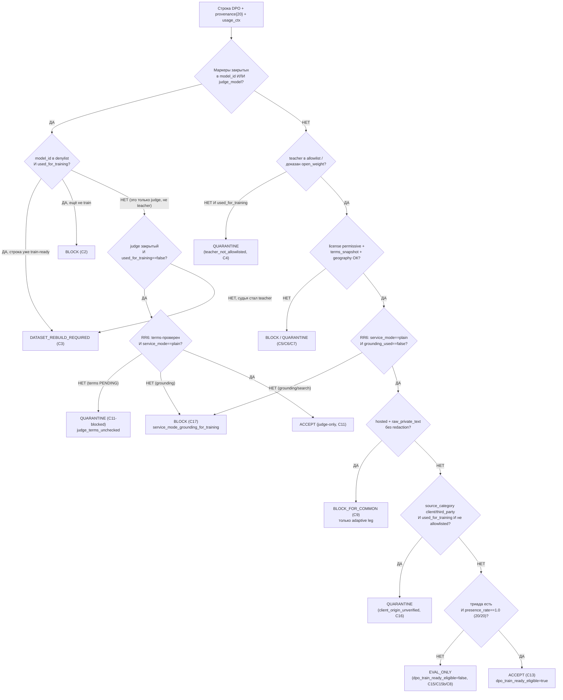

# Блок плана 08 — Легальный teacher-гейт + provenance (владелец канона `TeacherProvenance`)

Автор: Claude (Opus 4.8 MAX), роль — автор полностью решённого блока плана в моём
namespace `claude-*`. Это часть **ПЛАНА** проекта **ILearningDynamicGraph**, а не
разрешение на реализацию продукта (R2/R3: PLAN-ONLY; исполнение — только после
свежего явного approve Luba в текущем ходе). Все цитаты кода — только реально
существующие, проверены чтением файлов, с `file:line`. Имена `ILearning*` из задачи
Любы — псевдонимы существующих контрактов (CANON-маппинг — мастер §A.3), а не новые
архитектурные уровни (A-LM-12 — закрытый список из 5 уровней).

Псевдоним этого блока отсутствует: блок 08 — **не уровень иерархии**, а
**легальный гейт-юнит** (`ILogicalUnit`, L2), который встраивается в строитель DPO
(блок 07, Ф3.1.1) и в гейт батча обучения (Ф2.2.2). Финальной authority обучения он
не несёт; он — обязательный фильтр строки перед тем, как она станет `dpo_train_ready`.

> **Якорь фазы (доска исполнения `claude-EXECUTION-CONTROL-BOARD`, evidence-only).**
> Этот блок-08 — источник канона для подфазы **Ф2.1** «`TeacherProvenance` + реестр +
> машина вердикта» (owner `sa-legal`), и его Gate B G1..G12 (§10) = exit-условие
> подшагов **Ф2.1.1 / Ф2.1.2 / Ф2.1.3**. Канон провенанса (20 полей, RR6) и вердикт-enum,
> определённые здесь, потребляются Ф2.2.1/Ф2.2.2 (канон `GraphDpoPair` + гейт батча),
> Ф3.1.1 (строитель), Ф6.2.1/Ф7.1.1 (judge/teacher-goal), Ф10.2.1 (FLOW-38
> better-output). Канонические счётчики плана: **12 фаз (Ф0…Ф11) / 26 подфаз / 59
> подшагов**, нумерация `Ф<P>.<SP>.<SS>`. Доска и мастер-план — evidence-only,
> здесь не правятся.

---

## 0а. Якорь задачи

```text
CURRENT TASK: написать МОЙ (claude-namespace) улучшенный блок-08 «легальный
              teacher-гейт + provenance» — план-решение Ф2.1 для ILearningDynamicGraph,
              человеческим русским, Part A-формат (§0 UML + §1 флоучарты + §2 алгоритм
              + §3 код-цитаты + §4 статус + §5 иерархия) с тест-стратегией, сохранив
              структуру бенчмарка (Authority Anchor / Canon / Gate B / Final Questions)
              и канонические счётчики (12 фаз / 26 подфаз / 59 подшагов, Ф<P>.<SP>.<SS>)
              и CANON-инварианты (L5-машина без 6-го уровня A-LM-12; легальный
              teacher-гейт; запрет скрытого детерминизма A-LM-09/A-LM-13). Записать
              ровно в claude-plan-08-legal-teacher-gate.md.
NOT THE TASK: исполнять/тестировать/билдить код, запускать раннеры, тренировать,
              вызывать внешние AI/API/модели, git; править/создавать любые codex-*
              (только чтение), продолжать чужой codex-план или claude-00..07 каркас.
EVIDENCE-ONLY: codex-plan-08 (бенчмарк), codex-plan-04/07/10/12 (канон рёбер/DPO/
              lifecycle/детерминизма), codex-EXECUTION-CONTROL-BOARD /
              codex-ILEARNINGDYNAMICGRAPH-PLAN-v1 (канон фаз/счётчиков/Q3-Q5/R17),
              claude-00..07 (мой прежний каркас, evidence), claude-04/05/06 (мои
              политика/гайд/бриф — синхрон канона), реальный код llm_mvp_core
              (читается для цитат), скилы plan-review / trainable-architecture-decision /
              implementation-doc-uml.
```

## 0б. Где этот claude-блок осознанно лучше бенчмарка `codex-plan-08` (delta-нота, не слепая копия)

Бенчмарк `codex-plan-08` (49 строк) — это **компактная canon-карточка**: он
перечисляет 18 полей, 8 значений `SourceCategory`, вердикты и Gate B, но не
разворачивает их до Part A (нет UML, нет алгоритма по шагам, нет цитат `file:line`,
нет тест-стратегии, нет якоря фаз). Это законная роль карточки внутри большого
плана, но как **самостоятельный читаемый блок Part A** она не проходит гейт
читаемости (R3 / `implementation-doc-uml-SKILL.md` / Part A Completeness Contract).
Я её разворачиваю и чиню точечные расхождения:

| # | Слабое место бенчмарка `codex-plan-08` | Улучшение в этом claude-блоке |
|---|---|---|
| D1 | **Нет Part A.** Карточка не содержит §0 UML, §1 флоучартов с симуляциями ветвей, §2 алгоритма по шагам, §3 цитат `file:line`, §5 иерархии. | Полный Part A: §1 (что/зачем), §2 (8-шаговая машина вердикта в плоском русском + сигнатуры), §3 (цитаты `LearningMachineContracts.cs:26,30,208,245`, `DpoDataset.cs:18-26`, `ResultGapDpoWriters.cs:7-14/192-196`), §4 (статус), §5 (где гейт стоит в L2-L5), §0 (классдиаграмма с `note for` + per-connection симуляции; флоучарт C2-C17 (+C11-blocked) + per-branch симуляции). |
| D2 | **Нет якоря фаз.** Карточка не привязана к `Ф<P>.<SP>.<SS>` (12/26/59). Читателю не видно, что это Ф2.1.1-3. | Явный якорь **Ф2.1** (Ф2.1.1 реестр/поля, Ф2.1.2 машина вердикта, Ф2.1.3 карантин `sonnet-*`), счётчики 12/26/59, связь Gate B ↔ exit-условие подшагов (§0, §9, §10). |
| D3 | **`raw_comparison_event` упомянут в скиле, но в карточке нет Graph-DPO Artifact Triad.** Бенчмарк говорит про `triad_field_presence_rate==1.0`, но не показывает три артефакта триады и их роль в `dpo_train_ready`. | Развёрнут **Graph-DPO Artifact Triad Gate** (ветки C15/C15b): `raw_comparison_event` + `legal_provenance_dpo_envelope` + `training_batch`; правило «строка без полной триады ⇒ вердикт `EVAL_ONLY` (`dpo_train_ready_eligible=false`), а не ACCEPT» (§3.3, §8.6, Gate B п.11). |
| D4 | **`SourceCategory` = 8 значений, но R17 (client/third_party) не выделен как определяющая ветка вердикта.** Карточка перечисляет `client_unverified/third_party` в enum, но не даёт ветку C16. | Добавлена **ветка C16 client-origin** (R17): `source_category ∈ {client_unverified, third_party} && used_for_training=true && provenance NOT положительно-allowlisted ⇒ QUARANTINE`; закрыт путь «отмыва» marker-absence ≠ open_weight; NEG-тест обязателен (§8.7, §3.3 шаг-8, Gate B п.10). |
| D5 | **Контаминация — одно стале число «19 файлов/72 вхождения».** Карточка цитирует recon-1 как факт, без честной пометки, что live-скан может отличаться. | **Честность по доказательствам** (CLAUDE.md «No Dishonest Answers»): держу recon-1 (19/72; 35/10 в reasoning) как **benchmark-sourced** число, но добавляю ноту: live re-scan `training-data/orchestration-reasoning/*.jsonl` на 2026-06-23 даёт другой объём, поэтому Ф2.1.3 обязан **пере-вывести `contaminated_rows_found` сканером на момент исполнения**, а не доверять стале-числу (§6.3). Привязал к реально существующему license-хелперу `IsAllowedCommonLicense` (`ResultGapDpoWriters.cs:192-196`) как точке расширения. |
| D6 | **Final Questions: 2 вопроса без привязки к мастер-§E.** Бенчмарк задаёт 2 вопроса, не связав их с каноном Q3/Q4/Q5. | §11 связывает мои финальные вопросы с мастер **Q3 (где хранить provenance), Q4 (allow-list teacher + судьба `sonnet-*`), Q5 (judge-политика)** и с двумя бенчмарк-вопросами FLOW-38/hosted-eligibility — без потери ни одного. |
| D7 | **Нет тест-стратегии (axis верификации).** Карточка даёт Gate B (исходы), но не план тестов untrained/trained. | Добавлена **тест-стратегия** (`plan-review-SKILL.md` testability gate / OP-55): U/BL/NEG/INT/QA/REG/UH + честный статус-PASS (это **гейт-юнит**, а не обучаемая модель — у него нет TA-PASS; есть `PASS_AS_HONEST_UNTRAINED_SCAFFOLD`-эквивалент для строк, которым он ставит вердикт `EVAL_ONLY`) (§9). |

CANON-инварианты сохранены: маппинг ролей Luba → реальные контракты (мастер §A.3);
5 закрытых уровней (A-LM-12); легальный teacher-гейт (closed = только judge при
`used_for_training=false`, контаминация → `DATASET_REBUILD_REQUIRED`); запрет
скрытого детерминизма (A-LM-09/A-LM-13). Канон `GraphDpoPair` (14 полей) и
`TeacherProvenance` (**20 полей**, 13+5+2 RR6) держатся **побитово** теми же, что в мастер §A.4 и в
`claude-04`. При любом расхождении числа полей или размещения `judge_model` между
§A мастера и этим блоком — **владелец канона блок 08** (этот файл).

---

## 1. Что это и зачем (роль компонента в ILearningDynamicGraph)

**Легальный teacher-гейт — это «таможня» данных перед обучением графа.** Любая
DPO-строка (`GraphDpoPair`) до того, как стать `dpo_train_ready=true` и попасть в
`TrainBatchAsync`, проходит один обязательный пункт досмотра — `TeacherProvenanceGateUnit`.
Гейт отвечает на один вопрос: **«легально ли использовать эту строку как цель
обучения общей модели?»** и возвращает один из **6** вердиктов
`ACCEPT | QUARANTINE | BLOCK | DATASET_REBUILD_REQUIRED | BLOCK_FOR_COMMON | EVAL_ONLY`
(полный канон enum и роль `EVAL_ONLY` — §3.3).

Зачем это нужно именно для **обучаемого** графа. Граф учится предпочтениям
(chosen ≻ rejected) на парах. Если «лучшую» сторону пары сгенерировала закрытая
проприетарная модель (Claude / OpenAI / Gemini), то обучение общей модели на таком
chosen — это **дистилляция закрытой модели**, которую её условия использования
обычно запрещают. Поэтому правило жёсткое и без исключений:

- **teacher для дистилляции** (то, чей выход становится `chosen`/`rejected`-целью) —
  **только** open-weight permissive (Qwen3 Apache-2.0 / DeepSeek MIT / Kimi K2
  modified-MIT / GLM / Mistral) через нейтральных провайдеров, с проверенными
  условиями и лицензией;
- **judge** (тот, кто только ранжирует/ставит скаляр/пишет `wrong_reason`, но
  **не авторствует** текст chosen) — закрытую модель допускаем **только** при
  `teacher_output_used_for_training=false`;
- `closed_proprietary_model=true && teacher_output_used_for_training=true` ⇒
  **всегда** `DATASET_REBUILD_REQUIRED` (никакое «разрешение Luby» это не снимает —
  это инвариант скила `trainable-architecture-decision-SKILL.md` и
  `plan-review-SKILL.md` «DPO/distillation legal teacher provenance review gate»).

Граница ответственности (CANON R6 — тонкий агент, ядро в `llm_mvp_core`): гейт —
это `ILogicalUnit` внутри `llm_mvp_core`, не логика расширения. Агент/расширение его
не содержит и не дублирует; он лишь часть пайплайна построения DPO.

**Чем гейт НЕ является.** Он не выбирает skill, не маршрутизирует ребро, не несёт
обучаемого состояния и не является финальной authority обучения. Это
детерминистический **легальный фильтр** (honest internal/eval helper по скилу), и
именно так он и помечается: его исходы — провенанс-решение, а не «семантическое
качество модели». Семантику предпочтения учит L5-машина (блок 04) на строках,
которые этот гейт уже пропустил.

---

## 2. Концепт простыми словами (аналогия + машина вердикта по шагам)

### 2.1. Аналогия

Гейт — это **таможенник на въезде «фабрики обучения»**. Каждый ящик (DPO-строка)
несёт сопроводительный лист (`TeacherProvenance`, 20 граф: 13 базовых + 5 NEW + 2 RR6 `service_mode`/`grounding_used`). Таможенник:

1. читает, **кто изготовил товар** (`model_id`) и **кто его оценивал** (`judge_model`);
2. сверяет изготовителя со **«чёрным списком»** закрытых брендов (denylist) — и
   если бренд в чёрном списке, ставит штамп «закрытый» **сам** (не верит галочке в
   листе);
3. проверяет, **для чего ящик ввозят**: на склад обучения (`used_for_training=true`)
   или только в лабораторию оценки (`used_for_training=false`);
4. проверяет **лицензию и снимок условий** (license + `terms_snapshot_ref`),
   **географию** (`geography_export_constraint`), **в каком режиме работал станок**
   (`service_mode`/`grounding_used` — RR6: если товар сделан с «выходом в интернет»,
   grounding/search, то внутри чужой веб-материал, и на склад обучения его нельзя, даже
   если бренд станка чистый) и **нет ли внутри личных данных без редакции**
   (`raw_private_text_copied` / `redaction_policy_ref`);
5. ставит один из штампов: **пропустить** (ACCEPT), **на карантин** (QUARANTINE),
   **завернуть** (BLOCK), **пересобрать партию** (DATASET_REBUILD_REQUIRED),
   **только на личный склад, не в общий** (BLOCK_FOR_COMMON) или **только в
   лабораторию оценки, не на склад обучения** (EVAL_ONLY — легально чисто, но
   train-ineligible; 6 значений по §3.3).

Главное правило таможни: **отсутствие маркера ≠ «чисто»**. Пустой провенанс — это
не ACCEPT, а как минимум QUARANTINE. ACCEPT даётся только при **положительно
доказанной** легальности (allowlist-match + полный провенанс + триада артефактов).

### 2.2. Машина вердикта `TeacherProvenanceGateUnit.Evaluate` — 8 шагов (плоский русский, без кода)

Класс **`TeacherProvenanceGateUnit`** (NEW, L2 `ILogicalUnit`), метод
**`Evaluate(TeacherProvenance prov, RowUsageContext ctx)`** → **`TeacherProvenanceGateResult`**
(поля: `legal_verdict`, `reason`, `dpo_train_ready_eligible`, `triad_present`,
`closed_proprietary_model_derived`). Параметры: `prov` — 20-польный провенанс строки (13+5+2 RR6, §3.1);
`ctx` — как строку хотят использовать (`used_for_training`, уровень unit/edge/graph,
ссылки на три артефакта триады). Алгоритм:

```text
Шаг 1. ScanContamination(prov)
  Сканируем И model_id, И judge_model на маркеры закрытых: sonnet|claude|gpt|openai|gemini.
  Маркер найден в любом из двух полей → пометить contamination_detected=true (вход в C-ветки ниже).

Шаг 2. ClosedBlockByDenylist(prov.model_id)   ← идентичность важнее флага (R2)
  closed = IsClosedByDenylist(model_id).  // флаг closed_proprietary_model ВЫВОДИТСЯ из denylist,
                                          // а не принимается на веру из входа.
  Если closed && ctx.used_for_training == true:
        → BLOCK (а если строка уже помечена train-ready/в train-наборе → DATASET_REBUILD_REQUIRED).  [C2/C3]

Шаг 3. LookupAllowedTeacher(prov.model_id, prov.hosting_provider)
  Нет в allowlist и нет положительного open_weight-доказательства → не молчать.
  Если used_for_training && НЕ allowlisted → QUARANTINE (reason teacher_not_allowlisted).  [C4]

Шаг 4. LicenseAndTermsGate(prov)
  model_license ∉ {permissive открытые} при used_for_training → BLOCK (reason license_incompatible).  [C5]
  open_weight_hosted && used_for_training && terms_snapshot_ref == UNKNOWN
        → QUARANTINE (reason terms_snapshot_missing).  [C6]
  geography_export_constraint вне geography_allowed[] → QUARANTINE (reason geography_blocked).  [C7]

Шаг 4b. ServiceModeGroundingGate(prov)   ← RR6, ОТДЕЛЬНАЯ ось от brand-denylist
  // даже allowlist-permissive модель в режиме grounding/search подмешивает сторонний
  // веб-контент (Gemini Grounding / Google Search / web-retrieval), чья лицензия ≠ лицензии
  // модели. Запрет НЕ зависит от того, что бренд не в denylist.
  Если used_for_training && (service_mode != "plain" ИЛИ grounding_used == true)
        → BLOCK (reason service_mode_grounding_for_training).  [C17]
  // judge-сторона (used_for_training==false) тоже не должна гуглить: см. шаг 8 / C11.

Шаг 5. ReproducibilityGate(prov)
  Стохастическая генерация без request_id/sampling/seed/checkpoint_hash
        → EVAL_ONLY (dpo_train_ready_eligible=false, reason provenance_not_reproducible).  [C8]
        // EVAL_ONLY — отвергаемый batch-гейтом вердикт, НЕ ACCEPT (фикс R17).

Шаг 6. PrivacyRetentionGate(prov)   ← под-гейт §8.5
  hosting_provider != local && raw_private_text_copied == true && redaction_policy_ref == none
        → BLOCK_FOR_COMMON (личное идёт ТОЛЬКО на adaptive leg, R5; не в общий train).  [C9]

Шаг 7. FirstPartyAndTriad(ctx)   ← Graph-DPO Artifact Triad Gate §8.6
  chosen_origin == first_party_deterministic → разрешено как baseline (semantic_quality_claimed=false).  [C10]
  Триада: raw_comparison_event + legal_provenance_dpo_envelope + training_batch.
  triad_present = все три ссылки заполнены и согласованы.
  Если НЕ triad_present → EVAL_ONLY (dpo_train_ready_eligible=false).  [C15/C15b]
        // легально чистая, но train-ineligible: отвергаемый вердикт, НЕ ACCEPT (фикс R17).

Шаг 8. JudgeBranch + ClientOrigin + финальный ACCEPT
  judge закрытый при used_for_training == false:
        // RR6: judge-only НЕ освобождает от terms-проверки и от service-mode-запрета.
        Если provider_terms_checked != true ИЛИ terms_snapshot_ref == UNKNOWN
              → QUARANTINE (reason judge_terms_unchecked).  [C11-blocked]
        Если service_mode != "plain" ИЛИ grounding_used == true
              → BLOCK (reason judge_grounding_used).  [C17 на judge-ноге]
        иначе → ACCEPT (judge-only легален, terms-проверен).  [C11]
  Если судейский «better» становится chosen → used_for_training=true и closed ⇒ DATASET_REBUILD_REQUIRED.  [C12]
  source_category ∈ {client_unverified, third_party} && used_for_training && НЕ положительно-allowlisted
        → QUARANTINE (reason client_origin_unverified).  [C16]  ← R17, закрыт путь «отмыва»
  Иначе, если все гейты прошли И провенанс полон (presence_rate==1.0 по 20 полям, RR6 включая service_mode/grounding_used) И triad_present:
        → ACCEPT, dpo_train_ready_eligible = true.  [C13/C14 — таблица §4]
```

Возврат: `legal_verdict` + `reason`-код + флаг `dpo_train_ready_eligible`.
**Предусловие `dpo_train_ready=true` на строке `GraphDpoPair`** (Ф2.2.1) =
`legal_verdict==ACCEPT` И `provenance_field_presence_rate==1.0` (20 полей, RR6) И
`triad_present==true`.

---

## 3. Канон (нормативная часть) — owner block 08

### 3.1. `TeacherProvenance` — 20 полей (13 базовых + 5 NEW + 2 RR6), `judge_model` ВНУТРИ provenance

**13 базовых:** `teacher_access_mode`; `hosting_provider`; `model_id`;
`model_license`; `model_version`; `request_id`; `provider_terms_checked`;
`teacher_output_used_for_training`; `closed_proprietary_model`; `source_ref`;
`source_sha256`; `contamination_markers`; `judge_model`.

**5 NEW (бенчмарк-дельты T2/T3/T5):** `terms_snapshot_ref` (T2);
`geography_export_constraint` (T2); `source_category` (T5);
`raw_private_text_copied` (T3); `redaction_policy_ref` (T3).

**2 RR6 (service-mode ban / grounding):** `service_mode` (RR6) — enum
`plain | grounding | web_search | retrieval_tool | code_exec | unknown`,
зафиксированный режим вызова провайдера (по умолчанию профиль обязан давать
`plain`); `grounding_used` (RR6) — bool, был ли в этом вызове задействован
grounding/web-search/retrieval, то есть подмешан ли в выход сторонний контент
из интернета. Эти два поля — **отдельная ось риска от brand-denylist**: даже
allowlist-permissive модель (Qwen3 Apache-2.0), вызванная в режиме
grounding/search (например Gemini Grounding / Google Search retrieval, Bing,
любой web-retrieval-tool у хостера), подмешивает в `chosen` сторонний веб-контент,
чья лицензия/copyright/terms **не равны** лицензии модели — дистилляция такого
выхода в общую модель нелегальна независимо от того, что бренд модели не в
denylist. Поэтому `service_mode != plain` (или `grounding_used==true`) при
`used_for_training=true` — отдельный запрет (ветка C17, §2 шаг 4b, §4).

> **Канон-нота (владелец 08).** `judge_model` — поле **внутри** `TeacherProvenance`,
> **не** отдельное верхнеуровневое поле `GraphDpoPair`. `closed_proprietary_model` —
> **вычисляемый** флаг (выводится из denylist по `model_id`, шаг 2), хранится для
> аудита, но на входе ему не доверяют.
>
> **B-13 Single-Owner Reconciliation (один record — один список полей — один владелец-файл).**
> Этот §3.1 — **единственный** авторитетный перечень полей `TeacherProvenance` (теперь **20 имён** выше:
> 13 базовых + 5 NEW + 2 RR6 `service_mode`/`grounding_used`). Эти
> имена побитово несут также мастер §A.4 (`claude-ILEARNINGDYNAMICGRAPH-PLAN-v1.md:186-194`) и
> machine-view блока 04 (`claude-plan-04-dynamicgraph-machine.md` §7; evidence-only, правится отдельным
> work-order по своему namespace). Историческое расхождение
> закрыто: прежний §7 блока 04 нёс **второй, другой** 18-польный список (`row_id`, `task_id`,
> `domain_tag`, `prompt_hash`, `source_ids`, `chosen_authority`, `rejected_origin`,
> `teacher_provider`, `teacher_model_id`, `teacher_model_version`, `teacher_deployment_mode`,
> `judge_provider`, `judge_model_id`, `judge_model_version`, `terms_snapshot_ref`, `license_ref`,
> `allowed_use`, `train_or_heldout`) — он **удалён** и заменён цитатой этого канона. Согласование
> имён (по заданию B-13): канонические имена — `hosting_provider`, `model_id`, `model_license`,
> `provider_terms_checked`, `teacher_output_used_for_training`, `closed_proprietary_model`,
> `judge_model` (а НЕ `teacher_provider`/`teacher_model_id`/`provider_terms_checked`-дубль/
> `judge_provider`+`judge_model_id`). Любой downstream-файл, перечисляющий иной состав или иное
> число полей `TeacherProvenance`, — **стале** и приводится к этому §3.1 (владелец главенствует;
> мастер §A.4 и блок 04 §7 — синхронизированы на 2026-06-30). Этим закрыт «состав полей Q2/Q3».

### 3.2. `SourceCategory` — значения (мой канон расширяет plan-08 T5)

`local`, `human`, `open_weight`, `hosted`, `deterministic_baseline`, `self_judge`,
**`client_unverified`**, **`third_party`**.

> Бенчмарк `codex-plan-08` перечисляет первые 6 в §3.1 и добавляет client/third_party
> в общий список; я фиксирую **все 8** как канон и делаю `client_unverified`/
> `third_party` **определяющими** для ветки C16 (R17). Нота согласована с
> `claude-EXECUTION-CONTROL-BOARD` Ф2.1.1 («мой канон расширяет plan-08 T5»).

### 3.3. Вердикт-enum (канон 08) — 6 значений

`ACCEPT | QUARANTINE | BLOCK | DATASET_REBUILD_REQUIRED | BLOCK_FOR_COMMON | EVAL_ONLY`.

`BLOCK_FOR_COMMON` (NEW, T3 §8.5): личный/raw-текст в hosted без редакции — строка
допускается **только** на adaptive leg (R5), но не в common train.

`EVAL_ONLY` (**NEW, фикс R17**): строка **легально чистая**, но **train-ineligible**
из-за неполной триады (§8.6, ветки C15/C15b) или невоспроизводимого конверта
(стохастика без `request_id`/`sampling`/`seed`/`checkpoint_hash`, ветка C8). Это
**отдельное вердикт-значение, а не ACCEPT**: ранее «eval-only» выражался как
`ACCEPT` + флаг `dpo_train_ready_eligible=false`, из-за чего batch-гейт §7 (который
ключится на `legal_verdict==ACCEPT`, а не на флаг строки) **физически пропускал**
такую строку в `TrainBatchAsync`. Теперь у неё **отвергаемый вердикт** `EVAL_ONLY`,
поэтому batch-гейт отсеивает её на уровне вердикта.

> **Канон-нота (владелец 08) — Verdict-Enum Reconciliation.** Авторитетный enum
> вердиктов — этот §3.3 (6 значений). Любой downstream-файл, перечисляющий **5**
> значений (`ACCEPT | QUARANTINE | BLOCK | DATASET_REBUILD_REQUIRED |
> BLOCK_FOR_COMMON`) без `EVAL_ONLY`, **стале** и обязан добавить `EVAL_ONLY` для
> совпадения с владельцем (это evidence-only файлы; правка — отдельным work-order по
> их namespace, здесь не правятся).
>
> **Статус носителей verdict-enum (read-back 2026-06-23 — все downstream-цели
> синхронизированы на 6 значений, evidence-only):**
> - `claude-plan-09-auto-dpo-loop.md` (строка P-09, потребитель канона) — **СИНХРОНИЗИРОВАН
>   (read-back 2026-06-23):** verdict-enum на `:577-578` уже **6-значный**
>   `ACCEPT | QUARANTINE | BLOCK | DATASET_REBUILD_REQUIRED | BLOCK_FOR_COMMON | EVAL_ONLY`
>   и подписан корректно «**потребитель канона; владелец — `claude-plan-08` §3.3**» (без
>   мис-атрибуции владельцу). Прежнее указание на `:569-570` как «stale 5-value carrier»
>   снято: `:569-570` — это перечень **5 NEW полей `TeacherProvenance`**
>   (`terms_snapshot_ref`/`geography_export_constraint`), а **не** verdict-enum; смешивать
>   «5 NEW полей провенанса» с «5-значным enum» нельзя. Leak R17 закрыт у потребителя; правки
>   plan-09 не требует.
> - `claude-ILEARNINGDYNAMICGRAPH-PLAN-v1.md` (мастер §A.4) — **СИНХРОНИЗИРОВАН (read-back
>   2026-06-23):** verdict-enum мастера на `:194-196` уже **6-значный**
>   `ACCEPT | QUARANTINE | BLOCK | DATASET_REBUILD_REQUIRED | BLOCK_FOR_COMMON | EVAL_ONLY`
>   (выровнен с владельцем §3.3), и §C.4 P-08 несёт ту же 6-значную семантику — мастер
>   **НЕ** внутренне противоречив. Прежнее указание на `:192-193` как «stale 5-value
>   carrier» снято: `:192-193` — это перечень **5 NEW полей `TeacherProvenance`**
>   (`terms_snapshot_ref`/`geography_export_constraint`/`source_category`/
>   `raw_private_text_copied`/`redaction_policy_ref`), а **не** verdict-enum; смешивать
>   «5 NEW полей провенанса» с «5-значным enum» нельзя. Правки мастер §A.4 не требует.
> - `claude-EXECUTION-CONTROL-BOARD.md` (канон-блок Ф2 на `:601` и «ЕДИНЫЙ СЛОВАРЬ ВЕРДИКТОВ
>   Ф2» на `:1418`) — **СИНХРОНИЗИРОВАН (read-back 2026-06-23):** оба места уже несут **6
>   значений** `ACCEPT/QUARANTINE/BLOCK/BLOCK_FOR_COMMON/DATASET_REBUILD_REQUIRED/EVAL_ONLY`
>   (с пометкой «PENDING — пред-вердиктное gate-состояние вне канон-enum»), а batch-reject-наборы
>   Ф2.1.2/Ф2.2.2 включают `EVAL_ONLY` как train-ineligible. Прежние номера строк `:588`/`:1397`
>   устарели (доска выросла) и указывали на не-enum содержимое; правки доска не требует.
> - `claude-04-dpo-legal-model-policy.md` — здесь разделение маршрутов `eval_only` /
>   `evidence_only` / `train_personal` / `train_common`; **секции с 5-значным вердикт-enum в
>   этом файле сейчас нет**, поэтому правки не требует. При появлении такой секции она должна
>   нести 6 значений.
>
> **Инвариант (усилен, форвард-правило R17):** *любой ссылающийся блок (06/07/09/10), мастер
> §A или строка доски, перечисляющая вердикт-enum **без** `EVAL_ONLY`, неполна по R17 —
> legal-clean-но-невоспроизводимая/без-триады строка (C8/C15/C15b) при 5-enum несёт `ACCEPT`
> и буквально проходит предикат batch-гейта `legal_verdict==ACCEPT`, физически попадая в
> `TrainBatchAsync`; приёмка R14 блокируется до добавления `EVAL_ONLY` у всех носителей.*
> Все правки здесь — только в claude-08 (перечень носителей + инвариант); evidence-файлы
> (claude-09/master/board) правятся отдельным work-order по их namespace.
>
> **Delta vs бенчмарк `codex-plan-08`:** бенчмарк (`codex-plan-08-legal-teacher-gate.md:27`)
> уже держит `EVAL_ONLY` как первоклассный вердикт в наборе из 6
> (`ACCEPT, BLOCK_FOR_HOSTED, BLOCK_FOR_COMMON, DATASET_REBUILD_REQUIRED, QUARANTINE,
> EVAL_ONLY`). Я **выравниваюсь с бенчмарк-`EVAL_ONLY`** (осознанно, фикс R17), но
> **без** избыточного `BLOCK_FOR_HOSTED`: hosted-кейс у меня уже покрыт связкой
> `BLOCK` (license/terms, C5/C6) + `BLOCK_FOR_COMMON` (privacy, C9) + `QUARANTINE`
> (geography/teacher/client, C4/C7/C16), поэтому отдельный `BLOCK_FOR_HOSTED` не
> вводится — это сознательная дельта, а не пропуск.

### 3.4. `LegScope` — значения

`CommonGlobal`, `PersonalAdaptive`, `EvalOnly`, `Quarantine`.

### 3.5. `AllowedTeacherRegistry` (данные, не код)

Файл `allowed-teacher-registry.json`: `allowlist` (Qwen3/DeepSeek/Kimi/GLM/Mistral),
`denylist` (Claude/OpenAI/Gemini), список нейтральных провайдеров
(Together/Fireworks/OpenRouter/Novita/DashScope/DeepSeek/Moonshot/Z.ai),
`geography_allowed[]`. Реестр — **данные**; решение по идентичности (`IsClosedByDenylist`)
читает denylist, не хардкодит бренды в логике.

**RR6 — service-mode-запрет = ОТДЕЛЬНАЯ политика от brand-denylist.** Реестр несёт
дополнительный список `forbidden_service_modes_for_training` =
`["grounding","web_search","retrieval_tool","code_exec"]` и инвариант
`required_service_mode_for_training="plain"`. Это **не** brand-denylist: запрет
бьёт по **режиму вызова**, а не по бренду модели. Пример, который brand-denylist
НЕ ловит: allowlist-модель Qwen3 (Apache-2.0), вызванная через
grounding/Google-Search-retrieval (как Gemini Grounding), подмешивает в выход
сторонний веб-контент чужой лицензии → C17 BLOCK при `used_for_training=true`.
Метод реестра `IsGroundingForbiddenForTraining(service_mode, grounding_used)` —
**данные+чистая проверка**, не хардкод бренда.

### 3.6. `ITeacherClient` + `IJudgeClient` — РЕАЛЬНЫЙ путь вызова наставника/судьи (NEW, владелец 08; шаг починки R5-teacher-call / B-2,B-3)

**Человеческим языком — зачем это и какую дыру закрывает.** До этого шага план
описывал ТОЛЬКО «таможню» (`TeacherProvenanceGateUnit`, §2/§3.1-§3.5): кто проверяет
строку перед обучением. Но «таможня» проверяет провенанс **уже полученного** выхода —
она не умеет **позвать наставника и получить выход**. В блоке 09 (петля) есть обёртка
`ITeacherGoalProviderUnit` (§3 Шаг 3), но за ней до сих пор **не стоял реальный
клиент**: не было ни интерфейса вызова, ни контракта запрос/ответ, ни выбора
провайдера, ни шва авторизации, ни доказательства terms/license перед сетевым
вызовом. Это и есть незакрытый блокер B-2/B-3: «реальный teacher/judge вызов +
провайдер». Без него весь auto-DPO loop остаётся каркасом, который **нечем кормить**.

Я закрываю блокер двумя реальными клиентами-контрактами + одним выбором провайдера +
швом авторизации + предвызовным legal-гейтом. **mock — только test-only**, он
никогда не является продуктовым путём (см. §3.6.6).

**Где это в иерархии.** Оба клиента — **внешний шов вывода (egress port)**, НЕ уровень
иерархии графа. `ITeacherClient` — это «руки» обёртки `ITeacherGoalProviderUnit`
(L2, блок 09): обёртка остаётся `ILogicalUnit`, а клиент — её зависимость через
фабрику (Rule 2 Fabric-First). `IJudgeClient` — «руки» eval/critic-пути (блок 09
Шаг 2). Train* на клиентах НЕТ (A-LM-02): клиент только запрашивает текст, обучение
живёт на L5 `ILearningMachine.TrainBatchAsync`.

#### 3.6.1. `ITeacherClient` — контракт (NEW)

```text
ITeacherClient                                          // egress-port, НЕ уровень иерархии
  Task<OperationResult<TeacherCallResult>> RequestGoalAsync(
        TeacherCallRequest request,                     // что спросить
        CancellationToken ct)

record TeacherCallRequest(
    string   InputContext,           // X — задача/промпт ученика (РЕДАКТИРОВАННЫЙ; см. forbidden leakage)
    string   DomainTag,              // домен (translate/wiki/figma…) — для выбора профиля
    string   RequestedCapability,    // какую способность нужно продемонстрировать (goal-skill)
    double   GoalConfidenceFloor,    // порог зова (мастер Q17 — LOCKED 0.80, Luba 2026-06-30)
    string   ProviderConfigId,       // ВЫБРАННЫЙ профиль провайдера (см. 3.6.3); НЕ бренд в коде
    int      MaxTokens,
    double   Temperature,            // фиксируется в провенанс (воспроизводимость, C8)
    long     Seed)                   // фиксируется в провенанс (воспроизводимость, C8)

record TeacherCallResult(
    string             GoalOutput,            // Y_goal — текст наставника (станет chosen)
    TeacherProvenance  Provenance,            // ЗАПОЛНЕННЫЕ 20 полей (§3.1, RR6) — владелец 08
    string             RequestId,             // для C8-воспроизводимости
    DateTime           RequestTimestampUtc,
    TeacherCallStatus  Status)                // OK | LEGAL_BLOCKED | PROVIDER_ERROR | AUTH_MISSING | TIMEOUT

enum TeacherCallStatus { OK, LEGAL_BLOCKED, PROVIDER_ERROR, AUTH_MISSING, TIMEOUT }
```

**Алгоритм `RequestGoalAsync` ПОШАГОВО (плоский русский, инстанцированный — не промпт исполнителю):**
1. **Резолв профиля.** По `ProviderConfigId` достать `ProviderConfig` из реестра
   (§3.6.3). Если не найден → `OperationResult.Fail("provider_config_unknown",
   "PROVIDER_CONFIG_UNKNOWN")`, `Status=PROVIDER_ERROR`. Бренд провайдера в логике НЕ
   хардкодится (Rule 2) — только id профиля.
2. **ПРЕДВЫЗОВНЫЙ legal-гейт (главное правило R5/B-2).** До любого сетевого байта
   собрать предварительный `TeacherProvenance` из профиля (`hosting_provider`,
   `model_id`, `model_license`, `provider_terms_checked`, `terms_snapshot_ref`,
   `geography_export_constraint`, `service_mode` RR6) с `teacher_output_used_for_training=true` (это
   teacher-цель) и прогнать через `TeacherProvenanceGateUnit.Evaluate` (§2). Если
   вердикт ≠ `ACCEPT` (например denylist-`model_id` → `BLOCK`/`DATASET_REBUILD_REQUIRED`
   ветки C2/C3; не-allowlisted → `QUARANTINE` C4; terms нет/PENDING → C6;
   `service_mode≠plain` → `BLOCK` C17 RR6; geography → C7) →
   **СЕТЕВОЙ ВЫЗОВ НЕ ДЕЛАЕТСЯ**, вернуть `Status=LEGAL_BLOCKED` + причину вердикта.
   Это закрывает «нелегального наставника на проводе»: закрытую модель как teacher
   физически нельзя вызвать.
3. **Авторизация (auth-seam, §3.6.4).** Через `IProviderCredentialResolver` достать
   секрет по `ProviderConfig.CredentialKeyRef` (имя env/secret-store, НЕ сам ключ в
   плане/коде/реестре). Если секрета нет → `Status=AUTH_MISSING`, без сетевого вызова.
4. **Редакция входа (forbidden leakage, §3.6.5).** Прогнать `InputContext` через
   `IPromptRedactor`: вырезать source-path/source-id/candidate-index/имена файлов/
   приватный код; зафиксировать `redaction_policy_ref`. Если домен помечен
   `raw_private_text` и redaction отсутствует → не звать hosted (ветка C9
   `BLOCK_FOR_COMMON`).
5. **Сетевой вызов.** Через `IProviderTransport.SendAsync(config, redactedRequest,
   resolvedSecret, ct)` (HTTP-seam, контракт §3.6.4-bis) с фиксированными
   `Temperature`/`Seed`/`MaxTokens`. Таймаут из профиля; при сбое (`HttpStatus`
   нештатный / отмена) → `Status=PROVIDER_ERROR`/`TIMEOUT`, `OperationResult.Fail`.
   Успех даёт `ProviderTransportResult tr` (несёт `RawOutput`, `RequestId`,
   `GroundingWasUsed`, `ObservedServiceMode`).
6. **Заполнить провенанс по факту.** Записать `request_id = tr.RequestId`,
   `source_sha256(tr.RawOutput)`, `source_ref` (provider+model+`tr.RequestId`),
   `contamination_markers=scan(tr.RawOutput)`,
   `closed_proprietary_model = IsClosedByDenylist(model_id)` (должен быть false, иначе
   шаг 2 уже заблокировал), `service_mode = profile.ServiceMode`,
   `grounding_used = tr.GroundingWasUsed` (RR6 — **источник = transport-seam**
   `ProviderTransportResult.GroundingWasUsed`, §3.6.4-bis; для `plain`-профиля без
   grounding-метаданных в ответе обязан быть false). Это даёт **полный 20-польный**
   `TeacherProvenance` (§3.1).
7. **ПОСТ-вызовный re-gate.** Ещё раз `TeacherProvenanceGateUnit.Evaluate` уже на
   фактическом провенансе (контаминация-маркеры могли всплыть в выходе) — если ≠
   `ACCEPT` → `Status=LEGAL_BLOCKED`, выход НЕ становится `Y_goal`.
8. Вернуть `OperationResult.Ok(TeacherCallResult{GoalOutput, Provenance, …,
   Status=OK})`.

#### 3.6.2. `IJudgeClient` — контракт (NEW)

```text
IJudgeClient                                           // egress-port; судья НЕ авторствует chosen
  Task<OperationResult<JudgeCallResult>> JudgeAsync(
        JudgeCallRequest request,
        CancellationToken ct)

record JudgeCallRequest(
    string   InputContext,           // X (редактированный)
    string   CandidateA,             // Y_best ученика (или одна async-комбинация)
    string   CandidateB,             // вторая комбинация (если ранжируем)
    string   ProviderConfigId,       // профиль СУДЬИ (может быть closed — см. правило)
    string   DomainTag)

record JudgeCallResult(
    int      WinnerIndex,            // 0=A,1=B,-1=tie  (РАНГ, НЕ новый текст)
    double   ScoreA, double ScoreB,  // скаляры
    string   WrongReason,            // [WRONG: …] одно функциональное последствие про проигравшего
    TeacherProvenance Provenance,    // judge_model заполнен; teacher_output_used_for_training=FALSE
    JudgeCallStatus Status)          // OK | AUTHORED_NEW_TEXT_BLOCKED | PROVIDER_ERROR | AUTH_MISSING

enum JudgeCallStatus { OK, AUTHORED_NEW_TEXT_BLOCKED, PROVIDER_ERROR, AUTH_MISSING }
```

**Ключевое правило (legal-гейт closed=judge-only).** Судья **разрешён closed**
(Claude/OpenAI/Gemini) — но ТОЛЬКО при `teacher_output_used_for_training=false`,
ТОЛЬКО как ранжировщик, **И ТОЛЬКО при пройденной terms-проверке + `service_mode=="plain"`**
(RR6: judge-only НЕ освобождает от условий и от service-mode-запрета). Алгоритм `JudgeAsync`:
1. Заполнить провенанс с `judge_model=<profile.model_id>`,
   `teacher_output_used_for_training=false`, `service_mode=<profile.ServiceMode>`,
   `grounding_used = tr.GroundingWasUsed` (источник — тот же transport-seam
   `ProviderTransportResult.GroundingWasUsed`, §3.6.4-bis; судья делает сетевой вызов
   через `IProviderTransport.SendAsync` так же, как teacher). Прогнать
   `TeacherProvenanceGateUnit.Evaluate`:
   - если `ProviderTermsChecked≠true` ∨ `TermsSnapshotRef` PENDING/UNKNOWN → **C11-blocked**
     (`QUARANTINE judge_terms_unchecked`), судья НЕ используется;
   - если `service_mode≠"plain"` ∨ `grounding_used==true` → **C17** (`BLOCK judge_grounding_used`);
   - иначе → ветка **C11** (`judge закрытый && used_for_training==false && terms-проверен &&
     plain ⇒ ACCEPT judge_only_legal`).
2. **Anti-authoring guard (закрывает C12 «judge стал teacher»).** Ответ судьи
   парсится ТОЛЬКО в `WinnerIndex/ScoreA/ScoreB/WrongReason`. Если парсер видит, что
   судья вернул **новый связный текст-ответ длиннее порога** (попытка переписать
   кандидата) → `Status=AUTHORED_NEW_TEXT_BLOCKED`, результат отбрасывается; такой
   текст НИКОГДА не может стать `chosen`/`rejected` (иначе C12
   `DATASET_REBUILD_REQUIRED`). Этим закрыт reward-hacking-путь «судья тайно
   наставник».
3. `WrongReason` пишется как `[WRONG: <последствие>]` для проигравшего кандидата —
   это сигнал для `rejected`-стороны пары, НЕ авторский текст chosen.

#### 3.6.3. Provider-selection — `ProviderConfig` + выбор для v1 (привязка Qwen3 Apache-2.0)

`ProviderConfig` — **данные** в `allowed-teacher-registry.json` (расширение §3.5), НЕ
хардкод в логике:

```text
record ProviderConfig(
    string ProviderConfigId,     // напр. "qwen3-together-v1"  — стабильный id профиля
    string HostingProvider,      // "Together" | "Fireworks" | "OpenRouter" | "DashScope"
    string ModelId,              // "Qwen/Qwen3-235B" — сверяется с allowlist по семейству
    string ModelLicense,         // "Apache-2.0"
    bool   ProviderTermsChecked, // terms-snapshot пройден (см. 3.6.gate)
    string TermsSnapshotRef,     // путь/хэш снимка terms с датой (или PENDING-маркер, §3.6.3a)
    string TermsCheckStatus,     // RR6: "checked" | "pending_external" — значение terms-проверки
    string ServiceMode,          // RR6: "plain" | "grounding" | "web_search" | "retrieval_tool" — обязан быть "plain" для train/judge
    string GeographyConstraint,  // зона; сверяется с geography_allowed[]
    string Endpoint,             // базовый URL (данные, не секрет)
    string CredentialKeyRef,     // ИМЯ env/secret (НЕ значение) — auth-seam
    string Role,                 // "teacher" | "judge"
    int    TimeoutMs)
```

**Выбор для v1 (привязка по заданию).** Основной teacher v1 =
`provider_config_id="qwen3-together-v1"` → `model_id="Qwen/Qwen3-235B"`,
`model_license="Apache-2.0"`, `hosting_provider` ∈ нейтральные
{Together/Fireworks/OpenRouter/DashScope}, `role="teacher"`, `service_mode="plain"`
(RR6: профиль обязан выключить grounding/web-search; см. §3.6.3a). Закрытые
(Claude/OpenAI/Gemini) профили допустимы ТОЛЬКО с `role="judge"` (иначе предвызовный
гейт §3.6.1 шаг 2 их блокирует). Алгоритм выбора `SelectProvider(domainTag, role)`:
взять из реестра профили с нужным `Role`, отфильтровать `allowlist`-match по
семейству `ModelId` И `ProviderTermsChecked==true` И geography-OK И
`ServiceMode=="plain"` (RR6); вернуть первый
по приоритету профиля. Если кандидатов нет → честный `provider_unavailable`
(петля уходит в `self_best`, блок 09 Шаг 3) — это НЕ ошибка, а легальный режим.

#### 3.6.3a. RR6 — инстанцированный `terms_snapshot_ref` для `qwen3-together-v1` (обязательный гейт, значение = pending)

Профиль `qwen3-together-v1` в `allowed-teacher-registry.json` несёт RR6-поля **инстанцированно**,
а не как «заполнит исполнитель»:

```text
ProviderConfig {
  ProviderConfigId     = "qwen3-together-v1"
  HostingProvider      = "Together"
  ModelId              = "Qwen/Qwen3-235B"
  ModelLicense         = "Apache-2.0"          // лицензия МОДЕЛИ — известна
  ServiceMode          = "plain"               // RR6: grounding/search ВЫКЛ
  ProviderTermsChecked = false                 // ← НЕ true, пока terms-снимок не сверен
  TermsSnapshotRef     = "PENDING_LUBA_OR_EXTERNAL_TERMS_REVIEW(Together ToS + Qwen3 use-policy)"
  TermsCheckStatus     = "pending_external"    // RR6-маркер: значение terms-проверки = pending
  Role                 = "teacher"
}
```

**Почему это обязательный гейт (а не косметика).** `model_license="Apache-2.0"` —
это лицензия **весов модели**, она НЕ равна **terms-of-service хостера Together**
(retention, output-use, distillation-clause). Лицензия модели открыта, но условия
**сервиса** в этой сессии не проверялись. Поэтому:
- `ProviderTermsChecked` остаётся `false`, `TermsSnapshotRef` несёт явный маркер
  `PENDING_LUBA_OR_EXTERNAL_TERMS_REVIEW(...)`, а `TermsCheckStatus="pending_external"`;
- при `ProviderTermsChecked=false` шаг 4 (C6) даёт **QUARANTINE** (terms_snapshot_missing),
  а `SelectProvider` его **не выберет** (фильтр `ProviderTermsChecked==true`) → v1 уходит
  в `self_best` пока terms не сверены;
- перевод `ProviderTermsChecked=true` + замена `TermsSnapshotRef` на реальный хэш/путь
  снимка с датой = **отдельный внешний/Luba-шаг** (terms-review), не plan-внутреннее
  допущение. Значение terms-проверки помечено `pending` именно для того, чтобы план
  не маскировал непроверенные условия под «готово».

#### 3.6.4. Auth-seam (`IProviderCredentialResolver`)

```text
IProviderCredentialResolver
  OperationResult<string> Resolve(string credentialKeyRef)   // возвращает секрет из env/secret-store
```

Правила: (a) ни план, ни код, ни реестр НЕ содержат значения ключа — только
`CredentialKeyRef` (имя); (b) секрет читается в рантайме из переменной окружения /
secret-store; (c) при отсутствии → `AUTH_MISSING`, сетевого вызова нет; (d) секрет
НИКОГДА не пишется в провенанс/лог/чекпойнт (privacy-инвариант T3).

#### 3.6.4-bis. Transport-seam (`IProviderTransport`) — источник `grounding_used` (C5-transport-grounding, RR6)

**Дефект, который закрывает эта секция.** Шаг 6 `RequestGoalAsync` (§3.6.1) и шаг 1
`JudgeAsync` (§3.6.2) читают `grounding_used = transport.GroundingWasUsed`, но контракт
`IProviderTransport.SendAsync(...)` нигде не был выписан — у него не было типа возврата,
несущего grounding-флаг. Без выписанного источника RR6-поле `grounding_used` (знаменатель
`provenance_field_presence_rate=20`, §3.1) **невычислимо**, и гейт C17 (§2.2 шаг 4b, §4)
на teacher- и judge-ноге не может опереться на факт вызова. Ниже шов выписан
инстанцированно (реальные C# сигнатуры, не промпт исполнителю).

```text
IProviderTransport                                      // HTTP-egress seam; единственная точка сетевого байта
  Task<OperationResult<ProviderTransportResult>> SendAsync(
        ProviderConfig         config,                  // профиль (Endpoint/TimeoutMs/ServiceMode/…)
        ProviderTransportRequest redactedRequest,       // уже прошёл IPromptRedactor (§3.6.5)
        string                 resolvedSecret,          // из IProviderCredentialResolver (§3.6.4); НЕ пишется в провенанс/лог
        CancellationToken      ct)

record ProviderTransportRequest(
    string  RedactedInput,        // X после редакции
    double  Temperature,
    int     MaxTokens,
    long    Seed)

record ProviderTransportResult(
    string  RawOutput,            // сырой текст ответа провайдера (станет GoalOutput / парсится судьёй)
    string  RequestId,            // provider-side id вызова → source_ref/request_id провенанса
    bool    GroundingWasUsed,     // RR6-АВТОРИТЕТ: подмешан ли в RawOutput сторонний веб-контент
    string  ObservedServiceMode,  // фактический режим, заявленный ответом провайдера (для сверки с config.ServiceMode)
    int     HttpStatus,           // транспортный код; нештатный → PROVIDER_ERROR/TIMEOUT на шаге 5
    string  ProviderRawMetaJson)  // сырые provider-метаданные (диагностика/провенанс), секреты вырезаны
```

**Откуда `GroundingWasUsed` берёт значение (источник provenance-поля).** Это поле —
**единственный авторитетный источник** строкового `grounding_used` в `TeacherProvenance`
(§3.1). `HttpTeacherClient`/`HttpJudgeClient` НЕ выдумывают флаг и НЕ копируют его из
запроса; они присваивают `provenance.grounding_used = transportResult.GroundingWasUsed`
(шаг 6 §3.6.1 / шаг 1 §3.6.2). Реализация `IProviderTransport` вычисляет
`GroundingWasUsed` так (детерминированно, без догадок):

1. Если ответ провайдера несёт явный признак grounding/web-search/retrieval
   (поля вида `grounding_metadata`/`citations`/`web_search_queries`/`tool_results` в
   `ProviderRawMetaJson`) → `GroundingWasUsed = true`.
2. Иначе, если `config.ServiceMode != "plain"` (профиль сам объявил grounding-режим) →
   `GroundingWasUsed = true` (профиль-объявленный режим консервативно считается
   подмешивающим).
3. Иначе → `GroundingWasUsed = false`.
4. Дополнительно `ObservedServiceMode` сверяется с `config.ServiceMode`: рассинхрон
   (`config.ServiceMode=="plain"`, но ответ принёс grounding-метаданные) ⇒
   `GroundingWasUsed=true` побеждает заявленный `plain` — клиент НЕ доверяет только
   профилю, а смотрит на факт ответа. Это закрывает обход «профиль соврал plain».

**Связь с гейтом (почему без этого шва RR6-поле невычислимо).** `grounding_used`,
проставленный из `ProviderTransportResult.GroundingWasUsed`, идёт в `TeacherProvenance`
и:
- входит в `provenance_field_presence_rate` (если поле не проставлено из транспорта,
  presence_rate<1.0 ⇒ `dpo_train_ready=false`, закрытие R4);
- читается ветками C17 (§4): `used_for_training && (service_mode≠"plain" ∨
  grounding_used==true) ⇒ BLOCK` (teacher-нога) и тем же предикатом на judge-ноге
  (`BLOCK judge_grounding_used`, §3.6.2 шаг 1).

**Test-only mock.** `MockProviderTransport` (test-проект) возвращает фиксированный
`ProviderTransportResult` с управляемым `GroundingWasUsed` — это позволяет NEG-тесту
RR6 (§3.6.8) доказать C17 на teacher- и judge-ноге без сети. Продуктовый DI отдаёт
реальный HTTP-транспорт (`product_path_uses_mock==false`, §3.6.6).

#### 3.6.5. Forbidden leakage-сигналы (что НЕЛЬЗЯ слать наставнику/судье)

В `InputContext`/`CandidateA/B` запрещены до редакции: абсолютные source-path, точные
source-id, candidate-index/позиция кандидата, имена файлов проекта, дословный
приватный код/чат, секреты/ключи. `IPromptRedactor` обязан их вырезать и записать
`redaction_policy_ref`. Это тот же leakage-инвариант, что у узла/ребра (B-9: индекс/
позиция/source-path/source-id/exact-prompt не входят), распространённый на egress.

#### 3.6.6. Mock — ТОЛЬКО test-only (не продуктовый путь)

`MockTeacherClient`/`MockJudgeClient` реализуют те же интерфейсы, но: (a) живут в
тестовом проекте (`Tests/…`), НЕ в продуктовой сборке; (b) резолвятся фабрикой ТОЛЬКО
когда `IServiceProvider`/конфиг в тест-режиме; (c) продуктовая фабрика по умолчанию
даёт реальный `HttpTeacherClient`/`HttpJudgeClient`. Инвариант (machine-checkable):
`product_path_uses_mock==false`; тест, который доказывает, что продуктовый DI НЕ
возвращает mock, обязателен (§9, строка U/QA). Это закрывает «mock как продуктовый
путь» — самый опасный masquerade (каркас, выдающий себя за реальный вызов).

#### 3.6.7. Terms/license proof gate (перед тем как профиль станет `teacher`)

Профиль не получает `ProviderTermsChecked=true` пока не записаны: `TermsSnapshotRef`
(реальный снимок provider-terms с датой, НЕ PENDING-маркер), `ModelLicense` ∈ permissive
(Apache-2.0/MIT/…), allowlist-match по семейству, geography-OK, `ServiceMode=="plain"`
(RR6: grounding/search выключены), и для closed-judge — `output_use=eval_only`. Без
этого `SelectProvider` его не выберет (тот же Provider-Terms-Gate §7/Q4). Это связывает
реальный вызов с legal-гейтом: **нельзя позвать наставника по непроверенному профилю**.

**RR6 — closed-judge тоже проходит terms-гейт (а не «judge-only = свободен»).** Раньше
ветка C11 пропускала закрытого судью только по признаку
`used_for_training==false`. Теперь closed-judge получает `ACCEPT` (C11) ТОЛЬКО при
`ProviderTermsChecked==true` И `TermsSnapshotRef≠PENDING/UNKNOWN` И `ServiceMode=="plain"`
(см. §2.2 шаг 8, §4 строки C11/C11-blocked/C17). Без сверенных условий closed-judge →
**QUARANTINE (judge_terms_unchecked)**; в режиме grounding → **BLOCK (judge_grounding_used)**.
Дыра «closed-judge без terms-проверки» закрыта.

#### 3.6.8. Тест-стратегия клиентов (axis верификации, OP-55)

- **U:** `RequestGoalAsync` с allowlist-профилем (transport mocked, `service_mode="plain"`) → `Status=OK`,
  провенанс 20/20, `closed_proprietary_model=false`, `grounding_used=false`.
- **NEG (главный):** `ProviderConfigId`, чей `model_id` в denylist → `Status=LEGAL_BLOCKED`,
  **transport НЕ вызван** (доказать счётчиком вызовов = 0). Это R5/B-2 ядро.
- **NEG (RR6 service-mode):** allowlist-профиль (Qwen3), но `ServiceMode="grounding"`,
  `used_for_training=true` → предвызовный гейт C17 `BLOCK`, **transport НЕ вызван**;
  доказать, что denylist чист, но service-mode заблокировал.
- **NEG (RR6 terms-pending):** профиль `qwen3-together-v1` с `ProviderTermsChecked=false`/
  `TermsSnapshotRef=PENDING` → `SelectProvider` его не возвращает; форс → C6 `QUARANTINE`, сети нет.
- **NEG (RR6 judge-terms):** closed-judge без terms-проверки → C11-blocked `QUARANTINE`
  (judge_terms_unchecked), судья не используется.
- **NEG:** `AUTH_MISSING` когда `CredentialKeyRef` не резолвится → сети нет.
- **NEG (judge):** судья вернул новый длинный текст → `AUTHORED_NEW_TEXT_BLOCKED`
  (C12-guard), результат не может стать chosen.
- **QA/INT:** продуктовый DI возвращает `HttpTeacherClient`, НЕ mock
  (`product_path_uses_mock==false`).
- **REG:** leakage-скан: редактор вырезал source-path/source-id/candidate-index перед
  отправкой.

> Статус клиентов = `PASS_AS_HONEST_UNTRAINED_SCAFFOLD`-эквивалент: это **egress-port**,
> а не обучаемая модель; у него нет TA-PASS. PASS = «реальный путь спроектирован,
> предвызовный legal-гейт доказан, mock доказанно не на продуктовом пути».

---

## 3.7. Боковой provenance-манифест — финализация хранения (NEW, владелец 08; шаг починки R9-provenance-store / B-17)

**Человеческим языком — что именно закрывает этот шаг.** До этого момента решение
Luba 2026-06-29 (мастер §E.0 / §E Q3) фиксировало только **направление**: «боковой
DPO-манифест, связь через `LearningBatch.SourceIds`, формат JSONL + `schema_version`,
common → `llm_mvp_core/models|training-data`, adaptive → `<project>/.xiigen`». Но
оставались **четыре незакрытых пункта**, из-за которых статус был «selected by
implementation»/open и блокер B-17 не снимался:

1. **точное имя и путь файла манифеста** (не «куда-то в models|training-data», а
   конкретная строка пути и шаблон имени);
2. **точное значение `schema_version`** (не «есть такое поле», а каким числом
   стартует v1 и как оно сверяется с lifecycle-гейтом);
3. **writer-контракт** — кто и в какой момент заполняет provenance-строку **на
   момент генерации Y** (а не «когда-нибудь записывается»);
4. **разведение common vs adaptive** на уровне конкретного пути записи (какой writer
   в какой корень пишет и какой `LegScope` это решает).

Я закрываю все четыре **инстанцированно** (конкретный класс/метод/путь/значение), не
оставляя промпта будущему исполнителю. Канон-владелец хранения provenance — **этот
§3.7** (потому что блок 08 уже владеет `TeacherProvenance` 20 полей (RR6) и вердикт-машиной);
lifecycle-блок 10 (§11.1) — **потребитель** этого канона.

### 3.7.1. Точное имя/путь/расширение бокового манифеста (канон)

Боковой манифест — **отдельный файл рядом с JSONL-файлом DPO-строк**, один манифест
на один train-набор (batch-набор), а НЕ одна общая свалка. Канон-имя и путь:

```text
# common-нога (Q6: llm_mvp_core; v1 = одна common-нога)
training-data/<domain>/<set-id>/<set-id>.dpo.jsonl                 # сами строки (LearningTrainingItem-проекция)
training-data/<domain>/<set-id>/<set-id>.provenance.jsonl          # боковой provenance-манифест (ЭТОТ канон)
models/<domain>/<manifest-id>/<manifest-id>.manifest.json          # graph-manifest (блок 10 §7), ссылается на provenance через teacher_provenance_ref

# adaptive-нога (Q6: <project>/.xiigen; v1 отложена двухплечевая, но путь зафиксирован)
<project>/.xiigen/training-data/<domain>/<set-id>/<set-id>.provenance.jsonl
```

- **Расширение `.provenance.jsonl`** (НЕ `.json`): одна provenance-запись на строку,
  по одной JSON-записи в строке файла — это и есть «JSONL» из решения Luba (поток
  записей, дописываемый по мере генерации Y, без переписывания всего файла).
- **Стабильное со-расположение**: provenance-манифест лежит **в той же директории
  набора** (`<set-id>/`), что и `.dpo.jsonl`. Это даёт детерминированный locator
  «по соседству» без отдельного реестра путей: по пути строкового файла
  однозначно выводится путь манифеста (замена суффикса `.dpo.jsonl` →
  `.provenance.jsonl`).
- **`<set-id>`** — стабильный id набора (= `BatchId` из `LearningBatch`,
  `00.Core/LearningMachineContracts.cs:19`, когда строка попадает в батч; до батча —
  build-set id строителя блока 07). `<domain>` — `DomainTag`
  (`LearningMachineContracts.cs:21`).
- **БЕЗ правки 00.Core** (инвариант Q3): файл — внешний артефакт, контракты
  `LearningBatch`/`LearningTrainingItem` не меняются; связь — только через
  существующий `SourceIds` (§3.7.3).

### 3.7.2. Точное значение `schema_version` (канон) + сверка с lifecycle

```text
schema_version = "graph-dpo-provenance/1"     # строковый семвер-тег; v1 стартовое значение
```

- Каждая строка `.provenance.jsonl` несёт поле `schema_version="graph-dpo-provenance/1"`.
- Сверка совместимости: lifecycle-гейт `schema_compat_gate` (блок 10 §8.1) сверяет
  его с `manifest_schema_version` graph-манифеста (`SchemaVersion:1`,
  `TranslationMachine.cs:277`-прецедент). Несовпадение мажорной части тега →
  `CHECKPOINT_SCHEMA_UNSUPPORTED` (блок 10), такт не стартует. Это привязывает
  «формат JSONL + schema_version» решения Luba к **исполняемой** проверке, а не к
  декларации.
- Эволюция: обратно-несовместимая правка состава полей (§3.1) ⇒ повышение мажора
  `schema_version`. **RR6 (2026-06-30)** добавил **2 обязательных** поля
  (`service_mode`/`grounding_used`), состав вырос 18→20. Поскольку это **plan-only** и v1
  ещё не материализовал ни одной строки `.provenance.jsonl` на диск, RR6-поля **входят в
  стартовый** `graph-dpo-provenance/1` (миграция не нужна — старых данных нет), а мажор
  `graph-dpo-provenance/2` остаётся зарезервированным под **будущую** обратно-несовместимую
  правку уже после релиза v1. Обратно-совместимое добавление **необязательного** поля
  мажор не двигало бы. (Само изменение состава 20 полей — решение владельца §3.1.)

### 3.7.3. Linkage через `LearningBatch.SourceIds` (канон, без правки 00.Core)

Связь «строка батча ↔ её provenance-запись» — двухуровневая, на существующих полях:

1. **Уровень набора**: `LearningBatch.SourceIds`
   (`00.Core/LearningMachineContracts.cs:26`) содержит **id бокового манифеста**
   вида `provenance:<domain>/<set-id>` — указатель на файл `.provenance.jsonl`
   (locator §3.7.1).
2. **Уровень строки**: каждая provenance-запись ключуется по
   **`row_id == LearningTrainingItem.ItemId`** (`LearningMachineContracts.cs:32`).
   Join строки DPO и её provenance — по `ItemId`. Один-к-одному: ровно одна
   provenance-запись на одну `LearningTrainingItem`.

Инвариант (machine-checkable): `provenance_join_rate == 1.0` — у каждой train-ready
`LearningTrainingItem` есть ровно одна provenance-запись с тем же `ItemId`; сирот
(provenance без строки или строка без provenance) = 0.

### 3.7.4. Writer-контракт — кто заполняет provenance per-row в момент генерации Y (NEW, владелец 08)

**Это ядро B-17: provenance заполняется НЕ постфактум, а в тот же момент, когда
рождается Y (chosen/rejected-сторона).** Контракт writer'а:

```text
IProvenanceManifestWriter                                 // egress/infra-шов блока 08, НЕ уровень иерархии, НЕ обучаемый (Train* нет, A-LM-02)
  OperationResult<ProvenanceWriteReceipt> AppendRow(
        ProvenanceManifestLocator locator,                // куда (common|adaptive путь §3.7.1)
        string rowId,                                     // == LearningTrainingItem.ItemId
        TeacherProvenance provenance,                     // ЗАПОЛНЕННЫЕ 20 полей (§3.1, RR6)
        TeacherProvenanceGateResult gateResult)           // вердикт §3.3 (ACCEPT/EVAL_ONLY/QUARANTINE/...)

record ProvenanceManifestLocator(
    string Domain,            // DomainTag
    string SetId,             // == BatchId / build-set id
    LegScope Leg)             // CommonGlobal → llm_mvp_core; PersonalAdaptive/Quarantine/EvalOnly → <project>/.xiigen
  // ResolvePath(): из (Domain,SetId,Leg) детерминированно строит путь §3.7.1

record ProvenanceWriteReceipt(
    string ManifestPath,      // фактический путь записи
    string SchemaVersion,     // "graph-dpo-provenance/1"
    string RowId,
    bool   Appended)          // append прошёл (false → строка НЕ train-ready)
```

**Кто вызывает и КОГДА (точная точка в момент генерации Y):** writer вызывается
**внутри строителя DPO блока 07 `GraphDpoBuilder.BuildPairAsync` сразу после
получения Y от наставника/baseline и прохождения пост-вызовного re-gate**
(`TeacherProvenanceGateUnit.Evaluate`, §3.6.1 шаг 7 / §2). Точная последовательность
(инстанцированная, не промпт):

```text
Шаг W1. Y получен.
  Источник Y — ITeacherClient.RequestGoalAsync (§3.6.1) ИЛИ first-party baseline (C10).
  Из TeacherCallResult уже есть ЗАПОЛНЕННЫЙ TeacherProvenance (20/20, RR6, §3.6.1 шаг 6).
Шаг W2. Legal-вердикт строки.
  gateResult = TeacherProvenanceGateUnit.Evaluate(provenance, ctx).   // §2, вердикт §3.3
Шаг W3. Выбор ноги (LegScope) ПО ВЕРДИКТУ (детерминированно, не обучаемо):
  ACCEPT + триада + presence==1.0           → Leg = CommonGlobal      (→ llm_mvp_core)
  BLOCK_FOR_COMMON / client C16 / QUARANTINE→ Leg = PersonalAdaptive  (→ <project>/.xiigen)  [Q38 default]
  EVAL_ONLY (C8/C15/C15b)                   → Leg = EvalOnly          (→ <project>/.xiigen, train-ineligible)
  BLOCK / DATASET_REBUILD_REQUIRED          → НЕ пишется как train-row → Leg = Quarantine (карантин-журнал)
Шаг W4. locator = new ProvenanceManifestLocator(DomainTag, BatchId, Leg).
Шаг W5. writer.AppendRow(locator, item.ItemId, provenance, gateResult).
  Дописывает ОДНУ JSONL-запись (schema_version="graph-dpo-provenance/1", §3.7.2) в
  файл §3.7.1 РОВНО в момент рождения строки Y (а не отложенным batch-проходом).
Шаг W6. Предусловие dpo_train_ready=true на строке требует Appended==true И
  Leg==CommonGlobal И gateResult.legal_verdict==ACCEPT (§2 предусловие).
```

Почему **в момент генерации Y, а не постфактум** (закрытие B-17 по сути): если
provenance писать отложенным проходом, теряются `request_id`/`seed`/`temperature`/
`source_sha256(Y)` (воспроизводимость C8) и нельзя доказать происхождение **именно
этого** Y. Поэтому writer вызывается синхронно сразу за генерацией Y, до того как
строка станет кандидатом в батч.

**R4 no-hidden-determinism соблюдён:** writer и locator — **детерминированная
infra** (выбор пути/ноги по уже вынесенному легальному вердикту); они **не выносят
семантического предпочтения** и не выбирают chosen. Семантику учит L5-машина (блок
04) на строках, которые этот writer пометил `CommonGlobal`+ACCEPT. Это та же
классификация, что egress-портов §3.6 (infra-шов, не Part A NEW-тип, счётчик «7 NEW
Part A» не раздут).

**Forbidden leakage в манифесте:** в provenance-запись НЕ пишутся секреты/значения
ключей (T3, §3.6.4), сырой приватный код/чат без редакции (C9), абсолютные
source-path/candidate-index/exact-prompt (тот же leakage-инвариант B-9, §3.6.5).
Пишутся только `source_ref`/`source_sha256`/`terms_snapshot_ref`/`redaction_policy_ref`
(хэши/ссылки, не сырьё).

### 3.7.5. Тест-стратегия writer'а (axis верификации, OP-55)

- **U:** `AppendRow` с ACCEPT-provenance (20/20, RR6) → файл по точному пути §3.7.1
  создан, запись несёт `schema_version="graph-dpo-provenance/1"`, `Appended=true`.
- **U:** `ProvenanceManifestLocator.ResolvePath` для `CommonGlobal` даёт путь под
  `llm_mvp_core/...`; для `PersonalAdaptive` — под `<project>/.xiigen/...` (Q6/Q38).
- **INT:** `provenance_join_rate == 1.0` (§3.7.3) — каждая train-ready
  `LearningTrainingItem` имеет ровно одну provenance-запись по `ItemId`; сирот 0.
- **NEG (главный, B-17 суть):** строка с `EVAL_ONLY`/`QUARANTINE` НЕ получает
  `Leg=CommonGlobal` и НЕ становится `dpo_train_ready` (W3/W6); счётчик
  `common_rows_with_non_accept_verdict == 0`.
- **NEG:** попытка записать provenance отложенным проходом без `request_id`/`seed`
  (C8) → строка `EVAL_ONLY`, в common-манифест не уходит.
- **REG (leakage):** манифест не содержит значения ключа/сырого приватного
  текста/абсолютного source-path/candidate-index (скан файла).
- **QA:** schema-несовместимый тег `graph-dpo-provenance/2` против граф-манифеста
  v1 → `CHECKPOINT_SCHEMA_UNSUPPORTED` (привязка к блоку 10 §8.1).

> Статус writer'а = honest-scaffold-эквивалент: это **infra-шов хранения**, не
> обучаемая модель; PASS = «точный путь/имя/schema_version/writer-момент
> спроектированы, legacy-зазор B-17 закрыт, leakage доказанно вырезан».

### 3.7.6. NEW-типы этого шага (классификация — не раздувают счётчик Part A)

`IProvenanceManifestWriter`, `ProvenanceManifestLocator`, `ProvenanceWriteReceipt` —
**infra/egress-шов хранения блока 08**, НЕ уровень иерархии графа (A-LM-12) и НЕ
обучаемые юниты (Train* нет, A-LM-02). Канон-счётчик «ровно 7 NEW-типов Part A» НЕ
изменён (консистентно с классификацией egress-портов §3.6 и `GraphOrderResolverUnit`
как machine-internal, B-10). Вопрос поднятия writer'а до Part A-типа —
**RESOLVED(Luba 2026-06-30) тем же прецедентом, что `GraphOrderResolverUnit`**: НЕ поднимать,
остаётся infra/egress-шовом; канон-счётчик «7 NEW-типов» не тронут.

---

## 4. Таблица веток вердикта C2-C17 (+C11-blocked) (полный перечень, owner 08)

| Ветка | Условие (вход) | Вердикт | reason-код | Тип теста |
|---|---|---|---|---|
| C2 | `IsClosedByDenylist(model_id) && used_for_training` (строка ещё не в train) | BLOCK | closed_teacher_for_training | NEG |
| C3 | то же, но строка уже train-ready / в train-наборе | DATASET_REBUILD_REQUIRED | closed_in_training_set | NEG, INT |
| C4 | `used_for_training && НЕ allowlisted && нет open_weight-доказательства` | QUARANTINE | teacher_not_allowlisted | NEG |
| C5 | `used_for_training && model_license ∉ permissive` | BLOCK | license_incompatible | NEG |
| C6 | `open_weight_hosted && used_for_training && terms_snapshot_ref==UNKNOWN` | QUARANTINE | terms_snapshot_missing | NEG |
| C7 | `hosted teacher вне geography_allowed[]` | QUARANTINE | geography_blocked | NEG |
| C8 | стох. генерация без request_id/sampling/seed/checkpoint_hash | EVAL_ONLY | provenance_not_reproducible | NEG, BL |
| C9 | `hosted && raw_private_text_copied && redaction_policy_ref==none` | BLOCK_FOR_COMMON | private_raw_no_redaction | NEG, UH |
| C10 | `chosen_origin==first_party_deterministic` | ACCEPT (baseline) | first_party_baseline (`semantic_quality_claimed=false`) | BL |
| C11 | `judge закрытый && used_for_training==false && provider_terms_checked==true && terms_snapshot_ref≠UNKNOWN && service_mode=="plain" && grounding_used==false` | ACCEPT | judge_only_legal | U |
| C11-blocked | `judge закрытый && used_for_training==false && (provider_terms_checked≠true ∨ terms_snapshot_ref==UNKNOWN)` | QUARANTINE | judge_terms_unchecked | NEG |
| C12 | судейский «better» стал chosen, closed | DATASET_REBUILD_REQUIRED | judge_became_teacher | NEG |
| C17 | `used_for_training && (service_mode≠"plain" ∨ grounding_used==true)` — ИЛИ та же service-mode-проверка на judge-ноге | BLOCK | service_mode_grounding_for_training (judge: judge_grounding_used) | NEG |
| C13 | все гейты ОК, провенанс полон (20/20, RR6), триада есть | ACCEPT | accept_full_provenance | U |
| C14 | `source_category==self_judge` без legal-гейта, train-ready | (запрет) `self_judge_train_ready_without_legal_gate` | self_judge_no_gate | NEG, QA |
| C15 | триада отсутствует (нет `raw_comparison_event`/`envelope`/`training_batch`) | EVAL_ONLY | triad_incomplete | NEG, INT |
| C15b | триада есть, но `triad_field_presence_rate < 1.0` | EVAL_ONLY | triad_field_missing | NEG, INT |
| C16 | `source_category ∈ {client_unverified, third_party} && used_for_training && НЕ allowlisted` | QUARANTINE | client_origin_unverified | NEG (marker-absence≠open_weight) |

> Пер-строчное правило **R2 (идентичность важнее флага):** во всех C-ветках
> «закрытость» выводится из denylist по `model_id`, а не из входного флага. NEG-тест
> «denylist-`model_id` как BLOCK-триггер» обязателен для C2/C3.

### 4.1. Сверка числа веток (Branch-Count Reconciliation, владелец канона — блок 08) — фикс R2/R17

> **Авторитетный перечень веток вердикт-машины (канон 08).** Машина вердикта
> `TeacherProvenanceGateUnit.Evaluate` имеет **ровно 18 строк-веток** в таблице §4:
> `C2, C3, C4, C5, C6, C7, C8, C9, C10, C11, C11-blocked, C12, C13, C14, C15, C15b, C16, C17`.
> Это целочисленно-нумерованные ветки C2…C17, где у C15 две под-строки
> (`C15` — триада отсутствует; `C15b` — триада есть, но `triad_field_presence_rate < 1.0`),
> у C11 одна под-строка (`C11-blocked` — judge-only без terms-проверки → QUARANTINE, RR6),
> и C17 (RR6) — service-mode/grounding-запрет на teacher- и judge-ноге.
> Любая иная запись числа (например «14 веток C2-C14», «C2-C15b» или «16 веток C2-C16») — **стале** и неполна.
> Эта подсекция §4.1 — единственный авторитетный источник перечня; мастер §A.4 и доска —
> evidence-only и приводятся к этому перечню, а не наоборот (мастер-план §0/§4 явно
> назначает блок 08 владельцем канона вердикт-enum и веток).
>
> **RR6-нота (2026-06-30) — новые ветки C17 и C11-blocked.** Перечень расширен с 16 до
> **18 строк** добавлением **C17** (service-mode/grounding-запрет, RR6) и **C11-blocked**
> (closed-judge без terms-проверки → QUARANTINE, RR6). Поэтому прежний read-back ниже
> «downstream-носители синхронизированы на C2-C16» теперь означает: они синхронизированы
> по **старому** 16-строчному перечню, но **ещё не несут C17/C11-blocked**. Синхронизация
> этих двух RR6-веток в downstream-носители (мастер §A.4 verdict-coverage-перечни блок-04
> machine-view / доска) — **отдельный follow-up по их namespace** (evidence-only файлы,
> здесь НЕ правятся). Мастер §A.4 уже несёт RR6-указатель на этот §4 (поля 20 + C17) —
> внутренней контрадикции в claude-* нет: владелец перечня (этот §4.1) главенствует.
>
> **Почему C15/C15b и C16 обязательны (не косметика):**
> - **C16** (`source_category ∈ {client_unverified, third_party} && used_for_training &&
>   НЕ положительно-allowlisted ⇒ QUARANTINE`) — единственная ветка, закрывающая путь
>   «отмыва» (laundering): **отсутствие закрытого маркера ≠ open_weight**. Без C16
>   client/third-party-провенанс (FLOW-38 better-output) уходит в common train
>   **без карантина** — это ровно режим отказа **R2** (дисквалифицированный teacher
>   попадает в обучение) и нарушение **R17** (origin-legality).
> - **C15/C15b** — предусловие триады (Graph-DPO Artifact Triad Gate, §8.6): без всех
>   трёх артефактов строка не может быть `dpo_train_ready`. Их отсутствие в перечне
>   приёмки позволяет «ACCEPT без триады» проскользнуть в train как train-ready.
>
> **Состояние синхронизации downstream-носителей перечня веток (read-back 2026-06-23,
> evidence-only — здесь НЕ правятся; перечитывать дословно при финализации, а не
> наследовать прежнее число):**
> - **УЖЕ СИНХРОНИЗИРОВАНЫ с владельцем 08 (C2-C16, действий не требуют):**
>   - `claude-ILEARNINGDYNAMICGRAPH-PLAN-v1.md:528` (строка P-08 Gate-B) — на 2026-06-23
>     читается дословно **«16 веток C2-C16»** с полным перечнем C9/C12/C13/C14/C15/C15b/C16
>     и явно называет блок 08 §4 владельцем таблицы веток. C16 присутствует. Подтверждено
>     чтением.
>   - `claude-EXECUTION-CONTROL-BOARD.md:167` (`Phase → ExitGate`) — читается **«ветки
>     C2-C16 (вкл. C16 client-origin/R17 QUARANTINE)»**; `:599-613` (реальная детализация
>     exit-gate Ф2) дословно перечисляет `C2,C3,…,C13,C14,C15/C15b,C16` с C16-карантином и
>     NEG-тестом «marker-absence ≠ open_weight»; `:652` (строка Ф2.1.2) и `:1200` (§B.3
>     счётчик Ф2) тоже несут C2-C16 с C16; `:1320` (§C, строка R17) ссылается на ветку C16
>     консистентно. `:1166` — это **generic-шаблон snapshot «СЧЁТЧИКИ ФАЗЫ: сделано
>     <X>/<Y>…»**, перечня веток в нём нет (не носитель счёта). Доска самосогласована на
>     C2-C16; ранее заявленного заголовка «C2-C15b» в доске нет (grep по «C2-C15b» = 0).
>     Подтверждено чтением.
> - **РАНЕЕ СТАЛЕ → СИНХРОНИЗИРОВАНО В ЭТОМ ПРОХОДЕ (консистентность-проход 2026-06-23):**
>   - `claude-plan-13-test-strategy.md:403` (строка P-08 в матрице тест-стратегии) — ранее
>     читалось **«14 веток C2-C14 покрыты negative+QA»** (+ ячейка `N/A`); приведено к
>     **«16 строк C2-C16 (15 веток C2…C16; incl. C15/C15b — triad-предусловие + C16 —
>     client/third_party origin, R17; владелец — claude-plan-08 §4.1)»**. Это было прямое
>     противоречие владельцу канона (блок 08, 16 строк C2-C16) и последняя фактически живая
>     рассинхронизация перечня веток; на момент финализации прохода живых рассинхронизаций
>     перечня веток вне самого claude-08 не осталось (master и board уже на C2-C16).
>
> **Honesty-нота (CLAUDE.md «No Dishonest Answers» / plan-review «Dishonest Claim Rejection
> Gate» / FC-34):** прежняя редакция §4.1 утверждала, что master:528 «сейчас 14 веток
> C2-C14», а board:167/578-580/1166 несут «C2-C15b» и доска «сама себе противоречит». Эти
> утверждения опровергнуты прямым чтением (см. список выше) — master/board уже на C2-C16, а
> :578-580 = строки Ф1.3 EDGE и к перечню веток Ф2 отношения не имеют. Поэтому inflated
> evidence-карта снята; перечень стале-носителей переписан под реально оставшееся
> расхождение (claude-13:403). Если на момент финализации какой-либо downstream-файл всё ещё
> несёт старый счёт — цитировать его дословно с актуальным номером строки, а не наследовать
> прежнее фиксированное число.
>
> **Инвариант приёмки (FC-1 anti-drift / FC-34 contradiction sweep, форвард-правило):**
> *любая строка приёмки/exit-gate/тест-матрицы, перечисляющая ветки гейта без `C16`, неполна
> по R17 (client/third_party origin может уйти в common train), а без `C15/C15b` неполна по
> triad-предусловию — приёмка блокируется до синхронизации с владельцем канона (блок 08,
> §4.1).* Один авторитетный enumeration живёт здесь (§4.1); мастер и доска **индексируют**
> этот перечень, не переопределяют его. Несколько разных счётов одной таблицы (например 14
> против C2-C16) запрещены; на 2026-06-23 единственный фактический разнобой — claude-13:403.

---

## 5. Иерархия и связи (где гейт стоит) — §5 Part A

```text
ILearningDynamicGraph ≡ ILearningMachine<DynamicGraphDomain>  (L5)   ← блок 04
  ├── TrainBatchAsync(LearningBatch)  (LearningMachineContracts.cs:208/210)
  │     └── ГЕЙТ БАТЧА (Ф2.2.2): допускает ТОЛЬКО строки legal_verdict==ACCEPT
  └── GetOrchestratorAsync()  (LearningMachineContracts.cs:232)  → L4 (inference, без train)

Путь построения DPO (offline):
  GraphDpoBuilder.BuildPairAsync (блок 07, Ф3.1.1)
     └── Шаг 1: вызывает  TeacherProvenanceGateUnit.Evaluate  ← ЭТОТ БЛОК (Ф2.1.2)
            ↑ читает реестр AllowedTeacherRegistry (Ф2.1.1)
     └── строка → GraphDpoPair (14 полей, Ф2.2.1), provenance{20} внутри (RR6)
```

Контракты, на которые опирается блок (реальные, проверены чтением):

| Имя | Контракт/уровень | file:line (сверено) |
|---|---|---|
| `ILearningMachine<TDomain>` | L5, владелец `TrainBatchAsync`/`GetOrchestratorAsync` | `00.Core/LearningMachineContracts.cs:208` |
| `LearningTrainingItem` | DPO-триплет (Prompt/Chosen/Rejected), проекция `GraphDpoPair` | `00.Core/LearningMachineContracts.cs:30` |
| `LearningBatch.SourceIds` | связь строки с боковым DPO-манифестом провенанса | `00.Core/LearningMachineContracts.cs:26` |
| `ILearningMachinePair<TPersonal,TGlobal>` | two-leg (common/adaptive) — куда уходит `BLOCK_FOR_COMMON` | `00.Core/LearningMachineContracts.cs:245` |
| `DpoDataset.Load(path)` | материализация ACCEPT-строк в JSONL для движка DPO | `11.DPO/DpoDataset.cs:18-26` |
| `ResultGapSourceDescriptor` | существующий образец провенанс-полей (license/privacy/sha/approval) | `43.SmartSkillsDomain/ResultGapDpoWriters.cs:7-14` |
| `IsAllowedCommonLicense` | существующий license-хелпер (MIT/Apache-2.0/ProjectInternal/Synthetic) — точка расширения шага 4 | `43.SmartSkillsDomain/ResultGapDpoWriters.cs:192-196` |

> NEW-типы этого блока (в коде их НЕТ, проектируются): `TeacherProvenance`,
> `TeacherProvenanceGateUnit`, `TeacherProvenanceGateResult`, `AllowedTeacherRegistry`,
> `RowUsageContext`. Уровень гейта — L2 `ILogicalUnit`; финальной обучающей authority
> не несёт (A-LM-02: train — только на L5).
>
> NEW-egress-порты (шаг R5-teacher-call / B-2,B-3, §3.6 — владелец 08): `ITeacherClient`,
> `IJudgeClient`, `TeacherCallRequest/Result`, `JudgeCallRequest/Result`, `ProviderConfig`,
> `IProviderCredentialResolver`, `IProviderTransport`, `IPromptRedactor`,
> `MockTeacherClient`/`MockJudgeClient` (test-only). NEW-infra-шов хранения provenance
> (шаг R9-provenance-store / B-17, §3.7 — владелец 08): `IProvenanceManifestWriter`,
> `ProvenanceManifestLocator`, `ProvenanceWriteReceipt`. Это **внешний шов вывода**, НЕ уровень
> иерархии графа и НЕ обучаемые юниты (Train* нет, A-LM-02): они только запрашивают текст
> наставника/ранг судьи; обучение живёт на L5. `ITeacherClient` — зависимость обёртки
> `ITeacherGoalProviderUnit` (блок 09 §3 Шаг 3) через Fabric-First фабрику (Rule 2). Каждый
> сетевой вызов проходит предвызовный `TeacherProvenanceGateUnit.Evaluate` (§3.6.1 шаг 2):
> нелегального наставника физически нельзя позвать. Канон-счётчик «ровно 7 NEW-типов Part A»
> НЕ изменён — egress-порты классифицированы как infra-шов блока 08, не верхнеуровневые
> Part A NEW-типы (консистентно с классификацией `GraphOrderResolverUnit` как machine-internal,
> B-10); вопрос поднятия порта до Part A-типа — **RESOLVED(Luba 2026-06-30): НЕ поднимать**
> (тот же прецедент, что `GraphOrderResolverUnit`), остаётся infra-шовом, счётчик «7 NEW» не тронут.

---

## 6. Контаминация и карантин (Ф2.1.3) — §3 код-цитаты + честность по доказательствам

### 6.1. Образец существующих провенанс-полей (на чём строим)

`43.SmartSkillsDomain/ResultGapDpoWriters.cs:7-14` уже объявляет
`ResultGapSourceDescriptor(SourceKind, LicenseExpression, PrivacyScope, SourceRef,
SourceSha256, SourceVersionId, UserApprovalRecorded)` — это реальный прецедент
провенанса в проекте. Мой `TeacherProvenance` его **расширяет** (добавляет teacher/
judge/terms/geography/triad-поля), а не дублирует.

`43.SmartSkillsDomain/ResultGapDpoWriters.cs:192-196` — `IsAllowedCommonLicense`
уже фильтрует общие лицензии (`MIT`/`Apache-2.0`/`ProjectInternal`/`Synthetic`).
Шаг 4 гейта (LicenseAndTermsGate) — это **обобщение** этого хелпера на teacher-кейс
(+ open-weight permissive семейства + `terms_snapshot_ref`).

### 6.2. Правило карантина `sonnet-*`

Любая train-ready строка с маркером `sonnet/openai/gpt/claude/gemini` в `source_ref`
или `judge_model`, использованная как teacher (`used_for_training=true`) →
`DATASET_REBUILD_REQUIRED`. Gate B: `contaminated_rows_marked_REBUILD ==
contaminated_rows_found`; **0** train-ready строк с закрытыми маркерами.

### 6.3. Честность по доказательствам (улучшение D5 — не инфлировать число)

> **No Dishonest Answers (CLAUDE.md).** Бенчмарк/доска цитируют recon-1: «19 файлов /
> 72 вхождения; 35/10 в reasoning». Я держу это как **benchmark-sourced** провенанс-
> число (для согласованности счётчиков), но **не выдаю его за текущий факт диска**.
> Live re-scan на 2026-06-23 (`grep -rilE "sonnet"
> training-data/orchestration-reasoning`) вернул **другой** объём (порядка 10 файлов с
> маркерами в этом подкаталоге; ~23 файла с закрытыми маркерами по всему
> `training-data/`). Расхождение ожидаемо: каталог менялся после рекона и/или рекон
> считал более широкий охват. **Поэтому Ф2.1.3 обязан пере-вывести
> `contaminated_rows_found` сканером НА МОМЕНТ ИСПОЛНЕНИЯ**, а Gate B сверяет
> `marked_REBUILD == found(rescan)`, а не `== 72`. Стале-число — ориентир объёма
> работы, не приёмочный порог. *(Я не запускал карантин и не правил данные — это
> PLAN-ONLY; цифры live-скана получены только как read-only оценка для честной ноты.)*

---

## 7. Gate B — измеримые exit-условия Ф2.1 (улучшено vs бенчмарк)

Каждый пункт — точное сравнение/счётчик (Rule 8: «works correctly» запрещено).

```text
G1.  TeacherProvenance имеет ровно 20 полей (13 + 5 NEW + 2 RR6 service_mode/grounding_used), SourceCategory present в record.   [Ф2.1.1]
G2.  allowed-teacher-registry.json: allowlist=Qwen3/DeepSeek/Kimi/GLM/Mistral;
     denylist=Claude/OpenAI/Gemini; geography_allowed[] present; RR6 forbidden_service_modes_for_training present. [Ф2.1.1]
G3.  R2 идентичность: IsClosedByDenylist(model_id) ⇒ closed_proprietary_model=true (выведен),
     и ветка (closed && used_for_training ⇒ BLOCK) протестирована NEG-тестом.                 [Ф2.1.1/2]
G4.  ScanContamination покрывает И model_id, И judge_model.                                    [Ф2.1.2]
G5.  Машина вердикта покрывает все ветки C2-C17 (+C11-blocked) (таблица §4) → точный verdict+reason. [Ф2.1.2]
G6.  accept_without_provenance == 0.                                                           [Ф2.1.2]
G7.  provenance_field_presence_rate == 1.0 по всем 20 полям (предусловие dpo_train_ready).      [Ф2.1.2]
G8.  self_judge_train_ready_without_legal_gate == 0.                                           [Ф2.1.2 / C14]
G9.  judge-closed при used_for_training==false И terms-проверен И service_mode==plain ⇒ ACCEPT (C11);
     без terms ⇒ QUARANTINE (C11-blocked); grounding ⇒ BLOCK (C17); судейский better→chosen,
     closed ⇒ DATASET_REBUILD_REQUIRED (C12).                                                 [Ф2.1.2]
G12. RR6 service-mode: used_for_training && (service_mode≠plain ∨ grounding_used) ⇒ BLOCK (C17),
     даже для allowlist-модели (доказать, что denylist не сработал, сработал service-mode).     [Ф2.1.2 / C17]
G10. C16 client-origin: source_category ∈ {client_unverified,third_party} && used_for_training
     && НЕ allowlisted ⇒ QUARANTINE; NEG-тест «marker-absence ≠ open_weight».                 [Ф2.1.2 / R17]
G11. Triad gate: triad_field_presence_rate == 1.0 для dpo_train_ready=true;
     train_ready_without_triad_count == 0; строка без триады ⇒ legal_verdict==EVAL_ONLY (не ACCEPT);
     eval_only_rows_in_train_batch == 0 (EVAL_ONLY-строки отсеяны batch-гейтом §7).            [Ф2.1.2 / §8.6 / R17]
G12. Карантин: contaminated_rows_marked_REBUILD == contaminated_rows_found(rescan);
     0 train-ready строк с sonnet/openai/gpt/claude/gemini в source_ref.                       [Ф2.1.3]
G13. Provenance-store (B-17, §3.7): боковой манифест по точному пути
     training-data/<domain>/<set-id>/<set-id>.provenance.jsonl (common) /
     <project>/.xiigen/... (adaptive); schema_version=="graph-dpo-provenance/1";
     provenance_join_rate == 1.0 (каждая train-ready строка ↔ одна provenance-запись по ItemId,
     сирот 0); common_rows_with_non_accept_verdict == 0.                                       [Ф2.1.2 / B-17]
G14. Writer-момент (B-17): IProvenanceManifestWriter.AppendRow вызван строителем 07 в момент
     генерации Y (после re-gate), не отложенным проходом; manifest_written_postfacto_count == 0;
     leakage-скан манифеста: 0 значений ключей/сырого приватного текста/абсолютных source-path.  [Ф2.1.2 / B-17]
```

Связь с гейтом батча (Ф2.2.2, не этот блок, но зависимость одна) — **усилено, фикс R17**:
`TrainBatchAsync` отвергает строку с
`legal_verdict ∈ {BLOCK, DATASET_REBUILD_REQUIRED, BLOCK_FOR_COMMON, QUARANTINE, EVAL_ONLY}`
ИЛИ `PENDING`. Допуск строки в train-батч теперь — **усиленный предикат, а не просто
`==ACCEPT`**:

```text
batch_admits_only_when (legal_verdict == ACCEPT
                        AND dpo_train_ready == true
                        AND triad_present == true)
```

> **Почему усиление обязательно (закрытие leak R17).** Старая формулировка
> `batch_admits_only_legal_verdict_ACCEPT == true` сверяла **только** `legal_verdict`,
> а не флаг строки. Поскольку легально-чистый, но невоспроизводимый/без-триады
> better-output (FLOW-38) при старой схеме нёс `legal_verdict==ACCEPT` (eval-only был
> лишь флагом), он **буквально проходил** предикат допуска. Теперь: (а) такая строка
> несёт `legal_verdict==EVAL_ONLY` (§3.3, ветки C8/C15/C15b) и отвергается уже первым
> списком; (б) даже если строка ACCEPT, она допускается в train только при
> `dpo_train_ready==true && triad_present==true`. Двойная защита (вердикт + предикат)
> гарантирует, что FLOW-38 better-output без воспроизводимого конверта/триады
> **физически** не попадает в `TrainBatchAsync`. (Эта формулировка — канон-зависимость
> Ф2.2.2; её строка приёмки `batch_admits_only_*` должна быть синхронизирована до
> усиленного предиката, см. §3.3 Verdict-Enum Reconciliation.)

---

## 8. Уточнения подсистем (нормативные детали)

### 8.1. Пустой провенанс
Пустой/неполный провенанс — **никогда** ACCEPT. Минимум QUARANTINE (reason
`provenance_field_missing`). ACCEPT — только положительно доказанная легальность.

### 8.5. Privacy/retention под-гейт (T3)
hosted + `raw_private_text_copied=true` + `redaction_policy_ref=none` ⇒
`BLOCK_FOR_COMMON`. Личный текст обучает **только** adaptive leg
(`ILearningMachinePair`, `LearningMachineContracts.cs:245`), не общий.

### 8.6. Graph-DPO Artifact Triad Gate (фикс #3, улучшение D3)
Строка train-ready только при наличии всех трёх артефактов (по скилу
`trainable-architecture-decision-SKILL.md` «Graph-DPO Artifact Triad Gate»):
```text
raw_comparison_event { graph_path_ids; prompt_or_request_id_if_allowed;
                       source_license_authority; candidate_order_hash; near_miss_reason }
legal_provenance_dpo_envelope { source; license; authority; allowed_use_decision;
                                split_id; terms_status }
training_batch { batch_id; graph_manifest_id; checkpoint_hash; model_id;
                 sampling_params; seed; access_mode }
```
`triad_present=false` ⇒ `legal_verdict = **EVAL_ONLY**` (`dpo_train_ready_eligible=false`),
ветки C15/C15b. Важно (фикс R17): такая строка **получает вердикт `EVAL_ONLY`, а НЕ
`ACCEPT`**. Старая формулировка «`ACCEPT` + триады нет ⇒ eval-only флаг» была дырой:
batch-гейт §7 ключится на `legal_verdict==ACCEPT`, а не на флаг строки, поэтому
ACCEPT-строка без триады физически проходила в `TrainBatchAsync`. `EVAL_ONLY` —
отвергаемый batch-гейтом вердикт, что и закрывает leak. `ACCEPT` выдаётся только при
`triad_present==true` И полном провенансе (ветка C13).

### 8.7. Client-origin (R17, улучшение D4)
Закрыт путь «отмыва»: **отсутствие маркера ≠ open_weight**. Любой client/customer-
origin better-output (FLOW-38, Smart*) обязан нести явный `SourceCategory`; по
умолчанию = QUARANTINE + `semantic_quality_claimed=false`, пока провенанс не
установлен **положительно** (allowlist-match). Значения `chosen_origin=
client_supplied_unverified` (определяется в Ф3.1.2) и `source_category ∈
{client_unverified,third_party}` (определяется здесь, Ф2.1.1; ветка C16 — Ф2.1.2)
определяются **в апстриме**; листы Ф10.2.1 только ссылаются на них. Ветка C16
обязательна по R17 и входит в авторитетный перечень §4.1 (18 строк C2-C17 +C11-blocked, RR6); строка
приёмки/exit-gate без C16 неполна по R17 и блокируется (§4.1, инвариант).

> **Вход FLOW-38 better-output — RESOLVED (B-4 / R6-betteroutput; спроектирован в
> блоке 07 §8.3a).** Прежде вход FLOW-38 был помечен `NEW/path_missing` и
> «построить input-контракт = execution-задача». Теперь механика спроектирована
> построчно (владелец типа события и адаптера — блок 07): NEW-record
> `GeneratedUiOutputFeedbackEvent` (14 полей, эмитится хостом xiigen-platform,
> `emission_creates_dpo_pair=false`) → declaration-entrypoint Вариант B (фасад
> `IBetterOutputFeedbackFacade.SubmitFeedbackAsync` → `xiigen-flows`
> `Flow38BetterOutputSeam` рядом с FLOW-31) → core-адаптер `Flow38FeedbackAdapter`
> (6-й входной формат строителя) → `GraphDpoSourceRow` → `GraphDpoBuilder.
> BuildPairAsync`. **Вердикт-маршрутизация остаётся за этим блоком (08):** адаптер
> заполняет provenance так, что `TeacherProvenanceGateUnit.Evaluate` выносит
> вердикт — дефолт `source_category=client_unverified` → **ветка C16 → QUARANTINE/
> PersonalAdaptive** (Q38); `raw_private_text_copied && redaction_policy_ref==none`
> → **C9 → BLOCK_FOR_COMMON**; closed-origin chosen → **C2/C3** (allowed только как
> `a_side_style_only`, Q37); `CommonGlobal` → **C13 только при** allowlist-match +
> permissive `model_license` ВЫХОДА + per-client `terms_snapshot_ref` +
> `raw_private_text_copied=false` + redaction + явный approve Luba. Адаптер
> **не выносит** leg-scope сам (R4: вердикт — у легального гейта, не у helper-
> адаптера). Инвариант приёмки: вход FLOW-38 больше **не** `path_missing` — он NEW
> с полным контрактом (блок 07 §8.3a); блок 14 §6.2 синхронизирован.

---

## 9. Тест-стратегия (axis верификации, OP-55 / plan-review testability gate) — улучшение D7

Гейт — **детерминистический легальный фильтр**, а не обучаемая модель. Поэтому у
него нет `PASS_AS_TRAINED_FEATURE`; правильный приёмочный класс —
`PASS_AS_HONEST_UNTRAINED_SCAFFOLD`-эквивалент: гейт **честно** метит нелегальные/
непровенансные строки и **не маскирует** скрытый детерминизм под «обучение».

| Слой | Что проверяем | Привязка |
|---|---|---|
| **U** (unit) | каждая ветка C2-C17 (+C11-blocked) даёт ровно ожидаемый verdict+reason; 20/20 presence; enum-домены | §4, G1/G5/G6/G7 |
| **NEG** (negative) | denylist-`model_id`⇒BLOCK (R2); **RR6: allowlist Qwen3 + `service_mode=grounding`⇒BLOCK (C17), доказать что denylist чист, сработал service-mode**; **RR6: closed-judge без terms⇒QUARANTINE (C11-blocked)**; marker-absence НЕ даёт молчаливый ACCEPT (C16); судейский better→chosen closed⇒REBUILD (C12); пустой провенанс⇒не ACCEPT; **legal-clean строка без triad/seed (C8/C15/C15b) ДОЛЖНА получить `EVAL_ONLY` (а НЕ ACCEPT) и быть отвергнута batch-гейтом §7** | §4, G3/G9/G10/G11/G12 |
| **BL** (baseline) | C10 first_party_deterministic ⇒ ACCEPT-baseline с `semantic_quality_claimed=false` (не выдаётся за semantic) | §4 C10 |
| **UH** (untrained-honesty) | гейт не несёт обученного состояния и честно это репортит; C9 privacy⇒BLOCK_FOR_COMMON | §8.5, G стр. UH |
| **INT** (integration) | Ф2.1.2 ↔ Ф2.2.2: строка с не-ACCEPT не доходит до `TrainBatchAsync`; строка с `EVAL_ONLY` (триада неполна/невоспроизводима) отсеяна batch-гейтом ⇒ `eval_only_rows_in_train_batch==0` | §7 связь, G11 |
| **QA** | скан-отчёт: 0 train-ready с закрытыми маркерами; `self_judge_train_ready_without_legal_gate==0` | G8/G12 |
| **REG** (regression) | расширение `SourceCategory` до 8 значений не ломает существующий `ResultGapSourceDescriptor` путь | §6.1 |

Untrained-vs-trained честность: блок 08 **не** заявляет semantic quality. Любой
отчёт, называющий вердикты гейта «обученным качеством», — masquerade (запрещено
`plan-review-SKILL.md` deterministic-masquerade firewall).

---

## 10. Сводный чек-лист соответствия (для ревью)

```text
[x] Структура бенчмарка сохранена: Authority Anchor (§0а) / Canon (§3) / Gate B (§7) / Final Questions (§11).
[x] Канон-счётчики: 12 фаз / 26 подфаз / 59 подшагов, Ф<P>.<SP>.<SS>; якорь Ф2.1.1-3.
[x] Branch-Count Reconciliation (§4.1): авторитетный перечень = 16 строк C2-C16 (15 веток; C15/C15b + C16). Read-back 2026-06-23: master:528 и board синхронизированы на C2-C16 (с C16); claude-13:403 (ранее «14 веток C2-C14») приведён к «16 строк C2-C16» в этом же консистентность-проходе — живых рассинхронизаций перечня веток не осталось. Инвариант «перечень без C16 неполон по R17» зафиксирован как форвард-правило.
[x] CANON-инварианты: A-LM-12 (5 уровней, без 6-го); legal teacher-гейт; A-LM-09/A-LM-13 (нет скрытого детерминизма — гейт помечен legal-фильтром, не authority).
[x] TeacherProvenance = 20 полей (13 базовых + 5 NEW + 2 RR6 `service_mode`/`grounding_used`), judge_model ВНУТРИ provenance — побитово как мастер §A.4 и claude-04 §7. B-13 Single-Owner Reconciliation (§3.1): единственный список полей живёт здесь; прежний расходящийся 18-польный список в claude-04 §7 удалён и заменён цитатой канона; имена согласованы (hosting_provider/model_id/model_license/provider_terms_checked/teacher_output_used_for_training/closed_proprietary_model/judge_model). RR6-обязательность: `provenance_field_presence_rate` считается по знаменателю = **20** (включая `service_mode`/`grounding_used`); строка с пустыми RR6-полями НЕ train-ready (presence_rate<1.0 ⇒ `dpo_train_ready=false`), что закрывает loophole R4 (нельзя протащить grounding-строку в обучение, оставив RR6-поля пустыми). C1-tp-18to20-sweep (раунд 2, 2026-06-30): системный десинк 18→20 сведён; этот чек-лист (§10) приведён к **§3.1** (единственный авторитетный перечень полей = 20) и согласован с пред-вызовным заполнением §3.6 (20/20); §4.1 — отдельная ось (Branch-Count, 18 строк-веток C2-C17 +C11-blocked), её число не путать с числом полей. Без живых внутренних рассинхронизаций владельца. Состав полей Q2/Q3 закрыт.
[x] Вердикт-enum = 6 значений (NEW: +EVAL_ONLY, фикс R17, §3.3); SourceCategory = 8; LegScope = 4. Read-back 2026-06-23 (после консистентность-прохода): мастер §A.4:194-196 и §C.4 P-08 УЖЕ 6-значны (мастер НЕ противоречив; :192-193 = 5 NEW полей TeacherProvenance, не verdict-enum); claude-09 (enum-строка, ранее мис-атрибутирован «владелец блок 08») и board (enum-блок Ф2 + §D.3) приведены к 6 значениям владельцем claude-plan-08 §3.3. claude-04 секции с 5-enum не несёт. (Verdict-Enum Reconciliation §3.3.)
[x] GraphDpoPair упомянут как 14-польный потребитель провенанса (канон — блок 07), без дублирования.
[x] Part A: §1 роль, §2 алгоритм по шагам + сигнатуры, §3 file:line (проверены), §4 ветки, §5 иерархия, §0 UML (ниже).
[x] file:line проверены чтением: LearningMachineContracts.cs:26/30/208/245; DpoDataset.cs:18-26; ResultGapDpoWriters.cs:7-14/192-196.
[x] Честность по доказательствам: recon-1 (19/72) помечен benchmark-sourced; Ф2.1.3 пере-сканирует.
[x] Тест-стратегия: U/NEG/BL/UH/INT/QA/REG; гейт = honest scaffold, не trained feature.
[x] codex-* не редактировались (только чтение).
```

---

## 11. Финальные вопросы Luba (привязаны к мастер §E — улучшение D6)

> Бенчмарк задаёт 2 вопроса; я сохраняю их смысл и **связываю** с каноном мастер-§E,
> чтобы ни один не потерялся и не дублировал уже решённое.

1. **(= мастер Q3 / B-17) — RESOLVED + ФИНАЛИЗИРОВАНО (§3.7).** Где физически хранить
   `TeacherProvenance` (20 полей, RR6): **боковой DPO-манифест**, связанный через
   `LearningBatch.SourceIds` (`00.Core/LearningMachineContracts.cs:26`); проекция
   `chosen/rejected/input` на `LearningTrainingItem` (`:30`), **БЕЗ правки контрактов
   00.Core**. Решение Luba 2026-06-29 зафиксировало направление; **шаг R9-provenance-store /
   B-17 (§3.7) закрыл «selected by implementation»/open** инстанцированно:
   - **точный путь/имя**: `training-data/<domain>/<set-id>/<set-id>.provenance.jsonl`
     (common, `llm_mvp_core`) и `<project>/.xiigen/training-data/<domain>/<set-id>/<set-id>.provenance.jsonl`
     (adaptive); файл лежит рядом с `<set-id>.dpo.jsonl`, locator = замена суффикса (§3.7.1);
   - **точное `schema_version`** = `"graph-dpo-provenance/1"`, сверяется с
     `manifest_schema_version` lifecycle-гейта `schema_compat_gate` (§3.7.2, блок 10 §8.1);
   - **writer-контракт** `IProvenanceManifestWriter.AppendRow` вызывается строителем 07
     `BuildPairAsync` **в момент генерации Y** (после пост-вызовного re-gate), per-row по
     `row_id==ItemId`, нога по вердикту (W3) (§3.7.4);
   - **linkage**: `SourceIds` несёт id манифеста `provenance:<domain>/<set-id>`; строка
     join по `ItemId`; `provenance_join_rate==1.0` (§3.7.3).
   Отвергнуты: teacher-поля прямо в контракт `00.Core`; «только манифест `25.ModelServer`».
   Решение Luba 2026-06-29: боковой манифест через `SourceIds`, формат JSONL + `schema_version`,
   без правки 00.Core (источник: задание writer2-policy-structure, Q3). Финализация путей/имени/
   schema_version/writer-момента — мой шаг R9-provenance-store / B-17 (§3.7), не требует решения Luba.
2. **(= мастер Q4)** Утвердить **закрытый** allow-list teacher-семейств
   (Qwen3/DeepSeek/Kimi/GLM/Mistral) и нейтральных провайдеров — или допустить «иные
   open-weight permissive с проверкой `upstream_license_url`»? И утвердить судьбу
   контаминированных `sonnet-*` строк: предложение по умолчанию —
   `DATASET_REBUILD_REQUIRED` (объём пере-сканировать на исполнении, §6.3).
   **Обновление (шаг R5-teacher-call / B-2,B-3 — спроектировано §3.6):** реальный путь
   вызова наставника/судьи теперь спроектирован (`ITeacherClient`/`IJudgeClient` +
   `ProviderConfig` + auth-seam + предвызовный legal-гейт). Для **v1** привязан
   рекомендуемый дефолт-профиль `provider_config_id="qwen3-together-v1"`
   (`model_id="Qwen/Qwen3-235B"`, `model_license="Apache-2.0"`, нейтральный провайдер
   из {Together/Fireworks/OpenRouter/DashScope}). closed-профили допускаются ТОЛЬКО
   `role="judge"`. **RESOLVED(Luba 2026-06-30) (Q4-провайдер):** финальный нейтральный
   `hosting_provider` для `qwen3-*` = **Together** (`provider_config_id="qwen3-together-v1"`,
   `model_id="Qwen/Qwen3-235B"`, `model_license="Apache-2.0"`, `role="teacher"`); расширение
   allowlist «иными open-weight permissive» = deferred-to-later-phase (v1 = только профиль
   `qwen3-together-v1`).
3. **(= мастер Q5)** Подтвердить judge-политику: закрытые модели (Claude/OpenAI/
   Gemini) допустимы **только** как `judge_model` при
   `teacher_output_used_for_training=false`, и нигде как chosen/rejected-цель
   дистилляции. **RESOLVED(Luba 2026-06-30):** judge-allowlist = **тот же нейтральный набор
   провайдеров**, что и teacher (нейтральный хостинг); closed-модель = только `role="judge"`.
   **RR6-дополнение (2026-06-30, plan-only):** closed-judge получает ACCEPT (C11) ТОЛЬКО
   при пройденной terms-проверке (`ProviderTermsChecked==true`, `TermsSnapshotRef≠PENDING/UNKNOWN`)
   И `service_mode=="plain"`; иначе C11-blocked (QUARANTINE judge_terms_unchecked) или C17
   (BLOCK judge_grounding_used). Дыра «closed-judge без terms-проверки» закрыта.

### 11.1. RR6 — service-mode/grounding-запрет + terms-инстанциация (RESOLVED, plan-only, 2026-06-30)

> **Дефект RR6-gemini-terms закрыт инстанцированно, не промптом.** Что сделано:
> 1. **Отдельное правило-запрет grounding/search для train/learn** (НЕ только brand-denylist):
>    новые поля провенанса `service_mode`/`grounding_used` (§3.1, теперь 20 полей), новая
>    ветка **C17** (§2.2 шаг 4b, §4): `used_for_training && (service_mode≠plain ∨ grounding_used) ⇒ BLOCK`.
>    Закрывает случай, который brand-denylist пропускает: allowlist-модель Qwen3 в режиме
>    Gemini-Grounding/Google-Search подмешивает чужой веб-контент. Реестр несёт
>    `forbidden_service_modes_for_training` + `IsGroundingForbiddenForTraining(...)` как
>    отдельную политику (§3.5).
> 2. **`terms_snapshot_ref` для Together/Qwen3 инстанцирован как обязательный гейт** (§3.6.3a):
>    профиль `qwen3-together-v1` несёт `ProviderTermsChecked=false`,
>    `TermsSnapshotRef="PENDING_LUBA_OR_EXTERNAL_TERMS_REVIEW(...)"`,
>    `TermsCheckStatus="pending_external"`. Значение terms-проверки **помечено pending**
>    (Luba/внешний шаг), `SelectProvider` его не выберет, C6 даёт QUARANTINE — план не
>    маскирует непроверенные ToS под «готово» (лицензия модели Apache-2.0 ≠ ToS хостера).
> 3. **C11 не принимает closed-judge без terms-проверки** (§2.2 шаг 8, §3.6.2, §3.6.7, §4
>    строка C11-blocked).
> 4. **Тест-стратегия RR6** (axis OP-55): NEG C17 (Qwen3 allowlist + grounding ⇒ BLOCK,
>    доказать, что brand-denylist не сработал, сработал service-mode); NEG C11-blocked
>    (closed-judge без terms ⇒ QUARANTINE); U C11 (closed-judge plain + terms-checked ⇒ ACCEPT);
>    REG: `SelectProvider` отвергает профиль с `ProviderTermsChecked=false`/`ServiceMode≠plain`.
> 5. **§E open → RESOLVED с указателем:** мастер §E Q5 несёт RR6-указатель на этот §11.1.
> 6. **C5-transport-grounding (раунд 2, 2026-06-30) — RESOLVED инстанцированно.** Выписан
>    transport-seam `IProviderTransport.SendAsync(...) → OperationResult<ProviderTransportResult>`
>    (§3.6.4-bis) с полем `ProviderTransportResult.GroundingWasUsed` как **единственным
>    авторитетным источником** provenance-поля `grounding_used` (§3.1, поле №20). Шаги
>    §3.6.1 (6) и §3.6.2 (1) переписаны на `grounding_used = tr.GroundingWasUsed`.
>    Без этого источника RR6-поле было невычислимо и гейт C17 (teacher- и judge-нога)
>    не имел опоры; теперь `presence_rate=20` достижим и C17 опирается на факт ответа
>    провайдера (с правилом «факт grounding-метаданных побеждает заявленный profile
>    `plain`»). **§E open → RESOLVED с указателем на владельца `claude-plan-08 §3.6.4-bis`.**
4. **(бенчмарк-вопрос 1, FLOW-38 = мастер Q38) — RESOLVED (Luba).** Лицензии выходов клиентов.
   Client-выходы (сгенерённый HTML+CSS FigmaToCode/CanvaToCode/FLOW-31 + фидбэк FLOW-38) по
   умолчанию `LegScope=PersonalAdaptive` (QUARANTINE до положительного провенанса, ветка C16).
   Common-eligible **ТОЛЬКО** после положительного клиренса лицензии/terms **ВЫХОДА** + redaction
   + явный approve Luba. Введён **per-client terms-snapshot** (по аналогии с teacher
   `terms_snapshot_ref`). chosen-сторона из hosted/private фидбэка без принудительного
   `PersonalAdaptive`/`Quarantine` — **нет**; ACCEPT только при положительном
   allowlist/output-license-провенансе.
   Решение Luba 2026-06-29: client-выходы default PersonalAdaptive/QUARANTINE; common только после
   клиренса лицензии ВЫХОДА + redaction + approve Luba; per-client terms-snapshot
   (источник: задание writer2-policy-structure, Q38).
5. **(бенчмарк-вопрос 2, hosted→CommonGlobal)** Какое именно доказательство делает
   hosted-источник пригодным для `CommonGlobal`, а не `PersonalAdaptive`? Предложение:
   allowlist-match по `model_id` + permissive `model_license` + `terms_snapshot_ref` с
   датой + `geography` в разрешённой зоне + `raw_private_text_copied=false`
   (иначе максимум `PersonalAdaptive`/`BLOCK_FOR_COMMON`).
6. **(= мастер Q37, origin teacher-выхода) — POLICY RESOLVED (by authority) + a_side_style confirm.**
   Решения Luba числом не требуется — политика закрыта заданием (teacher только open-weight
   permissive; closed = judge-only; closed+train ⇒ `DATASET_REBUILD_REQUIRED`). Подтверждена
   семантика **`a_side_style_only`**: closed-origin better-output допустим **ТОЛЬКО** как A-side
   style/format reference, `teacher_output_used_for_training=false`, **НИКОГДА** как
   chosen/rejected. **Обновление (B-4 / R6-betteroutput — спроектировано):** input-контракт
   FLOW-38/Smart* больше **не** `NEW/path_missing` — он спроектирован построчно в блоке 07
   §8.3a (NEW-record `GeneratedUiOutputFeedbackEvent` + эмиссия в хосте + entrypoint Вариант B
   фасад→FLOW-38-шов + адаптер `Flow38FeedbackAdapter`→`GraphDpoSourceRow`→`BuildPairAsync`);
   прогон через гейт C16 = шаг 2 строителя. Остаётся **execution**: эмпирическая per-dataset
   проверка фактического происхождения реальных выходов (allowlist vs closed-следы).
   Решение Luba 2026-06-29: Q37 POLICY RESOLVED by authority + подтверждена семантика
   `a_side_style_only` (closed-origin только как A-side style/format reference,
   `teacher_output_used_for_training=false`, никогда chosen/rejected); эмпирика = execution
   (источник: задание writer2-policy-structure, Q37).

---

## §0. UML — класс-диаграмма + per-connection симуляции (implementation-doc-uml-SKILL)

```mermaid
classDiagram
    class TeacherProvenanceGateUnit {
        +Evaluate(prov, ctx) TeacherProvenanceGateResult
    }
    class TeacherProvenance {
        +model_id
        +judge_model
        +closed_proprietary_model
        +source_category
        +terms_snapshot_ref
        +raw_private_text_copied
        +service_mode
        +grounding_used
        +20 полей всего
    }
    class TeacherProvenanceGateResult {
        +legal_verdict
        +reason
        +dpo_train_ready_eligible
        +triad_present
    }
    class AllowedTeacherRegistry {
        +allowlist
        +denylist
        +geography_allowed
        +IsClosedByDenylist(model_id) bool
    }
    class GraphDpoBuilder {
        +BuildPairAsync() GraphDpoPair
    }
    class GraphDpoPair {
        +14 полей
        +teacher_provenance
        +dpo_train_ready
    }
    class ILearningMachine_DynamicGraphDomain {
        +TrainBatchAsync(batch)
    }
    class ITeacherClient {
        +RequestGoalAsync(TeacherCallRequest) TeacherCallResult
    }
    class IJudgeClient {
        +JudgeAsync(JudgeCallRequest) JudgeCallResult
    }
    class ProviderConfig {
        +ProviderConfigId
        +HostingProvider
        +ModelId
        +ModelLicense
        +TermsSnapshotRef
        +TermsCheckStatus
        +ServiceMode
        +CredentialKeyRef
        +Role
    }
    class IProviderCredentialResolver {
        +Resolve(credentialKeyRef) string
    }
    class ITeacherGoalProviderUnit {
        +ExecuteAsync(TeacherGoalRequest) TeacherGoalResult
    }

    GraphDpoBuilder ..> TeacherProvenanceGateUnit : Шаг 1 legal-гейт
    TeacherProvenanceGateUnit ..> AllowedTeacherRegistry : читает denylist/allowlist + grounding-policy (RR6)
    TeacherProvenanceGateUnit --> TeacherProvenance : читает 20 полей
    TeacherProvenanceGateUnit --> TeacherProvenanceGateResult : возвращает вердикт
    GraphDpoBuilder --> GraphDpoPair : строит строку
    GraphDpoPair --> TeacherProvenance : несёт provenance{20}
    ILearningMachine_DynamicGraphDomain ..> GraphDpoPair : TrainBatchAsync допускает только ACCEPT
    ITeacherGoalProviderUnit ..> ITeacherClient : делегирует вызов (Fabric-First)
    ITeacherClient ..> TeacherProvenanceGateUnit : ПРЕДВЫЗОВНЫЙ гейт до сети
    ITeacherClient ..> ProviderConfig : резолв профиля (данные реестра)
    ITeacherClient ..> IProviderCredentialResolver : auth-seam (секрет по имени)
    ITeacherClient --> TeacherProvenance : заполняет 20/20 по факту вызова
    IJudgeClient ..> TeacherProvenanceGateUnit : C11 judge-only + RR6 terms/service-mode гейт

    note for TeacherProvenanceGateUnit "ДОЛЖЕН БЫТЬ РЕАЛИЗОВАН (NEW, план)\nL2 ILogicalUnit — легальный фильтр строки\n8-шаговая машина вердикта (§2.2)\nНЕ несёт обучаемого состояния"
    note for ITeacherClient "NEW egress-порт (§3.6.1)\nРЕАЛЬНЫЙ путь вызова наставника\nПредвызовный legal-гейт ДО сети\nmock — только test-only (product_path_uses_mock==false)"
    note for IJudgeClient "NEW egress-порт (§3.6.2)\nclosed разрешён ТОЛЬКО role=judge,\nused_for_training=false (C11)\nRR6: + terms-проверен + service_mode=plain,\nиначе C11-blocked/C17\nanti-authoring guard (C12)"
    note for ProviderConfig "NEW данные (§3.6.3)\nv1 default qwen3-together-v1\n(Qwen3 Apache-2.0, нейтральный Together)\nRR6: service_mode=plain; terms PENDING\n(ProviderTermsChecked=false)\nбренд НЕ в логике (Rule 2)"
    note for IProviderCredentialResolver "NEW auth-seam (§3.6.4)\nсекрет по имени CredentialKeyRef\nзначение НЕ в плане/коде/реестре/провенансе"
    note for ITeacherGoalProviderUnit "L2 обёртка (блок 09 Шаг 3)\nНЕ зовёт сеть сама — делегирует в ITeacherClient"
    note for TeacherProvenance "NEW (план)\nСопроводительный лист строки: 20 полей\njudge_model ВНУТРИ; closed_proprietary_model — вычисляемый\nRR6: +service_mode +grounding_used"
    note for AllowedTeacherRegistry "NEW (план), это ДАННЫЕ\nallowlist Qwen3/DeepSeek/Kimi/GLM/Mistral\ndenylist Claude/OpenAI/Gemini\nRR6: forbidden_service_modes_for_training\n(grounding/web_search/...) — ОТДЕЛЬНО от denylist"
    note for GraphDpoBuilder "Владелец — блок 07 (Ф3.1.1)\nВызывает гейт Шагом 1 перед сборкой пары"
    note for GraphDpoPair "Канон — блок 07 (14 полей)\ndpo_train_ready=true ⇐ verdict==ACCEPT И 20/20 И триада"
    note for ILearningMachine_DynamicGraphDomain "Владелец — блок 04 (L5)\nГейт батча Ф2.2.2 пускает только ACCEPT"
```



**Легенда:**

| Класс | Что делает | Статус |
|---|---|---|
| `TeacherProvenanceGateUnit` | машина вердикта легальности строки (8 шагов + RR6 шаг 4b) | NEW (план), СКЕЛЕТ-проект |
| `TeacherProvenance` | 20-польный провенанс строки (teacher/judge/license/privacy/triad + RR6 service_mode/grounding_used) | NEW (план) |
| `TeacherProvenanceGateResult` | результат: verdict + reason + train-ready-eligible + triad | NEW (план) |
| `AllowedTeacherRegistry` | данные allowlist/denylist/geography + `IsClosedByDenylist` + RR6 `forbidden_service_modes_for_training`/`IsGroundingForbiddenForTraining` | NEW (план), данные |
| `GraphDpoBuilder` | строитель DPO; вызывает гейт Шагом 1 | владелец блок 07 |
| `GraphDpoPair` | канон DPO-строки графа (14 полей) | владелец блок 07 |
| `ILearningMachine<DynamicGraphDomain>` | L5-машина; гейт батча пускает только ACCEPT | владелец блок 04 (`LearningMachineContracts.cs:208`) |
| `ITeacherClient` | egress-порт реального вызова наставника; предвызовный legal-гейт; mock test-only | NEW (план, §3.6.1), владелец 08 |
| `IJudgeClient` | egress-порт судьи (closed=judge-only, C11; anti-authoring guard C12) | NEW (план, §3.6.2), владелец 08 |
| `ProviderConfig` | данные профиля провайдера (v1 default `qwen3-together-v1`); бренд не в логике | NEW (план, §3.6.3), данные |
| `IProviderCredentialResolver` | auth-seam: секрет по имени `CredentialKeyRef` (значение вне плана) | NEW (план, §3.6.4) |
| `ITeacherGoalProviderUnit` | L2-обёртка (блок 09 Шаг 3), делегирует в `ITeacherClient` | NEW (блок 09), потребитель |

**Per-connection симуляции (для КАЖДОГО соединения — вход + ожидаемый результат):**

| Соединение (A → B) | Пример входа (симуляция) | Ожидаемый результат по этой ветке |
|---|---|---|
| `GraphDpoBuilder ..> TeacherProvenanceGateUnit` | строка с `model_id="qwen3-235b"`, `used_for_training=true`, `service_mode="plain"`, провенанс 20/20, триада есть | гейт вернул `ACCEPT`, `dpo_train_ready_eligible=true` → builder продолжает сборку |
| `TeacherProvenanceGateUnit ..> AllowedTeacherRegistry` | `model_id="claude-3.5-sonnet"` | `IsClosedByDenylist=true` → `closed_proprietary_model` выведен true |
| `TeacherProvenanceGateUnit ..> AllowedTeacherRegistry` (RR6 grounding) | `model_id="Qwen/Qwen3-235B"` (allowlist!), `service_mode="grounding"`, `used_for_training=true` | denylist НЕ срабатывает (бренд чист), но `IsGroundingForbiddenForTraining=true` → шаг 4b `BLOCK` (C17 service_mode_grounding_for_training) |
| `TeacherProvenanceGateUnit --> TeacherProvenance` | поле `terms_snapshot_ref=UNKNOWN`, `hosting_provider="together"`, open-weight, `used_for_training=true` | шаг 4 → `QUARANTINE` (reason terms_snapshot_missing, C6) |
| `TeacherProvenanceGateUnit --> TeacherProvenanceGateResult` | `judge_model="gpt-4o"`, `used_for_training=false`, `provider_terms_checked=true`, `terms_snapshot_ref` реальный, `service_mode="plain"` | результат `legal_verdict=ACCEPT` (judge-only, C11) |
| `TeacherProvenanceGateUnit --> TeacherProvenanceGateResult` (RR6 judge-terms) | `judge_model="gpt-4o"`, `used_for_training=false`, `provider_terms_checked=false` (PENDING) | `legal_verdict=QUARANTINE` (judge_terms_unchecked, C11-blocked) — judge-only НЕ освобождает от terms |
| `GraphDpoBuilder --> GraphDpoPair` | гейт дал ACCEPT, 14 полей заполнены | валидный `GraphDpoPair`, `dpo_train_ready=true` |
| `GraphDpoPair --> TeacherProvenance` | строка несёт provenance с `raw_private_text_copied=true`, `redaction_policy_ref=none`, hosted | под-гейт §8.5 → `BLOCK_FOR_COMMON` (только adaptive leg) |
| `ILearningMachine<DynamicGraphDomain> ..> GraphDpoPair` | батч из 50 строк, одна с `legal_verdict=DATASET_REBUILD_REQUIRED` | `TrainBatchAsync` отвергает весь батч до шага обучения (Ф2.2.2) |
| `ITeacherGoalProviderUnit ..> ITeacherClient` | обёртка с `TeacherGoalRequest{X, capability, floor=0.80}` | делегирует в `RequestGoalAsync(TeacherCallRequest{ProviderConfigId="qwen3-together-v1",…})`, не зовёт сеть сама |
| `ITeacherClient ..> TeacherProvenanceGateUnit` (предвызов) | `ProviderConfigId` чей `model_id="claude-3.5-sonnet"` (denylist) | предвызовный гейт → `Status=LEGAL_BLOCKED`, **сеть НЕ вызвана** (счётчик=0); R5/B-2 |
| `ITeacherClient ..> ProviderConfig` | `ProviderConfigId="qwen3-together-v1"` | резолв профиля: `model_id="Qwen/Qwen3-235B"`, `model_license="Apache-2.0"`, role=teacher |
| `ITeacherClient ..> IProviderCredentialResolver` | `CredentialKeyRef="TOGETHER_API_KEY"` отсутствует в env | `Status=AUTH_MISSING`, сети нет; ключ не пишется в провенанс |
| `ITeacherClient --> TeacherProvenance` | успешный вызов Qwen3, `service_mode="plain"` | провенанс 20/20, `closed_proprietary_model=false`, `grounding_used=false`, `request_id`/`source_sha256` заполнены |
| `ITeacherClient ..> ProviderConfig` (RR6 pending-terms) | `ProviderConfigId="qwen3-together-v1"`, `ProviderTermsChecked=false`, `TermsSnapshotRef=PENDING...` | `SelectProvider` его НЕ выбирает; если форсирован — предвызовный гейт C6 `QUARANTINE` (terms_snapshot_missing), сети нет |
| `IJudgeClient ..> TeacherProvenanceGateUnit` | судья `gpt-4o`, `used_for_training=false`, terms-проверен, `service_mode="plain"` | ветка C11 `ACCEPT judge_only_legal`; без terms → C11-blocked QUARANTINE; grounding → C17 BLOCK; новый текст → `AUTHORED_NEW_TEXT_BLOCKED` (C12-guard) |

## §1. Флоучарт машины вердикта + per-branch симуляции



**Per-branch симуляции (для КАЖДОЙ ветки решения — вход + ожидаемый исход):**

| Узел/ветка | Вход (симуляция) | Ожидаемый исход |
|---|---|---|
| Scan → ДА | `judge_model="claude-3.5-sonnet"`, `model_id="qwen3"` | войти в C-ветки (contamination_detected) |
| Scan → НЕТ | `model_id="deepseek-v3"`, `judge_model="qwen3"` | перейти к allowlist-проверке |
| Closed → ДА (train-ready) | `model_id="gpt-4o"`, used_for_training, строка уже в train-наборе | `DATASET_REBUILD_REQUIRED` (C3) |
| Closed → ДА (не train) | `model_id="gpt-4o"`, used_for_training, новая строка | `BLOCK` (C2) |
| Closed → НЕТ (judge) | `model_id="qwen3"` (teacher), `judge_model="gemini"` (только судья) | перейти к judge-ветке |
| Allow → НЕТ | `model_id="some-unknown-7b"`, used_for_training, нет open-weight-пруфа | `QUARANTINE` (teacher_not_allowlisted, C4) |
| Lic → НЕТ | open-weight, но `terms_snapshot_ref=UNKNOWN` | `QUARANTINE` (terms_snapshot_missing, C6) |
| Grnd → НЕТ (RR6) | allowlist Qwen3, `service_mode="grounding"` (или `grounding_used=true`), used_for_training | `BLOCK` (C17 service_mode_grounding_for_training) — brand-denylist чист, бьёт service-mode |
| Grnd → ДА (RR6) | allowlist Qwen3, `service_mode="plain"`, `grounding_used=false` | пройти к privacy-гейту |
| Priv → ДА | hosted, `raw_private_text_copied=true`, `redaction_policy_ref=none` | `BLOCK_FOR_COMMON` (C9) |
| Client → ДА | `source_category=client_unverified`, used_for_training, не allowlisted | `QUARANTINE` (client_origin_unverified, C16) |
| Triad → НЕТ | легально чисто, но нет `raw_comparison_event` | `EVAL_ONLY` (НЕ ACCEPT), `dpo_train_ready_eligible=false` (C15); отвергается batch-гейтом §7 |
| Triad → ДА | всё ОК, 20/20, три артефакта | `ACCEPT`, train-ready-eligible (C13) |
| Judge → ДА → JTerms → ДА | `judge_model="claude"`, `used_for_training=false`, terms-проверен, `service_mode="plain"` | `ACCEPT` (judge-only, C11) |
| Judge → ДА → JTerms → НЕТ (RR6 terms) | `judge_model="claude"`, `used_for_training=false`, `provider_terms_checked=false`/`terms_snapshot_ref=PENDING` | `QUARANTINE` (judge_terms_unchecked, C11-blocked) |
| Judge → ДА → JTerms → НЕТ (RR6 grounding) | `judge_model="gemini"`, `used_for_training=false`, `service_mode="grounding"`/`grounding_used=true` | `BLOCK` (judge_grounding_used, C17) |
| Judge → НЕТ | судейский «better» стал chosen, closed | `DATASET_REBUILD_REQUIRED` (C12) |

> Валидация UML-гейта (implementation-doc-uml-SKILL §«Validation gate»): `note for`
> на каждом классе ✓; легенда после диаграммы ✓; решающие узлы — человеческие
> вопросы ✓; каждая связь §0 имеет ≥1 симуляцию ✓; каждая ветка §1 имеет вход +
> ожидаемый результат ✓.

---

## §ADD-08 — Additive blueprint-ы: allowlist-match, family→license coherence, served-model, baseline-provenance

> **Additive**: инстанцирует ACCEPT-сторону легального гейта (симметрично
> распознанному R2-запрету «идентичность выводим, не доверяем входу»). Прежние
> BLOCK/QUARANTINE-ветки §2–§4 не меняются.

### §ADD-08.1 — allowlist-match правило как АЛГОРИТМ (закрывает HIGH: C4/C13 ACCEPT-ветка недоопределена для GLM и всех семейств)

**Правило (LOCKED-add, ACCEPT-side determinism):** ACCEPT-присваивающая ветка требует
инстанцированного правила сопоставления идентичности, не только ссылки на allowlist по имени.

```text
// family-match (LOCKED-add): ModelId → allowlist-family.
string NormalizeModelId(string id) => id.ToLowerInvariant().Replace("_","-");
//   удаляем host-prefix ("qwen/","zai-org/","moonshotai/"): берём часть после '/'.
string FamilyOf(string modelId) {
  var m = NormalizeModelId(modelId); var name = m.Contains('/') ? m[(m.IndexOf('/')+1)..] : m;
  if (name.StartsWith("qwen3"))    return "Qwen3";
  if (name.StartsWith("deepseek")) return "DeepSeek";
  if (name.StartsWith("kimi") || name.StartsWith("moonshot")) return "Kimi";
  if (name.StartsWith("glm"))      return "GLM";
  if (name.StartsWith("mistral") || name.StartsWith("mixtral")) return "Mistral";
  return "UNKNOWN";  // UNKNOWN → НЕ allowlisted → QUARANTINE C4
}
bool AllowlistMatch(string modelId) => Allowlist.Contains(FamilyOf(modelId));
```
Match — prefix+нормализация (case/slash), version-aware (по семейству). G2 больше не только
проверяет наличие 5 имён в реестре, но и тест match-алгоритма: positive-match,
near-miss non-match, wrong-license reject.

### §ADD-08.2 — Канонические лицензии семейств + family→license coherence инвариант (закрывает HIGH: GLM/Mistral license не привязана; license-spoofing путь)

**Правило (LOCKED-add, License-Family-Coherence):** C4 (allowlist-match по model_id) и C5
(declared model_license∈permissive) НЕ независимы. Реестр несёт инвариант
`family → canonical_license`; declared-license сверяется с canonical (не доверяем входному
флагу — симметрично R2 для идентичности).

```text
// registry invariant (LOCKED-add): family → canonical_license (+ heterogeneity flag).
CanonicalLicense = {
  "Qwen3":    { license="Apache-2.0",   heterogeneous=false, url="https://.../Qwen3 LICENSE" },
  "DeepSeek": { license="MIT",          heterogeneous=false, url="https://.../DeepSeek LICENSE" },
  "Kimi":     { license="modified-MIT", heterogeneous=false, url="https://.../Kimi-K2 LICENSE",
                note="modified-MIT != MIT: attribution/notice clause — требует явного решения о дистилляции в общую модель" },
  "GLM":      { license="HETEROGENEOUS", heterogeneous=true,
                note="исторически: custom non-commercial 'GLM Model License' vs недавние MIT/Apache; "
                   + "БЕЗ per-release canonical license семейство НЕ ACCEPT-eligible для COMMON-дистилляции" },
  "Mistral":  { license="HETEROGENEOUS", heterogeneous=true,
                note="Apache-2.0 (permissive) vs Mistral Research License / Non-Production License (НЕ permissive); "
                   + "самая гетерогенная семья allowlist; per-release license обязателен" }
};
// C5-COHERENCE (LOCKED-add): если family.heterogeneous == true → declared model_license
//   должна совпасть с per-release canonical (из upstream_license_url конкретного релиза),
//   ИНАЧЕ BLOCK(license_family_incoherent). Injected 'MIT'/'Apache-2.0' на glm-*/mistral-*
//   релизе с реальной non-commercial лицензией → BLOCK, не ACCEPT.
```

### §ADD-08.3 — C5 permissive-set перечислен без многоточия (закрывает HIGH: '…' скрывает GLM/Mistral/modified-MIT)

`IsAllowedCommonLicense` (`ResultGapDpoWriters.cs:192-196`) permissive-множество
перечисляется ТОЧНО, без `…`:
```text
PermissiveSet = { "Apache-2.0", "MIT", "ProjectInternal", "Synthetic" };  // текущий код
// РЕШЕНИЕ per-family (LOCKED-add):
//   Qwen3 (Apache-2.0) ∈ set → OK. DeepSeek (MIT) ∈ set → OK.
//   Kimi 'modified-MIT' ∉ set → требует ЯВНОГО решения Luba: (а) добавить строку 'modified-MIT'
//     в set ПОСЛЕ подтверждения, что notice-оговорка не мешает дистилляции в общую модель; ИЛИ
//     (б) Kimi = deferred (v1 не поддерживает).
//   GLM/Mistral = HETEROGENEOUS → до per-release license НЕ входят в set → C5 BLOCK по умолчанию.
// allowlist-семейств (5) vs permissive-строк — теперь сверены: каждое ACCEPT-eligible семейство
//   имеет либо строку в set, либо явную deferred-пометку. Многоточие устранено.
```

### §ADD-08.4 — Allowlist Instantiation Parity: named-but-not-instantiated (закрывает HIGH: DeepSeek/Kimi/GLM/Mistral name-only)

**Правило (LOCKED-add, Allowlist Instantiation Parity):** каждое семейство, объявленное
teacher-eligible, несёт ЛИБО инстанцированный `ProviderConfig`, ЛИБО явную пометку
`deferred, v1 не поддерживает` при КАЖДОМ упоминании.

| Семейство | ProviderConfig | canonical license | v1-статус |
|---|---|---|---|
| Qwen3 | `qwen3-together-v1` (Together, `Qwen/Qwen3-235B`) | Apache-2.0 | **ACTIVE** (default, terms PENDING) |
| DeepSeek | НЕТ | MIT | **deferred, v1 не поддерживает** |
| Kimi | НЕТ | modified-MIT | **deferred, v1 не поддерживает** (нужно решение Luba по 'modified-MIT') |
| GLM | НЕТ | HETEROGENEOUS | **deferred, v1 не поддерживает** (нет per-release canonical) |
| Mistral | НЕТ | HETEROGENEOUS | **deferred, v1 не поддерживает** (нет per-release canonical) |

Именованное-но-неинстанцированное семейство теперь честно = `deferred`: заявленный
legal-teacher by-design недостижим в v1 (`SelectProvider→0→self_best`) для всех кроме Qwen3;
это НЕ скрыто под «allowlist». Каждое deferred-семейство — открытый вопрос в §Final-Questions
(per-family license/terms disposition, не одна строка «все прочие»).

### §ADD-08.5 — served-model сверка (закрывает HIGH/ADV: closed vs open проверяется только против config, не факта ответа)

**Правило (LOCKED-add, Model-Identity from served-model):** самая критичная ось (закрытость
teacher) сверяется с фактически обслужившей моделью, симметрично уже правильной grounding-оси.

```text
// ProviderTransportResult НЕСЁТ ObservedModelId (закрывает разрыв :644-650):
record ProviderTransportResult { ...; string ObservedServiceMode; string ObservedModelId; string ProviderRawMetaJson; }
// парсер served-model из метаданных (per-provider ключи):
string ParseServedModel(string rawMetaJson, string provider) => provider switch {
  "Together"  => JsonKey(rawMetaJson, "model"),
  "Fireworks" => JsonKey(rawMetaJson, "model"),
  "OpenRouter"=> JsonKey(rawMetaJson, "model"),
  _           => JsonKey(rawMetaJson, "model") ?? "UNKNOWN"  // unknown-provider-format → UNKNOWN
};
// СВЕРКА (LOCKED-add, шаг перед C10/C11 ACCEPT):
//   if (FamilyOf(ObservedModelId) != FamilyOf(config.model_id)) → BLOCK(served_model_mismatch);
//   closed_proprietary_model := IsClosedByDenylist(ObservedModelId)  // из ФАКТА, не из config;
//     silent model-swap/proxy на закрытую модель теперь ловится denylist по served-model.
```

### §ADD-08.6 — `used_for_training` reconciliation + anti-lie (закрывает HIGH: pivot доверяется входу)

**Правило (LOCKED-add):** `used_for_training` не доверенный вход на judge-ноге; единый
авторитетный источник + reconciliation (симметрично denylist-выводу `closed_proprietary_model`).

```text
// Два места (ctx.used_for_training §2.2:170 и prov.teacher_output_used_for_training :246) СВЕРЯЮТСЯ:
//   authoritative := EffectiveUsage(row) =
//     (row.chosen_origin ∈ {teacher_call, teacher_goal}) ? true : ctx.used_for_training;
//   if (authoritative != prov.teacher_output_used_for_training) → DATASET_REBUILD_REQUIRED(usage_desync);
//   C11 читает authoritative, НЕ prov-флаг напрямую.
// IsClosedByDenylist применяется к judge_model (identity-вывод), не только к model_id.
// Итог: mislabeled used_for_training=false на закрытой модели, реально кормящей chosen,
//   уходит в C12 DATASET_REBUILD_REQUIRED, не в C11 ACCEPT.
```

### §ADD-08.7 — anti-authoring guard: инстанцированный порог (закрывает HIGH: judge-became-teacher без порога)

```text
// closed=judge-only enforcement: judge не должен АВТОРИТЬ новый текст.
// AntiAuthoringGuard (LOCKED-add): judge-выход = ТОЛЬКО вердикт-структура
//   { verdict ∈ {A_better,B_better,tie}, rationale_len_chars }.
//   если judge вернул свободный текст длиной rationale_len_chars > 280 (порог LOCKED)
//   ИЛИ текст не парсится в вердикт-структуру → JUDGE_AUTHORED_TEXT → строка НЕ ACCEPT
//   (judge_did_not_author_chosen=false → DATASET_REBUILD_REQUIRED). NEG-тест обязателен (OP-55).
```

### §ADD-08.8 — baseline/self_best provenance filler + presence по source_category (закрывает HIGH: C10 baseline не имеет 20-филлера; C10 vs presence==1.0 противоречие)

**Правило (LOCKED-add, Per-category provenance writer):** каждое обязательное поле имеет
названного per-field производителя для КАЖДОГО класса источника; presence==1.0 нельзя
объявлять раньше, чем для всех ACCEPT-ветвей (вкл. cold-start baseline) инстанцирован writer.

```text
// C10 first_party_deterministic / self_best baseline (FOCUS-default) — writer 20 полей:
//   BaselineProvenanceWriter (LOCKED-add) заполняет teacher-only поля SENTINEL-ом,
//   отличающим «легально-неприменимо» от «пусто (нарушение)»:
//     hosting_provider="__first_party__"; model_id="__self_best__"; model_license="ProjectInternal";
//     model_version=<graph-checkpoint-id>; request_id="__na_baseline__"; provider_terms_checked=true;
//     judge_model="__na__"; terms_snapshot_ref="__na_baseline__";
//     geography_export_constraint="__na__"; service_mode="plain"; grounding_used=false;
//     teacher_output_used_for_training=false; closed_proprietary_model=false; source_category="first_party_deterministic".
// presence-денominator per source_category (LOCKED-add):
//   provenance_field_presence_rate считает поле ЗАПОЛНЕННЫМ если значение != EMPTY
//   (SENTINEL "__*__" СЧИТАЕТСЯ заполненным для source_category=first_party_deterministic).
//   Так cold-start self_best строка даёт presence==1.0 по 20 и МОЖЕТ стать train-ready;
//   пустое (не-sentinel) поле = нарушение → presence<1.0. Граница «пусто vs неприменимо» исчислима.
```
Это устраняет прямое противоречие C10 «ACCEPT (baseline)» ↔ presence==1.0 по 20:
граф физически может начать обучение на своём cold-start default.
