# Блок плана 09 — Авто-DPO петля (сердце проекта ILearningDynamicGraph)

Автор: Claude (Opus 4.8 MAX), роль — автор полностью решённого блока плана в моём
namespace `claude-*`. Это часть **ПЛАНА** проекта **ILearningDynamicGraph**, а не
разрешение на реализацию продукта (R2/R3: PLAN-ONLY; исполнение — только после
свежего явного approve Luba в текущем ходе). Все цитаты кода — только реально
существующие, перепроверены прямым чтением главного чекаута `C:/Projects/llm_mvp_core`
(не worktree-копий), с `file:line`. Имена `ILearning*` из задачи Любы — псевдонимы
существующих контрактов (CANON-маппинг — мастер §A.3), а не новые архитектурные
уровни (A-LM-12 — закрытый список из 5 уровней). NEW помечает проектируемые в плане
типы; существующее дано с `file:line`.

Маппинг ролей (CANON, синхрон с мастер §A.3 и всеми `claude-*`):
`ILearningUnit ≡ ILogicalUnit` (Level2, `00.Core/LogicalContracts.cs:97`);
`ILearningFlow ≡ ILogicalFlow` (Level3, `:166`);
`ILearningOrchestrator ≡ ILogicalOrchestrator` (Level4, `:202`);
`ILearningDynamicGraph = ILearningMachine<DynamicGraphDomain>` (Level5,
`00.Core/LearningMachineContracts.cs:208`) поверх ДИНАМИЧЕСКОГО графа узлов/рёбер.
Новый 6-й уровень НЕ вводится (A-LM-12): `DynamicGraph` — специализация L5.
Финальное подтверждение уровня — мастер §E Q1 (зеркало §12 ниже).

> **Якорь фазы (доска исполнения `claude-EXECUTION-CONTROL-BOARD`, evidence-only).**
> Этот блок-09 — источник канона для фазы **Ф7 «Авто-DPO петля»** (интеграция
> Ф2–Ф6 в замкнутый цикл само-улучшения). Его Gate B G1..G6 (§10) = exit-условие
> Ф7. Петля **потребляет** результаты предыдущих фаз и НЕ переопределяет их каноны:
> legal-гейт — владелец блок 08 (Ф2); строитель `GraphDpoPair` — владелец блок 07
> (Ф3); обучение/тренер — блок 10 (Ф4); измерение held-out/ablation — блок 11 (Ф5);
> async-комбинации — блок 06 (Ф6). Канонические счётчики плана: **12 фаз (Ф0…Ф11) /
> 26 подфаз / 59 подшагов**, нумерация `Ф<P>.<SP>.<SS>`. Доска, мастер-план и все
> `codex-*` — evidence-only, здесь не правятся.

Связанные блоки этого плана (потребляемые петлёй, не дублируемые): **P-06**
(async-прогон одного входа через РАЗНЫЕ комбинации, Ф6), **P-07** (построитель
DPO-пары `GraphDpoPair`, Ф3), **P-08** (легальный teacher/provenance, Ф2), **P-10**
(обучение/тренер DPO, Ф4), **P-11** (измерение held-out/ablation, Ф5). Этот блок 09 —
про **ПЕТЛЮ**, которая связывает их в один замкнутый цикл само-улучшения.

---

## 0. Якорь задачи и где этот claude-блок улучшает бенчмарк

```text
CURRENT TASK: написать МОЙ (claude-namespace) улучшенный блок-09 авто-DPO петли —
              план-решение замкнутого цикла само-улучшения графа, человеческим
              русским, Part A-формат (§0 UML + §1 алгоритм + §2 концепт + §3 цитаты
              кода file:line + §4 статус + §5 контракты + §8 гейты + §9 тест-стратегия),
              с сохранением структуры и канонических счётчиков (12 фаз / 26 подфаз /
              59 подшагов, Ф<P>.<SP>.<SS>) и CANON-инвариантов: L5-машина без 6-го
              уровня (A-LM-12); легальный teacher-гейт (closed = только judge); запрет
              скрытого детерминизма (A-LM-09/A-LM-13); канон GraphDpoPair(14) /
              TeacherProvenance(20). Записать ровно в claude-plan-09-auto-dpo-loop.md.
NOT THE TASK: исполнять/тестировать/билдить код, запускать раннеры, тренировать,
              вызывать внешние AI/API/модели, git; править/создавать любые codex-*
              (план Codex, recon, 50-cycle, skill-improvement — только чтение);
              продолжать/править чужой codex-план, старый каркас claude-00..07 или
              dcm-*; слепо копировать бенчмарк (улучшать, а не копировать).
EVIDENCE-ONLY: codex-plan-09 (бенчмарк-петля), codex-plan-06/07/08/10/11 (каноны
              async/строителя/legal/обучения/измерения), codex-ILEARNINGDYNAMICGRAPH-
              PLAN-v1 §E (канон полей/вопросов), codex/claude-EXECUTION-CONTROL-BOARD
              (Ф7 счётчики/DAG), claude-06/07/08/10/11 (мой namespace, согласован),
              старый каркас claude-00..07, реальный код llm_mvp_core (читается для
              цитат), скилы plan-review / trainable-architecture-decision /
              implementation-doc-uml. Continuation/do-not-stop правила к этим
              evidence-артефактам НЕ применяются.
```

**Где этот claude-блок осознанно лучше бенчмарка `codex-plan-09` (delta-нота, не
слепая копия).** Бенчмарк `codex-plan-09` — это уже довольно полный решённый блок
(999 строк, §1–§12, UML, симуляции, гейты). Я НЕ переписываю его ради переписывания;
я выравниваю его на МОЙ namespace и каноны соседних `claude-*` блоков и точечно
усиливаю слабые места:

| # | Слабое место / расхождение бенчмарка `codex-plan-09` | Улучшение в этом claude-блоке |
|---|---|---|
| D1 | **Нет якоря фаз доски.** Бенчмарк перечисляет связанные блоки P-06..P-11, но не привязывает петлю к `Ф<P>.<SP>.<SS>` (12/26/59). Читателю не видно, что петля — это **Ф7**, и в каком порядке она идёт после Ф2–Ф6. | Явный **якорь Ф7** (Ф7.1.1 каркас петли + no-signal путь; Ф7.1.2 один оборот шаги 1→6; Ф7.2.1 held-out приёмка строки; Ф7.2.2 промоушен+остановка), счётчики 12/26/59, связь Gate B ↔ exit-условие Ф7, DAG-зависимость Ф7 после Ф2–Ф6 (§0.0, §10). |
| D2 | **Канон полей внутри текста, без явной сверки с владельцами.** Бенчмарк §5.1/§5.2 держит `GraphDpoPair`/`TeacherProvenance`, но §5.1 называет их «единым для 06/07/08/09» без явного указания **владельца** канона. | Явно зафиксировано: петля — **потребитель**, а не владелец канонов. `GraphDpoPair` (14 ядро-полей) — владелец **блок 07**; `TeacherProvenance` (20 полей) — владелец **блок 08**; при расхождении побеждает владелец (§5.1, §5.2). Это убирает риск «двух источников истины» по полям. |
| D3 | **Цитата R-19 (литерал 0.03) не сведена в петлю.** Бенчмарк упоминает дефекты обучения (temp-checkpoint, шаблон chosen/rejected), но не связывает петлю с эталоном margin `language-translate` (R-19), где `RewardMargin` захардкожен литералом. | Сведена связь с **R-19**: петля меряет реальный `reward_margin` из движка `11.DPO/DpoTrainer.cs`, а НЕ из литерала `0.03` (перепроверено: `27.TranslationDomain/TranslationMachine.cs:70` `RewardMargin: 0.03,`; `:125` тернар `? 0.03`; `:187` `_trainingHistory.Count > 0 ? 0.03 : 0.0`). Это делает приёмку строки (§8 G4) непробиваемой литералом (§3.5, §8 G4). |
| D4 | **judge-origin под-гейт силён, но «no-signal» путь и promotion-record размазаны.** Бенчмарк вводит `WeaknessEvent/StopConfig/ShouldStopResult/PromotionDecision` только в самом конце (§10, «binding after cycle 29»), и no-signal путь читается тяжело. | Поднял **no-signal путь** и **PromotionDecision/rollback** в §3 Шаг 6 и §5.7 как первоклассную ветку: если ни одна строка не пережила гейты → `accepted_auto_pair_count_after_all_gates=0`, `NO_AUTO_DPO_SIGNAL=true`, `stop_reason=no_signal`, `Promote=false`, локатор остаётся на `previous_checkpoint_ref` с `rollback_ref`. Человеко-читаемо, не только в конце. |
| D5 | **Honest two-PASS метка названа, но «как именно untrained тестируется» неявно.** Бенчмарк §8 G6 различает PASS-метки, но тест честности скаффолда разбросан по §9. | Свёл §8 G6 + §9 в явную **две-PASS** связку с конкретными именами тестов-образцов (`PromptToTaskMachineSkeletonTests` для UH; `SkillSelectionPhase06TrainedSelectorEvidenceTests` для TA lifecycle), с раздельными колонками UH/TA (§9, синхрон с claude-13). |
| D6 | **Часть `file:line` — наследованы как evidence.** Бенчмарк опирается на ранее «читаные» строки. | Все ключевые цитаты, влияющие на решение (A-LM-02 `:8`; TrainBatchAsync `:212`; EvaluateAsync `:217`; DpoTrainer margin/loss `:42-65`, StepVector `:169-224`; пустой DPO-канал `AutonomousLearningPipeline.cs:120`, гейт дельты `:137-140`; шаблон chosen/rejected `DefaultLogicalCapabilityTrainer.cs:173-174`; temp checkpoint `:40-41`; R-19 `TranslationMachine.cs:70/125/187`) **перепроверены прямым чтением** главного чекаута в этой сессии. |

CANON-инварианты сохранены: маппинг ролей Luba → реальные контракты (мастер §A.3);
5 закрытых уровней (A-LM-12); легальный teacher-гейт (closed = только judge при
`teacher_output_used_for_training=false`, контаминация → `DATASET_REBUILD_REQUIRED`);
запрет скрытого детерминизма (A-LM-09/A-LM-13). Канон `GraphDpoPair` (14 полей,
владелец блок 07) и `TeacherProvenance` (20 полей, владелец блок 08) держатся
**побитово** теми же, что в мастер §A.4 и в `claude-04/07/08`.

---

## 1. Что это и зачем (роль компонента в ILearningDynamicGraph)

**Что это.** Авто-DPO петля — это управляющий цикл (control loop) самого верхнего
уровня графа. Это «сердце» `ILearningDynamicGraph`: механизм, который превращает
обычный прогон проекта на реальной задаче в обучающий сигнал и непрерывно дообучает
узлы/рёбра графа, пока качество не достигнет порога. Человек НЕ пишет каждую
DPO-пару руками — петля строит их сама из собственных ошибок графа и из эталона
разрешённого наставника (teacher).

**Зачем именно петля, а не разовое обучение.** Граф динамический: топология
(`DynamicGraphTopology`, NEW) меняется на лету — добавляются узлы для недостающих
способностей (прообраз уже есть: авто-генерация юнита+flow по «недостающему
sub-phase» в `18.CapabilityTraining`). Значит и обучение должно быть непрерывным
циклом «прогнал → нашёл слабое место → построил пару → обучил → измерил → повторил»,
а не одним батчем.

**Роль в иерархии (где петля «живёт»).** Петля принадлежит Level5
`ILearningDynamicGraph = ILearningMachine<DynamicGraphDomain>`. По правилу A-LM-02
(`00.Core/LearningMachineContracts.cs:8`) методы `Train*` существуют ТОЛЬКО на
`ILearningMachine`; `ILogicalUnit`/`ILogicalFlow` — чистый инференс. Поэтому петля
обучает через машину/тренер, НЕ дописывает `Train*` в узлы. Шаги петли
раскладываются по уровням так:

```
ILearningDynamicGraph (NEW, L5 = ILearningMachine<DynamicGraphDomain>)  ← ВЛАДЕЕТ петлёй и графом
  ├─ шаг 1 async-прогон РАЗНЫХ комбинаций  → ILogicalFlow/ILogicalOrchestrator (P-06, Ф6, есть в репо)
  ├─ шаг 2 обнаружить слабый выход         → IGraphWeaknessDetectorUnit (NEW, ILogicalUnit)
  ├─ шаг 3 взять legal teacher как goal    → ITeacherGoalProviderUnit (NEW) + LegalTeacherGate (P-08, Ф2)
  ├─ шаг 4 построить пару + обучить        → IGraphDpoPairBuilderUnit (NEW, P-07, Ф3) → TrainBatchAsync → 11.DPO (Ф4)
  ├─ шаг 5 измерить на held-out            → EvaluateAsync (есть) + P-11 (Ф5)
  └─ шаг 6 промоушен по дельте + повтор    → гейт дельты (образец 16.AutonomousLearning) → 25.ModelServer
```

**Что петля НЕ делает (важная честная граница).** Петля НЕ изобретает DPO-математику
(она уже есть и работает — `11.DPO/DpoTrainer.cs`). Петля НЕ владеет каноном пары/
провенанса (владельцы — блоки 07/08). Петля НЕ является «умной» сама по себе: если
выбор лучшего варианта делает фиксированная формула, это детерминированный baseline,
а не интеллект (см. §8 G3). Петля имеет право называться обучающей ТОЛЬКО когда
обучаемый уровень реально сдвигает веса и это доказано измерением на held-out
(§8 G4, §8 G6).

---

## 2. Концепт простыми словами (аналогия, без кода)

Представьте мастерскую с **учеником** (наша маленькая обучаемая модель — узлы и
рёбра `ILearningDynamicGraph`) и **наставником** (разрешённый teacher — открытая
модель с дружественной лицензией, например Qwen3 Apache-2.0).

Один «урок» петли:

1. **Ученику дают задачу.** Например: «по запросу пользователя выбрать домен и
   под-фазу». Ученик решает её **несколькими способами одновременно** — разными
   комбинациями своих инструментов (узлов/маршрутов). Это как написать несколько
   вариантов ответа разными методами (шаг 1, async-прогон РАЗНЫХ комбинаций, Ф6).
2. **Сравниваем варианты ученика между собой и с эталоном наставника.** Берём
   лучший вариант ученика `Y_best`. Если он всё ещё хуже наставника — фиксируем
   разрыв. Эталон (`goal`) берём ТОЛЬКО у легального наставника, никогда у
   запрещённых закрытых моделей (Claude/OpenAI/Gemini).
3. **Делаем «карточку урока» (DPO-пара).** Слева тот же вопрос; в графе «правильно»
   (`chosen`) — лучший/эталонный ответ; в графе «неправильно» (`rejected`) —
   правдоподобно-слабый ответ ученика; и короткая пометка `[WRONG: ...]` — ПОЧЕМУ
   слабый ответ хуже (одно функциональное последствие, а не «потому что плохо»).
4. **Ученик учится на карточке** — не зубрит дословно, а сдвигает предпочтение в
   сторону `chosen`: повышает `log P(chosen)` относительно `log P(rejected)` так,
   чтобы reward margin стал > 0.
5. **Проверяем, что урок усвоен** — на отложенных задачах (held-out), а не на тех же
   карточках. И что ученик не сжульничал: не выучил позицию варианта в списке, имя
   файла или дословный текст вопроса (ablation/permutation).
6. **Повторяем**, пока качество не станет достаточным; «диплом» (промоушен
   чекпойнта) выдаём ТОЛЬКО если измеренное held-out качество выросло.

Ключевая идея «сердца проекта»: **ученик сам себе готовит карточки-уроки** из своих
ошибок и эталона наставника, и делает это непрерывно.

**Условие остановки простыми словами.** Петля крутится не вечно. Она останавливается
на конкретном входе/итерации, когда либо ученик уже отвечает не хуже наставника
(разрыв закрыт), либо последние несколько итераций перестали улучшать held-out
(плато), либо исчерпан бюджет итераций, либо в этой итерации не нашлось ни одной
легальной обучающей строки (нет сигнала). Точные пороги — §3 Шаг 6 и §10 (Gate B).

---

## 3. Алгоритм/решение ПОШАГОВО (человеческим языком, полное решение)

Ниже — полное решение петли: что происходит, где, в каком порядке, какие
классы/методы участвуют, какие параметры. Это НЕ «исполнитель сделает X» — это
готовый алгоритм с названными контрактами. Оркестрирует петлю NEW-класс
`AutoDpoLoopOrchestrator` (ниже «оркестратор петли»); он реализует
`ILearningMachine<DynamicGraphDomain>` (L5) и владеет одним состоянием графа.

### Шаг 0 — Подготовка (один раз на запуск петли) — Ф7.1.1

- **Зафиксировать обучаемую цель петли** — какой узел/ребро графа учим (например,
  ребро `orchestrator→unit`: «выбор домена+под-фазы»). Метод
  `AutoDpoLoopOrchestrator.PrepareAsync(DynamicGraphDomain, AutoDpoLoopConfig)`
  (NEW). Параметры: `targetNodeOrEdgeId`, `qualityThreshold` (порог остановки),
  `maxIterations` (ЗАЛОЧЕН 20, RR9), `plateauWindow` (ЗАЛОЧЕН 3, RR9), `regressionWindow`
  (ЗАЛОЧЕН 3, RR9), `minImprovement` (ЗАЛОЧЕН +0.02), `rollbackEpsilon` (ЗАЛОЧЕН 0.02, RR9),
  `teacher_mode`, `teacherGapEpsilon` (ЗАЛОЧЕН 0.02, RR9).
- **Зафиксировать и проверить legal teacher** (P-08, Ф2, владелец блок 08): заполнить
  `TeacherProvenance` (20 полей) — `teacher_access_mode`, `hosting_provider`,
  `model_id`, `model_license`, `provider_terms_checked`,
  `teacher_output_used_for_training`, `closed_proprietary_model=false`. Без зелёного
  LegalTeacherGate teacher-выходы как `chosen` ЗАПРЕЩЕНЫ (§8 G1). Если teacher не
  настроен — петля работает в режиме `self_best` (chosen = лучшая async-комбинация
  ученика). **`self_best` — это ЗАЛОЧЕННЫЙ cold-start дефолт (мастер §E Q23, RESOLVED
  Luba 2026-06-29):** при пустом/недоступном legal-провайдере петля стартует в
  `teacher_mode=self_best` БЕЗ паузы и без ошибки; teacher_on включается ТОЛЬКО когда
  настроен legal-профиль (для v1 `provider_config_id="qwen3-together-v1"`, Qwen3
  Apache-2.0) и `ITeacherClient` вернул `Status=OK`. `PrepareAsync` выбирает режим так:
  `teacher_mode := (legal_profile_configured && teacher_probe.Status==OK) ? teacher_on : self_best`.
  Это убирает «нет наставника ⇒ стоп» как ложный блокер cold-start.
- **Загрузить чекпойнт обучаемого уровня:** сначала user/cache, затем repo/common;
  если ничего нет — честный `untrained scaffold` (lifecycle §8 G5). Метод-владелец
  загрузки на контракте — `ILearningMachine.ImportAsync(LearningMachineExport)`
  (`00.Core/LearningMachineContracts.cs:227`). На контракте `ILearningMachine<TDomain>`
  (`:208-234`) метода `LoadCheckpointAsync` НЕТ — это **проектируемый (NEW)** внутренний
  loader конкретной реализации (по образцу доменного `TranslationMachine.LoadCheckpointAsync`,
  не на интерфейсе); загрузка через контракт идёт через `ImportAsync`.
- **Построить cold-start первый source-disjoint held-out (B-5, RESOLVED — спроектировано).**
  При cold-start обучающих пар ещё НЕТ (мастер §E.0: «данных пока нет»), но held-out
  ОБЯЗАН существовать ДО первого `TrainBatchAsync`, иначе дельту приёмки (§8 G4) измерить
  нечем. Метод `AutoDpoLoopOrchestrator.BuildColdStartHeldOutAsync(DynamicGraphDomain,
  ColdStartHeldOutConfig)` (NEW) строит его ДЕТЕРМИНИРОВАННО из seed-корпуса (ниже Шаг 1):
  1. взять seed-входы `X` из first-party корпуса `learning-sets` (НЕ runtime-наблюдения —
     они пойдут в train позже);
  2. **детерминированный сплит по источнику, НЕ случайный:** held-out = входы, чей
     `SourcePromptEntryId` попадает в hold-партицию по стабильному хэшу
     `stable_hash(SourcePromptEntryId) mod 100 < heldOutPercent` (дефолт `heldOutPercent=20`);
     остальные — train-пул. Сплит по `SourcePromptEntryId` (а не по строке) гарантирует
     source-disjoint: один источник целиком в train ИЛИ целиком в held-out, никогда в обоих;
  3. для каждого held-out входа зафиксировать ожидаемую метку/целевой выход из самого
     корпуса (label из first-party данных), НЕ из teacher и НЕ из ученика — иначе held-out
     стал бы самоисполняющимся;
  4. прогнать `SplitProof` (владелец — блок 11 §7: `cross_split_near_duplicate_count`,
     `TRAIN_HELDOUT_OVERLAP`); если `near-dup > 0` или overlap обнаружен — held-out
     ОТКЛОНЯЕТСЯ, accuracy заблокирована (Gate B блок 11 п.3), сплит перестраивается;
  5. результат = `LearningEvaluationSet<DynamicGraphDomain>`
     (`00.Core/LearningMachineContracts.cs:69`) с заполненным `SplitProof`,
     `held_out=true`, `source_disjoint=true`.
  Если seed-корпус для целевого узла отсутствует (`seed_corpus_missing`) — это НЕ молчаливый
  старт: петля честно ставит `cold_start_blocked=true`, `stop_reason=no_seed_corpus`, и
  держит `PASS_AS_HONEST_UNTRAINED_SCAFFOLD` (нельзя обучать без экзамена). Образец сплита/
  near-dup — `TranslationProductHeldOutRunner.cs:285-287` (source-disjoint), потреблённый
  блоком 11; cold-start ВЛАДЕЕТ только построением первого набора, измерение — блок 11.

### Шаг 1 — Прогон одного входа через РАЗНЫЕ комбинации (ОБЯЗАТЕЛЬНО, async; P-06, Ф6) — Ф7.1.2

- **Источник входа `X` и entrypoint петли (B-1, RESOLVED — спроектировано).** Вход
  берётся из очереди входов `AutoDpoLoopOrchestrator._inputQueue` (NEW), которую
  заполняет NEW-загрузчик `ISeedCorpusReader.LoadInputs(SeedCorpusRef) →
  IReadOnlyList<GraphLoopInput>`. **Конкретный seed-корпус (рекомендуемый дефолт v1):**
  first-party корпус `learning-sets/` целевого домена в `llm_mvp_core` (common-нога, R5/
  мастер §E.0 Q6: `llm_mvp_core/training-data/<domain>/learning-sets/*.jsonl`), формат
  строки = `GraphLoopInput{ input_text, source_prompt_entry_id, domain_tag,
  expected_label_ref }` (label-ref ведёт на ожидаемый выход в самом корпусе — для
  held-out, см. Шаг 0). Runtime-наблюдения (живые запросы из хоста) — **второй,
  опциональный** источник: они идут в train-пул, НЕ в held-out, и помечаются
  `source=runtime_observation`. Дефолт источника v1 = `learning-sets` (детерминированный,
  воспроизводимый); runtime-наблюдения подключаются позже отдельным флагом.
  > **Runtime-контракт запуска (entrypoint).** Петля запускается НЕ скрытым тиком, а
  > явным вызовом `AutoDpoLoopOrchestrator.RunLoopAsync(GraphAutoDpoCycleRequest, ct)`
  > (NEW), где `GraphAutoDpoCycleRequest{ targetNodeOrEdgeId, seedCorpusRef,
  > combinationCount, config: AutoDpoLoopConfig }`. Регистрация L5-машины и её flow-
  > адаптера — в `15.OrchestratorModel` (Trainable Unit pattern), публикация принятых
  > чекпойнтов — `25.ModelServer`. Это «подача входа в очередь» = запуск домена как граф:
  > `RunLoopAsync` дренирует `_inputQueue` по одному входу за оборот (шаги 1→6) до
  > `ShouldStop`. Реализации/запуска НЕТ (PLAN-ONLY).
- Async прогнать `X` через `N` **разных комбинаций юнитов/маршрутов** графа (разные
  узлы, разный порядок, разные параметры) — это делегируется P-06. **Канон-владелец
  контракта прогона — блок 06** (`IGraphCandidateRunner.RunCandidatesAsync(string input,
  int combinationCount)`); петля 09 — ПОТРЕБИТЕЛЬ и обязана звать owner-форму С `N`, а
  НЕ собственную форму без `N`. Точка вызова в петле:
  `AutoDpoLoopOrchestrator` делегирует в инжектированный `IGraphCandidateRunner`
  (Fabric-First, Rule 2):
  `_candidateRunner.RunCandidatesAsync(X, request.combinationCount)` →
  `IReadOnlyList<GraphCandidateOutput>`. `combinationCount` пробрасывается из
  `GraphAutoDpoCycleRequest`. **Conformance-фикс (закрывает долг, зафиксированный
  блоком 06 §5.2, строки 862-869):** форма `RunCandidatesAsync(string X)` БЕЗ `N` как
  метод на самом оркестраторе УСТРАНЕНА — петля не переобъявляет owner-контракт, а
  делегирует в `IGraphCandidateRunner` с `N`. См. §5.5/§5.6 ниже.
- Каждый кандидат `Y_i` несёт: выход, `confidence`, трассу комбинации
  (`combination_id`), и трассу узлов. Формат-прообраз кандидата — реальный выход
  `TransformerEmbeddingKnnLogicalUnit.ExecuteAsync` (embed → HNSW → fusion →
  confidence `0.50 + fused*0.49`), описан в реконе
  `codex-recon-core-18-capability.md` §2 (инференс-путь).

### Шаг 2 — Обнаружить низкокачественный выход — Ф7.1.2

- Оценить кандидатов: NEW-юнит `IGraphWeaknessDetectorUnit : ILogicalUnit<
  WeaknessDetectionInput, WeaknessDetectionResult>` (NEW). Внутри — выбор лучшего
  `Y_best` и пометка «слабых» кандидатов (низкий confidence, провал verdict,
  расхождение с held-out ожиданием).
- **ЧИСЛОВОЙ триггер низкого результата (B-6, RESOLVED — спроектировано; привязан к
  детектору).** Детектор НЕ решает «слабо/не слабо» словами — он считает измеримый
  предикат `LowResultTrigger.Fired` на полях кандидата. **Правило per-домен с порогом**
  (`WeaknessTriggerConfig`, поле `AutoDpoLoopConfig`):
  `low_result := (best.Confidence < confidenceFloor)`
  `            OR (best.Verdict ∈ {REJECT, KNOWLEDGE_EDGE})`
  `            OR (held_out_available && HeldOutAccuracy(Y_best) < qualityThreshold)`
  `            OR (teacher_on && HeldOutAccuracy(Y_best) < HeldOutAccuracy(Y_goal) − teacherGapEpsilon)`.
  Числа: `confidenceFloor` — per-домен (рекомендуемый дефолт v1 = `0.80`, выровнен с
  `GoalConfidenceFloor` мастер Q17; для product-узлов можно ужесточить); `qualityThreshold`
  = залоченный `0.95` (мастер §E Q30); `teacherGapEpsilon` дефолт `0.02` (RR9-lock-numbers,
  Luba-default 2026-06-30: gap closed = в пределах 2 п.п. teacher; прежний `0.0` снят). `Verdict` берётся
  из реального ранга `VerdictRank` (PASS>PASS_WITH_GAPS>KNOWLEDGE_EDGE>REJECT,
  `AdaptiveLogicalOrchestrator.cs:913`). **Источник `HeldOutAccuracy(...)` в этом предикате —
  ОСНОВНОЙ скорер блока 11 (Luba default 2026-06-30, held-out scorer):** число
  `HeldOutAccuracy(...)` детектор НЕ считает сам — оно приходит из
  `IHeldOutScorer.Score(...) → ProductAccuracyScore.RuntimeProductAccuracy` (composite
  product-accuracy на source-disjoint held-out; per-домен метрика — language-translate =
  exact-match/char-accuracy, иные домены = своя accuracy-функция; `expected_label` = gold из
  held-out split seed-корпуса; владелец контракта — `claude-plan-11` §7/§7.1e). Тот же скорер
  даёт число для порога остановки `qualityThreshold=0.95`. **Привязка к детектору:** `Fired=true` →
  детектор помечает `WeaknessEvent` (§5.7) и петля идёт строить пару (Шаг 3+); `Fired=false`
  → строки нет, переход к следующему входу (это легальный `no_signal`-вклад, §3 Шаг 6).
  `confidenceFloor`/`qualityThreshold` НЕ хардкод в логике — это данные `WeaknessTriggerConfig`
  (Fabric-First). Низкий-результат — детерминированный честный предикат (не обучаемый):
  он лишь ВКЛЮЧАЕТ обучение, а не выбирает chosen, поэтому не нарушает R4 (обучаемость —
  в выборе цели `EdgeAuthorityUnit`/`Y_best`, не в триггере).
- **Судьи (judges)** из лучших моделей РАЗРЕШЕНЫ здесь как eval/критика (не как
  teacher-цель): поле `judge_model` (внутри `TeacherProvenance`, владелец блок 08)
  фиксируется отдельно от teacher-цели. Judge НЕ является целью обучения (CANON;
  §8 G1). **Граница защищена гейтом, не только декларацией:** если
  `judge_model.closed_proprietary_model=true`, судья выдаёт ТОЛЬКО
  ranking/scalar/`wrong_reason` и НЕ поставляет/не редактирует текст, который станет
  `chosen` (выбранный здесь `Y_best`). Доказывается под-гейтом judge-origin
  §8 G1/G2 (`judge_did_not_author_chosen`,
  `chosen_equals_runtime_candidate_or_legal_goal`); нарушение →
  `DATASET_REBUILD_REQUIRED`.
  > **Реальный путь судьи (B-3 / R5-teacher-call, RESOLVED — спроектировано, владелец блок 08 §3.6.2).**
  > Зов судьи идёт через egress-порт `IJudgeClient.JudgeAsync(JudgeCallRequest, ct)`. closed-судья
  > РАЗРЕШЁН (`role="judge"`, `teacher_output_used_for_training=false`) и проходит ветку гейта
  > **C11** (`judge_only_legal ⇒ ACCEPT`). Anti-authoring guard (§3.6.2 шаг 2): если судья вернул
  > новый связный текст-ответ вместо ранга → `Status=AUTHORED_NEW_TEXT_BLOCKED`, результат
  > отбрасывается и НЕ может стать `chosen` (иначе C12 `DATASET_REBUILD_REQUIRED`). Ответ судьи
  > парсится ТОЛЬКО в `WinnerIndex/ScoreA/ScoreB/WrongReason`. Это реализует «граница защищена
  > гейтом, не только декларацией» на уровне реального вызова, а не только провенанс-флага.
- «Слабые» кандидаты — это сырьё для `rejected`. Прецедент гейта «улучшение или не
  повышать» (образец для шага 6, не для шага 2):
  `16.AutonomousLearning/Pipeline/AutonomousLearningPipeline.cs:137-140`.
- **Источник сигнала приёмки на РЕБРЕ (B-15, владелец — блок 02 §5A.1).** Для
  edge-level пар «принят/отклонён downstream» вычисляет НЕ сам детектор, а
  детерминированный арбитр `EdgeDownstreamAcceptanceUnit` (`acceptance_baseline`,
  signal/eval-only): его вердикт `DownstreamAccepted` (поле `EdgeTraversalTrace`,
  блок 02 §5) задаёт, какая ветка идёт в `chosen` (`ACCEPTED`), а какая — в `rejected`
  с `[WRONG: <AcceptanceReason>]` (`REJECTED`/`RETURN_FOR_REPAIR`). Непринятая ветка
  может пройти L3-коррекцию `EdgeCorrectionFlow` (Critic→Repair, блок 02 §5A.2) перед
  повторной приёмкой. Арбитр приёмки ДЕТЕРМИНИРОВАН специально — обучаемая приёмка
  создала бы reward-hacking (модель сама себе ставит оценку); обучаемый остаётся только
  выбор цели (`EdgeAuthorityUnit`).

### Шаг 3 — Взять выход разрешённого teacher как goal — Ф7.1.2

- Если `Y_best` всё ещё хуже наставника — получить эталон `Y_goal` у **legal
  teacher** через NEW-юнит `ITeacherGoalProviderUnit : ILogicalUnit<
  TeacherGoalRequest, TeacherGoalResult>` (NEW), пройдя LegalTeacherGate (§8 G1,
  P-08, владелец блок 08). Запись провенанса `TeacherProvenance` (20 полей)
  прикрепляется к строке.
  > **Реальный путь вызова (B-2,B-3 / R5-teacher-call, RESOLVED — спроектировано, владелец канона блок 08 §3.6).**
  > Обёртка `ITeacherGoalProviderUnit` (L2, `ILogicalUnit`) НЕ зовёт сеть сама — она
  > делегирует в egress-порт `ITeacherClient.RequestGoalAsync(TeacherCallRequest, ct)`
  > (`claude-plan-08-legal-teacher-gate.md §3.6.1`), полученный через Fabric-First фабрику
  > (Rule 2). `TeacherCallRequest` несёт `ProviderConfigId` (для v1 дефолт
  > `"qwen3-together-v1"` → Qwen3 Apache-2.0 у нейтрального провайдера), `GoalConfidenceFloor`
  > (мастер Q17, default 0.80), `Seed`/`Temperature` (для C8-воспроизводимости). Клиент
  > выполняет **предвызовный** `TeacherProvenanceGateUnit.Evaluate` ДО сетевого байта: при
  > denylist-`model_id` (Claude/OpenAI/Gemini) сетевой вызов физически не делается
  > (`Status=LEGAL_BLOCKED`) — это закрывает «нелегального наставника на проводе» (R5/B-2).
  > `Y_goal = result.GoalOutput`, провенанс 20/20 = `result.Provenance`. **mock — только
  > test-only**, продуктовый DI даёт `HttpTeacherClient` (инвариант
  > `product_path_uses_mock==false`, блок 08 §3.6.6). Если профиль недоступен
  > (`provider_unavailable`) — это НЕ ошибка, петля легально уходит в `self_best` (ниже).
- Если teacher недоступен/не нужен — `chosen = Y_best` (лучшая async-комбинация
  ученика), `teacher_output_used_for_training=false`. **В этом режиме `self_best`
  `chosen` обязан побитово совпадать с одной из реально прогнанных async-комбинаций
  (§3 Шаг 1) — closed-судья НЕ мог его написать/переписать** (под-гейт judge-origin
  §8 G1/G2; проверки `chosen_equals_runtime_candidate_or_legal_goal==true` И
  `judge_did_not_author_chosen==true`, иначе `DATASET_REBUILD_REQUIRED`).
- **Запрещённые модели** (Claude/OpenAI/Gemini) НЕ могут давать `Y_goal` как
  обучающую цель; при `closed_proprietary_model=true` И
  `teacher_output_used_for_training=true` → строка/набор уходит в
  `DATASET_REBUILD_REQUIRED` (§8 G1, без исключений).

### Шаг 4 — Обучить ILearningDynamicGraph СТРОИТЬ DPO (авто-сборка пары + обучение) — Ф7.1.2

- **Собрать пару** через NEW-юнит `IGraphDpoPairBuilderUnit : ILogicalUnit<
  GraphDpoBuildInput, GraphDpoPair>` (NEW; это P-07, владелец канона пары — блок 07):
  `input_context = X`, `chosen = Y_goal` (или `Y_best`), `rejected = слабый выход`,
  плюс `wrong_markers = [WRONG: <одно функциональное последствие>]`, `reason`,
  `teacher_provenance`, `source_ids`. Формат — канон `GraphDpoPair` (14 ядро-полей,
  §5.1). Формат-образцы пары в репо: `WikiContextRoutingDpoGenerator` (узловая пара с
  `[WRONG:]`), `OrchestrationCorpusBuilder` (пара на ребре),
  `LogicalDpoPreferenceExample` (`18.CapabilityTraining/LlmIngredientLogicalUnits.cs`,
  по реконам).
- **Прогнать анти-leakage гейты** §8 G2: `overlap_ratio(chosen,rejected) < 0.60`;
  нет утечки позиции кандидата/имени файла/source-id/дословного промпта; `rejected`
  правдоподобен (near-miss), `[WRONG:]` называет последствие.
- **Обучить уровень одним батч-шагом:** через `ILearningMachine.TrainBatchAsync`
  (`00.Core/LearningMachineContracts.cs:212-213`). Тренер раскладывает пару в
  `LearningTrainingItem(ItemId, Prompt, ChosenResponse, RejectedResponse)`
  (`00.Core/LearningMachineContracts.cs:30-39`) → батч `LearningBatch<TDomain>`
  (`:18-27`) → реальный DPO-шаг `DpoTrainer.StepVector`
  (`11.DPO/DpoTrainer.cs:169-224`). Если ребро уже обучалось — continue-training из
  родительского чекпойнта (прецедент: `18.CapabilityTraining` грузит parent
  checkpoint, см. рекон §2), НЕ с нуля.
- **Anti-forgetting:** подмешать прошлые принятые пары (replay), образец
  `16.AutonomousLearning/Training/ReplayBuffer.cs` (70/30 new/old, рекон §1).

### Шаг 5 — Измерить (P-11, Ф5) — Ф7.2.1

- На **held-out** наборе (НЕ на обучающих парах) замерить рост точности **двумя**
  вызовами `ILearningMachine.EvaluateAsync`
  (`00.Core/LearningMachineContracts.cs:217-218`) → каждый возвращает
  `LearningEvaluationResult{Accuracy, RewardMargin, PassesGate, GateNote}` (`:90-102`,
  одиночная `Accuracy` — без before/after): первый вызов ДО `TrainBatchAsync` даёт
  `AccuracyBefore = EvaluateAsync.Accuracy(before)`, второй вызов ПОСЛЕ
  `TrainBatchAsync` на ТОМ ЖЕ source-disjoint held-out наборе даёт
  `AccuracyAfter = EvaluateAsync.Accuracy(after)`; `RewardMargin =
  LearningEvaluationResult.RewardMargin`. Поля `AccuracyBefore/AccuracyAfter/CpuMs/
  PeakRamMb/ElapsedMs/PromotedUnitIds` живут на `LearningBatchResult` (`:43-62`),
  который возвращает `TrainBatchAsync` (`:212`), а НЕ `EvaluateAsync`; их разрешено
  читать из `LearningBatchResult` как ресурс/диагностику батча, но дельту-приёмку
  строки (§8 G4, §10 Gate B п.3) считает пара значений `EvaluateAsync.Accuracy`.
- **ОСНОВНОЙ скорер held-out числа — `IHeldOutScorer` (Luba default 2026-06-30, held-out
  scorer; владелец контракта — `claude-plan-11` §7/§7.1e).** Числа `AccuracyBefore`/`AccuracyAfter`
  для приёмки/промоушена — это `RuntimeProductAccuracy` (composite product-accuracy на
  source-disjoint held-out), полученное через `IHeldOutScorer.Score(...) → ProductAccuracyScore`,
  а НЕ самостоятельный расчёт петли. Per-домен метрика выбирается по `DomainTag`
  (language-translate = exact-match/char-accuracy; иные домены = своя accuracy-функция);
  `expected_label` = gold из held-out split seed-корпуса (`ExpectedLabelSource`,
  `FromNodeUnderTest==false`). Именно это число — ВХОД всех залоченных порогов промоушена
  (`AccuracyAfter ≥ 0.95`, `delta ≥ +0.02`, ablation ≥ 0.02). Петля — ПОТРЕБИТЕЛЬ скорера.
- **Гейт принятия строки** (`ACCEPT_ROW`, §8 G4 + блок 11): `verdict=PASS` И
  `reward_margin ≥ 0` И `loss < 0.693` (ln2 = random-guess) И overlap-scan пройден И
  ablation/permutation пройдены (chosen стабилен при перестановке кандидатов и без
  позиционного сигнала).
- **R-19 (эталон margin):** `reward_margin` берётся из движка `11.DPO/DpoTrainer.cs`,
  а НЕ из захардкоженного литерала `0.03`
  (`27.TranslationDomain/TranslationMachine.cs:70/125/187` — дефект эталона,
  чинится в блоке 10). Не путать live-accuracy (`Accuracy = margin>0?1:0`,
  `11.DPO/DpoTrainer.cs`, по блоку 11) с held-out: в приёмку идёт held-out.

### Шаг 6 — Промоушен, no-signal и условие остановки (повтор) — Ф7.2.2

- **No-signal путь (первоклассная ветка).** Если ни одна строка этой итерации не
  пережила legal/provenance/anti-leakage/split гейты, то
  `accepted_auto_pair_count_after_all_gates = 0`, `NO_AUTO_DPO_SIGNAL = true`,
  `ShouldStopResult.stop_reason = no_signal`, `PromotionDecision.Promote = false`, и
  локатор остаётся на `previous_checkpoint_ref` с заполненным `rollback_ref`.
  Обучение в этой итерации НЕ выполняется (нечем легально обучать).
- **Промоушен чекпойнта** (регистрация/публикация через `25.ModelServer`, Trainable
  Unit pattern) ТОЛЬКО при выполнении ЗАЛОЧЕННОГО профиля Q30 (`AccuracyAfter ≥ 0.95` И
  `delta ≥ +0.02` И `RewardMargin ≥ 0.025`, §10 Gate B п.3/4) И принята ≥ 1 авто-пара.
  Образец гейта дельты: `AutonomousLearningPipeline.cs:137-140` (`enhanced <= baseline` →
  `ACCURACY_NOT_IMPROVED`, иначе `Register`). `PromotionDecision` несёт `Promote`,
  `reason`, `previous_checkpoint_ref`, `new_checkpoint_ref`, `rollback_ref`,
  `append_only_ledger_row_written`.
- **Сохранить ledger** — одна строка на пару, без перезаписи (append-only); поля
  строки = канон `GraphDpoPair` (§5.1) + результат измерения.
- **Условие остановки петли (явное, метод `AutoDpoLoopOrchestrator.ShouldStop`,
  NEW):** петля для текущей цели останавливается, когда выполнено ЛЮБОЕ из условий
  ниже. КЛЮЧЕВОЕ: условие 1 (порог качества) ВЕТВИТСЯ по режиму `teacher_mode` (поле
  `AutoDpoLoopConfig`, §5.3), потому что в режиме `self_best` легального эталона
  `Y_goal` НЕ существует (`teacher_output_used_for_training=false`) и конъюнкт
  «разрыв с teacher закрыт» был бы НЕОПРЕДЕЛЁН. Чтобы threshold-ветка могла стать
  `true` в обоих режимах, `ShouldStop` явно различает `teacher_mode`:
  1. **порог качества достигнут (ветвление по `teacher_mode`):**
     - **`teacher_on`** (`teacher_output_used_for_training=true`, легальный наставник
       настроен и прошёл §8 G1): останавливаемся, когда held-out
       `AccuracyAfter ≥ qualityThreshold` (ЗАЛОЧЕН `= 0.95`, ЕДИНЫЙ для unit/edge/graph,
       мастер §E Q22/Q30 RESOLVED) **И** разрыв с teacher
       закрыт (gap-epsilon ЗАЛОЧЕН, RR9-lock-numbers, Luba-default 2026-06-30), где «закрыт»
       определён ИЗМЕРИМО как
       `teacher_gap_closed := HeldOutAccuracy(Y_best) ≥ HeldOutAccuracy(Y_goal) − epsilon`.
       `epsilon` (`AutoDpoLoopConfig.teacherGapEpsilon`) — допуск сравнения на
       held-out; **ЗАЛОЧЕН `= 0.02`** (ученик в пределах 2 п.п. от наставника на той же
       held-out метрике; прежний `0.0` снят RR9). Никаких неизмеримых символов `≳`/«не хуже» —
       только эта формула на одной held-out метрике.
       > **Измеримый путь `HeldOutAccuracy(Y_goal)` (чтобы стоп `teacher_on` был числом, а не символом).**
       > `HeldOutAccuracy(O)` для любого выхода-кандидата `O` — это `EvaluateAsync` владельца
       > петли (`ILearningDynamicGraph` L5 → `LearningEvaluationResult.AccuracyAfter`,
       > `LearningMachineContracts.cs:90`) на ОДНОМ source-disjoint held-out наборе
       > (`ColdStartHeldOutConfig.heldOutPercent=20`, split по `stable_hash(SourcePromptEntryId)
       > mod 100`, §5.3). Для `Y_goal`: (1) `Y_goal = ITeacherGoalProviderUnit.result.GoalOutput`
       > (легальный teacher, §3 Шаг 3) применяется к КАЖДОЙ held-out строке как «ответ-наставника»;
       > (2) каждый такой ответ сверяется с `expected_label_ref` той же held-out строки
       > (`GraphLoopInput.expected_label_ref`, §5.3) тем же скорером, что и для `Y_best`;
       > (3) `HeldOutAccuracy(Y_goal) = доля совпавших held-out строк`. Один скорер, один
       > held-out набор, одно число для ученика и наставника — поэтому разность измерима, а
       > стоп `teacher_gap_closed` — детерминированный числовой предикат. Запрещённый teacher
       > (Claude/OpenAI/Gemini) НЕ может дать `Y_goal` (§8 G1) — тогда режим `self_best` и
       > teacher-gap конъюнкт СНЯТ (ниже).
     - **`self_best`** (`teacher_output_used_for_training=false`, наставник НЕ
       настроен, `chosen=Y_best`; §3 Шаг 3): эталона `Y_goal` НЕТ, поэтому конъюнкт
       teacher-gap СНЯТ. Порог = ТОЛЬКО held-out `AccuracyAfter ≥ qualityThreshold`.
       Это делает threshold-ветку достижимой в легальном режиме без наставника (а не
       только plateau/budget/no_signal).
  2. **плато:** последние `plateauWindow` итераций не дали прироста ≥ `minImprovement`
     (по умолчанию `+0.02`, минимальный значимый прирост) на held-out;
  3. **бюджет:** достигнут `maxIterations`;
  4. **нет сигнала (число):** `NO_AUTO_DPO_SIGNAL=true` подряд `noSignalWindow` итераций
     (ЗАЛОЧЕН `= 3`, `AutoDpoLoopConfig.noSignalWindow`, §5.3) — то есть `consecutiveNoSignal
     ≥ noSignalWindow`, где счётчик растёт на каждой итерации с 0 легальных строк и
     сбрасывается в 0, как только принята ≥1 легальная пара. Стоп → `stop_reason=no_signal`
     (честная остановка без молчания). «Устойчиво» теперь измеримо ровно этим числом, а
     не словом.
- Если ни одно не выполнено — взять следующий вход и повторить с шага 1.
  **Кумулятивность:** одно состояние графа живёт через все строки; после строки N
  ретест `regressionWindow` прошлых входов (regression window), чтобы поймать
  забывание.

### Карта «куда петля приземляется по уровням» (для §0 UML плана)

```
ILearningDynamicGraph (NEW, L5 = ILearningMachine<DynamicGraphDomain>)  ← владеет петлёй и графом
  └── ILearningMachine<TDomain> (есть: 00.Core)  ← TrainBatchAsync/EvaluateAsync/Export/Import
        └── ILogicalOrchestrator (есть)          ← маршрут + reprocessing-петля
              └── ILogicalFlow<T> (есть)          ← async-комбинации узлов (fan-out/fan-in), P-06
                    └── ILogicalUnit<TIn,TOut>    ← узел; learned: DPO-train unit / KNN-unit (проект 18)
тренер (вне инференс-иерархии, A-LM-02): DefaultLogicalCapabilityTrainer + DpoTrainer
```

---

## 4. UML-фрагмент петли (Mermaid classDiagram) + симуляция

UML импортируется в draw.io (Mermaid classDiagram). `note for` — на каждый класс.
NEW = проектируется в плане; (есть) = реальный код с file:line; (владелец NN) =
канон-владелец — другой блок claude-плана.

```mermaid
classDiagram
    class AutoDpoLoopOrchestrator {
        +PrepareAsync(domain, config) OperationResult~AutoDpoLoopState~
        +TrainBatchAsync(batch) OperationResult~LearningBatchResult~
        +EvaluateAsync(evalSet) OperationResult~LearningEvaluationResult~
        +RunLoopAsync(GraphAutoDpoCycleRequest, ct) OperationResult~AutoDpoLoopState~
        +ShouldStop(state) ShouldStopResult
        -_candidateRunner IGraphCandidateRunner
    }
    class IGraphCandidateRunner {
        <<блок 06 — ВЛАДЕЛЕЦ контракта прогона>>
        +RunCandidatesAsync(string input, int combinationCount, ct) OperationResult~IReadOnlyList~GraphCandidateOutput~~
    }
    class GraphCandidateOutput {
        <<блок 06 — кандидат комбинации (синхрон-ссылка)>>
        +IReadOnlyList~GraphNodeCandidate~ Output
        +double Confidence
        +string CombinationId
    }
    note for IGraphCandidateRunner "ВЛАДЕЛЕЦ — блок 06 (claude-plan-06 §5.2). Единая точка входа прогона X через N комбинаций; N == combinationCount (единственный источник N). Петля 09 — ПОТРЕБИТЕЛЬ: инжектирует _candidateRunner и зовёт owner-форму С N (форма RunCandidatesAsync(string X) без N на оркестраторе УСТРАНЕНА). Рекомендуемый дефолт N=4 (потолок 8), источник — мастер §E Q16 / блок 06 §12 Q4. Статус: ПРОЕКТ."
    class IGraphWeaknessDetectorUnit {
        +ExecuteAsync(WeaknessDetectionInput) WeaknessDetectionResult
    }
    class ITeacherGoalProviderUnit {
        +ExecuteAsync(TeacherGoalRequest) TeacherGoalResult
    }
    class IGraphDpoPairBuilderUnit {
        +ExecuteAsync(GraphDpoBuildInput) GraphDpoPair
    }
    class LegalTeacherGate {
        +Check(TeacherProvenance) GateVerdict
    }
    class AntiLeakageGate {
        +Check(GraphDpoPair) GateVerdict
    }
    class GraphDpoPair {
        +pair_id, level, node_or_edge_id, input_context
        +chosen, rejected, wrong_markers, reason
        +teacher_provenance, source_ids, held_out
        +candidate_order_invariant, excluded_leakage_signals, dpo_train_ready
    }
    class TeacherProvenance {
        +teacher_access_mode, hosting_provider, model_id, model_license
        +model_version, request_id, provider_terms_checked
        +teacher_output_used_for_training, closed_proprietary_model
        +judge_model, source_ref, source_sha256, contamination_markers
        +terms_snapshot_ref, geography_export_constraint, source_category
        +raw_private_text_copied, redaction_policy_ref
    }
    class ILearningMachine {
        +TrainBatchAsync() 212 OperationResult~LearningBatchResult~
        +EvaluateAsync() 217 OperationResult~LearningEvaluationResult~
        +ExportAsync()/ImportAsync()
    }
    class DpoTrainer {
        +StepVector() 169-224
        +Step() margin/loss/acc 42-65
    }
    class DeltaPromotionGate {
        +Promote(before, after) PromotionDecision
    }
    class ReplayBuffer {
        +Mix(new, old) batch
    }
    class ModelServerPublish {
        +Publish(checkpoint, manifest)
    }

    AutoDpoLoopOrchestrator ..> IGraphCandidateRunner : шаг1 делегирует прогон X через N (НЕ переобъявляет)
    IGraphCandidateRunner ..> GraphCandidateOutput : RunCandidatesAsync(input, N) → N кандидатов
    AutoDpoLoopOrchestrator --> IGraphWeaknessDetectorUnit : шаг2 найти слабый
    AutoDpoLoopOrchestrator --> ITeacherGoalProviderUnit : шаг3 взять goal
    ITeacherGoalProviderUnit --> LegalTeacherGate : проверить provenance
    LegalTeacherGate --> TeacherProvenance : читает поля
    AutoDpoLoopOrchestrator --> IGraphDpoPairBuilderUnit : шаг4 собрать пару
    IGraphDpoPairBuilderUnit --> GraphDpoPair : создаёт
    IGraphDpoPairBuilderUnit --> AntiLeakageGate : шаг4 анти-leakage
    GraphDpoPair --> TeacherProvenance : несёт
    AutoDpoLoopOrchestrator --> ILearningMachine : TrainBatchAsync/EvaluateAsync
    ILearningMachine --> ReplayBuffer : anti-forgetting 70/30
    ILearningMachine --> DpoTrainer : шаг4 StepVector
    AutoDpoLoopOrchestrator --> DeltaPromotionGate : шаг6 промоушен по дельте
    DeltaPromotionGate --> ModelServerPublish : если held-out вырос
```



**Легенда классов (`note for` — что делает / статус):**

| Класс | Что делает | Статус |
|---|---|---|
| `AutoDpoLoopOrchestrator` | Оркестратор петли = L5 `ILearningMachine<DynamicGraphDomain>`; владеет состоянием графа и одним оборотом 1→6; вход петли = `RunLoopAsync(GraphAutoDpoCycleRequest, ct)`; прогон кандидатов делегирует в `IGraphCandidateRunner` (НЕ переобъявляет) | **NEW** (этот блок) |
| `IGraphCandidateRunner` | Единый owner-контракт прогона `RunCandidatesAsync(string input, int combinationCount)`; петля 09 — потребитель | **NEW** (владелец 06; 09 потребитель) |
| `GraphCandidateOutput` | Один кандидат-выход комбинации (`Output`/`Confidence`/`CombinationId`/node-trace) | **NEW** (владелец 06; синхрон-ссылка) |
| `IGraphWeaknessDetectorUnit` | Выбирает `Y_best`, помечает слабых кандидатов в `rejected`; closed-judge только ranking | **NEW** (ILogicalUnit) |
| `ITeacherGoalProviderUnit` | Берёт легальный `Y_goal` у open-weight teacher через LegalTeacherGate | **NEW** (ILogicalUnit) |
| `IGraphDpoPairBuilderUnit` | Собирает каноническую `GraphDpoPair` из слабого выхода и goal | **NEW** (ILogicalUnit; канон — блок 07) |
| `LegalTeacherGate` | Таможня: closed-teacher как цель → REBUILD; closed-judge ok | **NEW** (владелец канона блок 08) |
| `AntiLeakageGate` | overlap<0.60, permutation-инвариантность, нет позиц./path/prompt утечки | **NEW** (P-07/P-11 guard) |
| `GraphDpoPair` | Каноническая DPO-пара графа (14 ядро-полей) | **NEW** (владелец блок 07) |
| `TeacherProvenance` | Провенанс учителя (20 полей); `judge_model` внутри | **NEW** (владелец блок 08) |
| `ILearningMachine` | L5 контракт: Train/Evaluate/Export/Import | **есть** `00.Core/LearningMachineContracts.cs:208` |
| `DpoTrainer` | Реальная DPO-математика (margin/loss/acc; StepVector) | **есть** `11.DPO/DpoTrainer.cs:42-65,169-224` |
| `DeltaPromotionGate` | Промоушен только при росте held-out → `PromotionDecision` | **есть-образец** `16.AutonomousLearning/...:137-140` |
| `ReplayBuffer` | Anti-forgetting 70/30 new/old | **есть-образец** `16.AutonomousLearning/Training/ReplayBuffer.cs` |
| `ModelServerPublish` | Публикация принятого чекпойнта + манифест | **есть** `25.ModelServer` `IModelRepository` |

**Легенда связей:**
- `<<NEW>>` — контракт/класс проектируется в этом плане, кода нет.
- `<<есть file:line>>` — реальный код, цитата ниже в §5/§6.
- `<<есть-образец>>` — реальный код как образец/прецедент (та же механика, не та же сущность).
- `<<владелец NN>>` — канон принадлежит другому claude-блоку; петля — потребитель.
- Стрелка `A --> B` — A вызывает/использует B на названном шаге петли.

**Таблица симуляции (для каждой связи/ветки: пример входа → ожидаемый результат):**

| Связь / ветка | Пример входа | Ожидаемый результат |
|---|---|---|
| `Orchestrator → IGraphWeaknessDetectorUnit` (шаг 2) | 3 кандидата: conf 0.92 / 0.55 / 0.31 | `Y_best`=conf0.92; «слабые»={0.55,0.31} помечены как кандидаты в rejected |
| `Orchestrator → ITeacherGoalProviderUnit` (шаг 3), teacher настроен | `Y_best` хуже наставника | `Y_goal` от Qwen3 Apache-2.0; `teacher_output_used_for_training=true` |
| ветка шаг 3 без teacher | teacher не настроен (`self_best`) | `chosen=Y_best`; `teacher_output_used_for_training=false`; петля продолжается |
| `ITeacherGoalProviderUnit → LegalTeacherGate`, легальный | `model_license=Apache-2.0; closed=false` | `GateVerdict=ACCEPT`; пара строится |
| `LegalTeacherGate`, нелегальный | `model_id=claude-*; closed=true; used_for_training=true` | `GateVerdict=DATASET_REBUILD_REQUIRED`; пара НЕ строится |
| `IGraphDpoPairBuilderUnit → AntiLeakageGate`, хорошая пара | overlap 0.18; разница = ARCHITECTURE vs IMPLEMENT | `PASS`; `dpo_train_ready=true` |
| `AntiLeakageGate`, плохая пара | `rejected`="Do not generate…"; overlap 0.70 | `QUARANTINE_DO_NOT_TRAIN` (см. §6.2 анти-пример) |
| `AntiLeakageGate`, permutation-leak | chosen «переезжает» при реверсе кандидатов | `QUARANTINE_DO_NOT_TRAIN` (`candidate_order_invariant=false`) |
| judge-origin (под-гейт §8 G1/G2), `self_best` | closed-judge переписал `Y_best` | `DATASET_REBUILD_REQUIRED` (`judge_did_not_author_chosen==false`) |
| `ILearningMachine → DpoTrainer` (шаг 4) | пара (Prompt,Chosen,Rejected) | `margin>0`, `loss<0.693`; шаг обучения применён |
| `Orchestrator → DeltaPromotionGate` (шаг 6), рост | before 0.40 → after 0.44 | `Promote=true`; публикация в `25.ModelServer` |
| `DeltaPromotionGate`, нет роста | before 0.44 → after 0.44 | `Promote=false`; чекпойнт НЕ повышается (`ACCURACY_NOT_IMPROVED`) |
| no-signal путь, одна итерация (§3 Шаг 6) | 0 строк пережили гейты на этой итерации | `NO_AUTO_DPO_SIGNAL=true`; `Promote=false`; `consecutiveNoSignal++`; локатор на `previous_checkpoint_ref` (это ВКЛАД, ещё НЕ стоп) |
| `ShouldStop`, no_signal-окно (число) | `consecutiveNoSignal=3 ≥ noSignalWindow 3` | петля останавливается (`stop_reason=no_signal`) — стоп по залоченному числу, не по слову «устойчиво» |
| `ShouldStop`, порог `teacher_on` | held-out `AccuracyAfter=0.96 ≥ 0.95` И teacher-gap закрыт | петля останавливается (`stop_reason=threshold`) |
| `ShouldStop`, порог `self_best` | held-out `AccuracyAfter=0.96 ≥ 0.95` (teacher-gap снят) | петля останавливается (`stop_reason=threshold`) |
| `ShouldStop`, плато | 3 итерации подряд прирост `<+0.02` | петля останавливается (`stop_reason=plateau`) |
| `ShouldStop`, продолжение | after 0.62, порог 0.95, итераций 10/200 | взять следующий вход, повтор с шага 1 |
| entrypoint `RunLoopAsync` (B-1) | `GraphAutoDpoCycleRequest{combinationCount=4, seedCorpusRef=learning-sets}` | `_inputQueue` заполнен из `ISeedCorpusReader`; дренаж по 1 входу/оборот до `ShouldStop` |
| `RunCandidatesAsync` делегация (B-1) | вход X + N=4 | вызов owner `IGraphCandidateRunner.RunCandidatesAsync(X,4)` (блок 06), НЕ форма без N |
| cold-start held-out (B-5) | seed=120 строк, `heldOutPercent=20` | ~24 строки в held-out по `stable_hash(SourcePromptEntryId) mod 100 < 20`; `SplitProof.near-dup=0` → accuracy разрешена |
| cold-start held-out, near-dup (B-5) | held-out пересёкся с train по источнику | `near-dup>0` → held-out отклонён, сплит перестроен (Gate B блок 11 п.3) |
| seed-корпус отсутствует (B-5) | `learning-sets` для узла пуст | `coldStartBlocked=true`; `stop_reason=no_seed_corpus`; `PASS_AS_HONEST_UNTRAINED_SCAFFOLD` (обучения нет) |
| числовой триггер low_result (B-6) | best.Confidence=0.55 < floor 0.80 | `LowResultTrigger.Fired=true` → строить пару (Шаг 3+) |
| триггер не сработал (B-6) | best.Confidence=0.93, Verdict=PASS, held-out=0.97 | `Fired=false` → строки нет, следующий вход (вклад в `no_signal`) |
| cold-start режим (B-12) | legal-провайдер не настроен | `teacher_mode=self_best`; валидный оборот 1→6 без паузы; `teacherModeUsed=self_best` |

---

## 5. Контракты/типы (предлагаемые сигнатуры; NEW vs существующее)

NEW — проектируется в плане. Существующее — с `file:line`.

### 5.1 Канон `GraphDpoPair` (владелец — блок 07; петля — ПОТРЕБИТЕЛЬ)

> **Владелец канона — блок 07** (`claude-plan-07-dpo-builder.md`); петля 09 его НЕ
> переопределяет, а потребляет. Канон-ядро = **14 обязательных полей** (мастер §A.4),
> идентичных во всех claude-блоках 06/07/08/09. `judge_model` лежит **ВНУТРИ**
> `TeacherProvenance` (НЕ отдельным полем `GraphDpoPair`); `wrong_markers` =
> `string[]` (`IReadOnlyList<string>`). При любом расхождении полей побеждает блок 07.

```text
record GraphDpoPair {                       // канон (владелец блок 07), 14 ядро-полей
  string   pair_id;
  string   level;                           // "unit" | "edge" | "graph"
  string   node_or_edge_id;                 // graph node id или edge "from->to"
  string   input_context;                   // A-side (узел: рантайм-вход; ребро: выход предыдущего узла)
  string   chosen;                          // или chosen_ref (ref-only, без копии сырого текста)
  string   rejected;                        // или rejected_ref
  string[] wrong_markers;                   // ["[WRONG: code consequence]"]
  string   reason;                          // ≥24 симв. (синхрон Gate B блок 07)
  TeacherProvenance teacher_provenance;     // вложенная (см. 5.2); judge_model — ВНУТРИ неё
  string[] source_ids;
  bool     held_out;
  bool     candidate_order_invariant;
  string[] excluded_leakage_signals;        // напр. [candidate_position, source_id, file_path, exact_prompt]
  bool     dpo_train_ready;                  // gate: true только после legal+split+authority+overlap+leakage ACCEPT
}
// Хранение без правки 00.Core: проекция chosen/rejected/input_context на
// LearningTrainingItem (LearningMachineContracts.cs:30) + боковой DPO-манифест,
// связанный через SourceIds (:26). Материализация JSONL — через DpoDataset.Load (11.DPO/DpoDataset.cs:18).
```

### 5.2 Канон `TeacherProvenance` (владелец — блок 08; петля — ПОТРЕБИТЕЛЬ)

> **Владелец канона — блок 08** (`claude-plan-08-legal-teacher-gate.md`): **20 полей =
> 13 базовых + 5 NEW (T2/T3/T5) + 2 RR6 (`service_mode`/`grounding_used`, обязательны)**. Петля 09 держит wire/projection (snake_case ниже
> маппится на канон-PascalCase владельца), но НЕ является независимым источником
> истины и НЕ переименовывает канон. Предусловие `dpo_train_ready=true`:
> `provenance_field_presence_rate == 1.0` по ВСЕМ 20 полям.

```text
record TeacherProvenance {                  // канон-зеркало блок 08 (20 полей)
  // --- 13 базовых ---
  string   teacher_access_mode;             // first_party_contract|open_weight_hosted|public_domain_standard|human_authored|closed_proprietary
  string   hosting_provider;                // Together/Fireworks/OpenRouter/Novita/DashScope/DeepSeek/Moonshot/Z.ai/none
  string   model_id;                        // напр. "Qwen/Qwen3-235B-A22B"; "none" если teacher нет
  string   model_license;                   // Apache-2.0|MIT|Modified-MIT|ProjectInternal|Synthetic|PublicDomain|unknown
  string   model_version;                   // версия модели или "UNKNOWN"
  string   request_id;                      // id запроса провайдера или "UNKNOWN"
  bool     provider_terms_checked;          // условия провайдера проверены
  bool     teacher_output_used_for_training;// вывод teacher = обучающая цель?
  bool     closed_proprietary_model;        // ДОЛЖНО быть false при teacher_output_used_for_training=true
  string   judge_model;                     // КАНОН: судья здесь; может быть закрытым; "none" если нет; НЕ цель обучения
  string   source_ref;                      // указатель источника (как на диске)
  string   source_sha256;                   // хэш источника
  string[] contamination_markers;           // найденные маркеры sonnet/openai/gpt-/claude-/gemini; пусто = чисто
  // --- 5 NEW (T2/T3/T5) ---
  string   terms_snapshot_ref;              // T2: снимок условий+дата или "UNKNOWN"  → legal-гейт шаг 4a
  string   geography_export_constraint;     // T2: EU|US|CN|GLOBAL|UNKNOWN            → legal-гейт шаг 4b
  string   source_category;                 // T5: local|human|open_weight|hosted|deterministic_baseline|self_judge|client_unverified|third_party
  bool     raw_private_text_copied;         // T3: сырой приватный текст ушёл в hosted? → privacy под-гейт
  string   redaction_policy_ref;            // T3: ссылка на политику редакции или "none" → privacy под-гейт
  // --- 2 RR6 (service-mode ban / grounding); обязательны, пустые ⇒ не train-ready (R4) ---
  string   service_mode;                    // RR6: plain|grounding|web_search|tool_browse|...; для train обязан быть "plain" (C17, §2.2 шаг 4b)
  bool     grounding_used;                   // RR6: был ли выход в интернет/grounding в вызове; для train обязан быть false (C17)
}
```

**Вердикт-enum (потребитель канона; владелец — `claude-plan-08` §3.3) — 6 значений:**
`ACCEPT | QUARANTINE | BLOCK | DATASET_REBUILD_REQUIRED | BLOCK_FOR_COMMON | EVAL_ONLY`.
`BLOCK_FOR_COMMON` (T3) — приватный текст в hosted без редакции
(`raw_private_text_copied=true` И `redaction_policy_ref="none"`): строка НЕ в общий
батч, но разрешена в adaptive-leg пользователя (R5). `EVAL_ONLY` (NEW, фикс R17,
`claude-plan-08` §3.3/§8.6) — легально-чистая, но train-ineligible строка (неполная
триада C15/C15b или невоспроизводимый конверт C8): отдельный отвергаемый вердикт, **не**
`ACCEPT`, поэтому предикат batch-гейта `legal_verdict==ACCEPT` физически её не пропускает
в `TrainBatchAsync`. Инвариант не ослаблен: closed-teacher при
`teacher_output_used_for_training=true` всегда → `DATASET_REBUILD_REQUIRED`;
closed-модель легальна только как `judge_model`.

### 5.3 NEW граф-контракты (имён в коде НЕТ; проектируем)

```text
interface IDynamicGraphNode      { ILogicalUnit Unit; string NodeId; }                 // NEW: обёртка над узлом-ILogicalUnit
interface IDynamicGraphEdge {                                                           // NEW: типизированное ребро
  string EdgeId; string From; string To;
  GraphEdgeKind Kind;             // канон 5 членов (владелец §A.4.1): FanOut|FanIn|ManyToMany|MultiOutput|ReturnLoop
  string AuthorityUnitId;         // канон (мастер §A.4.2): ссылка в реестр; резолв обученного владельца latest-wins (A-LM-03)
}
record DynamicGraphDomain { ... }                                                       // NEW: TDomain для L5
class  DynamicGraphTopology { ... }   // NEW: мутируемая на лету топология узлов/рёбер
record AutoDpoLoopConfig {            // NEW: параметры петли
  string targetNodeOrEdgeId; double qualityThreshold; int maxIterations;   // qualityThreshold ЗАЛОЧЕН = 0.95 (мастер §E Q30); maxIterations ЗАЛОЧЕН = 20 (RR9-lock-numbers, Luba-default 2026-06-30, Q24)
  int plateauWindow; int regressionWindow; double minImprovement;  // plateauWindow ЗАЛОЧЕН = 3, regressionWindow = 3 (RR9, Q24); minImprovement ЗАЛОЧЕН = +0.02 (мастер §E Q30 delta)
  int noSignalWindow;                // NEW: число подряд итераций c NO_AUTO_DPO_SIGNAL=true до стопа no_signal; ЗАЛОЧЕН = 3 (RR9-lock-numbers, Luba-default 2026-06-30, симметрия с plateauWindow=3) — «устойчиво» теперь измеримо числом
  double promotionRewardMarginFloor; // NEW: ЗАЛОЧЕН = 0.025 (мастер §E Q30 RewardMargin)
  double rollbackEpsilon;            // NEW: ЗАЛОЧЕН = 0.02 (RR9-lock-numbers): откат промоушена при held-out регрессии > epsilon; round-trip export→import воспроизводит accuracy в ±0.02
  TeacherMode teacher_mode;          // NEW: { teacher_on | self_best }; cold-start дефолт = self_best (мастер §E Q23)
  double teacherGapEpsilon;          // NEW: допуск held-out сравнения с teacher; ЗАЛОЧЕН = 0.02 (RR9-lock-numbers, gap closed = в пределах 2 п.п.; прежний 0.0 снят); ТОЛЬКО при teacher_on
  WeaknessTriggerConfig trigger;     // NEW (B-6): числовой триггер низкого результата
}
enum TeacherMode { teacher_on, self_best }  // teacher_on => Y_goal существует; self_best => Y_goal НЕТ
record WeaknessTriggerConfig {       // NEW (B-6): per-домен правило+порог низкого результата (данные, не хардкод)
  double confidenceFloor;            // дефолт v1 0.80 (выровнен с GoalConfidenceFloor, мастер Q17); per-домен
  double qualityThreshold;           // = AutoDpoLoopConfig.qualityThreshold (0.95); ниже → low_result
  double teacherGapEpsilon;          // = AutoDpoLoopConfig.teacherGapEpsilon (ЗАЛОЧЕН 0.02, RR9); ТОЛЬКО teacher_on
  string[] failingVerdicts;          // {"REJECT","KNOWLEDGE_EDGE"} → low_result (VerdictRank, AdaptiveLogicalOrchestrator.cs:913)
}
record GraphLoopInput {              // NEW (B-1): одна строка seed-корпуса / runtime-наблюдения
  string input_text; string source_prompt_entry_id; string domain_tag;
  string expected_label_ref;         // ref на ожидаемый выход В САМОМ корпусе (для held-out, B-5)
  string source;                     // "learning_sets" (дефолт) | "runtime_observation"
}
interface ISeedCorpusReader {        // NEW (B-1): загрузчик входов в _inputQueue
  IReadOnlyList<GraphLoopInput> LoadInputs(SeedCorpusRef ref);  // дефолт v1: llm_mvp_core/training-data/<domain>/learning-sets/*.jsonl
}
record SeedCorpusRef { string corpus_root; string domain_tag; string glob; }  // NEW (B-1)
record GraphAutoDpoCycleRequest {    // NEW (B-1): runtime-контракт запуска петли (entrypoint)
  string targetNodeOrEdgeId; SeedCorpusRef seedCorpusRef;
  int combinationCount;              // → пробрасывается как N в IGraphCandidateRunner.RunCandidatesAsync(X, N) (владелец 06)
  AutoDpoLoopConfig config;
}
record ColdStartHeldOutConfig {      // NEW (B-5): построение первого source-disjoint held-out
  int heldOutPercent;                // дефолт 20; hold-партиция по stable_hash(SourcePromptEntryId) mod 100
  bool requireSplitProof;            // true: near-dup>0 / TRAIN_HELDOUT_OVERLAP → held-out отклоняется (блок 11)
}
record AutoDpoLoopState {             // NEW: видимое состояние петли (для человекочитаемого статуса)
  int iteration; double lastHeldOutAccuracy; double bestHeldOutAccuracy;
  int rowsAccepted; int rowsQuarantined;
  int consecutiveNoSignal;           // NEW: счётчик подряд итераций с 0 легальных строк; стоп при ≥ noSignalWindow (=3); сброс в 0 при принятой паре — носитель числового no_signal-стопа (§3 Шаг 6 п.4)
  TeacherMode teacherModeUsed;       // NEW: фактический режим (cold-start обычно self_best)
  bool coldStartBlocked;             // NEW (B-5): true при seed_corpus_missing — обучать нельзя без held-out
  string stopReason; // "" | threshold | plateau | budget | no_signal | no_seed_corpus
}
```

### 5.4 NEW юниты петли (все = `ILogicalUnit`, чистый инференс — A-LM-02)

```text
IGraphWeaknessDetectorUnit : ILogicalUnit<WeaknessDetectionInput, WeaknessDetectionResult>  // NEW
ITeacherGoalProviderUnit   : ILogicalUnit<TeacherGoalRequest, TeacherGoalResult>            // NEW (LegalTeacherGate внутри)
IGraphDpoPairBuilderUnit   : ILogicalUnit<GraphDpoBuildInput, GraphDpoPair>                 // NEW (P-07, канон блок 07)
```

### 5.5 NEW владелец петли (= L5, методы Train* допустимы здесь)

```text
class AutoDpoLoopOrchestrator : ILearningMachine<DynamicGraphDomain> {                       // NEW
  // --- зависимости (Fabric-First, Rule 2; инжектируются, не new) ---
  IGraphCandidateRunner _candidateRunner;   // владелец контракта — блок 06; петля = потребитель
  ISeedCorpusReader     _seedReader;         // NEW: загрузка seed-входов в _inputQueue (B-1)
  Queue<GraphLoopInput> _inputQueue;         // NEW: очередь входов петли
  // --- entrypoint петли (B-1) ---
  Task<OperationResult<AutoDpoLoopState>> RunLoopAsync(GraphAutoDpoCycleRequest, CancellationToken); // дренирует _inputQueue по входу за оборот 1→6 до ShouldStop
  Task<OperationResult<AutoDpoLoopState>> PrepareAsync(DynamicGraphDomain, AutoDpoLoopConfig);
  Task<OperationResult<LearningEvaluationSet<DynamicGraphDomain>>> BuildColdStartHeldOutAsync(DynamicGraphDomain, ColdStartHeldOutConfig); // NEW (B-5): первый source-disjoint held-out
  Task<OperationResult<LearningBatchResult>> TrainBatchAsync(LearningBatch<DynamicGraphDomain>); // делегирует в 11.DPO
  Task<OperationResult<LearningEvaluationResult>> EvaluateAsync(LearningEvaluationSet<DynamicGraphDomain>); // :217 → Accuracy/RewardMargin/PassesGate/GateNote (:90-102), без before/after
  // ПРОГОН N комбинаций НЕ переобъявляется на оркестраторе — делегируется в owner-контракт блока 06:
  //   _candidateRunner.RunCandidatesAsync(string input, int combinationCount) → IReadOnlyList<GraphCandidateOutput>
  // (форма RunCandidatesAsync(string X) БЕЗ N на самом оркестраторе УСТРАНЕНА — closes conformance-долг, блок 06 §5.2 строки 862-869)
  ShouldStopResult ShouldStop(AutoDpoLoopState);   // ветвит порог по config.teacher_mode (см. ниже)
}
// ShouldStop (псевдокод; полная формулировка — §3 Шаг 6):
//   no_signal := state.consecutiveNoSignal >= config.noSignalWindow;   // ЧИСЛО (=3), не «устойчиво»
//   if (no_signal) return {true, "no_signal"};
//   threshold := config.teacher_mode == teacher_on
//       ? (state.lastHeldOutAccuracy >= config.qualityThreshold
//          && HeldOutAccuracy(Y_best) >= HeldOutAccuracy(Y_goal) - config.teacherGapEpsilon)   // teacher-gap ИЗМЕРИМ;
//                                                                                              // HeldOutAccuracy(·)=EvaluateAsync на 20%-source-disjoint held-out (§3 Шаг 6)
//       : (state.lastHeldOutAccuracy >= config.qualityThreshold);                               // self_best: teacher-gap СНЯТ (Y_goal НЕТ)
//   plateau := последние config.plateauWindow итераций без прироста >= config.minImprovement;
//   budget  := state.iteration >= config.maxIterations;
//   return threshold ? {true,"threshold"} : plateau ? {true,"plateau"} : budget ? {true,"budget"} : {false,""};
```

### 5.6 Существующие контракты, на которые ложится петля (с file:line)

```text
ILearningMachine<TDomain>           00.Core/LearningMachineContracts.cs:208-234   (TrainBatchAsync :212, EvaluateAsync :217, ImportAsync :227)
LearningTrainingItem(Id,Prompt,Chosen,Rejected)  00.Core/LearningMachineContracts.cs:30-39
LearningBatch<TDomain>              00.Core/LearningMachineContracts.cs:18-27
LearningBatchResult(AccBefore/After/RewardMargin/CpuMs/PeakRamMb/ElapsedMs/PromotedUnitIds) :43-62  ← возврат TrainBatchAsync :212
LearningEvaluationSet<TDomain>(EvaluationId,DomainTag,EvaluationItems) :69-76
LearningEvaluationResult(Accuracy/RewardMargin/PassesGate/GateNote) :90-102  ← возврат EvaluateAsync :217 (одиночная Accuracy, НЕТ before/after)
A-LM-02 (Train* только на машине)   00.Core/LearningMachineContracts.cs:8
DpoTrainer.StepVector               11.DPO/DpoTrainer.cs:169-224
DpoTrainer.Step margin/loss/acc     11.DPO/DpoTrainer.cs:42-65
DpoPair(Prompt,Chosen,Rejected)     11.DPO/Models/DpoPair.cs:3-8
гейт дельты (образец)               16.AutonomousLearning/Pipeline/AutonomousLearningPipeline.cs:137-140
проброс dpoPairs (образец)          16.AutonomousLearning/Training/AutonomousTrainer.cs:44-47,61
```

### 5.7 NEW control-записи петли (no-signal / promotion / stop — первоклассные)

```text
record WeaknessEvent {                                  // NEW: зафиксированное слабое место
  string weakness_event_id; string target_node_or_edge_id;
  string weak_output_ref;   string weakness_reason; string[] evidence_refs;
}
record ShouldStopResult {                               // NEW: результат ShouldStop (не голый bool)
  bool should_stop; string stop_reason;                 // threshold|plateau|budget|no_signal
  string evidence_ref;
}
record PromotionDecision {                              // NEW: решение промоушена + откат
  bool Promote; string reason;
  string previous_checkpoint_ref; string new_checkpoint_ref; string rollback_ref;
  bool append_only_ledger_row_written;
}
// No-signal инвариант: 0 строк пережили гейты ⇒ accepted_auto_pair_count_after_all_gates=0,
// NO_AUTO_DPO_SIGNAL=true, stop_reason=no_signal, Promote=false, локатор на previous_checkpoint_ref.
```

---

## 6. Цитаты кода «как сейчас» → сейчас / почему / должно стать / как менять

### 6.1 DPO-канал ПРОЛОЖЕН, но вызывается ПУСТЫМ (главная дельта петли)

`16.AutonomousLearning/Pipeline/AutonomousLearningPipeline.cs:120`
```csharp
var trainResult = await _trainer.TrainAsync(domain, weightedExamples, []);
```
- **сейчас:** в тренер передаётся пустой список DPO-пар `[]` — авто-генерации пар нет
  («розетка без вилки»). Подтверждено: сигнатура реально принимает пары
  (`AutonomousTrainer.cs:44-47,61`, рекон core-16 §3).
- **почему так:** проект 16 — прецедент self-improvement (гейт дельты), но он не
  строит пары из ошибок; chosen/rejected тут отсутствуют как процесс.
- **должно стать:** на месте `[]` — пары из NEW `IGraphDpoPairBuilderUnit` (шаг 4),
  построенные из слабого выхода (шаг 2) и legal-teacher goal (шаг 3).
- **как менять:** не редактировать проект 16 в этом блоке (это образец). Петля
  `AutoDpoLoopOrchestrator` (NEW) сама формирует `LearningBatch<DynamicGraphDomain>`
  и зовёт `TrainBatchAsync` (`00.Core/LearningMachineContracts.cs:212`). Механику
  гейта дельты (`:137-140`) переиспользовать как шаг 6.

### 6.2 chosen/rejected — детерминированный шаблон, без teacher (анти-пример качества)

`18.CapabilityTraining/DefaultLogicalCapabilityTrainer.cs:173-174`
```csharp
BuildChosenCapabilityText(subPhase.Value.SubPhase),
$"Do not generate a capability for sub-phase {subPhase.Value.SubPhase.SubPhaseId}.",
```
- **сейчас:** `chosen` — шаблон-строка; `rejected` — дословное ОТРИЦАНИЕ `chosen`.
- **почему так плохо:** `rejected` = отрицание `chosen` → overlap ~0.70 → reward
  margin уходит в минус, loss≈0.693 (random); по реконам это анти-пример (провал
  калибровки 2026-05-06). Это НЕ near-miss.
- **должно стать:** `chosen` = `Y_goal` (legal teacher) или `Y_best` (лучшая
  async-комбинация ученика); `rejected` = реальный правдоподобный слабый маршрут,
  отличается на ОДНОЙ границе решения, с `[WRONG: <последствие>]`.
- **как менять:** строить пару в NEW `IGraphDpoPairBuilderUnit` (P-07, канон блок 07)
  по канону `GraphDpoPair` (§5.1) и прогонять через AntiLeakageGate (§8 G2). Шаблонный
  `rejected` ЗАПРЕЩЁН гейтом.

### 6.3 Checkpoint-root по умолчанию ВНЕ репозитория (нарушает R5)

`18.CapabilityTraining/DefaultLogicalCapabilityTrainer.cs:40-41`
```csharp
_checkpointRoot = string.IsNullOrWhiteSpace(checkpointRoot)
    ? Path.Combine(Path.GetTempPath(), "llm-mvp-capability-training")
```
- **сейчас:** дефолтный чекпойнт-рут = `GetTempPath()` (временная папка ОС).
- **почему так плохо:** нарушает R5/Trainable Unit pattern (общая модель/сеты — в
  `llm_mvp_core`); нет публикации в `25.ModelServer`, нет export/import/locator.
- **должно стать:** общий чекпойнт — внутри `llm_mvp_core`, публикация через
  `25.ModelServer` (`IModelRepository`), discoverable через `IRemoteUnitLocator`,
  манифест с checkpoint-ref; адаптивный user-чекпойнт — на стороне пользователя.
- **как менять:** lifecycle петли (§8 G5) задаёт явные пути; шаг 6 публикует принятый
  чекпойнт. Не править файл в этом блоке (это диагностика дефекта; чинится в блоке 10).

### 6.4 Реальная DPO-математика (НЕ менять — петля её переиспользует)

`11.DPO/DpoTrainer.cs:42-65` (фрагмент)
```csharp
float chosenReward   = Beta * (polChosenLogP   - refChosenLogP);
float rejectedReward = Beta * (polRejectedLogP - refRejectedLogP);
float margin         = chosenReward - rejectedReward;
float loss           = -MathF.Log(Sigmoid(margin) + 1e-8f);
```
- **сейчас:** реальный DPO-шаг (margin/loss/accuracy), `Beta=0.1f`; есть `StepVector`
  (`:169-224`) для батча с teaching-вектором.
- **почему ок:** это рабочее ядро; петле НЕ нужно изобретать DPO-математику.
- **должно стать:** без изменений; петля кормит этот шаг правильными авто-построенными
  парами и измеряет результат на held-out.
- **как менять:** не менять. Вызывать через `ILearningMachine.TrainBatchAsync`
  (A-LM-02), не дописывая Train* в юниты.

### 6.5 R-19: захардкоженный RewardMargin в эталоне (перепроверено в этой сессии)

`27.TranslationDomain/TranslationMachine.cs:70`
```csharp
RewardMargin: 0.03,
```
(также `:125` тернар `? 0.03`; `:187` `RewardMargin: _trainingHistory.Count > 0 ? 0.03 : 0.0`)
- **сейчас:** `RewardMargin` выставлен **литералом 0.03**, а не вычислен движком.
- **почему так плохо:** эталон обучения (`language-translate`, по которому калибруется
  весь граф) сломан — приёмка строки могла бы «пройти» на фиксированном числе, не
  отражающем реальное обучение (R-19, мастер §B.1).
- **должно стать:** `reward_margin` строки приходит из `11.DPO/DpoTrainer.cs`
  (margin = `chosenReward - rejectedReward`, §6.4), петля меряет его на held-out.
- **как менять:** не править эталон в этом блоке (чинится в блоке 10); петля §8 G4
  ПРИНИМАЕТ строку только по вычисленному margin, что делает приёмку непробиваемой
  литералом.

### 6.5a C2-measure-coherence — `RewardMargin ≥ 0.025` (target) vs реальный live ~0.01 (честная нота)

Петля использует `promotionRewardMarginFloor = 0.025` (§10 G4) — это **target-приёмка** на held-out
промоушен-гейте (Q30 LOCKED), а НЕ факт текущего прогона. Разводим три числа явно, чтобы не путать
оси (владелец согласования — `claude-plan-11` §6.5a/§7.2; зеркало — `claude-guide-03` §5.3; §E Q35
RESOLVED):
- **`0.025`** — TARGET held-out `RewardMargin` для промоушена/`ACCEPT_ROW` (Q30). Число, которое надо
  доказать.
- **`~0.01`** — реально достигнутый **live** reward-margin на обучающем потоке (v196, рекон
  `codex-recon-mvp-experiments.md:82-87`: `AverageRewardMargin≈0.01217`, `FinalRewardMargin≈0.01013`),
  на **другой оси** (live «учится ли»), а не held-out приёмка. Прямое сравнение live ~0.01 с target
  0.025 как «провал порога» — ошибка осей (блок 11 Гейт 1).
- **`0.03`** — `[WRONG:]`-плейсхолдер-литерал (`TranslationMachine.cs:70/125/187`, R-19, §6.5), НЕ
  число; в приёмку петли не принимается — margin берётся только из `11.DPO/DpoTrainer.cs`.

**Честная нота (не скрывать):** на сегодня единственный реальный margin (~0.01 live) НИЖЕ target
0.025; held-out `RewardMargin` авто-пар графа на реальном прогоне ещё НЕ измерен (генератор пар
отсутствует, §7). Поэтому 0.025 = **target-to-prove**: пара/ребро с held-out margin < 0.025 или только
live ~0.01 НЕ промоутится (`PromotionDecision.Promote=false`) и остаётся scaffold; число приёмки не
занижается, честно фиксируется лишь то, что target пока не достигнут. Живой v196 (`FinalLoss≈0.6882`,
margin падает) — ровно такой случай: промоушен запрещён по §10 G4.

---

## 7. Статус (что работает, что заглушка) — честно

| Компонент петли | Статус | Доказательство |
|---|---|---|
| DPO-математика (margin/loss/accuracy, StepVector) | **РАБОТАЕТ** | `11.DPO/DpoTrainer.cs:42-65, :169-224` |
| Контракт пары (Prompt/Chosen/Rejected) | **РАБОТАЕТ** (минимальный) | `11.DPO/Models/DpoPair.cs:3-8` |
| Иерархия L5 + DPO-records + батч-метрики | **РАБОТАЕТ** (контракт) | `00.Core/LearningMachineContracts.cs:18-39,43-62,208-234` |
| Гейт «промоушен только при дельте» | **РАБОТАЕТ** (образец) | `16.AutonomousLearning/Pipeline/AutonomousLearningPipeline.cs:137-140` |
| Anti-forgetting replay 70/30 | **РАБОТАЕТ** (образец) | `16.AutonomousLearning/Training/ReplayBuffer.cs` (рекон §1) |
| Проброс DPO-канала в обучение | **РАБОТАЕТ** (образец), но вызывается `[]` | `AutonomousLearningPipeline.cs:120`; `AutonomousTrainer.cs:44-47,61` |
| Авто-сборка ряда из наблюдённой ветки | **ЧАСТИЧНО** | `18.CapabilityTraining/...:167-176` |
| chosen/rejected от teacher/лучшей комбинации | **ЗАГЛУШКА** (сейчас шаблон) | `DefaultLogicalCapabilityTrainer.cs:173-174` |
| Эталон margin не захардкожен | **ДЕФЕКТ** (литерал 0.03) | `27.TranslationDomain/TranslationMachine.cs:70/125/187` (R-19) |
| Авто-генерация пар из ошибок (шаги 1-4 петли) | **ОТСУТСТВУЕТ** (NEW) | DPO-канал пуст (`:120`); генератора троек нет |
| Legal teacher + поля `TeacherProvenance` (20) | **ОТСУТСТВУЕТ** (NEW, владелец блок 08) | полей нет ни в .cs, ни в jsonl |
| Held-out + ablation/permutation per-edge | **ОТСУТСТВУЕТ/СЛАБО** | в проекте 18 нет held-out/ablation (рекон core-18 §5) |
| Граф-контракты (узлы/рёбра/fan-out/in/many-to-many) | **ОТСУТСТВУЕТ** (NEW) | типов нет; модель линейная (реконы core-16/18) |
| Lifecycle/публикация чекпойнтов (R5) | **ОТСУТСТВУЕТ/ДЕФЕКТ** | checkpoint-root в temp (`...:40-41`); нет 25.ModelServer |
| Сам `AutoDpoLoopOrchestrator` (петля) | **ОТСУТСТВУЕТ** (NEW, этот блок) | — |

Итоговая честная метка текущего состояния петли:
`PASS_AS_HONEST_UNTRAINED_SCAFFOLD` недостижим до реализации NEW-компонентов;
`PASS_AS_TRAINED_FEATURE` — тем более. Сейчас есть рабочие кирпичи (DPO-движок, гейт
дельты, replay), но «сердце» (генератор пар + legal teacher + held-out per-edge)
отсутствует.

---

## 8. Гейты петли (жёсткие условия; провал = строка/чекпойнт не принимается)

### G1 — Легальный teacher / provenance (P-08, Ф2, владелец блок 08)
- `chosen`/`Y_goal` для обучения — ТОЛЬКО first-party, обученный уровень (лучшая
  async-комбинация), или разрешённый hosted open-weight permissive teacher после
  проверки terms+license.
- Разрешённые teacher-семейства: Qwen3 (Apache-2.0), DeepSeek (MIT), Kimi K2
  (modified MIT), GLM, Mistral; провайдеры Together/Fireworks/OpenRouter/Novita/
  DashScope/DeepSeek/Moonshot/Z.ai.
- **ЗАПРЕЩЕНЫ как distillation-teacher/chosen/rejected/ranking-target:** Claude,
  OpenAI/GPT, Gemini, Gemini Grounding. Если `closed_proprietary_model=true` И
  `teacher_output_used_for_training=true` → `DATASET_REBUILD_REQUIRED` (без
  исключений). Контаминированные строки (`source_ref` sonnet-*, rollout openai) →
  `DATASET_REBUILD_REQUIRED`.
- Judges из лучших моделей разрешены только как eval/судьи (поле `judge_model` внутри
  `TeacherProvenance`), НЕ как обучающая цель, и только если Luba явно разрешит
  (мастер §E Q5).
- **Под-гейт judge-origin (защита границы judge ≠ teacher-цель, в т.ч. в `self_best`).**
  Декларации «judge фиксируется отдельно от teacher» НЕДОСТАТОЧНО: нужен измеримый
  гейт, доказывающий, что closed-судья (Claude/OpenAI/Gemini) не поставил и не
  отредактировал текст, ставший `chosen`. Правило: если
  `judge_model.closed_proprietary_model=true`, судья обязан возвращать ТОЛЬКО
  ранжирование / скаляр-оценку / метку `wrong_reason` и НЕ может поставлять или
  редактировать текст `chosen`. `chosen` обязан ПОБИТОВО совпадать с выходом одной из
  реально прогнанных async-комбинаций ученика (§3 Шаг 1, `GraphCandidateOutput`) ИЛИ
  с легальным `Y_goal` (§3 Шаг 3, `teacher_on`, прошедший G1). Это закрывает путь
  контаминации в `self_best`, где `chosen=Y_best`, а `Y_best` выбирает
  `IGraphWeaknessDetectorUnit`, внутри которого closed `judge_model` РАЗРЕШЁН (§3 Шаг 2).
  Измеримые проверки (для каждой строки): `chosen_equals_runtime_candidate_or_legal_goal
  == true` И `judge_did_not_author_chosen == true`. Нарушение любой →
  `DATASET_REBUILD_REQUIRED` (без исключений). Negative-доказательство — тест
  judge-origin contamination в §9.
- Обязательные поля строки = `TeacherProvenance` (20, §5.2). Лицензии common:
  MIT/Apache-2.0 предпочтительны; CC BY 4.0 только с атрибуцией; CC BY-SA/GPL/AGPL/
  unknown — запрет.

### G2 — Анти-leakage качества пары
- `overlap_ratio(chosen, rejected) < 0.60` (token-overlap test).
- `rejected` правдоподобен (near-miss), отличается на ОДНОЙ границе решения, имеет
  осмысленный `[WRONG: <последствие>]` (не «плохо»).
- Запрещено, чтобы `chosen` предсказывался по: позиции кандидата в списке, имени
  файла/пути, source/pair id, дословной памяти промпта, project-specific команде (для
  универсальной модели) → `excluded_leakage_signals[]`.
- Permutation-инвариантность: `candidate_order_invariant=true`; иначе
  `QUARANTINE_DO_NOT_TRAIN` или переписать пару.
- **Origin-контаминация `chosen` судьёй (под-гейт §8 G1, измеримо здесь).** В дополнение
  к overlap/permutation/position проверяется ПРОИСХОЖДЕНИЕ `chosen`:
  `chosen_equals_runtime_candidate_or_legal_goal == true` И
  `judge_did_not_author_chosen == true`. Нарушение любой →
  `DATASET_REBUILD_REQUIRED` (а не просто `QUARANTINE`), т.к. closed-вывод стал бы
  де-факто обучающей целью (CANON; см. §8 G1).

### G3 — Запрет скрытого детерминизма на ребре (A-LM-09/A-LM-13, Graph-Style)
- Для КАЖДОГО ребра графа назвать владельца финальной authority: детерминированный
  хелпер / обучаемый unit / flow / orchestrator / machine.
- Скрытый детерминированный scorer/router/lookup/counter на ребре, выдающий себя за
  trainable → `FORBIDDEN_RUNTIME_SHORTCUT`. Образцы для замены/пометки:
  `MultiSubPhaseRouterUnit` (фикс-веса 0.55/0.25/0.20/0.02,
  `21.AgentInfrastructure/Logical/MultiSubPhaseRouterUnit.cs:283`; обученного состояния
  нет — честно `BASELINE_MUST_BE_LABELLED`, мастер §A.2.1) и `26.TrainableRouter/
  KeywordUnitScorer` → заменить обучаемым уровнем или честно пометить baseline/eval-only.
- `RewardMargin/DpoAccuracy/Promoted` нельзя оставлять контрактными плейсхолдерами
  (как литерал 0.03 эталона, §6.5; как поля `RoutingTrainingResult`) →
  `REPORT_CLAIM_TOO_STRONG`.

### G4 — Гейты измерения (P-11, Ф5)
- **Две РАЗНЫЕ точки порога margin (не путать):** (a) **row-accept** `ACCEPT_ROW` —
  «учится ли строка вообще» — `reward_margin ≥ 0`; (b) **promotion floor** — «достаточно
  ли для повышения чекпойнта» — `reward_margin ≥ 0.025` (Q30, Gate B §10 п.3/4). Строка
  может быть принята (margin≥0), но НЕ дать промоушена, если профиль Q30 не выполнен.
- Строка принимается (`ACCEPT_ROW`) только если: `verdict=PASS` И `reward_margin ≥ 0`
  И `loss < 0.693` И overlap-scan пройден.
- Качество доказывается на **held-out** (`EvaluateAsync`,
  `00.Core/LearningMachineContracts.cs:217-218` → `LearningEvaluationResult` `:90-102`),
  НЕ на обучающих парах. Live `Accuracy` на train-парах (`11.DPO/DpoTrainer.cs`) ≠
  доказательство.
- **Дельта-приёмка строго по реальному контракту:** `EvaluateAsync` возвращает
  `LearningEvaluationResult` с одиночной `Accuracy` (`:90-102`) — полей
  `AccuracyBefore/AccuracyAfter` у него НЕТ (они на `LearningBatchResult` `:43-62`, от
  `TrainBatchAsync`). Поэтому рост меряется ДВУМЯ вызовами `EvaluateAsync` на одном
  source-disjoint held-out наборе: `Accuracy(before)` до `TrainBatchAsync`,
  `Accuracy(after)` после. Приёмочный профиль промоушена (ЗАЛОЧЕН, Q30):
  `EvaluateAsync.Accuracy(after) ≥ 0.95` И
  `EvaluateAsync.Accuracy(after) − EvaluateAsync.Accuracy(before) ≥ +0.02` И
  `reward_margin = LearningEvaluationResult.RewardMargin ≥ 0.025` И `PassesGate = true`.
- `reward_margin` — из движка `11.DPO/DpoTrainer.cs`, НЕ из литерала `0.03` (R-19,
  §6.5). Промоушен только при выполнении профиля Q30 (`0.95` / `+0.02` / `0.025`; гейт
  дельты `AutonomousLearningPipeline.cs:137-140`); минимальный значимый прирост `+0.02`.

### G5 — Lifecycle обучаемого уровня (Trainable Unit pattern, R5)
- Загрузка состояния: user/cache → repo/common → честный untrained scaffold.
- Continue-training из существующего чекпойнта (не с нуля), кроме явного cold-start.
- Export/import/share + публикация чекпойнта через `25.ModelServer`
  (`IModelRepository`), локатор `IRemoteUnitLocator`, манифест с checkpoint-ref.
- Common-модель/логика/сеты — в `llm_mvp_core`; адаптивная user-модель/сеты — на
  стороне пользователя. Checkpoint-root НЕ `GetTempPath()` (дефект 18, `...:40-41`).

### G6 — Honest-untrained vs trained (две легальные PASS-метки)
- `PASS_AS_HONEST_UNTRAINED_SCAFFOLD`: контракт есть, честно `not_ready`, не прячет
  детерминизм, и честность доказана тестами.
- `PASS_AS_TRAINED_FEATURE`: чекпойнт + held-out метрики + ablation + fresh-load +
  continue-training + e2e через реальный entrypoint.
- Подавать scaffold как trained feature = masquerade (`-1000`). Петля обязана
  различать эти метки в отчёте (§7, §9 + человекочитаемый статус доски §B).

---

## 9. Тест-стратегия (FC-26; что применимо к этому блоку)

Тесты — для будущей реализации (этот блок их НЕ исполняет; PLAN-ONLY). Перечень по
слоям, с раздельными колонками честности **UH** (untrained-honesty) и **TA**
(trained-acceptance), синхрон с `claude-13`:

- **unit (U)** — `IGraphWeaknessDetectorUnit` выбирает `Y_best` корректно на наборе
  кандидатов; `IGraphDpoPairBuilderUnit` строит `GraphDpoPair` с непустым `[WRONG:]`;
  `ShouldStop` возвращает верную причину остановки (включая `no_signal`) на
  синтетических состояниях.
- **business-logic (BL)** — гейты: `LegalTeacherGate` блокирует `closed=true &
  used_for_training=true` (→ `DATASET_REBUILD_REQUIRED`); `AntiLeakageGate`
  отбраковывает overlap≥0.60 и `candidate_order_invariant=false`.
- **integration (INT)** — один полный оборот петли шаги 1→6 на фикстуре (без внешнего
  teacher, режим `self_best`): пара построена → `TrainBatchAsync` → `EvaluateAsync` →
  промоушен по дельте; проверка, что `[]`-канал больше не пуст.
- **e2e-host (E2E)** — петля через реальный entrypoint графа (когда P-06/L5
  зарегистрированы в `15.OrchestratorModel`); вход → кандидаты → обучение → held-out
  отчёт.
- **QA-automation (QA)** — раннер пишет per-iteration отчёт с `rows`, `loss`,
  `accuracy_before/after`, `reward_margin`, `CpuMs`, `PeakRamMb`, `ElapsedMs`,
  `stopReason`; UNKNOWN в ресурсных полях запрещён для done.
- **negative (NEG)** — мусорный `rejected` («I don't know») → `QUARANTINE`; teacher
  Claude/OpenAI → `DATASET_REBUILD_REQUIRED`; overlap 0.70 шаблон-отрицание →
  `QUARANTINE`; **judge-origin contamination**: closed `judge_model` переписал/
  поставил текст `chosen` (или `chosen` не совпал ни с одной реально прогнанной
  async-комбинацией, ни с легальным `Y_goal`) → `DATASET_REBUILD_REQUIRED`
  (`chosen_equals_runtime_candidate_or_legal_goal==false` ИЛИ
  `judge_did_not_author_chosen==false`, §8 G1/G2); тест обязателен и для `self_best`.
- **untrained-honesty (UH)** — пустой `AutoDpoLoopOrchestrator`/узел отвечает
  `not_ready` (`NO_TRAINED_STATE_LOADED`); рефлексия: на обучаемом узле нет
  `Regex/Dictionary/Classifier/Lookup/Bm25/ExactPrompt` как финальной authority
  (образец `PromptToTaskMachineSkeletonTests`, блок 11/13).
- **trained-acceptance (TA)** — held-out числа + ablation `no_trained_state_baseline`
  (обученный ≠ пустой) + permutation `EvaluateCandidateOrderLeakage` + fresh-load
  (`Export→Import→Load`, `freshEval==trainedEval`) + continue-training (повторный
  `TrainBatchAsync` поверх чекпойнта). Образец lifecycle —
  `SkillSelectionPhase06TrainedSelectorEvidenceTests` (блок 11/13).
- **regression (REG)** — после строки N ретест `regressionWindow` прошлых входов;
  held-out прошлых целей не должен падать (anti-forgetting).

> **Две-PASS связка (§8 G6).** UH-слой доказывает
> `PASS_AS_HONEST_UNTRAINED_SCAFFOLD` (честный `not_ready`, нет скрытого детерминизма);
> TA-слой доказывает `PASS_AS_TRAINED_FEATURE` (checkpoint + held-out + ablation +
> fresh-load + continue-training + e2e). Подача scaffold как trained = masquerade-FAIL.

---

## 10. Gate B — измеримое условие готовности блока (петли) = exit-условие Ф7

Блок «авто-DPO петля» считается готовым (НЕ «работает корректно», а измеримо), когда
на фикстуре-цели выполнены ВСЕ условия:

1. **Канал не пуст:** в обучение реально передаётся ≥ 1 авто-построенная
   `GraphDpoPair` (а не `[]`), построенная NEW `IGraphDpoPairBuilderUnit` из шага 2
   (слабый выход) и шага 3 (goal). Проверка: `batch.Items.Count ≥ 1` на входе
   `TrainBatchAsync`.
2. **Гейты зелёные (вкл. judge-origin):** для принятой строки `LegalTeacherGate=ACCEPT`
   (или `teacher_output_used_for_training=false`), `AntiLeakageGate=PASS`
   (`overlap<0.60`, `candidate_order_invariant=true`), И judge-origin под-гейт зелёный:
   `chosen_equals_runtime_candidate_or_legal_goal == true` И
   `judge_did_not_author_chosen == true` (§8 G1/G2). Это обязательно и в `self_best`
   (где `chosen=Y_best`), и в `teacher_on`; нарушение → `DATASET_REBUILD_REQUIRED`,
   строка НЕ принимается.
3. **Обучение измеримо на held-out (ПОРОГИ ЗАЛОЧЕНЫ, мастер §E Q30):** на одном
   source-disjoint held-out наборе делаются ДВА вызова `EvaluateAsync`
   (→ `LearningEvaluationResult`, `:90-102`): до `TrainBatchAsync` и после него.
   **Приёмочный профиль ЕДИНЫЙ для unit/edge/graph (Luba 2026-06-29, RESOLVED), три
   залоченных числа:**
   - `RuntimeProductAccuracy = EvaluateAsync.Accuracy(after) ≥ 0.95` (`qualityThreshold`);
   - `delta = EvaluateAsync.Accuracy(after) − EvaluateAsync.Accuracy(before) ≥ +0.02`
     (`minImprovement`);
   - `reward_margin = LearningEvaluationResult.RewardMargin ≥ 0.025`
     (`promotionRewardMarginFloor`).
   Плюс `loss < 0.693` (ln2) И `PassesGate = true`. `AccuracyBefore/AccuracyAfter` НЕ
   читаются из одного вызова `EvaluateAsync` — у `LearningEvaluationResult` их нет;
   before/after из `LearningBatchResult` (`:43-62`, от `TrainBatchAsync`) — ресурс-сверка,
   но дельту-приёмку определяют два значения `EvaluateAsync.Accuracy`. `reward_margin` —
   из движка `11.DPO/DpoTrainer.cs`, НЕ из литерала 0.03 (§6.5). Источник чисел: мастер
   §E Q30/Q34 (RESOLVED), заимствованы из доказанного пути перевода
   (`TranslationProductHeldOutRunner.cs:211-220`). **RR9-lock-numbers (Luba-default 2026-06-30,
   LOCKED):** под-пункты, ранее `default-pending-pilot`, теперь binding-дефолты — «e2e строгость»
   = `N-1` на малом пилотном held-out, `6/6` (100%) на полном held-out; «teacher-gap closed» =
   `HeldOutAccuracy(Y_best) ≥ HeldOutAccuracy(Y_goal) − teacherGapEpsilon` с `teacherGapEpsilon = 0.02`.
4. **Промоушен по дельте (ЗАЛОЧЕНЫ три числа):** чекпойнт повышается ТОЛЬКО когда ВСЕ
   три выполнены — `RuntimeProductAccuracy ≥ 0.95` И `delta ≥ +0.02` И
   `reward_margin ≥ 0.025` — иначе `PromotionDecision.Promote=false`
   (`ACCURACY_NOT_IMPROVED`); и только после `accepted_auto_pair_count_after_all_gates >= 1`.
5. **No-signal путь честный:** если 0 строк пережили гейты — `NO_AUTO_DPO_SIGNAL=true`,
   `PromotionDecision.Promote=false`, локатор остаётся на `previous_checkpoint_ref`
   с `rollback_ref`, обучение в итерации не выполняется.
6. **Условие остановки срабатывает (порог `qualityThreshold` ЗАЛОЧЕН = 0.95):**
   `ShouldStop` возвращает `stop_reason ∈ {threshold, plateau, budget, no_signal,
   no_seed_corpus}` на соответствующих состояниях; при недостижении порога петля берёт
   следующий вход (не останавливается молча). Проверяются ОБА режима (§3 Шаг 6): в
   `teacher_on` threshold = `AccuracyAfter ≥ 0.95` И
   `HeldOutAccuracy(Y_best) ≥ HeldOutAccuracy(Y_goal) − teacherGapEpsilon` (gap-epsilon
   ЗАЛОЧЕН `= 0.02`, RR9-lock-numbers); в `self_best` threshold = ТОЛЬКО `AccuracyAfter ≥ 0.95`
   (конъюнкт teacher-gap снят, т.к. `Y_goal` отсутствует). Тест-доказательство: на
   `self_best`-состоянии с `AccuracyAfter ≥ 0.95` `ShouldStop` возвращает
   `stop_reason=threshold` (а не остаётся вечной из-за неопределённого teacher-gap).
7. **Cold-start дефолт = `self_best` (ЗАЛОЧЕН, мастер §E Q23):** при отсутствии/
   недоступности legal-провайдера `PrepareAsync` запускает петлю в `teacher_mode=self_best`
   без паузы и без ошибки; `state.teacherModeUsed=self_best`; teacher_on включается ТОЛЬКО
   при настроенном legal-профиле И `ITeacherClient.Status==OK`. Проверка: cold-start запуск
   без teacher даёт валидный оборот 1→6 (а не блокер «нет наставника»). Cold-start held-out
   построен ДО первого `TrainBatchAsync` (B-5); при `seed_corpus_missing` —
   `stop_reason=no_seed_corpus`, `coldStartBlocked=true`,
   `PASS_AS_HONEST_UNTRAINED_SCAFFOLD` (обучение НЕ выполняется без экзамена).
8. **Честная метка:** отчёт выставляет `PASS_AS_HONEST_UNTRAINED_SCAFFOLD` или
   `PASS_AS_TRAINED_FEATURE` по §8 G6; trained-метка — только при полном комплекте
   (held-out + ablation + fresh-load + continue-training + e2e).

Любой UNKNOWN в `cpu_ms`/`ram_mb`/`accuracy`, `validation_only:true`, или
`metric_type ∈ {static, contract, mixed}` → Gate B НЕ пройден (Runtime Evidence
Firewall, блок 11; Completion evidence pattern CLAUDE.md).

> **Залоченные числа Gate B (источник — мастер §E Q30/Q34, Luba 2026-06-29, RESOLVED;
> ЕДИНЫЙ профиль unit/edge/graph):** `qualityThreshold = RuntimeProductAccuracy ≥ 0.95`;
> `minImprovement = delta ≥ +0.02`; `promotionRewardMarginFloor = RewardMargin ≥ 0.025`;
> `ablation_threshold_locked = 0.02` (мастер §E Q11). Cold-start `teacher_mode` дефолт =
> `self_best` (мастер §E Q23). Эти значения — НЕ предложение и НЕ open-вопрос; они
> закрыты Luba и не пересматриваются исполнителем.
> **RR9-lock-numbers (Luba-default 2026-06-30, LOCKED) — ранее open/`default-pending-pilot`,
> теперь binding-дефолты:**
> - `teacherGapEpsilon = 0.02` (gap closed = ученик в пределах 2 п.п. teacher на той же
>   held-out метрике; прежний `0.0` снят);
> - `plateauWindow = 3`, `maxIterations = 20`, `regressionWindow = 3` (Q24, стоп петли);
> - **`noSignalWindow = 3`** (NEW, C4-edgeio-stop-numbers): число подряд итераций с
>   `NO_AUTO_DPO_SIGNAL=true` до стопа `no_signal`; симметрия с `plateauWindow=3`; делает
>   стоп `no_signal` числовым (`consecutiveNoSignal ≥ 3`), а не словом «устойчиво»;
> - **`AcceptanceFloor = 0.80`** (NEW, C4-edgeio-stop-numbers; владелец числа —
>   `EdgeDownstreamAcceptanceUnit`, claude-plan-02 §5A.1): порог приёмки ветки = тот же
>   confidence-floor, что у `WeaknessTriggerConfig.confidenceFloor=0.80` и `GoalConfidenceFloor`
>   (мастер Q17); `BranchConfidence` берётся из `EdgeAuthorityDecision.OrderedTargets[].Confidence`
>   (НЕ из `LogicalFlowSummary:114`, у того типа поля confidence нет);
> - `rollbackEpsilon = 0.02` (откат промоушена при held-out регрессии > epsilon; round-trip
>   export→import воспроизводит accuracy в ±0.02);
> - DPO `overlap < 0.60` = LOCK (различимость; владелец блок 07), `loss < 0.693` (ln2);
> - **e2e строгость = `N-1` на малом пилотном held-out, `6/6` (100%) на полном held-out**
>   (`e2e_trace_success_rate`, E51B; прежний `default-pending-pilot` снят).
> Записано в §3 Шаг 2/Шаг 6, §5.3 `AutoDpoLoopConfig`, мастер §E.0 RR9-блок.

---

## 11. Референсы (Stage 2): какие проекты/доки/реконы/гайды затрагивает

### Связанные блоки этого плана (claude namespace)
- P-06 async-мульти-комбинация (Ф6, `claude-plan-06`) — шаг 1 петли.
- P-07 построитель DPO-пары `GraphDpoPair` (Ф3, `claude-plan-07`, владелец канона пары) — шаг 4 / `IGraphDpoPairBuilderUnit`.
- P-08 легальный teacher/provenance (Ф2, `claude-plan-08`, владелец канона provenance) — шаг 3 / `LegalTeacherGate`.
- P-10 обучение/тренер DPO (Ф4, `claude-plan-10`) — шаг 4 `TrainBatchAsync` → `11.DPO`; чинит R-19.
- P-11 измерение (Ф5, `claude-plan-11`) — шаг 5 / held-out / ablation.

### Реальные файлы кода (с путями, перепроверены в этой сессии)
- `C:/Projects/llm_mvp_core/11.DPO/DpoTrainer.cs` — DPO-математика; `StepVector :169-224`; `Step :42-65`.
- `C:/Projects/llm_mvp_core/11.DPO/Models/DpoPair.cs:3-8` — контракт пары.
- `C:/Projects/llm_mvp_core/11.DPO/DpoDataset.cs:18` — материализация JSONL (`DpoDataset.Load`).
- `C:/Projects/llm_mvp_core/16.AutonomousLearning/Pipeline/AutonomousLearningPipeline.cs:120,137-140` — пустой DPO-канал; гейт дельты.
- `C:/Projects/llm_mvp_core/16.AutonomousLearning/Training/AutonomousTrainer.cs:44-47,61` — проброс `dpoPairs`.
- `C:/Projects/llm_mvp_core/16.AutonomousLearning/Training/ReplayBuffer.cs` — anti-forgetting 70/30.
- `C:/Projects/llm_mvp_core/18.CapabilityTraining/DefaultLogicalCapabilityTrainer.cs:40-41,167-176,173-174` — temp checkpoint-root; авто-сборка ряда; шаблон chosen/rejected.
- `C:/Projects/llm_mvp_core/18.CapabilityTraining/LlmIngredientLogicalUnits.cs` — `LogicalDpoTrainingUnit`, KNN-юнит (по реконам).
- `C:/Projects/llm_mvp_core/27.TranslationDomain/TranslationMachine.cs:70/125/187` — R-19 литерал `0.03` RewardMargin (дефект эталона).
- `C:/Projects/llm_mvp_core/00.Core/LearningMachineContracts.cs:8,18-39,43-62,208-234` — A-LM-02; DPO-records; батч-метрики; L5.
- `C:/Projects/llm_mvp_core/00.Core/LogicalContracts.cs:97,166,202` — L2/L3/L4 контракты (маппинг ролей).
- `C:/Projects/llm_mvp_core/21.AgentInfrastructure/Logical/MultiSubPhaseRouterUnit.cs:283` — фикс-веса baseline-роутера (G3).

### Затрагиваемые проекты (Stage 2)
- `15.OrchestratorModel` — регистрация flow-адаптера петли/L5 (Trainable Unit pattern).
- `25.ModelServer` — публикация принятых чекпойнтов (`IModelRepository`), `IRemoteUnitLocator`.
- `26.TrainableRouter` — пометить baseline/eval-only ИЛИ заменить обучаемым уровнем (G3).
- `14.ContinuousLearning` — где живут `DpoPair`/`IIncrementalTrainer` (доисследовать при детальном плане).

### Реконы (evidence-only, эта папка) и скилы (правила)
- `codex-recon-core-16-autonomous.md` — прецедент self-improvement; пустой DPO-канал.
- `codex-recon-core-18-capability.md` — рабочий референс авто-DPO пайплайна.
- `codex-recon-mvp-internal-learn.md` / `...-2.md` — метод авто-построения, провал калибровки, формат `[WRONG:]`.
- `docs/skills/trainable-architecture-decision-SKILL.md` — уровни, Legal Teacher Gate, Graph-Style Reconstruction Gate.
- `docs/skills/dpo-triple-format-SKILL.md` — формат триплета, permutation-инвариантность.
- `docs/skills/phase-completion-packager-SKILL.md` — Runtime Evidence Firewall, Two-PASS gate.

---

## 12. Открытые вопросы для Luba (зеркало мастер §E; решаются в Ф0)

> Эти вопросы — НЕ независимый источник: они зеркалят мастер §E: Q1 (E.1, уровень),
> Q5 (E.1, политика judge) и Q22-Q24 (E.2, специфичные для блока 09); каноны
> `GraphDpoPair`(14)/`TeacherProvenance`(20) переиспользуются из E.1 Q2/Q3. Закрываются
> в фазе Ф0 доски. Здесь перечислены ради само-полноты блока.

1. **Уровень петли (мастер §E Q1).** Подтвердить, что `ILearningDynamicGraph` =
   специализация Level5 `ILearningMachine<DynamicGraphDomain>` (A-LM-12, без нового
   6-го уровня). Ведущий вариант; нужен явный «да».
2. **Порог остановки `qualityThreshold` (мастер §E Q22/Q30) — RESOLVED (Luba 2026-06-29).**
   `qualityThreshold = RuntimeProductAccuracy ≥ 0.95`, ЕДИНЫЙ для unit/edge/graph (не
   per-уровень); приёмочный профиль = `0.95` И `delta ≥ +0.02` И `RewardMargin ≥ 0.025`
   (Gate B §10 п.3, ЗАЛОЧЕНО). Остановка ВЕТВИТСЯ по режиму (§3 Шаг 6): `teacher_on` =
   `AccuracyAfter ≥ 0.95` И измеримый teacher-gap (`teacherGapEpsilon` ЗАЛОЧЕН `= 0.02`,
   RR9-lock-numbers, Luba-default 2026-06-30; прежний `0.0`/`default-pending-pilot` снят);
   `self_best` = ТОЛЬКО `AccuracyAfter ≥ 0.95`. Закрыто
   в Gate B §10 п.3/п.6 и мастер §E Q22/Q30 + §E.0 RR9-блок. *(Не open; зеркало RESOLVED.)*
3. **Каноны `GraphDpoPair`(14, владелец блок 07) и `TeacherProvenance`(20, владелец
   блок 08) (мастер §E Q2/Q3).** Утвердить как единый формат строки (их сейчас нет ни
   в .cs, ни в training-data): `judge_model` ВНУТРИ `TeacherProvenance`, `wrong_markers`
   = `string[]`.
4. **Режим без teacher (self_best) (мастер §E Q23) — RESOLVED (Luba 2026-06-29).**
   `self_best` (`chosen=Y_best`, без внешнего teacher) = ЛЕГАЛЬНЫЙ cold-start дефолт;
   teacher_on включается ТОЛЬКО при настроенном legal-профиле (v1 `qwen3-together-v1`,
   Qwen3 Apache-2.0) И `ITeacherClient.Status==OK`. При `provider_unavailable` петля
   легально уходит в `self_best` без паузы. Закрыто в §3 Шаг 0, Gate B §10 п.7 и мастер
   §E Q23. *(Не open; зеркало RESOLVED.)*
5. **Judges от закрытых моделей (мастер §E Q5).** Разрешить ли использовать лучшие
   закрытые модели (Claude/OpenAI/Gemini) КАК СУДЕЙ-eval (поле `judge_model`), при
   строгом `teacher_output_used_for_training=false`? CANON допускает judge, но требует
   явного разрешения.
6. **Параметры по умолчанию (мастер §E Q24) — RESOLVED (RR9-lock-numbers, Luba-default
   2026-06-30).** `maxIterations = 20`, `plateauWindow = 3`, `regressionWindow = 3`,
   `minImprovement = +0.02` (ЗАЛОЧЕН Q30), `rollbackEpsilon = 0.02`, replay-доля `70/30`,
   **`noSignalWindow = 3`** (NEW, C4-edgeio-stop-numbers: число подряд no-signal-итераций
   до стопа `no_signal`), **`AcceptanceFloor = 0.80`** (NEW, C4-edgeio-stop-numbers; владелец
   числа — `EdgeDownstreamAcceptanceUnit`, claude-plan-02 §5A.1; = тот же confidence-floor
   `0.80`, что у `WeaknessTriggerConfig.confidenceFloor`/`GoalConfidenceFloor` Q17) —
   ВСЕ ЗАЛОЧЕНЫ как Luba-дефолты. Закрыто в §5.3 `AutoDpoLoopConfig`, §3 Шаг 6 п.4,
   Gate B §10 RR9-блок, claude-plan-02 §5A.1 и мастер §E.0 RR9-блок / Q24.
   *(Не open; зеркало RESOLVED, указатели проставлены.)*
7. **Источник входа `X`, `combinationCount`, `confidenceFloor`, `heldOutPercent`
   (B-1/B-6 — RESOLVED(Luba 2026-06-30), зеркало блок 06 §12 Q4 / мастер §E Q16/Q24).**
   Механизм решён (entrypoint `RunLoopAsync` + `ISeedCorpusReader` + делегация в owner-runner
   блока 06); числовые/источниковые дефолты ЗАЛОЧЕНЫ Luba 2026-06-30:
   - **источник входа `X` (v1)** = **ТОЛЬКО** first-party seed `learning-sets`
     (`llm_mvp_core/training-data/<domain>/learning-sets/*.jsonl`, common-нога, R5);
     runtime-наблюдения = deferred-to-later-phase (опциональный второй источник позже,
     только в train, не в held-out);
   - **`combinationCount` (N)** — владелец числа блок 06 §12 Q4 / мастер §E Q16: **LOCKED
     N=4, потолок 8** (`MaxAdaptiveBranchCount`, `AdaptiveLogicalOrchestrator.cs:19`); петля
     пробрасывает значение из `GraphAutoDpoCycleRequest.combinationCount` в owner-форму
     `IGraphCandidateRunner.RunCandidatesAsync(string input, int combinationCount)` (B-7,
     единый контракт; форма без N устранена);
   - **`confidenceFloor`** триггера = **LOCKED 0.80** единый (выровнен с `GoalConfidenceFloor`,
     мастер Q17); per-домен ужесточение для product-узлов = deferred-to-later-phase;
   - **`heldOutPercent`** = **LOCKED 20%** (B-5 cold-start split).
   - **Пилот v1 (мастер Q41)** = **РОВНО 1 домен `language-translate`** (Ф10.3.k); остальные
     5 reference-доменов = навигация/отложены; петля v1 запускается на seed `learning-sets`
     пилотного домена.
   > **T1-bootstrap-input (RESOLVED-with-bootstrap-blueprint, 2026-07-01).** Прежняя
   > формулировка «источник входа X = дефолт seed learning-sets» смешивала два разных
   > объекта. Разведено в §ADD-09.3-bis: **(a) DPO-пары ГЕНЕРИРУЮТСЯ петлёй** (на входе
   > их НЕТ и не нужно — это цель); **(b) input-prompt seed = REQUIRED-precondition**
   > (источник входных задач X), закрыт **Seed-Corpus Existence Proof Gate**
   > (`ProveSeedCorpusExistsAsync`, `required_min_entry_ids=50` LOCKED, first-party) +
   > блюпринт авторинга `SeedCorpus-LanguageTranslate-v1`
   > (`27.TranslationDomain/SeedData/language-translate-seed-v1.jsonl`; старый
   > `seed-input-prompts.jsonl` = historical/pre-Pass10 alias). Отсутствие seed ⇒ честный
   > `cold_start_blocked / no_seed_corpus / PASS_AS_HONEST_UNTRAINED_SCAFFOLD`, а не
   > молчаливый дефолт. *(Указатель: §ADD-09.3-bis; зеркало мастер §E B-1/B-5 блок.)*

---

## §ADD-09 — Additive blueprint-ы: закрытие остаточных BLOCKING/HIGH plan-пробелов

> Раздел **additive**: он НЕ меняет прежние решения §1–§8, только инстанцирует
> недоопределённые механизмы фокус-путей (Y_best, cold-start hash, seed-корпус
> EXISTS-гейт, teacher-goal→builder мост, GraphDpoBuildInput, per-домен scorer
> owner, FLOW-38 замыкание). Все каноны владельцев (GraphDpoPair блок 07,
> TeacherProvenance блок 08, RuntimeProductAccuracy блок 11) читаются, не
> переопределяются.

### §ADD-09.1 — `WeaknessDetectionInput/Result` схема + алгоритм выбора `Y_best` (закрывает HIGH: «Y_best прозой, не алгоритм»; classification determinism)

```text
record WeaknessDetectionInput {        // NEW; вход детектора слабых
  string input_context;                // = X (RR2-носитель фокуса), проброшен без изменений
  IReadOnlyList<GraphCandidateOutput> candidates;  // N кандидатов от блока 06 (locked N=4)
  string domain_tag;                   // для per-домен scorer (см. §ADD-09.4)
  string? held_out_expected_label_ref; // ref на gold В КОРПУСЕ, если строка попала в held-out; иначе null
  bool held_out_available;             // true только когда строка в held-out-партиции
}
record WeaknessDetectionResult {       // NEW; выход детектора
  int best_index;                      // индекс Y_best в candidates
  string y_best_serialized;            // детерминированная сериализация Y_best (см. §ADD-07.X мост типов)
  IReadOnlyList<int> weak_indices;     // все НЕ-Y_best кандидаты (кандидаты в rejected)
  double y_best_selection_score;       // число, по которому выбран Y_best (для провенанса/аудита)
  string selection_authority;          // "held_out_product_accuracy" | "eval_only_confidence_baseline"
}
```

**Алгоритм `IGraphWeaknessDetectorUnit.SelectYBest` (пошагово; класс = `GraphWeaknessDetectorUnit`, метод `ExecuteAsync`):**
1. Если `held_out_available == true` И per-домен scorer зарегистрирован (§ADD-09.4):
   для каждого кандидата `c` вычислить `RuntimeProductAccuracy(c, gold=held_out_expected_label_ref)`
   через `IHeldOutScorer.Score` (владелец блок 11); `Y_best = argmax` по этому числу;
   `selection_authority = "held_out_product_accuracy"`; tie-break: наименьший `candidate_index`
   (детерминизм). Это ЕДИНСТВЕННЫЙ путь, где выбор Y_best = обучающая семантическая власть.
2. Если held-out недоступен (обычный runtime-оборот без gold): `Y_best = argmax` по
   `candidate.Confidence`, но `selection_authority = "eval_only_confidence_baseline"`.
   Здесь `candidate.Confidence` = honest-DETERMINISTIC прообраз `0.50+fused*0.49`
   (`LlmIngredientLogicalUnits.cs:156`), **классифицирован как eval-only baseline, НЕ финальная
   власть над chosen** (устраняет R4/A-LM-09 back-door). Строка, где Y_best выбран этим путём,
   получает `chosen_authority_is_eval_only_baseline=true` в провенансе и НЕ становится
   обучающим `chosen` для порога-0.95-ветки: она лишь runtime-наблюдение до появления held-out gold.
3. `weak_indices` = все индексы кроме `best_index`.

**Инвариант классификации (LOCKED-add):** `chosen` обучающего сигнала берётся ТОЛЬКО из
Y_best, выбранного путём (1) — held-out-product-accuracy. Confidence-argmax (2) —
eval-only baseline, не финальная власть; DPO-пара из него не формируется до того, как
строка получит held-out gold. Это machine-checkable: `acceptance_signal_source !=
trained_unit_self_confidence` для любой ACCEPTED пары.

### §ADD-09.2 — Инстанцирование `stable_hash` (закрывает HIGH: cold-start первый held-out неисполним детерминированно)

Все 6 вхождений `stable_hash(SourcePromptEntryId) mod 100` (`:232`,`:487`,`:672`,`:806`
и текст §3) инстанцируются ОДНОЙ функцией:

```text
// FNV-1a 64-bit по UTF-8 байтам SourcePromptEntryId; ЗАПРЕЩЁН System.String.GetHashCode
// (рандомизирован per-process → сплит невоспроизводим). Псевдокод:
ulong StableHash64(string s) {
  const ulong OFF = 14695981039346656037UL, PRIME = 1099511628211UL;
  ulong h = OFF;
  foreach (byte b in Encoding.UTF8.GetBytes(s)) { h ^= b; h *= PRIME; }
  return h;
}
int SplitBucket(string sourcePromptEntryId) => (int)(StableHash64(sourcePromptEntryId) % 100UL);
// held-out ⇔ SplitBucket(id) < heldOutPercent; иначе train. Один источник целиком в одну сторону.
```
`source_sha256` (`:737`) — ДРУГОЕ поле (хэш контента источника), к сплиту не относится;
мост между ними НЕ требуется и не строится. Gate B добавляет тест-вектор: фиксированный
id → фиксированный bucket, стабильный между процессами.

### §ADD-09.3 — Seed-корпус EXISTS/MISSING гейт для КАЖДОГО домена (закрывает BLOCKING/HIGH seed-dependency для language-translate/small-model/extensions/figma-html-css)

**Правило (LOCKED-add, Seed/dataset dependency existence gate):** рекомендуемый дефолт
пути `!=` подтверждённый датасет. Для любого названного E2E-исхода обучаемой модели seed-корпус
несёт явную пометку EXISTS/MISSING (как SR-00..SR-10), а не «рекомендуемый дефолт v1».
Рекон-backing (`codex-recon-mvp-<domain>.md`) `!=` data-backing.

| Домен | seed-путь (v1) | Статус на диске | Классификация |
|---|---|---|---|
| language-translate | `27.TranslationDomain/SeedData/language-translate-seed-v1.jsonl` | **PLAN-SHAPE RESOLVED / FILE MISSING** | Source-data shape/path are resolved by `SeedCorpus-LanguageTranslate-v1`; physical authoring remains future execution proof. Until the file exists and passes legal/provenance/split gates, the loop honestly returns `stop_reason=no_seed_corpus`. НЕ 0.cs, НЕ terms-review. |
| small-model | `training-data/small-model/learning-sets/*.jsonl` | **MISSING** | BLOCKING dependency (авторинг датасета) |
| extensions | `training-data/extensions/learning-sets/*.jsonl` | **MISSING** | BLOCKING dependency (авторинг датасета) |
| figma-html-css | `training-data/figma-html-css/learning-sets/*.jsonl` | **MISSING** + домен вне R15-scope | BLOCKING dependency + требует up-front блокер-ряд активации (см. §ADD-14) |

> Pass10/active-codex reconciliation: for the active v1 pilot, `language-translate`
> physical seed data is still execution-proof-pending, but source-data shape is no
> longer an open design decision. The active v1 fixture contract is
> `SeedCorpus-LanguageTranslate-v1`, a self-authored synthetic local JSONL fixture
> planned for `llm_mvp_core/27.TranslationDomain/SeedData/language-translate-seed-v1.jsonl`.
> Rows carry `seed_id`, `source_language`, `target_language`, `input_text`,
> `chosen_translation`, `rejected_translation`, `wrong_marker` or `rejected_reason`,
> `split=train|held_out`, `source_category=synthetic_self_authored`,
> `license=project_internal_self_authored`, `TeacherProvenance` or provenance refs,
> and `semantic_quality_claimed=false`. `split=train` is the only source for future
> train rows; `split=held_out` is the only source for held-out scoring. Missing
> license/provenance/source category/semantic-quality sentinel means reject or
> quarantine the row before train-ready. Unit-level DPO only: each row maps to one
> unit/domain item, never a graph-wide/blob pair. Other domains remain
> navigation/reference-only unless Luba explicitly approves a later active pilot.

**Domain E2E Precondition Bundle (единый исполнимый blueprint на домен):** прежде чем
объявить «E2E домена D исполним», собрать в ОДНО место: (1) seed-корпус путь + EXISTS/MISSING;
(2) per-домен accuracy-функцию + gold (§ADD-09.4); (3) активацию Варианта B (строка-цель
блок 14 + подшаги Ф10.\<k\>). Пустой bundle ⇒ «E2E D недостижим в v1» как ЕДИНЫЙ блокер-ряд,
а не разрозненные ноты. Для language-translate bundle инстанцирован (Ф10.3.1..5); для
small-model/extensions/figma-html-css bundle = **seed MISSING ⇒ исход недостижим в v1 без авторинга датасета**.

### §ADD-09.3-bis — BOOTSTRAP-ВХОД cold-start: разведение «DPO-пары генерируются» vs «input-prompt seed = требуемая зависимость» (T1-bootstrap-input; закрывает находку «seed отсутствует / данных пока нет»)

> **Находка, которую закрывает эта секция (T1-bootstrap-input).** Предыдущий текст
> (§3 Шаг 0/1, §ADD-09.3, мастер §E.0/§E Q24) называл seed-корпус «рекомендуемым
> дефолтом v1» и одновременно фиксировал «данных пока нет». Это два РАЗНЫХ объекта,
> которые нельзя смешивать, и раньше они не были разведены явно. Ниже — разведение
> и **Seed-Corpus Existence Proof Gate** как REQUIRED-precondition (не молчаливый дефолт).

> **Идентификатор карты референсов (F2-sr16-disambig, 2026-07-01).** Этот seed input-prompt
> корпус — объект **`SR-17`** в Reference Inventory карты (`claude-plan-14 §3.1`); `claude-plan-09
> §ADD-09.3-bis` (эта секция) — его **владелец-блюпринт**. Id `SR-16` в `claude-plan-14` закреплён
> за ДРУГИМ объектом (in-repo backing R16 `44.DesignConversionDomain`, `claude-plan-14 §ADD-14.1`);
> раньше оба носили `SR-16` — коллизия устранена, один SR-NN = один объект.

**Ключевое различие двух объектов cold-start (LOCKED-add, разведение):**

| Объект | Что это | Есть ли на входе | Кто его создаёт | Класс зависимости |
|---|---|---|---|---|
| **(a) DPO-пары** (`GraphDpoPair` chosen/rejected) | обучающий сигнал предпочтения | **НЕТ — и НЕ нужны на входе** (это ЦЕЛЬ задания) | **ГЕНЕРИРУЮТСЯ петлёй**: запуск проекта → N комбинаций → низкий результат (§ADD-09.1 детектор) → teacher-goal/`self_best` `Y_best` → пара (§3 Шаг 3+) → обучение до held-out 0.95 | **НЕ зависимость** — план ОБЯЗАН их произвести, а не получить |
| **(b) input-prompt seed** (`GraphLoopInput{input_text, source_prompt_entry_id, ...}`) | **источник ВХОДНЫХ ЗАДАЧ X**, чтобы было ЧТО прогонять через граф и на чём видеть низкий результат | **ДА, требуется на входе** — без входных X петле нечего запускать | **АВТОРИТСЯ до старта** (не генерируется петлёй): курируемый seed реальных input-prompts из first-party материалов | **REQUIRED-precondition** (блокирующая зависимость, у неё есть блюпринт авторинга ниже) |

> **Почему это не противоречие «данных пока нет».** «Данных пока нет» = нет
> DPO-ПАР (объект (a)) — верно, их и не должно быть на входе, они генерируются.
> НО петле нужны input-prompts X (объект (b)), иначе `_inputQueue` пуст и
> `RunLoopAsync` дренировать нечего. Раньше (b) маскировался под «дефолт»; теперь
> он — явная требуемая зависимость с блюпринтом авторинга.

**Seed-Corpus Existence Proof Gate (NEW LOCKED-add gate, REQUIRED-precondition):**
seed input-prompt корпус для пилотного узла НЕ является молчаливым дефолтом. Прежде
чем `RunLoopAsync` может законно стартовать обучение пилота, gate обязан вернуть
`seed_existence_proven=true`, иначе петля честно уходит в
`cold_start_blocked=true / stop_reason=no_seed_corpus / PASS_AS_HONEST_UNTRAINED_SCAFFOLD`
(это НЕ ошибка и НЕ стоп-проекта — это честный сигнал «зависимость (b) не выполнена»).

```text
record SeedCorpusExistenceProof {          // NEW; результат gate
  string domain_tag;                       // "language-translate" (пилот v1)
  string seed_corpus_path;                 // llm_mvp_core/27.TranslationDomain/SeedData/language-translate-seed-v1.jsonl
  bool   path_exists;                       // физическое наличие файла(ов)
  int    distinct_source_prompt_entry_ids; // число РАЗНЫХ SourcePromptEntryId (не строк)
  int    required_min_entry_ids;           // LOCKED минимум = 50 (обоснование ниже)
  bool   meets_min;                        // distinct_source_prompt_entry_ids >= required_min_entry_ids
  bool   first_party_license_ok;           // источник first-party (R5/R7): не закрытая/GPL/чужая модель
  bool   seed_existence_proven;            // path_exists && meets_min && first_party_license_ok
}
// Gate-метод (владелец — петля 09): AutoDpoLoopOrchestrator.ProveSeedCorpusExistsAsync(domain_tag) → SeedCorpusExistenceProof
// Вызывается в PrepareAsync (§3 Шаг 0) ДО BuildColdStartHeldOutAsync и ДО первого RunCandidatesAsync.
// seed_existence_proven==false ⇒ cold_start_blocked=true, stop_reason=no_seed_corpus (НЕ молчаливый старт).
```

**Минимум `required_min_entry_ids = 50` (LOCKED v1) — обоснование.** held-out split
детерминирован по `stable_hash(SourcePromptEntryId) mod 100 < heldOutPercent(20)`
(§ADD-09.2). Чтобы held-out был source-disjoint и непустым при 20%, нужно
достаточно РАЗНЫХ `SourcePromptEntryId`: при N=50 ожидаемо ~10 попадают в hold-партицию
(≥1 гарантировать нельзя при слишком малом N — bucket-распределение неравномерно на
малых N). 50 — это нижняя граница, при которой held-out практически непуст и
source-disjoint-сплит имеет смысл; product-пилот может требовать больше, но НЕ меньше 50.
Число — данные (`required_min_entry_ids` в конфиге), не хардкод (Fabric-First).

**Блюпринт авторинга seed input-prompts для пилота `language-translate` (если корпус отсутствует):**

```text
Артефакт-цель:  llm_mvp_core/27.TranslationDomain/SeedData/language-translate-seed-v1.jsonl
Формат строки:  SeedCorpus-LanguageTranslate-v1{ seed_id, source_language, target_language,
                 input_text, chosen_translation, rejected_translation, wrong_marker/rejected_reason,
                 split=train|held_out, source_category=synthetic_self_authored,
                 license=project_internal_self_authored, TeacherProvenance/provenance_refs,
                 semantic_quality_claimed=false }
Кто авторит:    first-party курируемый seed (R5/R7) — реальные translate-input-prompts, авторские/
                first-party примеры фраз; НЕ выход закрытой модели, НЕ GPL/чужой датасет как common-training.
Объём:          >= 50 РАЗНЫХ source_prompt_entry_id (LOCKED min). Уникальность id обязательна —
                сплит идёт по id, дубли id ломают source-disjoint.
Лицензия:       first-party/ProjectInternal/Synthetic ИЛИ MIT/Apache-2.0 (IsAllowedCommonLicense,
                ResultGapDpoWriters.cs:192-196). CC-BY/Tatoeba — только по явному approve Luba (мастер Q28).
Размещение:     common-нога llm_mvp_core (R5, мастер §E Q6): common-модель+логика+сеты — в репозитории.
Где НЕ хранить: adaptive/user-side; чужой репозиторий; вне llm_mvp_core (нарушение R5).
Проверка после авторинга:  ProveSeedCorpusExistsAsync → seed_existence_proven==true (path_exists &&
                           distinct_ids>=50 && first_party_license_ok).
```

> **PLAN-ONLY (CLAUDE.md No Dishonest Answers).** Это блюпринт авторинга, а НЕ
> выполненный авторинг: физического файла `language-translate-seed-v1.jsonl` на диске сейчас
> НЕТ (мастер §E.0 «данных пока нет»; §ADD-09.3 статус language-translate = PLAN-SHAPE RESOLVED / FILE MISSING).
> Создание файла = реализация (запись данных), запрещённая в текущей задаче;
> выполняется только после свежего явного approve Luba. Пока файл отсутствует —
> `seed_existence_proven=false`, петля честно `cold_start_blocked`.

**Разведение в терминах §E (для мастер §E.0 / §E Q24-seed):**
- «(a) DPO-данные генерируются (не нужны на входе)» — уже верно, подтверждено: пары
  строит петля (§ADD-09.1, §3 Шаг 3+); на входе их НЕТ по дизайну.
- «(b) input-prompt seed = требуемая зависимость с блюпринтом» — раньше был «дефолт»,
  теперь REQUIRED-precondition + Seed-Corpus Existence Proof Gate + блюпринт авторинга (выше).

**Тест-стратегия gate (OP-55, честный статус):**
- U: `ProveSeedCorpusExistsAsync` на фикстуре с 50 разными id → `seed_existence_proven=true`;
  на 49 id → `meets_min=false`; на дублях id → уникальность считается по distinct.
- NEG: путь отсутствует → `path_exists=false`, `cold_start_blocked=true`, `stop_reason=no_seed_corpus`.
- INT: gate → `BuildColdStartHeldOutAsync` не вызывается при `seed_existence_proven=false`.
- UH (untrained honesty): при отсутствии seed петля отдаёт `PASS_AS_HONEST_UNTRAINED_SCAFFOLD`,
  НЕ фальшивый trained-статус (masquerade firewall).

### §ADD-09.4 — Per-домен `IHeldOutScorer` реестр + blueprint (закрывает BLOCKING/HIGH per-домен scorer для всех не-пилотных доменов)

**Правило (LOCKED-add, Per-Domain Scorer Instantiation Gate):** домен без инстанцированной
per-домен accuracy-функции НЕ может нести измеримый порог 0.95; отсутствие функции =
admission-blocking design-долг для утверждения «E2E D исполним», не future-fill. Для
КАЖДОГО домена из R15-scope план либо инстанцирует функцию, либо помечает домен
навигацией/deferred + up-front строку-предусловие.

```text
interface IHeldOutScorer {                        // владелец блок 11; реестр по DomainTag
  double Score(string predicted, string gold, string domain_tag);  // [0..1]; throws на незарегистрированном домене
}
// Композитная агрегация RuntimeProductAccuracy в [0..1] (закрывает HIGH «нет формулы агрегации»):
//   RuntimeProductAccuracy := w_exact*exact_match + w_char*char_accuracy,  w_exact=0.5, w_char=0.5 (LOCKED v1)
//   exact_match ∈ {0,1}; char_accuracy = 1 - levenshtein(pred,gold)/max(len). Итог гарантированно [0..1].
```

| Домен | gold-источник | функция сравнения | зарегистрирован? |
|---|---|---|---|
| language-translate | `expected_label_ref` в корпусе | `RuntimeProductAccuracy` (exact+char) | **ДА** (пилот) |
| small-model | — | exact-match бессмыслен (генерация) | **НЕТ** → домен deferred; предусловие: инстанцировать per-домен scorer (напр. token-F1 к reference) ДО объявления E2E исполнимым |
| extensions | — | IDE-wiki, свободный текст | **НЕТ** → deferred; предусловие: scorer (напр. answer-span-overlap) |
| figma-html-css | — | html+css, нет одного gold; выход QUARANTINE (plan-08:1396) | **НЕТ** → deferred; предусловие: scorer + снятие legal-QUARANTINE (approve Luba) |
| pattern-ordering (граф-порядок, блок 04) | held-out reference порядок | Kendall-τ или rank-agreement к gold-порядку (см. §ADD-04) | **НЕТ** → предусловие ablation-гейта блока 04 |

**Единый producer на метрику (закрывает BLOCKING «два producer HeldOutAccuracy»):**
`HeldOutAccuracy(·)` = ЕДИНСТВЕННО `IHeldOutScorer.Score` через `EvaluateAsync`. Прежнее
упоминание `EvaluateAsync.Accuracy` как preference-scalar (`:852`) переопределяется здесь:
`EvaluateAsync` ВНУТРИ зовёт `IHeldOutScorer.Score` по `domain_tag` и возвращает то же число;
`ShouldStop.lastHeldOutAccuracy` = это число. Инвариант: `EvaluateAsync.Accuracy ≡ IHeldOutScorer.Score`
(один owner-producer). Для незарегистрированного домена `Score` бросает → петля этого домена
не даёт RuntimeProductAccuracy → домен помечен deferred (не молчаливый дефолт).

### §ADD-09.5 — `GraphDpoBuildInput` схема + teacher-goal→builder конвертер (закрывает HIGH: схема отсутствует; конвертер Y_goal→канон)

```text
record GraphDpoBuildInput {            // NEW; вход строителя пары (владелец контракта — блок 07, см. §ADD-07)
  string input_context;               // = X
  string chosen_serialized;           // Y_goal (teacher-нога) ИЛИ Y_best (self_best-нога) — сериализация §ADD-07.X
  IReadOnlyList<string> rejected_candidates_serialized;  // все weak-кандидаты (N-1 losers), сериализованы
  string domain_tag;
  TeacherProvenance provenance;        // 20 полей; для baseline-строки заполняется §ADD-08 sentinel-writer
  string chosen_origin;               // "teacher_goal" | "self_best" | "flow38_feedback"
}
```

**Конвертер teacher-goal-ноги → `GraphDpoSourceRow` (Alternate-Path Bridge, closes HIGH):**
Шаг3 даёт `Y_goal:string`+`TeacherProvenance`; Шаг4 конвертер `MapTeacherGoalToSourceRow`:
- `chosen := Y_goal` (сериализация §ADD-07.X);
- `rejected := ` проекция N-1 losers (см. §ADD-09.6 winner-vs-losers);
- `provenance := TeacherProvenance` от Шага3;
- `source_category := "teacher_call"`.
Результат = `GraphDpoSourceRow` — тот же тип, что ест владелец-строитель блока 07
(`GraphDpoBuilder.BuildPairAsync(GraphDpoSourceRow, BuildContext)`). Мост
`GraphDpoBuildInput`↔`GraphDpoSourceRow`: `IGraphDpoPairBuilderUnit` (обёртка-юнит,
владелец 07) внутри строит `GraphDpoSourceRow` из `GraphDpoBuildInput` этим конвертером,
затем делегирует в `GraphDpoBuilder`. Классификация: `IGraphDpoPairBuilderUnit` =
`ILogicalUnit` (оркестрируемое звено), `GraphDpoBuilder` = его детерминированный helper
внутри (не уровень иерархии) — оба контракта согласованы в §ADD-07.

### §ADD-09.6 — winner-vs-(N-1)-losers → single `rejected` (закрывает HIGH: фан-аут пар для locked N=4)

**Правило кардинальности пары (LOCKED-add, Cardinality-fan-out gate; owner-файл строк = блок 07):**
из N кандидатов (locked N=4 ⇒ 1 winner + 3 losers) строятся **N-1 пар** winner-vs-each-loser:
```text
BuildSourceRows(Y_best, weak[]) => weak.Select(loser => new GraphDpoSourceRow {
    chosen = serialize(Y_best), rejected = serialize(loser), ... }).ToArray();  // 3 строки при N=4
```
Каждая строка несёт один `chosen`+один `rejected` (форма, которую уже ест
`GraphDpoBuilder.BuildBatchAsync`, 1 строка→1 пара). Прежняя иллюстрация 1-vs-1
(`:652`,`:684`) — частный случай; полная per-connection симуляция обязана покрыть
1-vs-(N-1): вход `{0.92,0.55,0.31,0.40}` → 3 пары `(0.92 vs 0.55)`,`(0.92 vs 0.31)`,
`(0.92 vs 0.40)`. Владелец проекции producer-output→`SourceRow[]` = блок 07 (единый owner,
не межблочная щель).

### §ADD-09.7 — cold-start первый TrainBatchAsync from-zero: начальное состояние (закрывает HIGH)

Cold-start (нет чекпойнта, untrained scaffold) — ЯВНЫЙ init-путь, не «continue»:
```text
// Cold-start init-правило (LOCKED-add): при отсутствии родительского чекпойнта
//   TrainedState := ZeroInitVector(dim) для всех обучаемых полей (FeatureWeights,
//   OrderPreferenceMargins), KnnMemory := пустой индекс, ConfidenceTemperature := 1.0.
//   Создатель init-состояния = AutoDpoLoopOrchestrator.PrepareAsync при
//   cold_start && checkpoint==null; оно передаётся в DpoTrainer.StepVector первым батчем.
```
Первая дельта before/after исчислима: before = untrained scaffold честно возвращает
`not_ready`/EvaluateAsync=baseline-число; after = число после первого батча. G5
«continue-training кроме cold-start» теперь имеет инстанцированное «cold-start = ZeroInit».

### §ADD-09.8 — teacher `probe` инстанцирование (закрывает HIGH: `teacher_probe`/`legal_profile_configured` в формуле, но не определены)

```text
record TeacherProbeResult { bool reachable; string status; string provider_config_id; }  // NEW
// teacher_probe (owner: LegalTeacherGate.Probe, блок 08):
//   1) шлёт МИНИМАЛЬНЫЙ синтетический запрос: DomainTag="__probe__", RequestedCapability="healthcheck",
//      MaxTokens=1, input_text="ping". 2) probe помечается teacher_output_used_for_training=FALSE
//      (это healthcheck, не источник chosen) → предвызовный C6 НЕ блокирует probe.
//   3) бюджет: probe считается 1 дешёвым вызовом; лимит probesPerRun=1 (кэшируется на запуск).
//   4) legal_profile_configured := (SelectProvider(domain) вернул ProviderConfig с
//      ServiceMode+TermsSnapshotRef != null). Оба предиката теперь имеют record+owner+алгоритм.
teacher_mode := (teacher_probe.reachable && legal_profile_configured) ? teacher_on : self_best;
```

### §ADD-09.9 — FLOW-38 better-output → обучение: DESIGN-COMPLETE контур (T3-targetoutcome-flow38; закрывает HIGH: «severed circuit»)

**Правило (LOCKED-add, Circuit-Design-Complete): контур считается спроектированным до конца,
если КАЖДОЕ звено маршрута better-output→обучение либо инстанцировано построчно, либо честно
помечено deferred с ИНСТАНЦИРОВАННЫМ блюпринтом активации. «Спроектированный контур `!=`
исполненный E2E-прогон» — это осознанная граница дизайна, а не скрытый пробел.**

> **T3-репарация (человеческим языком, RU).** Прежняя формулировка §ADD-09.9 читалась как
> **«severed circuit»** — будто контур better-output→обучение в дизайне разорван и держится
> лишь блокер-рядом «НЕ ЗАМКНУТ». Это была мис-классификация уровня артефакта: смешивались два
> разных объекта — **(1) полнота ДИЗАЙНА контура** (спроектированы ли все звенья?) и **(2) факт
> ИСПОЛНЕНИЯ** обучающего прогона (петля реально обучила на better-output-строках?). По дизайну
> общий (common) путь intake **инстанцирован построчно** (§8.3a plan-07: эмиссия→фасад→шов→
> core-адаптер→строитель→гейт→leg — 6-й входной формат `GeneratedUiOutputFeedbackEvent`);
> разорвана не проводка дизайна, а лишь **исполнение** (v1 = common-only, seed MISSING). T3
> устраняет «severed»-чтение: контур **design-complete**, adaptive-нога честно **deferred с
> блюпринтом**, а нулевой обучающий эффект в v1 — **осознанная граница scope**, не дефект.

**Разведение двух объектов (LOCKED-add, T3):**

```text
Объект (1): ПОЛНОТА ДИЗАЙНА контура FLOW-38 better-output→обучение
  common-path intake  = ИНСТАНЦИРОВАН построчно (§8.3a plan-07): 6-й формат
                        GeneratedUiOutputFeedbackEvent → Flow38FeedbackAdapter (D1..D5)
                        → GraphDpoSourceRow → GraphDpoBuilder.BuildPairAsync → гейт 08 (C16)
                        → leg-вердикт. Ни одно звено common-пути НЕ «path_missing по дизайну».
  adaptive-leg (Personal) = DEFERRED с ИНСТАНЦИРОВАННЫМ блюпринтом активации (см. ниже (a)).
  Вывод дизайна: контур DESIGN-COMPLETE. «severed circuit» — снятая мис-классификация.

Объект (2): ФАКТ ИСПОЛНЕНИЯ обучающего прогона на better-output
  v1 = common-only (мастер:1607 RESOLVED, Personal-leg deferred). Дефолт FLOW-38-строки =
  C16 → LegScope=PersonalAdaptive (мастер:1601) → в v1 эта нога НЕ активирована.
  Intake-join петли: RunLoopAsync ест входы через
  ISeedCorpusReader→GraphLoopInput{source∈{learning_sets,runtime_observation}};
  `better_output` пока НЕ член этого enum (нужен шаг (b) ниже).
  Вывод исполнения: продуктовый обучающий эффект better-output в v1 = 0 (осознанно).
```

**Adaptive-нога — DEFERRED, но с ИНСТАНЦИРОВАННЫМ блюпринтом активации (LOCKED-add, T3):**
нога не «когда-нибудь спроектируем», а имеет конкретный, читаемый план включения:

```text
DeferredAdaptiveLegActivationBlueprint(FLOW-38) := {
  уровень      : ILearningMachinePair<TPersonal,TGlobal> (CLAUDE.md ILearningMachinePair pattern),
                 где Personal-leg учится на client-строках FLOW-38, Global-leg = common (v1).
  типы         : Personal-состояние = per-client checkpoint (user/cache-root, НЕ llm_mvp_core);
                 Global-состояние = common checkpoint (llm_mvp_core, 25.ModelServer/IModelRepository).
  вход         : те же GraphDpoSourceRow из Flow38FeedbackAdapter (D3), но вердикт-leg = C16
                 PersonalAdaptive (личный текст с raw_private_text_copied → C9 BLOCK_FOR_COMMON,
                 учит ТОЛЬКО Personal-ногу).
  update-алго  : Personal-leg TrainBatchAsync(personalDpoRows) поверх Personal-checkpoint;
                 anonymised-sync Personal→Global ТОЛЬКО после клиренса+approve (Q38, R5).
  lifecycle    : user/cache Personal-checkpoint загружается первым → repo/common Global fallback →
                 backup/export/import/share Personal-состояния → continue-training из Personal-чекпойнта.
  активируется : явным approve Luba «включить Personal-adaptive ногу FLOW-38» (execution-долг),
                 после чего шаги (a)+(b)+(c) ниже становятся исполнимыми.
}
```

**Три исполнительных предусловия (execution-долг, НЕ дизайн-пробел):** чтобы Объект (2)
дал ненулевой обучающий эффект, нужно исполнить: **(a)** активировать Personal-adaptive ногу
по `DeferredAdaptiveLegActivationBlueprint` (или ручной клиренс+approve Luba каждой строки в
CommonGlobal); **(b)** добавить `better_output` как член `GraphLoopInput.source` с маппингом в
train-пул (тонкая правка enum + reader, дизайн известен); **(c)** per-домен scorer для
design→code/html+css выхода (§ADD-09.4, сейчас QUARANTINE). Пока (a)+(b)+(c) не исполнены,
FLOW-38 в v1 = **Path A boundary-evidence** (фидбэк принят, редактирован D2, провенансирован
D4, промаршрутизирован гейтом), обучающий эффект = 0. Это **осознанная граница v1-scope
(common-only)**, а НЕ разорванный/недоспроектированный контур.

> **Указатель (design-complete подтверждён у владельцев):** common-path intake инстанцирован —
> `claude-plan-07 §8.3a` (record 14 полей + `Flow38FeedbackAdapter` D1..D5 + `IBetterOutputDpoIngestApi`
> + mermaid эмиссия→leg); вердикт-маршрутизация — `claude-plan-08 §8.7` (ветки C2/C3/C9/C16);
> existence-status `NEW`-спроектирован — `claude-plan-14 §6.2/G13` (Path A = boundary-evidence,
> `boundary/API evidence != host readiness`). Зеркало решения — мастер §E Q37/Q38 + §ADD-MASTER.4.

### §ADD-09.10 — Пилотные подшаги Ф10.3.1..Ф10.3.5 language-translate: инстанцирование (закрывает HIGH: активны в счётчиках, но unmapped)

**Правило (LOCKED-add, Active pilot substeps must be instantiated):** счётчик-активация
не опережает инстанцирование. Per-substep source-to-plan строки для language-translate:

| Подшаг | Что делать (исполнимо) | source (file:line) | exit-гейт |
|---|---|---|---|
| Ф10.3.1 | Зарегистрировать `DomainTag="LanguageTranslateDomain"` + `SeedCorpusRef` в реестр петли | plan-09 §5.3 `SeedCorpusRef`; §ADD-09.3 (seed MISSING ⇒ авторинг датасета — предусловие) | реестр содержит домен; seed EXISTS ИЛИ блокер-ряд авторинга |
| Ф10.3.2 | Инстанцировать per-домен `IHeldOutScorer` (exact+char) | §ADD-09.4 таблица (строка language-translate) | scorer.Score возвращает [0..1] на тест-векторе |
| Ф10.3.3 | Построить cold-start held-out (FNV-1a split) | §ADD-09.2 + plan-09 §5.3 `ColdStartHeldOutConfig` | SplitProof.near-dup=0; source-disjoint |
| Ф10.3.4 | ИСПОЛНЕННЫЙ прогон `RunLoopAsync` до `stop_reason=threshold`, реальный `AccuracyAfter>=0.95` на диске | plan-09 §5.5 `RunLoopAsync`; §ADD-09.7 init | **отдельный exit-гейт**: не «написана тест-стратегия», а «петля реально обучила до 0.95» (см. §ADD ниже target-outcome) |
| Ф10.3.5 | Тест-стратегия FC-26 (9 слоёв + UH/TA колонки) | plan-13 test-strategy | 9 слоёв покрыты |

**Target-outcome exit асимметрия — ДВА exit-условия как ОСОЗНАННАЯ граница дизайна (LOCKED-add, T3):**
закрытие Ф10.3.1..Ф10.3.5 НЕ равно доказанной named-цели, пока Ф10.3.4 не даёт
`stop_reason=threshold` + `AccuracyAfter>=0.95` НА ДИСКЕ. Здесь ЯВНО разведены два легальных
exit-условия (CLAUDE.md «Untrained honesty vs trained readiness pattern», OP-56/OP-57;
`phase-completion-packager-SKILL.md` two-PASS gate), чтобы первое НЕ читалось как скрытый
overclaim второго:

```text
Два exit-условия FLOW-38 / пилота (LOCKED-add, T3 — осознанная граница, НЕ скрытый overclaim):

  EXIT-1 = PASS_AS_HONEST_UNTRAINED_SCAFFOLD  (это ДАЁТ данный план)
    что доказывается : контракт+DPO-строитель+legal-гейт+intake-адаптер+описание измерения+
                       тест-стратегия спроектированы; узел честно отвечает not_ready
                       (NO_TRAINED_STATE_LOADED); нет скрытого детерминизма под видом trained
                       (R4/A-LM-09); честность ДОКАЗУЕМА UH-тестами (§9 UH-слой).
    что это НЕ значит : это НЕ рабочая фича. Обучения НЕ было. Это design-complete + честный
                       not-run scaffold — реальный milestone, но не capability.
    статус сейчас     : ДОСТИЖИМО дизайном (это deliverable плана).

  EXIT-2 = PASS_AS_TRAINED_FEATURE  (это = РЕАЛИЗАЦИЯ, вне плана)
    что доказывается : реальный прогон RunLoopAsync до stop_reason=threshold +
                       AccuracyAfter>=0.95 НА ДИСКЕ + ablation (no_trained_state_baseline) +
                       fresh-load (Export→Import→Load, freshEval==trainedEval) +
                       continue-training + e2e через реальный entrypoint.
    что это НЕ значит : «написана тест-стратегия» НЕ засчитывается за trained (см. Ф10.3.4).
    статус сейчас     : НЕ достижимо в plan-only: seed MISSING (§ADD-09.3) ⇒ Ф10.3.4
                       блокирован авторингом датасета; это честный блокер-ряд, НЕ «пилот закрыт».

Граница (осознанная, зафиксирована как дизайн-решение, НЕ overclaim):
  План даёт РОВНО EXIT-1 (design-complete honest scaffold). EXIT-2 = реализация (execution),
  требует авторинга seed + реального прогона + lifecycle-доказательств. Подача EXIT-1 как
  EXIT-2 = masquerade-FAIL (-1000, two_pass_conflation, OP-57/FC-28). Именно поэтому «Design
  complete» = 5 подшагов Ф10.3.1..Ф10.3.5, а named-цель требует 6-й исполнительной вещи —
  реального прогона Ф10.3.4.
```

Тот же двухexit-разрез применяется к FLOW-38 (§ADD-09.9): контур **design-complete** (EXIT-1,
common-path intake инстанцирован §8.3a), но **измеренный обучающий эффект** better-output
(EXIT-2) требует исполнения (a)+(b)+(c) — осознанная граница, не скрытый пробел.

---

*Конец блока 09 (namespace claude-*). PLAN-ONLY: документация-решение внутри плана
ILearningDynamicGraph. Не разрешает реализацию, тренировку, билд, запуск раннеров,
git или вызов внешних моделей. Цитаты кода — только реально существующие, с file:line,
перепроверены прямым чтением `C:/Projects/llm_mvp_core`. NEW помечает проектируемые
в плане типы; существующее дано с file:line. Каноны `GraphDpoPair`(14)/
`TeacherProvenance`(20) — потреблены у владельцев (блоки 07/08), не переопределены.
Чужие `codex-*`/`dcm-*` и старый каркас `claude-00..07` — evidence-only.*
