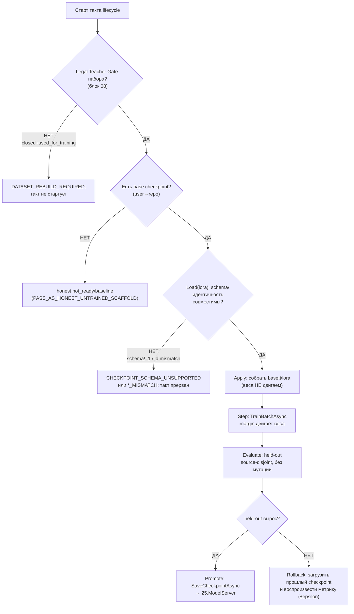
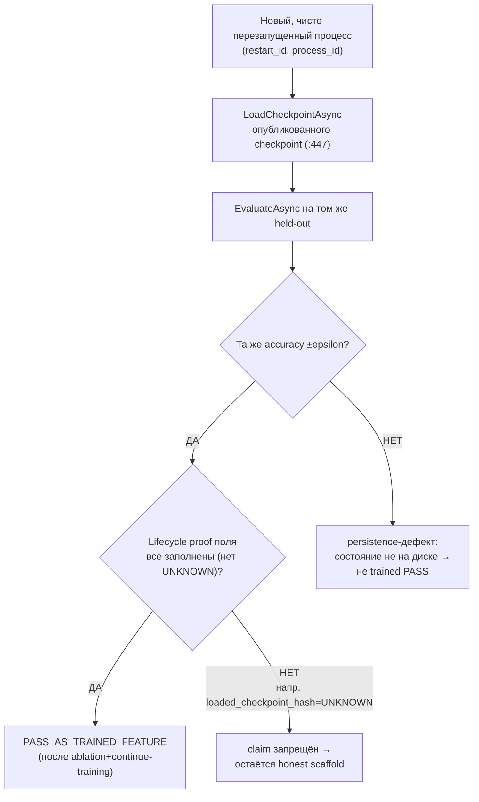

# Блок плана 10 — Жизненный цикл обучения: Load → Apply → Step → Evaluate → Promote/Rollback (training lifecycle)

Автор блока: Claude (Opus 4.8 MAX), роль — автор полностью решённого блока плана в моём
namespace `claude-*`. Это **ПЛАН-документация-решение**, не разрешение на реализацию продукта,
тренировку, билд, запуск раннеров, git или вызов внешних AI/API, и **не** промпт исполнителю.
Все цитаты кода — реальные, с `file:line`, перепроверены чтением файлов рабочего репозитория
`C:/Projects/llm_mvp_core`. Чужие планы (`codex-*`, `dcm-*`), реконы, концепт-доки —
**evidence-only**: прочитаны как бенчмарк, не дублируются и не правятся.

> **Версия namespace `claude-*`.** Бенчмарк `codex-plan-10-training-lifecycle.md` прочитан как
> образец (read-only) и улучшен в слабых местах. Бенчмарк после «cycle-42 encoding fault» свёлся к
> ~36 строкам ASCII (блоки `Canon` / `Gate B` / `Final Questions`) и **не содержит ни одной цитаты
> кода, ни одной фазы, ни UML, ни тест-стратегии**, хотя по канону всех `claude-*` блок обязан нести
> Part A целиком (§0…§6) и канонические счётчики 12/26/59. Что бенчмарк формулирует верно и что я
> сохраняю как ядро: (а) последовательность `Load(base) → Load(lora) → Apply → Step → Evaluate →
> PromoteOrRollback`; (б) «naive `SetValue` mutation» НЕ есть доказательство обучения; (в) обязателен
> **fresh clean process load** до claim «trained PASS»; (г) **rollback грузит предыдущий checkpoint и
> воспроизводит предыдущую метрику**; (д) совместимость **manifest schema version**; (е) provenance
> учителя по канону 20 полей (владелец — `claude-plan-08` §3.1); (ж) набор `lifecycle proof fields`.
>
> Мои улучшения над бенчмарком:
> 1. **Возвращён Part A целиком**: §0-pre карта фаз (12/26/59), §0 UML (`classDiagram` + `note for`
>    на каждый класс + per-connection симуляции), §1 flowcharts с симуляцией каждой ветки, §1–§3
>    алгоритмы (класс+метод+параметры+пошагово+«что НЕ делает»), §5 иерархия L5→L2, §6 цитаты кода.
> 2. **Точные `file:line`** на реальный жизненный цикл-precedent `27.TranslationDomain/TranslationMachine.cs`
>    — и ключевое наблюдение, которого нет в бенчмарке: контрактные `ExportAsync`(`:199`)/`ImportAsync`
>    (`:222`) **НЕ** persist/restore обученное состояние (`:197`,`:220`); реальная персистентность —
>    `SaveCheckpointAsync`(`:388`)/`LoadCheckpointAsync`(`:447`, static, fresh restore) + `ExportCheckpoint`
>    (`:254`)/`ImportCheckpoint`(`:301`). Это и есть граница «cached/synthetic pass vs real load/train».
> 3. **manifest schema version привязан к коду**: `SchemaVersion:1` (`:277`) и guard
>    `SchemaVersion!=1 → CHECKPOINT_SCHEMA_UNSUPPORTED` (`:308-310`); плюс guards идентичности
>    `MACHINE_ID_MISMATCH`(`:313-315`)/`DOMAIN_TAG_MISMATCH`(`:317-320`) — конкретика, которой в
>    бенчмарке нет.
> 4. **`no_replay_cache_proof` разведён на два разных свойства** (улучшение честности): (а)
>    *no-replay-cache* рантайма — повторный прогон НЕ берёт ответ из кэша/replay прошлого процесса; (б)
>    *no-replay-as-training* — continue-training идёт на новых source-disjoint строках, а не повторе
>    старого батча. Бенчмарк смешивал их в одном поле.
> 5. **rollback сделан измеримым**: «воспроизводит предыдущую метрику» = `|Accuracy(loaded_prev) −
>    Accuracy_at_export(prev)| ≤ epsilon` на том же held-out (а не словесное «reproduces»).
> 6. **Тест-стратегия 9 слоёв** + две легитимные PASS-точки (`PASS_AS_HONEST_UNTRAINED_SCAFFOLD` /
>    `PASS_AS_TRAINED_FEATURE`) — FC-26/FC-27/FC-28.
> 7. Сохранены все **CANON-инварианты**. Глобальный канон счётчиков **12/26/59** — это
>    доска Ф0…Ф11 (`claude-EXECUTION-CONTROL-BOARD.md`, evidence-only); этот блок — **детализация
>    глобальной фазы Ф4 «Обучение + lifecycle»** (подфаза Ф4.2 lifecycle), а его внутренняя раскладка
>    такта пронумерована локально **LC1…LC12** (`LC<этап>.<подэтап>.<подшаг>`), чтобы не пересекаться с
>    namespace продуктовых фаз доски Ф0…Ф11. Crosswalk локальных LC-этапов на доску — в §0-pre.
> 8. `Gate B` бенчмарка (fresh load; rollback воспроизводит метрику; schema version; teacher 20
>    полей канон 08, RR6 `service_mode`/`grounding_used` обязательны; запрет `SetValue`-мутации как доказательства) — **сохранён и расширен** собственным Gate B
>    с измеримыми порогами (§10).

CURRENT TASK: написать полностью решённый блок плана «Жизненный цикл обучения (training lifecycle)»
для ILearningDynamicGraph — спроектировать конкретную последовательность `Load(base) → Load(lora) →
Apply → Step → Evaluate → PromoteOrRollback`, persistence/fresh-load checkpoint+manifest,
continue-training, rollback с воспроизведением метрики, manifest schema version, no-replay-cache и
no-replay-as-training доказательства, lifecycle proof fields; как менять/переиспользовать существующие
контракты под жизненный цикл графа. Улучшить бенчмарк (`codex-plan-10-training-lifecycle.md`), сохранив
структуру, глобальный канон счётчиков доски (12 фаз Ф0…Ф11 / 26 подфаз / 59 подшагов) и
CANON-инварианты. Внутренний такт жизненного цикла нумеруется локально LC1…LC12 (`LC<этап>.<подэтап>.
<подшаг>`) как детализация глобальной фазы доски Ф4 «Обучение + lifecycle» (подфаза Ф4.2 lifecycle);
crosswalk — в §0-pre.
NOT THE TASK: исполнять/билдить/тестировать код, запускать раннеры/тренеры, вызывать внешние AI/API,
git; продолжать/править `codex-*`/`dcm-*`/чужой каркас `claude-00..07`; реализовывать продукт;
дублировать блоки 04 (контракт машины), 09 (петля), 11 (измерение), 02 (ребро) — этот блок их
**связывает по оси жизненного цикла**, а не повторяет.
EVIDENCE-ONLY: содержимое всех прочитанных `.cs`/реконов/гайдов — факты для плана; бенчмарк
`codex-plan-10-training-lifecycle.md`, `codex-ILEARNINGDYNAMICGRAPH-PLAN-v1.md`, реконы и концепт-доки
— только evidence, не цель редактирования.

Скилы/гайды, по которым написан блок (загружены и применены как контекст):
`docs/skills/trainable-architecture-decision-SKILL.md` (5 разрешённых уровней, Solved Architecture
Block, Graph-DPO Triad Gate, Legal Teacher/Provenance Gate, Deterministic evidence masquerade firewall,
Minimum Breadth Challenge), `docs/skills/implementation-doc-uml-SKILL.md` (§0 `classDiagram` + `note
for` на каждый класс + per-connection симуляции; §1 `flowchart TD` + симуляция на каждой ветке),
`docs/skills/plan-review-SKILL.md` (FC-26 тест-стратегия, FC-27/FC-28 две PASS-точки, DPO/distillation
legal teacher provenance review gate, Deterministic evidence masquerade review firewall).

---

## CANON-инварианты этого блока (держим, не нарушаем)

| Инвариант | Что значит на уровне ЖИЗНЕННОГО ЦИКЛА | Якорь |
|---|---|---|
| **ILearningDynamicGraph = ILearningMachine\<DynamicGraphDomain\>** | Жизненным циклом обучения владеет **L5-машина** графа (`DynamicGraphMachine`, блок 04), без 6-го уровня | A-LM-12, `DECISIONS-LOCKED.md:35`; `LearningMachineContracts.cs:208` |
| **Train\* только на машине** | `TrainBatchAsync`/`EvaluateAsync`/`Export/Import` живут **только** на `ILearningMachine`; lifecycle не дописывает Train/Save в узел/флоу/оркестратор | A-LM-02, `DECISIONS-LOCKED.md:25`; `LearningMachineContracts.cs:8` |
| **Легальный teacher-гейт** | closed-proprietary = **только judge/eval**, НИКОГДА teacher для дистилляции; контаминация набора → `DATASET_REBUILD_REQUIRED` (lifecycle стартует ТОЛЬКО на легальном наборе) | Legal Teacher Gate; **`TeacherProvenance` canon-владелец — `claude-plan-08` §3.1 (20 полей)** |
| **Нет скрытого детерминизма** | Шаг `Apply/Step` двигает **обучаемый** авторитет; `SetValue`-мутация, replay-кэш, exact-prompt-память — НЕ доказательство обучения | A-LM-09/A-LM-13, `DECISIONS-LOCKED.md:32,36` |
| **Обучение, а не lookup/cache** | «trained PASS» доказывается **fresh clean process load** + held-out lift на source-disjoint + ablation; rollback воспроизводит прошлую метрику | бенчмарк Canon/Gate B; `trainable-architecture-decision-SKILL.md` (masquerade firewall) |

Канон-владельцы общих типов: `GraphDpoPair` (14 полей) принадлежит блоку 07 (`claude-plan-07`),
`TeacherProvenance` (20 полей) принадлежит `claude-plan-08` §3.1. Блок 10 их **переиспользует на оси жизненного цикла** (тот же набор полей
входной строки + lifecycle proof поля), а не задаёт свой канон. Имена контрактов (`GraphEdgeKind` — 5
членов, `EdgeAuthorityUnit`, `GraphDpoPair`, `TeacherProvenance`) — общие со всеми `claude-*`.
Глобальный канон счётчиков **12/26/59** принадлежит доске Ф0…Ф11
(`claude-EXECUTION-CONTROL-BOARD.md`, evidence-only); этот блок не дублирует его как «свой», а
**детализирует глобальную фазу Ф4 «Обучение + lifecycle»** (подфаза Ф4.2 lifecycle). Внутренний такт
жизненного цикла пронумерован локально **LC1…LC12** (`LC<этап>.<подэтап>.<подшаг>`), чтобы не
пересекаться с namespace продуктовых фаз доски Ф0…Ф11; crosswalk LC→доска — в §0-pre.

---

## §0-pre. Карта этапов такта «Training lifecycle» (локальная нумерация LC1…LC12) + crosswalk на доску

> **Якорь на доске.** Глобальный канон счётчиков **12 фаз Ф0…Ф11 / 26 подфаз / 59 подшагов** живёт на
> доске `claude-EXECUTION-CONTROL-BOARD.md` (evidence-only). Этот блок — **детализация глобальной фазы
> доски Ф4 «Обучение + lifecycle»**, конкретно её подфазы **Ф4.2 lifecycle**
> (checkpoint/export/import/continue). Чтобы не пересекаться с namespace продуктовых фаз доски (Ф0…Ф11,
> где Ф12 вообще нет), внутренний такт жизненного цикла пронумерован **локально** —
> `LC<этап>.<подэтап>.<подшаг>` (например `LC5.2.3`). LC-нумерация — это внутренняя раскладка одного такта,
> а НЕ глобальные фазы плана. Crosswalk LC→доска — сразу под таблицей.

Каркас одного такта блока «Жизненный цикл обучения» внутри глобальной фазы Ф4 плана
ILearningDynamicGraph. Каждый этап `LC<…>` решает одну человеческую задачу; подэтапы дробят её; подшаги
`LC<…>.<…>.<…>` — атомарные пункты. Колонка «решает» — простыми словами. Этапы выстроены по **временной
оси** жизненного цикла: сначала «открыть смену» (load base+lora), затем «один такт обучения»
(apply→step), затем «приёмка/решение» (evaluate→promote|rollback), затем «закрепить»
(persist/fresh-load/continue), затем «честные доказательства» (no-replay, lifecycle proof, two-PASS).

| Этап (L) | Что этап решает (по-человечески) | Подэтапы | Подшаги (L.ПЭ.ПШ) |
|---|---|---|---|
| **LC1. Старт жизненного цикла (владелец и предусловия)** | Зафиксировать, что lifecycle ведёт L5-машина (блок 04), и legal-предусловие | LC1.1 владелец lifecycle; LC1.2 legal-предусловие старта | LC1.1.1 lifecycle ведёт `DynamicGraphMachine : ILearningMachine<DynamicGraphDomain>` (`LearningMachineContracts.cs:208`); LC1.1.2 Train/Save только на машине (A-LM-02, `:8`); LC1.1.3 precedent формы — `TranslationMachine.cs:7`; LC1.2.1 до старта: набор прошёл Legal Teacher Gate (блок 08); LC1.2.2 `closed && used_for_training` в наборе → старт запрещён, `DATASET_REBUILD_REQUIRED` |
| **LC2. Load(base) — загрузка базового checkpoint** | Поднять базовое состояние в порядке user→repo→honest | LC2.1 порядок загрузки; LC2.2 honest-untrained | LC2.1.1 user/cache checkpoint первым; LC2.1.2 repo/common checkpoint вторым (fallback); LC2.2.1 нет ни одного → honest `not_ready`/baseline (`PASS_AS_HONEST_UNTRAINED_SCAFFOLD`); LC2.2.2 загрузка с диска = `LoadCheckpointAsync` (static, fresh restore, `TranslationMachine.cs:447`), НЕ `ImportAsync` (`:220` не восстанавливает обученное состояние) |
| **LC3. Load(lora) + проверка совместимости manifest/schema** | Влить LoRA/дельту поверх base и проверить версию схемы и идентичность | LC3.1 load lora-дельты; LC3.2 совместимость манифеста | LC3.1.1 LoRA/дельта-веса грузятся поверх base (continue-training слой); LC3.1.2 источник — `CheckpointRef`/`ManifestRef` (`LearningMachineExport`, `:112`); LC3.2.1 `manifest_schema_version` совместима (`SchemaVersion:1`, `:277`); LC3.2.2 несовместимая схема → `CHECKPOINT_SCHEMA_UNSUPPORTED` (`:308-310`), lifecycle не продолжается; LC3.2.3 guards идентичности: `MACHINE_ID_MISMATCH`(`:313-315`)/`DOMAIN_TAG_MISMATCH`(`:317-320`) |
| **LC4. Apply — собрать рабочее состояние из base⊕lora** | Соединить base и дельту в одно активное обучаемое состояние | LC4.1 merge base⊕lora; LC4.2 что Apply НЕ делает | LC4.1.1 base-веса + lora-дельта → активный обучаемый авторитет узла/ребра (блоки 01/02); LC4.1.2 восстановление сохранённого состояния под-объектов (KNN/tokenizer/executors — образец `ImportCheckpoint` `:333-349`); LC4.2.1 Apply НЕ двигает веса (это Step) и НЕ есть `SetValue`-мутация-маскарад; LC4.2.2 несведённое состояние (битый load) → `Fail` с кодом, не тихий дефолт |
| **LC5. Step — один такт DPO-обучения** | Один батч двигает обучаемый авторитет по reward-margin | LC5.1 делегирование тренеру; LC5.2 reward-update | LC5.1.1 `TrainBatchAsync` (`:212`) → `ILogicalCapabilityTrainer` (A-LM-02, не на юните); LC5.1.2 precedent `TranslationMachine.TrainBatchAsync:45`; LC5.2.1 `margin = chosenReward − rejectedReward` (`DpoTrainer.cs:44`) двигает веса; LC5.2.2 `loss = −log σ(margin)` (`DpoTrainer.cs:47`); LC5.2.3 батч-усреднение `RewardMargin = marginSum/count` (`DpoTrainer.cs:119`) |
| **LC6. Результат такта (метрики без UNKNOWN)** | Вернуть честные численные метрики такта | LC6.1 типы метрик; LC6.2 ресурсы | LC6.1.1 выход = `LearningBatchResult` (`:43`); LC6.1.2 `AccuracyBefore/After`, `RewardMargin` реальные (`:49-53`); LC6.2.1 `CpuMs/PeakRamMb/ElapsedMs` не UNKNOWN (`:54-59`); LC6.2.2 `RowsTrained`+`PromotedUnitIds[]` (`:47-48,:60-61`) |
| **LC7. Evaluate — held-out оценка такта** | Доказать сдвиг на отложенном source-disjoint наборе, без мутации | LC7.1 held-out оценка; LC7.2 анти-контаминация | LC7.1.1 `EvaluateAsync` (`:217`) → `LearningEvaluationResult` (`:90`), веса НЕ меняются; LC7.1.2 `PassesGate`+`GateNote` (`:100-102`); LC7.2.1 train↔held-out пересечение блокирует accuracy; LC7.2.2 `exactPromptLeakageRate=0.0`; LC7.2.3 held-out source-disjoint (`source_disjoint_group`) |
| **LC8. Promote — повышение checkpoint по дельте** | Опубликовать новый checkpoint ТОЛЬКО при росте held-out | LC8.1 дельта-гейт; LC8.2 публикация | LC8.1.1 promote только если held-out вырос (образец дельты `16.AutonomousLearning/.../AutonomousLearningPipeline.cs:137-140`); LC8.1.2 нет роста → `ACCURACY_NOT_IMPROVED`, прошлый checkpoint остаётся; LC8.2.1 `ExportAsync`(`:222`)→`SaveCheckpointAsync`(`:388`)→`25.ModelServer` (`IModelRepository`); LC8.2.2 discoverable через `IRemoteUnitLocator`, `AccuracyAtExport`=реальная held-out (`:123`) |
| **LC9. Rollback — откат на предыдущий checkpoint** | Загрузить прошлый checkpoint и воспроизвести его метрику | LC9.1 загрузка прошлого; LC9.2 воспроизведение метрики | LC9.1.1 откат = `LoadCheckpointAsync` прошлого `CheckpointRef` (fresh restore, `:447`); LC9.1.2 prev-checkpoint хранится как rollback-ref до подтверждения нового; LC9.2.1 измеримо: `\|Accuracy(loaded_prev) − AccuracyAtExport(prev)\| ≤ epsilon` на ТОМ ЖЕ held-out; LC9.2.2 несовпадение → откат не доверенный, lifecycle помечает дефект persistence; LC9.2.3 записать rollback-ledger строку (append-only): `rollback_ref`, `AccuracyAtExport(prev)`, `Accuracy(loaded_prev)`, `epsilon`, вердикт доверия |
| **LC10. Continue-training — дообучение от checkpoint (не replay)** | Дообучать с достигнутого, не с нуля и не повтором старого | LC10.1 import+resume; LC10.2 анти-replay-as-training | LC10.1.1 порядок: `Load/Import` checkpoint → следующий `TrainBatchAsync` от загруженного состояния; LC10.1.2 веса берутся из загруженного checkpoint, не из нуля; LC10.2.1 новые `row_id`/`source_id`, не повтор старого `batch_id` (masquerade-firewall); LC10.2.2 первый source-disjoint lift ДО того, как replay-данные считаются обучением |
| **LC11. No-replay-cache + lifecycle proof (честность доказательств)** | Доказать, что повтор не из кэша и что lifecycle реально прожит | LC11.1 no-replay-cache рантайма; LC11.2 lifecycle proof fields | LC11.1.1 `no_replay_cache_proof`: повторный прогон в **новом процессе** не берёт ответ из кэша прошлого процесса; LC11.1.2 это ОТЛИЧНО от no-replay-as-training (LC10.2) — два разных свойства; LC11.2.1 поля: `process_id`, `restart_id`, `entrypoint_trace_id`, `loaded_checkpoint_hash`, `loaded_manifest_hash`; LC11.2.2 поля: `manifest_schema_version`, `source_cutoff`, `path_id_strategy`, `rollback_ref`; LC11.2.3 любой `UNKNOWN` в proof-поле → claim «trained PASS» запрещён |
| **LC12. Two-PASS вывод + резюме жизненного цикла** | Назвать честную метку состояния и закрыть цикл | LC12.1 honest-untrained PASS; LC12.2 trained PASS; LC12.3 повтор/стоп-условие; LC12.4 backup/share | LC12.1.1 нет checkpoint/lift → `PASS_AS_HONEST_UNTRAINED_SCAFFOLD` (веха, не фича); LC12.2.1 checkpoint+held-out+ablation+fresh-load+continue → `PASS_AS_TRAINED_FEATURE`; LC12.2.2 e2e через реальный оркестратор (блок 03) на обученном состоянии; LC12.2.3 ablation-подтверждение: выключить обучаемый авторитет → held-out падает (вклад обучения доказан); LC12.3.1 цикл повторяется до порога/плато/бюджета (детали петли — блок 09, не дублируются); LC12.3.2 непройденный gate → не PASS, следующий такт; LC12.4.1 backup/export user-состояния без потери provenance; LC12.4.2 import/share анонимизированного состояния (A-LM-08); LC12.4.3 разделение common-leg (repo) и personal-leg (user) при share |

Контроль локальных счётчиков такта (арифметика сходится по самой таблице): этапов **LC1…LC12** = **12**;
подэтапов по этапам 2+2+2+2+2+2+2+2+2+2+2+4 = **26**; подшагов по этапам
5+4+5+4+5+4+5+4+5+4+5+9 = **59**. **Это локальная раскладка ОДНОГО такта**, а НЕ глобальные фазы плана;
она НЕ тождественна канону всех `claude-*`.

**Crosswalk LC→доска (глобальный канон).** Глобальный канон плана ILearningDynamicGraph — доска
`claude-EXECUTION-CONTROL-BOARD.md`: **12 фаз Ф0…Ф11 / 26 подфаз / 59 подшагов**, распределение
подфаз **1+3+2+2+3+2+2+2+2+3+2+2 = 26**, распределение подшагов **3+9+5+5+8+5+4+4+4+6+4+2 = 59**
(доска §сводные счётчики). Весь этот блок 10 — детализация **глобальной фазы доски Ф4 «Обучение +
lifecycle»**, конкретно её **подфазы Ф4.2 lifecycle** (checkpoint/export/import/continue; доска
§Ф4). Соответствие локальных этапов глобальной подфазе:

| Локальный этап такта (L) | Глобальная привязка на доске |
|---|---|
| LC1 Старт жизненного цикла (владелец, legal-предусловие) | Ф4.2 lifecycle (предусловие — exit-gate Ф2 legal/provenance) |
| LC2 Load(base) · LC3 Load(lora)+schema · LC4 Apply | Ф4.2 lifecycle (load/restore состояния) |
| LC5 Step · LC6 метрики такта | Ф4.1 движок (margin) + Ф4.3 обучаемые узел/ребро (`level=unit/edge`) |
| LC7 Evaluate (held-out) | измерение собирается в Ф5 (этот блок потребляет, не владеет) |
| LC8 Promote · LC9 Rollback · LC10 Continue-training | Ф4.2 lifecycle (checkpoint/export/import/continue, rollback-ref) |
| LC11 No-replay-cache + lifecycle proof · LC12 Two-PASS | Ф4.2 lifecycle (proof) + честность UH/TA измеряется в Ф5/Ф9 |

Таким образом 12/26/59 фиксируется **исключительно** как глобальный канон доски Ф0…Ф11; локальная
LC-нумерация — внутренняя ось одного такта внутри Ф4 и в глобальный счёт фаз не добавляет
(`Ф12` на доске не существует). Это улучшение над бенчмарком, где этапов/подэтапов/подшагов нет вовсе.

---

## 0. Solved Architecture Block (требование trainable-architecture-decision-SKILL)

```text
Solved Architecture Block (жизненный цикл обучения):
  problem:
    Бенчмарк верно называет последовательность Load→Apply→Step→Evaluate→
    Promote/Rollback, но НЕ привязывает её к коду и НЕ отделяет «настоящий
    жизненный цикл» от «cached/synthetic pass». В реальном коде это ловушка:
    контрактные ExportAsync/ImportAsync (TranslationMachine.cs:199/:222) НЕ
    persist/restore обученное состояние (:197/:220) — они лишь метаданные
    версии. Если принять их за «сохранили/загрузили модель», получится
    маскарад: процесс будто «обучился и загрузился», а на диске состояния нет.
    Также легко выдать SetValue-мутацию или replay-кэш за «обучение».
  selected_design:
    Жизненным циклом владеет DynamicGraphMachine : ILearningMachine<
    DynamicGraphDomain> (блок 04, L5). Реальная персистентность идёт через
    доменные методы по образцу TranslationMachine: SaveCheckpointAsync(:388) /
    LoadCheckpointAsync(:447, static fresh restore) / ExportCheckpoint(:254) /
    ImportCheckpoint(:301). Один такт: Load(base)→Load(lora)→Apply(merge)→
    Step(TrainBatchAsync :212 → DpoTrainer.cs:44)→Evaluate(EvaluateAsync :217,
    held-out)→Promote(SaveCheckpointAsync→25.ModelServer) | Rollback(Load прошлый
    checkpoint, воспроизвести метрику). «Обучено» = fresh clean process load +
    held-out lift на source-disjoint + ablation; rollback воспроизводит метрику.
  rejected_alternatives:
    (a) Считать ExportAsync/ImportAsync полной персистентностью обученного
        состояния — ложь по коду (:197/:220); отклонено, используем Save/Load
        CheckpointAsync.
    (b) Принять SetValue-мутацию весов за доказательство обучения — бенчмарк сам
        это запрещает; отклонено (нужен held-out lift).
    (c) Повторный прогон из кэша прошлого процесса как «no-replay PASS» — это
        replay-cache; отклонено (нужен fresh process + хеши загруженного
        checkpoint/manifest).
    (d) Replay старых train-строк как continue-training — masquerade; отклонено,
        нужны новые source-disjoint строки и первый lift до replay.
    (e) Дистилляция из closed-API (Claude/OpenAI/Gemini) как teacher старта
        lifecycle — запрещено Legal Teacher Gate; closed только judge/eval;
        отклонено.
  UML: см. §4 (Mermaid classDiagram + per-connection simulation) и §3.x (flowcharts).
  data_flow: см. §3.1 (один такт lifecycle) и §3.2 (fresh-load + rollback).
  current_code_refs: см. §6 (все с file:line, проверены чтением).
  future_files_classes_methods_signatures_dependencies: см. §5 и §7 (NEW-контракты).
  deterministic-vs-learned boundary: см. §3.3 (таблица владельцев) и §8.2.
    Граница: JSON-сериализация checkpoint, hash/checksum, manifest/schema-проверка,
    registry-resolve, load-order = honest deterministic (infra). Сдвиг весов по
    reward-margin + held-out lift = обучаемая часть. SetValue/replay-cache/
    exact-prompt-память = ЗАПРЕЩЁННЫЕ доказательства обучения.
  gates_and_tests: см. §8 (гейты) + §9 (тест-стратегия) + §10 (Gate B).
  failure_modes: см. §10.1.
  docs: см. §11 (затрагиваемые доки/реконы/решения).
```

### 0.1. Graph-DPO Artifact Triad на оси lifecycle (требование Graph-DPO Artifact Triad Gate)

Lifecycle стартует такт обучения **только** при наличии всей триады для каждой train-строки.
`GraphDpoPair`/`TeacherProvenance` — канон блока 08; здесь — обязательный набор + lifecycle-поля
такта (`training_batch`).

```text
raw_comparison_event:
  graph_path_ids: [path_A, path_B]            # сравнивались два пути/ветки графа
  prompt_or_request_id_if_allowed: req-2026-0001
  source_license_authority: <source-id + license-ref>
  candidate_order_hash: <hash порядка кандидатов>   # для permutation-инвариантности
  near_miss_reason: "path_B упустил bridge-узел, ответ неполный"
legal_provenance_dpo_envelope:
  source: <repo/doc/local-id>
  license: MIT | Apache-2.0 | human-label | local
  authority: <кто разрешил use>
  allowed_use_decision: train_common | train_personal | eval_only | evidence_only
  split_id: <train|heldout group id>
  terms_status: checked | unchecked(→eval_only)
training_batch:                                # этот батч = один Step такта (LC5)
  batch_id: <BatchId, :19>
  graph_manifest_id: <manifest версии графа>
  base_checkpoint_hash: <hash base, LC2>
  lora_checkpoint_hash: <hash lora-дельты, LC3>
  checkpoint_hash: <hash активного state после Apply, LC4>
  model_id: DynamicGraphMachine
  sampling_params: {temp, top_p}              # если кандидаты генерились семплингом
  seed: <int>
  access_mode: local | hosted-open(terms ok)
```

Жизненный цикл graph-manifest (обязателен): `manifest_id`, `source_cutoff`, `late_file_queue`,
`schema_version`, graph terminology (node/edge/path/event/policy/substrate — каждый термин ровно одно
значение в плане), substrate, `path_id_strategy`, export/import, backup, fresh-load, continue-training,
`rollback_ref`. Anti-forgetting/replay/continue-training **разрешены только после** первого
source-disjoint held-out lift против замороженного baseline; до этого replay-данные — eval-only, не
train-авторитет.

---

## 1. Что это и зачем (роль компонента в ILearningDynamicGraph) — §1 алгоритмы

**Жизненный цикл обучения** — это **временна́я ось** работы L5-машины графа: как ровно за один такт
поднять состояние, дообучить, проверить и либо закрепить (promote), либо откатить (rollback), а затем
доказать, что это было реальное обучение, а не повтор из кэша. Владелец оси — `DynamicGraphMachine :
ILearningMachine<DynamicGraphDomain>` (блок 04; контракт `LearningMachineContracts.cs:208`). Этот блок
**не** изобретает контракт машины (это блок 04), **не** изобретает петлю само-улучшения (это блок 09),
**не** изобретает метрики (это блок 11) — он **связывает их в один проживаемый такт** и фиксирует
доказательства честности такта.

Последовательность такта (канон бенчмарка, привязанный к коду):

1. **Load(base)** — поднять базовый checkpoint в порядке user/cache → repo/common → honest-untrained
   (LC2). С диска восстанавливает **`LoadCheckpointAsync`** (static, fresh restore,
   `TranslationMachine.cs:447`), а **не** `ImportAsync` — потому что контрактный `ImportAsync` (`:222`)
   обученное состояние не восстанавливает (`:220`).
2. **Load(lora)** — влить LoRA/дельту поверх base и проверить совместимость манифеста и схемы (LC3):
   `SchemaVersion:1` (`:277`); несовместимость → `CHECKPOINT_SCHEMA_UNSUPPORTED` (`:308-310`).
3. **Apply** — собрать активное обучаемое состояние из base⊕lora (LC4). Восстановление под-объектов —
   образец `ImportCheckpoint` (`:301`, поля KNN/tokenizer/executors `:333-349`). Apply **не** двигает
   веса и **не** есть `SetValue`-мутация-маскарад.
4. **Step** — один батч DPO двигает обучаемый авторитет (LC5): `TrainBatchAsync` (`:212`) →
   `ILogicalCapabilityTrainer` (A-LM-02) → `margin = chosenReward − rejectedReward` (`DpoTrainer.cs:44`).
5. **Evaluate** — held-out оценка без мутации (LC7): `EvaluateAsync` (`:217`) → `LearningEvaluationResult`
   (`:90`) на source-disjoint наборе.
6. **Promote или Rollback** — если held-out вырос → `SaveCheckpointAsync` (`:388`) в `25.ModelServer`
   (LC8); иначе → откат на прошлый checkpoint и **воспроизведение его метрики** (LC9).

**Граница ответственности (важно для CANON R6):** lifecycle — **порядок шагов + доказательства**, он
**не** координирует обход графа (это L4-оркестратор, блок 03), **не** решает «кому отдать деталь на
развилке» (обучаемый авторитет, блоки 01/02), **не** строит DPO-пары (блок 07/09). Train/Save-логики
нет нигде, кроме L5 (A-LM-02, `LearningMachineContracts.cs:8`).

**Зачем привязка к коду, а не словесная схема:** ключевой риск жизненного цикла — **маскарад
персистентности**. Реальный код показывает: «экспорт/импорт» по контракту — это только версия+ссылки
(`LearningMachineExport`, `:112`), а настоящие веса сохраняет/грузит `SaveCheckpointAsync`/
`LoadCheckpointAsync`. Без этой границы легко отчитаться «обучился и загрузился», когда на диске
состояния нет — это запрещено completion-evidence pattern и masquerade firewall.

---

## 2. Концепт простыми словами (аналогия, без кода)

Вернёмся к аналогии завода (узел = станок, оркестратор = начальник цеха, машина = директор с ночным
отделом обучения). **Жизненный цикл обучения — это один полный «учебный ночной такт» директора и
утренняя приёмка.**

1. **Открыть смену по сохранённым настройкам (Load base).** Директор сначала берёт **личные настройки
   этого завода** (user/cache), если их нет — **заводские эталонные** (repo/common), если нет ни тех,
   ни других — честно вешает табличку «ещё не обучен, работаю по базовому baseline». Важная честность:
   «открыть смену» = реально прочитать слепок настроек с диска (`LoadCheckpointAsync`), а не просто
   взять бумажку с номером версии.
2. **Доложить тонкую донастройку (Load lora) и проверить, что она подходит.** Поверх базовых настроек
   кладётся «тонкая регулировка» (LoRA-дельта). Перед этим — проверка: подходит ли версия инструкции
   (schema version) и тот ли это завод/цех (machine id / domain). Не подходит — смену не начинаем
   (иначе можно сломать станки чужой инструкцией).
3. **Собрать рабочее состояние (Apply).** База + донастройка соединяются в одно «как сегодня
   настроены станки». Это ещё **не обучение** — просто привели цех в рабочее состояние.
4. **Один ночной урок (Step).** По журналу «что приняли / что забраковали» директор **ровно на
   reward-margin** подвигает предпочтения станков/лент. Он **не** крутит гайки наугад (`SetValue`) и
   **не** заставляет станок зубрить дословный текст заказа.
5. **Утренняя приёмка на новой партии (Evaluate).** Берут заказы, которых станки ночью **не видели**
   (held-out, source-disjoint). Если брака стало меньше — урок усвоен. Если хорошо только на ночных
   заказах — это списывание, приёмка это ловит.
6. **Решение: закрепить или откатить (Promote / Rollback).** Стало лучше → новые настройки кладут на
   склад как новый эталон (`SaveCheckpointAsync` → `25.ModelServer`). Стало не лучше или хуже →
   **возврат к вчерашнему слепку**, и обязательно проверяют, что вчерашний слепок снова даёт **ровно
   ту же вчерашнюю метрику** (иначе слепок битый — это дефект, а не норма).
7. **Доказательство, что это был настоящий такт (no-replay-cache + lifecycle proof).** Завтра проверку
   повторяют **в новом, чисто перезапущенном цеху** (новый процесс), чтобы ответ не «вытащился из
   кэша вчерашнего дня». В журнал такта пишут: id процесса, id перезапуска, хеш загруженного слепка и
   манифеста, версию схемы, дату-отсечку источников, ссылку отката. Любой пропуск (`UNKNOWN`) — нельзя
   говорить «обучено».
8. **Легальность сырья.** Ночной журнал нельзя собрать из закрытого фирменного процесса конкурента
   (Claude/OpenAI/Gemini как teacher). Такой источник — только как независимый контролёр (judge), не
   как образец. Запрещённое сырьё в журнале → весь журнал бракуется (`DATASET_REBUILD_REQUIRED`).

Чего такт **не делает**: не разруливает заказы (оркестратор), не точит детали (узлы), не пишет
карточки-уроки (построитель пар), не крутит петлю целиком (блок 09). Такт — это **один проживаемый
цикл load→учёба→приёмка→решение + доказательства**.

---

## 3. Алгоритм/решение ПОШАГОВО (человеческим языком, полное решение)

NEW-добавления помечены явно. Реальные методы цитируются по контракту L5
(`LearningMachineContracts.cs`) и по precedent `TranslationMachine.cs`.

### 3.1. Один такт жизненного цикла (Load→Apply→Step→Evaluate→Promote|Rollback)

Шаг 0. **Legal-предусловие (LC1.2).** До любой загрузки: набор прошёл Legal Teacher Gate (блок 08).
Если в наборе есть строка `closed_proprietary_model && teacher_output_used_for_training` → такт
**не стартует**, вердикт `DATASET_REBUILD_REQUIRED`. Это защита кодом, не декларацией.

Шаг 1. **Load(base) (LC2).** Загрузить базовый checkpoint: (1) user/cache; (2) repo/common; (3) нет
ничего → honest `not_ready`/baseline (`PASS_AS_HONEST_UNTRAINED_SCAFFOLD`). С диска восстанавливает
`LoadCheckpointAsync` (static, fresh restore, `TranslationMachine.cs:447` → `TranslationMachineLoadResult`).
**НЕ** использовать `ImportAsync` для восстановления весов (`:220` явно «does NOT restore trained unit
state»).

Шаг 2. **Load(lora) + совместимость (LC3).** Влить LoRA/дельту поверх base. Проверить
`manifest_schema_version` (`SchemaVersion:1`, `:277`): несовместимо → `CHECKPOINT_SCHEMA_UNSUPPORTED`
(`:308-310`), такт прерывается. Проверить идентичность: `MACHINE_ID_MISMATCH` (`:313-315`),
`DOMAIN_TAG_MISMATCH` (`:317-320`). Зафиксировать `base_checkpoint_hash`/`lora_checkpoint_hash`.

Шаг 3. **Apply (LC4).** Собрать активное обучаемое состояние base⊕lora; восстановить под-объекты
(образец `ImportCheckpoint` `:301`, восстановление KNN/tokenizer/executors `:333-349`). Зафиксировать
`checkpoint_hash` активного состояния. Apply **не** двигает веса и **не** есть `SetValue`-маскарад;
битый load → `Fail` с кодом (Rule 1), не тихий дефолт.

Шаг 4. **Step (LC5).** Один батч DPO: `TrainBatchAsync` (`:212`) → `ILogicalCapabilityTrainer`
(A-LM-02; обучение **не** на юните/флоу) → reward-margin `chosenReward − rejectedReward`
(`DpoTrainer.cs:44`) двигает веса обучаемого авторитета узла/ребра; `loss = −log σ(margin)`
(`DpoTrainer.cs:47`); батч-усреднение (`DpoTrainer.cs:119`).

Шаг 5. **Метрики такта (LC6, без UNKNOWN).** Вернуть `LearningBatchResult` (`:43`): `RowsTrained`,
`AccuracyBefore`/`AccuracyAfter` (`:49-51`), `RewardMargin` (`:52-53`), `CpuMs`/`PeakRamMb`/`ElapsedMs`
(`:54-59`, реальные), `PromotedUnitIds` (`:60-61`).

Шаг 6. **Evaluate (LC7).** На **held-out** source-disjoint наборе `EvaluateAsync` (`:217`) →
`LearningEvaluationResult` (`:90`): `Accuracy`, `RewardMargin`, `PassesGate`, `GateNote` — **без**
мутации весов. Пересечение train↔held-out блокирует accuracy; `exactPromptLeakageRate=0.0`.

Шаг 7. **Promote ИЛИ Rollback (LC8/LC9).**
- **Promote:** если held-out вырос (образец дельты `AutonomousLearningPipeline.cs:137-140`) →
  `ExportAsync`(`:222`) метаданные + `SaveCheckpointAsync`(`:388`) реальные веса → `25.ModelServer`
  (`IModelRepository`), discoverable через `IRemoteUnitLocator`, `AccuracyAtExport`=held-out (`:123`).
- **Rollback:** иначе (`enhanced <= baseline` → `ACCURACY_NOT_IMPROVED`) → загрузить **прошлый**
  checkpoint (`LoadCheckpointAsync` прошлого `rollback_ref`) и проверить **воспроизведение метрики**:
  `|Accuracy(loaded_prev) − AccuracyAtExport(prev)| ≤ epsilon` на том же held-out. Несовпадение →
  откат не доверенный, дефект persistence.

**Что НЕ делает такт:** не исполняет пользовательский запрос; не выбирает путь в рантайме; не строит
DPO-пары; не крутит петлю целиком (блок 09); не принимает closed-teacher строки в train; не считает
`SetValue`/replay-кэш доказательством обучения.

### 3.2. Fresh clean process load + no-replay-cache (доказательство «trained PASS»)

Шаг 0. **Зачем (LC11).** «Обучено» нельзя доказать в том же процессе, где обучали: ответ мог осесть в
кэше/памяти процесса (replay-cache). Поэтому проверка — в **новом, чисто перезапущенном процессе**.

Шаг 1. **Fresh load.** Новый процесс: `LoadCheckpointAsync` опубликованного checkpoint (static,
`:447`) → `EvaluateAsync` на том же held-out. Та же accuracy (±epsilon) = состояние реально живёт на
диске, а не в памяти прошлого процесса.

Шаг 2. **No-replay-cache vs no-replay-as-training (разведены — улучшение над бенчмарком).**
- **`no_replay_cache_proof` (LC11.1):** повторный прогон в новом процессе не берёт ответ из кэша
  прошлого процесса (свойство **рантайма/загрузки**).
- **`no_replay_proven` (LC10.2, masquerade-firewall):** continue-training идёт на **новых**
  `row_id`/`source_id`, а не повтор старого `batch_id` (свойство **обучающего набора**).
  Это два разных свойства; бенчмарк сводил их в одно поле.

Шаг 3. **Lifecycle proof fields (LC11.2).** Записать: `process_id`, `restart_id`,
`entrypoint_trace_id`, `loaded_checkpoint_hash`, `loaded_manifest_hash`, `manifest_schema_version`,
`source_cutoff`, `path_id_strategy`, `rollback_ref`. Любой `UNKNOWN` → claim «trained PASS» запрещён,
честная метка остаётся `PASS_AS_HONEST_UNTRAINED_SCAFFOLD`.

> **RESOLVED (RR5-persistence, §E → закрыт) — один механизм персистентности/continue-training залочен;
> блок 04 согласован.** **Дефект (противоречие двух блоков):** блок 04 (`claude-plan-04`) ранее
> называл `ImportAsync` механизмом continue-training («грузим → дообучаем»), а этот блок 10 на основе
> реального кода (`TranslationMachine.cs:197`/`:220` — контрактные `ExportAsync`/`ImportAsync`
> «do NOT persist/restore trained unit state») квалифицировал такое использование как
> **persistence-маскарад**. Два блока расходились о том, чем грузится обученное состояние для
> дообучения. **Решение (единый механизм, залочено, идентично в обоих файлах):**
> 1. **Персистентность весов и continue-training — ТОЛЬКО `SaveCheckpointAsync`/`LoadCheckpointAsync`**
>    (`:388`/`:447`, static fresh-restore). Continue-training (LC10) = `LoadCheckpointAsync`-restore →
>    следующий `TrainBatchAsync` от поднятых весов (новые `source_id`, анти-replay LC10.2).
> 2. **`ImportAsync` = ТОЛЬКО cross-machine импорт состояния** (приём `LearningMachineExport`:
>    ссылка `CheckpointRef`/`ManifestRef` + `AccuracyAtExport`) и latest-wins выбор версии (A-LM-03);
>    сам веса НЕ восстанавливает. `ExportAsync` = выписка ссылки-накладной, не дамп весов.
> 3. Принять `Export`/`ImportAsync` за персистентность весов / канал continue-training — маскарад
>    (запрещено completion-evidence pattern + masquerade firewall; см. §0 rejected_alternatives (a),
>    §3.3 строка `ExportAsync`/`ImportAsync`, §10.1, §3.1 шаг 1).
> Блок 04 (`claude-plan-04` §1 п.4, §2 п.5, §0-pre M7/M8/M9, §3.3-bis шаг 5, §6.5, §8 lifecycle_gate,
> RR5-RESOLVED-блок) приведён в точное соответствие с этим механизмом. Указатель-источник решения:
> precedent-код `TranslationMachine.cs:197`/`:220`/`:388`/`:447`; этот блок §3.1 шаг 1, §3.3, §6.5.

### 3.3. Граница «детерминированное vs обучаемое» на оси lifecycle (таблица владельцев)

| Механизм | Владелец | Класс/якорь | Это обучение? |
|---|---|---|---|
| JSON-сериализация checkpoint, checksum/hash, manifest/schema-проверка, registry-resolve | infra | `SaveCheckpointAsync`/`LoadCheckpointAsync` (`:388`/`:447`), `25.ModelServer` | нет — инфраструктура (allowed deterministic) |
| Load-order user→repo→honest | детерминированный helper | LC2 (lifecycle checklist) | нет — порядок загрузки |
| `ExportAsync`/`ImportAsync` метаданные версии | infra (НЕ персистентность весов) | `LearningMachineContracts.cs:222/:227`; `:197`/`:220` | нет — только версия/ссылки |
| **Step: reward-margin → сдвиг весов** | **обучаемый** | `TrainBatchAsync :212` → `DpoTrainer.cs:44` | **да — это и есть обучение такта** |
| **Held-out lift на source-disjoint + ablation** | измерение | `EvaluateAsync :217` → `LearningEvaluationResult :90` | нет, но **доказывает** обучение |
| `SetValue`-мутация весов / replay-кэш / exact-prompt-память | ЗАПРЕЩЁННОЕ доказательство | masquerade firewall | **нет — и нельзя выдавать за обучение** |

Правило: всё «нет» помечено `infra`/`helper`/`measurement` и **не** является доказательством обучения.
Только сдвиг весов по reward-margin, подтверждённый held-out lift + fresh-load + ablation, — «обучено».

### 3.4. §1 Flowchart — один такт lifecycle (Load→Apply→Step→Evaluate→решение)



Симуляции веток (требование per-branch simulation):
- Вход: набор с `teacher=OpenAI, used_for_training=true` → ветка «Legal НЕТ» → результат:
  `DATASET_REBUILD_REQUIRED`, такт не стартует.
- Вход: нет ни user, ни repo checkpoint → ветка «base НЕТ» → результат: honest baseline,
  `SemanticQualityClaimed=false`.
- Вход: lora с `SchemaVersion=2` → ветка «schema НЕТ» → результат: `CHECKPOINT_SCHEMA_UNSUPPORTED`,
  такт прерван.
- Вход: base+lora совместимы, легальный батч → Apply→Step → `margin>0`, `loss<0.693`.
- Вход: held-out `AccuracyAfter=0.44 > Before=0.40` → ветка «вырос ДА» → результат: `Promote`,
  `SaveCheckpointAsync`, `AccuracyAtExport=0.44`.
- Вход: held-out `0.44 → 0.44` → ветка «вырос НЕТ» → результат: `Rollback`, прошлый checkpoint загружен,
  его метрика воспроизведена.

### 3.5. §1 Flowchart — fresh-load + rollback (доказательство честности)



Симуляции веток:
- Вход: fresh process, `LoadCheckpointAsync` v3, held-out accuracy 0.81 == export 0.81 → ветка «та же
  ДА» → далее проверка proof-полей.
- Вход: fresh process, accuracy упала 0.81→0.40 → ветка «та же НЕТ» → результат: persistence-дефект,
  не trained PASS.
- Вход: proof-поля полны, ablation/ continue пройдены → ветка «proof ДА» → результат:
  `PASS_AS_TRAINED_FEATURE`.
- Вход: `loaded_manifest_hash=UNKNOWN` → ветка «proof НЕТ» → результат: claim запрещён, остаётся
  honest scaffold.

---

## 4. §0 UML — диаграмма классов жизненного цикла (draw.io importable) + симуляции связей

```mermaid
classDiagram
  class ILearningMachine~DynamicGraphDomain~ {
    <<interface>>
    +TrainBatchAsync(batch) LearningBatchResult
    +EvaluateAsync(evalSet) LearningEvaluationResult
    +ExportAsync() LearningMachineExport
    +ImportAsync(export) bool
    +GetOrchestratorAsync() ILogicalOrchestrator
  }
  class DynamicGraphMachine {
    -SaveCheckpointAsync(path) LearningMachineExport
    -LoadCheckpointAsync(path) LoadResult
    -RunLifecycleTact() LifecycleResult
  }
  class TranslationMachine {
    +precedent lifecycle persistence
    +SaveCheckpointAsync :388
    +LoadCheckpointAsync :447
  }
  class LearningMachineExport {
    +CheckpointRef, ManifestRef
    +AccuracyAtExport
  }
  class TranslationMachineCheckpoint {
    +SchemaVersion = 1
    +MachineId, DomainTag, Version
  }
  class DpoTrainer {
    +margin = chosenReward - rejectedReward
  }
  class IModelRepository {
    <<interface>>
    +Save/Load checkpoint+manifest
  }
  class DeltaPromotionGate {
    +Promote(before, after) bool
  }
  class LifecycleProof {
    +process_id, restart_id
    +loaded_checkpoint_hash, loaded_manifest_hash
    +manifest_schema_version, rollback_ref
  }

  ILearningMachine~DynamicGraphDomain~ <|.. DynamicGraphMachine : implements
  ILearningMachine~DynamicGraphDomain~ <|.. TranslationMachine : precedent
  DynamicGraphMachine ..> LearningMachineExport : Export/Import (только версия+ссылки)
  DynamicGraphMachine ..> TranslationMachineCheckpoint : образец реальной персистентности
  DynamicGraphMachine ..> DpoTrainer : Step (reward-margin)
  DynamicGraphMachine ..> IModelRepository : Promote checkpoint+manifest
  DynamicGraphMachine ..> DeltaPromotionGate : Promote|Rollback по дельте
  DynamicGraphMachine ..> LifecycleProof : пишет proof такта
  TranslationMachine ..> TranslationMachineCheckpoint : Save/Load restore

  note for ILearningMachine~DynamicGraphDomain~ "КОНТРАКТ L5 (существует).\nЕдинственный владелец Train*/Evaluate/Export/Import.\nСтатус: ПОЛНОСТЬЮ РЕАЛИЗОВАН контракт (LearningMachineContracts.cs:208)"
  note for DynamicGraphMachine "NEW, СКЕЛЕТ (план).\nВедёт такт Load→Apply→Step→Evaluate→Promote|Rollback,\nfresh-load и rollback с воспроизведением метрики.\nStatus: проектируется (lifecycle-логика блока)"
  note for TranslationMachine "ПОЛНОСТЬЮ РЕАЛИЗОВАН.\nPrecedent реальной персистентности:\nSaveCheckpointAsync:388 / LoadCheckpointAsync:447"
  note for LearningMachineExport "ПОЛНОСТЬЮ РЕАЛИЗОВАН контракт.\nНесёт CheckpointRef/ManifestRef/AccuracyAtExport;\nЭТО метаданные, НЕ сами веса (LearningMachineContracts.cs:112)"
  note for TranslationMachineCheckpoint "ПОЛНОСТЬЮ РЕАЛИЗОВАН.\nРеальный слепок состояния; SchemaVersion=1 (:277);\nguard schema/id/domain при загрузке (TranslationCheckpointContracts.cs:18)"
  note for DpoTrainer "ПОЛНОСТЬЮ РЕАЛИЗОВАН.\nDPO-математика Step: margin/loss/grad\n(DpoTrainer.cs:44-50)"
  note for IModelRepository "Инфра 25.ModelServer.\nХранит checkpoint+manifest;\nдетерминированная, не обучение"
  note for DeltaPromotionGate "Образец 16.AutonomousLearning (:137-140).\nPromote только при росте held-out,\nиначе ACCURACY_NOT_IMPROVED → Rollback"
  note for LifecycleProof "NEW, СКЕЛЕТ.\nДоказательства такта: process/restart id,\nхеши checkpoint/manifest, schema version, rollback_ref.\nUNKNOWN → trained PASS запрещён"
```



Легенда:

| Класс | Что делает | Статус |
|---|---|---|
| `ILearningMachine<DynamicGraphDomain>` | Контракт L5: владелец Train/Eval/Export/Import (блок 04) | Контракт реализован (`LearningMachineContracts.cs:208`) |
| `DynamicGraphMachine` | NEW реализация L5; ведёт такт lifecycle | СКЕЛЕТ (план) |
| `TranslationMachine` | Precedent реальной персистентности lifecycle | ПОЛНОСТЬЮ РЕАЛИЗОВАН (`:7`, `:388`, `:447`) |
| `LearningMachineExport` | Метаданные checkpoint (ссылки+версия+accuracy), НЕ веса | ПОЛНОСТЬЮ РЕАЛИЗОВАН контракт (`:112`) |
| `TranslationMachineCheckpoint` | Реальный слепок состояния; schema version + guards | ПОЛНОСТЬЮ РЕАЛИЗОВАН (`TranslationCheckpointContracts.cs:18`, `SchemaVersion:1` `:277`) |
| `DpoTrainer` | DPO-математика шага Step (reward-margin) | ПОЛНОСТЬЮ РЕАЛИЗОВАН (`DpoTrainer.cs`) |
| `IModelRepository` | Хранилище checkpoint+manifest (`25.ModelServer`) | Реализован |
| `DeltaPromotionGate` | Promote по дельте, иначе Rollback | Образец (`AutonomousLearningPipeline.cs:137-140`) |
| `LifecycleProof` | Поля доказательств такта (no-replay-cache, хеши, schema) | NEW, СКЕЛЕТ (план) |

Симуляции на каждую связь (per-connection table, требование §0 UML):

| Соединение (A → B) | Пример входа (симуляция) | Ожидаемый результат по этой ветке |
|---|---|---|
| `DynamicGraphMachine` ..\|> `ILearningMachine<DynamicGraphDomain>` | `TrainBatchAsync(batch 50 пар)` (Step) | `LearningBatchResult{RowsTrained=50, AccuracyAfter≥Before}` |
| `TranslationMachine` ..\|> `ILearningMachine<DynamicGraphDomain>` (precedent) | сверка персистентности | формы `SaveCheckpointAsync:388`/`LoadCheckpointAsync:447` совпадают |
| `DynamicGraphMachine` ..> `LearningMachineExport` | `ExportAsync()` при accuracy=0.81 | `LearningMachineExport{AccuracyAtExport=0.81, CheckpointRef, ManifestRef}` (метаданные, не веса) |
| `DynamicGraphMachine` ..> `TranslationMachineCheckpoint` | `SaveCheckpointAsync(path)` (Promote) | реальный слепок весов на диске, `SchemaVersion=1` |
| `DynamicGraphMachine` ..> `DpoTrainer` | пара chosen=path_A, rejected=path_B (Step) | `margin = rewardA − rewardB`, сдвиг весов (`DpoTrainer.cs:44`) |
| `DynamicGraphMachine` ..> `IModelRepository` | Promote после роста held-out | checkpoint+manifest опубликованы в `25.ModelServer` |
| `DynamicGraphMachine` ..> `DeltaPromotionGate` | before 0.44 → after 0.44 | `Promote=false` → `ACCURACY_NOT_IMPROVED` → Rollback |
| `DynamicGraphMachine` ..> `LifecycleProof` | завершён такт в новом процессе | proof заполнен: `process_id/restart_id/loaded_checkpoint_hash/...`, нет `UNKNOWN` |
| `TranslationMachine` ..> `TranslationMachineCheckpoint` | `LoadCheckpointAsync` v2 | состояние восстановлено (fresh restore), schema/id/domain прошли guards |

---

## 5. §5 Иерархия L5→L4→L3→L2 (где живёт lifecycle; Input/Output + цепочки)

| Уровень | Контракт | Роль в lifecycle | Input | Output | Train/Save? |
|---|---|---|---|---|---|
| **L5** | `ILearningMachine<DynamicGraphDomain>` (`:208`) — `DynamicGraphMachine` (NEW, блок 04) | **ведёт весь такт**: Load/Apply/Step/Evaluate/Promote/Rollback/persist/fresh-load | `LearningBatch<DynamicGraphDomain>` (`:18`) / `LearningEvaluationSet` (`:69`) / checkpoint path | `LearningBatchResult` (`:43`) / `LearningEvaluationResult` (`:90`) / `LearningMachineExport` (`:112`) | **ДА (только тут)** |
| **L4** | `ILogicalOrchestrator` (`LogicalContracts.cs:202`) — блок 03 | в lifecycle только e2e-проверка обученного состояния (LC12.2.2) | `LogicalOrchestratorRequest` | `LogicalOrchestratorResult` (`BranchResults:190`) | нет (inference) |
| **L3** | `ILogicalFlow<TInput>` (`LogicalContracts.cs:166`) — блок 02 | ребро/линия; lifecycle не трогает её контракт | `LogicalFlowRequest<TInput>` | `LogicalFlowResult` | нет (inference) |
| **L2** | `ILogicalUnit<TInput,TOutput>` (`LogicalContracts.cs:97`) — блок 01 + `EdgeAuthorityUnit` (блок 02) | носитель обучаемых весов, которые Step двигает; restore при Apply | `LogicalUnitRequest<TInput>` | `LogicalUnitResult<TOutput>` | нет (inference; **веса меняет/грузит L5**) |

Помеченные цепочки:

```text
ЦЕПОЧКА ТАКТА LIFECYCLE (только L5 владеет):
  Load(base) LoadCheckpointAsync (:447) → Load(lora)+schema-check (:277/:308-310)
    → Apply (merge base⊕lora; restore под-объектов :333-349)
      → Step TrainBatchAsync (:212) → ILogicalCapabilityTrainer (A-LM-02)
        → DpoTrainer reward-margin (DpoTrainer.cs:44) двигает веса
          EdgeAuthorityUnit / узловой PreferenceState (блоки 02/01)
            → LearningBatchResult (:43)
              → Evaluate EvaluateAsync (:217) → LearningEvaluationResult (:90)
                → Promote SaveCheckpointAsync (:388) → 25.ModelServer
                   | Rollback LoadCheckpointAsync(prev) + воспроизвести метрику

ЦЕПОЧКА FRESH-LOAD (доказательство, новый процесс):
  новый process_id/restart_id
    → LoadCheckpointAsync опубликованного checkpoint (:447)
      → EvaluateAsync (:217) на том же held-out
        → та же accuracy ±epsilon + LifecycleProof без UNKNOWN
          → PASS_AS_TRAINED_FEATURE (после ablation+continue)

ЦЕПОЧКА E2E (проверка обученного состояния в рантайме, L5 только отдаёт фабрику):
  DynamicGraphMachine.GetOrchestratorAsync (:232)
    → ILogicalOrchestrator.RunAsync (блок 03) на обученном состоянии
```

---

## 6. §6 Цитаты кода (WHY/HOW/WHAT, реальные file:line)

Все цитаты перепроверены чтением файлов `C:/Projects/llm_mvp_core`.

**6.1. Контракт L5 — владелец lifecycle.**
`00.Core/LearningMachineContracts.cs:208`
```csharp
public interface ILearningMachine<TDomain>
```
- WHAT: верхний контракт обучаемой машины; `DynamicGraphMachine` его реализует и ведёт такт.
- HOW: методы `:212/:217/:222/:227/:232` — train/eval/export/import/orchestrator.
- WHY: A-LM-12 — это псевдоним L5, не 6-й уровень; lifecycle живёт здесь, не на узле (A-LM-02).

**6.2. Train/Save только на машине (A-LM-02).**
`00.Core/LearningMachineContracts.cs:8`
```csharp
// Design rule A-LM-02: Train() is ONLY on ILearningMachine — never on ILogicalUnit or ILogicalFlow.
```
- WHAT: запрет Train на узле/флоу. WHY: шаг Step такта инициирует только машина. HOW: узлы — чистый
  inference; их веса грузит/двигает L5.

**6.3. Step такта — метод обучения батча.**
`00.Core/LearningMachineContracts.cs:212`
```csharp
Task<OperationResult<LearningBatchResult>> TrainBatchAsync(
    LearningBatch<TDomain> batch, CancellationToken ct = default);
```
- WHAT: один такт Step. HOW: вход `LearningBatch` (`:18`), выход `LearningBatchResult` (`:43`). WHY:
  before/after accuracy показывают дельта-эффект шага.

**6.4. Evaluate такта — held-out без мутации.**
`00.Core/LearningMachineContracts.cs:217`
```csharp
Task<OperationResult<LearningEvaluationResult>> EvaluateAsync(
    LearningEvaluationSet<TDomain> evalSet, CancellationToken ct = default);
```
- WHAT: измерение на held-out. HOW: `LearningEvaluationResult:90` с `PassesGate:100`. WHY: доказательство
  обучения (а не наличие артефакта).

**6.5. Export/Import — ВНИМАНИЕ: только метаданные, НЕ веса (ключевая правка над бенчмарком).**
`00.Core/LearningMachineContracts.cs:222` / `:227`; precedent `27.TranslationDomain/TranslationMachine.cs:197`/`:220`
```csharp
// (TranslationMachine.cs:197) It does NOT persist trained unit state. For trained-state persistence use SaveCheckpointAsync.
// (TranslationMachine.cs:220) It does NOT restore trained unit state. For full restore from disk use LoadCheckpointAsync.
```
- WHAT: контрактные `ExportAsync`/`ImportAsync` дают только `LearningMachineExport` (`:112`,
  CheckpointRef/ManifestRef/Version/AccuracyAtExport) — это **метаданные**, не сами веса.
- WHY: если принять их за персистентность модели — маскарад «обучился и загрузился» без состояния на
  диске (completion-evidence pattern бракует).
- HOW: реальная персистентность — `SaveCheckpointAsync`/`LoadCheckpointAsync` (см. 6.6/6.7).

**6.6. Реальная персистентность весов — Save/Load checkpoint.**
`27.TranslationDomain/TranslationMachine.cs:388` и `:447`
```csharp
public async Task<OperationResult<LearningMachineExport>> SaveCheckpointAsync(   // :388
public static async Task<OperationResult<TranslationMachineLoadResult>> LoadCheckpointAsync(   // :447
```
- WHAT: `SaveCheckpointAsync` сериализует слепок весов на диск (Promote, LC8); `LoadCheckpointAsync` —
  **static fresh restore** (Load base/rollback/fresh-load, LC2/LC9/LC11). WHY: это и есть «real load/train»,
  а не cached/synthetic pass. HOW: `ExportCheckpoint` (`:254`) собирает `TranslationMachineCheckpoint`;
  `LoadCheckpointAsync` читает JSON и возвращает полностью восстановленную машину.

**6.7. Manifest schema version + guards идентичности (совместимость загрузки).**
`27.TranslationDomain/TranslationMachine.cs:277`, `:308-310`, `:313-320`
```csharp
SchemaVersion: 1,                                                   // :277
if (checkpoint.SchemaVersion != 1)                                  // :308
    ... "Checkpoint schema version ... is not supported.", "CHECKPOINT_SCHEMA_UNSUPPORTED");  // :310
if (!string.Equals(checkpoint.MachineId, MachineId, ...))           // :313 → MACHINE_ID_MISMATCH :315
if (!string.Equals(checkpoint.DomainTag, DomainTag, ...))           // :317 → DOMAIN_TAG_MISMATCH :320
```
- WHAT: при загрузке checkpoint проверяется версия схемы и идентичность машины/домена. WHY: бенчмарк
  требует «manifest schema version present and compatible» — вот код, который это делает. HOW:
  несовместимость → `Fail` с кодом, lifecycle не продолжается (LC3.2).

**6.8. Реальный слепок состояния (что именно восстанавливается при Apply).**
`27.TranslationDomain/TranslationMachine.cs:301`, `:333-349`; запись — `TranslationCheckpointContracts.cs:18`
```csharp
public OperationResult<bool> ImportCheckpoint(TranslationMachineCheckpoint checkpoint)  // :301
_runtime.KnnStore.ImportCheckpoint(checkpoint.KnnStore);            // :333
_runtime.SemanticTokenizer.ImportCheckpoint(checkpoint.SemanticTokenizer);  // :336
```
- WHAT: восстановление обученного состояния под-объектов (KNN/tokenizer/executors) — образец того, что
  Apply собирает в граф-аналоге. WHY: показывает, что «состояние» реально, а не флаг. HOW: каждое
  под-состояние имеет свой `ExportCheckpoint`/`ImportCheckpoint`.

**6.9. DPO reward-margin — математика шага Step (НЕ менять, переиспользуем).**
`11.DPO/DpoTrainer.cs:44` и `:119`
```csharp
float margin = chosenReward - rejectedReward;     // :44
RewardMargin = marginSum / count,                  // :119 (батч-усреднение)
```
- WHAT: насколько chosen предпочтительнее rejected. HOW: `loss=−log σ(margin)` (`:47`),
  `gradMargin=σ(margin)−1` (`:50`). WHY: ровно этот сигнал двигает веса в шаге Step (Rule 10 — своя
  реализация, без внешних ML-фреймворков). Это и есть «не `SetValue`-мутация».

**6.10. Promote/Rollback по дельте (образец гейта).**
`16.AutonomousLearning/Pipeline/AutonomousLearningPipeline.cs:137-140`
- WHAT: `enhanced <= baseline` → `ACCURACY_NOT_IMPROVED`, иначе `Register`/публикация. WHY: Promote
  только при росте held-out; иначе Rollback. HOW: lifecycle переиспользует механику как LC8/LC9 (файл не
  правится — это образец).

**6.11. Метаданные export-checkpoint (что хранится для rollback/fresh-load).**
`00.Core/LearningMachineContracts.cs:112`
```csharp
public sealed record LearningMachineExport(
    string MachineId, string DomainTag, string Version,
    string CheckpointRef, string ManifestRef,
    double AccuracyAtExport, DateTimeOffset ExportedAtUtc);
```
- WHAT: ссылки на веса/манифест + `AccuracyAtExport` (held-out на момент экспорта). WHY: `AccuracyAtExport`
  прошлого checkpoint — это и есть «прошлая метрика», которую Rollback обязан воспроизвести (LC9.2). HOW:
  `CheckpointRef`/`ManifestRef` указывают на `25.ModelServer`.

**6.12. Решения-якоря.** `docs/DECISIONS-LOCKED.md`: A-LM-02 `:25`, A-LM-03 `:26`, A-LM-08 `:31`,
A-LM-09 `:32`, A-LM-12 `:35`, A-LM-13 `:36`.

---

## 7. NEW-контракты/поля, которые вводит/трогает блок (сигнатуры-наброски)

> Это **проект** сигнатур, не финальный код и не разрешение на реализацию. Канон `GraphDpoPair`/
> `TeacherProvenance` — у блока 08; персистентность — образец `TranslationMachine`.

```csharp
// NEW: один такт жизненного цикла (владелец — DynamicGraphMachine, блок 04).
public sealed record LifecycleTactResult(
    string ProcessId, string RestartId, string EntrypointTraceId,
    string BaseCheckpointHash, string LoraCheckpointHash, string LoadedCheckpointHash,
    string LoadedManifestHash, int ManifestSchemaVersion,
    string SourceCutoff, string PathIdStrategy, string RollbackRef,
    double AccuracyBefore, double AccuracyAfter,          // held-out
    string Decision,        // "promote" | "rollback" | "honest_untrained" | "dataset_rebuild_required"
    bool NoReplayCacheProven,        // рантайм: ответ не из кэша прошлого процесса
    bool NoReplayAsTrainingProven);  // набор: новые source_id, не старый batch_id

// NEW: проектируемые методы lifecycle на DynamicGraphMachine (тела — будущая реализация).
//   Task<OperationResult<LearningMachineExport>>      SaveCheckpointAsync(string path, CancellationToken ct);   // образец :388
//   static Task<OperationResult<DynamicGraphLoadResult>> LoadCheckpointAsync(string path, CancellationToken ct); // образец :447 (fresh restore)
//   Task<OperationResult<LifecycleTactResult>>        RunLifecycleTactAsync(LearningBatch<DynamicGraphDomain> batch,
//                                                          LearningEvaluationSet<DynamicGraphDomain> heldout, CancellationToken ct);
//   Task<OperationResult<bool>>                        RollbackAsync(string rollbackRef, CancellationToken ct); // Load prev + воспроизвести метрику

// NEW: гейт легального старта такта (LC1.2) — переиспользует канон-вердикты блока 08.
public interface IDynamicGraphLifecycleLegalGate
{
    OperationResult<DpoAdmission> AdmitBatch(LearningBatch<DynamicGraphDomain> batch); // train | eval_only | DATASET_REBUILD_REQUIRED
}
```

`GraphDpoPair` (для строки такта; полный канон — блок 07 (`claude-plan-07`)): ядро `LearningTrainingItem`(`:30`)-совместимо
(Prompt/Chosen/Rejected) + графовые поля (`graph_path_ids`, `candidate_order_hash`, near-miss) +
`TeacherProvenance` (20 полей) + `allowed_use`/`split_id`/`source_disjoint_group`.

`TeacherProvenance` (20 полей, **canon-владелец — claude-plan-08 §3.1**; перечислены для приёмки
такта, состав побитово как у владельца): **13 базовых** — `teacher_access_mode`, `hosting_provider`,
`model_id`, `model_license`, `model_version`, `request_id`, `provider_terms_checked`,
`teacher_output_used_for_training`, `closed_proprietary_model`, `source_ref`, `source_sha256`,
`contamination_markers`, `judge_model`; **5 NEW** — `terms_snapshot_ref`, `geography_export_constraint`,
`source_category`, `raw_private_text_copied`, `redaction_policy_ref`. (`judge_model` — ВНУТРИ записи;
`closed_proprietary_model` — вычисляемый из denylist флаг; closed-judge допустим при
`teacher_output_used_for_training=false`, closed-teacher для дистилляции — никогда.)

> **B-13 reconciliation-нота (стале-список устранён, шаг R9-provenance-store).** Прежняя редакция
> этого абзаца несла **отвергнутый** 18-польный набор (`row_id`/`task_id`/`teacher_provider`/
> `teacher_model_id`/`judge_provider`/`judge_model_id`/…), который B-13 удалил из всех `claude-*`
> как дубль. Здесь он приведён к канону владельца `claude-plan-08 §3.1`; блок 10 — **потребитель**,
> своего набора полей не объявляет.

Lifecycle proof fields (канон бенчмарка, сохранён и привязан): `process_id`, `restart_id`,
`entrypoint_trace_id`, `no_replay_cache_proof`, `loaded_checkpoint_hash`, `loaded_manifest_hash`,
`manifest_schema_version`, `source_cutoff`, `path_id_strategy`, `rollback_ref`. Manifest fields (канон
бенчмарка): `manifest_id`, `schema_version`, `graph_id`, `node_ids`, `edge_ids`, `edge_authority`,
`policy_version`, `source_cutoff`, `late_file_queue`, `path_id_strategy`, `checkpoint_hash`,
`base_checkpoint_hash`, `lora_checkpoint_hash`, `rollback_ref`, `teacher_provenance_ref`,
`split_proof_ref`.

---

## 7.1. B-18 (R10-client-local) — клиент улучшает СВОЮ ЛОКАЛЬНУЮ модель: adaptive-update + export/import (RESOLVED 2026-06-30)

**Человеческим языком (по-русски).** До этого шага lifecycle-такт (§3) описывал ТОЛЬКО
серверную/общую ногу обучения (common → `llm_mvp_core`) и упоминал adaptive-ногу как
«отложенный двухплечевой `ILearningMachinePair`» (Q6). Но требование R10 называет
отдельный сценарий: **клиент (FigmaToCode/CanvaToCode/пользовательский проект) улучшает
СВОЮ локальную модель** на своих приватных данных, и эта локальная модель должна
**сохраняться, экспортироваться, импортироваться и дообучаться** — отдельно от серверной
adaptive-ноги. Этого потока не было спроектировано нигде. Шаг B-18 закрывает его
КОНКРЕТНО: client-local adaptive update (как локальный такт того же Load→Step→Evaluate),
плюс export/import-контракт локального checkpoint, с жёсткой границей приватности.

**Чем client-local нога отличается от двух уже принятых ног (Q6/Q38):**
- **common-нога** (`llm_mvp_core/models`+`training-data`, `25.ModelServer`/`IRemoteUnitLocator`):
  общая обученная модель графа, публикуется promote-гейтом; источник — first-party
  learning-sets (R5). Один владелец, виден всем.
- **server-adaptive нога** (`<project>/.xiigen/...`, ветка C16 блока 08): серверная
  пер-проектная adaptive-модель; client-выходы по умолчанию `LegScope=PersonalAdaptive`/
  QUARANTINE (Q38), common-eligible только после клиренса+approve.
- **client-local нога (B-18, НОВОЕ):** локальная модель НА СТОРОНЕ КЛИЕНТА, живёт в
  client-local store, обучается на приватных данных клиента **локально**, НИКОГДА не
  публикуется в common автоматически. Это конкретизация adaptive-плеча
  `ILearningMachinePair<DynamicGraphPersonal, DynamicGraphGlobal>` (Personal-leg) для
  v1-сценария «клиент учит себя сам». Экспорт client-local checkpoint для бэкапа/переноса
  между машинами клиента — да; вливание в common — только через тот же legal+approve
  путь, что server-adaptive (Q38, ветка C16).

**Точный контракт (NEW, проект сигнатур — не код, не разрешение на реализацию).**

```csharp
// NEW: локальная adaptive-модель клиента (Personal-leg ILearningMachinePair, Q6).
//   Живёт на стороне клиента; НЕ публикуется в common автоматически (Q38/R5).
public interface IClientLocalGraphModel
{
    // Локальный такт улучшения: тот же Load→Step→Evaluate, но source = приватные данные клиента,
    //   checkpoint = client-local store (НЕ llm_mvp_core, НЕ серверный .xiigen).
    Task<OperationResult<ClientLocalUpdateResult>> ApplyLocalUpdateAsync(
        LearningBatch<DynamicGraphDomain> clientPrivateBatch,
        LearningEvaluationSet<DynamicGraphDomain> clientHeldOut,
        CancellationToken ct = default);

    // Экспорт локального checkpoint для бэкапа/переноса между машинами клиента.
    //   Персистентность весов — через SaveCheckpoint-образец (:388), НЕ ExportAsync-метаданные (:197).
    Task<OperationResult<ClientLocalExport>> ExportLocalCheckpointAsync(
        string localPath, CancellationToken ct = default);

    // Импорт ранее экспортированного локального checkpoint (round-trip: импорт восстанавливает веса).
    static Task<OperationResult<IClientLocalGraphModel>> ImportLocalCheckpointAsync(
        string localPath, CancellationToken ct = default); // fresh restore, образец :447
}

// NEW: результат локального такта (без UNKNOWN-полей).
public sealed record ClientLocalUpdateResult(
    string ClientId,                 // непрозрачный id клиента (НЕ персональные данные)
    string LocalCheckpointHash, int ManifestSchemaVersion,
    double LocalAccuracyBefore, double LocalAccuracyAfter,  // локальный held-out клиента
    string Decision,                 // "local_promote" | "local_no_improve" | "honest_untrained_local"
    bool TrainedOnPrivateDataLocally,// true: данные не покидали клиента
    bool ExportContainsNoRawPrivateText, // приватный сырой текст НЕ в экспорте (только веса+хэши)
    string LegScope);                // ВСЕГДА "PersonalAdaptive" для client-local (Q38)

// NEW: экспортный конверт локального checkpoint (для бэкапа/переноса клиента).
public sealed record ClientLocalExport(
    string CheckpointHash, string ManifestHash, int SchemaVersion,
    string ClientId, string SchemaVersionTag,  // = "graph-client-local/1"
    bool RawPrivateTextCopied);     // ОБЯЗАН быть false (privacy-инвариант T3/C9)
```

**Алгоритм локального такта ПОШАГОВО (класс `IClientLocalGraphModel.ApplyLocalUpdateAsync`,
параметры `clientPrivateBatch`, `clientHeldOut`, `ct`):**
1. **Load(client-local base).** Поднять локальный checkpoint в порядке client-local store
   первым; если нет — honest `not_ready`/baseline (`PASS_AS_HONEST_UNTRAINED_SCAFFOLD`),
   `Decision="honest_untrained_local"`. Загрузка с диска = образец `LoadCheckpointAsync`
   (`TranslationMachine.cs:447`, static fresh restore), НЕ `ImportAsync` (`:220` не
   восстанавливает обученное состояние).
2. **Anti-leakage вход (наследуется из §8.3).** В `clientPrivateBatch` запрещены сигналы
   candidate-index/позиция, source-path/file-order, exact-prompt-id; `excluded_leakage_signals[]`
   фиксируется. Нарушение → строка eval-only.
3. **Step (DPO-сдвиг весов на приватных данных).** Реальный сдвиг preference-weights по
   reward-margin (образец `11.DPO/DpoTrainer.cs:44/119`), НЕ `SetValue`-мутация-маскарад.
   Типизированное состояние Personal-leg мутируется локально (Personal `GraphNodePreferenceState`/
   `GraphOrderState` копия, блоки 01/04) — данные НЕ покидают клиента
   (`TrainedOnPrivateDataLocally=true`).
4. **Evaluate (локальный held-out клиента).** Посчитать `LocalAccuracyAfter` на
   source-disjoint локальном held-out (split-образец §3, блок 11). `LocalAccuracyAfter -
   LocalAccuracyBefore >= +0.02` (Q11 единый ablation/lift) → `Decision="local_promote"`;
   иначе `local_no_improve`, прошлый локальный checkpoint остаётся.
5. **Persist локально.** Сохранить новый client-local checkpoint в client-local store
   через `SaveCheckpoint`-образец (`:388`), НЕ через `ExportAsync` (метаданные). `LegScope`
   ВСЕГДА `PersonalAdaptive` (Q38) — НЕ `CommonGlobal` (нет авто-публикации).

**Export/Import round-trip алгоритм (`ExportLocalCheckpointAsync`/`ImportLocalCheckpointAsync`):**
- **Export:** собрать `TranslationMachineCheckpoint`-образец (`ExportCheckpoint :254`, поля
  KNN/tokenizer/executors `:333-349`) ТОЛЬКО из весов/хэшей; `RawPrivateTextCopied`
  ОБЯЗАН быть `false` (privacy-инвариант T3/C9 — сырой приватный текст/код НЕ копируется в
  экспорт, только обученные веса + хэши); вернуть `ClientLocalExport`.
- **Import (fresh restore):** в **новом процессе** `ImportLocalCheckpointAsync(localPath)`
  поднимает веса (образец `ImportCheckpoint :301`, восстановление KNN/tokenizer/executors
  `:333-349`); round-trip-инвариант: `LocalAccuracy(imported)` на том же локальном held-out
  совпадает с `LocalAccuracyAfter(at-export)` ±epsilon (как rollback_metric_gate §8).
  Schema guard: `SchemaVersionTag != "graph-client-local/1"` → `CHECKPOINT_SCHEMA_UNSUPPORTED`
  (образец `:308-310`).

**Что НЕ делает client-local нога:** не публикует локальную модель в common автоматически
(нет авто-promote в `llm_mvp_core`); не копирует сырой приватный текст/код в экспорт
(T3/C9); не отдаёт client-выходы в `CommonGlobal` без клиренса+approve (Q38, ветка C16
блока 08); не несёт `Train*` на узле/флоу/оркестраторе (A-LM-02 — обучение ведёт L5
Personal-leg машины).

**Forbidden leakage-сигналы (client-local, наследуются + усиливаются):** candidate-index/
array-order, source-path/file-order, exact-prompt-id (вход такта, §8.3); в экспорте — сырой
приватный текст/код, абсолютные пути, имена приватных файлов (T3/C9, тот же leakage-инвариант
что egress B-9). В экспорт пишутся только веса + хэши + `schema_version_tag` + `client_id`
(непрозрачный).

**Типизированное trained-state + training-update (для приёмки):** Personal-leg хранит копию
`GraphNodePreferenceState`/`GraphOrderState` (margins/weights, блоки 01/04); training-update =
`clientPrivateBatch` chosen/rejected → DPO-сдвиг маржинов (`DpoTrainer.cs:44/119`) → client-local
checkpoint. KNN (если используется в Personal-leg) — та же роль `OK_MODEL_COMPONENT`, что в B-10
(похожесть capability-прототипов, не финальная власть; raw prompts в индексе НЕ хранятся).

**Инварианты B-18 (machine-checkable, Gate B — см. §8.1 строки ниже):**
- `client_local_trained_on_private_data_locally==true` (данные не покидают клиента);
- `client_local_export_has_no_raw_private_text==true` (T3/C9);
- `client_local_import_roundtrip_reproduces_accuracy==true` (±epsilon, fresh process);
- `client_local_leg_scope_is_personal_adaptive==true` (нет авто-publish в common, Q38);
- `client_local_no_setvalue_masquerade==true` (реальный DPO-сдвиг, не `SetValue`).

**RESOLVED(Luba 2026-06-30):** (1) РАЗМЕЩЕНИЕ personal/client-local store = под корнем
**`<project>/.xiigen`** (точный client-local checkpoint-путь под этим корнем =
deferred-to-later-phase, активируется вместе с ногой); (2) client-local модель (Personal-leg) /
двухплечевой `ILearningMachinePair<DynamicGraphPersonal, DynamicGraphGlobal>` **НЕ активируется
в v1** — v1 = **ТОЛЬКО одна common-нога** (Q6); client-local Personal-leg и полный pair =
deferred-to-later-phase. Blueprint сохранён как спроектированная, но не активная нога.

**Где спроектировано:** этот §7.1 (владелец client-local blueprint) + §11.2 (размещение,
ниже) + §8.1 (гейты B-18). **Консистентность:** `IClientLocalGraphModel`/`ClientLocalUpdateResult`/
`ClientLocalExport` классифицированы как Personal-leg adaptive-контракты (конкретизация
`ILearningMachinePair` Personal-плеча, Q6), НЕ новый уровень иерархии (A-LM-12) и НЕ новый
верхнеуровневый Part A NEW-тип — канон-счётчик «7 NEW-типов» НЕ раздут; persistence —
образец `TranslationMachine` Save/Load/schema-guard (как common-нога §3), leakage — тот же
инвариант B-9/T3/C9, что egress блока 08; `LegScope=PersonalAdaptive` дефолт согласован с
Q38 (ветка C16).

---

## 8. Гейты блока (что обязано выполниться)

### 8.1. Гейты-владельцы
| Гейт | Условие прохождения |
|---|---|
| lifecycle_owner_gate | Такт ведёт `DynamicGraphMachine` (L5); Train/Save нет на узле/флоу/оркестраторе (A-LM-02) |
| legal_start_gate | Набор прошёл Legal Teacher Gate; `closed && used_for_training` → `DATASET_REBUILD_REQUIRED`, такт не стартует |
| persistence_reality_gate | Веса сохраняются/грузятся через `SaveCheckpointAsync`/`LoadCheckpointAsync`, НЕ через `ExportAsync`/`ImportAsync` (метаданные) |
| schema_compat_gate | `manifest_schema_version` совместима (`SchemaVersion:1`); иначе `CHECKPOINT_SCHEMA_UNSUPPORTED`; id/domain guards проходят |
| fresh_load_gate | В **новом процессе** `LoadCheckpointAsync`+`EvaluateAsync` даёт ту же accuracy ±epsilon |
| rollback_metric_gate | Откат: `\|Accuracy(loaded_prev) − AccuracyAtExport(prev)\| ≤ epsilon` на том же held-out |
| no_replay_gate | `no_replay_cache_proof` (рантайм) И `no_replay_proven` (набор: новые source_id) — оба, как разные свойства |
| proof_completeness_gate | Все lifecycle proof поля заполнены; любой `UNKNOWN` → claim «trained PASS» запрещён |
| metric_gate | `LearningBatchResult`/`LearningEvaluationResult` без UNKNOWN (`CpuMs/PeakRamMb/ElapsedMs` реальные) |
| client_local_privacy_gate (B-18) | `client_local_trained_on_private_data_locally==true` И `client_local_export_has_no_raw_private_text==true` (T3/C9); экспорт несёт только веса+хэши+`schema_version_tag`+непрозрачный `client_id` |
| client_local_roundtrip_gate (B-18) | В **новом процессе** `ImportLocalCheckpointAsync` воспроизводит `LocalAccuracyAfter(at-export)` ±epsilon на том же локальном held-out; schema guard `graph-client-local/1` |
| client_local_no_autopublish_gate (B-18) | `client_local_leg_scope_is_personal_adaptive==true`; нет авто-promote локальной модели в common (`llm_mvp_core`); common-eligible только через клиренс+approve Luba (Q38, ветка C16 блока 08) |
| client_local_real_training_gate (B-18) | `client_local_no_setvalue_masquerade==true`: реальный DPO-сдвиг весов по reward-margin (`DpoTrainer.cs:44/119`) + локальный held-out lift `>= +0.02` (Q11), НЕ `SetValue`-мутация-маскарад |

### 8.2. Граница детерминированного (повтор для ревью)
JSON-сериализация checkpoint, hash/checksum, manifest/schema-проверка, registry-resolve, load-order =
`infra`/`helper`, **не** доказательство обучения. `SetValue`-мутация весов, replay-кэш рантайма,
exact-prompt-память — **запрещённые** доказательства. Доказательство обучения — только сдвиг весов по
reward-margin + held-out lift (source-disjoint) + fresh-load + ablation.

### 8.3. Анти-shortcut вход такта
В `LearningBatch` запрещены как сигналы: candidate-index/позиция, source-path/file-order,
exact-prompt-id. `excluded_leakage_signals[]` фиксируется в батче; нарушение → строка eval-only
(наследуется из блоков 04/02).

---

## 9. §Тест-стратегия (9 слоёв; FC-26) + две PASS-точки (FC-27/FC-28)

Тесты — **проект** (план), не запуск. По каждой ветке Part A — слой.

| Слой | Что проверяет на жизненном цикле |
|---|---|
| unit | `RunLifecycleTactAsync` на `null`/пустом батче → `Fail` с кодом; `LifecycleTactResult` без `UNKNOWN`-полей |
| integration | один такт Load→Step→Evaluate сдвигает веса; held-out `Accuracy`/`PassesGate` заполнены |
| e2e/host | после Promote `GetOrchestratorAsync`→`RunAsync` (блок 03) проходит запрос на обученном состоянии |
| QA automation | **fresh process**: `LoadCheckpointAsync`+`EvaluateAsync` даёт ту же accuracy ±epsilon (детерминизм загрузки) |
| UX automation | человекочитаемый статус такта: `promote`/`rollback`/`honest_untrained`/`dataset_rebuild_required`, без жаргона |
| negative | schema!=1 → `CHECKPOINT_SCHEMA_UNSUPPORTED`; id mismatch → `MACHINE_ID_MISMATCH`; closed-teacher набор → `DATASET_REBUILD_REQUIRED` |
| untrained-behavior | нет checkpoint → honest baseline, `SemanticQualityClaimed=false` (не выдуманная accuracy) |
| trained-acceptance | held-out lift против frozen baseline на source-disjoint > порога; reward-margin > 0; fresh-load воспроизводит |
| regression | rollback воспроизводит прошлую метрику (±epsilon); ablation: выключить обучаемый авторитет → held-out падает |

Две легитимные PASS-точки (никогда не путать):
- `PASS_AS_HONEST_UNTRAINED_SCAFFOLD` — контракт/скелет lifecycle есть, честно `not_ready`, нет
  скрытого детерминизма/replay-маскарада, доказано тестами (untrained-behavior + negative). **Это веха,
  не рабочая фича.**
- `PASS_AS_TRAINED_FEATURE` — checkpoint + held-out численные метрики + ablation + **fresh clean process
  load** + continue-training + e2e через реальный оркестратор. Только это — «обучено».

Анти-masquerade (FC-firewall, разведён на два свойства): `no_replay_cache_proof=true` требует повтор в
**новом процессе** (ответ не из кэша прошлого процесса); `no_replay_proven=true` требует **разных**
наборов идентичного типа (новые `row_id`/`source_id`, не старый `batch_id`). exact-prompt/source-leak
отдельно отчитывается или N/A с обоснованием. Если что-то нельзя исключить — гейт открыт, claim
понижается до honest scaffold.

---

## 10. Gate B блока (точная точка прохождения)

Уровень жизненного цикла (NEW, собственный Gate B; включает и расширяет Gate B бенчмарка):
- **Fresh clean process load обязателен до claim «trained PASS».** `LoadCheckpointAsync` в новом
  процессе + `EvaluateAsync` дают ту же accuracy (±epsilon). (бенчмарк: «Fresh clean process load is
  required before claiming trained PASS».)
- **Rollback воспроизводит прошлую метрику:** `|Accuracy(loaded_prev) − AccuracyAtExport(prev)| ≤
  epsilon` на том же held-out. (бенчмарк: «Rollback loads the previous checkpoint and reproduces the
  previous metric» — здесь сделано измеримым.)
- **Manifest schema version присутствует и совместима:** `SchemaVersion:1` (`:277`); несовместимость →
  `CHECKPOINT_SCHEMA_UNSUPPORTED` (`:308-310`); id/domain guards проходят. (бенчмарк: «Manifest schema
  version is present and compatible».)
- **Teacher provenance — канон 20 полей** (13+5+2 RR6 `service_mode`/`grounding_used`; владелец — `claude-plan-08` §3.1); `provenance_field_presence_rate==1.0` по знаменателю 20 (RR6 обязательны; пустые ⇒ не train-ready, R4) до
  старта такта. (бенчмарк нёс 18-польный канон до RR6; теперь приведён к 20 — C1-tp-18to20-sweep.)
- **`SetValue`-мутация НЕ принимается как доказательство** обучения; обучение = held-out lift +
  ablation. (бенчмарк: «Naive `SetValue` mutation is not accepted as proof of trainable behavior».)
- **No-replay (оба свойства):** `no_replay_cache_proof=true` (рантайм, новый процесс) И
  `no_replay_proven=true` (набор, новые source_id). (бенчмарк имел одно `no_replay_cache_proof` —
  здесь разведено на два честных свойства.)
- **Lifecycle proof полон:** `process_id`, `restart_id`, `entrypoint_trace_id`,
  `loaded_checkpoint_hash`, `loaded_manifest_hash`, `manifest_schema_version`, `source_cutoff`,
  `path_id_strategy`, `rollback_ref` — без `UNKNOWN`.
- **Persistence-reality:** веса проходят через `SaveCheckpointAsync`/`LoadCheckpointAsync`, не через
  `ExportAsync`/`ImportAsync` (метаданные). Иначе статус = persistence-дефект, не PASS.
- **Legal:** ни одна train-строка не имеет `closed_proprietary_model && teacher_output_used_for_training`;
  иначе статус блока = `DATASET_REBUILD_REQUIRED`, не PASS.

> Примечание про бенчмарк-строку «Verified packets complete: 50/50»: это пункт процесса ревью (50
> циклов), а не свойство кода/такта. В моём `claude-*` он не подделывается как метрика lifecycle —
> отнесён к процессу ревью плана, не к Gate B самого жизненного цикла (улучшение честности; ср.
> `claude-REQUIREMENTS-COVERAGE-MATRIX` про границу evidence).

### 10.1. Failure modes (что считаем провалом)
- `ExportAsync`/`ImportAsync` приняты за персистентность весов → persistence-маскарад (`:197`/`:220`).
- `SetValue`-мутация или replay-кэш названы «обучением» → A-LM-09/A-LM-13 masquerade.
- Повтор в том же процессе выдан за no-replay → нужен fresh process.
- Rollback не воспроизводит прошлую метрику → битый checkpoint, дефект persistence.
- Несовместимая schema version загружена молча → нарушение `schema_compat_gate`.
- `UNKNOWN` в lifecycle proof / в `CpuMs`/`PeakRamMb`/accuracy → completion-evidence fail.
- closed-teacher строки в наборе старта → `DATASET_REBUILD_REQUIRED`.

---

## 11. Затрагиваемые доки/реконы/решения (Documentation follows code)

| Артефакт | Что обновить (когда дойдёт до реализации) |
|---|---|
| `docs/ARCHITECTURE.md` §9 (ILearningMachine hierarchy) | lifecycle-такт `DynamicGraphMachine` (Load/Apply/Step/Evaluate/Promote/Rollback) |
| `docs/DECISIONS-LOCKED.md` | при реализации — ссылка на A-LM-02/A-LM-03/A-LM-12 в контексте lifecycle графа |
| `docs/COMPONENT-INTERFACES.md` | сигнатуры `RunLifecycleTactAsync`, `SaveCheckpointAsync`/`LoadCheckpointAsync` (граф), `LifecycleTactResult`, `IDynamicGraphLifecycleLegalGate` |
| `docs/SUBPROJECT-MAP.md` | lifecycle-часть подпроекта `xx.DynamicGraphDomain` (статус: план) |
| `claude-plan-04-dynamicgraph-machine.md` | контракт машины (этот блок ссылается, не дублирует) |
| `claude-plan-09-auto-dpo-loop.md` | петля само-улучшения (этот блок — один такт внутри неё) |
| `claude-plan-11-measurement.md` | метрики/split-proof (этот блок их потребляет, не переопределяет) |
| `claude-plan-08`-канон (`GraphDpoPair`/`TeacherProvenance`) | строка такта синхронизируется с владельцем канона |
| `25.ModelServer` доки | checkpoint/manifest/locator + rollback-ref для домена графа |
| `27.TranslationDomain` (precedent) | образец `SaveCheckpointAsync`/`LoadCheckpointAsync`/schema-guard — **только чтение**, не правится |

### 11.1. Решения Luba 2026-06-29 (RESOLVED) — размещение и формат манифеста

> Не новые под-шаги и не правка счётчиков доски (канон 12/26/59 неизменен) — это
> фиксация ранее открытых решений для lifecycle-такта.

- **Q6 (размещение common vs adaptive) — RESOLVED (Luba).** common-нога → `llm_mvp_core/models/` +
  `training-data/` через `25.ModelServer` (`IModelRepository`) + `IRemoteUnitLocator` (опора
  LC8.2.1/LC8.2.2, §3); adaptive-нога → `<project>/.xiigen/...` через `ILearningMachinePair`. v1 =
  **ОДНА common-нога**; двухплечевой `ILearningMachinePair<DynamicGraphPersonal, DynamicGraphGlobal>`
  отложен на будущую фазу (согласовано с claude-plan-04 Q6).
  Решение Luba 2026-06-29: common = `llm_mvp_core/models`+`training-data` через 25.ModelServer +
  IRemoteUnitLocator; adaptive = `<project>/.xiigen` через ILearningMachinePair; v1 = одна common-нога
  (источник: задание writer2-policy-structure, Q6).
- **Q3 / B-17 (формат + путь + writer манифеста провенанса) — RESOLVED + ФИНАЛИЗИРОВАНО.** Боковой
  DPO-манифест провенанса, связанный через `LearningBatch.SourceIds`, имеет формат **JSONL + поле
  `schema_version`** (default). Решение Luba 2026-06-29 зафиксировало формат/направление; шаг
  **R9-provenance-store / B-17** (канон-владелец **`claude-plan-08` §3.7**) финализировал точный путь,
  имя, значение `schema_version` и writer-момент — статус «selected by implementation»/open снят.
  Применение к lifecycle (блок 10 — потребитель канона §3.7):
  - **точное имя/путь манифеста**: `training-data/<domain>/<set-id>/<set-id>.provenance.jsonl`
    (common-нога, `llm_mvp_core`, Q6) и `<project>/.xiigen/training-data/<domain>/<set-id>/<set-id>.provenance.jsonl`
    (adaptive-нога). Файл лежит рядом с `<set-id>.dpo.jsonl`; locator = замена суффикса (claude-plan-08 §3.7.1);
  - **точное `schema_version`** = `"graph-dpo-provenance/1"`; lifecycle-гейт `schema_compat_gate`
    (§8.1) сверяет его с `manifest_schema_version` graph-манифеста (`SchemaVersion:1`,
    `TranslationMachine.cs:277`-прецедент); несовпадение мажора → `CHECKPOINT_SCHEMA_UNSUPPORTED`,
    такт не стартует (claude-plan-08 §3.7.2);
  - **graph-манифест** (§7) ссылается на боковой provenance через поле `teacher_provenance_ref`
    (= id манифеста `provenance:<domain>/<set-id>`, тот же id, что в `SourceIds`);
  - **writer-момент**: per-row provenance пишется `IProvenanceManifestWriter.AppendRow` строителем
    07 в **момент генерации Y** (claude-plan-08 §3.7.4), а не отложенным проходом lifecycle —
    к старту такта (LC1) provenance уже полон (`provenance_field_presence_rate==1.0`, §8 legal_start_gate).
  Решение Luba 2026-06-29: манифест провенанса = JSONL + `schema_version`, где уместно в lifecycle
  (источник: задание writer2-policy-structure, Q3). Финализация путей/имени/schema_version/writer-момента
  — шаг R9-provenance-store / B-17 (claude-plan-08 §3.7), решения Luba не требует.

### 11.2. B-18 (R10-client-local) — размещение локальной модели клиента (RESOLVED 2026-06-30)

> Спроектировано в §7.1 (контракт+алгоритм+export/import+гейты). Здесь — фиксация
> РАЗМЕЩЕНИЯ (где живёт client-local checkpoint) и его границы относительно двух уже
> принятых ног (common Q6 / server-adaptive Q38). Не новые под-шаги, не правка
> счётчиков доски (канон 12/26/59 неизменен).

- **Три ноги размещения (после B-18):**
  - common-нога (Q6) → `llm_mvp_core/models/` + `training-data/` через `25.ModelServer`
    (`IModelRepository`) + `IRemoteUnitLocator`;
  - server-adaptive нога (Q6/Q38) → `<project>/.xiigen/...` через `ILearningMachinePair`;
  - **client-local нога (B-18, НОВОЕ)** → personal/client-local store под корнем
    **`<project>/.xiigen`** (НЕ в `llm_mvp_core`); locator = тот же суффикс-паттерн, что
    provenance (B-17, замена суффикса). **RESOLVED(Luba 2026-06-30):** корень размещения =
    `<project>/.xiigen` залочен; нога client-local = deferred-to-later-phase (v1 = только common-нога).
- **Граница (R5/Q38):** client-local модель НИКОГДА не публикуется в common автоматически;
  `LegScope=PersonalAdaptive` дефолт; common-eligible только после клиренса лицензии/terms
  ВЫХОДА + redaction + явный approve Luba (ветка C16 блока 08). Это конкретизация
  Personal-плеча `ILearningMachinePair<DynamicGraphPersonal, DynamicGraphGlobal>`.
  **RESOLVED(Luba 2026-06-30):** v1 = **ТОЛЬКО одна common-нога** (Q6); Personal-leg
  (`IClientLocalGraphModel`) и полный двухплечевой pair = deferred-to-later-phase.
- **Privacy (T3/C9):** приватные данные клиента не покидают клиента
  (`client_local_trained_on_private_data_locally==true`); экспорт несёт только веса+хэши+
  `schema_version_tag` (`"graph-client-local/1"`)+непрозрачный `client_id`, сырой приватный
  текст/код в экспорт НЕ копируется (`RawPrivateTextCopied==false`).
- Затрагиваемые доки при реализации: `docs/COMPONENT-INTERFACES.md` (сигнатуры
  `IClientLocalGraphModel`/`ClientLocalUpdateResult`/`ClientLocalExport`);
  `docs/DECISIONS-LOCKED.md` (A-LM-10 adaptive placement в контексте client-local-ноги);
  `25.ModelServer` доки (граница: client-local НЕ публикуется через `IModelRepository`
  автоматически).

---

## 12. Контроль качества блока (самопроверка перед сдачей)

1. Предмет блока — **жизненный цикл обучения** (Load→Apply→Step→Evaluate→Promote/Rollback), а не дубль
   контракта машины (04)/петли (09)/измерения (11). ✓
2. CANON-инварианты сохранены: lifecycle ведёт L5≡`ILearningMachine<DynamicGraphDomain>` (A-LM-12),
   Train/Save только на машине (A-LM-02), legal teacher (closed=judge-only,
   контаминация→`DATASET_REBUILD_REQUIRED`), нет скрытого детерминизма/`SetValue`-маскарада
   (A-LM-09/13). ✓
3. Глобальный канон счётчиков **12/26/59** — это доска Ф0…Ф11 (`claude-EXECUTION-CONTROL-BOARD.md`,
   evidence-only): подфазы 1+3+2+2+3+2+2+2+2+3+2+2=**26**, подшаги 3+9+5+5+8+5+4+4+4+6+4+2=**59**.
   Этот блок — детализация глобальной фазы Ф4 «Обучение + lifecycle» (подфаза Ф4.2 lifecycle); его
   внутренний такт пронумерован **локально LC1…LC12** (НЕ глобальные фазы; `Ф12` на доске нет), и эта
   локальная раскладка (12/26/59 одного такта: 2·11+4=26; 5+4+5+4+5+4+5+4+5+4+5+9=59) НЕ тождественна
   канону всех `claude-*` — она лишь сходится по своей таблице. Crosswalk LC→доска — в §0-pre. ✓
4. §0 UML с `note for` на каждый класс + легенда + per-connection симуляции; §1 два flowchart с
   симуляцией каждой ветки. ✓
5. §1–§3 алгоритмы: для каждого шага такта — класс + метод + параметры + пошагово + «что НЕ делает». ✓
6. §5 иерархия L5→L4→L3→L2 c Input/Output и тремя помеченными цепочками (такт/fresh-load/e2e). ✓
7. §6 цитаты — реальные `file:line`, перепроверены чтением (контракт L5; `TranslationMachine`
   Save/Load/schema-guard; `DpoTrainer`; `LearningMachineExport`; `DECISIONS-LOCKED`). ✓
8. Solved Architecture Block + Graph-DPO Triad (на оси lifecycle) присутствуют. ✓
9. Тест-стратегия 9 слоёв + две PASS-точки + анти-masquerade (no-replay разведён на 2 свойства). ✓
10. Канон-имена/типы (`GraphEdgeKind`-5, `EdgeAuthorityUnit`, `GraphDpoPair` (владелец — блок 07 / claude-plan-07), `TeacherProvenance`-20
    (владелец — claude-plan-08 §3.1)), lifecycle proof fields бенчмарка — согласованы со всеми `claude-*`; блоки
    04/09/11/02 не дублируются, а связаны. ✓
11. Бенчмарк-Gate B сохранён целиком (fresh load; rollback воспроизводит метрику; schema version;
    teacher 20 полей; запрет `SetValue`-мутации) и расширен измеримыми порогами + persistence-reality
    гейтом. ✓
12. PLAN-ONLY: ни кода/билда/тестов/git/внешних AI; правился только `claude-plan-10-*` в моём
    namespace; `codex-*`/precedent `.cs` читались как бенчмарк/evidence. ✓

---

*Конец блока плана 10 — Жизненный цикл обучения. PLAN-ONLY: документация-решение внутри плана
ILearningDynamicGraph. Не разрешает реализацию, тренировку, билд, запуск раннеров, git или вызов
внешних моделей. Цитаты кода — только реально существующие, с `file:line`, перепроверены чтением
`C:/Projects/llm_mvp_core`. NEW-типы/поля помечены; существующие — с `file:line`.*
