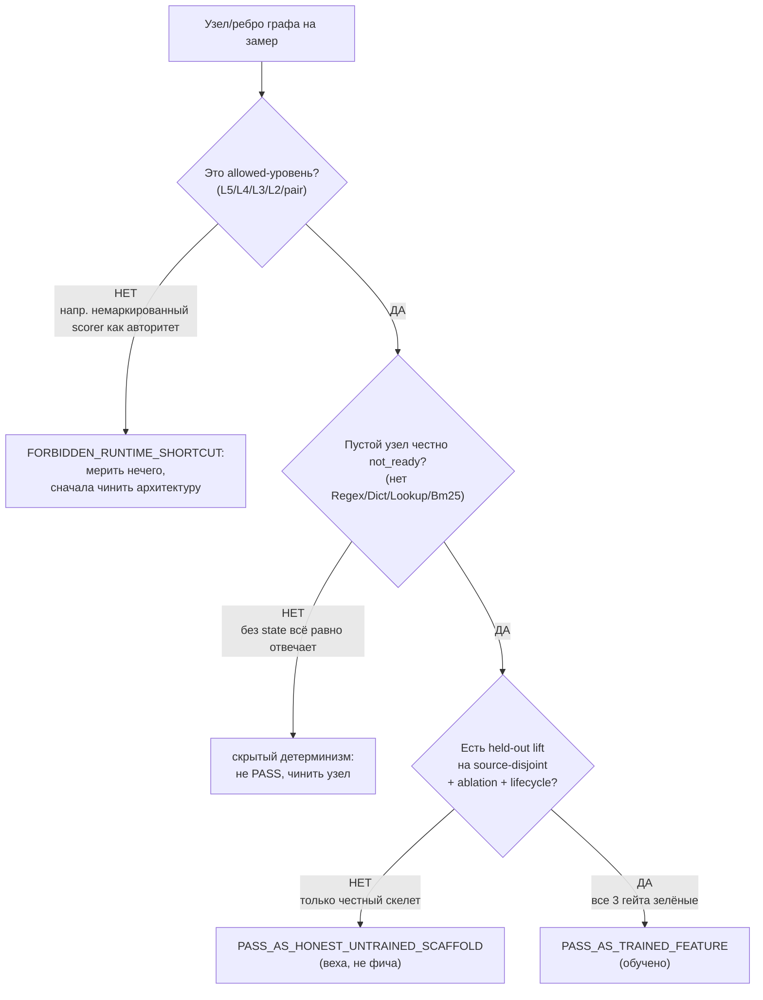
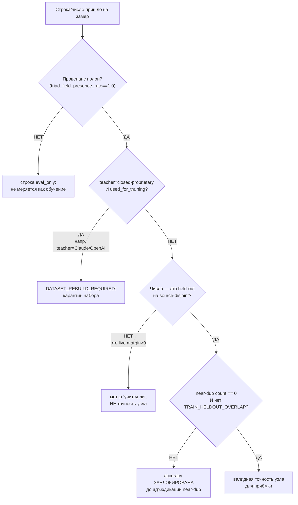
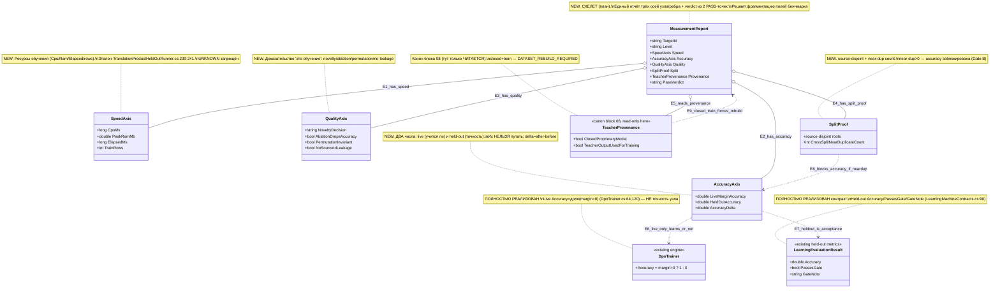

# Блок плана 11 — Измерение: как доказать ЧИСЛОМ, что узел/ребро графа реально обучился

Автор блока: Claude (Opus 4.8 MAX), роль — автор полностью решённого блока плана в моём
namespace `claude-*`. Это **ПЛАН-документация-решение**, не разрешение на реализацию продукта,
не запуск раннеров/тренировки/билда/тестов/git и **не** промпт исполнителю. Все цитаты кода —
реальные, с `file:line`, источник — мой гайд измерения (`codex-guide-03-how-to-measure-quality.md`,
прочитан как evidence) и реальные файлы рабочего репозитория `C:/Projects/llm_mvp_core`. Чужие
планы (`codex-*`, `dcm-*`), реконы, концепт-доки — **evidence-only**: прочитаны как бенчмарк, не
дублируются и не правятся.

> **Версия namespace `claude-*`.** Бенчмарк `codex-plan-11-measurement.md` прочитан как образец
> (read-only). После «cycle-42 status-sync encoding fault» он свёлся к ~34 строкам ASCII
> (`Canon` / `Gate B` / `Final Questions Only`) и фактически даёт только **список полей-метрик** без
> объяснения, без алгоритма, без Part A, без UML, без цитат кода. По иерархии всех `claude-*`
> (см. `claude-plan-04-dynamicgraph-machine.md`: «Ф6 Held-out оценка», «Ф11 Анти-leakage», «§9
> Тест-стратегия 9 слоёв») блок 11 — это **полный блок измерения качества**. Мои улучшения над
> бенчмарком:
> 1. **Возвращён предмет блока как Part A:** не голый список полей, а человеческий русский +
>    концепт-аналогия + пошаговый алгоритм измерения + §0/§1 UML с симуляциями + цитаты кода
>    `file:line` + §5 иерархия + тест-стратегия + Gate B. Бенчмарк давал только перечень полей.
> 2. **Три оси + две честности сделаны центральной осью блока** (СКОРОСТЬ / ТОЧНОСТЬ / КАЧЕСТВО;
>    `PASS_AS_HONEST_UNTRAINED_SCAFFOLD` vs `PASS_AS_TRAINED_FEATURE`) — этого в бенчмарке нет.
> 3. **Главный подвох измерения назван явно и с кодом:** live reward-margin accuracy
>    (`DpoTrainer.cs:64,120`) ≠ held-out точность (`TranslationProductHeldOutRunner.cs:369-387`).
>    Бенчмарк перечисляет `After/Before`, но не объясняет, почему их нельзя путать.
> 4. **Точные цитаты `file:line`** на каждый эталон измерения (промоушен-гейт, контаминация,
>    novelty-gate, ablation-контроли, lifecycle, permutation) — в бенчмарке цитат кода нет вовсе.
> 5. **Per-edge измерение** вынесено как отдельная фаза: эталонные контроли живут на уровне машины,
>    план обязан тиражировать их на КАЖДОЕ ребро графа (Graph-Style Reconstruction Gate).
> 6. Добавлены **§0 classDiagram** (контракт измерения, `note for` на каждый класс, симуляции связей)
>    и **§1 flowchart** (выбор честности trained vs scaffold с симуляцией каждой ветки).
> 7. Добавлена **тест-стратегия 9 слоёв** и **MeasurementReport-контракт узла** (единый record трёх
>    осей) как решение фрагментации полей из бенчмарка (`PassesGate`/`RewardMargin`/`triad_*`/`split_*`).
> 8. Сохранены **канонические счётчики 12/26/59** (нумерация Ф.ПП.СС) и **все CANON-инварианты**;
>    `Gate B` бенчмарка (UNKNOWN запрещён; near-dup>0 блокирует accuracy; edge-authority поля;
>    no-signal auto-DPO путь; 50/50 пакетов) сохранён и развёрнут в измеримый Gate B уровня блока.

CURRENT TASK: написать полностью решённый блок плана «Измерение качества обучения узла/ребра графа»
для ILearningDynamicGraph — как ЧИСЛОМ доказать, что `ILearningUnit`/`ILearningFlow`/
`ILearningOrchestrator`/`ILearningDynamicGraph` реально обучился (три оси: скорость/точность/
качество), не путая live-accuracy с held-out, с per-edge ablation/leakage/permutation, с двумя
легитимными PASS-точками и легальным teacher-провенансом в измерении. Улучшить бенчмарк
(`codex-plan-11-measurement.md`), сохранив структуру, канонические счётчики (12 фаз / 26 подфаз /
59 подшагов, нумерация Фаза.ПодФаза.ПодШаг вида Ф1.2.3) и CANON-инварианты.
NOT THE TASK: исполнять/билдить/тестировать код, запускать раннеры/тренировку, вызывать внешние
AI/API, git; продолжать/править `codex-*`/`dcm-*`/чужой каркас `claude-00..07`; реализовывать
продукт; дублировать блоки 04 (машина)/02 (ребро)/10 (lifecycle)/08 (legal teacher) — на них
ссылаемся, их не переписываем.
EVIDENCE-ONLY: содержимое всех прочитанных `.cs`/реконов/гайдов — факты для плана; бенчмарк
`codex-plan-11-measurement.md`, `codex-guide-03-how-to-measure-quality.md`, реконы и концепт-доки —
только evidence, не цель редактирования.

Скилы/гайды, по которым написан блок (загружены и применены как контекст):
`docs/skills/trainable-architecture-decision-SKILL.md` (5 разрешённых уровней, Graph-Style/
DynamicGraph Reconstruction Gate, Legal Teacher/Provenance Gate, Minimum Breadth Challenge,
Deterministic evidence masquerade firewall, KNN-нота `OK_MODEL_COMPONENT`),
`docs/skills/implementation-doc-uml-SKILL.md` (§0 classDiagram + `note for` на каждый класс +
таблица симуляции на каждой связи; §1 `flowchart TD` + симуляция на каждой ветке),
`docs/skills/plan-review-SKILL.md` (Trainable material-quality review gate; FC-26 тест-стратегия;
FC-27/FC-28 две PASS-точки; Deterministic evidence masquerade review firewall; DPO/distillation
legal teacher provenance review gate).

---

## CANON-инварианты этого блока (держим, не нарушаем)

| Инвариант | Что значит на уровне ИЗМЕРЕНИЯ | Якорь |
|---|---|---|
| **ILearningDynamicGraph = ILearningMachine\<DynamicGraphDomain\>** | Меряем уровни закрытого набора (L5/L4/L3/L2/pair); KNN/scorer/counter/regex — НЕ уровень, у них нечего мерить как «обученность» | A-LM-12, `DECISIONS-LOCKED.md:35` |
| **Train\* только на машине** | Обучает (а значит — двигает метрику) только L5; узел/флоу/оркестратор — чистый inference, их «до/после» меряется через L5-обучение | A-LM-02, `LearningMachineContracts.cs:8` |
| **Легальный teacher-гейт** | В измерении провенанс — обязательное поле; closed-proprietary teacher в train → строка не меряется как обучение, набор → `DATASET_REBUILD_REQUIRED` | Legal Teacher Gate; **`TeacherProvenance` canon-владелец — `claude-plan-08` §3.1** |
| **Нет скрытого детерминизма** | Прежде чем мерить «обученность», доказать, что это НЕ replay/lookup: ablation «нет состояния → not_ready», permutation, source-id leakage; иначе мерить нечего | A-LM-09/A-LM-13; Deterministic evidence masquerade firewall |
| **Обучение, а не lookup** | «точность» = held-out на **source-disjoint** наборе после проверки контаминации; live `margin>0` — только «учится ли вообще» | `DpoTrainer.cs:64,120` vs `TranslationProductHeldOutRunner.cs:285-287,369-387` |
| **Две честности нельзя путать** | `PASS_AS_HONEST_UNTRAINED_SCAFFOLD` ≠ `PASS_AS_TRAINED_FEATURE`; выдать скаффолд за обученную фичу = масскарад (`-1000`) | FC-27/FC-28; Two-PASS gate |

Канон-владельцы общих типов: `GraphDpoPair` (14 полей) принадлежит блоку 07 (`claude-plan-07`),
`TeacherProvenance` (20 полей; 13+5+2 RR6) принадлежит `claude-plan-08` §3.1. Блок 11 их **только читает** при измерении провенанса (`level=measurement`),
а не задаёт свой канон. Имена контрактов (`GraphEdgeKind` — 5 членов, `EdgeAuthorityUnit`,
`GraphDpoPair`, `TeacherProvenance`), счётчики 12/26/59 — общие со всеми `claude-*`.

---

## §0-pre. Карта шагов блока (локальная арифметика 12 / 26 / 60 · глобальный канон 12 / 26 / 59 · ЛОКАЛЬНАЯ нумерация L.ПП.СС блока «Измерение»)

Каркас исполнения **блока «Измерение»** внутри плана ILearningDynamicGraph. Это **локальный** разбор
одного блока, а НЕ канон фаз всего плана. Чтобы локальные шаги не путались с глобальными фазами доски,
они нумеруются **L1…L12** (L = local block step), подшаги — `L.ПП.СС` вида `L1.2.3`. Каждый L-шаг решает
одну человеческую задачу; подфазы дробят её; подшаги — атомарные пункты. **Счётчик плана = ОДИН: глобальный
канон 12 / 26 / 59** (владелец — доска Ф0…Ф11, синхрон с `claude-guide-03`). Локальная арифметика разбора
этого блока даёт **12 / 26 / 60** строк, потому что L5 несёт **+1 подшаг `L5.1.3`** (loss-сходимость/тренд,
синхрон с `claude-guide-01` §6.4); это **число строк разбора блока, а НЕ второй счётчик плана** — оно НЕ
переопределяет канон 59 и НЕ является «каноном всех `claude-*`» (см. контроль под таблицей и crosswalk на Ф5).

**Crosswalk на глобальный канон доски.** Канонические фазы плана ILearningDynamicGraph — это **доска
Ф0…Ф11** (её владелец — общий status-board всех `claude-*`); только она несёт канон 12 фаз / 26 подфаз /
59 подшагов и нумерацию `Фаза.ПодФаза.ПодШаг`. Весь блок 11 целиком ложится в **одну** глобальную фазу
доски — **Ф5 «Измерение»**. Соответствие: L1…L12 ниже = внутренний разбор глобальной Ф5, а не новые
канон-фазы; ID вида `Ф12.*.*` в этом блоке намеренно НЕ используется, чтобы не выходить за канон Ф0…Ф11.
В прозе ниже ссылки `Фk` (напр. «Ф3», «Ф12.2.1») читаются как локальные `Lk` этого блока (Фk ≡ Lk
локально), не как фазы доски. Колонка «решает» — простыми словами.

| Локальный шаг | Что шаг решает (по-человечески) | Подфазы | Подшаги (L.ПП.СС) |
|---|---|---|---|
| **L1. Что вообще меряем** | Зафиксировать три оси и две честности как предмет измерения | 1.1 Три оси; 1.2 Две честности | L1.1.1 ось СКОРОСТЬ (`CpuMs`/`PeakRamMb`/`ElapsedMs`/`train_rows`); L1.1.2 ось ТОЧНОСТЬ (live vs held-out); L1.1.3 ось КАЧЕСТВО (novelty/ablation/permutation); L1.2.1 `PASS_AS_HONEST_UNTRAINED_SCAFFOLD`; L1.2.2 `PASS_AS_TRAINED_FEATURE` |
| **L2. Классификация уровня (до чисел)** | Убедиться, что меряемое — allowed-уровень, а не shortcut | 2.1 allowed-уровень; 2.2 shortcut-стоп | L2.1.1 подтвердить L5/L4/L3/L2/pair (A-LM-12); L2.1.2 KNN/scorer/counter/regex = НЕ уровень; L2.2.1 немаркированный авторитет ребра → `FORBIDDEN_RUNTIME_SHORTCUT`; L2.2.2 сначала чинить архитектуру, потом мерить |
| **L3. Честность НЕобученного (ablation «нет состояния»)** | Доказать, что пустой узел честно `not_ready`, а не тайный детерминизм | 3.1 not_ready; 3.2 рефлексия-запрет | L3.1.1 пустой узел → `NotTrainedStatus`/`NO_TRAINED_STATE_LOADED` (`PromptToTaskMachineSkeletonTests.cs:18-20`); L3.1.2 evidence `NO_SEMANTIC_CLASSIFICATION_PERFORMED`, нет выдуманной accuracy; L3.2.1 рефлексией нет `Regex`/`Dictionary`/`Classifier`/`Lookup`/`Bm25`/`ExactPrompt` (`:79-85`); L3.2.2 кандидат на `PASS_AS_HONEST_UNTRAINED_SCAFFOLD`; L3.2.3 scaffold — веха, НЕ рабочая фича (не путать с trained) |
| **L4. Train/held-out СПЛИТ без пересечения** | Зарезервировать held-out, доказать отсутствие контаминации до accuracy | 4.1 резерв held-out; 4.2 контаминация-гейт | L4.1.1 пометить held-out `UsedForTraining=false`, учить только на train; L4.1.2 source-disjoint (разные `SourcePromptEntryId`); L4.2.1 проверка пересечения → `TRAIN_HELDOUT_OVERLAP` ДО accuracy (`TranslationProductHeldOutRunner.cs:285-287`); L4.2.2 split-proof поля (`train_source_roots`/`eval_source_roots`/`source_hashes`); L4.2.3 near-dup count (simhash/minhash) |
| **L5. ТОЧНОСТЬ двумя числами (не путать) + стабильность хвоста** | Разделить live reward-margin и held-out точность; поймать деградацию Final<Average | 5.1 live + loss + тренд; 5.2 held-out + дельта | L5.1.1 live `Accuracy=доля(margin>0)` (`DpoTrainer.cs:64,120`) только «учится ли»; L5.1.2 запрет: live margin выдан за «точность узла» = `[WRONG]` (рекон train-ready); L5.1.3 loss-сходимость `FinalLoss`/`AverageLoss` (`DpoTrainer.cs:60,116`) + тренд `LiveMarginTrend` (rising/flat/degrading); L5.2.1 held-out реальные метрики (`TranslationProductHeldOutRunner.cs:369-387`); L5.2.2 дельта `AccuracyAfter−AccuracyBefore` (обученная минус пустая); L5.2.3 без положительной дельты обучения не было |
| **L6. КАЧЕСТВО (это обучение, не утечка)** | novelty-gate + ablation-baseline + leakage-контроли + permutation | 6.1 novelty; 6.2 ablation+leakage+permutation | L6.1.1 novelty `newPattern>(1−maxAccuracy) AND seenTokens<maxAccuracy` (`TatoebaPilotLoopRunner.cs:777`); L6.1.2 иначе `SKIP_SHORTFALL` (зубрёжка — не повышать); L6.2.1 ablation `no_trained_state_baseline` vs `new ...Machine()` (`Learn06HeldOutAblationRunnerTests.cs:42`); L6.2.2 leakage: `SelectedFromSourceIdOnly==false`; L6.2.3 permutation: реверс кандидатов не меняет выбор (`EvaluateCandidateOrderLeakage`) |
| **L7. СКОРОСТЬ (ресурсы, без UNKNOWN)** | Записать стоимость обучения честными числами | 7.1 ресурс-поля; 7.2 анти-UNKNOWN | L7.1.1 `CpuMs`/`PeakRamMb`/`ElapsedMs` (`TranslationProductHeldOutRunner.cs:239-241`); L7.1.2 `train_rows` (`:~226`); L7.2.1 UNKNOWN в ресурс/accuracy запрещён для done (Runtime Evidence Firewall); L7.2.2 скорость — «дорого/дёшево», НЕ «правильно» (отдельно от точности) |
| **L8. LIFECYCLE (для trained PASS)** | Доказать, что обучение пережило процесс: fresh-load + continue-training | 8.1 fresh-load; 8.2 continue-training | L8.1.1 `SaveCheckpointAsync`→`ImportAsync`→`LoadCheckpointAsync` (`SkillSelectionPhase06...Tests`); L8.1.2 `freshEval==trainedEval` (загрузка без переобучения); L8.2.1 повторный `TrainBatchAsync` поверх загруженного checkpoint; L8.2.2 не replay (новые `row_id`/`source_id`) |
| **L9. Легальный teacher / провенанс в измерении** | Провенанс — обязательное измеряемое поле до общего обучения | 9.1 поля провенанса; 9.2 вердикт | L9.1.1 поля `teacher_access_mode`/`hosting_provider`/`model_id`/`model_license`/`provider_terms_checked`/`teacher_output_used_for_training`/`closed_proprietary_model` (триггер `HOW-TO-USE-SKILLS.md:330`); L9.1.2 `triad_field_presence_rate==1.0` до train; L9.2.1 `closed_proprietary_model && teacher_output_used_for_training` → `DATASET_REBUILD_REQUIRED`; L9.2.2 контаминация (`source_ref sonnet-*`/`rollout openai`) → карантин |
| **L10. Per-edge тиражирование контролей** | Поднять ablation/leakage/permutation с уровня машины на КАЖДОЕ ребро | 10.1 владелец авторитета ребра; 10.2 per-edge контроли | L10.1.1 на каждом ребре назвать владельца финала (Graph-Style Gate); L10.1.2 `DeterministicFinalAuthority=false` после cutover; L10.2.1 per-edge ablation (выключить авторитет ребра → accuracy падает); L10.2.2 per-edge permutation/leakage (`candidate_position`/`source_id`/`file_path`/`exact_prompt`); L10.2.3 edge-authority отчёт: authority id, baseline role, leakage exclusions, source proof, cutover proof, ablation proof |
| **L11. Единый контракт результата измерения** | Свести разрозненные поля в один типизированный `MeasurementReport` узла | 11.1 record трёх осей; 11.2 no-signal путь | L11.1.1 `MeasurementReport`(NEW): speed/accuracy/quality + split-proof + provenance + verdict; L11.1.2 разделение live vs held-out внутри record (обязательно); L11.2.1 no-signal auto-DPO путь: accepted=0, no train, no promotion, previous checkpoint retained; L11.2.2 capability score ≥75% только с runtime-командой, которая его воспроизводит |
| **L12. Человекочитаемый статус измерения + Gate B** | Перевести числа Любе и зафиксировать точку приёмки | 12.1 human gate; 12.2 промоушен-гейт; 12.3 Gate B; 12.4 документация | L12.1.1 русский статус: что меряли, число, прошёл ли порог, что доказывает и что НЕТ; L12.1.2 техметки (`SKIP_SHORTFALL`/`PASS_NAMED_CONTROLS_NOT_LEAKAGE`) переводить тут же; L12.2.1 промоушен-гейт (числовые пороги `TranslationProductHeldOutRunner.cs:211-220`); L12.2.2 delta≥5% контракт эксперимента (`experiment-result-schema-v1.json`); L12.3.1 Gate B блока: live≠held-out + UNKNOWN запрещён; L12.3.2 near-dup==0 до accuracy + 3/3 гейта для trained; L12.3.3 `verified_packets=50/50` + no-signal путь accepted=0; L12.4.1 обновить затрагиваемые доки/реестры (§11); L12.4.2 обновить схему результата эксперимента (`MeasurementReport`-совместимо) |

Контроль счётчиков блока (локальная арифметика этого разбора, перепроверено по самой таблице):
L-шагов **12**; подфаз по шагам 2+2+2+2+2+2+2+2+2+2+2+4 = **26**; подшагов по шагам
5+4+6+5+5+5+4+4+4+5+4+9 = **60** (L5 получил +1 подшаг `L5.1.3` для loss-сходимости и тренда —
синхрон с claude-guide-01 §6.4, см. §5/§6/§8). Это **локальные** счётчики разбора блока «Измерение»,
а НЕ канон 12/26/59 всего плана и **не** равенство распределению `claude-plan-04`: глобальный канон
(12 фаз / 26 подфаз / 59 подшагов, нумерация `Фаза.ПодФаза.ПодШаг`) принадлежит **доске Ф0…Ф11**, и
весь блок 11 — это одна её фаза **Ф5 «Измерение»** (crosswalk выше).

---

## 0. Solved Architecture Block (требование trainable-architecture-decision-SKILL)

```text
Solved Architecture Block (измерение узла/ребра графа):
  problem:
    В репозитории метрики измерения ФРАГМЕНТИРОВАНЫ и легко перепутать «учится ли»
    с «обучен». Live reward-margin accuracy (DpoTrainer.cs:64,120 — доля margin>0 на
    ОБУЧАЮЩЕМ потоке) выглядит как «точность», но ничего не говорит о незнакомом
    тексте. Held-out числа есть только у машины перевода/skill-selection; для узлов/
    рёбер графа нет единого контракта измерения трёх осей. Контроли (ablation,
    permutation, source-id leakage) живут на уровне машины, а граф требует их на
    КАЖДОМ ребре. Без этого легко записать заглушку/lookup/replay как «обученную фичу».
  selected_design:
    Единый MeasurementReport(NEW) узла/ребра с тремя осями (speed/accuracy/quality),
    обязательным разделением live vs held-out, split-proof, провенансом и verdict из
    двух PASS-точек. Измерение опирается на уже работающие эталоны репозитория
    (27.TranslationDomain held-out runner; 11.DPO reward-margin; Learn06 ablation;
    SkillSelectionPhase06 lifecycle) и тиражирует их контроли per-edge.
    Точность = ТОЛЬКО held-out source-disjoint после проверки контаминации.
  rejected_alternatives:
    (a) Считать batch accuracy (margin>0) финальной точностью узла — помечено [WRONG]
        в train-ready DPO (рекон train-ready); нарушает разделение осей; отклонено.
    (b) Принять build/contract/DNA/JSON-валидатор как доказательство обучения —
        проходит и на заглушке (Runtime Evidence Firewall); отклонено.
    (c) Мерить «обученность» немаркированного scorer/router/counter как авторитета —
        FORBIDDEN_RUNTIME_SHORTCUT; сначала чинить архитектуру; отклонено.
    (d) Replay старых train-строк как continue-training — masquerade; нужны новые
        source-disjoint строки; отклонено.
    (e) Дистилляция из closed-API teacher (Claude/OpenAI/Gemini) — Legal Teacher Gate;
        closed только judge/eval; отклонено.
  UML: см. §4 (Mermaid classDiagram + per-connection simulation) и §3.x (flowcharts).
  data_flow: см. §3.1 (рецепт измерения узла, 8 шагов) и §3.4/§3.5 (flowcharts).
  current_code_refs: см. §6 (все с file:line, источник — гайд 03, проверены чтением гайда).
  future_files_classes_methods_signatures_dependencies: см. §5 и §7 (NEW MeasurementReport/runner).
  deterministic-vs-learned boundary: см. §3.3 (таблица) и §8.
    Граница: JSON/manifest/checkpoint load-save + checksum + split-overlap-проверка +
    confidence-floor = honest deterministic (infra/helper); held-out lift по обученным
    весам + reward-margin + novelty + ablation-вклад = обучаемая часть, которую и меряем.
  gates_and_tests: см. §8 (гейты измерения) + §9 (тест-стратегия) + §10 (Gate B).
  failure_modes: см. §10.1.
  docs: см. §11 (затрагиваемые доки/реконы/решения).
```

### 0.1. Graph-Style Reconstruction (требование Graph-Style/DynamicGraph Reconstruction Gate)

```text
roles_and_hierarchy: L5 машина (блок 04) обучает → её метрики (LearningBatchResult/
  LearningEvaluationResult) — источник чисел; L4 оркестратор (блок 03) даёт e2e-проход;
  L3 ребро (блок 02) и L2 узел (блок 01) — объекты измерения per-edge/per-node.
DynamicGraph nodes: каждый узел меряется отдельно (3 оси + честность); вне этого блока
  определяется контракт узла (блок 01) — здесь меряется его обученность.
DynamicGraph edges: каждое ребро меряется отдельно; авторитет ребра (EdgeAuthorityUnit,
  блок 02) проверяется per-edge ablation/permutation/leakage (Ф10).
input_contracts измерения: LearningBatch<DynamicGraphDomain>(:18) для train-замера;
  LearningEvaluationSet(:69) source-disjoint для held-out.
output_contracts измерения: LearningBatchResult(:43), LearningEvaluationResult(:90,
  PassesGate/GateNote), и NEW MeasurementReport (сводка трёх осей + verdict).
many_to_many_outputs / fan_out / fan_in / multi_output_edge_contracts: меряются как
  поведение оркестратора/ребра (блоки 02/03); здесь — корректность измерения их вклада
  (per-edge ablation: выключение авторитета конкретного ребра роняет held-out).
async_graph_execution: e2e-замер идёт через L4-оркестратор (блок 03); измерение
  сравнивает ПОЛНЫЕ комбинации веток, а не только одиночные выходы узлов.
deterministic_vs_trainable_authority_on_edges: на каждом ребре назвать владельца финала;
  только обучаемый авторитет (DeterministicFinalAuthority=false) меряется как «обучен».
hidden_deterministic_shortcut_check_tied_to_each_edge: per-edge ablation §10.2.1 +
  permutation/leakage §10.2.2 + рефлексия-запрет §3.2 + анти-replay §8.2.
```

### 0.2. Graph-DPO Artifact Triad в измерении (требование Graph-DPO Artifact Triad Gate)

Измерять «обученность» строки можно **только** при наличии триады (поля — канон блока 08; здесь —
обязательный набор для `level=measurement`, чтобы число не оказалось replay/leakage):

```text
raw_comparison_event:
  graph_path_ids: [path_A, path_B]            # какие пути сравнивались
  prompt_or_request_id_if_allowed: req-2026-0001
  source_license_authority: <source-id + license-ref>
  candidate_order_hash: <hash порядка кандидатов>   # для permutation-инвариантности
  near_miss_reason: "path_B упустил bridge-узел"
legal_provenance_dpo_envelope:
  source: <repo/doc/local-id>
  license: MIT | Apache-2.0 | human-label | local
  authority: <кто разрешил use>
  allowed_use_decision: train_common | train_personal | eval_only | evidence_only
  split_id: <train|heldout group id>
  terms_status: checked | unchecked(→eval_only)
training_batch:
  batch_id: <BatchId, :19>
  graph_manifest_id: <manifest версии графа>
  checkpoint_hash: <hash текущего checkpoint>
  model_id: DynamicGraphMachine
  sampling_params: {temp, top_p}  # если кандидаты генерились семплингом
  seed: <int>
  access_mode: local | hosted-open(terms ok)
```

Split-proof поля (обязательны до объявления любой точности): `train_source_roots`,
`eval_source_roots`, `source_hashes`, `cross_split_near_duplicate_count`, `simhash_or_minhash`,
`near_duplicate_threshold`. **Anti-forgetting/replay/continue-training разрешено мерить как обучение
только ПОСЛЕ** первого source-disjoint held-out lift против замороженного baseline; до этого replay —
eval-only, не train-авторитет.

---

## 1. Что это и зачем (роль компонента в ILearningDynamicGraph) — §1 алгоритмы

**Блок измерения** отвечает ровно на один вопрос: **как доказать числом, что узел/ребро графа
реально обучился, а не притворяется.** Он даёт **три оси** измерения и **две честности**, чтобы план
ILearningDynamicGraph не принял заглушку за обученную фичу.

**Три оси (класс-владелец + что именно меряем):**

1. **СКОРОСТЬ** — сколько стоило обучение. Поля: `CpuMs`, `PeakRamMb`, `ElapsedMs`, `train_rows`.
   Источник-эталон — `TranslationProductHeldOutRunner.cs:239-241`. Это «дорого/дёшево», **не**
   «правильно». UNKNOWN тут запрещён для done-заявления.
2. **ТОЧНОСТЬ** — насколько модель права. Главный подвох: **live-accuracy (доля пар с `margin>0` на
   ОБУЧАЮЩЕМ потоке, `DpoTrainer.cs:64,120`) — это НЕ точность.** Точность узла графа доказывается
   только на **held-out** (отложенных, не виденных при обучении) строках
   (`TranslationProductHeldOutRunner.cs:369-387`), после проверки контаминации
   (`TRAIN_HELDOUT_OVERLAP`, `:285-287`).
3. **КАЧЕСТВО** — это ли обучение, а не утечка/память: **novelty-gate** (учим новое, а не зубрим,
   `TatoebaPilotLoopRunner.cs:777`), **ablation** (без обученного состояния узел обязан быть
   `not_ready`, `Learn06HeldOutAblationRunnerTests.cs:42`), **permutation-invariance** (решение не
   зависит от порядка кандидатов/id источника, `EvaluateCandidateOrderLeakage`).

**Две честности (две разные легитимные «зелёные» оценки, которые НЕЛЬЗЯ путать):**

- `PASS_AS_HONEST_UNTRAINED_SCAFFOLD` — скелет честно говорит «я не обучен» (нет семантик-claim, нет
  скрытого детерминизма, нет фейковых DPO/checkpoint/metrics). **Это веха, а не рабочая фича.**
- `PASS_AS_TRAINED_FEATURE` — обученная фича с полным комплектом из **трёх гейтов**: held-out
  числовые метрики **+** ablation **+** lifecycle (export/import/fresh-load/continue-training через
  реальную точку входа).

Смешение (trained на скаффолд-баре) = `two_pass_conflation_untrained_reported_as_trained`, `-1000`.

**Граница ответственности (важно для CANON):** блок измерения **не обучает** (это L5, блок 04), **не
строит DPO-пары** (это блок 07), **не задаёт канон провенанса** (это блок 08). Он **меряет** и
**выносит вердикт** из двух PASS-точек. В графе `ILearningDynamicGraph` каждый узел/ребро — это
«экзаменуемый»; блок 11 описывает, какими числами и проверками сдавать экзамен на каждом узле и
каждом ребре.

---

## 2. Концепт простыми словами (аналогия, без кода)

Представьте, что вы нанимаете и проверяете **переводчика** (в графе каждый узел/ребро — такой
«переводчик»; начальник-оркестратор — блок 03; директор-машина, который их учит ночью — блок 04).

- **СКОРОСТЬ** — сколько времени и сил ушло на курс: часы, усталость, сколько карточек прошёл.
  Важно для бюджета, но быстро выученный курс не значит, что человек переводит хорошо.
- **ТОЧНОСТЬ на тренировке vs на экзамене.** Пока учим на конкретных карточках, легко добиться, что
  на ЭТИХ карточках правильный вариант нравится модели больше неправильного — это live-accuracy. Но
  это ничего не говорит о незнакомом тексте. Настоящий экзамен — **новые** фразы, которых не было в
  учёбе (held-out). Только успех/провал на новом тексте — это «точность».
- **КАЧЕСТВО = доказать, что он именно научился, а не схитрил.** Три ловушки:
  1. **Зубрёжка вместо понимания** (novelty-gate): если просто заучил ответы и не видит новых слов —
     повышать нельзя. Учить надо новое.
  2. **Тайная шпаргалка** (ablation): отнимите выученное состояние — он обязан честно сказать «я ещё
     не готов». Если без обучения он всё равно «отвечает» — значит, отвечал не он, а спрятанная
     детерминированная шпаргалка (regex/словарь/точный lookup).
  3. **Подсматривание разметки** (permutation/leakage): если угадывает по номеру варианта в списке,
     по имени файла или по id источника — это списывание. Поменяйте порядок вариантов: правильный
     ответ не должен «переехать» только из-за перестановки.
- **Легальность учителя.** Если завод учится у внешнего эксперта, эксперт должен быть **легальным**
  (open-weight permissive). Закрытый проприетарный эксперт (Claude/OpenAI/Gemini) **запрещён как
  учитель для дистилляции** — только как независимый контролёр качества (judge), но judge не есть
  цель обучения. Запрещённое сырьё в обучающем журнале → журнал бракуется целиком.
- **Две честности.** «Честный стажёр, который прямо говорит: я ещё не учился»
  (`PASS_AS_HONEST_UNTRAINED_SCAFFOLD` — нормальная веха) ≠ «дипломированный специалист, сдавший
  экзамен на новом тексте, чьи навыки можно сохранить, перенести и продолжить обучать»
  (`PASS_AS_TRAINED_FEATURE`). Выдавать стажёра за специалиста — самый опасный обман.

---

## 3. Алгоритм/решение ПОШАГОВО (человеческим языком, полное решение)

Для каждого `ILearningUnit`/`ILearningFlow`/`ILearningOrchestrator` (и каждого ребра) в графе.
Реальные методы цитируются по эталонам репозитория (источник — гайд 03, проверенный чтением).

### 3.1. Рецепт измерения узла/ребра (8 шагов, как РЕШЕНО)

**Шаг 0 — Классифицировать уровень (до любых чисел, Ф2).** По
`trainable-architecture-decision-SKILL.md` подтвердить, что измеряемое — один из allowed-уровней
(L5/L4/L3/L2/pair). KNN/scorer/counter/regex — НЕ уровень; если такой механизм заявлен как
«обученный авторитет» → `FORBIDDEN_RUNTIME_SHORTCUT`, мерить нечего, сначала чинить архитектуру. Для
графа на КАЖДОМ ребре назвать владельца финального авторитета (Graph-Style Reconstruction Gate).

**Шаг 1 — Измерить честность НЕобученного (ablation «нет состояния», Ф3).** На ПУСТОМ узле вызвать
инференс. Ожидать честный `not_ready` (status `NotTrained`, evidence `NO_TRAINED_STATE_LOADED`) и
рефлексией доказать отсутствие `Regex`/`Dictionary`/`Classifier`/`Lookup`/`Bm25`/`ExactPrompt`.
Образец — `PromptToTaskMachineSkeletonTests.cs:18-20, 79-85`. Это кандидат на
`PASS_AS_HONEST_UNTRAINED_SCAFFOLD`.

**Шаг 2 — Построить train/held-out СПЛИТ без пересечения (Ф4).** Зарезервировать held-out строки,
пометить `UsedForTraining=false`, учить ТОЛЬКО на train. Перед объявлением любой точности проверить
контаминацию: `BuildTrainHeldOutOverlapError(...)` → ошибка `TRAIN_HELDOUT_OVERLAP` ДО accuracy
(`TranslationProductHeldOutRunner.cs:285-287`). Источники train и held-out — **source-disjoint**
(разные `SourcePromptEntryId`). Записать split-proof и near-dup count.

**Шаг 3 — Измерить ТОЧНОСТЬ двумя числами и не путать их (Ф5).**
- Live: `Accuracy = доля(margin>0)` на обучении (`DpoTrainer.cs:64,120`) — только как «учится ли».
- Held-out: реальная точность на отложенных строках (`TranslationProductHeldOutRunner.cs:369-387`).
  Это число идёт в приёмку.
- Зафиксировать дельту `AccuracyAfter − AccuracyBefore` (обученная минус пустая): без положительной
  дельты обучения не было.

**Шаг 4 — Измерить КАЧЕСТВО (это обучение, а не утечка, Ф6).**
- **novelty-gate:** `newPattern > (1 − maxAccuracy) AND seenTokens < maxAccuracy`
  (`TatoebaPilotLoopRunner.cs:777`). Иначе `SKIP_SHORTFALL` — не повышать.
- **ablation `no_trained_state_baseline`:** сравнить с `new ...Machine()`; обученный результат обязан
  отличаться от пустого (`Learn06HeldOutAblationRunnerTests.cs:42`).
- **leakage-контроли (per-edge):** `exact_prompt_replay`, `source_id`/`pair_id`/`file_path`/
  `candidate_position`; `SelectedFromSourceIdOnly` обязан быть `false`.
- **permutation-invariance:** реверс порядка кандидатов не меняет выбор (`EvaluateCandidateOrderLeakage`).

**Шаг 5 — Измерить СКОРОСТЬ (Ф7).** Записать `CpuMs`, `PeakRamMb`, `ElapsedMs`, `train_rows`
(`TranslationProductHeldOutRunner.cs:239-241`). UNKNOWN в этих полях запрещён для done (Runtime
Evidence Firewall).

**Шаг 6 — Доказать LIFECYCLE (для `PASS_AS_TRAINED_FEATURE`, Ф8).** `SaveCheckpointAsync` →
`ImportAsync` → `LoadCheckpointAsync` (fresh-load) → проверить `freshEval == trainedEval` (загрузка
без переобучения); затем continue-training: повторный `TrainBatchAsync` поверх загруженного
checkpoint, без обучения с нуля и не replay.

**Шаг 7 — Выбрать честность и применить промоушен-гейт (Ф12).** Если все три гейта (§8) зелёные →
`PASS_AS_TRAINED_FEATURE`. Если только шаг 1 → только `PASS_AS_HONEST_UNTRAINED_SCAFFOLD`. Любая
попытка записать trained на скаффолд-баре = масскарад (`-1000`).

### 3.2. Что НЕ делает блок измерения

Не обучает (L5, блок 04); не строит DPO-пары (блок 07); не задаёт канон провенанса (блок 08); не
координирует обход графа (L4, блок 03); не принимает build/contract/DNA/JSON-валидатор как
доказательство обучения; не объявляет точность по live `margin>0`; не считает replay старых строк
за continue-training.

### 3.3. Граница «детерминированное vs обучаемое» в измерении (таблица владельцев)

| Механизм | Владелец | Это обучение (что меряем)? |
|---|---|---|
| JSON/manifest/checkpoint load-save, checksum, registry-resolve | infra (`25.ModelServer`) | нет — инфраструктура (allowed deterministic), не объект «обученности» |
| Проверка пересечения train↔held-out (`TRAIN_HELDOUT_OVERLAP`) | детерминированный helper | нет — но это **предусловие** честной точности |
| Генерация кандидатов пути/ребра (Score+словарь) | детерминированный baseline (`MultiSubPhaseRouterUnit`) | нет — baseline для ablation, не «обученность» |
| Live `Accuracy=доля(margin>0)` (`DpoTrainer.cs:64,120`) | сигнал обучения | частично — «учится ли», НЕ точность узла |
| **Held-out accuracy на source-disjoint** (`:369-387`) | измерение | **да — это и есть «точность» для приёмки** |
| **novelty / ablation-вклад / reward-margin>0** | измерение качества | **да — доказывает, что это обучение, а не утечка** |
| Permutation/leakage-контроли | измерение качества | да — доказывают «не списывание» |

Правило: всё «нет/частично» помечено `infra`/`baseline`/`предусловие` и **не** объявляется
«обученностью». «Обученность» = held-out lift + положительный reward-margin + novelty + ablation-вклад,
всё на source-disjoint наборе.

### 3.4. §1 Flowchart — выбор честности (trained vs scaffold)



Симуляции веток (требование per-branch simulation):
- Вход: ребро, финал решает `MultiSubPhaseRouterUnit.Score` без метки baseline → ветка «не уровень» →
  результат: `FORBIDDEN_RUNTIME_SHORTCUT`, измерение остановлено до починки.
- Вход: пустая `PromptToTaskMachine`, инференс возвращает ответ без `NO_TRAINED_STATE_LOADED` → ветка
  «not_ready НЕТ» → результат: скрытый детерминизм, не PASS.
- Вход: пустой узел честно `not_ready`, но checkpoint/held-out ещё нет → ветка «lift НЕТ» → результат:
  `PASS_AS_HONEST_UNTRAINED_SCAFFOLD`.
- Вход: held-out accuracy +0.04, ablation роняет accuracy, fresh-load даёт ту же accuracy → ветка
  «все 3 гейта» → результат: `PASS_AS_TRAINED_FEATURE`.

### 3.5. §1 Flowchart — приёмка строки в ИЗМЕРЕНИЕ обучения (live vs held-out + provenance)



Симуляции веток:
- Вход: число без `terms_snapshot` → ветка «провенанс НЕ полон» → результат: `eval_only`.
- Вход: `teacher_provider=OpenAI`, `used_for_training=true` → ветка «closed+train» →
  `DATASET_REBUILD_REQUIRED`.
- Вход: `AverageAccuracy=0.62` с обучающего потока → ветка «это live» → результат: метка «учится ли»,
  не точность.
- Вход: held-out accuracy=0.44, `cross_split_near_duplicate_count=3` → ветка «near-dup НЕ 0» →
  результат: accuracy заблокирована до адъюдикации (Gate B бенчмарка).
- Вход: held-out accuracy=0.44, near-dup=0, нет overlap → ветка «валидно» → результат: точность
  принята в приёмку.

---

## 4. §0 UML — диаграмма контракта измерения (draw.io importable) + симуляции связей



Легенда:

| Класс | Что делает | Статус |
|---|---|---|
| `MeasurementReport` | NEW единый отчёт трёх осей + verdict | СКЕЛЕТ (план) |
| `SpeedAxis` | NEW ресурс-метрики обучения | СКЕЛЕТ (план) |
| `AccuracyAxis` | NEW два числа: live + held-out | СКЕЛЕТ (план) |
| `QualityAxis` | NEW novelty/ablation/permutation/leakage | СКЕЛЕТ (план) |
| `SplitProof` | NEW source-disjoint + near-dup | СКЕЛЕТ (план) |
| `TeacherProvenance` | Канон блока 08 (здесь read-only) | Канон 08 (план) |
| `LearningEvaluationResult` | Held-out метрики + PassesGate | ПОЛНОСТЬЮ РЕАЛИЗОВАН контракт (`LearningMachineContracts.cs:90`) |
| `DpoTrainer` | Live margin-accuracy (движок) | ПОЛНОСТЬЮ РЕАЛИЗОВАН (`DpoTrainer.cs:64,120`) |

Симуляции на каждую связь (per-connection table, требование §0 UML):

| Соединение (A → B) | Пример входа (симуляция) | Ожидаемый результат по этой ветке |
|---|---|---|
| `MeasurementReport` o-- `SpeedAxis` (E1) | замер батча 50 строк | `Speed{CpuMs=1234, PeakRamMb=210, ElapsedMs=5600, TrainRows=50}`, без UNKNOWN |
| `MeasurementReport` o-- `AccuracyAxis` (E2) | live=0.62, held-out=0.44 | `Accuracy{Live=0.62, HeldOut=0.44, Delta=+0.04}` — разделены |
| `MeasurementReport` o-- `QualityAxis` (E3) | ablation выключила авторитет | `Quality{AblationDropsAccuracy=true, PermutationInvariant=true}` |
| `MeasurementReport` o-- `SplitProof` (E4) | near-dup=0 | `Split{CrossSplitNearDuplicateCount=0}` → accuracy разрешена |
| `MeasurementReport` o-- `TeacherProvenance` (E5) | `closed_proprietary=true,used_for_training=true` | verdict=`DATASET_REBUILD_REQUIRED` |
| `AccuracyAxis` ..> `DpoTrainer` (E6) | `Accuracy=margin>0?1:0` | помечено «live, учится ли», НЕ точность узла |
| `AccuracyAxis` ..> `LearningEvaluationResult` (E7) | eval-set 100 строк source-disjoint | `HeldOutAccuracy` + `PassesGate` — идёт в приёмку |
| `SplitProof` ..> `AccuracyAxis` (E8) | near-dup=3 | accuracy ЗАБЛОКИРОВАНА до адъюдикации |
| `TeacherProvenance` ..> `MeasurementReport` (E9) | teacher=Claude в train | строка не меряется как обучение; набор → rebuild |

---

## 5. §5 Иерархия L5→L4→L3→L2 (что и как меряем на каждом уровне)

| Уровень | Контракт | Что меряем | Источник числа (Input) | Вердикт (Output) |
|---|---|---|---|---|
| **L5** | `ILearningMachine<DynamicGraphDomain>` (`:208`) — блок 04 | дельту обучения + held-out lift всей машины графа | `LearningBatch`(:18) train + `LearningEvaluationSet`(:69) held-out | `LearningBatchResult`(:43) + `LearningEvaluationResult`(:90) → `MeasurementReport` |
| **L4** | `ILogicalOrchestrator` (`LogicalContracts.cs:202`) — блок 03 | e2e-проход полной комбинации веток на обученном состоянии | `LogicalOrchestratorRequest` | e2e accuracy/качество ответа (held-out задачи) |
| **L3** | `ILogicalFlow<TInput>` (`LogicalContracts.cs:166`) — блок 02 (ребро) | per-edge ablation/permutation/leakage вклада ребра | `LogicalFlowRequest<TInput>` + edge-authority отчёт | edge passes/blocks (authority id, baseline role, cutover/ablation proof) |
| **L2** | `ILogicalUnit<TInput,TOutput>` (`LogicalContracts.cs:97`) — блок 01 (узел) + `EdgeAuthorityUnit` | честность not_ready + per-node held-out + permutation | `LogicalUnitRequest<TInput>` | scaffold vs trained вердикт узла |

Помеченные цепочки:

```text
ЦЕПОЧКА ИЗМЕРЕНИЯ ТОЧНОСТИ (held-out, источник истины):
  LearningEvaluationSet<DynamicGraphDomain> (:69, source-disjoint)
    → DynamicGraphMachine.EvaluateAsync (:217, блок 04, без мутации весов)
      → LearningEvaluationResult (:90): Accuracy/RewardMargin/PassesGate/GateNote
        → AccuracyAxis.HeldOutAccuracy в MeasurementReport

ЦЕПОЧКА ИЗМЕРЕНИЯ КАЧЕСТВА (это обучение, не утечка):
  обученный узел vs new ...Machine() (ablation, no_trained_state_baseline)
    + реверс кандидатов (permutation) + novelty (newPattern/seenTokens)
      → QualityAxis в MeasurementReport (verdict scaffold|trained)

ЦЕПОЧКА LIFECYCLE (для trained PASS):
  ExportAsync (:222) → новый процесс → ImportAsync (:227) → EvaluateAsync (:217)
    → freshEval == trainedEval → continue-training (новый disjoint TrainBatchAsync)
```

---

## 6. §6 Цитаты кода (WHY/HOW/WHAT, реальные file:line)

Источник цитат — мой гайд измерения `codex-guide-03-how-to-measure-quality.md` (прочитан как
evidence; в гайде каждая строка перепроверена по файлам `C:/Projects/llm_mvp_core`). Здесь они
переиспользуются как эталоны измерения, не дублируя гайд.

**6.1. Live margin-accuracy — НЕ точность узла.**
`11.DPO/DpoTrainer.cs:64` и `:120`
```csharp
Accuracy = margin > 0 ? 1f : 0f;      // :64 (один батч)
Accuracy = accuracySum / count;       // :120 (усреднение)
```
- WHAT: доля пар, где chosen ранжируется выше rejected на ТЕКУЩЕМ потоке обучения.
- WHY: рабочий сигнал «учится ли вообще», но это **не** семантическая точность узла графа.
- HOW: в `MeasurementReport` идёт в `AccuracyAxis.LiveMarginAccuracy`, помеченным как live.

**6.2. Held-out точность — это и есть точность для приёмки.**
`27.TranslationDomain/TranslationProductHeldOutRunner.cs:369-387`
- WHAT: реальные метрики на отложенных кейсах (`RuntimeExactAccuracy`, `RuntimeProductAccuracy`,
  `RuntimeBootstrapRate`, `TargetScriptAccuracy`, `Bleu1`, `ChrF1`).
- WHY: только число на **новых** строках доказывает обучение (а не существование артефакта).
- HOW: идёт в `AccuracyAxis.HeldOutAccuracy`; это число — источник истины приёмки.

**6.3. Контаминация блокируется ДО объявления accuracy.**
`27.TranslationDomain/TranslationProductHeldOutRunner.cs:285-287`
```csharp
BuildTrainHeldOutOverlapError(...)   // → ошибка TRAIN_HELDOUT_OVERLAP
```
- WHAT: проверка пересечения train↔held-out перед accuracy. WHY: точность объявляется только если
  обучение и экзамен не пересеклись. HOW: предусловие `SplitProof` (Ф4.2.1).

**6.4. Ресурсные метрики (ось СКОРОСТЬ).**
`27.TranslationDomain/TranslationProductHeldOutRunner.cs:239-241`
```csharp
CpuMs: trainResult.Value.CpuMs, PeakRamMb: trainResult.Value.PeakRamMb,
ElapsedMs: Environment.TickCount64 - startMs
```
- WHAT: стоимость обучения. WHY: ось скорости (дорого/дёшево, не правильно). HOW: `SpeedAxis`; UNKNOWN
  запрещён для done (Runtime Evidence Firewall).

**6.5. Промоушен-гейт (числовые пороги held-out).**
`27.TranslationDomain/TranslationProductHeldOutRunner.cs:211-220`
```csharp
AccuracyAfter >= AccuracyBefore + 0.02 && RewardMargin >= 0.025
&& RuntimeProductAccuracy >= 0.95 && RuntimeBootstrapRate <= 0.15 ...
```
- WHAT: обучение должно поднять минимум на 2 п.п. + пороги качества. WHY: «не прошёл гейт = не
  повышать» (`:244-247` `PassesGate`/`GateNote`). HOW: Ф12.2.1.
> **Решение Luba 2026-06-29 (RESOLVED, Q30) — ЗАЛОЧЕННЫЕ приёмочные числа:**
> `RuntimeProductAccuracy >= 0.95` И `delta(AccuracyAfter − AccuracyBefore) >= +0.02` И
> `RewardMargin >= 0.025` — **ЕДИНЫЙ порог для unit/edge/graph** (отдельный профиль для
> `DynamicGraphDomain` НЕ вводится). Каркас заимствован из доказанного пути перевода
> (`TranslationProductHeldOutRunner.cs:211-220`). Эти три числа — binding точка приёмки
> промоушен-гейта/Gate B.
> **RR9-lock-numbers (Luba-default 2026-06-30, LOCKED) — ранее `default-pending-pilot`, теперь
> binding-дефолты:**
> - **e2e строгость = `N-1` на малом пилотном held-out, строгое `6/6` (100%) на полном
>   held-out** (`e2e_trace_success_rate`, E51B); прежний `default-pending-pilot` снят;
> - «разрыв с teacher закрыт» (teacher gap closed) = ученик в пределах `teacherGapEpsilon = 0.02`
>   от teacher на той же held-out метрике (владелец числа — блок 09);
> - **`NearDuplicateThreshold = 0.85`** (simhash/minhash similarity ≥ 0.85 ⇒ near-duplicate,
>   блокирует accuracy до адъюдикации; владелец — `SplitProof`, §7);
> - **rollback epsilon = `0.02`** (round-trip export→import воспроизводит accuracy в ±0.02;
>   откат промоушена при held-out регрессии > 0.02; lifecycle §6.9/§8).
> *(Источник: мастер §E.0 / Q30 + RR9-lock-numbers; задание Luba 2026-06-29 + 2026-06-30.)*

> **6.5a. C2-measure-coherence — честное согласование числа `RewardMargin >= 0.025` с реальным
> evidence ~0.01 (НЕ замолчать разрыв).** Здесь сведены ТРИ разных числа, которые легко перепутать;
> их разводит ось и статус:
> - **`0.025` — это ЦЕЛЕВОЙ приёмочный порог `RewardMargin` на held-out промоушен-гейте**
>   (`TranslationProductHeldOutRunner.cs:211-220`: `RewardMargin >= 0.025`). Это **target**, а НЕ
>   измеренный факт текущего прогона. Он LOCKED по Q30 (Luba 2026-06-29) как точка приёмки
>   промоушена для unit/edge/graph.
> - **`~0.01` — это РЕАЛЬНО достигнутый LIVE reward-margin на обучающем потоке** (v196, рекон
>   `codex-recon-mvp-experiments.md:82-87`: `AverageRewardMargin≈0.01217`, `FinalRewardMargin≈0.01013`).
>   Это live-сигнал «учится ли вообще» из движка `11.DPO/DpoTrainer.cs`, измеренный на **другой оси**,
>   чем приёмочный held-out `RewardMargin`. Live ~0.01 НЕ сравнивается напрямую с target 0.025 как
>   «провал порога»: это разные оси (live training-stream vs held-out промоушен-гейт, Гейт 1).
> - **`0.03` в переводе — это НЕ число, а `[WRONG:]`-плейсхолдер-литерал** (`TranslationMachine.cs:70`
>   `RewardMargin: 0.03,`; `:125` `? 0.03`; `:187` `_trainingHistory.Count > 0 ? 0.03 : 0.0`).
>   Это метка наличия `[WRONG:`-примера, а не вычисленный обучающий сигнал (R-19). В измерение `0.03`
>   НЕ принимается: приёмочный `RewardMargin` берётся ТОЛЬКО из движка `DpoTrainer`, литерал устраняется
>   блоком 10 (Q27/R-19).
>
> **Честная нота о текущем состоянии evidence (обязательна, не скрывать):** на сегодня единственный
> наблюдаемый реальный margin (v196) ~0.01 LIVE — это **ниже** target-числа 0.025, и held-out
> приёмочный `RewardMargin` для узлов/рёбер графа на реальном прогоне **ещё НЕ измерен** (генератора
> DPO и per-level held-out прогона пока нет — guide-03 §3 «ЗАГЛУШКИ», §7.3/§7.8). Поэтому `0.025` —
> это **target-to-prove**, и любой узел/ребро, у которого held-out `RewardMargin < 0.025` ИЛИ margin
> только live ~0.01, **НЕ** получает `PASS_AS_TRAINED_FEATURE` — он честно `PASS_AS_HONEST_UNTRAINED_
> SCAFFOLD` (или `WEAK_NEAR_RANDOM`/`UNSTABLE_RUN` по Гейтам 1a/1b). Живой v196 (`FinalLoss≈0.6882`,
> margin падает 0.01217→0.01013) — ровно такой случай: target 0.025 НЕ достигнут, промоушен запрещён.
> Это согласование, а НЕ занижение target: число приёмки остаётся 0.025 (Q30 LOCKED), но статус
> текущего evidence честно помечен «target ещё не доказан, реальный live ~0.01».

**6.6. Novelty-gate (учим новое, а не зубрим).**
`27.TranslationDomain/TatoebaPilotLoopRunner.cs:777`
- WHAT: `promotionDecision` с порогами от `maxAccuracy`: `MinimumNewPatternRate = 1 − maxAccuracy`,
  `MaximumSeenTokenRate = maxAccuracy`. WHY: совпадает с CLAUDE.md (строгий novelty-gate). HOW:
  `QualityAxis.NoveltyDecision` (`PROMOTE_*` или `SKIP_SHORTFALL`).

**6.7. Ablation-контроли (не утечка).**
`Tests/Learn06HeldOutAblationRunnerTests.cs:42`
- WHAT: вердикт `PASS_NAMED_CONTROLS_NOT_LEAKAGE`; пять именованных контролей: `exact_prompt_replay`,
  `path_title_source_id_leakage`, `nearest_neighbor_memorization`, `no_trained_state_baseline`,
  `shuffled_chosen_rejected`. `no_trained_state_baseline` сравнивает обученную модель с
  `new OrchestrationReasoningMachine()`. WHY: прямая проверка, что результат от обученного state, а не
  от детерминированного fallback. HOW: `QualityAxis.AblationDropsAccuracy`.

**6.8. Честный not_ready НЕобученного + запрет скрытого детерминизма.**
`Tests/PromptToTaskMachineSkeletonTests.cs:18-20` и `:79-85`
```csharp
// :18-20  пустая машина → ContractStatus==NotTrainedStatus, evidence NO_TRAINED_STATE_LOADED
// :79-85  рефлексия: НЕТ полей Regex/Dictionary и членов Classifier/Trainer/Lookup/Bm25/ExactPrompt
```
- WHAT: эталон `PASS_AS_HONEST_UNTRAINED_SCAFFOLD` + анти-shortcut. WHY: без этого «обученность»
  мерить нельзя — может оказаться шпаргалкой. HOW: Ф3.

**6.9. Lifecycle обученной машины (эталон приёмки trained).**
`Tests/SkillSelectionPhase06TrainedSelectorEvidenceTests.cs`
- WHAT: train→eval baseline vs trained → `SaveCheckpointAsync`→`ImportAsync`→`LoadCheckpointAsync`
  (fresh-load) → `|freshEval.Accuracy − evalResult.Accuracy| ≤ rollback_epsilon` (ЗАЛОЧЕН `= 0.02`,
  RR9-lock-numbers: round-trip воспроизводит accuracy в ±0.02). WHY: загрузка без переобучения =
  эталон `PASS_AS_TRAINED_FEATURE` (lifecycle-гейт). HOW: Ф8.

**6.10. Permutation-invariance (не списывание по позиции).**
`Tests` — `SkillSelectionPhase06TrainedSelectorEvidenceTests` (`EvaluateCandidateOrderLeakage`)
- WHAT: реверс `AvailableSkillIds`; запрет `CandidatePositionScaffoldEvidence`; негативный контроль
  `SelectedFromSourceIdOnly` обязан быть `false`. WHY: решение не должно зависеть от порядка
  кандидатов/id источника. HOW: `QualityAxis.PermutationInvariant`/`NoSourceIdLeakage`, per-edge Ф10.

**6.11. Контракты-источники чисел.**
`00.Core/LearningMachineContracts.cs`: `LearningBatchResult` `:43`, `LearningEvaluationResult` `:90`
(`PassesGate`), `EvaluateAsync` `:217`, `ExportAsync`/`ImportAsync` `:222`/`:227`.
- WHAT: типизированные контракты метрик. WHY: числа берутся отсюда, без UNKNOWN для claim trained.

**6.12. Решения-якоря.** `docs/DECISIONS-LOCKED.md`: A-LM-02 `:25`, A-LM-03 `:26`, A-LM-09 `:32`,
A-LM-12 `:35`, A-LM-13 `:36`, D-17 (`exactPromptLeakageRate=0.0`).

---

## 7. NEW-контракты, которые вводит/трогает блок (сигнатуры-наброски)

> Это **проект** сигнатур, не финальный код и не разрешение на реализацию. `TeacherProvenance`/
> `GraphDpoPair` — канон блока 08; здесь только читаются для `level=measurement`.

```csharp
// NEW: единый отчёт измерения узла/ребра графа (решает фрагментацию метрик).
public sealed record MeasurementReport(
    string TargetId, string Level /*unit|edge|orchestrator|machine*/,
    SpeedAxis Speed, AccuracyAxis Accuracy, QualityAxis Quality,
    SplitProof Split, TeacherProvenance Provenance,  // provenance — read-only канон 08
    string PassVerdict /*HONEST_UNTRAINED_SCAFFOLD|TRAINED_FEATURE|DATASET_REBUILD_REQUIRED|FORBIDDEN_RUNTIME_SHORTCUT*/);

public sealed record SpeedAxis(long CpuMs, double PeakRamMb, long ElapsedMs, int TrainRows);

public sealed record AccuracyAxis(
    double LiveMarginAccuracy,   // DpoTrainer.cs:64,120 — «учится ли», НЕ точность
    double HeldOutAccuracy,      // TranslationProductHeldOutRunner.cs:369-387 — приёмка
    double AccuracyDelta);       // after − before; >0 обязательно для «обучение было»

public sealed record QualityAxis(
    string NoveltyDecision,      // PROMOTE_* | SKIP_SHORTFALL
    bool AblationDropsAccuracy,  // no_trained_state_baseline отличается от обученного
    bool PermutationInvariant,   // реверс кандидатов не меняет выбор
    bool NoSourceIdLeakage);     // SelectedFromSourceIdOnly == false

public sealed record SplitProof(
    IReadOnlyList<string> TrainSourceRoots, IReadOnlyList<string> EvalSourceRoots,
    IReadOnlyList<string> SourceHashes, int CrossSplitNearDuplicateCount,
    string SimhashOrMinhash, double NearDuplicateThreshold);  // NearDuplicateThreshold ЗАЛОЧЕН = 0.85 (RR9-lock-numbers, Luba-default 2026-06-30): similarity >= 0.85 ⇒ near-dup ⇒ accuracy заблокирована

// NEW: раннер измерения уровня (проект). Не запускается здесь — план.
public interface IGraphMeasurementRunner {
    // ОДНА точка входа: измерить ОДИН уровень (unit|edge|graph) на held-out с эталоном.
    OperationResult<MeasurementReport> Measure(MeasurementRequest req);
    // Measure обязан: split-overlap проверку ДО accuracy; live и held-out раздельно;
    // ablation/permutation/novelty; UNKNOWN запрещён для done; near-dup>0 блокирует accuracy;
    // expected_label берётся ТОЛЬКО из req.ExpectedLabelSource (не из узла под замером).
    // ОСНОВНОЙ скорер (Luba default 2026-06-30): held-out число AccuracyAxis.HeldOutAccuracy
    // считается ТОЛЬКО через IHeldOutScorer.Score(...) → ProductAccuracyScore.RuntimeProductAccuracy;
    // именно оно сверяется с LevelThresholds (>=0.95 / delta>=+0.02 / ablation>=0.02). Раннер НЕ
    // считает held-out accuracy сам и не подменяет скорер детерминированным lookup.
}

// NEW: запрос измерения уровня (см. §7.1 — инстанцированный blueprint).
public sealed record MeasurementRequest(
    string TargetId,                     // что меряем (node/edge/graph id)
    MeasurementLevel Level,              // Unit | Edge | Graph (per-level прогон)
    string DomainTag,                    // выбор per-домен метрики скорера (language-translate | <иной>)
    LearningEvaluationSet HeldOut,       // source-disjoint held-out (:69)
    ExpectedLabelSource ExpectedLabel,   // ВЛАДЕЛЕЦ эталона: кто/откуда даёт правильный ответ (gold из held-out split)
    IHeldOutScorer Scorer,               // ОСНОВНОЙ скорер (Luba default 2026-06-30); даёт RuntimeProductAccuracy
    LevelThresholds Thresholds);         // per-level числа порога (см. §7.1: единый 0.95/+0.02/0.025)

public enum MeasurementLevel { Unit, Edge, Graph }   // L2 узел | L3 ребро | L4/L5 граф-проход

// NEW: ВЛАДЕЛЕЦ эталонной разметки held-out (закрывает «кто/откуда даёт expected_label»).
public sealed record ExpectedLabelSource(
    string Origin,            // human_label | source_license_authority | judge_open_weight | golden_fixture
    string AuthorityRef,      // кто разрешил/подписал эталон (license-ref / human-id / judge model_id)
    bool   FromNodeUnderTest, // ОБЯЗАН быть false: эталон НЕ берётся из измеряемого узла (анти-leakage)
    string SplitId);          // held-out group id (тот же, что в SplitProof)

// NEW: per-level пороги. CANON Q30: ТРИ числа едины для unit/edge/graph (НЕ разные профили).
public sealed record LevelThresholds(
    double MinRuntimeProductAccuracy,  // = 0.95 для ВСЕХ трёх уровней (Q30 LOCKED)
    double MinAccuracyDelta,           // = +0.02 для ВСЕХ трёх уровней (Q30 LOCKED)
    double MinRewardMargin,            // = 0.025 для ВСЕХ трёх уровней (Q30 LOCKED) — TARGET, см. §6.5a (live ~0.01)
    LevelEpsilons Epsilons);           // = {FreshLoad=0.02, Rollback=0.02} per-level (§7.2, RR9 LOCKED)

// NEW: ОСНОВНОЙ скорер измерения (Luba default 2026-06-30, held-out scorer). ЕДИНСТВЕННЫЙ
// источник числа RuntimeProductAccuracy, которое потом сверяется с залоченными порогами
// (MinRuntimeProductAccuracy>=0.95, delta>=+0.02, ablation>=0.02). Скорер НЕ берёт expected_label
// из узла под замером (анти-leakage): эталон = gold из held-out split seed-корпуса.
public interface IHeldOutScorer {
    // Считает composite product-accuracy на source-disjoint held-out для ОДНОГО уровня/домена.
    // domainTag выбирает per-домен метрику (см. §7.1: language-translate = exact-match/char-accuracy;
    // другие домены = своя accuracy-функция). expectedLabel.FromNodeUnderTest ОБЯЗАН быть false.
    OperationResult<ProductAccuracyScore> Score(HeldOutScoringRequest req);
}

// NEW: запрос скоринга held-out (вход для IHeldOutScorer).
public sealed record HeldOutScoringRequest(
    string DomainTag,                    // выбор per-домен метрики (language-translate | <иной домен>)
    LearningEvaluationSet HeldOut,       // source-disjoint held-out строки (:69)
    ExpectedLabelSource ExpectedLabel,   // владелец gold-эталона; FromNodeUnderTest==false
    IReadOnlyList<string> PredictedOutputs); // выходы измеряемого узла на held-out входах

// NEW: результат скоринга — это число, которое входит в AccuracyAxis.HeldOutAccuracy и в гейты порога.
public sealed record ProductAccuracyScore(
    double RuntimeProductAccuracy,   // composite product-accuracy [0..1] — ВХОД порога >=0.95
    string PerDomainMetricUsed,      // "exact_match+char_accuracy" для language-translate | <иной> для иных доменов
    int    ScoredRows,               // сколько held-out строк оценено
    string ExpectedLabelOrigin);     // = ExpectedLabelSource.Origin (gold из held-out split)
```

### 7.1. Инстанцированный blueprint `IGraphMeasurementRunner` (per-level held-out + owner expected_label + основной скорер `IHeldOutScorer` + числа порога)

> Это закрывает **RR8-measure-runner**: per-level (unit/edge/graph) held-out прогон, владелец
> `expected_label` (кто/откуда даёт эталон) и числа порога per-level. Это **план**, не запуск.

**(a) Один раннер — три уровня, ОДНА точка входа `Measure(MeasurementRequest)`.** `req.Level`
выбирает прогон, но контракт результата (`MeasurementReport`, 8 полей) и три гейта одинаковы:

| Уровень (`req.Level`) | Что прогоняется на held-out (источник числа) | Output-вердикт |
|---|---|---|
| **Unit** (L2, блок 01) | per-node held-out: пустой узел → trained узел; `EvaluateAsync` на узле без мутации весов; permutation+ablation узла | `MeasurementReport{Level="unit"}` |
| **Edge** (L3, блок 02) | per-edge held-out: выключить авторитет конкретного ребра (`DeterministicFinalAuthority=false` после cutover) → held-out падает; permutation/leakage ребра | `MeasurementReport{Level="edge"}` |
| **Graph** (L4/L5, блоки 03/04) | e2e held-out полной комбинации веток через `ILearningMachine.EvaluateAsync` (:217) / L4-оркестратор; lift всей машины графа | `MeasurementReport{Level="graph"}` |

**(b) Владелец `expected_label` (кто/откуда даёт эталон) — `ExpectedLabelSource`.** Эталон
(«правильный ответ» held-out строки) **НЕ берётся из узла под замером** (это был бы leakage/replay).
`FromNodeUnderTest` обязан быть `false`. Разрешённые источники эталона (`Origin`):

| `Origin` эталона | Кто/откуда даёт правильный ответ | `AuthorityRef` |
|---|---|---|
| `human_label` | человек-разметчик (chosen в `GraphDpoPair`, блок 07) | human-id / разметочный реестр |
| `source_license_authority` | лицензированный source (chosen из легального корпуса) | license-ref + source-id |
| `judge_open_weight` | open-weight permissive judge как **критик** (НЕ teacher для train) | judge `model_id` + `model_license` (Apache-2.0/MIT) |
| `golden_fixture` | замороженный golden held-out набор (фикстура) | fixture-id + hash |

CANON-связь: closed-proprietary judge как источник эталона допустим только при
`provider_terms_checked==true` (канон-решение раунда 2, C11; владелец полей — `claude-plan-08`).
closed-proprietary teacher для train-эталона запрещён → `DATASET_REBUILD_REQUIRED`.

**(c) Числа порога per-level — `LevelThresholds` (CANON Q30: ЕДИНЫЙ порог).** Per-level прогон
сравнивает held-out результат уровня с **тремя залоченными числами**, и эти числа **одинаковы для
unit/edge/graph** (Q30 LOCKED 2026-06-29; отдельный профиль `DynamicGraphDomain` НЕ вводится):

```text
LevelThresholds (для Unit И Edge И Graph — одни и те же три числа):
  MinRuntimeProductAccuracy = 0.95   (база — Q30)
  MinAccuracyDelta          = +0.02  (held-out после − before)
  MinRewardMargin           = 0.025
PassVerdict=TRAINED_FEATURE на уровне ⇔ held-out уровня проходит ВСЕ три числа
  И три гейта (held-out + ablation + lifecycle) зелёные.
```

«Per-level» здесь означает: каждый уровень прогоняется и сверяется **отдельно** этими же числами —
а НЕ разные числа на уровнях. Различие уровней — в том, **что** прогоняется (узел / ребро / граф),
не в значениях порога.

**(d) Закрытие `PARTIAL_NOT_FULL_MACHINE_EVAL`.** Сейчас overlay-треки PromptToTask/SkillSelection
честно помечены `PARTIAL_NOT_FULL_MACHINE_EVAL` (`Learn06HeldOutAblationRunnerTests.cs:43-44`),
потому что у них нет собственного полного held-out прогона уровня. `IGraphMeasurementRunner.Measure`
с `req.Level=Unit` и реальным `HeldOut`+`ExpectedLabel` даёт каждому такому узлу полный per-node
held-out прогон → вердикт уровня поднимается с `PARTIAL_NOT_FULL_MACHINE_EVAL` до
`PASS_AS_TRAINED_FEATURE` (если три числа+три гейта зелёные) или честно остаётся
`PASS_AS_HONEST_UNTRAINED_SCAFFOLD` (если held-out/checkpoint ещё нет). `PARTIAL` перестаёт быть
конечным состоянием уровня — это переходное состояние «полный per-level прогон ещё не выполнен».

**Симуляция per-level прогона (per-branch):**
- Вход: `req{Level=Unit, TargetId="node:PromptToTask", ExpectedLabel.Origin=human_label,
  FromNodeUnderTest=false}`, held-out lift +0.04, near-dup=0 → `MeasurementReport{Level="unit",
  PassVerdict="TRAINED_FEATURE"}`; `PARTIAL_NOT_FULL_MACHINE_EVAL` закрыт.
- Вход: `req{Level=Edge}`, выключение авторитета ребра роняет held-out, permutation-invariant →
  ребро `TRAINED_FEATURE`; авторитет ребра доказан вкладом.
- Вход: `req{Level=Graph}`, e2e held-out +0.01 (< +0.02) → НЕ проходит `MinAccuracyDelta` →
  `PassVerdict` остаётся scaffold, promotion заблокирован (единые числа Q30).
- Вход: `req.ExpectedLabel.FromNodeUnderTest=true` → раннер обязан вернуть
  `FORBIDDEN_RUNTIME_SHORTCUT` (эталон из самого узла = leakage), измерение не засчитано.

**(e) ОСНОВНОЙ скорер — `IHeldOutScorer` → `RuntimeProductAccuracy` (Luba default 2026-06-30,
held-out scorer).** Это **инстанцированное** дефолт-решение Luba: число `HeldOutAccuracy` в
`AccuracyAxis` и в порогах считается ТОЛЬКО через интерфейс `IHeldOutScorer.Score(...)`, который
возвращает `ProductAccuracyScore.RuntimeProductAccuracy` — composite product-accuracy на
**source-disjoint held-out**. Именно это число — ВХОД всех залоченных порогов:
`RuntimeProductAccuracy >= 0.95`, `delta(after − before) >= +0.02`, `ablation-drop >= 0.02`
(см. §6 / §7 `LevelThresholds`). Раннер не считает held-out сам и не подменяет скорер
детерминированным lookup/replay.

- **Контракт (интерфейс + метод):** `IHeldOutScorer.Score(HeldOutScoringRequest req) →
  OperationResult<ProductAccuracyScore>` (см. §7 код выше). `req.ExpectedLabel.FromNodeUnderTest`
  ОБЯЗАН быть `false`.
- **Per-домен метрика (`req.DomainTag` выбирает функцию точности):**

  | `DomainTag` | per-домен метрика (`PerDomainMetricUsed`) | как считается composite product-accuracy |
  |---|---|---|
  | `language-translate` | **exact-match** + **char-accuracy** | доля точных совпадений с gold + посимвольная точность (нормализованный Левенштейн) к gold-переводу; composite по held-out строкам |
  | `<иной домен>` | **своя accuracy-функция домена** | домен регистрирует собственную метрику точности (например, route-match для маршрутизации рёбер, structure-match и т.п.); composite по тем же source-disjoint held-out строкам |

- **Источник `expected_label` = gold из held-out split seed-корпуса.** Эталон («правильный ответ»)
  для каждой held-out строки берётся из **gold-разметки held-out split** seed-корпуса (через
  `ExpectedLabelSource`, разрешённые `Origin`: `human_label` / `source_license_authority` /
  `judge_open_weight` / `golden_fixture` — см. (b)), а НЕ из узла под замером.
- **Симуляция per-домен (per-branch):**
  - Вход: `req{DomainTag="language-translate", PredictedOutputs=[…], ExpectedLabel.Origin=golden_fixture}`,
    gold из held-out split → `Score` даёт `ProductAccuracyScore{RuntimeProductAccuracy=0.96,
    PerDomainMetricUsed="exact_match+char_accuracy"}` → порог `>=0.95` пройден.
  - Вход: `req{DomainTag="language-translate"}`, `RuntimeProductAccuracy=0.93` → порог `>=0.95` НЕ
    пройден → promotion заблокирован (единые числа Q30).
  - Вход: `req{DomainTag="<иной домен>"}` без зарегистрированной per-домен метрики → `Score`
    обязан вернуть ошибку (нет accuracy-функции домена), а НЕ молчаливый дефолт.
  - Вход: `req.ExpectedLabel.FromNodeUnderTest=true` → `Score` обязан отказать (эталон из узла =
    leakage); это тот же анти-leakage инвариант, что и в раннере.

### 7.2. Инстанцированный graph-level held-out набор + epsilon per-level (rollback/fresh-load) — числом

> Это закрывает второй пункт **C2-measure-coherence**: «инстанцировать graph-level held-out набор и
> epsilon (rollback/fresh-load) числом per-level». Это **план**, не запуск.

**(a) Graph-level held-out набор `GraphHeldOutSet` (NEW, инстанцирован, не промпт).** Для уровня
`Graph` (L4/L5, e2e полной комбинации веток) held-out — это НЕ набор одиночных узловых строк, а набор
ПОЛНЫХ путей графа (вход → ожидаемый e2e-выход), source-disjoint от train-путей:

```csharp
// NEW: graph-level held-out набор (e2e полные пути графа), для req.Level=Graph.
public sealed record GraphHeldOutSet(
    IReadOnlyList<GraphHeldOutCase> Cases,    // каждый кейс = полный путь графа вход→ожидаемый e2e-выход
    SplitProof Split,                         // source-disjoint + near-dup (NearDuplicateThreshold=0.85)
    string SplitId);                          // тот же id, что в ExpectedLabelSource.SplitId

public sealed record GraphHeldOutCase(
    string CaseId,
    string InputText,
    string SourcePromptEntryId,               // источник для source-disjoint сплита (не пересекается с train)
    string ExpectedE2eOutputRef,              // эталон e2e-выхода (владелец — ExpectedLabelSource, FromNodeUnderTest=false)
    IReadOnlyList<string> ExpectedTraversedNodeIds); // ожидаемые пройденные узлы (для e2e trace-success)
```

Построение детерминированное (тот же стабильный хэш по источнику, что в `claude-plan-09` Шаг 0 B-5):
`held-out = пути, чей stable_hash(SourcePromptEntryId) mod 100 < heldOutPercent` (дефолт
`heldOutPercent = 20`), остальное — train-пул. Один источник целиком в train ИЛИ целиком в held-out
(source-disjoint). `cross_split_near_duplicate_count` считается тем же `NearDuplicateThreshold = 0.85`
(RR9 LOCKED); near-dup > 0 → accuracy уровня `Graph` заблокирована до адъюдикации (Гейт 8).

**Размер набора по уровням (числом, согласовано с RR9 e2e-строгостью):**

| Уровень (`req.Level`) | held-out набор | Минимальный размер (числом) | e2e-строгость (RR9 LOCKED) |
|---|---|---|---|
| **Unit** (L2) | per-node `LearningEvaluationSet` (`:69`) source-disjoint | ≥ 20 строк (малый пилот ≥ 6) | accuracy/lift по числам Q30 |
| **Edge** (L3) | per-edge `LearningEvaluationSet` source-disjoint | ≥ 20 строк (малый пилот ≥ 6) | accuracy/lift по числам Q30 |
| **Graph** (L4/L5) | `GraphHeldOutSet` (полные e2e-пути) | малый пилот ≥ 6 кейсов; полный ≥ 30 кейсов | **`N-1` на малом пилоте, `6/6` (100%) на полном** (`e2e_trace_success_rate`, E51B) |

**(b) Epsilon per-level (rollback / fresh-load) — числом, ЕДИНЫЙ = 0.02 для всех трёх уровней.** Это
тот же RR9-lock `rollback epsilon = 0.02`, но здесь инстанцирован **per-level** как именованное поле
`LevelEpsilons`, чтобы каждый уровень нёс своё проверяемое число:

```csharp
// NEW: per-level epsilon для lifecycle-проверок (rollback + fresh-load). CANON: ЕДИНЫЙ = 0.02.
public sealed record LevelEpsilons(
    double FreshLoadEpsilon,   // |freshEval.Accuracy − trainedEval.Accuracy| <= 0.02 (export→import→load воспроизводит)
    double RollbackEpsilon);   // откат промоушена при held-out регрессии > 0.02 после load
```

| Уровень | `FreshLoadEpsilon` (числом) | `RollbackEpsilon` (числом) | Что проверяет |
|---|---|---|---|
| **Unit** (L2) | `0.02` | `0.02` | per-node export→import→fresh-load воспроизводит accuracy ±0.02; регрессия > 0.02 → rollback |
| **Edge** (L3) | `0.02` | `0.02` | per-edge round-trip authority-checkpoint ±0.02; регрессия ребра > 0.02 → rollback |
| **Graph** (L4/L5) | `0.02` | `0.02` | e2e checkpoint всей машины графа round-trip ±0.02; e2e-регрессия > 0.02 → rollback |

«Per-level» здесь = каждое плечо (unit/edge/graph) несёт СВОЁ проверяемое поле `LevelEpsilons` с одним
и тем же залоченным числом `0.02` (источник — RR9-lock-numbers, мастер §E.0; владелец числа rollback —
`claude-plan-10` lifecycle, здесь только измеряется). Различие уровней — в **том, что** round-trip'ится
(узел / ребро / вся машина графа), не в значении epsilon. Это согласует §6.9 (`|freshEval − evalResult|
≤ rollback_epsilon = 0.02`) с graph-уровнем, где раньше epsilon был назван только для unit/machine.

**Симуляция per-level epsilon (per-branch):**
- `req{Level=Graph}`: train → export → новый процесс → import → e2e EvaluateAsync на `GraphHeldOutSet`;
  `|freshE2eAccuracy − trainedE2eAccuracy| = 0.01 ≤ 0.02` → fresh-load PASS (загрузка без переобучения).
- `req{Level=Edge}`: после промоушена ребра held-out ребра упал на 0.03 (> RollbackEpsilon 0.02) →
  откат на `previous_checkpoint_ref` (rollback сработал, регрессия поймана).
- `req{Level=Unit}`: round-trip дал `|fresh − trained| = 0.05 > 0.02` → fresh-load FAIL → НЕ
  `PASS_AS_TRAINED_FEATURE` (lifecycle-гейт не доказан, остаётся scaffold).

---

## 8. Гейты измерения (что обязано выполниться, повтор для ревью)

| Гейт измерения | Условие прохождения |
|---|---|
| Гейт 1 — не путать live и held-out | `AccuracyAxis.Live` и `.HeldOut` раздельны; точность приёмки = только held-out source-disjoint после `TRAIN_HELDOUT_OVERLAP`-проверки |
| **Гейт 1a — loss-сходимость (DPO live)** | `FinalLoss < 0.685` = сигнал обучения; `FinalLoss >= 0.693 (~ln 2)` = random-guess = брак (no-train, не promotion); зона `0.685..0.693` = `WEAK_NEAR_RANDOM` (требует SCALE_UP/диагностики, **не** PASS). Источник: `AverageLoss`/`Loss` из `DpoTrainer.DpoMetrics.Loss` (`11.DPO/DpoTrainer.cs:60` одиночный, `:116` усреднение); живой v196 `FinalLoss≈0.6882` ⇒ `WEAK_NEAR_RANDOM`. Синхрон с claude-guide-01 §6.4 |
| **Гейт 1b — стабильность хвоста прогона (Final vs Average)** | если `FinalRewardMargin < AverageRewardMargin` ИЛИ `FinalLoss > AverageLoss` (как в живом v196: margin 0.01013<0.01217, loss 0.6882>0.6873) → вердикт `UNSTABLE_RUN`: брать **best-checkpoint по held-out**, а не последний; запрет `PASS_AS_TRAINED_FEATURE` на деградирующем хвосте. Тренд `LiveMarginTrend` (rising/flat/degrading) из последовательности `DpoMetrics.Accuracy`/`RewardMargin` по батчам (`DpoTrainer.cs:64,116-120`). Согласует «margin растёт» из claude-guide-01 §6.4 |
| Гейт 2 — Runtime Evidence Firewall | отвергнуть `validation_only:true`, `metric_type` со `static/contract/mixed`, `cpu_ms`/`ram_mb`/`accuracy`=`UNKNOWN`; build/contract/DNA на заглушке НЕ доказательство |
| Гейт 3 — Two-PASS (3 гейта для trained) | `PASS_AS_TRAINED_FEATURE` только при held-out числах + ablation + lifecycle (fresh-load + continue-training + e2e через реальную точку входа); иначе scaffold |
| Гейт 4 — анти-leakage / permutation (per-edge) | `SelectedFromSourceIdOnly==false`; реверс кандидатов не меняет выбор; запрет `candidate_position`/`source_id`/`pair_id`/`file_path`/`exact_prompt_replay` |
| Гейт 5 — запрет скрытого детерминизма | KNN/scorer/router/counter/regex как немаркированный финал → `FORBIDDEN_RUNTIME_SHORTCUT`, мерить нельзя; рефлексия-эталон `PromptToTaskMachineSkeletonTests.cs:79-85` |
| Гейт 6 — легальный teacher/provenance | поля провенанса до train; `closed_proprietary_model && teacher_output_used_for_training` → `DATASET_REBUILD_REQUIRED`; контаминация → карантин |
| Гейт 7 — контракт эксперимента (delta≥5%) | один эксперимент = baseline vs improved, 5 групп метрик, `verdict.passed=true` только при улучшении ≥5%; `next_action` enum |
| Гейт 8 — near-dup блокирует accuracy | `cross_split_near_duplicate_count > 0` → accuracy заблокирована до адъюдикации (Gate B бенчмарка) |
| Гейт 9 — capability score только с runtime-командой | любой score ≥75% спарен с командой раннера/теста, которая его воспроизводит |
| Гейт читаемости (Human gate) | статус измерения Любе на человеческом русском: что меряли, число, прошёл ли порог, что доказывает и что НЕТ; техметки переводить тут же |

---

## 9. §Тест-стратегия (9 слоёв; FC-26) + две PASS-точки (FC-27/FC-28)

Тесты — **проект** (план), не запуск. По каждой ветке Part A — слой.

| Слой | Что проверяет в блоке измерения |
|---|---|
| unit | `MeasurementReport` поля заполнены без UNKNOWN; `AccuracyAxis` раздельно несёт live и held-out |
| integration | замер батча 50 пар: `SpeedAxis` реальный, `AccuracyDelta` вычислен; held-out через `EvaluateAsync` |
| e2e/host | e2e-проход через L4-оркестратор (блок 03) на обученном состоянии даёт held-out число задачи |
| QA automation | split-overlap проверка срабатывает ДО accuracy; near-dup>0 действительно блокирует accuracy |
| UX automation | человекочитаемый статус: `scaffold`/`trained`/`rebuild_required`, без жаргона; техметки переведены |
| negative | closed-teacher в train → `DATASET_REBUILD_REQUIRED`; live margin выдан за точность → тест ловит как ошибку |
| untrained-behavior | пустой узел честно `not_ready`; рефлексией нет `Regex/Dictionary/Classifier/Lookup/Bm25/ExactPrompt` |
| trained-acceptance | held-out lift на **source-disjoint** > порога + ablation роняет accuracy + fresh-load даёт ту же accuracy |
| regression | per-edge: выключение авторитета конкретного ребра роняет held-out (вклад обучения доказан); baseline-набор тестов не падает |

Две легитимные PASS-точки (никогда не путать):
- `PASS_AS_HONEST_UNTRAINED_SCAFFOLD` — контракт/скелет есть, честно `not_ready`, нет скрытого
  детерминизма, доказано тестами (untrained-behavior + negative). **Это веха, не рабочая фича.**
- `PASS_AS_TRAINED_FEATURE` — checkpoint + held-out численные метрики + ablation + fresh-load +
  continue-training + e2e через реальную точку входа. Только это — «обучено».

Анти-masquerade (Deterministic evidence masquerade firewall): `no_replay_proven=true` требует
**разных** наборов идентичного типа (новые `row_id`/`source_id`, не старый `batch_id`); exact-prompt/
source-leak отдельно отчитывается или помечается N/A с обоснованием. Если replay/exact-memory нельзя
исключить — гейт открыт, `no_replay_proven=false`, и это FAIL, не PASS.

---

## 10. Gate B блока (точная измеримая точка прохождения)

Блок 11 принят, когда **ВСЕ** выполнено (проверяется чтением артефакта + структурой, не «работает
корректно»):

> **ЗАЛОЧЕННЫЕ приёмочные числа (Решение Luba 2026-06-29, Q30):** точка приёмки
> промоушен-гейта/Gate B = `RuntimeProductAccuracy >= 0.95` И `delta >= +0.02` И
> `RewardMargin >= 0.025`, **ЕДИНЫЙ порог для unit/edge/graph**. **RR9-lock-numbers (Luba-default
> 2026-06-30, LOCKED) — ранее `default-pending-pilot`, теперь binding-дефолты:** e2e строгость =
> **`N-1` на малом пилотном held-out, `6/6` (100%) на полном**; «teacher gap closed» = в пределах
> `teacherGapEpsilon = 0.02`; **`NearDuplicateThreshold = 0.85`**; **rollback epsilon = `0.02`**
> (round-trip ±0.02). См. §6.5. *(Источник: §E.0 / Q30 + RR9-lock-numbers.)*

1. `MeasurementReport` разделяет **live** (`DpoTrainer.cs:64,120`) и **held-out**
   (`TranslationProductHeldOutRunner.cs:369-387`) точность; точность приёмки = только held-out
   source-disjoint после `TRAIN_HELDOUT_OVERLAP`-проверки (`:285-287`).
2. `UNKNOWN` **не** является проходным значением метрики (Runtime Evidence Firewall): `CpuMs`/
   `PeakRamMb`/`ElapsedMs`/accuracy реальные.
3. `cross_split_near_duplicate_count == 0` (near-dup = simhash/minhash similarity ≥ `NearDuplicateThreshold = 0.85`, RR9 LOCKED); near-dup > 0 блокирует любые accuracy-claim до адъюдикации.
4. Для `PASS_AS_TRAINED_FEATURE` присутствуют **все три гейта**: held-out числа + ablation
   (`Learn06HeldOutAblationRunnerTests.cs:42`) + lifecycle (`SkillSelectionPhase06...`: fresh-load +
   continue-training + e2e).
5. Per-edge: edge-authority отчёт несёт authority id, baseline role, leakage exclusions, source proof,
   cutover proof, ablation proof; немаркированный детерминированный финал → `FORBIDDEN_RUNTIME_SHORTCUT`.
6. No-signal auto-DPO путь: `accepted_auto_pair_count_after_all_gates == 0` → нет train, нет promotion,
   предыдущий checkpoint сохранён.
7. Легально: ни одна train-строка не имеет `closed_proprietary_model && teacher_output_used_for_training`;
   иначе статус блока = `DATASET_REBUILD_REQUIRED`, не PASS.
8. Permutation/leakage: `SelectedFromSourceIdOnly==false`; реверс кандидатов не меняет выбор.
9. `verified_packets = 50/50` (как в бенчмарке: измерительные пакеты завершены полностью).
10. **`IGraphMeasurementRunner` прогоняет per-level held-out** (Unit/Edge/Graph) с владельцем эталона
    `ExpectedLabelSource` (`FromNodeUnderTest==false`) и едиными числами `LevelThresholds`
    (0.95 / +0.02 / 0.025 для ВСЕХ трёх уровней, Q30 LOCKED); `PARTIAL_NOT_FULL_MACHINE_EVAL` —
    переходное, а не конечное состояние уровня (§7.1).
11. **C2-measure-coherence закрыт:** `RewardMargin >= 0.025` помечен как **target** с честной нотой
    «реальный live ~0.01, held-out для графа ещё не измерен» (§6.5a); `0.03` исключён как
    `[WRONG:]`-литерал; graph-level held-out набор `GraphHeldOutSet` (полные e2e-пути, source-disjoint)
    и per-level `LevelEpsilons` (`FreshLoad=0.02`, `Rollback=0.02` для unit/edge/graph) инстанцированы
    числом (§7.2).

Измеримо: `live` и `held-out` — два разных поля; `0` метрик с `UNKNOWN` в done-отчёте; `near-dup==0`
до accuracy-claim; `3/3` гейта для trained; `accepted_auto_pair_count_after_all_gates==0` на
no-signal пути; `0` train-строк с closed-teacher; `50/50` пакетов.

### 10.1. Failure modes (что считаем провалом измерения)
- live `margin>0` объявлена «точностью узла» → нарушение Гейта 1 (помечено `[WRONG]` в train-ready DPO).
- build/contract/DNA/JSON-валидатор предъявлен как доказательство обучения → Runtime Evidence Firewall.
- trained заявлен на скаффолд-баре → `two_pass_conflation_untrained_reported_as_trained`, `-1000`.
- continue-training оказался replay старых строк → masquerade (`no_replay_proven=false`).
- closed-teacher строки в train → `DATASET_REBUILD_REQUIRED`.
- near-dup > 0, но accuracy всё равно объявлена → нарушение Gate B п.3.
- метрики с UNKNOWN (`CpuMs`/`PeakRamMb`/accuracy) → completion-evidence fail.
- score ≥75% без runtime-команды, его воспроизводящей → нарушение Гейта 9.

---

## 11. Затрагиваемые доки/реконы/решения (Documentation follows code)

| Артефакт | Что обновить (когда дойдёт до реализации) |
|---|---|
| `docs/EXPERIMENT-RESULTS-MAP.md` | контракт результата эксперимента (delta≥5%, `next_action` enum) для домена графа |
| `docs/plans/test hypothesys/small experiment/experiment-result-schema-v1.json` | схема `MeasurementReport`-совместимого результата |
| `docs/COMPONENT-INTERFACES.md` | сигнатуры `MeasurementReport`, `SpeedAxis/AccuracyAxis/QualityAxis/SplitProof`, `IGraphMeasurementRunner` + `MeasurementRequest`/`ExpectedLabelSource`/`LevelThresholds`/`MeasurementLevel` + `IHeldOutScorer`/`HeldOutScoringRequest`/`ProductAccuracyScore` (per-level held-out, владелец эталона, ОСНОВНОЙ скорер `IHeldOutScorer`→`RuntimeProductAccuracy` per-домен, Luba default 2026-06-30, единые числа Q30) |
| `docs/skills/capability-measurement-SKILL.md` | per-edge измерение + «score только с runtime-командой» для графа |
| `claude-plan-04-dynamicgraph-machine.md` | источник чисел (`LearningBatchResult`/`LearningEvaluationResult`); этот блок ссылается, не дублирует |
| `claude-plan-02-edge.md` | per-edge ablation/permutation/leakage; этот блок меряет их, не переопределяет ребро |
| канон `TeacherProvenance` (`claude-plan-08` §3.1) / `GraphDpoPair` (блок 07 / `claude-plan-07`) | measurement-view только читает провенанс |
| `codex-plan-10-training-lifecycle.md` | fresh-load/continue-training проверки согласованы с lifecycle-блоком |
| `25.ModelServer` доки | checkpoint/manifest/locator — источник для fresh-load замера |

---

## 12. Контроль качества блока (самопроверка перед сдачей)

1. Предмет блока — **полный блок измерения** (три оси + две честности), а не голый список полей, как
   в бенчмарке. ✓
2. CANON-инварианты сохранены: меряем закрытый набор уровней (A-LM-12); Train* только на машине
   (A-LM-02); legal teacher (closed=judge-only, контаминация→`DATASET_REBUILD_REQUIRED`); нет
   скрытого детерминизма (A-LM-09/13); точность = held-out source-disjoint, не live. ✓
3. Нумерация блока — **локальная L1…L12** (НЕ канон-фазы плана); счётчики разбора блока 12 / 26 / 60
   (L5 несёт +1 подшаг для loss-сходимости), сумма строк сходится; канон 12/26/59 и нумерация
   `Фаза.ПодФаза.ПодШаг` принадлежат **доске Ф0…Ф11**, а блок 11 = её фаза **Ф5 «Измерение»** (crosswalk
   в §0-pre); ID вида `Ф12.*.*` за канон Ф0…Ф11 не выводится. ✓
4. §0 UML с `note for` на каждый класс + легенда + per-connection симуляции; §1 flowcharts с
   симуляцией каждой ветки. ✓
5. §1–§3 алгоритмы: 8-шаговый рецепт измерения + «что НЕ делает» + таблица границы детерминизма. ✓
6. §5 иерархия L5→L4→L3→L2 c тем, что меряем на каждом уровне, и тремя помеченными цепочками
   (точность/качество/lifecycle). ✓
7. §6 цитаты — реальные `file:line` (live vs held-out, контаминация, novelty, ablation, lifecycle,
   permutation), источник — гайд 03. ✓
8. Solved Architecture Block + Graph-Style Reconstruction + Graph-DPO Triad присутствуют. ✓
9. Тест-стратегия 9 слоёв + две PASS-точки + анти-masquerade firewall. ✓
10. Gate B бенчмарка сохранён и развёрнут (UNKNOWN запрещён; near-dup>0 блокирует accuracy;
    edge-authority поля; no-signal auto-DPO путь; 50/50 пакетов). ✓
11. Канон-имена/типы (`TeacherProvenance`-20 (13+5+2 RR6) владелец — claude-plan-08 §3.1, `GraphDpoPair` владелец — блок 07 (claude-plan-07), `GraphEdgeKind`-5,
    `EdgeAuthorityUnit`) согласованы со всеми `claude-*`; блоки 04/02/10/08 не дублируются, а связаны. ✓
11a. `IGraphMeasurementRunner` инстанцирован (§7.1): per-level held-out (Unit/Edge/Graph), владелец
    эталона `ExpectedLabelSource` (`FromNodeUnderTest==false`), per-level числа = ЕДИНЫЕ Q30
    (0.95/+0.02/0.025), `PARTIAL_NOT_FULL_MACHINE_EVAL` закрыт как переходное состояние. ✓
11a-bis. ОСНОВНОЙ скорер `IHeldOutScorer`→`RuntimeProductAccuracy` (Luba default 2026-06-30, held-out
    scorer) инстанцирован (§7.1e, §7 контракт): composite product-accuracy на source-disjoint held-out;
    per-домен метрика (language-translate = exact-match/char-accuracy; иные домены = своя accuracy-функция);
    `expected_label` = gold из held-out split seed-корпуса; это ЕДИНЫЙ ВХОД порогов
    (RuntimeProductAccuracy>=0.95, delta>=+0.02, ablation>=0.02). ✓
11b. C2-measure-coherence закрыт: `RewardMargin>=0.025` согласован с реальным evidence — target с
    честной нотой «live ~0.01, held-out графа ещё не измерен» (§6.5a); `0.03`=`[WRONG:]`-литерал
    исключён; graph-level `GraphHeldOutSet` + per-level `LevelEpsilons` (FreshLoad/Rollback=0.02)
    инстанцированы числом (§7.2); Gate B п.11. ✓
12. PLAN-ONLY: ни кода/билда/тестов/git/внешних AI; правился только `claude-plan-11-*` в моём
    namespace; `codex-*` читались как бенчмарк. ✓

---

*Конец блока плана 11 (Измерение). PLAN-ONLY: документация-решение внутри плана ILearningDynamicGraph.
Не разрешает реализацию, тренировку, билд, запуск раннеров, git или вызов внешних моделей. Цитаты кода —
реально существующие, с `file:line` (источник — гайд 03). NEW-типы помечены; существующие — с
`file:line`. Канон `GraphDpoPair`/`TeacherProvenance` принадлежит блоку 08 и здесь только читается.*

---

## §ADD-11 — Additive blueprint-ы: ось presence, композитная агрегация, двухсторонний held-out

> **Additive**: устраняет рассинхрон осей presence и неисчислимость композита;
> прежние решения §7 не меняются, только уточняются.

### §ADD-11.1 — Presence-Rate Axis Coherence: узел «Провенанс полон?» ключит по 20 (закрывает HIGH: узел :406 ключит triad-3, не provenance-20)

**Правило (LOCKED-add, Presence-Rate Axis Coherence):** узел с ярлыком «Провенанс полон?»
ОБЯЗАН ключить по `provenance_field_presence_rate` (знаменатель **20**, владелец блок 08 §3.1),
а НЕ по `triad_field_presence_rate` (знаменатель 3, артефакты триады). Это две разные оси;
файл-потребитель применяет ту ось, чей ярлык использует.

```text
// §1-флоучарт узел B (:406) ПЕРЕОПРЕДЕЛЯЕТСЯ additive:
B{"Провенанс полон?\n(provenance_field_presence_rate==1.0 по 20 полям, RR6 вкл. service_mode/grounding_used)"}
// triad_field_presence_rate остаётся ОТДЕЛЬНЫМ узлом (артефакты триады, §8.6), не смешивается.
// Симуляция ветви (:418) проверяет terms_snapshot — это ПОЛЕ провенанса, значит корректно
//   привязана именно к provenance-20 оси (не к triad). Рассинхрон устранён.
```
Следствие: строка с полной триадой, но неполным 20-польным провенансом (пустые RR6
`service_mode`/`grounding_used`) БОЛЬШЕ не проходит как «провенанс полон» в измерение —
закрыт loophole R4, который plan-08 G7/§3.6.4-bis закрывают знаменателем 20.

### §ADD-11.2 — Единый producer HeldOutAccuracy (закрывает BLOCKING: два producer)

`HeldOutAccuracy(·)` = ЕДИНСТВЕННО `IHeldOutScorer.Score` → `ProductAccuracyScore.RuntimeProductAccuracy`.
Прежнее упоминание `EvaluateAsync.Accuracy` как отдельного preference-scalar (plan-09:852)
переопределяется: `EvaluateAsync` внутри зовёт `IHeldOutScorer.Score` по `domain_tag` и
возвращает то же число. Инвариант (LOCKED-add): `EvaluateAsync.Accuracy ≡ IHeldOutScorer.Score`.
`ShouldStop.lastHeldOutAccuracy >= 0.95` теперь однозначен по семантике.

### §ADD-11.3 — Композитная формула агрегации в [0..1] (закрывает HIGH: threshold 0.95 неисчислим)

```text
// RuntimeProductAccuracy composite (LOCKED-add): агрегация в [0..1].
//   RuntimeProductAccuracy := 0.5*exact_match_rate + 0.5*char_accuracy   (w_exact=w_char=0.5, LOCKED v1)
//   exact_match_rate = доля held-out строк с pred==gold ∈ [0,1];
//   char_accuracy    = средний (1 − levenshtein(pred,gold)/max(len)) по строкам ∈ [0,1].
//   Итог гарантированно [0..1] → порог 0.95 исчислим. Reference-runner держит exact/char
//   отдельными полями (:578) ДЛЯ ДИАГНОСТИКИ; порог применяется к composite, не к отдельным полям.
```

### §ADD-11.4 — Per-домен scorer registry: edge-домен и прочие (закрывает BLOCKING: scorer только для language-translate)

**Правило (LOCKED-add):** `IHeldOutScorer.Score` бросает на незарегистрированном домене
(не молчаливый дефолт). Реестр (владелец блок 11), полная таблица — §ADD-09.4:

| DomainTag | зарегистрирован в v1 | функция |
|---|---|---|
| language-translate | ДА | exact+char composite (§7.1) |
| edge-domain (route-match) | **НЕТ v1** → deferred | предусловие: инстанцировать route-match метрику + gold-реестр + сигнатуру + owner; до этого Edge/Graph НЕ дают RuntimeProductAccuracy (домен помечен deferred, петля домена не стартует) |
| pattern-ordering | НЕТ v1 → deferred | rank-agreement/Kendall-τ (§ADD-04.4) |
| small-model/extensions/figma-html-css | НЕТ v1 → deferred | §ADD-09.4 предусловия |

### §ADD-11.5 — Двухсторонний held-out predicate: обе стороны → owner-scorer (закрывает HIGH: student-сторона инстанцирована, Y_goal-сторона проза)

**Правило (LOCKED-add, two-sided held-out predicate):** измеримый двухсторонний предикат
(student `Y_best` vs teacher `Y_goal` на held-out) требует ОБЕ стороны замаппленными на
явный owner-scorer request, не только одну.

```text
// student-сторона (уже инстанцирована, plan-11:787): HeldOutScoringRequest.PredictedOutputs = [Y_best-выходы].
// teacher-сторона (LOCKED-add): ВТОРОЙ явный вызов скорера для Y_goal:
//   var goalReq = new HeldOutScoringRequest { DomainTag=dt, PredictedOutputs=[Y_goal-выходы per held-out],
//                                             ExpectedLabel=<тот же gold> };
//   double heldOutGoal = Scorer.Score(goalReq).RuntimeProductAccuracy;
// teacher_gap_closed := heldOutStudent >= heldOutGoal − teacherGapEpsilon(0.02).
// В v1 teacher_on by-design неактивен (self_best) → teacher-сторона не вызывается,
//   но контракт инстанцирован для teacher_on-ноги (не проза). Оба side имеют owner-scorer request.
```
