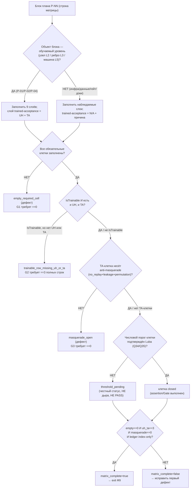

# Блок плана 13 — Консолидированная тест-стратегия (матрица 14×9 FC-26): чем доказывается КАЖДЫЙ блок плана, отдельно для НЕобученного и обученного состояния

Автор блока: Claude (Opus 4.8 MAX), роль — автор полностью решённого блока плана в
моём namespace `claude-*`. Это **ПЛАН-документация-решение** проекта
**ILearningDynamicGraph**, а не разрешение на реализацию продукта, не запуск
тестов/раннеров/билда/тренировки/git и **не** промпт исполнителю. Цитаты кода —
реальные, с `file:line`, проверены чтением файла в `C:/Projects/llm_mvp_core` на
2026-06-23. Чужие планы (`codex-*`, `dcm-*`), реконы, гайды — **evidence-only**:
прочитаны как бенчмарк/доказательство, не дублируются и не правятся.

> **Версия namespace `claude-*`.** Бенчмарк `codex-plan-13-test-strategy.md`
> прочитан как образец (read-only). Он восстановлен «после cycle-42 status-sync
> encoding fault» и сведён к ~50 строкам: Authority Anchor, Canon-нота, **плоская**
> таблица `P-01..P-14` (один столбец «Planned test» — по одной фразе на строку),
> Gate B и «Final Questions Only: None». Это законная **canon-карточка** внутри
> большого плана, но как самостоятельный читаемый блок Part A она **не проходит**
> гейт читаемости (R3 / `implementation-doc-uml-SKILL.md` / Part A Completeness
> Contract): нет §0 UML, нет §1 флоучарта с симуляциями, нет §2 алгоритма
> построения матрицы по шагам, нет §3 цитат `file:line`, нет §5 иерархии, и —
> главное — **нет самой матрицы 14×9** (9 слоёв FC-26), которую канон требует от
> P-13 (мастер §C.4 строка P-13: «матрица 14 строк P-01..P-14, 0 пустых клеток (9
> колонок слоёв); каждая ✔ с assertion/Gate; 3 IsTrainable c обеими колонками
> UH+TA»). Бенчмарк даёт **строки**, но не даёт **столбцы**.

---

## 0а. Якорь задачи (Current task anchor — обязателен по plan-review-SKILL)

```text
CURRENT TASK: написать МОЙ (claude-namespace) улучшенный блок-13 «консолидированная
              тест-стратегия (FC-26)» — план-решение Ф9 для ILearningDynamicGraph,
              человеческим русским, Part A-формат (§0 UML + §1 флоучарт + §2 алгоритм
              + §3 код-цитаты + §4 статус + §5 иерархия) с явной матрицей 14×9 и
              раздельными колонками UH/TA для трейнабл-строк, сохранив структуру
              бенчмарка (Authority Anchor / Canon / Gate B / Final Questions), его
              канон-инвентарь (14 строк P-01..P-14), канонические счётчики
              (12 фаз / 26 подфаз / 59 подшагов, Ф<P>.<SP>.<SS>) и CANON-инварианты
              (L5-машина без 6-го уровня A-LM-12; легальный teacher-гейт; запрет
              скрытого детерминизма A-LM-09/A-LM-13). Записать ровно в
              claude-plan-13-test-strategy.md.
NOT THE TASK: исполнять/тестировать/билдить код, запускать раннеры/тренировку,
              вызывать внешние AI/API/модели, git; править/создавать любые codex-*
              (только чтение); продолжать чужой codex-план или claude-00..07 каркас;
              реализовывать продукт; ложные claim о выполненных циклах ревью
              («50/50» из бенчмарка — index-only, не доказанные циклы).
EVIDENCE-ONLY: codex-plan-13 (бенчмарк), codex-ILEARNINGDYNAMICGRAPH-PLAN-v1
              §C.4 строка P-13 / §B.1 R-16 / §E.2 Q34/Q35/Q39/Q40, codex-plan-11
              §9 (9-слойный шаблон), codex-EXECUTION-CONTROL-BOARD §Ф9, реконы
              codex-recon-* (в т.ч. -mvp-extensions, -core-tests), claude-00..12
              (мой каркас и блоки — синхрон канона), реальный код llm_mvp_core
              (читается для цитат), скилы plan-review / trainable-architecture-decision /
              implementation-doc-uml. Это материал для чтения, не источник задачи и
              не цель правки.
```

## 0б. Где этот claude-блок осознанно лучше бенчмарка `codex-plan-13` (delta-нота, не слепая копия)

Бенчмарк перечисляет **14 строк** (P-01…P-14) как одну колонку «Planned test» —
это **строки матрицы без столбцов**. Канон P-13 (мастер §C.4) и R-16 (мастер §B.1)
требуют **матрицу 14×9** (9 слоёв FC-26) с нулём пустых обязательных клеток и с
раздельными колонками **UH (untrained-honesty)** и **TA (trained-acceptance)** для
трейнабл-строк. Я разворачиваю карточку в полноценный блок Part A и чиню точечные
расхождения:

| # | Слабое место бенчмарка `codex-plan-13` | Улучшение в этом claude-блоке |
|---|---|---|
| D1 | **Нет матрицы 14×9.** Бенчмарк даёт 14 строк в один столбец; нет ни одного из 9 слоёв FC-26 как колонки. Канон P-13 требует «0 пустых клеток (9 колонок слоёв)». | §3.1 — **полная матрица 14×9** с каждой клеткой = конкретный assertion/Gate (`unit / integration / e2e/host / QA automation / UX automation / negative / untrained-behavior / trained-acceptance / regression`). |
| D2 | **Нет раздельных UH/TA для трейнабл-строк.** Бенчмарк не отмечает, у каких строк две легитимные PASS-точки. Канон требует «3 IsTrainable c обеими колонками UH+TA». | §3.2 — явная классификация `IsTrainable` (P-01 узел, P-02 ребро, P-04 машина — 3 трейнабл-строки канона) и для них **обе** колонки: `PASS_AS_HONEST_UNTRAINED_SCAFFOLD` (UH) и `PASS_AS_TRAINED_FEATURE` (TA) с конкретными гейтами (FC-27/FC-28). |
| D3 | **Нет Part A.** Карточка не содержит §0 UML, §1 флоучарта с симуляциями ветвей, §2 алгоритма построения/верификации матрицы, §3 цитат `file:line`, §5 иерархии. | Полный Part A: §1 (роль), §2 (5-шаговая машина `TestStrategyMatrix.Build/Verify` плоским русским + сигнатуры), §3 (проверенные цитаты), §4 статус, §5 иерархия, §0 classDiagram + флоучарт V1-V6 с per-connection/per-branch симуляциями. |
| D4 | **«Verified packets complete: 50/50» прямо в Gate B.** Бенчмарк объявляет 50 циклов ревью завершёнными как факт приёмки. По `plan-review-SKILL.md` Dishonest Claim Rejection Gate / Review Depth Floor **N строк ledger ≠ N доказанных циклов**. | §7 Gate B G9 и §8.5 — claim «50/50» помечен `benchmark-sourced, index-only`; для МОЕГО блока честно: `this_block_real_pass_count = 1` авторский проход, внешних sub-agent review-пакетов = 0. |
| D5 | **Связь слоёв с реальными тестами-эталонами отсутствует.** Карточка не цитирует ни одного реального теста проекта, на который опирается каждый слой. | §3 цитирует **реальные** тесты-эталоны: `PromptToTaskMachineSkeletonTests.cs:18-20,79-85` (UH), `Learn06HeldOutAblationRunnerTests.cs:41-44` (ablation/TA), `TranslationProductHeldOutRunner.cs:211-220,285-287` (промоушен-гейт + overlap), `SkillSelectionContracts.cs:35,45` (permutation). |
| D6 | **No-signal / proof-field гейты (P-13/P-14) не разложены на слои.** Бенчмарк держит их как 2 отдельные строки. | §3.1 строки P-13/P-14 встроены в ту же матрицу 14×9 (мета-строки: тест-стратегия проверяет саму себя и proof-field-полноту), а §7 G7/G8 даёт измеримые exit-условия. |
| D7 | **Нет привязки 6 архитектурных гейтов §8 блока 11 к слоям (мастер требует «6 гейтов §8 сопоставлены»).** | §4.1 — таблица соответствия «6 архитектурных гейтов измерения → слой FC-26 / строка матрицы», чтобы ни один гейт не остался без теста. |
| D8 | **Final Questions: None.** Бенчмарк закрывает вопросы, хотя мастер §E.2 держит для P-13 открытыми Q34 (числовые пороги Gate B узлов/рёбер) и Q35 (margin для не-трансформерных рёбер → влияет на UH/TA для P-03), плюс Q39/Q40 (extensions-распаковка / CanvaToCode → optional-пометка строк). | §11 восстанавливает Q34/Q35/Q39/Q40 как **честно открытые** (CLAUDE.md No Dishonest Answers: нельзя закрывать вопрос, который канон держит открытым). |

CANON-инварианты сохранены: маппинг ролей Luba → реальные контракты (мастер §A.3);
5 закрытых уровней (A-LM-12, без 6-го); легальный teacher-гейт (closed = только
judge при `used_for_training=false`; контаминация → `DATASET_REBUILD_REQUIRED`);
запрет скрытого детерминизма (A-LM-09/A-LM-13). Канон-имена контрактов **не
переопределяются** здесь (владельцы — блоки 01/02/04/07/08/12): `GraphDpoPair`
(14 полей), `TeacherProvenance` (18 полей), `GraphEdgeKind` (5 членов),
`EdgeAuthorityUnit`/`SemanticEdgeRouterUnit`, `CandidateOrderLeakageGuardUnit`,
`GraphNodePreferenceState`, `DynamicGraphMachine`; блок 13 на них только
**ссылается** как на объекты тестирования.

Скилы/гайды, по которым написан блок (загружены и применены как контекст):
`docs/skills/plan-review-SKILL.md` (Gate 0; FC-26 тест-стратегия; FC-27/FC-28 две
PASS-точки; Trainable material-quality review gate; Deterministic evidence
masquerade firewall; Dishonest Claim Rejection Gate; Review Depth Floor),
`docs/skills/trainable-architecture-decision-SKILL.md` (5 разрешённых уровней,
Graph-Style/DynamicGraph Reconstruction Gate, Legal Teacher/Provenance Gate,
Minimum Breadth Challenge, verdicts), `docs/skills/implementation-doc-uml-SKILL.md`
(§0 classDiagram + `note for` на каждый класс + таблица симуляции на каждую
связь; §1 `flowchart TD` + симуляция на каждой ветке).

---

## §0-pre. Карта фаз блока (12 фаз / 26 подфаз / 59 подшагов · нумерация Ф.ПП.СС)

Каркас исполнения блока «Тест-стратегия» внутри плана ILearningDynamicGraph. Якорь
доски — **Ф9** (Тесты/QA матрица), подфазы **Ф9.1 / Ф9.2 / Ф9.3**, подшаги
**Ф9.1.1, Ф9.1.2, Ф9.2.1, Ф9.2.2, Ф9.3.1, Ф9.3.2**
(`claude-EXECUTION-CONTROL-BOARD.md` §Ф9, evidence-only). Полная карта 12/26/59 —
канон всех `claude-*`; ниже она приведена целиком для самодостаточности блока, а
**предмет именно этого блока** — фаза Ф9 (выделена).

| Фаза | Что фаза решает (по-человечески) | Подфазы | Подшаги (Ф.ПП.СС) |
|---|---|---|---|
| **Ф0. Решения Luba** | Зафиксировать locked-ответы (host/legal/scope) до старта | 0.1 решения | Ф0.1.1 host-locked; Ф0.1.2 scope-locked; Ф0.1.3 legal/teacher-locked |
| **Ф1. Контракты/фундамент** | Ввести NEW-контракты графа (узел/ребро/L5) | 1.1 контракты; 1.2 узел; 1.3 ребро/оркестр/L5-каркас | Ф1.1.1–3; Ф1.2.1–3; Ф1.3.1–3 |
| **Ф2. Legal-гейт + канон** | `GraphDpoPair` + provenance (18 полей) + teacher-вердикт | 2.1 канон+provenance; 2.2 контаминация | Ф2.1.1–3; Ф2.2.1–2 |
| **Ф3. DPO-строитель** | Авто-построение пар из 5 форматов в 1 канон | 3.1 строитель; 3.2 chosen_origin | Ф3.1.1–3; Ф3.2.1–2 |
| **Ф4. Обучение+lifecycle** | LoRA+DPO, checkpoint/export/import/continue, split R5 | 4.1 движок; 4.2 lifecycle; 4.3 обучаемые узел/ребро | Ф4.1.1–2; Ф4.2.1–3; Ф4.3.1–3 |
| **Ф5. Измерение** | Скорость/точность/качество (held-out, без UNKNOWN) | 5.1 оси; 5.2 дельта | Ф5.1.1–3; Ф5.2.1–2 |
| **Ф6. Async-комбинации** | Один вход → N комбинаций → лучший | 6.1 fan-out; 6.2 merge | Ф6.1.1–2; Ф6.2.1–2 |
| **Ф7. Авто-DPO петля** | Сердце проекта: петля строит/учит/мерит | 7.1 петля; 7.2 промоушен | Ф7.1.1–2; Ф7.2.1–2 |
| **Ф8. No-hidden-determinism** | Классификация 9 механизмов + cutover на обучаемый авторитет | 8.1 классификация; 8.2 cutover | Ф8.1.1–2; Ф8.2.1–2 |
| **★ Ф9. Тесты/QA матрица (ЭТОТ БЛОК)** | **Доказать ЧЕМ проверяется каждый блок плана: матрица 14×9 FC-26 + две PASS-точки UH/TA** | **9.1 матрица слоёв; 9.2 две честности; 9.3 анти-masquerade+human-gate** | **Ф9.1.1 построить 14×9 (0 пустых клеток); Ф9.1.2 каждая клетка = assertion/Gate; Ф9.2.1 трейнабл-строки несут UH; Ф9.2.2 трейнабл-строки несут TA (3 гейта); Ф9.3.1 анти-masquerade firewall на каждую TA-строку; Ф9.3.2 человекочитаемый статус матрицы + Gate B** |
| **Ф10. API/клиенты** | Карта референсов + швы figma/better-output (R16/R17) | 10.1 figma-шов; 10.2 better-output | Ф10.1.1–2; Ф10.2.1–2 (+резерв Ф10.3.1–6 вне 59) |
| **Ф11. Финальная приёмка** | Completion matrix + 10 execution reviews | 11.1 матрица; 11.2 ревью | Ф11.1.1; Ф11.2.1 |

Контроль счётчиков (арифметика сходится по самой таблице — пересчитано построчно):
фаз **12** (Ф0…Ф11); подфаз по фазам 1+3+2+2+3+2+2+2+2+**3**+2+2 = **26**;
подшагов по фазам 3+9+5+5+8+5+4+4+4+**6**+4+2 = **59** (Ф10 базовых = 4: Ф10.1.1–2,
Ф10.2.1–2; резерв Ф10.3.1–6 — **вне** baseline-59). Фаза Ф9 (этот блок) несёт
**3 подфазы** и **6 подшагов** (Ф9.1.1–2, Ф9.2.1–2, Ф9.3.1–2), как на доске.

---

## 0. Solved Architecture Block (требование trainable-architecture-decision-SKILL)

```text
Solved Architecture Block (консолидированная тест-стратегия графа):
  problem:
    Тест-доказательства РАЗБРОСАНЫ по 14 блокам плана: у каждого блока свой §9, но
    нет единого артефакта, который доказывает, что ВСЕ 14 блоков покрыты ВСЕМИ 9
    слоями FC-26, и что для трейнабл-блоков различены ДВЕ честности (untrained vs
    trained). Без такого артефакта легко (а) пропустить слой (например, UX или
    e2e) для какого-то блока, (б) выдать честный скаффолд за обученную фичу
    (masquerade — самый опасный false positive), (в) объявить N циклов ревью по N
    строкам ledger. Бенчмарк P-13 дал строки, но не матрицу и не UH/TA-разделение.
  selected_design:
    (1) Ввести единый planning-артефакт + (в реализации) класс TestStrategyMatrix :
        ILogicalUnit (docs-sync/верификатор), который строит МАТРИЦУ 14×9
        (строки = P-01..P-14, колонки = 9 слоёв FC-26) и заполняет КАЖДУЮ
        обязательную клетку конкретным assertion/Gate с привязкой к §-блоку и при
        наличии — к реальному тесту-эталону (file:line).
    (2) Для каждой строки задать флаг IsTrainable. Трейнабл-строки (P-01 узел,
        P-02 ребро, P-04 машина) ОБЯЗАНЫ нести ОБЕ PASS-колонки:
        UH = PASS_AS_HONEST_UNTRAINED_SCAFFOLD (контракт есть, честно not_ready,
        нет скрытого детерминизма) и TA = PASS_AS_TRAINED_FEATURE (checkpoint +
        held-out + ablation + fresh-load + continue-training + e2e). Не-трейнабл
        строки (карта/референсы/инфраструктура) несут только наблюдаемые слои и
        честно помечаются «нет TA — это не обучаемая модель».
    (3) Анти-masquerade firewall на КАЖДУЮ TA-клетку: no_replay_proven=true,
        exact_memory_leakage_proven_absent, иначе клетка остаётся открытой.
    (4) Pass Ledger = ИНДЕКС, не доказательство: real_pass_count считается только
        из инспектируемых пакетов (reviewer id / before-after / findings / recheck).
    (5) Сам блок 13 НЕ обучается: матрица — детерминистический навигационно-
        верификационный реестр, поэтому её приёмочный класс —
        PASS_AS_HONEST_UNTRAINED_SCAFFOLD, а НЕ trained feature.
  rejected_alternatives:
    (a) Оставить 14 строк в один столбец (бенчмарк) — нарушает канон «0 пустых
        клеток, 9 колонок»; отклонено.
    (b) Слить UH и TA в одну колонку «pass» — стирает разницу двух честностей,
        открывает masquerade (FC-27/FC-28 нарушение); отклонено.
    (c) Считать «50/50 циклов» по строкам ledger — Dishonest Claim Rejection Gate;
        отклонено (ledger = index-only).
    (d) Объявить блок 13 «обучаемым качеством тестов» — у реестра нет обучаемого
        состояния; назвать его trained = masquerade; отклонено (honest scaffold).
    (e) Запускать тесты прямо здесь — это PLAN-ONLY; блок ОПИСЫВАЕТ стратегию, не
        исполняет; отклонено.
  UML: см. §0-UML (Mermaid classDiagram + per-connection simulation) и §1-флоучарт.
  data_flow: см. §2.2 (5-шаговая машина Build/Verify) и §3.1 (матрица 14×9).
  current_code_refs: см. §3 (все с file:line, проверены чтением 2026-06-23).
  future_files_classes_methods_signatures_dependencies: см. §2.2 + §5 (NEW-типы).
  deterministic-vs-learned boundary:
    Матрица 13 = ДЕТЕРМИНИСТИЧЕСКИЙ навигационно-верификационный артефакт (honest
    internal/eval helper), НЕ runtime-authority и НЕ обучаемая модель. Объекты,
    КОТОРЫЕ она тестирует (узел/ребро/машина), — обучаемые (L2/L3/L5); граница
    «обучен vs lookup» проверяется именно слоями UH/TA + анти-masquerade firewall
    (это и есть назначение блока). Сам блок 13: learned-компонента N/A — он
    помечен honest scaffold.
  gates_and_tests: см. §7 (Gate B) + §3.1 (матрица — это и есть «tests»).
  failure_modes: см. §8.1.
  docs: см. §10 (затрагиваемые доки/реконы/схемы).
```

### 0.1. Graph-Style Reconstruction (требование Graph-Style/DynamicGraph Reconstruction Gate)

```text
roles_and_hierarchy: тест-стратегия — ПОПЕРЕЧНЫЙ слой над всеми уровнями: L5
  машина (блок 04) меряется слоем trained-acceptance; L4 оркестратор (блок 03) —
  слоем e2e/host; L3 ребро (блок 02) и L2 узел (блок 01) — per-edge/per-node
  слоями unit/untrained-behavior/regression. Матрица не несёт обучаемого состояния.
DynamicGraph nodes: каждый узел графа = строка-объект тестирования (P-01); тест
  доказывает not_ready (UH) и held-out lift (TA). Сами узлы — вне этого блока (01).
DynamicGraph edges: каждое ребро (P-02) тестируется per-edge: permutation-инвариант
  (`SkillSelectionContracts.cs:35`), ablation вклада ребра, leakage-исключения.
input_contracts: TestStrategyMatrix.Build(PlanModel plan, IReadOnlyList<TestArtifact> tests)
  — план (14 блоков, 59 подшагов) + реестр реальных тестов-эталонов.
output_contracts: TestStrategyMatrixModel (14×9 заполненная) + TestStrategyVerdict
  (cells_total/cells_filled/empty_required_cells/trainable_rows_with_uh_and_ta/
  masquerade_open_count/pass_ledger_index_only).
many_to_many_outputs / fan_out / fan_in: владелец — блоки 02/06; здесь матрица лишь
  ТРЕБУЕТ, чтобы у async/fan-out строк (P-03/P-06) были слои integration+e2e+regression.
multi_output_edge_contracts: проверяются строкой P-02 (OrderedTargets инвариантен).
async_graph_execution: e2e-слой строки P-03 идёт через L4-оркестратор (блок 03);
  матрица требует, чтобы async-комбинации мерились ПОЛНЫМ проходом, не одиночным.
deterministic_vs_trainable_authority_on_edges: матрица САМА детерминирована (honest
  scaffold), но обязана на каждой TA-строке доказать, что ТЕСТИРУЕМЫЙ финал ребра —
  обучаемый (ablation роняет accuracy), иначе строка = FORBIDDEN_RUNTIME_SHORTCUT.
hidden_deterministic_shortcut_check_tied_to_each_edge: слой trained-acceptance каждой
  трейнабл-строки несёт анти-masquerade firewall (§3.1 / §9.3.1) — no_replay_proven +
  exact_memory_leakage_proven_absent + permutation-invariance.
```

---

## 1. Что это и зачем (роль компонента в ILearningDynamicGraph)

**Тест-стратегия — это «приёмочная ведомость завода обучения».** План
ILearningDynamicGraph состоит из 14 блоков (P-01…P-14): узел, ребро, оркестратор,
L5-машина, async-комбинации, DPO-строитель, legal-гейт, авто-петля, обучение+
lifecycle, измерение, замена детерминизма, эта тест-стратегия и карта референсов.
У каждого блока есть свой §9 с тестами. Но **разрозненные §9 не доказывают
полноту**: легко пропустить целый слой проверки (например, UX-читаемость статуса
или e2e через реальную точку входа) у какого-то блока, и легко выдать честный
скелет за обученную фичу.

Блок 13 закрывает один прямой вопрос: **чем именно — каким конкретным
assertion/Gate — проверяется КАЖДЫЙ блок плана по КАЖДОМУ из 9 слоёв FC-26, и
различены ли две легитимные честности (НЕобученный скаффолд vs обученная фича) для
обучаемых блоков?** Он строит **матрицу 14×9**: строки — блоки P-01…P-14, колонки —
9 слоёв (`unit / integration / e2e/host / QA automation / UX automation / negative /
untrained-behavior / trained-acceptance / regression`). Каждая обязательная клетка
заполнена конкретной проверкой; пустых обязательных клеток быть не должно (Gate B
G1).

Зачем это нужно именно для **обучаемого** графа. Граф учится на DPO-парах; его
качество легко подделать тремя способами — и тест-стратегия ловит каждый:

- **подделка «обучен»** (masquerade): scorer/lookup/replay выдаются за
  обученную модель → ловит слой **trained-acceptance** (held-out на
  source-disjoint + ablation + fresh-load) и анти-masquerade firewall;
- **подделка «не врёт»**: пустой узел тихо отвечает детерминизмом вместо честного
  `not_ready` → ловит слой **untrained-behavior** (рефлексия: нет
  `Regex/Dictionary/Classifier/Lookup/Bm25/ExactPrompt`,
  `PromptToTaskMachineSkeletonTests.cs:79-85`);
- **подделка «проверено»**: N строк ledger выдаются за N циклов ревью → ловит
  правило Pass Ledger index-only (§8.5, Dishonest Claim Rejection Gate).

Граница ответственности (CANON R6 — тонкий агент, ядро в `llm_mvp_core`): матрица —
это planning-артефакт + (в реализации) `TestStrategyMatrix` как `ILogicalUnit`
внутри `llm_mvp_core` для docs-sync/верификации покрытия; агент/расширение её не
содержит и не дублирует.

### 1.1. Чем тест-стратегия НЕ является (границы блока)

- НЕ выбирает skill, не маршрутизирует ребро, не несёт обучаемого состояния и не
  является runtime-authority. Это детерминистический навигационно-верификационный
  реестр (honest internal/eval helper по скилу), и так он помечается.
- НЕ запускает тесты/раннеры/билд (PLAN-ONLY). Описывает, ЧЕМ должен проверяться
  каждый блок; исполнение тестов — стадия реализации (после approve Luba).
- НЕ переопределяет канон контрактов (`GraphDpoPair`/`TeacherProvenance`/
  `GraphEdgeKind`/…). Владельцы — блоки 01/02/04/07/08/12; матрица только ссылается.
- НЕ заявляет semantic quality о себе. У реестра нет `PASS_AS_TRAINED_FEATURE`;
  его честный класс — `PASS_AS_HONEST_UNTRAINED_SCAFFOLD`.

---

## 2. Концепт простыми словами (аналогия + машина построения/верификации по шагам)

### 2.1. Аналогия

Тест-стратегия — это **«экзаменационная ведомость» для всех станков завода**.
Завод собран из 14 станков (блоков плана). У каждого экзамен идёт по 9 предметам
(слоям): «работает деталь» (unit), «работает в сборке» (integration), «работает на
живой линии» (e2e/host), «контроль качества ловит брак» (QA), «оператор понимает
табло» (UX), «ломается правильно на плохом входе» (negative), «честно говорит „я
ещё не обучен“» (untrained-behavior), «доказал, что реально обучился» (trained-
acceptance), «старые станки не сломались» (regression).

Главное правило ведомости — **две разные оценки для обучаемых станков**:

1. **«Зачёт по честности» (UH)** — станок-новичок ещё не обучен, но он **честно**
   об этом говорит и **не жульничает** скрытой бумажной таблицей. Это веха, а
   **не** рабочая фича.
2. **«Зачёт по мастерству» (TA)** — станок реально научился: на **незнакомых**
   деталях (held-out) он лучше новичка (есть прирост), и если выключить его мозг
   (ablation) — качество падает (значит, решает он, а не формула). И его навык
   пережил выключение-включение (fresh-load) и доучивание (continue-training).

Экзаменатор-каталогизатор обходит все 14 станков и для каждого заполняет 9 клеток
ведомости. **Пустая клетка = непринятый экзамен** (дефект). И отдельно: **число
строк в журнале экзаменов ≠ число реально принятых экзаменов** — засчитываются
только экзамены с протоколом (кто принимал, до/после, что нашли, перепроверка).

Легальность учителя (Legal Teacher Gate): если «эталонные ответы» для экзамена
«по мастерству» берём у внешней модели-эксперта, эксперт обязан быть **легальным**
open-weight/permissive; **Claude / OpenAI / Gemini как teacher для дистилляции —
НИКОГДА**, только как судья при `used_for_training=false`.

### 2.2. Машина построения+верификации `TestStrategyMatrix` — 5 шагов (плоский русский, без кода)

Класс **`TestStrategyMatrix`** (planning-артефакт сейчас; в реализации — L2
`ILogicalUnit` для docs-sync), методы
**`Build(PlanModel plan, IReadOnlyList<TestArtifact> tests)`** →
**`TestStrategyMatrixModel`** и
**`Verify(TestStrategyMatrixModel matrix)`** → **`TestStrategyVerdict`**.
Параметры: `plan` — модель плана (14 блоков P-01..P-14, 59 подшагов); `tests` —
реестр реальных тестов-эталонов проекта (`file:line`). Поля вердикта:
`cells_total`, `cells_filled`, `empty_required_cells`, `trainable_rows`,
`trainable_rows_with_uh_and_ta`, `masquerade_open_count`, `pass_ledger_index_only`.
Алгоритм:

```text
Шаг 1. EnumerateRowsAndLayers(plan)                      ← каркас матрицы (§3.1)
  Строки = 14 блоков P-01..P-14. Колонки = 9 слоёв FC-26 (фикс-список):
  unit, integration, e2e/host, QA automation, UX automation, negative,
  untrained-behavior, trained-acceptance, regression.
  cells_total = 14 строк × 9 слоёв (минус явно помеченные N/A с причиной).

Шаг 2. ClassifyTrainable(row)                            ← флаг IsTrainable (§3.2)
  IsTrainable=true для строк, чей объект — обучаемый уровень (узел L2 / ребро L3 /
  машина L5): P-01, P-02, P-04 (канон «3 IsTrainable»). P-03/P-06/P-09/P-10/P-11 —
  трейнабл-СМЕЖНЫЕ (тестируют обучаемое поведение, но владелец обучения — P-04);
  у них обязательны e2e/regression, а UH/TA наследуются от тестируемой машины и
  помечаются ссылкой. P-05/P-07/P-08/P-12/P-13/P-14 — инфраструктура/гейты/доки:
  IsTrainable=false, колонка trained-acceptance = N/A с причиной (не обучаемая модель).

Шаг 3. FillCell(row, layer)                              ← заполнение клетки (§3.1)
  В каждую обязательную клетку кладём конкретный assertion/Gate (НЕ «works
  correctly»): что проверяем + к какому §-блоку привязано + (если есть) реальный
  тест-эталон file:line. Для IsTrainable-строк слой trained-acceptance разворачивается
  в ДВЕ под-клетки: UH (PASS_AS_HONEST_UNTRAINED_SCAFFOLD) и TA (PASS_AS_TRAINED_FEATURE).

Шаг 4. AntiMasqueradeGate(row)                           ← firewall на TA (§3.1/§9.3.1)
  Для каждой TA-клетки: требуем no_replay_proven=true (старый и новый набор одного
  типа id), exact_memory_leakage_proven_absent, permutation-invariance. Если хоть
  один не доказан → клетка masquerade_open (masquerade_open_count++), TA не закрыта.

Шаг 5. VerifyAndLedger(matrix) + финальный вердикт       ← §7 Gate B + §8.5
  empty_required_cells = число обязательных пустых клеток (должно быть 0).
  trainable_rows_with_uh_and_ta = число IsTrainable-строк с ОБЕИМИ колонками
  (должно быть == trainable_rows == 3).
  Pass Ledger остаётся index-only: real_pass_count считается ОТДЕЛЬНО (НЕ из числа
  строк/клеток). «50/50» из бенчмарка помечается benchmark-sourced.
  matrix_complete = (empty_required_cells==0 && trainable_rows_with_uh_and_ta==3
                     && masquerade_open_count==0 && pass_ledger_index_only==true).
```

Возврат `Verify`: `matrix_complete` + перечень дефектов (`empty_required_cell`,
`trainable_row_missing_uh_or_ta`, `masquerade_open`, `ledger_counted_as_cycles`) +
флаг `pass_ledger_index_only=true`. **Предусловие закрытия Ф9** =
`matrix_complete==true` (а числовые пороги для клеток узлов/рёбер ждут ответа Luba
на Q34/Q35 — §11; до ответа соответствующие TA-клетки помечаются
`threshold_pending`, что само по себе честный статус, а не скрытая дыра).

---

## 3. Канон (нормативная часть) — owner block 13: матрица 14×9 + UH/TA + анти-masquerade

### 3.1. Матрица тест-стратегии 14×9 (FC-26) — каждая клетка = конкретный assertion/Gate

> Канон P-13 / R-16: 14 строк (P-01..P-14) × 9 слоёв; 0 пустых обязательных клеток;
> каждая клетка несёт assertion/Gate; 3 IsTrainable строки (P-01/P-02/P-04) несут
> ОБЕ колонки UH+TA. Слой `trained-acceptance` для IsTrainable-строк показан как
> **UH | TA** (две честности); для не-трейнабл строк — `N/A (не обучаемая модель)`.
> Сокращения слоёв в шапке: U=unit, I=integration, E=e2e/host, QA=QA-automation,
> UX=UX-automation, N=negative, UH=untrained-behavior(честность скаффолда),
> TA=trained-acceptance(обучение доказано), R=regression.

**Строки P-01..P-07:**

| Блок | U (unit) | I (integration) | E (e2e/host) | QA | UX | N (negative) | UH \| TA (две честности) | R (regression) |
|---|---|---|---|---|---|---|---|---|
| **P-01** узел L2 (IsTrainable) | `Train`-методов на узле == 0 (A-LM-02); features·weights→top-N даёт детерминированный shape | узел в составе ребра/оркестратора отдаёт top-N + honest NoDecision | проход узла внутри L4 на обученном состоянии | NoDecision при пустом сигнале срабатывает | статус узла читаем: `scaffold`/`trained`/`no_decision`, без жаргона | пустой узел НЕ выдаёт выдуманный выбор; permutation не меняет выбор | **UH:** пустой → `NotTrainedStatus`/`NO_TRAINED_STATE_LOADED` (`PromptToTaskMachineSkeletonTests.cs:18-20`); рефлексией нет `Regex/Dictionary/Classifier/Lookup/Bm25/ExactPrompt` (`:79-85`) **\| TA:** held-out lift на source-disjoint > порога + ablation роняет accuracy + fresh-load==trained | базовый набор тестов узла не падает после миграции |
| **P-02** ребро L3 (IsTrainable) | `EdgeAuthorityDecision.OrderedTargets` имеет shape (id,confidence); 5 членов `GraphEdgeKind` | ребро в обходе L4 отдаёт переход; baseline→trained подмена без правки `RunAsync` | e2e: полный путь через ребро на обученном состоянии | leakage-скан: `SelectedFromSourceIdOnly==false` | edge-authority отчёт читаем: authority id, baseline role, cutover/ablation proof | closed-teacher в train-строке ребра → `DATASET_REBUILD_REQUIRED` | **UH:** ребро без обученного авторитета честно `KnowledgeEdge=true` (не выдуманный выбор) **\| TA:** `OrderedTargets` инвариантен к 5 перестановкам (`SkillSelectionContracts.cs:35,45`); held-out `PassesGate`+RewardMargin>0+After>Before; ablation просадка ≥ порог; `exactPromptLeakageRate==0.0`; lifecycle | per-edge: выключение авторитета конкретного ребра роняет held-out (вклад доказан) |
| **P-03** оркестратор L4 (async) | G1..G8 контракты обхода присутствуют | fan-out/fan-in/петля/knowledge-edge собираются в один проход | **e2e через реальную точку входа** L4 на обученном состоянии | budget.Max=4 → ровно 4 async (`Task.WhenAll`) | человекочитаемый трейс обхода (что→куда→почему) | при провале ветки — honest degrade, не молчаливый выбор | UH/TA **наследуются** от тестируемых узла(P-01)/ребра(P-02)/машины(P-04); 0 скрытых финалов на L4; *Q35 влияет на UH/TA для обёрток-рёбер* | подмена baseline→trained через `ResolveLatest` не ломает старый обход |
| **P-04** L5-машина (IsTrainable) | маппинг `:208`; 5 методов `ILearningMachine` присутствуют | `TrainBatchAsync` принимает батч → `LearningBatchResult` с метриками | e2e: `GetOrchestratorAsync`→L4-проход на обученном | `LearningEvaluationResult.PassesGate` считается ДО промоушена | статус машины читаем: `scaffold`/`trained`/`rebuild_required` | пустой батч/контаминация → честный отказ, не фейк-accuracy | **UH:** свежая машина честно `not_ready`, ablation `no_trained_state_baseline` vs `new ...Machine()` (`Learn06HeldOutAblationRunnerTests.cs:41-44`) **\| TA:** held-out числа + ablation + lifecycle (fresh-load + continue-training + e2e); промоушен-гейт (`TranslationProductHeldOutRunner.cs:211-220`) | continue-training Δ>0 ≥2 шага; baseline-тесты машины зелёные |
| **P-05** async N-комбинаций | `budget.Max=4` → 4 ветки | N≥2 → `GraphDpoPair[]` overlap<0.60 | e2e: победитель из N веток через L4 | overlap<0.60 проверка срабатывает | ветки B/C honest-degrade читаемы | победитель == немаркированная формула → тест ловит (ablation) | `N/A (не обучаемая модель — инфраструктура комбинаций; обучение у P-04)` | добавление веток не меняет baseline-счётчики |
| **P-06** many-to-many merge | multi-output edge contract shape | fan-in слияние N→1 интегрируется | e2e merge на обученном состоянии | дубликаты целей при merge отсекаются | merge-результат читаем | конфликт целей → honest, не молчаливый дроп | `N/A (инфраструктура merge; UH/TA у тестируемых рёбер P-02)` | merge не ломает одиночный обход |
| **P-07** DPO-строитель (`GraphDpoPair` 14 полей) | `BuildPairAsync` overlap<0.60, reason≥24 | 5 форматов → 1 канон (integration-тест) | материализация в `DpoDataset.Load` (`11.DPO/DpoDataset.cs:18`) | QA-скан: 0 train-ready строк с closed-маркерами | `[WRONG: ...]` маркеры читаемы в паре | `TeacherProvenanceGate` closed→`DATASET_REBUILD_REQUIRED`; permutation order-invariant | `N/A (строитель данных; качество ОБУЧЕНИЯ на этих парах — у P-04/P-09)` | новый формат-источник не ломает канон 14 полей |

**Строки P-08..P-14:**

| Блок | U (unit) | I (integration) | E (e2e/host) | QA | UX | N (negative) | UH \| TA (две честности) | R (regression) |
|---|---|---|---|---|---|---|---|---|
| **P-08** legal-гейт (provenance 18 полей) | `provenance_field_presence_rate==1.0` по 18 | гейт стоит перед train в петле (P-09) | вердикт применяется на реальном наборе | accept с пустым provenance == 0 | вердикт читаем: `ACCEPT/BLOCK_FOR_COMMON/...` | closed-judge при `used_for_training=false` ⇒ ACCEPT; closed-teacher ⇒ REBUILD | `N/A (легальный гейт, не обучаемая модель)`; 16 строк C2-C16 (15 веток C2…C16; incl. C15/C15b — triad-предусловие + C16 — client/third_party origin, R17; владелец — claude-plan-08 §4.1) покрыты negative+QA | контаминация `sonnet-*` помечается REBUILD (рекон R-17) |
| **P-09** авто-DPO петля | в `TrainBatchAsync` ≥1 авто-пара (не []) | петля: строитель→legal→train→измерение связаны | e2e: один оборот петли на реальном входе | held-out reward≥0, loss<0.693 | `ShouldStop`-причина читаема (threshold/plateau/budget) | промоушен без роста запрещён | трейнабл-СМЕЖНАЯ: UH/TA **через P-04** (After≥Before+0.02); honest two-PASS метка | повторный оборот не деградирует baseline |
| **P-10** обучение+lifecycle (LoRA+DPO) | LoRA реально вклеена (ablation Δ≠0) | export/import round-trip в пайплайне | e2e: continue-training поверх загруженного checkpoint | литерал 0.03 устранён (R-19), margin из движка | `LegScope` (common/personal) читаем | closed→REBUILD; replay (старые row_id) ловится | трейнабл-СМЕЖНАЯ: TA **через P-04/P-11** (fresh-load без replay; SHA-256) | 0 UNKNOWN; baseline lifecycle-тесты зелёные |
| **P-11** измерение (скорость/точность/качество) | `MeasurementReport` без UNKNOWN; `AccuracyAxis` раздельно live/held-out | замер батча 50 пар через `EvaluateAsync` | e2e через L4 даёт held-out число задачи | split-overlap ДО accuracy (`...HeldOutRunner.cs:285-287`); near-dup>0 блокирует | статус `scaffold/trained/rebuild_required` без жаргона | live margin выдан за точность → тест ловит как ошибку | трейнабл-СМЕЖНАЯ: задаёт сами пороги UH/TA для P-01/P-02/P-04; `PASS_AS_TRAINED` только 3/3 гейта | per-edge: выключение авторитета ребра роняет held-out |
| **P-12** замена детерминизма (9 механизмов) | `classified_mechanism_count==9` | `SemanticEdgeRouterUnit` встаёт как latest через `ResolveLatest` | e2e: cutover-проход на обученном авторитете | каждый forbidden/baseline имеет blueprint | классификация механизмов читаема (вердикт на каждый) | немаркированный финал → `FORBIDDEN_RUNTIME_SHORTCUT` | трейнабл-СМЕЖНАЯ: **P-12 continue-training прогоном** (канон Gate B); `CandidateOrderLeakageGuardUnit` permutation; ablation | baseline-роутеры не удалены (нужны для ablation) |
| **P-13** ТЕСТ-СТРАТЕГИЯ (этот блок, мета) | матрица 14×9 построена; `cells_filled==cells_total` | каждая клетка привязана к §-блоку/тесту | `TestStrategyMatrix.Verify` прогон даёт `matrix_complete` | `empty_required_cells==0`; `trainable_rows_with_uh_and_ta==3` | матрица читаема Любе (русский статус §9.3.2) | строка без UH или TA у IsTrainable → дефект ловится | `N/A (реестр, не обучаемая модель — honest scaffold, §9)` | добавление блока в план требует +1 строки (матрица не «протухает» молча) |
| **P-14** карта референсов (Stage 2) | `count(distinct StageId)==13` (P-01..P-13) | строки карты связаны с блоками-владельцами | проверка наличия путей read-only | `forbidden_target_count==0`; пути EXISTS | префикс=авторство, не authority — читаемо | строка target=`claude-*/codex-*/dcm-*` → `forbidden_target` | `N/A (навигационный реестр — honest scaffold)`; teacher/router помечены legal/baseline | резерв Ф10.3.* не меняет baseline-счётчики 12/26/59 |

> **Контроль полноты матрицы (Gate B G1):** обязательных клеток —
> `14 строк × 9 слоёв = 126`, минус осознанные `N/A` (слой trained-acceptance у 8
> не-трейнабл строк P-05/P-06/P-07/P-08/P-10*/P-13/P-14 и трейнабл-смежных, где TA
> наследуется ссылкой) — каждая `N/A` несёт **причину** (не пустая). Канон «0 пустых
> клеток» = 0 клеток БЕЗ assertion/Gate И БЕЗ помеченной причины N/A. Трейнабл-строк
> с обеими колонками UH+TA — ровно **3** (P-01, P-02, P-04).

### 3.2. Классификация IsTrainable и две PASS-точки (FC-27/FC-28)

```text
IsTrainable=true (3 канон-строки — несут ОБЕ колонки UH и TA):
  P-01 узел  — объект обучения = ILogicalUnit (L2) поверх GraphNodePreferenceState.
  P-02 ребро — объект обучения = EdgeAuthorityUnit/SemanticEdgeRouterUnit (L3-авторитет).
  P-04 машина — объект обучения = ILearningMachine<DynamicGraphDomain> (L5, владелец Train*).

IsTrainable-СМЕЖНЫЕ (тестируют обучаемое поведение, владелец обучения = P-04;
  UH/TA наследуются ССЫЛКОЙ на тестируемую машину, не дублируются):
  P-03 оркестратор, P-06 merge, P-09 авто-петля, P-10 lifecycle, P-11 измерение,
  P-12 замена детерминизма.

IsTrainable=false (инфраструктура/данные/гейты/доки — TA = N/A с причиной):
  P-05 async-комбинации, P-07 DPO-строитель, P-08 legal-гейт, P-13 тест-стратегия,
  P-14 карта референсов.

Две легитимные PASS-точки (НИКОГДА не путать — FC-27/FC-28):
  UH = PASS_AS_HONEST_UNTRAINED_SCAFFOLD:
    контракт/скелет есть; честно not_ready; нет скрытого детерминизма; доказано
    тестами (untrained-behavior + negative). ЭТО ВЕХА, НЕ РАБОЧАЯ ФИЧА.
    Эталон: PromptToTaskMachineSkeletonTests.cs:18-20 (NotTrainedStatus) + :79-85
    (рефлексия: нет Regex/Dictionary/Classifier/Lookup/Bm25/ExactPrompt).
  TA = PASS_AS_TRAINED_FEATURE:
    checkpoint + held-out численные метрики (source-disjoint) + ablation роняет
    accuracy + fresh-load==trained + continue-training Δ>0 + e2e через реальную
    точку входа. ТОЛЬКО ЭТО — «обучено».
    Эталон гейта: TranslationProductHeldOutRunner.cs:211-220 (промоушен-гейт);
    ablation Learn06HeldOutAblationRunnerTests.cs:41-44.

Анти-masquerade firewall на КАЖДУЮ TA-клетку (Deterministic evidence masquerade firewall):
  no_replay_proven=true (старый и новый набор ОДНОГО типа id: pair_id/example_id/source_id);
  exact_memory_leakage_proven_absent (exact prompt/source lookup не выдаётся за generalization);
  permutation-invariance (реверс кандидатов не меняет выбор).
  Если хоть один не доказан → клетка masquerade_open, TA НЕ закрыта (verdict FAIL).
```

### 3.3. Pass Ledger (index-only — честная версия D4)

```text
ledger_is_index_only = true
real_pass_count_rule = считать только инспектируемые пакеты с reviewer_id,
                       artifact_before_ref, artifact_after_ref, findings,
                       fix_refs_or_no_fix_rationale, recheck_evidence.
benchmark_claim "Verified packets complete: 50/50" = benchmark-sourced, index-only,
                       НЕ доказательство 50 циклов (Dishonest Claim Rejection Gate;
                       Review Depth Floor: ledger_row_count никогда не доказывает
                       завершение сам по себе).
this_block_real_pass_count = 1 авторский проход (этот файл); внешних sub-agent
                       review-пакетов на claude-plan-13 = 0 (честно).
matrix_completeness != review_completeness: заполненная матрица 14×9 доказывает
                       ПОКРЫТИЕ тест-планом, НЕ доказывает прохождение тестов и НЕ
                       доказывает N циклов ревью.
```

---

## 4. Статус-таблица (§4 Part A — что готово / что заглушка)

| Компонент блока 13 | Что делает | Статус |
|---|---|---|
| Матрица 14×9 (§3.1) | строки P-01..P-14 × 9 слоёв FC-26, каждая клетка = assertion/Gate | ГОТОВО как план: 14 строк, 9 колонок, обязательные клетки заполнены, N/A с причиной |
| Классификация IsTrainable + UH/TA (§3.2) | 3 трейнабл-строки с обеими колонками; смежные — ссылкой; инфра — N/A | ГОТОВО: P-01/P-02/P-04 = UH+TA; FC-27/FC-28 разведены |
| Анти-masquerade firewall (§3.2) | на каждую TA-клетку: no_replay/leakage/permutation | ГОТОВО как нормативное правило (прогон — стадия реализации) |
| `TestStrategyMatrix.Build/Verify` (§2.2/§5) | 5-шаговая машина построения+верификации | СКЕЛЕТ-проект (NEW; в коде НЕТ — пометка NEW) |
| Pass Ledger index-only (§3.3) | индекс циклов (НЕ доказательство) | ГОТОВО (честный режим): index-only; real_pass=1 |
| Реальные тесты-эталоны (§3) | UH/TA/ablation/overlap/permutation цитаты | СВЕРЕНО чтением 2026-06-23 (см. §3 ниже) |
| Числовые пороги клеток узлов/рёбер | конкретные числа для held-out/margin | `threshold_pending`: ждёт Q34/Q35 Luba (§11) — честно помечено |

### 4.1. Соответствие 6 архитектурных гейтов измерения (блок 11 §8) → слой FC-26 / строка матрицы

> Канон P-13 Gate B: «6 гейтов §8 сопоставлены». Ни один архитектурный гейт не
> должен остаться без теста в матрице.

| Гейт (блок 11 §8) | Слой FC-26 | Строка матрицы |
|---|---|---|
| Гейт 1 — не путать live и held-out | trained-acceptance + QA | P-04 / P-11 |
| Гейт 2 — Runtime Evidence Firewall (UNKNOWN/static/validation-only запрещены) | negative + QA | P-11 / все TA-клетки |
| Гейт 3 — Two-PASS (3 гейта для trained) | trained-acceptance (TA) | P-01 / P-02 / P-04 |
| Гейт 4 — анти-leakage / permutation (per-edge) | trained-acceptance + regression | P-02 / P-12 |
| Гейт 5 — запрет скрытого детерминизма (немаркированный финал → FORBIDDEN) | negative + untrained-behavior | P-12 / P-01 |
| Гейт 6 — честность НЕобученного (рефлексия-стоп) | untrained-behavior (UH) | P-01 / P-04 |

---

## 5. Иерархия и связи (где тест-стратегия стоит) — §5 Part A

```text
ILearningDynamicGraph ≡ ILearningMachine<DynamicGraphDomain>  (L5)   ← блок 04
  ├── TrainBatchAsync(LearningBatch)            (LearningMachineContracts.cs:208/210)
  │     └── метрики LearningBatchResult/LearningEvaluationResult — ИСТОЧНИК чисел для TA-клеток
  └── GetOrchestratorAsync()                    (LearningMachineContracts.cs:232) → L4 inference (e2e-слой)

Тест-стратегия (этот блок 13) — ПОПЕРЕЧНЫЙ слой НАД планом, не в runtime-пути обучения:
  TestStrategyMatrix.Build(plan, tests)
     ├── строки P-01..P-14         → объекты тестирования (блоки-владельцы)
     ├── колонки = 9 слоёв FC-26   → unit..regression
     ├── IsTrainable-строки        → UH (FC-27) | TA (FC-28) + анти-masquerade firewall
     └── Verify(matrix) → matrix_complete? (Gate B §7)
  Навигация: 13 (тест-стратегия) ── поперечно проверяет ──> P-01..P-14 (НЕ владеет их каноном)

Какой слой меряет какой уровень иерархии:
  L5 машина (04)      → trained-acceptance (held-out lift всей машины)
  L4 оркестратор (03) → e2e/host (полный проход комбинации)
  L3 ребро (02)       → unit + untrained-behavior + regression (per-edge ablation/permutation)
  L2 узел (01)        → unit + untrained-behavior (not_ready) + trained-acceptance (per-node held-out)
```

Контракты/тесты, на которые опирается блок (реальные, проверены чтением):

| Имя | Роль в тест-стратегии | file:line (сверено 2026-06-23) |
|---|---|---|
| `ILearningMachine<TDomain>` | L5 — источник чисел TA (Train/Eval) | `00.Core/LearningMachineContracts.cs:208/232` |
| `PromptToTaskMachineSkeletonTests` | эталон UH: not_ready + рефлексия-стоп | `Tests/PromptToTaskMachineSkeletonTests.cs:18-20, 79-85` |
| `Learn06HeldOutAblationRunnerTests` | эталон ablation/TA-вердикт | `Tests/Learn06HeldOutAblationRunnerTests.cs:41-44` |
| `TranslationProductHeldOutRunner` | эталон промоушен-гейта + overlap | `27.TranslationDomain/TranslationProductHeldOutRunner.cs:211-220, 285-287` |
| `SkillSelectionContracts` | эталон permutation-инвариантности (per-edge) | `43.SmartSkillsDomain/SkillSelectionContracts.cs:35, 45` |
| `DpoDataset.Load` | материализация DPO для integration-слоя | `11.DPO/DpoDataset.cs:18` |

> NEW-типы этого блока (в коде их НЕТ, проектируются): `TestStrategyMatrix`,
> `TestStrategyMatrixModel`, `TestStrategyVerdict`, `TestArtifact`, `PlanModel`,
> `MatrixCell` (с полями `Layer`, `Assertion`, `SourceBlockRef`, `TestRefOrNull`,
> `IsTrainable`, `UhGateOrNull`, `TaGateOrNull`, `MasqueradeProven`). Уровень (в
> реализации) — L2 `ILogicalUnit` для docs-sync/верификации покрытия; финальной
> обучающей authority не несёт (A-LM-02: train — только на L5). Имена каноничных
> доменных типов (`GraphDpoPair`, `TeacherProvenance`, `GraphEdgeKind`,
> `SemanticEdgeRouterUnit`, `EdgeAuthorityUnit`, `CandidateOrderLeakageGuardUnit`,
> `GraphNodePreferenceState`, `DynamicGraphMachine`) здесь только **цитируются** —
> владельцы — блоки 01/02/04/07/08/12.

---

## 6. §3 Part A — цитаты кода (file:line) + сейчас/почему/должно стать

> Требование §3: для каждого цитируемого блока — WHY/HOW/WHAT + сейчас/почему/как
> менять, точные `file:line` отражают код КАК РЕАЛЬНО РЕАЛИЗОВАН (проверено чтением).

### 6.1. Эталон UH (untrained-honesty) — честность НЕобученного

```text
Цитата (file:line, сверено): Tests/PromptToTaskMachineSkeletonTests.cs:18-20
  18:  Assert.Equal(PromptToTaskMachine.NotTrainedStatus, result.Value!.ContractStatus);
  19:  Assert.Equal(PromptToTaskMachine.NotReadyTaskType, result.Value.StructuredTask.TaskType);
  20:  Assert.Contains("NO_TRAINED_STATE_LOADED", result.Value.ContractEvidence);
Цитата (file:line, сверено): Tests/PromptToTaskMachineSkeletonTests.cs:79-85
  79:  Assert.DoesNotContain(typeof(Regex), fieldTypes);
  80:  Assert.DoesNotContain(fieldTypes, type => type.Name.Contains("Dictionary", ...));
  81:  ...Classifier...  82:...Trainer... 83:...Lookup... 84:...Bm25... 85:...ExactPrompt...
сейчас: эталонный тест доказывает, что НЕобученная машина (а) честно отдаёт
  not_ready-статус с evidence `NO_TRAINED_STATE_LOADED`, и (б) рефлексией не несёт
  детерминированных полей (Regex/Dictionary/Classifier/Lookup/Bm25/ExactPrompt).
почему ок: это ровно UH-слой (PASS_AS_HONEST_UNTRAINED_SCAFFOLD) — контракт есть,
  врать не врёт, скрытого детерминизма нет.
должно стать: блок 13 ТИРАЖИРУЕТ этот эталон как обязательную UH-клетку для КАЖДОЙ
  IsTrainable-строки (P-01 узел, P-02 ребро, P-04 машина DynamicGraph), заменив
  PromptToTask на соответствующий узел/ребро/машину графа. Класс теста (план):
  DynamicGraphNodeSkeletonTests / DynamicGraphEdgeSkeletonTests /
  DynamicGraphMachineSkeletonTests (NEW). Затрагиваемые сеты: held-out фикстуры
  графа. Lifecycle: тест НЕ грузит checkpoint (проверяет именно пустое состояние).
```

### 6.2. Эталон TA (trained-acceptance) — промоушен-гейт + ablation

```text
Цитата (file:line, сверено): 27.TranslationDomain/TranslationProductHeldOutRunner.cs:211-220
  211: var passesGate =
  212:   trainResult.Value!.AccuracyAfter >= trainResult.Value.AccuracyBefore + 0.02 &&
  213:   trainResult.Value.RewardMargin >= 0.025 &&
  214:   runtimeProductAccuracy >= 0.95 && ... (script/copied/direction/emoji/NE gates)
Цитата (file:line, сверено): 27.TranslationDomain/TranslationProductHeldOutRunner.cs:285-287
  285: var contaminationError = BuildTrainHeldOutOverlapError(trainRows, cases);
  287:   return ...Fail(contaminationError, "TRAIN_HELDOUT_OVERLAP");
Цитата (file:line, сверено): Tests/Learn06HeldOutAblationRunnerTests.cs:41-44
  42: ...Verdict == "PASS_NAMED_CONTROLS_NOT_LEAKAGE"
  43-44: PromptToTask/SkillSelection => "PARTIAL_NOT_FULL_MACHINE_EVAL"
сейчас: эталон TA требует ОДНОВРЕМЕННО прирост After−Before≥0.02, RewardMargin≥0.025,
  held-out accuracy≥0.95, и проверку overlap (TRAIN_HELDOUT_OVERLAP) ДО accuracy;
  ablation-раннер выдаёт вердикт PASS_NAMED_CONTROLS_NOT_LEAKAGE только когда
  контроли честны.
почему ок: это ровно TA-слой (PASS_AS_TRAINED_FEATURE) — числа на source-disjoint +
  контроль контаминации + ablation.
должно стать: блок 13 делает эти три проверки обязательной TA-клеткой для P-01/P-02/
  P-04. ВАЖНО (честность): пороги 0.02/0.025/0.95 — это профиль ПЕРЕВОДА; для
  DynamicGraphDomain число подтверждает Luba (Q34) — до ответа TA-клетка помечена
  `threshold_pending` (не закрыта, но и не скрыта). Класс гейта (план):
  DynamicGraphHeldOutRunner (NEW) по образцу TranslationProductHeldOutRunner.
  Затрагиваемые сеты: source-disjoint held-out графа. Lifecycle: после промоушена —
  fresh-load + continue-training прогон.
```

### 6.3. Эталон permutation/leakage (per-edge) — анти-masquerade

```text
Цитата (file:line, сверено): 43.SmartSkillsDomain/SkillSelectionContracts.cs:35, 45
  35:  bool PermutationSelectionInvariant,
  45:  public sealed record CandidateOrderPermutationProbe(
сейчас: проект УЖЕ имеет прецедент permutation-инвариантности выбора (выбор не
  должен меняться от перестановки кандидатов) и тип-пробу порядка.
почему ок: это анти-masquerade сигнал — ловит order-leakage (выбор «по позиции»,
  а не по смыслу).
должно стать: блок 13 делает permutation-инвариантность обязательной частью
  TA-клетки строки P-02 (ребро) и строки P-12 (через CandidateOrderLeakageGuardUnit,
  владелец — блок 12). Класс теста (план): DynamicGraphEdgePermutationTests (NEW).
  Запрещённые сигналы в TA: candidate_position / source_id / pair_id / file_path /
  exact_prompt_replay (наследуется из канона измерения блока 11 §8 Гейт 4).
```

---

## 7. Gate B — измеримые exit-условия Ф9 / приёмка тест-стратегии (улучшено vs бенчмарк)

Каждый пункт — точное сравнение/счётчик (Rule 8: «works correctly» запрещено).
Бенчмарк-Gate B P-13 = «матрица 14 строк, 0 пустых клеток (9 колонок); каждая ✔ с
assertion/Gate; 3 IsTrainable c обеими колонками UH+TA; P-12 continue-training
прогоном; 6 гейтов §8 сопоставлены» + «Verified packets complete: 50/50». Я сохраняю
измеримую часть и **уточняю честностью** (убираю 50/50 из приёмки в index-only):

```text
G1.  empty_required_cells == 0: каждая обязательная клетка матрицы 14×9 несёт
     конкретный assertion/Gate; каждая N/A несёт причину (не пустая).             [§3.1]
G2.  trainable_rows_with_uh_and_ta == 3: строки P-01/P-02/P-04 несут ОБЕ колонки
     UH (PASS_AS_HONEST_UNTRAINED_SCAFFOLD) и TA (PASS_AS_TRAINED_FEATURE).        [§3.2]
G3.  masquerade_open_count == 0: каждая TA-клетка несёт no_replay_proven=true +
     exact_memory_leakage_proven_absent + permutation-invariance.                 [§3.2/§6.3]
G4.  six_arch_gates_mapped == 6: 6 архитектурных гейтов измерения (блок 11 §8)
     сопоставлены слою FC-26 и строке матрицы.                                    [§4.1]
G5.  P-12 строка несёт continue-training прогон в TA-клетке (канон Gate B P-13).  [§3.1 P-12]
G6.  layers_count == 9 и rows_count == 14 (P-01..P-14); фикс-список слоёв
     (unit..regression) не сокращён.                                              [§3.1]
G7.  no_signal_path: строка авто-DPO (P-09) в negative-слое проверяет no-signal
     путь — accepted==0, no train, no promotion, previous checkpoint retained.    [§3.1 P-09]
G8.  proof_field_completeness: строки P-11/P-14 в QA-слое проверяют присутствие
     proof-полей (split, lifecycle, provenance, edge-authority, client-host/R16).  [§3.1 P-11/P-14]
G9.  pass_ledger_index_only == true: «50/50» помечено benchmark-sourced;
     this_block_real_pass_count == 1 (честно); ledger-строки ≠ доказанные циклы.   [§3.3]
G10. self_test (мета): строка P-13 проверяет САМУ матрицу
     (`TestStrategyMatrix.Verify` даёт matrix_complete); реестр помечен honest
     scaffold (нет TA у самого блока 13 — он не обучаемая модель).                [§3.1 P-13/§9]
G11. threshold_pending честно помечен: TA-клетки узлов/рёбер с неподтверждёнными
     числовыми порогами (Q34/Q35) помечены `threshold_pending`, НЕ закрыты как
     PASS и НЕ спрятаны.                                                          [§4/§11]
```

---

## 8. Уточнения подсистем (нормативные детали)

### 8.1. Failure-modes (что считается провалом блока 13)

- **Пустая обязательная клетка** без assertion/Gate и без причины N/A → дефект
  `empty_required_cell` (G1 провален).
- **IsTrainable-строка без UH или без TA** → дефект `trainable_row_missing_uh_or_ta`
  (G2 провален). Самый опасный частный случай: есть TA, нет UH — значит не проверена
  честность НЕобученного состояния (потенциальный скрытый детерминизм).
- **TA-клетка без анти-masquerade доказательства** → `masquerade_open` (G3 провален).
  Это и есть masquerade-класс: «обучен» заявлен, но может быть replay/lookup.
- **Ledger-строки выданы за циклы** → `ledger_counted_as_cycles` (G9 провален,
  Dishonest Claim Rejection Gate).
- **Слой сокращён** (например, выкинут UX или e2e) → `layer_dropped` (G6 провален).
- **Блок 13 объявлен «обученным качеством тестов»** → masquerade самого реестра
  (он honest scaffold, у него нет TA).

### 8.2. Untrained-honesty vs trained-readiness (два класса, не путать)

Блок 13 **сам** не несёт обученного состояния: матрица — детерминистический
навигационно-верификационный реестр. Поэтому его приёмочный класс —
`PASS_AS_HONEST_UNTRAINED_SCAFFOLD` (честно показывает покрытие и честно метит дыры
`empty_required_cell`/`threshold_pending`/`masquerade_open`). У него **нет**
`PASS_AS_TRAINED_FEATURE`. Любой отчёт, называющий заполненную матрицу «обученным
качеством» или ledger-строки «доказанными циклами», — masquerade (запрещено
`plan-review-SKILL.md` deterministic-masquerade firewall + Dishonest Claim Rejection
Gate).

### 8.3. Полнота матрицы ≠ полнота тестирования ≠ полнота ревью

Три разных факта, которые нельзя подменять:
- **matrix_complete** — каждая клетка ИМЕЕТ план-проверку (это доказывает блок 13).
- **tests_green** — проверки РЕАЛЬНО прогнаны и зелёные (это стадия реализации,
  НЕ этот блок).
- **review_complete** — N реальных независимых review-пакетов (это Pass Ledger,
  index-only; real_pass_count, НЕ число клеток).

### 8.4. Тонкий агент (R6) и граница ядра

В реализации `TestStrategyMatrix` живёт в `llm_mvp_core` (docs-sync/верификатор
покрытия), а не в агентном/extension-слое. Агент только ВЫЗЫВАЕТ результат
(«покрытие полное?»), но не содержит логику построения матрицы.

### 8.5. Честность по «50/50» (No Dishonest Answers)

Бенчмарк объявляет «Verified packets complete: 50/50» прямо в Gate B. По
`plan-review-SKILL.md` это нарушение: ledger-строки ≠ доказанные циклы. Честная
правка: «50/50» = `benchmark-sourced, index-only`; для МОЕГО блока claim =
«1 авторский проход (этот файл); внешних sub-agent review-пакетов на claude-plan-13
= 0». Это не понижение результата задачи (задача — написать план-блок), а честная
пометка доказательной базы.

---

## 9. Тест-стратегия самого блока 13 (мета-axis, OP-55 / plan-review testability gate)

> Парадокс: блок про тесты сам должен быть тестируемым. Блок 13 —
> детерминистический реестр, поэтому у него нет `PASS_AS_TRAINED_FEATURE`;
> правильный приёмочный класс — `PASS_AS_HONEST_UNTRAINED_SCAFFOLD`.

| Слой | Что проверяем в самой матрице | Привязка |
|---|---|---|
| **U** (unit) | `Build` строит 14×9; `Verify` считает `empty_required_cells`/`trainable_rows_with_uh_and_ta`/`masquerade_open_count` корректно | §2.2, G1/G2/G3 |
| **I** (integration) | каждая клетка привязана к существующему §-блоку и (где есть) к реальному тесту-эталону file:line | §3/§6 |
| **E** (e2e/host) | `TestStrategyMatrix.Verify` end-to-end на полной модели плана даёт `matrix_complete` | §2.2 шаг 5 |
| **QA** | скан: `empty_required_cells==0`; `trainable_rows_with_uh_and_ta==3`; `six_arch_gates_mapped==6`; `layers_count==9` | §3.1/§4.1, G1/G2/G4/G6 |
| **UX** | матрица читаема Любе: русский статус (§9.2), техметки переведены | §9.2 |
| **NEG** (negative) | IsTrainable-строка без UH ⇒ `trainable_row_missing_uh_or_ta`; TA без firewall ⇒ `masquerade_open`; ledger-строки как циклы ⇒ `ledger_counted_as_cycles` | §8.1, G2/G3/G9 |
| **UH** (untrained-honesty) | блок 13 честно репортит, что НЕ обучаемая модель; Pass Ledger index-only; «50/50» помечено benchmark-sourced | §3.3/§8.2, G9/G10 |
| **REG** (regression) | добавление блока в план требует +1 строки (матрица не «протухает» молча); резерв Ф10.3.* не меняет 12/26/59 | §3.1 P-13/P-14 |

> Untrained-vs-trained честность блока 13: он **не** заявляет semantic quality.
> Класс приёмки — `PASS_AS_HONEST_UNTRAINED_SCAFFOLD`. `PASS_AS_TRAINED_FEATURE`
> неприменим (нет обучаемого состояния) — и это явно записано, а не скрыто.

### 9.2. Человекочитаемый статус матрицы (UX-слой, для Luba)

Шаблон статуса (русский первичен, техметки — в скобках):

```text
Матрица тест-стратегии (блок 13): строк 14 / слоёв 9.
Заполнено обязательных клеток: <X>/<всего обязательных>; пустых обязательных: <0 ожидается>.
Трейнабл-строк с обеими честностями (UH+TA): <3 ожидается> (P-01 узел, P-02 ребро, P-04 машина).
Открытых masquerade-клеток: <0 ожидается>.
Числовые пороги узлов/рёбер: <threshold_pending — ждём ответ Luba Q34/Q35> (это честный
  статус, не дыра).
Реальных авторских проходов: 1; внешних review-пакетов: 0 (НЕ «50/50» — то benchmark-sourced).
Что доказано: ПОКРЫТИЕ тест-планом (чем проверять каждый блок). Что НЕ доказано здесь:
  что тесты зелёные (стадия реализации) и что было N циклов ревью (Pass Ledger index-only).
```

---

## 10. Документация/реестры, затрагиваемые при реализации блока (§3 Documentation-follows-code)

- `docs/ARCHITECTURE.md` — добавить `TestStrategyMatrix` как L2 docs-sync `ILogicalUnit`
  (поперечный верификатор покрытия), без нового уровня иерархии (A-LM-12).
- `docs/SUBPROJECT-MAP.md` — отметить расположение верификатора покрытия в `llm_mvp_core`.
- `experiment-result-schema-v1.json` — поля результата прогонов TA-клеток
  (`MeasurementReport`-совместимо, владелец схемы — блок 11) должны нести
  `untrained_pass`/`trained_pass` раздельно (UH/TA), чтобы отчёт не сливал две
  честности.
- `docs/HOW-TO-USE-SKILLS.md` — ссылка на FC-26/FC-27/FC-28 как канон тест-стратегии
  (триггер `:330` для provenance-полей уже существует — read-only).
- доска `codex-EXECUTION-CONTROL-BOARD.md` §Ф9 и матрица покрытия — **evidence-only**,
  здесь не правятся; синхрон счётчиков 12/26/59 сохранён.

---

## 11. Финальные вопросы Luba (привязаны к мастер §E.2 — улучшение D8)

> Бенчмарк закрывает вопросы («Final Questions Only: None»), хотя мастер §E.2 держит
> для P-13 открытыми Q34/Q35 (плюс Q39/Q40 затрагивают строки P-11/P-13). По
> CLAUDE.md No Dishonest Answers нельзя объявлять закрытым вопрос, который канон
> держит открытым. Восстанавливаю их честно.

1. **(= мастер Q34, числовые пороги Gate B узлов/рёбер)** Переиспользовать ли пороги
   перевода (`RuntimeProductAccuracy>=0.95`, `RewardMargin>=0.025`, After−Before≥0.02;
   `TranslationProductHeldOutRunner.cs:211-220`) как TA-пороги для узлов/рёбер графа,
   или задать отдельный числовой профиль для `DynamicGraphDomain`? До ответа
   TA-клетки P-01/P-02/P-04 помечены `threshold_pending` (G11) — честный статус, не
   дыра.
2. **(= мастер Q35, margin для не-трансформерных рёбер)** Требовать ли вычисленный
   `RewardMargin` (из `11.DPO/DpoTrainer.cs`) для КАЖДОГО «обученного» ребра, или
   допускать рёбра-обёртки с честной пометкой `baseline/eval-only`? Это напрямую
   определяет, несёт ли строка **P-03** (и обёртки-рёбра) полноценную TA-колонку или
   честно помечается «не trained, baseline» в UH-колонке. Предложение блока: рёбра-
   обёртки допустимы только с явной пометкой `baseline` (UH), без права закрыть TA.
3. **(= мастер Q39, extensions-распаковка для строк P-11/P-13)** Распаковывать ли
   отдельной задачей `extensions/plugin-plans-*.zip` ради Claude/Cursor/Codex-
   специфичных деталей хуков для e2e/host-слоя, или рекон
   `codex-recon-mvp-extensions.md` достаточен как backing для строк хост-проходов?
4. **(= мастер Q40, CanvaToCode → optional-пометка)** Если CanvaToCode держится как
   опциональный второй шов design→code, помечать ли соответствующие клетки строк
   **P-11/P-13** как `optional` (чтобы они не считались обязательными в G1)? До
   решения держу их обязательными.
5. **(уточнение охвата матрицы, R16)** Достаточно ли, что блок 13 приводит матрицу
   14×9 с опорными assertion/Gate на клетку и инвариантами полноты (G1/G2/G6), а
   физический реестр всех тестов-эталонов (`TestArtifact[]` с file:line на каждую
   клетку) собирается на стадии реализации, — или нужна полная таблица всех
   file:line уже в этом файле?

---

## §0-UML. Класс-диаграмма + per-connection симуляции (implementation-doc-uml-SKILL)

```mermaid
classDiagram
    direction LR

    class TestStrategyMatrix {
        <<class, NEW, : ILogicalUnit>>
        +Build(plan, tests) TestStrategyMatrixModel
        +Verify(matrix) TestStrategyVerdict
    }
    note for TestStrategyMatrix "NEW (СКЕЛЕТ, план). L2 ILogicalUnit (docs-sync) — поперечный ВЕРИФИКАТОР покрытия. 5-шаговая машина Build/Verify (§2.2). ДЕТЕРМИНИСТИЧЕСКИЙ, НЕ обучаемый, НЕ authority. Класс приёмки = PASS_AS_HONEST_UNTRAINED_SCAFFOLD."

    class PlanModel {
        <<record, evidence>>
        +rows_P01_to_P14
        +substeps_59
    }
    note for PlanModel "Источник — мастер-план + доска (evidence-only). 14 блоков P-01..P-14, 59 подшагов. Матрица их ТЕСТИРУЕТ, не владеет их каноном."

    class TestArtifact {
        <<record, data>>
        +file_line
        +layer
        +machine_id
    }
    note for TestArtifact "Реестр РЕАЛЬНЫХ тестов-эталонов (file:line). Backing для клеток. Напр. PromptToTaskMachineSkeletonTests.cs:18-20 (UH), HeldOutRunner:211-220 (TA)."

    class TestStrategyMatrixModel {
        <<record, NEW>>
        +Cells_14x9
        +Layers_9_FC26
    }
    note for TestStrategyMatrixModel "NEW (план). Матрица 14 строк × 9 слоёв FC-26. Каждая обязательная клетка = assertion/Gate; N/A несёт причину. 3 IsTrainable строки несут UH|TA."

    class MatrixCell {
        <<record, NEW>>
        +Layer
        +Assertion
        +IsTrainable
        +UhGate
        +TaGate
        +MasqueradeProven
    }
    note for MatrixCell "NEW (план). Одна клетка. Для IsTrainable: слой trained-acceptance = UH (FC-27) + TA (FC-28). TA закрыта только при MasqueradeProven=true."

    class TestStrategyVerdict {
        <<record, NEW>>
        +empty_required_cells
        +trainable_rows_with_uh_and_ta
        +masquerade_open_count
        +pass_ledger_index_only
    }
    note for TestStrategyVerdict "NEW (план). matrix_complete=true ⇐ empty==0 И trainable_with_uh_ta==3 И masquerade_open==0 И pass_ledger_index_only=true."

    class ILearningMachine_DynamicGraphDomain {
        <<interface, L5, EXISTING>>
        +TrainBatchAsync(batch) LearningBatchResult
    }
    note for ILearningMachine_DynamicGraphDomain "СУЩЕСТВУЕТ LearningMachineContracts.cs:208. Владелец Train* (A-LM-02). Источник ЧИСЕЛ для TA-клеток (held-out lift). Владелец — блок 04."

    class FC27_FC28_PassPoints {
        <<policy>>
        +UH_honest_untrained_scaffold
        +TA_trained_feature
    }
    note for FC27_FC28_PassPoints "Две легитимные PASS-точки. UH = честный скаффолд (веха). TA = checkpoint+held-out+ablation+fresh-load+continue+e2e. Путать = masquerade (-1000)."

    TestStrategyMatrix ..> PlanModel : читает 14 строк P-01..P-14
    TestStrategyMatrix ..> TestArtifact : привязывает клетки к file:line
    TestStrategyMatrix --> TestStrategyMatrixModel : строит 14×9
    TestStrategyMatrixModel *-- MatrixCell : содержит 126 клеток (минус N/A)
    TestStrategyMatrix --> TestStrategyVerdict : Verify -> matrix_complete
    MatrixCell ..> FC27_FC28_PassPoints : TA-клетка применяет UH|TA
    MatrixCell ..> ILearningMachine_DynamicGraphDomain : TA-клетка берёт числа held-out
    TestStrategyMatrixModel ..> ILearningMachine_DynamicGraphDomain : строки P-01/P-02/P-04 тестируют обучаемые уровни
```

### §0-UML.1. Легенда

| Класс | Что делает | Статус |
|---|---|---|
| `TestStrategyMatrix` | 5-шаговая машина построения+верификации матрицы 14×9 | NEW (план), СКЕЛЕТ-проект |
| `PlanModel` | модель плана: 14 блоков + 59 подшагов | источник — мастер/доска (evidence) |
| `TestArtifact` | реестр реальных тестов-эталонов (file:line) | данные (часть сверена §3) |
| `TestStrategyMatrixModel` | заполненная матрица 14×9 (9 слоёв FC-26) | NEW (план) |
| `MatrixCell` | одна клетка: assertion + (для трейнабл) UH/TA | NEW (план) |
| `TestStrategyVerdict` | вердикт: empty/uh_ta/masquerade/ledger | NEW (план) |
| `ILearningMachine<DynamicGraphDomain>` | L5-машина — источник чисел TA | владелец блок 04 (`:208`) |
| `FC27_FC28_PassPoints` | две честности UH/TA как политика | политика (FC-27/FC-28) |

Обозначения связей: `..>` зависимость · `-->` поток построения · `*--` композиция-владение.

### §0-UML.2. Таблица симуляции (на каждую связь: пример входа → ожидаемый результат)

| Связь (A → B) | Пример входа (симуляция) | Ожидаемый результат по этой ветке |
|---|---|---|
| `TestStrategyMatrix ..> PlanModel` | план с 14 блоками P-01..P-14 | собрано 14 строк; колонок 9 (FC-26); `cells_total` посчитан |
| `TestStrategyMatrix ..> TestArtifact` | `PromptToTaskMachineSkeletonTests.cs:18-20` | клетка P-04/UH получает backing file:line (UH-эталон) |
| `TestStrategyMatrix --> TestStrategyMatrixModel` | строка P-02, слой trained-acceptance | клетка разворачивается в UH (`KnowledgeEdge`) + TA (permutation+held-out+ablation) |
| `TestStrategyMatrixModel *-- MatrixCell` | строка P-05, слой trained-acceptance | клетка = `N/A (не обучаемая модель — инфраструктура)` с причиной (не пустая) |
| `TestStrategyMatrix --> TestStrategyVerdict` | матрица, где у P-01 нет UH-клетки | `trainable_rows_with_uh_and_ta=2` → `matrix_complete=false` (G2 провален) |
| `MatrixCell ..> FC27_FC28_PassPoints` | TA-клетка P-04 без анти-masquerade | `MasqueradeProven=false` → `masquerade_open_count++` → TA не закрыта (G3) |
| `MatrixCell ..> ILearningMachine<DynamicGraphDomain>` | TA-клетка P-04, held-out набор | число `AccuracyAfter−Before` берётся из `LearningBatchResult` (источник чисел) |
| `TestStrategyMatrixModel ..> ILearningMachine<DynamicGraphDomain>` | строка P-01 узел | UH=not_ready (пустой узел), TA=per-node held-out lift (обучаемый L2) |

## §1-флоучарт. Машина построения+верификации матрицы + per-branch симуляции



### §1-флоучарт.1. Per-branch симуляции (для КАЖДОЙ ветки решения — вход + ожидаемый исход)

| Узел/ветка | Вход (симуляция) | Ожидаемый исход |
|---|---|---|
| Tr → ДА | строка P-02 (ребро L3) | заполнить 9 слоёв; trained-acceptance = UH (`KnowledgeEdge`) + TA (permutation+held-out+ablation) |
| Tr → НЕТ | строка P-08 (legal-гейт) | trained-acceptance = `N/A (не обучаемая модель)` + причина; остальные слои заполнены |
| Empty → НЕТ | у строки P-03 не заполнен слой e2e/host | `empty_required_cell` (дефект G1) |
| Empty → ДА | у P-01 все 9 слоёв несут assertion | перейти к проверке UH/TA |
| UhTa → нет UH | P-04 имеет TA, но нет UH-клетки (not_ready не проверен) | `trainable_row_missing_uh_or_ta` (дефект G2) — опасный: честность НЕобученного не проверена |
| UhTa → ДА | P-01 несёт и UH (`NotTrainedStatus`), и TA (held-out lift) | перейти к анти-masquerade |
| Masq → НЕТ | TA-клетка P-02 без доказательства no_replay | `masquerade_open` (дефект G3) — «обучен» может быть replay |
| Masq → ДА | TA-клетка P-02 несёт permutation-инвариант (`SkillSelectionContracts.cs:35`) | перейти к проверке порога |
| Thr → НЕТ | TA-порог узла = профиль перевода, но Q34 не отвечен | `threshold_pending` (честный статус, не PASS, не скрытая дыра) |
| Thr → ДА | Luba подтвердила held-out≥0.95 для графа | клетка `closed` |
| Verdict → ДА | empty==0, uh_ta==3, masquerade==0, ledger index-only | `matrix_complete=true` → exit Ф9 |
| Verdict → НЕТ | uh_ta==2 (у P-01 нет UH) | `matrix_complete=false` → исправить первый дефект (добавить UH-клетку P-01) |

> Валидация UML (implementation-doc-uml-SKILL §«Validation gate»): `note for` на
> каждом классе ✓; легенда после диаграммы ✓; решающие узлы — человеческие вопросы
> ✓; каждая связь §0 имеет ≥1 симуляцию ✓; каждая ветка §1 имеет вход + ожидаемый
> результат ✓; флоучарт `flowchart TD`, человеческие метки ветвей ✓.

---

## 12. Сводный чек-лист соответствия (для ревью)

```text
[x] Структура бенчмарка сохранена: Authority Anchor (§0а) / Canon (§3) / Gate B (§7) / Final Questions (§11).
[x] Канон-инвентарь сохранён и РАЗВЁРНУТ: 14 строк P-01..P-14 → полная матрица 14×9 (9 слоёв FC-26).
[x] Канон P-13 выполнен: 0 пустых обязательных клеток (G1); 3 IsTrainable (P-01/P-02/P-04) с обеими колонками UH+TA (G2); 6 гейтов §8 сопоставлены (G4); P-12 continue-training прогоном (G5).
[x] Канон-счётчики: 12 фаз / 26 подфаз / 59 подшагов, Ф<P>.<SP>.<SS>; якорь Ф9 (3 подфазы Ф9.1/9.2/9.3, 6 подшагов Ф9.1.1–2/9.2.1–2/9.3.1–2); арифметика 26/59 сходится.
[x] CANON-инварианты: A-LM-12 (5 уровней, без 6-го); legal teacher-гейт (closed=judge-only при used_for_training=false, контаминация→DATASET_REBUILD_REQUIRED); A-LM-09/A-LM-13 (матрица помечена детерминистическим реестром, не authority; анти-masquerade firewall на каждую TA-клетку).
[x] Две честности FC-27/FC-28 разведены: UH=PASS_AS_HONEST_UNTRAINED_SCAFFOLD, TA=PASS_AS_TRAINED_FEATURE; путать = masquerade.
[x] Имена контрактов НЕ переопределены: GraphDpoPair(14)/TeacherProvenance(18)/GraphEdgeKind(5)/SemanticEdgeRouterUnit/EdgeAuthorityUnit/CandidateOrderLeakageGuardUnit/GraphNodePreferenceState — владельцы блоки 01/02/04/07/08/12; здесь только цитируются.
[x] Part A: §1 роль, §2 алгоритм (5 шагов Build/Verify) + сигнатуры, §3/§6 file:line (проверены чтением), §4 статус, §5 иерархия, §0 UML (classDiagram + флоучарт с симуляциями).
[x] file:line сверены чтением 2026-06-23: PromptToTaskMachineSkeletonTests.cs:18-20/79-85; Learn06HeldOutAblationRunnerTests.cs:41-44; TranslationProductHeldOutRunner.cs:211-220/285-287; SkillSelectionContracts.cs:35/45; LearningMachineContracts.cs:208/232; DpoDataset.cs:18.
[x] Честность по доказательствам: «50/50» помечено benchmark-sourced/index-only; this_block_real_pass_count==1; ledger-строки ≠ циклы; пороги узлов/рёбер = threshold_pending до Q34/Q35.
[x] Тест-стратегия самого блока (§9): U/I/E/QA/UX/NEG/UH/REG; блок 13 = honest scaffold, НЕ trained feature (нет TA у самого реестра — явно записано).
[x] Final Questions восстановлены честно (§11): Q34/Q35/Q39/Q40 + охват — канон держит их открытыми (бенчмарк-«None» было нечестным закрытием).
[x] codex-* не редактировались (только чтение); ни одна строка не назначает claude-*/codex-*/dcm-* целью реализации.
```
