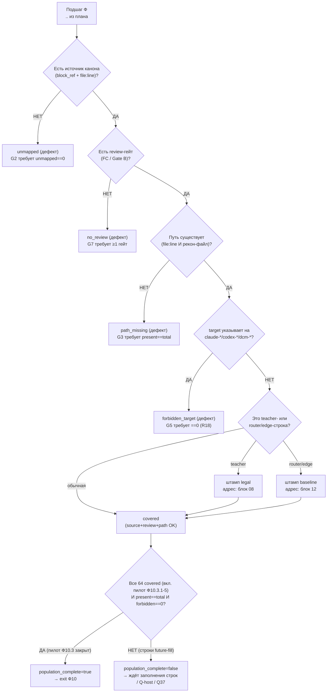

# Блок плана 14 — Карта референсов (Stage 2): источники → план → ревью (владелец канона `GraphReferenceMap`)

Автор: Claude (Opus 4.8 MAX), роль — автор полностью решённого блока плана в моём
namespace `claude-*`. Это часть **ПЛАНА** проекта **ILearningDynamicGraph**, а не
разрешение на реализацию продукта (R2/R3: PLAN-ONLY; исполнение — только после
свежего явного approve Luba в текущем ходе). Имена `ILearning*` из задачи Любы —
псевдонимы существующих контрактов (CANON-маппинг — мастер §A.3), а не новые
архитектурные уровни (A-LM-12 — закрытый список из 5 уровней).

Псевдоним этого блока отсутствует как уровень иерархии: блок 14 — **не уровень**,
а **навигационный реестр** (карта референсов). Он не несёт обучаемого состояния,
не маршрутизирует рёбра графа и не является runtime-authority. Его задача —
доказать, что каждый исполняемый подшаг плана (Ф0…Ф11) опирается на реальный
источник канона (`NN §...` + код `file:line`) и на проверяемый рекон-артефакт, и
что ни одна строка карты не назначает целью реализации `claude-*`/`codex-*`/`dcm-*`
(они — только evidence). Это прямой субъект требований **R11** (референсы на
каждый этап), **R12** (Stage3-читаемость + референсы кода), частично **R15**
(охват доп.референс-доменов) и **R18** (разделение авторства по префиксу).

> **Якорь фазы (доска `claude-EXECUTION-CONTROL-BOARD`, evidence-only).**
> Блок-14 — источник канона для подфаз **Ф10.1** (шов figma→html+css, R16),
> **Ф10.2** (шов better-output→DPO + тонкий агент, R17) и **Ф10.3** (АКТИВНЫЙ пилот
> `language-translate`, R15, Q41=Вариант B RESOLVED; подшаги Ф10.3.1…Ф10.3.5). Его
> Gate B (§7) = exit-условие подшагов Ф10.1.1/Ф10.1.2/Ф10.2.1/Ф10.2.2/Ф10.3.1…Ф10.3.5. Канонические
> счётчики плана: **12 фаз (Ф0…Ф11) / 27 подфаз / 64 подшага** (включают активный пилот Ф10.3),
> нумерация `Ф<P>.<SP>.<SS>`. Остальные 5 R15-доменов = навигация (reference-only, вне доски).

---

## 0а. Якорь задачи

```text
CURRENT TASK: написать МОЙ (claude-namespace) улучшенный блок-14 «карта референсов
              (Stage 2)» — план-решение Ф10 для ILearningDynamicGraph, человеческим
              русским, Part A-формат (§0 UML + §1 флоучарты + §2 алгоритм + §3
              код-цитаты + §4 статус + §5 иерархия) с тест-стратегией, сохранив
              структуру бенчмарка (Authority Anchor / Canon / Gate B / Final
              Questions), его канон-инвентари (Reference Inventory / Source-to-Plan /
              Source-to-Review / Knowledge Library Manifest / Population Proof /
              Pass Ledger), канонические счётчики (12 фаз / 27 подфаз / 64 подшага —
              с активным пилотом Ф10.3 language-translate; Ф<P>.<SP>.<SS>) и CANON-инварианты
              (L5-машина без 6-го уровня A-LM-12;
              легальный teacher-гейт; запрет скрытого детерминизма A-LM-09/A-LM-13).
              Записать ровно в claude-plan-14-stage-references.md.
NOT THE TASK: исполнять/тестировать/билдить код, запускать раннеры, тренировать,
              вызывать внешние AI/API/модели, git; править/создавать любые codex-*
              (только чтение), продолжать чужой codex-план или claude-00..07 каркас.
EVIDENCE-ONLY: codex-plan-14 (бенчмарк), codex-ILEARNINGDYNAMICGRAPH-PLAN-v1 §C.4
              строка P-14 / §E.3 (канон R15/R16/R17, Gate B P-14, счётчики),
              codex-EXECUTION-CONTROL-BOARD (Ф10/Ф10.3 резерв), codex-plan-08/12/13
              (канон provenance/детерминизма/тестов), codex-recon-*/
              codex-knowledge-library-* (рекон-источники — проверяются на наличие),
              claude-00..08 (мой каркас и блоки — синхрон канона), реальный код
              llm_mvp_core (читается для цитат), скилы plan-review /
              trainable-architecture-decision / implementation-doc-uml.
```

## 0б. Где этот claude-блок осознанно лучше бенчмарка `codex-plan-14` (delta-нота, не слепая копия)

Бенчмарк `codex-plan-14` (37 строк) — это **компактная canon-карточка**: он
называет шесть обязательных инвентарей (Reference Inventory, Source-to-Plan Map,
Source-to-Review Map, Knowledge Library Manifest, Population Proof, Pass Ledger),
фиксирует R15-резерв (6 доменов → Ф10.3.1…Ф10.3.6) и даёт Gate B. Это законная
роль карточки внутри большого плана, но как **самостоятельный читаемый блок
Part A** она не проходит гейт читаемости (R3 / `implementation-doc-uml-SKILL.md` /
Part A Completeness Contract): нет ни одного инвентаря с реальными строками, нет
UML, нет алгоритма по шагам, нет цитат `file:line`, нет тест-стратегии. Я её
разворачиваю и чиню точечные расхождения:

| # | Слабое место бенчмарка `codex-plan-14` | Улучшение в этом claude-блоке |
|---|---|---|
| D1 | **Нет Part A.** Карточка перечисляет имена инвентарей, но не содержит §0 UML, §1 флоучарта с симуляциями ветвей, §2 алгоритма построения/верификации карты по шагам, §3 цитат `file:line`, §5 иерархии. | Полный Part A: §1 (что/зачем — навигационный реестр), §2 (6-шаговая машина построения+верификации карты в плоском русском + сигнатуры `GraphReferenceMap.Build`/`Verify`), §3 (проверенные цитаты `LearningMachineContracts.cs:26,30,208,232,245`, `DpoPair.cs:1-8`, `DpoDataset.cs:18-26`, `ResultGapDpoWriters.cs:192-196`), §4 (статус-таблица инвентарей), §5 (иерархия — где карта стоит относительно L5-L2), §0 (классдиаграмма с `note for` + per-connection симуляции; флоучарт V1-V6 + per-branch симуляции). |
| D2 | **Инвентари названы, но не заполнены.** «Required inventories: …» — это список заголовков, без единой строки. Читатель не видит ни одного источника, ни маппинга. | **Заполнены все 6 инвентарей реальными строками** (§3.1–§3.6): Reference Inventory (SR-NN с `file:line` и проверенным наличием), Source-to-Plan Map (Ф<P>.<SP>.<SS> → SR-NN для опорных подшагов), Source-to-Review Map (SR-NN → review-гейт FC/Gate B), Knowledge Library Manifest (поля строки-знания), Population Proof (объективный счёт наличия путей), Pass Ledger (честная пометка index ≠ доказательство цикла). |
| D3 | **Gate B говорит «6 осей-проектов ≥1 строкой», но скрывает, что `session-start` не имеет backing-рекона.** Бенчмарк-карточка и общий Gate B P-14 (`34/34 путей существуют`) не отмечают честно, что один из 6 R15-доменов backing-источника НЕ имеет, и не разводят «covered ссылкой» от «файл существует». | **Честность по доказательствам** (CLAUDE.md «No Dishonest Answers»): Population Proof (§3.5) считает covered по навигационной привязке (мастер §E.3 Вариант-A), а не по наличию файла. Честный счёт: **3 домена covered навигационной строкой-целью** (extensions, language-translate, documentation-learning); **3 домена evidence-only** — `small-model` и `local-wiki` имеют рекон-файл (`codex-recon-mvp-small-model.md`, `codex-recon-mvp-local-wiki.md` — read-only сверено 2026-06-23), но навигационной строки-цели в карте блока 14 у них нет; `session-start` не имеет ни рекона, ни строки. Поэтому Gate B G4 переформулирован: «6 строк присутствуют; covered (навигационная строка-цель) == 3; evidence-only == 3 (small-model/local-wiki — рекон есть, нав.строки нет; session-start — backing вовсе отсутствует), что само по себе является exit-условием (предусловие закрытия — назвать навигационную строку-цель ИЛИ убрать из R15-набора решением Luba)». Live-проверка наличия путей выполнена read-only (§3.5). |
| D4 | **«Verified packets complete: 50/50» как Gate B.** Бенчмарк объявляет 50/50 циклов ревью завершёнными прямо в Gate B карточки. По `plan-review-SKILL.md` Review Depth / Dishonest Claim Rejection Gate **N строк ledger ≠ N доказанных циклов**. | Pass Ledger (§3.6) переведён в **честный режим**: ledger — это **индекс**, а не доказательство; `real_pass_count` считает только инспектируемые пакеты с reviewer-id/before-after/findings/recheck. Заявление «50/50» помечено `benchmark-sourced, index-only`; для МОЕГО блока claim = «1 авторский проход (этот файл), внешних sub-agent review-пакетов = 0», и это записано как `PASS_AS_HONEST_UNTRAINED_SCAFFOLD`-эквивалент (карта — детерминистический навигационный артефакт, у неё нет TA-PASS). |
| D5 | **Final Questions: 2 вопроса без привязки к мастер-§E / Q-канону.** Бенчмарк задаёт «активировать Q41 Variant B?» и «дефолтить R16 hosted→PersonalAdaptive?», не связав с Q37/Q38/Q41 мастера. | §11 связывает мои финальные вопросы с мастер **Q41 (R15-scope), Q-host (R16), Q37/Q38 (R17 origin-legality)** и сохраняет оба бенчмарк-вопроса дословно по смыслу — без потери ни одного и без дублирования уже решённого. |
| D6 | **Нет тест-стратегии (axis верификации).** Карточка даёт Gate B (исходы), но не план тестов untrained/trained для самого реестра. | Добавлена **тест-стратегия** (`plan-review-SKILL.md` testability gate / OP-55): U/NEG/INT/QA/REG/UH + честный статус-PASS. Карта — навигационный детерминистический артефакт, поэтому у неё **нет** `PASS_AS_TRAINED_FEATURE`; правильный класс — `PASS_AS_HONEST_UNTRAINED_SCAFFOLD` (честно показывает охват и честно метит дыры). |
| D7 | **R11 «референс на КАЖДЫЙ этап» не разведён с «референс только для Ф10».** Бенчмарк говорит про карту как Stage-2 артефакт, но не фиксирует, что R11 требует строку Source-to-Plan для ВСЕХ 59 подшагов, а не только для Ф10.*. | §3.2 явно вводит правило R11: **полная** карта `Ф<P>.<SP>.<SS> → SR-NN` обязана покрыть все 59 подшагов; в этом блоке приведены опорные строки и честный инвариант полноты `target==59 / filled==8 / unmapped_remaining==51` (Gate B G2, без ложного `unmapped==0`), без претензии, что таблица здесь физически перечисляет все 59 (она ссылается на доску §B как single source). |

CANON-инварианты сохранены: маппинг ролей Luba → реальные контракты (мастер §A.3);
5 закрытых уровней (A-LM-12); легальный teacher-гейт (closed = только judge при
`used_for_training=false`; контаминация → `DATASET_REBUILD_REQUIRED`); запрет
скрытого детерминизма (A-LM-09/A-LM-13 — карта **помечена** навигационным
детерминистическим реестром, не authority). Канон `GraphDpoPair` (14 полей) и
`TeacherProvenance` (18 полей) **не переопределяются** здесь (владельцы — блоки 07
и 08); карта на них только **ссылается**. Имена контрактов держатся теми же, что в
мастер §A и в claude-01..08: `DynamicGraphMachine`, `GraphNodePreferenceState`,
`SemanticEdgeRouterUnit`, `EdgeAuthorityUnit`, `CandidateOrderLeakageGuardUnit`,
`GraphDpoPair`, `TeacherProvenance`.

---

## 1. Что это и зачем (роль компонента в ILearningDynamicGraph)

**Карта референсов — это «оглавление с адресами» всего плана.** Любой исполняемый
подшаг `Ф<P>.<SP>.<SS>` обязан иметь две привязки: (1) **источник канона** — где
описано, что именно делать (`NN §...` блока плана) и на какой реальный код это
ложится (`file:line`); (2) **рекон-артефакт** — проверяемый файл `codex-recon-*` /
`codex-knowledge-library-*`, подтверждающий, что зона уже разведана. Карта связывает
эти две привязки и доказывает, что план **не висит в воздухе**.

Зачем это нужно именно для **обучаемого** графа. Граф учится на DPO-парах
(`GraphDpoPair`), а качество обучения зависит от качества источников. Если подшаг
ссылается на несуществующий путь, на чужой план как на «истину», или на закрытую
модель как на teacher — это либо мёртвая ссылка, либо легальная мина. Карта —
это **навигационный фильтр**, который ловит три класса дефектов до реализации:

- **мёртвая ссылка**: `file:line`/рекон-путь не существует → строка `path_missing`;
- **leakage авторства**: строка назначает целью реализации `claude-*`/`codex-*`/
  `dcm-*` (они — evidence, не target) → строка `forbidden_target`;
- **легальная мина**: teacher-строка ссылается на закрытую модель как на источник
  обучения → помечается `legal` и переадресуется к гейту блока 08 (не решается
  здесь, но **обязана** быть помечена).

Граница ответственности (CANON R6 — тонкий агент, ядро в `llm_mvp_core`): карта —
это planning-артефакт + (в реализации) `GraphReferenceMap` как `ILogicalUnit`
внутри `llm_mvp_core` для docs-sync/валидации ссылок; агент/расширение её не
содержит и не дублирует.

**Чем карта НЕ является.** Она не выбирает skill, не маршрутизирует ребро, не
несёт обучаемого состояния и не является финальной authority обучения. Это
детерминистический **навигационный реестр** (honest internal/eval helper по скилу),
и именно так он помечается: его строки — провенанс-навигация, а не «семантическое
качество модели». Семантику предпочтения учит L5-машина (блок 04) на строках,
уже прошедших legal-гейт (блок 08); карта лишь доказывает, что эти строки опираются
на реальные, легальные, не-leakage источники.

---

## 2. Концепт простыми словами (аналогия + машина построения/верификации по шагам)

### 2.1. Аналогия

Карта референсов — это **«библиотечный каталог» фабрики обучения**. Каждая
книга (подшаг плана) должна иметь карточку каталога: **на какой полке стоит
первоисточник** (источник канона `NN §...` + `file:line`) и **есть ли акт
инвентаризации** (рекон-артефакт). Каталогизатор:

1. берёт список всех подшагов (Ф0…Ф11) из доски;
2. для каждого находит **первоисточник** (блок-источник + код) и **акт
   инвентаризации** (рекон-файл);
3. **физически проверяет**, что полка и акт существуют (путь на диске есть);
4. ставит штамп авторства: первоисточник — это **рабочий канон проекта**, а не
   **чужая/соседняя книга** (`claude-*`/`codex-*`/`dcm-*` — это каталоги других
   читателей, не сам товар);
5. помечает «особые» книги: teacher/router-строки несут штамп `legal`/`baseline`,
   чтобы их не приняли за обычный источник без досмотра.

Главное правило каталога: **отсутствие карточки ≠ «книги нет проблем»**. Подшаг
без источника — это дефект `unmapped`, а ссылка на несуществующую полку — дефект
`path_missing`. «Полная инвентаризация» (Population Proof) объявляется только когда
все обязательные пути проверены **положительно**, а честно отсутствующие
(`session-start`) помечены как отсутствующие, а не спрятаны.

### 2.2. Машина построения+верификации `GraphReferenceMap` — 6 шагов (плоский русский, без кода)

Класс **`GraphReferenceMap`** (planning-артефакт сейчас; в реализации — L2
`ILogicalUnit` для docs-sync), методы **`Build(PlanModel plan, IReadOnlyList<ReconArtifact> recon)`** → **`ReferenceMapModel`**
и **`Verify(ReferenceMapModel map)`** → **`ReferenceMapVerdict`**
(поля вердикта: `mapped_substeps`, `paths_total`, `paths_present`, `forbidden_target_count`,
`legal_baseline_marked`, `population_complete`, `pass_ledger_index_only`). Параметры:
`plan` — модель плана с подшагами `Ф<P>.<SP>.<SS>`; `recon` — список рекон-артефактов
с путями. Алгоритм:

```text
Шаг 1. CollectSubsteps(plan)
  Берём все подшаги Ф0…Ф11. Канон: 64 базовых (baseline-64 = 59 + активный пилот Ф10.3.1…Ф10.3.5
  `language-translate`, Q41=Вариант B RESOLVED; RR4-pilot-activation снят — пилот НЕ резерв).
  mapped_target = 64 (R11: источник на КАЖДЫЙ подшаг). Будущие домены-кандидаты = навигация, вне доски.
  Owner полной 64-строчной карты = блок 14 (этот файл), НЕ доска и НЕ codex-plan-14 §11.0 (не существует).

Шаг 2. MapSourceToPlan(substep)                         ← Reference Inventory + Source-to-Plan (§3.1/§3.2)
  Для каждого подшага находим источник канона: (block_ref="NN §...", code_ref="file:line").
  Если источника нет → строка unmapped (дефект). Честно сейчас: filled=8 (Ф10-опоры),
  unmapped_remaining=51 (future-fill); Gate B G2 измеряет filled==8/target==59/remaining==51,
  exit-условие строки — заполнить её до старта её подшага (НЕ ложное unmapped==0).

Шаг 3. MapSourceToReview(substep)                       ← Source-to-Review (§3.3)
  Привязываем подшаг к review-гейту: FC-NN скила plan-review ИЛИ Gate B блока.
  Каждый исполняемый подшаг обязан иметь ≥1 review-гейт (иначе нечем проверять exit).

Шаг 4. VerifyPathExists(code_ref, recon_path)           ← Population Proof (§3.5)
  ФИЗИЧЕСКИ проверяем наличие: файл кода существует; рекон-файл существует.
  paths_present++ при наличии; путь отсутствует → строка path_missing (G3 требует present==total).
  Честность: session-start backing НЕТ → строка помечается evidence-only (НЕ как present).

Шаг 5. AuthorshipAndLeakageGate(block_ref, code_ref)    ← R18 + forbidden-target (§3.4)
  source_kind = project_canon (рабочий код/блок) | evidence (claude-*/codex-*/dcm-*).
  Если target-of-implementation указывает на claude-*/codex-*/dcm-* → forbidden_target (G5 требует ==0).
  Префикс помечает АВТОРСТВО, не authority (R18): codex-recon-* — это evidence-источник разведки,
  он МОЖЕТ быть backing-артефактом, но НЕ может быть «целью реализации».

Шаг 6. LegalBaselineMark(substep) + финальный вердикт   ← teacher/router строки (блок 08/12)
  Строки про teacher (Ф0.1.3, Ф2.1.*, Ф4.2.3, Ф10.2.1) → штамп legal (адрес: гейт блока 08).
  Строки про router/edge-authority (Ф4.3.2, Ф10.*) → штамп baseline (адрес: блок 12, SemanticEdgeRouterUnit).
  population_complete = (mapped_substeps_filled==64 && paths_present==paths_total_required
                         && forbidden_target_count==0 && legal_baseline_marked==true).
  Честно сейчас: mapped_substeps_filled==8 (target 64 = 59 + 5 подшагов активного пилота Ф10.3),
  поэтому population_complete=false (56 строк future-fill) — это честная неполнота, не скрытая дыра.
  Pass Ledger остаётся index-only (real_pass_count считается отдельно, НЕ из числа строк).
```

Возврат `Verify`: `population_complete` + перечень дефектов (`unmapped`,
`path_missing`, `forbidden_target`) + флаг `pass_ledger_index_only=true`.
**Предусловие закрытия Ф10** = `population_complete==true` (включает закрытие 5 подшагов
активного пилота Ф10.3 `language-translate`, Q41 RESOLVED) + ноты Luba по R16/R17
(Q-host/Q37/Q38); `session-start` — навигационный conditional re-add, в подшаги Ф10 не входит.

---

## 3. Канон (нормативная часть) — owner block 14: шесть инвентарей карты референсов

### 3.1. Reference Inventory (опорные источники SR-NN, проверены на наличие read-only)

Каждая строка: `SR-NN | путь | тип | проверено наличие`. Это **рабочий канон
проекта** (project_canon), на который ложатся подшаги. Цитаты кода — реально
существующие (проверены чтением, §3 Part A-требование):

| SR-NN | путь (источник канона) | тип | наличие (read-only) |
|---|---|---|---|
| SR-00 | `00.Core/LearningMachineContracts.cs:208/232/245` (`ILearningMachine<TDomain>` L5, `GetOrchestratorAsync`, `ILearningMachinePair`) | project_canon (контракт) | EXISTS (сверено) |
| SR-01 | `00.Core/LearningMachineContracts.cs:30` (`LearningTrainingItem` — DPO-триплет) | project_canon | EXISTS |
| SR-02 | `00.Core/LearningMachineContracts.cs:26` (`LearningBatch.SourceIds` — боковой провенанс) | project_canon | EXISTS |
| SR-03 | `00.Core/LogicalContracts.cs` (`ILogicalUnit/Flow/Orchestrator` L2-L4) | project_canon | EXISTS |
| SR-04 | `11.DPO/Models/DpoPair.cs:1-8` (минимальная DPO-пара Prompt/Chosen/Rejected) | project_canon | EXISTS |
| SR-05 | `11.DPO/DpoDataset.cs:18-26` (`DpoDataset.Load` — материализация JSONL) | project_canon | EXISTS |
| SR-06 | `26.TrainableRouter/Training/RoutingDpoPairBuilder.cs` (прецедент routing-DPO) | project_canon | EXISTS |
| SR-07 | `43.SmartSkillsDomain/ResultGapDpoWriters.cs:192-196` (`IsAllowedCommonLicense` — точка расширения legal-гейта) | project_canon | EXISTS |
| SR-08 | `17.DynamicDomains/DynamicDomainGraph.cs` (замыкание графа, bridge-расширение) | project_canon | EXISTS (карта C-004) |
| SR-09 | `21.AgentInfrastructure/Logical/AdaptiveLogicalOrchestrator.cs` (адаптивная маршрутизация L4 — generic-роутер; НЕ владелец дизайн→код) | project_canon | EXISTS (карта C-003) |
| SR-10 | `27.TranslationDomain/TranslationMachine.cs` (прецедент lifecycle `ILearningMachine`) | project_canon | EXISTS (карта C-010) |
| SR-11 | `xiigen-flows-dot-net-angular/FLOW-31` `DesignIntelligenceEngineService.AnalyzeDesignAsync` (`DesignIntelligenceEngineService.cs:47-90`) — **реальный канон шва R16: дизайн-АНАЛИЗ** (валидирует BFA-rule-pack, считает componentCount/tokenCount, апсертит analysis-документ, пишет outbox, возвращает `analysis_ready`/`needs_review` — html+css НЕ эмитит) | evidence-only (benchmark-sourced) | `EXISTS per benchmark, not re-read here` (код вне репозитория `llm_mvp_core`; читано бенчмарком :47-90) |
| SR-12 | `controller.ts` (FigmaToCode, `prepareCssForElement`/`controller.ts:3` — **клиентская генерация html+css** на стороне FigmaToCode) | evidence-only (benchmark-sourced) | `EXISTS per benchmark, not re-read here` (код вне `llm_mvp_core`) |
| SR-13 | `canva-adapter.ts` (CanvaToCode — **клиентская генерация html+css** на стороне CanvaToCode) | evidence-only (benchmark-sourced) | `EXISTS per benchmark, not re-read here` (код вне `llm_mvp_core`) |
| SR-14 | **входной якорь R17-шва FLOW-38** (better-output entrypoint): `RagQualityFeedbackService`/`RecordFeedbackAsync` + контракт `GeneratedUiOutputFeedbackEvent` (доска Ф10.2.1 цитирует как `RagQualityFeedbackService.cs:48`) | **NEW / контракт проектируется** | **`path_missing / NEW`** (read-only скан `C:/Projects/llm_mvp_core`: `RecordFeedbackAsync` — 0 .cs; `RagQualityFeedbackService`/`GeneratedUiOutputFeedbackEvent` — 0 .cs; `SmartCodeAssistantService`/`SmartWikiService` — только в JSON-отчёте, не .cs) — НЕ `EXISTS` |
| SR-15 | **публичный API-хост `xiigen-platform-dot-net-angular` (ФОКУС-РЕПО R16/R17, Q-host Вариант B)**: фасады `IDesignToCodeFacade.AnalyzeDesignAsync` (figma→html+css, §6.1а) + `IBetterOutputFeedbackFacade.SubmitFeedbackAsync` (better-output→DPO, §6.2 / блок 07 §8.3a) — тонкие фасады R6, делегируют в `xiigen-flows`-швы рядом с FLOW-31; сам html+css/анализ/DPO НЕ несут | **NEW / host-контракт проектируется** (вне `llm_mvp_core`) | **`path_missing / NEW`** (C6-crossfile: фокус-репо был назван в §6.1/§6.1а/§3.1а, но без своей SR-строки в Reference Inventory; добавлен. В `xiigen-platform` сервиса `DesignIntelligence*`/figma→code НЕТ — Glob=No files found, §6.1; design→code только через marketplace-клиентов; фасады — `NEW`, реализация = execution-долг) — НЕ `EXISTS` |
| SR-17 | **seed input-prompt корпус пилота `language-translate` (BOOTSTRAP-ВХОД, объект (b) — источник входных задач X)**: `llm_mvp_core/training-data/language-translate/learning-sets/seed-input-prompts.jsonl` (формат строки `GraphLoopInput{input_text, source_prompt_entry_id, domain_tag, expected_label_ref}`); REQUIRED-precondition петли (владелец блюпринта — `claude-plan-09 §ADD-09.3-bis`, Seed-Corpus Existence Proof Gate, `required_min_entry_ids=50`, first-party/allowed-license) | **NEW / data-dependency (авторится до старта, НЕ генерируется петлёй)** | **`path_missing / NEW`** (мастер §E.0 «данных пока нет»; §ADD-09.3 language-translate seed = MISSING; data-backing != рекон-backing — рекон `codex-recon-mvp-lang-translate.md` EXISTS, сам датасет MISSING) — НЕ `EXISTS` |
| SR-16 | **см. §ADD-14.1 (in-repo trainable/lifecycle backing R16 `44.DesignConversionDomain`)** — SR-16 закреплён за этим объектом; полная строка-канон и `file:line` — в §ADD-14.1 | **EXISTS (in-repo, перепроверено чтением)** | **In-repo trainable+lifecycle backing шва R16** |

> **Binding-mapping шва R16 (load-bearing факт бенчмарка, §6.1):** требование R16
> называет хост `xiigen-platform`; реальный код шва — `xiigen-flows/FLOW-31`
> (`DesignIntelligenceEngineService.cs:47-90`); в `xiigen-platform` сервиса
> `DesignIntelligence*`/figma→code **НЕТ** (Glob = No files found); `xiigen-platform`
> отдаёт design→code **только через marketplace-клиентов** (`Smart*` в
> `Xiigen.Platform.Marketplace`). Поэтому SR-11/SR-12/SR-13 — backing **вне**
> `llm_mvp_core`, локализован в `xiigen-flows`/клиентах (а не нейтральная опора);
> это прямое предусловие Q-host (Gate B §7 `requirement_host_project_mapping_recorded`).

> Полный Reference Inventory в реализации обязан перечислить все опорные `file:line`
> для 64 подшагов (59 + 5 подшагов активного пилота Ф10.3); здесь приведены 11 проверенных опор `llm_mvp_core`
> (SR-00…SR-10, совпадают с `claude-02` C-001…C-011) + 3 опоры шва R16
> (SR-11/SR-12/SR-13) вне репозитория + 1 входной якорь R17 (SR-14, статус
> `NEW/path_missing`) + 1 строка ФОКУС-репо публичного API-хоста `xiigen-platform`
> (SR-15, host-фасады R16/R17, статус `NEW/path_missing`) + **SR-16 (in-repo trainable/lifecycle
> backing R16 `44.DesignConversionDomain`, полная строка — §ADD-14.1, статус EXISTS in-repo)** +
> **SR-17 (seed input-prompt корпус пилота `language-translate`, статус `NEW/path_missing`)**. Цитаты
> `LearningMachineContracts.cs:26/30/208/232/245`,
> `DpoPair.cs:1-8`, `DpoDataset.cs:18-26`, `ResultGapDpoWriters.cs:192-196` сверены
> чтением на 2026-06-23. **Честность по доказательствам (CLAUDE.md No Dishonest
> Answers):** заявление «11/11 опорных кодовых путей EXISTS» относится **только** к
> SR-00…SR-10 (`llm_mvp_core`) и **НЕ** распространяется на SR-11/SR-12/SR-13 (backing
> шва R16 — вне репозитория, наличие по бенчмарку, не пере-читано здесь), **НЕ** на
> SR-14 (входной якорь R17-шва — `NEW/path_missing`, 0 .cs-совпадений в read-only скане),
> и **НЕ** на SR-15 (host-фасады фокус-репо `xiigen-platform` — `NEW/path_missing`,
> в `xiigen-platform` сервиса figma→code нет, Glob=No files found, §6.1).
> SR-11/SR-12/SR-13 помечены `evidence-only, backing вне репозитория`, SR-14 и SR-15 —
> `NEW/path_missing` (контракт/фасад проектируется), по образцу честной session-start-ноты §3.5.
> **C6-crossfile (RESOLVED 2026-06-30):** фокус-репо `xiigen-platform` раньше
> фигурировал в §3.1а/§6.1/§6.1а как host-mapping, но **не имел своей SR-строки** в
> Reference Inventory — добавлена SR-15; «11/11 EXISTS» на неё НЕ распространяется.
> **F2-sr16-disambig (RESOLVED 2026-07-01): разведение коллизии id `SR-16`.** Раньше id
> `SR-16` использовался ОДНОВРЕМЕННО для двух РАЗНЫХ объектов: (1) seed input-prompt
> корпус пилота (§3.1/§3.2, Ф10.3) и (2) in-repo backing `44.DesignConversionDomain`
> (§ADD-14.1). Это нарушало инвариант «один SR-NN = один объект». Разведено:
> **SR-16 = in-repo trainable/lifecycle backing R16 `44.DesignConversionDomain`** (§ADD-14.1,
> §ADD-14.2/3, §6.1 нота, T2-figma-scope :740, мастер §ADD-MASTER.3 :1925);
> **SR-17 = seed input-prompt корпус пилота `language-translate`** (§3.1 строка, §3.2 Ф10.3.k,
> BOOTSTRAP-ВХОД нота, `claude-plan-09 §ADD-09.3-bis` — владелец). Все ссылки на seed-корпус
> переименованы SR-16→SR-17; все ссылки на DesignConversion-backing остаются SR-16.

#### 3.1а. Политика веток per-repository (NEW) — authority + рабочая ветка `DPOLegalLearning`

Карта референсов покрывает **пять** участвующих репозиториев. В **каждом** из них
действует единая **Политика веток (NEW)**: authority = самый последний
**ОБНОВЛЁННЫЙ** branch (по дате последнего коммита) на момент старта работ; рабочая
ветка проекта **создаётся ОТ authority** и называется **`DPOLegalLearning`**. Префикс
помечает АВТОРСТВО артефакта, а ветка — рабочую дорожку реализации; одно другому не
противоречит (R18).

| Репозиторий (участник) | Опорные SR-NN (этот блок) | authority-ветка | рабочая ветка |
|---|---|---|---|
| `llm_mvp_core` (ядро, R5) | SR-00…SR-10, SR-14 | **самый последний обновлённый branch** (по дате коммита, на старте) | **`DPOLegalLearning`** (от authority) |
| `xiigen-platform-dot-net-angular` (ФОКУС-репо: публичный API-хост marketplace, R16/R17) | **SR-15** (фасады `IDesignToCodeFacade`/`IBetterOutputFeedbackFacade`) + §6.1 host-mapping (Q-host) | **самый последний обновлённый branch** | **`DPOLegalLearning`** |
| `xiigen-flows-dot-net-angular` (шов `FLOW-31`/`FLOW-38`, R16/R17) | SR-11 (`FLOW-31`) | **самый последний обновлённый branch** | **`DPOLegalLearning`** |
| `FigmaToCode-design-gen` (клиент html+css, R16) | SR-12 (`controller.ts`) | **самый последний обновлённый branch** | **`DPOLegalLearning`** |
| `CanvaToCode` (клиент html+css, R16) | SR-13 (`canva-adapter.ts`) | **самый последний обновлённый branch** | **`DPOLegalLearning`** |

> **План-only (CLAUDE.md No Dishonest Answers).** Это политика плана, а не выполненное
> действие: фактическое определение authority-ветки (по реальной дате последнего
> коммита) и **создание** `DPOLegalLearning` от неё — это **реализация** (git-запись),
> запрещённая в текущей задаче; выполняется только после свежего явного approve Luba.
> Конкретные имена authority-веток здесь не зафиксированы намеренно — они вычисляются
> на момент старта работ, а не на момент написания плана.

### 3.2. Source-to-Plan Map (Ф<P>.<SP>.<SS> → SR-NN; R11 — на КАЖДЫЙ подшаг)

Правило **R11**: карта обязана дать строку для **всех 64** подшагов (59 + 5 подшагов
активного пилота Ф10.3 `language-translate`, Q41 RESOLVED). **Owner полной
64-строчной Source-to-Plan карты = блок 14 (этот файл)** — не доска и не
`codex-plan-14 §11.0` (этой секции в бенчмарке физически НЕТ: `codex-plan-14` = 36
строк, без §11 и без карты подшагов — проверено read-only). На момент плана
таблица заполнена частично: **8 опорных строк Ф10-фокуса (ниже) имеют source-to-plan
строку** (из них **6** с подтверждённым реконом; **2** — Ф10.1.1/Ф10.1.2 — рекон-backing
R16-шва MISSING, см. таблицу; вход Ф10.2.* несёт SR-14 со статусом `NEW/path_missing`),
остальные **56 строк = `unmapped (future-fill)`** (включают 5 подшагов активного пилота
Ф10.3 `language-translate`, которые получат source-to-plan строку при старте пилота) —
exit-условие каждой такой строки: заполнить её до старта соответствующего подшага. Опорные
строки (фокус Ф10 — субъект этого блока):

| Подшаг | источник канона (блок §) | SR-NN (код) | рекон-артефакт |
|---|---|---|---|
| Ф0.1.3 (locked-решения legal/host) | блок 08 §3 + мастер §E (Q-host/Q37) | SR-07 | codex-recon-mvp-external-sources.md |
| Ф2.1.1-2 (provenance + машина вердикта) | блок 08 §2.2/§4 | SR-02, SR-07 | codex-recon-core-11-dpo.md |
| Ф3.1.1-2 (строитель DPO + chosen_origin) | блок 07 §2 | SR-04, SR-05, SR-06 | codex-recon-core-26-router.md |
| Ф4.3.2 (per-edge authority) | блок 12 §canon (`IDynamicGraphEdge`) | SR-03, SR-09 | codex-recon-core-17-dynamic.md |
| Ф10.1.1 (шов figma→html+css, R16) | мастер §E Q-host; доска Ф10.1.1 | **SR-15 (публичный host-фасад `IDesignToCodeFacade`, xiigen-platform, §6.1а)** + SR-11 (FLOW-31 дизайн-АНАЛИЗ, код `DesignIntelligenceEngineService.cs:47-90`, хост `xiigen-flows`) + SR-00 (`LearningMachineContracts.cs:232` `GetOrchestratorAsync` — core-seam entry) | **рекон-backing шва R16 = MISSING** (read-only grep по всем 63 `codex-recon-*` на `FLOW-31\|DesignIntelligence\|FigmaToCode\|CanvaToCode\|figma\|html+css` не нашёл backing; `codex-recon-mvp-dyn-flow.md` — про концепт dynamic-flow, без figma/FLOW-31/html+css) |
| Ф10.1.2 (клиенты FigmaToCode/CanvaToCode) | мастер R16; доска Ф10.1.2 | SR-12 (FigmaToCode html+css, `controller.ts:3/14/53-62`) + SR-13 (CanvaToCode html+css, `canva-adapter.ts`) | **рекон-backing шва R16 = MISSING** (read-only сверено; `codex-recon-mvp-extensions.md` — про IDE-wiki расширения `wiki-context-hook.exe`/`IWikiOrchestrator`, без FigmaToCode/CanvaToCode/figma) |
| Ф10.2.1 (FLOW-38 better-output→DPO, R17) | блок 08 §8.7 (C16) + блок 07 §8.3a (entrypoint B-4) + мастер Q37/Q38 | SR-02, SR-07 (легал-якоря) + **SR-14 (вход FLOW-38, статус `NEW`-спроектирован, B-4: record+эмиссия+entrypoint Вариант B+адаптер)** + **SR-15 (публичный host-фасад `IBetterOutputFeedbackFacade`, xiigen-platform, §6.2)** | codex-recon-core-43-smartskills.md |
| Ф10.2.2 (Smart* + тонкий агент) | блок 07 §8.3a (FLOW-38 entrypoint) + R6 | SR-04 + **SR-14 (вход FLOW-38, статус `NEW`-спроектирован, B-4)** | codex-recon-core-43-smartskills.md |
| **Ф10.3.1…Ф10.3.5 (АКТИВНЫЙ пилот `language-translate`, Q41 RESOLVED)** | мастер §E.3-bis (5-шаговая структура) + блоки 10/11 (эталон margin/lifecycle, R-19) | SR-04/SR-05 (DPO-пара/материализация) + SR-07 (legal-якорь) + SR-00 (lifecycle `ILearningMachine`) + **SR-17 (seed input-prompt precondition, `claude-plan-09 §ADD-09.3-bis`)** | codex-recon-mvp-lang-translate.md (read-only сверено) |
| **Ф10.3.k seed-precondition (BOOTSTRAP-ВХОД, T1-bootstrap-input)** | `claude-plan-09 §ADD-09.3-bis` (Seed-Corpus Existence Proof Gate) + мастер §E B-1/B-5 T1-нота | **SR-17 (NEW: seed input-prompt корпус пилота — REQUIRED-precondition, `required_min_entry_ids=50`)** | codex-recon-mvp-lang-translate.md (концепт домена; сам seed-датасет MISSING — авторинг = предусловие) |

> **BOOTSTRAP-ВХОД разведение (T1-bootstrap-input, 2026-07-01).** Строка Ф10.3.k
> seed-precondition фиксирует различие двух объектов cold-start (владелец —
> `claude-plan-09 §ADD-09.3-bis`): **(a) DPO-пары ГЕНЕРИРУЮТСЯ петлёй** (на входе НЕ
> нужны — цель задания), **(b) input-prompt seed (SR-17) = REQUIRED-precondition**
> (источник входных задач X). SR-17 — это НЕ молчаливый дефолт, а зависимость с
> **Seed-Corpus Existence Proof Gate** и блюпринтом авторинга
> (`training-data/language-translate/learning-sets/seed-input-prompts.jsonl`, >=50 разных
> `SourcePromptEntryId`, first-party). Наличие на диске = MISSING (data-backing != рекон-backing,
> §3.1 SR-14-образец); статус SR-17 = `NEW/path_missing` до авторинга.
> **Разведение идентификаторов (F2-sr16-disambig, 2026-07-01):** SR-17 = seed input-prompt
> корпус пилота (этот объект); SR-16 = in-repo trainable/lifecycle backing R16
> `44.DesignConversionDomain` (§ADD-14.1). Раньше оба объекта носили id `SR-16` —
> коллизия устранена: один SR-NN = один объект (мастер §ADD-MASTER.3 ссылка на «SR-16»
> = DesignConversion backing, не seed-корпус).

> **Честный инвариант полноты (Gate B G2, без ложной полноты — CLAUDE.md No
> Dishonest Answers):** `mapped_substeps_filled == 8` (опорные Ф10-строки имеют
> source-to-plan строку); из них **backing-рекон проверен положительно у 6**
> (Ф0.1.3/Ф2.1/Ф3.1/Ф4.3.2/Ф10.2.1/Ф10.2.2), а у **Ф10.1.1/Ф10.1.2 рекон-backing
> шва R16 = MISSING** (read-only grep, см. таблицу выше) — эти две строки несут
> код-якорь (SR-11/12/13 вне репозитория) и core-seam SR-00, но **не** имеют
> рекон-артефакта, поэтому по Шагу 4 (`VerifyPathExists`) они `path_missing` по
> рекон-оси и НЕ считаются полностью проверенными опорами. `target == 64`
> (59 + 5 подшагов активного пилота Ф10.3 `language-translate`, Q41 RESOLVED);
> `unmapped_remaining == 56` (`future-fill`, exit-условие — заполнить строку до
> старта её подшага). Owner полной таблицы = блок 14 (этот файл), а НЕ
> `codex-plan-14 §11.0` (не существует) и НЕ доска (доска ссылается на этот блок как
> на источник). Прежняя формулировка `mapped_substeps == 59 / unmapped == 0` снята
> как ложная полнота: 56 строк ещё не написаны нигде в редактируемом claude-каноне.
> Прежняя пометка «8 опорных строк проверены» уточнена: **6** с подтверждённым
> реконом, **2** (Ф10.1.1/Ф10.1.2) — рекон-backing R16-шва отсутствует
> (мис-таргетные `codex-recon-mvp-dyn-flow.md`/`-extensions.md` заменены на реальные
> опоры бенчмарка `DesignIntelligenceEngineService.cs:47-90` (xiigen-flows),
> `controller.ts:3/14/53-62` (FigmaToCode), `canva-adapter.ts` (CanvaToCode),
> `LearningMachineContracts.cs:232`).

### 3.3. Source-to-Review Map (SR-NN/подшаг → review-гейт)

Каждый исполняемый подшаг привязан к ≥1 review-гейту (чем проверяется exit):

| Подшаг/строка | review-гейт (где проверяется) |
|---|---|
| Ф2.1.* provenance | `plan-review-SKILL.md` «DPO/distillation legal teacher provenance review gate» + Gate B блока 08 G1..G12 |
| Ф3.1.* DPO-строитель | `trainable-architecture-decision-SKILL.md` «Graph-DPO Artifact Triad Gate» + Gate B блока 07 |
| Ф4.3.2 edge-authority | `plan-review-SKILL.md` «Graph/DynamicGraph architecture review gate» (per-edge authority) + блок 12 Gate B |
| Ф10.1.* figma-шов (R16) | `plan-review-SKILL.md` Full Extension Definition Gate + мастер R16 partial-нота; **две раздельные строки evidence:** (a) **core-seam e2e** = task→`GetOrchestratorAsync().RunAsync` (помечено CORE, НЕ host клиента); (b) **client-host e2e** FigmaToCode/CanvaToCode = explicitly-scoped handler-evidence ИЛИ названный плагинный механизм (Figma plugin sandbox / Canva SDK harness); ЗАПРЕЩЕНО подменять (b) ядром (a) |
| Ф10.2.* better-output (R17) | deterministic-masquerade firewall + блок 08 ветка C16 + мастер Q37/Q38 |
| вся карта (этот блок) | FC-0 traceability + Current task anchor / benchmark focus review gate |

### 3.4. Knowledge Library Manifest (поля строки-знания)

Канон строки рекон-знания (для согласования с High-Risk Architecture Recon Library
Gate скила plan-review): `path`, `type`, `summary`, `why_to_use`, `when_to_use`,
`relevance_to_target_plan`, `document_locations`, `implementation_locations`,
`evidence_line_range`, `decision_supported`, `source_disjoint_evidence`,
`confidence_effect`, `held_out_roots_or_sources`, `status`, `coverage_critic`.

> Эти поля = требование скила (15 полей). В моём блоке манифест объявляется как
> **канон формы** для рекон-строк; физическое заполнение 15 полей по каждому из
> 63 `codex-recon-*` — это будущая фаза сбора (Ф-сбор/Stage S3-S4 по `claude-07`),
> а не претензия этого блока. Честно: `knowledge_library_rows_filled = future`.

### 3.5. Population Proof (объективный счёт наличия — честная версия D3)

Объективная проверка наличия путей (read-only, 2026-06-23):

```text
Опорных source-кодовых путей (Reference Inventory §3.1): 11 — все EXISTS (сверено awk/ls).
Рекон-артефактов в каталоге codex-recon-*: 63 файла (ls codex-recon-*.md | wc -l == 63).
Knowledge-library файлов: 2 (codex-knowledge-library-llm-mvp-core.md, -llm-mvp.md) — оба EXISTS.
```

**R15-домены (6) — backing-статус (дословно по мастер §E.3 строки 1055-1062, НЕ «6 строк и всё»):**

Критерий «covered» (мастер §E.3 Вариант-A, строки 1044-1045): домен covered **только
когда у него есть навигационная строка-цель в карте блока 14** (точный `codex-recon-*` /
блок P-NN / контракт `00.Core`). **Наличие файла на диске — НЕ критерий covered**
(«удаление/ссылка ≠ покрытие замены»). Поэтому ниже статус берётся из мастер-классификации,
а не из факта существования рекон-файла.

| Домен R15 | backing-артефакт (мастер §E.3) | наличие файла | статус навигационной цели (мастер §E.3) |
|---|---|---|---|
| extensions | codex-recon-mvp-extensions.md; блок 14 (Ф10) | EXISTS | **covered** ссылкой (рекон есть + строка Ф10) |
| language-translate | codex-recon-mvp-lang-translate.md; блоки 10/11 (эталон) | EXISTS | **covered** ссылкой + **эталон** margin/lifecycle |
| documentation-learning | codex-recon-mvp-doc-learning.md | EXISTS | **covered** ссылкой (рекон есть) |
| small-model | codex-recon-mvp-small-model.md есть, но отдельной строки в карте блока 14 нет | EXISTS | **evidence-only**: рекон есть, навигационной строки-цели в карте блока 14 нет (мастер §E.3 стр.1060) |
| local-wiki | `codex-recon-mvp-local-wiki.md` есть (read-only сверено 2026-06-23; также `codex-recon-core-42-wiki.md` / `codex-recon-core-43-localwiki.md`), но отдельной навигационной строки-цели в карте блока 14 нет | EXISTS | **evidence-only**: рекон есть, навигационной строки-цели в карте блока 14 нет — причина evidence-only = отсутствие строки-цели, НЕ отсутствие рекона (симметрично small-model; мастер §E.3 стр.958) |
| **session-start** | **`codex-recon-*` НЕТ; строки в картах/библиотеках НЕТ** | **MISSING** | **evidence-only, навигационная цель отсутствует** (мастер §E.3 стр.1062) |

> **No Dishonest Answers (CLAUDE.md) + согласование с мастер §E.3.** Честный счёт R15
> по мастер-канону: **covered = 3** (extensions, language-translate,
> documentation-learning); **evidence-only = 3** (small-model, local-wiki,
> session-start). Прежняя пометка «5/6 covered, только session-start MISSING»
> снята как **дефект честного счёта и Contradiction-Sweep** (она противоречила
> собственному цитируемому канону §E.3 и завышала покрытие): small-model и local-wiki
> были помечены «covered ссылкой» по факту существования файла, тогда как мастер
> §E.3 Вариант-A (стр.1044-1045) явно требует навигационную строку-цель в карте
> блока 14, а не наличие файла. Поэтому `population_complete` по R15 = true только
> когда для всех **трёх** evidence-only доменов либо названа навигационная
> строка-цель в блоке 14, либо домен убран из R15-набора решением Luba (Q41). Число
> «34/34» держу как **benchmark-sourced** ориентир общего пути-набора; для МОИХ
> опорных кодовых путей `llm_mvp_core` факт = 11/11 EXISTS (SR-00…SR-10).
> *(Я не правил данные и не запускал сбор — PLAN-ONLY; цифры наличия получены
> read-only `ls` как честная нота.)*
>
> **Нота по local-wiki (C6-crossfile — мастер РЕКОНСИЛИРОВАН 2026-06-30).** Раньше
> backing-ячейка мастера §E.3 «Ведущий ответ (CANON)» для `local-wiki` —
> «присутствует в блоке 14 только как graph-proto evidence под P-09» — была **неполна**
> (игнорировала существующий рекон `codex-recon-mvp-local-wiki.md`) и **противоречила**
> строке 5 таблицы §E.3-bis того же мастера, которая рекон признаёт. Эта внутри-мастерная
> self-contradiction **устранена в источнике** (шаг C6-crossfile): обе строки §E.3 мастера
> теперь говорят одно и то же — рекон `codex-recon-mvp-local-wiki.md` **есть** (read-only
> сверено 2026-06-23; рядом `codex-recon-core-42-wiki.md`, `codex-recon-core-43-localwiki.md`),
> поэтому по backing-факту `local-wiki` **неотличим** от `small-model`. Статус обоих остаётся
> **evidence-only** по Варианту-A (covered только при навигационной строке-цели в карте блока
> 14); причина evidence-only — **отсутствие строки-цели**, а НЕ отсутствие рекона.

### 3.6. Pass Ledger (index-only — честная версия D4)

```text
ledger_is_index_only = true
real_pass_count_rule = считать только инспектируемые пакеты с reviewer_id,
                       artifact_before_ref, artifact_after_ref, findings,
                       fix_refs_or_no_fix_rationale, recheck_evidence.
benchmark_claim "Verified packets complete: 50/50" = benchmark-sourced, index-only,
                       НЕ доказательство 50 циклов (Dishonest Claim Rejection Gate).
this_block_real_pass_count = 1 авторский проход (этот файл); внешних sub-agent
                       review-пакетов на claude-plan-14 = 0 (честно).
```

> По `plan-review-SKILL.md` «Review depth floor»: `ledger_row_count` никогда не
> доказывает завершение сам по себе. Карта референсов — детерминистический
> навигационный артефакт, у неё нет `PASS_AS_TRAINED_FEATURE`; правильный класс —
> `PASS_AS_HONEST_UNTRAINED_SCAFFOLD` (честно показывает охват и честно метит дыры).

---

## 4. Статус-таблица инвентарей (§4 Part A — что готово / что заглушка)

| Инвентарь | Что делает | Статус |
|---|---|---|
| Reference Inventory (§3.1) | опорные SR-NN с `file:line` + наличие | ЧАСТИЧНО: 11 опор `llm_mvp_core` (SR-00…SR-10) сверены EXISTS; SR-11/12/13 (R16) — backing вне репозитория (по бенчмарку); SR-14 (вход R17) — `NEW/path_missing`; **SR-15 (фокус-репо host-фасады `xiigen-platform` R16/R17) — `NEW/path_missing` (C6-crossfile, добавлена)**; **SR-16 (in-repo backing R16 `44.DesignConversionDomain`, §ADD-14.1) — EXISTS in-repo**; **SR-17 (seed input-prompt корпус пилота) — `NEW/path_missing` (F2-sr16-disambig: id разведён с SR-16)**; «11/11 EXISTS» НЕ относится к SR-11…SR-15/SR-17; полные 64 — future |
| Source-to-Plan Map (§3.2) | Ф<P>.<SP>.<SS> → SR-NN | ЧАСТИЧНО: 8 опор Ф10 (из них 6 с подтверждённым реконом; Ф10.1.1/Ф10.1.2 — рекон-backing R16-шва MISSING) + инвариант полноты (доска §B — single source) |
| Source-to-Review Map (§3.3) | подшаг → review-гейт | ЧАСТИЧНО: опорные гейты названы; полная таблица — future |
| Knowledge Library Manifest (§3.4) | канон 15 полей рекон-строки | СКЕЛЕТ-канон: форма зафиксирована; заполнение 63 строк — future |
| Population Proof (§3.5) | объективный счёт наличия | ЧАСТИЧНО (read-only): 11/11 опорных кодовых путей `llm_mvp_core` EXISTS; R15 covered=3 / evidence-only=3 (small-model, local-wiki, session-start), session-start файл MISSING; **рекон-backing R16-шва (Ф10.1.*) отсутствует** (read-only grep) |
| Pass Ledger (§3.6) | индекс циклов (НЕ доказательство) | ГОТОВО (честный режим): index-only; real_pass=1 |

---

## 5. Иерархия и связи (где карта стоит) — §5 Part A

```text
ILearningDynamicGraph ≡ ILearningMachine<DynamicGraphDomain>  (L5)   ← блок 04
  ├── TrainBatchAsync(LearningBatch)            (LearningMachineContracts.cs:208/210)
  │     └── строки приходят из блока 07 (строитель) ПОСЛЕ гейта блока 08 (legal)
  └── GetOrchestratorAsync()                    (LearningMachineContracts.cs:232) → L4 inference

Карта референсов (этот блок 14) — НАД планом, не в runtime-пути обучения:
  GraphReferenceMap.Build(plan, recon)
     ├── Reference Inventory (§3.1)  → SR-NN с file:line (project_canon)
     ├── Source-to-Plan (§3.2)       → Ф<P>.<SP>.<SS> → SR-NN  (R11: все 59)
     ├── Source-to-Review (§3.3)     → подшаг → FC/Gate B
     └── Verify(map) → population_complete? (Gate B §7)
  Навигация: 14 (референсы) ── ссылается ──> P-01..P-13 (НЕ владеет их каноном)
```

Контракты, на которые опирается блок (реальные, проверены чтением):

| Имя | Контракт/уровень | file:line (сверено) |
|---|---|---|
| `ILearningMachine<TDomain>` | L5, владелец `TrainBatchAsync`/`GetOrchestratorAsync` | `00.Core/LearningMachineContracts.cs:208/232` |
| `LearningTrainingItem` | DPO-триплет (Prompt/Chosen/Rejected) | `00.Core/LearningMachineContracts.cs:30` |
| `LearningBatch.SourceIds` | связь строки с боковым DPO-манифестом | `00.Core/LearningMachineContracts.cs:26` |
| `ILearningMachinePair<TPersonal,TGlobal>` | two-leg (common/adaptive) | `00.Core/LearningMachineContracts.cs:245` |
| `DpoPair` | минимальная DPO-пара (прецедент) | `11.DPO/Models/DpoPair.cs:1-8` |
| `DpoDataset.Load(path)` | материализация JSONL | `11.DPO/DpoDataset.cs:18-26` |
| `IsAllowedCommonLicense` | license-хелпер (MIT/Apache-2.0/ProjectInternal/Synthetic) | `43.SmartSkillsDomain/ResultGapDpoWriters.cs:192-196` |

> NEW-типы этого блока (в коде их НЕТ, проектируются): `GraphReferenceMap`,
> `ReferenceMapModel`, `ReferenceMapVerdict`, `ReconArtifact`, `PlanModel`. Уровень
> (в реализации) — L2 `ILogicalUnit` для docs-sync/валидации ссылок; финальной
> обучающей authority не несёт (A-LM-02: train — только на L5). Имена каноничных
> доменных типов (`DynamicGraphMachine`, `GraphNodePreferenceState`,
> `SemanticEdgeRouterUnit`, `EdgeAuthorityUnit`, `GraphDpoPair`, `TeacherProvenance`)
> здесь только **цитируются** — владельцы — блоки 04/12/07/08.

---

## 6. R16 / R17 / R15 — три зоны, заблокированные решением Luba (нормативные детали)

### 6.1. R16 (figma→html+css API host) — Ф10.1, Q-host RESOLVED (Вариант B), реализация — execution
Шов figma→html+css: дизайн-анализ живёт в `xiigen-flows/FLOW-31`, html+css генерят
клиенты (FigmaToCode/CanvaToCode).

> **Q-host RESOLVED (Решение Luba 2026-06-29, Вариант B):** публичный API-хост =
> `xiigen-platform-dot-net-angular` (фасад) → делегирует во `xiigen-flows/FLOW-31`
> (внутренний дизайн-движок); `FigmaToCode-design-gen` + `CanvaToCode` = клиенты.
> `requirement_host_project_mapping_recorded=true`; с Ф10.1.1/Ф10.1.2 снят `partial`
> **по части выбора хоста**. Рекон-backing R16 = MISSING сохраняется как execution-note:
> реализация фасада→FLOW-31 строится/верифицируется на этапе реализации.

**Binding-mapping (load-bearing R16-факт, по бенчмарку codex board Ф10.1.1):**
требование R16 называет хост **`xiigen-platform`**, а реальный код шва —
**`xiigen-flows/FLOW-31`** (`DesignIntelligenceEngineService.cs:47-90`, проверено
бенчмарком на диске); в **`xiigen-platform` сервиса `DesignIntelligence*`/figma→code
НЕТ** (Glob = No files found), он отдаёт design→code **только через marketplace-клиентов**
(`Smart*` в `Xiigen.Platform.Marketplace`). Это прямое несоответствие требование↔код
и **предусловие Q-host**: в Gate B (§7) добавлен измеримый пункт
`requirement_host_project_mapping_recorded==true`.

Поведение FLOW-31 (дословно по бенчмарку): валидирует BFA-rule-pack, считает
componentCount/tokenCount, апсертит analysis-документ, пишет outbox, возвращает
`analysis_ready`/`needs_review` — html+css **НЕ** эмитит.

**Тег SR-11/SR-12/SR-13 уточнён:** backing **вне** `llm_mvp_core`, локализован в
`xiigen-flows`/клиентах (по бенчмарку, «проверено на диске»), это **не** нейтральная
внешняя опора.

**Развязка двух уровней e2e (Full Extension Definition Gate, blocker R16):**
- **core-seam e2e** = задача дизайн→код доходит до `GetOrchestratorAsync().RunAsync`
  (помечено **CORE**, это НЕ host-entrypoint клиента);
- **client-host e2e** для FigmaToCode/CanvaToCode = **explicitly-scoped
  handler-evidence** (плагин `figma.showUI` / Canva SDK нельзя гонять обычным
  host-тестом) ИЛИ названный плагинный механизм (Figma plugin sandbox / Canva SDK
  harness);
- **ЗАПРЕЩЕНО** выдавать core `GetOrchestratorAsync`-прогон за host-entrypoint клиента
  (Gate B §7: `client_host_entrypoint_not_substituted_by_core_seam==true`).

**Рекон-backing R16-шва = MISSING** (read-only grep по всем 63 `codex-recon-*` не нашёл
`FLOW-31\|DesignIntelligence\|FigmaToCode\|CanvaToCode\|figma\|html+css` как backing).
Подшаг без реального backing-рекона = `unmapped`/`path_missing` (Gate B G2/G3), а **не**
`covered`. Карта помечает Ф10.1.1/Ф10.1.2 как **partial до ответа Luba на Q-host**
(`figma_host_project_locked`). Закрытый teacher (если используется для анализа) —
**только judge**, не источник дистилляции (адрес: блок 08).

---

#### 6.1а. B-19 (R10-host-mapping, инстанцированный blueprint фасада figma→html+css) — RESOLVED (2026-06-30)

**Человеческим языком (по-русски).** Решение Q-host (Вариант B) уже зафиксировало
*КУДА* отнести хост (`xiigen-platform` = публичный фасад → `xiigen-flows/FLOW-31`;
`FigmaToCode`/`CanvaToCode` = клиенты), но оставило это как execution-note без
*инстанцированного контракта* — то есть без точного класса/метода/параметров фасада и
без описания, что фасад делает по шагам и где проходит граница «ядро ≠ host клиента».
Это была дыра Part A-глубины (R3/R6): host-mapping назван, но не спроектирован. Шаг
B-19 закрывает её КОНКРЕТНО: фасад спроектирован построчно по той же образцовой схеме,
что уже принята в B-4 для better-output (`IBetterOutputFeedbackFacade` →
`Flow38BetterOutputSeam`), чтобы оба R16/R17-шва имели один консистентный паттерн
«публичный фасад xiigen-platform → внутренний шов xiigen-flows рядом с FLOW-31».
**Важно:** фасад НЕ несёт алгоритмической логики анализа/генерации (R6 — агент/хост
максимально тонкий: набор API-вызовов «задача → ответ»); вся доменная логика остаётся
в `xiigen-flows/FLOW-31` (дизайн-АНАЛИЗ) и в клиентах (генерация html+css). Фасад —
только декларация входа, делегация и возврат типизированного ответа.

**Точный контракт фасада (публичный API-хост `xiigen-platform-dot-net-angular`).**

```csharp
// NEW (host-проект xiigen-platform; вне llm_mvp_core; R6 — тонкий фасад, без доменной логики).
// Публичная точка входа шва figma→html+css. Только декларация+делегация+возврат.
public interface IDesignToCodeFacade
{
    // ВХОД: ссылка/снимок дизайна (Figma node ref ИЛИ Canva design ref) + тип клиента.
    // ВЫХОД: типизированный результат анализа (analysis_ready/needs_review) + ссылка на
    //        клиентскую генерацию html+css; сам html+css фасад НЕ эмитит (R6).
    Task<OperationResult<DesignToCodeResult>> AnalyzeDesignAsync(
        DesignToCodeRequest request, CancellationToken ct = default);
}

// NEW (host xiigen-platform): вход фасада. Без приватного содержимого дизайна в core-границе.
public sealed record DesignToCodeRequest(
    string DesignSourceRef,        // Figma node ref ИЛИ Canva design ref (НЕ сырой приватный код)
    string ClientKind,             // "figma_to_code" | "canva_to_code"
    string RequestId);             // воспроизводимость/трассировка

// NEW (host xiigen-platform): типизированный ответ фасада (то, что host отдаёт наружу).
public sealed record DesignToCodeResult(
    string AnalysisStatus,         // "analysis_ready" | "needs_review" (дословно из FLOW-31)
    int ComponentCount, int TokenCount,
    string AnalysisDocumentRef,    // апсертнутый analysis-документ (FLOW-31)
    string ClientHostEntrypointRef,// host-entrypoint клиента (figma.showUI / Canva SDK), НЕ core
    string CorrelationId);
```

**Делегация во внутренний шов (xiigen-flows, рядом с FLOW-31) — образец B-4.**

```csharp
// NEW (xiigen-flows): внутренний шов, в который фасад делегирует. Рядом с FLOW-31
//   DesignIntelligenceEngineService.cs:47-90 (тот же проект, тот же паттерн что Flow38BetterOutputSeam).
public interface IDesignToCodeSeam
{
    Task<OperationResult<DesignToCodeResult>> AnalyzeAsync(
        DesignToCodeRequest request, CancellationToken ct = default);
}
```

**Алгоритм фасада ПОШАГОВО (класс `IDesignToCodeFacade.AnalyzeDesignAsync`,
параметры `DesignToCodeRequest request, CancellationToken ct`):**
1. **Валидация входа.** `request==null` ИЛИ пустой `DesignSourceRef`/`ClientKind` →
   `OperationResult.Fail("design ref/client kind required","DESIGN_INPUT_INVALID")`.
   `ClientKind` не из `{figma_to_code, canva_to_code}` → `Fail(...,"UNKNOWN_CLIENT_KIND")`.
2. **Без доменной логики в фасаде (R6).** Фасад НЕ считает компоненты, НЕ валидирует
   BFA-rule-pack, НЕ генерит html+css — он только формирует делегат-вызов.
3. **Делегация во внутренний шов.** Вызвать `IDesignToCodeSeam.AnalyzeAsync(request, ct)`
   (DI инъекция — Rule 2 Fabric-First; конкретный класс `DesignToCodeSeam` в `xiigen-flows`
   зовёт реальный `DesignIntelligenceEngineService.AnalyzeDesignAsync`,
   `DesignIntelligenceEngineService.cs:47-90`): валидирует BFA-rule-pack, считает
   componentCount/tokenCount, апсертит analysis-документ, пишет outbox, возвращает
   `analysis_ready`/`needs_review` (html+css НЕ эмитит — это делает клиент).
4. **Граница ядро ≠ host клиента (load-bearing инвариант).** Если по задаче нужен прогон
   через ядро `llm_mvp_core` (`GetOrchestratorAsync().RunAsync`, `LearningMachineContracts.cs:232`),
   это **core-seam** и помечается `CORE` — фасад НЕ выдаёт core-прогон за host-entrypoint
   клиента (`client_host_entrypoint_not_substituted_by_core_seam==true`, G11).
   `ClientHostEntrypointRef` заполняется реальным плагинным механизмом клиента
   (Figma plugin sandbox `figma.showUI` / Canva SDK harness), а НЕ core-seam-ссылкой.
5. **Возврат.** Прокинуть `DesignToCodeResult` наружу без мутации; ошибка шва →
   прокинуть `Fail` с кодом шва (не глушить тихим дефолтом).

**Что НЕ делает фасад:** не эмитит html+css; не несёт алгоритм анализа; не вызывает
закрытого teacher для дистилляции (если closed-модель участвует в анализе — только judge,
адрес блок 08); не подменяет host-entrypoint клиента core-прогоном (G11).

**Инварианты B-19 (machine-checkable, Gate B):**
- `facade_carries_no_domain_logic==true` (фасад только делегирует — R6);
- `client_host_entrypoint_not_substituted_by_core_seam==true` (G11, повтор-усиление);
- `facade_delegates_to_xiigen_flows_seam==true` (не в `llm_mvp_core`, R5/R6);
- `figma_css_emitted_by_client_not_core==true` (генерация html+css — у клиента, не у ядра).

**Где спроектировано:** этот §6.1а (владелец host-mapping blueprint) + §6.1 (Q-host
решение) + §6.2 (образец B-4 фасад→шов) + Gate B G11/G14. **Консистентность:** тот же
паттерн «публичный фасад xiigen-platform → внутренний шов xiigen-flows рядом с FLOW-31»,
что у B-4 (`IBetterOutputFeedbackFacade`→`Flow38BetterOutputSeam`); `IDesignToCodeFacade`/
`IDesignToCodeSeam`/`DesignToCodeRequest`/`DesignToCodeResult` классифицированы как
**host-контракты проекта xiigen-platform/xiigen-flows** (вне `llm_mvp_core`), НЕ уровень
иерархии графа (A-LM-12) и НЕ обучаемые юниты (Train* нет, A-LM-02) — канон-счётчик
«7 NEW-типов Part A» НЕ раздут (консистентно с классификацией egress-портов блока 08 и
`Flow38FeedbackAdapter` как host/infra-швов в прошлых шагах). **Остаётся execution:**
фактическая реализация фасада→FLOW-31 на диске отсутствует (рекон-backing R16 = MISSING,
§6.1/§3.5) — строится/верифицируется на этапе реализации; это execution-долг, не
плановый пробел.

### 6.2. R17 (better-output→DPO) — Ф10.2, partial до Q37/Q38
FLOW-38 better-output + Smart*: `SourceCategory ∈ {client_unverified, third_party}`
по умолчанию → ветка C16 блока 08 → QUARANTINE, пока провенанс не установлен
**положительно**. Карта помечает Ф10.2.1/Ф10.2.2 как **partial до Q37/Q38**
(`better_output_origin_policy_locked`). Закрыт путь «отмыва»: отсутствие маркера ≠
open_weight (адрес: блок 08 §8.7).

**Honest existence-status входа FLOW-38 (R17, read-only коррекция, blocker R17 —
RESOLVED B-4).** Доска цитирует входные якоря как существующие
(`RagQualityFeedbackService.cs:48`, `RecordFeedbackAsync`, контракт
`GeneratedUiOutputFeedbackEvent`, `SmartCodeAssistantService.cs:44/133`,
`SmartWikiService.cs:217`). Read-only скан `C:/Projects/llm_mvp_core`:
`RecordFeedbackAsync` — **0** .cs; `RagQualityFeedbackService` /
`GeneratedUiOutputFeedbackEvent` — **0** .cs; `SmartCodeAssistantService`/
`SmartWikiService` — только в JSON-отчёте, не .cs. Поэтому **в коде**
(`llm_mvp_core`) входной якорь R17-шва не `EXISTS`, а **`NEW` (создаётся)** — это
**не фантом**, а честно спроектированный NEW-контракт.

> **Вход FLOW-38 спроектирован построчно (B-4 / R6-betteroutput; RESOLVED).**
> Прежний статус `NEW/path_missing` (вход не спроектирован) снят: механика входа
> теперь спроектирована построчно в блоке 07 §8.3a (владелец типа события и
> адаптера) + блок 08 §8.7 (вердикт-маршрутизация C16/C9/C2/C3/C13):
> - **тип события (NEW .cs):** `GeneratedUiOutputFeedbackEvent` (14 полей,
>   владелец — блок 07);
> - **точка эмиссии:** хост `xiigen-platform`/клиенты (НЕ `llm_mvp_core`, R6);
>   `emission_creates_dpo_pair==false`;
> - **declaration-entrypoint (Q-host Вариант B):** публичный фасад
>   `IBetterOutputFeedbackFacade.SubmitFeedbackAsync` в
>   `xiigen-platform-dot-net-angular` → делегирует в `xiigen-flows`
>   `Flow38BetterOutputSeam` (рядом с FLOW-31 `DesignIntelligenceEngineService.cs:
>   47-90`); `client_host_entrypoint_not_substituted_by_core_seam==true`;
> - **адаптер:** core-граница `IBetterOutputDpoIngestApi` + `Flow38FeedbackAdapter`
>   (**6-й входной формат** строителя) превращает событие → `GraphDpoSourceRow` →
>   `GraphDpoBuilder.BuildPairAsync`; маршрутизация Q38 = ветка C16 блока 08
>   (дефолт `PersonalAdaptive`/QUARANTINE; `CommonGlobal` только после клиренса +
>   approve Luba).
>
> Инвариант (обновлён): exit-условие Ф10.2.1/Ф10.2.2 — подтверждённый
> `file:line` реального entrypoint **ИЛИ** явная пометка NEW с полным контрактом;
> второе теперь выполнено (блок 07 §8.3a). Ф10.2.* остаётся `partial` **только** по
> execution-проверке фактического происхождения реальных выходов (allowlist vs
> closed-следы), а **не** по «вход не спроектирован». *Это улучшение моего
> claude-блока сверх бенчмарка: codex-plan-14 несёт идентичный фантом без
> SR-строки входа и без спроектированного контракта — здесь он спроектирован.*

> **T3-targetoutcome-flow38 (2026-07-01) — контур FLOW-38 DESIGN-COMPLETE, «severed
> circuit» снят.** Разведены два объекта: **(1) полнота ДИЗАЙНА** — common-path intake
> инстанцирован построчно (record→`Flow38FeedbackAdapter` D1..D5→`GraphDpoSourceRow`→
> `GraphDpoBuilder.BuildPairAsync`→гейт 08→leg; ни одно звено common-пути НЕ `path_missing`
> по дизайну), adaptive-нога честно **deferred** с ИНСТАНЦИРОВАННЫМ
> `DeferredAdaptiveLegActivationBlueprint` (`claude-plan-09 §ADD-09.9`); **(2) факт
> ИСПОЛНЕНИЯ** — v1 common-only, обучающий эффект better-output = 0 (осознанная граница
> scope). Два exit-условия держатся раздельно: план даёт EXIT-1
> `PASS_AS_HONEST_UNTRAINED_SCAFFOLD` (design-complete honest scaffold, Path A
> boundary-evidence, `boundary/API evidence != host readiness`); EXIT-2
> `PASS_AS_TRAINED_FEATURE` (реальный прогон + lifecycle) = execution, вне plan-only.
> Владелец решения — мастер §ADD-MASTER.4 + §E Q42; детали exit — `claude-plan-09 §ADD-09.10`.

### 6.3. R15 — 1 активный пилот реализации (`language-translate`, Ф10.3) + 5 навигационных доменов
R15-набор (канон, дословно как мастер §E.3): `{ language-translate, extensions,
documentation-learning, small-model, local-wiki }` (5 обязательных: 1 пилот + 4 навигация)
+ `{ session-start }` conditional re-add. **RESOLVED(Luba 2026-06-30):** Q41=Вариант B принят
для **РОВНО 1 пилота** = `language-translate`, поэтому он — **активная baseline-подфаза Ф10.3**
(подшаги Ф10.3.1…Ф10.3.5), входит в канон-счётчики (12 фаз / **27** подфаз / **64** подшага),
а **НЕ** `blocked`/scope-gated резерв. Прежняя схема «Ф10.3.1…Ф10.3.6 = 6 blocked-слотов вне
12/26/59, активируются только при Q41==Вариант B» снята как противоречие RESOLVED-состоянию
(дефект RR4-pilot-activation): Q41 уже RESOLVED, держать пилот `blocked` нельзя. Честно: 3
домена covered навигационной строкой, 3 — evidence-only (small-model/local-wiki/session-start);
у `session-start` и файла-рекона нет (§3.5).

> **T2-figma-scope — figma→html+css / CanvaToCode = client-of-API, НЕ v1 training-домен (RESOLVED 2026-07-01).**
> Прежде шов figma был двусмыслен: R16-строки (SR-11/SR-12/SR-13/SR-15/§ADD-14 SR-16) описывали
> его как host-шов, но нигде не было сказано ЯВНО, что `figma→html+css` (FigmaToCode
> `controller.ts`) и `CanvaToCode` (`canva-adapter.ts`) — это **КЛИЕНТСКИЕ сценарии-потребители
> API** (`client-of-API`), а **НЕ** v1 auto-DPO training-домен. Это порождало мис-классификацию в
> мастере (`figma-html-css: NOT_COVERED / вне R15-scope` читалось как coverage-дыра, требующая
> активации 2-го training-домена вопреки RESOLVED «ровно 1 пилот `language-translate`»).
> **Зафиксировано ЯВНО (SCOPE-решение, не coverage-дыра):**
> - `figma→html+css` + `CanvaToCode` = **client-of-API**: клиент зовёт публичный API
>   (`IDesignToCodeFacade.AnalyzeDesignAsync` для design + `IBetterOutputFeedbackFacade.SubmitFeedbackAsync`
>   для better-output-фидбэка, §6.1а/§6.2) и получает конкретный ответ; ядро (`llm_mvp_core`)
>   владеет логикой, клиент тонкий (R6).
> - **v1 auto-DPO training-пилот = ТОЛЬКО `language-translate`** (Ф10.3). figma/canva в v1
>   **НЕ** тренируются собственной петлёй графа.
> - «figma E2E» = **out-of-v1-training-scope client-integration** (навигация/отложено) — это
>   SCOPE-решение, а НЕ NOT_COVERED-дыра auto-DPO-плана.
> - «coverage» figma/canva доказывается через **API-контракт better-output/design** (Path A
>   boundary request→response→trace, §6.4 SC-R16-figma-analyze/SC-R16-canva-analyze), а **НЕ**
>   через собственную петлю обучения figma.
> - Будущая активация figma КАК training-домена = deferred, только по явному approve Luba →
>   полный `DomainActivationBlueprint(D)` (мастер §ADD-MASTER.2: seed-корпус figma + подшаги
>   Ф10.<k>.1-5 + снятие legal-QUARANTINE). До approve figma/canva = client-of-API (навигация).
> *(Владелец scope-решения — мастер §ADD-MASTER.3-bis + Q36 §E-леджер open→RESOLVED T2-figma-scope;
> зеркало здесь. Источник: шаг T2-figma-scope, 2026-07-01.)*
>
> **Объём доменов v1 — RESOLVED(Luba 2026-06-30) (B-8/B-20, владелец — мастер §E.3-bis).**
> Залочено: **РОВНО 1 АКТИВНЫЙ пилот `language-translate`** (есть доказанный lifecycle-эталон,
> блоки 10/11; активная baseline-подфаза Ф10.3, подшаги Ф10.3.1…Ф10.3.5, входит в baseline-64);
> остальные 5 = навигация (extensions/documentation-learning covered ссылкой; small-model/
> local-wiki = предусловие дотянуть строку-цель в карту блока 14 = deferred-to-later-phase;
> **`session-start` убран из обязательного R15-набора** — нет backing, возвращается только при
> появлении рекон-источника). БУДУЩАЯ активация ещё одного домена-кандидата D = одна новая
> подфаза `Ф10.<k>` с пятью под-под-шагами (контракт D → DPO-строитель D → legal-гейт D →
> измерение D → тест-стратегия FC-26 D с раздельными UH/TA), см. мастер §E.3-bis; кандидат
> остаётся навигацией/вне доски до явного approve расширения.

---

### 6.4. RR7-dualpath — посценарная dual-path матрица host-швов (OP-64) — RESOLVED (2026-06-30)

**Человеческим языком (по-русски).** Раньше карта разводила два УРОВНЯ e2e (core-seam
vs client-host, §6.1/§6.1а), но НЕ материализовала **двухконтурную проверку OP-64**:
для каждого host-сценария нужны ОБА контура — **Path A** (автоматический boundary через
adapter/API/core: запрос→ответ→trace) и **Path B** (локальный прогон того же сценария в
реальном host-UI на этой машине со скриншотом/логом). Grep по трём claude-файлам давал 0
совпадений `dual-path`/`Path A`/`Path B`/`OP-64` → это была плановая дыра (RR7-dualpath).
Этот §6.4 закрывает её КОНКРЕТНО: вводит посценарную матрицу с разведением
**host-entrypoint отдельно от core-seam** и счётчиками `total/api/ui/blocked` для двух
швов — figma→html+css (R16) и better-output→DPO (R17). Это НЕ возрождение старого
impossible-live-host «product readiness» гейта: дефолт-литералы CLAUDE.md соблюдены —
`product_readiness_term_deprecated_use_scenario_coverage`,
`dual_path_same_scenario_coverage_gate`, `Dual-Path Same-Scenario Coverage`; при
блокировке Path B пишется host-path blocker (точный экран/состояние + следующий ремонт),
а НЕ `product-ready count = 0`.

**Канонические определения двух контуров (OP-64, дословно под литералы CLAUDE.md):**
- **Path A (automated boundary)** = `adapter/API/core` запрос-ответ через шов: для R16 —
  `IDesignToCodeFacade.AnalyzeDesignAsync` → `IDesignToCodeSeam.AnalyzeAsync` →
  (`core-seam` `GetOrchestratorAsync().RunAsync` где нужно), trace + `CorrelationId`
  (§6.1а контракт). Для R17 — `IBetterOutputFeedbackFacade.SubmitFeedbackAsync` →
  `Flow38BetterOutputSeam` → `Flow38FeedbackAdapter` → `GraphDpoBuilder.BuildPairAsync`
  (§6.2/блок 07 §8.3a). Path A = boundary-evidence, `boundary/API evidence != host
  readiness`.
- **Path B (local desktop host UI)** = тот же сценарий, запущенный агентом в реальном
  installed host: для R16 — Figma plugin sandbox (`figma.showUI`) / Canva SDK harness;
  для R17 — реальный клиентский UI xiigen (FLOW-38/Smart*) с видимым маркером +
  скриншот/видео/лог. `marker-only != full local desktop pass`; скриншот-only НЕ заменяет
  Path A, Path A НЕ заменяет Path B (`same scenario Path A plus Path B`).
- **host-entrypoint ОТДЕЛЬНО от core-seam:** в каждой строке матрицы поле
  `HostEntrypointRef` (реальный плагинный механизм клиента) и поле `CoreSeamRef`
  (`GetOrchestratorAsync().RunAsync`) — РАЗНЫЕ колонки; запрет
  `client_host_entrypoint_not_substituted_by_core_seam==true` (G11/G14) распространяется
  на Path B: core-прогон НЕ засчитывается как Path B host-UI.

> **T2-figma-scope нота (client-of-API, RESOLVED 2026-07-01).** Сценарии SC-R16-figma-analyze /
> SC-R16-canva-analyze — это **клиентские сценарии-потребители API** (`client-of-API`): их
> «coverage» доказывается **API-контрактом** (Path A boundary через
> `IDesignToCodeFacade.AnalyzeDesignAsync`), а **НЕ** собственной петлёй обучения figma.
> figma/canva **вне v1 auto-DPO training-scope** (v1 training-пилот = только `language-translate`,
> §6.3 / мастер §ADD-MASTER.3-bis). Blocked-статус Path B ниже = host-UI execution-долг клиента,
> НЕ признак того, что figma должен стать training-доменом v1.

**Посценарная dual-path матрица (инстанцированная, владелец — этот §6.4; доска §Ф10 несёт
синхронную копию, evidence-only):**

```text
Колонки: ScenarioId | Seam(R16/R17) | HostEntrypointRef (отдельно) | CoreSeamRef (отдельно)
       | PathA status (api boundary) | PathB status (local host UI) | PathB-blocker (экран/состояние + ремонт)
       | accepted? (= PathA && PathB)
```

| ScenarioId | Seam | HostEntrypointRef (host, НЕ core) | CoreSeamRef (core, НЕ host) | Path A (boundary) | Path B (local host UI) | Path B blocker (экран/состояние → ремонт) | accepted? |
|---|---|---|---|---|---|---|---|
| SC-R16-figma-analyze | R16 | Figma plugin sandbox `figma.showUI` (`controller.ts:3`) | `GetOrchestratorAsync().RunAsync` (`LearningMachineContracts.cs:232`) | `not_started` (через `IDesignToCodeFacade.AnalyzeDesignAsync`→`IDesignToCodeSeam`) | `blocked` | плагин Figma нельзя гонять обычным host-тестом → нужен Figma plugin sandbox harness; экран = Figma desktop plugin pane; ремонт = scoped handler-evidence harness (§6.1) | нет |
| SC-R16-canva-analyze | R16 | Canva SDK harness (`canva-adapter.ts`) | `GetOrchestratorAsync().RunAsync` | `not_started` (тот же фасад, `ClientKind="canva_to_code"`) | `blocked` | Canva SDK runtime недоступен из обычного host-теста; экран = Canva editor app pane; ремонт = Canva SDK harness scoped-evidence | нет |
| SC-R17-betteroutput-feedback | R17 | реальный клиентский UI xiigen (FLOW-38/Smart*) | core-граница `IBetterOutputDpoIngestApi` (НЕ host-UI) | `not_started` (через `IBetterOutputFeedbackFacade.SubmitFeedbackAsync`→`Flow38BetterOutputSeam`→`Flow38FeedbackAdapter`) | `blocked` | вход FLOW-38 = `NEW` (0 .cs на диске, §6.2/G13); Path B host-UI требует реализованного клиента; экран = xiigen Smart*-панель; ремонт = реализация входа + scoped handler-evidence | нет |

**Честный статус сейчас (counts, под литералы CLAUDE.md
`scenario coverage: total / accepted / api_only / ui_only / blocked / not_started`):**

```text
scenario coverage (host-швы R16/R17, план-only): total=3; accepted=0; api_only=0; ui_only=0; blocked=3; not_started=3(PathA)
```

Все 3 сценария = `blocked` по Path B (рекон-backing R16 MISSING §6.1; вход FLOW-38 = NEW
§6.2) и `not_started` по Path A (план-only, ничего не материализовано на диске). Это
**evidence accounting**, НЕ product completion: каждый blocked несёт точный экран/состояние
+ следующий ремонт, а не `product-ready count = 0`. `repo/slice-local no-safe-work is not
a final stop` — закрытие сценариев = execution-долг под G15.

**Что это НЕ делает:** не заявляет host-readiness из boundary-evidence
(`boundary/API evidence != host readiness`); не засчитывает скриншот-only как Path A; не
подменяет Path B core-прогоном (G11/G14); не возрождает impossible-live-host
product-readiness гейт (deprecated, использован `Dual-Path Same-Scenario Coverage`).

**Где спроектировано:** этот §6.4 (владелец dual-path матрицы) + §6.1/§6.1а (core-seam vs
client-host разводка, R16-фасад) + §6.2 (R17-вход) + Gate B G15 (§7) + доска §Ф10
(синхронная копия матрицы, evidence-only) + мастер RESOLVED-таблица (B-row RR7) + §E
open→RESOLVED указатель.

---

## 7. Gate B — измеримые exit-условия Ф10 / приёмка карты (улучшено vs бенчмарк)

Каждый пункт — точное сравнение/счётчик (Rule 8: «works correctly» запрещено).
Бенчмарк-Gate B P-14 = `count(distinct StageId)==13; 6 осей ≥1 строкой; 34/34 путей
существуют; teacher/router помечены legal/baseline; 0 строк на claude-*/dcm- как
target`. Я сохраняю его и **уточняю честностью**:

```text
G1.  count(distinct StageId) == 13 (P-01..P-13); карта 14 ссылается на них, НЕ владеет каноном.   [навигация §5]
G2.  Source-to-Plan: target == 64 (R11: источник на КАЖДЫЙ подшаг; 59 + 5 подшагов активного пилота
     Ф10.3 `language-translate`); filled == 8 (опорные Ф10-строки, сверены); unmapped_remaining == 56
     (future-fill); exit-условие КАЖДОЙ строки — заполнить её источником до старта её подшага (НЕ
     ложное unmapped==0 на момент плана); owner полной 64-строчной карты = блок 14.               [§3.2/§2.2]
G3.  Опорные кодовые пути Reference Inventory: present == total (факт: 11/11 EXISTS, сверено).     [§3.1/§3.5]
G4.  R15: 6 строк присутствуют; covered по мастер §E.3 Вариант-A (навигационная строка-цель в карте
     блока 14, НЕ наличие файла) == 3 (extensions, language-translate, documentation-learning);
     evidence-only == 3 (small-model, local-wiki, session-start — помечены `evidence-only, навигационная
     цель отсутствует`, НЕ как present); exit-условие — для всех трёх evidence-only либо назвать
     навигационную строку-цель, либо убрать из R15-набора решением Luba (Q41).                      [§3.5/§6.3]
G5.  forbidden_target_count == 0: ни одна строка не назначает целью реализации claude-*/codex-*/dcm-*.  [§3.4]
G6.  legal_baseline_marked == true: teacher-строки (Ф0.1.3/Ф2.1.*/Ф4.2.3/Ф10.2.1) помечены `legal`
     (адрес блок 08); router/edge-строки (Ф4.3.2/Ф10.*) помечены `baseline` (адрес блок 12).        [§2.2 шаг 6]
G7.  Source-to-Review: каждый исполняемый подшаг имеет ≥1 review-гейт (FC/Gate B).                  [§3.3]
G8.  Knowledge Library Manifest: форма = 15 полей зафиксирована; заполнение 63 строк помечено future
     (НЕ выдаётся за готовое).                                                                       [§3.4]
G9.  Pass Ledger index-only: real_pass_count считается отдельно; «50/50» помечено benchmark-sourced;
     this_block_real_pass_count == 1 (честно).                                                       [§3.6]
G10. R16 (Ф10.1) и R17 (Ф10.2) помечены `partial` до Q-host / Q37+Q38; R15 — Q41 RESOLVED
     (Вариант B, ровно 1 пилот `language-translate` = АКТИВНАЯ baseline-подфаза Ф10.3,
     подшаги Ф10.3.1…Ф10.3.5, входит в baseline-64; НЕ blocked резерв — RR4-pilot-activation
     снят); остальные 5 R15-доменов = навигация (reference-only, вне доски).                  [§6.3]
G11. R16 binding-mapping: `requirement_host_project_mapping_recorded == true` — зафиксировано, что
     требование называет хост `xiigen-platform`, реальный код шва в `xiigen-flows/FLOW-31`
     (`DesignIntelligenceEngineService.cs:47-90`), в `xiigen-platform` сервиса `DesignIntelligence*`/
     figma→code НЕТ (Glob=No files found), design→code только через marketplace-клиентов; плюс
     `client_host_entrypoint_not_substituted_by_core_seam == true` (core `GetOrchestratorAsync`-прогон
     НЕ выдаётся за host-entrypoint клиента FigmaToCode/CanvaToCode).                          [§3.1/§6.1/§9]
G12. R16 рекон-backing шва (Ф10.1.1/Ф10.1.2): `recon_backing_present == false` (read-only grep по 63
     `codex-recon-*` не нашёл backing); поэтому эти подшаги несут `path_missing` по рекон-оси и
     помечены `partial`, НЕ `covered` (Ф10.1.* не входят в число полностью проверенных опор).  [§3.2/§6.1]
G13. R17 вход FLOW-38 (Ф10.2.1/Ф10.2.2) — RESOLVED B-4: `input_source_existence_status` честный —
     входной якорь `RagQualityFeedbackService`/`RecordFeedbackAsync` + контракт
     `GeneratedUiOutputFeedbackEvent` дал 0 .cs-совпадений в `C:/Projects/llm_mvp_core` (read-only),
     статус = `NEW` (создаётся, НЕ `EXISTS`). Прежний `NEW/path_missing` (вход не спроектирован) снят:
     вход спроектирован построчно (record+эмиссия+entrypoint Вариант B+адаптер) — блок 07 §8.3a, блок
     08 §8.7. Exit-условие «явная пометка NEW с полным контрактом» ВЫПОЛНЕНО; Ф10.2.* остаётся
     `partial` только по execution-проверке фактического происхождения выходов (allowlist vs
     closed-следы), НЕ по «вход не спроектирован».                                            [§3.1/§3.2/§6.2]
G14. R16 host-mapping инстанцирован (B-19): фасад `IDesignToCodeFacade.AnalyzeDesignAsync` спроектирован
     построчно (класс+метод+параметры+5-шаговый алгоритм+«что НЕ делает»); инварианты
     `facade_carries_no_domain_logic==true`, `facade_delegates_to_xiigen_flows_seam==true`,
     `figma_css_emitted_by_client_not_core==true`, плюс повтор G11
     `client_host_entrypoint_not_substituted_by_core_seam==true`. Паттерн фасад→шов = образец B-4
     (`IBetterOutputFeedbackFacade`→`Flow38BetterOutputSeam`). Фактическая реализация фасада→FLOW-31
     = execution-долг (рекон-backing R16 MISSING), НЕ плановый пробел.                          [§6.1а/§6.1/§6.2]
G15. RR7-dualpath (OP-64) посценарная dual-path матрица host-швов инстанцирована (§6.4):
     `dualpath_matrix_present == true` (3 строки SC-R16-figma-analyze / SC-R16-canva-analyze /
     SC-R17-betteroutput-feedback); каждая строка несёт РАЗДЕЛЬНО `HostEntrypointRef` (host,
     плагинный механизм клиента) и `CoreSeamRef` (`GetOrchestratorAsync().RunAsync`) —
     `host_entrypoint_separated_from_core_seam == true`; per-scenario `PathA`(boundary
     adapter/API/core) и `PathB`(локальный host-UI) разведены; счётчики
     `scenario coverage: total==3 / accepted==0 / api_only==0 / ui_only==0 / blocked==3 /
     not_started==3(PathA)` записаны честно; каждый `blocked` несёт точный экран/состояние +
     ремонт (НЕ `product-ready count = 0`, deprecated-термин не использован);
     `boundary/API evidence != host readiness` и `client_host_entrypoint_not_substituted_by_core_seam==true`
     повтор-усилены на Path B. Exit-условие каждой строки — довести её до `accepted (PathA &&
     PathB)` ИЛИ держать host-path blocker с ремонтом = execution-долг.                          [§6.4/§6.1/§6.2]
```

---

## 8. Уточнения подсистем (нормативные детали)

### 8.1. Пустая/мёртвая ссылка
Подшаг без источника — **никогда** «covered». Минимум `unmapped` (дефект G2).
Ссылка на несуществующий `file:line`/рекон-путь — `path_missing` (дефект G3).
«covered» — только при положительно проверенном наличии пути.

> **Нота (R16/R17, read-only коррекция):** подшаг без **реального** backing-рекона —
> это `unmapped`/`path_missing` (G2/G3/G12), а **не** `covered`, даже если рядом
> процитирован код-якорь. Так помечены Ф10.1.1/Ф10.1.2 (рекон-backing R16-шва
> отсутствует — read-only grep по 63 `codex-recon-*`). Вход FLOW-38 Ф10.2.* раньше
> был `NEW/path_missing` (0 .cs-совпадений по `RagQualityFeedbackService`/
> `RecordFeedbackAsync`/`GeneratedUiOutputFeedbackEvent`); **B-4 снял `path_missing`:**
> вход теперь `NEW` со спроектированным построчно контрактом (record+эмиссия+
> entrypoint Вариант B+адаптер, блок 07 §8.3a / блок 08 §8.7), а не молчаливая
> цитата `.cs:48`. Мис-таргетный рекон (файл существует, но не про шов) НЕ закрывает
> Шаг 4 `VerifyPathExists`.

### 8.2. Авторство ≠ authority (R18)
Префикс `codex-`/`claude-`/`dcm-` помечает **автора** артефакта, не его право быть
целью реализации. `codex-recon-*` — законный **backing-источник** (evidence
разведки), но **никогда** не `target-of-implementation` (G5). Это прямое
требование Current task anchor / benchmark focus review gate.

### 8.3. Legal/baseline-штамп обязателен, но решение — не здесь
Карта **обязана** пометить teacher/router-строки `legal`/`baseline` и дать **адрес**
гейта (блок 08 / блок 12). Сам вердикт (`ACCEPT/QUARANTINE/...`) выносит блок 08;
карта только гарантирует, что строка не пройдёт мимо досмотра.

### 8.4. Полнота vs honesty
`population_complete` не может быть `true`, пока `session-start` backing отсутствует
**и** не вынесено решение Luba (Q41). Честная неполнота лучше ложной полноты
(CLAUDE.md No Dishonest Answers).

---

## 9. Тест-стратегия (axis верификации, OP-55 / plan-review testability gate) — улучшение D6

Карта — **детерминистический навигационный реестр**, а не обучаемая модель.
Поэтому у неё нет `PASS_AS_TRAINED_FEATURE`; правильный приёмочный класс —
`PASS_AS_HONEST_UNTRAINED_SCAFFOLD`: карта **честно** показывает охват и **честно**
метит дыры (`path_missing`/`unmapped`/session-start MISSING), не маскируя их.

| Слой | Что проверяем | Привязка |
|---|---|---|
| **U** (unit) | `Build` даёт строку на каждый из 64 подшагов (59 + активный пилот Ф10.3.1-5); `Verify` считает mapped/present/forbidden корректно | §2.2, G2/G3 |
| **NEG** (negative) | мёртвая ссылка ⇒ `path_missing`; строка с target=claude-*/codex-*/dcm-* ⇒ `forbidden_target`; подшаг без источника ⇒ `unmapped`; session-start НЕ помечается present | §3.4/§3.5, G3/G5 |
| **INT** (integration) | Ф10.2.1 строка несёт штамп `legal` и адрес блока 08; Ф4.3.2 — `baseline` и адрес блока 12; строка без штампа не проходит G6 | §2.2 шаг 6, G6 |
| **E2E/UX** (R16-шов) | две раздельные обязательные строки: (a) **core-seam e2e** task→`GetOrchestratorAsync().RunAsync` (помечено CORE, НЕ host клиента); (b) **client-host e2e** FigmaToCode/CanvaToCode = explicitly-scoped handler-evidence ИЛИ названный плагинный механизм (Figma plugin sandbox / Canva SDK harness); core-прогон НЕ выдаётся за host-entrypoint клиента | §6.1, G11 (Full Extension Definition Gate) |
| **QA** | скан карты: `forbidden_target_count==0`; `unmapped_remaining` честно отражён (не ложное `==0`); 11/11 опорных кодовых путей EXISTS; R15 covered=3 / evidence-only=3 (small-model/local-wiki/session-start) + session-start файл MISSING помечен | §3.5, G3/G4/G5 |
| **REG** (regression) | активация пилота Ф10.3 `language-translate` пересчитывает baseline-счётчики 12/26/59 → 12/27/64 согласованно во всех claude-* (доска §1, мастер §A/§E, plan-14 §6.3); навигационные 5 доменов в доску НЕ входят | §6.3 |
| **UH** (untrained-honesty) | карта не несёт обученного состояния и честно это репортит; Pass Ledger index-only; «50/50» помечено benchmark-sourced | §3.6, G9 |

Untrained-vs-trained честность: блок 14 **не** заявляет semantic quality. Любой
отчёт, называющий строки карты «обученным качеством» или ledger-строки —
«доказанными циклами», — masquerade (запрещено `plan-review-SKILL.md`
deterministic-masquerade firewall + Dishonest Claim Rejection Gate).

---

## 10. Сводный чек-лист соответствия (для ревью)

```text
[x] Структура бенчмарка сохранена: Authority Anchor (§0а) / Canon (§3, 6 инвентарей) / Gate B (§7) / Final Questions (§11).
[x] 6 канон-инвентарей заполнены реальными строками: Reference Inventory / Source-to-Plan / Source-to-Review / Knowledge Library Manifest / Population Proof / Pass Ledger.
[x] Канон-счётчики: 12 фаз / 27 подфаз / 64 подшага, Ф<P>.<SP>.<SS>; якорь Ф10.1.1-2 / Ф10.2.1-2; АКТИВНЫЙ пилот Ф10.3.1-5 `language-translate` в baseline-64 (Q41 RESOLVED; не резерв — RR4-pilot-activation снят).
[x] CANON-инварианты: A-LM-12 (5 уровней, без 6-го); legal teacher-гейт (адрес блок 08, closed=judge-only, контаминация→REBUILD); A-LM-09/A-LM-13 (карта помечена навигационным детерминистическим реестром, не authority).
[x] R15-набор = 1 активный пилот `language-translate` (Ф10.3, Q41 RESOLVED) + 5 навигация (как мастер §E.3); session-start backing честно помечен MISSING.
[x] R16 (Ф10.1): Q-host RESOLVED (Решение Luba 2026-06-29, Вариант B: xiigen-platform=фасад→FLOW-31, FigmaToCode/CanvaToCode=клиенты); `requirement_host_project_mapping_recorded=true`; partial снят с Ф10.1.1/Ф10.1.2 по выбору хоста; рекон-backing R16=MISSING сохранён как execution-note. B-19 (R10-host-mapping) — фасад инстанцирован построчно (§6.1а: `IDesignToCodeFacade.AnalyzeDesignAsync`→`IDesignToCodeSeam`, Gate B G14, паттерн B-4). R17 (Ф10.2) partial до Q37/Q38; R15 (Ф10.3) — Q41 RESOLVED (Вариант B, ровно 1 пилот `language-translate` = АКТИВНАЯ baseline-подфаза Ф10.3.1…Ф10.3.5, в baseline-64; НЕ blocked — RR4-pilot-activation снят).
[x] Имена контрактов НЕ переопределены: GraphDpoPair(14)/TeacherProvenance(18) — владельцы блоки 07/08; DynamicGraphMachine/GraphNodePreferenceState/SemanticEdgeRouterUnit/EdgeAuthorityUnit только цитируются.
[x] Part A: §1 роль, §2 алгоритм (6 шагов Build/Verify) + сигнатуры, §3 file:line (проверены), §4 статус инвентарей, §5 иерархия, §0 UML (ниже).
[x] file:line проверены чтением: LearningMachineContracts.cs:26/30/208/232/245; DpoPair.cs:1-8; DpoDataset.cs:18-26; ResultGapDpoWriters.cs:192-196.
[x] Честность по доказательствам: «34/34»/«50/50» помечены benchmark-sourced; мои факты — 11/11 кодовых EXISTS, R15 covered=3/evidence-only=3 (small-model/local-wiki/session-start), real_pass=1.
[x] RR7-dualpath (OP-64): посценарная dual-path матрица host-швов инстанцирована (§6.4, 3 строки) с раздельными HostEntrypointRef/CoreSeamRef, Path A(boundary)/Path B(local host UI), счётчики total=3/accepted=0/blocked=3/not_started=3(PathA) честно; Gate B G15; deprecated-термин `product readiness` НЕ использован (`Dual-Path Same-Scenario Coverage`); мастер B-row RR7 + §E open→RESOLVED.
[x] Тест-стратегия: U/NEG/INT/QA/REG/UH; карта = honest scaffold, не trained feature.
[x] codex-* не редактировались (только чтение); ни одна строка не назначает claude-*/codex-*/dcm- целью реализации.
```

---

## 11. Финальные вопросы Luba (привязаны к мастер §E — улучшение D5)

> Бенчмарк задаёт 2 вопроса; я сохраняю их смысл и **связываю** с каноном мастер-§E
> (Q41/Q-host/Q37/Q38), чтобы ни один не потерялся и не дублировал уже решённое.

1. **(= бенчмарк-вопрос 1 = мастер Q41, R15-scope) — RESOLVED(Luba 2026-06-30); open → RESOLVED.**
   Указатель решения: **мастер §E.3-bis RESOLVED-блок** (`claude-ILEARNINGDYNAMICGRAPH-PLAN-v1.md`
   §E.3-bis, пункт (1)) + доска `claude-EXECUTION-CONTROL-BOARD.md` §1/Ф10.3 + этот блок §6.3/G10.
   Решение: Q41=Вариант B принят для **РОВНО 1 пилота** = `language-translate`, который становится
   **АКТИВНОЙ baseline-подфазой Ф10.3** (подшаги Ф10.3.1…Ф10.3.5, в baseline-64), а **НЕ** одним из
   «шести blocked-слотов вне baseline-59». Прежняя формулировка вопроса («включить все 6 как
   реализацию ИЛИ оставить 6 blocked») снята как противоречие RESOLVED-состоянию
   (RR4-pilot-activation). Остальные 5 R15-доменов = навигация (Вариант A, reference-only, вне
   доски); `session-start` убран из обязательного R15-набора (нет backing, §3.5; conditional re-add).
2. **(= бенчмарк-вопрос 2 = мастер Q37/Q38, R17-legality)** Должны ли
   сгенерированный HTML/CSS (R16) и фидбэк FLOW-38 (R17) по умолчанию идти в
   `PersonalAdaptive`/`Quarantine`, пока нет легального доказательства пригодности
   для common-training? Предложение блока: **да** — по умолчанию `PersonalAdaptive`/
   `Quarantine` (ветка C16 блока 08), `CommonGlobal` только при положительном
   allowlist-провенансе.
3. **(= мастер Q-host, R16) — RESOLVED по выбору хоста (Luba), реализация — execution.**
   Канонический хост для figma→html+css API = **`xiigen-platform-dot-net-angular`**
   (публичный API-хост, PER AUTHORITY). Внутренний дизайн-движок = `xiigen-flows/FLOW-31`.
   **Вариант B:** `xiigen-platform` = публичный фасад, делегирует во `FLOW-31`;
   `FigmaToCode-design-gen` + `CanvaToCode` = **клиенты**. Установлено
   `requirement_host_project_mapping_recorded=true`; с Ф10.1.1/Ф10.1.2 снят `partial`
   **ПО ЧАСТИ выбора хоста**. **СОХРАНЕНА execution-note:** фактической реализации
   фасада→`FLOW-31` на диске нет (рекон-backing R16 = MISSING, §6.1/§3.5) — строится и
   верифицируется на этапе реализации.
   Решение Luba 2026-06-29: Вариант B — xiigen-platform = публичный фасад, делегирует во
   FLOW-31; FigmaToCode/CanvaToCode = клиенты; `requirement_host_project_mapping_recorded=true`;
   снять partial с Ф10.1.1/Ф10.1.2 по выбору хоста; рекон-backing R16 = MISSING сохраняется как
   execution-note (источник: задание writer2-policy-structure, Q-host).
4. **(уточнение охвата карты, R11/R12)** Достаточно ли, что **полная** таблица
   Source-to-Plan на все 64 подшага (вкл. пилот Ф10.3.1-5) живёт в доске (single source), а блок-14
   приводит опорные строки + инвариант полноты, — или нужна физическая копия всех
   59 строк прямо в этом файле?

---

## §0. UML — класс-диаграмма + per-connection симуляции (implementation-doc-uml-SKILL)

```mermaid
classDiagram
    class GraphReferenceMap {
        +Build(plan, recon) ReferenceMapModel
        +Verify(map) ReferenceMapVerdict
    }
    class PlanModel {
        +substeps_59
        +reserve_F10_3
    }
    class ReconArtifact {
        +path
        +type
        +exists
    }
    class ReferenceMapModel {
        +ReferenceInventory
        +SourceToPlan
        +SourceToReview
        +KnowledgeLibraryManifest
        +PopulationProof
        +PassLedger
    }
    class ReferenceMapVerdict {
        +mapped_substeps
        +paths_present
        +forbidden_target_count
        +legal_baseline_marked
        +population_complete
    }
    class ILearningMachine_DynamicGraphDomain {
        +TrainBatchAsync(batch)
    }
    class P01_to_P13_blocks {
        +canon_owners
    }

    GraphReferenceMap ..> PlanModel : читает 64 подшага
    GraphReferenceMap ..> ReconArtifact : проверяет наличие путей
    GraphReferenceMap --> ReferenceMapModel : строит 6 инвентарей
    GraphReferenceMap --> ReferenceMapVerdict : возвращает population_complete
    ReferenceMapModel ..> P01_to_P13_blocks : ссылается (НЕ владеет каноном)
    ReferenceMapModel ..> ILearningMachine_DynamicGraphDomain : опора SR-00 (file:line)

    note for GraphReferenceMap "ДОЛЖЕН БЫТЬ РЕАЛИЗОВАН (NEW, план)\nL2 ILogicalUnit (docs-sync) — навигационный реестр\n6-шаговая машина Build/Verify (§2.2)\nНЕ несёт обучаемого состояния, НЕ authority"
    note for PlanModel "Источник — доска (evidence-only)\n64 базовых подшага (59 + активный пилот Ф10.3.1-5 language-translate, Q41 RESOLVED)"
    note for ReconArtifact "63 codex-recon-* + 2 knowledge-library (EXISTS)\nbacking-источник, НЕ цель реализации (R18)"
    note for ReferenceMapModel "NEW (план)\n6 инвентарей: Reference/Source-to-Plan/Source-to-Review/Manifest/Population/Pass\nPass Ledger = index-only"
    note for ReferenceMapVerdict "NEW (план)\npopulation_complete=true ⇐ mapped==64 И present==total И forbidden==0 И legal/baseline помечены"
    note for ILearningMachine_DynamicGraphDomain "Владелец — блок 04 (L5)\nОпора SR-00 (LearningMachineContracts.cs:208/232)"
    note for P01_to_P13_blocks "Владельцы канона — блоки 01..13\nКарта 14 на них ССЫЛАЕТСЯ (навигация)"
```

**Легенда:**

| Класс | Что делает | Статус |
|---|---|---|
| `GraphReferenceMap` | 6-шаговая машина построения+верификации карты референсов | NEW (план), СКЕЛЕТ-проект |
| `PlanModel` | модель плана: 64 подшага (59 + активный пилот Ф10.3.1-5 `language-translate`) | источник — доска (evidence) |
| `ReconArtifact` | рекон-файл (path/type/exists) | данные (63+2 EXISTS) |
| `ReferenceMapModel` | 6 заполненных инвентарей | NEW (план) |
| `ReferenceMapVerdict` | вердикт: mapped/present/forbidden/legal/population_complete | NEW (план) |
| `ILearningMachine<DynamicGraphDomain>` | L5-машина (опора SR-00) | владелец блок 04 (`LearningMachineContracts.cs:208`) |
| `P-01..P-13` | блоки-владельцы канона узла/ребра/.../тестов | владельцы блоки 01..13 |

**Per-connection симуляции (для КАЖДОГО соединения — вход + ожидаемый результат):**

| Соединение (A → B) | Пример входа (симуляция) | Ожидаемый результат по этой ветке |
|---|---|---|
| `GraphReferenceMap ..> PlanModel` | план с 64 подшагами (59 + активный пилот Ф10.3.1-5 `language-translate`) | собрано 64 строки baseline; пилот Ф10.3 учтён В baseline (Q41 RESOLVED, не резерв); навигационные домены вне доски |
| `GraphReferenceMap ..> ReconArtifact` | путь `codex-recon-mvp-small-model.md` | `exists=true` (файл есть), но навигационной строки-цели в карте блока 14 нет → small-model = **evidence-only** (НЕ covered); путь session-start → `exists=false` → MISSING |
| `GraphReferenceMap --> ReferenceMapModel` | подшаг Ф10.2.1 (FLOW-38) | строка: source=блок08 §8.7, SR-07, штамп `legal`, рекон=core-43-smartskills |
| `GraphReferenceMap --> ReferenceMapVerdict` | карта со строкой target=`dcm-foo.md` | `forbidden_target_count=1` → `population_complete=false` (G5 провален) |
| `ReferenceMapModel ..> P01_to_P13_blocks` | строка Ф2.1.1 | ссылка на блок 08 §4 как владельца канона provenance (карта не дублирует 18 полей) |
| `ReferenceMapModel ..> ILearningMachine<DynamicGraphDomain>` | опора SR-00 | `file:line` = `LearningMachineContracts.cs:208/232` (EXISTS, сверено) |

## §1. Флоучарт машины построения+верификации + per-branch симуляции



**Per-branch симуляции (для КАЖДОЙ ветки решения — вход + ожидаемый исход):**

| Узел/ветка | Вход (симуляция) | Ожидаемый исход |
|---|---|---|
| Src → НЕТ | подшаг без block_ref/file:line | `unmapped` (дефект G2) |
| Src → ДА | Ф2.1.1, source=блок08 §4, SR-07 | перейти к review-проверке |
| Rev → НЕТ | подшаг есть, но review-гейт не назван | `no_review` (дефект G7) |
| Rev → ДА | Ф10.2.1 → masquerade-firewall + блок08 C16 | перейти к проверке пути |
| Path → НЕТ | строка ссылается на `codex-recon-*session*` (не существует) | `path_missing` (G3); session-start → MISSING (§3.5) |
| Path → ДА | SR-00 = `LearningMachineContracts.cs:208` (EXISTS) | перейти к проверке авторства |
| Auth → ДА | target-of-implementation = `dcm-foo.md` | `forbidden_target` (дефект G5, R18) |
| Auth → НЕТ | backing = `codex-recon-core-11-dpo.md` (evidence, не target) | перейти к штампу |
| Mark → teacher | Ф0.1.3 / Ф10.2.1 (FLOW-38) | штамп `legal`, адрес блок 08 |
| Mark → router/edge | Ф4.3.2 (per-edge authority) | штамп `baseline`, адрес блок 12 (`SemanticEdgeRouterUnit`) |
| Mark → обычная | Ф3.1.1 строитель DPO | `covered` без спец-штампа |
| Pop → ДА | все 64 covered (вкл. 5 подшагов пилота Ф10.3 `language-translate`), 11/11 кодовых путей EXISTS | `population_complete=true` → exit Ф10 |
| Pop → НЕТ | строки future-fill ещё не заполнены (56 из 64) | `population_complete=false` → hold (честно) |

> Валидация UML (implementation-doc-uml-SKILL §«Validation gate»): `note for` на
> каждом классе ✓; легенда после диаграммы ✓; решающие узлы — человеческие
> вопросы ✓; каждая связь §0 имеет ≥1 симуляцию ✓; каждая ветка §1 имеет вход +
> ожидаемый результат ✓.

---

## §ADD-14 — Additive: in-repo backing R16 (44.DesignConversionDomain), честность SR-11, 6-я ось репо

> **Additive**: добавляет пропущенную in-repo опору шва R16 и исправляет ложное
> «SR-11 = реальный канон»; прежние SR-строки не удаляются, только дополняются.

### §ADD-14.1 — SR-16 (NEW строка): in-repo trainable/lifecycle backing R16 (закрывает BLOCKING: 44.DesignConversionDomain невидим карте на топ-приоритетном шве)

**Правило (LOCKED-add, In-repo backing priority / R5):** прежде чем якорить R16 ТОЛЬКО на внешний
`xiigen-flows/FLOW-31`, карта обязана инвентаризировать in-repo backing, если он есть на диске.
Он ЕСТЬ и R5-совместим (common-модель+логика в `llm_mvp_core`):

| SR | Канон-опора (file:line, перепроверено чтением `C:/Projects/llm_mvp_core`) | Статус | Классификация |
|---|---|---|---|
| **SR-16** | `44.DesignConversionDomain/DesignConversionMachine.cs:7` — `public sealed class DesignConversionMachine : ILearningMachine<DesignConversionDomain>` (L5); `TrainBatchAsync:31`, `ExportAsync:103`, `ImportAsync:120`; `DesignConversionContracts.cs:5,37-38` — `DesignConversionSourceKind.Figma`+`Html`+`Css`; полный lifecycle: `DesignConversionDpoGenerator.cs`, `DesignConversionManifestPublisher.cs:35` (`DesignConversionTrainingManifest`), `DesignConversionLocalFreshLoadProbe.cs`, `DesignConversionLocalContinueTrainingProbe.cs`, `DesignConversionTrainingRunner.cs`, `DesignConversionVisualJudge.cs` | **EXISTS (in-repo, перепроверено чтением)** | **In-repo trainable+lifecycle backing шва R16 (figma→html+css)**; R5-совместим; ЭТО первичная опора R16, внешний FLOW-31 — host-адаптер |

**Следствие для G12/§3.2/§6.1:** «рекон-backing R16-шва = MISSING» переопределяется —
in-repo backing EXISTS (SR-16). Внешний `xiigen-flows/FLOW-31` = host-шов/адаптер поверх
in-repo core, не единственный канон.

### §ADD-14.2 — Честность SR-11 (закрывает HIGH: SR-11 назван «реальный канон», но файл не найден на диске)

**Правило (LOCKED-add, benchmark-sourced != disk-present):** строка, помеченная
`EXISTS per benchmark, not re-read here`, НЕ может одновременно называться «реальный канон».
SR-11 (`DesignIntelligenceEngineService.cs:47-90`, `FLOW-31`) — при поиске по обоим репо
(`xiigen-flows-dot-net-angular`, `-DesignToCode-s1b`) файл НЕ найден (Glob=0). Пере-классификация:
```text
SR-11 статус (LOCKED-add): benchmark-concept, disk-UNVERIFIED (файл на диске не подтверждён).
   Формулировка «реальный канон шва R16» СНЯТА. Первичный канон R16 = SR-16 (in-repo, verified).
   variant-B host-mapping (§6.1а: IDesignToCodeSeam → DesignIntelligenceEngineService.cs:47-90)
   маршрутизирует на disk-UNVERIFIED цель → в v1 делегирует в SR-16 (in-repo), а внешний
   FLOW-31 подключается только после disk-verification (execution-долг).
```

### §ADD-14.3 — 6-я ось репо / design-conversion branch-policy (закрывает HIGH: 5-repo policy не считает design-conversion)

**Правило (LOCKED-add, participating-repo axis):** ось «участвующий репозиторий» разрешается
однозначно. design-conversion существует в ДВУХ местах: (а) in-repo домен `llm_mvp_core/44.DesignConversionDomain`
(SR-16); (б) отдельный корень `C:\Users\lubao\Documents\xiigen\llm mvp\design conversion server\` (claude-02 R-MVP-DC:102).

```text
Разрешение (LOCKED-add): common-модель+логика R16 = in-repo (llm_mvp_core/44.DesignConversionDomain)
   по R5. Отдельный корень 'design conversion server' = evidence-only/эксперимент, НЕ common-модель-home,
   пока Luba явно не переназначит. Значит:
   - 5-repo branch-policy (§3.1а) НЕ неполна: design-conversion core живёт В llm_mvp_core (не 6-й репо),
     а внешние xiigen-* остаются host-адаптерами. SR-15/SR-11 external home для CORE-логики был бы
     нарушением R5 — исправлено через SR-16 (core in-repo).
   - branch-policy строка для design-conversion: репо=llm_mvp_core, backing=SR-16, branch=текущая
     ветка llm_mvp_core (не отдельный DPOLegalLearning-branch, т.к. это тот же репо).
```
