# План ILearningDynamicGraph — Part A · §0 UML всей системы + §4 Статус

**Блок:** Part A §0 (полная Mermaid classDiagram всей системы ILearningDynamicGraph)
+ §4 (статус-таблица всех компонентов).
**Автор:** Codex (Opus 4.8 MAX), роль — автор полностью решённого блока плана.
**Язык:** русский (человеческим языком сначала); имена типов/полей — английский.
**Статус документа:** PLAN-ONLY. Это решённый блок плана (документация-решение),
НЕ промпт исполнителю и НЕ разрешение на реализацию/тренировку/билд/раннеры/git/
внешние модели. Все цитаты кода — реально существующие, с `file:line`. Чужие
`claude-*`/`dcm-*` артефакты — evidence-only, не редактируются.

CANON соблюдён: маппинг ролей Luba → реальные контракты; 5 закрытых уровней
(A-LM-12), DynamicGraph = специализация L5 (НЕ новый 6-й уровень); легальный
teacher-гейт; запрет скрытого детерминизма (A-LM-09/A-LM-13). NEW-типы помечены
`NEW`; существующие — с `file:line`.

---

## 1. Что это и зачем (роль §0 в плане ILearningDynamicGraph)

§0 — это **единая карта всей системы** ILearningDynamicGraph на одной диаграмме.
Её задача — показать Любе как архитектору-человеку, **из чего система состоит и
что между блоками течёт**, ДО того как читать алгоритмы (§1), цитаты кода (§3) и
work-orders (Part B). Это якорь, к которому привязаны все остальные секции: каждая
стрелка диаграммы — это поток данных, который где-то ниже описан алгоритмом и
доказан тестом.

Конкретно §0 отвечает на пять вопросов:

1. **Где узлы и рёбра графа** и какие они бывают (fan-out веер наружу, fan-in
   веер внутрь, many-to-many, multi-output, петля возврата).
2. **Кто принимает финальное решение на каждом ребре** — обучаемый узел или
   честно помеченный детерминистический baseline (это центр анти-shortcut
   правила A-LM-09/A-LM-13).
3. **Где живёт обучение** — строго на уровне L5-машины (A-LM-02), а не на узлах.
4. **Как строятся DPO-пары** и где проходит легальный teacher-гейт (для «dpo
   legal build»).
5. **Что сегодня уже есть в коде** (с `file:line`), а что — NEW (проектируется).

§4 — это честная **таблица статуса** каждого компонента диаграммы: работает /
заглушка-baseline / NEW (проектируется). Она не даёт диаграмме выглядеть готовой
там, где готовности нет (анти-masquerade).

---

## 2. Концепт простыми словами (аналогия, без кода)

Возьмём аналогию «**завод с перекладываемыми лентами**» (она же в гайде 04).

- **Станок** = узел графа. Берёт деталь, отдаёт деталь. Днём (в рантайме) сам не
  учится — работает по своей настройке. Это `ILearningUnit` ≡ `ILogicalUnit`.
- **Лента между станками** = ребро графа. Бывает: одна-ко-многим (веер наружу,
  fan-out), много-к-одной (точка сборки, fan-in), много-ко-многим, и «петля
  брака» (контролёр забраковал — деталь едет назад). Это `IDynamicGraphEdge`
  (NEW).
- **Карта лент** = топология. Она хранится как **данные в реестре** и её можно
  **перекладывать на лету** — это и есть «динамический» граф. Это
  `DynamicGraphTopology` (NEW) поверх существующего реестра топологии.
- **Начальник цеха** = оркестратор. Читает карту, обходит станки и ленты,
  собирает итог. Это `ILearningOrchestrator` ≡ `ILogicalOrchestrator`.
- **Директор с ночной сменой обучения** = единственный, кто имеет право
  **перенастраивать станки по результатам** (что приняли, что забраковали).
  Это `ILearningDynamicGraph` ≡ `ILearningMachine<DynamicGraphDomain>` (L5).

Жёсткое правило завода (A-LM-02): **перенастраивает станки только директор и
только ночью** (в режиме обучения). Станок/лента/начальник цеха днём — чистая
работа без самообучения.

Самое опасное место — **развилка ленты**: «кому отдать деталь дальше?». Если на
развилке решает тупой счётчик или жёсткая таблица слов — это «срезка»
(детерминистический shortcut). Она допустима только как **черновой генератор
кандидатов** или **baseline для сравнения**, но финальное «кому отдать» в
обучаемом графе принимает **обученный** узел. Это правило — центр диаграммы.

«Учитель» (для построения примеров chosen/rejected): если завод учится у внешнего
эксперта, эксперт должен быть **легальным** (open-weight permissive). Закрытые
проприетарные модели (Claude/OpenAI/Gemini) **запрещены как teacher для
дистилляции** — только как судья/критик (judge), но judge не является целью
обучения.

---

## 3. Алгоритм/решение ПОШАГОВО (как читается и строится §0)

Это полное решение, как именно собрана диаграмма §0 и какой поток она кодирует.
Не «исполнитель сделает X», а описание уже принятого решения.

**Шаг 1 — Слои диаграммы (сверху вниз, 6 групп).** Диаграмма разбита на 6
логических групп (Mermaid: визуально читаются как смысловые ряды):
1. **Hierarchy (5 уровней)** — `ILearningDynamicGraph`(L5) → `ILearningOrchestrator`(L4)
   → `ILearningFlow`(L3) → `ILearningUnit`(L2); сбоку `ILearningMachinePair`(L1).
2. **Graph substrate (узлы/рёбра/топология)** — `IDynamicGraphNode`,
   `IDynamicGraphEdge`, `DynamicGraphTopology`, `DynamicGraphDomain` (все NEW),
   плюс существующие субстраты `GraphNode`/`GraphEdge`/`DynamicDomainTransition`.
3. **Runtime authority (кто решает на ребре сегодня)** — `AdaptiveLogicalOrchestrator`,
   `MultiSubPhaseRouterUnit`, `KnnLogicalUnit`, `DomainGraphClosure` (всё
   существует).
4. **DPO build (построение пар)** — `GraphDpoPairBuilder`(NEW) → канон
   `GraphDpoPair`(NEW) → существующий формат `LearningTrainingItem` →
   движок `DpoTrainer`.
5. **Legal teacher gate (легальность учителя)** — `TeacherProvenance`(NEW) +
   `LegalTeacherGateUnit`(NEW) + существующий `ResultGapSourcePrivacyRouter`
   как образец license-роутера.
6. **Lifecycle & measurement (жизненный цикл и измерение)** — `IModelRepository`/
   `IRemoteUnitLocator` (25.ModelServer), метрики `LearningBatchResult`/
   `LearningEvaluationResult`, и контракт экспорта `LearningMachineExport`.

**Шаг 2 — Поток рантайма (день, чистый inference).** Пользовательский запрос →
`ILearningDynamicGraph.GetOrchestratorAsync()`
(`LearningMachineContracts.cs:232`) отдаёт `ILogicalOrchestrator`
поверх обученного состояния → `AdaptiveLogicalOrchestrator.RunAsync`
(`AdaptiveLogicalOrchestrator.cs` метод `RunAsync`) →
**fan-out** через `RouteAsync` (`AdaptiveLogicalOrchestrator.cs:316`) →
`_multiRouter.ExecuteAsync` (`:326`) → решения расширяются
`ExpandRoutedDecisions` (`:340`) → каждое ребро исполняется (`ExecuteBranchAsync`,
по гайду 04 строка 496) → **fan-in** собирается в `BranchResults`
(`LogicalContracts.cs:190`) + контекст между ветками `LogicalContextPacket`
(`LogicalContracts.cs:158`) → **петля возврата** через `PhaseTransitionSignal`
(`LogicalContracts.cs:89`) и `FollowTransitionSignalsAsync`
(`AdaptiveLogicalOrchestrator.cs:361`). Порядок рёбер по зависимостям —
детерминистический `DomainGraphClosure.HasAnyDependency`
(`DynamicDomainGraph.cs:8`).

**Шаг 3 — Кто финальная власть на ребре fan-out (главное решение §0).** Сегодня
финал принимает **детерминистический** `MultiSubPhaseRouterUnit`: жёсткий словарь
`SubPhaseAnchorTerms` (`MultiSubPhaseRouterUnit.cs:23-56`) + ручная формула
`Score` (`:249`) с фиксированными весами `(predicateScore*0.55)+(exactSubPhaseMention*0.25)+(tokenScore*0.20)+(hybridScore*0.02)`
(`MultiSubPhaseRouterUnit.cs:283`). Он зарегистрирован `isLearned:false` — это
**честный baseline**, не «семантический обученный». Решение плана: в обучаемом
графе финал на этом ребре принимает **обученный** `ILearningUnit` (вход без
candidate-index и без source-path), а словарь + `HybridRanker` остаются
**генератором кандидатов / baseline для ablation**. На диаграмме это показано
рёбрами `authority_now`(детерминистическая, baseline) и `authority_target`
(обучаемая, NEW).

**Шаг 4 — Где живёт обучение (ночь).** Обучение НЕ на узлах. Оно на L5:
`ILearningMachine.TrainBatchAsync` (`LearningMachineContracts.cs:212`) → внутри
вызывает `ILogicalCapabilityTrainer.TrainAndRegisterAsync` (мост,
`21.AgentInfrastructure/Logical/LogicalCapabilityTrainingContracts.cs`) → после
публикации валидированных весов trained-узел заменяет baseline через
`latest-wins` реестра (A-LM-03). На диаграмме это ребро `trains` (L5 → узлы).

**Шаг 5 — Как строится DPO-пара.** `GraphDpoPairBuilder`(NEW) берёт вход узла или
выход предыдущего узла (для ребра), формирует chosen из легального источника,
строит rejected как near-miss + `[WRONG:...]`, прогоняет анти-leakage и
**легальный teacher-гейт** (`TeacherProvenance` + `LegalTeacherGateUnit`), и
только при `dpo_train_ready=true` отдаёт канон `GraphDpoPair`(NEW). Канон
проецируется на существующий `LearningTrainingItem`
(`LearningMachineContracts.cs:30`) для подачи в `DpoTrainer`
(`11.DPO/DpoTrainer.cs`).

**Шаг 6 — Измерение и жизненный цикл.** Численные метрики берутся из
`LearningBatchResult` (`LearningMachineContracts.cs:43`) и
`LearningEvaluationResult` (`:90`, `PassesGate`/`GateNote`). Экспорт/импорт —
`LearningMachineExport` (`:112`, `CheckpointRef`/`ManifestRef` → 25.ModelServer).
Загрузка: user/cache → repo/common fallback → export/import/share →
continue-training от чекпойнта.

Участвующие классы/методы (сводно): L5 `ILearningMachine<DynamicGraphDomain>`
(`LearningMachineContracts.cs:208`); L4 `ILogicalOrchestrator`
(`LogicalContracts.cs:202`) / `AdaptiveLogicalOrchestrator`; L3 `ILogicalFlow`
(`LogicalContracts.cs:166`); L2 `ILogicalUnit` (`LogicalContracts.cs:97`) /
`MultiSubPhaseRouterUnit` / `KnnLogicalUnit`; субстрат `GraphNode`/`GraphEdge`/
`DomainGraphClosure`; NEW-типы графа/DPO/teacher (см. §5).

---

## 4. UML-фрагмент (полная Mermaid classDiagram всей системы) + симуляции

> Легенда классов и таблица симуляции каждой связи — сразу под диаграммой.
> Mermaid `classDiagram` импортируется в draw.io. `note for` стоит на **каждом**
> классе (роль + статус). Стереотип `<<NEW>>` = проектируется (в коде нет);
> остальные несут `file:line` существующего кода.

```mermaid
classDiagram
    direction TB

    %% ===================== ГРУППА 1: ИЕРАРХИЯ (5 уровней) =====================
    class ILearningDynamicGraph {
        <<L5 alias ILearningMachine of DynamicGraphDomain>>
        +TrainBatchAsync(batch) LearningBatchResult
        +EvaluateAsync(set) LearningEvaluationResult
        +ExportAsync() LearningMachineExport
        +ImportAsync(export) bool
        +GetOrchestratorAsync() ILearningOrchestrator
    }
    class ILearningOrchestrator {
        <<L4 alias ILogicalOrchestrator>>
        +RunAsync(req) LogicalOrchestratorResult
    }
    class ILearningFlow {
        <<L3 alias ILogicalFlow of TInput>>
        +ExecuteAsync(req) LogicalFlowResult
    }
    class ILearningUnit {
        <<L2 alias ILogicalUnit of TIn TOut>>
        +ExecuteAsync(req) LogicalUnitResult
    }
    class ILearningMachinePair {
        <<L1 ILearningMachinePair of TPersonal TGlobal>>
        +Personal ILearningMachine
        +Global ILearningMachine
        +SyncPersonalToGlobalAsync() bool
        +PullGlobalToPersonalAsync() bool
    }

    %% ============== ГРУППА 2: СУБСТРАТ ГРАФА (узлы/рёбра/топология) ==============
    class IDynamicGraphNode {
        <<NEW wraps ILearningUnit>>
        +NodeId string
        +Unit ILearningUnit
        +Role string
        +ExecuteAsync(req) LogicalUnitResult
    }
    class IDynamicGraphEdge {
        <<NEW typed edge canon master A.4.1 A.4.2>>
        +EdgeId string
        +FromNodeId string
        +ToNodeIds string[]
        +GraphEdgeKind Kind
        +AuthorityUnitId string
        +AuthorityKind AuthorityKind
    }
    class DynamicGraphTopology {
        <<NEW mutable-at-runtime>>
        +Nodes IDynamicGraphNode[]
        +Edges IDynamicGraphEdge[]
        +AddNode(node) OperationResult
        +AddEdge(edge) OperationResult
        +Mutate(cmd) OperationResult
    }
    class DynamicGraphDomain {
        <<NEW TDomain marker>>
    }
    class GraphNode {
        <<existing 07.GraphEngine>>
        +Id string
        +Embedding float[]
        +PageRankScore double
    }
    class GraphEdge {
        <<existing 07.GraphEngine>>
        +From string
        +To string
        +Weight double_init_1.0
    }
    class DynamicDomainTransition {
        <<existing 17.DynamicDomains>>
        +FromId string
        +ToId string
    }

    %% ============== ГРУППА 3: РАНТАЙМ-АВТОРИТЕТ (кто решает на ребре) ==============
    class AdaptiveLogicalOrchestrator {
        <<existing : ILogicalOrchestrator>>
        +RunAsync(req) LogicalOrchestratorResult
        -RouteAsync() SubPhaseRoutingDecision[]
        -FollowTransitionSignalsAsync()
    }
    class MultiSubPhaseRouterUnit {
        <<existing : ILogicalUnit isLearned_false>>
        -SubPhaseAnchorTerms dict
        -Score() CandidateScore
    }
    class KnnLogicalUnit {
        <<existing : ILogicalUnit model-component>>
        +Train() static_factory
        +ExecuteAsync(req) LogicalUnitResult
    }
    class DomainGraphClosure {
        <<existing 17 deterministic>>
        +HasAnyDependency() bool
        +BuildPredecessorMap() map
    }

    %% ============== ГРУППА 4: ПОСТРОЕНИЕ DPO ==============
    class GraphDpoPairBuilder {
        <<NEW>>
        +BuildNodePair(input) GraphDpoPair
        +BuildEdgePair(prevOutput) GraphDpoPair
    }
    class GraphDpoPair {
        <<NEW canon>>
        +pair_id string
        +level unit_edge_graph
        +node_or_edge_id string
        +chosen string
        +rejected string
        +wrong_markers string[]
        +teacher_provenance TeacherProvenance
        +held_out bool
        +candidate_order_invariant bool
        +dpo_train_ready bool
    }
    class LearningTrainingItem {
        <<existing DPO triple>>
        +Prompt string
        +ChosenResponse string
        +RejectedResponse string
    }
    class DpoTrainer {
        <<existing 11.DPO engine>>
        +Step() DpoMetrics
    }

    %% ============== ГРУППА 5: ЛЕГАЛЬНЫЙ TEACHER-ГЕЙТ ==============
    class TeacherProvenance {
        <<NEW>>
        +teacher_access_mode string
        +hosting_provider string
        +model_id string
        +model_license string
        +closed_proprietary_model bool
        +teacher_output_used_for_training bool
        +judge_model string
    }
    class LegalTeacherGateUnit {
        <<NEW : ILogicalUnit>>
        +Classify(prov) GateVerdict
    }
    class ResultGapSourcePrivacyRouter {
        <<existing 43 license-router model>>
        +Classify(src) RouteKind
    }

    %% ============== ГРУППА 6: ЖИЗНЕННЫЙ ЦИКЛ И ИЗМЕРЕНИЕ ==============
    class LearningMachineExport {
        <<existing export record>>
        +CheckpointRef string
        +ManifestRef string
        +AccuracyAtExport double
    }
    class LearningBatchResult {
        <<existing metrics>>
        +AccuracyBefore double
        +AccuracyAfter double
        +RewardMargin double
        +CpuMs long
    }
    class LearningEvaluationResult {
        <<existing held-out metrics>>
        +Accuracy double
        +PassesGate bool
        +GateNote string
    }
    class ModelServer25 {
        <<existing IModelRepository + IRemoteUnitLocator>>
        +Publish(checkpoint)
        +Locate(unitId) manifest
    }

    %% ===================== СВЯЗИ (нумерованы для таблицы симуляции) =====================
    ILearningDynamicGraph --> ILearningOrchestrator : E1_GetOrchestratorAsync
    ILearningOrchestrator --> ILearningFlow : E2_executes_flow
    ILearningFlow --> ILearningUnit : E3_executes_units
    ILearningMachinePair --> ILearningDynamicGraph : E4_owns_two_legs

    ILearningDynamicGraph ..> DynamicGraphDomain : E5_TDomain_marker
    ILearningOrchestrator --> DynamicGraphTopology : E6_reads_topology
    DynamicGraphTopology o-- IDynamicGraphNode : E7_contains_nodes
    DynamicGraphTopology o-- IDynamicGraphEdge : E8_contains_edges
    IDynamicGraphNode ..|> ILearningUnit : E9_node_is_unit
    IDynamicGraphEdge --> ILearningUnit : E10_edge_authority_is_trained_unit

    IDynamicGraphNode ..> GraphNode : E11_substrate_reuse
    IDynamicGraphEdge ..> GraphEdge : E12_substrate_reuse
    IDynamicGraphEdge ..> DynamicDomainTransition : E13_substrate_reuse

    ILearningOrchestrator <|.. AdaptiveLogicalOrchestrator : E14_impl_today
    AdaptiveLogicalOrchestrator --> MultiSubPhaseRouterUnit : E15_authority_now_fanout
    AdaptiveLogicalOrchestrator --> DomainGraphClosure : E16_edge_order_deterministic
    AdaptiveLogicalOrchestrator ..> KnnLogicalUnit : E17_memory_component
    MultiSubPhaseRouterUnit ..> IDynamicGraphEdge : E18_becomes_baseline_for_target

    ILearningDynamicGraph --> ILearningUnit : E19_trains_units_A-LM-02
    GraphDpoPairBuilder --> GraphDpoPair : E20_builds_canon
    GraphDpoPair --> LearningTrainingItem : E21_projects_to_triple
    LearningTrainingItem --> DpoTrainer : E22_feeds_engine
    DpoTrainer --> ILearningDynamicGraph : E23_signal_applied_at_L5

    GraphDpoPairBuilder --> LegalTeacherGateUnit : E24_must_pass_gate
    GraphDpoPair o-- TeacherProvenance : E25_carries_provenance
    LegalTeacherGateUnit ..> ResultGapSourcePrivacyRouter : E26_reuse_license_router

    ILearningDynamicGraph --> LearningBatchResult : E27_train_metrics
    ILearningDynamicGraph --> LearningEvaluationResult : E28_eval_gate
    ILearningDynamicGraph --> LearningMachineExport : E29_export
    LearningMachineExport --> ModelServer25 : E30_checkpoint_manifest
    ModelServer25 ..> ILearningUnit : E31_latest_wins_replace

    %% ===================== NOTES (note for на КАЖДЫЙ класс) =====================
    note for ILearningDynamicGraph "L5. Псевдоним ILearningMachine&lt;DynamicGraphDomain&gt;. Владелец обучения и жизненного цикла поверх графа. Статус: контракт РАБОТАЕТ (LearningMachineContracts.cs:208); domain-реализации поверх графа НЕТ."
    note for ILearningOrchestrator "L4. Псевдоним ILogicalOrchestrator. Обходит узлы/рёбра, fan-out/fan-in/петля. Статус: контракт РАБОТАЕТ (LogicalContracts.cs:202)."
    note for ILearningFlow "L3. Псевдоним ILogicalFlow. Под-цепочка узлов (линия). Статус: контракт РАБОТАЕТ (LogicalContracts.cs:166)."
    note for ILearningUnit "L2. Псевдоним ILogicalUnit. Узел-станок, чистый inference (A-LM-02 без Train). Статус: контракт РАБОТАЕТ (LogicalContracts.cs:97)."
    note for ILearningMachinePair "L1. Две ноги: personal(user) + global(common), только анонимный sync (A-LM-08). Статус: контракт РАБОТАЕТ (LearningMachineContracts.cs:245)."
    note for IDynamicGraphNode "NEW. Обёртка над ILearningUnit как узел графа. Статус: ПРОЕКТ (в коде нет). Делегирует ExecuteAsync узлу."
    note for IDynamicGraphEdge "NEW. Типизированное ребро: вид Kind=GraphEdgeKind (КАНОН master §A.4.1, 5 членов) + поле AuthorityUnitId:string — ссылка в реестр на обучаемый решатель ребра (КАНОН master §A.4.2, резолв latest-wins A-LM-03), НЕ прямой объект-юнит. Статус: ПРОЕКТ. Закрывает пробел гайда 04 §7.2."
    note for DynamicGraphTopology "NEW. Мутируемая на лету карта узлов/рёбер поверх реестра топологии. Статус: ПРОЕКТ (прецедент — 17 + Add*TopologyMutationUnit)."
    note for DynamicGraphDomain "NEW. Sealed marker TDomain для L5-машины графа. Статус: ПРОЕКТ."
    note for GraphNode "Существующий узел-субстрат 07.GraphEngine. PageRankScore — единственное мутируемое поле. Статус: РАБОТАЕТ, детерминистический (GraphNode.cs:3)."
    note for GraphEdge "Существующее ребро-субстрат 07. Weight init 1.0, НЕ обучаемый. Статус: РАБОТАЕТ, детерминистический (GraphEdge.cs:3)."
    note for DynamicDomainTransition "Существующее ребро суб-фаз 17. Статус: РАБОТАЕТ, детерминистический калькулятор (DynamicDomainGraph.cs:3)."
    note for AdaptiveLogicalOrchestrator "Существующая L4-реализация. fan-out RouteAsync(:316), петля FollowTransitionSignalsAsync(:361). Статус: РАБОТАЕТ; авторитет рёбер детерминистический."
    note for MultiSubPhaseRouterUnit "Существующий роутер веера. Словарь якорей(:23-56)+формула Score(:283). isLearned:false. Статус: РАБОТАЕТ как BASELINE; КАНДИДАТ №1 на замену обучаемым узлом."
    note for KnnLogicalUnit "Существующий обучаемый KNN-узел (HNSW). Статус: РАБОТАЕТ как model-component/ретривер ВНУТРИ уровня; не финальная власть (KnnLogicalUnit.cs:33)."
    note for DomainGraphClosure "Существующий граф-калькулятор 17 (DFS-замыкание). Статус: РАБОТАЕТ, детерминистический порядок рёбер; OK как helper без claim (DynamicDomainGraph.cs:8)."
    note for GraphDpoPairBuilder "NEW. Авто-построитель DPO для узла и ребра (chosen/rejected/WRONG). Статус: ПРОЕКТ (прецеденты — *DpoGenerator в 42/43)."
    note for GraphDpoPair "NEW. Единый канон DPO-пары графа (объединяет 5 разных форматов). Статус: ПРОЕКТ, утвердить у Luba."
    note for LearningTrainingItem "Существующий DPO-триплет Prompt/Chosen/Rejected. Статус: РАБОТАЕТ как контракт данных (LearningMachineContracts.cs:30)."
    note for DpoTrainer "Существующий движок одного DPO-шага (loss=-log sigma(margin)). Статус: РАБОТАЕТ как кирпич; без checkpoint/export (11.DPO/DpoTrainer.cs)."
    note for TeacherProvenance "NEW. Поля легального учителя (provider/license/closed_proprietary). Статус: ПРОЕКТ; в коде и в данных НЕТ (только в скилах)."
    note for LegalTeacherGateUnit "NEW : ILogicalUnit. Гейт: closed-proprietary teacher → DATASET_REBUILD_REQUIRED. Статус: ПРОЕКТ."
    note for ResultGapSourcePrivacyRouter "Существующий license/privacy-роутер 43 (MIT/Apache-2.0/ProjectInternal/Synthetic). Статус: РАБОТАЕТ как образец; teacher-полей не несёт."
    note for LearningMachineExport "Существующий экспорт-контракт (CheckpointRef/ManifestRef). Статус: РАБОТАЕТ как контракт (LearningMachineContracts.cs:112)."
    note for LearningBatchResult "Существующие метрики обучения (Accuracy/RewardMargin/Cpu). Статус: РАБОТАЕТ как контракт; без UNKNOWN в проде (LearningMachineContracts.cs:43)."
    note for LearningEvaluationResult "Существующие held-out метрики + PassesGate. Статус: РАБОТАЕТ как контракт (LearningMachineContracts.cs:90)."
    note for ModelServer25 "Существующий 25.ModelServer: публикация чекпойнтов + локатор. Статус: контракт есть; полный lifecycle для узлов графа НЕ доказан."
```



### 4.1. Легенда диаграммы

> **КАНОН enum/authority — master §A.4.1/§A.4.2** (`codex-ILEARNINGDYNAMICGRAPH-PLAN-v1.md:154-232`).
> Part A §0 обязана зеркалить единый канон: вид ребра — `GraphEdgeKind` (5 членов;
> `EdgeKind`/`DynamicGraphEdgeKind` — устаревшие псевдонимы); решатель ребра —
> `EdgeAuthorityUnit : ILogicalUnit<EdgeAuthorityInput, EdgeAuthorityDecision>`
> (`IDynamicGraphEdgeAuthority`, пара `EdgeRoutingContext`/`EdgeRoutingDecision[]`,
> пара `EdgeContext`/`EdgeDecision[]` — устаревшие псевдонимы); поле-владелец на
> ребре — `string AuthorityUnitId` (ссылка в реестр, резолв latest-wins A-LM-03;
> `object/ILogicalUnit AuthorityUnit`, `AuthorityUnitRef` — устаревшие псевдонимы).

| Элемент | Значение |
|---|---|
| `<<L5..L1>>` | уровень иерархии обучения (5 закрытых уровней, A-LM-12) |
| `<<NEW ...>>` | тип проектируется в плане, в коде **отсутствует** |
| `<<existing ...>>` | тип уже есть в коде (см. `file:line` в `note for`) |
| `-->` (сплошная) | прямой вызов / поток данных в рантайме |
| `..>` (пунктир) | зависимость/использование/проекция (не владение) |
| `..|>` | реализация интерфейса (node реализует unit) |
| `<|..` | существующая реализация контракта (`AdaptiveLogicalOrchestrator` ⟶ L4) |
| `o--` | агрегация (топология содержит узлы/рёбра; пара содержит provenance) |
| `E1..E31` | id связи для таблицы симуляции (§4.2) |
| `note for` | роль + честный статус каждого класса |
| `authority_now` (E15) | детерминистический baseline-решатель ребра **сегодня** |
| `authority_target` (E10) | обучаемый решатель ребра **в графе** (NEW) |

### 4.2. Таблица симуляции (для КАЖДОЙ связи: вход → ожидаемый результат)

| Связь | Что моделируем | Пример входа | Ожидаемый результат |
|---|---|---|---|
| E1 GetOrchestratorAsync | L5 отдаёт рантайм-вход | вызов `GetOrchestratorAsync()` на обученной машине | `OperationResult.Ok(ILogicalOrchestrator)` поверх обученного состояния |
| E2 executes_flow | L4 запускает flow | `RunAsync(req "исправь падающий тест")` | оркестратор выбирает и исполняет `ILearningFlow`, отдаёт `LogicalOrchestratorResult` |
| E3 executes_units | L3 исполняет узлы | flow с 3 узлами splitter→planner→applier | каждый `ILearningUnit.ExecuteAsync` вызван по порядку, выходы переданы дальше |
| E4 owns_two_legs | L1 владеет 2 ногами | `Personal` (user) + `Global` (common) | sync шлёт только анонимный сигнал (A-LM-08), сырой контент не уходит |
| E5 TDomain_marker | домен-маркер L5 | тип-параметр `DynamicGraphDomain` | компилятор связывает машину с доменом графа; рантайм-логики нет (marker) |
| E6 reads_topology | L4 читает карту | топология {узлы 5.1, 4.4; ребро 4.4→5.1} | оркестратор обходит узлы в порядке рёбер |
| E7 contains_nodes | топология ⊇ узлы | `AddNode(node 5.1)` | `Nodes` содержит узел 5.1; `Ok` |
| E8 contains_edges | топология ⊇ рёбра | `AddEdge(4.4→[5.1,5.2])` | многоисходное ребро (multi-output) добавлено; `Ok` |
| E9 node_is_unit | узел реализует unit | `IDynamicGraphNode.ExecuteAsync(req)` | делегирует `Unit.ExecuteAsync`, тот же `LogicalUnitResult` |
| **E10 authority_target** | обучаемый решатель ребра | ребро fan-out, вход `EdgeAuthorityInput` (leakage-free: **без** candidate-index, **без** SourcePath) | `EdgeAuthorityUnit` (обученный `ILogicalUnit`, КАНОН master §A.4.2) возвращает `EdgeAuthorityDecision{OrderedTargets[], PerTargetConfidence[]}` |
| E11 substrate_reuse | узел переиспользует субстрат | node хранит `Embedding` из `GraphNode` | KNN-ретривер работает по embedding; PageRank как helper |
| E12 substrate_reuse | ребро ⟶ субстрат | edge ссылается на `GraphEdge.Weight` | Weight = baseline-приор, НЕ финальная власть |
| E13 substrate_reuse | ребро ⟶ переход 17 | edge ↔ `DynamicDomainTransition(4.4,5.1)` | детерминистический порядок/мосты из 17 |
| E14 impl_today | реализация L4 сегодня | `AdaptiveLogicalOrchestrator` | удовлетворяет `ILogicalOrchestrator.RunAsync` |
| **E15 authority_now_fanout** | детерминистический финал сегодня | промпт «исправь падающий unit-тест» | `MultiSubPhaseRouterUnit.Score`(:283) даёт 5.1+4.4 по якорям; `isLearned:false` |
| E16 edge_order_deterministic | порядок рёбер | routed {5.1,4.4}, ребро 4.4→5.1 | `DomainGraphClosure.HasAnyDependency`=true → 4.4 раньше 5.1 |
| E17 memory_component | KNN-память | запрос похож на обучающий пример | `KnnLogicalUnit` отдаёт ближайшего соседа как подсказку (не финал) |
| **E18 becomes_baseline** | роутер → baseline | тот же промпт в ablation-режиме | словарь+`HybridRanker` дают КАНДИДАТОВ; финал — E10, не E15 |
| E19 trains_units (A-LM-02) | обучение только на L5 | `TrainBatchAsync(batch)` | `ILogicalCapabilityTrainer.TrainAndRegisterAsync` обновляет узел; узел сам не учится |
| E20 builds_canon | построение пары | вход узла 5.1 «исправь тест» | `GraphDpoPair` с chosen=route→5.1, rejected=route→4.2 + `[WRONG: token-leak]` |
| E21 projects_to_triple | канон → триплет | `GraphDpoPair` (train-ready) | `LearningTrainingItem(Prompt,Chosen,Rejected)` для движка |
| E22 feeds_engine | триплет → движок | батч из 50 триплетов | `DpoTrainer.Step` считает `margin`, `loss`, `Accuracy` |
| E23 signal_applied_at_L5 | сигнал применяется на L5 | loss<0.685, margin>0 | веса узла обновлены через L5, не на узле напрямую |
| **E24 must_pass_gate** | легальный teacher-гейт | provenance{closed_proprietary=true} | вердикт `DATASET_REBUILD_REQUIRED`; пара НЕ строится |
| E25 carries_provenance | пара несёт провенанс | `GraphDpoPair.teacher_provenance` | поля provider/license/closed_proprietary заполнены до train-ready |
| E26 reuse_license_router | переиспользование роутера | source license=GPL | `ResultGapSourcePrivacyRouter`→quarantine; gate расширяет teacher-полями |
| E27 train_metrics | метрики обучения | после батча | `LearningBatchResult{AccuracyBefore/After,RewardMargin,CpuMs}` без UNKNOWN |
| E28 eval_gate | held-out гейт | eval-set 100 строк | `LearningEvaluationResult{Accuracy,PassesGate,GateNote}` |
| E29 export | экспорт чекпойнта | `ExportAsync()` | `LearningMachineExport{CheckpointRef,ManifestRef,AccuracyAtExport}` |
| E30 checkpoint_manifest | публикация в 25 | export с CheckpointRef | `IModelRepository.Publish`; манифест в локаторе |
| E31 latest_wins_replace | замена baseline | trained-узел зарегистрирован позже | реестр `latest-wins` отдаёт обученный узел вместо baseline (A-LM-03) |

---

## 5. Контракты/типы (предлагаемые сигнатуры; NEW vs существующее)

> Существующие типы — с `file:line`. NEW — проектируемые сигнатуры (это решение
> плана; код НЕ пишется здесь). Возвраты — `OperationResult<T>` (Rule 1).

**Существующие (переиспользуются как есть):**
- `interface ILogicalUnit<TInput,TOutput>` — `LogicalContracts.cs:97`
  (`ExecuteAsync(LogicalUnitRequest<TInput>) → OperationResult<LogicalUnitResult<TOutput>>`).
- `interface ILogicalFlow<TInput>` — `LogicalContracts.cs:166`.
- `interface ILogicalOrchestrator` — `LogicalContracts.cs:202`.
- `interface ILearningMachine<TDomain>` — `LearningMachineContracts.cs:208`
  (`TrainBatchAsync`:212 / `EvaluateAsync`:217 / `ExportAsync`:222 /
  `ImportAsync`:227 / `GetOrchestratorAsync`:232).
- `interface ILearningMachinePair<TPersonal,TGlobal>` — `LearningMachineContracts.cs:245`.
- `record LearningTrainingItem(ItemId, Prompt, ChosenResponse, RejectedResponse)` —
  `LearningMachineContracts.cs:30`.
- `record LearningBatch<TDomain>(BatchId, DomainTag, TrainingItems, SourceIds)` —
  `LearningMachineContracts.cs:18`.
- `record LearningBatchResult(...)` — `LearningMachineContracts.cs:43`.
- `record LearningEvaluationResult(...)` — `LearningMachineContracts.cs:90`.
- `record LearningMachineExport(...)` — `LearningMachineContracts.cs:112`.
- `record GraphNode {...}` — `GraphNode.cs:3`; `record GraphEdge {...}` —
  `GraphEdge.cs:3`; `record DynamicDomainTransition(FromId, ToId)` —
  `DynamicDomainGraph.cs:3`.

**NEW (проектируемые в плане; в коде отсутствуют):**

```text
// Псевдонимы ролей Luba (ОБЪЯВЛЕНИЕ маппинга, НЕ новые уровни — A-LM-12):
//   ILearningUnit         := ILogicalUnit<TIn,TOut>          (LogicalContracts.cs:97)
//   ILearningFlow         := ILogicalFlow<TInput>            (LogicalContracts.cs:166)
//   ILearningOrchestrator := ILogicalOrchestrator            (LogicalContracts.cs:202)
//   ILearningDynamicGraph := ILearningMachine<DynamicGraphDomain> (LearningMachineContracts.cs:208)

NEW sealed class DynamicGraphDomain {}   // TDomain-маркер для L5

NEW enum GraphEdgeKind { FanOut, FanIn, ManyToMany, MultiOutput, ReturnLoop } // КАНОН master §A.4.1 (ровно 5 членов); EdgeKind/DynamicGraphEdgeKind — устаревшие псевдонимы
NEW enum AuthorityKind { TrainedUnit, DeterministicBaselineLabeled, HonestDegraded }

NEW interface IDynamicGraphNode : ILogicalUnit<LogicalUnitRequest<object>, object> {
    string NodeId { get; }
    ILogicalUnit<?,?> Unit { get; }       // обёрнутый узел-станок
    string Role { get; }
}

// Форма ребра: КАНОН-владелец — interface IDynamicGraphEdge в codex-plan-02 §5
// (поля GraphEdgeKind Kind + string AuthorityUnitId). Этот positional record —
// §0-представление тех же канон-полей; исполнитель строит ОДИН тип ребра по plan-02.
NEW sealed record DynamicGraphEdge(
    string EdgeId,
    string FromNodeId,
    IReadOnlyList<string> ToNodeIds,      // multi-output / fan-out
    GraphEdgeKind Kind,                   // КАНОН master §A.4.1 (5 членов); НЕ EdgeKind
    AuthorityKind AuthorityKind,
    string AuthorityUnitId);              // ссылка в реестр на решатель ребра (КАНОН master §A.4.2; резолв latest-wins A-LM-03)

// КАНОН решателя ребра — master §A.4.2: один вход/выход (A-LM-09).
NEW sealed class EdgeAuthorityUnit
    : ILogicalUnit<EdgeAuthorityInput, EdgeAuthorityDecision>;
    // вход EdgeAuthorityInput БЕЗ candidate-index и БЕЗ SourcePath (анти-leakage);
    // выход EdgeAuthorityDecision{OrderedTargets[], PerTargetConfidence[]}; Weight ребра — eval-only, НЕ авторитет.
// Устаревшие псевдонимы (см. master §A.4.2): IDynamicGraphEdgeAuthority,
// пара EdgeRoutingContext/EdgeRoutingDecision[], пара EdgeContext/EdgeDecision[].

NEW sealed class DynamicGraphTopology {
    OperationResult<bool> AddNode(IDynamicGraphNode node);
    OperationResult<bool> AddEdge(DynamicGraphEdge edge);
    OperationResult<bool> Mutate(TopologyMutationCommand cmd);  // на лету
}

NEW sealed record TeacherProvenance(
    string TeacherAccessMode, string HostingProvider, string ModelId,
    string ModelLicense, string ModelVersion, string RequestId,
    bool ProviderTermsChecked, bool TeacherOutputUsedForTraining,
    bool ClosedProprietaryModel,    // ДОЛЖНО быть false для дистилляции
    string JudgeModel);             // judge может быть лучшим; не цель обучения

NEW sealed record GraphDpoPair(
    string PairId, string Level /*unit|edge|graph*/, string NodeOrEdgeId,
    string InputContext, string Chosen, string Rejected,
    IReadOnlyList<string> WrongMarkers /*[WRONG:...]*/, string Reason,
    TeacherProvenance TeacherProvenance, IReadOnlyList<string> SourceIds,
    bool HeldOut, bool CandidateOrderInvariant,
    IReadOnlyList<string> ExcludedLeakageSignals, bool DpoTrainReady /*gate*/);

NEW interface IGraphDpoPairBuilder {
    OperationResult<GraphDpoPair> BuildNodePair(GraphDpoNodeInput input);
    OperationResult<GraphDpoPair> BuildEdgePair(GraphDpoEdgeInput input);
}

NEW interface ILegalTeacherGateUnit
    : ILogicalUnit<TeacherProvenance, LegalTeacherVerdict>;
    // closed_proprietary_model=true && used_for_training=true → DATASET_REBUILD_REQUIRED
```

---

## 6. Цитаты кода «как сейчас» (file:line + сейчас/почему/должно стать/как менять)

**6.1. Финальная власть ребра fan-out — детерминистическая формула.**
`MultiSubPhaseRouterUnit.cs:283`:
```csharp
? ((predicateScore * 0.55) + (exactSubPhaseMention * 0.25) + (tokenScore * 0.20) + (hybridScore * 0.02))
```
(плюс ветка с контекстом на `:284`; словарь якорей `:23-56`).
- **сейчас:** финал выбора суб-фаз — ручная взвешенная сумма + словарь
  `SubPhaseAnchorTerms`; узел зарегистрирован `isLearned:false`.
- **почему так:** это честный калиброванный **baseline**-роутер; семантической
  claim нет → нарушения сегодня нет (A-LM-09 не нарушен, т.к. не заявлен умным).
- **должно стать:** в графе финал на этом ребре принимает обученный
  `EdgeAuthorityUnit : ILogicalUnit<EdgeAuthorityInput, EdgeAuthorityDecision>`
  (NEW, КАНОН master §A.4.2; вход без candidate-index/SourcePath);
  словарь+формула остаются генератором кандидатов/baseline для ablation.
- **как менять:** ввести `EdgeAuthorityUnit` (устаревший псевдоним —
  `IDynamicGraphEdgeAuthority`), обучить через L5 (`TrainBatchAsync`), заменить
  baseline через `latest-wins` (A-LM-03); словарь пометить eval-only/baseline.
  (Это §5/Part B; здесь — решение, не код.)

**6.2. Источник пути исключён из скоринга — правильный образец анти-leakage.**
`MultiSubPhaseRouterUnit.cs:291` (`BuildPathFreeScoringText`):
```csharp
// Build the source text that is allowed to affect routing scores.
```
- **сейчас:** SourcePath намеренно исключён из текста скоринга.
- **почему ок:** это и есть запрет source-path как scoring-фичи (анти-leakage);
  образец для канон-входа `EdgeAuthorityInput` (master §A.4.2).
- **должно стать:** NEW-вход ребра наследует это правило (path-free), плюс
  исключает candidate-index.
- **как менять:** зафиксировать `ExcludedLeakageSignals=[candidate_index, source_path, exact_prompt]` в `GraphDpoPair`(NEW).

**6.3. Вес ребра-субстрата не обучаем.** `GraphEdge.cs:8`:
```csharp
public double Weight { get; init; } = 1.0;
```
- **сейчас:** вес задан вручную, init, по умолчанию 1.0, неизменяем.
- **почему так:** 07.GraphEngine — детерминистический субстрат, не обучаемый граф.
- **должно стать:** Weight = baseline-приор внутри обучаемого уровня; финальную
  власть несёт `EdgeAuthorityUnit`(NEW, master §A.4.2), а не `Weight`/PageRank-порядок.
- **как менять:** не делать `Weight`/PageRank финальным решателем ребра (иначе
  `FORBIDDEN_RUNTIME_SHORTCUT`).

**6.4. Train живёт только на L5 (фиксатор A-LM-02).**
`LearningMachineContracts.cs:8`:
```csharp
// Design rule A-LM-02: Train() is ONLY on ILearningMachine — never on ILogicalUnit or ILogicalFlow.
```
- **сейчас:** правило закреплено комментарием; нижние 3 интерфейса без Train.
- **почему ок:** это и есть граница «узел днём — чистый inference».
- **должно стать:** обучение узлов/рёбер графа идёт через L5
  (`TrainBatchAsync`:212), не на `IDynamicGraphNode`/`IDynamicGraphEdge`.
- **как менять:** NEW node/edge НЕ получают Train-метод; обучение — на машине.

**6.5. fan-out / петля возврата — существующие точки графа.**
`AdaptiveLogicalOrchestrator.cs:316` (`RouteAsync`), `:326`
(`_multiRouter.ExecuteAsync`), `:340` (`ExpandRoutedDecisions`), `:361`
(`FollowTransitionSignalsAsync`); fan-in `LogicalContracts.cs:190`
(`BranchResults`).
- **сейчас:** fan-out через роутер, fan-in через `BranchResults`, петля через
  `PhaseTransitionSignal`.
- **почему так:** рёбра существуют как поведение оркестратора, но **без
  типизированного контракта ребра** и без поля «владелец авторитета».
- **должно стать:** ввести `IDynamicGraphEdge`(NEW) с `GraphEdgeKind Kind` (КАНОН
  master §A.4.1) + `string AuthorityUnitId` (КАНОН master §A.4.2), чтобы
  fan-out/fan-in/many-to-many/return-loop были явными типами.
- **как менять:** спроектировать typed edge поверх существующего обхода (§5).

---

## 7. Статус (§4 — таблица всех компонентов: работает / заглушка / NEW)

> «РАБОТАЕТ» = реально есть в коде и делает заявленное. «BASELINE» = работает, но
> это честно помеченный детерминистический helper, не обучаемая семантика.
> «NEW» = проектируется в плане, в коде отсутствует. Статус честный
> (анти-masquerade): контракт ≠ доказательство обученности.

| # | Компонент | Файл (ключевой) | Статус | Что именно работает / чего нет |
|---|---|---|---|---|
| 1 | `ILearningDynamicGraph` (L5 alias) | `LearningMachineContracts.cs:208` | РАБОТАЕТ как контракт | Train/Eval/Export/Import/GetOrchestrator есть; **domain-реализации поверх графа НЕТ** |
| 2 | `ILearningOrchestrator` (L4 alias) | `LogicalContracts.cs:202` | РАБОТАЕТ как контракт | `RunAsync` определён; реализация — `AdaptiveLogicalOrchestrator` |
| 3 | `ILearningFlow` (L3 alias) | `LogicalContracts.cs:166` | РАБОТАЕТ как контракт | `ExecuteAsync` определён |
| 4 | `ILearningUnit` (L2 alias) | `LogicalContracts.cs:97` | РАБОТАЕТ как контракт | чистый inference; без Train (A-LM-02) |
| 5 | `ILearningMachinePair` (L1) | `LearningMachineContracts.cs:245` | РАБОТАЕТ как контракт | 2 ноги + анонимный sync; реализаций для графа нет |
| 6 | `LearningTrainingItem` (DPO-триплет) | `LearningMachineContracts.cs:30` | РАБОТАЕТ как контракт данных | Prompt/Chosen/Rejected; teacher-полей нет |
| 7 | `LearningBatchResult` / `LearningEvaluationResult` | `LearningMachineContracts.cs:43 / :90` | РАБОТАЕТ как контракт метрик | поля без UNKNOWN; численного прогона графа нет |
| 8 | `LearningMachineExport` | `LearningMachineContracts.cs:112` | РАБОТАЕТ как контракт | CheckpointRef/ManifestRef; lifecycle графа не доказан |
| 9 | `GraphNode` / `GraphEdge` (субстрат) | `GraphNode.cs:3 / GraphEdge.cs:3` | РАБОТАЕТ, детерминистический | контейнер; `Weight` init 1.0 не обучаем |
| 10 | `DynamicDomainTransition` + `DomainGraphClosure` | `DynamicDomainGraph.cs:3 / :8` | РАБОТАЕТ, детерминистический | DFS-замыкание/порядок/мосты; обучения нет |
| 11 | `AdaptiveLogicalOrchestrator` | `AdaptiveLogicalOrchestrator.cs:10` | РАБОТАЕТ; авторитет рёбер детерминистический | fan-out(:316)/петля(:361); typed edge нет |
| 12 | `MultiSubPhaseRouterUnit` | `MultiSubPhaseRouterUnit.cs:8` | BASELINE (РАБОТАЕТ, `isLearned:false`) | формула(:283)+словарь(:23-56); **КАНДИДАТ №1 на замену** |
| 13 | `KnnLogicalUnit` | `KnnLogicalUnit.cs:33` | РАБОТАЕТ как model-component | HNSW KNN-ретривер ВНУТРИ уровня; не финал |
| 14 | `ResultGapSourcePrivacyRouter` (license) | 43.SmartSkillsDomain (гайд 01 §3.5) | РАБОТАЕТ как образец license-роутера | MIT/Apache-2.0/ProjectInternal/Synthetic; teacher-полей нет |
| 15 | `DpoTrainer` (движок) | `11.DPO/DpoTrainer.cs` (гайд 01 §3.1) | РАБОТАЕТ как кирпич | loss/margin/Adam; без checkpoint/export/locator |
| 16 | `IDynamicGraphNode` | — | **NEW (ПРОЕКТ)** | обёртка узла; в коде нет |
| 17 | `IDynamicGraphEdge` (+`GraphEdgeKind`/`AuthorityKind`, КАНОН master §A.4.1/§A.4.2) | — | **NEW (ПРОЕКТ)** | typed ребро fan-out/fan-in/many-to-many/multi-output/return-loop + поле `string AuthorityUnitId` |
| 18 | `EdgeAuthorityUnit` (обучаемый решатель ребра, КАНОН master §A.4.2; устар. псевдоним `IDynamicGraphEdgeAuthority`) | — | **NEW (ПРОЕКТ)** | заменяет детерминистический финал на ребре fan-out |
| 19 | `DynamicGraphTopology` (мутируемая) | — | **NEW (ПРОЕКТ)** | прецедент — 17 + `Add*TopologyMutationUnit` |
| 20 | `DynamicGraphDomain` (TDomain) | — | **NEW (ПРОЕКТ)** | sealed marker для L5 |
| 21 | `GraphDpoPair` (канон) | — | **NEW (ПРОЕКТ, утвердить)** | объединяет 5 разных форматов в один |
| 22 | `GraphDpoPairBuilder` | — | **NEW (ПРОЕКТ)** | авто-построитель пар узла/ребра |
| 23 | `TeacherProvenance` | — | **NEW (ПРОЕКТ)** | в коде/данных НЕТ; только в скилах |
| 24 | `LegalTeacherGateUnit` | — | **NEW (ПРОЕКТ)** | closed-proprietary → DATASET_REBUILD_REQUIRED |
| 25 | Trained DynamicGraph (checkpoint/ablation/fresh-load) | — | **ОТСУТСТВУЕТ** | сегодня — honest untrained scaffold, не trained feature |

Двух-PASS вывод (CLAUDE.md): текущее состояние системы =
`PASS_AS_HONEST_UNTRAINED_SCAFFOLD` (контракты честны, скрытого детерминизма «под
видом trained» нет), **НЕ** `PASS_AS_TRAINED_FEATURE`.

---

## 8. Гейты (легальный teacher / запрет скрытого детерминизма / анти-leakage / измерение)

- **Легальный teacher (Legal Teacher Gate).** Поля `TeacherProvenance`(NEW)
  обязательны ДО `dpo_train_ready=true`. Дистилляция — только open-weight
  permissive через нейтральных провайдеров (Qwen3 Apache-2.0 / DeepSeek MIT /
  Kimi K2 / GLM / Mistral; Together/Fireworks/OpenRouter/Novita/DashScope/
  DeepSeek/Moonshot/Z.ai). **Claude/OpenAI/Gemini как teacher для дистилляции —
  НИКОГДА** (только judge). `closed_proprietary_model=true` &&
  `teacher_output_used_for_training=true` → `DATASET_REBUILD_REQUIRED`.
  Контаминированные строки (`source_ref sonnet-*`, `rollout openai`) →
  `DATASET_REBUILD_REQUIRED`.
- **Запрет скрытого детерминизма (A-LM-09/A-LM-13).** На каждом ребре назвать
  владельца авторитета (`AuthorityKind`). `MultiSubPhaseRouterUnit`(:283) и
  26.TrainableRouter/`KeywordUnitScorer` — заменить обучаемым `EdgeAuthorityUnit`
  (КАНОН master §A.4.2) или честно пометить baseline. `Weight`/PageRank/`latest-wins`
  — не финальная власть ребра.
- **Анти-leakage.** Вход решателя ребра — без candidate-index (permutation-
  инвариантность, `candidate_order_invariant=true`), без source-path (образец —
  `BuildPathFreeScoringText`:291), без exact-prompt replay (D-17
  `exactPromptLeakageRate=0.0`).
- **Измерение.** Численные метрики из `LearningBatchResult`(:43) /
  `LearningEvaluationResult`(:90) без UNKNOWN для claim «trained feature»; иначе
  статус — honest scaffold.

---

## 9. Тест-стратегия §0 (FC-26) — что применимо к UML/статусу

§0 — диаграмма+статус, не рантайм-код; тестируется как **контракт читаемости и
честности артефакта** плюс структурные проверки будущих NEW-типов:

- **unit:** для NEW node/edge — тест, что `IDynamicGraphNode.ExecuteAsync`
  делегирует обёрнутому `ILearningUnit` (после реализации в Part B).
- **business-logic:** тест, что `EdgeAuthorityUnit` (КАНОН master §A.4.2)
  permutation-инвариантен (перестановка кандидатов не меняет выбор).
- **integration:** тест, что `DynamicGraphTopology.AddEdge` + обход оркестратором
  дают тот же fan-out/fan-in, что текущий `BranchResults`.
- **e2e-host:** N/A для §0 (диаграмма); живой хост проверяется в рантайм-блоках.
- **QA-automation:** lint диаграммы — `note for` на каждом классе; импортируемость
  в draw.io; все `E1..E31` присутствуют в таблице симуляции.
- **negative:** тест, что `LegalTeacherGateUnit` на `closed_proprietary_model=true`
  возвращает `DATASET_REBUILD_REQUIRED` (не строит пару).
- **untrained-honesty:** тест, что система без чекпойнта честно отдаёт
  `runner_missing`/`not_ready`, а не выдуманную accuracy.
- **trained-acceptance:** (когда обучено) held-out accuracy + ablation без
  checkpoint + fresh-load + continue-training.
- **regression:** baseline ≥ 1488 тестов не падает; добавление NEW-контрактов не
  ломает 5 уровней.

---

## 10. Gate B — измеримое условие готовности §0

§0 принят, когда **ВСЕ** выполнено (проверяется чтением артефакта, не «работает
корректно»):

1. Диаграмма содержит **все 25 компонентов** §7 (5 уровней + субстрат + рантайм +
   DPO + teacher + lifecycle), сгруппированных в 6 рядов.
2. `note for` присутствует на **каждом** из 25 классов и несёт **роль + статус**
   (для существующих — `file:line`; для NEW — стереотип `<<NEW>>`).
3. Таблица симуляции §4.2 покрывает **каждую** связь `E1..E31` (вход → ожидаемый
   результат); три ребра авторитета (E10/E15/E18) явно различают
   `authority_now`(baseline) vs `authority_target`(trained).
4. Каждый NEW-тип имеет сигнатуру в §5; каждый существующий — `file:line`,
   совпадающий с реальным кодом (проверено: пп. 1-15 §7 имеют верные ссылки).
5. §4 (статус) честно помечает **ОТСУТСТВУЕТ** trained DynamicGraph и **BASELINE**
   `MultiSubPhaseRouterUnit` (анти-masquerade), без claim «обучено».
6. Диаграмма импортируется в draw.io как Mermaid `classDiagram` без правок
   синтаксиса.

Измеримо: `25/25` классов с `note for`; `31/31` связей в таблице; `0` NEW-типов
без сигнатуры; `0` существующих ссылок без `file:line`.

---

## 11. Референсы (Stage 2): затрагиваемые проекты/доки/реконы/гайды

**Код (file:line, реально прочитан):**
- `C:/Projects/llm_mvp_core/00.Core/LogicalContracts.cs` (:97/:166/:202; конверты,
  `PhaseTransitionSignal`:89, `BranchResults`:190, `LogicalContextPacket`:158).
- `C:/Projects/llm_mvp_core/00.Core/LearningMachineContracts.cs` (:8 A-LM-02; :18
  /:30/:43/:90/:112; L5 :208 (212/217/222/227/232); L1 :245).
- `C:/Projects/llm_mvp_core/07.GraphEngine/Models/GraphNode.cs:3`;
  `.../GraphEdge.cs:3` (Weight :8).
- `C:/Projects/llm_mvp_core/17.DynamicDomains/DynamicDomainGraph.cs:3` (closure :8/:15).
- `C:/Projects/llm_mvp_core/21.AgentInfrastructure/Logical/AdaptiveLogicalOrchestrator.cs`
  (:10; RouteAsync :316; _multiRouter :326; ExpandRoutedDecisions :340;
  FollowTransitionSignalsAsync :361).
- `C:/Projects/llm_mvp_core/21.AgentInfrastructure/Logical/MultiSubPhaseRouterUnit.cs`
  (:8; SubPhaseAnchorTerms :23-56; Score :249; формула :283-284;
  BuildPathFreeScoringText :291).
- `C:/Projects/llm_mvp_core/21.AgentInfrastructure/Logical/KnnLogicalUnit.cs`
  (:18 manifest; :33; Train :98).

**Документы/решения проекта:**
- `C:/Projects/llm_mvp_core/docs/DECISIONS-LOCKED.md` (A-LM-01/02/03/08/09/12/13,
  D-15, D-17).
- `C:/Projects/llm_mvp_core/CLAUDE.md` (двух-PASS, Part A Completeness Contract,
  Graph-Style, анти-masquerade).
- `C:/Projects/llm_mvp_core/docs/skills/implementation-doc-uml-SKILL.md` (§0
  правила `note for`/симуляции); `.../trainable-architecture-decision-SKILL.md`;
  `.../dpo-triple-format-SKILL.md`.

**Мои гайды/реконы (база `C:/Users/lubao/Documents/xiigen/llm mvp/dpo legal build/`):**
- `codex-guide-04-ilearningmachine-pattern-and-graph.md` (маппинг уровней,
  per-edge authority, Graph-Style Gate).
- `codex-guide-01-how-to-build-dpo.md` (канон `GraphDpoPair`, legal teacher,
  анти-leakage).
- `codex-recon-core-00-contracts.md`, `codex-recon-core-07-graph.md`,
  `codex-recon-core-17-dynamic.md`, `codex-recon-core-21-infra.md`.

**Evidence-only (НЕ редактировать, не продолжать):**
- `C:/Projects/llm_mvp_core/docs/plans/claude-ILEARNINGDYNAMICGRAPH-DPO-PLAN-v1.md`
  (чужой `claude-*` план по теме).

---

## 12. Открытые вопросы для Luba (в финальную секцию плана)

1. **Подтверждение уровня (CANON).** Подтвердить, что `ILearningDynamicGraph` =
   `ILearningMachine<DynamicGraphDomain>` (L5-специализация), а НЕ новый 6-й
   уровень. A-LM-12 (закрытый набор 5 уровней) сейчас не содержит DynamicGraph;
   введение нового уровня = decision-reopening и требует явного решения.
2. **Утверждение канона `GraphDpoPair`.** Утвердить предложенный набор полей
   (§5) как единый формат, заменяющий 5 существующих форматов; нужны ли адаптеры
   из старых форматов в один проход.
3. **Где хранить `TeacherProvenance`.** На строке пары, на батче, или в
   манифесте? Сегодня в коде/данных полей нет — нужно зафиксировать место.
4. **Список нейтральных провайдеров teacher.** Подтвердить разрешённый список
   (Together/Fireworks/OpenRouter/Novita/DashScope/DeepSeek/Moonshot/Z.ai) и
   что judge-модели (включая closed) допустимы только как критики, не как цель.
5. **Размещение ассетов графа (R5/A-LM-10).** Подтвердить директорию/манифест/
   локатор для common-ноги графа в `llm_mvp_core` (`25.ModelServer`,
   `IModelRepository`, `IRemoteUnitLocator`) и для user-adaptive ноги на стороне
   пользователя.
6. **Замена `MultiSubPhaseRouterUnit` vs пометка baseline.** Подтвердить, что
   план идёт по пути «обучаемый `EdgeAuthorityUnit` (КАНОН master §A.4.2) + словарь
   как baseline для ablation», а не оставляет детерминистический финал.

---

*Конец блока Part A §0 + §4. PLAN-ONLY: документация-решение внутри плана
ILearningDynamicGraph. Не разрешает реализацию, тренировку, билд, запуск
раннеров, git или вызов внешних моделей. Цитаты кода — только реально
существующие, с `file:line`. NEW-типы помечены; существующие — с `file:line`.*
