# Блок плана 01 — Узел графа: ILearningUnit ≡ ILogicalUnit (L2) — «упрощённая матрица»

Автор блока: Codex (Opus 4.8 MAX), роль — автор полностью решённого блока плана.
Это **ПЛАН-документация-решение**, не разрешение на реализацию продукта, не промпт
исполнителю. Все цитаты кода — реальные, с `file:line`. Цитаты транскриптов/чужих
планов (`claude-*`, `dcm-*`) — evidence-only, не дублируются и не правятся.

CURRENT TASK: написать полностью решённый блок плана «Узел графа = ILearningUnit≡ILogicalUnit(L2)»
для ILearningDynamicGraph — спроектировать `IDynamicGraphNode` (обёртка `ILogicalUnit`, NEW),
как узел обучается (DPO на узле), как менять существующий `ILogicalUnit` под узел графа.
NOT THE TASK: исполнять/билдить/тестировать код, запускать раннеры, вызывать внешние AI/API,
git, продолжать/править чужие `claude-*`/`dcm-*`/не-свои `codex-*` артефакты, реализовывать продукт.
EVIDENCE-ONLY: содержимое всех прочитанных `.cs`/реконов/гайдов — факты для плана; чужой
`claude-ILEARNINGDYNAMICGRAPH-DPO-PLAN-v1.md` и концепт-доки `llm dynamic flow/` — только evidence.

Скилы/гайды, по которым написан блок (загружены и применены как контекст):
`docs/skills/trainable-architecture-decision-SKILL.md` (5 разрешённых уровней, Graph-Style/
DynamicGraph Reconstruction Gate, Legal Teacher Gate, KNN-нота `OK_MODEL_COMPONENT`),
`docs/skills/implementation-doc-uml-SKILL.md` (§0/§4: `note for` на каждый класс + таблица
симуляции на каждой связи/ветке), `docs/skills/implementation-doc-algorithms-SKILL.md`
(§1: класс + метод + параметры + пошаговый алгоритм), `docs/skills/implementation-doc-hierarchy-SKILL.md`
(§5: уровни Input/Output), `docs/skills/implementation-doc-code-refs-SKILL.md` (§6: WHY/HOW/WHAT),
`docs/skills/plan-review-SKILL.md` FC-26/FC-27/FC-28 (тест-стратегия, две PASS-точки),
гайд `codex-guide-04-ilearningmachine-pattern-and-graph.md` (маппинг имён, per-edge authority).

---

## 1. Что это и зачем (роль компонента в ILearningDynamicGraph)

**Узел графа** — это наименьшая исполняемая клетка динамического графа обучения. В терминах
Любы это `ILearningUnit`; в реальном коде это **`ILogicalUnit<TInput,TOutput>`** (Level 2,
`C:/Projects/llm_mvp_core/00.Core/LogicalContracts.cs:97`). По CANON-маппингу
`ILearningUnit ≡ ILogicalUnit` — это **псевдоним существующего уровня**, а не новый уровень
(A-LM-12 — закрытый набор 5 уровней; новый 6-й уровень не вводим).

Роль узла в графе:

- Узел — это «**упрощённая матрица**»: он принимает **домен** (`DomainTag`), **строение входных
  векторов** (`TInput` — что подаётся, например признаки промпта / эмбеддинги) и **строение
  выхода** (`TOutput` — что узел выдаёт), и по входам выдаёт **набор результатов many→many**
  (несколько кандидатов с уверенностью). «Матрица» здесь буквальна на уровне математики:
  forward узла = `MatMul`/`Linear` из `00.TensorCore` (`Linear.Forward`, `Linear.cs:37`:
  `[N,in] → [N,out]`), то есть «вектор(ы) на входе → набор векторов на выходе».
- Узел — **чистый inference** (правило A-LM-02, зафиксировано комментарием
  `LearningMachineContracts.cs:8`: «Train() is ONLY on ILearningMachine — never on ILogicalUnit
  or ILogicalFlow»). Узел НЕ учится во время исполнения; обучение узла принадлежит уровню
  машины (L5 `ILearningMachine`), который батч-обучает и публикует новые веса узла.
- Узлы — это «станки» графа; рёбра между ними (fan-out/fan-in/many-to-many) — отдельный блок
  плана (блок «Ребро»). Этот блок отвечает только за **узел** и за **обёртку `IDynamicGraphNode`**
  (NEW), которая делает обычный `ILogicalUnit` полноценным узлом динамического графа: даёт ему
  стабильный node-id, объявленные типы входа/выхода, ссылку на checkpoint/manifest узла,
  many→many контракт результата и честный статус обучения.

Зачем нужна обёртка, а не «просто `ILogicalUnit`»: сегодня `ILogicalUnit` — это один метод
`ExecuteAsync` (`LogicalContracts.cs:99-101`) без понятий «node id в топологии», «версия
checkpoint узла», «обучен/не обучен», «many→many выход как `IQueryable`». Граф этих понятий
требует. `IDynamicGraphNode` (NEW) добавляет их **поверх** `ILogicalUnit`, не нарушая A-LM-02
(Train-метода в обёртке нет).

---

## 2. Концепт простыми словами (аналогия, без кода)

Представь **станок на заводе**.

- У станка есть **паспорт**: какой цех (домен), какие заготовки он принимает (строение входа),
  какие детали выдаёт (строение выхода). Это паспорт узла — `IDynamicGraphNode`.
- Сам станок днём **просто работает**: подали заготовку — выдал деталь. Он **не
  перенастраивает сам себя** во время смены. Это `ILogicalUnit.ExecuteAsync` (inference).
- Станок умеет выдать **не одну деталь, а несколько вариантов** с пометкой «насколько уверен»
  (например, «вот 3 подходящих суб-фазы: 0.86 / 0.74 / 0.31»). Это many→many выход.
- **Перенастройка станка** (заточка резцов = изменение весов) делается **ночью, отделом
  обучения** (директор завода = `ILearningMachine`), по журналу «что приняли / что забраковали»
  (DPO-пары chosen/rejected). Утром станок ставят новую версию насадки — это публикация нового
  checkpoint узла и замена старой версии в реестре (latest-wins).
- У станка на табличке честно написано: «**обучен / не обучен**». Если насадку ещё не заточили
  по данным — станок честно говорит «я ещё baseline / не обучен», а не притворяется умным.
  Это две легитимные PASS-точки: `PASS_AS_HONEST_UNTRAINED_SCAFFOLD` против
  `PASS_AS_TRAINED_FEATURE`.

Ключевая мысль: **узел = станок (работает), машина = отдел обучения (перенастраивает)**. Узел
никогда не «подкручивает себя сам» — иначе это нарушение завода (A-LM-02).

«Упрощённая матрица»: представь, что станок внутри — это просто умножение таблицы входных
признаков на обученную таблицу весов, и сверху — «возьми лучшие N строк» (argmax / top-N).
Веса — это и есть то, что меняет отдел обучения; сам станок только перемножает и выдаёт топ.

---

## 3. Алгоритм/решение ПОШАГОВО (человеческим языком — это полное решение)

Здесь решается три вещи: (А) как узел исполняется как «упрощённая матрица» many→many;
(Б) как узел обучается (DPO на узле); (В) как менять существующий `ILogicalUnit` под узел графа.
Везде названы конкретные классы/методы/параметры. Это решение, не «исполнитель сделает X».

### 3.А. Исполнение узла как «упрощённой матрицы» many→many (runtime, inference-only)

Опорный реальный образец узла — `PromptUnderstandingSkillUnit.Evaluate`
(`C:/Projects/llm_mvp_core/43.SmartSkillsDomain/SkillSelectionLogicalHierarchy.cs:437-495`).
Это **честный baseline-counter-узел** (`PASS_AS_HONEST_UNTRAINED_SCAFFOLD`), НЕ trained-узел:
он суммирует **counter-baseline веса** (`Dictionary<string,int>` + `+1`, см. Q4) и берёт
argmax, но сам код прямо помечает себя `Role="baseline_prompt_feature_to_skill_support"`
(`SkillSelectionLogicalHierarchy.cs:433`), `BaselineEvidence="PROMPT_UNDERSTANDING_BASELINE_COUNTER_ONLY"`
(`:435`), `SemanticQualityClaimed:false` + `BaselineCounterOnly:true` (`:475-476`) и warning
`PROMPT_UNDERSTANDING_IS_BASELINE_COUNTER_STATE` (`:521`). Это образец **формы** «features→top-N
+ честный `NoDecision()`», а НЕ доказательство обученности: его обучаемость ещё не подтверждена
checkpoint/held-out (две PASS-точки, §7). Узел графа повторяет ровно эту форму, но к статусу
`PASS_AS_TRAINED_FEATURE` приходит только после реального DPO-обучения (§3.Б). Пошагово (что
происходит, где, в каком порядке):

1. **Вход.** Граф/flow вызывает узел через `IDynamicGraphNode.ExecuteAsync(...)` (NEW-обёртка),
   которая внутри зовёт `ILogicalUnit<TInput,TOutput>.ExecuteAsync(LogicalUnitRequest<TInput>)`
   (`LogicalContracts.cs:99-101`). Вход — `LogicalUnitRequest<TInput>` (`LogicalContracts.cs:62`):
   несёт `RunId, UnitId, UnitRole, DomainTag, TInput Input, LogicalExecutionFlags Flags,
   Metadata`. `TInput` — «строение входных векторов» (например `PromptUnderstandingSkillInput`
   = промпт + список доступных кандидатов + обученное состояние узла).
2. **Извлечение признаков (детерминированный feature-extractor, НЕ решение).** Узел токенизирует
   вход. Образец: `SkillSelectionMachine.ExtractPromptUnderstandingSignals(request.Prompt)`
   (вызов в `SkillSelectionLogicalHierarchy.cs:444`) — буквенно-цифровые токены, lower, distinct.
   Это допустимый `OK_INTERNAL_DETAIL` (источник признаков, не авторитетность).
3. **Суммирование весов признаков = «упрощённая матрица» (СЕЙЧАС counter-baseline, НЕ
   обученные веса).** Для каждого кандидата узел суммирует веса признаков:
   `requestSignals.Sum(signal => profile.PromptFeatureWeights.GetValueOrDefault(signal))`
   (`SkillSelectionLogicalHierarchy.cs:455`), затем сортирует по убыванию счёта
   (`OrderByDescending(item => item.Score)`, `:458`). **Важно (честно):** в образце 43 эта
   `PromptFeatureWeights` — это **counter-baseline** (`Dictionary<string,int>` + `+1` на
   наблюдение, не DPO-обученная матрица предпочтений; см. Q4 и §6 Цитата 3). На уровне
   математики форма та же, что `inputFeatures · W` (`Linear.Forward`, `Linear.cs:37`), но
   **counter-таблица ≠ обученные веса**. **Решение блока (НЕ открытый вопрос):** для узла графа
   trained-state — это **именованный типизированный record `GraphNodePreferenceState`** (NEW, §5.2)
   с `PreferenceWeights` типа **`double`** (НЕ `int`-counter `Dictionary<string,int>`), которые
   двигаются реальным **DPO reward-margin** (а не `+1`-инкрементом; алгоритм апдейта — §3.Б шаг 4,
   привязка к `11.DPO/DpoTrainer.cs:42-65`). Counter-baseline `Dictionary<string,int>`+`+1` из
   образца 43 остаётся **только** как `PASS_AS_HONEST_UNTRAINED_SCAFFOLD`-baseline и eval-only
   ablation-точка, а НЕ как trained-цель узла. То есть «обученной матрицей весов» узел становится,
   когда `GraphNodePreferenceState` с `double`-весами обучен через L5 и доказан checkpoint+held-out;
   в Q4/§12 уходит **только** выбор числовых гиперпараметров (β, learning-rate, порог top-N, размер
   словаря), а сам факт «typed preference-weight state + DPO-update для `level=unit`» — это решение
   данного блока.
4. **many→many выход.** Узел графа выдаёт **не один** ответ, а **набор** кандидатов с
   уверенностью. Для этого `TOutput` — это коллекция (например `SubPhaseRoutingDecision[]`, как у
   `MultiSubPhaseRouterUnit`, или `IQueryable<GraphNodeCandidate>` в NEW-контракте, см. §5). Узел
   формирует top-N: `SelectedSkillIds`/`RejectedSkillIds` + `Confidence` (образец
   `SkillSelectionLogicalHierarchy.cs:472-494`). «many→many» = вход «много признаков/векторов» →
   выход «много кандидатов с весами», а не один скаляр.
5. **Честность untrained.** Если обученного сигнала нет (счёт `<= 0` или пустое состояние) — узел
   возвращает `NoDecision()` (`SkillSelectionLogicalHierarchy.cs:462-463, 529`): `HasDecision=false`,
   `SemanticQualityClaimed=false`. Узел **не выдумывает** ответ. Это и есть
   `PASS_AS_HONEST_UNTRAINED_SCAFFOLD`.
6. **Упаковка результата.** Узел возвращает `OperationResult<LogicalUnitResult<TOutput>>`
   (`LogicalContracts.cs:99`). `LogicalUnitResult<TOutput>` (`LogicalContracts.cs:72-86`) несёт
   `Output, Confidence, PredicateIds, DomainTags, EvidenceIds, Warnings` и опц.
   `TransitionSignal` (`:85`). В `Warnings` узел честно пишет статус («baseline / не обучен /
   no source-id authority» — образец `SkillSelectionLogicalHierarchy.cs:519-524`).
7. **Запрет shortcut на входе.** Узел НЕ принимает в признаки `candidate-index`/позицию в списке,
   `source-path`, `source-id`, exact-prompt (анти-leakage, §6 и §8). Образец исключения пути:
   `MultiSubPhaseRouterUnit.BuildPathFreeScoringText` (`MultiSubPhaseRouterUnit.cs:291`) —
   путь намеренно убран из scoring; узел графа повторяет этот принцип.

Что НЕ делает узел: не обучается, не пишет checkpoint, не выбирает «по позиции/частоте»,
не вызывает внешний AI, не возвращает null/исключение (Rule 1 — только `OperationResult`).

### 3.Б. Как узел обучается (DPO на узле) — это делает машина L5, не узел

Обучение узла **не живёт на узле** (A-LM-02). Оно живёт на `ILearningMachine<DynamicGraphDomain>`
(`LearningMachineContracts.cs:208`). Пошагово:

1. **Сбор DPO-пар узла.** Для узла строятся пары `LearningTrainingItem(ItemId, Prompt,
   ChosenResponse, RejectedResponse)` (`LearningMachineContracts.cs:30-39`). `RejectedResponse`
   несёт маркер `[WRONG: <слабость → причина → последствие>]` (канон DPO, образец из
   `27.TranslationDomain` recon: `rejected` всегда содержит `[WRONG:...]`). Для графа поверх
   `LearningTrainingItem` план добавляет канон `GraphDpoPair` (NEW, см. §5; канон-владелец 08 §5):
   `level=unit`, `node_or_edge_id=<node-id>`, `wrong_markers`,
   `teacher_provenance{...}` (полный 18-польный owner-record 08 §5, с T2/T3/T5), `held_out`,
   `candidate_order_invariant`, `excluded_leakage_signals[]`, `dpo_train_ready` (gate).
2. **Легальный teacher-гейт ДО обучения.** Перед тем как пара станет chosen/rejected,
   заполняется `TeacherProvenance` (NEW, §5/§8). Если `closed_proprietary_model=true` и
   `teacher_output_used_for_training=true` → `DATASET_REBUILD_REQUIRED` (строка в карантин).
   Teacher для дистилляции — только open-weight permissive (Qwen3 Apache-2.0 / DeepSeek MIT /
   Kimi K2 / GLM / Mistral) через нейтральных провайдеров; Claude/OpenAI/Gemini — никогда.
3. **Батч.** Пары узла кладутся в `LearningBatch<DynamicGraphDomain>(BatchId, DomainTag,
   TrainingItems, SourceIds)` (`LearningMachineContracts.cs:18-27`). `SourceIds` (`:26`) —
   крючок провенанса на уровне батча.
4. **Тренировка (РЕШЁННЫЙ typed update узла, НЕ открытый вопрос).**
   `ILearningMachine.TrainBatchAsync(batch, ct)` (`LearningMachineContracts.cs:212`) → внутри
   вызывает `ILogicalCapabilityTrainer.TrainAndRegisterAsync()` (мост к обучению,
   `21.AgentInfrastructure/Logical/LogicalCapabilityTrainingContracts.cs`; описан комментарием
   `LearningMachineContracts.cs:204-207`). Каждая пара маршрутизируется к **типизированному
   trained-state нужного узла** — record `GraphNodePreferenceState` (NEW, §5.2) с полями
   `FeatureVocabulary`, `SkillVocabulary`, `PreferenceWeights` (`Dictionary<string,double>` — `double`,
   НЕ `int`-counter), `Calibration`, `KnnMemory`, `Provenance`. **Алгоритм апдейта (как chosen/rejected
   двигают `PreferenceWeights`, а не `+1`):**
   - для пары узла берём `chosenFeatures`/`rejectedFeatures` (признаки из §3.А шаг 2, без leakage-сигналов);
   - считаем скор кандидата как `features · PreferenceWeights` (та же «упрощённая матрица»);
   - **reward-margin** считается ровно по образцу `11.DPO/DpoTrainer.cs:42-44`:
     `chosenReward = β·(polChosenLogP − refChosenLogP)`, `rejectedReward = β·(polRejectedLogP − refRejectedLogP)`,
     `margin = chosenReward − rejectedReward`; loss `= −log σ(margin)` (`DpoTrainer.cs:47`),
     `gradMargin = σ(margin) − 1` (`DpoTrainer.cs:50`), `Accuracy = margin > 0 ? 1 : 0` (`DpoTrainer.cs:64`);
   - градиент по margin **сдвигает `PreferenceWeights`** через AdamW-шаг (`DpoTrainer.cs:54`): веса
     признаков, присутствующих в `chosen`, растут, в `rejected` — падают, пропорционально `gradMargin·β`
     (это и есть замена `+1`-инкремента на **preference-weight update**);
   - результат пары → `RewardMargin`/`AccuracyAfter` батча (`LearningBatchResult`, шаг 5), не UNKNOWN.
   Counter-baseline `Dictionary<string,int>`+`+1` (образец 43) **остаётся только eval-only ablation**
   (см. §8.2/§8.4), а НЕ trained-целью узла. Q4/Q9 — **только** числовые гиперпараметры (β,
   learning-rate, порог top-N, размер словаря), не выбор «counter vs typed state».
5. **Метрики (без UNKNOWN).** Результат батча — `LearningBatchResult` (`LearningMachineContracts.cs:43-62`):
   `RowsTrained, AccuracyBefore, AccuracyAfter, RewardMargin, CpuMs, PeakRamMb, ElapsedMs,
   PromotedUnitIds`. Комментарий `:41-42`: «no placeholder or UNKNOWN values in production».
6. **Held-out оценка узла.** `EvaluateAsync(LearningEvaluationSet<DynamicGraphDomain>)`
   (`LearningMachineContracts.cs:217`) → `LearningEvaluationResult(... Accuracy, RewardMargin,
   PassesGate, GateNote)` (`:90-103`). `PassesGate` (`:100`) — trainable-эквивалент runner-гейта.
   Анти-контаминация: пересечение train↔held-out блокируется ДО объявления accuracy (образец
   `TRAIN_HELDOUT_OVERLAP` из 27-recon; D-17 `exactPromptLeakageRate=0.0`).
7. **Публикация checkpoint узла.** `ExportAsync()` (`LearningMachineContracts.cs:222`) →
   `LearningMachineExport(... CheckpointRef, ManifestRef, AccuracyAtExport, ExportedAtUtc)`
   (`:112-127`); `CheckpointRef`/`ManifestRef` указывают в `25.ModelServer` (комментарий `:110`).
8. **Замена старой версии узла (latest-wins).** После публикации валидированных весов trained-узел
   заменяет Bootstrap/baseline-узел через реестр (выбор новейшего дескриптора, A-LM-03; образец —
   `15.OrchestratorModel/Logical/LogicalOrchestratorAssistant.cs` `CreateDefault`, latest-wins по
   `RegistrationOrder`). Узел становится discoverable через `IRemoteUnitLocator`.
9. **Continue-training (не с нуля).** `ImportAsync(LearningMachineExport)`
   (`LearningMachineContracts.cs:227`) грузит существующий checkpoint, и следующий
   `TrainBatchAsync` продолжает обучение **от него**, а не с нуля (lifecycle-требование скила).

### 3.В. Как менять существующий `ILogicalUnit` под узел графа (миграция)

Существующие `ILogicalUnit` НЕ переписываются — они **оборачиваются** в `IDynamicGraphNode` (NEW).
Пошагово, на двух реальных кандидатах:

1. **Кандидат-узел уже обучаемый** (например 11 `*SkillUnit` из `43.SmartSkillsDomain`,
   `SkillSelectionLogicalHierarchy.cs:429+`). Изменение: **только обернуть**. `IDynamicGraphNode`
   получает: `NodeId` (стабильный, например `prompt_understanding_skill_unit`,
   `SkillSelectionLogicalHierarchy.cs:432`), типы `TInput/TOutput`, ссылку на
   checkpoint-секцию узла (образец `CheckpointSectionName` из каталога
   `SmartSkillsSemanticUnitCatalog.cs`), и флаги статуса
   (`Trainable`, `DeterministicFinalAuthority=false`, `RuntimeSemanticQualityClaimed=false` —
   реальные поля каталога `SmartSkillsSemanticUnitCatalog.cs:10-12`). Сам `ExecuteAsync` узла
   не трогаем.
2. **Кандидат-узел сегодня детерминистический** (например `MultiSubPhaseRouterUnit`,
   `21.AgentInfrastructure/Logical/MultiSubPhaseRouterUnit.cs:8`, фикс-веса
   `(predicateScore*0.55)+(exactSubPhaseMention*0.25)+(tokenScore*0.20)+(hybridScore*0.02)`,
   `MultiSubPhaseRouterUnit.cs:283`). Изменение: узел графа НЕ может оставить эту формулу
   **финальной авторитетностью**. Решение: ввести **обученный** `ILogicalUnit`-узел (вход без
   candidate-index/source-path), а текущую формулу + `HybridRanker` пометить
   `baseline/eval-only` и держать только как генератор кандидатов / ablation. Обёртка
   `IDynamicGraphNode` для baseline-узла обязана нести `IsTrained=false`,
   `AuthorityRole=baseline_candidate_generator`. Это прямое требование A-LM-09/A-LM-13/R4.
3. **Доменный trainable-интерфейс ≠ allowed-уровень.** Узлы вроде `SemanticTokenizerUnit`/
   `ExecutorUnit` из `27.TranslationDomain` обучаются через **доменный** `ITranslationUnitTrainer`,
   а НЕ через `ILogicalUnit` (27-recon, классификация). Для переноса в граф такой узел требует
   **явной `ILogicalUnit`-обёртки инференса** (его inference-выход → `LogicalUnitResult<TOutput>`),
   иначе он не «узел графа», а внутренний компонент машины.
4. **Маркер NEW vs существующее.** В таблице §5 каждый тип помечен: `IDynamicGraphNode`,
   `DynamicGraphNodeDescriptor`, `GraphNodeCandidate`, `GraphDpoPair`, `TeacherProvenance` — **NEW**;
   `ILogicalUnit`, `LogicalUnitRequest`, `LogicalUnitResult`, `ILearningMachine`,
   `LearningTrainingItem`, `LearningBatchResult` — **существующие** (с `file:line`).

---

## 4. UML-фрагмент компонента (Mermaid classDiagram) + легенда + таблица симуляции

```mermaid
classDiagram
    direction LR

    class ILogicalUnit~TInput,TOutput~ {
        <<interface EXISTING L2>>
        +ExecuteAsync(LogicalUnitRequest~TInput~) OperationResult~LogicalUnitResult~TOutput~~
    }
    note for ILogicalUnit~TInput,TOutput~ "СУЩЕСТВУЕТ. LogicalContracts.cs:97. Узел графа = этот уровень. Чистый inference, БЕЗ Train (A-LM-02). Статус: РАБОТАЕТ как контракт."

    class LogicalUnitRequest~TInput~ {
        <<record EXISTING>>
        +string DomainTag
        +TInput Input
        +LogicalExecutionFlags Flags
    }
    note for LogicalUnitRequest~TInput~ "СУЩЕСТВУЕТ. LogicalContracts.cs:62. Строение входных векторов = TInput. Статус: РАБОТАЕТ."

    class LogicalUnitResult~TOutput~ {
        <<record EXISTING>>
        +TOutput Output
        +double Confidence
        +string[] Warnings
    }
    note for LogicalUnitResult~TOutput~ "СУЩЕСТВУЕТ. LogicalContracts.cs:72. Строение выхода = TOutput (для графа — коллекция many->many). Статус: РАБОТАЕТ."

    class IDynamicGraphNode~TInput,TOutput~ {
        <<interface NEW>>
        +DynamicGraphNodeDescriptor Descriptor
        +ExecuteAsync(LogicalUnitRequest~TInput~) OperationResult~LogicalUnitResult~IQueryable~GraphNodeCandidate~~~
    }
    note for IDynamicGraphNode~TInput,TOutput~ "NEW. Обёртка над ILogicalUnit. Добавляет node-id, типы, ссылку на checkpoint, many->many выход, статус обучения. БЕЗ Train (A-LM-02 не нарушается). Статус: ПРОЕКТ (в коде нет)."

    class DynamicGraphNodeDescriptor {
        <<record NEW>>
        +string NodeId
        +bool IsTrained
        +bool DeterministicFinalAuthority
        +bool RuntimeSemanticQualityClaimed
        +string AuthorityRole
        +string CheckpointRef
    }
    note for DynamicGraphNodeDescriptor "NEW. Паспорт узла. По образцу SmartSkillsSemanticUnitCatalog.cs:10-12 (Trainable/DeterministicFinalAuthority=false/...Claimed=false). Статус: ПРОЕКТ."

    class GraphNodeCandidate {
        <<record NEW>>
        +string CandidateId
        +double Confidence
        +string[] EvidenceIds
    }
    note for GraphNodeCandidate "NEW. Один кандидат many->many выхода. Аналог SubPhaseRoutingDecision. Статус: ПРОЕКТ."

    class ILearningMachine~DynamicGraphDomain~ {
        <<interface EXISTING L5>>
        +TrainBatchAsync(LearningBatch) OperationResult~LearningBatchResult~
        +EvaluateAsync(LearningEvaluationSet) OperationResult~LearningEvaluationResult~
        +ExportAsync() OperationResult~LearningMachineExport~
        +GetOrchestratorAsync() OperationResult~ILogicalOrchestrator~
    }
    note for ILearningMachine~DynamicGraphDomain~ "СУЩЕСТВУЕТ. LearningMachineContracts.cs:208. ЕДИНСТВЕННЫЙ обучатель узла (A-LM-02). Train* живёт ТОЛЬКО здесь. Статус: РАБОТАЕТ как контракт."

    class GraphDpoPair {
        <<record NEW>>
        +string pair_id
        +string level
        +string node_or_edge_id
        +string chosen
        +string rejected
        +TeacherProvenance teacher_provenance
        +bool held_out
        +bool dpo_train_ready
    }
    note for GraphDpoPair "NEW. Канон DPO графа поверх LearningTrainingItem (LearningMachineContracts.cs:30). level=unit для узла. Статус: ПРОЕКТ."

    class TeacherProvenance {
        <<record NEW · 18 полей · owner 08 §5>>
        +string model_id
        +string model_license
        +bool closed_proprietary_model
        +bool teacher_output_used_for_training
        +string terms_snapshot_ref «T2»
        +string geography_export_constraint «T2»
        +string source_category «T5»
        +bool raw_private_text_copied «T3»
        +string redaction_policy_ref «T3»
    }
    note for TeacherProvenance "NEW. Legal Teacher Gate. КАНОН-ВЛАДЕЛЕЦ — codex-plan-08 §5 (18 полей = 13 базовых + 5 бенчмарк-дельт T2/T3/T5); здесь синхронизированная ссылка, НЕ усечённый набор (как блок 07 §5.2). Показаны ключевые поля; полный список 18 — §5.2. closed_proprietary_model ДОЛЖНО быть false для дистилляции. В коде НЕТ. Статус: ПРОЕКТ."

    IDynamicGraphNode~TInput,TOutput~ ..> ILogicalUnit~TInput,TOutput~ : оборачивает (delegate ExecuteAsync)
    IDynamicGraphNode~TInput,TOutput~ --> DynamicGraphNodeDescriptor : несёт паспорт
    ILogicalUnit~TInput,TOutput~ --> LogicalUnitRequest~TInput~ : принимает вход
    ILogicalUnit~TInput,TOutput~ --> LogicalUnitResult~TOutput~ : возвращает выход
    LogicalUnitResult~TOutput~ --> GraphNodeCandidate : Output = IQueryable~GraphNodeCandidate~ (many->many)
    ILearningMachine~DynamicGraphDomain~ ..> IDynamicGraphNode~TInput,TOutput~ : обучает и публикует новую версию (latest-wins)
    ILearningMachine~DynamicGraphDomain~ --> GraphDpoPair : тренирует на парах узла
    GraphDpoPair --> TeacherProvenance : несёт провенанс учителя
```



**Легенда:**

| Обозначение | Значение |
|---|---|
| `<<interface EXISTING Lx>>` / `<<record EXISTING>>` | Существует в коде сейчас; в `note for` указан `file:line` и статус |
| `<<interface NEW>>` / `<<record NEW>>` | Проектируется в плане; в коде НЕТ |
| `..>` (пунктир) | Зависимость/делегирование (оборачивает, обучает) |
| `-->` (сплошная) | Структурная связь (несёт/принимает/возвращает) |
| L2/L5 | Уровень иерархии: L2 = узел (`ILogicalUnit`), L5 = машина (`ILearningMachine`) |

**Таблица симуляции (для каждой связи/ветки: пример входа → ожидаемый результат):**

| Связь / ветка (UML) | Пример входа | Ожидаемый результат |
|---|---|---|
| `IDynamicGraphNode ..> ILogicalUnit` (делегирование) | `node.ExecuteAsync(req)`, узел обёрнут поверх `PromptUnderstandingSkillUnit` | Обёртка зовёт внутренний `ILogicalUnit.ExecuteAsync`, возвращает `OperationResult<LogicalUnitResult<...>>`; Train не вызывается |
| `ILogicalUnit --> LogicalUnitRequest` (вход) | `DomainTag="dynamic-graph"`, `Input`=промпт «исправь падающий unit-тест» | Узел получает `TInput`, извлекает признаки (токены), без candidate-index/source-path |
| `LogicalUnitResult --> GraphNodeCandidate` (many→many) | веса признаков (trained-state ИЛИ counter-baseline) дают score: 5.1→0.86, 4.4→0.74, 4.2→0.10 | `Output` = `IQueryable` из 2 кандидатов (5.1, 4.4) выше порога; 4.2 отброшен; `Confidence>0` |
| ветка «обученного сигнала нет» (`NoDecision`) | пустое trained-state ИЛИ суммарный счёт `<=0` | `HasDecision=false`, `SemanticQualityClaimed=false`, узел НЕ выдумывает ответ (honest untrained) |
| ветка «детерминистический baseline-узел» | обёртка поверх `MultiSubPhaseRouterUnit` (фикс-веса) | `Descriptor.IsTrained=false`, `AuthorityRole=baseline_candidate_generator`; НЕ финальная авторитетность |
| `ILearningMachine ..> IDynamicGraphNode` (обучение+публикация) | `TrainBatchAsync(batch)` с 50 парами узла | `LearningBatchResult` с `AccuracyAfter>AccuracyBefore`, `PromotedUnitIds=[node-id]`; новая версия узла побеждает по latest-wins |
| `GraphDpoPair --> TeacherProvenance` (легальный гейт) | пара со `model_id=claude-3.5`, `closed_proprietary_model=true` | Вердикт `DATASET_REBUILD_REQUIRED`; пара в карантин, не используется как chosen/rejected |
| ветка анти-leakage (permutation) | тот же вход, кандидаты переставлены местами | Выбор узла НЕ меняется (candidate_order_invariant=true); иначе guard блокирует (по образцу `CandidateOrderLeakageGuardUnit`, `CanSelectSkill=false`) |

---

## 5. Контракты/типы (предлагаемые сигнатуры; NEW vs существующее с file:line)

### 5.1. Существующие типы (НЕ создаём — используем как есть)

```csharp
// СУЩЕСТВУЕТ — C:/Projects/llm_mvp_core/00.Core/LogicalContracts.cs:97
public interface ILogicalUnit<TInput, TOutput>
{
    Task<OperationResult<LogicalUnitResult<TOutput>>> ExecuteAsync(
        LogicalUnitRequest<TInput> request, CancellationToken cancellationToken = default);   // :99-101
}

// СУЩЕСТВУЕТ — LogicalContracts.cs:62  (строение входных векторов = TInput)
public sealed record LogicalUnitRequest<TInput>(
    string RunId, string UnitId, string UnitRole, string DomainTag,
    TInput Input, LogicalExecutionFlags Flags, IReadOnlyDictionary<string,object> Metadata);

// СУЩЕСТВУЕТ — LogicalContracts.cs:72  (строение выхода = TOutput)
public sealed record LogicalUnitResult<TOutput>(
    string UnitId, string UnitRole, string DomainTag, TOutput Output, double Confidence,
    string[] PredicateIds, string[] DomainTags, string[] EvidenceIds, string[] Warnings);
    // + PhaseTransitionSignal? TransitionSignal { get; init; }   // :85

// СУЩЕСТВУЕТ — C:/Projects/llm_mvp_core/00.Core/LearningMachineContracts.cs:208  (обучатель узла)
public interface ILearningMachine<TDomain> {
    Task<OperationResult<LearningBatchResult>>      TrainBatchAsync(LearningBatch<TDomain> b, CancellationToken ct = default); // :212
    Task<OperationResult<LearningEvaluationResult>> EvaluateAsync(LearningEvaluationSet<TDomain> e, CancellationToken ct = default); // :217
    Task<OperationResult<LearningMachineExport>>    ExportAsync(CancellationToken ct = default);   // :222
    Task<OperationResult<bool>>                     ImportAsync(LearningMachineExport x, CancellationToken ct = default); // :227
    Task<OperationResult<ILogicalOrchestrator>>     GetOrchestratorAsync(CancellationToken ct = default); // :232
}

// СУЩЕСТВУЕТ — LearningMachineContracts.cs:30  (DPO-тройка, основа GraphDpoPair)
public sealed record LearningTrainingItem(string ItemId, string Prompt, string ChosenResponse, string RejectedResponse);
```

### 5.2. NEW типы (проектируем в плане; в коде их НЕТ)

```csharp
// NEW. Обёртка обычного ILogicalUnit в полноценный узел динамического графа.
// БЕЗ Train-метода → A-LM-02 не нарушается. Делегирует inference внутреннему ILogicalUnit.
public interface IDynamicGraphNode<TInput, TOutput>
{
    // Паспорт узла (node-id, статус обучения, роль авторитета, ссылка на checkpoint).
    DynamicGraphNodeDescriptor Descriptor { get; }

    // Inference-only. Внутри делегирует во внутренний ILogicalUnit<TInput,TOutput>.ExecuteAsync.
    // Выход — many->many: IQueryable<GraphNodeCandidate> (отложенный/композируемый набор кандидатов).
    Task<OperationResult<LogicalUnitResult<IQueryable<GraphNodeCandidate>>>> ExecuteAsync(
        LogicalUnitRequest<TInput> request, CancellationToken cancellationToken = default);
}

// NEW. Типизированный ОБУЧАЕМЫЙ trained-state узла (РЕШЕНИЕ блока, не открытый вопрос).
// Заменяет counter-baseline Dictionary<string,int>+(+1) из образца 43 на preference-weights.
// PreferenceWeights — double (НЕ int-counter); двигаются DPO reward-margin (см. §3.Б шаг 4,
// 11.DPO/DpoTrainer.cs:42-65). Counter-baseline остаётся ТОЛЬКО eval-only ablation (§8.2/§8.4).
public sealed record GraphNodePreferenceState(
    IReadOnlyList<string> FeatureVocabulary,          // словарь признаков входа (без leakage-сигналов)
    IReadOnlyList<string> SkillVocabulary,            // словарь кандидатов/скиллов узла
    IReadOnlyDictionary<string, double> PreferenceWeights, // ОБУЧЕННЫЕ веса (double), НЕ счётчик
    GraphNodeCalibration Calibration,                 // калибровка порога/confidence
    GraphNodeKnnMemory KnnMemory,                      // nearest-пример как support evidence (OK_MODEL_COMPONENT)
    GraphNodeStateProvenance Provenance,              // чекпойнт-хеш/версия/teacher-провенанс батча
    bool TrainedNotCounterBaseline);                  // true только когда веса обучены DPO, а не counter

// NEW. Калибровка узла (порог top-N, температура confidence).
public sealed record GraphNodeCalibration(double TopNThreshold, double ConfidenceTemperature);

// NEW. KNN-память узла как support evidence (роль = model component, НЕ exact-prompt replay).
public sealed record GraphNodeKnnMemory(int K, string DistanceMetric, IReadOnlyList<string> ExampleIds);

// NEW. Провенанс trained-state (для fresh-load/continue-training/легального teacher-гейта).
public sealed record GraphNodeStateProvenance(
    string CheckpointHash, string SchemaVersion, string TrainingBatchId, bool LegalTeacherGatePassed);

// NEW. Паспорт узла. Поля-флаги — по образцу SmartSkillsSemanticUnitCatalog.cs:10-12.
public sealed record DynamicGraphNodeDescriptor(
    string NodeId,                          // стабильный id узла в топологии
    string TInputTypeName,                  // строение входа (имя типа)
    string TOutputTypeName,                 // строение выхода (имя типа)
    bool IsTrained,                         // true только если опубликован валидированный checkpoint
    bool DeterministicFinalAuthority,       // ДОЛЖНО быть false (A-LM-09)
    bool RuntimeSemanticQualityClaimed,     // ДОЛЖНО быть false пока нет trained-evidence
    string AuthorityRole,                   // "trained_node" | "baseline_candidate_generator" | "diagnostics_only"
    string? CheckpointRef,                  // ключ в 25.ModelServer (null если untrained)
    string? ManifestRef);                   // ключ манифеста (null если untrained)

// NEW. Один кандидат many->many выхода узла. Аналог существующего SubPhaseRoutingDecision.
public sealed record GraphNodeCandidate(
    string CandidateId,
    double Confidence,
    string[] EvidenceIds,
    bool SemanticQualityClaimed);           // честный статус на каждом кандидате

// NEW. Канон GraphDpoPair поверх LearningTrainingItem (level=unit для узла).
// КАНОН-ВЛАДЕЛЕЦ типа GraphDpoPair — codex-plan-08 §5 (14 канон-ядро полей);
// здесь синхронизированная ссылка для level=unit, НЕ отдельный набор. Для узла
// teacher_provenance — это ПОЛНЫЙ 18-польный owner-record (см. выше + 08 §5), чтобы
// пара level=unit несла T2/T3/T5-поля и проходила гейт 08 §8 (4a/4b, §8.5) и
// precondition provenance_field_presence_rate==1.0 по 18 полям (08 §8.4).
public sealed record GraphDpoPair(
    string pair_id,
    string level,                           // "unit" | "edge" | "graph"  — здесь "unit"
    string node_or_edge_id,                 // = Descriptor.NodeId
    string input_context,
    string chosen,
    string rejected,
    string[] wrong_markers,                 // [WRONG:...]
    string reason,
    TeacherProvenance teacher_provenance,   // ПОЛНЫЙ 18-польный owner-record (08 §5); judge_model — ВНУТРИ него
    string[] source_ids,
    bool held_out,
    bool candidate_order_invariant,         // анти-leakage: инвариантность к перестановке кандидатов
    string[] excluded_leakage_signals,      // candidate-index/source-path/source-id/exact-prompt
    bool dpo_train_ready);                   // gate: легальный teacher (18 полей присутствуют) + leakage чисто

// NEW. Legal Teacher / Provenance Gate (в коде НЕТ ни в .cs, ни в training-data).
// КАНОН-ВЛАДЕЛЕЦ — codex-plan-08 §5 (codex-plan-08-legal-teacher-gate.md:478-497, 18 полей);
// здесь синхронизированная ссылка, НЕ усечённый набор. Точно как блок 07 §5.2
// (codex-plan-07-dpo-builder.md:457-490), блок 01 НЕ держит свой 10-польный вариант —
// ниже приведён ПОЛНЫЙ owner-канон (13 базовых + 5 бенчмарк-дельт T2/T3/T5), чтобы
// parity с владельцем 08 и блоками 06/07/09 не нарушалась. Иначе пара level=unit,
// построенная по блоку 01, не несла бы поля, которые требуют T3-под-гейт приватности
// (raw_private_text_copied + redaction_policy_ref=="none" → BLOCK_FOR_COMMON, 08 §8.5)
// и T2-гейт условий (terms_snapshot_ref=="UNKNOWN" → QUARANTINE, 08 §8 шаг 4a/4b),
// и precondition provenance_field_presence_rate==1.0 по 18 полям (08 §8.4) был бы
// невыполним для level=unit. Поля приведены к owner-именам; имена C#-record — как в 08 §5.
public sealed record TeacherProvenance(
    // --- 13 базовых полей (owner-канон 08 §5) ---
    string teacher_access_mode,             // first_party_contract|open_weight_hosted|public_domain_standard|human_authored|closed_proprietary
    string hosting_provider,                // Together/Fireworks/OpenRouter/Novita/DashScope/DeepSeek/Moonshot/Z.ai/none
    string model_id,                        // Qwen3 / DeepSeek / Kimi K2 / GLM / Mistral; "none" если teacher нет
    string model_license,                   // Apache-2.0 / MIT / Modified-MIT / ProjectInternal / Synthetic / PublicDomain / unknown
    string model_version,                   // версия модели или "UNKNOWN"
    string request_id,                      // id запроса провайдера или "UNKNOWN"
    bool provider_terms_checked,            // условия провайдера проверены
    bool teacher_output_used_for_training,  // вывод teacher = обучающая цель?
    bool closed_proprietary_model,          // ДОЛЖНО быть false для дистилляции (гейт 08 выводит из denylist, не доверяет флагу)
    string judge_model,                     // судья может быть лучшей/закрытой моделью, но НЕ цель обучения
    string source_ref,                      // указатель источника
    string source_sha256,                   // хэш источника
    string[] contamination_markers,         // найденные маркеры sonnet/openai/gpt-/claude-/gemini; пусто = чисто
    // --- 5 бенчмарк-дельт-полей (owner-канон 08 §5; T2/T3/T5) ---
    string terms_snapshot_ref,              // NEW (T2): снимок условий+дата или "UNKNOWN" — гейт 08 §8 шаг 4a
    string geography_export_constraint,     // NEW (T2): EU|US|CN|GLOBAL|UNKNOWN — гейт 08 §8 шаг 4b
    string source_category,                 // NEW (T5): local|human|open_weight|hosted|deterministic_baseline|self_judge — аудит 08 §3.1
    bool raw_private_text_copied,           // NEW (T3): сырой приватный текст ушёл в hosted-провайдера? — под-гейт 08 §8.5
    string redaction_policy_ref);           // NEW (T3): ссылка на политику редакции или "none" — под-гейт 08 §8.5
```

Примечание о `IQueryable<GraphNodeCandidate>` как «строении выхода many→many»: сегодня в репозитории
ни «IQueryable результатов», ни batch many→many не существует — `06.VectorSearch` возвращает
материализованный `List<(string id, float score)>` с немедленным `.ToList()`
(`06.VectorSearch/BruteForceIndex.cs:18-25`; 06-recon, прямой ответ на вопрос). Значит выбор типа
выхода (`IQueryable<GraphNodeCandidate>` против `GraphNodeCandidate[]`) — это **открытый вопрос
Q3** для Любы (см. §12), а не «правка одной строки».

---

## 6. Цитаты кода «как сейчас» (file:line + короткая цитата) → решение

**Цитата 1 — контракт узла (фундамент).**
`C:/Projects/llm_mvp_core/00.Core/LogicalContracts.cs:97-101`
```
public interface ILogicalUnit<TInput, TOutput>
{
    Task<OperationResult<LogicalUnitResult<TOutput>>> ExecuteAsync(
        LogicalUnitRequest<TInput> request, CancellationToken cancellationToken = default);
}
```
- **сейчас:** один inference-метод; нет понятий node-id/checkpoint/статус-обучения/many→many.
- **почему так:** это намеренно минимальный контракт «клетки» (A-LM-02 — узел без Train).
- **должно стать:** не менять интерфейс. Добавить **обёртку** `IDynamicGraphNode` (NEW, §5),
  которая несёт паспорт и many→many выход, а inference делегирует сюда.
- **как менять:** новый файл-контракт (например `00.Core/DynamicGraphContracts.cs`), `IDynamicGraphNode`
  держит ссылку на `ILogicalUnit<TInput,TOutput>` и зовёт его `ExecuteAsync`.

**Цитата 2 — правило A-LM-02 (узел не обучается сам).**
`C:/Projects/llm_mvp_core/00.Core/LearningMachineContracts.cs:8`
```
// Design rule A-LM-02: Train() is ONLY on ILearningMachine — never on ILogicalUnit or ILogicalFlow.
```
- **сейчас:** правило зафиксировано комментарием; узлы реально без Train.
- **почему так:** разделяет inference (узел) и обучение (машина) — иначе «станок сам себя точит».
- **должно стать:** `IDynamicGraphNode` (NEW) **тоже без Train**. Обучение узла — только через
  `ILearningMachine.TrainBatchAsync` (`:212`).
- **как менять:** в ревью блока проверить, что в `IDynamicGraphNode` нет Train/Learn-метода.

**Цитата 3 — образец формы «упрощённая матрица» (СЕЙЧАС counter-baseline, НЕ trained weights).**
`C:/Projects/llm_mvp_core/43.SmartSkillsDomain/SkillSelectionLogicalHierarchy.cs:455-463`
```
Score = profileBySkill.TryGetValue(skillId, out var profile)
    ? requestSignals.Sum(signal => profile.PromptFeatureWeights.GetValueOrDefault(signal))
    : 0
...
if (scored.Score <= 0)
    return NoDecision();
```
- **сейчас:** узел суммирует веса признаков и берёт argmax; при счёте `<=0` — честный
  `NoDecision()`. **Но эти веса — counter-baseline, не обученные:** сам код помечает
  `Role="baseline_prompt_feature_to_skill_support"` (`:433`),
  `BaselineEvidence="PROMPT_UNDERSTANDING_BASELINE_COUNTER_ONLY"` (`:435`), результат несёт
  `SemanticQualityClaimed:false` + `BaselineCounterOnly:true` (`:475-476`), эвиденс-строка
  `prompt_understanding:learned_signal_score=...` (`:487`) — это **счёт суммы counter-значений**,
  а `ExecuteAsync` добавляет warning `PROMPT_UNDERSTANDING_IS_BASELINE_COUNTER_STATE` (`:521`).
  То есть это `PASS_AS_HONEST_UNTRAINED_SCAFFOLD`, а не trained-узел.
- **почему так:** это честный baseline-counter (`Dictionary<string,int>` + `+1`, см. Q4 / `:702-704`);
  он намеренно **не заявляет** семантического качества (`SemanticQualityClaimed=false`) — поэтому
  нарушения нет; honest untrained при пустом. Называть его «обученной матрицей весов / решением
  обученных весов, не словарём/счётчиком» было бы **masquerade**, прямо запрещённый A-LM-13
  (`docs/DECISIONS-LOCKED.md:36`).
- **должно стать:** узел графа повторяет ровно эту **форму** (features→top-N + honest
  `NoDecision`), но выдаёт **many→many** (top-N кандидатов), а не один; и чтобы стать
  `PASS_AS_TRAINED_FEATURE`, заменяет counter-baseline на **именованный typed trained-state
  `GraphNodePreferenceState`** (NEW, §5.2) с `double`-весами `PreferenceWeights`, которые двигает
  **DPO reward-margin** (`margin = chosenReward − rejectedReward`, апдейт по `11.DPO/DpoTrainer.cs:42-65`,
  алгоритм — §3.Б шаг 4), **обучаемость которого доказана checkpoint + held-out** (а не сырой counter
  `Dictionary<string,int>`+`+1`). Это **решение блока**, а не открытый вопрос: в Q4/§12 остаётся
  только выбор числовых гиперпараметров.
- **как менять:** перенести паттерн-форму в узел графа; пометить узел `IsTrained=false` /
  `baseline-counter`, пока нет checkpoint/held-out; заменить single-pick на top-N в `Output`;
  обучение — только через L5 (§3.Б).

**Цитата 4 — детерминистический роутер: кандидат №1 на baseline-метку.**
`C:/Projects/llm_mvp_core/21.AgentInfrastructure/Logical/MultiSubPhaseRouterUnit.cs:282-284`
```
var score = contextSignals.IsEmpty
    ? ((predicateScore * 0.55) + (exactSubPhaseMention * 0.25) + (tokenScore * 0.20) + (hybridScore * 0.02))
    : ...
```
- **сейчас:** финал на ребре fan-out — **ручная фикс-формула** + словарь якорей
  `SubPhaseAnchorTerms` (`MultiSubPhaseRouterUnit.cs:23-56`). Помечен `isLearned:false` (honest baseline).
- **почему так:** это честный baseline-роутер; **семантической claim сейчас нет → нарушения нет**.
- **должно стать:** при переносе в граф этот узел НЕ финальная авторитетность. Обёртка
  `IDynamicGraphNode` обязана нести `IsTrained=false`, `AuthorityRole=baseline_candidate_generator`;
  финал отдать обученному узлу (вход без candidate-index/source-path). Иначе при любой claim
  «умного выбора» → `FORBIDDEN_RUNTIME_SHORTCUT` (A-LM-09/A-LM-13/R4).
- **как менять:** оставить формулу как генератор кандидатов/ablation; завести обученный узел-замену.

**Цитата 5 — образец guard от leakage позиции кандидата (как помечать diagnostics-only).**
`C:/Projects/llm_mvp_core/43.SmartSkillsDomain/SkillSelectionLogicalHierarchy.cs:273-274`
```
public const string Role = "candidate_position_diagnostics_provenance_only";
public const string DiagnosticsEvidence = "CANDIDATE_ORDER_LEAKAGE_GUARD_DIAGNOSTICS_ONLY";
```
- **сейчас:** счётчик позиции кандидата выведен из решения и обёрнут в guard как
  diagnostics/provenance; guard `CanSelectSkill=false` (43-recon, классификация).
- **почему так:** позиция кандидата — запрещённый сигнал; guard ловит order-leakage перестановкой.
- **должно стать:** узел графа обязан иметь аналог: `candidate_order_invariant=true` в `GraphDpoPair`
  и guard-узел `diagnostics_only`, не дающий выбирать.
- **как менять:** включить permutation-probe в тест-стратегию узла (§9) и в DPO-канон (§5).

**Цитата 6 — образец исключения source-path из скоринга (правильный анти-leakage паттерн).**
`C:/Projects/llm_mvp_core/21.AgentInfrastructure/Logical/MultiSubPhaseRouterUnit.cs:291`
```
private static string BuildPathFreeScoringText(SubPhaseRouterSourceDocument source)
```
- **сейчас:** путь намеренно убран из текста, влияющего на score (держится только как provenance-warning).
- **почему так:** source-path — leakage-фича; её нельзя пускать в авторитетность.
- **должно стать:** узел графа берёт этот принцип в `excluded_leakage_signals` (§5): path/source-id/
  exact-prompt/candidate-index исключены из признаков.
- **как менять:** при обёртке узла проверить, что `TInput` не содержит этих сигналов как scoring-фич.

---

## 7. Статус (что работает, что заглушка) — честно

| Элемент | Статус | Факт (file:line / recon) |
|---|---|---|
| `ILogicalUnit<TInput,TOutput>` (контракт узла) | РАБОТАЕТ как контракт | LogicalContracts.cs:97 |
| `LogicalUnitRequest`/`LogicalUnitResult` (вход/выход) | РАБОТАЕТ как контракт | LogicalContracts.cs:62 / :72 |
| `ILearningMachine<TDomain>` (обучатель узла) | РАБОТАЕТ как контракт | LearningMachineContracts.cs:208 |
| DPO-тройка `LearningTrainingItem` + метрики | РАБОТАЕТ как контракт | LearningMachineContracts.cs:30 / :43 |
| Образец формы узла: counter-baseline (`PASS_AS_HONEST_UNTRAINED_SCAFFOLD`), argmax + honest `NoDecision`; обучаемость НЕ доказана checkpoint/held-out | РАБОТАЕТ как honest baseline-counter (НЕ trained) | SkillSelectionLogicalHierarchy.cs:433,435,475-476,521; Q4 :702-704 |
| Детерминистический роутер `MultiSubPhaseRouterUnit` | РАБОТАЕТ; honest baseline (`isLearned:false`) | MultiSubPhaseRouterUnit.cs:8,283 |
| Guard от leakage позиции (diagnostics-only) | РАБОТАЕТ (образец) | SkillSelectionLogicalHierarchy.cs:271-274 |
| `IDynamicGraphNode` (обёртка узла графа) | ЗАГЛУШКА/ОТСУТСТВУЕТ — проект | в коде нет (NEW) |
| `DynamicGraphNodeDescriptor` / `GraphNodeCandidate` | ОТСУТСТВУЕТ — проект | в коде нет (NEW) |
| `GraphDpoPair` / `TeacherProvenance` | ОТСУТСТВУЕТ — проект; в training-data провенанса нет | в коде нет (NEW); только `SourceIds` :26 |
| many→many / `IQueryable` выход узла | ОТСУТСТВУЕТ | `06.VectorSearch` отдаёт `List+ToList()` (06-recon; BruteForceIndex.cs:18-25) |
| Обученный узел графа (checkpoint/ablation/fresh-load) | ОТСУТСТВУЕТ | trained DynamicGraph нет (guide-04 §3.9) |
| Лайфцикл trained-замены для 6 Bootstrap-оркестрационных узлов | ЧАСТИЧНО (только слот A-LM-03) | guide-04 §7 п.5 |

Двух-PASS вывод: сегодняшние узлы-образцы — `PASS_AS_HONEST_UNTRAINED_SCAFFOLD`
(`SemanticQualityClaimed=false`, без скрытого детерминизма под видом trained). `IDynamicGraphNode`
проектируется; чтобы стать `PASS_AS_TRAINED_FEATURE`, узлу нужны checkpoint + held-out метрики +
ablation + fresh-load + continue-training + e2e через реальный хост.

---

## 8. Гейты (легальный teacher / запрет скрытого детерминизма / анти-leakage / измерение)

**8.1. Легальный teacher (Legal Teacher / Provenance Gate).** До того как строка станет
chosen/rejected узла, заполнить `TeacherProvenance` (NEW, §5) — **полный owner-record из 18 полей**
(КАНОН-ВЛАДЕЛЕЦ — `codex-plan-08` §5; блок 01 синхронизирует, НЕ усекает). Teacher для дистилляции — только
open-weight permissive (Qwen3 Apache-2.0 / DeepSeek MIT / Kimi K2 modified-MIT / GLM / Mistral)
через нейтральных провайдеров (Together/Fireworks/OpenRouter/Novita/DashScope/DeepSeek/Moonshot/Z.ai).
**Никогда** Claude/OpenAI/Gemini как teacher. Если `closed_proprietary_model=true` И
`teacher_output_used_for_training=true` → `DATASET_REBUILD_REQUIRED`. Контаминированные строки
(`source_ref sonnet-*` / `rollout openai`) → карантин. Судья (`judge_model`) может быть лучшей
моделью, но НЕ является целью обучения. Сам вердикт выносит `TeacherProvenanceGateUnit` блока 08;
блок 01 обязан заполнить все 18 полей, иначе пара `level=unit` структурно выпала бы из бенчмарк-дельт-гейтов
блока 08: **T2** — `terms_snapshot_ref==UNKNOWN` (при open-weight hosted + used_for_training) → `QUARANTINE`,
`geography_export_constraint` вне `geography_allowed[]` → `QUARANTINE` (08 §8 шаг 4a/4b); **T3** —
`raw_private_text_copied==true` И `redaction_policy_ref=="none"` → `BLOCK_FOR_COMMON` (строка только в
adaptive-leg, R5; 08 §8.5); **T5** — `source_category` фиксируется для QA-скана контаминации (08 §3.1).

**8.2. Запрет скрытого детерминизма (A-LM-09 `DeterministicFinalAuthority=false` / A-LM-13 / R4).**
Узел-обёртка обязана нести честный `AuthorityRole`: обученный узел — `trained_node`;
детерминистический (`MultiSubPhaseRouterUnit` и т.п.) — `baseline_candidate_generator`
с `IsTrained=false`. Любой роутер/скорер/счётчик на узле — либо обучаемый `ILogicalUnit`, либо
явно `eval-only/baseline`; **никогда** немаркированная финальная авторитетность. Удаление
детерминистического хелпера ≠ покрытие обучаемой замены: план обязан назвать trainable-узел,
typed trained-state, checkpoint/manifest, export/import, locator, fresh-load probe,
continue-training probe, ablation/leakage gate (всё названо в §3.Б/§5).

**8.3. Анти-leakage.** Запрещённые сигналы в признаках узла: `candidate-index`/позиция в списке,
`source-path`, `source-id`, exact-prompt. Permutation-invariance обязательна
(`candidate_order_invariant=true`), образец guard — `SkillSelectionLogicalHierarchy.cs:271-274`,
образец path-free скоринга — `MultiSubPhaseRouterUnit.cs:291`. D-17: `exactPromptLeakageRate=0.0`
во всех eval-гейтах; eval-промпт, совпавший с train-промптом → `PassesGate=false`. Пересечение
train↔held-out блокируется до объявления accuracy. **Провенанс-полнота (precondition `dpo_train_ready`):**
для `level=unit` каждая пара несёт полный 18-польный `TeacherProvenance` (owner 08 §5), и до
`dpo_train_ready=true` проверяется `provenance_field_presence_rate==1.0` по **всем 18 полям** (08 §8.4);
строка без любого из 18 полей (включая T2/T3/T5: `terms_snapshot_ref`, `geography_export_constraint`,
`source_category`, `raw_private_text_copied`, `redaction_policy_ref`) не train-ready — это закрывает
лазейку, при которой 10-польная пара узла обходила бы T2/T3-гейты блока 08.

**8.4. Измерение (completion-evidence).** Численные метрики из `LearningBatchResult`
(`LearningMachineContracts.cs:43`) и `LearningEvaluationResult` (`:90`) — без UNKNOWN/static/
validation-only для claim «trained node». Ablation/no-shortcut: при наличии детерминистического
хелпера — прогон без него, доказывающий, что качество держит обученный узел, а не shortcut.

---

## 9. Тест-стратегия (FC-26: что применимо к узлу)

| Слой теста | Что проверяем для узла графа |
|---|---|
| **unit** | `IDynamicGraphNode.ExecuteAsync` делегирует во внутренний `ILogicalUnit`; возвращает `OperationResult` (никогда null/throw, Rule 1); `Descriptor` заполнен |
| **business-logic** | «упрощённая матрица»: features·weights → корректный top-N; при счёте `<=0` → `NoDecision`/пустой выбор (honest untrained) |
| **integration** | узел внутри flow (L3) и под машиной (L5): `TrainBatchAsync` → `ExportAsync` → новый checkpoint → latest-wins замена узла в реестре |
| **e2e-host** | узел вызывается через реальный хост-путь оркестратора (`GetOrchestratorAsync` → flow → узел); реальный ответ, не helper-only |
| **QA-automation** | прогон набора промптов через узел; сверка top-N с ожидаемыми кандидатами; метрики не UNKNOWN |
| **negative** | мусорный/пустой вход → `NoDecision` без падения; запрещённый сигнал (candidate-index) в признаках → отвергнут |
| **untrained-honesty** | пустое trained-state → `IsTrained=false`, `SemanticQualityClaimed=false`, узел НЕ выдумывает; permutation-invariance (перестановка кандидатов не меняет выбор); no-position/no-source-id authority |
| **trained-acceptance** | после обучения: held-out accuracy ≥ порога (`PassesGate=true`), `RewardMargin` реальный, ablation без хелпера держит качество, fresh-load из checkpoint без replay, continue-training от checkpoint |
| **regression** | старые сценарии узлов-образцов (43/27) не деградируют после введения обёртки; baseline-узел остаётся `isLearned:false` |

---

## 10. Gate B — измеримое условие готовности блока

Блок «Узел» считается готовым (как РЕШЕНИЕ плана, не как реализация), когда **все** строки ниже
истинны и проверяемы по тексту блока:

1. `IDynamicGraphNode<TInput,TOutput>` (NEW) определён **без** Train/Learn-метода (A-LM-02), и
   явно объявлен **псевдонимом-обёрткой** над `ILogicalUnit` (L2, LogicalContracts.cs:97) —
   не новым уровнем (A-LM-12). Счётчик Train-методов в обёртке = 0.
2. Строение входа/выхода названо типами: вход = `LogicalUnitRequest<TInput>` (:62);
   выход = `LogicalUnitResult<IQueryable<GraphNodeCandidate>>` (many→many), с зафиксированным
   открытым вопросом Q3 (`IQueryable` vs массив).
3. Алгоритм узла («упрощённая матрица» features·weights → top-N + honest `NoDecision`) описан
   пошагово с привязкой к реальному образцу `SkillSelectionLogicalHierarchy.cs:455-463`.
4. Обучение узла (DPO) полностью отнесено к `ILearningMachine.TrainBatchAsync` (:212) →
   `ILogicalCapabilityTrainer` → метрики `LearningBatchResult` (:43) без UNKNOWN; узлы сами не учатся.
5. **(trained-state узла — РЕШЕНО, не открытый вопрос).** Для `level=unit` назван конкретный
   типизированный trained-state record `GraphNodePreferenceState` (§5.2) с `double`-весами
   `PreferenceWeights` (НЕ `int`-counter), и назван DPO-update-алгоритм (chosen/rejected двигают
   `PreferenceWeights` через reward-margin `margin = chosenReward − rejectedReward`, привязка
   `11.DPO/DpoTrainer.cs:42-65`), плюс загрузка checkpoint перед continue-training. Counter-baseline
   `Dictionary<string,int>`+`+1` помечен `PASS_AS_HONEST_UNTRAINED_SCAFFOLD`-baseline и держится
   ТОЛЬКО как eval-only ablation, а НЕ как trained-цель. В Q4/§12 остаются ТОЛЬКО числовые
   гиперпараметры (β/learning-rate/порог top-N/размер словаря); формулировка «counter vs preference —
   вопрос Luba» как trained-решение Gate B **не** проходит.
6. Каждый из 3 гейтов имеет конкретное условие: legal-teacher (`closed_proprietary_model=false`
   **И** пара `level=unit` несёт полный 18-польный `TeacherProvenance` owner-канона `codex-plan-08` §5,
   с `provenance_field_presence_rate==1.0` по всем 18 полям как precondition `dpo_train_ready` — 08 §8.4;
   T2/T3/T5-поля `terms_snapshot_ref`/`geography_export_constraint`/`source_category`/
   `raw_private_text_copied`/`redaction_policy_ref` присутствуют, иначе строка не train-ready),
   no-shortcut (`AuthorityRole` honest + ablation), anti-leakage (`candidate_order_invariant=true`,
   `exactPromptLeakageRate=0.0`).
7. Миграция существующих `ILogicalUnit` под узел описана для 3 классов случаев (уже обучаемый /
   детерминистический baseline / доменный trainable-интерфейс) с `file:line`.
8. Все типы помечены NEW vs существующее; каждый существующий — с `file:line`; каждый NEW —
   с пометкой «в коде нет».
9. Тест-стратегия (§9) покрывает все 9 слоёв FC-26, включая untrained-honesty и trained-acceptance
   раздельно.

Анти-формулировка: «узел работает корректно» Gate B **не** является.

---

## 11. Референсы (Stage 2): затрагиваемые проекты/доки/реконы/гайды

**Код (реальные `file:line`, на которые опирается блок):**
- `C:/Projects/llm_mvp_core/00.Core/LogicalContracts.cs` — `LogicalUnitRequest`:62; `LogicalUnitResult`:72;
  `ILogicalUnit`:97; `ILogicalFlow`:166; `ILogicalOrchestrator`:202.
- `C:/Projects/llm_mvp_core/00.Core/LearningMachineContracts.cs` — A-LM-02 коммент:8;
  `LearningBatch`:18; `LearningTrainingItem`:30; `LearningBatchResult`:43; `LearningEvaluationResult`:90;
  `LearningMachineExport`:112; `ILearningMachine`:208 (Train:212/Eval:217/Export:222/Import:227/GetOrchestrator:232).
- `C:/Projects/llm_mvp_core/43.SmartSkillsDomain/SkillSelectionLogicalHierarchy.cs` —
  `CandidateOrderLeakageGuardUnit`:271; baseline-counter узел-образец
  `PromptUnderstandingSkillUnit.Evaluate`:437-495 (counter-веса:455, baseline-метки:433/435/475-476,
  warning:521, honest `NoDecision`:462-463).
- `C:/Projects/llm_mvp_core/43.SmartSkillsDomain/SmartSkillsSemanticUnitCatalog.cs` — флаги
  `Trainable/DeterministicFinalAuthority/RuntimeSemanticQualityClaimed`:10-12.
- `C:/Projects/llm_mvp_core/21.AgentInfrastructure/Logical/MultiSubPhaseRouterUnit.cs` —
  `: ILogicalUnit<...>`:8; `SubPhaseAnchorTerms`:23-56; фикс-формула:283; `BuildPathFreeScoringText`:291.
- `C:/Projects/llm_mvp_core/06.VectorSearch/BruteForceIndex.cs` — материализованный `List+ToList()`:18-25
  (доказательство, что IQueryable/many→many сейчас нет).
- `C:/Projects/llm_mvp_core/00.TensorCore/Layers/Linear.cs` — `Linear.Forward`:37 («упрощённая матрица»
  many→many на уровне математики).
- `C:/Projects/llm_mvp_core/21.AgentInfrastructure/Logical/LogicalCapabilityTrainingContracts.cs` —
  `ILogicalCapabilityTrainer.TrainAndRegisterAsync` (мост обучения).
- `C:/Projects/llm_mvp_core/15.OrchestratorModel/Logical/LogicalOrchestratorAssistant.cs` —
  `CreateDefault` (регистрация/latest-wins, замена узла).
- `C:/Projects/llm_mvp_core/docs/DECISIONS-LOCKED.md` — A-LM-09:32; A-LM-12:35; A-LM-13:36.

**Скилы:** `trainable-architecture-decision-SKILL.md`, `implementation-doc-uml-SKILL.md`,
`implementation-doc-algorithms-SKILL.md`, `implementation-doc-hierarchy-SKILL.md`,
`implementation-doc-code-refs-SKILL.md`, `plan-review-SKILL.md` (FC-26/27/28). Все в
`C:/Projects/llm_mvp_core/docs/skills/`.

**Реконы/гайды (evidence-only), база `C:/Users/lubao/Documents/xiigen/llm mvp/dpo legal build/`:**
- `codex-guide-04-ilearningmachine-pattern-and-graph.md` (маппинг имён, per-edge authority, пробелы).
- `codex-recon-core-43-smartskills.md` (зрелый многоюнитовый образец под машиной).
- `codex-recon-core-27-translation.md` (полный lifecycle обучаемого юнита, DPO/checkpoint/promotionDecision).
- `codex-recon-core-06-vsearch.md` (KNN как `OK_MODEL_COMPONENT`; нет IQueryable/many→many).
- `codex-recon-core-00-tensor.md` (matmul/Linear как субстрат «матрицы» many→many).

**Evidence-only (НЕ редактировать, не продолжать):**
`C:/Projects/llm_mvp_core/docs/plans/claude-ILEARNINGDYNAMICGRAPH-DPO-PLAN-v1.md`;
концепт-доки `C:/Users/lubao/Documents/xiigen/llm mvp/llm dynamic flow/` (DYNAMIC-FLOW-*).

---

## 12. Открытые вопросы для Luba (в финальную секцию плана)

1. **Q1 (подтверждение уровня).** CANON фиксирует `ILearningUnit ≡ ILogicalUnit` (L2) как
   псевдоним, `IDynamicGraphNode` — обёртка поверх L2, без нового уровня (A-LM-12 закрыт).
   Подтверждаешь, что узел графа = обёртка над существующим L2, а НЕ новый 6-й уровень?
2. **Q2 (канон GraphDpoPair / TeacherProvenance).** Канон-владелец обоих типов — `codex-plan-08` §5
   (`GraphDpoPair` = 14 канон-ядро полей; `TeacherProvenance` = 18 полей); блок 01 §5 их **синхронизирует**,
   а не задаёт свой набор. Подтвердить owner-набор как есть? Особенно: хранить провенанс на **строке**
   пары (как предложено и в 08 §3.3), или на батче/манифесте?
3. **Q3 (строение выхода many→many).** Выход узла — `IQueryable<GraphNodeCandidate>` (отложенный/
   композируемый) или `GraphNodeCandidate[]` (материализованный, как сегодня везде)? Сейчас
   IQueryable в репозитории нет нигде (`06.VectorSearch` — `List+ToList()`), это новый контракт.
4. **Q4 (только числовые гиперпараметры trained-state узла).** Архитектура весов узла **уже решена
   блоком** (НЕ открытый вопрос): trained-state = typed record `GraphNodePreferenceState` (§5.2) с
   `double`-весами `PreferenceWeights`, обновляемыми DPO reward-margin (§3.Б шаг 4,
   `11.DPO/DpoTrainer.cs:42-65`); counter-baseline `Dictionary<string,int>`+`+1` остаётся только
   eval-only ablation. Открытым для Luba остаётся **только** выбор числовых гиперпараметров:
   значение β (образец `DpoTrainer.cs:13` = 0.1), learning-rate (образец `DpoTrainer.cs:21` = 1e-5),
   порог top-N (`Calibration.TopNThreshold`) и максимальный размер словаря признаков/скиллов.
   Это **не** выбор «counter vs preference» — тип состояния и алгоритм апдейта зафиксированы.
5. **Q5 (миграция доменных trainable-интерфейсов).** Узлы `27.TranslationDomain` обучаются через
   доменный `ITranslationUnitTrainer` (не `ILogicalUnit`). Оборачивать их inference в
   `ILogicalUnit`-узел для графа, или такие узлы остаются внутренними компонентами своей машины
   и в граф не выносятся?
