# Блок плана 02 — Ребро графа: `ILearningFlow` ≡ `ILogicalFlow` (L3) + ОБУЧАЕМАЯ авторитетность ребра

Автор блока: Opus 4.8 MAX (роль — автор полностью решённого блока плана). Это часть
ПЛАНА проекта `ILearningDynamicGraph` (документация-решение), **не** разрешение на
реализацию продукта и **не** промпт исполнителю. Все цитаты кода — реальные, с
`file:line`. Цитаты чужих планов/транскриптов — evidence-only.

Маппинг ролей (CANON, обязателен): `ILearningUnit` ≡ `ILogicalUnit` (L2,
`00.Core/LogicalContracts.cs:97`); **`ILearningFlow` ≡ `ILogicalFlow` (L3,
`00.Core/LogicalContracts.cs:166`) — это и есть фокус данного блока**;
`ILearningOrchestrator` ≡ `ILogicalOrchestrator` (L4, `:202`);
`ILearningDynamicGraph` = `ILearningMachine<DynamicGraphDomain>` (L5,
`00.Core/LearningMachineContracts.cs:208`) поверх динамического графа узлов/рёбер
(ведущий вариант A-LM-12: закрытый набор 5 уровней; DynamicGraph = специализация L5,
новый 6-й уровень НЕ вводим).

Скилы, по которым написан блок (загружены и применены): `implementation-doc-uml-SKILL.md`
(§0/§4 — `note for` на каждый класс + таблица симуляции на каждую связь/ветку),
`implementation-doc-algorithms-SKILL.md` (§1–§3 — класс + метод + параметры + шаги),
`implementation-doc-hierarchy-SKILL.md` (§5 — уровни Input/Output),
`trainable-architecture-decision-SKILL.md` (5 уровней, Graph-Style Gate, Legal Teacher
Gate, per-edge authority, anti-shortcut), `plan-review-SKILL.md` FC-26 (тест-стратегия),
`dpo-triple-format-SKILL.md` (канон chosen/rejected/`[WRONG:]`).

---

## 1. Что это и зачем (роль компонента в `ILearningDynamicGraph`)

Этот блок проектирует **ребро** динамического графа. Ребро в нашем графе — это не
пассивная «стрелка с весом», а **управляемый переход «выход одного узла → вход
следующего узла(ов)»**, у которого есть собственная **обучаемая авторитетность**:
кому отдать деталь дальше, сколько копий сделать (fan-out), как собрать несколько
входов в один (fan-in), и какой именно вариант перехода правильный по смыслу задачи.

Две вещи, которые блок решает (и которые сегодня в коде разнесены/детерминированы):

1. **Сам тип ребра как явный контракт.** Сегодня «ребро» существует в коде в трёх
   несовместимых видах: (а) структурный `GraphEdge { From; To; RelationType;
   Weight=1.0 }` (`07.GraphEngine/Models/GraphEdge.cs:3-9`) — вес задаётся вручную,
   неизменяем, **не обучаем**; (б) топологический `DynamicDomainTransition(FromId,
   ToId)` (`17.DynamicDomains/DynamicDomainGraph.cs:3`) — голая пара id без типа
   ребра и без авторитета; (в) неявное «ребро» внутри оркестратора как массив
   `SubPhaseRoutingDecision[]` (`21.AgentInfrastructure/Logical/SubPhaseRouterUnit.cs:21`).
   Ни один из них не описывает fan-out / fan-in / many-to-many / multi-output /
   return-loop (коррекция) и **владельца финального авторитета ребра**. Блок вводит
   NEW-тип `IDynamicGraphEdge`.

2. **Обучаемую авторитетность ребра вместо детерминированной формулы.** Сегодня
   финальное «кому отдать деталь на развилке fan-out» считает детерминированная
   взвешенная формула `MultiSubPhaseRouterUnit.Score(...)`
   (`21.AgentInfrastructure/Logical/MultiSubPhaseRouterUnit.cs:249-288`) с
   **фиксированными весами** `0.55 / 0.25 / 0.20 / 0.02`
   (`MultiSubPhaseRouterUnit.cs:283`) и захардкоженным словарём якорных слов
   `SubPhaseAnchorTerms` (`MultiSubPhaseRouterUnit.cs:23-56`). Блок заменяет это
   **обучаемым уровнем**: per-edge authority = обучаемая `ILogicalUnit`
   (`EdgeAuthorityUnit` NEW), а словарь+формула остаются **baseline-генератором
   кандидатов для ablation**, не финальной властью (A-LM-09: `DeterministicFinalAuthority
   = false`; A-LM-13).

Почему это **L3-флоу**, а не просто «юнит»: ребро живёт между узлами и принадлежит
**потоку** (`ILogicalFlow`, `00.Core/LogicalContracts.cs:166`). Поток знает порядок
узлов, рассылает деталь по рёбрам (fan-out), собирает результаты (fan-in,
`LogicalOrchestratorResult.BranchResults`, `00.Core/LogicalContracts.cs:190`) и
передаёт контекст между ветками (`LogicalContextPacket`, `:158`). **Обучение** же
этого ребра — НЕ на флоу и НЕ на юните (A-LM-02: Train* только на машине), а на L5
`ILearningMachine<DynamicGraphDomain>` через `TrainBatchAsync`
(`00.Core/LearningMachineContracts.cs:212`). То есть: ребро **исполняется** на L3,
его авторитет **вычисляет** обучаемая L2-юнит, а **учится** этот юнит на L5.

### 1.1. Роль L3-потока — не только транспорт, но и КОРРЕКЦИЯ (return-loop)

Под линзой R5 уровню flow (L3, `ILearningFlow` ≡ `ILogicalFlow`) назначена роль
**КОРРЕКЦИИ**, а не только «транспорт + маршрутизация». Поэтому поток ребра отвечает
за две связанные функции:

1. **Транспорт/раздача** (выше, §1): fan-out (разослать деталь по рёбрам), fan-in
   (собрать), передача контекста (`LogicalContextPacket`, `00.Core/LogicalContracts.cs:158`).
2. **Корректирующий цикл (return-loop):** обнаружить **слабый/непринятый выход узла**
   и инициировать его **исправление / повторный проход** в пределах лимита глубины —
   это **обратное ребро коррекции** (`GraphEdgeKind.ReturnLoop`, КАНОН §A.4.1, см. §5; в блоке 05 тот же
   член фигурирует как `BackEdge`).

Важно, **где живёт коррекция по канону**. Сама семантика «исправить результат»
(роли Encoder/Critic/Repair) канонически приписана **узлу** (`ILogicalUnit`, L2 —
см. `codex-plan-06-async-combinations.md:98-99,108`): узел-Critic находит проблему,
узел-Repair чинит. **Поток коррекцию не «думает»** — поток **организует возврат**
детали к корректирующему узлу. То есть на L3 коррекция выражена как управление
обратным ребром, а не как «умный выбор почина».

Конкретные механизмы коррекции на потоке (всё уже есть в коде как honest
deterministic; план их **типизирует** как роль ребра, не изобретает заново):

- **Триггер коррекции по честному confidence-floor.** Если узел/авторитет вернул
  результат ниже порога уверенности, поток не «выдумывает» успех, а помечает
  `KnowledgeEdge=true` (`SubPhaseRoutingDecision.KnowledgeEdge`,
  `21.AgentInfrastructure/Logical/SubPhaseRouterUnit.cs:29`; обработка
  `decision.KnowledgeEdge` → `AdaptiveLogicalOrchestrator.cs:504-505`). Это и есть
  сигнал «деталь надо вернуть/доработать, а не пропускать дальше».
- **Сам возврат — петля брака (return-loop).** Обратный проход выполняется через
  сигналы перехода `PhaseTransitionSignal`, обходимые
  `AdaptiveLogicalOrchestrator.FollowTransitionSignalsAsync`
  (`AdaptiveLogicalOrchestrator.cs:361`) с жёстким лимитом `MaxTransitionDepth = 3`
  (`AdaptiveLogicalOrchestrator.cs:22`) — обратные рёбра без бесконечных циклов.
  Этот путь и есть `GraphEdgeKind.ReturnLoop` (КАНОН §A.4.1; роль коррекции на L3).

CANON-инварианты коррекции (не нарушаются):

- **Нет скрытого детерминизма (A-LM-09/A-LM-13/R4):** петля коррекции — honest
  deterministic обратное ребро, оно НЕ претендует на «умный выбор». Финальный
  авторитет ребра (кому и с какой уверенностью отдать) остаётся **обучаемым**
  `EdgeAuthorityUnit` (`DeterministicFinalAuthority=false`). Confidence-floor и
  возврат — это честный guard/transport, помеченный baseline/eval-only.
- **Обучение коррекции — только на L5 (A-LM-02):** если позже «решение о возврате»
  делается обучаемым (а не порогом), оно учится на
  `ILearningMachine<DynamicGraphDomain>.TrainBatchAsync`
  (`00.Core/LearningMachineContracts.cs:212`), а исполняется на L3; Train* на флоу/юнит
  НЕ добавляем.

---

## 2. Концепт простыми словами (аналогия, без кода)

Вернёмся к аналогии завода (станок = узел `ILogicalUnit`, конвейерная линия = поток
`ILogicalFlow`). **Ребро — это лента между станками плюс стрелочник у развилки.**

- Простая лента (1→1) просто несёт деталь дальше.
- **Развилка с веером наружу (fan-out)**: деталь надо отдать сразу нескольким
  станкам (например, «почини баг» → и на «юнит-тесты», и на «рефактор»). Решает
  **стрелочник**: кому и сколько копий.
- **Точка сборки (fan-in)**: несколько лент сходятся в одну, и сборщик из нескольких
  входов делает один согласованный выход.
- **Многоходовое ребро (many-to-many / multi-output)**: одна развилка отдаёт сразу
  несколько типизированных выходов на несколько входов.

Сегодняшний стрелочник — **тупой**: он смотрит в бумажную таблицу «если в заявке есть
слово test/fix — поверни сюда» и складывает баллы по жёсткой формуле `0.55·… +
0.25·… + 0.20·… + 0.02·…`. Это работает как **честный baseline**, но это не
понимание смысла: достаточно во входе случайно встретить слово «сервис», и деталь
поедет не туда (см. пример 3 ниже). Хуже того, если стрелочник начнёт ориентироваться
на **позицию кандидата в списке** («первый в списке — значит правильный») — это уже
**скрытая утечка** (leakage): переставь кандидатов местами, и ответ изменится, хотя
смысл задачи тот же.

Наш план меняет стрелочника на **обучаемого**: он смотрит на **смысл заявки** (а не
на позицию в списке и не на путь файла-источника), сам предлагает кому отдать и с
какой уверенностью, и **учится** на парах «как было правильно / как было неправильно»
(DPO). Бумажная таблица якорных слов и старая формула остаются — но только как
**черновик-подсказчик** и как **точка отсчёта для проверки**, что обучаемый стрелочник
реально лучше (ablation: «выключим обучаемого — качество должно просесть»).

Легальность учителя (Legal Teacher Gate): если «правильные ответы» для обучения берём
у внешней модели-эксперта, эксперт обязан быть **легальным** open-weight/permissive
(Qwen3 Apache-2.0 / DeepSeek MIT / Kimi K2 / GLM / Mistral) через нейтрального
провайдера. **Claude / OpenAI / Gemini как teacher для дистилляции — НИКОГДА.** Судья
(judge) для оценки может быть и сильнее, но судья не цель обучения.

---

## 3. Алгоритм/решение ПОШАГОВО (человеческим языком, полное решение)

Ниже — **полное решение**, а не «исполнитель сделает X». Я называю конкретные
классы/методы (NEW и существующие с `file:line`), параметры и порядок.

### 3.1. Рантайм-проход ребра fan-out (инференс, L3 → L2)

Контекст вызова сегодня: `AdaptiveLogicalOrchestrator.RunAsync`
(`21.AgentInfrastructure/Logical/AdaptiveLogicalOrchestrator.cs:85`) →
`RouteAsync` (`:316`) → `_multiRouter.ExecuteAsync(...)` (`:326`) →
`ExpandRoutedDecisions` (`:340`, реализация `:772`) → по каждой ветке
`ExecuteBranchAsync` (`:496`).

Решение (как должно стать). Вводим **флоу ребра** `DynamicGraphEdgeFlow` (NEW,
реализует `ILogicalFlow<EdgeTraversalInput>`), который владеет одним ребром и делает
ровно следующие шаги:

1. **Сбор кандидатов перехода (генерация, детерминированная, baseline).**
   `DynamicGraphEdgeFlow.ExecuteAsync` вызывает `IEdgeCandidateProvider.Propose(input)`
   (NEW). По умолчанию провайдер = тонкая обёртка над существующей детерминированной
   логикой: словарь `SubPhaseAnchorTerms` (`MultiSubPhaseRouterUnit.cs:23-56`) +
   `HybridRanker` (`MultiSubPhaseRouterUnit.cs:340-364`) + topology bridges
   `OrchestratorExpander.FindBridgeSubPhases` (`17.DynamicDomains/DynamicDomainGraph.cs:68`).
   Выход — **неупорядоченный** список кандидатов `EdgeCandidate[]` (NEW). Это
   **только кандидаты**, не финал. Помечается `authority_role = "baseline_candidate_generator"`.

2. **Анти-leakage нормализация входа (обязательна перед авторитетом).**
   `EdgeAuthorityInput` (NEW) строится так, чтобы **физически не содержать**
   запрещённых сигналов: (а) индекс/позиция кандидата в списке (permutation-invariance),
   (б) `SourcePath` как scoring-фича (прецедент уже есть:
   `MultiSubPhaseRouterUnit.BuildPathFreeScoringText`, `MultiSubPhaseRouterUnit.cs:291`
   намеренно исключает `SourcePath`; путь остаётся **только** как provenance-warning,
   `MultiSubPhaseRouterUnit.cs:367-408`), (в) exact-prompt/source-id replay. Вход несёт
   только семантику: токены смысла заявки, предикаты, контекст-сигналы
   (`ContextSignals`, читается `ContextPacketReader.Read`, `MultiSubPhaseRouterUnit.cs:149`).

3. **Обучаемая авторитетность ребра (финал).** `DynamicGraphEdgeFlow` вызывает
   `EdgeAuthorityUnit.ExecuteAsync(LogicalUnitRequest<EdgeAuthorityInput>)` (NEW,
   `: ILogicalUnit<EdgeAuthorityInput, EdgeAuthorityDecision>`). Внутри юнит:
   - сортирует кандидатов **по выходу обученной модели** (KNN-ретривер по обученному
     индексу как model-component — прецедент `KnnLogicalUnit.ExecuteAsync` →
     `_index.Search`, `21.AgentInfrastructure/Logical/KnnLogicalUnit.cs:218,223` —
     допустимо ВНУТРИ уровня), а не по фиксированной формуле;
   - возвращает `EdgeAuthorityDecision { OrderedTargets[]; PerTargetConfidence[];
     FanOutCount; AuthoritySource = "trained_edge_unit"; AblationBaselineRank[] }`.
   - **Confidence-floor честность.** Если максимальная уверенность ниже порога, юнит
     не выдумывает выбор, а помечает `KnowledgeEdge=true` — это сохраняет уже
     существующее честное поведение (`SubPhaseRoutingDecision.KnowledgeEdge`,
     `SubPhaseRouterUnit.cs:29`; обработка `decision.KnowledgeEdge` →
     `AdaptiveLogicalOrchestrator.cs:504-505`).

4. **Применение fan-out / fan-in флоу.** `DynamicGraphEdgeFlow` берёт
   `OrderedTargets` (после cap по `MaxAdaptiveBranchCount = 8`,
   `AdaptiveLogicalOrchestrator.cs:19`), исполняет ветки (fan-out) и агрегирует их
   через `IEdgeFanInMerger.Merge(branchResults)` (NEW) → один
   `LogicalFlowResult` + `LogicalContextPacket` (`00.Core/LogicalContracts.cs:158`).
   **Порядок** при наличии зависимостей остаётся детерминированным графовым обходом
   (`DomainGraphClosure.BuildPredecessorMap`, `17.DynamicDomains/DynamicDomainGraph.cs:15`;
   используется в `AdaptiveLogicalOrchestrator.OrderByTransitions`, `:541,552`) — это
   `OK_INTERNAL_DETAIL` (топологический порядок без семантической claim). Если план
   позже объявит **предсказание зависимости** обучаемым — тогда Jaccard/closure
   становятся baseline, а финал — обучаемый предиктор (см. блок «узел/граф», вне
   данного блока).

### 3.2. Кто чем владеет (граница deterministic vs trainable на ребре)

| Подшаг ребра | Владелец СЕЙЧАС | Владелец ДОЛЖЕН СТАТЬ | Класс/метод |
|---|---|---|---|
| Генерация кандидатов | детерминированный словарь+формула | **остаётся** детерминированным baseline | `IEdgeCandidateProvider` (NEW) над `SubPhaseAnchorTerms` `MultiSubPhaseRouterUnit.cs:23` |
| Финальный выбор/порядок fan-out | `MultiSubPhaseRouterUnit.Score` (фикс-веса) `MultiSubPhaseRouterUnit.cs:283` | **обучаемый** `EdgeAuthorityUnit` (NEW) | `EdgeAuthorityUnit.ExecuteAsync` (NEW) |
| Fan-in слияние | неявно `BranchResults=[…]` `AdaptiveLogicalOrchestrator.cs:311` | **явный контракт** `IEdgeFanInMerger` (NEW) | `IEdgeFanInMerger.Merge` (NEW) |
| Порядок по зависимостям | `DomainGraphClosure` (DFS) `DynamicDomainGraph.cs:15` | остаётся детерминированным, ЕСЛИ нет claim | `OrderByTransitions` `AdaptiveLogicalOrchestrator.cs:541` |
| Обучение авторитета ребра | (нет) | **L5** `ILearningMachine.TrainBatchAsync` `LearningMachineContracts.cs:212` | через `ILogicalCapabilityTrainer.TrainAndRegisterAsync` |
| Замена baseline на trained | (нет) | реестр `latest-wins` `InMemoryLogicalUnitRegistry.ResolveLatest` | A-LM-03 |

### 3.3. Цикл обучения авторитета ребра (DPO, L5)

1. **Сбор сигнала.** Каждый рантайм-проход ребра логирует `EdgeTraversalTrace` (NEW):
   вход (нормализованный, без leakage), предложенные кандидаты, выбор, итог ветки
   (принят/отклонён downstream-арбитром).
2. **Построение пары `GraphDpoPair`** (CANON, см. §5): `level="edge"`,
   `node_or_edge_id=<edgeId>`, `chosen` = верный набор переходов, `rejected` = неверный
   с `[WRONG: …]`, `excluded_leakage_signals=["candidate_index","source_path",
   "exact_prompt"]`, `candidate_order_invariant=true`, `teacher_provenance{…}` (легальный),
   `dpo_train_ready` (gate).
3. **Маппинг в `LearningTrainingItem`** (`00.Core/LearningMachineContracts.cs:30-39`):
   `Prompt`=input_context; `ChosenResponse`=chosen; `RejectedResponse`=rejected+`[WRONG:]`.
   Батч — `LearningBatch<DynamicGraphDomain>` (`:18-27`), провенанс — `SourceIds` (`:26`)
   плюс новые teacher-поля (см. §8/§5).
4. **Train + публикация.** `ILearningMachine.TrainBatchAsync`
   (`LearningMachineContracts.cs:212`) → `ILogicalCapabilityTrainer.TrainAndRegisterAsync`
   → новый `EdgeAuthorityUnit` регистрируется как `IsLearned=true`; `latest-wins`
   реестра заменяет baseline (A-LM-03). Метрики — `LearningBatchResult`
   (`:43`, без UNKNOWN в production) и `LearningEvaluationResult.PassesGate` (`:100`).
5. **Lifecycle загрузки (обязателен):** user/cache checkpoint первым → repo/common
   вторым (fallback) → честный untrained-статус, если нет ни одного → backup/export/import
   (`ExportAsync`/`ImportAsync`, `:222/:227`) → continue-training **от** checkpoint, не с нуля.

---

## 4. UML-фрагмент компонента (Mermaid classDiagram)

```mermaid
classDiagram
    direction LR

    class ILogicalFlow~TInput~ {
        <<interface, L3, EXISTING>>
        +ExecuteAsync(LogicalFlowRequest) LogicalFlowResult
    }
    note for ILogicalFlow~TInput~ "СУЩЕСТВУЕТ 00.Core/LogicalContracts.cs:166. L3 поток = владелец ребра. Чистый inference (Train НЕТ)."

    class ILogicalUnit~TInput,TOutput~ {
        <<interface, L2, EXISTING>>
        +ExecuteAsync(LogicalUnitRequest) LogicalUnitResult
    }
    note for ILogicalUnit~TInput,TOutput~ "СУЩЕСТВУЕТ LogicalContracts.cs:97. Авторитет ребра — обучаемая реализация этого контракта."

    class IDynamicGraphEdge {
        <<interface, NEW>>
        +EdgeId : string
        +Kind : GraphEdgeKind
        +ParallelEligible : bool
        +Authority : ILogicalUnit
        +TraverseAsync(EdgeTraversalInput) EdgeTraversalResult
    }
    note for IDynamicGraphEdge "NEW. Типизированное ребро. Kind = КАНОН GraphEdgeKind (5 членов, мастер §A.4.1): fan-out/fan-in/many-to-many/multi-output/return-loop (КОРРЕКЦИЯ, honest deterministic back-edge). Async = булев флаг ParallelEligible, НЕ член enum. Авторитет = ОБУЧАЕМАЯ ILogicalUnit, не вес."

    class DynamicGraphEdgeFlow {
        <<class, NEW, : ILogicalFlow>>
        -_candidates : IEdgeCandidateProvider
        -_authority : EdgeAuthorityUnit
        -_merger : IEdgeFanInMerger
        +ExecuteAsync(LogicalFlowRequest) LogicalFlowResult
    }
    note for DynamicGraphEdgeFlow "NEW. L3-реализация ребра. Порядок: кандидаты(baseline) -> анти-leakage вход -> обучаемый авторитет -> fan-out -> fan-in merge."

    class IEdgeCandidateProvider {
        <<interface, NEW>>
        +Propose(EdgeTraversalInput) EdgeCandidate[]
    }
    note for IEdgeCandidateProvider "NEW. ДЕТЕРМИНИРОВАННЫЙ baseline-генератор кандидатов (словарь+HybridRanker+bridges). authority_role=baseline_candidate_generator. НЕ финал."

    class EdgeAuthorityUnit {
        <<class, NEW, : ILogicalUnit>>
        +ExecuteAsync(LogicalUnitRequest~EdgeAuthorityInput~) EdgeAuthorityDecision
    }
    note for EdgeAuthorityUnit "NEW. ОБУЧАЕМЫЙ финальный авторитет ребра. Вход без candidate-index/source-path. KNN-ретривер как model-component внутри. IsLearned=true."

    class IEdgeFanInMerger {
        <<interface, NEW>>
        +Merge(LogicalFlowResult[]) LogicalFlowResult
    }
    note for IEdgeFanInMerger "NEW. Явный контракт fan-in: many-to-many слияние веток в один результат + LogicalContextPacket."

    class MultiSubPhaseRouterUnit {
        <<class, EXISTING, baseline>>
        -Score() double
    }
    note for MultiSubPhaseRouterUnit "СУЩЕСТВУЕТ MultiSubPhaseRouterUnit.cs:8. Фикс-веса 0.55/0.25/0.20/0.02 (:283). СТАНОВИТСЯ baseline внутри IEdgeCandidateProvider, НЕ финал."

    class GraphEdge {
        <<record, EXISTING, struct>>
        +Weight : double = 1.0
    }
    note for GraphEdge "СУЩЕСТВУЕТ 07.GraphEngine/Models/GraphEdge.cs:3. Вес ручной, неизменяем = НЕ обучаем. Остаётся структурным хелпером, не авторитетом."

    class DynamicDomainTransition {
        <<record, EXISTING>>
        +FromId : string
        +ToId : string
    }
    note for DynamicDomainTransition "СУЩЕСТВУЕТ 17.DynamicDomains/DynamicDomainGraph.cs:3. Голое ребро топологии. IDynamicGraphEdge оборачивает его, добавляя Kind+Authority."

    class ILearningMachine~DynamicGraphDomain~ {
        <<interface, L5, EXISTING>>
        +TrainBatchAsync(LearningBatch) LearningBatchResult
    }
    note for ILearningMachine~DynamicGraphDomain~ "СУЩЕСТВУЕТ LearningMachineContracts.cs:208. ЕДИНСТВЕННЫЙ владелец Train* (A-LM-02). Учит EdgeAuthorityUnit."

    ILogicalFlow~TInput~ <|.. DynamicGraphEdgeFlow : implements
    ILogicalUnit~TInput,TOutput~ <|.. EdgeAuthorityUnit : implements
    IDynamicGraphEdge o-- ILogicalUnit~TInput,TOutput~ : Authority (trained)
    DynamicGraphEdgeFlow --> IEdgeCandidateProvider : 1 propose candidates
    DynamicGraphEdgeFlow --> EdgeAuthorityUnit : 2 final order/fan-out
    DynamicGraphEdgeFlow --> IEdgeFanInMerger : 3 merge fan-in
    IEdgeCandidateProvider ..> MultiSubPhaseRouterUnit : wraps as baseline
    IDynamicGraphEdge ..> DynamicDomainTransition : wraps topology edge
    EdgeAuthorityUnit ..> GraphEdge : Weight = eval-only, not authority
    ILearningMachine~DynamicGraphDomain~ ..> EdgeAuthorityUnit : TrainBatchAsync -> publish (latest-wins)
```



### 4.1. Легенда

| Обозначение | Значение |
|---|---|
| `<<interface/class/record>>` | вид типа |
| `L2/L3/L5` | уровень иерархии обучения |
| `EXISTING` | уже в коде (с `file:line` в `note for`) |
| `NEW` | проектируется в этом блоке, в коде нет |
| `baseline` | детерминированный, помечен eval/baseline, НЕ финальный авторитет |
| `<|..` / `o--` / `-->` / `..>` | implements / композиция-владение / поток вызова / зависимость |

### 4.2. Таблица симуляции (на каждую связь/ветку: пример входа → ожидаемый результат)

| Связь / ветка | Пример входа | Ожидаемый результат |
|---|---|---|
| `DynamicGraphEdgeFlow --> IEdgeCandidateProvider` (генерация) | «исправь падающий unit-тест в backend-сервисе оплаты» | кандидаты {5.1, 4.4, 4.1} **без порядка**, `authority_role=baseline_candidate_generator` |
| анти-leakage вход (нормализация) | тот же + список кандидатов в порядке [4.1,5.1,4.4] и `SourcePath=/payments/x.cs` | `EdgeAuthorityInput` БЕЗ позиции и БЕЗ пути; путь → только warning `source_path_used_for_scoring=false` |
| `DynamicGraphEdgeFlow --> EdgeAuthorityUnit` (финал, обучен) | нормализованный вход выше | `OrderedTargets=[5.1(0.86),4.4(0.74)]`, `AuthoritySource=trained_edge_unit` (смысл «тест/баг», не слово «сервис») |
| permutation-инвариантность (ветка leakage) | те же кандидаты в порядке [4.4,5.1,4.1] | **тот же** `OrderedTargets=[5.1,4.4]` (выбор не зависит от позиции) |
| confidence-floor (ветка честности) | «сделай что-нибудь хорошее» (нет сигнала) | `KnowledgeEdge=true`, выбор не выдуман (`AdaptiveLogicalOrchestrator.cs:504-505`) |
| коррекция / return-loop (ветка обратного ребра, §1.1) | узел вернул слабый/непринятый результат (`KnowledgeEdge=true` или downstream REPROCESS) | поток инициирует **корректирующий повторный проход** по `GraphEdgeKind.ReturnLoop` через `FollowTransitionSignalsAsync` (`AdaptiveLogicalOrchestrator.cs:361`) в пределах `MaxTransitionDepth=3` (`:22`); honest deterministic back-edge, без claim «умного почина» |
| `DynamicGraphEdgeFlow --> IEdgeFanInMerger` (fan-in) | две ветки 5.1 и 4.4 вернули результаты | один `LogicalFlowResult` + `LogicalContextPacket` с двумя фрагментами |
| `IEdgeCandidateProvider ..> MultiSubPhaseRouterUnit` (baseline) | тот же вход | формула `0.55/0.25/0.20/0.02` даёт черновой ранг — используется **только** в ablation-сравнении |
| `EdgeAuthorityUnit ..> GraphEdge` | ребро с `Weight=1.0` | `Weight` НЕ влияет на выбор (eval-only); влияет только обученный выход |
| `ILearningMachine ..> EdgeAuthorityUnit` (обучение) | батч из 100 `GraphDpoPair(level=edge)` | `LearningBatchResult{AccuracyAfter>Before, RewardMargin>0, без UNKNOWN}`; trained-юнит публикуется |
| ablation (no-shortcut) | тот же eval-набор, обучаемый авторитет выключен | accuracy **просаживается** → доказывает, что качество держит обученный юнит, не baseline |

---

## 5. Контракты/типы (предлагаемые сигнатуры; NEW vs существующее)

Существующее (на это опираемся, не меняем сигнатуры):
- `interface ILogicalFlow<TInput>` — `00.Core/LogicalContracts.cs:166` (фокус: ребро это L3-флоу).
- `interface ILogicalUnit<TInput,TOutput>` — `LogicalContracts.cs:97` (авторитет ребра — реализация).
- `record LogicalFlowRequest<TInput>` / `LogicalFlowResult` — `LogicalContracts.cs:105 / :131`.
- `record LogicalContextPacket` / `LogicalContextFragment` — `LogicalContracts.cs:158 / :146` (носители fan-in контекста).
- `record SubPhaseRoutingDecision` — `21.AgentInfrastructure/Logical/SubPhaseRouterUnit.cs:21` (текущий «результат ребра»; поле `KnowledgeEdge:29`).
- `record LearningTrainingItem(ItemId, Prompt, ChosenResponse, RejectedResponse)` — `LearningMachineContracts.cs:30-39` (целевой DPO-формат).
- `record LearningBatch<TDomain>` / `LearningBatchResult` / `LearningEvaluationResult` — `LearningMachineContracts.cs:18 / :43 / :90`.
- `interface ILearningMachine<TDomain>` — `LearningMachineContracts.cs:208` (Train:212 / Export:222 / Import:227).

NEW (проектируется здесь; в коде НЕТ — пометка NEW):

```csharp
// NEW. Вид ребра графа. КАНОН вида ребра — МАСТЕР §A.4.1
// (codex-ILEARNINGDYNAMICGRAPH-PLAN-v1.md:154-188); здесь — детализация I/O
// авторитета §A.4.2, а имя/набор enum БЕРЁМ из мастера, не объявляем свой:
//   - КАНОН-имя типа: GraphEdgeKind (мастер §A.4.1:165,170);
//     EdgeKind / DynamicGraphEdgeKind / GraphEdgeKind{...Bridge} /
//     EdgeKind{...BackEdge,AsyncParallel} — УСТАРЕВШИЕ ПСЕВДОНИМЫ (мастер §A.4.1:183-187);
//     расхождение имени или числа членов = дефект, а не «своя резолюция блока»;
//   - КАНОН-набор — РОВНО 5 членов {FanOut,FanIn,ManyToMany,MultiOutput,ReturnLoop}
//     (мастер §A.4.1:170; Gate B доски Ф1.1.2 «5 видов ребра»);
//   - член ReturnLoop ОБЯЗАТЕЛЕН (роль КОРРЕКЦИИ/возврата на потоке, см. §1.1 и §4.2);
//     в блоке 05 он же фигурирует как алиас BackEdge — это один и тот же член,
//     каноническое имя ReturnLoop (мастер §A.4.1:177; codex-plan-00-partA-uml-status.md:513);
//   - AsyncParallel — НЕ член enum (мастер §A.4.1:181): это режим исполнения,
//     выражается отдельным БУЛЕВЫМ флагом ребра ParallelEligible (см. ниже), не kind;
//   - OneToOne — НЕ член (мастер §A.4.1:179): вырожденный FanOut с одной целью,
//     покрывается FanOut(1 цель);
//   - Sequential/Bridge — НЕ отдельные kind (мастер §A.4.1:178,180): Sequential =
//     порядок обхода зависимостей (DomainGraphClosure DynamicDomainGraph.cs:15),
//     Bridge = флаг KnowledgeEdge; как тип ребра канон их не несёт.
public enum GraphEdgeKind { FanOut, FanIn, ManyToMany, MultiOutput, ReturnLoop }

// NEW. Async — НЕ член GraphEdgeKind, а булев флаг ребра (мастер §A.4.1:181).
// Хранится на ребре рядом с Kind; режим параллельного исполнения веток, не вид ребра.
//   public bool ParallelEligible { get; init; } = false;

// NEW. Вход обхода ребра (нормализованный поток несёт его в TInput флоу).
public sealed record EdgeTraversalInput(
    string RunId,
    string EdgeId,
    SubPhaseRouterSourceDocument Source,   // EXISTING тип, SubPhaseRouterUnit.cs:6
    ContextSignals Context);               // EXISTING тип (ContextPacketReader)

// NEW. Один кандидат перехода (БЕЗ позиции/индекса в типе).
public sealed record EdgeCandidate(
    string TargetSubPhaseId,
    string[] EvidencePredicates,
    double BaselineScore,                   // только baseline/ablation, НЕ финал
    string AuthorityRole);                  // = "baseline_candidate_generator"

// NEW. Вход обучаемого авторитета: ФИЗИЧЕСКИ без leakage-сигналов.
public sealed record EdgeAuthorityInput(
    string EdgeId,
    string[] SemanticTokens,                // смысл заявки, не путь
    string[] PredicateIds,
    ContextSignals Context,
    IReadOnlyList<EdgeCandidate> Candidates,// порядок несущественен (perm-invariant)
    string[] ExcludedLeakageSignals);       // ["candidate_index","source_path","exact_prompt"]

// NEW. Решение обучаемого авторитета ребра.
public sealed record EdgeAuthorityDecision(
    IReadOnlyList<(string TargetSubPhaseId, double Confidence)> OrderedTargets,
    int FanOutCount,
    bool KnowledgeEdge,                      // честный "не знаю" при пробитии floor
    string AuthoritySource,                 // = "trained_edge_unit"
    IReadOnlyList<string> AblationBaselineRank);

// NEW. Обучаемый финальный авторитет ребра (учится на L5).
public sealed class EdgeAuthorityUnit : ILogicalUnit<EdgeAuthorityInput, EdgeAuthorityDecision>
{
    public const string Id = "unit-edge-authority-v1";
    public const string Role = "edge-authority";
    public Task<OperationResult<LogicalUnitResult<EdgeAuthorityDecision>>> ExecuteAsync(
        LogicalUnitRequest<EdgeAuthorityInput> request, CancellationToken ct = default);
}

// NEW. Детерминированный baseline-генератор кандидатов (обёртка над существующим).
public interface IEdgeCandidateProvider
{
    OperationResult<EdgeCandidate[]> Propose(EdgeTraversalInput input);
}

// NEW. Явный контракт fan-in слияния.
public interface IEdgeFanInMerger
{
    OperationResult<LogicalFlowResult> Merge(
        IReadOnlyList<LogicalFlowResult> branchResults, string runId);
}

// NEW. Типизированное ребро графа.
public interface IDynamicGraphEdge
{
    string EdgeId { get; }
    GraphEdgeKind Kind { get; }                 // КАНОН §A.4.1 (5 членов), НЕ EdgeKind
    bool ParallelEligible { get; }              // async = флаг, НЕ член enum (§A.4.1:181)
    ILogicalUnit<EdgeAuthorityInput, EdgeAuthorityDecision> Authority { get; } // trained
    Task<OperationResult<EdgeTraversalResult>> TraverseAsync(
        EdgeTraversalInput input, CancellationToken ct = default);
}

// NEW. Результат обхода ребра (для трассировки/обучения).
public sealed record EdgeTraversalResult(
    EdgeAuthorityDecision Decision,
    LogicalFlowResult Merged,
    EdgeTraversalTrace Trace);

// NEW. Трасса обхода ребра -> сырьё для GraphDpoPair.
public sealed record EdgeTraversalTrace(
    string EdgeId,
    EdgeAuthorityInput NormalizedInput,
    IReadOnlyList<EdgeCandidate> ProposedCandidates,
    EdgeAuthorityDecision Chosen,
    bool DownstreamAccepted);

// NEW. L3-флоу ребра.
public sealed class DynamicGraphEdgeFlow : ILogicalFlow<EdgeTraversalInput>
{
    public Task<OperationResult<LogicalFlowResult>> ExecuteAsync(
        LogicalFlowRequest<EdgeTraversalInput> request, CancellationToken ct = default);
}

// NEW. Канон DPO-пары (предложение, утвердить у Luba — см. §12).
public sealed record GraphDpoPair(
    string PairId,
    string Level,                  // "edge" для этого блока
    string NodeOrEdgeId,
    string InputContext,
    string Chosen,
    string Rejected,
    string[] WrongMarkers,         // ["[WRONG: ...]"]
    string Reason,
    TeacherProvenance TeacherProvenance,
    string[] SourceIds,
    bool HeldOut,
    bool CandidateOrderInvariant,
    string[] ExcludedLeakageSignals,
    bool DpoTrainReady);

// NEW. Провенанс учителя (в коде/данных СЕЙЧАС НЕТ — построить).
public sealed record TeacherProvenance(
    string TeacherAccessMode,
    string HostingProvider,
    string ModelId,
    string ModelLicense,
    string ModelVersion,
    string RequestId,
    bool ProviderTermsChecked,
    bool TeacherOutputUsedForTraining,
    bool ClosedProprietaryModel,   // ДОЛЖНО быть false для дистилляции
    string JudgeModel);            // судья отдельно; не цель обучения
```

---

## 6. Цитаты кода «как сейчас» (file:line) + сейчас / почему / должно стать / как менять

### 6.1. Фиксированные веса формулы выбора на ребре (главная замена)

`21.AgentInfrastructure/Logical/MultiSubPhaseRouterUnit.cs:282-284`:
```csharp
var score = contextSignals.IsEmpty
    ? ((predicateScore * 0.55) + (exactSubPhaseMention * 0.25) + (tokenScore * 0.20) + (hybridScore * 0.02))
    : ((predicateScore * 0.50) + (exactSubPhaseMention * 0.20) + (tokenScore * 0.15) + (hybridScore * 0.05) + (contextScore * 0.10));
```
- **Сейчас:** финальный балл кандидата на развилке fan-out — ручная линейная формула
  с захардкоженными весами.
- **Почему так:** калиброванный детерминированный baseline; честно зарегистрирован
  `isLearned:false` (по recon 15-logical). Нарушения нет, пока нет claim «умный выбор».
- **Должно стать:** финал считает обучаемый `EdgeAuthorityUnit` (NEW). Эта формула
  становится `BaselineScore` внутри `EdgeCandidate` и участвует только в ablation.
- **Как менять:** обернуть текущую логику в `IEdgeCandidateProvider.Propose`
  (`authority_role="baseline_candidate_generator"`); финальный порядок брать из
  `EdgeAuthorityDecision.OrderedTargets`. Не удалять формулу — пометить baseline.

### 6.2. Захардкоженный словарь якорных слов

`MultiSubPhaseRouterUnit.cs:23-56` (фрагмент):
```csharp
private static readonly IReadOnlyDictionary<string, string[]> SubPhaseAnchorTerms = new Dictionary<string, string[]>(StringComparer.Ordinal)
{
    ["5.1"] = ["unit", "test", "tests", "fixture", "verify", "fix", "bug", "issue", "error", "failure", "failed", "log"],
    ...
};
```
- **Сейчас:** keyword-таблица `subPhaseId -> string[]`.
- **Почему так:** дешёвый guard, чтобы один широкий предикат не разлил веер на всю
  семью суб-фаз; это keyword-matching = по A-LM-12 деталь реализации, не уровень.
- **Должно стать:** остаётся как **сигнал-кандидат** внутри baseline-провайдера; смысл
  заявки оценивает обучаемый юнит по обученному состоянию, не по таблице.
- **Как менять:** перенести в `IEdgeCandidateProvider`; в обучаемый `EdgeAuthorityInput`
  словарь как фичу **не** прокидывать (только семантические токены/предикаты).

### 6.3. Вес ребра — не обучаем

`07.GraphEngine/Models/GraphEdge.cs:8`:
```csharp
public double Weight { get; init; } = 1.0;
```
- **Сейчас:** вес задаётся вручную (init), значение 1.0, неизменяем.
- **Почему так:** `07.GraphEngine` — детерминированный структурный движок (PageRank),
  не обучаемый граф.
- **Должно стать:** `Weight` остаётся **eval-only** структурным хелпером; авторитет
  ребра НЕ берётся из `Weight`.
- **Как менять:** не превращать `Weight` в обучаемый параметр; обучаемое состояние
  живёт в typed checkpoint `EdgeAuthorityUnit`, не в `GraphEdge`.

### 6.4. Ребро топологии без типа/авторитета

`17.DynamicDomains/DynamicDomainGraph.cs:3`:
```csharp
public sealed record DynamicDomainTransition(string FromId, string ToId);
```
- **Сейчас:** голая пара id; нет `GraphEdgeKind` (КАНОН §A.4.1), нет владельца авторитета.
- **Почему так:** 17 — чистый граф-калькулятор (замыкание/мосты) над готовыми рёбрами.
- **Должно стать:** `IDynamicGraphEdge` (NEW) оборачивает `DynamicDomainTransition`,
  добавляя `Kind` (fan-out/fan-in/many-to-many/multi-output/return-loop) и `Authority` (trained).
- **Как менять:** не ломать 17 (его DFS/BFS — `DynamicDomainGraph.cs:15,68` — остаются
  детерминированным помощником порядка/мостов); ввести обёртку на уровне графа.

### 6.5. Правильный образец анти-leakage пути (НЕ менять — повторить как канон)

`MultiSubPhaseRouterUnit.cs:291-299` (`BuildPathFreeScoringText`, исключает `SourcePath`)
и `:367-408` (`BuildSourcePathWarnings`, путь — только provenance/warning):
- **Сейчас:** путь источника намеренно НЕ участвует в скоринге; держится как warning
  `source_path_used_for_scoring=false` (`:373`).
- **Почему так:** правильная защита от path-leakage.
- **Должно стать:** этот же инвариант обязателен для `EdgeAuthorityInput` (NEW) +
  расширить запретом candidate-index (permutation-invariance).
- **Как менять:** перенести инвариант в построение `EdgeAuthorityInput`; добавить
  `ExcludedLeakageSignals=["candidate_index","source_path","exact_prompt"]`.

### 6.6. Честный confidence-floor (НЕ менять — сохранить)

`AdaptiveLogicalOrchestrator.cs:504-505`:
```csharp
if (decision.KnowledgeEdge)
    return OperationResult<LogicalFlowResult>.Ok(BuildKnowledgeEdgeFlowResult(request, decision, "routing confidence below floor", missingFlow: false));
```
- **Сейчас:** при низкой уверенности — честный «knowledge edge», не выдуманный выбор.
- **Почему так:** антимаскарад (honest-degraded).
- **Должно стать:** сохранить; `EdgeAuthorityDecision.KnowledgeEdge` (NEW) питает этот
  же путь.
- **Как менять:** ничего не ломать; пробросить новый флаг в существующую ветку.

---

## 7. Статус (что работает, что заглушка) — честно

| Элемент | Статус | Двух-PASS |
|---|---|---|
| L3 `ILogicalFlow` контракт | РАБОТАЕТ как контракт (`LogicalContracts.cs:166`) | n/a (контракт) |
| Fan-out рантайм (router→ветки) | РАБОТАЕТ, авторитет **детерминированный** (`MultiSubPhaseRouterUnit.cs:283`) | `PASS_AS_HONEST_UNTRAINED_SCAFFOLD` (baseline честно `isLearned:false`) |
| Fan-in сбор | РАБОТАЕТ неявно (`BranchResults`, `AdaptiveLogicalOrchestrator.cs:311`); явного контракта НЕТ | — |
| Анти-path-leakage | РАБОТАЕТ как образец (`MultiSubPhaseRouterUnit.cs:291,373`) | — |
| Confidence-floor честность | РАБОТАЕТ (`AdaptiveLogicalOrchestrator.cs:504`) | honest-degraded |
| `IDynamicGraphEdge` (типизированное ребро) | ОТСУТСТВУЕТ (NEW) | — |
| `EdgeAuthorityUnit` (обучаемый авторитет) | ОТСУТСТВУЕТ (NEW) | целевой `PASS_AS_TRAINED_FEATURE` |
| `IEdgeFanInMerger` / `IEdgeCandidateProvider` | ОТСУТСТВУЮТ (NEW) | — |
| `GraphDpoPair` / `TeacherProvenance` | ОТСУТСТВУЮТ в коде и в training-data (NEW) | — |
| Checkpoint/ablation/fresh-load авторитета ребра | ОТСУТСТВУЕТ | — |

Главный честный вывод: сегодня ребро **исполняется** и **честно помечено baseline**;
**обучаемого авторитета ребра нет**. Это `PASS_AS_HONEST_UNTRAINED_SCAFFOLD`, не
`PASS_AS_TRAINED_FEATURE`. Репортить ребро как «умный обученный выбор» сейчас = masquerade.

---

## 8. Гейты

### 8.1. Легальный teacher (Legal Teacher / Provenance Gate)
Перед тем как строка станет `chosen/rejected`, заполнить `TeacherProvenance` (NEW).
Разрешены только open-weight/permissive через нейтральных провайдеров (Qwen3 Apache-2.0
/ DeepSeek MIT / Kimi K2 / GLM / Mistral; Together/Fireworks/OpenRouter/Novita/DashScope/
DeepSeek/Moonshot/Z.ai). Если `ClosedProprietaryModel=true` И
`TeacherOutputUsedForTraining=true` → `DATASET_REBUILD_REQUIRED`. Claude/OpenAI/Gemini
как teacher — НИКОГДА. Контаминированные строки (`source_ref sonnet-*` / `rollout openai`,
прецедент — recon `mvp-local-wiki` §5) → quarantine `DATASET_REBUILD_REQUIRED`. Судья
(`JudgeModel`) может быть сильнее, но не цель обучения.

### 8.2. Запрет скрытого детерминизма (A-LM-09 / A-LM-13 / R4)
Финал на ребре — обучаемый `EdgeAuthorityUnit` (`DeterministicFinalAuthority=false`).
`MultiSubPhaseRouterUnit.Score` (фикс-веса), `SubPhaseAnchorTerms`, `HybridRanker`,
`GraphEdge.Weight` → помечены baseline/eval-only/model-component, НЕ финальная власть.
Удаление формулы ≠ покрытие: план называет trainable unit + typed state + checkpoint/
manifest + export/import + locator + fresh-load + continue-training + ablation.

### 8.3. Анти-leakage
- D-17: `exactPromptLeakageRate=0.0` во всех eval-гейтах; eval-промпт = train-промпт → `PassesGate=false`.
- Permutation-invariance: переставь кандидатов — выбор не меняется (тест-ветка §4.2).
- Запрещённые фичи: candidate-index/позиция, `SourcePath` в скоринге, source-id/exact-prompt replay.
- `ExcludedLeakageSignals` в `GraphDpoPair` и `EdgeAuthorityInput` — обязательны.

### 8.4. Измерение
Численные метрики из `LearningBatchResult` (`LearningMachineContracts.cs:43`:
`AccuracyBefore/After`, `RewardMargin`, `CpuMs`, `PeakRamMb`, `ElapsedMs`) и
`LearningEvaluationResult.PassesGate` (`:100`). Без UNKNOWN/static/validation-only для
claim «trained feature».

---

## 9. Тест-стратегия (FC-26)

| Слой | Что проверяем на ребре |
|---|---|
| unit | `EdgeAuthorityUnit.ExecuteAsync` на фикстуре: правильный `OrderedTargets`; `IEdgeFanInMerger.Merge` склеивает N веток в 1 |
| business-logic | fan-out cap (`MaxAdaptiveBranchCount=8`); порядок при зависимости (`DomainGraphClosure`) сохранён |
| integration | `DynamicGraphEdgeFlow` end-to-end: candidates → authority → fan-out → fan-in через реальные реестры |
| e2e-host | проход через `AdaptiveLogicalOrchestrator.RunAsync` (`:85`) с trained `EdgeAuthorityUnit` (latest-wins подмена baseline) |
| QA-automation | прогон prompt-suite, что разные смыслы дают разные рёбра, путь не влияет |
| negative | пустая топология (`NO_SUB_PHASES_REGISTERED`), нет кандидатов → честный fallback/knowledge-edge |
| untrained-honesty | без checkpoint авторитет честно `KnowledgeEdge`/not-ready; **не** прячет детерминизм (perm-invariance, no-position, no-source-id, no-exact-prompt) |
| trained-acceptance | checkpoint + held-out метрики (`PassesGate=true`) + **ablation** (выключение авторитета роняет accuracy) + fresh-load + continue-training |
| regression | baseline ≥ 1488 тестов зелёный; существующее поведение router/floor/path-warning не сломано |

---

## 10. Gate B — измеримое условие готовности

Ребро считается готовым (для `PASS_AS_TRAINED_FEATURE`), когда **все** выполнены:

1. `EdgeAuthorityDecision.OrderedTargets` **инвариантен к перестановке** входных
   кандидатов: для 5 перестановок одного входа порядок целей идентичен (permutation
   test PASS).
2. `LearningEvaluationResult.PassesGate == true` на held-out наборе, и
   `RewardMargin > 0`, и `AccuracyAfter > AccuracyBefore` (без UNKNOWN).
3. **Ablation:** при выключенном обучаемом авторитете (только baseline-формула)
   accuracy на том же held-out наборе **строго ниже** минимум на заранее зафиксированный
   порог (доказывает, что качество держит обученный юнит, а не shortcut).
4. `exactPromptLeakageRate == 0.0` (D-17) и `source_path_used_for_scoring=false`
   присутствует в warnings каждого решения.
5. Lifecycle-проба: fresh-load из checkpoint даёт тот же результат, что и сразу после
   train; continue-training стартует **от** checkpoint, не с нуля; export→import
   сохраняет `TeacherProvenance`.
6. Каждая обучающая строка имеет `ClosedProprietaryModel=false` (или явный
   `DATASET_REBUILD_REQUIRED` для контаминированных).

Формулировки вида «работает корректно» — НЕ Gate B.

---

## 11. Референсы (Stage 2): затрагиваемые проекты/доки/реконы/гайды

Код (с путями):
- `C:/Projects/llm_mvp_core/00.Core/LogicalContracts.cs` (L2/L3/L4 контракты, `:97/:166/:202`; конверты `:62/:72/:131/:146/:158/:190`).
- `C:/Projects/llm_mvp_core/00.Core/LearningMachineContracts.cs` (L5, DPO-формат, метрики; `:30/:43/:90/:208/:212/:222/:227`).
- `C:/Projects/llm_mvp_core/21.AgentInfrastructure/Logical/MultiSubPhaseRouterUnit.cs` (фокус замены; `:23/:249/:283/:291/:340/:367`).
- `C:/Projects/llm_mvp_core/21.AgentInfrastructure/Logical/SubPhaseRouterUnit.cs` (`SubPhaseRouterSourceDocument:6`, `SubPhaseRoutingDecision:21`, `KnowledgeEdge:29`).
- `C:/Projects/llm_mvp_core/21.AgentInfrastructure/Logical/AdaptiveLogicalOrchestrator.cs` (рантайм ребра; `:85/:311/:316/:340/:496/:504/:541/:772/:778`).
- `C:/Projects/llm_mvp_core/21.AgentInfrastructure/Logical/KnnLogicalUnit.cs` (KNN как model-component; `:218/:223`).
- `C:/Projects/llm_mvp_core/07.GraphEngine/Models/GraphEdge.cs` (`Weight=1.0` неизменяем; `:8`).
- `C:/Projects/llm_mvp_core/17.DynamicDomains/DynamicDomainGraph.cs` (`DynamicDomainTransition:3`, `BuildPredecessorMap:15`, `FindBridgeSubPhases:68`).
- `C:/Projects/llm_mvp_core/21.AgentInfrastructure/Logical/LogicalCapabilityTrainingContracts.cs` (`ILogicalCapabilityTrainer.TrainAndRegisterAsync` — мост обучения).
- `C:/Projects/llm_mvp_core/21.AgentInfrastructure/Logical/InMemoryLogicalUnitRegistry.cs` (`ResolveLatest` — latest-wins подмена, A-LM-03).
- `C:/Projects/llm_mvp_core/15.OrchestratorModel/Logical/LogicalOrchestratorAssistant.cs` (`CreateDefault` — регистрация флоу/юнитов; точка включения NEW-флоу ребра).
- `C:/Projects/llm_mvp_core/25.ModelServer` + `IModelRepository` / `IRemoteUnitLocator` (checkpoint/manifest/locator авторитета ребра).
- `C:/Projects/llm_mvp_core/docs/DECISIONS-LOCKED.md` (A-LM-02/A-LM-03/A-LM-09/A-LM-12/A-LM-13, D-15, D-17).

Доки/скилы:
- `C:/Projects/llm_mvp_core/docs/skills/trainable-architecture-decision-SKILL.md`,
  `implementation-doc-uml-SKILL.md`, `implementation-doc-algorithms-SKILL.md`,
  `implementation-doc-hierarchy-SKILL.md`, `plan-review-SKILL.md`, `dpo-triple-format-SKILL.md`.
- `C:/Projects/llm_mvp_core/CLAUDE.md` (двух-PASS, Part A Contract, anti-shortcut).

Реконы/гайды (evidence-only, база `C:/Users/lubao/Documents/xiigen/llm mvp/dpo legal build/`):
- `codex-guide-04-ilearningmachine-pattern-and-graph.md` (маппинг уровней, per-edge authority таблица).
- `codex-recon-core-21-infra.md`, `codex-recon-core-17-dynamic.md`, `codex-recon-core-07-graph.md`, `codex-recon-mvp-local-wiki.md`.
- Чужой план `C:/Projects/llm_mvp_core/docs/plans/claude-ILEARNINGDYNAMICGRAPH-DPO-PLAN-v1.md` — **evidence-only, не редактировать**.

---

## 12. Открытые вопросы для Luba (в финальную секцию плана)

1. **Уровень DynamicGraph.** Подтвердить ведущий вариант: ребро = L3 `ILogicalFlow` +
   обучаемый авторитет (L2-юнит), обучение — на L5 `ILearningMachine<DynamicGraphDomain>`,
   без нового 6-го уровня (A-LM-12). Или ввести `DynamicGraph` отдельным уровнем
   (decision-reopening, нужно явное решение)?
2. **Канон `GraphDpoPair`.** Утвердить поля §5 (`level/node_or_edge_id/chosen/rejected/
   wrong_markers/teacher_provenance/excluded_leakage_signals/candidate_order_invariant/
   dpo_train_ready`). Это станет общим форматом для блоков unit/edge/graph.
3. **Где хранить `TeacherProvenance`** — на строке (`GraphDpoPair`), на батче
   (`LearningBatch.SourceIds` рядом) или в манифесте экспорта? Сегодня в контракте есть
   только `SourceIds` (`LearningMachineContracts.cs:26`).
4. **Размещение ассетов авторитета ребра (R5/A-LM-10):** common-checkpoint в
   `llm_mvp_core` (`models/`+`training-data/`), user-adaptive — на стороне пользователя
   (`.xiigen/smart-skills/`)? Подтвердить директорию/манифест/локатор для `EdgeAuthorityUnit`.
5. **Порог ablation** для Gate B п.3 (минимальная просадка accuracy при выключении
   обучаемого авторитета) — назначить численно (например, ≥ X процентных пунктов).
6. **Many-to-many семантика fan-in:** для блока достаточно «N веток → 1 результат +
   context-packet», или нужен явный multi-output контракт (1 ребро → несколько
   типизированных выходов одновременно) уже в этой фазе?
