# Блок плана 03 — Оркестратор: ILearningOrchestrator ≡ ILogicalOrchestrator (async, L4)

Автор: Opus 4.8 MAX (роль — автор полностью решённого блока плана). Это часть
ПЛАНА проекта **ILearningDynamicGraph**, а не разрешение на реализацию продукта.
Все цитаты кода — только реально существующие, с `file:line`. Имена `ILearning*`
из задачи Любы — это псевдонимы существующих контрактов (см. CANON-маппинг), а не
новые архитектурные уровни (A-LM-12 — закрытый список из 5 уровней).

Псевдоним этого блока: **ILearningOrchestrator ≡ `ILogicalOrchestrator`**
(Level 4, `00.Core/LogicalContracts.cs:202`). Рантайм-реализация —
`AdaptiveLogicalOrchestrator` (`21.AgentInfrastructure/Logical/AdaptiveLogicalOrchestrator.cs:10`).

---

## 1. Что это и зачем (роль компонента в ILearningDynamicGraph)

**Оркестратор — это L4-«начальник цеха» графа.** Он берёт один пользовательский
запрос (`LogicalOrchestratorRequest`), решает, **какие узлы графа** (суб-фазы →
flow) включить под этот запрос (это **fan-out**, веер наружу), запускает их
**асинхронно**, упорядочивает по зависимостям рёбер, собирает все ветки обратно в
один результат (это **fan-in**, веер внутрь, поле `BranchResults`) и обрабатывает
**петли возврата** по графу (advisory `PhaseTransitionSignal`).

В пятиуровневой иерархии (`LearningMachineContracts.cs:197-207`) оркестратор стоит
**под** обучающей машиной и **над** flow/узлами:

```
ILearningMachine<DynamicGraphDomain>  (L5, обучение)  ← блок 04
  └── GetOrchestratorAsync()
        └── ILogicalOrchestrator       (L4, ЭТОТ БЛОК)  ← обход графа узлов/рёбер
              └── ILogicalFlow<TInput>  (L3)            ← блок 02 (линия/подграф)
                    └── ILogicalUnit<TIn,TOut> (L2)     ← блок 01 (узел/станок)
```

Зачем он нужен именно для **динамического** графа: сегодняшняя топология графа —
это **данные** в реестрах (`InMemoryLogicalFlowRegistry`,
`InMemoryLogicalTopologyRegistry`, переходы проекта 17), которые редактируются на
лету mutation-юнитами. Оркестратор — **единственное место**, которое читает эту
изменяемую карту и обходит её в рантайме. Поэтому именно здесь живёт «обход
динамического графа»: fan-out, параллелизм веток, порядок по рёбрам, fan-in и
re-entry. **Train-логики тут нет и быть не должно** (правило A-LM-02,
`DECISIONS-LOCKED.md:25`): оркестратор — чистый inference-координатор;
перенастройка узлов — только на L5-машине.

Граница ответственности (важно для CANON R6): оркестратор **не** содержит
семантику выбора (это узлы-роутеры L2) и **не** содержит обучение (это L5). Он —
координатор обхода: «прочитать карту графа → разложить веер → запустить → собрать».

---

## 2. Концепт простыми словами (аналогия, без кода)

Возьми аналогию завода из гайда 04. Оркестратор — это **начальник цеха со
сменным планом**.

1. **Приходит заказ** (промпт пользователя). Начальник цеха сначала отдаёт заказ
   в «бюро переводов» (компиляция промпта в признаки) и «сортировку» (определение
   бизнес-домена), чтобы все станки читали одну и ту же расшифровку заказа.
2. **Развилка ленты (fan-out).** Начальник смотрит на заказ и решает, **на какие
   линии** его пустить. Под простой заказ — одну линию; под широкий заказ — сразу
   несколько линий (веер наружу). Это решение принимает **диспетчер-станок**
   (router-юнит), а не сам начальник: начальник только спрашивает диспетчера и
   получает список линий.
3. **Параллель против очереди.** Если линии **независимы**, начальник запускает их
   **одновременно** (несколько бригад работают параллельно). Если между линиями
   есть зависимость («сначала фундамент, потом стены»), он выстраивает их **в
   очередь** по карте зависимостей и пробрасывает результат предыдущей линии в
   следующую.
4. **Мосты.** Если между двумя выбранными линиями на карте есть обязательный
   промежуточный участок, начальник **добавляет его сам** (вставка мостовых
   суб-фаз), иначе деталь не доедет.
5. **Сбор веера внутрь (fan-in).** Когда все линии отработали, начальник
   **складывает все их результаты в одну папку** (`BranchResults`) и пишет общий
   вердикт (худший из веток — главный).
6. **Петля возврата.** Иногда линия в конце говорит: «по дороге я понял, что надо
   ещё заглянуть в соседний цех» (advisory-сигнал перехода). Начальник проверяет
   этот совет (уверенность, совпадение домена) и, если совет здравый, запускает
   ещё один проход — но **не бесконечно** (есть лимит глубины, чтобы петля не
   стала циклом).
7. **Честное «не знаю».** Если диспетчер не уверен, на какую линию пустить заказ,
   или нужной линии вообще нет на заводе — начальник **не выдумывает** линию. Он
   выписывает «карточку пробела» (knowledge edge): «вот сюда хотели, но линии
   нет/уверенность низкая». Это честный незнайка-ответ, а не подделка.

Чего начальник цеха **не делает сам**: не выбирает линию «по смыслу» (это работа
диспетчера-станка) и не перенастраивает станки (это ночная работа директора —
L5-машины). Он — координатор обхода карты.

---

## 3. Алгоритм/решение ПОШАГОВО (человеческим языком, полное решение)

Это **полностью решённый** обход графа в `AdaptiveLogicalOrchestrator.RunAsync`
(`AdaptiveLogicalOrchestrator.cs:85`). Ниже — что происходит, где, в каком
порядке, какие классы/методы и параметры участвуют. NEW-добавления для
динамического графа помечены явно и собраны в §5/§7/§12.

### Существующий обход (как РЕШЕНО в коде сегодня)

Шаг 0. **Защитные проверки.** `RunAsync` (`:85`) проверяет отмену
(`:88`), `null`-запрос (`:92`), пустой `UserRequest` (`:96`) и валидность
конструкции `ValidateConstruction()` (`:100`, тело `:1236-1260` — требует
topology/compiler/router/flows/units). Любая ошибка → `OperationResult.Fail` с
кодом. Ничего не бросается (Rule 1).

Шаг 1. **Флаги.** `var flags = request.Flags ?? new LogicalExecutionFlags()`
(`:105`). Эти флаги (`LogicalContracts.cs:7-59`) — рубильники обхода:
`UseLearnedUnitWhenAvailable` (использовать обученный узел, если есть),
`UseContextCarryForward` (пробрасывать контекст между ветками),
`UseKnowledgeEdgeDetection` (ловить пробелы), `UseConfidenceFloor` (порог
уверенности), `UseE35DependencyDetection` (динамическое определение зависимостей).

Шаг 2. **Компиляция промпта (общий источник истины).** `CompilePromptAsync`
(`:244`) резолвит активный compiler-юнит через `ResolveActiveUnit(...)` (`:269`)
и исполняет его `ExecuteAsync`. Результат (`SubPhaseRouterSourceDocument`)
кладётся в metadata (`:114`), чтобы и классификатор, и роутер читали одну
расшифровку.

Шаг 3. **Классификация бизнес-домена.** `ClassifyDomainAsync` (`:207`) резолвит
активный `CompiledDomainClassifierUnit` (тоже через `ResolveActiveUnit`,
учитывая `UseLearnedUnitWhenAvailable`) и исполняет его. Метка домена кладётся в
metadata (`:121`) для трассируемости результата.

Шаг 4. **Развилка: явный сценарий или адаптивный обход.** Если `ScenarioId` НЕ
адаптивный (`IsAdaptiveScenario`, `:1263`), идём в `RunExplicitScenarioAsync`
(`:283`) — прямой роут к flow по сценарию (совместимость/тесты). Иначе —
адаптивный обход графа (шаги 5-9).

Шаг 5. **FAN-OUT (веер наружу).** `RouteAsync` (`:316`):
- если есть `_multiRouter` — исполняет `MultiSubPhaseRouterUnit.ExecuteAsync`
  (`:326`), получает массив `SubPhaseRoutingDecision[]` и расширяет его
  `ExpandRoutedDecisions(...)` (`:340`);
- иначе исполняет одиночный `_router` (`:344`) и оборачивает один decision в
  массив (`:358`).
**Вставка мостов:** `ExpandRoutedDecisions` (`:772`) при ≥2 ветках ищет
«мостовые» суб-фазы `OrchestratorExpander.FindBridgeSubPhases(...)` (`:778`) по
карте переходов `BuildDynamicDomainTransitions()` (`:825`) и добавляет их как
ветки с пометкой `TOPOLOGY_BRIDGE` (`:792-801`). Затем `CapRoutedDecisions`
(`:808`) ограничивает число веток до `MaxAdaptiveBranchCount = 8` (`:19`),
сохраняя прямые выборы роутера приоритетнее мостов.

Шаг 6. **Порядок рёбер: параллель против очереди.** `ExecuteBranchesAsync`
(`:445`):
- `OrderByTransitions(...)` (`:541`) упорядочивает ветки по топологии;
- `HasTransitionDependency(...)` (`:525`) решает, есть ли зависимость между
  ветками. Источник зависимости — детерминистическое замыкание графа
  `DomainGraphClosure.HasAnyDependency` (`:531`, проект 17) плюс опционально E35
  (`UseE35DependencyDetection`) через `DependencyGraph` проекта 29 (`:669,699`);
- **если зависимостей нет** → **параллельный запуск**: `orderedDecisions.Select(
  ... ExecuteBranchAsync ...)` собирается в массив `tasks` и `await
  Task.WhenAll(tasks)` (`:462-465`). Это и есть Task-параллелизм веток графа.
  Первая упавшая ветка возвращается как ошибка (`:468-470`);
- **если зависимости есть** → **последовательный запуск** в топологическом
  порядке (`foreach` `:478-489`), причём каждой следующей ветке передаются уже
  завершённые ветки `sequentialResults` (carry-forward контекста, см. шаг 8).

Шаг 7. **Исполнение одного ребра.** `ExecuteBranchAsync` (`:496`):
- если `decision.KnowledgeEdge` (уверенность ниже порога) → синтетический
  knowledge edge `BuildKnowledgeEdgeFlowResult(...)` (`:504-505`, тело `:1112`) —
  честный «не знаю», без выдуманного flow;
- проверяет, что суб-фаза есть в топологии `_topology.ResolveSubPhase` (`:508`);
  нет → knowledge edge (missing topology);
- резолвит исполняемый flow `_flows.ResolveBindingBySubPhase` (`:513`); нет →
  knowledge edge (missing flow);
- иначе исполняет flow `ExecuteBindingAsync` (`:518`, тело `:967`), который строит
  `LogicalFlowRequest<string>` (`:1014`) и зовёт `binding.Flow.ExecuteAsync`
  (`:1023`).

Шаг 8. **Carry-forward контекста (зачаток fan-in между ветками).**
В `ExecuteBindingAsync` при `UseContextCarryForward` и непустых завершённых
ветках строится типизированный `BuildContextPacket(...)` (`:990`, тело `:1032`)
из `LogicalContextFragment[]` и кладётся в metadata следующей ветки (`:991-996`).

Шаг 9. **FAN-IN (сбор веера внутрь) + петля возврата.**
- сначала knowledge-edge события ставятся в обучающую очередь
  `ScheduleKnowledgeEdges(...)` (`:144`, тело `:930`);
- затем `FollowTransitionSignalsAsync(...)` (`:147`, тело `:361`) собирает
  advisory `TransitionSignals` всех веток, и для каждого — **только если** глубина
  `< MaxTransitionDepth = 3` (`:23,380`), уверенность классификации `≥ 0.40`
  (`:419`) и домен совпадает (иначе warning, `:425`) — запускает рекурсивный
  `RunAsync` (`:433`). Это петля возврата по графу с защитой от циклов;
- финал: `BuildAggregateResult(...)` (`:154`, тело `:841`) собирает все ветки
  (прямые + транзишн) в `BranchResults` (`:872`), вычисляет худший вердикт
  `OrderByDescending(VerdictRank)` (`:851`, ранги `:913`), склеивает
  человекочитаемый текст и строит `OutputContextPacket` (`:874`). Это и есть
  fan-in.

### NEW-надстройка для ДИНАМИЧЕСКОГО графа (что РЕШЕНО добавить в плане)

Сегодня обход «динамический» только по входу (читает изменяемые реестры), но
**контракты графа не выражены явно** и **финальный авторитет на ребре fan-out
детерминистический**. План решает это так (детали — §5):

NEW-1. **Типизированные рёбра графа** (`IDynamicGraphEdge`, `DynamicGraphTopology`)
вместо «голого» `DynamicDomainTransition(FromId, ToId)` — чтобы fan-out/fan-in/
many-to-many/per-edge-authority были контрактом, а не неявной логикой кода.
**Оркестратор читает топологию через этот контракт** (адаптер поверх
`BuildDynamicDomainTransitions()` `:825`), не меняя сам алгоритм обхода.

NEW-2. **Обучаемый владелец fan-out.** Финальный выбор «какие суб-фазы» должен
принимать **обученный** `ILogicalUnit` (блок 01), а `MultiSubPhaseRouterUnit`
(фикс-веса `0.55/0.25/0.20/0.02`) становится **baseline-генератором кандидатов**
для ablation. Оркестратор **уже** поддерживает подмену через `ResolveActiveUnit`
(`:269`) + `UseLearnedUnitWhenAvailable` (`:43`) + latest-wins реестра — **новый
код в оркестраторе для этого не нужен**, нужен лишь обученный multi-router-юнит,
зарегистрированный с `isLearned:true`.

NEW-3. **Контракт параллелизма веток как часть домена.** Параллелизм уже есть
(`Task.WhenAll` `:465`), но «можно ли параллелить это ребро» сегодня выводит
детерминистическое замыкание. План фиксирует: решение «зависимы ли ветки» либо
остаётся детерминистическим baseline (честно помечено), либо выносится в
обучаемый предиктор зависимостей (Jaccard E49/E50 → baseline). По умолчанию —
оставить детерминистическим (порядок обхода — это инфраструктура, не семантика),
если Luba не потребует обучаемый порядок (вопрос Q3).

---

## 4. UML-фрагмент (Mermaid classDiagram)

```mermaid
classDiagram
    class ILogicalOrchestrator {
        <<interface L4 = ILearningOrchestrator>>
        +RunAsync(LogicalOrchestratorRequest, ct) Task~OperationResult~LogicalOrchestratorResult~~
    }
    note for ILogicalOrchestrator "СУЩ. 00.Core/LogicalContracts.cs:202. Псевдоним Любы ILearningOrchestrator. L4-координатор обхода графа. Train-метода НЕТ (A-LM-02). Статус: РАБОТАЕТ как контракт."

    class AdaptiveLogicalOrchestrator {
        <<class СУЩ.>>
        +RunAsync(request, ct)
        -RouteAsync(...) fan-out
        -ExecuteBranchesAsync(...) parallel|sequential
        -ExecuteBranchAsync(...) one edge
        -FollowTransitionSignalsAsync(...) loop
        -BuildAggregateResult(...) fan-in
        -ExpandRoutedDecisions(...) bridges
        -BuildDynamicDomainTransitions() read topology
    }
    note for AdaptiveLogicalOrchestrator "СУЩ. 21.../AdaptiveLogicalOrchestrator.cs:10. Рантайм-движок L4. Task.WhenAll:465 = параллелизм веток. Статус: РАБОТАЕТ; авторитет fan-out детерминистический (под-обучен)."

    class LogicalOrchestratorRequest {
        <<record СУЩ.>>
        +RunId string
        +ScenarioId string
        +UserRequest string
        +Flags LogicalExecutionFlags?
        +Metadata IReadOnlyDictionary
    }
    note for LogicalOrchestratorRequest "СУЩ. LogicalContracts.cs:174. ВХОД оркестратора (input графа). Статус: РАБОТАЕТ."

    class LogicalOrchestratorResult {
        <<record СУЩ.>>
        +SelectedFlowId string
        +OverallVerdict string
        +FinalHumanResult string
        +FlowResult LogicalFlowResult
        +BranchResults LogicalFlowResult[]
        +OutputContextPacket LogicalContextPacket?
    }
    note for LogicalOrchestratorResult "СУЩ. LogicalContracts.cs:182. ВЫХОД оркестратора. BranchResults:190 = собранный fan-in. Статус: РАБОТАЕТ."

    class IDynamicGraphEdge {
        <<interface NEW>>
        +EdgeId string
        +EdgeKind GraphEdgeKind
        +FromNodeId string
        +ToNodeIds IReadOnlyList~string~
        +AuthorityUnitRef string
        +DeterministicFinalAuthority bool
        +ParallelEligible bool
    }
    note for IDynamicGraphEdge "NEW (в коде НЕТ). Типизированное ребро графа: fan-out/fan-in/many-to-many/multi-output + ссылка на обучаемого владельца авторитета. Цель МНОЖЕСТВЕННАЯ (ToNodeIds) — единый канон ребра: мастер §A.4 ряд 3, plan-04:542, plan-00:525, plan-05 §5.2; одиночный ToNodeId СТРУКТУРНО не выражает fan-out/multi-output/many-to-many (см. plan-04:536). Sequential/OneToOne => список ровно из 1 элемента. DeterministicFinalAuthority — машинно-проверяемый носитель A-LM-09 (в проде = false), синхрон с plan-12 §5.2/§10 и plan-05 §5.2; иначе детерминистический хелпер мог бы держать финал ребра. Заменяет голый DynamicDomainTransition(FromId,ToId) (17/DynamicDomainGraph.cs:3). Статус: ПРОЕКТ."

    class DynamicGraphTopology {
        <<class NEW>>
        +Nodes IReadOnlyList
        +Edges IReadOnlyList~IDynamicGraphEdge~
        +ListEdgesFrom(nodeId) IDynamicGraphEdge[]
    }
    note for DynamicGraphTopology "NEW (в коде НЕТ). Мутируемая на лету карта графа как контракт. Адаптер поверх ListTransitions()/BuildDynamicDomainTransitions():825. Статус: ПРОЕКТ."

    class MultiSubPhaseRouterUnit {
        <<class СУЩ. baseline>>
        +ExecuteAsync(...) SubPhaseRoutingDecision[]
        -Score(...) fixed weights 0.55/0.25/0.20/0.02
    }
    note for MultiSubPhaseRouterUnit "СУЩ. 21.../MultiSubPhaseRouterUnit.cs:8. Финальный авторитет fan-out СЕЙЧАС (isLearned:false). Должен стать baseline-генератором; обученный L2-юнит — финал. Статус: РАБОТАЕТ как baseline scorer."

    ILogicalOrchestrator <|.. AdaptiveLogicalOrchestrator : implements
    AdaptiveLogicalOrchestrator ..> LogicalOrchestratorRequest : input
    AdaptiveLogicalOrchestrator ..> LogicalOrchestratorResult : output
    AdaptiveLogicalOrchestrator ..> MultiSubPhaseRouterUnit : fan-out (replaceable via ResolveActiveUnit)
    AdaptiveLogicalOrchestrator ..> DynamicGraphTopology : NEW reads edges
    DynamicGraphTopology o-- IDynamicGraphEdge : contains
```



### Таблица симуляции (для каждой связи/ветки: вход → ожидаемый результат)

| # | Связь/ветка | Пример входа | Ожидаемый результат |
|---|---|---|---|
| S1 | `AdaptiveLogicalOrchestrator implements ILogicalOrchestrator` | `RunAsync(req)` с пустым `UserRequest` | `Fail("User request cannot be empty.","EMPTY_REQUEST")` (`:96-97`) — никаких throw |
| S2 | `..> LogicalOrchestratorRequest` (вход) | `UserRequest="исправь падающий unit-тест в backend-сервисе оплаты"`, `ScenarioId=""` | `IsAdaptiveScenario=true` (`:1266`) → адаптивный обход (fan-out) |
| S3 | `..> MultiSubPhaseRouterUnit` fan-out | тот же промпт | `SubPhaseRoutingDecision[]` с `5.1 unit-tests` и `4.4 refactor/fix`; затем `ExpandRoutedDecisions` (`:772`) может добавить мост |
| S4 | ветка: **параллель** (`Task.WhenAll`) | 2 независимые суб-фазы (`HasTransitionDependency=false`, `:459`) | обе ветки стартуют одновременно (`:462-465`), результаты в route-порядке (`:473`) |
| S5 | ветка: **очередь** (sequential) | 2 зависимые суб-фазы (`PLAN`→`CODE_Q`, `:741,753`) | последовательный `foreach` (`:478`); 2-й ветке передан контекст 1-й (`:990-996`) |
| S6 | ветка: **knowledge edge** (порог) | `decision.KnowledgeEdge=true` (уверенность ниже floor) | `BuildKnowledgeEdgeFlowResult` (`:505`), вердикт `KNOWLEDGE_EDGE`, без выдуманного flow |
| S7 | ветка: **missing flow** | суб-фаза в топологии есть, flow нет (`:514`) | knowledge edge `missingFlow=true` (`:515`) + событие в очередь обучения (`:952`) |
| S8 | `..> LogicalOrchestratorResult` fan-in | 3 ветки: `PASS`, `PASS_WITH_GAPS`, `REJECT` | `BranchResults`=3 (`:872`); `OverallVerdict=REJECT` (худший, ранг 6, `:918`) |
| S9 | петля возврата | ветка эмитит `PhaseTransitionSignal`, conf `0.55`, домен совпал | рекурсивный `RunAsync` (`:433`), ветки добавлены в агрегат (`:151`) |
| S10 | петля: защита от цикла | сигнал при `transition.depth=3` | warning «Transition depth limit reached» (`:382`), переход пропущен |
| S11 | `o-- IDynamicGraphEdge` (NEW) | ребро `EdgeKind=FanOut`, `ToNodeIds=["5.1","4.4"]`, `AuthorityUnitRef="multi-router@learned"`, `DeterministicFinalAuthority=false` | топология отдаёт ОДНО ребро с ДВУМЯ целями (fan-out выражен `ToNodeIds`, а не одиночным `ToNodeId`); оркестратор резолвит обученного владельца через `ResolveActiveUnit` (`:269`), baseline — fallback |
| S12 | `..> DynamicGraphTopology` (NEW) | mutation-юнит добавил ребро на лету | следующий `RunAsync` видит новое ребро через адаптер `BuildDynamicDomainTransitions` (`:825`); алгоритм обхода не меняется |
| S13 | `o-- IDynamicGraphEdge` (NEW): носитель A-LM-09 на ребре | ребро `EdgeKind=FanOut`, финальную власть держит детерминистический хелпер → `DeterministicFinalAuthority != false` | вердикт `FORBIDDEN_RUNTIME_SHORTCUT` (R4 / A-LM-09; см. plan-12 §3C и Gate B §10 row `edge_authority_carries_DeterministicFinalAuthority_false`); регистрация ребра/юнита блокируется до возврата `DeterministicFinalAuthority=false` (финал — обученный L2-юнит) |

---

## 5. Контракты/типы (NEW vs существующее, с file:line)

### Существующие (НЕ менять — это контракт-каркас L4)

```csharp
// СУЩ. 00.Core/LogicalContracts.cs:202
public interface ILogicalOrchestrator
{
    Task<OperationResult<LogicalOrchestratorResult>> RunAsync(
        LogicalOrchestratorRequest request, CancellationToken cancellationToken = default);
}

// СУЩ. LogicalContracts.cs:174 — ВХОД
public sealed record LogicalOrchestratorRequest(
    string RunId, string ScenarioId, string UserRequest,
    LogicalExecutionFlags? Flags, IReadOnlyDictionary<string, object> Metadata);

// СУЩ. LogicalContracts.cs:182 — ВЫХОД (init-поле BranchResults:190 = fan-in)
public sealed record LogicalOrchestratorResult(
    string ScenarioId, string SelectedFlowId, string OverallVerdict,
    string FinalHumanResult, LogicalExecutionFlags AppliedFlags, LogicalFlowResult FlowResult)
{
    public LogicalFlowResult[] BranchResults { get; init; } = [];     // :190
    public string[] Warnings { get; init; } = [];                     // :191
    public LogicalContextPacket? OutputContextPacket { get; init; }   // :192
}
```

### NEW — предлагаемые типы графа (в коде их НЕТ; пометка NEW)

Эти типы вводит **домен графа** (`DynamicGraphDomain`, блок 04) и читает
оркестратор через тонкий адаптер. Они **не добавляют Train-методов** на L4
(A-LM-02). Предлагаемые сигнатуры (утвердить у Luba — Q1/Q2):

```csharp
// NEW — вид ребра графа (тип веера)
public enum GraphEdgeKind { FanOut, FanIn, ManyToMany, MultiOutput, Sequential, Bridge }

// NEW — типизированное ребро графа. Заменяет голый
// DynamicDomainTransition(FromId,ToId) (СУЩ. 17.DynamicDomains/DynamicDomainGraph.cs:3).
// AuthorityUnitRef — ссылка на ОБУЧАЕМЫЙ L2-юнит-владелец финала ребра (per-edge authority).
// ЕДИНЫЙ КАНОН ребра (мастер §A.4.1 + plan-12 §5.2 + plan-04 §5.2 + plan-00 partA §5 + plan-05 §5.2):
//   1) цель МНОЖЕСТВЕННАЯ — IReadOnlyList<string> ToNodeIds (а не одиночный ToNodeId):
//      одиночный ToNodeId СТРУКТУРНО не может выразить FanOut/MultiOutput/ManyToMany,
//      которые сам же объявляет GraphEdgeKind (см. plan-04:536, plan-00:525); Sequential/OneToOne
//      => список ровно из 1 элемента;
//   2) DeterministicFinalAuthority — машинно-проверяемый носитель A-LM-09 НА УРОВНЕ ТИПА:
//      в прод-пути обязан быть false (синхрон с plan-12 §5.2/§10 row
//      edge_authority_carries_DeterministicFinalAuthority_false и plan-05 §5.2);
//      без этого носителя детерминистический хелпер с рантайм-властью fan-out прошёл бы
//      собственный контракт ребра -> вердикт §4.2/plan-12 §3C = FORBIDDEN_RUNTIME_SHORTCUT.
public interface IDynamicGraphEdge
{
    string EdgeId { get; }
    GraphEdgeKind EdgeKind { get; }
    string FromNodeId { get; }
    IReadOnlyList<string> ToNodeIds { get; }   // канон: множество целей (fan-out/multi-output/many-to-many); Sequential/OneToOne => 1 элемент
    string AuthorityUnitRef { get; }   // role@domainTag обученного владельца; baseline помечается отдельно
    bool DeterministicFinalAuthority { get; }   // ОБЯЗАТЕЛЬНО = false в проде (носитель A-LM-09; иначе FORBIDDEN_RUNTIME_SHORTCUT)
    bool ParallelEligible { get; }      // подсказка планировщику параллелизма (НЕ финальный авторитет)
}

// NEW — мутируемая на лету карта графа как контракт (а не неявная логика в коде оркестратора).
// Реализуется адаптером поверх ILogicalTopologyRegistry.ListTransitions()
// и BuildDynamicDomainTransitions() (СУЩ. AdaptiveLogicalOrchestrator.cs:825).
public sealed class DynamicGraphTopology
{
    public IReadOnlyList<IDynamicGraphNode> Nodes { get; init; }      // IDynamicGraphNode — блок 01 (NEW)
    public IReadOnlyList<IDynamicGraphEdge> Edges { get; init; }
    // Рёбра, ВЫХОДЯЩИЕ из nodeId (фильтр по FromNodeId). Каждое такое ребро может
    // нести НЕСКОЛЬКО целей (edge.ToNodeIds) — это и есть fan-out/multi-output из одного узла.
    public IDynamicGraphEdge[] ListEdgesFrom(string nodeId) => /* Edges.Where(e => e.FromNodeId == nodeId) */;
}
```

### NEW — точки интеграции в оркестраторе (минимальная правка, в плане; НЕ исполнять)

Оркестратор НЕ переписывается. Для динамического графа достаточно:
- адаптер `DynamicGraphTopology` ← `_topology.ListTransitions()` /
  `BuildDynamicDomainTransitions()` (`:825-838`) — чтение рёбер как контракт;
- per-edge authority резолвится уже существующим `ResolveActiveUnit<TIn,TOut>(...)`
  (`:269`) по `AuthorityUnitRef` ребра + флагу `UseLearnedUnitWhenAvailable`
  (`:43`). **Никаких новых решающих веток в RunAsync** — обученный юнит просто
  заменяет baseline через latest-wins реестра (A-LM-03).

> **Единый канон ребра (обязательная ссылка).** `IDynamicGraphEdge` в этом блоке —
> тот же единственный канонический тип, что в `codex-plan-00` partA §5,
> `codex-plan-02` §5, `codex-plan-04` §5.2, `codex-plan-05` §5.2 и мастер §A.4/§A.4.1.
> Кардинальность цели — **МНОЖЕСТВЕННАЯ** (`IReadOnlyList<string> ToNodeIds`;
> `Sequential/OneToOne` => 1 элемент), носитель A-LM-09 —
> `bool DeterministicFinalAuthority` (в проде `false`). Расхождение этих полей
> между блоками — **дефект**, а не «деталь именования» (мастер §A.4.1; `codex-plan-12`
> §5.2/§10).

---

## 6. Цитаты кода «как сейчас» → сейчас / почему / должно стать / как менять

### Цитата A — Task-параллелизм веток графа

`AdaptiveLogicalOrchestrator.cs:462-465`:
```
var tasks = orderedDecisions.Select(decision => ExecuteBranchAsync(...)).ToArray();
var parallelResults = await Task.WhenAll(tasks);
```
- **Сейчас:** независимые ветки fan-out запускаются параллельно через `Task.WhenAll`.
- **Почему так (ок):** это корректный async-параллелизм обхода графа; ветки без
  зависимости не должны ждать друг друга. `MaxAdaptiveBranchCount=8` (`:19`)
  ограничивает веер. Нарушения нет.
- **Должно стать:** оставить как есть. Для NEW-графа подсказку «параллелить ли
  ребро» можно брать из `IDynamicGraphEdge.ParallelEligible`, но **финальное**
  решение по-прежнему — детерминистический планировщик обхода (это инфраструктура,
  не семантика; A-LM-12 разрешает helper внутри уровня).
- **Как менять:** только если Luba потребует обучаемый порядок (Q3) — тогда
  предиктор зависимостей становится обученным L2-юнитом, а текущее замыкание/E35 —
  baseline для ablation.

### Цитата B — финальный авторитет fan-out (детерминистический)

`AdaptiveLogicalOrchestrator.cs:323-326`:
```
if (_multiRouter is not null)
{
    var routed = await _multiRouter.ExecuteAsync(new LogicalUnitRequest<...>(
        request.RunId, MultiSubPhaseRouterUnit.Id, ...));
```
плюс источник весов — `MultiSubPhaseRouterUnit.cs:283`:
`(predicateScore * 0.55) + (exactSubPhaseMention * 0.25) + (tokenScore * 0.20) + (hybridScore * 0.02)`.
- **Сейчас:** финал «какие суб-фазы» принимает `MultiSubPhaseRouterUnit` —
  детерминистическая взвешенная формула + словарь якорей, `isLearned:false`.
- **Почему так:** это **честный baseline** (claim «умного выбора» не делается),
  поэтому сегодня нарушения нет (`OK_INTERNAL_DETAIL`). Но это **финальная власть
  ребра fan-out**.
- **Должно стать:** при любой claim «семантического/обученного выбора» это станет
  `FORBIDDEN_RUNTIME_SHORTCUT` (R4, A-LM-09 `DECISIONS-LOCKED.md:32`
  `DeterministicFinalAuthority=false`). Финал должен принимать **обученный**
  `ILogicalUnit` (блок 01; вход БЕЗ candidate-index и БЕЗ source-path), а
  словарь/HybridRanker — baseline-генератор кандидатов для ablation.
- **Как менять:** **в оркестраторе менять НЕ нужно.** `RouteAsync` уже зовёт
  `_multiRouter`; подменить baseline на обученный multi-router можно регистрацией
  обученного юнита с `isLearned:true` (latest-wins, A-LM-03) + резолвом через
  `ResolveActiveUnit` (`:269`). Изменение — в блоке 01 + L5-обучении (блок 04).

### Цитата C — порядок рёбер через детерминистическое замыкание проекта 17

`AdaptiveLogicalOrchestrator.cs:531`:
```
if (DomainGraphClosure.HasAnyDependency(routedIds, BuildDynamicDomainTransitions()))
    return true;
```
- **Сейчас:** «есть ли зависимость между ветками» решает DFS-замыкание проекта 17
  поверх топологии переходов.
- **Почему так (ок):** это обход карты графа (инфраструктура порядка), а не
  семантическая claim. `OK_INTERNAL_DETAIL`.
- **Должно стать:** допустимо оставить детерминистическим, **если** «есть ли
  зависимость» не объявляется обучаемым. Если объявляется (E49/E50 Jaccard
  0.35) — Jaccard становится baseline, финал — обученный предиктор зависимости.
- **Как менять:** по умолчанию не менять (Q3). Карта рёбер читается через NEW
  `DynamicGraphTopology` (адаптер поверх `BuildDynamicDomainTransitions` `:825`).

### Цитата D — честный «не знаю» (knowledge edge)

`AdaptiveLogicalOrchestrator.cs:504-505`:
```
if (decision.KnowledgeEdge)
    return OperationResult<LogicalFlowResult>.Ok(BuildKnowledgeEdgeFlowResult(
        request, decision, "routing confidence below floor", missingFlow: false));
```
- **Сейчас:** при низкой уверенности/отсутствии flow оркестратор выдаёт
  синтетический knowledge edge, а не выдуманный выбор.
- **Почему так (ок):** это антимаскарад — честный degraded-ответ
  (`PASS_AS_HONEST_UNTRAINED_SCAFFOLD`). Правильный образец.
- **Должно стать:** оставить. Это и есть требуемое «честное untrained-поведение»
  на уровне обхода графа.
- **Как менять:** не менять; покрыть тестом untrained-честности (§9).

---

## 7. Статус (честно: что работает, что заглушка)

| Элемент обхода | Файл:line | Статус |
|---|---|---|
| Контракт L4 `ILogicalOrchestrator` | LogicalContracts.cs:202 | РАБОТАЕТ как контракт (Train-метода нет, A-LM-02) |
| `RunAsync` (полный обход) | AdaptiveLogicalOrchestrator.cs:85 | РАБОТАЕТ |
| FAN-OUT (`RouteAsync` + multi-router) | :316,326 | РАБОТАЕТ; финальный авторитет детерминистический (baseline, под-обучен) |
| Вставка мостов | :772,778 | РАБОТАЕТ (детерминистический BFS, проект 17) |
| Параллелизм веток (`Task.WhenAll`) | :462-465 | РАБОТАЕТ |
| Очередь по зависимостям | :478-489,541 | РАБОТАЕТ (детерминистическое замыкание) |
| Carry-forward контекста | :990-996,1032 | РАБОТАЕТ (зачаток fan-in между ветками) |
| FAN-IN агрегат (`BranchResults`) | :841,872 | РАБОТАЕТ |
| Петля возврата (transition signals) | :361,433 | РАБОТАЕТ (с защитой глубины=3) |
| Knowledge edge (честный «не знаю») | :504,1112 | РАБОТАЕТ (антимаскарад) |
| Подмена обученного юнита (`ResolveActiveUnit`) | :269 | РАБОТАЕТ как слот; обученного multi-router-юнита ПОКА НЕТ |
| `IDynamicGraphEdge` / `DynamicGraphTopology` | — | ОТСУТСТВУЕТ (NEW, проектируется здесь) |
| Per-edge authority как контракт | — | ОТСУТСТВУЕТ (NEW; сегодня неявно = baseline router) |
| Обучаемый владелец fan-out | — | ОТСУТСТВУЕТ (нужен блок 01 + L5 блок 04) |
| Teacher/provenance на уровне обхода | — | N/A на L4 (teacher живёт на DPO-строке/L5; см. §8) |

Двух-PASS вывод для L4: сейчас `PASS_AS_HONEST_UNTRAINED_SCAFFOLD` (обход честный,
скрытого «trained» детерминизма нет: baseline-роутер помечен `isLearned:false`).
`PASS_AS_TRAINED_FEATURE` для fan-out наступит только после обученного
multi-router-юнита + checkpoint/ablation/fresh-load (блоки 01/04).

---

## 8. Гейты (применимые к L4-оркестратору)

### 8.1. Запрет скрытого детерминизма (R4 / A-LM-09 / A-LM-12 / A-LM-13)

- Финальную семантику выбора ребра принимает **обучаемый уровень**
  (`DeterministicFinalAuthority=false`, A-LM-09 `DECISIONS-LOCKED.md:32`). Этот
  запрет — **не только проза**: он несётся **на уровне типа** полем
  `IDynamicGraphEdge.DeterministicFinalAuthority` (§5, добавлено как носитель
  A-LM-09 на ребре L4; синхрон с `codex-plan-12` §5.2/§10 row
  `edge_authority_carries_DeterministicFinalAuthority_false`, `codex-plan-05`
  §5.2 и мастер §A.4.1). Ветка-нарушитель (детерминистический хелпер как финал
  ребра → `DeterministicFinalAuthority != false`) симулируется в §4 строкой S13 и
  даёт вердикт `FORBIDDEN_RUNTIME_SHORTCUT` (см. `codex-plan-12` §3C).
- `MultiSubPhaseRouterUnit` (фикс-веса `0.55/0.25/0.20/0.02`, `:283`),
  `SubPhaseRouterUnit`, `DomainGraphClosure`/E35-ordering, `HybridRanker`,
  `CapRoutedDecisions` tie-break, latest-wins `ResolveLatest` — это
  **детали реализации/baseline** (A-LM-12). Они допустимы **только** честно
  помеченными (internal/baseline) и **никогда** не как заявленный «умный» финал.
- Удаление baseline ≠ покрытие обучаемой замены: план обязан назвать обученный
  юнит, typed trained state, checkpoint/manifest, export/import, locator,
  fresh-load probe, continue-training probe, ablation/leakage gate (это блоки
  01/04, оркестратор только их вызывает через `ResolveActiveUnit`).

### 8.2. Анти-leakage (для будущего обученного fan-out-юнита; оркестратор передаёт вход)

- Запрещённые сигналы на ребре fan-out: **candidate-index/позиция** в списке
  (permutation-variant выбор), **source-path** как scoring-фича, source-id/
  exact-prompt replay. Оркестратор сам индекс кандидата не подмешивает в
  семантику; обученный юнит обязан исключить эти сигналы (`excluded_leakage_
  signals[]` в GraphDpoPair).
- D-17: `exactPromptLeakageRate = 0.0` во всех eval-гейтах обучения роутера ребра;
  exclusion-without-failure запрещён.
- Образец-«как надо»: `MultiSubPhaseRouterUnit` уже исключает путь из скоринга
  (`BuildPathFreeScoringText`, MultiSubPhaseRouterUnit.cs:291) и держит путь только
  как provenance-warning — этот паттерн сохранить.

### 8.3. Легальный teacher-гейт (Legal Teacher / Provenance Gate)

- На самом L4 teacher-вызовов **нет** (`RunAsync` не зовёт внешних учителей).
  Гейт применяется к **DPO-строкам**, на которых учится владелец ребра (блок 04):
  teacher для дистилляции — **только** open-weight permissive (Qwen3 Apache-2.0,
  DeepSeek MIT, Kimi K2 modified MIT, GLM, Mistral) через нейтральных провайдеров
  (Together/Fireworks/OpenRouter/Novita/DashScope/DeepSeek/Moonshot/Z.ai).
- **Никогда** Claude/OpenAI/Gemini как teacher для дистилляции. Контаминированные
  строки (`source_ref sonnet-*` / `rollout openai`) → `DATASET_REBUILD_REQUIRED`.
- Judges (judge_model) могут быть лучшими моделями, но judge ≠ цель обучения.
- Поля `TeacherProvenance` (CANON) живут в `GraphDpoPair`, а не на L4-контракте.

### 8.4. Измерение (completion-evidence)

- Численные метрики обхода берутся из L3/L5: `LogicalFlowSummary` (Baseline/
  Enhanced/Passed/NextAction, LogicalContracts.cs:114) на ветку и
  `LearningBatchResult`/`LearningEvaluationResult` (LearningMachineContracts.cs:43,
  90) на обучение владельца ребра. Без UNKNOWN/static/validation-only для claim
  «trained feature».
- Гейт обхода (без обучения): доля корректно собранных fan-in (`BranchResults`),
  отсутствие потерянных веток, корректный худший-вердикт.

---

## 9. Тест-стратегия (FC-26: по слоям, что применимо к L4)

| Слой | Что проверяем на оркестраторе | Пример теста |
|---|---|---|
| **unit** | защитные проверки, флаги, маппинг decision→branch | пустой `UserRequest` → `EMPTY_REQUEST` (`:96`); `null` request → `REQUEST_REQUIRED` |
| **business-logic** | fan-out → fan-in согласованность; худший вердикт | 3 ветки `PASS/PASS_WITH_GAPS/REJECT` → `OverallVerdict=REJECT` (`:851,918`); `BranchResults.Length==3` |
| **integration** | реальные реестры flow/unit/topology + multi-router | адаптивный промпт → ≥1 ветка из топологии 7 фаз/31 суб-фаза (seeder) |
| **e2e-host** | путь через `LogicalOrchestratorAssistant.RunAsync` (15) | пользовательский промпт → `LogicalAssistantRunResult` с непустым `BranchResults` |
| **QA-automation** | человекочитаемость `FinalHumanResult`/warnings | warnings петли/домена читаемы (`:382,421,426`), без internal-жаргона |
| **negative** | missing flow / missing topology / depth-limit | суб-фаза без flow → `KNOWLEDGE_EDGE` `missingFlow=true` (`:515`); depth=3 → warning (`:382`) |
| **untrained-honesty** | оркестратор не выдумывает выбор, когда не уверен | низкая уверенность → knowledge edge (`:504`), НЕ случайный flow; baseline-роутер `isLearned:false` виден |
| **trained-acceptance** | (после блока 01/04) обученный multi-router держит fan-out; ablation | с обученным юнитом fan-out лучше baseline на held-out; permutation-invariance кандидатов |
| **regression** | существующие тесты L4 зелёные; baseline ≥1488 | поведение `RunAsync` не изменилось от введения `DynamicGraphTopology`-адаптера |

NEW-замечание: тесты untrained-честности и no-shortcut (permutation-invariance,
no-position-authority, no-source-id-leakage, fresh-load, continue-training,
D-17=0.0) — это **обязательная** часть приёмки владельца ребра (блоки 01/04);
оркестратор покрывается тем, что он корректно **делегирует** в обученный юнит и
честно деградирует.

---

## 10. Gate B (измеримое условие готовности блока)

Блок 03 считается готовым (как **план-решение L4**), когда **все** строки
истинны:

```
G1  Псевдоним зафиксирован: ILearningOrchestrator == ILogicalOrchestrator (L4,
    LogicalContracts.cs:202); НОВЫЙ уровень не вводится (A-LM-12). = true
G2  Обход графа описан пошагово с file:line для: fan-out (:316), параллелизм
    (:465), очередь (:478), fan-in (:872), петля (:433), knowledge edge (:504). = 6/6
G3  Каждое ребро/решение имеет названного владельца авторитета и вердикт по
    скилу (таблица §6 + §8.1): fan-out=baseline→обучаемый; порядок=детермин.
    helper; knowledge-edge=honest. Скрытых «trained»-shortcut = 0.
G4  NEW-контракты графа (IDynamicGraphEdge, DynamicGraphTopology, per-edge
    authority) определены с сигнатурами и помечены NEW vs СУЩ. (§5). = true
G5  Доказано, что для подмены baseline обученным юнитом НЕ нужен новый решающий
    код в RunAsync (используется ResolveActiveUnit:269 + latest-wins, A-LM-03). = true
G6  Тест-стратегия покрывает 9 слоёв FC-26, включая untrained-honesty и
    trained-acceptance (§9). = 9/9
G7  Гейты teacher/leakage/измерение привязаны к правильному уровню (teacher/
    leakage → DPO-строка владельца ребра, не L4; §8). = true
G8  Открытые архитектурные вопросы (уровень DynamicGraph, контракт ребра,
    обучаемость порядка) вынесены в §12 для Luba, не решены молча. = true
```

Измеримый порог: **G1..G8 = 8/8 истинно**, число скрытых детерминистических
финальных авторитетов на L4 без честной пометки = **0**, число введённых новых
архитектурных уровней = **0**.

---

## 11. Референсы (Stage 2: затрагиваемые проекты/доки/реконы/гайды)

### Реальный код (file:line)
- `C:/Projects/llm_mvp_core/00.Core/LogicalContracts.cs` — `ILogicalOrchestrator`:202;
  `LogicalOrchestratorRequest`:174; `LogicalOrchestratorResult`(+`BranchResults`):182,190;
  `LogicalFlowResult`:131; `LogicalContextPacket`:158; `PhaseTransitionSignal`:89;
  `LogicalExecutionFlags`:7.
- `C:/Projects/llm_mvp_core/00.Core/LearningMachineContracts.cs` — иерархия+training-path:197-207;
  A-LM-02 коммент:8; `ILearningMachine`:208; `LearningBatchResult`:43; `LearningEvaluationResult`:90.
- `C:/Projects/llm_mvp_core/21.AgentInfrastructure/Logical/AdaptiveLogicalOrchestrator.cs` —
  `:10` класс; `RunAsync`:85; `RunWithCapabilityGenerationAsync`:158; `ResolveActiveUnit`:269;
  `RunExplicitScenarioAsync`:283; `RouteAsync`:316; `ExpandRoutedDecisions`:772;
  `FollowTransitionSignalsAsync`:361; `ExecuteBranchesAsync`:445; `Task.WhenAll`:465;
  `ExecuteBranchAsync`:496; `OrderByTransitions`:541; `HasTransitionDependency`:525;
  `BuildAggregateResult`:841; `BuildDynamicDomainTransitions`:825; `VerdictRank`:913;
  `ValidateConstruction`:1236; `MaxAdaptiveBranchCount`:19; `MaxTransitionDepth`:23.
- `C:/Projects/llm_mvp_core/21.AgentInfrastructure/Logical/MultiSubPhaseRouterUnit.cs` —
  `:8` класс; `SubPhaseAnchorTerms`:23-56; `Score`:249; веса:283; `BuildPathFreeScoringText`:291.
- `C:/Projects/llm_mvp_core/17.DynamicDomains/DynamicDomainGraph.cs` — `DynamicDomainTransition`:3;
  `DomainGraphClosure.HasAnyDependency`:8; `BuildPredecessorMap`:15; `FindBridgeSubPhases`:68.
- `C:/Projects/llm_mvp_core/15.OrchestratorModel/Logical/LogicalOrchestratorAssistant.cs` —
  `RunAsync`:208/278; `CreateDefault` (регистрация flow/units/topology, latest-wins).
- `C:/Projects/llm_mvp_core/docs/DECISIONS-LOCKED.md` — A-LM-02:25; A-LM-03:26; A-LM-09:32;
  A-LM-12:35; A-LM-13:36.

### Затрагиваемые проекты
- `00.Core` (контракты L4 — не менять), `21.AgentInfrastructure` (движок + реестры +
  NEW-адаптер топологии), `15.OrchestratorModel` (потребитель/e2e-host),
  `17.DynamicDomains` (источник рёбер для `DynamicGraphTopology`-адаптера),
  `25.ModelServer`/`IModelRepository`/`IRemoteUnitLocator` (checkpoint/locator
  владельца ребра — блоки 01/04), `18.CapabilityTraining` (`DefaultLogicalCapabilityTrainer`).

### Реконы/гайды (evidence-only, база `C:/Users/lubao/Documents/xiigen/llm mvp/dpo legal build/`)
- `codex-guide-04-ilearningmachine-pattern-and-graph.md` (маппинг уровней, Graph-Style Gate),
  `codex-recon-core-15-logical.md`, `codex-recon-core-15-rest.md`, `codex-recon-core-21-infra.md`.
- Связанные блоки плана: 01 (узлы L2/обучаемый fan-out-юнит), 02 (flow L3),
  04 (`ILearningMachine<DynamicGraphDomain>` L5/обучение/teacher/checkpoint).

### Evidence-only (НЕ редактировать, не продолжать)
- `C:/Projects/llm_mvp_core/docs/plans/claude-ILEARNINGDYNAMICGRAPH-DPO-PLAN-v1.md` — чужой `claude-*` план.

---

## 12. Открытые вопросы для Luba (в финальную секцию плана)

- **Q1 (CANON, подтверждение уровня).** Подтверждаешь, что `ILearningDynamicGraph`
  = `ILearningMachine<DynamicGraphDomain>` (L5), а оркестратор остаётся
  `ILogicalOrchestrator` (L4) **без** введения нового 6-го уровня (A-LM-12
  закрыт)? Это ведущий вариант CANON; нужен явный «да».
- **Q2 (контракт ребра).** Утверждаешь предложенные NEW-сигнатуры
  `IDynamicGraphEdge` (`EdgeKind`/`AuthorityUnitRef`/`ParallelEligible`) и
  `DynamicGraphTopology` как адаптер поверх `BuildDynamicDomainTransitions`
  (`AdaptiveLogicalOrchestrator.cs:825`)? Имена/поля можно поправить.
- **Q3 (обучаемость порядка обхода).** Порядок рёбер (параллель/очередь) сейчас
  детерминистический (`DomainGraphClosure` + E35). Оставляем его
  baseline-инфраструктурой обхода, **или** ты хочешь обучаемый предиктор
  зависимостей (тогда Jaccard E49/E50 → baseline для ablation, финал — обученный
  L2-юнит)? По умолчанию — оставить детерминистическим.
- **Q4 (per-edge authority storage).** Где хранить `AuthorityUnitRef` ребра:
  в топологии графа (как поле ребра, моё предложение) или в отдельном реестре
  владельцев? Влияет на блок 04 (export/import графа).
