# Part A §5 — Иерархия уровней и помеченные цепочки исполнения (ILearningDynamicGraph)

Автор блока: Opus 4.8 MAX (роль — автор полностью решённого блока плана).
Это **ПЛАН-документация-решение**, не промпт исполнителю и не разрешение на
реализацию продукта. Все цитаты кода — только реально существующие, с `file:line`.
Имена, которых нет в коде, помечены **NEW**. Соблюдён CANON (маппинг ролей,
уровни, GraphDpoPair, TeacherProvenance, легальный teacher-гейт, запрет скрытого
детерминизма, SPLIT R5/R6).

Скилы, применённые к блоку: `implementation-doc-hierarchy-SKILL.md` (§5 — все
уровни с Input/Output и помеченные цепочки), `implementation-doc-uml-SKILL.md`
(`note for` на каждый класс + таблица симуляции на каждую связь/ветку),
`trainable-architecture-decision-SKILL.md` (5 разрешённых уровней, запрет
shortcut на ребре, Legal Teacher Gate), `plan-review-SKILL.md` FC-26 (тест-
стратегия), CLAUDE.md (две PASS-точки, A-LM-02/A-LM-12).

---

## 1. Что это и зачем (роль компонента в ILearningDynamicGraph)

§5 — это **скелет всей машины**: он показывает, какие пять уровней абстракции
участвуют, **какие типы Input/Output** ходят между ними, и **в каком порядке**
происходят четыре ключевых сценария:

- **(a)** inference (ответ) через граф;
- **(b)** обучение одного узла/ребра;
- **(c)** авто-DPO петля (как граф сам строит обучающие тройки из своих прогонов);
- **(d)** async мульти-комбинация (параллельный веер наружу и сборка веера внутрь).

Роль §5 в плане: это **единственная карта**, по которой видно, что
`ILearningDynamicGraph` — **не новый шестой уровень**, а специализация уже
существующего Level 5 (`ILearningMachine<TDomain>`, `00.Core/
LearningMachineContracts.cs:208`) поверх **динамического графа узлов и рёбер**.
Все остальные блоки плана (§0 диаграмма, §1 алгоритмы, §2 описания, §3 цитаты
кода) ссылаются на эту иерархию как на источник истины об уровнях и цепочках.

Главный вывод §5 (решение, не вопрос): обучаемый граф = `ILearningMachine<
DynamicGraphDomain>` (Level 5), который через `GetOrchestratorAsync()`
(`LearningMachineContracts.cs:232`) отдаёт `ILogicalOrchestrator` (Level 4), тот
обходит граф рёбрами, на каждом ребре вызывает `ILogicalFlow<TInput>` (Level 3),
а флоу прогоняет `ILogicalUnit<TInput,TOutput>` (Level 2). Обучение **висит
только на Level 5** (правило A-LM-02, зафиксировано комментарием
`LearningMachineContracts.cs:8`). Финальное подтверждение «Level 5 или новый
уровень» вынесено в секцию ВОПРОСОВ (по CANON).

---

## 2. Концепт простыми словами (аналогия, без кода)

Возьмём аналогию **дирижёр и оркестр** (расширяет «завод» из гайда 04, но точнее
для графа, потому что у графа есть параллельность и обратная связь).

- **Музыкант** = узел (`ILogicalUnit`). Один музыкант играет одну партию: дали
  ноты на входе — выдал звук на выходе. Сам во время концерта он **не
  переучивается**, играет как настроен.
- **Группа инструментов** (струнные, духовые) = поток (`ILogicalFlow`). Это
  несколько музыкантов, которых ведут как одну секцию по своей партитуре.
- **Дирижёр** = оркестратор (`ILogicalOrchestrator`). Он смотрит в общую
  партитуру (граф), решает, **какие группы вступают сейчас и в каком порядке**,
  даёт знак вступить сразу нескольким (это **веер наружу**, fan-out), и слушает,
  как они сыграли вместе (это **веер внутрь**, fan-in). Если секция сыграла так,
  что нужно повторить вступление другой секции — он даёт знак возврата (петля
  `PhaseTransitionSignal`).
- **Главный дирижёр с правом репетиций** = обучающая машина
  (`ILearningMachine<DynamicGraphDomain>`). Только он имеет право **после
  концерта** разобрать записи, сказать «вот это сыграли правильно, а вот это
  неправильно» и **перенастроить музыкантов к следующему концерту**. Во время
  концерта он не вмешивается в ноты — он только дирижирует (через обычного
  дирижёра) и **репетирует отдельно** (обучение).

Жёсткое правило (A-LM-02): **перенастраивать музыкантов имеет право только
главный дирижёр и только на репетиции (в режиме обучения).** Музыкант, секция и
дирижёр на концерте — чистое исполнение без самообучения.

Что добавляет именно **динамический граф** к этой картине: партитура (карта, кто
за кем вступает) — это **данные**, которые можно переписать прямо между
концертами. Один музыкант может отдать свою фразу **сразу нескольким** (fan-out),
несколько фраз могут слиться в одну точку (fan-in), и есть **петля возврата**.
Самое опасное место — **развилка**: «кому передать фразу дальше?». Если на
развилке решает тупой счётчик («раньше чаще передавали скрипкам») или жёсткая
таблица слов — это **скрытый детерминизм**. Он допустим только как **черновой
подсказчик** или **baseline для сравнения**, но финальное «кому передать» в
**обучаемом** графе принимает **обученный** узел.

Авто-DPO петля (сценарий c) простыми словами: после каждого концерта запись
прогона сама превращается в учебную карточку «как было сыграно (chosen) против
как сыграли бы неправильно (rejected)», с пометкой источника учителя
(`TeacherProvenance`). Эти карточки и есть `GraphDpoPair` — топливо для репетиций.

---

## 3. Алгоритм/решение ПОШАГОВО (человеческим языком, это полное решение)

Ниже — **решённый** порядок для каждой из четырёх цепочек: что происходит, где,
в каком порядке, какие классы/методы, какие параметры. Это не «исполнитель
сделает X» — это описание самой цепочки.

### 3.1. Цепочка (a) — INFERENCE через граф (Level 5 → 4 → 3 → 2)

1. **Вход в машину.** Вызывающий (тонкий агентный слой, R6) получает
   `ILogicalOrchestrator` у Level 5: `ILearningMachine<DynamicGraphDomain>.
   GetOrchestratorAsync(ct)` (`LearningMachineContracts.cs:232`). Параметр:
   `CancellationToken`. Выход: `OperationResult<ILogicalOrchestrator>`. Машина
   на этом шаге **уже загрузила** обученное состояние (checkpoint), поэтому
   возвращает оркестратор «поверх обученных весов» (комментарий
   `LearningMachineContracts.cs:230-231`).

2. **Запуск оркестратора (Level 4).** Агент вызывает
   `ILogicalOrchestrator.RunAsync(LogicalOrchestratorRequest, ct)`
   (`LogicalContracts.cs:204`; реализация-прецедент `AdaptiveLogicalOrchestrator.
   RunAsync`, `AdaptiveLogicalOrchestrator.cs:85`). Вход —
   `LogicalOrchestratorRequest(RunId, ScenarioId, UserRequest, Flags?, Metadata)`
   (`LogicalContracts.cs:174`). Поле `UserRequest` (string) = промпт; `Metadata`
   несёт `active_repo_path`/`linked_repo_paths` (R5 SPLIT: путь к проекту).

3. **Компиляция + классификация (внутренние юниты Level 2).** Оркестратор
   прогоняет промпт через компилятор `CompilePromptAsync`
   (`AdaptiveLogicalOrchestrator.cs:108`) и доменный классификатор
   `ClassifyDomainAsync` (`:117`). Это `ILogicalUnit`-вызовы (вход
   `LogicalUnitRequest<TInput>` `LogicalContracts.cs:62`, выход
   `LogicalUnitResult<TOutput>` `:72`). Результат — `SubPhaseRouterSourceDocument`
   (семантический источник без сырого пути в скоринге).

4. **Веер наружу — выбор рёбер (КЛЮЧЕВОЕ для графа).** Оркестратор вызывает
   `RouteAsync` (`AdaptiveLogicalOrchestrator.cs:316`). Сегодня внутри —
   детерминистический `_multiRouter.ExecuteAsync(...)`
   (`AdaptiveLogicalOrchestrator.cs:326`) + `ExpandRoutedDecisions` (`:340`).
   **В обучаемом графе** этот шаг проходит через **NEW** `IDynamicGraphEdge`-
   авторитет: per-edge решатель — обученный `ILogicalUnit` (см. §5 §2 ниже),
   а старый `MultiSubPhaseRouterUnit` остаётся **baseline/генератором
   кандидатов** (CANON: запрет скрытого детерминизма). Выход шага — список
   рёбер (`SubPhaseRoutingDecision[]`) → в графовых терминах: набор активных
   `IDynamicGraphEdge` с уверенностью на каждом.

5. **Исполнение каждого ребра (Level 3).** Для каждого выбранного ребра
   оркестратор резолвит флоу из реестра (`InMemoryLogicalFlowRegistry`, latest-
   wins по `RegistrationOrder` — так trained-юнит заменяет Bootstrap, A-LM-03) и
   вызывает `ILogicalFlow<TInput>.ExecuteAsync(LogicalFlowRequest<TInput>, ct)`
   (`LogicalContracts.cs:168`). Вход — `LogicalFlowRequest<TInput>(RunId, FlowId,
   ScenarioId, Input, Flags, Metadata)` (`:105`). Флоу внутри прогоняет узлы
   (Level 2) `ILogicalUnit.ExecuteAsync` (`:99`).

6. **Веер внутрь — сборка (fan-in).** Результаты рёбер складываются в
   `BranchResults[]` поля `LogicalOrchestratorResult` (`LogicalContracts.cs:190`;
   прецедент записи — `AdaptiveLogicalOrchestrator.cs:311`). Контекст между
   ветками передаётся через `LogicalContextPacket`/`LogicalContextFragment`
   (`LogicalContracts.cs:158/146`). **В графе** правило слияния (many-to-many
   merge) закрепляется **NEW** контрактом `IDynamicGraphEdge` типа `fan_in` (в
   коде сейчас merge-правила нет — есть только массив результатов).

7. **Петля возврата (если узел просит).** Узел/флоу может вернуть
   `PhaseTransitionSignal` (`LogicalContracts.cs:89`); оркестратор обходит их в
   `FollowTransitionSignalsAsync` (`AdaptiveLogicalOrchestrator.cs:361`) с
   ограничением глубины `MaxTransitionDepth=3` (`:22`). Это **обратное ребро**
   графа (deterministic-ok, честный «вернись и доработай»).

8. **Выход машины.** Оркестратор возвращает `LogicalOrchestratorResult(ScenarioId,
   SelectedFlowId, OverallVerdict, FinalHumanResult, AppliedFlags, FlowResult)`
   (`LogicalContracts.cs:182`). Агент берёт `FinalHumanResult` и отдаёт
   пользователю. **Обучение в этой цепочке не происходит** (A-LM-02).

### 3.2. Цепочка (b) — ОБУЧЕНИЕ узла/ребра (живёт ТОЛЬКО на Level 5)

1. **Сбор батча.** На вход Level 5 подаётся `LearningBatch<DynamicGraphDomain>(
   BatchId, DomainTag, TrainingItems, SourceIds)` (`LearningMachineContracts.cs:18`),
   где `TrainingItems` — список DPO-троек. **NEW**: в плане графа каждая строка —
   это `GraphDpoPair` (CANON), который **до** обучения проецируется на канонический
   `LearningTrainingItem(ItemId, Prompt, ChosenResponse, RejectedResponse)`
   (`LearningMachineContracts.cs:30`); поля `level`/`node_or_edge_id`/
   `teacher_provenance` хранятся рядом (см. §5 §2 — решение «где хранить»).

2. **Запуск обучения.** Вызывается `ILearningMachine<DynamicGraphDomain>.
   TrainBatchAsync(batch, ct)` (`LearningMachineContracts.cs:212`). Внутри (по
   зафиксированному комментарию `:204-207`) машина вызывает
   `ILogicalCapabilityTrainer.TrainAndRegisterAsync()` (`21.AgentInfrastructure/
   Logical/LogicalCapabilityTrainingContracts.cs`), который обновляет **типизированное
   обученное состояние** конкретного узла-решателя (для ребра — состояние **NEW**
   per-edge `ILogicalUnit`-авторитета, не сырой `Dictionary`).

3. **Гейт легальности teacher (CANON).** Перед тем как строка станет
   chosen/rejected, проверяются поля **NEW** `TeacherProvenance`:
   `closed_proprietary_model` обязан быть `false`; `model_license` ∈ {Apache-2.0
   (Qwen3), MIT (DeepSeek), modified-MIT (Kimi K2), GLM, Mistral}; провайдер ∈
   {Together/Fireworks/OpenRouter/Novita/DashScope/DeepSeek/Moonshot/Z.ai}.
   Контаминированная строка (`source_ref sonnet-*` / `rollout openai`) →
   вердикт `DATASET_REBUILD_REQUIRED` (строка не обучает).

4. **Метрики (без UNKNOWN).** `TrainBatchAsync` возвращает `LearningBatchResult(
   BatchId, RowsTrained, AccuracyBefore, AccuracyAfter, RewardMargin, CpuMs,
   PeakRamMb, ElapsedMs, PromotedUnitIds)` (`LearningMachineContracts.cs:43`).
   Комментарий `:41-42` запрещает placeholder/UNKNOWN в production.

5. **Оценка held-out.** Отдельно вызывается `EvaluateAsync(
   LearningEvaluationSet<DynamicGraphDomain>, ct)` (`:217`) → `LearningEvaluationResult(
   ... Accuracy, RewardMargin, PassesGate, GateNote)` (`:90`). `PassesGate`
   (`:100`) — trainable-эквивалент runner-гейта. Анти-leakage D-17:
   exact-prompt-overlap train↔eval → `PassesGate=false`.

6. **Публикация и подмена.** При прохождении гейта обученный узел/ребро
   экспортируется `ExportAsync` (`:222`) → `LearningMachineExport(... CheckpointRef,
   ManifestRef, AccuracyAtExport, ExportedAtUtc)` (`:112`), `CheckpointRef`/
   `ManifestRef` указывают в `25.ModelServer`. Реестр через latest-wins подменяет
   Bootstrap/baseline на trained-узел (A-LM-03). С этого момента цепочка (a) уже
   зовёт обученный решатель.

7. **Continue-training (не с нуля).** Следующий батч начинается **от загруженного
   checkpoint** (lifecycle: user/cache → repo/common fallback → continue), а не с
   нуля. Cold-start допустим только как явно помеченный scaffold-путь.

### 3.3. Цепочка (c) — АВТО-DPO ПЕТЛЯ (граф учит сам себя)

1. **Источник прогонов.** Каждый inference-прогон (3.1) оставляет трассу:
   `EvidenceIds` в `LogicalFlowResult` (`LogicalContracts.cs:138-139`),
   `BranchResults[]` (`:190`), `TransitionSignals[]` (`:142`). Это сырьё петли.

2. **Построение тройки.** **NEW** компонент-сборщик (на уровне Level 5, рядом с
   обучением — НЕ на узлах, A-LM-02) превращает прогон в `GraphDpoPair`:
   `chosen` = принятое ребро/ответ; `rejected` = ошибочный кандидат с
   `wrong_markers` (`[WRONG: выбрано по токену "сервис", проигнорирован сигнал
   "unit-тест"]`); `level` ∈ {unit|edge|graph}; `candidate_order_invariant=true`;
   `excluded_leakage_signals=[candidate_index, source_path]`.

3. **Судья (judge) ≠ teacher.** Качество тройки может оценивать `judge_model`
   (CANON: судьёй **может** быть лучшая модель, но judge **не цель обучения**).
   `teacher_provenance` для **chosen-плеча дистилляции** остаётся ограничен
   легальным open-weight (см. 3.2 шаг 3).

4. **Гейт готовности строки.** `GraphDpoPair.dpo_train_ready(bool)` ставится
   `true` только если: легальный teacher (или человеческий промпт Любы),
   `held_out` корректно разведён, `candidate_order_invariant=true`,
   `excluded_leakage_signals` непусты. Иначе строка → quarantine.

5. **Подача в обучение.** Готовые строки собираются в `LearningBatch<
   DynamicGraphDomain>` и идут в цепочку (b). Петля замыкается: прогон → тройка →
   обучение → лучший прогон.

6. **Анти-shortcut в петле.** Если на ребре стоит детерминистический хелпер,
   петля обязана сгенерировать **ablation-строки** (прогон без хелпера),
   доказывающие, что качество держит обученный узел, а не shortcut.

### 3.4. Цепочка (d) — ASYNC МУЛЬТИ-КОМБИНАЦИЯ (параллельный веер)

1. **Параллельный fan-out.** Все контракты уже `async`
   (`ExecuteAsync`/`RunAsync` возвращают `Task<OperationResult<...>>`). Веер
   наружу из шага 3.1.4 даёт N рёбер. **NEW** контракт `IDynamicGraphEdge`
   несёт булев флаг `ParallelEligible` (КАНОН §A.4.1: async-параллельность — это
   **флаг ребра, НЕ член enum**): оркестратор запускает помеченные `ParallelEligible`
   рёбра параллельно (прецедент параллелизма уровней — `OrchestratorFacade` через
   `Task.WhenAll`, `15.OrchestratorModel/OrchestratorFacade.cs:83`; в логической
   иерархии граф-параллелизм пока **не закреплён контрактом** — это пробел,
   который §5 проектирует).

2. **Ограничение веера.** Параллелизм ограничен `MaxAdaptiveBranchCount=8`
   (`AdaptiveLogicalOrchestrator.cs:19`), чтобы широкий промпт не запускал весь
   жизненный цикл.

3. **Слияние many-to-many (fan-in).** Результаты N рёбер сливаются по правилу
   **NEW** `IDynamicGraphEdge` типа `fan_in`/`many_to_many`: текущий код умеет
   только собрать `BranchResults[]` (`LogicalContracts.cs:190`) и контекст
   `LogicalContextPacket` (`:158`); **правила агрегации** (как объединить N
   результатов в один `FinalHumanResult`) — **NEW**, проектируются как обучаемый
   или явно-baseline merge-узел (не скрытый счётчик).

4. **Детерминизм порядка — ок.** Порядок зависимых рёбер считает
   детерминистический граф-обход `DomainGraphClosure.HasAnyDependency`
   (`17.DynamicDomains/DynamicDomainGraph.cs:8`), используемый оркестратором
   (`AdaptiveLogicalOrchestrator.cs:531`). Это **honest deterministic** обход
   (claim'а «умного выбора» нет) — допустим. Если план объявит вывод зависимостей
   обучаемым — Jaccard/closure становится baseline, финал — обученный предиктор.

5. **Async петля возврата.** `FollowTransitionSignalsAsync`
   (`AdaptiveLogicalOrchestrator.cs:361`) обходит сигналы возврата с
   `MaxTransitionDepth=3` (`:22`) — обратные рёбра графа исполняются после сборки
   веера, без бесконечных циклов.

---

## 4. UML-фрагмент (Mermaid classDiagram) — иерархия 5 уровней + рёбра графа

> Mermaid classDiagram импортируется в draw.io. `note for` — на каждый класс.
> Под диаграммой: легенда + таблица симуляции (на каждую связь/ветку:
> пример входа → ожидаемый результат).

```mermaid
classDiagram
    direction TB

    class ILearningMachine_DynamicGraphDomain {
        <<interface L5 existing>>
        +TrainBatchAsync(LearningBatch) LearningBatchResult
        +EvaluateAsync(LearningEvaluationSet) LearningEvaluationResult
        +ExportAsync() LearningMachineExport
        +ImportAsync(LearningMachineExport) bool
        +GetOrchestratorAsync() ILogicalOrchestrator
    }
    class ILogicalOrchestrator {
        <<interface L4 existing>>
        +RunAsync(LogicalOrchestratorRequest) LogicalOrchestratorResult
    }
    class ILogicalFlow_TInput {
        <<interface L3 existing>>
        +ExecuteAsync(LogicalFlowRequest) LogicalFlowResult
    }
    class ILogicalUnit_TIn_TOut {
        <<interface L2 existing>>
        +ExecuteAsync(LogicalUnitRequest) LogicalUnitResult
    }
    class ILearningMachinePair_TP_TG {
        <<interface L1 existing>>
        +Personal ILearningMachine
        +Global ILearningMachine
        +SyncPersonalToGlobalAsync() bool
        +PullGlobalToPersonalAsync() bool
    }
    class DynamicGraphTopology {
        <<class NEW>>
        +Nodes IReadOnlyList~IDynamicGraphNode~
        +Edges IReadOnlyList~IDynamicGraphEdge~
        +Mutate(GraphMutation) OperationResult
    }
    class IDynamicGraphNode {
        <<interface NEW>>
        +Unit ILogicalUnit
        +NodeId string
    }
    class IDynamicGraphEdge {
        <<interface NEW>>
        +EdgeKind GraphEdgeKind
        +ParallelEligible bool
        +AuthorityUnitId string
        +ResolveTargets(context) EdgeDecision[]
    }
    class GraphDpoPair {
        <<record NEW>>
        +level string
        +chosen string
        +rejected string
        +teacher_provenance TeacherProvenance
        +dpo_train_ready bool
    }
    class TeacherProvenance {
        <<record NEW>>
        +model_id string
        +model_license string
        +closed_proprietary_model bool
        +teacher_output_used_for_training bool
    }

    ILearningMachinePair_TP_TG --> ILearningMachine_DynamicGraphDomain : Personal/Global legs
    ILearningMachine_DynamicGraphDomain --> ILogicalOrchestrator : GetOrchestratorAsync()
    ILearningMachine_DynamicGraphDomain --> DynamicGraphTopology : trains nodes/edges of
    ILogicalOrchestrator --> DynamicGraphTopology : traverses (fan-out/fan-in)
    ILogicalOrchestrator --> ILogicalFlow_TInput : per edge ExecuteAsync
    ILogicalFlow_TInput --> ILogicalUnit_TIn_TOut : runs nodes
    DynamicGraphTopology --> IDynamicGraphNode : contains
    DynamicGraphTopology --> IDynamicGraphEdge : contains
    IDynamicGraphNode --> ILogicalUnit_TIn_TOut : wraps
    IDynamicGraphEdge --> ILogicalUnit_TIn_TOut : authority is trained unit
    ILearningMachine_DynamicGraphDomain --> GraphDpoPair : trains on
    GraphDpoPair --> TeacherProvenance : legality gate

    note for ILearningMachine_DynamicGraphDomain "L5, СУЩЕСТВУЕТ (LearningMachineContracts.cs:208). Единственный уровень с обучением (A-LM-02). DynamicGraph = специализация через TDomain=DynamicGraphDomain. СТАТУС: контракт работает; обученной DynamicGraph-машины ещё НЕТ."
    note for ILogicalOrchestrator "L4, СУЩЕСТВУЕТ (LogicalContracts.cs:202; impl AdaptiveLogicalOrchestrator.cs:85). Обходит граф: fan-out RouteAsync:316, fan-in BranchResults:311, петля FollowTransitionSignalsAsync:361. Train НЕТ. СТАТУС: работает; авторитет рёбер сегодня детерминистический."
    note for ILogicalFlow_TInput "L3, СУЩЕСТВУЕТ (LogicalContracts.cs:166). Топология узлов одного ребра. Train НЕТ. СТАТУС: работает как контракт; реализации = honest untrained scaffold."
    note for ILogicalUnit_TIn_TOut "L2, СУЩЕСТВУЕТ (LogicalContracts.cs:97). Наименьшая ячейка, чистый inference. Train НЕТ. СТАТУС: работает; узлы помечены isLearned:false где baseline."
    note for ILearningMachinePair_TP_TG "L1, СУЩЕСТВУЕТ (LearningMachineContracts.cs:245). Common (llm_mvp_core) + Personal (user side) ноги, R5 SPLIT. Sync только анонимный (A-LM-08). СТАТУС: контракт работает; для DynamicGraph применяется если нужна user-adaptive нога."
    note for DynamicGraphTopology "NEW. Мутируемая на лету карта узлов/рёбер (данные в реестре). Прецедент динамики: 17.DynamicDomains + mutation-юниты 21. СТАТУС: ОТСУТСТВУЕТ как явный типизированный контейнер."
    note for IDynamicGraphNode "NEW. Обёртка над ILogicalUnit-узлом. СТАТУС: ОТСУТСТВУЕТ (узлы сегодня — голые ILogicalUnit без graph-обёртки)."
    note for IDynamicGraphEdge "NEW. Типизированное ребро. КАНОН §A.4.1: GraphEdgeKind = РОВНО 5 видов {FanOut, FanIn, ManyToMany, MultiOutput, ReturnLoop}; async = булев флаг ParallelEligible, НЕ член enum. per-edge авторитет = string AuthorityUnitId (КАНОН §A.4.2, резолв latest-wins) → обучаемый ILogicalUnit, НЕ детерминистический счётчик (A-LM-09/A-LM-13). СТАТУС: ОТСУТСТВУЕТ; сегодня ребро = DynamicDomainTransition(FromId,ToId) DynamicDomainGraph.cs:3."
    note for GraphDpoPair "NEW (канон CANON). Проецируется на LearningTrainingItem (LearningMachineContracts.cs:30) для обучения; level/node_or_edge_id/teacher_provenance хранятся рядом. СТАТУС: ОТСУТСТВУЕТ."
    note for TeacherProvenance "NEW (канон CANON). Легальный teacher-гейт: closed_proprietary_model ДОЛЖНО быть false. СТАТУС: ОТСУТСТВУЕТ; в коде есть только SourceIds (LearningMachineContracts.cs:26)."
```



### 4.1. Легенда

| Обозначение | Значение |
|---|---|
| `<<interface Lx existing>>` | Реальный контракт уровня x, есть в коде (file:line в `note for`). |
| `<<class/record/interface NEW>>` | Проектируется в плане, в коде НЕТ. |
| `-->` | Направление вызова/владения; подпись на стрелке = что передаётся/делается. |
| L5..L1 | Уровни иерархии: L5 ILearningMachine … L1 ILearningMachinePair. |
| `note for` | Назначение класса + статус (работает / scaffold / отсутствует). |

### 4.2. Таблица симуляции (на каждую связь/ветку: пример входа → ожидаемый результат)

| # | Связь / ветка | Пример входа | Ожидаемый результат |
|---|---|---|---|
| S1 | Pair → Machine (выбор ноги) | Запрос с `Metadata[user_scope]=personal` | Берётся `Personal` нога (`LearningMachineContracts.cs:248`); common нога не трогается (R5). |
| S2 | Machine → Orchestrator (`GetOrchestratorAsync`) | `ct` | `OperationResult.Ok(ILogicalOrchestrator)` поверх загруженного checkpoint; если checkpoint нет → честный scaffold-оркестратор (`runner_missing`). |
| S3 | Orchestrator → Topology (fan-out, `RouteAsync`) | `UserRequest="исправь падающий unit-тест в backend"` | Набор активных рёбер: `[edge→5.1 unit-tests (0.86), edge→4.4 fix (0.74)]`; финал — **обученный** юнит по `AuthorityUnitId` (резолв latest-wins, КАНОН §A.4.2), словарь якорей = baseline. |
| S4 | Edge → AuthorityUnitId-юнит (per-edge решатель, КАНОН §A.4.2) | Контекст промпта **без** candidate-index и **без** source-path | `EdgeDecision[]` по смыслу задачи; при подаче candidate-index на вход → отказ/warning (permutation-invariant). |
| S5 | Orchestrator → Flow (исполнение ребра) | `LogicalFlowRequest(FlowId="5.1", Input=context)` (`LogicalContracts.cs:105`) | `LogicalFlowResult(OverallVerdict, FinalHumanResult, EvidenceIds)` (`:131`). |
| S6 | Flow → Unit (узел) | `LogicalUnitRequest(Input=...)` (`:62`) | `LogicalUnitResult(Output, Confidence, EvidenceIds)` (`:72`); опц. `TransitionSignal` (`:85`). |
| S7 | Orchestrator fan-in (`BranchResults`) | Два ребра вернули результаты | `LogicalOrchestratorResult.BranchResults=[r1,r2]` (`:190`); merge по NEW many-to-many правилу → один `FinalHumanResult`. |
| S8 | Петля возврата (`PhaseTransitionSignal`) | Узел вернул `TransitionSignal` (`:89`) | `FollowTransitionSignalsAsync` (`:361`) повторно входит, глубина ≤ `MaxTransitionDepth=3` (`:22`); на 4-й → warning, стоп. |
| S9 | Machine → DPO (обучение, ветка b) | `LearningBatch` с `GraphDpoPair.dpo_train_ready=true` | `LearningBatchResult(AccuracyBefore<AccuracyAfter, RewardMargin>0)` (`:43`), без UNKNOWN. |
| S10 | GraphDpoPair → TeacherProvenance (легальный гейт) | строка с `closed_proprietary_model=true` | вердикт `DATASET_REBUILD_REQUIRED`; строка НЕ обучает (CANON). |
| S11 | Авто-DPO петля (ветка c) | inference-трасса с ошибочным кандидатом | `GraphDpoPair(chosen, rejected, wrong_markers=[WRONG:...])`; `candidate_order_invariant=true`. |
| S12 | Async мульти-комбинация (ветка d) | 3 ребра с флагом `ParallelEligible=true` (КАНОН §A.4.1; НЕ член enum) | Параллельный запуск ≤8 (`MaxAdaptiveBranchCount`, `:19`); fan-in merge; порядок зависимых — `DomainGraphClosure` (`DynamicDomainGraph.cs:8`). |

---

## 5. Контракты/типы (сигнатуры; NEW vs существующее с file:line)

### 5.1. Существующие уровни (НЕ меняем — переиспользуем)

```csharp
// L5 — СУЩЕСТВУЕТ: LearningMachineContracts.cs:208
public interface ILearningMachine<TDomain>
{
    Task<OperationResult<LearningBatchResult>> TrainBatchAsync(LearningBatch<TDomain> batch, CancellationToken ct = default); // :212
    Task<OperationResult<LearningEvaluationResult>> EvaluateAsync(LearningEvaluationSet<TDomain> evalSet, CancellationToken ct = default); // :217
    Task<OperationResult<LearningMachineExport>> ExportAsync(CancellationToken ct = default); // :222
    Task<OperationResult<bool>> ImportAsync(LearningMachineExport export, CancellationToken ct = default); // :227
    Task<OperationResult<ILogicalOrchestrator>> GetOrchestratorAsync(CancellationToken ct = default); // :232
}

// L4 — СУЩЕСТВУЕТ: LogicalContracts.cs:202
public interface ILogicalOrchestrator
{
    Task<OperationResult<LogicalOrchestratorResult>> RunAsync(LogicalOrchestratorRequest request, CancellationToken cancellationToken = default); // :204
}

// L3 — СУЩЕСТВУЕТ: LogicalContracts.cs:166
public interface ILogicalFlow<TInput>
{
    Task<OperationResult<LogicalFlowResult>> ExecuteAsync(LogicalFlowRequest<TInput> request, CancellationToken cancellationToken = default); // :168
}

// L2 — СУЩЕСТВУЕТ: LogicalContracts.cs:97
public interface ILogicalUnit<TInput, TOutput>
{
    Task<OperationResult<LogicalUnitResult<TOutput>>> ExecuteAsync(LogicalUnitRequest<TInput> request, CancellationToken cancellationToken = default); // :99
}

// L1 — СУЩЕСТВУЕТ: LearningMachineContracts.cs:245
public interface ILearningMachinePair<TPersonal, TGlobal>
{
    ILearningMachine<TPersonal> Personal { get; } // :248
    ILearningMachine<TGlobal> Global { get; }     // :251
    Task<OperationResult<bool>> SyncPersonalToGlobalAsync(CancellationToken ct = default);  // :256
    Task<OperationResult<bool>> PullGlobalToPersonalAsync(CancellationToken ct = default);  // :260
}
```

Типы Input/Output по уровням (все СУЩЕСТВУЮТ):

| Уровень | Input | Output | file:line |
|---|---|---|---|
| L5 train | `LearningBatch<TDomain>` | `LearningBatchResult` | `LearningMachineContracts.cs:18 / :43` |
| L5 eval | `LearningEvaluationSet<TDomain>` | `LearningEvaluationResult` | `:69 / :90` |
| L5 export | `CancellationToken` | `LearningMachineExport` | `:222 / :112` |
| L4 | `LogicalOrchestratorRequest` | `LogicalOrchestratorResult` (+`BranchResults[]`) | `LogicalContracts.cs:174 / :182 (:190)` |
| L3 | `LogicalFlowRequest<TInput>` | `LogicalFlowResult` (+`TransitionSignals[]`) | `:105 / :131 (:142)` |
| L2 | `LogicalUnitRequest<TInput>` | `LogicalUnitResult<TOutput>` (+`TransitionSignal?`) | `:62 / :72 (:85)` |

### 5.2. NEW типы (проектируются в плане — в коде НЕТ)

```csharp
// NEW — обёртка узла графа. В коде узел = голый ILogicalUnit (LogicalContracts.cs:97).
public interface IDynamicGraphNode
{
    string NodeId { get; }
    // Узел делегирует исполнение существующему L2-контракту (чистый inference, A-LM-02).
    object Unit { get; } // фактически ILogicalUnit<TIn,TOut>; object — чтобы не утекала дженерик-сигнатура в граф-контейнер
}

// NEW — типизированное ребро графа. В коде ребро = DynamicDomainTransition(FromId,ToId) (DynamicDomainGraph.cs:3).
// КАНОН ребра (мастер §A.4.1): имя enum — GraphEdgeKind, РОВНО 5 членов (совпадает с Gate B доски Ф1.1.2
// «5 видов ребра в enum GraphEdgeKind»). ReturnLoop — 5-й канонический вид (петля возврата).
public enum GraphEdgeKind { FanOut, FanIn, ManyToMany, MultiOutput, ReturnLoop }
// Устаревшие локальные псевдонимы (мастер §A.4.1): EdgeKind, BackEdge, AsyncParallel — НЕ использовать.
//   BackEdge      -> GraphEdgeKind.ReturnLoop (это вид ребра);
//   AsyncParallel -> НЕ член enum, а булев флаг ParallelEligible на ребре (режим исполнения, не вид).

public interface IDynamicGraphEdge
{
    string EdgeId { get; }
    GraphEdgeKind EdgeKind { get; } // КАНОН §A.4.1: 5 видов {FanOut, FanIn, ManyToMany, MultiOutput, ReturnLoop}
    bool ParallelEligible { get; }  // КАНОН §A.4.1: async-режим = булев флаг, НЕ член enum (бывш. AsyncParallel)
    // ВАЖНО (CANON A-LM-09/A-LM-13): финальный авторитет ребра — ОБУЧАЕМЫЙ ILogicalUnit,
    // НЕ детерминистический счётчик/словарь. Детерминистика только как baseline/генератор кандидатов.
    // КАНОН §A.4.2 (мастер :221): на ребре хранится string AuthorityUnitId — ссылка в реестр
    // (InMemoryLogicalUnitRegistry), резолв обученного владельца через ResolveActiveUnit/latest-wins (A-LM-03),
    // а НЕ прямой объект-юнит. object/ILogicalUnit AuthorityUnit и AuthorityUnitRef — устаревшие псевдонимы.
    string AuthorityUnitId { get; } // ссылка на обученный ILogicalUnit<EdgeAuthorityInput, EdgeAuthorityDecision>
    bool DeterministicFinalAuthority { get; } // ДОЛЖНО быть false в production-режиме графа
}

// NEW — мутируемая на лету топология (данные в реестре). Прецедент: 17.DynamicDomains + mutation-units (21).
public sealed record DynamicGraphTopology(
    IReadOnlyList<IDynamicGraphNode> Nodes,
    IReadOnlyList<IDynamicGraphEdge> Edges);

// NEW — маркер домена для L5 (как TranslationDomain). Делает ILearningMachine<DynamicGraphDomain> специализацией, НЕ новым уровнем.
public sealed class DynamicGraphDomain { }

// NEW — канон DPO графа (CANON). Проецируется на LearningTrainingItem (LearningMachineContracts.cs:30) перед обучением.
public sealed record GraphDpoPair(
    string PairId,
    string Level,            // "unit" | "edge" | "graph"
    string NodeOrEdgeId,
    string InputContext,
    string Chosen,
    string Rejected,
    IReadOnlyList<string> WrongMarkers,   // ["[WRONG: ...]"]
    string Reason,
    TeacherProvenance TeacherProvenance,
    IReadOnlyList<string> SourceIds,
    bool HeldOut,
    bool CandidateOrderInvariant,
    IReadOnlyList<string> ExcludedLeakageSignals,
    bool DpoTrainReady);                   // gate: true только при легальном teacher + анти-leakage

// NEW — провенанс учителя (CANON). В коде есть только SourceIds (LearningMachineContracts.cs:26).
public sealed record TeacherProvenance(
    string TeacherAccessMode,
    string HostingProvider,
    string ModelId,
    string ModelLicense,
    string ModelVersion,
    string RequestId,
    bool ProviderTermsChecked,
    bool TeacherOutputUsedForTraining,
    bool ClosedProprietaryModel,           // ДОЛЖНО быть false для дистилляции
    string JudgeModel);                    // судья отдельно: может быть лучшая модель, но не цель обучения
```

**Решение «где хранить GraphDpoPair/TeacherProvenance»** (закрываю в плане, не
оставляю исполнителю): поля `Chosen`/`Rejected`/`InputContext` проецируются на
существующий `LearningTrainingItem(ItemId, Prompt, ChosenResponse,
RejectedResponse)` (`LearningMachineContracts.cs:30`); метаданные графа
(`Level`, `NodeOrEdgeId`, `TeacherProvenance`, `WrongMarkers`, leakage-флаги)
живут в **боковом DPO-манифесте графа рядом с батчем** (батч несёт `SourceIds`,
`:26`, как крючок связи). Это **не меняет** существующие контракты 00.Core
(совместимо с latest-wins и trainer-путём `:204-207`). Финальное согласование
схемы `GraphDpoPair` — пункт ВОПРОСОВ (CANON «утвердить у Luba»).

---

## 6. Цитаты кода «как сейчас» (file:line + сейчас / почему так / должно стать / как менять)

**(1) Иерархия и правило A-LM-02 зафиксированы комментарием.**
`C:/Projects/llm_mvp_core/00.Core/LearningMachineContracts.cs:8`
> `// Design rule A-LM-02: Train() is ONLY on ILearningMachine — never on ILogicalUnit or ILogicalFlow.`
- **Сейчас:** обучение разрешено только на L5; нижние уровни — чистый inference.
- **Почему так:** разделение train/inference — основа честной иерархии.
- **Должно стать:** без изменений. DynamicGraph **обязан** класть обучение на L5,
  а не на узлы/рёбра.
- **Как менять:** не менять контракт; план лишь добавляет `DynamicGraphDomain`
  как `TDomain`.

**(2) Связь уровней описана в самом файле.**
`LearningMachineContracts.cs:197-202`
> `//   ILearningMachine<TDomain> … └── GetOrchestratorAsync() └── ILogicalOrchestrator └── ILogicalFlow<T> └── ILogicalUnit<TIn,TOut>`
- **Сейчас:** машина → оркестратор → флоу → юнит, линейно.
- **Почему так:** это базовая цепочка inference (моя цепочка 3.1).
- **Должно стать:** та же цепочка, но оркестратор обходит **граф** (fan-out/fan-in),
  а не одну линию.
- **Как менять:** ввести **NEW** `DynamicGraphTopology`/`IDynamicGraphEdge` как
  то, что оркестратор обходит; контракты уровней не трогать.

**(3) Точка обучения и путь к trainer.**
`LearningMachineContracts.cs:212` + `:204-207`
> `Task<OperationResult<LearningBatchResult>> TrainBatchAsync(LearningBatch<TDomain> batch, …);`
> `// TrainBatchAsync() └── internally calls ILogicalCapabilityTrainer.TrainAndRegisterAsync()`
- **Сейчас:** единственный вход обучения; делегирует в `ILogicalCapabilityTrainer`.
- **Почему так:** держит DPO/runner внутри проекта (Trainable Unit pattern).
- **Должно стать:** обучение per-edge решателя (юнит по `AuthorityUnitId`, КАНОН §A.4.2)
  и узлов идёт **сюда же**, не во внешний scratch.
- **Как менять:** `GraphDpoPair` → проекция на `LearningTrainingItem` → `TrainBatchAsync`.

**(4) Fan-out сегодня — детерминистический роутер.**
`C:/Projects/llm_mvp_core/21.AgentInfrastructure/Logical/AdaptiveLogicalOrchestrator.cs:326`
> `var routed = await _multiRouter.ExecuteAsync(new LogicalUnitRequest<SubPhaseRouterSourceDocument>(…`
- **Сейчас:** веер наружу выбирает `MultiSubPhaseRouterUnit` (фикс-веса
  0.55/0.25/0.20/0.02, `isLearned:false`).
- **Почему так:** honest baseline; семантической claim'а нет → нарушения сейчас нет.
- **Должно стать:** финал ребра — **обученный** `ILogicalUnit` (вход без
  candidate-index/source-path); роутер = baseline/генератор кандидатов + ablation.
- **Как менять:** обернуть выбор в **NEW** `IDynamicGraphEdge` с полем
  `string AuthorityUnitId` (КАНОН §A.4.2, резолв latest-wins);
  `DeterministicFinalAuthority=false`.

**(5) Fan-in собирает только массив, без правил слияния.**
`AdaptiveLogicalOrchestrator.cs:311`
> `BranchResults = [flowResult.Value]`
- **Сейчас:** результаты веток складываются в `BranchResults[]`; many-to-many
  merge-правила нет.
- **Почему так:** линейная модель не требовала агрегации N→1.
- **Должно стать:** **NEW** правило слияния `IDynamicGraphEdge` типа
  `fan_in/many_to_many` (обучаемый или явно-baseline merge).
- **Как менять:** добавить merge-контракт; не выдавать счётчик за обучаемый.

**(6) Петля возврата (обратное ребро) уже есть.**
`AdaptiveLogicalOrchestrator.cs:361` (+ `MaxTransitionDepth`, `:22`)
> `private async Task<OperationResult<TransitionFollowUpResult>> FollowTransitionSignalsAsync(…)`
- **Сейчас:** сигналы `PhaseTransitionSignal` обходятся с лимитом глубины 3.
- **Почему так:** обратные рёбра без бесконечных циклов.
- **Должно стать:** оставить как honest deterministic обратное ребро графа.
- **Как менять:** не менять; описать в §5 как `GraphEdgeKind.ReturnLoop` (КАНОН §A.4.1;
  локальный `EdgeKind.BackEdge` — устаревший псевдоним).

**(7) Ребро сегодня — голая пара (FromId, ToId).**
`C:/Projects/llm_mvp_core/17.DynamicDomains/DynamicDomainGraph.cs:3`
> `public sealed record DynamicDomainTransition(string FromId, string ToId);`
- **Сейчас:** ребро не несёт ни типа (fan-out/in), ни владельца авторитета.
- **Почему так:** структура для детерминистического обхода зависимостей.
- **Должно стать:** **NEW** `IDynamicGraphEdge` (`GraphEdgeKind` 5 видов + `ParallelEligible`
  флаг + `string AuthorityUnitId` + `DeterministicFinalAuthority=false`; КАНОН §A.4.1/§A.4.2).
- **Как менять:** ввести типизированное ребро; `DynamicDomainTransition` остаётся
  для детерминистического порядка (baseline).

**(8) Провенанс — только SourceIds.**
`LearningMachineContracts.cs:26`
> `IReadOnlyList<string> SourceIds`
- **Сейчас:** единственный крючок происхождения данных в батче.
- **Почему так:** контракт не знал про teacher-дистилляцию.
- **Должно стать:** **NEW** `TeacherProvenance` (легальный teacher-гейт,
  `closed_proprietary_model=false`).
- **Как менять:** хранить `TeacherProvenance` в боковом DPO-манифесте графа,
  связанном через `SourceIds`; контракт 00.Core не менять.

---

## 7. Статус (честно: что работает, что заглушка)

| Элемент §5 | Статус | Доказательство |
|---|---|---|
| 5 уровней как контракты | **РАБОТАЕТ** (контракт) | `LogicalContracts.cs:97/166/202`, `LearningMachineContracts.cs:208/245` |
| Цепочка inference (a) L5→4→3→2 | **РАБОТАЕТ** (детерминистический рантайм) | `AdaptiveLogicalOrchestrator.cs:85,316,311,361` |
| Цепочка обучения (b) на L5 | **КОНТРАКТ РАБОТАЕТ; обученной DynamicGraph НЕТ** | `TrainBatchAsync :212`; trainer-путь `:204-207` (без trained-графа) |
| Авто-DPO петля (c) | **ЗАГЛУШКА/NEW** | сырьё есть (`EvidenceIds`/`BranchResults`), сборщик `GraphDpoPair` отсутствует |
| Async мульти-комбинация (d) | **ЧАСТИЧНО** | fan-out/fan-in есть; граф-параллелизм и many-to-many merge не закреплены контрактом |
| `IDynamicGraphNode`/`IDynamicGraphEdge`/`DynamicGraphTopology` | **ОТСУТСТВУЮТ (NEW)** | ребро сегодня = `DynamicDomainTransition` `DynamicDomainGraph.cs:3` |
| `GraphDpoPair`/`TeacherProvenance` | **ОТСУТСТВУЮТ (NEW)** | есть только `SourceIds` `:26` |
| Авторитет на fan-out ребре | **ДЕТЕРМИНИСТИЧЕСКИЙ baseline** (честно помечен `isLearned:false`) | `MultiSubPhaseRouterUnit` (фикс-веса) |
| Trained DynamicGraph (checkpoint/ablation/fresh-load) | **ОТСУТСТВУЕТ** | нет checkpoint/manifest для графа |

Двух-PASS вывод (CLAUDE.md): сегодня §5-субстрат —
**`PASS_AS_HONEST_UNTRAINED_SCAFFOLD`**, **не** `PASS_AS_TRAINED_FEATURE`.
Скрытого детерминизма «под видом trained» нет (роутер честно `isLearned:false`).

---

## 8. Гейты (применимые к §5)

- **Легальный teacher (CANON Legal Teacher Gate).** До chosen/rejected:
  `TeacherProvenance.closed_proprietary_model=false`; teacher ∈ open-weight
  permissive (Qwen3 Apache-2.0 / DeepSeek MIT / Kimi K2 modified-MIT / GLM /
  Mistral) через нейтральных провайдеров (Together/Fireworks/OpenRouter/Novita/
  DashScope/DeepSeek/Moonshot/Z.ai). Claude/OpenAI/Gemini как teacher для
  дистилляции — **запрещены**. Контаминация (`source_ref sonnet-*`/`rollout
  openai`) → `DATASET_REBUILD_REQUIRED`. Judge (judge_model) отдельно: может быть
  лучшая модель, но **не цель обучения**.
- **Запрет скрытого детерминизма (A-LM-09 `DeterministicFinalAuthority=false`,
  A-LM-13).** Любой роутер/скорер/счётчик на ребре — либо обучаемый `ILogicalUnit`
  (резолв по `IDynamicGraphEdge.AuthorityUnitId`, КАНОН §A.4.2), либо явно `baseline/eval-only`.
  `MultiSubPhaseRouterUnit` (фикс-веса 0.55/0.25/0.20/0.02) и `26.TrainableRouter/
  KeywordUnitScorer` — заменить обучаемым уровнем или честно пометить baseline.
- **Анти-leakage (D-17).** `exactPromptLeakageRate=0.0` во всех eval-гейтах;
  запрещённые сигналы на ребре: candidate-index/позиция, source-path как
  scoring-фича, exact-prompt replay. `GraphDpoPair.candidate_order_invariant=true`
  и `excluded_leakage_signals=[candidate_index, source_path]` обязательны.
- **Измерение (без UNKNOWN).** `LearningBatchResult` (`:43`) и
  `LearningEvaluationResult` (`:90`) — численные метрики, `PassesGate` (`:100`);
  static/validation-only/UNKNOWN не годятся для claim «trained feature».

---

## 9. Тест-стратегия (FC-26 — по уровням и веткам)

| Слой теста | Что проверяет в §5 |
|---|---|
| **unit** | Каждый узел `ILogicalUnit.ExecuteAsync` даёт корректный `LogicalUnitResult` на фикс-входе; юнит по `IDynamicGraphEdge.AuthorityUnitId` (КАНОН §A.4.2) возвращает `EdgeDecision[]`. |
| **business-logic** | Маппинг ролей: `ILearningMachine<DynamicGraphDomain>` зовёт оркестратор→флоу→юниты в порядке 3.1; обучение только на L5 (A-LM-02). |
| **integration** | Цепочка (a) end-to-end через `RunAsync` (`:85`): fan-out → N рёбер → fan-in `BranchResults` (`:190`) → один `FinalHumanResult`. |
| **e2e-host** | Через тонкий агентный слой (R6): промпт → ответ; ядро в llm_mvp_core (R5). |
| **QA-automation** | Прогон набора промптов с ожидаемой структурой рёбер (fan-out массив, fan-in merge, обратное ребро). |
| **negative** | Пустой `UserRequest` → `EMPTY_REQUEST` (`:96-97`); нет project root → `BLOCKED_MISSING_PROJECT_ROOT`; глубина петли > 3 → warning+стоп. |
| **untrained-honesty** | Без checkpoint узел честно `runner_missing` / `DOCUMENTATION_GRAPH_READY_TRAINING_RUNNER_MISSING`; не выдумывает accuracy; роутер `isLearned:false`. |
| **trained-acceptance** | После обучения: `AccuracyAfter>AccuracyBefore`, `RewardMargin>0`, `PassesGate=true`, fresh-load checkpoint, continue-training не с нуля, **ablation** без хелпера. |
| **regression** | Permutation-invariance ребра (перестановка кандидатов не меняет выбор); D-17 exact-prompt leakage=0.0; latest-wins подмена Bootstrap→trained не ломает цепочку. |

---

## 10. Gate B — измеримое условие готовности блока §5

Блок §5 считается готовым (как часть плана), когда **все** выполнены:

1. **Полнота уровней.** Описаны ровно 5 уровней с типами Input/Output (таблица
   §5.1), каждый существующий уровень имеет `file:line`, каждый NEW помечен NEW —
   **5/5 уровней, 0 уровней без Input/Output**.
2. **Полнота цепочек.** Помечены и расписаны пошагово **4/4** цепочки (a inference,
   b обучение, c авто-DPO, d async мульти-комбинация), каждая называет конкретные
   классы/методы с `file:line` для существующего и NEW для нового.
3. **Симуляции.** Таблица §4.2 покрывает **каждую** связь диаграммы и **каждую**
   ветку (S1..S12: ≥1 пример входа → ожидаемый результат на связь/ветку).
4. **Анти-shortcut явно.** Каждое ребро с детерминистическим механизмом названо
   и помечено `baseline` либо требует обучаемый юнит по `AuthorityUnitId` (КАНОН §A.4.2)
   (`DeterministicFinalAuthority=false`) — **0 немаркированных детерминистических
   финальных авторитетов**.
5. **Легальный teacher.** `TeacherProvenance` с `closed_proprietary_model=false`
   присутствует в контрактах §5.2 и в гейтах §8 — **обязательное поле, не
   опционально**.
6. **Совместимость.** Решение не меняет существующие контракты 00.Core
   (`GraphDpoPair` проецируется на `LearningTrainingItem`; провенанс — в боковом
   манифесте) — **0 правок сигнатур L1..L5**.

«Работает корректно» Gate B **не является**. Измеримо: 5/5 уровней + 4/4 цепочки
+ S1..S12 симуляций + 0 немаркированных shortcut + provenance-поле present +
0 правок существующих контрактов.

---

## 11. Референсы (Stage 2 — что затрагивает блок)

**Реальные файлы кода (file:line):**
- `C:/Projects/llm_mvp_core/00.Core/LearningMachineContracts.cs` — L5 `:208`
  (Train `:212`/Eval `:217`/Export `:222`/Import `:227`/GetOrchestrator `:232`);
  L1 `:245`; DPO `LearningTrainingItem :30`, `LearningBatch :18`,
  `LearningBatchResult :43`, `LearningEvaluationResult :90`, `LearningMachineExport
  :112`; `SourceIds :26`; A-LM-02 комментарий `:8`; иерархия `:197-207`.
- `C:/Projects/llm_mvp_core/00.Core/LogicalContracts.cs` — L2 `:97`, L3 `:166`,
  L4 `:202`; `LogicalUnitRequest :62`/`LogicalUnitResult :72` (+`TransitionSignal
  :85`); `LogicalFlowRequest :105`/`LogicalFlowResult :131` (+`TransitionSignals
  :142`); `LogicalOrchestratorRequest :174`/`LogicalOrchestratorResult :182`
  (+`BranchResults :190`); `PhaseTransitionSignal :89`; `LogicalContextPacket :158`/
  `LogicalContextFragment :146`.
- `C:/Projects/llm_mvp_core/21.AgentInfrastructure/Logical/AdaptiveLogicalOrchestrator.cs`
  — `RunAsync :85`; `MaxAdaptiveBranchCount :19`; `MaxTransitionDepth :22`;
  `RouteAsync :316`; `_multiRouter.ExecuteAsync :326`; `ExpandRoutedDecisions :340`;
  `BranchResults=[flowResult.Value] :311`; `FollowTransitionSignalsAsync :361`.
- `C:/Projects/llm_mvp_core/17.DynamicDomains/DynamicDomainGraph.cs` —
  `DynamicDomainTransition :3`; `DomainGraphClosure.HasAnyDependency :8`.
- `C:/Projects/llm_mvp_core/21.AgentInfrastructure/Logical/MultiSubPhaseRouterUnit.cs`
  — fan-out baseline (фикс-веса; `isLearned:false`).
- `C:/Projects/llm_mvp_core/15.OrchestratorModel/Logical/LogicalOrchestratorAssistant.cs`
  — `CreateDefault` (регистрация flow/unit/topology, latest-wins, A-LM-03).
- `C:/Projects/llm_mvp_core/15.OrchestratorModel/OrchestratorFacade.cs:83` —
  прецедент `Task.WhenAll` (параллелизм уровней, для цепочки d).
- `C:/Projects/llm_mvp_core/21.AgentInfrastructure/Logical/LogicalCapabilityTrainingContracts.cs`
  — `ILogicalCapabilityTrainer.TrainAndRegisterAsync` (мост обучения L5).

**Проекты:** 00.Core (контракты), 21.AgentInfrastructure (оркестратор/роутер/
trainer), 17.DynamicDomains (динамика топологии), 15.OrchestratorModel
(регистрация/рантайм-вход), 25.ModelServer (checkpoint/manifest, `IModelRepository`/
`IRemoteUnitLocator` — экспорт/локатор), 42.ProjectWikiDomain (прецедент L5
`OrchestrationPlanMachine` + Bootstrap-узлы).

**Доки/скилы/реконы (пути):**
- `C:/Projects/llm_mvp_core/docs/ARCHITECTURE.md` §10 (иерархия), §1 (граф компонентов).
- `C:/Projects/llm_mvp_core/docs/DECISIONS-LOCKED.md` — A-LM-01/02/03/08/09/12/13, D-17.
- `C:/Projects/llm_mvp_core/docs/skills/implementation-doc-hierarchy-SKILL.md`,
  `implementation-doc-uml-SKILL.md`, `trainable-architecture-decision-SKILL.md`,
  `plan-review-SKILL.md`.
- Реконы (база `C:/Users/lubao/Documents/xiigen/llm mvp/dpo legal build/`):
  `codex-recon-core-00-contracts.md`, `codex-recon-core-docs-arch.md`,
  `codex-recon-core-15-logical.md`, `codex-recon-core-15-rest.md`,
  `codex-recon-core-17-dynamic.md`, `codex-recon-core-07-graph.md`.
- Гайд: `codex-guide-04-ilearningmachine-pattern-and-graph.md` (этой же базы).

**Evidence-only (НЕ редактировать, не продолжать):**
`C:/Projects/llm_mvp_core/docs/plans/claude-ILEARNINGDYNAMICGRAPH-DPO-PLAN-v1.md`
(чужой `claude-*`); концепт-документы `llm dynamic flow/` (имена там концептуальные).

---

## 12. Открытые вопросы для Luba (в финальную секцию плана)

1. **Уровень DynamicGraph (CANON-подтверждение).** Блок решён как
   `ILearningMachine<DynamicGraphDomain>` = специализация Level 5 (A-LM-12 —
   закрытый набор 5 уровней, новый 6-й НЕ вводим). Подтвердить, что это
   окончательно, или Luba хочет именно НОВЫЙ архитектурный уровень
   «DynamicGraph» (тогда это decision-reopening A-LM-12 и правка
   `DECISIONS-LOCKED.md`).

2. **Схема `GraphDpoPair` (CANON «утвердить у Luba»).** Утвердить предложенный
   набор полей (`pair_id; level; node_or_edge_id; input_context; chosen; rejected;
   wrong_markers; reason; teacher_provenance; source_ids[]; held_out;
   candidate_order_invariant; excluded_leakage_signals[]; dpo_train_ready`) и
   решение «метаданные графа — в боковом DPO-манифесте, проекция на
   `LearningTrainingItem`», чтобы не менять контракты 00.Core.

3. **Many-to-many merge на fan-in.** Правило слияния N результатов в один
   `FinalHumanResult` — сделать обучаемым merge-узлом или допустить честный
   baseline-merge на старте (с пометкой)? Сегодня кода слияния нет (есть только
   `BranchResults[]`).

4. **Граф-параллелизм (async) — КАНОН закрыт (подтверждение-замок, как Q13/Q15).**
   Решение зафиксировано мастером §A.4.1:181 и НЕ переоткрывается: async-параллельность
   ребра — это **булев флаг `ParallelEligible`**, а **НЕ** член enum (бывш. `AsyncParallel`
   убран из `GraphEdgeKind`). Лимит веера `MaxAdaptiveBranchCount=8`
   (`AdaptiveLogicalOrchestrator.cs:19`) — деталь обхода оркестратора, не вид ребра.
   От Luba нужна не переоткрытка, а строка-подтверждение закрытого канона
   (мирроринг закрытых Q13/Q15 в мастере §A.4.2:231). (Влияет на §5 цепочку d.)

5. **User-adaptive нога (L1 Pair) для DynamicGraph.** Нужна ли двухплечевая
   `ILearningMachinePair<DynamicGraphPersonal, DynamicGraphGlobal>` (R5 SPLIT:
   common в llm_mvp_core, adaptive у пользователя) уже в v1, или только common-нога
   на старте?
