# Блок плана 09 — Авто-DPO петля (сердце проекта ILearningDynamicGraph)

Статус документа: **PLAN-ONLY (полностью решённый блок плана)**. Это
документация-решение внутри плана `ILearningDynamicGraph`, НЕ промпт исполнителю
и НЕ разрешение на реализацию, тренировку, билд, запуск раннеров, git или вызов
внешних моделей. Все цитаты кода — реально существующие, с `file:line`.
Автор блока: Opus 4.8 MAX (роль — автор полностью решённого блока плана).
Язык: русский (человеческим языком сначала, код потом).

Маппинг ролей (CANON): `ILearningUnit ≡ ILogicalUnit` (Level2,
`00.Core/LogicalContracts.cs:97`); `ILearningFlow ≡ ILogicalFlow` (Level3, `:166`);
`ILearningOrchestrator ≡ ILogicalOrchestrator` (Level4, `:202`);
`ILearningDynamicGraph = ILearningMachine<DynamicGraphDomain>` (Level5,
`00.Core/LearningMachineContracts.cs:208`) поверх ДИНАМИЧЕСКОГО графа узлов/рёбер.
Новый 6-й уровень НЕ вводится (A-LM-12): `DynamicGraph` — специализация L5.
Финальное подтверждение уровня — в §12 (вопросы Luba).

Связанные блоки этого плана: P-06 (async-прогон одного входа через РАЗНЫЕ
комбинации, гайд 04), P-07 (построитель DPO-пары, гайд 01), P-08 (легальный
teacher/provenance, гайд 01), P-10 (обучение/тренер DPO), P-11 (измерение,
гайд 03). Этот блок 09 — про ПЕТЛЮ, которая связывает их в один замкнутый цикл
само-улучшения.

---

## 1. Что это и зачем (роль компонента в ILearningDynamicGraph)

**Что это.** Авто-DPO петля — это управляющий цикл (control loop) самого верхнего
уровня графа. Это «сердце» `ILearningDynamicGraph`: механизм, который превращает
обычный прогон проекта на реальной задаче в обучающий сигнал и непрерывно
дообучает узлы/рёбра графа, пока качество не достигнет порога. Человек НЕ пишет
каждую DPO-пару руками — петля строит их сама из собственных ошибок графа и из
эталона разрешённого наставника (teacher).

**Зачем именно петля, а не разовое обучение.** Граф динамический: топология
(`DynamicGraphTopology`, NEW) меняется на лету — добавляются узлы для недостающих
способностей (прообраз уже есть: авто-генерация юнита+flow по «недостающему
sub-phase» в `18.CapabilityTraining`). Значит и обучение должно быть непрерывным
циклом «прогнал → нашёл слабое место → построил пару → обучил → измерил →
повторил», а не одним батчем.

**Роль в иерархии (где петля «живёт»).** Петля принадлежит Level5
`ILearningDynamicGraph = ILearningMachine<DynamicGraphDomain>`. По правилу A-LM-02
(`00.Core/LearningMachineContracts.cs:8`) методы `Train*` существуют ТОЛЬКО на
`ILearningMachine`; `ILogicalUnit`/`ILogicalFlow` — чистый инференс. Поэтому петля
обучает через машину/тренер, НЕ дописывает `Train*` в узлы. Шаги петли
раскладываются по уровням так:

```
ILearningDynamicGraph (NEW, L5 = ILearningMachine<DynamicGraphDomain>)  ← ВЛАДЕЕТ петлёй и графом
  ├─ шаг 1 async-прогон РАЗНЫХ комбинаций  → ILogicalFlow/ILogicalOrchestrator (P-06, есть в репо)
  ├─ шаг 2 обнаружить слабый выход         → IGraphWeaknessDetectorUnit (NEW, ILogicalUnit)
  ├─ шаг 3 взять legal teacher как goal    → ITeacherGoalProviderUnit (NEW) + Legal Teacher Gate (P-08)
  ├─ шаг 4 построить пару + обучить        → IGraphDpoPairBuilderUnit (NEW, P-07) → TrainBatchAsync → 11.DPO
  ├─ шаг 5 измерить на held-out            → EvaluateAsync (есть) + P-11
  └─ шаг 6 промоушен по дельте + повтор    → гейт дельты (образец 16.AutonomousLearning) → 25.ModelServer
```

**Что петля НЕ делает (важная честная граница).** Петля НЕ изобретает
DPO-математику (она уже есть и работает — `11.DPO/DpoTrainer.cs`). Петля НЕ
является «умной» сама по себе: если выбор лучшего варианта делает фиксированная
формула, это детерминированный baseline, а не интеллект (см. §8 G3). Петля имеет
право называться обучающей ТОЛЬКО когда обучаемый уровень реально сдвигает веса и
это доказано измерением на held-out (§8 G4, §10).

---

## 2. Концепт простыми словами (аналогия, без кода)

Представьте мастерскую с **учеником** (наша маленькая обучаемая модель — узлы и
рёбра `ILearningDynamicGraph`) и **наставником** (разрешённый teacher — открытая
модель с дружественной лицензией, например Qwen3 Apache-2.0).

Один «урок» петли:

1. **Ученику дают задачу.** Например: «по запросу пользователя выбрать домен и
   под-фазу». Ученик решает её **несколькими способами одновременно** — разными
   комбинациями своих инструментов (узлов/маршрутов). Это как написать несколько
   вариантов ответа разными методами (шаг 1, async-прогон РАЗНЫХ комбинаций).
2. **Сравниваем варианты ученика между собой и с эталоном наставника.** Берём
   лучший вариант ученика `Y_best`. Если он всё ещё хуже наставника — фиксируем
   разрыв. Эталон (`goal`) берём ТОЛЬКО у легального наставника, никогда у
   запрещённых закрытых моделей (Claude/OpenAI/Gemini).
3. **Делаем «карточку урока» (DPO-пару).** Слева тот же вопрос; в графе
   «правильно» (`chosen`) — лучший/эталонный ответ; в графе «неправильно»
   (`rejected`) — правдоподобно-слабый ответ ученика; и короткая пометка
   `[WRONG: ...]` — ПОЧЕМУ слабый ответ хуже (одно функциональное последствие, а
   не «потому что плохо»).
4. **Ученик учится на карточке** — не зубрит дословно, а сдвигает предпочтение в
   сторону `chosen`: повышает `log P(chosen)` относительно `log P(rejected)` так,
   чтобы reward margin стал > 0.
5. **Проверяем, что урок усвоен** — на отложенных задачах (held-out), а не на тех
   же карточках. И что ученик не сжульничал: не выучил позицию варианта в списке,
   имя файла или дословный текст вопроса (ablation/permutation).
6. **Повторяем**, пока качество не станет достаточным; «диплом» (промоушен
   чекпойнта) выдаём ТОЛЬКО если измеренное held-out качество выросло.

Ключевая идея «сердца проекта»: **ученик сам себе готовит карточки-уроки** из
своих ошибок и эталона наставника, и делает это непрерывно.

**Условие остановки простыми словами.** Петля крутится не вечно. Она
останавливается на конкретном входе/итерации, когда либо ученик уже отвечает не
хуже наставника (разрыв закрыт), либо последние несколько итераций перестали
улучшать held-out (плато), либо исчерпан бюджет итераций. Точные пороги — в §3
шаг 6 и в §10 (Gate B).

---

## 3. Алгоритм/решение ПОШАГОВО (человеческим языком, полное решение)

Ниже — полное решение петли: что происходит, где, в каком порядке, какие
классы/методы участвуют, какие параметры. Это НЕ «исполнитель сделает X» — это
готовый алгоритм с названными контрактами. Оркестрирует петлю NEW-класс
`AutoDpoLoopOrchestrator` (ниже «оркестратор петли»); он реализует
`ILearningMachine<DynamicGraphDomain>` (L5) и владеет одним состоянием графа.

### Шаг 0 — Подготовка (один раз на запуск петли)

- **Зафиксировать обучаемую цель петли** — какой узел/ребро графа учим (например,
  ребро `orchestrator→unit`: «выбор домена+под-фазы»). Метод
  `AutoDpoLoopOrchestrator.PrepareAsync(DynamicGraphDomain, AutoDpoLoopConfig)`
  (NEW). Параметры: `targetNodeOrEdgeId`, `qualityThreshold` (порог остановки),
  `maxIterations`, `plateauWindow`, `regressionWindow`.
- **Зафиксировать и проверить legal teacher** (P-08, гайд 01): заполнить
  `TeacherProvenance` (NEW) — `teacher_access_mode`, `hosting_provider`,
  `model_id`, `model_license`, `provider_terms_checked`,
  `closed_proprietary_model=false`. Без зелёного Legal Teacher Gate teacher-выходы
  как `chosen` ЗАПРЕЩЕНЫ (§8 G1). Если teacher не настроен — петля работает в
  режиме «self-best» (chosen = лучшая async-комбинация ученика), это допустимо.
- **Загрузить чекпойнт обучаемого уровня:** сначала user/cache, затем repo/common;
  если ничего нет — честный `untrained scaffold` (lifecycle §8 G5). Метод-владелец
  загрузки на контракте — `ILearningMachine.ImportAsync(LearningMachineExport)`
  (`00.Core/LearningMachineContracts.cs:227`). На контракте `ILearningMachine<TDomain>`
  (`:208-234`) метода `LoadCheckpointAsync` НЕТ — это **проектируемый (NEW)** внутренний
  loader конкретной реализации (как `TranslationMachine.LoadCheckpointAsync`, доменный, а не
  на интерфейсе); загрузка через контракт идёт через `ImportAsync`.

### Шаг 1 — Прогон одного входа через РАЗНЫЕ комбинации (ОБЯЗАТЕЛЬНО, async; P-06)

- Взять реальный вход `X` (запрос пользователя / задача узла) из очереди входов
  `AutoDpoLoopOrchestrator._inputQueue` (NEW; источник — first-party корпус
  `learning-sets` или runtime-наблюдения).
- Async прогнать `X` через `N` **разных комбинаций юнитов/маршрутов** графа (разные
  узлы, разный порядок, разные параметры) — это делегируется P-06
  (`ILogicalFlow`/`ILogicalOrchestrator`, есть в репо). Метод-точка входа:
  `AutoDpoLoopOrchestrator.RunCandidatesAsync(X)` → возвращает
  `IReadOnlyList<GraphCandidateOutput>` (NEW).
- Каждый кандидат `Y_i` несёт: выход, `confidence`, трассу комбинации
  (`combination_id`), и трассу узлов. Формат-прообраз кандидата — реальный выход
  `TransformerEmbeddingKnnLogicalUnit.ExecuteAsync` (embed → HNSW → fusion →
  confidence `0.50 + fused*0.49`), описан в реконе
  `codex-recon-core-18-capability.md` §2 (инференс-путь).

### Шаг 2 — Обнаружить низкокачественный выход

- Оценить кандидатов: NEW-юнит `IGraphWeaknessDetectorUnit : ILogicalUnit<
  WeaknessDetectionInput, WeaknessDetectionResult>` (NEW). Внутри — выбор лучшего
  `Y_best` и пометка «слабых» кандидатов (низкий confidence, провал verdict,
  расхождение с held-out ожиданием).
- **Судьи (judges)** из лучших моделей РАЗРЕШЕНЫ здесь как eval/критика (не как
  teacher-цель): поле `judge_model` (NEW) фиксируется отдельно от teacher. Judge
  НЕ является целью обучения (CANON; §8 G1). **Граница защищена гейтом, не только
  декларацией:** если `judge_model.closed_proprietary_model=true`, судья выдаёт
  ТОЛЬКО ranking/scalar/`wrong_reason` и НЕ поставляет/не редактирует текст,
  который станет `chosen` (выбранный здесь `Y_best`). Доказывается под-гейтом
  judge-origin §8 G1/G2 (`judge_did_not_author_chosen`,
  `chosen_equals_runtime_candidate_or_legal_goal`); нарушение →
  `DATASET_REBUILD_REQUIRED`.
- «Слабые» кандидаты — это сырьё для `rejected`. Прецедент гейта «улучшение или
  не повышать» (образец для шага 6, не для шага 2):
  `16.AutonomousLearning/Pipeline/AutonomousLearningPipeline.cs:137-140`.

### Шаг 3 — Взять выход разрешённого teacher как goal

- Если `Y_best` всё ещё хуже наставника — получить эталон `Y_goal` у **legal
  teacher** через NEW-юнит `ITeacherGoalProviderUnit : ILogicalUnit<
  TeacherGoalRequest, TeacherGoalResult>` (NEW), пройдя Legal Teacher Gate
  (§8 G1, P-08). Запись провенанса `TeacherProvenance` прикрепляется к строке.
- Если teacher недоступен/не нужен — `chosen = Y_best` (лучшая async-комбинация
  ученика), `teacher_output_used_for_training=false`. **В этом режиме `self_best`
  `chosen` обязан побитово совпадать с одной из реально прогнанных
  async-комбинаций (§3 Шаг 1) — closed-судья НЕ мог его написать/переписать**
  (под-гейт judge-origin §8 G1/G2; проверки
  `chosen_equals_runtime_candidate_or_legal_goal==true` И
  `judge_did_not_author_chosen==true`, иначе `DATASET_REBUILD_REQUIRED`).
- **Запрещённые модели** (Claude/OpenAI/Gemini) НЕ могут давать `Y_goal` как
  обучающую цель; при `closed_proprietary_model=true` И
  `teacher_output_used_for_training=true` → строка/набор уходит в
  `DATASET_REBUILD_REQUIRED` (§8 G1, без исключений).

### Шаг 4 — Обучить ILearningDynamicGraph СТРОИТЬ DPO (авто-сборка пары + обучение)

- **Собрать пару** через NEW-юнит `IGraphDpoPairBuilderUnit : ILogicalUnit<
  GraphDpoBuildInput, GraphDpoPair>` (NEW, это P-07): `input_context = X`,
  `chosen = Y_goal` (или `Y_best`), `rejected = слабый выход`, плюс
  `wrong_markers = [WRONG: <одно функциональное последствие>]`, `reason`,
  `teacher_provenance`, `source_ids`. Формат — канон `GraphDpoPair` (§5).
  Формат-образцы пары в репо: `WikiContextRoutingDpoGenerator` (узловая пара с
  `[WRONG:]`), `OrchestrationCorpusBuilder` (пара на ребре),
  `LogicalDpoPreferenceExample` (`18.CapabilityTraining/LlmIngredientLogicalUnits.cs`,
  по реконам).
- **Прогнать анти-leakage гейты** §8 G2: `overlap_ratio(chosen,rejected) < 0.60`;
  нет утечки позиции кандидата/имени файла/source-id/дословного промпта;
  `rejected` правдоподобен (near-miss), `[WRONG:]` называет последствие.
- **Обучить уровень одним батч-шагом:** через `ILearningMachine.TrainBatchAsync`
  (`00.Core/LearningMachineContracts.cs:212-213`). Тренер раскладывает пару в
  `LearningTrainingItem(ItemId, Prompt, ChosenResponse, RejectedResponse)`
  (`00.Core/LearningMachineContracts.cs:30-39`) → батч `LearningBatch<TDomain>`
  (`:18-27`) → реальный DPO-шаг `DpoTrainer.StepVector`
  (`11.DPO/DpoTrainer.cs:169-224`). Если ребро уже обучалось — continue-training
  из родительского чекпойнта (прецедент: `18.CapabilityTraining` грузит parent
  checkpoint, см. рекон §2), НЕ с нуля.
- **Anti-forgetting:** подмешать прошлые принятые пары (replay), образец
  `16.AutonomousLearning/Training/ReplayBuffer.cs` (70/30 new/old, рекон §1).

### Шаг 5 — Измерить (P-11, гайд 03)

- На **held-out** наборе (НЕ на обучающих парах) замерить
  `AccuracyBefore/AccuracyAfter`, `RewardMargin` через
  `ILearningMachine.EvaluateAsync` (`00.Core/LearningMachineContracts.cs:217-218`)
  → результат `LearningBatchResult` с полями `AccuracyBefore/AccuracyAfter/
  RewardMargin/CpuMs/PeakRamMb/ElapsedMs/PromotedUnitIds` (`:43-62`).
- **Гейт принятия строки** (`ACCEPT_ROW`, §8 G4 + гайд 03):
  `measurement_verdict=PASS_AS_TRAINED_FEATURE` И `legal_verdict=ACCEPT` И
  `anti_leakage_verdict=PASS` И `reward_margin ≥ 0` И `loss < 0.693` (ln2 = random-guess) И
  overlap-scan пройден И ablation/permutation пройдены (chosen стабилен при
  перестановке кандидатов и без позиционного сигнала).
- Не путать live-accuracy (`Accuracy = margin>0?1:0`, `11.DPO/DpoTrainer.cs`, по
  гайду 03 §3.2) с held-out: в приёмку идёт held-out.

### Шаг 6 — Промоушен и условие остановки (повтор)

- **Промоушен чекпойнта** (регистрация/публикация через `25.ModelServer`,
  Trainable Unit pattern) ТОЛЬКО если held-out качество выросло. Образец гейта
  дельты: `AutonomousLearningPipeline.cs:137-140` (`enhanced <= baseline` →
  `ACCURACY_NOT_IMPROVED`, иначе `Register`).
- **Сохранить ledger** — одна строка на пару, без перезаписи (append-only); поля
  строки = канон `GraphDpoPair` (§5) + результат измерения.
- **Условие остановки петли (явное, метод `AutoDpoLoopOrchestrator.ShouldStop`,
  NEW):** петля для текущей цели останавливается, когда выполнено ЛЮБОЕ из
  трёх условий ниже. КЛЮЧЕВОЕ: условие 1 (порог качества) ВЕТВИТСЯ по режиму
  `teacher_mode` (поле `AutoDpoLoopConfig`, §5.3), потому что в режиме `self_best`
  легального эталона `Y_goal` НЕ существует (`teacher_output_used_for_training=false`,
  §3 Шаг 0/Шаг 3, §12 Q4) и конъюнкт «разрыв с teacher закрыт» был бы
  НЕОПРЕДЕЛЁН. Чтобы threshold-ветка могла стать `true` в обоих режимах,
  `ShouldStop` явно различает `teacher_mode`:
  1. **порог качества достигнут (ветвление по `teacher_mode`):**
     - **`teacher_on`** (`teacher_output_used_for_training=true`, легальный
       наставник настроен и прошёл §8 G1): останавливаемся, когда
       held-out `AccuracyAfter ≥ qualityThreshold`
       (по умолчанию предлагается `0.95` для product-узла, как промоушен-гейт
       перевода в гайде 03 §3.3; финальное значение — вопрос Luba §12)
       **И** разрыв с teacher закрыт, где «закрыт» определён ИЗМЕРИМО как
       `teacher_gap_closed := HeldOutAccuracy(Y_best) ≥ HeldOutAccuracy(Y_goal) − epsilon`.
       `epsilon` (поле `AutoDpoLoopConfig.teacherGapEpsilon`) — допуск
       сравнения на held-out; по умолчанию `0.0` (ученик должен быть не хуже
       наставника на той же held-out метрике). Никаких неизмеримых символов
       `≳`/«не хуже» — только эта формула на одной held-out метрике.
     - **`self_best`** (`teacher_output_used_for_training=false`, наставник НЕ
       настроен, `chosen=Y_best`; §3 Шаг 3, строки 173-174): эталона `Y_goal`
       НЕТ, поэтому конъюнкт teacher-gap СНЯТ. Порог = ТОЛЬКО
       held-out `AccuracyAfter ≥ qualityThreshold`. Это делает threshold-ветку
       достижимой в легальном режиме без наставника (а не только plateau/budget).
  2. **плато:** последние `plateauWindow` итераций не дали прироста
     ≥ `minImprovement` (по умолчанию `+0.02`, минимальный значимый прирост,
     образец гайда 03 §3.3) на held-out;
  3. **бюджет:** достигнут `maxIterations`.
- Если ни одно не выполнено — взять следующий вход и повторить с шага 1.
  **Кумулятивность:** одно состояние графа живёт через все строки; после строки N
  ретест `regressionWindow` прошлых входов (regression window), чтобы поймать
  забывание.

### Карта «куда петля приземляется по уровням» (для §0 UML плана)

```
ILearningDynamicGraph (NEW, L5 = ILearningMachine<DynamicGraphDomain>)  ← владеет петлёй и графом
  └── ILearningMachine<TDomain> (есть: 00.Core)  ← TrainBatchAsync/EvaluateAsync/Export/Import
        └── ILogicalOrchestrator (есть)          ← маршрут + reprocessing-петля
              └── ILogicalFlow<T> (есть)          ← async-комбинации узлов (fan-out/fan-in), P-06
                    └── ILogicalUnit<TIn,TOut>    ← узел; learned: DPO-train unit / KNN-unit (проект 18)
тренер (вне инференс-иерархии, A-LM-02): DefaultLogicalCapabilityTrainer + DpoTrainer
```

---

## 4. UML-фрагмент петли (Mermaid classDiagram) + симуляция

UML импортируется в draw.io (Mermaid classDiagram). `note for` — на каждый класс.
NEW = проектируется в плане; (есть) = реальный код с file:line.

```mermaid
classDiagram
    class AutoDpoLoopOrchestrator {
        <<NEW, L5 ILearningMachine~DynamicGraphDomain~>>
        +PrepareAsync(domain, config) OperationResult~AutoDpoLoopState~
        +TrainBatchAsync(batch) OperationResult~LearningBatchResult~
        +EvaluateAsync(evalSet) OperationResult~LearningBatchResult~
        +RunCandidatesAsync(X) IReadOnlyList~GraphCandidateOutput~
        +ShouldStop(state) bool
    }
    class IGraphWeaknessDetectorUnit {
        <<NEW, ILogicalUnit>>
        +ExecuteAsync(WeaknessDetectionInput) WeaknessDetectionResult
    }
    class ITeacherGoalProviderUnit {
        <<NEW, ILogicalUnit>>
        +ExecuteAsync(TeacherGoalRequest) TeacherGoalResult
    }
    class IGraphDpoPairBuilderUnit {
        <<NEW, ILogicalUnit, P-07>>
        +ExecuteAsync(GraphDpoBuildInput) GraphDpoPair
    }
    class LegalTeacherGate {
        <<NEW, P-08 guard>>
        +Check(TeacherProvenance) GateVerdict
    }
    class AntiLeakageGate {
        <<NEW, P-07/P-11 guard>>
        +Check(GraphDpoPair) GateVerdict
    }
    class GraphDpoPair {
        <<NEW canon record>>
        +pair_id, level, node_or_edge_id
        +chosen, rejected, wrong_markers
        +teacher_provenance, held_out
        +candidate_order_invariant, dpo_train_ready
    }
    class TeacherProvenance {
        <<NEW record · канон-зеркало codex-plan-08 §5 (18 полей)>>
        +teacher_access_mode, hosting_provider, model_id, model_license
        +model_version, request_id, provider_terms_checked
        +teacher_output_used_for_training, closed_proprietary_model
        +judge_model «КАНОН: судья здесь, не в GraphDpoPair»
        +source_ref, source_sha256, contamination_markers
        +terms_snapshot_ref «NEW T2», geography_export_constraint «NEW T2»
        +source_category «NEW T5»
        +raw_private_text_copied «NEW T3», redaction_policy_ref «NEW T3»
    }
    class ILearningMachine {
        <<есть 00.Core/LearningMachineContracts.cs:208>>
        +TrainBatchAsync() :212
        +EvaluateAsync() :217
        +ExportAsync()/ImportAsync()
    }
    class DpoTrainer {
        <<есть 11.DPO/DpoTrainer.cs>>
        +StepVector() :169-224
        +Step() margin/loss/acc :42-65
    }
    class DeltaPromotionGate {
        <<есть-образец 16.AutonomousLearning :137-140>>
        +Promote(before, after) bool
    }
    class ReplayBuffer {
        <<есть-образец 16.AutonomousLearning/Training/ReplayBuffer.cs>>
        +Mix(new, old) batch
    }
    class ModelServerPublish {
        <<есть 25.ModelServer IModelRepository>>
        +Publish(checkpoint, manifest)
    }

    AutoDpoLoopOrchestrator --> IGraphWeaknessDetectorUnit : шаг2 найти слабый
    AutoDpoLoopOrchestrator --> ITeacherGoalProviderUnit : шаг3 взять goal
    ITeacherGoalProviderUnit --> LegalTeacherGate : проверить provenance
    LegalTeacherGate --> TeacherProvenance : читает поля
    AutoDpoLoopOrchestrator --> IGraphDpoPairBuilderUnit : шаг4 собрать пару
    IGraphDpoPairBuilderUnit --> GraphDpoPair : создаёт
    IGraphDpoPairBuilderUnit --> AntiLeakageGate : шаг4 анти-leakage
    GraphDpoPair --> TeacherProvenance : несёт
    AutoDpoLoopOrchestrator --> ILearningMachine : TrainBatchAsync/EvaluateAsync
    ILearningMachine --> ReplayBuffer : anti-forgetting 70/30
    ILearningMachine --> DpoTrainer : шаг4 StepVector
    AutoDpoLoopOrchestrator --> DeltaPromotionGate : шаг6 промоушен по дельте
    DeltaPromotionGate --> ModelServerPublish : если held-out вырос
```



**Легенда:**
- `<<NEW>>` — контракт/класс проектируется в этом плане, кода нет.
- `<<есть file:line>>` — реальный код, цитата ниже в §5/§6.
- `<<есть-образец>>` — реальный код, используемый как образец/прецедент (не та же
  сущность, но та же механика).
- Стрелка `A --> B` — A вызывает/использует B на названном шаге петли.

**Таблица симуляции (для каждой связи/ветки: пример входа → ожидаемый результат):**

| Связь / ветка | Пример входа | Ожидаемый результат |
|---|---|---|
| `Orchestrator → IGraphWeaknessDetectorUnit` (шаг 2) | 3 кандидата: conf 0.92 / 0.55 / 0.31 | `Y_best`=conf0.92; «слабые»={0.55,0.31} помечены как кандидаты в rejected |
| `Orchestrator → ITeacherGoalProviderUnit` (шаг 3), teacher настроен | `Y_best` хуже наставника | `Y_goal` от Qwen3 Apache-2.0; `teacher_output_used_for_training=true` |
| ветка шаг 3 без teacher | teacher не настроен | `chosen=Y_best`; `teacher_output_used_for_training=false`; петля продолжается |
| `ITeacherGoalProviderUnit → LegalTeacherGate`, легальный | `model_license=Apache-2.0; closed=false` | `legal_verdict=ACCEPT`; пара строится |
| `LegalTeacherGate`, нелегальный | `model_id=claude-*; closed=true; used_for_training=true` | `GateVerdict=DATASET_REBUILD_REQUIRED`; пара НЕ строится |
| `IGraphDpoPairBuilderUnit → AntiLeakageGate`, хорошая пара | overlap 0.18; разница = ARCHITECTURE vs IMPLEMENT | `anti_leakage_verdict=PASS`; `dpo_train_ready=true` |
| `AntiLeakageGate`, плохая пара | `rejected`="Do not generate…"; overlap 0.70 | `QUARANTINE_DO_NOT_TRAIN` (см. §6 анти-пример) |
| `AntiLeakageGate`, permutation-leak | chosen «переезжает» при реверсе кандидатов | `QUARANTINE_DO_NOT_TRAIN` (`candidate_order_invariant=false`) |
| `ILearningMachine → DpoTrainer` (шаг 4) | пара (Prompt,Chosen,Rejected) | `margin>0`, `loss<0.693`; шаг обучения применён |
| `Orchestrator → DeltaPromotionGate` (шаг 6), рост | before 0.40 → after 0.44 | `Promote=true`; публикация в `25.ModelServer` |
| `DeltaPromotionGate`, нет роста | before 0.44 → after 0.44 | `Promote=false`; чекпойнт НЕ повышается (как `ACCURACY_NOT_IMPROVED`) |
| `ShouldStop`, порог | held-out `AccuracyAfter=0.96 ≥ 0.95` | петля для цели останавливается (порог качества) |
| `ShouldStop`, плато | 3 итерации подряд прирост `<+0.02` | петля останавливается (плато) |
| `ShouldStop`, продолжение | after 0.62, порог 0.95, итераций 10/200 | взять следующий вход, повтор с шага 1 |

---

## 5. Контракты/типы (предлагаемые сигнатуры; NEW vs существующее)

NEW — проектируется в плане. Существующее — с `file:line`.

### 5.1 Канон `GraphDpoPair` (NEW; ЕДИНЫЙ для блоков 06/07/08/09)

Schema ownership: this section (`codex-plan-09` §5.1) owns the canonical
`GraphDpoPair` record shape. `codex-plan-07` builds/adapts it; `codex-plan-08`
owns `TeacherProvenance` and `legal_verdict`; board Owner cells name execution
owners, not schema owners.

КАНОН-ЯДРО — обязательный train-ready набор полей, идентичный во всех 4 блоках:
базовые поля пары + `chosen_authority`, `rejected_authority`, `chosen_origin`,
`rejected_origin`, source/split/leakage metadata и `teacher_provenance`. `judge_model` лежит
ВНУТРИ `TeacherProvenance` (НЕ отдельным полем `GraphDpoPair`); `wrong_markers` =
`string[]`/`IReadOnlyList<string>` (ведущий канон типа — `IReadOnlyList<string>`,
синхронизация типа `wrong_markers` — отдельная задача канона, см. `codex-plan-08` §5
первая reconciliation-таблица). Поле `teacher_provenance` ссылается на ЕДИНЫЙ канон
**`codex-plan-08` §5 (18 полей)** — полная запись и список NEW-полей в §5.2 ниже. Блок 07
добавляет опциональные builder-аннотации, блок 08 — поле-выход гейта `legal_verdict`;
общий обязательный канон от этого не меняется.

```text
record GraphDpoPair {                       // NEW (CANON — единый 06/07/08/09)
  string pair_id;
  string level;                             // "unit" | "edge" | "graph"
  string node_or_edge_id;                   // graph node id или edge "from->to"
  string input_context;                     // A-side (узел: рантайм-вход; ребро: выход предыдущего узла)
  string chosen;                            // или chosen_ref (ref-only, без копии сырого текста)
  string rejected;                          // или rejected_ref
  string[] wrong_markers;                   // КАНОН тип: список ["[WRONG: code consequence]"]
  string reason;
  TeacherProvenance teacher_provenance;     // NEW (см. 5.2); judge_model — ВНУТРИ него
  string chosen_authority;
  string rejected_authority;
  string chosen_origin;
  string rejected_origin;
  string source_category;                    // local|human|open_weight|hosted|deterministic_baseline|self_judge|client_unverified|third_party
  string leg_scope;                          // CommonGlobal|PersonalAdaptive|EvalOnly|Quarantine
  string legal_verdict;                      // canonical verdict vocabulary from codex-plan-08
  double overlap_score;
  string teacher_provenance_ref;
  string split_proof_ref;
  string row_rejection_reason;
  string[] source_ids;
  bool held_out;
  bool candidate_order_invariant;
  string[] excluded_leakage_signals;        // напр. [candidate_position, source_id, file_path, exact_prompt]
  bool dpo_train_ready;                      // true only after legal accept + split accept + authority/provenance accept
}
```

### 5.2 `TeacherProvenance` (NEW; полей НЕТ ни в .cs, ни в training-data — гайд 01 §3.6)

**TeacherProvenance — канон в `codex-plan-08` (18 полей)** — это ЕДИНЫЙ
источник истины (single source) контракта провенанса для блоков 06/07/08/09.
Здесь блок 09 держит только wire/projection mapping: snake_case поля ниже должны
маппиться на точный PascalCase-канон `codex-plan-08-legal-teacher-gate.md`, но
не являются независимым field-for-field источником истины и не переименовывают
канон. Раньше §5.2 несла **УСЕЧЁННЫЙ 10-польный**
`TeacherProvenance` — это и есть дефект, явно зафиксированный в reconciliation-таблице
`codex-plan-08` §5 («ВТОРАЯ таблица», строка `codex-plan-09-auto-dpo-loop.md:433-444`,
`10 ❌`); поэтому канон приведён к полной 18-польной форме (13 базовых + 5 NEW).

**NEW-поля (5, отсутствовали в старой 10-польной записи; полная семантика — в
`codex-plan-08` §3.1/§5):**
- `TermsSnapshotRef` (NEW, T2) — снимок условий провайдера + дата (или `"UNKNOWN"`);
  усиливает шаг 4a легального гейта.
- `GeographyExportConstraint` (NEW, T2) — `EU|US|CN|GLOBAL|UNKNOWN`; усиливает
  шаг 4b (география/экспорт).
- `SourceCategory` (NEW, T5) — enum аудита контаминации
  `local|human|open_weight|hosted|deterministic_baseline|self_judge|client_unverified|third_party` (метаданное:
  НЕ выбирает маршрут и НЕ ранжирует навыки, R4/A-LM-13 целы).
- `RawPrivateTextCopied` (NEW, T3) — ушёл ли сырой приватный текст в hosted-провайдера;
  вход под-гейта приватности §8.5.
- `RedactionPolicyRef` (NEW, T3) — ссылка на политику редакции (или `"none"`);
  вход под-гейта приватности §8.5.

Кроме 5 NEW, прежняя 10-польная форма НЕ несла 3 поля аудита контаминации,
которые тоже входят в канон 18: `SourceRef`, `SourceSha256`, `ContaminationMarkers`
(итого старая запись была короче канона на 8 полей). `JudgeModel` остаётся
non-null `string` с `"none"` (КАНОН: судья — ВНУТРИ `TeacherProvenance`, может быть
закрытым, но НЕ цель обучения).

**Связь с вердиктами.** Легальный гейт `codex-plan-08` выдаёт канонический набор
`ACCEPT | BLOCK_FOR_HOSTED | BLOCK_FOR_COMMON | DATASET_REBUILD_REQUIRED | QUARANTINE | EVAL_ONLY`.
Generic `BLOCK` не является train-ready verdict; если встречается в старом коде/логах,
он должен быть нормализован в один из канонических `BLOCK_FOR_*` или `DATASET_REBUILD_REQUIRED`.
`BLOCK_FOR_COMMON` — это когда приватный текст ушёл в hosted без редакции
(`RawPrivateTextCopied=true` И `RedactionPolicyRef="none"`): строка НЕ
допускается в **общий** батч, но разрешена в adaptive-leg батч пользователя (R5).
Инвариант не ослаблен: closed-teacher при `TeacherOutputUsedForTraining=true`
всегда → `DATASET_REBUILD_REQUIRED`/`BLOCK`; closed-модель легальна только как
`JudgeModel`.

### 5.2.1 Verdict Namespace Lock

Do not reuse one generic `PASS` field for legal, leakage, and measurement gates.
Train-ready rows must distinguish:

| Field | Allowed values | Meaning |
|---|---|---|
| `legal_verdict` | `ACCEPT`, `BLOCK_FOR_HOSTED`, `BLOCK_FOR_COMMON`, `DATASET_REBUILD_REQUIRED`, `QUARANTINE`, `EVAL_ONLY` | Legal teacher/provenance verdict owned by plan-08. |
| `anti_leakage_verdict` | `PASS`, `FAIL` | Pair/source leakage gate. |
| `measurement_verdict` | `PASS_AS_HONEST_UNTRAINED_SCAFFOLD`, `PASS_AS_TRAINED_FEATURE`, `FAIL` | Measurement/training verdict owned by plan-11. |
| `dpo_train_ready` | `true`, `false` | Derived boolean; true only when legal, split, leakage, authority, and measurement requirements pass. |

Any older example that uses an unqualified legal PASS means
`legal_verdict=ACCEPT`. Any older row with a generic unqualified PASS must be
rewritten or interpreted as a non-legal gate verdict with an explicit namespace.

### 5.2.2 TeacherProvenance Projection Map

`codex-plan-08-legal-teacher-gate.md` owns the canonical 18 PascalCase fields.
The snake_case record below is a wire/projection shape only. It must map to the
plan-08 canon as follows; extra operational source-audit fields are not part of
the 18 canonical fields unless plan-08 is intentionally changed.

| plan-09 wire field | plan-08 canonical field |
|---|---|
| `teacher_access_mode` | `ProviderType` |
| `hosting_provider` | `Provider` |
| `model_id` | `TeacherId` |
| `model_id` | `ModelName` |
| `model_version` | `ModelVersion` |
| `model_license` | `LicenseId` |
| `model_license_url` / manifest ref | `LicenseUrl` |
| `license_snapshot_ref` | `LicenseSnapshotRef` |
| `weights_availability` | `WeightsAvailability` |
| `training_use_allowed` | `TrainingUseAllowed` |
| `teacher_output_used_for_training` | `UsedForTraining` |
| `judge_model != \"none\"` | `UsedForJudgingOnly` |
| `closed_proprietary_model` | `ClosedProprietaryModel` |
| `terms_snapshot_ref` | `TermsSnapshotRef` |
| `geography_export_constraint` | `GeographyExportConstraint` |
| `source_category` | `SourceCategory` |
| `raw_private_text_copied` | `RawPrivateTextCopied` |
| `redaction_policy_ref` | `RedactionPolicyRef` |

Operational fields `request_id`, `judge_model`, `source_ref`, `source_sha256`,
and `contamination_markers` are audit extensions outside the canonical 18.

Запись (wire/projection mapping к канону `codex-plan-08`, 18 полей — НЕ расходящаяся копия):

```text
record TeacherProvenance {                  // NEW · канон-зеркало codex-plan-08 §5 (18 полей)
  // --- 13 базовых ---
  string teacher_access_mode;               // first_party_contract|open_weight_hosted|public_domain_standard|human_authored|closed_proprietary
  string hosting_provider;                  // Together/Fireworks/OpenRouter/Novita/DashScope/DeepSeek/Moonshot/Z.ai/none
  string model_id;                          // напр. "Qwen/Qwen3-235B-A22B"; "none" если teacher нет
  string model_license;                     // Apache-2.0|MIT|Modified-MIT|ProjectInternal|Synthetic|PublicDomain|unknown
  string model_version;                     // версия модели или "UNKNOWN"
  string request_id;                        // audit extension outside canonical 18
  bool   provider_terms_checked;            // условия провайдера проверены
  bool   teacher_output_used_for_training;  // вывод teacher = обучающая цель?
  bool   closed_proprietary_model;          // ДОЛЖНО быть false при teacher_output_used_for_training=true
  string judge_model;                        // audit extension; maps to UsedForJudgingOnly, not a canonical text field
  string source_ref;                        // audit extension outside canonical 18
  string source_sha256;                     // audit extension outside canonical 18
  string[] contamination_markers;           // audit extension outside canonical 18
  // --- 5 NEW (T2/T3/T5) ---
  string terms_snapshot_ref;                // NEW (T2): снимок условий+дата или "UNKNOWN"  → шаг 4a
  string geography_export_constraint;       // NEW (T2): EU|US|CN|GLOBAL|UNKNOWN            → шаг 4b
  string source_category;                   // NEW (T5): local|human|open_weight|hosted|deterministic_baseline|self_judge|client_unverified|third_party
  bool   raw_private_text_copied;           // NEW (T3): сырой приватный текст ушёл в hosted? → под-гейт §8.5
  string redaction_policy_ref;              // NEW (T3): ссылка на политику редакции или "none" → под-гейт §8.5
}
// Гейт перед dpo_train_ready=true требует provenance_field_presence_rate == 1.0
// по ВСЕМ 18 полям (канон codex-plan-08 §5 + Gate B); 10-польная форма этого
// инварианта достичь не может (см. codex-plan-08 §5 reconciliation, вторая таблица).
```

### 5.3 NEW граф-контракты (имён в коде НЕТ; проектируем)

```text
interface IDynamicGraphNode      { ILogicalUnit Unit; string NodeId; }                 // NEW: обёртка над узлом-ILogicalUnit
interface IDynamicGraphEdge {                                                           // NEW: типизированное ребро
  string EdgeId; string From; string To;
  EdgeKind Kind;                  // fan-out | fan-in | many-to-many | multi-output
  ILogicalUnit AuthorityUnit;     // обучаемая per-edge authority (НЕ детерминированный счётчик; §8 G3)
}
record DynamicGraphDomain { ... }                                                       // NEW: TDomain для L5
class  DynamicGraphTopology { ... }   // NEW: мутируемая на лету топология узлов/рёбер
record AutoDpoLoopConfig {            // NEW: параметры петли
  string targetNodeOrEdgeId; double qualityThreshold; int maxIterations;
  int plateauWindow; int regressionWindow; double minImprovement;  // напр. 0.02
  TeacherMode teacher_mode;          // NEW: { teacher_on | self_best } — ветвит ShouldStop (§3 Шаг 6, §5.5)
  double teacherGapEpsilon;          // NEW: допуск held-out сравнения с teacher; по умолч. 0.0; используется ТОЛЬКО при teacher_on
}
enum TeacherMode { teacher_on, self_best }  // NEW: teacher_on => Y_goal существует; self_best => Y_goal НЕТ (teacher_output_used_for_training=false)
record AutoDpoLoopState {             // NEW: видимое состояние петли (для §11 человекочитаемого статуса)
  int iteration; double lastHeldOutAccuracy; double bestHeldOutAccuracy;
  int rowsAccepted; int rowsQuarantined; string stopReason; // "" | threshold | plateau | budget
}
```

### 5.4 NEW юниты петли (все = `ILogicalUnit`, чистый инференс — A-LM-02)

```text
IGraphWeaknessDetectorUnit : ILogicalUnit<WeaknessDetectionInput, WeaknessDetectionResult>  // NEW
ITeacherGoalProviderUnit   : ILogicalUnit<TeacherGoalRequest, TeacherGoalResult>            // NEW (P-08 gate внутри)
IGraphDpoPairBuilderUnit   : ILogicalUnit<GraphDpoBuildInput, GraphDpoPair>                 // NEW (P-07)
```

### 5.5 NEW владелец петли (= L5, методы Train* допустимы здесь)

```text
class AutoDpoLoopOrchestrator : ILearningMachine<DynamicGraphDomain> {                       // NEW
  Task<OperationResult<AutoDpoLoopState>> PrepareAsync(DynamicGraphDomain, AutoDpoLoopConfig);
  Task<OperationResult<LearningBatchResult>> TrainBatchAsync(LearningBatch<DynamicGraphDomain>); // делегирует в 11.DPO
  Task<OperationResult<LearningBatchResult>> EvaluateAsync(LearningEvaluationSet<DynamicGraphDomain>);
  Task<OperationResult<IReadOnlyList<GraphCandidateOutput>>> RunCandidatesAsync(string X);      // P-06
  bool ShouldStop(AutoDpoLoopState);   // ветвит порог по config.teacher_mode (см. ниже)
}
// ShouldStop (псевдокод; полная формулировка — §3 Шаг 6):
//   threshold := config.teacher_mode == teacher_on
//       ? (state.lastHeldOutAccuracy >= config.qualityThreshold
//          && HeldOutAccuracy(Y_best) >= HeldOutAccuracy(Y_goal) - config.teacherGapEpsilon)   // teacher-gap ИЗМЕРИМ
//       : (state.lastHeldOutAccuracy >= config.qualityThreshold);                               // self_best: teacher-gap СНЯТ (Y_goal НЕТ)
//   plateau := последние config.plateauWindow итераций без прироста >= config.minImprovement;
//   budget  := state.iteration >= config.maxIterations;
//   return threshold || plateau || budget;   // stopReason: threshold | plateau | budget
```

### 5.6 Существующие контракты, на которые ложится петля (с file:line)

```text
ILearningMachine<TDomain>           00.Core/LearningMachineContracts.cs:208-234   (TrainBatchAsync :212, EvaluateAsync :217)
LearningTrainingItem(Id,Prompt,Chosen,Rejected)  00.Core/LearningMachineContracts.cs:30-39
LearningBatch<TDomain>              00.Core/LearningMachineContracts.cs:18-27
LearningBatchResult(AccBefore/After/RewardMargin/CpuMs/PeakRamMb/ElapsedMs/PromotedUnitIds) :43-62
A-LM-02 (Train* только на машине)   00.Core/LearningMachineContracts.cs:8
DpoTrainer.StepVector               11.DPO/DpoTrainer.cs:169-224
DpoTrainer.Step margin/loss/acc     11.DPO/DpoTrainer.cs:42-65
DpoPair(Prompt,Chosen,Rejected)     11.DPO/Models/DpoPair.cs:3-8
гейт дельты (образец)               16.AutonomousLearning/Pipeline/AutonomousLearningPipeline.cs:137-140
проброс dpoPairs (образец)          16.AutonomousLearning/Training/AutonomousTrainer.cs:44-47,61
```

---

## 6. Цитаты кода «как сейчас» → сейчас / почему / должно стать / как менять

### 6.1 DPO-канал ПРОЛОЖЕН, но вызывается ПУСТЫМ (главная дельта петли)

`16.AutonomousLearning/Pipeline/AutonomousLearningPipeline.cs:120`
```csharp
var trainResult = await _trainer.TrainAsync(domain, weightedExamples, []);
```
- **сейчас:** в тренер передаётся пустой список DPO-пар `[]` — авто-генерации пар
  нет («розетка без вилки»). Подтверждено: сигнатура реально принимает пары
  (`AutonomousTrainer.cs:44-47,61`, рекон core-16 §3).
- **почему так:** проект 16 — прецедент self-improvement (гейт дельты), но он не
  строит пары из ошибок; chosen/rejected тут отсутствуют как процесс.
- **должно стать:** на месте `[]` — пары из NEW `IGraphDpoPairBuilderUnit` (шаг 4),
  построенные из слабого выхода (шаг 2) и legal-teacher goal (шаг 3).
- **как менять:** не редактировать проект 16 в этом блоке (это образец). Петля
  `AutoDpoLoopOrchestrator` (NEW) сама формирует `LearningBatch<DynamicGraphDomain>`
  и зовёт `TrainBatchAsync` (`00.Core/LearningMachineContracts.cs:212`). Механику
  гейта дельты (`:137-140`) переиспользовать как шаг 6.

### 6.2 chosen/rejected — детерминированный шаблон, без teacher (анти-пример качества)

`18.CapabilityTraining/DefaultLogicalCapabilityTrainer.cs:173-174`
```csharp
BuildChosenCapabilityText(subPhase.Value.SubPhase),
$"Do not generate a capability for sub-phase {subPhase.Value.SubPhase.SubPhaseId}.",
```
- **сейчас:** `chosen` — шаблон-строка; `rejected` — дословное ОТРИЦАНИЕ `chosen`.
- **почему так плохо:** `rejected` = отрицание `chosen` → overlap ~0.70 → reward
  margin уходит в минус, loss≈0.693 (random); по реконам это анти-пример (провал
  калибровки 2026-05-06). Это НЕ near-miss.
- **должно стать:** `chosen` = `Y_goal` (legal teacher) или `Y_best` (лучшая
  async-комбинация ученика); `rejected` = реальный правдоподобный слабый маршрут,
  отличается на ОДНОЙ границе решения, с `[WRONG: <последствие>]`.
- **как менять:** строить пару в NEW `IGraphDpoPairBuilderUnit` (P-07) по канону
  `GraphDpoPair` (§5.1) и прогонять через AntiLeakageGate (§8 G2). Шаблонный
  `rejected` ЗАПРЕЩЁН гейтом.

### 6.3 Checkpoint-root по умолчанию ВНЕ репозитория (нарушает R5)

`18.CapabilityTraining/DefaultLogicalCapabilityTrainer.cs:40-41`
```csharp
_checkpointRoot = string.IsNullOrWhiteSpace(checkpointRoot)
    ? Path.Combine(Path.GetTempPath(), "llm-mvp-capability-training")
```
- **сейчас:** дефолтный чекпойнт-рут = `GetTempPath()` (временная папка ОС).
- **почему так плохо:** нарушает R5/Trainable Unit pattern (общая модель/сеты — в
  `llm_mvp_core`); нет публикации в `25.ModelServer`, нет export/import/locator.
- **должно стать:** общий чекпойнт — внутри `llm_mvp_core`, публикация через
  `25.ModelServer` (`IModelRepository`), discoverable через `IRemoteUnitLocator`,
  манифест с checkpoint-ref; адаптивный user-чекпойнт — на стороне пользователя.
- **как менять:** lifecycle петли (§8 G5) задаёт явные пути; шаг 6 публикует
  принятый чекпойнт. Не править файл в этом блоке (это диагностика дефекта).

### 6.4 Реальная DPO-математика (НЕ менять — петля её переиспользует)

`11.DPO/DpoTrainer.cs:42-65` (фрагмент)
```csharp
float chosenReward   = Beta * (polChosenLogP   - refChosenLogP);
float rejectedReward = Beta * (polRejectedLogP - refRejectedLogP);
float margin         = chosenReward - rejectedReward;
float loss           = -MathF.Log(Sigmoid(margin) + 1e-8f);
```
- **сейчас:** реальный DPO-шаг (margin/loss/accuracy), `Beta=0.1f`; есть
  `StepVector` (`:169-224`) для батча с teaching-вектором.
- **почему ок:** это рабочее ядро; петле НЕ нужно изобретать DPO-математику.
- **должно стать:** без изменений; петля кормит этот шаг правильными
  авто-построенными парами и измеряет результат на held-out.
- **как менять:** не менять. Вызывать через `ILearningMachine.TrainBatchAsync`
  (A-LM-02), не дописывая Train* в юниты.

---

## 7. Статус (что работает, что заглушка) — честно

| Компонент петли | Статус | Доказательство |
|---|---|---|
| DPO-математика (margin/loss/accuracy, StepVector) | **РАБОТАЕТ** | `11.DPO/DpoTrainer.cs:42-65, :169-224` |
| Контракт пары (Prompt/Chosen/Rejected) | **РАБОТАЕТ** (минимальный) | `11.DPO/Models/DpoPair.cs:3-8` |
| Иерархия L5 + DPO-records + батч-метрики | **РАБОТАЕТ** (контракт) | `00.Core/LearningMachineContracts.cs:18-39,43-62,208-234` |
| Гейт «промоушен только при дельте» | **РАБОТАЕТ** (образец) | `16.AutonomousLearning/Pipeline/AutonomousLearningPipeline.cs:137-140` |
| Anti-forgetting replay 70/30 | **РАБОТАЕТ** (образец) | `16.AutonomousLearning/Training/ReplayBuffer.cs` (рекон §1) |
| Проброс DPO-канала в обучение | **РАБОТАЕТ** (образец), но вызывается `[]` | `AutonomousLearningPipeline.cs:120`; `AutonomousTrainer.cs:44-47,61` |
| Авто-сборка ряда из наблюдённой ветки | **ЧАСТИЧНО** | `18.CapabilityTraining/...:167-176` |
| chosen/rejected от teacher/лучшей комбинации | **ЗАГЛУШКА** (сейчас шаблон) | `DefaultLogicalCapabilityTrainer.cs:173-174` |
| Авто-генерация пар из ошибок (шаги 1-4 петли) | **ОТСУТСТВУЕТ** (NEW) | DPO-канал пуст (`:120`); генератора троек нет (гайд 03 §3) |
| Legal teacher + поля `TeacherProvenance` | **ОТСУТСТВУЕТ** (NEW) | полей нет ни в .cs, ни в jsonl (гайд 01 §3.6) |
| Held-out + ablation/permutation per-edge | **ОТСУТСТВУЕТ/СЛАБО** | в проекте 18 нет held-out/ablation (рекон core-18 §5) |
| Граф-контракты (узлы/рёбра/fan-out/in/many-to-many) | **ОТСУТСТВУЕТ** (NEW) | типов нет; модель линейная (реконы core-16/18) |
| Lifecycle/публикация чекпойнтов (R5) | **ОТСУТСТВУЕТ/ДЕФЕКТ** | checkpoint-root в temp (`...:40-41`); нет 25.ModelServer |
| Сам `AutoDpoLoopOrchestrator` (петля) | **ОТСУТСТВУЕТ** (NEW, этот блок) | — |

Итоговая честная метка текущего состояния петли:
`PASS_AS_HONEST_UNTRAINED_SCAFFOLD` недостижим до реализации NEW-компонентов;
`PASS_AS_TRAINED_FEATURE` — тем более. Сейчас есть рабочие кирпичи (DPO-движок,
гейт дельты, replay), но «сердце» (генератор пар + legal teacher + held-out
per-edge) отсутствует.

---

## 8. Гейты петли (жёсткие условия; провал = строка/чекпойнт не принимается)

### G1 — Легальный teacher / provenance (P-08, гайд 01)
- `chosen`/`Y_goal` для обучения — ТОЛЬКО first-party, обученный уровень (лучшая
  async-комбинация), или разрешённый hosted open-weight permissive teacher после
  проверки terms+license.
- Разрешённые teacher-семейства: Qwen3 (Apache-2.0), DeepSeek (MIT), Kimi K2
  (modified MIT), GLM, Mistral; провайдеры Together/Fireworks/OpenRouter/Novita/
  DashScope/DeepSeek/Moonshot/Z.ai.
- **ЗАПРЕЩЕНЫ как distillation-teacher/chosen/rejected/ranking-target:**
  Claude, OpenAI/GPT, Gemini, Gemini Grounding. Если `closed_proprietary_model=true`
  И `teacher_output_used_for_training=true` → `DATASET_REBUILD_REQUIRED` (без
  исключений). Контаминированные строки (`source_ref` sonnet-*, rollout openai) →
  `DATASET_REBUILD_REQUIRED`.
- Judges из лучших моделей разрешены только как eval/судьи (поле `judge_model`),
  НЕ как обучающая цель, и только если Luba явно разрешит.
- **Под-гейт judge-origin (защита границы judge ≠ teacher-цель, в т.ч. в режиме
  `self_best`).** Декларации «judge фиксируется отдельно от teacher» НЕДОСТАТОЧНО:
  нужен измеримый гейт, доказывающий, что closed-судья (Claude/OpenAI/Gemini) не
  поставил и не отредактировал текст, ставший `chosen`. Правило: если
  `judge_model.closed_proprietary_model=true`, судья обязан возвращать ТОЛЬКО
  ранжирование / скаляр-оценку / метку `wrong_reason` и НЕ может поставлять или
  редактировать текст `chosen`. `chosen` обязан ПОБИТОВО совпадать с выходом одной
  из реально прогнанных async-комбинаций ученика (§3 Шаг 1, `GraphCandidateOutput`)
  ИЛИ с легальным `Y_goal` (§3 Шаг 3, `teacher_on`, прошедший G1). Это закрывает
  путь контаминации в `self_best`, где `chosen=Y_best` (§3 Шаг 3, строки 173-174),
  а `Y_best` выбирает `IGraphWeaknessDetectorUnit`, внутри которого closed
  `judge_model` РАЗРЕШЁН (§3 Шаг 2, строки 160-162): если бы closed-судья
  переранжировал/переписал победителя, его текст де-факто стал бы обучающей целью.
  Измеримые проверки (вычисляются для каждой строки, см. §8 G2 и §10 Gate B п.2):
  `chosen_equals_runtime_candidate_or_legal_goal == true` И
  `judge_did_not_author_chosen == true`. Нарушение любой →
  `DATASET_REBUILD_REQUIRED` (как и контаминация closed-teacher выше; без
  исключений). Negative-доказательство — тест judge-origin contamination в §9.
- Обязательные поля строки = `TeacherProvenance` (§5.2). Лицензии common:
  MIT/Apache-2.0 предпочтительны; CC BY 4.0 только с атрибуцией; CC BY-SA/GPL/AGPL/
  unknown — запрет.

### G2 — Анти-leakage качества пары
- `overlap_ratio(chosen, rejected) < 0.60` (token-overlap test).
- `rejected` правдоподобен (near-miss), отличается на ОДНОЙ границе решения, имеет
  осмысленный `[WRONG: <последствие>]` (не «плохо»).
- Запрещено, чтобы `chosen` предсказывался по: позиции кандидата в списке, имени
  файла/пути, source/pair id, дословной памяти промпта, project-specific команде
  (для универсальной модели) → `excluded_leakage_signals[]`.
- Permutation-инвариантность: `candidate_order_invariant=true`; иначе
  `QUARANTINE_DO_NOT_TRAIN` или переписать пару.
- **Origin-контаминация `chosen` судьёй (под-гейт §8 G1, измеримо здесь).**
  В дополнение к overlap/permutation/position проверяется ПРОИСХОЖДЕНИЕ `chosen`:
  `chosen_equals_runtime_candidate_or_legal_goal == true` (т.е. `chosen` побитово
  равен выходу одной из реально прогнанных async-комбинаций ученика ИЛИ легальному
  `Y_goal` из `teacher_on`-пути) И `judge_did_not_author_chosen == true` (closed
  `judge_model` вернул только ranking/scalar/`wrong_reason`, без поставки или
  правки текста `chosen`). Нарушение любой → `DATASET_REBUILD_REQUIRED` (а не
  просто `QUARANTINE`), т.к. closed-вывод стал бы де-факто обучающей целью
  (CANON; см. §8 G1).

### G3 — Запрет скрытого детерминизма на ребре (A-LM-09/A-LM-13, Graph-Style)
- Для КАЖДОГО ребра графа назвать владельца финальной authority: детерминированный
  хелпер / обучаемый unit / flow / orchestrator / machine.
- Скрытый детерминированный scorer/router/lookup/counter на ребре, выдающий себя
  за trainable → `FORBIDDEN_RUNTIME_SHORTCUT`. Образцы для замены/пометки:
  `MultiSubPhaseRouterUnit` (фикс-веса 0.55/0.25/0.20/0.02) и
  `26.TrainableRouter/KeywordUnitScorer` → заменить обучаемым уровнем или честно
  пометить baseline/eval-only.
- `RewardMargin/DpoAccuracy/Promoted` нельзя оставлять контрактными плейсхолдерами
  (как в `RoutingTrainingResult`) → `REPORT_CLAIM_TOO_STRONG`.

### G4 — Гейты измерения (P-11, гайд 03)
- Строка принимается (`ACCEPT_ROW`) только если: `measurement_verdict=PASS_AS_TRAINED_FEATURE` И
  `legal_verdict=ACCEPT` И
  `reward_margin ≥ 0` И `loss < 0.693` И overlap-scan пройден.
- Качество доказывается на **held-out** (`EvaluateAsync`,
  `00.Core/LearningMachineContracts.cs:217-218`), НЕ на обучающих парах. Live
  `Accuracy` на train-парах (`11.DPO/DpoTrainer.cs`) ≠ доказательство.
- Промоушен только при росте held-out (гейт дельты,
  `AutonomousLearningPipeline.cs:137-140`); минимальный значимый прирост `+0.02`.

### G5 — Lifecycle обучаемого уровня (Trainable Unit pattern, R5)
- Загрузка состояния: user/cache → repo/common → честный untrained scaffold.
- Continue-training из существующего чекпойнта (не с нуля), кроме явного cold-start.
- Export/import/share + публикация чекпойнта через `25.ModelServer`
  (`IModelRepository`), локатор `IRemoteUnitLocator`, манифест с checkpoint-ref.
- Common-модель/логика/сеты — в `llm_mvp_core`; адаптивная user-модель/сеты — на
  стороне пользователя. Checkpoint-root НЕ `GetTempPath()` (дефект 18,
  `...:40-41`).

### G6 — Honest-untrained vs trained (две легальные PASS-метки)
- `PASS_AS_HONEST_UNTRAINED_SCAFFOLD`: контракт есть, честно `not_ready`, не прячет
  детерминизм, и честность доказана тестами.
- `PASS_AS_TRAINED_FEATURE`: чекпойнт + held-out метрики + ablation + fresh-load +
  continue-training + e2e через реальный entrypoint.
- Подавать scaffold как trained feature = masquerade (`-1000`). Петля обязана
  различать эти метки в отчёте (§7, §11).

---

## 9. Тест-стратегия (FC-26; что применимо к этому блоку)

Тесты — для будущей реализации (этот блок их НЕ исполняет). Перечень по слоям:

- **unit** — `IGraphWeaknessDetectorUnit` выбирает `Y_best` корректно на наборе
  кандидатов; `IGraphDpoPairBuilderUnit` строит `GraphDpoPair` с непустым
  `[WRONG:]`; `ShouldStop` возвращает верную причину остановки на синтетических
  состояниях.
- **business-logic** — гейты: `LegalTeacherGate` блокирует `closed=true &
  used_for_training=true` (→ `DATASET_REBUILD_REQUIRED`); `AntiLeakageGate`
  отбраковывает overlap≥0.60 и `candidate_order_invariant=false`.
- **integration** — один полный оборот петли шаги 1→6 на фикстуре (без внешнего
  teacher, режим self-best): пара построена → `TrainBatchAsync` → `EvaluateAsync`
  → промоушен по дельте; проверка, что `[]`-канал больше не пуст.
- **e2e-host** — петля через реальный entrypoint графа (когда P-06/L5
  зарегистрированы в `15.OrchestratorModel`); вход → кандидаты → обучение →
  held-out отчёт.
- **QA-automation** — раннер пишет per-iteration отчёт с `rows`, `loss`,
  `accuracy_before/after`, `reward_margin`, `CpuMs`, `PeakRamMb`, `ElapsedMs`,
  `stopReason`; UNKNOWN в ресурсных полях запрещён для done.
- **negative** — мусорный `rejected` («I don't know») → `QUARANTINE`; teacher
  Claude/OpenAI → `DATASET_REBUILD_REQUIRED`; overlap 0.70 шаблон-отрицание →
  `QUARANTINE`; **judge-origin contamination**: closed `judge_model`
  (`closed_proprietary_model=true`) переписал/поставил текст `chosen` (или
  `chosen` не совпадает ни с одной реально прогнанной async-комбинацией ученика,
  ни с легальным `Y_goal`) → `DATASET_REBUILD_REQUIRED` (проверки
  `chosen_equals_runtime_candidate_or_legal_goal==false` ИЛИ
  `judge_did_not_author_chosen==false`, §8 G1/G2); этот тест обязателен и для
  режима `self_best`.
- **untrained-honesty** — пустой `AutoDpoLoopOrchestrator`/узел отвечает
  `not_ready` (`NO_TRAINED_STATE_LOADED`); рефлексия: на обучаемом узле нет
  `Regex/Dictionary/Classifier/Lookup/Bm25/ExactPrompt` как финальной authority
  (образец `PromptToTaskMachineSkeletonTests`, гайд 03 §3.3).
- **trained-acceptance** — held-out числа + ablation `no_trained_state_baseline`
  (обученный ≠ пустой) + permutation `EvaluateCandidateOrderLeakage` +
  fresh-load (`Export→Import→Load`, `freshEval==trainedEval`) + continue-training
  (повторный `TrainBatchAsync` поверх чекпойнта). Образец lifecycle —
  `SkillSelectionPhase06TrainedSelectorEvidenceTests` (гайд 03 §3.3).
- **regression** — после строки N ретест `regressionWindow` прошлых входов;
  held-out прошлых целей не должен падать (anti-forgetting).

---

## 10. Gate B — измеримое условие готовности блока (петли)

Блок «авто-DPO петля» считается готовым (НЕ «работает корректно», а измеримо),
когда на фикстуре-цели выполнены ВСЕ условия:

1. **Канал не пуст:** в обучение реально передаётся ≥ 1 авто-построенная
   `GraphDpoPair` (а не `[]`), построенная NEW `IGraphDpoPairBuilderUnit` из шага 2
   (слабый выход) и шага 3 (goal). Проверка: `batch.Items.Count ≥ 1` на входе
   `TrainBatchAsync`.
2. **Гейты зелёные (вкл. judge-origin):** для принятой строки
   `legal_verdict=ACCEPT` (или `teacher_output_used_for_training=false`),
   `AntiLeakageGate=PASS` (`overlap<0.60`, `candidate_order_invariant=true`), И
   judge-origin под-гейт зелёный: `chosen_equals_runtime_candidate_or_legal_goal
   == true` И `judge_did_not_author_chosen == true` (§8 G1/G2). Это обязательно и
   в `self_best` (где `chosen=Y_best`), и в `teacher_on`; нарушение →
   `DATASET_REBUILD_REQUIRED`, строка НЕ принимается.
3. **Обучение измеримо на held-out:** `EvaluateAsync` на source-disjoint held-out
   даёт `reward_margin ≥ 0` И `loss < 0.693` И
   `AccuracyAfter ≥ AccuracyBefore + 0.02`.
4. **Промоушен по дельте:** чекпойнт повышается ТОЛЬКО при росте held-out
   (иначе `PromotionDecision.Promote=false`, как `ACCURACY_NOT_IMPROVED`) и только
   после `accepted_auto_pair_count_after_all_gates >= 1`.
5. **Условие остановки срабатывает (с учётом `teacher_mode`):** `ShouldStop`
   возвращает `stopReason ∈ {threshold, plateau, budget}` на соответствующих
   состояниях; при недостижении порога петля берёт следующий вход (не
   останавливается молча). Проверяются ОБА режима (§3 Шаг 6, §5.5): в
   `teacher_on` threshold = `AccuracyAfter ≥ qualityThreshold` И
   `HeldOutAccuracy(Y_best) ≥ HeldOutAccuracy(Y_goal) − teacherGapEpsilon`; в
   `self_best` threshold = ТОЛЬКО `AccuracyAfter ≥ qualityThreshold` (конъюнкт
   teacher-gap снят, т.к. `Y_goal` отсутствует). Тест-доказательство: на
   `self_best`-состоянии с `AccuracyAfter ≥ qualityThreshold` `ShouldStop`
   возвращает `stopReason=threshold` (а не остаётся вечной из-за неопределённого
   teacher-gap).
6. **Честная метка:** отчёт выставляет `PASS_AS_HONEST_UNTRAINED_SCAFFOLD` или
   `PASS_AS_TRAINED_FEATURE` по §8 G6; trained-метка — только при полном комплекте
   (held-out + ablation + fresh-load + continue-training + e2e).

**Auto-DPO control records (binding after cycle 29):**

```text
record WeaknessEvent {
  string weakness_event_id;
  string target_node_or_edge_id;
  string weak_output_ref;
  string weakness_reason;
  string[] evidence_refs;
}

record StopConfig {
  double quality_threshold;
  int plateau_window;
  int max_iterations;
  double min_improvement;
  TeacherMode teacher_mode;
  double teacher_gap_epsilon;
}

record ShouldStopResult {
  bool should_stop;
  string stop_reason; // threshold|plateau|budget|no_signal
  string evidence_ref;
}

record PromotionDecision {
  bool Promote;
  string reason;
  string rollback_ref;
  string previous_checkpoint_ref;
  string new_checkpoint_ref;
  bool append_only_ledger_row_written;
}
```

No-signal path: if no row survives legal/provenance/anti-leakage/split gates,
`accepted_auto_pair_count_after_all_gates = 0`, `NO_AUTO_DPO_SIGNAL=true`,
`ShouldStopResult.stop_reason=no_signal`, `PromotionDecision.Promote=false`, and
the locator remains on `previous_checkpoint_ref` with `rollback_ref` populated.

Любой UNKNOWN в `cpu_ms`/`ram_mb`/`accuracy`, `validation_only:true`, или
`metric_type ∈ {static, contract, mixed}` → Gate B НЕ пройден (Runtime Evidence
Firewall, гайд 03 §6).

---

## 11. Референсы (Stage 2): какие проекты/доки/реконы/гайды затрагивает

### Связанные блоки этого плана
- P-06 async-мульти-комбинация (гайд 04) — шаг 1 петли.
- P-07 построитель DPO-пары (гайд 01) — шаг 4 / `IGraphDpoPairBuilderUnit`.
- P-08 легальный teacher/provenance (гайд 01) — шаг 3 / `LegalTeacherGate`.
- P-10 обучение/тренер DPO — шаг 4 `TrainBatchAsync` → `11.DPO`.
- P-11 измерение (гайд 03) — шаг 5 / held-out / ablation.

### Гайды (эта папка `dpo legal build`)
- `codex-guide-05-auto-dpo-loop.md` — гайд этой петли.
- `codex-guide-01-how-to-build-dpo.md` — формат пары, legal teacher, provenance.
- `codex-guide-03-how-to-measure-quality.md` — три оси измерения, две честности.
- `codex-guide-04-*` (async-мульти-комбинация) — шаг 1.

### Реконы (evidence-only, эта папка)
- `codex-recon-core-16-autonomous.md` — прецедент self-improvement; пустой DPO-канал.
- `codex-recon-core-18-capability.md` — рабочий референс авто-DPO пайплайна.
- `codex-recon-mvp-internal-learn.md`, `...-internal-learn-2.md` — метод авто-построения, провал калибровки, формат `[WRONG:]`.
- `codex-recon-mvp-external-sources.md` — лицензии/provenance.
- `codex-recon-core-26-router.md` — детерминированный роутинг (masquerade-риск).

### Реальные файлы кода (с путями)
- `C:/Projects/llm_mvp_core/11.DPO/DpoTrainer.cs` — DPO-математика; `StepVector :169-224`; `Step :42-65`.
- `C:/Projects/llm_mvp_core/11.DPO/Models/DpoPair.cs:3-8` — контракт пары.
- `C:/Projects/llm_mvp_core/16.AutonomousLearning/Pipeline/AutonomousLearningPipeline.cs:120,137-140` — пустой DPO-канал; гейт дельты.
- `C:/Projects/llm_mvp_core/16.AutonomousLearning/Training/AutonomousTrainer.cs:44-47,61` — проброс `dpoPairs`.
- `C:/Projects/llm_mvp_core/16.AutonomousLearning/Training/ReplayBuffer.cs` — anti-forgetting 70/30.
- `C:/Projects/llm_mvp_core/18.CapabilityTraining/DefaultLogicalCapabilityTrainer.cs:40-41,167-176,173-174` — temp checkpoint-root; авто-сборка ряда; шаблон chosen/rejected.
- `C:/Projects/llm_mvp_core/18.CapabilityTraining/LlmIngredientLogicalUnits.cs` — `LogicalDpoTrainingUnit`, KNN-юнит (по реконам).
- `C:/Projects/llm_mvp_core/00.Core/LearningMachineContracts.cs:8,18-39,43-62,208-234` — A-LM-02; DPO-records; батч-метрики; L5.
- `C:/Projects/llm_mvp_core/00.Core/LogicalContracts.cs:97,166,202` — L2/L3/L4 контракты (маппинг ролей).

### Затрагиваемые проекты (Stage 2)
- `15.OrchestratorModel` — регистрация flow-адаптера петли/L5 (Trainable Unit pattern).
- `25.ModelServer` — публикация принятых чекпойнтов (`IModelRepository`), `IRemoteUnitLocator`.
- `26.TrainableRouter` — пометить baseline/eval-only ИЛИ заменить обучаемым уровнем (G3).
- `14.ContinuousLearning` — где живут `DpoPair`/`IIncrementalTrainer` (доисследовать при детальном плане).

### Скилы (правила)
- `docs/skills/trainable-architecture-decision-SKILL.md` — уровни, Legal Teacher Gate, Graph-Style Reconstruction Gate.
- `docs/skills/dpo-triple-format-SKILL.md` — формат триплета, permutation-инвариантность.
- `docs/skills/phase-completion-packager-SKILL.md` — Runtime Evidence Firewall, Two-PASS gate.

---

## 12. Открытые вопросы для Luba (в финальную секцию плана)

1. **Уровень петли.** Подтвердить, что `ILearningDynamicGraph` = специализация
   Level5 `ILearningMachine<DynamicGraphDomain>` (A-LM-12, без нового 6-го уровня).
   Это ведущий вариант; нужен явный «да».
2. **Порог остановки `qualityThreshold` и ветвление по `teacher_mode`.**
   Предлагаю held-out `AccuracyAfter ≥ 0.95` (как product-гейт перевода в гайде
   03 §3.3). Условие остановки ВЕТВИТСЯ по режиму (§3 Шаг 6, §5.5):
   - `teacher_on`: `AccuracyAfter ≥ qualityThreshold` И измеримый teacher-gap
     `HeldOutAccuracy(Y_best) ≥ HeldOutAccuracy(Y_goal) − teacherGapEpsilon`
     (`teacherGapEpsilon` по умолчанию `0.0`);
   - `self_best` (без наставника, см. Q4): ТОЛЬКО `AccuracyAfter ≥ qualityThreshold`
     (конъюнкт teacher-gap снят, т.к. `Y_goal` отсутствует).
   Подтвердить значение `qualityThreshold`/ужесточить per-уровень
   (unit/edge/graph) и значение `teacherGapEpsilon`?
3. **Канон `GraphDpoPair` и поля `TeacherProvenance`** (§5.1, §5.2) — утвердить как
   единый формат строки (их сейчас нет ни в .cs, ни в training-data),
   синхронизированный с блоками 06/07/08: канон-ядро = 14 обязательных полей,
   `judge_model` ВНУТРИ `TeacherProvenance`, `wrong_markers` = `string[]`.
4. **Режим без teacher (self-best).** Разрешено ли петле работать в режиме
   `chosen=Y_best` (без внешнего teacher) как легальный дефолт, с включением
   teacher только при настроенном legal-провайдере?
5. **Judges от закрытых моделей.** Разрешить ли использовать лучшие закрытые
   модели (Claude/OpenAI/Gemini) КАК СУДЕЙ-eval (поле `judge_model`), при строгом
   `teacher_output_used_for_training=false`? CANON допускает judge, но требует
   явного разрешения.
6. **Параметры по умолчанию:** `maxIterations`, `plateauWindow`,
   `regressionWindow`, `minImprovement=0.02`, replay-доля `70/30` — принять
   предложенные или задать свои?

---

*Конец блока 09. PLAN-ONLY: документация-решение внутри плана ILearningDynamicGraph.
Не разрешает реализацию, тренировку, билд, запуск раннеров, git или вызов внешних
моделей. Цитаты кода — только реально существующие, с file:line. NEW помечает
проектируемые в плане типы; существующее дано с file:line.*
