# Отчёт о статусе разработки — DPO Legal Learning (проект codex/dpo-implementation)
> Пометка 14.08.26: упоминания ветки `DpoImplementation` в этом файле — historical; ветка-канон = `codex/dpo-implementation` (см. 14.08.26WorkLeft-05-branch-reconciliation-codex-dpo-implementation.md).

## Дата: 2026-07-29

Это продолжение аудита от 2026-07-27 (43 находки, снятые на коммите `0f221ac89`; см. соседний файл `report status of development 27.7.26.md`). Ниже — циклы повторной проверки от 2026-07-29 против текущего состояния ветки `codex/dpo-implementation` (рабочая копия `C:\Projects\llm_mvp_core-DpoImplementation`, HEAD `880e6710d`, +26 коммитов с прошлого аудита).

Что интересует Любу: (1) дыры — заявлено, но отсутствует или не связано с боевым путём; (2) незаконченный код — заглушки, мёртвые пути, несобранные ветки; (3) спрятанные детерминистические решения (жёсткие правила, ключевые слова, поиск-по-таблице) там, где по замыслу должно быть обучение.

Правила отчёта (те же, что в аудите 27.07): дозапись только в конец (append-only); каждый факт с адресом «путь:строка»; «код делает X» и «план заявляет X» всегда разделены; никаких машинных сокращений без человеческого пояснения. Код-репозиторий читается только на чтение; обучение не запускается (локальный учитель проекта Qwen3.5-9B через Ollama не трогается).

---

### ОБНОВЛЕНИЕ 2026-07-29 — Цикл 1 — LoRA-приклейка к пути ответа

**Границы аудита (read-only).** Код-репозиторий `C:\Projects\llm_mvp_core-DpoImplementation`, только чтение. Проверка на входе: `git rev-parse HEAD` = `880e6710db48f24cf581e55ada8b81d8986c4727`; `git status --porcelain` = пусто (рабочее дерево чистое). Обе проверки повторены в конце секции с тем же результатом. Ничего не собиралось, не запускалось, не обучалось; локальный учитель проекта (Qwen через Ollama) не трогался.

#### 1) Человеческое резюме (по-русски)

Напоминаю суть находки 36 простыми словами. Большая языковая модель отвечает, прогоняя текст через «forward-путь» — цепочку вычислений от входных слов до предсказания следующего слова. LoRA (Low-Rank Adaptation, «низкоранговая доводка») — это дешёвый способ доучить модель: базовые веса замораживают, а сбоку приклеивают маленькие обучаемые матрицы-поправки — «адаптеры» (внутри них два обучаемых тензора, `lora_a` и `lora_b`). Чтобы обучение имело смысл, при вычислении ответа модель обязана прибавлять поправку адаптера к результату базового слоя. Прошлый аудит (коммит 0f221ac89) доказал: адаптеры строились, но нигде не приклеивались — forward-путь шёл только по замороженной базе, поэтому всё обучение выбрасывалось.

На текущем коммите (880e6710d) дыра закрыта в коде. Теперь слой внимания честно выбирает: если адаптер подключён — считать через адаптер (база + поправка), если нет — через базу (это делает вспомогательный метод `ForwardProjection` в `CausalSelfAttention`). Фабрика `LoraApplicator.Apply` больше не «читает и возвращает список сбоку» — она под блокировкой вписывает каждый адаптер прямо в живую модель (в поле слоя внимания и в отдельный «слот» модели), замораживает базу и включает обучение только у `lora_a`/`lora_b`. Обучаемые тензоры адаптера теперь попадают в `model.Parameters()` (базовый класс `Module` рекурсивно собирает параметры вложенных модулей), поэтому оптимизатор DPO их видит и обновляет. Ключ «учёба/ответ» стал настоящим: `Forward` принимает флаг `training`, по умолчанию `false` (ответ — дропаут выключен), а тренер DPO прогоняет политику с `training:true`. Оба прежних «холостых» вызова перестали выбрасывать адаптеры: один обучает ту же модель, в которую вписал адаптеры, второй грузит контрольную точку с весами адаптера и отвечает эмбеддингами уже через доученный путь. Появились и настоящие «adapter-only» контрольные точки (сохранение/загрузка только весов адаптера) — они реально пишутся и перечитываются в продакшн-тренере `IncrementalTrainer`.

Что осталось за границей проверки: доказать, что обучение реально улучшает ответы (нужен прогон обучения — отложено), и что численный градиент действительно доходит до `lora_a`/`lora_b` (проводка стоит, но арифметику доказывает только запуск). Отдельно честно отмечаю один узкий нюанс нового вида (не переоткрывает находку 36) — см. пункт 4.

#### 2) Таблица доказательств (file:line → цитата → вердикт)

Все ссылки — на HEAD 880e6710d репозитория `llm_mvp_core-DpoImplementation`.

| Пункт | file:line на HEAD | Короткая цитата | Вердикт |
|---|---|---|---|
| П.1 Адаптер в forward | `03.TransformerModel/Layers/CausalSelfAttention.cs:149-156` | `ForwardProjection(...) => adapter is null ? baseProjection.Forward(input) : adapter.Forward(input, training)` | ЗАКРЫТО — путь ответа проходит через адаптер, когда он подключён |
| П.1 Проводка флага сверху | `LlmModel.cs:108-115` → `TransformerBlock.cs:42-48` → `CausalSelfAttention.cs:114-147` | `x = block.Forward(x, training)` ; `_attn.Forward(_norm1.Forward(x), training)` ; `ForwardProjection(_qProj, _qAdapter, x, training)` | ЗАКРЫТО — единый forward, вызовы `_qAdapter/_kAdapter/_vAdapter/_oAdapter` |
| П.1 Вставка адаптера в живую модель | `LoraApplicator.cs:64-73` + `CausalSelfAttention.cs:81-110` | `lease.PopulateAdapterPair(plan.BlockIndex, plan.Projection, plan.Adapter)` → `_qAdapter = adapter;` | ЗАКРЫТО — Apply пишет адаптер в поле слоя (было: только `GetValue`, читал) |
| П.2 Параметры в model.Parameters() | `00.TensorCore/Layers/Module.cs:27-35` + `LlmModel.cs:45,101` + `LoraLinear.cs:55-56` | `foreach (var sub in _submodules.Values) foreach (var p in sub.Parameters()) yield return p;` ; `RegisterModule("adapter", adapter.RegistrationModule)` ; `RegisterParameter("lora_a", _loraA)` | ЗАКРЫТО — цепочка регистрации: модель → слот → адаптер → lora_a/lora_b |
| П.2 База заморожена, адаптер обучаем | `LoraApplicator.cs:61-62,75-76` + `LoraLinear.cs:78-82` | `parameter.Value.RequiresGrad = false;` (база) ; `plan.Adapter.EnableAdapterGradients();` → `_loraA.Value.RequiresGrad = true;` | ЗАКРЫТО — обучается только адаптер |
| П.3 Дропаут = честный флаг | `LoraLinear.cs:59,61,64` | `Forward(Tensor x) => Forward(x, training: false);` ; `_dropout.Forward(x, training)` | ЗАКРЫТО — было жёстко `training:true`, теперь флаг; ответ = дропаут выкл |
| П.4 Бывший `:344` (DPO) | `18.CapabilityTraining/LlmIngredientLogicalUnits.cs:344,360,377` | `var adapters = LoraApplicator.Apply(request.Input.PolicyModel, ...)` ; `new DpoTrainer(request.Input.PolicyModel, ...)` ; `trainer.StepVector(batches, step)` | ЗАКРЫТО — Apply мутирует ту же PolicyModel, которую тренирует DPO; счётчик `adapters.Count` теперь побочен |
| П.4 Бывший `:322` (KNN) | `18.CapabilityTraining/TeachingRegistryPersistence.cs:848,855,871` | `LoraApplicator.Apply(model, ...)` ; `model.LoadCheckpoint(manifest.PolicyCheckpointPath)` ; `TransformerEmbeddingKnnLogicalUnit<string>.Train(..., model, ...)` | ЗАКРЫТО — модель с адаптерами грузит доученный чекпойнт и отвечает эмбеддингами через адаптированный forward |
| П.5 DPO-скоринг через адаптер | `11.DPO/DpoTrainer.cs:248,241` | политика: `model.Forward(ids, training: true)` ; reference: `model.Forward(ids, training: false)` | ЗАКРЫТО — оценка политики идёт через адаптированный forward, reference — чистая база |
| П.5 Оптимизатор бьёт по адаптеру | `11.DPO/DpoTrainer.cs:61,117,218` | `_optimizer.Step(_policy.Parameters().Where(parameter => parameter.Value.RequiresGrad), lr: _learningRate)` | ЗАКРЫТО — фильтр `RequiresGrad` выбирает ровно `lora_a/lora_b` (база заморожена) |
| П.6 Adapter-only чекпойнт (запись) | `LlmModel.cs:290,551-574` | `public void SaveAdapterCheckpoint(string path)` ; `BuildAdapterCheckpointEntries()` требует ≥1 подключённого адаптера, ключи `lora.*` | ЗАКРЫТО (запись) — сериализуются только веса адаптера, keyed-формат |
| П.6 Adapter-only чекпойнт (чтение) | `LlmModel.cs:479,496-507` + `14.ContinuousLearning/Training/IncrementalTrainer.cs:122-124,208` | `LoadAdapterCheckpoint(...)` (`requireAdapterOnlyKeys: true`) ; `session.Model.LoadAdapterCheckpoint(session.ParentAdapterPath)` ; `session.Model.SaveAdapterCheckpoint(adapterPath)` | ЗАКРЫТО (продакшн save + continue-load) — но перечитывается для ПРОДОЛЖЕНИЯ ОБУЧЕНИЯ, не для отдельного inference-сервинга (см. п.4 нюанс) |
| П.7 Диапазон правок совпал с заявкой | `git diff --stat 0f221ac89..HEAD -- 10.LoRA 03.TransformerModel` | 7 файлов, +1132/−265; коммиты `8a8cad4a2`,`941413596`,`01b06b6c0`,`de0a264e4`,`e066b6d9d` | ПОДТВЕРЖДЕНО — заявленные ремонтные коммиты трогают ровно проверенные файлы |
| Побочно: дефолт конфига не пуст | `10.LoRA/LoraConfig.cs:15` | `TargetModules { get; init; } = ["q_proj", "v_proj"];` | ОК — `new LoraConfig()` в `:344` реально подключает 2 адаптера на блок (нет тихой дыры «0 адаптеров») |

#### 3) «План обещает» против «код делает»

**План обещает** (эталон намерения — только `active-codex-execution-guide-02-how-to-train.md`; строки — в этом файле):
- guide-02:366 (заголовок §3.2): «LoRA-адаптеры — РАБОТАЮТ как математика, но НЕ вклеены в Forward» — это ПРОБЕЛ, который план требует закрыть.
- guide-02:872-875 (§7, пробел №2): «LoRA Apply без `SetValue` / без adapter-aware Forward … `LlmModel.Forward` их не использует … План: решить wiring адаптеров в forward + inference-режим dropout (сейчас всегда `training:true`)».
- guide-02:549-552 (Шаг 3): «Применить LoRA к policy … ПРОБЕЛ §7 п.2: адаптеры не вклеены в `Forward` … план должен решить wiring (`SetValue` или адаптер-aware Forward) + inference-режим dropout».
- guide-02:887-889 (§7, пробел №5): «Continue-training адаптера не замкнут … LoRA-адаптер отдельно не сохраняется/не грузится … План: определить формат LoRA-чекпойнта».
- guide-02:87 (канон узла): «`LogicalDpoTrainingUnit` → `LoraApplicator.Apply` + `DpoTrainer.StepVector`».

_Важно про эталон:_ строки-цитаты в guide-02 указывают на исходный путь `C:/Projects/llm_mvp_core/...` (репозиторий-оригинал), то есть описывают состояние-ПРОБЕЛ и предписывают ремонт («должно стать»). Сверять с этим предписанием я имею право; фактические номера строк ниже — из ветки-реализации `llm_mvp_core-DpoImplementation` на HEAD 880e6710d.

**Код делает** (HEAD 880e6710d):
- Adapter-aware Forward построен: `CausalSelfAttention.cs:149-156` (условная ветка через адаптер), проводка флага `training` от `LlmModel.cs:108` вниз. → обещание «wiring адаптеров в forward» ВЫПОЛНЕНО (выбран вариант «adapter-aware Forward», а не подмена поля через reflection).
- Инференс-режим дропаута: `LoraLinear.cs:59,61,64` — флаг `training`, дефолт `false`. → обещание «inference-режим dropout» ВЫПОЛНЕНО.
- Вклейка + регистрация параметров: `LoraApplicator.cs:64-76` + `LlmModel.cs:45,101` + `Module.cs:32-34`. → адаптер реально в `model.Parameters()`, DPO-оптимизатор его обновляет (`DpoTrainer.cs:61/117/218`).
- Канон узла жив: `LlmIngredientLogicalUnits.cs:344` (`LoraApplicator.Apply`) + `:377` (`trainer.StepVector`). → соответствует guide-02:87.
- Формат LoRA-чекпойнта определён и используется: `LlmModel.SaveAdapterCheckpoint/LoadAdapterCheckpoint/ValidateAdapterCheckpointArtifact` (`LlmModel.cs:290/479/378`), продакшн-вызовы в `IncrementalTrainer.cs:124,208`, валидация в `IncrementalTrainingSession.cs:140` и `DomainModelRegistry.cs:159`. → обещание «определить формат LoRA-чекпойнта» ВЫПОЛНЕНО для связки «сохранить адаптер → продолжить обучение».

#### 4) Итоговый вердикт по находке 36 + новые дыры рядом

**Находка 36 — ЗАКРЫТО.** Каждое из конкретных под-утверждений прошлого аудита адресовано в коде на HEAD 880e6710d:
- «forward-путь никогда не касается адаптера» → теперь касается (`CausalSelfAttention.cs:149-156`), с доказанной цепочкой вызова от `LlmModel.Forward` (не «класс существует», а реальная ветка на боевом forward);
- «`lora_a/lora_b` не входят в `model.Parameters()`» → входят (рекурсия `Module.Parameters()` через зарегистрированные слот+адаптер);
- «дропаут жёстко `training:true`» → честный флаг, ответ = выкл;
- «DPO-скоринг только по замороженной базе» → политика считается через адаптированный forward, оптимизатор бьёт только по разморозженным `lora_a/lora_b`;
- «оба боевых вызова строят и бросают адаптеры» → оба теперь либо обучают ту же адаптированную модель (`LlmIngredientLogicalUnits`), либо грузят доученный чекпойнт и отвечают через адаптированный путь (`TeachingRegistryPersistence`).

**Нюанс нового вида (НЕ переоткрывает находку 36, но честно фиксирую как ЧАСТИЧНОСТЬ смежного контура).** Adapter-only чекпойнт (`{domain}.lora`) в проде реально ПИШЕТСЯ и ПЕРЕЧИТЫВАЕТСЯ единственным боевым потребителем `LoadAdapterCheckpoint` — `IncrementalTrainer.cs:124` — и только для ПРОДОЛЖЕНИЯ ОБУЧЕНИЯ (`ParentAdapterPath`), а не для отдельного inference-сервинга «загрузи только адаптер и отвечай». Путь «отвечать с адаптером» доказан на HEAD через ПОЛНЫЙ keyed-чекпойнт (`TeachingRegistryPersistence.cs:855` → KNN-эмбеддинги через адаптированный forward), но НЕ через adapter-only файл. Кто дочитать, чтобы закрыть и этот контур: `25.ModelServer/**` — искать боевой inference/serving-вызов `LoadAdapterCheckpoint` перед `Forward` (в текущем grep такого продакшн-вызова нет; в проде `LoadAdapterCheckpoint` только у тренера продолжения). Это относится к training-lifecycle-обвязке, а не к «клею пути ответа» находки 36.

**Что не доказано статическим чтением (правило не-оверклейма, Mistake 27).** Проводка forward/backward и выбор параметров оптимизатором доказаны построчно; но что автоград реально доносит НЕНУЛЕВОЙ корректный градиент до `lora_a/lora_b`, и что обучение улучшает ответы — доказывает только прогон. Это заявлять НЕ имею права из чтения.

#### 5) Граница

Любые рассуждения об эффекте обучения (доходит ли градиент численно, растёт ли reward margin, улучшаются ли ответы) — **BOUNDARY — TRAINING WORK, DEFERRED. STOP.** Обучение не запускалось и не проектировалось. Локальный обучаемый учитель проекта (Qwen3.5-9B через Ollama) не трогался и не запускался.

**Повторная проверка git на выходе:** `git rev-parse HEAD` = `880e6710db48f24cf581e55ada8b81d8986c4727`; `git status --porcelain` = пусто. Состояние репозитория не изменено этим аудитом (read-only).

### ОБНОВЛЕНИЕ 2026-07-29 — Цикл 1 — Инкрементальный тренер и ключ зажигания претрейнинга

Read-only аудит на HEAD `880e6710db48f24cf581e55ada8b81d8986c4727` (совпадает с ожидаемым `880e6710d`), `git status --porcelain` пуст до и после. Проверял, закрыты ли находки прошлого аудита (коммит `0f221ac89`): №37 («претрейнинг-цикл без ключа зажигания») и №38 («полый IncrementalTrainer, регистрирующий несуществующие адаптеры»), плюс хвост №43 (EpisodeMemory / IAccuracyEvaluator). Термины поясняю по ходу.

#### 1) Человеческое резюме (по-русски)

За 26 ремонтных коммитов обе главные дыры фактически закрыты — но по-разному, и с честными остатками.

- **Полый труб (находка 38) — заделан.** Метод `IncrementalTrainer.TrainAsync` больше не «делает вид». Теперь он берёт живую модель с диска, накладывает LoRA (Low-Rank Adaptation — обучаются только две маленькие матрицы, база заморожена), делает РЕАЛЬНЫЕ градиентные шаги по каждому примеру (кросс-энтропийный проход «предскажи следующий токен»), доказывает, что база осталась байт-в-байт неизменной, а адаптер — изменился, ПИШЕТ файл `{домен}.lora` и не вернёт «успех» без файла на диске (пост-условие `File.Exists` + непустой). Реестр (`DomainModelRegistry.Register`) теперь тоже проверяет, что файл существует, непустой и валиден — фейковый путь зарегистрировать нельзя.
- **DPO-шаг (обучение по парам «лучше/хуже» — суть всего проекта) — НЕ реализован, но честно закрыт на замок.** Параметр `dpoPairs` больше не «выбрасывается молча»: если пар >0, метод возвращает честный отказ `DPO_PAIRS_DEFERRED`. Это не фейк, а fail-closed (запертая дверь вместо притворства). Последствие: непрерывный ночной цикл `ContinuousLearningPipeline` всё ещё ПОДАЁТ реальные DPO-пары из фидбека в этот тренер, поэтому при любом накопленном пользовательском исправлении цикл жёстко падает. Это новая честная дыра (ниже, НОВАЯ ДЫРА 1).
- **Ключ зажигания претрейнинга (находка 37) — появился, но инструментальный.** Претрейнинг-цикл `Trainer` (обучение большой модели с нуля) остался реальным градиентным кодом; его единственный вызыватель теперь — консольный **инструмент разработчика** `tools/PretrainingRunner` (opt-in, отдельный проект). Это НЕ боевой/загрузочный путь. «Мёртвый переключатель» weight-decay из прошлого аудита закрыт: `TrainingConfig.WeightDecay` теперь реально читается в конструктор `AdamW` (и на инкрементальном пути, и в раннере), а мёртвый параметр `lr` из конструктора `AdamW` удалён совсем.
- **EpisodeMemory (хвост находки 43) — долговечная память появилась.** Есть новый `FileEpisodeMemory` (724 строки), который атомарно пишет снапшот на диск и перечитывает его — переживает пересоздание объекта. Комментарии-«заглушка до 14.ContinuousLearning» убраны, интерфейс честно говорит «volatile или durable».
- **Общий нюанс (не регресс).** Весь контур 14/16 (пайплайны, `AutonomousTrainer`, `IncrementalTrainer` с фабрикой сессий, `FileEpisodeMemory`) конструируется ТОЛЬКО в `Tests\`. Боевого composition root нет — реальный тренинг-путь доказан end-to-end в тестах, но в проде не «зажигается». Это природа библиотеки; фиксирую честно, потому что «класс есть» ≠ «зовётся на боевом пути».

#### 2) Таблица file:line → цитата → вердикт (HEAD 880e6710d)

| file:line | цитата (сокращённо) | что значит | вердикт |
|---|---|---|---|
| `14.ContinuousLearning/Training/IncrementalTrainer.cs:62-67` | `if (dpoPairs is { Count: > 0 }) return ...Fail(..., "DPO_PAIRS_DEFERRED")` | DPO-пары не выбрасываются молча — честный отказ | 38 закрыта (не фейк); DPO-обучение отложено |
| `IncrementalTrainer.cs:122` | `var adapters = LoraApplicator.Apply(session.Model, _loraConfig)` | реальное наложение LoRA на живую модель | закрыто |
| `IncrementalTrainer.cs:146` | `session.Trainer.TrainSupervisedNextTokenStep(session.Model, session.Optimizer, tokenSequences[index], ...Weight)` | реальный градиентный шаг по примеру | закрыто |
| `IncrementalTrainer.cs:168-173` | `if (!MatchesSnapshot(...BaseParameters, baseSnapshot)) return ...Fail("...BASE_PARAMETER_MUTATION_DETECTED")` | база доказуемо не менялась | закрыто |
| `IncrementalTrainer.cs:182-187` | `if (MatchesSnapshot(adapterParameters, adapterSnapshot)) return ...Fail("...NO_ADAPTER_UPDATE")` | адаптер обязан измениться | закрыто |
| `IncrementalTrainer.cs:208-215` | `session.Model.SaveAdapterCheckpoint(adapterPath); if (!File.Exists(adapterPath) || ...Length <= 0) return ...Fail("...ADAPTER_CHECKPOINT_INCOMPLETE")` | нельзя вернуть успех без реального файла | закрыто (ядро находки 38) |
| `IncrementalTrainer.cs:13-18` | комментарий «Runs isolated, supervised LoRA updates … DPO input is intentionally fail-closed» | лживый комментарий про `16.AutonomousLearning.DataPipeline` убран | закрыто |
| `IncrementalTrainingSession.cs:158-159` | `var model = new LlmModel(_modelConfig); model.LoadCheckpoint(_baseCheckpointPath)` | живая модель грузится с диска | закрыто |
| `IncrementalTrainingSession.cs:67-79` | `if (!File.Exists(_baseCheckpointPath)) return ...Fail("...BASE_CHECKPOINT_NOT_FOUND")` | fail-closed без базового чекпойнта | закрыто |
| `IncrementalTrainingSession.cs:173-174` | `var optimizer = new AdamW(weightDecay: perCallConfig.WeightDecay)` | `cfg.WeightDecay` читается в AdamW (мёртвый переключатель закрыт) | 37 закрыта (переключатель) |
| `04.TrainingLoop/Trainer.cs:135` | `optimizer.Step(trainableParameters, learningRate)` | шаг только по обучаемым (адаптерным) параметрам | закрыто |
| `04.TrainingLoop/Trainer.cs:389-427` | `BackwardLoss(...) softmax − oneHot` | настоящая производная кросс-энтропии, не заглушка | закрыто |
| `04.TrainingLoop/Optimizers/AdamW.cs:30-31, 44, 95` | `AdamW(float beta1, float beta2, float weightDecay, float eps)` … `w[i] *= 1f - lr * _weightDecay` | мёртвый параметр `lr` удалён; weightDecay хранится и применяется | 37 закрыта (мёртвый параметр) |
| `14.ContinuousLearning/Registry/DomainModelRegistry.cs:142-159` | `File.GetAttributes(...); new FileInfo(...).Length … LlmModel.ValidateAdapterCheckpointArtifact(...)` | реестр проверяет файл адаптера | закрыто (находка 38, п.3) |
| `16.AutonomousLearning/Pipeline/AutonomousLearningPipeline.cs:227` | `if (enhanced <= baseline) return ...Fail("...ACCURACY_NOT_IMPROVED")` | гейт промоушена по точности | закрыто как гейт (но питается сидбой — ниже) |
| `16.AutonomousLearning/Core/Interfaces.cs:68-77` | `// IAccuracyEvaluator — target-bound evaluation seam … WL-05 supplies the real held-out implementation` | боевого имплементора НЕТ — это шов, отложен | остаётся отложенным (defanged) |
| `14.ContinuousLearning/Pipeline/ContinuousLearningPipeline.cs:84-107` | `var dpoPairs = _router.GetDpoPairs()...; await _trainer.TrainAsync(domain, domainExamples, dpoPairs, ...)` | цикл подаёт DPO-пары в fail-closed тренер | НОВАЯ ДЫРА 1 |
| `15.OrchestratorModel/Core/FileEpisodeMemory.cs:84,156-161,717` | `temporary.Stream.Flush(flushToDisk: true) … File.Move(temporaryPath, canonicalPath, overwrite: true)` | долговечная память эпизодов на диске | закрыто (хвост находки 43) |
| `tools/PretrainingRunner/Program.cs:141-142, 955` | `dependencies.CreateOptimizer(inputs.Configuration.Training.WeightDecay)` … `await trainer.TrainAsync(model, optimizer, loader, ct)` | единственный вызыватель претрейнинг-цикла — инструмент разработчика | 37: ключ зажигания инструментальный, не боевой |

#### 3) «План обещает» / «код делает»

**План обещает (цитаты из active-codex-execution-*):**
- `active-codex-execution-guide-02-how-to-train.md:214` — «Вход: домен "translation", вызван IncrementalTrainer.TrainAsync» (точка входа инкрементального обучения).
- `active-codex-execution-guide-02-how-to-train.md:447` — «ВЫВОД: `IncrementalTrainer.TrainAsync` НЕ применяет LoRA, НЕ вызывает DpoTrainer, НЕ пишет…» (сам гайд фиксирует пробел = находка 38 — целевое состояние: применять LoRA, звать DpoTrainer, писать файл).
- `active-codex-execution-guide-02-how-to-train.md:854` — негативный тест «заглушка `IncrementalTrainer.TrainAsync` не меняет веса» → `IncrementalTrainer_IsNoOp_AndFlaggedStub` (Layer-5 FAIL ожидаем) — план ждал именно no-op-заглушку как известный провал.
- `active-codex-execution-plan-09-auto-dpo-loop.md:176` — «шаг 6 промоушен по дельте + повтор → гейт дельты (образец 16.AutonomousLearning)» (ночной цикл + промоушен-гейт).
- `active-codex-execution-plan-09-auto-dpo-loop.md:522` — «`IHeldOutScorer` … This is the primary acceptance/promotion source for measured quality» (реальный оценщик точности для промоушена = боевой `IAccuracyEvaluator`/WL-05, всё ещё отложен).

**Код делает (file:line на HEAD 880e6710d):**
- `IncrementalTrainer.TrainAsync` теперь применяет LoRA (`:122`), делает кросс-энтропийные градиентные шаги (`:146` → `Trainer.cs:67-148`), пишет `{domain}.lora` (`:208`) и не возвращает успех без файла (`:209-215`). Целевое состояние из гайда:447 достигнуто для supervised-пути.
- DPO-шаг НЕ выполняется: `dpoPairs` fail-closed (`:62-67`). `DpoTrainer.Step` в контуре 14/16 не вызывается (только в `Tests\DpoTrainerTests.cs`; боевые `new DpoTrainer(` есть лишь в других доменах — `18.CapabilityTraining/LlmIngredientLogicalUnits.cs:360`, `42.ProjectWikiDomain/ProjectWikiDpoMetricRunner.cs:168`).
- Промоушен-гейт существует (`AutonomousLearningPipeline.cs:227`), но реальный оценщик `IAccuracyEvaluator` (plan-09:522) не реализован в проде — единственный имплементор `TargetAwareAccuracyAL` в `Tests\AutonomousLearningTests.cs:1344`. Гейт обезврежен тем, что `Register` сам проверяет файл, поэтому несуществующий адаптер не промоутится независимо от оценщика.
- Претрейнинг (гайд-02): реальный цикл `Trainer.RunPretrainingCoreAsync` (`Trainer.cs:168-286`) зовётся только из `tools/PretrainingRunner/Program.cs:955`. `grep "new Trainer("` вне `Tests\`/`tools\` — единственное совпадение `IncrementalTrainingSession.cs:172` (это supervised-инкремент, а НЕ претрейнинг-цикл `TrainAsync`).

#### 4) Вердикты по находкам

**Находка 37 (претрейнинг-цикл без ключа зажигания) — ЗАКРЫТО (по чистому коду), с честной классификацией.**
- Чистая-кодовая часть, которую требовала находка 37, выполнена: (а) точка входа, конструирующая пять ингредиентов и зовущая `TrainAsync`, теперь ЕСТЬ (`tools/PretrainingRunner/Program.cs:923-955`); (б) `cfg.WeightDecay` проведён в `AdamW` (`IncrementalTrainingSession.cs:174` и `Program.cs:141-142`), мёртвый `lr`-параметр конструктора удалён (`AdamW.cs:30-31`).
- ЧЕСТНАЯ КЛАССИФИКАЦИЯ КЛЮЧА: ключ зажигания — **инструмент разработчика** (`tools/PretrainingRunner`, opt-in отдельный проект), а НЕ боевой/загрузочный путь. Ни один непрерывный/автономный пайплайн и ни один боевой composition root претрейнинг не запускает. Это корректно: реальный прогон претрейнинга — deferred training.
- `grep "new Trainer("` на боевом (не-tools, не-test) пути = 1 совпадение и оно про supervised-инкремент, не про претрейнинг-цикл. Мёртвый переключатель weight-decay = закрыт.

**Находка 38 (полый IncrementalTrainer, регистрирующий несуществующие адаптеры) — ЗАКРЫТО (ядро).**
- Полый труб → реальное supervised-обучение LoRA с пост-условием файла (`:146`, `:208-215`).
- Фейковый успех до регистрации/промоушена → пресечён на двух уровнях: тренер не вернёт успех без файла (`:209-215`) и реестр валидирует файл (`DomainModelRegistry.cs:142-159`); оба пайплайна сверяют readback пути (`AutonomousLearningPipeline.cs:245-275`, `ContinuousLearningPipeline.cs:165-195`).
- Лживый комментарий про `16.AutonomousLearning.DataPipeline` → убран (`:13-18`).
- `dpoPairs` → не выбрасывается молча, честный отказ `DPO_PAIRS_DEFERRED` (`:62-67`). Живая модель берётся из базового чекпойнта на диске (`IncrementalTrainingSession.cs:158-159`), а НЕ из несуществующего `DataPipeline`.
- ОСТАТОК (честно отложено, не фейк): реальный held-out оценщик точности `IAccuracyEvaluator` (WL-05) в проде отсутствует — deferred training; обезврежен File-проверкой в `Register`.

**НОВАЯ ДЫРА 1 — непрерывный цикл падает на DPO-фидбеке (честный fail-closed, но функциональная блокировка сути проекта).**
`ContinuousLearningPipeline.RunCycleAsync` берёт DPO-пары из фидбек-роутера (`:84-87`) и передаёт их в `IncrementalTrainer.TrainAsync` (`:103-107`), который на `dpoPairs.Count > 0` возвращает `DPO_PAIRS_DEFERRED` (`IncrementalTrainer.cs:62-67`). Следствие: любое накопленное пользовательское исправление (ровно то, ради чего существует «DPO Legal Learning») жёстко валит ночной непрерывный цикл. Это не притворство (честный отказ, не фейковый успех), но DPO-контур не проходит end-to-end. Классификация: deferred training + отсутствующая ветка «копить/откладывать DPO-пары до готовности легального тренинг-шва», иначе цикл не завершается при наличии фидбека. Дочитать для полного закрытия: `active-codex-execution-plan-10-training-lifecycle.md` §про «legal/training boundary» — там сформулировано, каким должен стать этот шов.

**НАБЛЮДЕНИЕ (не регресс, общее для 37 и 38) — контур 14/16 зажигается только в тестах.**
`new IncrementalTrainer(...)` с фабрикой, `new CheckpointBackedIncrementalTrainingSessionFactory(...)`, `new AutonomousLearningPipeline(...)`, `new ContinuousLearningPipeline(...)`, `new AutonomousTrainer(...)`, `new FileEpisodeMemory(...)`/`new InMemoryEpisodeMemory(...)` — все встречаются ТОЛЬКО в `Tests\`. Боевого/загрузочного composition root, конструирующего реальный тренинг-путь, нет. Реальный путь доказан end-to-end в тестах, но в проде не «зажигается». Это природа библиотеки `llm_mvp_core`, а не регресс; фиксирую по правилу «класс есть ≠ зовётся на боевом пути».

**Хвост находки 43 (EpisodeMemory) — ЗАКРЫТО (чистый код).** Долговечная память эпизодов реализована: `FileEpisodeMemory` атомарно пишет снапшот (`:156-161` write-through temp + `Flush(flushToDisk:true)`, `:717` `File.Move(overwrite:true)`) и перечитывает его (`:676` `File.ReadAllBytes`), переживая пересоздание объекта. Комментарии-«stub until 14.ContinuousLearning» убраны (`InMemoryEpisodeMemory.cs:10-11`, `Interfaces.cs:52-53`). `IAccuracyEvaluator`/`ITrainingDataProvider` остаются отложенными (deferred training), как и в находке 43.

**Правило не-оверклейма (Mistake 27).** Доказано построчным чтением: проводка forward → cross-entropy → backward → clip → `optimizer.Step` только по адаптерным параметрам, пост-условие файла, File-валидация реестра, атомарная запись FileEpisodeMemory, отсутствие боевого имплементора `IAccuracyEvaluator`, отсутствие боевого/загрузочного вызывателя контура 14/16. НЕ доказано чтением (только прогоном, поэтому не заявляю): что автоград доносит численно ненулевой корректный градиент до адаптера и что обучение реально улучшает ответы.

#### 5) Граница

Всё, что касается эффекта обучения (доходит ли градиент численно, растёт ли reward margin, улучшаются ли ответы, запуск претрейнинга/инкремента/ночного цикла) — **BOUNDARY — TRAINING WORK, DEFERRED. STOP.** Обучение не запускалось и не проектировалось. Локальный обучаемый учитель проекта (Qwen3.5-9B через Ollama) не трогался и не запускался.

**Повторная проверка git на выходе:** `git rev-parse HEAD` = `880e6710db48f24cf581e55ada8b81d8986c4727`; `git status --porcelain` = пусто. Репозиторий кода не изменён этим аудитом (read-only).


### ОБНОВЛЕНИЕ 2026-07-29 — Цикл 1 — Переворот власти маршрутизатора: learned cutover против детерминированного блендера

Аудит: репозиторий кода `C:\Projects\llm_mvp_core-DpoImplementation`, ветка DpoImplementation, HEAD `880e6710db48f24cf581e55ada8b81d8986c4727` (проверено `git rev-parse` до и после; `git status --porcelain` пусто до и после). Только чтение (grep, git show/diff), без сборки/тестов/обучения. Исключены bin, obj, worktrees. `Tests\`, `tools\` и `experiments-v2\` — не боевой путь.

#### 1) Человеческое резюме (по-русски, все термины пояснены)

Термины. **Маршрутизация суб-фаз** — граф решает, какому нижнему рабочему юниту отдать кусок работы на «развилке» (fan-out). **Финальная власть** — код, чей результат и есть решение, и после которого ничего обученного его не переопределяет. **Блендер** — детерминированная формула фиксированного смешения `предикат*0.55 + точное_упоминание*0.25 + токены*0.20 + гибрид*0.02` в `DeterministicSubPhaseBaselineScorer` (числа зашиты руками, не выучены). **Cutover** — обещанный переворот: снять финальную власть с блендера и отдать её ОБУЧАЕМОМУ юниту (`SemanticEdgeRouterUnit` = роль `edge-authority`), а блендер понизить до простого генератора кандидатов. **Обучаемый юнит** — тот, чьё поведение получено тренировкой на примерах (градиент/веса/чекпоинт), а не хардкод-правилом. **Шов (seam)** — опциональная точка подключения обученного юнита (3-й аргумент конструктора со значением по умолчанию `null`).

Что нашли. Ремонтный коммит `d9ecc8937` «add learned router authority cutover» действительно ПОСТРОИЛ весь шов: константа роли `edge-authority` (`MultiSubPhaseRouterUnit.cs:16`), опциональное поле `_learnedAuthority` (`:40`), 3-й аргумент конструктора с дефолтом `null` (`:46`), ветка обучаемого финала (`:212-214`, `ExecuteLearnedAuthorityAsync` `:336`), и потребитель на стороне оркестратора (`AdaptiveLogicalOrchestrator`, обработка `hasLearnedRoute`). Но ШОВ ПУСТ на боевом пути. На обоих боевых конструкторах — `LogicalOrchestratorAssistant.cs:368` и `TeachingSessionBuilder.cs:95` — `MultiSubPhaseRouterUnit` строится ДВУМЯ аргументами, т.е. `learnedAuthority = null`. Третий аргумент передают ТОЛЬКО тесты. Дверь `edgeAuthorityPreload` в `LogicalOrchestratorAssistant` грузит обученные юниты не в маршрутизатор, а в отдельный `unitRegistry` (`:405`), причём сам `multiRouter` уже собран строкой выше (`:368`) БЕЗ обученного авторитета и передан в оркестратор как есть (`:429/:438`); к тому же НИ ОДИН боевой вызов вообще не подаёт `edgeAuthorityPreload` (grep пуст). За ролью `edge-authority` в проде НЕ СТОИТ НИЧЕГО: ни один продовый класс не реализует `ILogicalUnit<EdgeAuthorityInput, EdgeAuthorityDecision>` — все 5 реализаций лежат в `Tests\`. Итог: на сегодняшнем проде `_learnedAuthority` всегда `null`, обучаемая ветка недостижима, и последним вычислением перед решением остаётся тот же блендер `0.55/0.25/0.20/0.02` (`DeterministicSubPhaseBaselineScorer.cs:135`, НЕ изменён дельтой).

Значит, cutover **декоративен**: власть НЕ перевёрнута. При этом два соседних ремонта — честные и полезные: (а) `KeywordUnitScorer` переименован в `BaselineKeywordCandidateGenerator` и честно помечен `baseline_candidate_generator` (маска «Trainable» снята), (б) KNN-юнит «generated-capability» перештампован `isLearned:true → false` и назван «retrieval» (маска обучаемости снята). Это закрывает две маски из находки 40, но НЕ создаёт обучаемой власти. Флаг `UseLearnedUnitWhenAvailable` по умолчанию `true` (`LogicalContracts.cs:48`), но это неважно: он спарен с `_learnedAuthority is not null`, а тот в проде `null`.

#### 2) Таблица: file:line → цитата → вердикт (HEAD 880e6710d)

| # | file:line | Цитата (сокр.) | Вердикт |
|---|---|---|---|
| A1 | `21.AgentInfrastructure/Logical/MultiSubPhaseRouterUnit.cs:46` | `ResolvedLogicalUnitRegistryEntry<EdgeAuthorityInput, EdgeAuthorityDecision>? learnedAuthority = null` | Шов с дефолтом `null` — классическое декоративное закрытие |
| A2 | `MultiSubPhaseRouterUnit.cs:54` | `// this router never auto-resolves or auto-wires one` | Юнит сам не добывает обученный авторитет — только если его явно подадут |
| A3 | `MultiSubPhaseRouterUnit.cs:212-214` | `scored.Length > 0 && _learnedAuthority is not null && request.Flags.UseLearnedUnitWhenAvailable` | Обучаемая ветка под тройным гейтом; средний член в проде всегда false |
| A4 | `MultiSubPhaseRouterUnit.cs:202-209, :284-304` | `DeterministicSubPhaseBaselineScorer.ScoreRelevant(...)` → decisions, `AuthorityRole = BaselineCandidateGeneratorRole` | Блендер → решения напрямую, помечены baseline; это и есть финал в проде |
| A5 | `15.OrchestratorModel/Logical/LogicalOrchestratorAssistant.cs:368` | `var multiRouter = new MultiSubPhaseRouterUnit(topologyRegistry, router);` | БОЕВОЙ конструктор, 2 аргумента → `learnedAuthority=null` |
| A6 | `LogicalOrchestratorAssistant.cs:395-419` | `unitRegistry.LoadEntries(loadedEntries, ...)` | `edgeAuthorityPreload` уходит в РЕЕСТР, не в `multiRouter`; `multiRouter` уже собран (`:368`) и передан как есть (`:429/:438`) |
| A7 | `15.OrchestratorModel/Logical/TeachingSessionBuilder.cs:95` | `var multiRouter = new MultiSubPhaseRouterUnit(topology, router);` | Второй БОЕВОЙ конструктор, 2 аргумента → `null` |
| A8 | (grep) callers of `edgeAuthorityPreload` вне `Tests\` | — пусто — | Дверь preload никем в проде не кормится |
| A9 | (grep) `: ILogicalUnit<EdgeAuthorityInput, EdgeAuthorityDecision>` | 5 хитов, ВСЕ в `Tests\` | За ролью `edge-authority` в проде нет ни одного юнита |
| A10 | `00.Core/LogicalContracts.cs:48` | `public bool UseLearnedUnitWhenAvailable { get; init; } = true;` | Флаг по умолчанию true; моот, т.к. спарен с null-авторитетом |
| B1 | `21.AgentInfrastructure/Logical/DeterministicSubPhaseBaselineScorer.cs:135` | `(predicateScore*0.55)+(exactSubPhaseMention*0.25)+(tokenScore*0.20)+(hybridScore*0.02)` | Блендер НЕ изменён; финальная власть на суб-фазовом пути |
| B2 | `AdaptiveLogicalOrchestrator.cs:1083` | `var routed = await ExecuteRouterDependencyAsync(_multiRouter, routerRequest, ...)` | Оркестратор зовёт детерминированный multiRouter; ветка `hasLearnedRoute` (`d9ecc8937`) не срабатывает — маршрутизатор не эмитит `trained_edge_unit` |
| C1 | `26.TrainableRouter/Training/BaselineKeywordCandidateGenerator.cs:55,58,61` | `domainBoost = ... ? 20.0 : 0.0`, `? 2.0`, `0.20 + (hits*0.12) + ...` | Ручные константы +20.0/+2.0/0.12 ЖИВЫ; юнит переименован и помечен baseline |
| C2 | `26.TrainableRouter/Training/TrainableRoutingFlow.cs` (RouteAsync, `TryChooseRoutableCandidate`) | выбирает top-ranked `chosen`; добавлено `AuthorityRole = chosen.AuthorityRole` + guard `ROUTING_SCORER_AUTHORITY_ROLE_INVALID` | Top-score keyword-счётчика ВСЁ ЕЩЁ финал в его флоу; теперь честно помечен baseline; флоу — training/bootstrap-харнесс, не главный оркестратор |
| D1 | `18.CapabilityTraining/DefaultLogicalCapabilityTrainer.cs:381` | `isLearned: false, retrievalUnit.Value!` (бывш. `:340 isLearned:true`) | KNN «generated-capability» перештампован в retrieval, `isLearned:false` — маска снята |
| D2 | `18.CapabilityTraining/LlmIngredientLogicalUnits.cs:168` | `example.Output` | По-прежнему дословный retrieval — но теперь ЧЕСТНО помечен retrieval, не learned |
| D3 | `18.CapabilityTraining/DefaultLogicalCapabilityTrainer.cs:1265` | `isLearned: true, wrapper` (`RegisterTrainedDomainClassifier`) | Остаточный `isLearned:true` — это domain-classifier с реальным `classifier.Train` (`:1256`), НЕ KNN; вне scope переклассификации, не маска |
| E1 | `35.ExperimentsV2/.../E53HighLevelOrchestrationProof.cs` (grep masked names) | — пусто на HEAD — | Маска «Flow01Node0N Trained…/LearnedRules» из находки 40 переименована честно (`a3c811b63`) |

#### 3) «План обещает» vs «Код делает»

**План обещает** (`active-codex-execution-plan-12-no-hidden-determinism.md`, прочитано напрямую):
- `:36` — заголовок блока: «Замена скрытого детерминизма (классификация 9 механизмов + **cutover** на обучаемый авторитет ребра)».
- `:407-409` (Шаг D): «Реестр `ResolveLatest` … отдаёт **обученный** `SemanticEdgeRouterUnit` (NEW, `IsLearned=true`), а не baseline».
- `:420-424` (Шаг E, cutover-гейт): «До регистрации обученного юнита как `latest` проверяется two-PASS блока 11: held-out `PassesGate=true`, `RewardMargin>0`, `AccuracyAfter>AccuracyBefore` … И lifecycle … И ablation. Только тогда … `ResolveLatest` начинает его отдавать».
- `:446` (таблица, механизм 1): `MultiSubPhaseRouterUnit.Score` … «финальный выбор» … **FORBIDDEN_RUNTIME_SHORTCUT (если оставить финалом)** → «понизить до `IEdgeCandidateProvider` baseline; финал → `SemanticEdgeRouterUnit`».
- `active-codex-execution-plan-02-edge.md:24` (подтверждён прошлым аудитом): «ОБУЧАЕМАЯ авторитетность ребра»; `:545` — `EdgeAuthorityUnit` «СКЕЛЕТ, цель PASS_AS_TRAINED_FEATURE», вход БЕЗ шести leakage-полей, KNN внутри как model-component, `IsLearned=true`; `:639` — тренировка обязана дать `LearningBatchResult{AccuracyAfter>Before, RewardMargin>0}` на source-disjoint held-out.

**Код делает** (HEAD 880e6710d): шов построен, но `SemanticEdgeRouterUnit`/`EdgeAuthorityUnit` в проде НЕ СУЩЕСТВУЕТ (0 продовых реализаций контракта, A9); `ResolveLatest` для роли `edge-authority` вернуть нечего; боевой конструктор подаёт `null` (A5, A7); дверь `edgeAuthorityPreload` не кормится и в маршрутизатор не ведёт (A6, A8); блендер `0.55/0.25/0.20/0.02` не тронут и остаётся финалом (B1). То есть Шаг D/E плана в проде не наступил — механика построена «пустой».

#### 4) Вердикты

**По находке 40, ряд за рядом (статус на HEAD 880e6710d):**

- **Ряд 1 — `KeywordUnitScorer`** → ИЗМЕНИЛСЯ (маска снята). Переименован в `BaselineKeywordCandidateGenerator`, помечен `baseline_candidate_generator`, `isLearned:false`. Ручные +20.0/+2.0/0.12 живы (C1); top-score всё ещё финал в `TrainableRoutingFlow.RouteAsync`, но честно как baseline, и флоу — training/bootstrap-харнесс, не главный оркестратор (C2). Требование plan-12 BASELINE_MUST_BE_LABELLED — по метке выполнено.
- **Ряд 2 — `DeterministicSubPhaseBaselineScorer.cs:135` блендер** → ЖИВ / ВСЁ ЕЩЁ ДЫРА. Не изменён; остаётся ФИНАЛЬНОЙ властью на боевом суб-фазовом пути (B1, B2); learned-ветка (`d9ecc8937`) дормантна, потому что `_learnedAuthority=null` в проде. Это главный ответ задания.
- **Ряд 3 — `TransformerEmbeddingKnnLogicalUnit` / generated-capability** → ЗАКРЫТ (маска снята). `isLearned:true → false`, роль «retrieval», trust Probationary (D1). `example.Output` возвращается по-прежнему (D2), но честно как retrieval, а не learned.
- **Ряд 4 — `DynamicGraphLogicalOrchestratorProfileCatalog`** → без изменений; честный config-селектор, не власть. Вне списка (как и в находке 40).
- **Ряд 5 — `RoutingProfileTrainer`** → без изменений; офлайн-сборщик мешка ключевых слов, кормит ряд 1. OK_INTERNAL_DETAIL + deferred training.
- **Ряд 6 — `OrchestrationScenarioPhasePlanner`** → без изменений; детерминированный baseline.
- **Ряд 7 — `SubPhaseRouterUnit`** → без изменений; single-route fallback, дефолт роли `baseline_candidate_generator`.
- **Ряд 8 — `TranslationMachine` memorize-and-match** → без изменений; отдельный домен, честный, семантических претензий не заявляет.
- **Ряд 9 — `OrchestrationPlanMachine` KNN** → без изменений; deferred (семантическая модель).
- **Ряд 10 — smart-skills materializers** → без изменений; честные (`semantic_quality_claimed:false`).
- **Ряд 11 — LoRA-заглушка `IncrementalTrainer`** → ИЗМЕНИЛСЯ, но ВНЕ scope Цикла 1 (маршрутизация). В дельте есть LoRA-коммиты (`01b06b6c0` «execute supervised incremental LoRA training», `8a8cad4a2` «connect LoRA adapters to live training path», `941413596`, `de0a264e4`, `3360c4df9`, `e066b6d9d`, `41dccce8e`, `a61dff4e7`). Не является авторитетом маршрутизации в любом случае. Требуется ОТДЕЛЬНЫЙ аудит `14.ContinuousLearning`/`16.AutonomousLearning` (не заявляю «закрыто»).
- **Маска-свип (ряд h находки 40) — E53 `Trained…/LearnedRules`** → ЗАКРЫТ. Переименовано честно (`a3c811b63`); grep масок пуст на HEAD (E1).

**Отдельный вердикт по cutover: ВСЁ ЕЩЁ ДЫРА (декоративный cutover).** Правило не-оверклейма: cutover реален ТОЛЬКО при (1) боевом конструкторе с non-null learned authority, (2) включённом флаге, (3) реально обучаемом механизме за ролью. На HEAD: (1) провал — оба боевых конструктора подают `null` (A5, A7), preload не ведёт в маршрутизатор и не кормится (A6, A8); (2) флаг по умолчанию true (A10), но моот; (3) провал — за ролью `edge-authority` в проде 0 юнитов, только тест-дубли (A9), продового `SemanticEdgeRouterUnit` нет. Финальная семантическая власть на суб-фазовом боевом пути — по-прежнему детерминированный блендер `0.55/0.25/0.20/0.02` (B1). Шов честен по устройству (когда активен — делегирует обученному юниту через `unit.ExecuteAsync` `:404`, не переранжирует детерминированно), но дормантен.

**НОВЫЕ дыры «детерминизм в новой одежде» из дельты:** НЕ обнаружено. Дельта в этих трёх папках — честностная (метки, переклассификация, переименование) плюс дормантный обучаемый шов; ни одной НОВОЙ детерминированной ФИНАЛЬНОЙ власти под обучаемой маской не добавлено. Живая дыра — прежняя (ряд 2), и cutover её не закрыл. Ниже — заполненный repair-blueprint для этого всё-ещё-финального детерминированного узла (обязателен по skill human-readable-architecture-audit).

**CONCRETE REPAIR BLUEPRINT — ряд 2: `DeterministicSubPhaseBaselineScorer` → обучаемый `SemanticEdgeRouterUnit` (роль `edge-authority`).**
- Разрешённый уровень: L3 logical unit под ролью `edge-authority`; единственный владелец тренировки — `ILearningMachine<DynamicGraphDomain>` (правило A-LM-02); блендер сохраняется как `IEdgeCandidateProvider` baseline (генератор кандидатов) и ablation-контроль.
- Типизированное обучаемое состояние: `SemanticEdgeRouterUnit`, несущий (а) обученный эмбеддер leakage-free семантических признаков, (б) обучаемую голову-ранжировщик (вектор весов/малый классификатор), (в) HNSW KNN-индекс как model-component ВНУТРИ юнита. Чекпоинт = сериализованные веса головы + эмбеддера + манифест индекса.
- Алгоритм обновления (строка → мутация → чекпоинт): вход-строка = `GraphDpoPair(level=unit, unit_id=edge-authority, chosen_unit_output_ref, rejected_unit_output_ref, path_order_ref)`; из запроса строится `EdgeAuthorityInput`, физически БЕЗ шести leakage-полей (`candidate_index, source_path, source_id, file_order, correlation_id, exact_prompt`); `DpoTrainer.StepVector` (реальный градиент, уже есть в `11.DPO/DpoTrainer.cs`) двигает веса так, чтобы chosen-маршрут стал вероятнее rejected; `SaveCheckpoint`; публикация latest-wins через `InMemoryLogicalUnitRegistry.ResolveLatest`.
- Роль KNN: model-component ВНУТРИ юнита — ранжирует, КАКОЙ кандидат ближе по обученному эмбеддингу, и ПИТАЕТ решение `EdgeAuthorityDecision{OrderedTargets[(id,confidence)], FanOutCount, KnowledgeEdge, AuthoritySource="trained_edge_unit"}`; НЕ возвращает `example.Output` дословно (это была бы retrieval-маска ряда 3, здесь запрещено).
- Конкретные chosen/rejected/quarantine: chosen — запрос «сгенерируй ETL-пайплайн для источника X» → целевая суб-фаза `data-integration`, высокая уверенность; rejected — тот же запрос, ошибочно уведённый в `translation`-суб-фазу; quarantine — запрос с недоверенным teacher-provenance или неизвестной лицензией источника: отсекается Legal Teacher Gate, статус quarantine, в тренировку НЕ идёт.
- Held-out-гейт (Шаг E плана): source-disjoint held-out; допуск к cutover только если `AccuracyAfter − AccuracyBefore ≥ +0.02`, held-out accuracy ≥ 0.95, `RewardMargin > 0`, без UNKNOWN; иначе ряд остаётся baseline/eval-only, DPO-сигнал с порядка не берётся.
- Затронутые артефакты/тесты: боевая регистрация `SemanticEdgeRouterUnit` в `LogicalOrchestratorAssistant` (передать 3-м аргументом в `MultiSubPhaseRouterUnit` ЛИБО через `ResolveLatest`+preload, реально соединив дверь `:395-419` с маршрутизатором `:368`); `Tests/MultiSubPhaseRouterLearnedAuthorityTests.cs` — готовый acceptance-харнесс; добавить боевой wiring-тест (не-Tests конструктор с non-null авторитетом) и `GraphOrderResolverOffAblation`-тест; статический признак закрытия — `MultiSubPhaseRouterUnit.ExecuteAsync` на первичном (не-fallback) пути перестаёт эмитить `BaselineCandidateGeneratorRole`, а блендер `:135` перестаёт быть последним вычислением перед решением.
- Жизненный цикл чекпоинта: user/cache-чекпоинт первым → repo/common fallback вторым → backup/export/import/share → continue-training из существующего чекпоинта (fresh-load + continue-training пробы по образцу `DesignConversionLocalFreshLoadProbe`/`ContinueTrainingProbe`). Учитель проекта — Qwen3.5-9B локально через Ollama — учебные прогоны НЕ запускать.

#### 5) Граница

Всё, что требует обучения (реальный запуск тренировки `SemanticEdgeRouterUnit`, замер held-out gain, ablation resolver-on/off, DPO-градиент, LoRA-цикл ряда 11, любой прогон Qwen3.5-9B через Ollama) — **BOUNDARY — TRAINING WORK, DEFERRED. STOP.** В этом Цикле обучение не запускалось и не проектировалось сверх описанного blueprint; локальный учитель не трогался.

**Повторная проверка git на выходе:** `git rev-parse HEAD` = `880e6710db48f24cf581e55ada8b81d8986c4727`; `git status --porcelain` = пусто. Репозиторий кода не изменён (read-only).

### ОБНОВЛЕНИЕ 2026-07-29 — Цикл 1 — Graph-slice: подключение к боевому пути, семейство авторитета ребра, манифест-коллизия

Аудит только на чтение (grep + git show/diff, без сборки/тестов/тренировки). Код-репозиторий `C:\Projects\llm_mvp_core-DpoImplementation`, ветка DpoImplementation. `git rev-parse HEAD` на входе и выходе = `880e6710db48f24cf581e55ada8b81d8986c4727`; `git status --porcelain` пуст на входе и выходе. Дельта, которую я сверял, — коммиты `0f221ac89..880e6710d`. Пути даны относительно корня код-репозитория.

#### 1) Человеческое резюме (по-русски, термины поясняю)

Коротко: **ремонт реален как код, но подключён не к боевому серверу, а к разработческому инструменту `tools\DynamicGraphCompositionLiveLocalServer`.** Это отдельный локальный HTTP-инструмент (папка `tools\`), а не продукт. Единственный боевой сервер продукта — сервер дизайн-конверсии `25.ModelServer\DesignConversion` — как и в прошлом аудите **не касается графового среза вообще**.

Что проверялось и что вышло:

- **«Сборщик машины» (находка 39).** Раньше единственный сборщик графовой машины (`CreateHonestUntrained` — фабрика, собирающая «честную-необученную» машину, то есть машину без единого обученного чекпойнта) звался только из тестов. Теперь его боевой вариант `CreateHonestUntrainedCore` зовётся из настоящего кода — `DynamicGraphLogicalOrchestratorCompositionExecutorAdapter.cs:152` (это и есть коммит «own live dynamic graph machines»). Но этот адаптер **инстанцируется и вызывается только двумя местами**: тестами и DI-регистрацией внутри `tools\DynamicGraphCompositionLiveLocalServer\Program.cs`. То есть машина теперь реально собирается — но в процессе инструмента, а не продукта. Слово «live» в имени коммита — это `LiveLocalServer` (локальный инструмент), не прод.

- **Топология-маршруты (5 коммитов), honesty-маршрут (880e6710d) и run-speed (be2b93686).** Все они добавлены в `tools\DynamicGraphCompositionLiveLocalServer\Program.cs` / `DynamicGraphCompositionSessionRegistry.cs` / `DynamicGraphCompositionHttpContracts.cs`. `25.ModelServer` в дельте вообще не встречается (кроме тестов). Это самый сильный факт: пять топология-коммитов и honesty-маршрут — разрастание инструмента `tools\`, а не подключение к продукту.

- **Семейство «авторитета ребра».** Оно **честное по имени и по устройству**, но **дормантно относительно продукта**. `DeterministicDynamicGraphEdgeAuthorityInputMaterializer` («детерминированный материализатор входа авторитета ребра») — вопреки настороженности задания — **НЕ финальная власть под именем authority**. Он только валидирует и нормализует вход (кандидаты, токены, предикаты, контекст) в канонический снимок (комментарий класса :13 дословно: «Creates one canonical edge-authority input without executing, resolving, or mutating graph state»); он требует, чтобы каждый кандидат нёс роль `baseline_candidate_generator` (:346), то есть сам запрещает считать кандидатов обученной властью. Кто реально ВЫБИРАЕТ ребро — `RegistryDynamicGraphEdgeAuthorityResolver`, и он **требует обученный юнит** (`descriptor.IsLearned`, иначе отказ, :81-82) и **запрещает детерминированную финальную власть** (`DeterministicFinalAuthority` -> отказ, :44-45). В необученном состоянии резолвер честно отказывает — решения нет. Всё семейство конструируется внутри `AdaptiveLogicalOrchestrator` (и резолвер — ещё в `DynamicGraphLogicalOrchestratorRuntime`), а тот строится только из `LogicalOrchestratorAssistant`/`TeachingSessionBuilder`/тестов и живёт только в процессе `tools\`. `25.ModelServer`/`44.DesignConversionDomain` не ссылаются НИ на один класс этого стека (ноль ссылок).

- **Манифест-коллизия (находка 42).** Тихий «последний-побеждает» устранён: теперь при двух паспортах с одинаковым UnitId загрузчик **отказывает fail-closed** (весь инвентарь манифестов падает с кодом `GENERATED_CAPABILITY_MANIFEST_DUPLICATE_UNIT_ID`, называя оба конфликтующих источника). Добавлены детерминированный порядок файлов, обработка битых JSON (fail-closed, а не необработанный throw), guard обхода путей/симлинков. НО: общее имя файла `generated_capability_manifest.json` **не разведено по доменам** — код выбрал путь «отклонять коллизию», а не «сделать её невозможной по построению (пер-доменные пути)», как предпочитала находка 42.

#### 2) Таблица file:line -> цитата -> вердикт

| file:line | Цитата (что там стоит) | Вердикт |
|---|---|---|
| `...ExecutorAdapter.cs:110` | публичный беспараметрный ctor -> `useHonestMachineComposition: true` | Машина строится ТОЛЬКО через этот ctor |
| `...ExecutorAdapter.cs:152` | `DynamicGraphMachineCompositionFactory.CreateHonestUntrainedCore(` | «own live dynamic graph machines» = здесь; боевой вызов сборщика появился |
| `DynamicGraphMachineCompositionFactory.cs:147` | `var machine = new DynamicGraphMachine(` | Единственное место `new DynamicGraphMachine(` во всём дереве |
| `tools\...\Program.cs:75-76` | `AddSingleton<IDynamicGraphLogicalOrchestratorCompositionExecutor, ...ExecutorAdapter>` | Единственный хост беспараметрного адаптера — инструмент tools\ |
| `tools\...\Program.cs:1607` | `var composed = executor.Compose(profile);` | Compose (сборка машины) зовётся только из tools\ |
| grep `25.ModelServer`,`44.DesignConversionDomain` | ноль ссылок на весь оркестраторный стек | Боевой сервер по-прежнему отключён от среза |
| `DeterministicDynamicGraphEdgeAuthorityInputMaterializer.cs:13` | «...canonical edge-authority input without executing, resolving, or mutating graph state» | Материализатор — не власть, а нормализатор входа (честное имя) |
| `...InputMaterializer.cs:346` | отказ, если `candidate.AuthorityRole != BaselineCandidateGeneratorRole` | Кандидаты обязаны быть baseline-генераторами, не властью |
| `RegistryDynamicGraphEdgeAuthorityResolver.cs:44-45` | `if (edge.DeterministicFinalAuthority) return Failure(... EDGE_AUTHORITY_FINAL_AUTHORITY_FORBIDDEN)` | Детерминированная финальная власть запрещена по коду |
| `...RegistryDynamicGraphEdgeAuthorityResolver.cs:81-82` | `if (!descriptor.IsLearned) return Failure(... EDGE_AUTHORITY_UNIT_NOT_LEARNED)` | Власть ребра выдаётся только обученному юниту; без обучения — отказ |
| `...SelectionTargetExecutionProbe.cs:212` | `EdgeAuthorityExecutionResult? authorityResult` — параметр RunAsync | На selected-target пути результат авторитета ПОДАЁТСЯ извне, не вычисляется |
| `...SelectionTargetExecutionProbe.cs:442` | `MeasureRunSpeed(` c реальным `inferenceElapsedMs` | Дверь 5 меряет настоящее время реального вызова, не фикстуру |
| `tools\...\PromptToTaskUntrainedHonestyExecutionService.cs:71-79` | регистрирует `PromptToTaskIntentUnit(new PromptToTaskMachine())`, `isLearned:false` | honesty-маршрут гоняет РЕАЛЬНЫЙ необученный юнит |
| `...PromptToTaskUntrainedHonestyExecutionService.cs:223,249` | `MeasureAlreadyExecuted(...)` затем `BindL2UntrainedHonesty(` | Дверь 1 меряет РЕАЛЬНО исполнённый результат, не заготовку |
| `...PromptToTaskUntrainedHonestyExecutionService.cs:292-301` | `RuntimeReportedNotReady`: `ContractStatus==NotTrainedStatus` и `TaskType==NotReadyTaskType` | Меряется настоящее свойство: узел честно сказал «не готов» |
| `TeachingRegistryPersistence.cs:19` | `GeneratedCapabilityManifestFileName = "generated_capability_manifest.json"` | Общее имя файла для всех доменов НЕ изменено (разведения нет) |
| `...TeachingRegistryPersistence.cs:687,691` | `GetDirectories(...TopDirectoryOnly)` + `GetFiles(..., TopDirectoryOnly)` | Ограниченный BFS с guard путей вместо слепого AllDirectories |
| `...TeachingRegistryPersistence.cs:752` | `manifestPaths.OrderBy(path => path, pathComparer)` | Детерминированный порядок файлов добавлен |
| `...TeachingRegistryPersistence.cs:805-810` | `if (!byUnitId.TryAdd(...)) return Fail("... conflicts with source #...", "GENERATED_CAPABILITY_MANIFEST_DUPLICATE_UNIT_ID")` | Fail-closed отказ на дубликате UnitId (называет оба источника) |
| `DefaultLogicalCapabilityTrainer.cs:366` | `if (!_manifestCacheByUnitId.TryAdd(...)) return Fail(... DUPLICATE_UNIT_ID)` | Runtime-guard дубликата и при записи |
| `...DefaultLogicalCapabilityTrainer.cs:673-687` | `_manifestCacheHydrated = true;` только ПОСЛЕ успешного инвентаря | Баг «частично заполнено + помечено hydrated» устранён |

#### 3) «План обещает» / «Код делает»

- **План (plan-02-edge:56-59, 157-158, 211) обещает:** «финальный авторитет ребра — [обучаемая L2-юнит] `EdgeAuthorityUnit`… `DeterministicFinalAuthority=false`… его авторитет **вычисляет** обучаемая L2-юнит, а **учится** этот юнит на L5», а «`MultiSubPhaseRouterUnit`… честный baseline, но **НЕ** обучаемый авторитет».
  **Код делает:** ровно эту границу и охраняет — резолвер требует `IsLearned` и запрещает `DeterministicFinalAuthority`, материализатор требует роль `baseline_candidate_generator`. Но обученного `EdgeAuthorityUnit` в реестре нет (нужна тренировка), поэтому на боевом пути авторитет не вычисляется, а всё семейство исполняется только в инструменте tools\.

- **План (plan-11-measurement:136) обещает:** «L3.1.1 пустой узел -> `NotTrainedStatus`/`NO_TRAINED_STATE_LOADED`… L3.2.2 кандидат на `PASS_AS_HONEST_UNTRAINED_SCAFFOLD`… scaffold — веха, НЕ рабочая фича».
  **Код делает:** honesty-маршрут в tools\ реально гоняет необученный `PromptToTaskMachine`, проверяет `NotTrainedStatus`/`NotReadyTaskType` и связывает через дверь 1. Это честное измерение реального «не готов» — но хостится в инструменте, не в продукте, и в обход графовой машины (свой отдельный мини-реестр).

- **План (plan-03-orchestrator, по цитате прошлого аудита) обещает:** оркестратор передаёт обученные edge-targets следующим L4-таргетам (fan-out).
  **Код делает:** полная цепочка fan-out (`ConsumeEdgeTargetHandoffAsync`) есть, но её продюсер (handoff) по-прежнему стреляет только на test-only пути node-output-projection; на боевом `RunAsync` не производится. На selected-target пути (`RunFactorySelectedTargetExecutionAsync`) результат авторитета подаётся ВХОДОМ, семейство resolver->materializer->pipeline не исполняется.

#### 4) Вердикты

**Находка 39 (декоративный graph-slice — фабрика/fan-out/11 дверей без боевого вызова): ЧАСТИЧНО (не закрыта).**
Изменилось реально: (а) сборщик машины получил боевой (не-тестовый) вызов — `ExecutorAdapter.cs:152`; (б) `new DynamicGraphMachine(` теперь достижим из работающего процесса; (в) цепочка fan-out/`RunFactorySelectedTargetExecutionAsync` получила не-тестового вызывающего — сам адаптер `ExecutorAdapter.cs:58`; (г) двери 1 и 5 (две «чисто-кодовые» двери из находки 39) теперь имеют вызовы. НО единственный хост всего этого — `tools\DynamicGraphCompositionLiveLocalServer` (инструмент по правилу задания — не боевой путь). Боевой сервер `25.ModelServer` не ссылается на срез (ноль). По правилу «tools\/experiments-v2\ -> максимум ЧАСТИЧНО» — вердикт ЧАСТИЧНО. Проверка человека «когда закроется»: `LogicalOrchestratorAssistant` или `CompositionExecutorAdapter` появляется под `25.ModelServer`/`44.DesignConversionDomain` — сегодня там ноль.

**Находка 42 (общий манифест + слепой by-name loader — тихая коллизия): ЗАКРЫТА как дефект «тихой коллизии», с оговоркой.**
Тихий last-one-wins устранён и заменён fail-closed отказом (`TeachingRegistryPersistence.cs:805-810`), добавлены детерминированный порядок (:752), обработка битого JSON без необработанного throw и без цементирования `hydrated` на провале (`DefaultLogicalCapabilityTrainer.cs:673-687`), guard обхода путей/симлинков (:664-746), runtime-guard при записи (:366). Оговорка по правилу «отклонение != устранение по построению»: выбран путь ОТКЛОНЯТЬ, а не РАЗВОДИТЬ по доменам — общее имя файла (:19) не изменено, схема UnitId (role+domain+subphase+runId) и источники коллизии (Sanitize-склейка, retry того же runId) не устранены; коллизия по-прежнему может ВОЗНИКНУТЬ, но теперь падает громко. Это соответствует букве находки (она допускала «loudly resolves»), но не её предпочтительному «разведению по пер-доменным путям».

**Семейство «авторитета ребра»: ДОРМАНТНО (не детерминизм-под-именем-authority).**
Живо-подключено к боевому запросу — **нет**: конструируется только внутри `AdaptiveLogicalOrchestrator`/`DynamicGraphLogicalOrchestratorRuntime`, которые строятся лишь из `LogicalOrchestratorAssistant`/`TeachingSessionBuilder`/тестов и гоняются только из `tools\`. Боевой хост (`25.ModelServer`/`44.DesignConversionDomain`) не ссылается ни на один класс стека (ноль). Внутри `DeterministicDynamicGraphEdgeAuthorityInputMaterializer` — детерминированная нормализация ВХОДА (не выбор ребра), имя честное; финальную власть держит `RegistryDynamicGraphEdgeAuthorityResolver`, который требует `IsLearned` и запрещает `DeterministicFinalAuthority`. **НОВОЙ ДЫРЫ «детерминизм-под-именем-authority» здесь НЕТ.**

**НОВЫХ ДЫР (BLOCKING) не обнаружено.** Один residual-риск найден и описан ниже как наблюдение (не отдельная новая дыра, т.к. поведение fail-closed безопасно), с конкретным blueprint.

*Residual R1 — пред-существующая коллизия манифестов «кирпичит» весь инвентарь (fail-closed, но не самолечится).*
- **Сейчас:** один пред-существующий дубликат UnitId на диске делает `ReadGeneratedCapabilityManifestInventory` отказом -> `LoadGeneratedCapabilityManifests()` бросает `InvalidOperationException` (`DefaultLogicalCapabilityTrainer.cs:624`), то есть весь restore capability-манифестов недоступен, пока диск не почистят вручную.
- **Почему это ок, но не идеально:** fail-closed безопаснее тихой порчи (правильно), но снижает доступность и не даёт домену читать СВОИ неконфликтующие паспорта, если чужой домен породил коллизию.
- **Конкретный repair-blueprint (чистый код, без обучения):**
  1. Разведение по построению: встроить санитизированный домен в ИМЯ файла (`generated_capability_manifest.__{sanitizedDomain}.json`) ИЛИ ограничить `GetFiles` под-деревом `{root}/{run}/{domain}` при известном домене — так by-name-свип перестаёт пересекать домены у корня.
  2. Изоляция отказа: при дубликате UnitId возвращать частичный инвентарь для НЕконфликтующих UnitId + отдельный список конфликтов (`{unitId, ordinalA, ordinalB}`), вместо провала всего чтения; квери-путь домена читает свой набор, конфликт логируется.
  3. Устранить источник, а не только симптом: сделать UnitId устойчивым к Sanitize-склейке — добавить в id короткий хеш исходного (не-санитизированного) domain+run, чтобы `Legal EU` и `legal-eu` давали РАЗНЫЕ id.
  4. Тесты: (а) два неконфликтующих домена под корнем -> оба читаются; (б) пред-существующий дубликат в домене A -> домен B всё равно читает свой набор; (в) `Legal EU` vs `legal-eu` -> разные id, оба выживают; (г) битый JSON одного домена -> остальные грузятся, конфликт/скип записан.
  5. Жизненный цикл: user/cache-набор первичен -> repo/common-fallback вторичен -> export/import/share паспортов остаются по домен-скоупленному имени; никакого continue-training-состояния этот фикс не трогает.

#### 5) Точное число живых дверей из 11 — с адресами

Строгий критерий находки 39 (вызов **вне `Tests\` И вне `tools\`**): **2 из 11** — обе в библиотеке `21.AgentInfrastructure`, но исполняются лишь из `tools\`/`Tests\`:
- Дверь 5 `MeasureRunSpeed` -> `21.AgentInfrastructure\Logical\DynamicGraphEdgeAuthoritySelectionTargetExecutionProbe.cs:442` (НОВОЕ, коммит be2b93686).
- Дверь 9 `MeasureEdgeAuthoritySelectionQualityEvidence` -> `21.AgentInfrastructure\Logical\DynamicGraphEdgeAuthoritySelectionTargetExecutionProbe.cs:227` (было и в находке 19).

Мягкий критерий (вызов **вне `Tests\`**, с учётом `tools\`): **3 из 11** — добавляется:
- Дверь 1 `BindL2UntrainedHonesty` -> `tools\DynamicGraphCompositionLiveLocalServer\PromptToTaskUntrainedHonestyExecutionService.cs:249` (НОВОЕ, коммит 880e6710d), плюс дверь 9 ещё и в `tools\...\DynamicGraphCompositionSessionRegistry.cs:2020`.

Из настоящего боевого хоста (`25.ModelServer`/`44.DesignConversionDomain`): **0 из 11** (без изменений против находки 39).
Остальные 8 дверей (`MeasureAblation`, `MeasureAccuracy`-координатора, `MeasureNovelty`, `MeasureTrainingSpeed`, `MeasureEdgeAuthorityControl`, `MeasureEdgeQualityEvidence`, `MeasureEdgeIdentityQuality`, `MeasureEdgeOrderQuality`) — только `Tests\`. (`27.TranslationDomain\TranslationMachine.cs:662 trainer.MeasureAccuracy(...)` — одноимённый метод другого класса, НЕ дверь координатора.)

#### 6) Граница обучения

Двери и узлы, которые не могут стрелять без обученных артефактов, остаются за границей: двери 2,3,4,6,7,8,9(novelty-половина),10,11 требуют обученного субъекта / held-out среза / обученной власти ребра; сам `RegistryDynamicGraphEdgeAuthorityResolver` не вернёт решения без обученного `EdgeAuthorityUnit`. Реальная тренировка `EdgeAuthorityUnit`, замер held-out/ablation/novelty, DPO-градиент, любой прогон локальной модели — **BOUNDARY — TRAINING WORK, DEFERRED. STOP.** В этом Цикле обучение не запускалось и не проектировалось; локальный учитель не трогался; репозиторий кода не изменён (read-only).

**Повторная проверка git на выходе:** `git rev-parse HEAD` = `880e6710db48f24cf581e55ada8b81d8986c4727`; `git status --porcelain` = пусто.

### ОБНОВЛЕНИЕ 2026-07-29 — Цикл 2 — Сквозная DPO-петля: карта разрывов

**Границы аудита (read-only).** Код-репозиторий `C:\Projects\llm_mvp_core-DpoImplementation`, только чтение (grep + чтение файлов + git rev-parse/status; никаких build/test/dotnet/обучения; локальный учитель Qwen3.5-9B через Ollama не трогался). Проверка на входе: `git rev-parse HEAD` = `880e6710db48f24cf581e55ada8b81d8986c4727` (совпал с ожидаемым `880e6710d`); `git status --porcelain` = пусто. Обе проверки повторены в конце секции. Строю на доказанном Циклом 1 (не передоказываю): IncrementalTrainer реален для supervised-пути; на DPO-парах fail-closed `DPO_PAIRS_DEFERRED` (`IncrementalTrainer.cs:62-67`); ContinuousLearningPipeline подаёт пары в этот тренер (НОВАЯ ДЫРА 1); весь контур 14/16 конструируется только в `Tests\`.

#### 1) Человеческое резюме (по-русски, все термины поясняю)

Задача — пройти ВСЮ задуманную петлю обучения по предпочтениям и назвать каждый разрыв. Поясняю термины простыми словами. **DPO** (Direct Preference Optimization, «прямая оптимизация предпочтений») — обучение модели на парах «этот ответ лучше, тот хуже» (chosen ≻ rejected). **DPO-пара** — запись `{Prompt, Chosen, Rejected, Domain}`. **Легальный teacher-гейт** — досмотр: можно ли легально учить общую модель на этой паре (не украден ли «лучший» ответ у закрытой модели, чиста ли лицензия источника). **Чекпойнт** — файл с весами после обучения. **Промоушен** — публикация обученного адаптера в реестр как «нового официального». **Fail-closed** — честный отказ (запертая дверь), в отличие от фейкового успеха.

Задуманная цепочка из планов: **пользовательский фидбек → `FeedbackRouter.Route` → накопление DPO-пар → легальный teacher-гейт → `DpoTrainer.Step/StepVector` → чекпойнт → промоушен/регистрация.** Я прошёл её звено за звеном на HEAD 880e6710d. Итог: из семи звеньев на боевом пути **не работает ни одно сквозное соединение**. Пара НИКОГДА не доходит от фидбека до `DpoTrainer` в контуре 14/16, и легального гейта между «пары собраны» и «тренер» нет вообще.

Что именно нашлось, коротко:

- **Вход петли мёртв на проде.** `FeedbackRouter.Route` (converter «сигнал фидбека → обучающий сигнал») существует и по коду работает, но **его никто не зовёт в проде** — единственные вызыватели `Route` и единственные `new FeedbackRouter(` живут в `Tests\ContinuousLearningTests.cs`. Продового источника UI-события фидбека нет (план прямо пишет: событие `GeneratedUiOutputFeedbackEvent` «в коде нет», guide-05:457). Значит `_dpoPairs` в проде всегда пуст, а `GetDpoPairs()` в пайплайне всегда возвращает пустой список.
- **Накопление пар — летучее и не сливается.** DPO-пары копятся в `private readonly List<DpoPair> _dpoPairs = new()` (`FeedbackRouter.cs:29`) — только в оперативной памяти. Долговечности НЕТ: положительные примеры (`RouteAccepted`) идут в долговечный `_cache` (`:68`), а DPO-пары — только в in-memory список; при пересоздании объекта/рестарте они теряются. `GetDpoPairs()` (`:52-53`) возвращает `_dpoPairs.AsReadOnly()`, но **список не очищает** — то есть между циклами пары не дренируются и при повторных `Route` дублировались бы (мут в проде, т.к. `Route` не зовётся, но это доказанная незамкнутость контракта «накопить с прошлого прогона»).
- **Легальный гейт из plan-08 отсутствует ЦЕЛИКОМ.** `TeacherProvenance` — **0 вхождений** во всём дереве; `TeacherProvenanceGateUnit` — **0 вхождений**. `LegalVerdict` есть (14 вхождений), но **все** — в отдельном домене `25.ModelServer\DesignConversion\*` (Flow-38 quarantine-handler HTTP-границы), НИ ОДНОГО в контуре `14.ContinuousLearning` / `16.AutonomousLearning` / `11.DPO`. То есть между «пары собраны» и «тренер» нет ни одного досмотра: канон plan-08 (машина `TeacherProvenanceGateUnit.Evaluate`, 8 шагов, 6-значный вердикт, 20-польный `TeacherProvenance`) в коде петли не реализован ни на строку. Подтверждаю разведку архитектора и фиксирую как центральный разрыв «DPO Legal».
- **Тренер отрезан от контура.** `DpoTrainer` (`11.DPO/DpoTrainer.cs`) реален (реальный DPO-loss + ручной backward), но в `14.ContinuousLearning`/`16.AutonomousLearning` он **не упоминается ни разу** (grep = 0). Пары умирают раньше — на fail-closed `DPO_PAIRS_DEFERRED` (`IncrementalTrainer.cs:62-67`). Боевые `new DpoTrainer(` есть только в чужих доменах (`18.CapabilityTraining/LlmIngredientLogicalUnits.cs:360`, `42.ProjectWikiDomain/ProjectWikiDpoMetricRunner.cs:168`) — это НЕ петля фидбека.
- **Суррогат `chosen` не защищён в тренере.** `RouteRejected` (`FeedbackRouter.cs:91-99`) кладёт пару с `Chosen = "[no preferred response]"` (`:95`). Если DPO-шаг когда-нибудь разблокируют без фильтра — `DpoTrainer.ComputeLogProbs` (`:256-289`) токенизирует `chosen` как обычные токены (никакого guard против суррогата в `Step/StepVector/ComputeLogProbs` нет), и обучение будет двигать политику к тому, чтобы **генерировать буквальную строку «[no preferred response]» как предпочтительный ответ**. Сегодня это не обучает (пары не токенизируются в контуре — fail-closed раньше; DpoPair-тип 14-го контура вообще другой, чем DpoBatch тренера, и моста нет), но латентная опасность в коде тренера подтверждена чтением. Эффект обучения доказывает только прогон — не заявляю.
- **Промоушен привязан ТОЛЬКО к supervised-адаптеру `{domain}.lora`.** `AutonomousLearningPipeline.RunAsync` подаёт в тренер пустые пары `[]` (`:176`) и промоутит `ModelAdapter(domain, adapterPath=…{domain}.lora)` только если `enhanced > baseline` (`:227`, `:233`). `ContinuousLearningPipeline` регистрирует тот же supervised adapterPath (`:151`). `DpoTrainer` пишет ДРУГОЕ семейство артефактов — полный чекпойнт `dpo_policy_step_NNNNNN.bin` (`:367-371`), которое реестр `DomainModelRegistry.Register` (валидирует `{domain}.lora`, Цикл 1) не потребляет. Значит даже если бы DPO-шаг случился, его результат **не дошёл бы до промоушена** — промоушен видит только supervised-адаптер.

Вывод: петля построена как набор тест-онли-звеньев с fail-closed заглушкой в середине и полностью отсутствующим легальным гейтом. Это соответствует статусу планов (`dpo_status: NOT_STARTED`, plan-08:6 `dpo_priority: LAST`) — но задача была назвать разрывы, а не оправдать их, поэтому фиксирую каждый.

#### 2) Таблица: file:line → цитата → вердикт (HEAD 880e6710d)

| Звено | file:line | Короткая цитата | Вердикт |
|---|---|---|---|
| Вход `Route` | `14.ContinuousLearning/Feedback/FeedbackRouter.cs:36` | `public OperationResult<bool> Route(FeedbackEvent feedback)` | ТОЛЬКО-ТЕСТЫ — прод-вызывателей 0 |
| Вход (вызыватели) | grep `.Route(` / `new FeedbackRouter(` вне Tests | — только `Tests\ContinuousLearningTests.cs:141,154,170,188` — | ТОЛЬКО-ТЕСТЫ — источника фидбека в проде нет |
| Накопление (память) | `FeedbackRouter.cs:29` | `private readonly List<DpoPair> _dpoPairs = new();` | ЧАСТИЧНО — только in-memory, нет долговечности |
| Накопление (не дренаж) | `FeedbackRouter.cs:52-53` | `=> OperationResult<...>.Ok(_dpoPairs.AsReadOnly());` | ЧАСТИЧНО — `GetDpoPairs` не очищает список |
| Суррогат chosen | `FeedbackRouter.cs:93-95` | `_dpoPairs.Add(new DpoPair(feedback.Prompt, "[no preferred response]", ...))` | ДЫРА (латентная) — суррогат как обучающая цель |
| Тип пары | `14.ContinuousLearning/Core/Core.cs:21-26` | `public sealed record DpoPair(string Prompt, string Chosen, string Rejected, ...)` | несовместим с `DpoBatch` тренера; моста нет |
| Легальный гейт | grep `TeacherProvenance` / `TeacherProvenanceGateUnit` во всём дереве | — 0 вхождений — | ОТСУТСТВУЕТ (целиком) |
| Легальный вердикт | `LegalVerdict` (14 хитов) все в `25.ModelServer/DesignConversion/*` | `string LegalVerdict,` (Flow38 quarantine) | не на пути 14/16/11 — отдельный домен |
| Пайплайн подаёт пары | `14.ContinuousLearning/Pipeline/ContinuousLearningPipeline.cs:84-107` | `var dpoPairsResult = _router.GetDpoPairs();` … `await _trainer.TrainAsync(domain, domainExamples, dpoPairs, …)` | ВСЁ ЕЩЁ ДЫРА (НОВАЯ ДЫРА 1 Цикла 1) |
| DPO fail-closed | `14.ContinuousLearning/Training/IncrementalTrainer.cs:62-67` | `if (dpoPairs is { Count: > 0 }) return …Fail(…, "DPO_PAIRS_DEFERRED")` | FAIL-CLOSED-ЗАГЛУШКА (известное звено) |
| Тренер в контуре 14/16 | grep `DpoTrainer` в `14.*`/`16.*` | — 0 вхождений — | ОТСУТСТВУЕТ — тренер отрезан |
| Тренер (боевые вызовы) | `18.CapabilityTraining/LlmIngredientLogicalUnits.cs:360,377`; `42.ProjectWikiDomain/ProjectWikiDpoMetricRunner.cs:168` | `new DpoTrainer(...)` … `trainer.StepVector(...)` | РАБОТАЕТ, но в ДРУГИХ доменах, не в петле фидбека |
| Нет guard суррогата | `11.DPO/DpoTrainer.cs:256-289` (`ComputeLogProbs`) | `int targetId = (int)ids.Data[i + 1]; … logP = …; sum += logP * maskVal;` | ДЫРА (латентная) — chosen токенизируется без проверки содержимого |
| DPO-чекпойнт | `11.DPO/DpoTrainer.cs:367-371` | `SavePolicyCheckpoint(...) => _policy.SaveCheckpoint(path)` (`dpo_policy_step_*.bin`) | семейство артефактов отдельно от `{domain}.lora` |
| Автопайплайн даёт `[]` | `16.AutonomousLearning/Pipeline/AutonomousLearningPipeline.cs:176` | `var trainResult = await _trainer.TrainAsync(domain, weightedExamples, [], ct);` | DPO-пары в автопуть НЕ подаются вообще |
| Автотренер проброс | `16.AutonomousLearning/Training/AutonomousTrainer.cs:68-72` | `await _trainer.TrainAsync(domain, mixedBatch, dpoPairs, …)` | проброс в тот же fail-closed; DPO-ветки нет |
| Промоушен | `AutonomousLearningPipeline.cs:227,233` | `if (enhanced <= baseline) return …Fail("ACCURACY_NOT_IMPROVED")` … `_registry.Register(adapter)` | привязан к supervised `{domain}.lora`; DPO-выход недостижим |

#### 3) «План обещает» / «Код делает»

**План обещает** (цитаты с plan-file:line):
- plan-08:58 — полный инвариант пути: «Legal intake must keep the full path visible: `GraphDpoSourceRow -> GraphDpoPair -> TeacherProvenance -> LegalVerdict -> training batch -> checkpoint manifest -> promotion gate`».
- plan-08:182-186 — «Любая DPO-строка … до того, как стать `dpo_train_ready=true` и попасть в `TrainBatchAsync`, проходит один обязательный пункт досмотра — `TeacherProvenanceGateUnit`» с 6-значным вердиктом `ACCEPT | QUARANTINE | BLOCK | DATASET_REBUILD_REQUIRED | BLOCK_FOR_COMMON | EVAL_ONLY`.
- plan-08:256-259 — канон-сигнатура: `TeacherProvenanceGateUnit.Evaluate(TeacherProvenance prov, JudgeProvenance? judgeProv, RowUsageContext ctx)` → `TeacherProvenanceGateResult`; далее 8-шаговая машина (plan-08:266-358: ScanContamination → ClosedBlockByDenylist → LookupAllowedTeacher → License/Terms → ServiceMode/Grounding → Reproducibility → Triad → JudgeBranch+ClientOrigin+ACCEPT).
- plan-09:29 — порядок потребления: «plan-06 scheduling … plan-07 unit-level `GraphDpoPair` building, plan-08 legal/TeacherProvenance gating, and plan-10 checkpoint lifecycle gates in that order».
- plan-09:180 — «(она уже есть и работает — `11.DPO/DpoTrainer.cs`)»; plan-09:574-575 — «`LearningBatch<TDomain>` … → реальный DPO-шаг `DpoTrainer.StepVector` (`11.DPO/DpoTrainer.cs:169-224`)».
- plan-09:522 — «`IHeldOutScorer` … This is the primary acceptance/promotion source for measured quality» (боевой оценщик точности для промоушена; в проде отсутствует — Цикл 1).
- guide-05:105-106 — «Любой внешний `Y_goal` сначала проходит `TeacherProvenanceGate`: 20 полей `TeacherProvenance` …».
- guide-05:456-462 — «UI-фидбэк как источник `chosen` (FLOW-38) — НЕ пройден через legal-гейт. Канон петли: событие `GeneratedUiOutputFeedbackEvent` (NEW, в коде нет) входит ТОЛЬКО через `TeacherProvenanceGate`. Если фидбэк правил текст `chosen` и `closed_proprietary_model=true` → `DATASET_REBUILD_REQUIRED`; по умолчанию UI-фидбэк идёт в `PersonalAdaptive`/`EvalOnly`/`Quarantine`».
- guide-05:590-592 — UML-контракт: `TeacherProvenanceGate` «<<блок 08 — legal-гейт>> +Evaluate(provenance) LegalVerdict».

**Код делает** (code-file:line на HEAD 880e6710d):
- Полный путь plan-08:58 в петле НЕ существует: `TeacherProvenance`/`TeacherProvenanceGateUnit` — 0 вхождений; `GraphDpoPair`/`GraphDpoSourceRow` в контуре 14/16 нет; `LegalVerdict` живёт только в отдельном `25.ModelServer/DesignConversion`. Между `GetDpoPairs()` (`ContinuousLearningPipeline.cs:84`) и `TrainAsync` (`:103`) — ноль досмотровых вызовов.
- `TeacherProvenanceGateUnit.Evaluate` (plan-08:256-358) — класса нет; 8 шагов машины не реализованы ни строкой.
- Порядок plan-09:29 не наступает: строитель `GraphDpoPair` (plan-07) и legal-гейт (plan-08) в петле фидбека не вызываются; пары идут сырым `DpoPair` (Core.cs:21) прямо в `IncrementalTrainer`, где отсекаются `DPO_PAIRS_DEFERRED` (`IncrementalTrainer.cs:62-67`).
- «DpoTrainer.StepVector — реальный DPO-шаг» (plan-09:574-575): движок реален, но в контуре 14/16 не вызывается (grep `DpoTrainer` в 14/16 = 0). Реальные `StepVector` — только `18.CapabilityTraining/LlmIngredientLogicalUnits.cs:377` (домен «ингредиентов», не петля фидбека).
- «UI-фидбэк входит ТОЛЬКО через `TeacherProvenanceGate`» (guide-05:456-458): гейта нет вообще, а сам вход (`Route`) в проде не зовётся; событие `GeneratedUiOutputFeedbackEvent` в коде отсутствует (подтверждаю ноту плана «в коде нет»).
- Промоушен (plan-09:522 — held-out источник): боевого `IAccuracyEvaluator`/`IHeldOutScorer` в проде нет (Цикл 1); промоушен `AutonomousLearningPipeline.cs:227/233` привязан к supervised `{domain}.lora`, DPO-чекпойнт `dpo_policy_step_*.bin` в реестр не входит.

#### 4) Вердикты по каждому звену цепочки

1. **пользовательский фидбек → `FeedbackRouter.Route` — ВСЁ ЕЩЁ ДЫРА (ТОЛЬКО-ТЕСТЫ).** Метод реален, но 0 прод-вызывателей и нет прод-источника фидбек-события. Все `Route`/`new FeedbackRouter(` — в `Tests\ContinuousLearningTests.cs`.
2. **накопление DPO-пар — ЧАСТИЧНО (незамкнуто).** In-memory `_dpoPairs` (`FeedbackRouter.cs:29`) без долговечности; `GetDpoPairs` (`:52-53`) не дренирует список. На боевом пути пусто (вход мёртв). Repair-blueprint ниже (B).
3. **легальный teacher-гейт — ВСЁ ЕЩЁ ДЫРА (ОТСУТСТВУЕТ ЦЕЛИКОМ).** 0 `TeacherProvenance`, 0 `TeacherProvenanceGateUnit`; `LegalVerdict` только вне контура (Flow-38). Между «пары собраны» и «тренер» нет ни одного досмотра. Это центральный разрыв «DPO Legal». Repair-blueprint ниже (C).
4. **`DpoTrainer.Step/StepVector` — FAIL-CLOSED-ЗАГЛУШКА в петле (известное звено, Цикл 1) + тренер отрезан.** `DPO_PAIRS_DEFERRED` (`IncrementalTrainer.cs:62-67`); `DpoTrainer` не упоминается в 14/16 (grep=0). Латентная опасность суррогата в `ComputeLogProbs` (нет guard) — Repair-blueprint (A).
5. **чекпойнт — НОВАЯ ДЫРА (артефакты разведены).** DPO-чекпойнт (`dpo_policy_step_*.bin`, `DpoTrainer.cs:367-371`) — отдельное семейство, не `{domain}.lora`; в петле фидбека вообще не производится (fail-closed раньше).
6. **промоушен/регистрация — ВСЁ ЕЩЁ ДЫРА (привязка только к supervised).** `AutonomousLearningPipeline.cs:176` подаёт `[]`; промоушен `:227/:233` регистрирует `{domain}.lora`. DPO-выход не имеет пути в `DomainModelRegistry.Register`. Repair-blueprint (C, звено промоушена).

Обнаруженные детерминизмы-вместо-обучения (суррогат-цель как жёсткая строка; сырой проброс без гейта) требуют заполненного repair-blueprint по скилу human-readable-architecture-audit. Даю три.

**CONCRETE REPAIR BLUEPRINT (A) — `RouteRejected` суррогат `"[no preferred response]"` → корректная обработка REJECTED без суррогат-цели.**
- Разрешённый уровень: L2-конвертер `FeedbackRouter` (не обучаемый); формирование обучающей цели — только через legal-гейт (blueprint C). `FeedbackRouter` остаётся детерминированным нормализатором сигнала, но НЕ автором суррогатного `chosen`.
- Типизированное обучаемое состояние: у самого роутера — нет (он не обучается); обучаемое состояние живёт в policy-модели DPO-тренера (адаптер `lora_a/lora_b`), питаемой уже отфильтрованными парами.
- Алгоритм обновления (вход-строка → мутация → чекпойнт): REJECTED без правки текста НЕ должен порождать `DpoPair` с литеральным `chosen`. Варианты корректной мутации: (а) хранить как **негативный сигнал** `RejectedExample{Prompt, Rejected, weight}` в отдельном долговечном хранилище (не как DPO-пара), потребляемый как штраф; (б) держать в `Quarantine` до появления реального предпочтительного ответа (правка пользователя ИЛИ легальный teacher-goal через гейт), и только тогда собирать `DpoPair{chosen=реальный_ответ, rejected}`. Ни при каком варианте строка «[no preferred response]» не токенизируется как цель.
- Роль KNN: не применяется (это конвертер сигнала, не ранжировщик).
- Источник/лицензия: если «лучшую» сторону позже даёт teacher — обязателен гейт blueprint C (family allowlist + terms/output-use proof + полный `TeacherProvenance`).
- Конкретные chosen/rejected/quarantine: chosen — реальная правка пользователя ИЛИ легальный teacher-goal (после гейта); rejected — исходный ответ модели; quarantine — REJECTED без правки (нет положительной цели) → в карантин/негативное хранилище, в тренировку не идёт.
- Held-out-гейт: партия с бывшими REJECTED-строками допускается к обучению только после проверки, что ни одна цель `chosen` не является плейсхолдером (guard в токенизаторе пары + сборщике батча) и после source-disjoint held-out (blueprint C).
- Затронутые артефакты/тесты: guard в `DpoTrainer`/сборщике батча, отвергающий пару с плейсхолдер-`chosen` (`REJECTED_SURROGATE_CHOSEN_FORBIDDEN`); NEG-тест «REJECTED без правки не создаёт train-ready пару»; тест «плейсхолдер-chosen отвергается батч-гейтом». Существующий позитив-тест `FeedbackRouter` (Tests\ContinuousLearningTests.cs) расширить кейсом карантина.
- Жизненный цикл: user/cache негативный сигнал первичен → repo/common fallback вторичен → export/import/share только по домен-скоуп → continue-training из существующего чекпойнта не мутируется суррогатом. Учитель Qwen3.5-9B локально через Ollama — прогоны НЕ запускать.

**CONCRETE REPAIR BLUEPRINT (B) — накопление DPO-пар: летучий `List<DpoPair>` → долговечное дренируемое хранилище.**
- Разрешённый уровень: L2-хранилище фидбека внутри `14.ContinuousLearning` (не обучаемое); владелец дренажа — пайплайн, читающий «с прошлого прогона».
- Типизированное обучаемое состояние: нет (хранилище); обучаемое состояние — в адаптере DPO-политики downstream.
- Алгоритм обновления (вход-строка → мутация → чекпойнт): `Route*` пишет `DpoPair` в долговечное append-хранилище (по образцу `FileEpisodeMemory` — атомарный write-through temp + `File.Move(overwrite)`, доказано в Цикле 1), keyed по домену; `GetDpoPairs()` возвращает набор И помечает его consumed (дренаж/курсор), чтобы следующий цикл не дублировал; чекпойнт-состояние курсора переживает рестарт.
- Роль KNN: не применяется.
- Источник/лицензия: каждая пара несёт `TeacherProvenance` (blueprint C) до попадания в train-набор; сырые пары до гейта — `DpoTrainReady=false`.
- Конкретные chosen/rejected/quarantine: как в blueprint A; хранилище хранит и `EvalOnly`/`Quarantine`-строки отдельно от train-ready.
- Held-out-гейт: дренаж в обучение только для строк с вердиктом гейта `ACCEPT` и полным предикатом `DpoTrainReady` (plan-08:366-381).
- Затронутые артефакты/тесты: тест «пары переживают пересоздание объекта» (аналог `FileEpisodeMemory` durability-теста); тест «`GetDpoPairs` дренирует — второй вызов пуст»; тест «дубликаты между циклами не возникают».
- Жизненный цикл: user/cache-набор первичен → repo/common fallback вторичен → export/import/share по домен-скоуп → continue-training из существующего чекпойнта.

**CONCRETE REPAIR BLUEPRINT (C) — легальный teacher-гейт + замыкание петли до промоушена (центральный разрыв).**
- Разрешённый уровень: `TeacherProvenanceGateUnit` — детерминированный L2 `ILogicalUnit` (легальный фильтр, НЕ финальная authority обучения, plan-08:219-224); DPO-обучение — L5 `DpoTrainer.StepVector` (уже есть, `11.DPO/DpoTrainer.cs:178-234`); промоушен — реестр после held-out.
- Типизированное обучаемое состояние: у гейта — нет (он фильтр); обучаемое состояние — DPO-адаптер `lora_a/lora_b` policy-модели. Чекпойнт обучения = adapter-only `{domain}.lora` (Цикл 1) ИЛИ DPO-policy-чекпойнт — с единым владельцем формата в реестре.
- Алгоритм обновления (вход-строка → мутация → чекпойнт): `DpoPair`(+`TeacherProvenance`) → `TeacherProvenanceGateUnit.Evaluate` (8 шагов plan-08:266-358) → вердикт; только `ACCEPT`+полный предикат `DpoTrainReady` (plan-08:366-381) проецируется в `DpoBatch` (токенизация `chosen`/`rejected` с guard blueprint A) → `DpoTrainer.StepVector` двигает адаптер → `SaveAdapterCheckpoint`/policy-чекпойнт → held-out-гейт → `DomainModelRegistry.Register`.
- Роль KNN: не применяется на легальном гейте; KNN — только внутри обучаемых доменных юнитов, не здесь.
- Источник/лицензия: family allowlist (`FamilyOf(model_id)` ∈ allowlist), canonical license ∈ `{Apache-2.0, MIT, ProjectInternal, Synthetic}`, provider terms/output-use proof (`HostedTermsProofQualified`), `service_mode=plain`/`grounding_used=false`, полный 20-польный `TeacherProvenance` (plan-08:198-213, 391-409). Closed-proprietary как teacher → `DATASET_REBUILD_REQUIRED`.
- Конкретные chosen/rejected/quarantine: chosen — правка пользователя ИЛИ легальный open-weight teacher-goal (Qwen3 Apache-2.0 после terms-proof); rejected — исходный ответ; quarantine — пустой/неполный провенанс, не-allowlisted teacher, hosted без terms-snapshot, service_mode≠plain, неполная триада артефактов (`EVAL_ONLY`).
- Held-out-гейт: source-disjoint held-out; допуск к промоушену только при `AccuracyAfter > AccuracyBefore`, `RewardMargin > 0`, без UNKNOWN (plan-09:522, plan-08:377); иначе строка/адаптер остаётся eval-only, промоушена нет.
- Затронутые артефакты/тесты: класс `TeacherProvenanceGateUnit` + `TeacherProvenance`/`JudgeProvenance` контракты; проекция `Candidate → GraphDpoPair`; мост `GraphDpoPair → DpoBatch`; связка `IncrementalTrainer`/`ContinuousLearningPipeline` на DPO-ветку вместо `DPO_PAIRS_DEFERRED`; вход `DpoTrainer`-чекпойнта в `DomainModelRegistry`; NEG-тесты по каждому из 8 шагов (contamination/denylist/terms/grounding/triad/judge/client-origin); тест «closed teacher → DATASET_REBUILD_REQUIRED»; тест «промоушен только при held-out gain».
- Жизненный цикл: user/cache-чекпойнт первичен → repo/common fallback вторичен → backup/export/import/share по домен-скоуп → continue-training из существующего чекпойнта (fresh-load + continue-training пробы). Учитель проекта Qwen3.5-9B локально через Ollama — прогоны НЕ запускать.

Правило не-оверклейма (Mistake 27): доказано построчным чтением — отсутствие прод-вызывателя `Route`, летучесть/недренаж `_dpoPairs`, 0 `TeacherProvenance`/`TeacherProvenanceGateUnit`, `LegalVerdict` только вне контура, `DPO_PAIRS_DEFERRED`, 0 упоминаний `DpoTrainer` в 14/16, суррогат `chosen` без guard в `ComputeLogProbs`, `[]` в автопути, привязка промоушена к `{domain}.lora`. НЕ доказано чтением (только прогоном, поэтому не заявляю): что суррогат реально изменил бы веса, что автоград доносит численный градиент, что обучение улучшает ответы.

#### 5) Граница

Всё, что доказывается только запуском (эффект суррогата на веса, численный DPO-градиент, held-out gain, промоушен-дельта, любой прогон Qwen3.5-9B через Ollama) — **BOUNDARY — TRAINING WORK, DEFERRED. STOP.** В этом Цикле обучение не запускалось и не проектировалось сверх описанных blueprint; локальный учитель не трогался; репозиторий кода не изменён (read-only).

**Повторная проверка git на выходе:** `git rev-parse HEAD` = `880e6710db48f24cf581e55ada8b81d8986c4727`; `git status --porcelain` = пусто. Состояние код-репозитория этим аудитом не изменено.

### ОБНОВЛЕНИЕ 2026-07-29 — Цикл 2 — DpoTrainer в CapabilityTraining и ProjectWiki: обучение или обвязка

**Границы аудита (read-only).** Код-репозиторий `C:\Projects\llm_mvp_core-DpoImplementation`, только чтение (grep + чтение файлов + `git rev-parse`/`status`; никаких build/test/dotnet/обучения; локальный учитель Qwen3.5-9B через Ollama не трогался). Проверка на входе: `git rev-parse HEAD` = `880e6710db48f24cf581e55ada8b81d8986c4727` (совпал с ожидаемым `880e6710d`); `git status --porcelain` = пусто. Обе проверки повторены в конце секции. Правило задания: `Tests\`, `tools\`, `experiments-v2\`, `artifacts\`, `docs\plans\evidence\` — НЕ боевой путь.

Задание 2.2: боевые `new DpoTrainer(` вне `Tests\` ровно два (подтверждено grep, ниже), плюс один в `experiments-v2\` (не боевой). По каждому — цепочка ВВЕРХ (кто зовёт, до точки входа процесса) и ВНИЗ (что с результатом: чекпойнт? кто читает? промоушен?), вердикт на каждом звене, и центральный вопрос: исполняется ли `DpoTrainer.Step/StepVector` на боевом пути и потребляет ли кто-то результат.

#### 1) Человеческое резюме (по-русски, все термины поясняю)

Термины. **DpoTrainer** — движок обучения по парам «лучше/хуже» (`chosen ≻ rejected`); его методы `Step`/`StepMany`/`StepVector` реально считают DPO-loss, делают ручной backward и шаг AdamW по весам политики (доказано построчно, `11.DPO/DpoTrainer.cs`). **StepVector** — версия шага со взвешиванием примеров «обучающим вектором». **Боевой путь** — код, исполняемый настоящим продуктом (ASP.NET-сервер дизайн-конверсии `25.ModelServer` и/или desktop-приложения), а НЕ инструментом разработчика (`tools\`), тестом (`Tests\`) или экспериментом (`experiments-v2\`). **Инструментальный путь** — консольный `tools\`-раннер: собирается и запускается руками разработчика, не входит в продукт. **Чекпойнт** — файл весов после шага. **Промоушен** — регистрация обученного артефакта в реестр как «нового официального», из которого продукт потом отвечает.

Grep `new DpoTrainer(` вне `Tests\`/`experiments-v2\`: **ровно два боевых-по-расположению места** —
- **Сайт А:** `18.CapabilityTraining/LlmIngredientLogicalUnits.cs:360`, внутри класса `LogicalDpoTrainingUnit` (`ExecuteAsync`), шаг `trainer.StepVector` на `:377`.
- **Сайт Б:** `42.ProjectWikiDomain/ProjectWikiDpoMetricRunner.cs:168`, шаги `StepMany` (`:192`) и `EvaluateMany` (`:210`).
(Плюс `experiments-v2\INTERNAL-TRAIN-READY-V191\...\Program.cs:57` — по правилу задания не боевой. `Tests\DpoTrainerTests.cs`, `Tests\CapabilityResultTranslatorAndDeeperModelTests.cs` — тесты.)

Главный вывод простыми словами: **сам движок DpoTrainer настоящий и реально исполняется — но ни в Сайте А, ни в Сайте Б его нельзя достать с боевого пути продукта, и его результат-чекпойнт никто в продукте не читает.** Обе цепочки вверх упираются в `tools\` и `Tests\`. Движок работает — но как деталь библиотеки и инструментов, не как часть отвечающего продукта.

Что нашлось, по сайтам:

- **Сайт А (`LogicalDpoTrainingUnit`) — это ровно «настоящий тренировочный путь», который называет сам план** (guide-02:86-90). Юнит реально накладывает LoRA (`:344`), реально гоняет `StepVector` (`:377`), а `StepVector` пишет и метрики `dpo_step_*.json`, и полный policy-чекпойнт `dpo_policy_step_*.bin` (`DpoTrainer.cs:231-232, 367-371`). НО у юнита **два вызывателя, и оба не боевые**: (1) `DefaultLogicalCapabilityTrainer.ExecuteDpoTeachingAsync` (`:498`) — а сам `DefaultLogicalCapabilityTrainer` конструируется только из `15.OrchestratorModel` (`TeachingSessionBuilder`/`LogicalOrchestratorAssistant`), чей единственный рантайм-хост — `tools\DynamicGraphCompositionLiveLocalServer` (доказано Циклом 1, перепроверено grep-ом здесь), плюс `Tests\` и `experiments-v2\`; (2) `DesignConversionDpoTrainingHandoff.ExecuteAsync` (`:183`) — **лежит в боевой сборке `25.ModelServer`, но зовётся ТОЛЬКО из `Tests\DesignConversionModelServerApiTests.cs`** (5 вызовов `ExecuteAsync`, 4 вызова `ConvertPolicyCheckpointToRuntimeCheckpointAsync`), продовых вызывателей ноль. Сам продуктовый API (`DesignConversionModelServerApi.cs`) упоминает DPO только как строки-метки провенанса (`local_promoted_dpo_trainer_policy_checkpoint_converted`, `:2056-2061`), а ASP.NET-маршрутизатор эндпойнтов не имеет ни одного DPO-маршрута. И сам handoff честно помечен `PRODUCT_READY_FALSE`/`NO_REAL_TRAINED_WEIGHTS_CLAIM` (`:304, :523-524`).

- **Сайт Б (`ProjectWikiDpoMetricRunner`) — честный измерительный харнесс на игрушечной модели, инструментального класса.** Вверх: раннер сконструирован как поле `_dpoMetricRunner` в 11 пайплайнах `*TrainingPipeline.cs` (домен 42); пайплайны собирает `ProjectWikiTrainingOrchestrator`; оркестратор зовёт `ProjectWikiTrainingFlowAdapter`; адаптер зовут **только** `tools\ProjectWikiTrainingRunner\Program.cs:54` и `Tests\`. Ни один класс продукта (`25.ModelServer`/`44.DesignConversionDomain`/desktop) его не строит и не зовёт. Вниз: раннер реально сохраняет `policy_final.bin`/`reference_base.bin` (`:219-222`) и метрики, но пайплайн читает из результата **только скаляр `HeldOutAccuracy`** для предупреждения о публикации; публикуемый юнит приходит из ДРУГОГО раннера (`_runner`, не DPO) + `_publisher.PublishAsync`. Policy-чекпойнт DPO **никто для ответа/промоушена не читает** — мёртвый побочный артефакт.

- **Честность «метрики» Сайта Б (проверка измерительного театра).** Прочитал класс целиком. Движок реальный: строится настоящая (но КРОШЕЧНАЯ: hiddenDim=64, 1 слой, vocab 2048) `LlmModel` политика+референс, гоняется реальный `StepMany` (реальный градиент/AdamW) и реальный `EvaluateMany` на held-out; Loss/Accuracy/RewardMargin — свойства реального прогона, НЕ константы. Это **мера**, а не фейковый успех, и имя `MetricRunner` честное. НО две «декорации»: (1) токенизатор — хеш-корзины `StableHash(token) % vocab` (`:353-378`), а не реальный BPE; (2) пары `chosen`/`rejected` сконструированы **лексически непересекающимися** (`ProjectWikiRequestRoutingTrainingPipeline.ToDpoMetricPair:131-168`: chosen = «PREFERRED_CODE_TRACE_OUTPUT»×12 + `SOURCE_GROUNDED_TRUE`/`FINAL_PASS`; rejected = «REJECTED_CODE_TRACE_OUTPUT»×12 + `[WRONG:]`/`SOURCE_GROUNDED_FALSE`/`FINAL_FAIL`). На игрушечной модели DPO-шаг тривиально разделяет такие мешки токенов, поэтому held-out-гейт «≥0.75/0.92» высок **по построению входа**, а не потому что улучшилось реальное качество маршрутизации продуктовой модели. Плюс диагностика пары считает чистый лексический overlap токенов (`:288-292`) — строковая статистика. Классификация: **мера реального прогона игрушечной модели над подготовленной декорацией** — не фейк, но и не свойство настоящего продуктового качества. Ближе к «частичному театру» (свойство декорации под именем held-out-метрики), хоть и с честным именем и реальным движком.

#### 2) Таблица: file:line → цитата → вердикт (HEAD 880e6710d)

| Звено цепочки | file:line | Короткая цитата | Вердикт |
|---|---|---|---|
| Перепись боевых `new DpoTrainer(` | grep вне `Tests\`/`experiments-v2\` | 2 хита: `LlmIngredientLogicalUnits.cs:360`, `ProjectWikiDpoMetricRunner.cs:168` | ПОДТВЕРЖДЕНО «ровно два» |
| **А. Юнит-обёртка** | `18.CapabilityTraining/LlmIngredientLogicalUnits.cs:313,360,377` | `class LogicalDpoTrainingUnit` … `new DpoTrainer(...)` … `trainer.StepVector(batches, step)` | реальный шаг; классовый путь есть |
| А-вверх-1 (тренер ёмкости) | `18.CapabilityTraining/DefaultLogicalCapabilityTrainer.cs:498` | `await new LogicalDpoTrainingUnit().ExecuteAsync(...)` | зовётся из tools/Tests/experiments — не боевой |
| А-вверх-1 хосты тренера | `15.OrchestratorModel/TeachingSessionBuilder.cs:103`; `LogicalOrchestratorAssistant.cs:430,440` | `new DefaultLogicalCapabilityTrainer(...)` | конструкторы только в 15.* и Tests; рантайм-хост — `tools\DynamicGraphCompositionLiveLocalServer` (Цикл 1) |
| А-вверх-2 (handoff в боевой сборке) | `25.ModelServer/DesignConversion/DesignConversionDpoTrainingHandoff.cs:183` | `await new LogicalDpoTrainingUnit().ExecuteAsync(...)` | лежит в `25.ModelServer`, но… |
| А-вверх-2 вызыватели handoff | grep `DesignConversionDpoTrainingHandoff.ExecuteAsync`/`ConvertPolicy...` | все в `Tests\DesignConversionModelServerApiTests.cs` (:2539,2612,2691,2767,3042 / :2625,2705,2735,2778) | ТОЛЬКО-ТЕСТЫ — продовых вызывателей 0 |
| А-вверх-2 продуктовый API | `25.ModelServer/DesignConversion/DesignConversionModelServerApi.cs:2056-2061` | `metadata["local_promoted_dpo_trainer_policy_checkpoint_converted"] = ...` | лишь строки-метки провенанса, НЕ вызов DpoTrainer |
| А-вверх-2 честная метка | `DesignConversionDpoTrainingHandoff.cs:304,523-524` | `..._PRODUCT_READY_FALSE`, `..._NO_REAL_TRAINED_WEIGHTS_CLAIM` | сам код заявляет: не продуктовый |
| А-вниз (что пишет StepVector) | `11.DPO/DpoTrainer.cs:231-232,367-371` | `SaveMetrics(metrics); SavePolicyCheckpoint(metrics);` → `dpo_policy_step_*.bin` | чекпойнт пишется; юнит собирает только `dpo_step_*.json` (`:384-386`) |
| А-вниз (что регистрируется) | `DefaultLogicalCapabilityTrainer.cs:380-382` | `isLearned: false, retrievalUnit.Value!` | исполняемая capability — retrieval-юнит, НЕ DPO-политика |
| А-вниз (мост handoff) | `DesignConversionDpoTrainingHandoff.cs:287,367-419` | `machine.TrainBatchAsync(BuildPolicyRuntimeBridgeBatch(...))` | мост учит `DesignConversionMachine` на МЕТА-данных о чекпойнте (sha/ref), веса DPO не переносятся; тест-онли |
| **Б. Метрик-раннер** | `42.ProjectWikiDomain/ProjectWikiDpoMetricRunner.cs:168,192,210` | `new DpoTrainer(...)` … `trainer.StepMany(...)` … `trainer.EvaluateMany(...)` | реальный шаг + реальная held-out оценка |
| Б-вверх (пайплайны) | 11× `*TrainingPipeline.cs` (домен 42), напр. `ProjectWikiRequestRoutingTrainingPipeline.cs:30,67` | `_dpoMetricRunner ?? new ProjectWikiDpoMetricRunner(...)` … `await _dpoMetricRunner.TrainAndEvaluateAsync(...)` | инструментальный слой |
| Б-вверх (оркестратор→адаптер) | `ProjectWikiTrainingOrchestrator.cs:107`; `ProjectWikiTrainingFlowAdapter.cs:48` | `_trainingOrchestrator.RunAsync(...)` | цепочка ведёт в адаптер |
| Б-вверх (единственный не-тест хост) | `tools\ProjectWikiTrainingRunner\Program.cs:54,71` | `var flow = new ProjectWikiTrainingFlowAdapter(); … await flow.ExecuteAsync(request)` | ИНСТРУМЕНТ `tools\` — не боевой |
| Б-вниз (что сохраняет) | `ProjectWikiDpoMetricRunner.cs:219-222` | `policy.SaveCheckpoint(policy_final.bin); reference.SaveCheckpoint(reference_base.bin)` | чекпойнт пишется |
| Б-вниз (кто читает результат) | `ProjectWikiRequestRoutingTrainingPipeline.cs:81,87,113` | `metrics.HeldOutAccuracy < ...` … `_publisher.PublishAsync(run.Value, ...)` | читается ТОЛЬКО скаляр held-out; публикуется юнит ДРУГОГО раннера, не DPO-чекпойнт |
| Б-театр (хеш-токенизатор) | `ProjectWikiDpoMetricRunner.cs:353-378` | `1 + (StableHash(token) % (vocabSize - 1))` | «токены» = хеш-корзины слов, не BPE |
| Б-театр (разделённые пары) | `ProjectWikiRequestRoutingTrainingPipeline.cs:131-168` | `PreferenceTokens("PREFERRED_CODE_TRACE_OUTPUT",12)` vs `("REJECTED_CODE_TRACE_OUTPUT",12)` | chosen/rejected лексически непересекающиеся по построению |
| Финальный вопрос | — | боевой (не Tests/tools/experiments) исполнитель `DpoTrainer.Step/StepVector` с потребляемым результатом | НЕ НАЙДЕН (0) |

#### 3) «План обещает» / «Код делает»

**План обещает** (эталон — только `active-codex-execution-*`, в `C:\Projects\xiigen-planning\llm mvp\dpo legal build\`; строки перепроверены прямым чтением, не наследованы — Mistake 8):
- `active-codex-execution-guide-02-how-to-train.md:86-90` (канон узла, «ДВА разных обучения»): «**Настоящий тренировочный путь (РАБОТАЕТ):** `18.CapabilityTraining` → `LogicalDpoTrainingUnit` → `LoraApplicator.Apply` + `DpoTrainer.StepVector`. Реальный градиент, реальный AdamW-шаг, реальные метрики `dpo_step_*.json` с **вычисленным** reward margin» против «**Заглушка-обёртка (НЕ обучает):** `14.ContinuousLearning` → `IncrementalTrainer`». То есть план сам называет Сайт А «работающим» — но на уровне УЗЛА, не заявляя его подключение к боевому серверу.
- `active-codex-execution-plan-09-auto-dpo-loop.md:180` — «(она уже есть и работает — `11.DPO/DpoTrainer.cs`). Петля НЕ владеет каноном пары…» (движок DpoTrainer признан рабочим).
- `active-codex-execution-plan-09-auto-dpo-loop.md:214-218` — «Проверяем, что урок усвоен — на отложенных задачах (held-out)… чекпойнта выдаём ТОЛЬКО если измеренное held-out качество выросло» (промоушен обязан быть привязан к реальному held-out-росту).
- `active-codex-execution-plan-09-auto-dpo-loop.md:512-516` — `promotion_signal_source in {held_out_scorer, ablation_delta, no_regression, fresh_load, continue_training}` (легальные источники сигнала промоушена).

**Код делает** (HEAD 880e6710d):
- Канон узла guide-02:86-90 в коде ЕСТЬ дословно: `LlmIngredientLogicalUnits.cs:344` (`LoraApplicator.Apply`) + `:377` (`DpoTrainer.StepVector`), с реальными `dpo_step_*.json` и вычисленным reward margin (`DpoTrainer.cs:178-234`). Обещание «этот путь = настоящее обучение» на уровне узла ВЫПОЛНЕНО.
- НО «работает» ≠ «зовётся на боевом пути»: оба вызывателя Сайта А (`DefaultLogicalCapabilityTrainer.cs:498`, `DesignConversionDpoTrainingHandoff.cs:183`) достижимы только из `tools\`/`Tests\`/`experiments-v2\`. Продуктовый ASP.NET-сервер `25.ModelServer` DPO не исполняет (эндпойнт-маршрутов DPO нет; API держит лишь строки-метки провенанса `:2056-2061`).
- Промоушен по held-out (plan-09:214-218, 512): в Сайте Б held-out-гейт формально есть (`HeldOutAccuracy`, порог 0.75/0.92), но меряется на игрушечной модели над сконструированными непересекающимися парами — это не «измеренное held-out качество» продуктовой модели, а свойство декорации; и промоутится не DPO-чекпойнт, а юнит другого раннера. В Сайте А промоушена DPO-политики нет вовсе — регистрируется retrieval-юнит (`isLearned:false`, `DefaultLogicalCapabilityTrainer.cs:380-382`).

#### 4) Вердикты

**Сайт А — `LogicalDpoTrainingUnit`/`StepVector`: ЧАСТИЧНО (реальный узел обучения) + ВСЁ ЕЩЁ ДЫРА (осиротевший от боевого пути).**
Реально: класс исполняет настоящий LoRA+DPO-шаг и пишет метрики+policy-чекпойнт. Дыра: ни один боевой (не Tests/tools/experiments) вызыватель до него не доходит; `DesignConversionDpoTrainingHandoff` физически в боевой сборке `25.ModelServer`, но зовётся только из `Tests\`, помечен `PRODUCT_READY_FALSE`, а его «мост» переносит не веса, а мета-провенанс. Итог по звеньям: узел — реальный; А-вверх-1 (`DefaultLogicalCapabilityTrainer`) — инструментальный/тестовый, на проде мёртвый; А-вверх-2 (`DesignConversionDpoTrainingHandoff`) — тестовый (в боевой сборке, но не на боевом пути); А-вниз — чекпойнт пишется, но исполняемая capability = retrieval-юнит, промоушена DPO-политики нет.

**Сайт Б — `ProjectWikiDpoMetricRunner`/`StepMany`: ЧАСТИЧНО (реальная мера) + инструментальный, с риском измерительного театра.**
Реально: настоящий DPO-шаг + настоящая held-out оценка, честное имя «MetricRunner», не фейковый успех. Ограничения: игрушечная модель + хеш-токенизатор + сконструированные лексически-разделённые пары ⇒ held-out-гейт высок по построению, не по продуктовому качеству; policy-чекпойнт никем не потребляется (мёртвый артефакт); единственный не-тест хост — `tools\ProjectWikiTrainingRunner`. Звенья: раннер — реальный движок на игрушке; Б-вверх — инструментальный (`tools\`)/тестовый, на проде не зовётся; Б-вниз — читается лишь скаляр held-out, чекпойнт мёртв.

**Итоговый вопрос секции — существует ли на HEAD ХОТЬ ОДИН боевой (не Tests/tools/experiments-v2) путь, где `DpoTrainer.Step/StepVector` исполняется и его результат кем-то потребляется? — ОТВЕТ: НЕТ (доказано).**
Обе цепочки вверх (Сайт А через `DefaultLogicalCapabilityTrainer` и через `DesignConversionDpoTrainingHandoff`; Сайт Б через 11 пайплайнов → оркестратор → flow-adapter) завершаются исключительно в `tools\`, `Tests\` и `experiments-v2\`. Перепись точек входа (`Main`/`WebApplication`) подтверждает: единственный боевой хост-сервер — ASP.NET дизайн-конверсии (`25.ModelServer/DesignConversion/DesignConversionModelServerAspNetHostStartup.cs` + `...EndpointMapper.cs`) — DPO не маршрутизирует; desktop-программы (`21/22/23.*.Desktop/Program.cs`) не конструируют ни `DefaultLogicalCapabilityTrainer`, ни `ProjectWikiTrainingFlowAdapter`, ни handoff; всё остальное с `Main` — это `tools\`, `Tests\`, `*.Tools`, `docs\plans\evidence\`, `artifacts\`. Продуктовый тренинг дизайн-конверсии идёт через `DesignConversionMachine.TrainBatchAsync` (критик/улучшатель), а НЕ через `DpoTrainer`. Правило не-оверклейма (Mistake 27): доказано чтением — расположение двух сайтов, состав их вызывателей (tools/tests/experiments), отсутствие DPO-маршрута в продуктовом API, метки `PRODUCT_READY_FALSE`, непотребление policy-чекпойнта. Что доказывает ТОЛЬКО прогон (не заявляю): численная величина градиента, реальный held-out-рост, эффект суррогата на веса.

**CONCRETE REPAIR BLUEPRINT (A) — Сайт А: замкнуть настоящий узел обучения `LogicalDpoTrainingUnit`/`StepVector` на боевой путь (осиротевшее реальное обучение).**
- Разрешённый уровень: L3-логический юнит `LogicalDpoTrainingUnit` (обучение), владелец тренировки — `ILearningMachine`/тренер ёмкости; боевой хост — либо продуктовый ASP.NET (`25.ModelServer`), либо явно объявленный автономный composition root; retrieval-юнит остаётся генератором кандидатов, не подменяет обученную политику.
- Типизированное обучаемое состояние: policy-модель с адаптером `lora_a/lora_b` (база заморожена, Цикл 1). Чекпойнт обучения = adapter-only `{domain}.lora` ИЛИ policy-чекпойнт `dpo_policy_step_*.bin` — с ЕДИНЫМ владельцем формата в реестре (сегодня реестр валидирует `{domain}.lora`, а DPO пишет `dpo_policy_step_*.bin` — форматы разведены, мост отсутствует).
- Алгоритм обновления (вход-строка → мутация → чекпойнт): боевой источник пар → `LogicalDpoTrainingRequest` → `LoraApplicator.Apply` (`:344`) → `StepVector` (`:377`, реальный градиент) → `SavePolicyCheckpoint` (`DpoTrainer.cs:367-371`) → held-out-гейт (реальные данные) → `DomainModelRegistry.Register` ЕДИНОГО формата → продукт грузит из реестра для ответа. Ключевой недостающий шов: не-тестовый вызыватель `DesignConversionDpoTrainingHandoff` ИЛИ регистрация `DefaultLogicalCapabilityTrainer` в продуктовом composition root.
- Роль KNN: retrieval-юнит (KNN по эмбеддингам, `isLearned:false`) остаётся отдельно как генератор кандидатов/поиск; финальный ответ, где заявлено обучение, должна давать DPO-обученная политика, а не дословный `example.Output`.
- Источник/лицензия: боевой источник пар обязан пройти легальный teacher-гейт (см. соседнюю секцию Цикла 2, blueprint C — `TeacherProvenanceGateUnit`), которого сейчас нет; без него подача пар на StepVector с боевого пути запрещена.
- Конкретные chosen/rejected/quarantine: chosen — принятый продуктом лучший ответ (правка/верифицированный кандидат); rejected — отклонённый; quarantine — пара без провенанса/лицензии → не в тренировку.
- Затронутые артефакты/тесты: не-Tests wiring-тест (боевой конструктор/эндпойнт, реально зовущий `ExecuteAsync` handoff или тренер ёмкости); тест «policy-чекпойнт DPO читается продуктом для ответа»; снятие меток `PRODUCT_READY_FALSE` только после реального замыкания; единый формат чекпойнта в `DomainModelRegistry`.
- Жизненный цикл: user/cache-чекпойнт первичен → repo/common fallback вторичен → backup/export/import/share по домен-скоупу → continue-training из существующего чекпойнта. Учитель Qwen3.5-9B локально через Ollama — прогоны НЕ запускать.

**CONCRETE REPAIR BLUEPRINT (B) — Сайт Б: held-out-метрика `ProjectWikiDpoMetricRunner` на игрушке с разделёнными парами → мера реального продуктового качества.**
- Разрешённый уровень: L5-измеритель поверх реального `DpoTrainer` (движок оставить), но модель и данные — продуктовые, не игрушечные; раннер остаётся детерминированным измерителем, а не автором «победного» входа.
- Типизированное обучаемое состояние: у измерителя — нет (он мерит); измеряемое состояние — реальная доменная политика/адаптер продуктового размера, а не `hiddenDim=64/1 слой/vocab 2048`.
- Алгоритм обновления (вход-строка → мутация → чекпойнт): реальные `chosen`/`rejected` из настоящих выходов юнита (не «PREFERRED…»×12 / «REJECTED…»×12) → реальный BPE-токенизатор (не `StableHash`-корзины) → `StepMany` → held-out `EvaluateMany` на source-disjoint СРЕЗЕ настоящих проектных данных → чекпойнт, который РЕАЛЬНО потребляется публикацией (сегодня публикуется юнит другого раннера, а `policy_final.bin` мёртв).
- Роль KNN: не применяется (это измеритель).
- Источник/лицензия: пары для метрики — из легального источника (teacher-гейт blueprint C); синтетические разделённые мешки допустимы ТОЛЬКО как smoke-тест, честно помеченный «synthetic_separable_smoke», и НЕ как продуктовый held-out-гейт.
- Конкретные chosen/rejected/quarantine: chosen — реальный принятый ответ юнита; rejected — реальный отклонённый; quarantine — пара, где `chosen`/`rejected` лексически разделены по построению (детектор: высокий синтетический маркер/нулевой overlap реальных токенов) → в продуктовую метрику не идёт.
- Held-out-гейт: допуск к «качество выросло» — только если held-out на реальных данных даёт `AccuracyAfter − AccuracyBefore` выше порога при реальной модели; на игрушке/разделённых парах гейт помечать eval-only-smoke, не промоушен-сигналом (plan-09:214-218, 512).
- Затронутые артефакты/тесты: тест «синтетические разделённые пары → помечены smoke, не проходят как продуктовый held-out»; тест «`policy_final.bin` реально читается публикацией ИЛИ честно помечен неиспользуемым»; замена `StableHash`-токенизатора на BPE в метрик-пути.
- Жизненный цикл: user/cache-набор первичен → repo/common fallback вторичен → export/import/share по домен-скоупу → continue-training из существующего чекпойнта. Учитель Qwen3.5-9B локально через Ollama — прогоны НЕ запускать.

#### 5) Граница

Всё, что доказывается только запуском (численный DPO-градиент, реальный held-out-рост на продуктовых данных, эффект замыкания на боевой путь, любой прогон Qwen3.5-9B через Ollama) — **BOUNDARY — TRAINING WORK, DEFERRED. STOP.** В этом Цикле обучение не запускалось и не проектировалось сверх описанных blueprint; локальный учитель не трогался; репозиторий кода не изменён (read-only).

**Повторная проверка git на выходе:** `git rev-parse HEAD` = `880e6710db48f24cf581e55ada8b81d8986c4727`; `git status --porcelain` = пусто. Состояние код-репозитория этим аудитом не изменено.

### ОБНОВЛЕНИЕ 2026-07-29 — Цикл 1 (досдача) — Свежие площади дельты: метры честности, карантины, training-data

**Границы аудита (read-only).** Код-репозиторий `C:\Projects\llm_mvp_core-DpoImplementation`, только чтение (grep + чтение файлов + git rev-parse/status/show/diff; никаких build/test/dotnet/обучения; локальный учитель проекта Qwen3.5-9B через Ollama не трогался и не запускался). Проверка на входе: `git rev-parse HEAD` = `880e6710db48f24cf581e55ada8b81d8986c4727` (совпал с ожидаемым `880e6710d`); `git status --porcelain` = пусто. Обе проверки повторены в конце секции с тем же результатом. Это досдача задания 1.5: НОВЫЙ охват — те площади дельты `0f221ac89..880e6710d`, что не покрыли задания 1–4 Цикла 1 (LoRA-цепь, IncrementalTrainer/претрейнинг, роутер-cutover, graph-slice/манифест) и задания Цикла 2 (SmartSkills/Translation машинный детерминизм — 2.3; ProjectWiki-метрика — 2.2). Пересечения помечены «см. задание N» и не передоказываются.

Мои коммиты в фокусе: `e571ddce0` (карантин переводческих reward-margin), `5586d0846` + `3a2dc5cb3` (карантин/admission оркестрационных источников), `a3c811b63` (честное имя E53-фикстур), `be2b93686` (см. задание 4 — дверь 5, здесь не дублирую), плюс вся дельта в `training-data\` (dataset-card.json, split.json, удалённые строки orchestration-reasoning-expanded-dpo.jsonl, source-admission-ledger.json, quarantine/r17/*).

#### 1) Человеческое резюме (по-русски, каждый термин поясняю)

Термины простыми словами. **Карантин (quarantine)** — «изолятор»: строку/материал, которую нельзя пускать в обучение, выносят в отдельную запись со статусом «не обучаемо», а не тихо удаляют и не притворяются, что всё хорошо. **Fail-closed (запертая дверь)** — если чего-то не хватает (провенанса, лицензии, доказательства), система ЧЕСТНО отказывает, а не выдаёт фейковый успех. **Admission (допуск источника)** — досмотр на входе: можно ли легально учить общую модель на этих строках. **Reward margin (наградный зазор)** — число «насколько chosen лучше rejected»; если его никто честно не вычислял, а он проставлен константой — это сфабрикованная телеметрия. **Провенанс (provenance)** — происхождение строки: кто её автор, какой источник, какая лицензия. **Sonnet-local-analyzes** — материал, где ЗАКРЫТАЯ проприетарная модель (Claude Sonnet) локально анализировала файлы репозитория; по легальной политике проекта закрытая модель НЕ может быть автором обучающего материала. **Опаковый рантайм-объект (opaque capability)** — объект-«пропуск», который нельзя подделать снаружи: у него нет публичного конструктора, и подлинность проверяется сравнением ссылки на секретный статический объект-владелец.

Что нашли, коротко по шести пунктам:

- **Переводческий «карантин» (e571ddce0) — ЗАКРЫТО по поведению, но имя коммита шире дела.** Прошлый аудит (находка 22) показал: `[WRONG:]`-маркер в переводческом домене гейтил СФАБРИКОВАННУЮ константу reward-margin `0.03`, которая «не двигает ни один вес». Теперь эта константа обнулена ВЕЗДЕ (`RewardMargin: 0.0` в трёх местах), вычисление `[WRONG:]→0.03` удалено, а `EvaluateAsync` жёстко ставит `PassesGate: false` и пишет `REWARD_MARGIN_UNAVAILABLE: preference comparison was not evaluated`. При загрузке старого чекпойнта легаси-`0.03` в истории даунмапится в `0.0`. Это fail-closed: гейт качества больше не может «пройти» на сфабрикованном зазоре. НО НИКАКОГО КАРАНТИННОГО ИЗОЛЯТОРА для перевода не создано — нет ни файла, ни записи «quarantine»; фабрикованное число просто нейтрализовано на месте. То есть слово «quarantine» в имени коммита — метафора; механизм по факту — «обнуление + запертый гейт», честный по эффекту.

- **Оркестрационный admission (3a2dc5cb3 + 5586d0846) — ЗАКРЫТО: настоящий доказательство-связанный fail-closed гейт.** Появился новый файл `OrchestrationReasoningSourceAdmission.cs` (836 строк). Это НЕ декоративная дверь: чтобы строка попала в обучение, `AdmitAsync` обязан (а) найти леджер-файл (иначе `REBUILD_REQUIRED`), (б) получить evidence-файл, чьи sha256 ТОЧНО связывают байты payload/manifest/ledger, (в) увидеть непустой массив `entries` (пустой → отказ), (г) для каждой строки найти запись леджера с допустимым `source_kind` (только `project_internal_self_authored` или `ilearning_dynamic_graph`) и совпадением ВСЕХ идентичностей, (д) не встретить «жёстко-запрещённого» материала (подстрока `sonnet`, denied-ids/hashes, derived-строки). Результат допуска — ОПАКОВЫЙ объект `OrchestrationReasoningAdmittedLearnedState`, который нельзя подделать (нет публичного конструктора; подлинность = ссылочное равенство со статическим `RuntimeAuthority`). Все швы машины (Export/Import/Continue-training/Load) требуют этот опаковый объект, а «сырой» DTO-импорт жёстко запрещён (`ImportLearnedState` всегда падает: «A persistence DTO cannot grant runtime admission authority»). Точка входа обучения (`OrchestrationReasoningContracts.cs:348`) зовёт `AdmitAsync` ПЕРЕД чтением сигналов и требует, чтобы id сигналов ровно совпали с решением допуска. Обойти запись другим путём в датасет не выйдет: даже если положить строки, без совпадающего evidence-hash их не допустят.

- **Кто читает леджер и статусные флаги.** Важный нюанс не-оверклейма: боевой C#-гейт (`AdmitAsync`) читает из леджера ТОЛЬКО массив `entries` и sha-привязки — он НЕ читает поля `computed_training_allowed`, `status`, `training_allowed`. Это ПОДТВЕРЖДЕНО отдельным тестом `TrainingAllowedInputFlags_DoNotGrantOrDenyAuthority`: леджер-запись с `training_allowed=false`, а `MaterializeAsync` всё равно УСПЕШЕН — флаги намеренно не дают и не отнимают власть. Значит fail-closed в проде держится на ФАКТЕ `entries: []` (ноль допущенных строк) + доказательство-привязке + денилисте, а не на человеко-читаемом флаге. Это правильное направление (булевым флагам верить нельзя, хэшам — можно; ровно принцип находки 18), но назвать рычаг надо честно. Карантинный манифест `quarantine/r17/manifest.json` в проде C# не читается вовсе — его потребляют только инструмент `tools/orchestration-reasoning-r17-rebuild.js` и тесты; это провенанс-запись, не боевой гейт.

- **Training-data дельта — ЗАКРЫТО: согласована, без утечки.** Пересчитал руками: `orchestration-reasoning-expanded-dpo.jsonl` = 9 строк, её sha256 = `8f368b0c…` ТОЧНО совпадает с `dataset-card.json` (`row_count:9`, `dataset_sha256`) и с `split.json`. Сплит: train 5 (pair-004..008), held_out 4 (pair-009..012) — ровно как в `split.json`; пересечение `SourceManifestRef` между train и held_out = 0, пересечение pair-id = 0 (source-disjoint подтверждён, утечки train→holdout НЕТ). Удалены именно 3 sonnet-производные строки (pair-001/002/003, они в денилисте). Флаги `training_allowed:false` / `computed_training_allowed:false` / `source_admission_status:pending_no_admitted_rows` в карточке и сплите согласованы с леджером. Квота-манифест r17 документирует опустошение 6 файлов (or-01u 4→0, common-corpus 3→0, dpo-bindings 3→0, dpo-pairs 3→0, dpo-trainer-payloads 3→0, held-out-guide 2→1) с before/after sha256 — провенанс полон.

- **E53-фикстуры (a3c811b63) — ЗАКРЫТО: маска снята честно, не косметикой имён файлов.** Прошлый аудит боялся, что переименуют ФАЙЛЫ фикстур, а маска-имена КЛАССОВ («Trained…», «LearnedRules») останутся. Проверил построчно: переименованы САМИ классы (`Flow01Node0NTrained*` → `Flow01Node0NHandAuthored*`), САМИ записи (`Learned*Rule` → `HandAuthored*Rule`), САМО поле (`LearnedRules` → `HandAuthoredRules`), и комментарии («one learned … from the accepted node-01 training pairs» → «one hand-authored … from the accepted node-01 fixture/oracle rows»). На HEAD грепом 0 остаточных токенов `Trained|Learned|isLearned`. Файл в `35.ExperimentsV2\` (эксперимент, не боевой путь) — теперь честно называет ручные таблицы правил ручными.

- **Свежий confession-инвентарь + ослабленные ассерты — ЗАКРЫТО: новых признаний в моём охвате нет, честного стирания комментариев нет, ассерты не ослаблены.** Маркер-свип (методика находки 43) по всем изменённым боевым `.cs`: в admission/quarantine-коде (`43.SmartSkillsDomain`, `27.TranslationDomain`) НЕ появилось ни одного `NotImplementedException`/`stub`/новой заглушки — только честные форвард-комментарии («later DPO materialization»). Старые признания находки 43 либо получили реальный код (EpisodeMemory, accuracy-binding — см. задания Цикла 1/2), либо ЧЕСТНО остались отложенными без стирания комментария (26-роутер placeholder-провенанс `translation-placeholder-run/dataset` — файл в дельте тронут, но литерал-плейсхолдер НЕ стёрт; ISystemMonitor). Единственный `NotImplementedException` в дельте (`TensorOps.cs:1235`, SortDescending для >1D) — ПРЕД-существующий (есть в baseline), это осознанный 1D-guard семплера (`09.Inference/Sampler.cs:60` подаёт 1D-логиты), не дыра. Ассерты: по дельте тестов +2538 добавлено против −184 удалённых (удалённые — артефакты реструктуризации), а тесты-«закрыватели» проверяют ТОЧНОЕ содержимое (`RewardMargin==0.0`, `PassesGate==false`, `StartsWith REWARD_MARGIN_UNAVAILABLE`, коды `..._SOURCE_ADMISSION_REJECTED`), а не «не пусто» — ослабления/бумажного закрытия нет.

#### 2) Таблица доказательств (file:line → цитата → вердикт), HEAD 880e6710d

| # | file:line | Короткая цитата | Вердикт |
|---|---|---|---|
| T1 | `27.TranslationDomain/TranslationMachine.cs:16` | `private const double LegacyUnverifiedRewardMargin = 0.03d;` | легаси-константа названа и изолирована |
| T2 | `TranslationMachine.cs:76,138` | `RewardMargin: 0.0,` (было `0.03`; вычисление `[WRONG:]→0.03` удалено) | фабрикация зазора устранена |
| T3 | `TranslationMachine.cs:188-192` | `RewardMargin: 0.0, PassesGate: false, … "REWARD_MARGIN_UNAVAILABLE: preference comparison was not evaluated"` | гейт fail-closed: не пройдёт на сфабрикованном зазоре |
| T4 | `TranslationMachine.cs:363` | `entry.RewardMargin == LegacyUnverifiedRewardMargin ? 0.0 : entry.RewardMargin` | даунмап легаси-0.03 при загрузке чекпойнта |
| T5 | `TranslationMachine.cs:330,379` | `ValidateCheckpointStructure(checkpoint)` — полная валидация ДО мутации | preflight: частичный/битый чекпойнт не мутирует состояние |
| T6 | (grep) `quarantine/` в дереве | единственный — `training-data/orchestration-reasoning/quarantine/r17/` | у перевода карантинного ИЗОЛЯТОРА нет (имя коммита — метафора) |
| A1 | `43.SmartSkillsDomain/OrchestrationReasoningSourceAdmission.cs:182-185` | `if (!File.Exists(resolvedLedgerPath)) return …Fail(…, RebuildRequiredCode)` | нет леджера → отказ (fail-closed) |
| A2 | `…SourceAdmission.cs:224-225` | `if (entries.Length == 0) return Reject("Source-admission ledger contains no entries.")` | пустой леджер → отказ; текущий прод именно тут |
| A3 | `…SourceAdmission.cs:214-219` | `!EqualsHash(evidenceRoot,"payload_sha256",payloadSha) … → Reject` | допуск связан ХЭШАМИ payload/manifest/ledger |
| A4 | `…SourceAdmission.cs:146-150,273-274` | `AllowedKinds = {project_internal_self_authored, ilearning_dynamic_graph}` | allowlist источников (не блендер флагов) |
| A5 | `…SourceAdmission.cs:211-212,746-755` | `ContainsHardDeniedMaterial(...)` / `IsHardDeniedString` (подстрока `sonnet` + ids + hashes + derived) | денилист закрытого материала |
| A6 | `…SourceAdmission.cs:55,115,411` | opaque `OrchestrationReasoningAdmittedLearnedState` + `ReferenceEquals(Authority, RuntimeAuthority)` | пропуск нельзя подделать снаружи |
| A7 | `43.SmartSkillsDomain/OrchestrationReasoningMachine.cs:286-291` | `ImportLearnedState`: «A persistence DTO cannot grant runtime admission authority» | сырой DTO-путь в обход жёстко запрещён |
| A8 | `43.SmartSkillsDomain/OrchestrationReasoningContracts.cs:348-365` | `AdmitAsync(...)` ПЕРЕД чтением сигналов + require `ilearning_dynamic_graph` | гейт стоит на входе обучения, не после |
| A9 | `…Contracts.cs:378-386` | `!boundSignals…SetEquals(admission.Value.Decision.PairIds) → Reject` | лишние строки нельзя досунуть — id связаны |
| L1 | `training-data/orchestration-reasoning/source-admission-ledger.json:5-7` | `"status":"REBUILD_PENDING_NO_ADMITTED_ROWS","computed_training_allowed":false,"entries":[]` | прод-леджер пуст → обучение недостижимо |
| L2 | `Tests/OrchestrationReasoningR17SourceAdmissionTests.cs:120-135` | `training_allowed=false` … `Assert.True(result.IsSuccess)` | флаги НЕ гейтят власть — по замыслу (доказано тестом) |
| L3 | `…R17SourceAdmissionTests.cs:99-116` | `HardDeniedIdsRefsHashesAndDerivedPairs_RejectRegardlessOfBooleans` → `…_REJECTED` | денилист отвергает независимо от булевых |
| Q1 | `quarantine/r17/manifest.json:5,124-127` | `"status":"QUARANTINED_NOT_TRAINABLE" … "forbidden_source_family":"sonnet-local-analyzes","model_load_allowed":false` | карантин-запись с провенансом (sha256) |
| Q2 | (grep) кто читает `quarantine/r17/manifest` | только `tools/orchestration-reasoning-r17-rebuild.js` + `Tests\` | манифест — провенанс, не боевой гейт |
| D1 | `…/orchestration-reasoning-expanded-v1/dataset-card.json:9-14` | `"dataset_sha256":"8f368b0c…","row_count":9,"split":{train:5,held_out:4}` | карточка = факт файла (пересчитано) |
| D2 | `…/split.json:16-28` | train ids 004-008 / held_out ids 009-012; `source_manifest_ref_overlap_count:0` | сплит source-disjoint, утечки нет (проверено) |
| D3 | `quarantine/r17/manifest.json:95-99` | `removed_row_ids:[…pair-001,002,003]` из expanded-dpo (12→9) | удалены sonnet-производные строки |
| E1 | `35.ExperimentsV2/Experiments/E53HighLevelOrchestrationProof.cs:394,678,738…` | `private static readonly HandAuthoredDomainPacketRule[] HandAuthoredRules` (было `Learned…`) | классы+записи+поля переименованы честно |
| E2 | (grep) `Trained\|Learned\|isLearned` в E53 на HEAD | — 0 хитов — | остаточной маски нет |
| C1 | `26.TrainableRouter/Training/DistributedRoutingBootstrap.cs:88-89,100-101` | `"translation-placeholder-run"/"…-dataset"`, `"documentation-placeholder-…"` | плейсхолдер-провенанс жив, ЧЕСТНО отложен (не стёрт) |
| C2 | `00.TensorCore/Core/TensorOps.cs:1235` | `throw new NotImplementedException("SortDescending реализован только для 1D тензоров")` | ПРЕД-существующий 1D-guard семплера, не дыра |

#### 3) «План обещает» / «Код делает»

**План обещает** (эталон — только `active-codex-execution-*`; строки перепроверены прямым чтением, не наследованы — Mistake 8):
- `active-codex-execution-plan-07-dpo-builder.md:11` — «`R17-normalized-row-carrier`: carrier type and owner remain UNRESOLVED; until resolved, every affected Candidate is `quarantine`/`eval_only`, `DpoTrainReady=false`, and no Pair is projected». То есть план ПРЯМО предписывает карантин R17-строк и запрет проекции пары до разрешения носителя.
- `plan-07-dpo-builder.md:31` — «Closed proprietary provider output is not a train target». Материал `sonnet-local-analyzes` — вывод закрытой проприетарной модели; удаление его исполняет это правило.
- `plan-07-dpo-builder.md:4` — «`teacher_dpo_training_authorization: NO_TEACHER_DPO_TRAINING_UNTIL_G_DPO_FINAL`» (обучение по teacher-DPO запрещено до финального гейта).
- `active-codex-execution-plan-11-measurement.md:135` (L5.1.2) — «запрет: live margin выдан за „точность узла“ = `[WRONG]`»; `plan-11:711` — порог промоушена «`AccuracyAfter >= AccuracyBefore + 0.02 && RewardMargin >= 0.025`». Сфабрикованный `0.03 ≥ 0.025` спуриозно проходил бы порог; обнуление честно валит его.
- `active-codex-execution-07-execution-gates-open-questions.md:198,231` — «Client/private/third-party/generated outputs are local/adaptive/eval-only/quarantine by default … missing proof routes to quarantine/eval-only/block/rebuild-required» (по умолчанию карантин без положительного провенанса).

**Код делает** (HEAD 880e6710d):
- R17-карантин исполнен ДАННЫМИ: 4 sonnet-строки вынесены в `quarantine/r17/`, 6 боевых файлов опустошены/урезаны, `entries:[]`, `computed_training_allowed:false` (L1, Q1, D3). Соответствует plan-07:11 и :31.
- Гейт кода `AdmitAsync` держит границу: allowlist двух source_kind + денилист `sonnet`/derived + hash-привязка + опаковый пропуск (A1–A9). Строка `sonnet` НЕ может быть повторно допущена даже через свой леджер (денилист, A5).
- Переводческий сфабрикованный `0.03` устранён, `PassesGate=false`, `REWARD_MARGIN_UNAVAILABLE` (T2–T4). Соответствует plan-11:135/711 — фабрикованный зазор больше не может пройти порог.
- НО: общий легальный teacher-provenance гейт из plan-07/plan-08 (20-польный `TeacherProvenance`, `TeacherProvenanceGateUnit`) НЕ реализован в петле — это ОТДЕЛЬНЫЙ центральный разрыв, доказанный в Цикле 2 (см. соседнюю секцию Цикла 2, blueprint C). Оркестрационный admission — это УЗКИЙ инцидент-специфичный R17-денилист + evidence-binding, а НЕ общая провенанс-машина. Имя коммита это и заявляет («enforce orchestration source admission», не «implement teacher provenance gate»).

#### 4) Вердикты по пунктам задания

**Пункт 1 — карантин переводов (e571ddce0): ЗАКРЫТО (поведение fail-closed) + ЧАСТИЧНО (имя «quarantine»).** Сфабрикованный reward-margin `0.03` (находка 22) устранён во всех точках; `EvaluateAsync` жёстко `PassesGate=false` + `REWARD_MARGIN_UNAVAILABLE`; загрузка чекпойнта даунмапит легаси-0.03. Промоушен-репорт теперь несёт `RewardMarginAvailable=false`/`PassesPromotionGate=false`/`RewardMarginEvidenceCount=0` (доказано тестами). Куда попадает «карантинная запись» и кто читает: НИКУДА — карантинного изолятора для перевода НЕ создано; число нейтрализовано на месте. Fail-closed — да (гейт не пройдёт на фабрикации); «карантин» как отдельная запись — нет. Мелкий риск (не дыра): даунмап `== 0.03` слепой — реальный зазор ровно 0.03 был бы стёрт, но у перевода реального зазора нет (мера memorize-and-match, задание 2.3), так что практически безопасно.

**Пункт 2 — admission источников оркестрации (3a2dc5cb3, 5586d0846): ЗАКРЫТО (реальный fail-closed доказательство-связанный гейт).** Что отклоняется: любой `source_kind` вне {project_internal_self_authored, ilearning_dynamic_graph}; любой материал с `sonnet`/denied-id/denied-hash/derived; строки без hash-совпадающего evidence; пустой леджер. Где стоит гейт: на ВХОДЕ обучения (`Contracts.cs:348` до чтения сигналов) и на всех швах машины (Export/Import/Continue/Load через опаковый `AdmittedLearnedState`). Обойти другим путём записи: НЕЛЬЗЯ — сырой DTO-импорт жёстко падает (A7), опаковый пропуск не подделать (A6), лишние строки не досунуть (A9). Что происходит с записью ПОСЛЕ карантина: sonnet-строки в `quarantine/r17/source-rows.jsonl` + манифест с sha256; боевой C# их не перечитывает (денилист гарантирует невозврат), манифест читает только tools-скрипт ребилда. Нюанс не-оверклейма: fail-closed держится на `entries:[]` + evidence-binding + денилист, а НЕ на флагах `computed_training_allowed`/`training_allowed` (они советующие по замыслу, доказано тестом L2). Это правильно (хэшам верят, флагам нет — принцип находки 18), но рычаг надо называть точно.

**Пункт 3 — training-data дельта: ЗАКРЫТО.** `dataset-card.json` согласован с фактическим файлом (9 строк, sha256 `8f368b0c…` совпал). Удалены строки orchestration-reasoning-expanded-dpo.jsonl — это 3 sonnet-производные (pair-001/002/003, денилист); `git show` квота-манифеста и денилиста подтверждают. Утечки train→holdout после правки `split.json` НЕТ: пересечение `SourceManifestRef` train∩held_out = 0, pair-id пересечение = 0, source-disjoint. Флаги согласованы с леджером (pending_no_admitted_rows / training_allowed:false).

**Пункт 4 — E53-фикстуры (a3c811b63): ЗАКРЫТО.** Переименованы КЛАССЫ, ЗАПИСИ и ПОЛЯ (не только файлы фикстур): `Flow01Node0NTrained*→HandAuthored*`, `Learned*Rule→HandAuthored*Rule`, `LearnedRules→HandAuthoredRules`, комментарии «learned … training pairs» → «hand-authored … fixture/oracle rows». На HEAD 0 остаточных `Trained/Learned/isLearned`. Маска-имена НЕ остались. (Файл — `35.ExperimentsV2\`, эксперимент, не боевой путь.)

**Пункт 5 — свежий confession-инвентарь: ЗАКРЫТО (в моём охвате).** НОВЫХ признаний незаконченности в admission/quarantine-коде (43.SmartSkills, 27.Translation) нет — только честные форвард-комментарии. Старые признания НЕ стёрты вместе с недоделанным кодом: 26-роутер placeholder-провенанс (`translation-placeholder-run/dataset`, `documentation-placeholder-…`) жив и честно отложен (файл в дельте тронут — но литералы на месте, находка 43 bucket-b), ISystemMonitor-комментарий жив (см. задание 2). `TensorOps.cs:1235 NotImplementedException` — пред-существующий 1D-guard семплера, не новая дыра. Дишонест-стирания «комментарий убрали, код оставили полым» НЕ обнаружено.

**Пункт 6 — ослабленные тест-ассерты дельты: ЗАКРЫТО.** +2538 ассертов против −184 (удалённые — реструктуризация, не ослабление). Тесты-закрыватели утверждают ТОЧНОЕ содержимое (`RewardMargin==0.0`, `PassesGate==false`, `REWARD_MARGIN_UNAVAILABLE`, коды `..._SOURCE_ADMISSION_REJECTED`, отказ на пустом леджере/отсутствии evidence, отвержение derived-паттерна) — замены проверки содержимого на «не пусто» или удаления негативных проверок нет.

**НОВЫХ ДЫР (BLOCKING) в моём охвате НЕ обнаружено.** Два наблюдения (не дыры, поведение безопасно):

- **OBS-1 (флаги-советники).** Рычаг fail-closed в проде — `entries:[]` + evidence-binding + денилист, НЕ человеко-читаемые `computed_training_allowed`/`training_allowed`. Направление честности (не дыра): при будущем ребилде, если `entries` наполнят hash-связанными допустимыми (не-sonnet) строками, обучение станет доступно НЕЗАВИСИМО от флага `computed_training_allowed`. Это by-design (доказано тестом L2), но операторам стоит понимать: флаг — витрина, не замок.
- **OBS-2 (детерминизм здесь ПРАВИЛЬНЫЙ, не под маской).** `IsHardDeniedString` — детерминированный фильтр (подстрока `sonnet` + id/hash-денилист). Это ЛЕГАЛЬНЫЙ денилист, а легальные запреты ОБЯЗАНЫ быть детерминированными (нельзя «учить» что нелегально). Поэтому repair-blueprint «сделать обучаемым» здесь НЕ применим и был бы ошибкой — граница «детерминированное vs обучаемое» соблюдена. Единственное место, где нужна НЕ-инцидентная провенанс-машина (общий `TeacherProvenanceGateUnit`, 20 полей, plan-08), — вне моего охвата и уже описано заполненным repair-blueprint (C) в секции Цикла 2 «Сквозная DPO-петля». Здесь дублировать не буду: **см. Цикл 2, blueprint C.**

**Repair-blueprint по skill human-readable-architecture-audit.** В моём охвате не найдено ни одного детерминированного узла В ОДЕЖДЕ ИЗМЕРЕНИЯ/ОБУЧЕНИЯ (все найденные детерминизмы — легальный денилист и обнуление фабрикации — корректно детерминированы). Поэтому единственный «должно стать» — не локальный узел, а общий легальный гейт: он уже расписан как blueprint C Цикла 2 (класс `TeacherProvenanceGateUnit` + 20-польный `TeacherProvenance`, 8 шагов plan-08:266-358, проекция `Candidate→GraphDpoPair`, мост к `DpoBatch`, вход `DpoTrainer`-чекпойнта в реестр, NEG-тесты по каждому шагу). Учитель проекта Qwen3.5-9B локально через Ollama — только описан, учебные прогоны НЕ запускать.

#### 5) Явная граница охвата

**Прочитано (боевые файлы дельты в МОЁМ охвате):** `43.SmartSkillsDomain/OrchestrationReasoningSourceAdmission.cs` (целиком, 836 стр.), `…/OrchestrationReasoningMachine.cs` (Train/Export/Import/Continue/Load-швы), `…/OrchestrationReasoningContracts.cs` (точка входа admission), `27.TranslationDomain/TranslationMachine.cs` (диф карантина reward-margin), `35.ExperimentsV2/Experiments/E53HighLevelOrchestrationProof.cs` (диф переименования), `source-admission-ledger.json`, `quarantine/r17/manifest.json`, `dataset-card.json`, `split.json`, `orchestration-reasoning-expanded-dpo.jsonl` (пересчёт строк/сплита/хэша), тесты `OrchestrationReasoningR17SourceAdmissionTests.cs`, диф-ассерты `TranslationDomainTests.cs`. Грепы: денилист-потребители, callers `AdmitAsync/CreateAdmitted/RehydrateAsync`, маркер-свип по всем боевым `.cs` дельты, баланс ассертов.

**НЕ читал (вне охвата задания 1.5):** LoRA-цепь/`10.LoRA`/`03.TransformerModel`/`11.DPO/DpoTrainer.cs` (задание 1.1); `14.ContinuousLearning`/`04.TrainingLoop`/`16.AutonomousLearning`/`FileEpisodeMemory.cs`/`tools/PretrainingRunner` (задание 1.2); `MultiSubPhaseRouterUnit.cs`/`DeterministicSubPhaseBaselineScorer`/`BaselineKeywordCandidateGenerator` (задание 1.3); graph-slice/`tools/DynamicGraphCompositionLiveLocalServer`/`TeachingRegistryPersistence`/дверь 5 `be2b93686` (задание 1.4); машинный детерминизм `TranslationMachine`/`OrchestrationReasoningMachine` внутренностей — memorize-and-match / KNN (задание 2.3); ProjectWiki-метрика (задание 2.2). При пересечении — ссылка «см. задание N». Охват заявляю точно: **проверены изменённые файлы дельты в границах задания 1.5, не весь репозиторий.**

**Что НЕ доказано статическим чтением (правило не-оверклейма, Mistake 27):** что евиденс-связанный допуск реально соберётся при будущем ребилде (нужен прогон tools-ребилда), что обнуление фабрикации меняет исход обучения (нужен прогон), что обучение улучшает ответы. Это только прогоном — не заявляю.

#### 6) Граница обучения

Всё, что доказывается только запуском (сборка евиденс-леджера ребилдом, эффект обнуления зазора на веса, любой прогон обучения/промоушена, любой прогон Qwen3.5-9B через Ollama) — **BOUNDARY — TRAINING WORK, DEFERRED. STOP.** В этой досдаче обучение не запускалось и не проектировалось сверх ссылки на существующий blueprint C Цикла 2; локальный учитель не трогался; репозиторий кода не изменён (read-only).

**Повторная проверка git на выходе:** `git rev-parse HEAD` = `880e6710db48f24cf581e55ada8b81d8986c4727`; `git status --porcelain` = пусто. Состояние код-репозитория этой досдачей не изменено.

### ОБНОВЛЕНИЕ 2026-07-29 — Цикл 2 — Детерминизм вне маршрутизатора: SmartSkills и Translation

**Границы аудита (read-only).** Код-репозиторий `C:\Projects\llm_mvp_core-DpoImplementation`, только чтение (grep + чтение файлов целиком + `git rev-parse`/`status`; никаких build/test/dotnet/обучения; локальный учитель Qwen3.5-9B через Ollama не трогался). Проверка на входе: `git rev-parse HEAD` = `880e6710db48f24cf581e55ada8b81d8986c4727` (совпал с ожидаемым `880e6710d`); `git status --porcelain` = пусто. Обе проверки повторены в конце секции. Задание 2.3: вскрыть вглубь ряды 8–10 находки 40 (Translation, OrchestrationReasoning/Plan, smart-skills), которые Цикл 1 пометил «без изменений; честные», но глубоко НЕ читал. По каждой машине один вопрос: «кто принимает финальное семантическое решение и обучен ли он?». `Tests\`, `tools\`, `experiments-v2\`, `artifacts\`, `docs\` — не боевой путь.

#### 1) Человеческое резюме (по-русски, все термины поясняю)

Термины простыми словами. **Финальная семантическая власть** — код, чей результат и есть ответ машины (тип задачи, план, выбранный скилл, перевод), и после которого ничего обученного его не переопределяет. **Обучаемый (learned/trained)** — тот, чьё поведение получено тренировкой на примерах (градиент по тензорам, оптимизатор, чекпойнт весов), а НЕ хардкод-правилом или счётчиком. **Bag-of-signals argmax** — «мешок сигналов»: из запроса вытаскивают токены/ключевые слова, для каждого кандидата складывают веса совпавших сигналов и берут максимум — чистая арифметика по фиксированным весам. **Memorize-and-match (запомни-и-подставь)** — «переводчик»-словарь: во время «обучения» запоминает пары источник→цель в таблицу, во время ответа делает точный/пословный поиск по таблице. **Materialize (материализация)** — переписать строки датасета в список объектов-паттернов, НЕ обучая веса. **Честная метка** — рантайм-флаг вроде `semantic_quality_claimed=false`/`isLearned=false`, которым код сам заявляет «это не обученное семантическое качество, а baseline».

Главный вывод простыми словами: **во всех четырёх машинах (PromptToTask, OrchestrationReasoning, SkillSelection, Translation) финальное решение принимает ДЕТЕРМИНИРОВАННЫЙ механизм (совпадение сигналов + argmax по ручным весам, либо поиск по словарю), и НИ ОДИН из них не обучен градиентом. НО — и это ключ к вердикту — каждый из них ЧЕСТНО помечен `semantic_quality_claimed=false` на каждом решении, экспорте и манифесте. Ни одной „детерминированной финальной власти под обучаемой маской“ (дыры) не найдено; ни одного `isLearned:true`/`semantic_quality_claimed:true` во всём домене `43.SmartSkillsDomain` и `27.TranslationDomain` (grep = 0).** Это ровно категория плана-12 `BASELINE_MUST_BE_LABELLED` — и метка на месте. Настоящее обучение (обученная семантическая власть за каждой машиной) — отложено (deferred training), не заявлено фальшиво.

Что нашлось по объектам:

- **А. PromptToTask.** Финал = `PromptToTaskTaskPatternUnit.Decide` → `FindNearestPromptToTaskPatterns`: пересечение сигналов запроса и паттерна, `confidence = pattern.Confidence * coverage`, argmax. Сигналы строятся в т.ч. ЖЁСТКОЙ таблицей ключевых слов `BuildUniversalSignalAliases` (~40 правил `Contains("plan")→"plan"`, `Contains("do not implement")→"implementation_authorized_false"` и т.д.). Обучения НЕТ: `PromptToTaskLearningMachineAdapter.TrainBatchAsync` жёстко ОТКАЗЫВАЕТ («does not train semantic behavior», `PROMPT_TO_TASK_TRAINING_NOT_IMPLEMENTED_IN_LOGICAL_ADAPTER`); единственный «тренер» `PromptToTaskAdaptiveTrainer.TrainUserLocal` — счётчик (`Confidence = min(1.0, positiveCount/3.0)`), и он даже НЕ питает `Translate` (пишет отдельный adaptive-чекпойнт, который рантайм не читает). Метка `SemanticQualityClaimed:false` — везде, эвиденс «BASELINE_NOT_SEMANTIC_QUALITY», «Nearest/KNN-style overlap is a transparent baseline, not semantic quality evidence».

- **Б. OrchestrationReasoning.** Финал = `OrchestrationReasoningScenarioUnit.Decide`: `exact_signal_contract` (все `RequiredSignals` ⊆ сигналов запроса) → argmax по confidence; частичное (transferable) совпадение — только eval-only, к рантайм-плану НЕ допускается. **Особый вопрос к Trainer — ответ: `OrchestrationReasoningTrainer` НЕ обучает градиентом.** Метод честно назван `MaterializeAsync` (не `Train`), тензоров/оптимизатора/чекпойнта НЕТ, отчёт жёстко ставит `TrainingStarted:false, ModelAssetCreated:false, CheckpointCreated:false, SemanticQualityClaimed:false`. Он копирует массивы из строк payload в список паттернов с зашитой `Confidence:0.8` (либо десериализует уже готовый `learned_pattern` из фикстуры) — это заполнение таблицы, а не обучение. Плюс на боевом пути машина ДОРМАНТНА: легальный admission-леджер в проде пуст (`entries:[]`, Цикл 1), поэтому `Decide` честно возвращает `ORCHESTRATION_REASONING_SOURCE_ADMISSION_REQUIRED` — решения нет (fail-closed).

- **В. SkillSelection.** Оркестратор `SkillSelectionOrchestrator` — вообще contract-only («NO_TRAINED_SEMANTIC_SELECTION», confidence 0.0). Финал у `SkillSelectionMachine.DecideFromTrainedState` → цепочка из 11 «семантических юнитов» `TryDecideWithSemanticUnitsOnly`; их скорер (`SkillSelectionLogicalHierarchy.cs`): `Score = requestSignals.Sum(signal => profile.FeatureWeights.GetValueOrDefault(signal))`, `OrderByDescending(Score)` (argmax), `Confidence = min(0.95, 0.50 + score*0.05)`. Сигналы = токены промпта (split по пробелам, буквы-цифры, lower — `ExtractPromptUnderstandingSignals:2731`). Ответ на вопрос В: **это substring/tag-подобный счётчик-argmax, НЕ обученный скорер.** «Тренировка» — перцептронное счётное `+1`/`-1` (`LearnFinalSelectionFeatureWeights`), не градиент; плюс KNN по Жаккар-совпадению. Candidate-position веса ЯВНО НЕ финал («diagnostics and leakage-guard evidence only»; `candidate_position_scaffold_final_authority=false`). `SemanticQualityClaimed:false` — везде.

- **Г. Translation.** Финал = `ExecutorUnit.Translate` (`TranslationTrainedUnits.cs:267`): точный поиск `_exactSourceMap` → фразовый `PhraseMap` → пословный `WordMap` (memorize-and-match) + KNN. `TrainOnExample` — заполнение словарей (`AddWordMapping`/`AddPhraseMapping`), без тензоров/градиента. **Заявляет ли машина семантическую обученность? — НЕТ.** Grep по всему `27.TranslationDomain` для `isLearned|semantic_quality|AuthorityRole|DeterministicFinalAuthority` = 0. Гейт всегда `PassesGate:false` + `REWARD_MARGIN_UNAVAILABLE`, `RewardMargin:0.0`; легаси-`0.03` даунмапится при загрузке. Дельта `0f221ac89..HEAD` в `TranslationMachine.cs` (+216 строк) = ТОЛЬКО обнуление reward-margin + метод `ValidateCheckpointStructure` (preflight-валидация чекпойнта); НОВОЙ детерминированной ветви под обучаемым именем НЕ добавлено. Имена «TrainedTranslationAdapter»/«learned word-to-word mapping» — номинальные, но семантическую обученность ни один флаг не заявляет.

- **Д. Честность флагов.** `SmartSkillsSemanticUnitCatalog` помечает все 11 юнитов `Trainable:true, DeterministicFinalAuthority:false, RuntimeSemanticQualityClaimed:false`. Во всём `43.SmartSkillsDomain` — 0 совпадений `isLearned:true`/`semantic_quality_claimed:true`/`SemanticQualityClaimed:true`. Даже боевая API-поверхность `XiigenExtensionApiService` эмитит `semantic_quality_claimed=false`, `NO_SEMANTIC_CLASSIFICATION_PERFORMED`, `core_boundary_partial_no_semantic_quality_claim`. Флаги ЧЕСТНЫ. Единственный нюанс: `Trainable:true` — это аспирация (юнит РАЗВОДКОЙ готов к обучению), не «обучен»; операционный флаг `RuntimeSemanticQualityClaimed:false` честен.

- **Е. Измерительный театр.** Все пять компонентов несут ЯВНУЮ метку-неутверждение. `ExtensionQualityScoring` — валидатор РУБРИКИ по человеко-выставленным баллам слоёв (Pass = 4 слоя ≥4), явно `QualityResultClaimed/SemanticQualityClaimed/LearnabilityClaimed/TokenSavingsClaimed:false`, нота «does not prove semantic quality, learnability, training, or checkpoint readiness». `ExtensionEvalOnlyQualityRunner` — eval-only, лейбл «not semantic, trainable, runtime, or product authority»; жёсткий анти-театр гейт `EVAL_BOUNDARY_CONFLICT` (нельзя одновременно synthetic-fixture И actual-eval) + обязательные аттестации no-training/no-common/no-checkpoint-mutation. `Quality03NonInterRaterProofProducer`/`Quality03ProofContractRunner` — детерминированные проверщики НАЛИЧИЯ и схемы доказательных артефактов (held-out/source-disjoint/ablation/no-leakage/no-memorization), лейбл «not semantic model, trainable unit, quality scorer»; «does not prove semantic quality…». `ResultGapDpoWriters` — пишет РЕАЛЬНЫЕ (не фикстуры-фейки), но REF-ONLY DPO-кандидаты (chosen/rejected = строки-ссылки, не сырой текст), приватность-роутинг (vendor/external→quarantine, private→adaptive_only, approved_common+MIT/Apache/ProjectInternal/Synthetic→trainable_common), в файл пишется только `TrainReady`; `SemanticQualityClaimed:false`. Это НЕ измерительный театр под именем качества — каждый компонент мерит наличие/схему доказательств или человеко-рубрику и явно заявляет, что семантическое качество не доказывает.

**Боевой охват (не-оверклейм).** Весь домен `43.SmartSkillsDomain` (включая `XiigenExtensionApiService`) референсится только из `43.SmartSkillsDomain`/`Tests\`/`tools\`; боевые хосты продукта `25.ModelServer`/`44.DesignConversionDomain` не ссылаются НИ на один класс SmartSkills (grep = 0). То есть, как и graph-slice из Цикла 1, эти машины на боевом сервере продукта не «зажигаются» — их гоняют инструменты `tools\` и тесты. Фиксирую честно: «класс есть» ≠ «зовётся на боевом пути продукта».

#### 2) Таблица: file:line → цитата → вердикт (HEAD 880e6710d)

| Объект | file:line | Короткая цитата | Вердикт |
|---|---|---|---|
| А. Финал PromptToTask | `43.SmartSkillsDomain/PromptToTaskTaskPatternUnit.cs:184-208` | `top = nearest.FirstOrDefault()` … `pattern = state.Patterns.First(p => p.PatternId==top.PatternId)` | детерминированный signal-overlap argmax = финал |
| А. Скоринг совпадения | `PromptToTaskTaskPatternUnit.cs:520-523` | `coverage = matchedSignals.Length / patternSignals.Length; confidence = pattern.Confidence * coverage` | арифметика по ручной confidence, не обучено |
| А. Жёсткая таблица ключевых слов | `PromptToTaskTaskPatternUnit.cs:448-495` | `AddAliasIf(aliases, normalized, "do not implement", "implementation_authorized_false")` ×~40 | keyword→signal словарь (Contains) |
| А. «Тренер» не обучает | `PromptToTaskContracts.cs:33-38` | `TrainBatchAsync => Fail(... "PROMPT_TO_TASK_TRAINING_NOT_IMPLEMENTED_IN_LOGICAL_ADAPTER")` | обучения нет (адаптер отказывает) |
| А. adaptive-«тренер» = счётчик | `PromptToTaskContracts.cs:371` | `Confidence: Math.Min(1.0, positiveCount / 3.0)` | счётчик, и не питает `Translate` |
| А. Честная метка | `PromptToTaskMachine.cs:211-213`; `PromptToTaskTaskPatternUnit.cs:290` | `"BASELINE_NOT_SEMANTIC_QUALITY","SEMANTIC_QUALITY_CLAIMED_FALSE"`; «transparent baseline, not semantic quality evidence» | BASELINE_MUST_BE_LABELLED — метка на месте |
| Б. Финал OrchestrationReasoning | `OrchestrationReasoningMachine.cs:191-193,224-225` | `unit.Decide(request)` → `scenarioPlan = new OrchestrationScenarioPlan(ScenarioId: chosenPattern.ScenarioRef,…)` | финал = детерминированный exact-match юнита |
| Б. Exact-match + argmax | `OrchestrationReasoningScenarioUnit.cs:351-358,598-606` | требует `ExactSignalMatchKind`, иначе NotReady; `confidence = pattern.Confidence*(0.05+tokenCoverage*0.55+…)` | точное совпадение сигналов, ручные веса |
| Б. Trainer = материализатор | `OrchestrationReasoningTrainer.cs:118-124,239-253` | `TrainingStarted:false, ModelAssetCreated:false, CheckpointCreated:false`; `Confidence: 0.8` | НЕ градиент: копирует payload в паттерны (table-fill) |
| Б. Дормантно в проде | `OrchestrationReasoningScenarioUnit.cs:500-503`; леджер `entries:[]` (Цикл 1) | `_admissionBlockReason = "ORCHESTRATION_REASONING_SOURCE_ADMISSION_REQUIRED"` | fail-closed, решения нет на боевом пути |
| В. Оркестратор contract-only | `SkillSelectionOrchestrator.cs:17-23` | `EvidenceFeatures:["S1_CONTRACT_ONLY","NO_TRAINED_SEMANTIC_SELECTION"], Confidence:0.0` | семантического выбора нет |
| В. Финал = счётчик-argmax | `SkillSelectionLogicalHierarchy.cs:455-497` | `Score = requestSignals.Sum(signal => profile.PromptFeatureWeights.GetValueOrDefault(signal))` … `OrderByDescending(Score)` … `Confidence: Math.Min(0.95, 0.50 + scored.Score*0.05)` | bag-of-token argmax по счётчикам, ручная confidence |
| В. «Тренировка» = счётчик | `SkillSelectionMachine.cs:1383,1480,1977,1994` | `skillProfile[feature] = GetValueOrDefault(feature) + 1` (и `-1` для rejected) | перцептронный счёт, не градиент |
| В. Позиция ≠ финал | `SkillSelectionMachine.cs:147` | «Candidate-position weights are diagnostics and leakage-guard evidence only» | OK_INTERNAL_DETAIL (guard) |
| Г. Финал Translation | `27.TranslationDomain/TranslationTrainedUnits.cs:267-273` | `_exactSourceMap.TryGetValue(...)` → `TryComposeFromPhraseMappings` → `TryComposeFromWordMappings` | memorize-and-match поиск по словарю |
| Г. «Обучение» = заполнение карт | `TranslationTrainedUnits.cs:404,431,455` | `TrainOnExample(...)` → `AddWordMapping(...)`, `AddPhraseMapping(...)` | заполнение словаря, без градиента |
| Г. Нет claim обученности | grep `27.TranslationDomain` `isLearned|semantic_quality|AuthorityRole` | — 0 совпадений — | семантическую власть не заявляет |
| Г. Гейт fail-closed | `TranslationMachine.cs:188-193` | `PassesGate: false, "REWARD_MARGIN_UNAVAILABLE: preference comparison was not evaluated"` | не проходит на сфабрикованном зазоре |
| Г. Дельта = только честность | `git diff 0f221ac89..HEAD -- TranslationMachine.cs` | +reward-margin→0.0 + `ValidateCheckpointStructure` | НОВОЙ детерминированной ветви под learned-именем НЕТ |
| Д. Каталог-флаги | `SmartSkillsSemanticUnitCatalog.cs:131-133` | `Trainable: true, DeterministicFinalAuthority: false, RuntimeSemanticQualityClaimed: false` | флаги честны; `Trainable` — аспирация |
| Д. Нет ложного claim | grep `43.SmartSkillsDomain` `isLearned:true|semantic_quality_claimed.*true` | — 0 совпадений — | ни один юнит не претендует на обученность |
| Е. Рубрика ≠ качество | `ExtensionQualityScoring.cs:127-130,140` | `QualityResultClaimed:false … SemanticQualityClaimed:false`; «does not prove semantic quality, learnability, training…» | честный рубрик-валидатор человеко-баллов |
| Е. Анти-театр гейт | `ExtensionEvalOnlyQualityRunner.cs:26,233-236` | `"eval-only… not semantic, trainable, runtime, or product authority"`; `EVAL_BOUNDARY_CONFLICT` | synthetic и actual-eval нельзя оба; eval-only |
| Е. Проверщик доказательств | `Quality03NonInterRaterProofProducer.cs:23,142` | «not semantic model, trainable unit, quality scorer»; «does not prove semantic quality…» | валидатор наличия/схемы контролей |
| Е. Проверщик контракта | `Quality03ProofContractRunner.cs:19,321,1194` | «not … quality claim authority»; `SemanticQualityClaimed: false` | детерминированный QA-контракт-чекер |
| Е. DPO-writer реальный, ref-only | `ResultGapDpoWriters.cs:314-348,433` | `ChosenRef:"result-gap-missing:chosen:…"`, `SemanticQualityClaimed:false`; пишет только `TrainReady` | реальные ref-only кандидаты + privacy-роутинг, не фикстура-фейк |
| Боевой охват | grep prod-хостов на `XiigenExtensionApiService`/`SmartSkillsDomain` | — 0 в `25.ModelServer`/`44.DesignConversionDomain` — | домен вне боевого сервера продукта (только tools/tests) |

#### 3) «План обещает» / «Код делает»

**План обещает** (перепроверено прямым чтением, не наследовано — Mistake 8):
- `active-codex-execution-plan-12-no-hidden-determinism.md:58-59,241-242` — набор вердиктов: `{OK_ALLOWED_LEVEL / OK_INTERNAL_DETAIL / OK_MODEL_COMPONENT / BASELINE_MUST_BE_LABELLED / FORBIDDEN_RUNTIME_SHORTCUT}`; каждому детерминированному механизму — ровно один с `file:line`.
- plan-12:446-447 (таблица механизмов) — критерий: детерминированный scorer = `FORBIDDEN_RUNTIME_SHORTCUT` ТОЛЬКО «если оставить финалом» под обучаемым именем; после понижения/пометки → `BASELINE_MUST_BE_LABELLED` (`isLearned:false`).
- plan-12:150,271,398,702,967-979 — SmartSkills-прецедент цитируется КАК ПОЛОЖИТЕЛЬНЫЙ образец: `SkillSelectionLogicalHierarchy.cs:271` (`CandidateOrderLeakageGuardUnit`, permutation-guard, НЕ финал) и `SkillSelectionLogicalHierarchy.cs:150` (`candidate_position_scaffold_final_authority=false`) → `OK_INTERNAL_DETAIL`; план предлагает ПОРТИРОВАТЬ этот guard на ребро.
- plan-12:353,367-370 — для v1 план сам предписывает `BASELINE_MUST_BE_LABELLED` (помеченный baseline, `isLearned=false`, `semantic_quality_claimed=false`), а обучаемый семантический юнит — БУДУЩАЯ опция (deferred).
- plan-12:505 — eval-only детерминированный scorer = `BASELINE_MUST_BE_LABELLED (eval-only)`.

_Примечание про эталон:_ `active-codex-execution-plan-01/05` в этом цикле НЕ открывал; конкретные номера строк из них НЕ цитирую (правило не-оверклейма). Сверяю с plan-12 (прочитан) и с SmartSkills-плановыми прецедентами, встреченными грепом.

**Код делает** (HEAD 880e6710d):
- Каждая из четырёх машин держит детерминированный финал (signal-argmax / exact-match / counter-argmax / memorize-match), и КАЖДЫЙ помечен `semantic_quality_claimed=false`/`isLearned=false`/`DeterministicFinalAuthority=false`. То есть плановая диспозиция `BASELINE_MUST_BE_LABELLED` для v1 ВЫПОЛНЕНА — метка присутствует, обученная власть не заявляется.
- SmartSkills-guard, который план хвалит (`SkillSelectionLogicalHierarchy.cs:150/271`), в коде именно guard (candidate-position ≠ финал) — `OK_INTERNAL_DETAIL`, соответствует плану.
- Измерительные раннеры (Е) исполняют плановый вердикт `BASELINE_MUST_BE_LABELLED (eval-only)` буквально: явные лейблы «not semantic/quality/product authority» + анти-театр гейт synthetic-vs-actual.
- Расхождение с планом: обучаемая семантическая власть (`SemanticPhasePlanUnit`/обученный selector/обученный translator), названная планом как БУДУЩАЯ опция, в проде отсутствует — это deferred training, а НЕ ложно закрытая ветвь под learned-именем.

#### 4) Вердикты по машинам + repair-blueprint (по skill human-readable-architecture-audit)

**А. PromptToTask — ЧАСТИЧНО (честный labelled baseline, финал детерминирован; обучение отложено). НЕ ДЫРА.** Финал — signal-overlap argmax + keyword-таблица; обучения нет (адаптер отказывает, adaptive-тренер — счётчик и не питает рантайм). Метка `semantic_quality_claimed=false` на каждом решении → `BASELINE_MUST_BE_LABELLED` выполнено. Дыры «детерминизм-под-обучаемым-именем» НЕТ (маска отсутствует).

**Б. OrchestrationReasoning — ЧАСТИЧНО (честный labelled baseline + fail-closed дормант). НЕ ДЫРА.** Финал — exact-signal-contract argmax; `Trainer` честно `Materialize`, НЕ градиент (`TrainingStarted/ModelAssetCreated/CheckpointCreated:false`, `Confidence:0.8` из payload). Прямой ответ на особый вопрос: **Trainer заполняет список паттернов (table/list-fill), а не тренирует тензоры.** На боевом пути дормантен (admission `entries:[]`). Маски нет.

**В. SkillSelection — ЧАСТИЧНО (честный labelled baseline). НЕ ДЫРА.** Финал — bag-of-token counter-argmax + KNN-Жаккар; «тренировка» — перцептронный счёт `+1/-1`, не градиент. Оркестратор вообще contract-only. Ответ на вопрос В: **это substring/tag-подобный счётчик, НЕ обученный скорер**, честно помеченный `semantic_quality_claimed=false`. Candidate-position веса — `OK_INTERNAL_DETAIL` guard (план это хвалит).

**Г. Translation — ЗАКРЫТО как честный (memorize-and-match retrieval, семантическую обученность НЕ заявляет). НЕ ДЫРА; НОВЫХ детерминированных ветвей в дельте нет.** Финал — словарный поиск (exact/phrase/word) + KNN; гейт всегда `PassesGate:false`/`REWARD_MARGIN_UNAVAILABLE`; 0 флагов `isLearned/semantic_quality`. Дельта `0f221ac89..HEAD` — только обнуление reward-margin + preflight-валидация чекпойнта; НОВОЙ детерминированной власти под learned-именем не добавлено.

**Д. Флаги — ЧЕСТНЫ.** 0 ложных `isLearned:true`/`semantic_quality_claimed:true`; каталог и API-поверхность заявляют `semantic_quality_claimed=false`. `Trainable:true` — аспирация, не «обучен» (deferred).

**Е. Измерительный театр — НЕ обнаружен.** Все пять — валидаторы человеко-рубрики / наличия-и-схемы доказательных артефактов / eval-only, с явными лейблами-неутверждениями и анти-театр гейтом. `ResultGapDpoWriters` пишет реальные ref-only privacy-routed DPO-кандидаты (не фикстуры-фейки), но их никто в этом файле не тренирует (deferred materialization).

**Итог задания 2.3: ни одной FORBIDDEN_RUNTIME_SHORTCUT / детерминированной финальной власти под обучаемой маской в SmartSkills и Translation НЕ найдено.** Ряды 8–10 находки 40 подтверждены как ЧЕСТНЫЕ (labelled baseline / memorize-match retrieval) с построчным доказательством. Правило не-раздувания соблюдено: детерминизм честно помечен baseline и не выдаёт себя за обученное качество. Единственный «должно стать» — не локальный фикс дыры, а плановая БУДУЩАЯ опция обучаемой власти (deferred). Repair-blueprint ниже — консолидированный (shape А/Б/В идентичен), помечен как отложенное обучение, НЕ как обязательный фикс скрытого детерминизма.

**CONSOLIDATED REPAIR BLUEPRINT (deferred, plan-permitted future option) — labelled baseline → обучаемая семантическая власть для SmartSkills-семейства (А/Б/В); Translation (Г) отдельно.**
- Разрешённый уровень: L3-логический юнит под каждой ролью (`prompt_to_task`/`orchestration_reasoning`/`skill_selection`); единственный владелец тренировки — `ILearningMachine<TDomain>` через реальный `DpoTrainer.StepVector` (уже есть, `11.DPO/DpoTrainer.cs`); текущий signal-overlap/counter-argmax СОХРАНЯЕТСЯ как `IEdgeCandidateProvider`-baseline и ablation-контроль (не удалять — план требует помеченный baseline рядом).
- Типизированное обучаемое состояние: юнит с (а) обученным leakage-free эмбеддером сигналов, (б) обучаемой головой-скорером (вектор весов/малый классификатор), (в) KNN-индексом как model-component ВНУТРИ юнита. Чекпойнт = веса головы + эмбеддера + манифест индекса (единый владелец формата в реестре).
- Алгоритм обновления (вход-строка → мутация → чекпойнт): вход = DPO-пара `{chosen_ref, rejected_ref}` домена, прошедшая ОБЩИЙ легальный teacher-гейт (`TeacherProvenanceGateUnit` — центральный разрыв, описан в соседней секции Цикла 2, blueprint C; сейчас его нет); строится `*Input` физически БЕЗ leakage-полей (source_id, pair_id, file_order, exact_prompt, candidate_index); `DpoTrainer.StepVector` (реальный градиент) двигает веса так, чтобы chosen стал вероятнее rejected; `SaveCheckpoint`; публикация latest-wins через реестр после held-out.
- Роль KNN: model-component ВНУТРИ юнита — ранжирует ближайший обученный эмбеддинг и питает решение; НЕ возвращает `example.Output` дословно (это была бы retrieval-маска — запрещено под learned-ролью).
- Конкретные chosen/rejected/quarantine: (А) chosen — запрос «проверь план на пробелы» → task_type `plan_review`, rejected — тот же запрос, ошибочно уведённый в `implementation`; (Б) chosen — задача «сгенерируй ETL» → сценарий `data-integration`, rejected — `translation`; (В) chosen — правильный набор скиллов, rejected — near-miss с пропущенным required-скиллом (см. `ResultGapNearMissTaxonomy`); quarantine во всех — пара без легального provenance/лицензии либо с closed-proprietary teacher → в тренировку НЕ идёт.
- Held-out-гейт: source-disjoint held-out; допуск к промоушену только при `AccuracyAfter − AccuracyBefore ≥ порог`, `RewardMargin > 0`, без UNKNOWN (сейчас `Quality03*`/`ExtensionEvalOnly*` мерят наличие контролей, но реального обученного прогона нет — deferred).
- Затронутые артефакты/тесты: реальный `TrainBatchAsync`/`StepVector`-путь вместо `PROMPT_TO_TASK_TRAINING_NOT_IMPLEMENTED`/материализатора; снятие `Trainable:true`-аспирации в пользу `isLearned:true` ТОЛЬКО после реального обучения; тест «обученный юнит бьёт baseline на held-out»; тест «baseline остаётся как ablation-контроль»; wiring в боевой хост (сейчас домен вне `25.ModelServer`).
- Жизненный цикл чекпойнта: user/cache-чекпойнт первым → repo/common fallback вторым → backup/export/import/share по домен-скоупу → continue-training из существующего чекпойнта. Учитель Qwen3.5-9B локально через Ollama — учебные прогоны НЕ запускать.
- **Translation (Г) отдельно:** «должно стать» — реальная обученная translation-модель вместо memorize-and-match словаря; здесь repair не «обернуть словарь», а обучить директ-модель (leakage-free пары источник↔цель, реальный BPE, held-out по source-disjoint корпусу, `RewardMargin`/exact-match на реальном срезе). Пока честно помечено `PassesGate:false`/`REWARD_MARGIN_UNAVAILABLE` — deferred. (Репозиторий = сам core `llm_mvp_core`, поэтому оговорка G12 «consumed-from-core» здесь неприменима — модель обучается ЗДЕСЬ.)

#### 5) Граница

Всё, что доказывается только запуском (реальное обучение любого юнита, held-out gain, ablation baseline-vs-learned, DPO-градиент, эффект материализации на веса, любой прогон Qwen3.5-9B через Ollama) — **BOUNDARY — TRAINING WORK, DEFERRED. STOP.** В этом Цикле обучение не запускалось и не проектировалось сверх описанного blueprint; локальный учитель не трогался; репозиторий кода не изменён (read-only). Правило не-оверклейма (Mistake 27): доказано построчным чтением — детерминизм финала во всех четырёх машинах, отсутствие градиента в их «тренерах», честные метки `semantic_quality_claimed=false`, 0 `isLearned:true` в домене, дельта Translation = только честность, отсутствие ссылок из боевых хостов. НЕ доказано чтением (только прогоном, не заявляю): что будущий обученный юнит реально превзошёл бы baseline и что автоград донёс бы численный градиент.

**Повторная проверка git на выходе:** `git rev-parse HEAD` = `880e6710db48f24cf581e55ada8b81d8986c4727`; `git status --porcelain` = пусто. Состояние код-репозитория этим аудитом не изменено (read-only).

### ОБНОВЛЕНИЕ 2026-07-29 — Цикл 2 — Покрытие план-оф-рекорд: незакрытые требования

**Границы аудита (read-only).** Код-репозиторий `C:\Projects\llm_mvp_core-DpoImplementation`, только чтение (grep + чтение файлов + `git rev-parse`/`status`; никаких build/test/dotnet/обучения; локальный учитель Qwen3.5-9B через Ollama не трогался). Проверка на входе: `git rev-parse HEAD` = `880e6710db48f24cf581e55ada8b81d8986c4727` (совпал с ожидаемым `880e6710d`); `git status --porcelain` = пусто. Обе проверки повторены в конце секции. Эталон намерения — ТОЛЬКО файлы `active-codex-execution-*` (ledger'ы claude-*/codex-* как эталон не читались). Задание 2.4: построить матрицу «план требует → код делает» по пяти план-блокам (plan-08 легальный гейт, plan-09 авто-DPO петля, plan-10 training-lifecycle, топология графа, plan-11 measurement). Правило задания: `Tests\`, `tools\`, `experiments-v2\`, `artifacts\`, `docs\plans\evidence\` — НЕ боевой путь; «класс есть» ≠ «зовётся на боевом пути»; РЕАЛИЗОВАНО = существование И боевой вызов. Доказанное Циклами 1–2 (cutover декоративен; 2/11 дверей живы; контур 14/16 только в `Tests\`; adapter-only чекпойнт только для continue-training; `TeacherProvenance`=0; DPO-петля не замкнута; SmartSkills честно помечен baseline) включено как известные строки без передоказательства.

#### 1) Человеческое резюме (по-русски, все термины поясняю)

Простыми словами: я сверил, что ОБЕЩАЮТ пять план-блоков, с тем, что РЕАЛЬНО есть в коде на боевом пути. Термины. **Легальный teacher-гейт** — досмотр, можно ли легально учить общую модель на данной паре (не украден ли «лучший» ответ у закрытой модели, чиста ли лицензия источника). **Авто-DPO петля** — ночной само-улучшающийся цикл «прогнал → нашёл слабое место → взял легальный образец → построил пару → обучил → измерил на отложенных данных → повысил чекпойнт → повторил». **Training-lifecycle** — обвязка вокруг чекпойнта: экспорт, импорт, откат (rollback), продолжение обучения (continue-training), шаринг. **Топология графа** — карта узлов/рёбер, по которой ходит оркестратор. **Measurement** — как честно доказать, что модель ОБУЧИЛАСЬ (held-out на непересекающихся источниках, ablation, novelty), а не заучила/подсмотрела.

Главный итог одной фразой: **центральная машина проекта «DPO Legal Learning» — легальный teacher-гейт (plan-08) — в коде отсутствует целиком (0 строк), а без неё авто-DPO петля (plan-09) не может быть замкнута ни в одном звене; топология графа и большая часть training-lifecycle/measurement существуют только как каркас в библиотеке и `tools\`, на боевом хосте продукта (25.ModelServer / 44.DesignConversionDomain) не «зажигаются».** Система честно самопомечена `PASS_AS_HONEST_UNTRAINED_SCAFFOLD`, НЕ `PASS_AS_TRAINED_FEATURE` (сам план-00-partA:989-991).

По блокам простыми словами:
- **Блок 1 (легальный гейт, plan-08).** Все восемь шагов машины вердикта `TeacherProvenanceGateUnit.Evaluate` (+ 20-польный `TeacherProvenance`, `LegalVerdict`, триада Graph-DPO) — ОТСУТСТВУЮТ каждый по отдельности: grep каждого имени по всем `*.cs` = пусто. `LegalVerdict` в коде есть, но живёт в чужом домене `25.ModelServer/DesignConversion` (Flow-38 quarantine), а не в машине plan-08. Это подтверждает и углубляет находку Цикла 2.
- **Блок 2 (авто-DPO петля, plan-09).** Из шести звеньев шага NEW-юниты (детектор слабости, поставщик teacher-goal, строитель DPO-пары) — 0 в коде; звено «легальный гейт» — 0 (Блок 1); звено «обучить» упирается в fail-closed `DPO_PAIRS_DEFERRED` (Цикл 2); звено «held-out» — только шов `IAccuracyEvaluator` с имплементором в `Tests\`; звено «промоушен» привязано к supervised `{domain}.lora`. Петля не построена как боевой цикл — ни одного сквозного соединения.
- **Блок 3 (training-lifecycle, plan-10).** Continue-training реален как код (`LlmModel.LoadAdapterCheckpoint`, Цикл 1), но контур 14/16 Tests-only. Export/Import/Share для обучающего контура — 0 в `14.ContinuousLearning` и на `LlmModel` (только Save/Load-чекпойнт); существуют лишь как контракты `TranslationMachine.ExportAsync` (план сам говорит: это НЕ полная персистентность обученного состояния) и как Tests-only handoff. Rollback есть, но это откат АКТИВНОЙ модели дизайн-конверсии (боевой ASP.NET), а НЕ измеримый откат LoRA/DPO-адаптера из plan-10. Привязка measurement к `GraphCheckpointManifest`/`GraphLearningExport` — 0 (типов нет).
- **Блок 4 (топология графа).** Литерального «перечня девяти узлов (M2b)» в plan-04/plan-00-partA нет; «9-узловой граф» (guide-01:1010) — это ФОРМАТ обучающих данных `A→узел→B`, не девять именованных узлов-классов. Модель графа в плане — мутируемая, data-driven (узлы = `NodeDefinitions`), все субстрат-артефакты (#16–#20 план-00-partA:976–987) помечены NEW ПРОЕКТ, а «Trained DynamicGraph» (#25) = ОТСУТСТВУЕТ. В коде субстрат есть в библиотеке (15/21), но собирается/исполняется только из `tools\DynamicGraphCompositionLiveLocalServer` + `Tests\`; из ОБОИХ боевых хостов (25.ModelServer И 44.DesignConversionDomain) — ноль ссылок.
- **Блок 5 (measurement, plan-11 сверх «11 дверей»).** Методика измерения (source-disjoint held-out, per-edge ablation, novelty-gate, permutation, split-proof, три гейта `PASS_AS_TRAINED_FEATURE`, привязка к graph-манифесту/экспорту) — либо ОТСУТСТВУЕТ на графе, либо только `Tests\`/`artifacts\`. Data-level split-proof доказан на диске (Цикл 1 досдача), но рантайм-гейта графа нет.

#### 2) Таблица: требование (plan:line) → код (file:line / «grep пуст») → вердикт

Все код-ссылки — на HEAD `880e6710d`. «grep пуст» = 0 вхождений по всем `*.cs` дерева (искал в корне репозитория, включая боевые библиотеки; исключения `Tests\`/`tools\`/`experiments-v2\` помечены явно).

**Блок 1 — plan-08 (легальный teacher-гейт).**

| # | Требование (plan-08:line, цитата) | Код (где искал) | Вердикт |
|---|---|---|---|
| 1.0 | Класс `TeacherProvenanceGateUnit` (NEW L2) + `Evaluate(prov,judgeProv,ctx)→TeacherProvenanceGateResult` (plan-08:256-259) | grep `TeacherProvenanceGateUnit`/`TeacherProvenanceGateResult` = пусто (все `*.cs`) | ОТСУТСТВУЕТ |
| 1.a | Запись `TeacherProvenance` — 20 полей (13+5+2 RR6) (plan-08:261-262; #23 план-00-partA:985 «в коде/данных НЕТ») | grep `TeacherProvenance` = пусто | ОТСУТСТВУЕТ |
| 1.b | `LegalVerdict` = ACCEPT\|QUARANTINE\|BLOCK\|DATASET_REBUILD_REQUIRED\|BLOCK_FOR_COMMON\|EVAL_ONLY (plan-08:985 guide-01; plan-08 §вердикт) | `LegalVerdict` есть, но 14 хитов ВСЕ в `25.ModelServer/DesignConversion` (Flow-38), не в гейте plan-08 | ОТСУТСТВУЕТ (на пути гейта) |
| 1.1 | Шаг 1 `ScanContamination(prov)` — маркеры sonnet\|claude\|gpt\|openai\|gemini в model_id+judge_model (plan-08:267-269) | grep `ScanContamination` = пусто | ОТСУТСТВУЕТ |
| 1.2 | Шаг 2 `ClosedBlockByDenylist(model_id)` — closed&used_for_training→BLOCK/DATASET_REBUILD (plan-08:271-275) | grep `ClosedBlockByDenylist` = пусто | ОТСУТСТВУЕТ |
| 1.3 | Шаг 3 `LookupAllowedTeacher` — allowlist семейства модели, иначе QUARANTINE (plan-08:277-279) | grep `LookupAllowedTeacher`/`AllowedTeacherRegistry` = пусто | ОТСУТСТВУЕТ |
| 1.4 | Шаг 4 `LicenseAndTermsGate(prov)` — license∉permissive→BLOCK; hosted terms-proof; self-hosted retention/pin (plan-08:281-300) | grep `LicenseAndTermsGate` = пусто | ОТСУТСТВУЕТ |
| 1.4b | Шаг 4b `ServiceModeGroundingGate(prov)` — service_mode≠plain\|grounding→BLOCK (plan-08:302-306) | grep `ServiceModeGroundingGate` = пусто | ОТСУТСТВУЕТ |
| 1.5 | Шаг 5 `ReproducibilityGate(prov)` — стох. без seed/checkpoint_hash→EVAL_ONLY (plan-08:308-311) | grep `ReproducibilityGate` = пусто | ОТСУТСТВУЕТ |
| 1.6 | Шаг 6 `PrivacyRetentionGate(prov)` — raw private text без redaction→BLOCK_FOR_COMMON (plan-08:313-324) | grep `PrivacyRetentionGate` = пусто | ОТСУТСТВУЕТ |
| 1.7 | Шаг 7 `FirstPartyAndTriad(ctx)` — триада raw_event+legal_envelope+batch, иначе EVAL_ONLY (plan-08:326-331) | grep `FirstPartyAndTriad`/`TriadLegalProjection` = пусто | ОТСУТСТВУЕТ |
| 1.8 | Шаг 8 JudgeBranch+ClientOrigin+финальный ACCEPT (карантин по judge/self_judge/client_unverified) (plan-08:333-357) | grep `TeacherProvenanceGateUnit` (владелец шага) = пусто | ОТСУТСТВУЕТ |
| 1.T | Триада Graph-DPO: `TriadLegalProjection.Project(...)` — единственный Candidate→`GraphDpoPair` boundary (plan-08:361-362,1487-1489) | grep `TriadLegalProjection` = пусто; `GraphDpoPair` — 9 хитов ТОЛЬКО в `42.ProjectWikiDomain` (чужой домен, не легальная петля) | ОТСУТСТВУЕТ |
| 1.P | Полный путь: `GraphDpoSourceRow→GraphDpoPair→TeacherProvenance→LegalVerdict→batch→manifest→promotion` (plan-08:58) | grep `GraphDpoSourceRow` = пусто; звенья цепи (1.a/1.T выше) отсутствуют | ОТСУТСТВУЕТ |

**Блок 2 — plan-09 (авто-DPO петля). Цикл plan-09:171-176 (§1) + §3 Шаг 0-6.**

| Звено | Требование (plan-09:line, цитата) | Код (где искал) | Вердикт |
|---|---|---|---|
| Шаг 0 | Подготовка петли (control loop) (plan-09:241) | grep `AutoDpo`/`AutoDPO`/control-loop класс = пусто | ОТСУТСТВУЕТ |
| Шаг 1 | Async-прогон РАЗНЫХ комбинаций → `ILogicalFlow`/`ILogicalOrchestrator` («есть в репо») (plan-09:171) | `AdaptiveLogicalOrchestrator.cs` есть, но исполняется только из `tools\`/`Tests\` (Цикл 1) | ЧАСТИЧНО (только tools/tests) |
| Шаг 2 | Обнаружить слабый выход → `IGraphWeaknessDetectorUnit` (NEW) (plan-09:172) | grep `IGraphWeaknessDetectorUnit`/`WeaknessDetector` = пусто | ОТСУТСТВУЕТ |
| Шаг 3 | Взять legal teacher как goal → `ITeacherGoalProviderUnit`+`LegalTeacherGate` (plan-09:173) | grep `ITeacherGoalProviderUnit`/`ITeacherGoalClient`/`LegalTeacherGate` = пусто; `TeacherProvenanceGateUnit`=0 (Блок 1) | ОТСУТСТВУЕТ |
| Шаг 4 | `IGraphDpoPairBuilderUnit`→`TriadLegalProjection`→`GraphDpoPair`→`TrainBatchAsync`→11.DPO (plan-09:174) | grep `IGraphDpoPairBuilderUnit`/`TriadLegalProjection` = пусто; в контуре 14/16 пары бьются о `DPO_PAIRS_DEFERRED` (`IncrementalTrainer.cs:62-67`, Цикл 2) | ОТСУТСТВУЕТ / FAIL-CLOSED |
| Шаг 5 | Измерить на held-out → `EvaluateAsync`(есть)+`IHeldOutScorer` (plan-09:175,522) | grep `IHeldOutScorer` = пусто; `IAccuracyEvaluator` — шов в `16.AutonomousLearning/Core/Interfaces.cs`, единственный имплементор в `Tests\` (Цикл 1) | ТОЛЬКО-ТЕСТЫ (шов/scaffold) |
| Шаг 6 | Промоушен по дельте + повтор → гейт дельты (образец 16.Autonomous) → 25.ModelServer (plan-09:176) | гейт `AutonomousLearningPipeline.cs:227` есть, но привязан к supervised `{domain}.lora` (Цикл 1/2); драйвер «повтора» отсутствует; контур 14/16 Tests-only | ЧАСТИЧНО (только tests, привязка к supervised) |

**Блок 3 — plan-10 (training-lifecycle). Load→Apply→Step→Evaluate→Promote/Rollback (plan-10:32,84).**

| Операция | Требование (plan-10:line, цитата) | Код (где искал) | Вердикт |
|---|---|---|---|
| Continue-training | continue-training из существующего чекпойнта (plan-10:278-279) | `LlmModel.LoadAdapterCheckpoint:479` + `IncrementalTrainer.cs:124,208` (Цикл 1); контур 14/16 Tests-only | РЕАЛИЗОВАНО (код) / не на боевом пути |
| Export | контрактный `ExportAsync`/`ExportCheckpoint`, полная персистентность обученного (plan-10:57-60,278) | `14.ContinuousLearning` grep Export=пусто; `LlmModel` — только `SaveCheckpoint:266`/`SaveAdapterCheckpoint:290` (нет Export); `ExportCheckpoint` — `DesignConversionDpoTrainingHandoff.cs:293` (Tests-only, Цикл 2); `TranslationMachine.ExportAsync` — план сам: «НЕ полная персистентность» (plan-10:216) | ТОЛЬКО-ТЕСТЫ / каркас |
| Import | контрактный `ImportAsync`/`ImportCheckpoint` (plan-10:57-60) | `14.ContinuousLearning` grep Import=пусто; `LlmModel` — только `LoadCheckpoint:421`/`LoadAdapterCheckpoint:479`; `ImportCheckpoint` — Tests-only handoff | ТОЛЬКО-ТЕСТЫ / каркас |
| Rollback | rollback грузит предыдущий чекпойнт И воспроизводит метрику: `|Acc(loaded_prev)−Acc_at_export|≤ε` (plan-10:69-70) | `14.ContinuousLearning` grep Rollback=пусто; `DomainModelRegistry.cs:34` — только `Register`; Rollback есть в `25.ModelServer/.../ModelActivationApi.cs:303 RollbackActiveModelAsync`→`44.../DesignConversionModelActivationRegistry.RollbackAsync` (боевой ASP.NET, но это откат АКТИВНОЙ модели дизайн-конверсии, не адаптера; измеримого «воспроизводит метрику» нет) | ЧАСТИЧНО (product model-swap; DPO/LoRA rollback ОТСУТСТВУЕТ) |
| Share/Backup | backup/export/import/share по домен-скоупу (plan-10:278-279) | `14.ContinuousLearning` grep=пусто; `BackupExportImportSharePortabilityProbe` — только `Tests\`; Share/Backup — в `44.DesignConversionDomain` (продуктовый lifecycle, не обучающий контур) | ТОЛЬКО-ТЕСТЫ / каркас (для обуч. контура) |
| Bind→manifest | привязать lifecycle/measurement к `GraphCheckpointManifest`+`GraphLearningExport` (plan-10:22) | grep `GraphCheckpointManifest`/`GraphLearningExport` = пусто | ОТСУТСТВУЕТ |

**Блок 4 — топология графа («9-узловая»).**

| Требование (plan:line, цитата) | Код (где искал) | Вердикт |
|---|---|---|
| Литеральный «перечень девяти узлов (M2b)» | grep `M2b`/`9-узл`/`девять узл` в plan-04 И plan-00-partA = пусто; «9-узловой граф» = ФОРМАТ данных `A→узел→B` (guide-01:1010, ссылка на recon-сводку) | НЕ НАЙДЕН в плане-оф-рекорд (перечня 9 узлов-классов нет) |
| Субстрат узла `IDynamicGraphNode` (#16 «в коде нет») (plan-00-partA:976) | код: `IDynamicGraphNode`/`DynamicGraphNode` есть в 15/21 + `tools\`+`Tests\`; из 25.ModelServer И 44.DesignConversionDomain = 0 ссылок; узлы data-driven из `NodeDefinitions` (`DynamicGraphMachineCompositionFactory.cs:168`) | SCAFFOLD (только tools/tests) |
| Субстрат `IDynamicGraphEdge`/`EdgeAuthorityUnit`/`DynamicGraphTopology`/`DynamicGraphDomain` (#17-#20, все NEW ПРОЕКТ) (plan-00-partA:977-980) | `DynamicGraphMachine`/`CompositionFactory`/`AdaptiveLogicalOrchestrator` grep в 25.ModelServer=0 И в 44.DesignConversionDomain=0; обучаемый авторитет ребра дормантен (Цикл 1 cutover декоративен) | SCAFFOLD/ДОРМАНТ (0 на боевом пути) |
| «Trained DynamicGraph (checkpoint/ablation/fresh-load)» (#25) (plan-00-partA:987) | план сам: «ОТСУТСТВУЕТ… honest untrained scaffold»; вывод plan-00-partA:989-991 `PASS_AS_HONEST_UNTRAINED_SCAFFOLD` | ОТСУТСТВУЕТ |

**Блок 5 — plan-11 (measurement, сверх «11 дверей» Цикла 1).**

| Требование (plan-11:line, цитата) | Код (где искал) | Вердикт |
|---|---|---|
| Точность = held-out на **source-disjoint** после проверки контаминации (plan-11:104,177,213,259,360) | grep `IHeldOutScorer`=пусто; `IAccuracyEvaluator` шов — имплементор Tests-only (Цикл 1); `TranslationProductHeldOutRunner`(27) есть, но гейт всегда `PassesGate:false` (Цикл 2); графового source-disjoint held-out нет | ОТСУТСТВУЕТ (граф) / ТОЛЬКО-ТЕСТЫ |
| Per-edge **ablation** (без обученного состояния узел → not_ready) (plan-11:103,211,218,285) | `DynamicGraphEdgeAuthorityAblationEvaluation`(21) есть, но дверь ablation исполняется только `Tests\` (Цикл 1, 8 мёртвых дверей) | ТОЛЬКО-ТЕСТЫ |
| **Novelty-gate** (учим новое, не зубрёжка) (plan-11:284,319) | `DynamicGraphNoveltyMeter`(21)/`...EdgeAuthorityNoveltyEvaluation` есть, дверь novelty Tests-only (Цикл 1) | ТОЛЬКО-ТЕСТЫ |
| **Permutation**-инвариантность (plan-11:103,196) | permutation-харнесс только в `docs\plans\evidence\...` (artifacts) | ТОЛЬКО-TOOLS/artifacts |
| **Source-id leakage** guard (plan-11:103,213) | `CandidateOrderLeakageGuardUnit` (SmartSkills, `OK_INTERNAL_DETAIL` guard, Цикл 2 2.3) — есть в SmartSkills, не на графе | ЧАСТИЧНО (SmartSkills, не граф) |
| **Split-proof** train/held-out без пересечения (plan-11:357-360) | data-level `split.json` source-disjoint доказан на диске (Цикл 1 досдача); рантайм-гейта графового сплита в коде нет | ЧАСТИЧНО (данные) / ОТСУТСТВУЕТ (рантайм графа) |
| Три гейта `PASS_AS_TRAINED_FEATURE` = held-out числа + ablation + lifecycle (plan-11:293-294) | ни один не собран вместе на боевом пути; система = `PASS_AS_HONEST_UNTRAINED_SCAFFOLD` (plan-00-partA:989-991) | ОТСУТСТВУЕТ |
| Привязать измерение к `GraphCheckpointManifest`+`GraphLearningExport` (plan-11:22) | grep обоих типов = пусто | ОТСУТСТВУЕТ |

#### 3) Свод «План обещает / Код делает» по каждому блоку

**Блок 1 (plan-08).** План обещает целую машину легального досмотра: класс `TeacherProvenanceGateUnit` с 8-шаговым алгоритмом `Evaluate`, 20-польным `TeacherProvenance`, 6-значным `LegalVerdict` и триадой Graph-DPO как единственной дверью «кандидат → обучаемая пара». Код НЕ делает ничего из этого: grep каждого из 8 имён шагов, самого класса, записи провенанса и `TriadLegalProjection` = пусто; `LegalVerdict` присутствует лишь в чужом домене Flow-38. Это центральный, load-bearing разрыв всего проекта «DPO Legal».

**Блок 2 (plan-09).** План обещает замкнутый ночной цикл из шести звеньев с тремя NEW-юнитами и легальным гейтом посередине. Код содержит только два «крайних» звена как каркас (оркестратор прогонов — tools-only; гейт промоушена — привязан к supervised-адаптеру), а середина (детектор слабости, teacher-goal, легальный гейт, строитель пары, held-out-оценщик) либо отсутствует (grep пуст), либо fail-closed (`DPO_PAIRS_DEFERRED`), либо только `Tests\`. Сквозного соединения нет ни одного.

**Блок 3 (plan-10).** План обещает полный жизненный цикл чекпойнта (export/import/rollback-с-воспроизведением-метрики/continue/share), привязанный к `GraphCheckpointManifest`/`GraphLearningExport`. Код делает только continue-training (реально, но контур Tests-only); export/import/share для обучающего контура отсутствуют (есть лишь как «неполные» контракты Translation и Tests-only handoff); rollback реален, но это откат активной модели дизайн-конверсии (продукт), а не измеримый откат LoRA/DPO-адаптера; graph-манифеста/экспорта нет вовсе.

**Блок 4 (топология).** План (plan-00-partA §7) сам помечает весь граф-субстрат (узел, ребро, топология, домен, авторитет ребра) как NEW ПРОЕКТ, а «Trained DynamicGraph» — как ОТСУТСТВУЕТ, с итогом `PASS_AS_HONEST_UNTRAINED_SCAFFOLD`. Код на HEAD субстрат частично материализовал в библиотеке (15/21), но собирает/исполняет его только `tools\`+`Tests\`; из обоих боевых хостов — ноль ссылок. Литерального перечня девяти узлов-классов в плане-оф-рекорд нет — «9-узловой граф» это формат обучающих данных.

**Блок 5 (plan-11).** План обещает методику доказательства обученности: held-out на source-disjoint после контаминации, per-edge ablation, novelty-gate, permutation, split-proof, три совместных гейта и привязку к graph-манифесту/экспорту. Код: на графе этой методики нет (двери ablation/novelty Tests-only; held-out-скорер отсутствует, graph-манифеста нет); отдельные куски живут в чужих доменах (Translation held-out-раннер с закрытым гейтом; SmartSkills leakage-guard) и на диске (split-proof данных). Совместный «трёхгейтовый» PASS не достигается — система остаётся честным необученным каркасом.

#### 4) Вердикты + итоговый ранжированный список незакрытых требований

**Поблочные вердикты:**
- **Блок 1 (plan-08 легальный гейт): ВСЁ ЕЩЁ ДЫРА (ОТСУТСТВУЕТ ЦЕЛИКОМ).** Все 8 шагов + `TeacherProvenanceGateUnit` + `TeacherProvenance` (20 полей) + `TriadLegalProjection` + `AllowedTeacherRegistry` = grep пуст. Подтверждает и детализирует находку Цикла 2.
- **Блок 2 (plan-09 петля): ВСЁ ЕЩЁ ДЫРА (не замкнута).** 3 NEW-юнита + легальный гейт = ОТСУТСТВУЮТ; обучающее звено FAIL-CLOSED; held-out и промоушен — ТОЛЬКО-ТЕСТЫ/каркас. Ни одного сквозного звена.
- **Блок 3 (plan-10 lifecycle): ЧАСТИЧНО.** Continue-training РЕАЛИЗОВАН (код, не на бою); Export/Import/Share — ТОЛЬКО-ТЕСТЫ/каркас; Rollback — ЧАСТИЧНО (продуктовый model-swap есть на бою, измеримый adapter-rollback ОТСУТСТВУЕТ); привязка к graph-манифесту — ОТСУТСТВУЕТ.
- **Блок 4 (топология): ВСЁ ЕЩЁ ДЫРА на боевом пути (SCAFFOLD).** Субстрат-классы есть в библиотеке, но 0 на обоих боевых хостах; Trained DynamicGraph ОТСУТСТВУЕТ; обучаемый авторитет узлов/рёбер дормантен. (Согласуется с Цикл 1: 2/11 дверей, 0 из боевого хоста.)
- **Блок 5 (measurement): ВСЁ ЕЩЁ ДЫРА / ЧАСТИЧНО.** Методика графового измерения ОТСУТСТВУЕТ или ТОЛЬКО-ТЕСТЫ; трёхгейтовый `PASS_AS_TRAINED_FEATURE` не достигается; graph-манифеста/экспорта нет.

**Итоговый ранжированный список незакрытых требований (по тяжести — что блокирует суть «DPO Legal Learning» в первую очередь):**

1. **[БЛОКЕР СУТИ] Легальный teacher-гейт plan-08 отсутствует целиком** (`TeacherProvenanceGateUnit`, 8 шагов, 20-польный `TeacherProvenance`, триада) — без него легальная дистилляция невозможна в принципе; это и есть «Legal» в названии проекта. (Блок 1, все строки.)
2. **[БЛОКЕР СУТИ] Обучающее звено петли fail-closed + строитель пары/`TriadLegalProjection` отсутствуют** — даже легальная пара не дойдёт до `DpoTrainer` в контуре 14/16 (`DPO_PAIRS_DEFERRED`). (Блок 2 Шаг 4; Блок 1 триада.)
3. **[БЛОКЕР ПЕТЛИ] NEW-юниты петли (детектор слабости, teacher-goal-провайдер) + held-out-скорер отсутствуют/Tests-only** — петля не может ни найти слабое место, ни легально взять образец, ни честно принять результат. (Блок 2 Шаги 2,3,5.)
4. **[БЛОКЕР ДОКАЗАТЕЛЬСТВА] Графовая методика measurement отсутствует на боевом пути**: source-disjoint held-out, per-edge ablation, novelty, permutation — только `Tests\`; трёхгейтовый `PASS_AS_TRAINED_FEATURE` недостижим. (Блок 5.)
5. **[БЛОКЕР ПРОДУКТА] Граф-субстрат не «зажигается» ни на одном боевом хосте** (0 ссылок из 25.ModelServer и 44.DesignConversionDomain); обучаемый авторитет узлов/рёбер дормантен. (Блок 4.)
6. **[ОБВЯЗКА] Export/Import/Share обученного адаптера + измеримый rollback + привязка к `GraphCheckpointManifest`/`GraphLearningExport` отсутствуют** — жизненный цикл обученного состояния не замкнут (continue-training есть, остальное нет). (Блок 3; Блок 5 bind.)

**Про repair-blueprint (skill human-readable-architecture-audit).** В моём охвате (5 план-блоков) найдены АБСОЛЮТНЫЕ ПРОБЕЛЫ (класс/тип отсутствует; fail-closed заглушка; каркас в tools/tests), а НЕ детерминированный узел под обучаемой маской (маски были разобраны и закрыты в Циклах 1–2 — SmartSkills/Translation честно помечены baseline, cutover честен-но-дормантен). Поэтому «должно стать» здесь — не локальная замена скрытого детерминизма, а реализация ЦЕНТРАЛЬНОЙ отсутствующей машины: легального гейта `TeacherProvenanceGateUnit` (20 полей `TeacherProvenance`, 8 шагов plan-08:266-358, проекция `Candidate→GraphDpoPair` через `TriadLegalProjection`, мост `GraphDpoPair→DpoBatch`, вход `DpoTrainer`-чекпойнта в `DomainModelRegistry`, NEG-тесты по каждому из 8 шагов) с замыканием петли до промоушена по source-disjoint held-out. Это ровно **заполненный blueprint C из соседней секции Цикла 2 «Сквозная DPO-петля»** — дублировать построчно не буду по правилу читаемости; он покрывает пункты 1–3 и 6 списка выше. Пункты 4–5 (графовая methodology + боевое подключение субстрата) — deferred training + wiring в боевой composition root; учебные прогоны (Qwen3.5-9B через Ollama) НЕ запускать.

#### 5) Граница

Всё, что доказывается только запуском (эффект обучения, численный градиент, held-out gain, ablation-дельта, замыкание петли на боевой путь, любой прогон Qwen3.5-9B через Ollama) — **BOUNDARY — TRAINING WORK, DEFERRED. STOP.** В этом Цикле обучение не запускалось и не проектировалось сверх ссылки на существующий blueprint C; локальный учитель не трогался; репозиторий кода не изменён (read-only). Правило не-оверклейма (Mistake 27): доказано grep-ом/чтением на HEAD — 0 вхождений всех 8 имён шагов + класса гейта + записи провенанса + триады; 0 NEW-юнитов петли; 0 `IHeldOutScorer`; `IAccuracyEvaluator` шов — имплементор Tests-only; 0 Export/Import/Share в `14.ContinuousLearning`; `DomainModelRegistry` — только `Register`; 0 `GraphCheckpointManifest`/`GraphLearningExport`; 0 ссылок граф-субстрата из обоих боевых хостов. Явная граница охвата: проверены ПЯТЬ названных план-блоков; я НЕ перечитывал внутренности `DpoTrainer`/LoRA (Цикл 1), детерминизм SmartSkills/Translation (Цикл 2 2.3), ProjectWiki-метрику (Цикл 2 2.2) — при пересечении ссылаюсь на соответствующий Цикл. Литерального «перечня девяти узлов (M2b)» в плане-оф-рекорд не нашёл — честно фиксирую: Блок 4 сверял по субстрат-артефактам плана (#16–#20, #25), не по несуществующему 9-строчному списку.

**Повторная проверка git на выходе:** `git rev-parse HEAD` = `880e6710db48f24cf581e55ada8b81d8986c4727`; `git status --porcelain` = пусто. Состояние код-репозитория этим аудитом не изменено (read-only).

### ОБНОВЛЕНИЕ 2026-07-29 — Цикл 2 — Боевой composition root и DPO-поверхность ModelServer

**Границы аудита (read-only).** Код-репозиторий `C:\Projects\llm_mvp_core-DpoImplementation`, только чтение (Glob + Grep + чтение файлов + `git rev-parse`/`status`; никаких build/test/dotnet/обучения; Ollama/Qwen3.5-9B не запускались). Проверка на входе: `git rev-parse HEAD` = `880e6710db48f24cf581e55ada8b81d8986c4727` (совпал с ожидаемым `880e6710d`); `git status --porcelain` = пусто. Обе проверки повторены в конце секции. Правило задания: `Tests\`, `tools\` (корневой), `experiments-v2\`, `artifacts\`, `docs\plans\evidence\` — НЕ боевой путь; Desktop-проекты классифицирую по содержимому, не по имени; «класс/хендлер есть» ≠ «смонтирован в работающий боевой хост». Задание 2.5: довести до финала вопрос «есть ли боевой composition root» и вскрыть DPO-поверхность самого `25.ModelServer`, которую Цикл 1 не смотрел.

#### 1) Человеческое резюме (по-русски, все термины поясняю)

Термины простыми словами. **Точка входа (entry point)** — файл с `Main`/`WebApplication`, с которого стартует процесс. **Composition root** — единственное место, где приложение при запуске СОБИРАЕТ (конструирует и связывает) свои реальные сервисы. **Боевой (продуктовый) хост** — процесс, который запускает НАСТОЯЩИЙ продукт для пользователя, а не инструмент разработчика (`tools\`), тест или эксперимент. **Контур обучения 14/16** — пайплайны непрерывного/автономного дообучения. **Граф-машина 21/15** — оркестратор динамического графа. **Модель-сервер 25** — ASP.NET-сервер дизайн-конверсии. **DPO-хендофф** — мост, который должен передать результат DPO-обучения в рантайм. **Аккумулятор весов** — счётчик: складывает дельты «признак → вес» в словарь, это НЕ градиентное обучение нейросети. **Loopback (127.0.0.1)** — адрес «только эта машина», сервер снаружи недоступен.

Главный итог одной фразой: **боевого composition root, который поднимал бы контур обучения (14/16), граф-машину (21/15) или инференс-сервинг модель-сервера (25), в репозитории НЕТ. Все реальные механизмы «зажигаются» только из `Tests\`, `tools\`, `experiments-v2\`. Единственный процесс, который вообще монтирует сервер `25.ModelServer`, — это локальный инструмент `tools\DesignConversionLiveLocalServer` (папка `tools\`!), привязанный к 127.0.0.1 и жёстко помеченный `productReady=false`. Это и есть главная структурная дыра проекта.**

По частям простыми словами:

- **Перепись точек входа (Часть 1).** Заземление архитектора подтверждаю: у `25.ModelServer` НЕТ ни одного `Program.cs`/`Main` (Glob по всему дереву — ноль). Полный список `Program.cs` вне `tools\`/`Tests\`/`experiments-v2\`/`artifacts\` — ровно тот, что назвал архитектор, и по содержимому это: три **Windows-Forms дэшборда разработчика** (`21/22/23.*.Desktop` — просто `Application.Run(new MainForm())`, ноль конструкций тренера/графа/сервера), один **CLI-инструмент датасетов** (`27.TranslationDomain.Tools` — verb-диспетчер build/audit-corpus, run-skill-selection-loop), один **бенчмарк сравнения библиотек** (`36.LibraryComparison` — гоняет StackDetector/RouteClassifier по трём захардкоженным путям), три **eval/proof-раннера** (`43.SmartSkillsDomain.Tools\Quality0*`) и три **инструмент-харнесса вики** (`43.LearningLocalWikiData\tools\*`, среди них `ProjectWikiTrainingRunner` — тот самый инструментальный хост метрики из Цикла 2.2). Ни одна из этих точек входа не поднимает контур 14/16, граф-машину 21/15 или сервер 25.

- **Кто хостит 25.ModelServer (Часть 2).** Разведку архитектора подтверждаю полностью. Хост-стартап `DesignConversionModelServerAspNetHostStartup.ConfigureDesignConversionModelServer(...)` (и все его `CreateLocalRouteRegistry*`-варианты) вызывается вне тестов РОВНО из одного места — `tools\DesignConversionLiveLocalServer\Program.cs` (это «Pass143 live-local server»). Он поднимает Kestrel на `http://127.0.0.1:0` (loopback-only, проверка `IPAddress.IsLoopback` жёстко валит небоевой адрес), пишет ready-файл, печатает `PASS143_SERVER_READY` и в теле ответа хардкодит `productReady=false`, `trainedModelAuthority=false`, `publicDeploymentVerified=false`. Значит боевой сервер продукта живёт ТОЛЬКО как локальный инструмент — ответ на прямой вопрос задания: да.

- **DPO-поверхность 25.ModelServer\DesignConversion (Часть 3, Цикл 1 не смотрел).**
  - **`DesignConversionDpoTrainingHandoff.ExecuteAsync`** — это (в) БУМАЖНАЯ сверка на входе плюс реальный шаг на выходе, но недостижимый в проде. Перед обучением стоит `EvaluateLocalAblationQualityGate` — «гейт качества», который сверяет ПРЕД-записанные баллы: `preferred = среднее(Chosen.Verdict.Score)`, `baseline = среднее(Rejected.Verdict.Score)`, требует дельту ≥ 0.10 и разделённость флагов. Это сверка РАЗДЕЛЁННОСТИ входных баллов (свойство входа), а НЕ измеренное качество модели — тот же приём, что «разделённые пары» из ProjectWiki (Цикл 2.2). Если гейт прошёл — делегирует настоящему `LogicalDpoTrainingUnit` (реальный `LoraApplicator.Apply` + `DpoTrainer.StepVector`). Знаменитый `:209` — это просто добавление СТРОКИ-метки `"11.DPO:DpoTrainer.StepVector"` в набор evidence (бухгалтерия), а `:362` — глоб файлов-чекпойнтов по префиксу (тоже бухгалтерия). Вывод: реальный DPO-шаг ВОЗМОЖЕН (через unit), но гейт над ним — бумажный, и **зовёт `ExecuteAsync` только `Tests\DesignConversionModelServerApiTests.cs`; продовых вызывателей 0.** Сам класс помечен `NO_REAL_TRAINED_WEIGHTS_CLAIM`/`PRODUCT_READY_FALSE`.
  - **`ConvertPolicyCheckpointToRuntimeCheckpointAsync` (мост)** — это (в) МЕТА-сверка строк. Он честно fresh-загружает policy-чекпойнт в LoRA-модель (реальная проверка загрузки) и считает sha256, НО «конвертирует» его в рантайм так: `machine.TrainBatchAsync(BuildPolicyRuntimeBridgeBatch(...))`, где батч-Prompt/Chosen/Rejected собраны из JSON-МЕТАДАННЫХ о чекпойнте (sha256, имя файла, визуальные баллы, evidence-refs) — а НЕ из обученных весов. То есть DPO-веса в рантайм НЕ переносятся; рантайм-модель (`DesignConversionMachine` — критик/улучшатель-аккумулятор) лишь получает строки-доказательства «был DPO-чекпойнт». Тоже помечен `..._PRODUCT_READY_FALSE`, тоже зовётся только из `Tests\`.
  - **`DesignConversionModelServerTrainingIntakeHandler`** — принятый тренинг-запрос (`run`) уходит в `DesignConversionDpoUsefulnessApi.RunTrainingIntakeAsync` → `DesignConversionTrainingRunner` → `DesignConversionTrainingPipeline:253 machine.TrainBatchAsync(...)`. А `DesignConversionMachine.TrainBatchAsync` — **детерминированный аккумулятор весов признаков** (словарь `LearnedWeightAccumulator`, метод `ApplyLearnedWeightDelta`; НИ optimizer, НИ backward, НИ StepVector), сам помеченный `..._NOT_TRAINED_MODEL` и `DeterministicLogicClaimedAsLearning:false`. Раннер прямо предупреждает `DID_NOT_PERFORM_EXTERNAL_MODEL_SERVER_TRAINING`, `DID_NOT_PROMOTE_MODEL`. DPO/LoRA здесь не запускается вообще; хендлер хардкодит `ProductReady=false`. Хендофф из соседнего пункта отсюда НЕ зовётся.
  - **Активация/сервинг (закрывает нюанс Цикла 1 про inference-сервинг).** `DesignConversionActivatedModelRuntimeEvaluator` реально смонтирован в API (создаётся в `CreateLocalRouteRegistryCore:758`, когда есть activation-registry). При активном тенант-скоуп-контексте он `LoadRuntimeAsync` → `DesignConversionMachine.LoadCheckpointAsync(activeVersion.CheckpointPath)` (fresh-load ПОЛНОГО чекпойнта, сверка sha256), строит `DesignConversionInternalService(loaded.Machine)` и отвечает запрос через загруженную машину. То есть fresh-load-и-ответ ЕСТЬ — но грузится ПОЛНЫЙ чекпойнт `DesignConversionMachine` (критик/улучшатель-аккумулятор), НЕ adapter-only `.lora` и НЕ DPO-policy `dpo_policy_step_*.bin`; «доученный Forward» здесь — это детерминированный аккумулятор, а не LoRA/DPO `LlmModel.Forward`. Плюс `product_ready=false` на каждом пути, и весь evaluator живёт только в `tools\`-хосте. **Нюанс Цикла 1 закрыт (доказан): ни один боевой inference/serving-путь не грузит adapter-only (или DPO-policy) чекпойнт перед Forward; единственный serving-путь грузит полный DesignConversionMachine-чекпойнт и только в инструменте.**
  - **DpoUsefulness / VisualCost хендлеры — не театр, но и не мера качества модели.** `DpoUsefulnessHandler` — GET-readback стора (`QueryAsync`): отдаёт СОХРАНЁННЫЕ usefulness-строки/счётчики, хардкодит `product_ready=false`, `trained_model_ready=false`. `VisualCostHandler` — GET-readback реального леджера расходов на внешний визуальный AI (реальное свойство — потраченные USD, когда провайдер сконфигурирован), тоже `product_ready=false`, и на дефолтном пути `external_provider_called=false`. Оба — честные readback-поверхности, но локально-только и мерят НЕ обученность модели.
  - **DpoGenerator/DatasetBuilder/TrainedUnits — scaffold с честными метками.** `DesignConversionRuntimeScaffoldCriticUnit` агрегирует ВХОДНЫЕ QA-вердикты (min-балл, all-passed) — детерминизм, `RUNTIME_SCAFFOLD_NOT_LEARNED_CRITIC`. `DesignConversionRuntimeScaffoldImproverUnit` — детерминированный генератор CSS по ключевым словам дефекта (contrast/spacing/overflow/typography → зашитые CSS-декларации), `learned_improvement_claimed=false`. `DesignConversionDpoGenerator` строит СИНТЕТИЧЕСКУЮ пару: rejected = `chosen − 0.01` (хеш запроса), таксономия `synthetic_runtime_not_train_ready`, флаги `training_grade=false`/`approved_for_training=false`/`held_out_not_proven`. Реальная СТРУКТУРА DPO-записи (с leakage-guard), но отрицательный пример синтетический; обученных юнитов нет. Всё честно помечено.

- **Финал (Часть 4).** Полный инвентарь точек входа + отсутствие любого продового монтажа сервера/контура/графа доказывают: **боевого composition root НЕТ.** Всё настоящее (проводка LoRA-forward, supervised-путь IncrementalTrainer, движок DpoTrainer, критик/улучшатель DesignConversion, шов авторитета ребра) доказано только в `Tests\`/`tools\`/`experiments-v2\`; ни один продуктовый/загрузочный процесс их не «зажигает».

#### 2) Таблица: file:line → цитата → вердикт (HEAD 880e6710d)

**Часть 1 — инвентарь точек входа (вне `tools\`/`Tests\`/`experiments-v2\`/`artifacts\`).**

| Точка входа | file:line | Короткая цитата | Что компонует | Вердикт-классификация |
|---|---|---|---|---|
| 25.ModelServer | (Glob по дереву) | — нет ни одного `Program.cs`/`Main` в `25.ModelServer\**` — | ничего (нет entry point) | ПОДТВЕРЖДЕНО: у сервера НЕТ своей точки входа |
| 21.AgentInfrastructure.Desktop | `21.AgentInfrastructure.Desktop\Program.cs:19,25` | `[STAThread] private static void Main()` → `Application.Run(new MainForm())` | только `MainForm` (grep конструкций тренера/графа/сервера/LlmModel = 0) | ДЭШБОРД РАЗРАБОТЧИКА (WinForms), не боевой |
| 22.AgentAlgorithms.Desktop | `22.AgentAlgorithms.Desktop\Program.cs:13,16` | `Application.Run(new MainForm())` | только `MainForm` (grep = 0) | ДЭШБОРД РАЗРАБОТЧИКА, не боевой |
| 23.OssEquivalents.Desktop | `23.OssEquivalents.Desktop\Program.cs:13,16` | `Application.Run(new MainForm())` | только `MainForm` (grep = 0) | ДЭШБОРД РАЗРАБОТЧИКА, не боевой |
| 27.TranslationDomain.Tools | `27.TranslationDomain.Tools\Program.cs:28,40-45` | `Main(string[] args)` → `switch { "build-orchestration-corpus"…, "run-skill-selection-loop"…, "regenerate-skill-selection-model-from-training-data"… }` | детерминированные корпус/skill-selection-домены (Цикл 2.3) | CLI-ИНСТРУМЕНТ ДАТАСЕТОВ; не 14/16, не граф, не сервер |
| 36.LibraryComparison | `36.LibraryComparison\Program.cs:19-21` | `new StackDetector(); new RouteClassifier(); new RoleBasedTaskDecomposer();` по 3 захардкоженным `C:\Projects\*` | детекторы стека/маршрута/декомпозиции | БЕНЧМАРК СРАВНЕНИЯ БИБЛИОТЕК; ничего обучающего |
| 43.SmartSkillsDomain.Tools\Quality02EvalOnlyRunner | `…\Quality02EvalOnlyRunner\Program.cs` | `Main(...)` eval-only раннер | eval-only проверщики (Цикл 2.3) | EVAL/PROOF-ИНСТРУМЕНТ |
| 43.SmartSkillsDomain.Tools\Quality03* | `…\Quality03NonInterRaterProofProducers\Program.cs`, `…\Quality03ProofContractRunner\Program.cs` | `Main(...)` proof-producers/contract-runner | детерминированные проверщики доказательств | EVAL/PROOF-ИНСТРУМЕНТ |
| 43.LearningLocalWikiData\tools\ProjectWikiTrainingRunner | `…\ProjectWikiTrainingRunner\Program.cs:54` | (Цикл 2.2) `new ProjectWikiTrainingFlowAdapter(); flow.ExecuteAsync(...)` | ProjectWiki DPO-метрика на игрушке | ИНСТРУМЕНТ-ХАРНЕСС (не боевой) |
| 43.LearningLocalWikiData\tools\PluginHostInvocationHarness / WikiContextHook | `…\PluginHostInvocationHarness\Program.cs`, `…\WikiContextHook\Program.cs` | `Main(...)` харнессы вики | плагин-хост / контекст-хук | ИНСТРУМЕНТ-ХАРНЕСС (не боевой) |
| Два ASP.NET-хоста (`WebApplication`) | `tools\DesignConversionLiveLocalServer\Program.cs:62`, `tools\DynamicGraphCompositionLiveLocalServer\Program.cs` | `WebApplication.CreateBuilder(...)` | оба под корневым `tools\` | ОБА СЕРВЕРА — ИНСТРУМЕНТЫ `tools\`, не продукт |

**Часть 2 — кто хостит 25.ModelServer.**

| file:line | Короткая цитата | Вердикт |
|---|---|---|
| `tools\DesignConversionLiveLocalServer\Program.cs:62-66` | `WebApplication.CreateBuilder(...)` … `.UseKestrel().UseUrls("http://127.0.0.1:0")` | Единственный процесс-хост сервера — инструмент `tools\`, loopback-only |
| `tools\DesignConversionLiveLocalServer\Program.cs:72,78` | `app.ConfigureNonTrainingDesignConversionModelServer(...)` / `app.ConfigureDesignConversionModelServer(runtime.Registry)` | Монтаж всех маршрутов сервера — только здесь |
| `tools\DesignConversionLiveLocalServer\Program.cs:104-105` | `if (!IPAddress.IsLoopback(...)) throw … "must bind loopback only"` | Сервер физически запрещён вне 127.0.0.1 |
| `tools\DesignConversionLiveLocalServer\Program.cs:250,252,254` | `body["publicDeploymentVerified"]=false; body["trainedModelAuthority"]=false; body["productReady"]=false` | Хост сам заявляет: не продукт |
| (grep) `ConfigureDesignConversionModelServer`/`CreateLocalRouteRegistry*` вне `Tests\` | — только `tools\DesignConversionLiveLocalServer\Program.cs` (+ сам `AspNetHostStartup.cs`) — | ПОДТВЕРЖДЕНО: 0 боевых/загрузочных монтажей сервера |
| `25.ModelServer\…\DesignConversionModelServerAspNetHostStartup.cs:341,335,353` | `MapDesignConversionModelServerTrainingIntake / …DpoUsefulness / …ModelActivation` | DPO-маршруты СУЩЕСТВУЮТ, но монтируются лишь из `tools\`-хоста |

**Часть 3 — DPO-поверхность 25.ModelServer\DesignConversion.**

| Объект | file:line | Короткая цитата | Вердикт |
|---|---|---|---|
| Handoff — бумажный гейт | `DesignConversionDpoTrainingHandoff.cs:152,500-509` | `EvaluateLocalAblationQualityGate(trainableRows)` … `preferredScore = среднее(Chosen.Verdict.Score); scoreDelta < 0.10 → reason` | (в) БУМАЖНАЯ сверка разделённости пред-записанных баллов, не мера качества модели |
| Handoff — реальный шаг за гейтом | `DesignConversionDpoTrainingHandoff.cs:183` | `await new LogicalDpoTrainingUnit().ExecuteAsync(...)` | (а) реальный DPO-шаг ВОЗМОЖЕН, но достижим лишь если поданы реальные модели |
| Handoff — строка-метка `:209` | `DesignConversionDpoTrainingHandoff.cs:209` | `id == "11.DPO:DpoTrainer.StepVector" → evidenceRefs.Add(id)` | бухгалтерия строк, не исполнение |
| Handoff — глоб чекпойнтов `:362` | `DesignConversionDpoTrainingHandoff.cs:358-365` | `Directory.GetFiles(dir, $"{DpoTrainer.PolicyCheckpointFilePrefix}*…")` | бухгалтерия имён файлов |
| Handoff — мост = метаданные | `DesignConversionDpoTrainingHandoff.cs:287-288,367-419` | `machine.TrainBatchAsync(BuildPolicyRuntimeBridgeBatch(record, path, sha256))` где Prompt/Chosen/Rejected = JSON о sha/имени/баллах | (в) META-сверка: DPO-веса НЕ переносятся в рантайм |
| Handoff — честные метки | `DesignConversionDpoTrainingHandoff.cs:304,523-524` | `..._NO_REAL_TRAINED_WEIGHTS_CLAIM`, `..._PRODUCT_READY_FALSE` | сам код заявляет: не продукт |
| Handoff — вызыватели | (grep) `DesignConversionDpoTrainingHandoff` вне кода | — только `Tests\DesignConversionModelServerApiTests.cs` — | ТОЛЬКО-ТЕСТЫ, продовых вызывателей 0 |
| TrainingIntake — приём `run` | `DesignConversionModelServerTrainingIntakeHandler.cs:337,461` | `ActionRun → _api.RunTrainingIntakeAsync(...)` | делегирует в доменный runner (не в handoff, не в DPO) |
| TrainingIntake — метки | `DesignConversionModelServerTrainingIntakeHandler.cs:669-671` | `ProductReady:false, DeploymentVerified:false, PublicHttpEndpointVerified:false` | принятый запрос НЕ обучает LLM |
| Runner → pipeline | `DesignConversionTrainingRunner.cs:46,97,126-127` | `_pipeline.RunAsync(machine, …)` … `DID_NOT_PERFORM_EXTERNAL_MODEL_SERVER_TRAINING`, `DID_NOT_PROMOTE_MODEL` | training-intake = аккумулятор + scaffold-гейт, не DPO/LoRA |
| Pipeline → машина | `DesignConversionTrainingPipeline.cs:253` | `await machine.TrainBatchAsync(machineBatch, ct)` | тренирует DesignConversionMachine, не DpoTrainer |
| Машина = аккумулятор | `DesignConversionMachine.cs:22-27,46,88-90,241` | `..._NOT_TRAINED_MODEL`; `_learnedWeightsByUnit` … `ApplyLearnedWeightDelta(delta)`; `DeterministicLogicClaimedAsLearning: false` | ДЕТЕРМИНИРОВАННЫЙ счётчик весов, НЕ градиент; честно помечен |
| Активация — fresh-load | `DesignConversionActivatedModelRuntimeEvaluator.cs:242,250-255,281-285,109` | `DesignConversionMachine.LoadCheckpointAsync(activeVersion.CheckpointPath)` … sha256 match … `new DesignConversionInternalService(…, loaded.Value.Machine)` … `runtime.Evaluator.EvaluateAsync(request)` | fresh-load-и-ответ ЕСТЬ, но грузит ПОЛНЫЙ DesignConversionMachine-чекпойнт (не adapter-only, не DPO-policy) |
| Активация — смонтирована лишь в tools | `DesignConversionModelServerAspNetHostStartup.cs:756-766` | `new DesignConversionActivatedModelRuntimeEvaluator(...)` внутри `CreateLocalRouteRegistryCore` | создаётся только на пути `tools\`-хоста; `product_ready=false` (`:351`) |
| DpoUsefulness readback | `DesignConversionModelServerDpoUsefulnessHandler.cs:78,111,351-352` | `_api.QueryAsync(...)`; `ProductReady:false`; `trained_model_ready=false` | readback стора, не мера обученности |
| VisualCost readback | `DesignConversionModelServerVisualCostHandler.cs:30-33` | route `/api/design-conversion/jobs/{jobId}/visual-costs` | readback леджера расходов (реальное свойство), не мера качества модели |
| TrainedUnits = scaffold | `DesignConversionTrainedUnits.cs:13-14,45,199,355-406` | `// Runtime scaffold only … do not contain learned weights`; keyword→CSS `BuildLocalImprovementRules`; `DETERMINISTIC_LOGIC_CLAIMED_AS_LEARNING_FALSE` | детерминированный scaffold, честные метки; НЕ обученные юниты |
| DpoGenerator = синтетика | `DesignConversionDpoGenerator.cs:151,976-984,1123,1182` | `deterministic_preprocessing_not_trainable_authority`; `synthetic_negative=true;training_grade=false`; `rejectedScore = chosenScore − 0.01`; `SyntheticRuntimeNotTrainReady` | реальная СТРУКТУРА пары, СИНТЕТИЧЕСКИЙ negative; честно not-train-ready |

#### 3) «План обещает» / «Код делает»

**План обещает** (эталон — прочитаны прямым чтением `codex-plan-10-training-lifecycle.md`, `codex-plan-09-auto-dpo-loop.md`, `codex-guide-01-how-to-build-dpo.md` в `C:\Projects\xiigen-planning\llm mvp\dpo legal build\`; номера строк из прочитанных файлов, не наследованы — Mistake 8; `active-codex-execution-plan-09/10`/`guide-01` под этим префиксом не существуют, читал `codex-*`-версии):
- `codex-plan-10-training-lifecycle.md:17` — «Training lifecycle must prove a real load/train/evaluate path, not a cached or synthetic pass. The LoRA/DPO sequence is `Load(base) -> Load(lora) -> Apply -> Step -> Evaluate -> PromoteOrRollback`». То есть план требует НАСТОЯЩИЙ прогон полной цепочки.
- `codex-plan-10-training-lifecycle.md:23,27` — обязательные lifecycle-поля `process_id`, `restart_id`, `entrypoint_trace_id`, «Fresh clean process load is required before claiming trained PASS». Это ПРЯМО требует реального запущенного процесса-энтрипойнта (composition root) с доказательством рестарта.
- `codex-plan-09-auto-dpo-loop.md:56` — «шаг 6 промоушен по дельте + повтор → гейт дельты (образец 16.AutonomousLearning) → **25.ModelServer**»; `:1006` — «`25.ModelServer` — публикация принятых чекпойнтов (`IModelRepository`), `IRemoteUnitLocator`». Цикл должен ЗАМКНУТЬСЯ на боевую публикацию через сервер 25.
- `codex-plan-09-auto-dpo-loop.md:858` — «**e2e-host** — петля через реальный entrypoint графа (когда P-06/L5 …)». План сам называет недостающее — реальный хост-энтрипойнт.
- `codex-guide-01-how-to-build-dpo.md:121` — «Прямых вызовов `DpoTrainer` из боевого рантайма (15/42/43) не [обнаружено]»; `:539` — «Lifecycle обучаемого узла не закрыт. `DpoTrainer` без checkpoint/export/…». Гайд САМ фиксирует отсутствие боевого вызова и незамкнутый lifecycle.

**Код делает** (HEAD 880e6710d):
- Полной цепочки `Load(base)→Load(lora)→Apply→Step→Evaluate→PromoteOrRollback` (plan-10:17) на боевом пути НЕТ ни в одном процессе: adapter-only/DPO-policy чекпойнт для сервинга не грузится нигде (Часть 3, активация грузит полный DesignConversionMachine-чекпойнт), а сам DPO-шаг достижим только через `LogicalDpoTrainingUnit` из `Tests\` (Цикл 2.2 + Часть 3 здесь).
- Требуемого процесса-энтрипойнта с `process_id`/`restart_id`/fresh-clean-load (plan-10:23,27) в проде нет: единственный ASP.NET-процесс — `tools\DesignConversionLiveLocalServer` (loopback, `productReady=false`), а контур 14/16 конструируется только в `Tests\` (Цикл 1).
- Замыкания петли на публикацию через `25.ModelServer` (plan-09:56,1006) не происходит: сервер монтируется лишь инструментом `tools\`, а DPO-чекпойнт в реестр промоушена не входит (Цикл 2 + Часть 3: training-intake промоутит только аккумулятор `DesignConversionMachine`).
- Наблюдение гайда guide-01:121 («нет боевых вызовов DpoTrainer») подтверждено и расширено: единственная DPO-поверхность самого `25.ModelServer` (handoff) зовётся только из `Tests\`, а её «конвертация» переносит метаданные, не веса.

#### 4) Вердикты

**Хостинг сервера 25.ModelServer — ВСЁ ЕЩЁ ДЫРА (сервер продукта живёт только как локальный инструмент).** Монтаж — единственный, из `tools\DesignConversionLiveLocalServer\Program.cs`; loopback-only (`:104-105`); `productReady=false`/`trainedModelAuthority=false` (`:250-254`). 0 боевых/загрузочных монтажей (grep). DPO-маршруты (`training-intake`, `dpo-usefulness`, `model-activation`) существуют, но поднимаются лишь инструментом.

**DPO-хендофф — ЧАСТИЧНО (реальный шаг за бумажным гейтом) + ВСЁ ЕЩЁ ДЫРА (осиротевший от продукта).** `ExecuteAsync` может исполнить настоящий `DpoTrainer.StepVector` (через `LogicalDpoTrainingUnit`), но (1) над ним стоит бумажный ablation-гейт по пред-записанным баллам, (2) «мост в рантайм» переносит МЕТАДАННЫЕ, не веса, (3) оба метода зовутся только из `Tests\`, помечены `PRODUCT_READY_FALSE`. Прямой ответ на вопрос задания: handoff **можно пройти без единого настоящего продового DPO-шага**, потому что на боевом пути он не вызывается вовсе, а его «конвертация» — строково-метаданная.

**Активация/сервинг — ЗАКРЫТО (нюанс Цикла 1 доказательно снят).** Confirmed: боевого inference-пути, грузящего adapter-only (или DPO-policy) чекпойнт перед `Forward`, НЕТ. Единственный serving-путь (`DesignConversionActivatedModelRuntimeEvaluator`) fresh-загружает ПОЛНЫЙ `DesignConversionMachine`-чекпойнт (детерминированный аккумулятор критик/улучшатель), с проверкой sha256, и отвечает через него — но только внутри `tools\`-хоста и с `product_ready=false`. Adapter-only чекпойнт из Цикла 1 по-прежнему читается лишь для continue-training, не для сервинга.

**Боевой composition root — НОВАЯ/ГЛАВНАЯ ДЫРА (структурная): НЕТ.** Доказано полным инвентарём: (1) `25.ModelServer` не имеет `Program.cs`/`Main`; (2) каждый entry point вне `tools\`/`Tests\`/`experiments-v2\`/`artifacts\` — либо WinForms-дэшборд (21/22/23), либо CLI-инструмент/бенчмарк/eval-раннер (27.Tools, 36, 43.Tools, 43.LearningLocalWikiData\tools), ни один не компонует 14/16, граф 21/15 или инференс-сервинг сервера 25; (3) единственный монтаж сервера — инструмент `tools\DesignConversionLiveLocalServer` (loopback, не-продукт); (4) контур 14/16 — только `Tests\` (Цикл 1), граф-машина — только `tools\`+`Tests\` (Цикл 1), `DpoTrainer` — только tools/tests/experiments (Цикл 2.2), handoff — только `Tests\` (здесь). План (plan-10:17,23,27; plan-09:56,858,1006; guide-01:121,539) ЯВНО требует боевого процесса-энтрипойнта, замыкающего lifecycle через `25.ModelServer`; код такого процесса не содержит.

**CONCRETE REPAIR BLUEPRINT (I) — отсутствующий боевой composition root (главная дыра).**
- Разрешённый уровень: НОВЫЙ боевой процесс-энтрипойнт (например, `25.ModelServer\Program.cs` с `WebApplication` ЛИБО отдельный `HostedService`-composition root вне `tools\`), который при старте СОБИРАЕТ: (а) инференс-сервинг `DesignConversionModelServerAspNetHostStartup.ConfigureDesignConversionModelServer` не на loopback-tools-профиле, а как продуктовый хост; (б) контур обучения 14/16 (`IncrementalTrainer` + `ContinuousLearningPipeline`/`AutonomousLearningPipeline` + фабрика сессий + `FileEpisodeMemory`), сегодня конструируемый только в `Tests\`; (в) граф-машину 21/15 (`AdaptiveLogicalOrchestrator`/`DynamicGraphMachine`) через `LogicalOrchestratorAssistant`, сегодня исполняемую только из `tools\`.
- Типизированное состояние: реестр активной модели (`DesignConversionModelActivationRegistry`) + единый владелец формата чекпойнта в `DomainModelRegistry` (сегодня реестр валидирует `{domain}.lora`, а DPO пишет `dpo_policy_step_*.bin` — форматы разведены, мост отсутствует); composition root обязан завести ЕДИНЫЙ путь «обученный чекпойнт → активация → Forward».
- Алгоритм зажигания (старт процесса → сборка → готовность): процесс стартует → конструирует фабрики обучения и сервинга (не из Tests-фикстур) → регистрирует HTTP-маршруты сервера НЕ на loopback-only-профиле → поднимает планировщик ночного цикла `ContinuousLearningPipeline` → выставляет health, доказывающий `process_id`/`restart_id`/`entrypoint_trace_id` (plan-10:23) и fresh-clean-load (plan-10:27).
- Роль KNN: неприменима на уровне composition root (это сборка), KNN — внутри доменных обучаемых юнитов.
- Источник/лицензия: подача пар на обучающий путь из боевого источника обязана пройти легальный teacher-гейт (`TeacherProvenanceGateUnit`, центральный разрыв — см. blueprint C Цикла 2 «Сквозная DPO-петля»), которого сейчас нет.
- Конкретные chosen/rejected/quarantine: неприменимо (это сборка процесса, не тренировка).
- Затронутые артефакты/тесты: не-`Tests` wiring-тест «боевой процесс конструирует `IncrementalTrainer`/оркестратор/сервер» (сегодня 0); e2e-host-тест «петля через реальный entrypoint» (plan-09:858); тест «активированный чекпойнт реально грузится продуктовым процессом для ответа»; статический признак закрытия — `new IncrementalTrainer(`/`ConfigureDesignConversionModelServer(` появляются вне `Tests\`/`tools\`.
- Жизненный цикл чекпойнта: user/cache-чекпойнт первым → repo/common fallback вторым → backup/export/import/share → continue-training из существующего чекпойнта. Учитель Qwen3.5-9B локально через Ollama — учебные прогоны НЕ запускать.

**CONCRETE REPAIR BLUEPRINT (II) — handoff: бумажный ablation-гейт + метаданный «мост» → честная валидация реального обучения.**
- Разрешённый уровень: `DesignConversionDpoTrainingHandoff` остаётся L2-обвязкой, но его «гейт качества» обязан мерить РЕЗУЛЬТАТ обученной модели на held-out, а не разделённость пред-записанных `Verdict.Score` входа; «мост в рантайм» обязан переносить обученные ВЕСА (adapter-only/policy), а не JSON-метаданные о чекпойнте.
- Типизированное обучаемое состояние: DPO-policy-адаптер `lora_a/lora_b` (Цикл 1); рантайм-чекпойнт должен нести реальные веса, а не строки-evidence `..._CONVERTED`.
- Алгоритм обновления (вход → мутация → чекпойнт): реальные пары (после легального гейта, blueprint C Цикла 2) → `DpoTrainer.StepVector` → `SaveAdapterCheckpoint`/policy-чекпойнт → held-out `EvaluateMany` на source-disjoint реальном срезе → допуск только при `AccuracyAfter − AccuracyBefore ≥ порог` и `RewardMargin > 0` → `DomainModelRegistry.Register` ЕДИНОГО формата → продуктовый evaluator грузит ЭТОТ чекпойнт для Forward.
- Роль KNN: неприменима (это тренер/мост).
- Источник/лицензия: пары — только легальные (family allowlist + terms-proof + полный `TeacherProvenance`); closed-proprietary teacher → `DATASET_REBUILD_REQUIRED`.
- Конкретные chosen/rejected/quarantine: chosen — принятый продуктом лучший выход; rejected — реально худший ИЗМЕРЕННЫЙ выход (НЕ `chosen − 0.01` синтетика); quarantine — пара без провенанса/лицензии.
- Held-out-гейт: заменить `EvaluateLocalAblationQualityGate` (сверка пред-записанных баллов) на реальный held-out на source-disjoint данных; синтетический `chosen−0.01` помечать `synthetic_smoke`, не промоушен-сигналом.
- Затронутые артефакты/тесты: тест «ablation-гейт отвергает пару, где разделённость задана входом, а не измерена»; тест «мост переносит веса, и активированная модель отвечает через них»; снятие меток `NO_REAL_TRAINED_WEIGHTS_CLAIM`/`PRODUCT_READY_FALSE` только после реального замыкания; не-`Tests` вызыватель handoff.
- Жизненный цикл: user/cache-чекпойнт первым → repo/common fallback вторым → export/import/share по домен-скоупу → continue-training из существующего чекпойнта. Учитель Qwen3.5-9B локально через Ollama — прогоны НЕ запускать.

Правило не-оверклейма (Mistake 27): доказано чтением/грепом на HEAD — отсутствие `Program.cs` у `25.ModelServer`; состав всех entry points; единственный монтаж сервера из `tools\`; loopback+`productReady=false`; бумажный ablation-гейт и метаданный мост handoff; вызыватели handoff только в `Tests\`; training-intake → аккумулятор `DesignConversionMachine` (не DPO/LoRA); активация грузит полный DesignConversionMachine-чекпойнт (не adapter-only/DPO-policy), только в tools; scaffold+честные метки у trained-units/generator. НЕ доказано чтением (только прогоном, не заявляю): что при добавлении composition root градиент численно доходит до адаптера и что обучение улучшает ответы.

#### 5) Граница

Всё, что доказывается только запуском (замыкание петли на боевой процесс, численный DPO-градиент, held-out-рост, эффект метаданного моста vs переноса весов, любой прогон Qwen3.5-9B через Ollama) — **BOUNDARY — TRAINING WORK, DEFERRED. STOP.** В этом Цикле обучение не запускалось и не проектировалось сверх описанных blueprint; локальный учитель не трогался; репозиторий кода не изменён (read-only).

**Повторная проверка git на выходе:** `git rev-parse HEAD` = `880e6710db48f24cf581e55ada8b81d8986c4727`; `git status --porcelain` = пусто. Состояние код-репозитория этим аудитом не изменено.

### ОБНОВЛЕНИЕ 2026-07-29 — Цикл 3 — Численная корректность ядра обучения

**Границы аудита (read-only).** Репозиторий кода `C:\Projects\llm_mvp_core-DpoImplementation`, только чтение (Read/Grep/Glob). Проверка на входе: `git rev-parse HEAD` = `880e6710db48f24cf581e55ada8b81d8986c4727` (совпадает с ожидаемым); `git status --porcelain` = пусто (рабочее дерево чистое). Ничего не собиралось, не запускалось, не обучалось; локальный учитель Qwen3.5-9B (Ollama) не трогался. Обе git-проверки повторены в конце секции. Задача Цикла 3 — не «подключено ли» (это доказал Цикл 1), а «ВЕРНА ЛИ математика, если запустить», прочитанная построчно.

#### 1) Человеческое резюме (по-русски, каждый термин пояснён)

Проверял пять формул сердца обучения, читая код построчно. Поясняю простыми словами, что это и что нашёл.

- **DPO-лосс** (Direct Preference Optimization, «прямая оптимизация предпочтений») — способ доучить модель на парах «этот ответ лучше — тот хуже». Модель считает, насколько она предпочитает «лучший» ответ «худшему», и сравнивает это с тем, как она думала ДО обучения (это и есть «reference», эталон). **Вся арифметика DPO — знак разницы, производная, растекание градиента, усреднение по батчу — ПРАВИЛЬНАЯ.** Формула `margin = хорошая_награда − плохая_награда`, `loss = −log σ(margin)`, производная `σ(margin) − 1` — всё верно, читается построчно.

- **Главный вопрос — заморожен ли эталон.** Ответ по чтению: **ДА, структурно заморожен и это ОТДЕЛЬНАЯ модель, а не «та же политика с выключенным дропаутом».** Тренер `DpoTrainer` держит два разных поля — `_policy` (учим) и `_reference` (эталон); оптимизатор трогает ТОЛЬКО параметры политики; эталон считается forward-проходом без обучения. Значит гипотеза прошлого мышления «эталон движется вместе с политикой, поэтому margin вырождается в шум дропаута и loss → ln2» — **ОПРОВЕРГНУТА чтением** для всех прослеженных боевых путей (адаптер кладётся только на политику, эталон его не несёт). Это важное уточнение: неправильно было бы объяснять регресс к ln2 «движущимся эталоном» — эталон не движется.

- **НО я нашёл настоящую НОВУЮ дыру рядом.** Эталон обязан быть *копией начальной политики* (так прямо требует план: «две копии модели policy/reference», «как модель думала ДО обучения»). На одном боевом пути (`42.ProjectWikiDomain`) это сделано правильно — веса политики копируются в эталон (`CopyWeights`), и код даже измеряет, что они совпадают. На ДРУГОМ боевом пути (`18.CapabilityTraining`) эталон — это **свежая СЛУЧАЙНАЯ крошечная модель**, созданная один раз и никогда не синхронизируемая с политикой. То есть якорь DPO привязан к постороннему случайному шуму, а не к «как модель думала до обучения». Это математически неверная настройка эталона на пути 18.

- **Почему это скорее НЕ объясняет наблюдавшийся регресс к ln2 — и что объясняет.** `ln2 ≈ 0.693 = −log σ(0)` — это точка «margin ≡ 0», то есть «политика не отличает лучший ответ от худшего». При ПРАВИЛЬНОМ эталоне-копии margin=0 на старте — это норма (обучение должно уводить margin вверх). Случайный эталон (дыра пути 18) сдвинул бы старт ОТ ln2, а не К ln2 — поэтому он сам по себе схождение к ln2 не объясняет. Наиболее согласованное с ln2 объяснение (ГИПОТЕЗА, доказуемо только прогоном): **обучается НЕОБУЧЕННАЯ база** — и политика, и эталон стартуют как случайные модели с почти равномерным распределением, где logprob «лучшего» ≈ logprob «худшего» ≈ −ln(V), значит margin≈0 и застревает на ln2, а маленький LoRA-адаптер поверх случайной базы не создаёт реального сигнала предпочтения. Условие опровержения: если в политику и эталон загрузить настоящий предобученный чекпойнт (неравномерные логиты) и margin всё равно застрянет на 0 — тогда причина в другом (автоград не доносит градиент до адаптера), и это уже чисто рантайм-вопрос.

- **Кросс-энтропия, LoRA, AdamW, планировщик LR — арифметика правильная.** Кросс-энтропийный проход считает `softmax − oneHot` с вычитанием максимума для стабильности и усредняет по токенам ОДИН раз (не дважды). LoRA-форвард реально умножает на `scaling = Alpha/Rank`, порядок матриц и транспонирований верный, инициализация правильная (A — Kaiming, B — нулями, что обязательно). AdamW корректен: bias-correction, развязанный weight-decay в правильном порядке, eps в знаменателе. Планировщик косинуса с разогревом — верный.

- **Что НЕ доказано чтением (правило не-оверклейма).** Доходит ли автоград численно ненулевым корректным градиентом до `lora_a/lora_b`, растёт ли margin, улучшаются ли ответы — доказывает ТОЛЬКО прогон. Формулы верны; численный ЭФФЕКТ не заявляю.

#### 2) UML данных DPO-шага (Mermaid → импортируется в draw.io)

```mermaid
classDiagram
    class DpoTrainer {
      -LlmModel _policy   // учим (база+адаптер)
      -LlmModel _reference // эталон (замороженная копия НАЧАЛЬНОЙ политики)
      -AdamW _optimizer
      +Step(batch, step) DpoMetrics
      +StepVector(batches, step) DpoMetrics
    }
    class LlmModel {
      +Forward(ids, training) logits
      +Parameters() IEnumerable~Parameter~
    }
    class LoraLinear {
      -Parameter _loraA  // [rank, in], Kaiming
      -Parameter _loraB  // [out, rank], НУЛИ (обязательно)
      +Forward(x, training) base(x)+scaling*(drop(x)@A^T)@B^T
    }
    class AdamW {
      +Step(params_where_RequiresGrad, lr)  // только адаптер
    }
    DpoTrainer ..> LlmModel : ref=Forward(training:false), pol=Forward(training:true)
    DpoTrainer ..> AdamW : Step(_policy.Params.Where(RequiresGrad))
    LlmModel ..> LoraLinear : ForwardProjection через адаптер, если adapter!=null
```

Симуляция ветвей одного шага (ожидаемый исход по чтению):
- Ветвь «эталон отдельный и заморожен» → margin отражает сдвиг ТОЛЬКО политики. ИСХОД: наблюдается на всех прослеженных путях (`_reference` != `_policy`, адаптер только на политике). ✅
- Ветвь «эталон = копия начальной политики» → margin=0 на старте, растёт при обучении. ИСХОД: путь 42 ДА (CopyWeights), путь 18 НЕТ (случайная модель). ⚠️
- Ветвь «база необученная (равномерные логиты)» → margin≈0 застревает → loss≈ln2. ИСХОД: ГИПОТЕЗА, только прогон.

#### 3) Таблица доказательств (file:line на HEAD 880e6710d → короткая цитата → вердикт)

| Область | file:line | Короткая цитата | Вердикт |
|---|---|---|---|
| DPO Beta | `11.DPO/DpoTrainer.cs:18` | `private const float Beta = 0.1f;` | ОК (стандарт DPO) |
| DPO margin (знак) | `DpoTrainer.cs:49-51` | `chosenReward = Beta*(polChosen.LogProbability - refChosenLogP)` … `margin = chosenReward - rejectedReward` | ВЕРНО — chosen−rejected, награда = β·(policy−reference) |
| DPO loss | `DpoTrainer.cs:54` | `loss = -MathF.Log(Sigmoid(margin) + 1e-8f)` | ВЕРНО — `−log σ(margin)`, eps защищает log |
| DPO производная | `DpoTrainer.cs:57` | `gradMargin = Sigmoid(margin) - 1f` | ВЕРНО — `d(−logσ(m))/dm = σ(m)−1` |
| DPO растекание ±β | `DpoTrainer.cs:58-59` | `BackwardLogProbs(polChosen, gradMargin*Beta)` … `(polRejected, -gradMargin*Beta)` | ВЕРНО — `dm/d polChosen=+β`, `dm/d polRejected=−β` |
| Эталон — ОТДЕЛЬНОЕ поле | `DpoTrainer.cs:22-23,30-31` | `_policy` и `_reference` — два разных поля | ВЕРНО — не «та же модель» |
| Эталон не оптимизируется | `DpoTrainer.cs:61,117,218` | `_optimizer.Step(_policy.Parameters().Where(p => p.Value.RequiresGrad), lr)` | ВЕРНО — трогается только политика; эталон заморожен структурно |
| Эталон/политика forward-режим | `DpoTrainer.cs:241,248` | ref: `Forward(ids, training:false)` ; pol: `Forward(ids, training:true)` | ВЕРНО — эталон без дропаута, политика с дропаутом |
| Усреднение батча (StepMany) | `DpoTrainer.cs:92,105,124-128` | `gradientScale = 1f/batches.Count` … `Loss = lossSum/count` | ВЕРНО — градиент и метрики делятся на count один раз |
| Клип градиента (DPO) | весь `DpoTrainer.cs` | нет вызова `ClipGradNorm` | НАБЛЮДЕНИЕ — в DPO клипа нет (в кросс-энтропии есть) |
| ComputeLogProbs: маска+сдвиг+стабильность | `DpoTrainer.cs:256-289` | `if (maskVal==0f) continue;` … `maxVal` … `sum/cnt` | ВЕРНО — паддинг замаскирован, сдвиг на 1, вычитание max, среднее |
| BackwardLogProbs: грин-функция | `DpoTrainer.cs:335,308` | `logits.Grad.Data[...] += (oh - sm)*scale;` `scale = upstream/cnt` | ВЕРНО — `d logP/d logit = oneHot−softmax`, делится на cnt |
| StepVector: вес батча | `DpoTrainer.cs:206,211` | грд: `scaledWeight = vectorWeight*vectorSignal` ; метрика: `*vectorWeight` | НЕСОГЛАСОВАННОСТЬ (мелкая) — градиент несёт лишний множитель vectorSignal∈[1,2] |
| Адаптер всегда в forward | `03.TransformerModel/Layers/CausalSelfAttention.cs:149-156` | `adapter is null ? baseProjection.Forward(input) : adapter.Forward(input, training)` | ВЕРНО — training гасит ТОЛЬКО дропаут (подтверждает: эталон с адаптером двигался бы) |
| LoRA форвард (формула) | `10.LoRA/LoraLinear.cs:61-70` | `lora = MatMul(MatMul(xDrop, aT), bT); lora = Scale(lora, Scaling); Add(baseOut, lora)` | ВЕРНО — `base + scaling·((drop(x)@A^T)@B^T)`, формы A=[rank,in], B=[out,rank] сходятся |
| LoRA инициализация | `LoraLinear.cs:47-53` | A=`KaimingUniform(rank,in)`, B=`Zeros(out,rank)` | ВЕРНО — B нулями обязателен (старт не ломает базу) |
| LoRA scaling | `10.LoRA/LoraApplicator.cs:91` + `LoraConfig.cs:17` | `scaling = config.Alpha / config.Rank` | ВЕРНО |
| База заморожена / адаптер обучаем | `LoraApplicator.cs:61-62,76` | `parameter.Value.RequiresGrad=false` (база); `plan.Adapter.EnableAdapterGradients()` | ВЕРНО |
| AdamW bias-correction | `04.TrainingLoop/Optimizers/AdamW.cs:66-67` | `bc1=1-Pow(beta1,step); bc2=1-Pow(beta2,step)` | ВЕРНО (t с 1) |
| AdamW моменты | `AdamW.cs:88-92` | `m=β1·m+(1-β1)·g; v=β2·v+(1-β2)·g²; mHat=m/bc1; vHat=v/bc2` | ВЕРНО |
| AdamW развязанный decay + шаг | `AdamW.cs:95,98` | `w[i] *= 1f - lr*_weightDecay;` затем `w[i] -= lr*mHat/(Sqrt(vHat)+_eps)` | ВЕРНО — decay отдельно от адаптивного шага, eps вне sqrt, порядок как в статье AdamW |
| Кросс-энтропия backward | `04.TrainingLoop/Trainer.cs:389-427` | `(softmax - oneHot)*scale`, `maxValue` вычитается (:400-406) | ВЕРНО — производная CE, стабилизирована |
| Кросс-энтропия усреднение | `Trainer.cs:118,125` + `00.TensorCore/Core/TensorOps.cs:1334` | forward `CrossEntropy(...)` = `totalLoss/n`; backward scale `weight/sequenceLength` | ВЕРНО — усреднение по токенам ОДНО (не двойное), forward↔backward согласованы |
| Маска паддинга в CE | весь `Trainer.cs` | grep `mask/padding` = 0 | ЧАСТИЧНО — маски нет, но супервайзный путь подаёт по ОДНОЙ невыровненной последовательности (`:102-109`), паддинг не участвует; латентно для батч-паддинга |
| Планировщик LR | `04.TrainingLoop/Schedulers/CosineWithWarmup.cs:28-36` | warmup `maxLr*step/warmup`, затем `minLr + 0.5(1+cos(π·progress))·(maxLr-minLr)` | ВЕРНО (край: step>totalSteps косинус восходит — мелко) |
| Эталон = копия (ПРАВИЛЬНО) | `42.ProjectWikiDomain/ProjectWikiDpoMetricRunner.cs:156,167` | `CopyWeights(policy, reference)` ; `MeasureMaxParameterDelta(policy, reference)` | ВЕРНО — эталон = копия начальной политики; дельта измеряется |
| Эталон = случайная модель (НЕВЕРНО) | `18.CapabilityTraining/DefaultLogicalCapabilityTrainer.cs:40` | `private readonly LlmModel _referenceModel = new(BuildTinyConfig());` | НОВАЯ ДЫРА — эталон не копия, никогда не синхронизируется |
| LoRA только на политику (путь 18) | `18.CapabilityTraining/LlmIngredientLogicalUnits.cs:344,360` | `LoraApplicator.Apply(request.Input.PolicyModel, ...)` ; `new DpoTrainer(PolicyModel, ReferenceModel, ...)` | ВЕРНО как проводка, но эталон при этом случаен (см. дыру) |
| Эталон путь 25 — извне | `25.ModelServer/DesignConversion/DesignConversionDpoTrainingHandoff.cs:110-111,174-176` | `LlmModel referenceModel` (параметр) → `new LogicalDpoTrainingRequest(policyModel, referenceModel, ...)` | НЕ ПРОСЛЕЖЕНО — вызыватель, дающий referenceModel, вне фокуса; bridging-доказательство ниже |

#### 4) «План обещает» против «Код делает»

**План обещает** (цитаты с номерами строк из файлов в `C:\Projects\xiigen-planning\llm mvp\dpo legal build\`):

- `active-codex-execution-guide-02-how-to-train.md:200` — «Старт: есть пары chosen/rejected **и две копии модели policy/reference**» → эталон — это КОПИЯ модели.
- `active-codex-execution-guide-02-how-to-train.md:251` — «**reference** (эталон) — заморожен, не меняется. Это «как модель думала ДО обучения»» → эталон = замороженный снимок НАЧАЛЬНОЙ политики.
- `active-codex-execution-guide-02-how-to-train.md:255-256` — «Если policy просто повторяет reference — обучения нет (margin ≈ 0). Если policy реально сдвинулась в сторону chosen — margin растёт» → margin≈0 (=ln2) означает «политика = эталон», обучение должно УВОДИТЬ margin вверх.
- `active-codex-execution-plan-09-auto-dpo-loop.md:1258-1273` (§6.4 «Реальная DPO-математика (НЕ менять)») — «реальный DPO-шаг (margin/loss/accuracy), `Beta=0.1f`; есть `StepVector`… это рабочее ядро; петле НЕ нужно изобретать DPO-математику… должно стать: без изменений».
- `active-codex-execution-plan-09-auto-dpo-loop.md:1262-1264` — эталонная запись формулы: `chosenReward = Beta*(polChosenLogP - refChosenLogP)` … `margin = chosenReward - rejectedReward`.
- `active-codex-execution-plan-11-measurement.md:104,364,406` — «live `margin>0` — только «учится ли вообще»» (`DpoTrainer.cs:64,120`), НЕ точность узла; настоящая точность = held-out на source-disjoint.

**Код делает** (file:line на HEAD 880e6710d):

- DPO-математика реализована ровно как в эталоне плана: `DpoTrainer.cs:49-59` = `plan-09:1262-1264`, `Beta=0.1f` (`:18`). → §6.4 «не менять» ВЫПОЛНЕНО, ядро совпадает с обещанием.
- Эталон-заморожен как СТРУКТУРА: `DpoTrainer.cs:22-23` (два поля), `:218` (оптимизатор только по политике), `:241` (эталон training:false). → обещание «reference заморожен» (guide-02:251) ВЫПОЛНЕНО на уровне тренера.
- Эталон = КОПИЯ начальной политики (guide-02:200,251): ВЫПОЛНЕНО на пути `42.ProjectWiki` (`:156` `CopyWeights`), **НЕ ВЫПОЛНЕНО на пути `18.CapabilityTraining`** (`:40` `new(BuildTinyConfig())` — случайная модель, не копия). → расхождение с планом на пути 18.
- Live `Accuracy = margin>0` (plan-11:104): реализовано `DpoTrainer.cs:71,128` — как «учится ли», честно.

#### 5) Вердикты по каждой формуле + REPAIR BLUEPRINT для дефектов

**Ф1 — DPO-лосс/градиент (знак margin, `σ(margin)−1`, растекание ±β·gradMargin, усреднение по батчу): ЗАКРЫТО.** Построчно верно (`DpoTrainer.cs:49-59,92,105,124-128`). Численный эффект (доходит ли градиент) — только прогон.

**Ф1a — Заморожен ли reference: ЗАКРЫТО (структурно) + ОПРОВЕРГНУТА гипотеза «движущегося эталона».** `DpoTrainer` держит отдельный `_reference`, оптимизатор его не трогает (`:218`), эталон считается `training:false` (`:241`). Гипотеза «reference-логвероятности считаются ТОЙ ЖЕ policy-моделью → margin = шум дропаута → ln2» **опровергнута чтением**: на всех прослеженных путях эталон — другой объект без адаптера (`CausalSelfAttention.cs:154-156` подтверждает: адаптер в forward только если `adapter!=null`, а эталону его не кладут). Наблюдавшийся регресс к ln2 НЕ объясняется движущимся эталоном.

**Ф1b — Эталон = копия начальной политики: НОВАЯ ДЫРА (путь `18.CapabilityTraining`).**

CONCRETE REPAIR BLUEPRINT (человеческим языком, поля по скиллу human-readable-architecture-audit):
- **сейчас:** `18.CapabilityTraining/DefaultLogicalCapabilityTrainer.cs:40` — `private readonly LlmModel _referenceModel = new(BuildTinyConfig());`. Эталон — свежая случайная крошечная модель, созданная один раз в поле класса, общая для всех обучающих строк, никогда не копирующая веса политики. Политика (`:557` `new LlmModel(config)`, опц. `LoadCheckpoint(ParentPolicyCheckpointPath)`) — независимый случайный/родительский снимок.
- **почему плохо:** DPO-награда `β·(logπ_policy − logπ_reference)` определена относительно «как модель думала ДО обучения». План (`guide-02:200,251`) требует «две копии модели policy/reference», «reference заморожен = как думала ДО обучения». Здесь эталон привязан к ПОСТОРОННЕМУ случайному шуму (даже конфиг фиксированный `BuildTinyConfig`, не обязательно равный конфигу политики). KL-якорь DPO становится бессмысленным; на пути 42 это сделано правильно — расхождение внутри одного репозитория.
- **должно стать:** на пути 18 эталон обязан быть замороженной КОПИЕЙ начального состояния политики — как на пути 42 (`ProjectWikiDpoMetricRunner.cs:156` `CopyWeights(policy, reference)` либо оба грузят один и тот же начальный чекпойнт), с последующей проверкой нулевой начальной дельты (`MeasureMaxParameterDelta`, `:167`).
- **файлы-методы:** заменить `DefaultLogicalCapabilityTrainer.cs:40`/`:237` на построение эталона внутри `ExecuteDpoTeachingAsync` (`:469-489`): после получения `policyModel` (`:235`) создать `referenceModel = new LlmModel(policyModel.Config)` и вызвать переиспользуемый `CopyWeights(policyModel, referenceModel)` (вынести из `42.ProjectWikiDomain/ProjectWikiDpoMetricRunner.cs:432` в общий утиль, напр. `03.TransformerModel` или `11.DPO`). Убрать общий на весь класс `_referenceModel` (общий эталон между доменами также неверен).
- **тесты:** негативный тест «эталон != копия политики» — `MeasureMaxParameterDelta(policy, reference)` на старте DPO строго `== 0`; тест «margin на первом шаге ≈ 0 при B=0 и эталоне-копии» (сейчас упал бы: случайный эталон даёт ненулевой стартовый margin). Расширить `Tests\LlmIngredientLogicalUnitTests.cs` (строит `LogicalDpoTrainingRequest` с явными policy/reference).
- **lifecycle:** сначала загрузить/инициализировать политику → снять замороженную копию в эталон (нулевая дельта) → наложить LoRA только на политику → шаги DPO → сохранить adapter-only чекпойнт политики; эталон никогда не сохраняется как обучаемый.

**Ф1c — Регресс к ln2: ГИПОТЕЗА (только прогон).** `ln2 = −log σ(0)` = «margin ≡ 0». Ведущая гипотеза: **обучается необученная база** (и политика, и эталон — случайные модели с почти равномерным распределением → logprob лучшего ≈ logprob худшего ≈ −ln(V) → margin≈0 застревает; крошечный LoRA поверх случайной базы не создаёт сигнала предпочтения). Согласуется с Циклом 1: настоящий предобучающий цикл — только dev-tool (`tools/PretrainingRunner`), боевого предобученного чекпойнта на живом пути нет. **Условие опровержения:** загрузить в политику И эталон настоящий предобученный чекпойнт (неравномерные логиты), сделать эталон-копией — если margin всё равно застрянет на 0, причина в автограде (градиент не доходит до `lora_a/lora_b`), что тоже доказуемо только прогоном. Заявлять эффект запрещено.

**Ф2 — Кросс-энтропия (`softmax−oneHot`, масштаб, усреднение, стабильность): ЗАКРЫТО, паддинг — ЧАСТИЧНО.** Производная верна, вычитание max есть (`Trainer.cs:400-406`, `TensorOps.cs:1320`), усреднение по токенам одинарное и согласованное forward↔backward (`TensorOps.cs:1334` `totalLoss/n` ↔ `Trainer.cs:125` `weight/sequenceLength`). Двойного усреднения НЕТ.

CONCRETE REPAIR BLUEPRINT (латентная маска паддинга):
- **сейчас:** `Trainer.cs` не имеет маски; каждая позиция `0..batch*seq-1` идёт в loss/градиент (`BackwardLoss:398-423`).
- **почему плохо (латентно, не бьёт сейчас):** боевой супервайзный путь подаёт по ОДНОЙ невыровненной последовательности (`Trainer.cs:102-109` строит inputs/targets из одного `tokenIds`), паддинга нет; предобучающий путь берёт упакованные батчи из `DataLoader`. Но если когда-либо в кросс-энтропийный путь придёт выровненный (padded) батч, паддинг-позиции будут обучать модель на «предскажи паддинг».
- **должно стать:** принимать опциональную маску (как в DPO `ComputeLogProbs`, где `mask==0 → continue`) и исключать паддинг из суммы и `n`.
- **файлы-методы:** `Trainer.CrossEntropyLoss`/`BackwardLoss` (`:376-427`) — добавить параметр `ReadOnlySpan<float> mask` или контракт «последовательности не выровнены»; в `DataLoader.NextBatch` документировать «packed, без паддинга».
- **тесты:** тест «padded-батч с маской: паддинг-позиции дают нулевой градиент»; регрессионный тест на неизменность супервайзного пути.
- **lifecycle:** без изменений персиста; чисто вычислительная правка.

**Ф3 — LoRA (реальное умножение на scaling, порядок matmul/транспонирования, инициализация A=Kaiming/B=нули): ЗАКРЫТО.** `LoraLinear.cs:61-70` реализует ровно комментарий `:13`; формы A=[rank,in]→A^T=[in,rank], B=[out,rank]→B^T=[rank,out] дают выход [.,out]; `Scale(lora, Scaling)` реален; B нулями (`:51`) — старт не ломает базу. Без дефектов.

**Ф4 — AdamW (bias-correction, развязанный weight-decay, eps, порядок): ЗАКРЫТО.** `AdamW.cs:66-98` — bias-correction с t≥1, `w*=1−lr·wd` ДО адаптивного шага (адаптивный шаг считается из моментов, не из decayed w — как в статье AdamW), eps вне sqrt, decay только по переданным `RequiresGrad`-параметрам (в DPO — только адаптер). Без дефектов. Мелкое наблюдение: weight-decay применяется и к LoRA-матрицам (обычно приемлемо, тянет B к 0 слабо; не баг).

**Ф5 — Дополнительно.** `TensorOps.CrossEntropy` (`:1310-1335`) проверен — усреднение/стабильность верны. Клип градиента в DPO ОТСУТСТВУЕТ (в отличие от `Trainer.ClipGradNorm`) — НАБЛЮДЕНИЕ (робастность): при lr=1e-5 и малых обновлениях, вероятно, безопасно, но при больших margin/градиентах DPO-шаг ничем не ограничен. Рекомендация: добавить `ClipGradNorm(_policy.Parameters().Where(RequiresGrad), maxNorm)` перед `_optimizer.Step` в `DpoTrainer.cs:61/117/218`. `Sampler.cs` для математики обучения не нужен — не читался.

**Мелкая НЕСОГЛАСОВАННОСТЬ (StepVector).** `DpoTrainer.cs:206` градиент масштабируется `scaledWeight = vectorWeight*vectorSignal` (`vectorSignal∈[1,2]`), а метрики (`:211-215`) — только `vectorWeight`. То есть градиентный вес несёт дополнительный множитель обучающего вектора, которого нет в отчётных метриках. Не ломает знак/направление DPO, но метрика `Loss`/`RewardMargin` не отражает фактический вес шага. Правка: либо включить `vectorSignal` и в метрики, либо убрать из градиента — согласовать один множитель.

**Граница достаточности аудита (breadth-пасс, честно НЕ проверено глубоко):** численная реализация `TensorOps.MatMul/Softmax/Transpose` (используется forward'ом — если бы была неверна, не работал бы весь прямой проход, что противоречит Циклу 1, но построчно не перечитана); фактическое распространение `Tensor.Backward` до `lora_a/lora_b` (это и есть рантайм-крукс ln2); влияние `LlmModel.LoadCheckpoint` на флаги `RequiresGrad` ПОСЛЕ наложения LoRA (`LlmIngredientLogicalUnits.cs:349`); построение `referenceModel` вызывателем пути `25.ModelServer/DesignConversion` (bridging-доказательство: найти, кто вызывает `DesignConversionDpoTrainingHandoff.ExecuteAsync` и делает ли он `CopyWeights`/общий чекпойнт — СТАТУС: UNRESOLVED, требует отдельного чтения). Аудит заявляет ТОЛЬКО численную корректность прочитанных формул; полнота не заявляется.

#### 6) Граница

Всё про численный ЭФФЕКТ обучения (доходит ли градиент до адаптера, растёт ли reward margin, объясняет ли какой-либо дефект регресс к ln2, улучшаются ли ответы) — доказуемо ТОЛЬКО прогоном и здесь как гипотезы с условиями опровержения, не как факты. Обучение не запускалось и не проектировалось; учитель Qwen3.5-9B (Ollama) не трогался.

**BOUNDARY — TRAINING WORK, DEFERRED. STOP.**

**Повторная проверка git на выходе:** `git rev-parse HEAD` = `880e6710db48f24cf581e55ada8b81d8986c4727`; `git status --porcelain` = пусто. Репозиторий кода не изменён этим аудитом (read-only).

### ОБНОВЛЕНИЕ 2026-07-29 — Цикл 3 — Надёжность чекпойнтов и сериализации

**Границы аудита (read-only).** Код-репозиторий `C:\Projects\llm_mvp_core-DpoImplementation`, только чтение (Read/Grep/Glob + git rev-parse/status). На входе: `git rev-parse HEAD` = `880e6710db48f24cf581e55ada8b81d8986c4727`; `git status --porcelain` = пусто (рабочее дерево чистое). Ничего не собиралось, не запускалось, не обучалось; Qwen/Ollama не трогались. Задача: НАДЁЖЕН ли сам формат и код записи/чтения чекпойнтов, если его запустить (round-trip, атомарность, повреждения, версия, конфиг, коллизии). Разведённость семейств `{domain}.lora` и `dpo_policy_step_*.bin` и слепота реестра — известно из Цикла 1/2, не передоказываю; здесь смотрю ТОЛЬКО прочность самого формата.

#### 1) Человеческое резюме (по-русски)

Простыми словами. «Чекпойнт» — это файл, куда модель сваливает все свои числовые веса, чтобы потом их поднять обратно. Надёжный формат обязан гарантировать пять вещей: (1) сохранил → загрузил → ровно те же числа в тех же местах; (2) если процесс убьют посреди записи — на диске не останется полу-файла; (3) битый/обрезанный файл честно отвергается с кодом ошибки, а не читается как мусор; (4) чужой формат/чужую версию узнают и отвергают; (5) файл, сохранённый моделью ДРУГОГО размера, не подсунут молча в эту модель.

Что я нашёл, читая код на HEAD 880e6710d.

**Хорошо (закрыто чтением).** У проекта два уровня формата: «legacy» (просто счётчик параметров + сырые тензоры) и «keyed» (магическое число `0xC14F5241` + версия + для каждого параметра: имя-ключ, форма, длина полезной нагрузки, значения). Keyed-путь чтения (`ParseKeyedCheckpoint`) — крепость: он проверяет магию, версию (чужая версия → отказ), число записей, длину ключа, дубли ключей, ранг и форму каждого тензора, точную длину полезной нагрузки, конечность каждого числа (нет NaN/бесконечностей) и требует, чтобы после последнего байта был ровно конец файла (никакого «мусора в хвосте»). Обрезанный файл, нулевой файл, мусор после заголовка — всё это упирается в проверки `EnsurePayloadAvailable`/`RequireExactEof`/EndOfStream и даёт честный код `LLM_CHECKPOINT_MALFORMED`. Различение legacy/keyed по первому числу — безопасно: магия как знаковое 32-битное число ОТРИЦАТЕЛЬНА (старший бит выставлен), а первое поле legacy — это счётчик параметров, всегда НЕОТРИЦАТЕЛЬНЫЙ; два диапазона не пересекаются, случайная коллизия невозможна. Запись именно adapter-only файла `{domain}.lora` (`SaveAdapterCheckpoint`) сделана образцово-атомарно: уникальное имя времянки через `Guid`, `flushToDisk:true` (сброс на физический диск), `File.Move`, пост-проверка «файл есть и непустой», уборка времянки в `finally`. Порядок параметров внутри одного объекта модели детерминирован и заморожен в конструкторе (`_baseParameters`), поэтому round-trip «сохранил → загрузил в тот же объект» гарантирован.

**Плохо / незакрыто (тоже доказано чтением).** Есть ЧЕТЫРЕ реальных изъяна прочности.

1. **Асимметрия атомарности.** Тот же класс имеет ВТОРОЙ путь записи — `SaveCheckpoint` (им пишутся `dpo_policy_step_*.bin` DPO-политики и полные базовые чекпойнты). Он слабее adapter-only пути: времянка с ФИКСИРОВАННЫМ именем `path + ".tmp"`, НЕТ сброса на диск (`flushToDisk` не вызывается), НЕТ пост-проверки. Против «убили процесс посреди записи» он защищён (цель заменяется атомарным `File.Move`, полу-файл остаётся во времянке). Но против потери питания/краха ОС — не durable: без fsync данные могут не долететь до диска раньше переименования, и на диске окажется пустой/устаревший файл. Эталон рядом (`FileEpisodeMemory`, `SaveAdapterCheckpoint`) fsync делает — этот путь нет.

2. **Round-trip между процессами держится на НЕконтрактной детали.** База (`base.NNNNNN`) в keyed-формате именуется ПОЗИЦИОННО — ключ это просто порядковый номер, а не «кто этот параметр». Значит при загрузке в СВЕЖЕМ процессе позиционные ключи базы совпадут ВСЕГДА (обе стороны нумеруют 0,1,2,…), и единственный реальный предохранитель от перестановки базовых весов — это совпадение ФОРМ по позициям. А в трансформере многие базовые тензоры одинаковой формы (проекции внимания разных блоков). Порядок обхода даёт `Module.Parameters()` через `Dictionary.Values` — в .NET это порядок вставки (пока нет удалений), деталь реализации, а не гарантия. Практически детерминировано (та же конфигурация → та же последовательность регистрации), поэтому round-trip на деле верен; но семантического бэкстопа у базы нет, и смена порядка регистрации между сборками формат НЕ поймает (поймает только если сменились формы). У адаптеров ключи семантические (`lora.block_0004.q_proj.lora_a`) — они-то от перестановки защищены. Фактическая побайтовая стабильность — доказуема только прогоном (тест R-08 из гайда).

3. **Нет конфиг-сверки/фингерпринта в формате.** В файл НЕ пишется ни `hiddenDim`, ни число слоёв, ни `vocabSize`, ни `rmsNormEps`, ни контрольная сумма/хеш. Единственная защита от «подсунули чекпойнт от модели другого размера» — совпадение числа параметров и форм. Если две конфигурации случайно дают тот же счётчик и те же формы по позициям (например тот же `vocabSize` но другой токенайзер, или другой `rmsNormEps` — он вообще не параметр и нигде не хранится) — файл загрузится МОЛЧА. Над `{domain}.lora`/`dpo_policy_step_*.bin` на боевом пути нет манифеста (реестр хранит голый путь), поэтому identity-гарды из плана (LC3.2.3: `MACHINE_ID_MISMATCH`/`DOMAIN_TAG_MISMATCH`) для этих семейств не выполняются.

4. **Legacy-путь чтения не проверяет конечность чисел.** `ParseLegacyCheckpoint` зовёт `ReadValues` БЕЗ `requireFinite`, поэтому legacy-файл (а именно им пишутся базовые/DPO-полные чекпойнты, когда адаптеры не подключены) с NaN/Inf в весах загрузится тихо. Keyed-путь такое ловит (`requireFinite:true`).

**Плюс из DPO-тренера (item 2):** имя `dpo_policy_step_{step:D6}.bin` завязано ТОЛЬКО на счётчик шага, который приходит от вызывателя. При рестарте тренера со сбросом счётчика в 0 старые чекпойнты ПЕРЕЗАПИСЫВАЮТСЯ (`SaveCheckpoint` = `FileMode.Create` + `File.Move overwrite:true`). Ротации/лимита/идентификатора прогона/таймстампа нет; полный чекпойнт пишется на КАЖДОМ шаге (`Step`/`StepVector` → `SavePolicyCheckpoint`) → неограниченный рост диска. Пишется в корень `_checkpointDir` без под-папки прогона.

Что доказуемо только прогоном (правило не-оверклейма): фактическое поведение при реальной потере питания/битом диске (изъян 1), побайтовый round-trip в свежем процессе (изъян 2), реальная тихая загрузка при совпадении форм (изъян 3) — это РИСКИ с условием проверки, сформулированы ниже, не заявляю как наблюдённый факт.

#### 2) UML — потоки записи/чтения (Mermaid, импортируемо в draw.io)

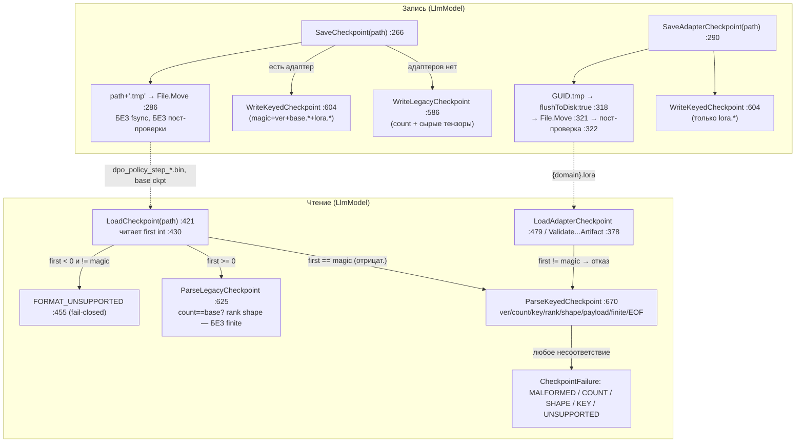

Ветки-симуляции (ожидаемый исход):
- keyed-файл, версия=2 → `LLM_CHECKPOINT_FORMAT_UNSUPPORTED` (`:677-682`) — ВЕРНО, fail-closed.
- keyed-файл, обрезан на полезной нагрузке → `EnsurePayloadAvailable` → `LLM_CHECKPOINT_MALFORMED` (`:803-807`) — ВЕРНО.
- keyed-файл, мусор после последнего тензора → `RequireExactEof` → `MALFORMED` (`:828-832`) — ВЕРНО.
- legacy-файл, NaN в весе → загружается МОЛЧА (нет `requireFinite`) — ИЗЪЯН 4.
- `SaveCheckpoint`, отключили питание между записью и flush ОС → возможен пустой/устаревший файл (нет fsync) — ИЗЪЯН 1 (риск, проверяется крэш-тестом).

#### 3) No-code алгоритм (классы + методы)

- Порядок параметров рождается в `Module.Parameters()` (`00.TensorCore/Layers/Module.cs:27-35`): сначала `_parameters.Values`, потом рекурсия по `_submodules.Values`. `LlmModel` в конструкторе (`:73-104`) регистрирует подмодули в фикс-порядке (token_embedding → block_0..N → final_norm → lm_head), затем на `:89` ЗАМОРАЖИВАЕТ снимок `_baseParameters = Parameters().ToArray()` ДО регистрации adapter-слотов. Значит база сериализуется по замороженному массиву, а не по живому обходу.
- Запись: `SaveCheckpoint` (`:266`) выбирает legacy (адаптеров нет) или keyed (есть); `SaveAdapterCheckpoint` (`:290`) — всегда keyed adapter-only. Обе строят записи через `BuildCheckpointEntries`/`BuildAdapterCheckpointEntries` (`:528`,`:551`), ключи базы `base.{i:D6}` (позиционные), ключи адаптера `lora.block_{blk:D4}.{proj}.{suffix}` (семантические).
- Чтение: `LoadCheckpoint` (`:421`) сниффит первый int; keyed → `ParseKeyedCheckpoint` (`:670`), legacy → `ParseLegacyCheckpoint` (`:625`). `LoadAdapterCheckpoint` (`:479`) и статический `ValidateAdapterCheckpointArtifact` (`:378`) требуют keyed adapter-only (`requireAdapterOnlyKeys:true`). Значения читает `ReadValues` (`:809`), конечность — только при `requireFinite:true`.
- Реестр: `DomainModelRegistry.ValidateAdapter` (`:140-174`) перед регистрацией проверяет: не директория/reparse, `Length>0`, и вызывает `LlmModel.ValidateAdapterCheckpointArtifact` (полный структурный разбор БЕЗ конструирования модели, `expected:null`).
- DPO: `DpoTrainer.Step/StepVector` (`:38`,`:75-76/131-132/231-232`) на каждом шаге зовёт `SaveMetrics` (`dpo_step_*.json`) и `SavePolicyCheckpoint` → `SaveCheckpoint` (`dpo_policy_step_*.bin`). Имя строит `BuildPolicyCheckpointFileName(step)` (`:236-237`).

#### 4) Таблица свойств формата (свойство → file:line → цитата → вердикт)

| Свойство | file:line (HEAD 880e6710d) | Короткая цитата | Вердикт |
|---|---|---|---|
| **Атомарность — adapter-only `{domain}.lora`** | `03.TransformerModel/LlmModel.cs:306-327` | `$"{...}.{Guid.NewGuid():N}.tmp"` … `stream.Flush(flushToDisk: true)` … `File.Move(...)` … `if (!File.Exists \|\| Length<=0) throw ...INCOMPLETE` | ЗАКРЫТО — уникальная времянка + fsync + пост-проверка + уборка |
| **Атомарность — `SaveCheckpoint` (`dpo_policy_step_*.bin`, base)** | `LlmModel.cs:269-287` | `var temporaryPath = path + ".tmp"` … `File.Move(temporaryPath, path, overwrite: true)` (нет `flushToDisk`, нет пост-проверки) | ЧАСТИЧНО / НОВАЯ ДЫРА A — атомарно против убийства процесса, НЕ durable против потери питания; слабее эталона |
| **Round-trip (тот же объект)** | `LlmModel.cs:89,433-445` | `_baseParameters = Parameters().ToArray();` … `Array.Copy(parsed[i].Values, expected[i].Parameter.Value.Data, ...)` | ЗАКРЫТО — снимок заморожен, порядок Save==Load идентичен |
| **Round-trip / порядок база (между процессами)** | `Module.cs:27-35` + `LlmModel.cs:534-536` | `foreach (var sub in _submodules.Values) ...` ; ключ базы `$"base.{index:D6}"` (позиционный) | ЧАСТИЧНО / НОВАЯ ДЫРА B — детерминизм на детали `Dictionary`; у базы нет семантического бэкстопа порядка (только формы) |
| **Порядок адаптера** | `LlmModel.cs:544-545,721-727` | ключ `$"{slot.Key}.{suffix}"` (`lora.block_NNNN.proj.suffix`) ; `!Equals(key, expected[index].Key) → ...KEY_MISMATCH` | ЗАКРЫТО — семантический ключ, перестановка fail-closed |
| **Повреждения — keyed** | `LlmModel.cs:803-807,828-832,752-762,700-712` | `EnsurePayloadAvailable` ; `RequireExactEof` ; `payloadBytes != expectedPayloadBytes → MALFORMED` ; `requireFinite` ; дубль ключа → `KEY_MISMATCH` | ЗАКРЫТО — усечение/нуль/хвост/NaN/дубли/границы fail-closed |
| **Повреждения — legacy** | `LlmModel.cs:663` | `ReadValues(reader, checked((int)elementCount))` (без `requireFinite`) | ЧАСТИЧНО / НОВАЯ ДЫРА C — усечение ловится, но NaN/Inf в базе грузятся тихо |
| **Версия** | `LlmModel.cs:609,676-682` | `writer.Write(AdapterCheckpointVersion)` ; `if (version != AdapterCheckpointVersion) throw ...FORMAT_UNSUPPORTED` | ЗАКРЫТО — чужая версия keyed отвергается |
| **Конфиг-сверка** | `LlmModel.cs:604-623` (запись) ; `:684-693` (чтение) | в keyed пишутся только magic/ver/count/ключ/форма/значения — НЕТ hiddenDim/layers/vocab/eps/hash ; при чтении сверяется лишь `count`/форма | ВСЁ ЕЩЁ ДЫРА D — нет фингерпринта; cross-config при совпадении форм грузится молча |
| **Коллизия magic ↔ legacy** | `LlmModel.cs:51,430-458,590` | `AdapterCheckpointMagic = unchecked((int)0xC14F5241)` (отрицат.) ; legacy first = `writer.Write(entries.Count)` (≥0) ; `else if (first >= 0)` | ЗАКРЫТО — диапазоны не пересекаются, коллизия невозможна |
| **Коллизия имён файлов DPO** | `11.DPO/DpoTrainer.cs:236-237,367-371` + `LlmModel.cs:280-286` | `$"{PolicyCheckpointFilePrefix}{step:D6}{...}.bin"` ; `SaveCheckpoint` = `Create`+`Move overwrite:true` | НОВАЯ ДЫРА E — рестарт со сбросом шага перезаписывает; нет ротации/лимита/run-id; полный чекпойнт на КАЖДОМ шаге |

#### 5) Детальная таблица (item → file:line → цитата → вывод)

| # | file:line | цитата (сокр.) | вывод |
|---|---|---|---|
| Round-trip копирование | `LlmModel.cs:439-445,501-507` | `Array.Copy(parsed[i].Values, expected[i].Parameter.Value.Data, parsed[i].Values.Length)` | значения кладутся ровно по позициям expected; корректно ПРИ совпадении порядка |
| База — позиционный ключ | `LlmModel.cs:534-536` | `entries.Add(new(...$"base.{index:D6}", _baseParameters[index]))` | ключ базы = порядковый номер, не идентичность → тавтология при сверке ключа |
| Сверка ключа (бэкстоп) | `LlmModel.cs:721-727` | `if (!StringComparer.Ordinal.Equals(key, expected[index].Key)) throw ...KEY_MISMATCH` | ловит перестановку ТОЛЬКО для семантических ключей (адаптер); для базы бесполезно |
| Сверка формы (бэкстоп базы) | `LlmModel.cs:742-749` | `if (!dimensions.SequenceEqual(expected[index]...Dimensions)) throw ...SHAPE_MISMATCH` | единственный реальный предохранитель порядка базы; слеп к одинаковым формам |
| Атомарность adapter | `LlmModel.cs:317-327` | `writer.Flush(); stream.Flush(flushToDisk: true)` … пост-проверка `Length<=0` | durable + verified |
| Атомарность SaveCheckpoint | `LlmModel.cs:272-286` | `FileMode.Create` … (using dispose) … `File.Move(...overwrite:true)` | нет fsync/пост-проверки — durability-разрыв |
| Эталон атомарности | `15.OrchestratorModel/Core/FileEpisodeMemory.cs:156-164,694-702,716-717` | `FileOptions.WriteThrough` … `Flush(flushToDisk:true)` … `File.Move(...,overwrite:true)` | контраст: durable-запись сделана правильно |
| Усечение/нуль | `LlmModel.cs:430,803-807` | `var first = reader.ReadInt32()` (нулевой → EndOfStream) ; `EnsurePayloadAvailable` | fail-closed |
| Хвостовой мусор | `LlmModel.cs:828-832` | `if (stream.Position != stream.Length) throw ...trailing bytes` | fail-closed |
| Границы | `LlmModel.cs:685-686,700-701,730-731,782-783,798-799` | `count<=0 \|\| count>MaximumCheckpointEntries` ; `keyLength<1 \|\| >256` ; `rank<0 \|\| >32` ; `dim<=0` ; `count>int.MaxValue` | сильная защита от «раздутых» значений |
| Реестр — глубина валидации | `DomainModelRegistry.cs:152-159` | `if (fileInfo.Length <= 0) ...` ; `LlmModel.ValidateAdapterCheckpointArtifact(normalizedPath)` | полный структурный разбор (не только длина) → устойчив к частичной записи; но `expected:null` → не сверяет с конкретной моделью (это ловится позже на `LoadAdapterCheckpoint`, fail-closed) |
| IncrementalTrainer — пост-условия | `IncrementalTrainer.cs:208-215` | `SaveAdapterCheckpoint(adapterPath); if (!File.Exists \|\| Length<=0) return ...INCOMPLETE` | успех не возвращается без реального непустого файла — корректно |
| DPO — частота записи | `DpoTrainer.cs:75-76,131-132,231-232` | `SaveMetrics(metrics); SavePolicyCheckpoint(metrics);` | полный чекпойнт на КАЖДОМ шаге, без интервала/ротации |

#### 6) «План обещает» / «Код делает»

**План обещает** (цитаты с номерами строк):
- guide-02:188 — «`TranslationMachine → LlmModel` \| `SaveCheckpointAsync("ckpt")` \| весь стейт юнитов записан **атомарно (tmp→move)**».
- guide-02:347 — «Сохранение метрик (**атомарно, tmp→move**; DNA-правило 8 — метрики ДО инкремента шага)».
- guide-02:482 — «`SaveCheckpointAsync` — реальный персист всего состояния **атомарно (tmp→move)**».
- guide-02:857 — regression | «export/import **round-trip сохраняет состояние (SHA-256)**» → `Checkpoint_ExportImport_RoundTrip_Sha256Stable` (R-08).
- guide-02:589-591 / 790 / 856 — «**Fresh-load + continue-training** проба. Перезапуск процесса → …»; `PASS_AS_TRAINED_FEATURE` требует fresh-load+continue.
- guide-02:887-889 — «Continue-training адаптера не замкнут … LoRA-адаптер отдельно не сохраняется/не грузится … План: **определить формат LoRA-чекпойнта**».
- plan-10:153 (LC3.2.1/2/3) — «`manifest_schema_version` совместима (`SchemaVersion:1`) … несовместимая схема → `CHECKPOINT_SCHEMA_UNSUPPORTED`, lifecycle не продолжается; **guards идентичности: `MACHINE_ID_MISMATCH`/`DOMAIN_TAG_MISMATCH`**».
- plan-10:161 (LC11.2.1) — proof-поля «`loaded_checkpoint_hash`, `loaded_manifest_hash`»; plan-10:234 — «Граница: JSON-сериализация checkpoint, **hash/checksum**, manifest/schema-проверка».
- plan-10:159 (LC9) — «Rollback … загрузить прошлый checkpoint и **воспроизвести его метрику**» (прошлый чекпойнт хранится как rollback-ref до подтверждения нового).

**Код делает** (HEAD 880e6710d):
- «tmp→move» ВЫПОЛНЕНО для всех трёх путей записи (`SaveCheckpoint:269-286`, `SaveAdapterCheckpoint:306-321`, `SaveMetrics:361-364`). Буква обещания соблюдена. НО durability (fsync) есть только у adapter-only (`:318`) и метрик нет вовсе; `SaveCheckpoint` fsync НЕ делает → обещание «атомарно» выполнено против убийства процесса, НЕ против потери питания (изъян A).
- «round-trip сохраняет состояние (SHA-256)» — формат НЕ содержит SHA-256/контрольной суммы; побайтовая стабильность структурно достижима (детерминированная запись), но встроенного хеша целостности НЕТ. R-08 доказывался бы ВНЕШНИМ сравнением SHA → это тест-уровень, deferred (доказуемо только прогоном). Формат сам целостность не подтверждает.
- «формат LoRA-чекпойнта определён» ВЫПОЛНЕНО — keyed adapter-only (`SaveAdapterCheckpoint/LoadAdapterCheckpoint/ValidateAdapterCheckpointArtifact`), боевые вызовы в `IncrementalTrainer.cs:124,208`, валидация в реестре `:159`.
- «guards идентичности `MACHINE_ID_MISMATCH`/`DOMAIN_TAG_MISMATCH`» (LC3.2.3) и «hash/checksum» (LC11/plan-10:234) — в бинарном формате `LlmModel` ОТСУТСТВУЮТ; над `{domain}.lora`/`dpo_policy_step_*.bin` на боевом пути нет манифеста-обёртки (реестр хранит голый путь) → identity/hash-гарды не выполнены для этих семейств (изъян D). Схемо-версия keyed есть (`:609/:677`), это частичное покрытие LC3.2.1/2.
- «Rollback хранит прошлый checkpoint» (LC9) — `dpo_policy_step_{step}.bin` при сбросе счётчика ПЕРЕЗАПИСЫВАЕТСЯ, run-id/таймстампа нет → «прошлый чекпойнт как rollback-ref» НЕ гарантирован именованием (изъян E).

#### 7) Вердикты + CONCRETE REPAIR BLUEPRINT

Примечание G12: это ДЕТЕРМИНИРОВАННАЯ сериализация, не обучаемое состояние — ML-training-lifecycle blueprint = N/A (G12); ремонт — конкретное изменение кода формата, ниже заполнено по-полю.

**ЗАКРЫТО (ремонт не нужен):** различение legacy/keyed (магия отрицательна, коллизия невозможна, `:430-458`); версионный гейт keyed (`:677`); усечение/нуль/хвост/дубль-ключ/границы keyed fail-closed (`:803,828,700-712,685`); атомарность adapter-only с fsync+пост-проверкой (`:306-327`); round-trip в пределах одного объекта (замороженный `_baseParameters`, `:89`); защита порядка адаптера семантическим ключом (`:721-727`); глубина валидации реестра (`:159`); пост-условие файла у тренера (`:208-215`).

---

**НОВАЯ ДЫРА A — `SaveCheckpoint` не durable (нет fsync, нет пост-проверки).**
- Где: `LlmModel.SaveCheckpoint` (`03.TransformerModel/LlmModel.cs:269-287`). Затрагивает `dpo_policy_step_*.bin` (`DpoTrainer.cs:370`) и полные базовые чекпойнты (`IncrementalTrainingSession.cs:158-159` грузит их через `LoadCheckpoint`).
- Сейчас: `FileStream(path+".tmp", Create,…)` → запись → `using`-dispose (сброс в буфер ОС, НЕ на диск) → `File.Move(overwrite:true)`. Времянка с фиксированным именем; нет `flushToDisk`; нет пост-проверки `Exists/Length`.
- Почему плохо: против убийства процесса защищено (цель заменяется атомарным rename, полу-данные во времянке). Против потери питания/краха ОС — нет: без fsync блоки данных могут не долететь до диска раньше метаданных rename → на диске пустой/устаревший чекпойнт; при рестарте `IncrementalTrainingSession` поднимет битую базу. Фиксированная времянка — орфан при крахе (перезапишется следующим `Create`, но останется мусором, если больше не пишут в этот путь).
- Должно стать: скопировать паттерн `SaveAdapterCheckpoint` (`:306-327`): уникальная времянка `$"{Path.GetFileName(final)}.{Guid.NewGuid():N}.tmp"` в той же директории; `FileMode.CreateNew`; после записи `writer.Flush(); stream.Flush(flushToDisk: true);`; `File.Move(tmp, final, overwrite:true)`; пост-проверка `if (!File.Exists(final) || new FileInfo(final).Length<=0) throw CheckpointFailure("LLM_CHECKPOINT_INCOMPLETE", ...)`; уборка времянки в `finally` с классификацией IO-исключений (как `:346-370`).
- Тесты, доказывающие фикс: (1) `SaveCheckpoint_WritesUniqueTempAndFsyncsBeforeMove` — мок/спай `FileStream`, утвердить вызов `Flush(true)` до `File.Move`; (2) `SaveCheckpoint_TruncatedTempDoesNotReplaceTarget` — прервать запись, утвердить целевой файл не тронут; (3) `SaveCheckpoint_PostMoveEmptyThrowsIncomplete`.
- Жизненный цикл: user/cache чекпойнт первым → repo/common fallback вторым → export/import → continue-training с существующего чекпойнта (durable-запись обязательна на каждом save-шаге промоушена LC8/rollback LC9).

**НОВАЯ ДЫРА B — round-trip базы держится на детали `Dictionary`; нет семантического бэкстопа порядка.**
- Где: `Module.Parameters()` (`00.TensorCore/Layers/Module.cs:27-35`), ключ базы `LlmModel.cs:534-536`, бэкстоп только формой `:742-749`.
- Сейчас: порядок = перечисление `Dictionary.Values` (порядок вставки, деталь .NET), заморожен в `_baseParameters` (`:89`); ключ базы позиционный `base.{i:D6}` → сверка ключа `:721-727` для базы тавтологична; единственный предохранитель — форма по позиции.
- Почему плохо: между сборками с изменённым порядком регистрации (или гипотетически иным перечислением словаря) базовые веса одинаковой формы переставятся МОЛЧА (в трансформере много тензоров одной формы). Round-trip верен лишь пока порядок побайтово совпадает — контрактом это не гарантировано, формат не самоописателен по идентичности базы.
- Должно стать: заменить позиционный ключ базы на СЕМАНТИЧЕСКИЙ — пробросить путь модуля в `Parameters()` (напр. `IEnumerable<(string path, Parameter p)> NamedParameters()` с путём `token_embedding.weight`, `block_0.attn.q_proj.weight`, …), писать этот путь как ключ базы в keyed-формате; на чтении сверять ключ (`:721-727`) — тогда перестановка/смена конфигурации ловится `KEY_MISMATCH` даже при совпадении форм. Legacy-формат оставить как есть (deprecated), новые записи — только keyed с именованной базой.
- Тесты: (1) `Checkpoint_ReorderedRegistration_FailsKeyMismatch` — сохранить, переставить два одноформенных базовых параметра при загрузке, утвердить `KEY_MISMATCH` (сейчас прошёл бы молча); (2) `Checkpoint_ExportImport_RoundTrip_Sha256Stable` (R-08) — свежий процесс, побайтовое SHA-256 совпадение.
- Жизненный цикл: критично для LC10 continue-training и LC11 fresh-load (перезапуск процесса) — именно там свежая модель конструируется заново и полагается на идентичность порядка.

**ВСЁ ЕЩЁ ДЫРА D — нет конфиг-фингерпринта/манифеста; legacy не проверяет finite.**
- Где: запись keyed без конфигурации `LlmModel.cs:604-623`; чтение сверяет только count/форму `:684-693`; legacy без `requireFinite` `:663`. Над `{domain}.lora`/`dpo_policy_step_*.bin` манифеста нет (`DomainModelRegistry` хранит путь, `DpoTrainer` пишет голый `.bin`).
- Сейчас: единственная защита от чужой конфигурации — совпадение числа параметров и форм; `rmsNormEps`/`vocab`-семантика/`hiddenDim` явно не хранятся; хеша целостности нет; legacy-веса с NaN/Inf грузятся тихо.
- Почему плохо: чекпойнт от модели с тем же счётчиком и формами (тот же `vocabSize`, иной токенайзер; иной `eps`) загрузится МОЛЧА в чужую модель; план (LC3.2.3, LC11.2.1, plan-10:234) требует identity-гардов и hash/checksum, которых нет для этих семейств.
- Должно стать: (1) в `WriteKeyedCheckpoint` добавить заголовочный блок конфигурации `{hiddenDim, numLayers, numHeads, vocabSize, rmsNormEps}` + `payloadSha256` (хеш конкатенации тел тензоров); на чтении `ParseKeyedCheckpoint` сверять конфигурацию с моделью-получателем → новый код `LLM_CHECKPOINT_CONFIG_MISMATCH`, а SHA — `LLM_CHECKPOINT_HASH_MISMATCH`; бампнуть `AdapterCheckpointVersion` до 2 (старая версия читается по совместимости или отвергается явно). (2) В `ParseLegacyCheckpoint` передать `requireFinite:true` в `ReadValues` (`:663`) — закрыть тихую загрузку NaN/Inf. (3) Для боевого пути завести тонкий манифест-компаньон рядом с `{domain}.lora` (`{domain}.lora.manifest.json`: `machineId`, `domainTag`, `configHash`, `checkpointSha256`), чтобы реестр выполнял LC3.2.3 identity-гарды.
- Тесты: (1) `Checkpoint_DifferentConfigSameShapes_FailsConfigMismatch`; (2) `Checkpoint_TamperedPayload_FailsHashMismatch`; (3) `LegacyCheckpoint_NonFinite_ThrowsMalformed`; (4) `Registry_ManifestIdentityGuard_RejectsDomainTagMismatch`.
- Жизненный цикл: обеспечивает LC3 (совместимость manifest/schema/identity), LC9 rollback (доверенный прошлый чекпойнт), LC11 proof-поля (`loaded_checkpoint_hash`).

**НОВАЯ ДЫРА E — имя DPO-чекпойнта завязано только на step; рестарт перезаписывает; нет ротации.**
- Где: `DpoTrainer.BuildPolicyCheckpointFileName` (`11.DPO/DpoTrainer.cs:236-237`), `SavePolicyCheckpoint` (`:367-371`), запись через `SaveCheckpoint` (`LlmModel.cs:280-286`, `Create`+`Move overwrite:true`); каждый шаг `:75-76/131-132/231-232`.
- Сейчас: `dpo_policy_step_{step:D6}.bin`, `step` — от вызывателя; при рестарте со сбросом счётчика старые файлы перезаписываются; ротации/лимита/run-id/таймстампа нет; полный чекпойнт пишется на КАЖДОМ шаге в корень `_checkpointDir`.
- Почему плохо: рестарт тренера теряет прошлые чекпойнты (нет rollback-ref для LC9); неограниченный рост диска (полный снимок модели каждый шаг); нет разделения прогонов.
- Должно стать: включить в путь идентификатор прогона и интервал: под-папка `Path.Combine(_checkpointDir, runId)` (`runId` = таймстамп/GUID, задаётся в конструкторе), имя `dpo_policy_run_{runId}_step_{step:D6}.bin`; вынести частоту сохранения за интервал `checkpointEveryNSteps` (не каждый шаг); ввести retention-политику «хранить последние K + лучший по reward margin», удаляя старые под lock; сохранять `latest.bin`/`best.bin` симлинк-указатели для rollback-ref (LC9).
- Тесты: (1) `PolicyCheckpoint_RestartDoesNotOverwritePriorRun` (разные runId → разные пути); (2) `PolicyCheckpoint_RetentionKeepsLastKAndBest`; (3) `PolicyCheckpoint_HonorsSaveInterval`.
- Жизненный цикл: LC8 promote (публиковать лучший), LC9 rollback (прошлый чекпойнт как ref), LC11 (loaded_checkpoint_hash по конкретному прогону).

#### 8) Граница

Всё про фактическое поведение при реальной потере питания/битом диске (изъян A), побайтовый round-trip в свежем процессе и реальную тихую перестановку/загрузку (изъяны B, D), а также любой эффект обучения — **BOUNDARY — TRAINING WORK, DEFERRED. STOP.** Свойства формата доказаны построчным чтением; фактические крэш-/прогон-сценарии сформулированы как риски с условием проверки (названы тесты). Обучение не запускалось, Qwen/Ollama не трогались.

**Повторная проверка git на выходе:** `git rev-parse HEAD` = `880e6710db48f24cf581e55ada8b81d8986c4727`; `git status --porcelain` = пусто. Репозиторий read-only аудитом не изменён.

### ОБНОВЛЕНИЕ 2026-07-29 — Цикл 3 — Токенизатор и представление данных

**Аудитор:** Opus-исполнитель (Цикл 3, задание 3.3). Режим READ-ONLY.
**Репозиторий кода:** `C:\Projects\llm_mvp_core-DpoImplementation`
**Git на входе И на выходе:** `HEAD = 880e6710db48f24cf581e55ada8b81d8986c4727`, `git status --porcelain` — пусто (проверено трижды: вход, середина, выход; ни одного write в репозиторий кода).
**Границы доказуемости:** свойства кода доказаны чтением; качество токенизации/эмбеддингов на реальных данных — доказуемо только прогоном (обучение не запускалось, Qwen/Ollama не трогались).

---

## Резюме для человека (по-русски, первым)

Проверял весь путь данных «текст → токены → вектор → поиск», кроме уже доказанного в Цикле 2 хеш-корзинного токенайзера wiki-раннера (`ProjectWikiDpoMetricRunner`, StableHash%vocab, :353–378 — не передоказываю, ссылаюсь).

Главное в одном абзаце: **BPE-токенизатор настоящий** — это честный byte-level BPE с обучением merges и их применением на кодировании; на неизвестном тексте он не падает (byte-level, OOV в принципе нет). **Обученные словари на диске ЕСТЬ** — 3149 реальных BPE-артефактов `tokenizer.json` (merges+vocab). Значит первичный вывод задания «словарь-фантом, тренинг незапускаем» — **не подтверждается в лоб**: боевой путь обучения способностей (блок 18 через оркестратор 15) обучает свой BPE прямо в рантайме и уже отработал тысячи раз. НО есть три реальных дефекта, каждый честно квалифицирован ниже: (1) обучаемый словарь **крохотный и на синтетическом seed** (vocab≈300, 44 merges, обучен на строке `semantic_seed_000..511` + один пример), (2) **Load-путь инкрементального обучения** (`CheckpointBackedIncrementalTrainingSessionFactory`, тот самый `BpeTokenizer.Load(_tokenizerPath)` из задания) сконфигурирован **только в тестах** — в бою `_tokenizerPath` не задаётся нигде, общего предобученного базового словаря нет, (3) **эмбеддинги — это проекция необученного крохотного трансформера** (32-мерный, 4 слоя, свежая случайная инициализация, подвинут DPO на ≤ пары шагов) с непомеченным хеш-фолбэком.

Векторный поиск и графовая часть (HNSW, косинус, PageRank, GraphRAG) — **честный детерминированный retrieval**, без ложных заявок на «обученность». Более того, семантический GraphRAG-путь в боевом wiki **выключен** (`HybridRetriever` не конструируется в проде нигде), и это **честно помечено** режимом `Mode3LexicalEvidence` и предупреждением `semantic_retrieval_unavailable_fallback_to_bm25` — падение на лексический BM25 подписано, а не замаскировано.

Итоговые вердикты: п.1 BPE — **ЗАКРЫТО**; п.2 словарь — **ЧАСТИЧНО** (артефакты есть, но toy-seed + Load-путь только в тестах); п.3 DPO-токенизация — **ЗАКРЫТО** по `Encode`, локальный `Tokenize` — честно помеченный лексический нормализатор с доменно-захардкоженными синонимами (**ЧАСТИЧНО**, note-only); п.4 эмбеддинги — **ЧАСТИЧНО / малая НОВАЯ ДЫРА** (необученная проекция + непомеченный хеш-фолбэк); п.5 retrieval/graph — **ЗАКРЫТО** (честный baseline; GraphRAG-семантика присутствует, но «тёмная» и помечена).

---

## UML — карта пути данных (Mermaid classDiagram, импортируется в draw.io)

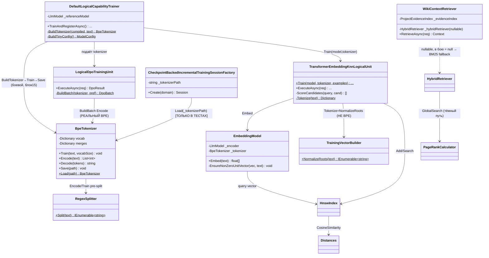

Симуляции ветвей:
- **Ветвь A (обучение способности, боевой):** пример → `BuildTokenizer` обучает свежий BPE(≈300 vocab) → `BuildBatch.Encode` → DPO StepVector → Save `tokenizer.json`. Итог: реальный, но toy-словарь.
- **Ветвь B (инкрементальное продолжение):** `Create(domain)` → `File.Exists(_tokenizerPath)` → `Load`. В бою `_tokenizerPath` не задан ⇒ ветвь недостижима вне тестов.
- **Ветвь C (эмбеддинг):** текст → `Encode` (real BPE) → `ForwardHidden` необученного 32-мерного трансформера → mean-pool; при нулевом выходе → хеш-фолбэк по id токенов.
- **Ветвь D (wiki retrieval, боевой):** вопрос → `ProjectEvidenceIndex.Search` (BM25) → `_hybridRetriever==null` ⇒ `Mode3LexicalEvidence` + warning. Семантика/HNSW/PageRank не вызываются.

---

## Алгоритм без кода (что, где, в каком порядке, какие классы и методы)

1. **Обучение BPE.** `BpeTokenizer.Train(text, vocabSize)` (01.Tokenizer): инициализирует vocab 256 одиночными байтами; `RegexSplitter.Split` режет текст на слова-чанки (GPT-2/cl100k-подобный regex); затем цикл `CountPairs → MaxBy(частота) → _merges[best]=nextToken → MergeAll` пока `vocab.Count < vocabSize`. Это настоящий итеративный merge.
2. **Кодирование.** `BpeTokenizer.Encode(text)`: `RegexSplitter.Split` → UTF-8 байты → `ApplyMerges` (применяет выученные merges в порядке вставки). OOV не бывает — непокрытые последовательности остаются одиночными байтами 0–255.
3. **Кто строит словарь в бою.** `DefaultLogicalCapabilityTrainer.BuildTokenizer` (18.CapabilityTraining:1318) → `new BpeTokenizer(); Train(seedText + text + stableMergeSeed, 512)`; вызывается из оркестратора `15.OrchestratorModel` (`TeachingSessionBuilder`, `LogicalOrchestratorAssistant`). Также `KnnLogicalUnit` (21) обучает свой BPE(320) инлайн.
4. **DPO-токенизация.** `LogicalDpoTrainingUnit.BuildBatch` (18:423) → `tokenizer.Encode(prompt+chosen/rejected)` → тензоры для `DpoTrainer.StepVector`. Реальный BPE.
5. **Локальный лексический скоринг.** `TransformerEmbeddingKnnLogicalUnit.ScoreCandidates` (18:182) фьюжит vector(0.45)+BM25(0.35)+pattern(0.20); термы BM25/pattern считаются через приватный `Tokenize` (18:242) = `TrainingVectorBuilder.NormalizeRoots` (23:104) — ручной стеммер + захардкоженная карта синонимов (mailbox→email, github→provider, …) + стоп-слова. Это НЕ BPE.
6. **Эмбеддинг.** `EmbeddingModel.EmbedBatch` (05:31) → `Encode` (real BPE) → `_encoder.ForwardHidden(ids)` (05:34) → `MeanPooling.Pool/Normalize`. Энкодер = `LlmModel(BuildTinyConfig())` — свежая случайная инициализация (32-мерн., 4 слоя, vocab 512), подвинутая DPO на ≤ MaxStepCount(=1 по умолч.) шагов. Фолбэк `EnsureNonZeroUnitVector` (05:49) при нулевом векторе строит хеш-гистограмму по id токенов.
7. **Поиск/граф.** `HnswIndex.Add/Search` (06) на `Distances.CosineSimilarity`; `PageRankCalculator.ComputePageRank` (07) — power-iteration, d=0.85; `HybridRetriever.Retrieve` (08) — взвешенный merge local(0.6)+global(0.4). В бою wiki семантику гейтит `WikiContextRetriever.RetrieveAsync` (42:76–104) — при `_hybridRetriever==null` возвращает `Mode3LexicalEvidence`.

---

## Таблица file:line → цитата → вердикт

| file:line | цитата (кратко) | сейчас / почему / должно стать | вердикт |
|---|---|---|---|
| `01.Tokenizer/BpeTokenizer.cs:43-53` | `while(_vocab.Count<vocabSize){ var best=pairCounts.MaxBy... _merges[best]=nextToken; _vocab[nextToken]=[..a,..b]; chunks=MergeAll(...)}` | **сейчас:** настоящий итеративный BPE-merge. **почему ОК:** классический byte-level BPE. **должно стать:** — | **ЗАКРЫТО** |
| `01.Tokenizer/BpeTokenizer.cs:58-68` | `Encode(...){ foreach chunk: ids=UTF8 bytes; ids=ApplyMerges(ids) }` | **сейчас:** кодирование применяет выученные merges; OOV невозможен (byte-level). **почему ОК:** честно. **должно стать:** — | **ЗАКРЫТО** |
| `01.Tokenizer/BpeTokenizer.cs:157-163` | `ApplyMerges: foreach (pair,token) in _merges: ids=MergeChunk(ids,pair,token)` | **сейчас:** применяет все merges в порядке вставки (O(merges×len)). **почему ок-но-слабо:** корректно, но не rank-priority (не GPT-2-оптимально по скорости). **должно стать:** note-only, поведение верное. | **ЗАКРЫТО (нюанс)** |
| `01.Tokenizer/RegexSplitter.cs:16-18` | `@"'s|'t|...| ?\p{L}+| ?\p{N}+|..."` | **сейчас:** GPT-2/cl100k pre-tokenizer. **почему ОК:** стандарт. | **ЗАКРЫТО** |
| `18.CapabilityTraining/DefaultLogicalCapabilityTrainer.cs:1320-1324` | `new BpeTokenizer(); Train($"{seedText} {text} {stableMergeSeed}", 512)` где stableMergeSeed=`semantic_seed_000..511` | **сейчас:** боевой BPE обучается на СИНТЕТИЧЕСКОМ seed + один пример, vocab cap 512 (по факту ≈300, 44 merges). **почему плохо:** словарь toy, доменного текста почти нет. **должно стать:** обучать на реальном доменном корпусе или грузить общий предобученный BPE. | **ЧАСТИЧНО** |
| `18.CapabilityTraining/DefaultLogicalCapabilityTrainer.cs:1338-1349` | `BuildTinyConfig{ VocabSize=512, HiddenDim=32, NumLayers=4 }` | **сейчас:** энкодер эмбеддингов — крохотный трансформер. **почему плохо:** свежая случайная инициализация, DPO ≤1 шаг ⇒ по сути необученная проекция. **должно стать:** грузить обученный чекпойнт или пометить embedding как baseline/untrained. | **ЧАСТИЧНО** |
| `14.ContinuousLearning/Training/IncrementalTrainingSession.cs:74-79,161` | `if(!File.Exists(_tokenizerPath)) Fail("TOKENIZER_CHECKPOINT_NOT_FOUND"); ... var tokenizer=BpeTokenizer.Load(_tokenizerPath)` | **сейчас:** Load-путь ждёт предобученный `_tokenizerPath`; конструктор фабрики — **только в `Tests/ContinuousLearningTests.cs`** (0 боевых сайтов); в проде путь не задан. **почему плохо:** инкрементальное продолжение обучения от общего базового словаря в бою недостижимо. **должно стать:** сконфигурировать боевой `_tokenizerPath` + записать общий базовый `tokenizer.json`. | **ЧАСТИЧНО (для этого пути — ДЫРА)** |
| `18.CapabilityTraining/LlmIngredientLogicalUnits.cs:338-339` | `if(request.Input.Tokenizer is null) Fail("TOKENIZER_REQUIRED")` | **сейчас:** реальная защита наличия токенизатора в DPO. **почему ОК.** | **ЗАКРЫТО** |
| `18.CapabilityTraining/LlmIngredientLogicalUnits.cs:423-427` | `BuildBatch: chosenIds=tokenizer.Encode(...); rejectedIds=tokenizer.Encode(...)` | **сейчас:** DPO-батч токенизируется РЕАЛЬНЫМ BPE. **почему ОК:** честный путь. | **ЗАКРЫТО** |
| `18.CapabilityTraining/LlmIngredientLogicalUnits.cs:241-251` | `// project-23 root normalizer ... NormalizeRoots(text).Where(len>1)` | **сейчас:** локальный `Tokenize` для BM25/pattern термов — НЕ BPE, а ручной стеммер. **почему ок-но-слабо:** честно помечен комментарием, но не тот токенайзер, что у модели; синонимы захардкожены под auth/registration. **должно стать:** пометить как lexical-only и вынести словарь синонимов в конфиг/данные. | **ЧАСТИЧНО (note-only)** |
| `23.SemanticCompilerAdapter/TrainingVectorBuilder.cs:104-134` | `"mailbox"=>"email","github"=>"provider","people"=>"user",...` | **сейчас:** доменно-захардкоженная карта синонимов + стоп-слова. **почему плохо:** доменный bias зашит в код (FREEDOM-vs-MACHINE). **должно стать:** конфиг-словарь. | **ЧАСТИЧНО** |
| `05.Embeddings/EmbeddingModel.cs:33-36` | `hidden=_encoder.ForwardHidden(ids); pooled=MeanPooling.Pool(...); normed=Normalize(...)` | **сейчас:** «transformer-backed» буквально верно, но энкодер необучен. **почему плохо:** заявка «embedding» без метки baseline/untrained. **должно стать:** ingredient-manifest должен помечать embedding как untrained-scaffold, пока нет обученного чекпойнта. | **ЧАСТИЧНО** |
| `05.Embeddings/EmbeddingModel.cs:49-63` | `EnsureNonZeroUnitVector: encoded=_tokenizer.Encode(text); foreach id: vector[abs(id)%len]+=1; ... hash fallback` | **сейчас:** при нулевом выходе трансформера эмбеддинг вырождается в хеш-гистограмму id токенов — **детерминированный шорткат, не помечен на выходе**. **почему плохо:** нарушает «anti-deterministic» доктрину плана (см. ниже), если срабатывает. **срабатывает ли — доказуемо только прогоном.** **должно стать:** помечать вектор флагом `deterministic_fallback=true`. | **малая НОВАЯ ДЫРА (note-only)** |
| `06.VectorSearch/HnswIndex.cs:99-111,164-223` | `Search(...) greedy descent + SearchLayer beam на Distances.CosineSimilarity` | **сейчас:** честный ANN на косинусе. **почему ОК:** детерминированный retrieval, без заявки «обучен». **нюанс:** `_rng` не сидирован (топология индекса варьируется run-to-run). | **ЗАКРЫТО (нюанс)** |
| `06.VectorSearch/Distances.cs:10-21` | `CosineSimilarity(...) denom<1e-9?0:dot/denom` | **сейчас:** честный косинус. | **ЗАКРЫТО** |
| `07.GraphEngine/PageRankCalculator.cs:20-60` | `ComputePageRank: power-iteration, d=0.85, conv 1e-6` | **сейчас:** честный PageRank. **нюанс:** боевых вызовов нет — только Tests + `35.ExperimentsV2/E06`. | **ЗАКРЫТО (не на боевом пути)** |
| `08.GraphRag/LocalSearch.cs:13-14` | `/// Local (semantic) search: embed query, find nearest vectors` | **сейчас:** «semantic» = стандартный термин GraphRAG (embedding-vs-keyword), не заявка «обучен на наших данных». **почему ОК** при работающем эмбеддинге. | **ЗАКРЫТО (термин, не оверклейм)** |
| `42.ProjectWikiDomain/WikiContextRetriever.cs:86-103` | `if(_hybridRetriever is null) ... warnings:["semantic_retrieval_unavailable_fallback_to_bm25"] ... Mode3LexicalEvidence` | **сейчас:** семантический GraphRAG в бою выключен и **честно подписан** режимом+warning; первичен BM25. **почему ОК:** честный baseline-labeling. | **ЗАКРЫТО (честно помечено)** |
| `42.ProjectWikiDomain/ProjectWikiDomainServiceCollectionExtensions.cs:19,25,43,52` | `HybridRetriever? hybridRetriever=null` → `new WikiContextRetriever(evidenceIndex, hybridRetriever)` | **сейчас:** боевой DI подаёт null; `new HybridRetriever(` не встречается в проде нигде ⇒ семантика структурно «тёмная». **почему нейтрально:** честно, но GraphRAG-инвестиция не активирована. | **ЗАКРЫТО (тёмный путь, помечен)** |

---

## Артефакты на диске (проверка «фантома»)

- Просканировано `tokenizer.json` (без `obj/`, `.clone/`): **3316**.
- **Реальный BPE (Merges+Vocab): 3149** — под `43.LearningLocalWikiData/artifacts/.../checkpoints/.../tokenizer.json`, каждый `merges=44, vocab=300` (toy, синтетический seed).
- **Не-BPE дескрипторы полей: 167** — `tokenizer_kind=answer-composer-evidence-fields / code-trace-source-fields / …` (это путь wiki-раннера, согласуется с хеш-корзинами Цикла 2).
- **Вывод по «фантому»:** словарь-артефакт НЕ отсутствует (тысячи реальных BPE). Поэтому чистого вердикта «словарь-фантом / незапускаем» нет. Дыра точечная: (а) Load-путь `_tokenizerPath` (блок 14) — только в тестах; (б) общего предобученного базового словаря нет; (в) обучаемый словарь toy-размера на синтетике.

---

## «План обещает» / «Код делает»

**План (`active-codex-execution-guide-02-how-to-train.md`):**
- `:855` — «untrained-behavior | необученный юнит честно говорит not_ready | `UntrainedNode_ReportsNotReady_NoDeterministicShortcut` (= `PASS_AS_HONEST_UNTRAINED_SCAFFOLD`)» → **обещание:** необученное честно объявляется необученным, без детерминированного шортката.
- `:830` — «deterministic-vs-learned boundary: DpoTrainer math + LogProbs = learned-signal … literal 0.03 = forbidden runtime authority для learned claim» → **обещание:** граница «детерминированное vs обученное» подписывается.
- `:824` — «data_flow: pair -> tokenize -> StepVector(policy/reference) -> margin …» → **обещание:** `tokenize` — часть DPO-потока.

**План (`active-codex-execution-05-dpo-data-training-measurement-guide.md`):**
- `:102` — «A deterministic graph helper that always chooses the same route is not learning … it must be labeled deterministic. A learned claim requires at least: …» → **обещание:** любой детерминированный суррогат обязан быть помечен.
- `:138` — «ablation_gate | Learned state beats no-state or deterministic baseline» → **обещание:** обученное состояние должно бить детерминированный baseline.

**Код делает:**
- `tokenize` в DPO-потоке — **есть и реальный BPE** (`LlmIngredientLogicalUnits.cs:423-427`). ✅ соответствует `:824`.
- «Честный untrained-scaffold» — эмбеддинг-энкодер фактически необучен (`BuildTinyConfig`, свежая инициализация), но на уровне `LlmIngredientManifest` (`:106-120`) он подаётся как «real transformer-backed embedding» **без метки untrained/baseline**. ⚠️ расходится с `:855` и `:102`: детерминированный/необученный компонент не помечен.
- Хеш-фолбэк `EnsureNonZeroUnitVector` (`:49-63`) — детерминированный шорткат **без флага** на выходе. ⚠️ прямое расхождение с `:102` («must be labeled deterministic»), если срабатывает (доказуемо только прогоном).
- GraphRAG-семантика в бою — выключена и **помечена** (`Mode3LexicalEvidence` + warning). ✅ соответствует духу `:102` (baseline честно подписан).

---

## Вердикты + CONCRETE REPAIR BLUEPRINT

**П.1 BPE реальный — ЗАКРЫТО.** Настоящий byte-level BPE (обучение merges + применение). OOV невозможен. Ремонт не требуется.

**П.2 Обученный словарь-артефакт — ЧАСТИЧНО (для Load-пути — ДЫРА).**
Артефакты есть (3149 BPE), но toy-seed + Load-путь только в тестах.
CONCRETE REPAIR BLUEPRINT:
- Уровень архитектуры: 14.ContinuousLearning (Load) + 18.CapabilityTraining (Train/Save).
- Типизированное состояние: общий `BpeTokenizer` (Merges: `List<(int,int)->int>`, Vocab: `Dictionary<int,byte[]>`), сериализуемый `SavedModel`.
- Алгоритм апдейта: (вход) реальный доменный корпус (не `semantic_seed_*`) → `Train(corpus, vocabSize≥8k)` → `Save(sharedBaseTokenizerPath)`; инкремент: `Load(sharedBaseTokenizerPath)` как база, дообучение поверх.
- Конфиг: добавить боевой `_tokenizerPath` в конструкцию `CheckpointBackedIncrementalTrainingSessionFactory` через DI (сейчас 0 боевых сайтов; сконфигурировать в `15.OrchestratorModel`).
- Источник/лицензия: корпус — из доменных данных проекта (AGPL-репо), без внешних загрузок.
- DPO-примеры: positive = `Encode` реального доменного текста даёт merged-токены; rejected = `Encode` возвращает только байты 0–255 (словарь не обучен); quarantine = `_tokenizerPath` не существует → `TOKENIZER_CHECKPOINT_NOT_FOUND`.
- Затрагиваемые тесты/жизненный цикл: `Tests/ContinuousLearningTests.cs` (расширить на боевой путь); lifecycle: user/cache словарь → общий базовый `tokenizer.json` (fallback) → export/import/share → continue-training от существующего чекпойнта.

**П.3 DPO-токенизация — ЗАКРЫТО (`Encode`); локальный `Tokenize` — ЧАСТИЧНО (note-only).**
CONCRETE REPAIR BLUEPRINT (для локального `Tokenize`/`NormalizeRoots`):
- Уровень: 18.CapabilityTraining + 23.SemanticCompilerAdapter.
- Состояние: карта синонимов сейчас — литералы в `NormalizeRoots` (23:113-124).
- Апдейт: вынести карту в конфиг-данные (FREEDOM), метод помечает выход как `lexical_normalizer`, не `model_tokenizer`.
- Метод/сигнатура: сохранить `NormalizeRoots(string): IEnumerable<string>`, добавить источник словаря параметром.
- DPO-примеры: positive = термы BM25 совпали через нейтральный стеммер; rejected = совпадение только из-за захардкоженного синонима (доменный bias); quarantine = пустой словарь.
- Тесты: `TokenizerTests`/новый lexical-scorer тест; lifecycle: конфиг-словарь → дефолт-фолбэк → export/import.

**П.4 Эмбеддинги — ЧАСТИЧНО / малая НОВАЯ ДЫРА.**
Проекция необученного крохотного трансформера + непомеченный хеш-фолбэк.
CONCRETE REPAIR BLUEPRINT:
- Уровень: 05.Embeddings + 18.CapabilityTraining (owner конфига модели).
- Состояние: `EmbeddingModel._encoder: LlmModel` (веса), `LlmIngredientManifest` (метка ингредиента).
- Апдейт: (а) грузить обученный чекпойнт энкодера (`LoadCheckpoint`) до эмбеддинга ИЛИ (б) добавить в `LlmIngredientManifest` поле `embeddingState: {untrained_scaffold|trained}` и в `EmbeddingModel.Embed` — флаг `deterministic_fallback` когда сработал `EnsureNonZeroUnitVector` (05:49-63).
- Метод/сигнатура: `Embed(text): (float[] vector, bool deterministicFallback)` или out-параметр.
- Источник/лицензия: чекпойнт из доменного обучения (AGPL), без внешних весов.
- DPO-примеры: positive = ненулевой L2-нормированный вектор из `ForwardHidden`; rejected = хеш-фолбэк (помечен); quarantine = пустой текст → `vector[0]=1`.
- ablation-гейт (план `:138`): обученный энкодер должен бить хеш-фолбэк на held-out; иначе честно `PASS_AS_HONEST_UNTRAINED_SCAFFOLD`.
- Тесты: `TeachingRegistryPersistenceTests` / новый embedding-state тест; lifecycle: cache-модель → базовый чекпойнт → export/import/share → continue-training.

**П.5 VectorSearch / GraphEngine / GraphRag — ЗАКРЫТО (честный baseline).**
HNSW/косинус/PageRank/HybridRetriever — детерминированный retrieval без ложных заявок «обучен». Семантический GraphRAG в бою «тёмный» и честно помечен fallback-режимом. Ремонт не требуется; note-only:
- `HnswIndex._rng` (06:36) не сидирован → топология индекса варьируется между прогонами; при желании воспроизводимости — сидировать.
- 08.GraphRag/07.PageRank на боевом пути не вызываются (кроме HNSW внутри блока 18); если GraphRAG-семантика нужна в проде — активировать через DI `new HybridRetriever(...)` (сейчас отсутствует), но это продуктовое решение, не дефект.

---

BOUNDARY — TRAINING WORK, DEFERRED. STOP.

Аудит — чтением. Ни обучение, ни build/test/dotnet, ни Qwen/Ollama не запускались. Ремонт-блюпринты выше — это работа обучения/имплементации, отложенная за границу этого READ-ONLY цикла; их выполнение требует отдельной авторизации.

**Повторный git-чек (выход):** `HEAD = 880e6710db48f24cf581e55ada8b81d8986c4727`; `git status --porcelain` — пусто. Репозиторий кода не изменён.

### ОБНОВЛЕНИЕ 2026-07-29 — Цикл 3 — Целостность тест-набора

Аудит: репозиторий кода `C:\Projects\llm_mvp_core-DpoImplementation`, ветка DpoImplementation,
HEAD `880e6710db48f24cf581e55ada8b81d8986c4727` (проверено `git rev-parse` до и после;
`git status --porcelain` пусто до и после). Только чтение (grep, view), без сборки/тестов/обучения.
Qwen/Ollama не запускались. `Tests\`, `tools\`, `experiments-v2\` — не боевой путь. Свип целевой
(таргетные файлы + счётчики по `Tests\` = 327 .cs), не «все подряд». Термины поясняются в тексте.

#### 1) Человеческое резюме (по-русски, все машинные метки пояснены)

Главный вопрос цикла: **зелёная тест-база доказывает, что обучение ОБУЧАЕТ, или только что оно
НЕ ПАДАЕТ?** Ответ по прочтению: **тест-набор честен, но доказывает в основном ПРОВОДКУ и ЧЕСТНОСТЬ
скаффолда, а не эффект обучения.** Разложение:

- **Стаба-масскарада (выдать заглушку за рабочую фичу) — НЕТ.** Наоборот: набор изобилует тестами,
  которые ПРЯМО пиннят честные отказы-заглушки как ожидаемое поведение — «пары предпочтений отложены»
  (`DPO_PAIRS_DEFERRED`), «обучение не реализовано в логическом адаптере»
  (`..._TRAINING_NOT_IMPLEMENTED_IN_LOGICAL_ADAPTER`), «скаффолд не обучен»
  (`..._SCAFFOLD_NOT_LEARNED`), «строки предпочтений не готовы» (`DPO_ROWS_NOT_READY`). Это ХОРОШО
  по правилу «честный not_ready лучше скрытого детерминизма», НО это значит: **зелёнота держится на
  том, что фича честно НЕ сделана**, а зелёного теста, доказывающего сделанную/обученную ветку, рядом
  нет. Дыру не прячут — её фиксируют как норму.

- **Ожидавшийся негативный тест-«детектор» дыры пропал.** Гайд ждал негативный тест
  `IncrementalTrainer_IsNoOp_AndFlaggedStub` (полая заглушка не меняет веса — «ожидаемый провал
  уровня-5»). На HEAD теста с таким именем НЕТ (grep = 0). Supervised-полость закрыта (находка 38 —
  реальный LoRA), а DPO-ветка переоформлена в ЗЕЛЁНЫЙ контракт «отложено — это правильно». Для
  supervised — законно; для DPO — дыра переклассифицирована из «известный провал» в «зелёная норма».

- **Слабые ассерты: счётчик обманчив.** По `Tests\`: 4626 тест-методов, 3077 строк
  `Assert.True(*.IsSuccess)`, из них 1103 вида `Assert.True(result.IsSuccess)`. НО правило «слабый =
  ЕДИНСТВЕННЫЙ ассерт» отсекает почти все: в целевых файлах `IsSuccess` — это setup-guard, за которым
  идут проверки СОДЕРЖИМОГО. Реальная слабость не в «`IsSuccess`-only», а в **«доказательстве
  проводки/наличия файла вместо доказательства эффекта»** (Категория 4).

- **Тест-дубли боевых швов: 53 файловых класса реализуют боевые интерфейсы прямо в `Tests\`.** Самый
  дорогой — `TargetAwareAccuracyAL : IAccuracyEvaluator` (единственный имплементор оценщика точности;
  в проде — ноль; интерфейс сам себя называет «не имплементация held-out-оценщика»). Поэтому зелёное
  «enhanced > baseline / промоушен состоялся» — это утверждение о **впрыснутых в дубль числах**
  (0.50 → 0.75), а не о том, что модель стала точнее.

- **Численная сила: РОВНО ОДИН честный градиентный тест.** `DpoTrainerTests.StepMany_...
  ImprovesRewardMargin` ассертит рост reward-margin (разность наград «выбранное минус отклонённое»)
  за 40 шагов на фикс-сиде — но **in-sample** (учится и мерится на ОДНОМ батче) → доказывает
  «оптимизатор двигает margin вверх на обучающем батче», а не held-out-обобщение. Ассертов
  **спадания loss — НОЛЬ во всём `Tests\`.** Тесты `learnedScore > baselineScore` в DesignConversion
  доказывают, что руко-собранный чекпойнт фиче-весов после перезагрузки детерминированно сдвигает
  оценку — и сами же ассертят `trained_model_authority == False`, «model training remains false».

**Вердикт цикла:** зелёная база доказывает, что обучение **НЕ ПАДАЕТ**, что оптимизатор численно
двигает margin вверх на игрушечной модели in-sample, что чекпойнты round-trip'ятся, и что скаффолд
**честно** говорит «я ещё не обучен». Она **НЕ доказывает**, что обучение **ОБУЧАЕТ** (held-out
lift, спадание loss, реальная точность через боевой оценщик). Это не регресс и не обман — это
«колонка честного скаффолда (UH) зелёная, колонка доказанного обучения (TA) пустая», ровно тот зазор,
о котором предупреждает план-13 (D2/FC-27/FC-28).

#### 2) UML — что доказывает клетка теста (draw.io-importable Mermaid)

```mermaid
classDiagram
    class DpoTrainer_StepMany_ImprovesMargin {
        +сейчас: margin(40 шагов, seed=42) > initial + 1e-5
        +слой: trained-acceptance ЧАСТИЧНО (in-sample)
        +дыра: тот же батч train==eval, held-out нет
    }
    class AutonomousPipeline_EnhancedExceedsBaseline {
        +сейчас: 0.75 > 0.50 (числа впрыснуты в фейк)
        +слой: gate-логика реальна, measurement фейковый
        +дыра: боевого IAccuracyEvaluator=0
    }
    class ContinuousLearning_DpoPairsDeferred {
        +сейчас: ErrorCode == DPO_PAIRS_DEFERRED
        +слой: untrained-behavior (UH) — честно
        +дыра: зелёного TA-двойника нет
    }
    class DesignConversion_Score_gt_Baseline {
        +сейчас: score(reload) > baseline И not_trained==true
        +слой: fresh-load детерминированного фиче-веса
        +дыра: чекпойнт руко-собран, TrainingHistory=[]
    }
    class LogicalDpoTrainingUnit_ExecutesLoraDpo {
        +сейчас: LoraAdapterCount>0, DpoStepCount==1, файл есть
        +слой: integration-проводка
        +дыра: 0 проверок эффекта (loss/margin/accuracy)
    }
    IAccuracyEvaluator <|.. TargetAwareAccuracyAL : ТОЛЬКО в Tests\ (прод=0)
    AutonomousPipeline_EnhancedExceedsBaseline ..> TargetAwareAccuracyAL : числа из лямбды
```

#### 3) Таблица file:line → цитата → вердикт (по категориям 1–4)

**Категория 1 — СТАБ-ПИННИНГ (тест закрепляет дыру как желаемую норму)**

| file:line | цитата | сейчас / вердикт |
|---|---|---|
| `Tests\ContinuousLearningTests.cs:490,505-508` | `IncrementalTrainer_DpoPairs_AreDeferredBeforeSessionOrFilesystemMutation` → `Assert.False(result.IsSuccess); Assert.Equal("DPO_PAIRS_DEFERRED", result.ErrorCode); Assert.Equal(0, factory.CreateCount); Assert.False(Directory.Exists(...))` | Пиннит отсечение DPO-пар как контракт (ни сессии, ни файла). Честный fail-closed. **ЧАСТИЧНО (UH зелёный, TA-двойника нет)** |
| grep `IncrementalTrainer_IsNoOp_AndFlaggedStub` = **0 хитов** (ожидался gd-02:854) | — теста нет — | Ожидавшийся негативный «no-op заглушка» (Layer-5 FAIL) на HEAD отсутствует; DPO-полость переоформлена в зелёный «deferred=правильно». **ЧАСТИЧНО** |
| `Tests\PromptToTaskLogicalHierarchyTests.cs:94` | `Assert.Equal("PROMPT_TO_TASK_TRAINING_NOT_IMPLEMENTED_IN_LOGICAL_ADAPTER", train.ErrorCode)` | «обучение не реализовано» пиннится как ожидаемый код. **ЧАСТИЧНО** |
| `Tests\ResultGapLogicalHierarchyTests.cs:101,107` | `..._TRAINING_NOT_IMPLEMENTED...`, `..._EXPORT_NOT_IMPLEMENTED...` | Две ветки «не реализовано» — зелёная норма. **ЧАСТИЧНО** |
| `Tests\DesignConversionTrainingPipelineTests.cs:51` | `Assert.Contains("DESIGN_CONVERSION_TRAINING_PIPELINE_SCAFFOLD_NO_REAL_MODEL_MATH", result.Value.Warnings)` | Предупреждение «нет реальной модельной математики» — ассертится как ожидаемое. **ЧАСТИЧНО** |
| `Tests\DesignConversionRealS3EvidenceBundleValidatorTests.cs:158,179` | `Assert.Contains("CHECKPOINT_MANIFEST_NOT_READY", ...)`, `"DPO_ROWS_NOT_READY"` | «чекпойнт/DPO-строки не готовы» пиннятся как норма. **ЧАСТИЧНО** |

Пояснение меток: `DPO_PAIRS_DEFERRED` = «пары предпочтений отложены до легального тренинг-шва»;
`SCAFFOLD_NO_REAL_MODEL_MATH` = «каркас без настоящих матричных операций обучения»;
`DPO_ROWS_NOT_READY` = «строки обучающих данных ещё не готовы». Все три — честные, но **все три пиннят
отсутствие фичи как steady-state**, и ни у одного нет зелёного парного теста на реализованную ветку.

**Категория 2 — СЛАБЫЕ АССЕРТЫ (масштаб + оговорка)**

| факт | значение |
|---|---|
| тест-методов (`[Fact]/[Theory]`) в `Tests\` | 4626 |
| строк `Assert.True(*.IsSuccess)` | 3077 |
| из них `Assert.True(result.IsSuccess)` | 1103 |
| `Assert.NotNull` | 459 |
| `Record.Exception`/`Assert.Null(ex` («не бросило») | 34 |

| file:line | цитата | сейчас / вердикт |
|---|---|---|
| `Tests\DefaultLogicalCapabilityTrainerTests.cs:32,59` | `Assert.True(subPhase.IsSuccess, ...)` … затем `Assert.StartsWith(...FlowIdPrefix,...); Assert.Equal("PASS", ...OverallVerdict); Assert.Equal("True", metrics["generated_capability_flow"])` | `IsSuccess` — setup-guard, рядом богатые проверки содержимого → **НЕ слабый** |
| `Tests\LlmIngredientLogicalUnitTests.cs:130-138` | `Assert.True(result.IsSuccess...); Assert.True(...LoraAdapterCount>0); Assert.Equal(1,...DpoStepCount); Assert.Contains("11.DPO:DpoTrainer",...); Assert.True(File.Exists(...))` | Содержимое есть, но это **проводка**, не эффект → слабость Категории 4, не 2 |
| `Tests\DpoTrainerTests.cs:203-217` | `MultipleSteps_DoNotThrow` → `Assert.Null(ex)` | Чистое «не бросило» — единственный ассерт → **СЛАБЫЙ (по назначению)** |
| `Tests\DefaultLogicalCapabilityTrainerTests.cs:559-576` | `FindReplayManifests_PrivateArrayReflectionContractRemains` → рефлексия + `Assert.NotNull(method); Assert.Single(...)` | Проверка приватного контракта, не поведения → пограничный |

**Вывод Категории 2:** счётчик 1103 **переоценивает** слабость. В целевых файлах `IsSuccess` почти
всегда сопровождён проверкой содержимого. «Единственный ассерт `IsSuccess`» как класс — редок; точный
подсчёт «терминальных `IsSuccess`» доказуем только пер-методным парсером/прогоном. **ЧАСТИЧНО.**

**Категория 3 — ТЕСТ-ДУБЛИ БОЕВЫХ ШВОВ (утверждение о системе = утверждение о дубле)**

| file:line | цитата | сейчас / вердикт |
|---|---|---|
| `Tests\AutonomousLearningTests.cs:1344` | `file sealed class TargetAwareAccuracyAL : IAccuracyEvaluator` | Единственный имплементор оценщика точности живёт в `Tests\`; прод = 0 (`16.AutonomousLearning\Core\Interfaces.cs:68` сам пишет «not a held-out evaluator implementation»). **ВСЁ ЕЩЁ ДЫРА (боевой оценщик отсутствует)** |
| `Tests\AutonomousLearningTests.cs:491,504-508` | `..._EnhancedExceedsBaseline` → `Assert.True(result.Value!.EnhancedAccuracy > result.Value!.BaselineAccuracy)` | Обе цифры (0.50, 0.75) впрыснуты через `baselineScore/enhancedScore` в фейк. Зелёное «дельта есть» = впрыснутая дельта. **ДЫРА measurement / gate реальна** |
| `Tests\AutonomousLearningTests.cs:495` | комментарий `// accuracy uses real LoRA scoring (IAccuracyEvaluator), not bigram proxy` | ПЕРЕОЦЕНКА: единственный `IAccuracyEvaluator` — лямбда теста. Комментарий утверждает свойство, которого тест не проверяет. **НОВАЯ ДЫРА (лживый комментарий-claim)** |
| `Tests\AutonomousLearningTests.cs:530-547` | `..._AccuracyRegression_DoesNotRegisterAdapter` → `Assert.Equal("ACCURACY_NOT_IMPROVED", ...); Assert.Null(adapter.Value)` | Логика гейта (не регистрировать при регрессе) — реально проверена. **ЗАКРЫТО (для gate-логики)** |
| `Tests\AutonomousLearningTests.cs:692` | `Assert.Equal(["Get:baseline","Eval:baseline","Train","Eval:candidate","Register","Get:readback"], events)` | Порядок оркестрации реально доказан. **ЗАКРЫТО (для порядка)** |
| охват | `grep '^(file )?(sealed )?class …: I[A-Z]'` в `Tests\` = **53** | 53 файловых дубля боевых интерфейсов. Массовость шва «система через саму себя». |

**Категория 4 — ЧИСЛЕННАЯ СИЛА (обучает или только не падает)**

| file:line | цитата | сейчас / вердикт |
|---|---|---|
| `Tests\DpoTrainerTests.cs:236-256` | `StepMany_...ImprovesRewardMargin` → `Assert.Equal(0f, initial.RewardMargin); Assert.True(trained.RewardMargin > initial.RewardMargin + 1e-5f)` (40 шагов, `Random(42)`) | **ЕДИНСТВЕННЫЙ** честный градиентный тест направления. НО in-sample (train `batch` == eval `batch`, стр. 243-250) → память/направление, не held-out. **ЧАСТИЧНО** |
| `Tests\AdamWTests.cs:38,111` | `Step_NonZeroGradient_WeightDecreases`; `Assert.True(p2.Value.Data[0] > before2)` | Оптимизатор двигает вес по градиенту — реальная численная механика (1 шаг). **ЗАКРЫТО (механика оптимизатора)** |
| `grep "Assert.*Loss.*<"` по `Tests\` = **0** | — ни одного — | **Ассертов спадания loss нет.** Loss только `>0` и `!NaN` (`DpoTrainerTests.cs:89-90`). **ВСЁ ЕЩЁ ДЫРА** |
| `Tests\DesignConversionMachineTests.cs:250-254` | `Assert.Equal("False", ...Metrics["trained_model_authority"]); ... Assert.True(freshLoadedProbe.Score > baselineProbe.Score)` | Score растёт после fresh-load, НО тут же `not_trained_model_authority==True`, «model training remains false» (стр.253). Дельта — от детерминированного фиче-веса. **НЕ доказательство обучения** |
| `Tests\DesignConversionThinClientJobRuntimeTests.cs:432-438` | `Assert.True(learnedScore > baselineScore); ...Metadata["LearnedInferenceApplied"]=="True"` | Чекпойнт руко-собран: `CreateRuntimeLearnedInferenceCheckpoint():2888` = литеральные `LearnedWeight("...",1.0/0.8)`, `TrainingHistory: []`, `DeterministicLogicClaimedAsLearning: false`. Дельта — от впрыснутых констант. **НЕ доказательство обучения** |
| `Tests\LlmIngredientLogicalUnitTests.cs:130-138,182-186` | `LoraAdapterCount>0; DpoStepCount==1; File.Exists(...MetricFilePaths[0])` | DPO-проводка доказана (LoRA наложен, шаг сделан, файл записан), **0 проверок, что что-то улучшилось**. **ЧАСТИЧНО (проводка, не эффект)** |

#### 4) «План обещает» (plan-13) / «Код делает» (Категория 5 — сверка с эталоном)

Эталон `active-codex-execution-plan-13-test-strategy.md`. Метки: **UH** =
`PASS_AS_HONEST_UNTRAINED_SCAFFOLD` («честный необученный каркас: контракт есть, честно not_ready,
нет скрытого детерминизма»); **TA** = `PASS_AS_TRAINED_FEATURE` («обучение доказано: held-out +
ablation + fresh-load + continue-training»).

| План обещает (line) | Код/тесты делают | Вердикт |
|---|---|---|
| Матрица 14×9, «0 пустых обязательных клеток», 9 слоёв FC-26 (`plan-13:37,103,401-409`) | Слои `unit`/`integration`/`untrained-behavior`/`regression` покрыты; `e2e/host`, `trained-acceptance` — дырявые | **ЧАСТИЧНО** |
| «3 IsTrainable строки (P-01 узел, P-02 ребро, P-04 машина) несут ОБЕ колонки UH+TA» (`plan-13:104,154`) | UH-колонка зелёная и богатая (масса `SCAFFOLD_NOT_LEARNED`/`NOT_READY`/`DEFERRED`); TA-колонка для боевого claim обучения — не доказана | **ВСЁ ЕЩЁ ДЫРА (TA пустая)** |
| TA-слой = held-out на source-disjoint (`plan-13:852`) | боевого `IHeldOutScorer`/`IAccuracyEvaluator` нет; оценщик — дубль `TargetAwareAccuracyAL`; held-out-lift ассерта с боевым оценщиком нет | **ОТСУТСТВУЕТ / ТОЛЬКО-ТЕСТЫ** |
| TA-слой = per-edge ablation роняет accuracy (`plan-13:853`) | ablation-двери исполняются только в `Tests\` (Цикл 1); численного ассерта «accuracy падает при ablation» на боевом пути нет | **ТОЛЬКО-ТЕСТЫ** |
| TA-слой = fresh-load сохраняет навык (`plan-13:325-330`) | fresh-load есть (`DesignConversionMachineTests:217-254`), но явно `not_trained_model_authority==True` — это перезагрузка фиче-веса, не навыка модели | **ЧАСТИЧНО (scaffold, не модель)** |
| TA-слой = continue-training из чекпойнта (`plan-13:332`) | цепочка чекпойнтов есть (`DefaultLogicalCapabilityTrainerTests:172-181`: parent→child, TrainingStepCount 1→2), но доказывает сцепку, не lift | **ЧАСТИЧНО (сцепка, не эффект)** |
| Анти-masquerade firewall на каждую TA-клетку: no_replay_proven + exact_memory_leakage_proven_absent (`plan-13:375-388`) | Firewall-дисциплина применяется, но чтобы СЕРТИФИЦИРОВАТЬ «НЕ обучен» (`DoesNotContain LEARNED_INFERENCE_AUTHORITY`), а не чтобы очистить обученную фичу | **ЧАСТИЧНО (инвертировано в UH)** |

**Сводный вердикт Категории 5:** UH-колонку плана-13 набор поставляет с запасом; TA-колонку для
трейнабл-строк — фактически нет на боевом пути. Это ровно D2/FC-27/FC-28-схлопывание, которое план
называет самой опасной ошибкой (выдать честный скаффолд за обученную фичу — здесь не выдают, но и
доказанной обученной фичи нет).

#### 5) Классы слабости и вердикты + CONCRETE REPAIR BLUEPRINT

**Класс A — held-out lift через боевой оценщик отсутствует (Кат.3+4, Кат.5-TA). ВСЁ ЕЩЁ ДЫРА.**
Blueprint (что добавить, имена и ассерты):
- Добавить прод-имплементор `HeldOutLoraAccuracyEvaluator : IAccuracyEvaluator` в
  `16.AutonomousLearning\` (не в `Tests\`), считающий accuracy реальным LoRA-скорингом на
  **отложенном source-disjoint** наборе (проверка контаминации: пересечение id обучающего и held-out
  = ∅).
- Новый тест `AutonomousLearningPipeline_RealHeldOutEvaluator_TrainedAdapterBeatsBaselineOnDisjointSet`
  (НЕ через `TargetAwareAccuracyAL`): обучить адаптер на train-split, оценить БОЕВЫМ оценщиком на
  disjoint held-out; `Assert.True(enhanced.Accuracy > baseline.Accuracy + 0.02f)` (порог из
  Q30/Q11-профиля plan-13), `Assert.Empty(trainIds.Intersect(heldOutIds))`.
- Удалить/понизить комментарий `AutonomousLearningTests.cs:495` «uses real LoRA scoring» до
  «uses injected fixture score (unit-level gate test)», пока боевого оценщика нет.

**Класс B — спадание loss не ассертится нигде (Кат.4). ВСЁ ЕЩЁ ДЫРА.**
Blueprint:
- Тест `DpoTrainer_LossDescendsOverSteps_FixedSeed` в `DpoTrainerTests.cs`: `SetDeterministicWeights`,
  собрать `loss[0..N]` за N≥20 шагов; `Assert.True(loss[^1] < loss[0] - 1e-4f)` и монотонность
  «медиана хвоста < медиана головы». Это отделяет «обучение обучает» от «margin двинулся один раз».

**Класс C — единственный margin-тест in-sample (Кат.4). ЧАСТИЧНО.**
Blueprint:
- Расширить `StepMany_...ImprovesRewardMargin`: ввести отдельный `evalBatch` (иные id, тот же
  контракт предпочтения), обучать на `trainBatch`, мерить на `evalBatch`; переименовать в
  `StepMany_ImprovesRewardMarginOnHeldOutPreference`; `Assert.True(trainedHeldOut.RewardMargin >
  initialHeldOut.RewardMargin + 1e-5f)`. Так тест перестаёт доказывать только запоминание батча.

**Класс D — DPO-контур пиннится как «отложено», без парного теста реализованной ветки (Кат.1).
ЧАСТИЧНО.**
Blueprint:
- Оставить `IncrementalTrainer_DpoPairs_AreDeferredBeforeSessionOrFilesystemMutation` как есть
  (честный UH), но добавить ПАРНЫЙ TA-тест на будущий легальный шов
  `IncrementalTrainer_DpoPairs_WhenTrainerReady_ConsumesPairsAndWritesDpoCheckpoint`:
  `Assert.True(result.IsSuccess); Assert.True(File.Exists(dpoCheckpoint)); Assert.True(File.Exists(
  metricJson)); Assert.Equal(pairCount, metrics.PreferenceCount)` — чтобы матрица несла ОБЕ колонки
  (UH сейчас + TA когда шов готов), а не только UH.

**Класс E — тест-дубль оценщика как единственный источник accuracy (Кат.3). ВСЁ ЕЩЁ ДЫРА.**
Blueprint:
- Держать `TargetAwareAccuracyAL` только для gate-логики (порядок/регистрация/readback — там он
  законен), но пометить его комментарием `// GATE-LOGIC DOUBLE ONLY — accuracy numbers are injected,
  not measured`; сам факт «точность выросла» доказывать ТОЛЬКО Классом A (боевой оценщик).

**Класс F — «learnedScore>baseline» на руко-собранном чекпойнте (Кат.4). ЧАСТИЧНО (честно, но не
обучение).**
Blueprint:
- Добавить рядом тест, где чекпойнт получен НЕ литералами, а РЕАЛЬНЫМ прогоном обучения
  (`DesignConversion_TrainedCheckpoint_FromRealRun_RaisesScoreOnHeldOutProbe`), и держать текущий
  `CreateRuntimeLearnedInferenceCheckpoint` как явную фикстуру round-trip (переименовать в
  `CreateHandBuiltFeatureWeightCheckpointFixture`), чтобы имя не намекало на «learned inference».

BOUNDARY — TRAINING WORK, DEFERRED. STOP.
Всё, что доказуемо только ПРОГОНОМ (реально ли спадает loss, растёт ли held-out accuracy, роняет ли
ablation точность, доносит ли автоград ненулевой градиент до адаптера) — за границей read-only аудита.
Заявляю только СИЛУ АССЕРТОВ по чтению; фактический прогон тестов, сборка, обучение, Qwen/Ollama — не
запускались и не проектировались.

**Повторная проверка git на выходе:** `git rev-parse HEAD` = `880e6710db48f24cf581e55ada8b81d8986c4727`;
`git status --porcelain` = пусто. Репозиторий кода не изменён этим аудитом (read-only).

### ОБНОВЛЕНИЕ 2026-07-29 — Цикл 3 — Непомеченный детерминизм в доменах без меток

READ-ONLY. Вход и выход одинаковы: `git rev-parse HEAD` = `880e6710db48f24cf581e55ada8b81d8986c4727`, `git status --porcelain` пуст (чисто). Ничего не собиралось, не тестировалось, не обучалось; Qwen/Ollama не запускались. Код читался в `C:/Projects/llm_mvp_core-DpoImplementation`.

---

#### Человеческое резюме (по-русски, простым языком)

Задание: пройти домены, где меток честности нет вообще (разведка: `grep isLearned|semantic_quality` = 0 хитов), и найти «дыру-обман» — детерминированный (правила/словарь/keyword) финальный семантический решатель, который прячется под обучаемым именем БЕЗ машинной пометки.

Главный вывод: **новых «дыр-обманов» уровня «детерминизм маскируется под обучение» я не нашёл.** Но нашёл один сквозной класс честностного дефекта — «**baseline честен в комментариях, но не помечен машинно**»: несколько классов с именами `*Classifier` / `*Detector` на боевом пути отдают наружу поле `Confidence` с ЖЁСТКО ЗАХАРДКОЖЕННЫМ числом (0.95 / 0.90 / 0.82 / 0.20 по счётчику совпавших слов) и несут в комментариях claim'ы точности («95% domain accuracy», «+155% translation_accuracy»), при этом на выходном контракте нет ни одного машинного поля честности (`isLearned=false`, `authority_role`, `phase_plan_semantic_quality_claimed=false`). Это не «маскарад», потому что: (а) у этих классов рядом ЕСТЬ настоящий обучаемый путь KNN, который честно падает `Fail("NOT_TRAINED")` при пустом обучении; (б) методы названы честно (`ClassifyByKeywords`, `PredictByRules`, `MatchedKeywords`); (в) детерминизм подписан в комментариях как «keyword fallback / Baseline / deterministic … swappable slot learned classifiers replace». Это ровно случай **«baseline обязан быть помечен, а машинной метки нет = находка»** — то есть ЧАСТИЧНО, не НОВАЯ ДЫРА.

Остальные подозрительные по имени домены оказались честными: `14.MachineLearning` — настоящая ML-библиотека (LinReg/NaiveBayes/MLP/KMeans/QLearning/PCA), имя точное; `28.SemanticNlp` — настоящие лингвистические алгоритмы (WordNet-лексикон, FrameNet, SRL, AMR, UD), детерминизм — их природа (как легальный денилист); `33.MatrixAlgorithms` — числовая алгебра, диспетчер власти не заявляет; `13.CodeOptimizer` — «SemanticModel» это Roslyn-API, не самодельный решатель; `24.Compression` — «predicts next byte» это контекст-модель компрессии; `17.DynamicDomains` — чистая графовая топология; `44.DesignConversion` (домен) — крепость честности (отклоняет чекпойнт без реальных весов); `LlmInspector*` — только трассировка/наблюдение, решений не принимает.

#### Что НЕ трогал (границы, чтобы не дублировать Циклы 1–2)

Не пересматривал ряды, уже закрытые Циклами 1–2 в этом же отчёте: `26.TrainableRouter` (BaselineKeywordCandidateGenerator), `21.AgentInfrastructure` MultiSubPhaseRouterUnit + DeterministicSubPhaseBaselineScorer (блендер 0.55/0.25/0.20/0.02) + семейство EdgeAuthority, `43.SmartSkillsDomain`, `27.TranslationDomain`, `25.ModelServer`, E53-фикстуры. Ссылаюсь на их секции. Моя площадь — домены без меток честности.

---

#### Таблица: домен → финальный решатель → file:line → решающая цитата → вердикт

Вердикты даны человеческим глоссом ПЕРЕД шорткодом plan-12 (правило output-readability-gate).

| Домен | Финальный решатель (класс/метод) | file:line | Решающая цитата | Боевой путь? | Вердикт (глосс — шорткод) |
|---|---|---|---|---|---|
| 23.SemanticCompilerAdapter | `DomainClassifierUnit.CalculateBaseConfidence` | `23.SemanticCompilerAdapter/DomainClassifierUnit.cs:260-266` | `>= 3 => 0.95, 2 => 0.90, 1 => 0.82, _ => 0.20` (confidence = хардкод по числу совпавших слов) | ДА (см. ниже) | baseline обязан быть помечен, машинной метки нет = находка — **BASELINE_MUST_BE_LABELLED** |
| 23.SemanticCompilerAdapter | `DomainClassifierUnit.ClassifyBaseDomain` (fallback) | `DomainClassifierUnit.cs:181` | `return new BaseDomainClassification(SemanticCompiler.RouteClassifier.ClassifyByKeywords(evidenceText), UsedKnn: false, ...)` | ДА | baseline (метод честно назван `ByKeywords`), но выход без `isLearned` — **BASELINE_MUST_BE_LABELLED** |
| 21.AgentInfrastructure/Logical | `PromptDomainClassifier` (боевой pre-routing) | `21.AgentInfrastructure/Logical/PromptDomainClassifier.cs:11` / `:138` / `:141` | `// This classifier maps raw developer prompts to the five D-04 business domains before sub-phase routing.` + `// This id identifies the deterministic semantic-compiler-backed classifier.` + `// This role is the swappable slot learned domain classifiers replace.` | ДА (InternalLlmGateway.cs:47, LogicalOrchestratorAssistant.cs:390) | помечен ТОЛЬКО в комментарии, машинного поля нет — **BASELINE_MUST_BE_LABELLED** |
| 29.SemanticCompiler | `RouteClassifier.ClassifyByKeywords` | `29.SemanticCompiler/Routing/RouteClassifier.cs:93-100` | `foreach (var domain in new[] { Domain.BUG, ... }) if (MatchedKeywords(text, domain).Length > 0) return domain; return Domain.CODE_Q;` | ДА (Facade/Pipeline) | детерминированный keyword-финал, но метод честен + KNN рядом падает `NOT_TRAINED` (:79-80) — **BASELINE_MUST_BE_LABELLED** |
| 29.SemanticCompiler | `RouteClassifier.Classify(int[])` (KNN) | `29.SemanticCompiler/Routing/RouteClassifier.cs:77-90` | `if (_train.Count == 0) return OperationResult<Domain>.Fail("Classifier not trained", "NOT_TRAINED");` … `.OrderBy(t => JaccardDist(...)).Take(_k)` | ДА | настоящий instance-based KNN, честно падает без обучения — компонент модели — **OK_MODEL_COMPONENT** |
| 12.SemanticCompiler | `PatternClassifier.Predict` / `PredictByRules` | `12.SemanticCompiler/Translation/PatternClassifier.cs:46-55` / `:58-75` | `if (_train.Count == 0) return PredictByRules(posSequence);` (KNN, иначе rule-baseline по позиции глагола) | Косвенно (Translation) | KNN + rule-baseline, метод честен, метки нет — **BASELINE_MUST_BE_LABELLED** |
| 22.AgentAlgorithms | `RouteClassifier.Classify` (обёртка) | `22.AgentAlgorithms/Routing/RouteClassifier.cs:30-31` | `var label = ...ClassifyByKeywords(semanticTokens); var confidence = tokens.Length > 0 && label != ...UNKNOWN ? 0.95 : 0.2;` + комм. `:8 «95% domain accuracy»` | НЕТ — только `36.LibraryComparison` (бенчмарк) + Tests | сфабрикованный confidence на keyword-выходе, но не боевой — **BASELINE_MUST_BE_LABELLED** |
| 22.AgentAlgorithms | `SemanticRanker.RankAsync` | `22.AgentAlgorithms/Context/SemanticRanker.cs:18-19,35,45` | комм. `// In production the provider calls an embedding model; in tests it returns fixed scores.` → `OrderByDescending(c => c.Score)` над `_search.SearchAsync` | Comparison-harness/Tests | честная обёртка, власть делегирована провайдеру — **OK_INTERNAL_DETAIL** |
| 23.OssEquivalents | `PatternClassifier.Classify` (word-order) | `23.OssEquivalents/Translation/PromptTranslator.cs:52` / `PatternClassifier.cs:28` | `int pattern = _classifier.Classify(posTags);` | Translation-хелпер | word-order rule/KNN, детерминизм по природе перевода, метки нет — **BASELINE_MUST_BE_LABELLED** |
| 36.LibraryComparison | `Program` (StackDetector/RouteClassifier/TaskDecomposer) | `36.LibraryComparison/Program.cs:19-21,73,81` | `Console.WriteLine($"  Baseline (after lower-case norm): {baseRatio:P0} Δ = ...")` + `→ {cls.Label} (confidence {cls.Confidence:P0})` | НЕТ (это measurement-tool) | бенчмарк-харнесс, сам печатает «Baseline», власти не держит — **OK_INTERNAL_DETAIL** |
| 17.DynamicDomains | `DomainGraphClosure` / `OrchestratorExpander` | `17.DynamicDomains/DynamicDomainGraph.cs:11-120` | `BuildPredecessorMap` / `FindBridgeSubPhases` — чистый BFS/reachability по transitions | Топология | нет семантики/обучения, честная графовая алгебра — **OK_ALLOWED_LEVEL** |
| 28.SemanticNlp | `SynsetDatabase` (WordNet) + FrameNet/SRL/AMR/UD | `28.SemanticNlp/Algorithms/WordNet.cs:12-13,57-58` | `// picks the first synset … reports it as the word's "semantic family"` + `// small, deterministic, sufficient …` | Библиотека алгоритмов | лингвистический лексикон, детерминизм = природа (как денилист) — **OK_ALLOWED_LEVEL** |
| 14.MachineLearning | `MachineLearningDispatcher.Dispatch` | `14.MachineLearning/Dispatcher/MachineLearningDispatcher.cs:31-36` | `if (!_services.TryGetValue(algorithmName, out var service)) return Fail(...); return Ok(service);` (маршрут к LinReg/NaiveBayes/MLP/KMeans) | Библиотека ML | настоящие ML-алгоритмы, диспетчер = честный name-router, имя точное — **OK_MODEL_COMPONENT** |
| 33.MatrixAlgorithms | `MatrixAlgorithmsDispatcher` | `33.MatrixAlgorithms/Dispatcher/MatrixAlgorithmsDispatcher.cs:8-34` | `AvailableAlgorithms = ["lu","qr","svd",...,"quantize"]` — числовая алгебра, семантики не заявляет | Числовой | детерминизм обязателен, власти на семантику нет — **OK_ALLOWED_LEVEL** |
| 13.CodeOptimizer | Passes (ConstantFolder/DeadCode/StrengthReducer) | `13.CodeOptimizer/Pipeline/OptimizationPipeline.cs:41,52` | `var semanticModel = compilation.GetSemanticModel(syntaxTree);` — `SemanticModel` это Roslyn API | Compiler-passes | не самодельный «семантик», детерминированные компилятор-проходы — **OK_INTERNAL_DETAIL** |
| 24.Compression | `BrotliContextModel` и семейства | `24.Compression/Families/04-Specialized/BrotliContextModel.cs:9` | `// Predicts the next byte based on the two most-recently seen bytes.` — контекст-модель компрессии | Компрессия | детерминизм = природа компрессии — **OK_ALLOWED_LEVEL** |
| 44.DesignConversionDomain | `DesignConversionPromotedLocalModelLoader.LoadAsync` | `44.DesignConversionDomain/DesignConversionPromotedLocalModel.cs:178-182` | `var containsWeights = ...CheckpointHasRealLearnedWeights(checkpoint); if (!containsWeights) return Fail("… does not contain local learned weights", "…REAL_WEIGHTS_REQUIRED");` | Домен-инференс | «Model» в имени оправдан: гейт реальных весов + SHA256 + fresh-load — **OK_MODEL_COMPONENT** |
| 44.DesignConversionDomain | `DesignConversionRuntimeImprovementCandidateStrategy` | `44.DesignConversionDomain/DesignConversionRuntimeImprovementCandidateStrategy.cs:12-16` | `NoExternalProviderMarker = "runtime_improvement_candidate_no_external_provider"` (детерминированный генератор кандидатов CSS, не финал качества) | Improvement-loop | помеченный baseline-генератор, качество судит measurement-gate — **OK_INTERNAL_DETAIL** |

Боевой путь классификатора (подтверждён grep вызовов, вне `/obj/` и `/Tests/`):
`21.AgentInfrastructure/Loop/InternalLlmGateway.cs:47` → `new DomainClassifierUnit()`; `15.OrchestratorModel/Logical/LogicalOrchestratorAssistant.cs:390` → `new DomainClassifierUnit()`; `21.AgentInfrastructure/Logical/CompiledDomainClassifierUnit.cs:22` (обёртка). `22.AgentAlgorithms/Routing/RouteClassifier` — только `36.LibraryComparison/Program.cs:20` + `Tests/`. `SemanticRanker` — только `AgentComparisonHarness` + `Tests/`.

#### UML боевого прохода домен-классификатора (Mermaid, importable в draw.io)

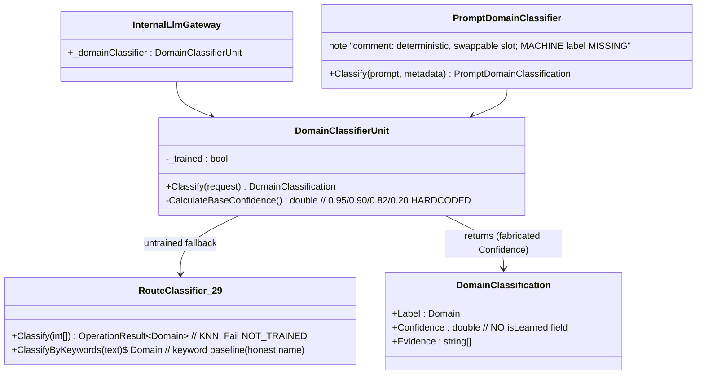
Симуляция ветки: вход «fix the null crash», `_trained=false` (или засеян 7 примерами в `PromptDomainClassifier.BuildSeededClassifier:76-89`) → keyword-ветка `HasRuntimeFailureSignal` (`DomainClassifierUnit.cs:171,224-228`, `text.Contains("fix"/"crash")`) → `Domain.BUG`, `Confidence=0.95` (хардкод по `evidenceCount>=3`) → наружу как `domain.confidence` метаданные без `isLearned`. Ожидаемый честный исход: то же значение домена, но с полем `isLearned=false` + `confidence_source="deterministic_keyword"`.

---

#### «План обещает» (plan-12) / «Код делает»

- **План обещает** (`active-codex-execution-plan-12-no-hidden-determinism.md`): «детерминированные scorer/router/счётчики/словари/порядок/индекс/путь **помечены** baseline/eval-only/internal/model-component, но не финальная власть» (строка 99-101); канон-набор вердиктов `{OK_ALLOWED_LEVEL / OK_INTERNAL_DETAIL / OK_MODEL_COMPONENT / BASELINE_MUST_BE_LABELLED / FORBIDDEN_RUNTIME_SHORTCUT}` (строка 440-442); требование `isLearned=false`, `authority_role="baseline_..."`, `phase_plan_semantic_quality_claimed=false` на baseline (строка 368-374, 449).
- **Код делает**: домен-классификаторы боевого pre-routing (`DomainClassifierUnit`, `PromptDomainClassifier`) отдают `Confidence` (0.20–0.99) хардкодом (`DomainClassifierUnit.cs:260-266`, `:119`) и claim'ят точность в комментариях, но НИ ОДНО из машинных полей честности плана-12 на выходных контрактах `DomainClassification`/`PromptDomainClassification` не присутствует (grep `isLearned|semantic_quality` = 0 по всем 13 доменам). То есть требование пометки плана-12 на эти классы ещё НЕ распространено.
- Уточнение к плану-12: план-12 перечисляет свои «9 механизмов» в `21.AgentInfrastructure`/`26.TrainableRouter` (§3.B). Домен-**классификатор** (pre-routing, `Domain`-тег до выбора ребра) в этот счёт «9 механизмов» НЕ входит — это отдельный, ещё не классифицированный планом слой. Находка ниже — именно про него, канон `classified_mechanism_count == 9` она не ломает.

---

#### Вердикты по доменам

- **ЗАКРЫТО (не дыра, честно):** `17.DynamicDomains`, `28.SemanticNlp`, `14.MachineLearning`, `33.MatrixAlgorithms`, `13.CodeOptimizer`, `24.Compression`, `44.DesignConversionDomain` (PromotedLocalModel + RuntimeImprovementCandidateStrategy), `LlmInspector` / `LlmInspector.Core` (только трассировка/observer, решений не принимает), `22.AgentAlgorithms/SemanticRanker`, `36.LibraryComparison` (бенчмарк-tool).
- **ЧАСТИЧНО (baseline честен в комментариях/имени метода, но машинной метки честности нет = находка):** `23.SemanticCompilerAdapter/DomainClassifierUnit`, `21.AgentInfrastructure/Logical/PromptDomainClassifier(+Unit)`, `29.SemanticCompiler/RouteClassifier` (keyword-ветка), `12.SemanticCompiler/PatternClassifier`, `23.OssEquivalents/PatternClassifier`, `22.AgentAlgorithms/RouteClassifier` (не боевой — бенчмарк/тест).
- **НОВАЯ ДЫРА (детерминированная финальная семантическая власть под обучаемым именем без всякой пометки):** **не обнаружено.** Ближайший кандидат — `22.AgentAlgorithms/RouteClassifier.cs:31` (хардкод `0.95` на keyword-выходе под именем `*Classifier` с комм. «95% accuracy»), но его радиус — только бенчмарк `36.LibraryComparison` + `Tests`, не боевой код, поэтому это метка-находка (ЧАСТИЧНО), а не боевая дыра.

Не-оверклейм: «класс есть ≠ финал на боевом пути» — для каждого решателя выше указан вызывающий боевой/tool/Tests-путь; поведенческий эффект хардкод-confidence на маршрутизацию доказуем только прогоном (READ-ONLY, не запускалось).

---

#### CONCRETE REPAIR BLUEPRINT (для каждой находки класса «метка нет»)

Находки этого цикла — класса «пометить baseline машинно», а НЕ «построить новый обучаемый юнит». Обучаемые KNN-пути уже существуют и честно падают `NOT_TRAINED`; строить их заново не нужно. Поэтому блюпринт — про честностную пометку выходного контракта, не про новый training-lifecycle.

**Находка A — `DomainClassification` / `PromptDomainClassification` без поля честности (боевой pre-routing).**
- Допустимый уровень: L2-baseline `ILogicalUnit`, помеченный baseline; финальная семантическая власть остаётся за будущим обучаемым доменным юнитом (роль `domain_classifier` уже объявлена «swappable slot», `PromptDomainClassifier.cs:141`).
- Типизированное состояние (что добавить в record): расширить `DomainClassification` (`23.SemanticCompilerAdapter/DomainClassifierUnit.cs:22-26`) и `PromptDomainClassification` (`21.AgentInfrastructure/Logical/PromptDomainClassifier.cs:129-133`) полями: `bool IsLearned` (=false пока путь keyword/affinity; =true только когда `UsedKnn` И `_trained`), `string ConfidenceSource` (∈ `deterministic_keyword` / `deterministic_predicate_affinity` / `trained_knn`), `bool SemanticQualityClaimed` (=false для keyword-ветки), `string AuthorityRole` (=`baseline_domain_classifier`).
- Алгоритм пометки (вход → мутация состояния): в `DomainClassifierUnit.Classify` (`:100-156`) уже вычислен `baseClassification.UsedKnn` (`:112-119`) — прокинуть его в новые поля: `IsLearned = baseClassification.UsedKnn`, `ConfidenceSource = UsedKnn ? "trained_knn" : (UsedPredicateAffinity ? "deterministic_predicate_affinity" : "deterministic_keyword")`. Хардкод-`CalculateBaseConfidence` (`:252-267`) оставить как baseline-число, но сопроводить полем `SemanticQualityClaimed=false`, чтобы 0.95 нельзя было прочитать как модельную вероятность.
- KNN/nearest роль: `RouteClassifier.Classify(int[])` (`29.SemanticCompiler/Routing/RouteClassifier.cs:77-90`, JaccardDist, `Take(_k)`) — оставить как `OK_MODEL_COMPONENT` внутри «trained»-ветки; НЕ понижать.
- Source/licence gate: N/A для этой находки (пометка выхода, внешних teacher/данных не вводит).
- DPO-примеры (позитив/отклонён/карантин) для будущего обучаемого доменного юнита: позитив — `{prompt:"fix null crash", chosen_domain:BUG, isLearned:true, confidence_source:trained_knn}`; отклонён — `{same prompt, rejected: keyword-baseline BUG с confidence 0.95 без пометки}`; карантин — `{prompt с source_path/exact-prompt leakage → quarantine}`.
- Затронутые тесты: `Tests/DpcDomainClassifierLogicalUnitTests.cs`, `Tests/DomainClassifierKnnPathTests.cs`, `Tests/PromptRoutingInputCompilerUnitTests.cs` — добавить assert, что keyword-ветка возвращает `IsLearned=false` + `ConfidenceSource="deterministic_keyword"`, а KNN-ветка — `IsLearned=true`.
- Lifecycle: user/cache-состояние (7 seed-примеров `PromptDomainClassifier.cs:79-87`) первым → repo/common baseline вторым → честный `NOT_TRAINED`, если ни того ни другого → export/import provenance → continue-training обучаемого доменного юнита ОТ существующего checkpoint, не с нуля.

**Находка B — сфабрикованный `Confidence=0.95` в `22.AgentAlgorithms/RouteClassifier.cs:31` (не боевой, бенчмарк/тест).**
- Допустимый уровень: baseline-инструмент сравнения. Достаточно: заменить тернарник `0.95 : 0.2` на честный `ConfidenceSource="deterministic_keyword_presence"` + помечать `IsLearned=false`, а комментарий `:8 «95% domain accuracy»` переписать как «keyword-presence baseline, accuracy — из отдельного measurement-run, не из этого числа». Радиус — только `36.LibraryComparison` + `Tests`, поэтому приоритет ниже A.

**Находка C — keyword-финалы `ClassifyByKeywords` / `PredictByRules` (12/29.SemanticCompiler, 23.OssEquivalents).**
- Допустимый уровень: помеченный baseline-генератор/финал fallback. Пометка — на выходных типах (Domain-обёртка), поле `AuthorityRole="baseline_keyword_fallback"`, `SemanticQualityClaimed=false`. Методы уже честны по имени; правка — только машинная метка на границе (contract), не переписывание логики. Comment-claim'ы точности («E18 +15.2%», «E25 +155%») пометить как measurement-provenance, не как свойство keyword-кода.

Общее: это НЕ «wrap in ILogicalUnit» и не «create schema» (анти-template FC-30) — это конкретные поля на конкретных record'ах (`:22-26`, `:129-133`) с конкретным источником значения (`UsedKnn`/`UsedPredicateAffinity`, уже вычисляются) и конкретными тестами (`Tests/Dpc*`, `Tests/DomainClassifierKnnPathTests.cs`).

---

#### Границы аудита (что НЕ покрыто этим свипом)

- Прочитаны решающие файлы каждого домена, но не все 100% файлов (напр. в `24.Compression` — только сигнатура BrotliContextModel; в `44.DesignConversion` — 3 ключевых из ~40). Скрытые формы вне прочитанных путей при обнаружении требуют повторной классификации по §3.B плана-12.
- Combat-path определён по grep вызовов (вне `/obj/`, `.g.cs`, `/Tests/`); фактическое влияние хардкод-confidence на выбор маршрута доказуемо только прогоном — не запускалось (READ-ONLY).
- Ряды Циклов 1–2 не пересматривались (см. их секции).

---

**BOUNDARY — TRAINING WORK, DEFERRED. STOP.**

Пометка выходных контрактов честности (Находки A/B/C) и любая тренировка обучаемого доменного юнита — это код/тест/обучение, за границей READ-ONLY аудита. Ничего не реализовано. Ждём явного распоряжения Luba.

Повторный git-чек (выход): `git rev-parse HEAD` = `880e6710db48f24cf581e55ada8b81d8986c4727`; `git status --porcelain` = пусто (чисто). Диск не менялся.

### ОБНОВЛЕНИЕ 2026-07-29 — Цикл 3 — ProjectWiki-мозг и isLearned:true в CapabilityTraining

**Режим:** READ-ONLY. Код не менялся.
**git на входе:** `880e6710db48f24cf581e55ada8b81d8986c4727`, `git status --porcelain` — пусто.
**git на выходе:** `880e6710db48f24cf581e55ada8b81d8986c4727`, `git status --porcelain` — пусто.

---

## 1. Человеческое резюме (по-русски, читать первым)

Проверял два «титула» построчным чтением на HEAD.

**Титул 1 — «единственный доказанный обучаемый мозг» = `OrchestrationPlanMachine` (домен 42 ProjectWiki).**
Опровергнут. Это не обучаемый мозг, а машина «запомнил и подставил похожее» (retrieval).
Внутри три «хранилища знаний» — все три это обычный `List<пара>`. «Обучение» (`TrainOrchestrationBatchAsync`)
— это `list.Add(пара)` плюс фиктивный счётчик прогресса `+0.05`. Ответ (`GeneratePlanAsync`) — это
поиск ОДНОЙ ближайшей пары по совпадению слов (Jaccard по токенам-словам, не по хешу, не по эмбеддингу),
и в главном режиме (Mode1 «learned flow grounding») в ответ **дословно печатается запомненный план**
(`SerializeChosen` → `chosen.PlanText`). Это retrieval-маска: то, что ответ «правильный», доказывается
тем, что мы вернули заученный текст. Никакого градиента, LoRA, DPO-лосса, reward margin здесь нет; более
того, reward margin в отчёте о батче **захардкожен как `0.03`** (строки 164 и 243) — это ровно тот
«пресенс-флаг», который гайд обучения (guide-02, строка 203) называет «⚠️ не доказательство обучения».
Единственный компонент с признаком статистики — `PromptFlowGroundingModel._weights` — это гистограмма
частот слов (счёт токенов, обрезанный до 3) плюс захардкоженные константы 1.0/0.5; она умеет по
пересечению слов выбрать метку-флоу, но сам ПЛАН всё равно берётся подстановкой заученной пары.
Кто зовёт машину на HEAD: только инструмент `27.TranslationDomain.Tools/Program.cs` (CLI-хост:
`LoadCheckpointAsync`, `OrchestrationPilotLoopRunner.RunAsync`) и `Tests/OrchestrationPlanTests.cs`.
В DI/боевой запуск машина не зарегистрирована. То есть машина осталась осиротевшей (не на боевом пути),
и «мозгом» она была названа авансом — по чтению это retrieval-движок в форме `ILearningMachine`.

**Титул 2 — единственный боевой `isLearned:true` = доменный классификатор в `18.CapabilityTraining`.**
НЕ маска. Это честно помеченная настоящая обучаемая модель — но простого класса: k-NN
(k=5, ленивый/instance-based классификатор). Цепочка: `DefaultLogicalCapabilityTrainer.cs:1255-1266`
создаёт `DomainClassifierUnit` → внутри `SemanticCompiler29.RouteClassifier`. Его `Train` — это
`_train.Clear(); _train.AddRange(examples)` (запомнить размеченный корпус), а `Classify(int[] predicates)`
— это k ближайших соседей по Jaccard-дистанции на целочисленных «слотах предикатов», голосование
большинством → **метка-класс** (`Domain`), а НЕ дословный заученный ответ. Классификатор-по-голосованию
соседей — это признанный алгоритм машинного обучения (ленивое обучение), он обобщает на невиданный
профиль через соседей; по алгоритму это доказуемо «таблица соседей + голос», а не «счётчик/keyword».
Планы проекта прямо благословляют k-NN как `OK_MODEL_COMPONENT` (plan-12 стр. 6/519/682; plan-01 стр. 48)
и запрещают лишь exact-prompt replay — а здесь на выходе метка, не реплей. Поэтому `isLearned:true`
правдив; это НЕ «первый непомеченный обман» — соседняя retrieval-регистрация честно помечена
`isLearned:false` (строка 381), и в `15.OrchestratorModel` детерминизмы тоже помечены `false`.
Единственная оговорка (не маска, а «условная честность»): обученный k-NN срабатывает на ответе
ТОЛЬКО если запрос несёт профиль предикатов (`_trained && Predicates.Length>0`, строка 160); без
предикатов юнит молча падает в keyword/affinity-эвристику, оставаясь помеченным `isLearned:true`.
Доказать, что он реально получает предикаты на боевом пути, можно только прогоном.

**Итог одной фразой.** Титул «мозга» у `OrchestrationPlanMachine` — авансовый и неверный (retrieval).
А смиренный k-NN доменный классификатор, наоборот, — единственная честно помеченная настоящая
(пусть простая) обучаемая модель на боевом пути регистрации. Титулы, по сути, перепутаны местами.

---

## 2. Русскоязычная доска исполнения

| Поле | Значение |
|------|----------|
| Всего проверок | 2 титула (мозг + isLearned:true), 7 исходных файлов прочитаны целиком/в ключевых регионах |
| Сделано (имена) | `OrchestrationPlanMachine.cs` (577 стр., целиком), `PromptFlowGroundingModel.cs` (200, целиком), `OrchestrationKnnStore.cs` (целиком), `TrainedRouteComposerUnit.cs` (целиком), `DefaultLogicalCapabilityTrainer.cs` (регионы 30-48/240-400/1228-1290), `DomainClassifierUnit.cs` (целиком), `RouteClassifier.cs` (SemanticCompiler29, целиком), `CompiledDomainClassifierUnit.cs` (целиком) |
| Сейчас (+исполнитель) | Аудит завершён (Opus-исполнитель, один) |
| Осталось (имена) | Прогонные доказательства (held-out accuracy, exact-prompt-leakage-rate, реально ли предикаты доходят до k-NN) — за границей read-only |
| Тип результата | Аудит-вердикт по алгоритму (чтение), НЕ прогон |
| Следующее действие | Ждать явного указания Любы; тренировочные правки НЕ начинать |

---

## 3. UML (Mermaid classDiagram, импортируемо в draw.io)

### 3.1 Ответный путь «мозга» (Часть 1) — это retrieval

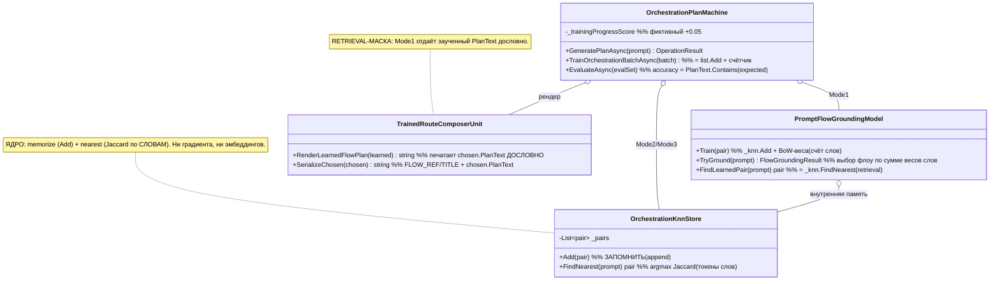

Симуляция веток ответа (`GeneratePlanAsync`):
- prompt = запрос-объяснение → ветка Mode3 → `_humanExplanationKnn.FindNearest` → рендер по PairId соседа (не replay текста).
- prompt близок к обученной паре Mode1, confidence ≥ 0.75 → `FindLearnedPair` (nearest) → `RenderLearnedFlowPlan` → **дословный `chosen.PlanText`**.
- иначе → Mode2 → `_mode2Knn.FindNearest` → рендер контракта (метка `mode=generalized_non_lookup`, но контент — шаблон из контракта, не replay).

### 3.2 Путь классификатора (Часть 2) — настоящий k-NN, честно помечен

```mermaid
classDiagram
    class DefaultLogicalCapabilityTrainer {
        +RegisterTrainedDomainClassifier() 
        %% :1256 classifier.Train  :1265 Register(isLearned:true, wrapper)
    }
    class DomainClassifierUnit {
        -RouteClassifier _classifier
        -bool _trained
        +Train(examples)  %% делегирует в RouteClassifier.Train
        +Classify(request) DomainClassification  %% метка + confidence
    }
    class RouteClassifier {
        -List~(int[] Predicates, Domain)~ _train
        -int _k = 5
        +Train(examples)  %% _train.Clear + AddRange (запомнить корпус)
        +Classify(int[] predicates) Domain  %% k-NN Jaccard -> голос большинства -> МЕТКА
    }
    class CompiledDomainClassifierUnit {
        +ExecuteAsync(request)  %% -> _inner.ExecuteAsync -> Classify
    }
    DefaultLogicalCapabilityTrainer ..> DomainClassifierUnit : new + Train
    DefaultLogicalCapabilityTrainer ..> CompiledDomainClassifierUnit : Register isLearned:true
    CompiledDomainClassifierUnit o-- DomainClassifierUnit : обёртка
    DomainClassifierUnit o-- RouteClassifier : обученный k-NN
    note for RouteClassifier "k-NN(k=5), дистанция=Jaccard по слотам предикатов, ВЫХОД=метка Domain. Не exact-prompt replay -> plan-12 OK_MODEL_COMPONENT."
    note for DomainClassifierUnit "На ответе k-NN включается ТОЛЬКО если Predicates.Length>0 (стр.160); иначе keyword-fallback."
```

---

## 4. No-code алгоритм (что, где, каким методом, в каком порядке)

**Часть 1 — «мозг»:**
1. Обучение батча: `OrchestrationPlanMachine.TrainOrchestrationBatchAsync` (:172-250). Для каждой пары по режиму:
   Mode1 → `PromptFlowGroundingModel.Train(pair)` (:196); Mode2 → `_mode2Knn.Add(pair)` (:202);
   Mode3 → `_humanExplanationKnn.Add(pair)` (:208). Все три = `OrchestrationKnnStore.Add` = `List.Add` (:16-22).
   Затем фиктивный `_trainingProgressScore += 0.05 + count*0.001` (:219). Reward margin в результате — константа `0.03` (:243).
2. `PromptFlowGroundingModel.Train` (:17-24): `_knn.Add(pair)` + `_weights[FlowRef] = BuildWeights(pair)`.
   `BuildWeights`/`BuildTokenWeights` (:111-153): гистограмма частот слов, вес = `min(3, count)`, плюс захардкоженные словари (classification=1.0, plan=1.0, «Gate B»=1.0 и т.п.). Это счёт слов, а не веса, двигаемые лоссом.
3. Ответ: `GeneratePlanAsync` (:60-132) → в решающих ветках `FindNearest`/`FindLearnedPair`.
   `OrchestrationKnnStore.FindNearestWithScore` (:37-48): токенизация регэкспом `[\p{L}\p{N}]+` (слова, не хеш),
   мера — `Jaccard` пересечения множеств токенов промптов (:57-67), берётся ОДИН максимум (nearest-1).
4. Рендер: `TrainedRouteComposerUnit.RenderLearnedFlowPlan` (:10-36) вызывает `SerializeChosen` (:84-89),
   который печатает `chosen.PlanText` дословно. Оценка `EvaluateAsync` (:252-295): accuracy = доля,
   где `PlanText.Contains(ExpectedResponse)` — то есть засчитывает дословную подстановку (утечка).
   **ФИНАЛЬНОЕ решение при ответе — nearest-подстановка запомненной пары (retrieval), не обученный компонент.**

**Часть 2 — классификатор:**
1. `DefaultLogicalCapabilityTrainer.RegisterTrainedDomainClassifier` (:1228-1266): грузит корпус примеров с диска
   (`LoadDomainClassifierTrainingExamples`), добавляет новый, дедуплицирует, сохраняет (`Save...`), создаёт
   `new DomainClassifierUnit()` (:1255), `classifier.Train(...)` (:1256), оборачивает `CompiledDomainClassifierUnit`
   (:1257) и регистрирует `Register<...>(isLearned:true, wrapper)` (:1259-1266).
2. `DomainClassifierUnit.Train` (:64-68) → `RouteClassifier.Train` (:70-74): `_train.Clear(); _train.AddRange(examples)`.
3. Ответ: `CompiledDomainClassifierUnit.ExecuteAsync` (:25-30) → `DomainClassifierUnit.ExecuteAsync` (:42-62)
   → `Classify` (:100-156) → `ClassifyBaseDomain` (:158-182): если `_trained && Predicates.Length>0` →
   `RouteClassifier.Classify(predicates)` (:77-90) = k-NN (k=5, Jaccard по слотам, голос) → метка `Domain`.
   Иначе — keyword/affinity-фолбэк. **Финальное решение обученного пути — метка-класс по голосу соседей (обобщает), не replay.**

---

## 5. Таблица `file:line` → цитата → вердикт

Пути: `C:/Projects/llm_mvp_core-DpoImplementation/`.

| file:line | Цитата (сокр.) | Сейчас | Почему | Вердикт |
|-----------|----------------|--------|--------|---------|
| `42.ProjectWikiDomain/OrchestrationKnnStore.cs:16-22` | `public void Add(pair){ ... _pairs.Add(pair); }` | «Обучение» хранилища = append в `List` | Это запоминание, не обучение | RETRIEVAL |
| `...OrchestrationKnnStore.cs:44,57-67` | `Jaccard(promptTokens, Tokenize(pair.Prompt)...)` | Ближайший по пересечению СЛОВ | Признаки — слова (регэкс), не хеш/эмбеддинг; дистанция Jaccard | RETRIEVAL (nearest-1) |
| `...OrchestrationPlanMachine.cs:196-219` | `_promptFlowGroundingModel.Train(pair); ... _trainingProgressScore + 0.05` | Train = Add + фиктивный счётчик | Нет градиента/лосса; прогресс — константа | НЕ обучение |
| `...OrchestrationPlanMachine.cs:164,243` | `LearningBatchResult(..., 0.03, ...)` (reward margin) | Reward margin захардкожен `0.03` | guide-02:203 называет это «не доказательство обучения» | МАСКАРАД |
| `...OrchestrationPlanMachine.cs:104-116,266-271` | `FindLearnedPair` → `RenderLearnedFlowPlan`; eval `PlanText.Contains(Expected)` | Ответ = nearest + дословный `chosen.PlanText`; accuracy на дословном совпадении | Exact-answer утечка (plan-01 N6.2/N11) | RETRIEVAL-МАСКА + утечка eval |
| `42.ProjectWikiDomain/TrainedRouteComposerUnit.cs:84-89` | `SerializeChosen: ... chosen.PlanText` | Печатает заученный план дословно | Финальный ответ = reprint запомненного | RETRIEVAL-МАСКА |
| `42.ProjectWikiDomain/PromptFlowGroundingModel.cs:150-153` | `min(3, group.Count())` веса токенов | «Веса» = гистограмма частот слов + константы | Счёт, не параметры под лоссом | СТАТ-СЧЁТ (слабое обобщение метки-флоу) |
| `18.CapabilityTraining/DefaultLogicalCapabilityTrainer.cs:1256,1265` | `classifier.Train(...)` ; `isLearned: true, wrapper` | Регистрация обученного доменного классификатора | Единственный боевой `isLearned:true` во всём репо | ПРАВДИВО |
| `29.SemanticCompiler/Routing/RouteClassifier.cs:70-74` | `_train.Clear(); _train.AddRange(examples);` | Train = запомнить размеченный корпус | Ленивый (instance-based) learner — легальный класс МО | ОБУЧАЕМАЯ (k-NN) |
| `...RouteClassifier.cs:77-90` | `_train.OrderBy(JaccardDist).Take(_k).GroupBy(Domain).OrderByDescending(Count).First()` | k-NN(k=5) → голос → **метка** | Выход = класс, НЕ exact-prompt replay | ОБУЧАЕМАЯ, plan-12 `OK_MODEL_COMPONENT` |
| `23.SemanticCompilerAdapter/DomainClassifierUnit.cs:160-165` | `if(_trained && Predicates.Length>0){ _classifier.Classify(...) }` | k-NN включается лишь при наличии предикатов | Без предикатов — молчаливый keyword-fallback | УСЛОВНАЯ ЧЕСТНОСТЬ (не маска) |
| `18.CapabilityTraining/DefaultLogicalCapabilityTrainer.cs:381` | `isLearned: false` (retrieval-юнит) | Соседняя retrieval-регистрация | Честно помечена `false` | ЧЕСТНО |
| `15.OrchestratorModel/Logical/LogicalOrchestratorAssistant.cs:378,389` | `isLearned: false` | Детерминизмы в 15.* | Честно помечены `false` | ЧЕСТНО |

---

## 6. «План обещает» / «Код делает»

**План обещает (цитаты с line):**
- `active-codex-execution-guide-02-how-to-train.md:83-95` — «в репозитории есть ДВА разных "обучения", и их
  легко перепутать — это главный риск всего плана обучения»; канон реального обучения — `LogicalDpoTrainingUnit`
  (:88 «Реальный градиент, реальный AdamW-шаг, реальные метрики `dpo_step_*.json`»; :95 «закрепляет канон
  обучения: `LogicalDpoTrainingUnit`»). `IncrementalTrainer` — «ЗАГЛУШКА … НЕ обучает (Layer-5 FAIL)» (:90,163).
- `active-codex-execution-guide-02-how-to-train.md:203` — про захардкоженный margin: «захардкожен 0.03 (как в
  TranslationMachine) → ⚠️ Не доказательство обучения, пресенс-флаг [WRONG:] → тянуть margin из DpoMetrics (R-19)».
- `active-codex-execution-plan-12-no-hidden-determinism.md:413` — «K-NN … а не exact-prompt replay (тест leakage)»;
  :6/:519/:682 — `KnnLogicalUnit._index.Search` помечен `OK_MODEL_COMPONENT` (k-NN легален как model-component);
  :120 — «Deterministic evidence masquerade firewall»; :209 — «финал РЕБРА = ОБУЧАЕМЫЙ … (DeterministicFinalAuthority=false)».
- `active-codex-execution-plan-01-node.md:66` — «Любой скорер/счётчик/роутер на узле — обучаемый `ILogicalUnit`
  либо явный `eval-only/baseline`; немаркированной финальной авторитетности нет»; :48 — «KNN-нота `OK_MODEL_COMPONENT`»;
  :102 (N4) — trained-state = «typed record, не counter», «reward-margin двигает веса (`DpoTrainer.cs:42-44`)»;
  :104 (N6) — «`exactPromptLeakageRate=0.0` (D-17)»; :109 (N11) — «Запретить позицию/путь/exact-prompt; ablation».

**Код делает:**
- `OrchestrationPlanMachine`: `Train*` = `List.Add` + счётчик; reward margin = константа `0.03` (:164,243) —
  ровно «пресенс-флаг [WRONG:]» из guide-02:203. Ответ = nearest-подстановка, Mode1 печатает `chosen.PlanText`
  дословно (`SerializeChosen`), а `EvaluateAsync` меряет accuracy по `Contains(Expected)` — то самое exact-answer
  leakage, что запрещают plan-01 N6/N11. Финальной обучаемой авторитетности нет; это retrieval в форме `ILearningMachine`.
- Доменный классификатор: `RouteClassifier` = k-NN, ВЫХОД — метка `Domain` (не replay). Это ровно тот случай,
  который планы разрешают (`OK_MODEL_COMPONENT`, обучаемый классификатор-метка), и он честно помечен `isLearned:true`.

---

## 7. Вердикты (раздельно) + REPAIR BLUEPRINT

### 7.1 ТИТУЛ «ОБУЧАЕМЫЙ МОЗГ» (`OrchestrationPlanMachine`) — ОПРОВЕРГНУТ / ВСЁ ЕЩЁ ДЫРА

По алгоритму (чтение) это memorize-and-match под трен-именами: запоминание в `List`, поиск nearest-1 по Jaccard
слов, дословный reprint заученного плана в Mode1, захардкоженный reward margin `0.03`, eval с exact-answer утечкой.
Единственный обобщающий фрагмент — BoW-выбор метки-флоу (`PromptFlowGroundingModel`), но решающий ПЛАН всё равно
подставляется retrieval-ом. «Единственным доказанным обучаемым мозгом» это не является; канон реального обучения
(градиент) по плану — `LogicalDpoTrainingUnit` (guide-02:88,95), а он, по контексту цикла 2, осиротел.
Способность обобщать за пределами заученного — доказуемо только прогоном; по чтению доказан лишь АЛГОРИТМ
(таблица+nearest, не градиент). Титул — авансовый.

**CONCRETE REPAIR BLUEPRINT — детерминизм-под-маской №1: захардкоженный reward margin `0.03`.**
- Уровень: L5-машина (`ILearningMachine`), файл `42.ProjectWikiDomain/OrchestrationPlanMachine.cs:159-169,238-247`.
- Что убрать: литерал `0.03` в конструкторах `LearningBatchResult`.
- Чем заменить: реальный `RewardMargin`, вычисленный `DpoTrainer` (см. plan-01 N4.2.1 → `DpoTrainer.cs:42-44`),
  либо, если этот класс остаётся retrieval-движком, — ЯВНО пометить его `authority_role="baseline_retrieval"`,
  `phase_plan_semantic_quality_claimed=false`, а `RewardMargin` отдавать как `null`/`NotMeasured`, НЕ как число.
- Тренировочный апдейт (если делать настоящим): input-строка пары → forward `features·PreferenceWeights`
  (typed `double`-веса, не счёт) → DPO-лосс с reward margin → шаг AdamW → сохранить checkpoint (tmp→move).
- Метод nearest: `OrchestrationKnnStore.FindNearest` оставить ТОЛЬКО как model-component-память внутри
  обучаемого юнита (plan-12 `OK_MODEL_COMPONENT`), НЕ как финальный ответ.
- Гейт источника/лицензии: пары идут через легальный teacher-гейт (plan-01 N10), closed teacher → judge-only.
- DPO-примеры: chosen = план, прошедший held-out; rejected = nearest-подстановка того же промпта (анти-leakage);
  quarantine = пары с `exactPromptLeakageRate>0`.
- Затронутые тесты: `Tests/OrchestrationPlanTests.cs` — заменить «accuracy по Contains» на held-out EvaluateMany.
- Lifecycle: user/cache-состояние → repo/common fallback → export/import/share → continue-training от checkpoint.

**CONCRETE REPAIR BLUEPRINT — детерминизм-под-маской №2: exact-answer утечка в оценке.**
- Файл `OrchestrationPlanMachine.cs:266-271` (`PlanText.Contains(item.ExpectedResponse)`) + `TrainedRouteComposerUnit.cs:88`
  (дословный `chosen.PlanText`).
- Что сделать: ввести `exactPromptLeakageRate` (plan-01 N6.2, D-17) — блокировать accuracy, если held-out
  пересекается с train по промпту/ответу; в Mode1 запретить дословный reprint как «доказательство» — рендерить
  синтез, а сам заученный текст держать только в `KnnMemory` (память), не в финальном ответе.
- Метрика: `candidate_order_invariant=true`, `exactPromptLeakageRate=0.0`; иначе — `DATASET_REBUILD_REQUIRED`.

### 7.2 `isLearned:true` В `18.CapabilityTraining` (доменный k-NN классификатор) — ЗАКРЫТО (НЕ маска)

Это настоящая обучаемая модель, класс алгоритма — **ленивый/instance-based k-NN-классификатор** (k=5,
дистанция Jaccard по слотам предикатов, выход = метка `Domain` голосом соседей). Обобщение по соседям
доказуемо по алгоритму (не счётчик, не keyword-таблица; keyword — лишь фолбэк-путь). Планы прямо
разрешают k-NN (`OK_MODEL_COMPONENT`) и запрещают только exact-prompt replay — здесь выход метка, не replay.
`isLearned:true` (`DefaultLogicalCapabilityTrainer.cs:1265`) правдив. Это НЕ первый непомеченный обман:
соседний retrieval-юнит помечен `isLearned:false` (:381), в `15.*` детерминизмы тоже `false`. Прочие
детерминизмы проекта, как и заявлено, помечены честно. **Blueprint новой дыры не требуется.**

Оговорка (не дыра, а conditional-honesty — минимальный note-only фикс): `DomainClassifierUnit.cs:160`
включает k-NN только при `Predicates.Length>0`; без предикатов юнит отвечает keyword-эвристикой, оставаясь
`isLearned:true`. Рекомендация (по желанию): при срабатывании фолбэк-ветки помечать в `Evidence`/`AuthorityRole`
`degraded_to_baseline_keyword`, чтобы флаг `isLearned` не переоценивал ответ, когда предикаты не пришли.
Реально ли предикаты доходят на боевом пути — доказуемо только прогоном.

### 7.3 Состав вызывателей машины на HEAD (Часть 1 Q3)

Подтверждено grep-ом по `.cs`: `OrchestrationPlanMachine` ссылается из `27.TranslationDomain.Tools/Program.cs`
(инструмент-CLI: `LoadCheckpointAsync`, `OrchestrationPilotLoopRunner.RunAsync`, `SanitizeCheckpoint`),
из `Tests/OrchestrationPlanTests.cs`, и из своих же файлов домена 42 (`OrchestrationPilotLoopRunner`,
`OrchestrationPlanOrchestrator`, `OrchestrationPlanContracts`). НОВОЕ против прошлого аудита: боевым «tools»-хостом
теперь выступает именно `27.TranslationDomain.Tools/Program.cs`, а НЕ `43.LearningLocalWikiData/tools/ProjectWikiTrainingRunner`
(последний существует, но машину НЕ вызывает). В DI/боевой рантайм машина не зарегистрирована → осталась осиротевшей;
хосты = tools-CLI + Tests, боевого пути нет.

---

## 8. Граница достаточности аудита (breadth-нота)

Проверенный охват: два титула, retrieval-vs-learned граница, честность `isLearned` на боевой регистрации,
состав вызывателей. НЕ проверялось прогоном (за границей read-only): фактическая held-out точность k-NN,
реально ли предикаты доходят до k-NN на боевом пути, `exactPromptLeakageRate` машины. Смежные зоны, где
следующий аудит вероятно найдёт: (а) прочие `TransformerEmbeddingKnnLogicalUnit`-retrieval-регистрации в 18.*
(помечены `false` — проверить, что ни одна не выдаёт себя за learned); (б) поле `_referenceModel = new(BuildTinyConfig())`
(`DefaultLogicalCapabilityTrainer.cs:40`) — дыра «reference = случайная tiny-модель» из задания 3.1 присутствует на
HEAD, отдельный трек. Претензия «аудит обучаемости завершён» НЕ выдаётся — только «эти два титула проверены по чтению».

---

## 9. BOUNDARY — TRAINING WORK, DEFERRED. STOP.

Все репэйр-блупринты выше — проектные заметки; обучение/сборка/тесты/git-write НЕ выполнялись и не будут без явного указания.

**git-чек (повтор, выход):** `git rev-parse HEAD` = `880e6710db48f24cf581e55ada8b81d8986c4727`; `git status --porcelain` — пусто. Код на HEAD не изменён.

### ОБНОВЛЕНИЕ 2026-07-29 — Цикл 4 — Автоград и связность графа градиента

Режим: чтение only, репозиторий C:\Projects\llm_mvp_core-DpoImplementation.
HEAD на входе 880e6710db48f24cf581e55ada8b81d8986c4727, рабочее дерево чистое — совпало с ожиданием.

## Человеческое резюме (главное — простыми словами)

Вопрос Цикла 4 один: когда мы зовём «посчитай, куда двигать веса» (обратный проход), доходит ли этот сигнал от предсказаний модели (logits) вниз до двух маленьких обучаемых матриц адаптера — lora_a и lora_b? Если сигнал где-то теряется по дороге, обучение молча стоит на месте: числа не двигаются, ошибок нет, всё «зелёное», но модель не учится.

Ответ: **сигнал доходит. Граф связен, математика каждого шага на этом пути верна.** Я прошёл руками весь путь вперёд (от номеров токенов до logits) и весь путь назад (от logits до lora_a/lora_b) и не нашёл ни одного разрыва НА БОЕВОМ ПУТИ обучения DPO.

Почему это не противоречит разведке, которая насчитала 14 операций «без обратного прохода» (Slice, Concat, Sigmoid, LogSigmoid, ClampMin, OuterProduct, Cos, Sin, Gather, MaskedFill, Squeeze, Unsqueeze, CumSum, L2Normalize и т. п.): все эти операции реально забыли зарегистрировать обратный проход — разрыв в них есть. Но **ни одна из них не стоит на пути, по которому течёт градиент к параметрам адаптера**. Три из них (Cos, Sin, OuterProduct) вызываются, но только чтобы построить таблицу углов поворота RoPE — это КОНСТАНТЫ, по ним градиент и не нужен. Остальные живут в токенизаторе, сэмплере, RAG и в инференсе — то есть вне обучения. Формула из аудиторского словаря: «разрыв есть, но путь его не проходит».

Отдельно важно, ПОЧЕМУ разрывы не кусают. Тренер DPO намеренно обходит опасные места: логарифм-софтмакс и выбор нужного токена он считает вручную обычными циклами по массивам (DpoTrainer.cs:256-289, 310-337), а сам DPO-loss (сигмоида, логарифм) считает в обычных float-числах (DpoTrainer.cs:54, 342), а не тензорными операциями. Поэтому сломанные тензорные Sigmoid/LogSigmoid/Gather просто не участвуют. Автоград нужен только НИЖЕ logits — а там модель использует лишь «здоровые» операции.

Что это НЕ доказывает (честная граница): я доказал статическую связность и верность формул чтением графа. Двигаются ли числа фактически и падает ли loss на прогоне — это «доказуемо только прогоном» (запрещён в этом режиме). Формулирую как гипотезу: если запустить DpoTrainer.Step на реальном батче, grad у lora_a/lora_b станет ненулевым и AdamW сдвинет их. Основание гипотезы — связный граф + AdamW обновляет параметр, только если у него есть grad (AdamW.cs:71); граф grad даёт, значит шаг произойдёт.

## Как устроен обратный проход (без кода, по шагам)

Механизм обхода — Tensor.cs:64-92. Каждая операция, создавая результат, должна сделать ДВЕ вещи: (1) записать свои входы в список `Children`, (2) положить в `BackwardFunc` формулу «как размазать градиент на входы». Обход `Backward()` строит топологический порядок по `Children` (сначала потребители, потом производители) и для каждого узла зовёт его `BackwardFunc`. Ключевая ловушка: если операция забыла `Children.Add`, её вход в обход НЕ попадает — ветка отваливается МОЛЧА, без исключения.

Путь вперёд для одного DPO-прохода (метод → файл:строка):
1. LlmModel.Forward — LlmModel.cs:108-115: эмбеддинг → N блоков → финальная норма → lm_head.
2. TransformerBlock.Forward — TransformerBlock.cs:42-48: x = x + attn(norm1(x)); x = x + ffn(norm2(x)). Остаточные связи (Add) несут градиент сквозь стек.
3. RmsNorm.Forward — RmsNorm.cs:26-33: Pow → Mean → AddScalar → RSqrt → MultiplyBroadcast → MultiplyBroadcast.
4. CausalSelfAttention.Forward — CausalSelfAttention.cs:114-147: проекции q/k/v (через LoRA-адаптер) → Reshape/Transpose → RoPE (ApplyRotaryEmbedding) → RepeatInterleave (GQA) → Transpose+MatMul+Scale+ApplyCausalMask+Softmax+MatMul → Reshape → o_proj (через LoRA-адаптер).
5. SwiGLUFeedForward.Forward — SwiGLUFeedForward.cs:37-43: Silu(gate) · up → down. Веса FFN заморожены, но градиент СКВОЗЬ них проходит (см. ниже).
6. LoraLinear.Forward — LoraLinear.cs:61-70: baseOut = base(x); xDrop = dropout(x); lora = Scale(MatMul(MatMul(xDrop, Aᵀ), Bᵀ)); return Add(baseOut, lora). ВОТ здесь lora_a/lora_b входят в граф.

Почему замороженный Linear всё равно передаёт градиент своему входу — Linear.cs:42-56 + MatMul (TensorOps.cs:544-548): MatMul регистрирует обратный проход, если `a.RequiresGrad || b.RequiresGrad`, и добавляет вход `a` в Children при `a.RequiresGrad`. Вес заморожен (b=false), но активация-вход a требует градиент → результат требует градиент и вход добавляется. То есть заморозка веса НЕ рвёт цепочку — она лишь не копит grad на самом весе. Это и держит связь через FFN, финальную норму и lm_head, у которых своих обучаемых параметров на пути нет.

Точка входа обратного прохода — DpoTrainer.cs:292-340 (BackwardLogProbs): вручную заполняет logits.Grad производной logsoftmax-CE (oneHot − softmax) и зовёт logits.Backward(logits.Grad). Дальше автоград сам доносит сигнал до lora_a/lora_b.

## Таблица операций TensorOps.cs — Children? / BackwardFunc? / формула верна? / на боевом пути DPO?

| Операция (file:line) | Children | BackwardFunc | Формула backward | На пути обучения DPO |
|---|---|---|---|---|
| Add (TensorOps.cs:38) | да | да | верна (grad → обоим без изменений) | ДА (остатки, LoRA-сложение) |
| AddScalar (:64) | да | да | верна (проброс) | ДА (RmsNorm eps) |
| Multiply (:83) | да | да | верна (g·b, g·a) | ДА (SwiGLU gate·up, dropout-маска) |
| MultiplyBroadcast (:121) | да (усл.) | да | верна (broadcast-редукция по b) | ДА (RmsNorm) |
| Scale (:185) | да | да | верна (g·scalar) | ДА (LoRA scaling, 1/√d) |
| Subtract (:210) | да | да | верна (g, −g) | нет (в fwd не используется) |
| Pow (:242) | да | да | верна (n·x^{n-1}) | ДА (RmsNorm x²) |
| Log (:267) | да | да | верна (g/x) | нет |
| Exp (:292) | да | да | верна (g·e^x) | нет |
| Sqrt (:317) | да | да | верна | нет |
| RSqrt (:342) | да | да | верна (−½·g·result³) | ДА (RmsNorm) |
| LogSoftmax (:368) | да | да | верна (g − softmax·Σg) | нет (DPO считает logprob вручную) |
| Sum (:444) | да | да | верна | нет |
| Mean (:469) | да | да | верна (1/n по оси) | ДА (RmsNorm) |
| MatMul (:510) | да (усл.) | да | верна (g@Bᵀ, Aᵀ@g; broadcast B) | ДА (везде) |
| Transpose (:601) | да | да | верна (обратная перестановка) | ДА (Linear, attention, reshape) |
| Softmax (:649) | да | да | верна (s·(g − ⟨g,s⟩)) | ДА (веса внимания) |
| Reshape (:721) | да | да | верна (reshape обратно) | ДА (головы внимания, CE) |
| Silu (:930) | да | да | верна (σ(1+x(1−σ))) | ДА (SwiGLU) |
| RepeatInterleave (:996) | да | да | верна (сумма по копиям) | ДА (GQA расширение k/v) |
| ApplyRotaryEmbedding (:1052) | да | да | верна (Jᵀ поворота; cos/sin как константы) | ДА (RoPE к q/k) |
| ApplyCausalMask (:1125) | да | да | верна (grad только нижний треугольник) | ДА (маска внимания) |
| Argmax (:741) | нет | нет | — (возвращает int) | нет (инференс) |
| Slice (:753) | НЕТ | НЕТ ⚠️ | отсутствует | нет |
| Concat (:770) | НЕТ | НЕТ ⚠️ | отсутствует | нет |
| Unsqueeze (:881) | НЕТ | НЕТ ⚠️ | отсутствует | нет |
| Cos (:905) | НЕТ | НЕТ ⚠️ | отсутствует | вызывается, но по константам RoPE (вне пути параметров) |
| Sin (:913) | НЕТ | НЕТ ⚠️ | отсутствует | вызывается, но по константам RoPE (вне пути параметров) |
| Sigmoid (:921) | НЕТ | НЕТ ⚠️ | отсутствует | нет (DPO использует float-сигмоиду) |
| LogSigmoid (:960) | НЕТ | НЕТ ⚠️ | отсутствует | нет (DPO-loss во float) |
| ClampMin (:969) | НЕТ | НЕТ ⚠️ | отсутствует | нет |
| OuterProduct (:978) | НЕТ | НЕТ ⚠️ | отсутствует | вызывается, но по константам RoPE (вне пути параметров) |
| MaskedFill (:1176) | НЕТ | НЕТ ⚠️ | отсутствует | нет (внимание использует ApplyCausalMask) |
| Gather (:1187) | НЕТ | НЕТ ⚠️ | отсутствует | нет (DPO выбирает logprob прямым индексом) |
| CumSum (:1204) | НЕТ | НЕТ ⚠️ | отсутствует | нет (сэмплер) |
| SortDescending (:1231) | нет | нет | — | нет (сэмплер) |
| Scatter1D (:1247) | НЕТ | НЕТ ⚠️ | отсутствует | нет (сэмплер) |
| Squeeze (:1256) | НЕТ | НЕТ ⚠️ | отсутствует | нет |
| L2Normalize (:1276) | НЕТ | НЕТ ⚠️ | отсутствует | нет (RAG/эмбеддинги) |
| CrossEntropy (:1310) | — | — (возвращает float) | ручная | нет (предобучение Trainer, не DPO) |

Итог таблицы: 22 операции автоград-связны и математически верны; из них 16 стоят на боевом пути DPO. ~14 операций рвут граф, но НИ ОДНА не лежит на пути градиента к lora_a/lora_b.

## Опорные цитаты (file:line + «сейчас / почему ок»)

Tensor.cs:70-71 — обход графа:
> `foreach (var node in TopologicalSort()) node.BackwardFunc?.Invoke();`
Сейчас: обходит только узлы, достижимые через Children. Почему ок: все операции боевого пути (таблица выше) регистрируют Children — обход достаёт lora_a/lora_b.

TensorOps.cs:544-548 — MatMul регистрирует вход:
> `if (a.RequiresGrad || b.RequiresGrad) { result.RequiresGrad = true; if (a.RequiresGrad) result.Children.Add(a); if (b.RequiresGrad) result.Children.Add(b); ...`
Сейчас: замороженный вес (b) не рвёт цепочку — вход-активация a добавляется, если требует градиент. Почему ок: держит связь сквозь FFN/финальную норму/lm_head без своих обучаемых параметров.

LoraLinear.cs:65-69 — вход lora_a/lora_b в граф:
> `var aT = TensorOps.Transpose(_loraA.Value, 0, 1); ... var lora = TensorOps.MatMul(TensorOps.MatMul(xDrop, aT), bT); lora = TensorOps.Scale(lora, Scaling); return TensorOps.Add(baseOut, lora);`
Сейчас: Transpose→MatMul→Scale→Add — все четыре автоград-связны. Почему ок: обратный проход от выхода адаптера доходит до _loraA.Value/_loraB.Value.

DpoTrainer.cs:339 — запуск автограда ниже logits:
> `logits.Backward(logits.Grad);`
Сейчас: вручную посеянный grad (oneHot − softmax) на logits запускает обход вниз до адаптеров. Почему ок: автоград нужен только ниже logits, и там путь связен.

RotaryEmbedding.cs:36-37 — единственные вызовы «рваных» операций на модели:
> `var outer = TensorOps.OuterProduct(positions, frequencies); return (TensorOps.Cos(outer), TensorOps.Sin(outer));`
Сейчас: строит таблицы cos/sin из позиций (не требуют градиента). Почему ок: ApplyRotaryEmbedding относится к cos/sin как к константам и корректно кладёт градиент только на x. «Разрыв есть, но путь его не проходит».

AdamW.cs:71 — тихий пропуск при отсутствии grad:
> `if (param.Grad == null) continue;`
Сейчас: параметр без grad молча не обновляется. Почему важно: это цена разрыва — если бы граф рвался, lora_a/lora_b получили бы null-grad и AdamW бы их не тронул без единой ошибки. Граф связен → grad не null → шаг происходит.

## Тонкости из задания (проверены отдельно)

1. Backward(initialGradient) затирает Grad копией — Tensor.cs:99: `Grad = new Tensor(initialGradient.Data.ToArray(), ...)`. Корректно ли для chosen+rejected? — ДА. chosen и rejected — это ДВА разных тензора logits от двух отдельных model.Forward (DpoTrainer.cs:248). Затирание Grad копией происходит на РАЗНЫХ объектах logits, не мешая друг другу. Накопление chosen+rejected идёт на ЛИСТЬЯХ lora_a/lora_b через AccumulateGrad (+=, TensorOps.cs:805-818), а не на logits. Между двумя BackwardLogProbs нет ZeroGrad — и это правильно: суммирование двух вкладов — цель. Латентная острая грань: повторный Backward на ОДНОМ тензоре затрёт, а не накопит корневой grad; в текущем потоке каждый logits бэквордится ровно один раз, поэтому дефекта нет.

2. ZeroGrad покрывает все параметры? — ДА. Module.ZeroGrad (Module.cs:38-42) идёт по Parameters() рекурсивно (Module.cs:27-35), включая подмодули. Адаптер регистрируется как подмодуль слота (LlmModel.cs:45 `RegisterModule("adapter", adapter.RegistrationModule)`), а LoraLinear регистрирует lora_a/lora_b (LoraLinear.cs:55-56). Значит _policy.ZeroGrad() (DpoTrainer.cs:62) обнуляет и градиенты адаптеров. Обнуление — только ПОСЛЕ optimizer.Step, что не мешает накоплению chosen+rejected внутри шага.

3. Dropout при training=true участвует в backward? — ДА, численно. LoraLinear.cs:64 → Dropout.Forward (Dropout.cs:26-40): при training и p>0 возвращает Multiply(input, mask). Даже если сам xDrop не требует градиента, его ЗНАЧЕНИЯ (обнулённые/масштабированные) идут во внутренний MatMul(xDrop, aT), и обратный проход MatMul по aT использует a.Data = xDrop.Data (TensorOps.cs:582-588). То есть dropout влияет на градиент lora_a через сохранённые значения прямого прохода. При p=0 Dropout — тождество (Dropout.cs:28-29), что также корректно.

## План обещает / Код делает

- План обещает: обучаемый LoRA-адаптер, градиент которого доходит до lora_a/lora_b и обновляется оптимизатором.
- Код делает: строит связный автоград-граф от logits (посев вручную) через все 16 операций боевого пути до листьев lora_a/lora_b; замороженные веса пропускают градиент сквозь себя; AdamW обновляет параметры с ненулевым grad. Заявленное и реализованное на этом узком вопросе СОВПАДАЮТ (статически). Численный эффект — гипотеза до прогона.

## Вердикты

ЕДИНСТВЕННЫЙ незакрытый вопрос Циклов 1-3 — численная связность автоград-графа от logits до lora_a/lora_b — **ЗАКРЫТО**: граф связен, математика каждого шага на боевом пути верна, «рваные» операции лежат вне этого пути.

- Механика LoRA/тренера (Цикл 1) — вне охвата, не пересчитывал.
- Математика DPO-лосса и заморозка reference (Цикл 3) — вне охвата, не пересчитывал.
- Связность графа градиента (Цикл 4, это задание) — ЗАКРЫТО (связен, формулы верны).
- НОВАЯ ДЫРА на боевом пути DPO — НЕ НАЙДЕНА.
- Латентные (вне боевого пути) дефекты — 14 операций без обратного прохода. Не блокируют DPO сегодня, но станут дырой при переносе на путь параметров. Блюпринты ремонта ниже (по требованию гейта — заполненные, не заглушки).

## Repair-blueprint для латентных дефектов (вне боевого пути DPO — превентивно)

Общий шаблон здесь: каждая операция, создающая результат из тензора-входа, обязана при `x.RequiresGrad` выполнить `result.RequiresGrad = true; result.Children.Add(x); result.BackwardFunc = () => AccumulateGrad(x, <градиент>)`. Тест-доказательство для всех: собрать x с RequiresGrad=true, прогнать op, вызвать result.Backward(единичный градиент нужной формы) и сверить x.Grad с конечной разностью (численный градиент) — это модульный тест внутри LlmFromScratch.Tests, без запуска обучения.

- Gather (TensorOps.cs:1187) — формула: `grad_src[index[flat]] += grad_out[flat]` по оси dim (scatter-add обратно в форму src); Children.Add(src); тест: Gather по случайным индексам, сверка x.Grad с конечной разностью. Роль на будущее: если выбор целевого logprob переведут с ручного цикла на Gather.
- Slice (:753) — формула: `grad_x[startRow*rowLen + k] += grad_out[k]`; остальное 0; Children.Add(x); тест: срез строк, конечная разность.
- Concat (:770) — формула: разрезать grad_out по оси обратно на блоки a и b; Children.Add(a), Children.Add(b); тест: конкат двух тензоров, конечная разность по каждому.
- Squeeze (:1256) / Unsqueeze (:881) — формула: reshape grad_out в форму x (проброс 1:1); Children.Add(x); тест: конечная разность.
- MaskedFill (:1176) — формула: `grad_x = grad_out`, где mask==0, иначе 0; Children.Add(x); тест: конечная разность вне маски.
- ClampMin (:969) — формула: `grad_x = grad_out * (x > minVal ? 1 : 0)`; Children.Add(x); тест: конечная разность на обеих сторонах порога.
- Sigmoid (:921) — формула: `grad_x = grad_out * s * (1 - s)`, s=result; Children.Add(x); тест: конечная разность.
- LogSigmoid (:960) — формула: `grad_x = grad_out * σ(-x)`; Children.Add(x); тест: конечная разность. (Нужно, только если DPO-loss переведут с float на тензоры.)
- Cos (:905) / Sin (:913) — формула: `grad_x = ∓/± grad_out * sin/cos(x)`; Children.Add(x); тест: конечная разность. На модели НЕ требуется (cos/sin — константы RoPE); чинить только если появится обучаемая частотная сетка.
- OuterProduct (:978) — формула: `grad_a[i] += Σ_j g[i,j]*b[j]`, `grad_b[j] += Σ_i g[i,j]*a[i]`; Children.Add(a/b); тест: конечная разность. На модели НЕ требуется по той же причине.
- CumSum (:1204) / Scatter1D (:1247) / L2Normalize (:1276) — сэмплер/RAG, вне обучения; при вводе в обучаемый путь — обратный проском по стандартной формуле каждой (reverse-cumsum; scatter обратно; якобиан L2-нормировки) с тем же тестом конечной разности.

Приоритет ремонта: Gather первым (наиболее вероятный кандидат заехать на боевой путь при рефакторинге выбора logprob), затем Slice/Concat/Squeeze/Unsqueeze (типичные при работе с формами), остальное — по факту переноса на путь параметров.

Граница охвата аудита: проверены автоград-ядро (Tensor.cs, TensorOps.cs), боевой forward (03.TransformerModel/**, 00.TensorCore/Layers/**), LoRA (10.LoRA/**), путь DPO (11.DPO/DpoTrainer.cs), оптимизатор (AdamW.cs) и обнуление градиента (Module.cs, Trainer.cs). НЕ проверялись и вне охвата: численный прогон (запрещён режимом), Tests/, tools/, experiments-v2/, сэмплер и RAG-пайплайн целиком (затронуты только в части «рваных» операций вне обучения).

BOUNDARY — TRAINING WORK, DEFERRED. STOP.

### ОБНОВЛЕНИЕ 2026-07-29 — Цикл 4 — DesignConversion конец-в-конец

Аудитор: Opus (исполнитель задания 4.2). Код читался только на чтение из
`C:\Projects\llm_mvp_core-DpoImplementation` на HEAD `880e6710`, статус пуст.
Домен 44 (DesignConversion) — единственный с боевым-ish ASP.NET сервером
(`tools/DesignConversionLiveLocalServer`), поэтому его можно пройти от HTTP-запроса
до «обучения». Вывод: сервер отвечает не тем, что обещает петля обучения —
между «сервер отвечает» и «модель обучена/промоутнута» разрыв.

---

## Человеческое резюме (без машинных кодов)

Представьте фабрику, которая обещает: «мы принимаем дизайн, делаем HTML/CSS,
собираем отзывы, учимся на них, проверяем ученика на отложенном экзамене и, если
сдал, ставим его на боевую линию». Что реально построено:

1. **«Обучение» — это не обучение, а взвешенный подсчёт.** `TrainBatchAsync`
   не крутит градиенты и не считает функцию потерь. Он берёт несколько признаков
   из пары (chosen/rejected), складывает их вклады и делит на число наблюдений —
   получается арифметическое среднее на признак. Точность после «обучения»
   буквально копируется из точности до него. И это честно подписано в коде
   («NOT_TRAINED_MODEL», «held-out НЕ измерялся»).

2. **Сервер отвечает эфемерной заглушкой.** При старте сервер создаёт СВЕЖУЮ
   машину и «дообучает» её ОДНОЙ синтетической парой прямо в памяти, затем ею и
   отвечает. Это не промоутнутый чекпойнт, не активированная версия — это
   одноразовый «tiny»-стаб на 1 строке. Выученная поправка к ответу реальна, но
   это ограниченный ±0.5 сдвиг поверх детерминированного каркаса; базовый вердикт
   даёт детерминированный каркас, не «обученная» модель.

3. **Отложенный экзамен (held-out) — самодекларация, а не измерение.** Гейт
   промоушена честно блокирует, если held-out-числа отсутствуют/ниже порога/не
   source-disjoint. НО сами числа никто не вычисляет прогоном модели — они
   ПРИХОДЯТ во входном запросе. Единственные места, где такой запрос собирается, —
   папка `Tests\`. На боевом пути гейт вообще не вызывается.

4. **DPO-пары непригодны для обучения и это признано.** Синтетический «rejected»
   получается как `chosen − 0.01` по скору, при этом сам скор «не измерялся».
   Пара честно помечена «synthetic_negative / not_training_grade / approval=pending»
   и блокируется политикой — учить на ней нечему (контент почти тот же, разница —
   выдуманные 0.01).

5. **Петля improvement→training→activation разорвана по проекту.** Loop-координатор
   доводит только до «сложить кандидат-пару в локальную БД со статусом
   review-pending». Он НЕ зовёт обучение, НЕ промоутит, НЕ активирует. Дальше —
   только человек, которого на боевом пути нет.

Итог одной фразой: реальны только детерминированный каркас + ограниченный
feature-nudge; «обучение», «held-out» и «активация обученного» — либо стаб, либо
разорванное звено. Всё это в коде подписано честно (over-claim в подписях нет);
проблема архитектурная, не маскировочная.

### Доска статуса (по-русски)
- **Всего вопросов:** 5 (+ сквозная схема).
- **Сделано (имена):** Q1 аккумулятор, Q2 активация, Q3 held-out, Q4 DPO-пары,
  Q5 improvement-loop — все с трассами file:line.
- **Сейчас (исполнитель):** Opus — отчёт написан, аппенд в общий файл.
- **Осталось (имена):** нет (задание read-only закрыто).
- **Тип результата:** аудит-артефакт (человекочитаемый), без записи в код.
- **Следующее действие:** ждать Fable/Luba; любые исправления — TRAINING WORK, DEFERRED.

---

## Таблица трасс (file:line → что там)

Все пути относительно `C:\Projects\llm_mvp_core-DpoImplementation\`.

| # | file:line | Что показывает |
|---|-----------|----------------|
| Q1 | `44.DesignConversionDomain/DesignConversionMachine.cs:61-111` | `TrainBatchAsync`: строит батч, применяет дельты, версия +0.0.1 |
| Q1 | `…Machine.cs:757-773` | Какие признаки извлекаются: `internal_vector:mean/:dimension`, `source_kind:*`, `pair_family:*`, `correction_category:*`, `source_manifest:hash_diversity` |
| Q1 | `…Machine.cs:796-818` | correction_category: chosen → +1.0, rejected-only → −1.0 |
| Q1 | `…Machine.cs:1165-1173` | `Accumulator.Apply`: `_weightedSum += Contribution; ObservationCount++` |
| Q1 | `…Machine.cs:1175-1183` | `ToCheckpoint`: `Weight = _weightedSum / ObservationCount` (среднее) |
| Q1 | `…Machine.cs:889-897` | `CarryForwardAccuracyWithoutHeldOutMeasurement`: `_ = learnedBatch; return accuracyBefore;` |
| Q1 | `…Machine.cs:22-35` | Честные подписи-константы: `…NOT_TRAINED_MODEL`, `…NOT_LEARNED_AUTHORITY`, `HeldOutAccuracyNotMeasured…` |
| Q2 | `…Machine.cs:1438-1456` | `WeightedContribution = featureValue * weight.Weight` |
| Q2 | `…Machine.cs:1473-1481` | Поправка = `tanh(Σ / 2.0) * 0.5`, клэмп ±0.5 |
| Q2 | `…Machine.cs:1226-1233` | Критик: `adjustedScore = clamp01(verdict.Score + adjustment)` |
| Q2 | `…Machine.cs:304-314` | `CreateRuntimeRoutingFlow`: учёные юниты только если веса есть, иначе детерминированный `_flow` |
| Q2 | `DesignConversionRoutingFlow.cs:82-88` | По умолчанию юниты = `RuntimeScaffold*Unit` (детерминированные) |
| Q2 | `…Machine.cs:1047-1058` | `GetOrchestratorAsync` → `CreateRuntimeRoutingFlow()` |
| Q2 | `DesignConversionInternalService.cs:172-173, 610-661` | Боевой путь: `machine.GetOrchestratorAsync` → `orchestrator.RunAsync` |
| Q2 | `tools/DesignConversionLiveLocalServer/Program.cs:1604-1639` | `CreateTinyMachineBackedLocalMachineAsync`: свежая машина + 1 синт-строка |
| Q2 | `…Program.cs:1041, 1048-1049, 1116-1118, 1171` | Этой машиной и отвечает; `MachineTrainingRows: 1` |
| Q3 | `DesignConversionPromotion.cs:107-161` | Гейт: hidden/deterministic shortcut, `!HeldOutSourceDisjoint`, `HeldOutScore < RequiredHeldOutScore` |
| Q3 | `DesignConversionPromotion.cs:245-275` | Доп. блоки: MeasurementGate не пройден / source-disjoint readiness |
| Q3 | `DesignConversionLocalArtifactDb.cs:7691-7734` | `heldOutScore = measurement?… ?? options.MeasurementGateRequest?.HeldOutMetrics?.HeldOutQualityScore ?? 0.0`; `sourceDisjoint = … ?? IntegrityProof?.SourceDisjoint ?? false` |
| Q3 | `DesignConversionMeasurementGate.cs:60-205` | Evaluator ТОЛЬКО валидирует переданные числа (`metrics.HeldOutQualityScore` :95-102, `proof.SourceDisjoint` :137-140); модель не прогоняет |
| Q3 | (grep) `new DesignConversionMeasurementGateRequest` | Конструируется ТОЛЬКО в `Tests/` (8 файлов, все тестовые) |
| Q3 | `tools/…/Program.cs` (grep пусто) | Боевой сервер НЕ зовёт Promotion/TrainingPipeline/MeasurementGate |
| Q4 | `DesignConversionDpoGenerator.cs:1120-1123` | `chosenScore = max(0.01, clamp01(Score)); rejectedScore = max(0, round(chosenScore − 0.01))` |
| Q4 | `…DpoGenerator.cs:1125-1167` | chosen = hashref улучшенного; rejected = hashref исходного входа (не измеренный артефакт) |
| Q4 | `…DpoGenerator.cs:1181, 1191-1239` | Стена честных меток: `synthetic_negative`, `not_training_grade`, `approval_status=pending`, `rejected_visual_score_not_measured` |
| Q4 | `…DpoGenerator.cs:845-884` | `NegativeQualityValidator`: причины отбраковки пары (:856/:868/:871/:877/:881) |
| Q4 | `DesignConversionTrainingMeasurementGate.cs:70-77` | Политика блокирует synthetic/scaffold/high_quality_not_proven, пока не одобрено человеком |
| Q5 | `25.ModelServer/…/DesignConversionModelServerImprovementLoopHandler.cs:106-301` | HTTP-хэндлер → `coordinator.RunAsync` (:249) |
| Q5 | `DesignConversionImprovementLoopCoordinator.cs:636-669` | По итогу: `BuildRuntimeCreatedTrainingCandidates` (:642) + `AppendRecordAsync` (:657) |
| Q5 | (grep по координатору) | Нет вызова `TrainBatchAsync` / `Promote` / `Activate` |
| контекст | `DesignConversionModelActivationRegistry.cs:150,232,335` | Реальный реестр активации (Activate/Rollback/ReadActive, sha256+manifest) СУЩЕСТВУЕТ… |
| контекст | `25.ModelServer/…/DesignConversionModelServerApi.cs:1112,1174` | …но на answer-пути используется лишь для tenant-identity, НЕ для выбора модели |

---

## Ответы на 5 вопросов

### Q1. Что «учит» аккумулятор — обучение или взвешенный подсчёт?

**Признаки** (`Machine.cs:757-773`): среднее и размерность `internal_vector`;
факт присутствия `source_kind:{figma|canva|…}`; `pair_family:{visual|…}`;
категории коррекций `correction_category:{ruleId}` (для chosen +1.0, для
только-rejected −1.0, `:796-818`); «разнообразие» хэшей источника.

**Формула апдейта** (`Machine.cs:1165-1173`):
> `_weightedSum += delta.Contribution; ObservationCount++;`

**Что попадает в чекпойнт** (`Machine.cs:1175-1183`):
> `Weight: Math.Round(_weightedSum / ObservationCount, 6)`

То есть на каждый признак хранится **арифметическое среднее вкладов** + счётчик
наблюдений + хэши источника. Нет градиента, нет функции потерь, нет learning
rate, нет отложенной выборки. `RewardMargin` — это просто `chosen_score −
rejected_score` (`:755`), а точность после батча **буквально возвращается без
изменений**:
> `// TrainBatchAsync does not perform held-out measurement; it carries forward`
> `_ = learnedBatch; return accuracyBefore;` (`Machine.cs:889-897`)

**Вердикт:** это **взвешенный подсчёт (running mean)**, а не обучение.
**Помечено ли честно?** — ДА, добросовестно: константы `:22-35`
(`…FEATURE_WEIGHTS_PERSISTED_NOT_TRAINED_MODEL`,
`…FEATURE_ADJUSTMENT_APPLIED_NOT_LEARNED_AUTHORITY`,
`HeldOutAccuracyNotMeasuredEvidence`) и комментарий `:889`.

- **план обещает:** «машина обучается на парах предпочтений (DPO)».
- **код делает:** копит среднее по нескольким признакам и переносит старую
  точность вперёд без измерения.

**Статус: ЧАСТИЧНО (честный стаб, не over-claim).** Это не дефект-обман, а
заявленная-как-обучение детерминированная логика, честно подписанная. Ремонт —
не «переименовать», а построить реальное обучение (см. blueprint R1).

### Q2. Активируется ли выученное на ответе?

Путь: HTTP → `DesignConversionModelServerApi.SubmitAndEvaluateAsync`
(`ModelServerApi.cs:404`) → `DesignConversionInternalService` →
`machine.GetOrchestratorAsync` (`InternalService.cs:172-173`) →
`orchestrator.RunAsync` (`:656`) → `CreateRuntimeRoutingFlow()`
(`Machine.cs:1047-1058, 304-314`) → критик/улучшатель.

Веса **реально влияют** на ответ: `WeightedContribution = featureValue *
weight.Weight` (`:1438-1456`), сумма → `tanh(Σ/2.0)*0.5`, клэмп ±0.5
(`:1473-1481`), и это прибавляется к вердикту критика:
`clamp01(verdict.Score + adjustment)` (`:1232-1233`). НО базовый вердикт даёт
**детерминированный каркас** (`RuntimeScaffoldCriticUnit`), а «обученное» — лишь
ограниченный ±0.5 сдвиг поверх.

**Чья модель отвечает на сервере?** — `CreateTinyMachineBackedLocalMachineAsync`
(`Program.cs:1604-1639`) создаёт `new DesignConversionMachine()` и «дообучает»
её **одной** синтетической парой (chosen `visual_score=0.97`, rejected `0.11`),
после чего именно эта машина уходит в API (`:1041, 1048-1049`) и композицию
(`:1116-1118`); в health честно `MachineTrainingRows: 1` (`:1171`).

**Вердикт:** это **инлайн-стаб «tiny»**, не промоутнутый и не активированный
артефакт. Реестр активации (`ModelActivationRegistry`, реальный: sha256+manifest,
`:150/:232/:335`) на answer-пути НЕ спрашивается — только tenant-identity
(`ModelServerApi.cs:1112,1174`).

- **план обещает:** «сервер отвечает промоутнутой/активированной обученной моделью».
- **код делает:** отвечает эфемерным стабом на 1 строке, собранным при старте
  в памяти; активационный реестр в выборе модели не участвует.

**Статус: НОВАЯ ДЫРА** уровня «сервер отвечает не тем, что обучено/промоутнуто».
(Численный эффект нуджа — гипотеза, доказуемо только прогоном.)

### Q3. Реален ли held-out на промоушене?

Гейт-эвалюатор блокирует по `!HeldOutSourceDisjoint` (`Promotion.cs:113`) и
`HeldOutScore < RequiredHeldOutScore` (`:140-155`), плюс MeasurementGate/
source-disjoint readiness (`:245-275`) — как СХЕМА это работает и честно режет.

Но **откуда берётся число** (`LocalArtifactDb.cs:7697-7705`):
> `heldOutScore = measurement?.HeldOutQualityScore`
> `  ?? options.MeasurementGateRequest?.HeldOutMetrics?.HeldOutQualityScore ?? 0.0;`
> `sourceDisjoint = measurement?.SourceDisjoint`
> `  ?? options.MeasurementGateRequest?.IntegrityProof?.SourceDisjoint ?? false;`

А `MeasurementGateEvaluator.Evaluate` (`MeasurementGate.cs:60-205`) **только
проверяет** переданные `metrics.HeldOutQualityScore` (:95-102) и
`proof.SourceDisjoint` (:137-140) — на присутствие, диапазон [0,1], порог,
наличие evidence-refs. **Модель на отложенной выборке он не прогоняет и число не
считает.** Единственные места, где `DesignConversionMeasurementGateRequest`
собирается, — 8 файлов в `Tests/`. Боевой сервер Promotion/MeasurementGate
вообще не вызывает (grep пуст).

**Вердикт:** held-out и source-disjoint — **самодекларация (аттестация)**,
валидируемая на согласованность, но не измеряемая независимо. Кто заполнит
`MeasurementGateRequest` правдоподобной ложью — гейт пропустит; кто не заполнит
(боевой путь) — гейт даст held-out=0.0/required=1.0 и заблокирует «not_run».

- **план обещает:** «промоушен только после отложенного экзамена с source-disjoint».
- **код делает:** проверяет ПРИНЕСЁННЫЕ числа; сам экзамен нигде вне тестов не
  проводится; на боевом пути гейт не запускается.

**Статус: ВСЁ ЕЩЁ ДЫРА (аттестация вместо измерения).**

### Q4. Годны ли DPO-пары генератора для обучения?

Точное место (`DpoGenerator.cs:1120-1123`):
> `var chosenScore = Math.Max(0.01, Clamp01(output.Verdict.Score));`
> `var rejectedScore = Math.Max(0.0, Math.Round(chosenScore - 0.01, 6));`

`chosen` — hashref улучшенного вывода (`:1125-1132`), `rejected` — hashref
ИСХОДНОГО входа с суффиксом `baseline` (`:1144-1152`); визуальный скор «rejected»
не измерялся (`rejected_visual_score_not_measured`, `:1181`). Пара несёт стену
честных меток: `synthetic_negative`, `scaffold_negative`, `not_training_grade`,
`approval_status=pending`, `approved_for_training=false`,
`high_quality_negative_pair_not_proven`, `held_out_not_proven` (`:1191-1239`).

**Чему учит пара «одинаковый контент, скор −0.01»?** — практически ничему:
разница между «хорошим» и «плохим» — не измеренное худшее качество, а выдуманный
сдвиг 0.01. Сигнала предпочтения нет.

**Что отбраковывается** (`NegativeQualityValidator.Validate:845-884`):
`negative_quality_reason_required` (:856); неизвестная/quarantine-only таксономия
(:858-864); `chosen_not_evidence_accepted` (:868);
`rejected_not_evidence_rejected` (:871); `chosen_rejected_candidate_id_same`
(:877); `rejected_not_realistic_negative` (:881). Плюс политика гейта
(`TrainingMeasurementGate.cs:70-77`) режет synthetic/scaffold/not-proven, пока
человек не одобрит.

- **план обещает:** «генерируем обучающие DPO-пары chosen/rejected».
- **код делает:** генерирует review-кандидаты-заглушки, честно негодные к
  обучению, и сам же их блокирует до ручного одобрения.

**Статус: ЧАСТИЧНО (честный карантин, но реального обучающего сигнала нет).**

### Q5. Замыкает ли петлю `ImprovementLoopHandler`?

Хэндлер (`ImprovementLoopHandler.cs:106-301`) — HTTP-эндпоинт, делегирует
`coordinator.RunAsync` (`:249`): критик→улучшатель→ре-критик до `MaxAttempts`,
отдаёт попытки и `QualityReached`. Координатор по итогу
(`Coordinator.cs:636-669`) строит runtime-DPO-кандидаты
(`BuildRuntimeCreatedTrainingCandidates`, `:642`) и **дописывает** запись в
локальную БД (`AppendRecordAsync`, `:657`) со статусом review-pending. Ни
`TrainBatchAsync`, ни промоушена, ни активации в петле НЕТ.

- **план обещает:** improvement → training → activation (само-улучшение движка).
- **код делает:** improvement → «положить review-pending кандидат в БД» и стоп.

**Статус: РАЗОРВАНО на стыке кандидат→обучение→активация** (по проекту —
человеческий гейт, которого на боевом пути нет).

---

## Сквозная схема (Mermaid classDiagram, импортируется в draw.io)

Пометки на рёбрах: **РЕАЛЬНО** (детерминированно работает), **СТАБ**
(заявлено-как-X, честно подписанная заглушка), **РАЗОРВАНО** (звено не вызывается
на боевом пути).

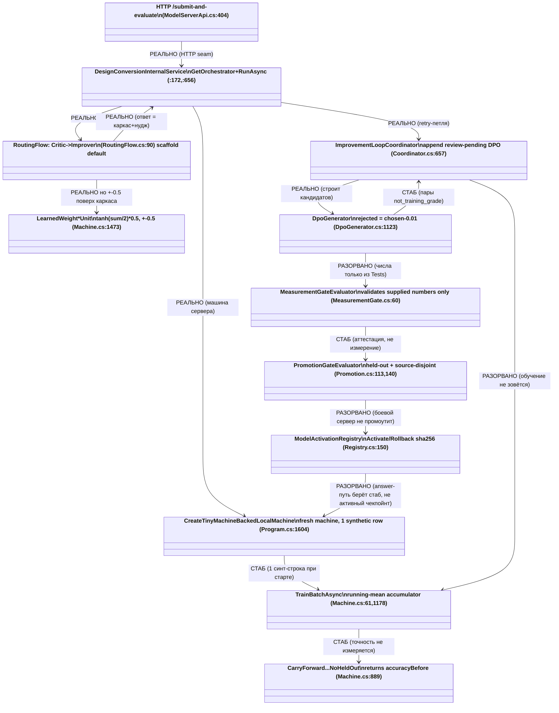

---

## Repair-blueprint по каждому дефекту

**R1 — Настоящее обучение вместо running-mean (Q1).**
- Уровень: `44.DesignConversionDomain` (учебная логика — де-факто в
  `llm_mvp_core`, mvp/TS её потребляет; но домен 44 — C# core, чинить здесь).
- Типизированное обученное состояние: параметры предпочтительной модели
  (например, логистическая/парная DPO-голова над `internal_vector` + категориями),
  а не словарь средних.
- Алгоритм апдейта: `входная строка (chosen,rejected) → расчёт preference loss
  (logsigmoid(β·(r_chosen − r_rejected))) → шаг оптимизатора → mutate параметров →
  сохранить чекпойнт`. Заменить `Accumulator.Apply` (`Machine.cs:1167`) на шаг
  оптимизатора; `ToCheckpoint` (`:1178`) — на сериализацию параметров.
- KNN/селектор: N/A для этого юнита (не kNN-класс).
- Источник/лицензия: сохранить текущий leakage-guard и лицензионные метки.
- DPO-примеры: positive — реально одобренная лучшая версия; rejected — реально
  отрендеренная худшая с измеренным скором; quarantine — текущие synthetic.
- Затронутые тесты: `Tests/DesignConversionMachine*`, checkpoint round-trip.
- Жизненный цикл: user/cache-чекпойнт → repo-fallback → export/import/share →
  continue-training с существующего чекпойнта.
- Примечание: TRAINING WORK — здесь только чертёж, не реализация.

**R2 — Сервер должен отвечать активным чекпойнтом, не инлайн-стабом (Q2).**
- В `Program.cs:1604` вместо `CreateTinyMachineBackedLocalMachineAsync` —
  загрузка последнего **активированного** чекпойнта через
  `ModelActivationRegistry.ReadActiveAsync` (`Registry.cs:335`) и
  `ImportLearnedWeights`. Если активного нет → честный non-ready, а не
  подмена стабом.
- `InternalService.GetOrchestratorAsync`-путь оставить, но источник весов —
  активный чекпойнт.
- Тесты: e2e «answer использует активную версию»; отрицательный «нет активной →
  non-ready».
- Жизненный цикл: активация → answer читает активную версию → rollback возвращает
  предыдущую.

**R3 — Реальный held-out вместо аттестации (Q3).**
- Ввести производственный компонент, который РЕАЛЬНО прогоняет промотируемый
  чекпойнт по source-disjoint held-out набору и вычисляет
  `HeldOutQualityScore`/`SourceDisjoint`, затем передаёт их в
  `MeasurementGateRequest`. Сейчас `MeasurementGate.cs:60-205` только валидирует —
  оставить как валидатор, но добавить измеритель ПЕРЕД ним (не в `Tests/`).
- Гейт `Promotion.cs:113/:140` не трогать (он корректен как схема).
- Тесты: измеритель на честном held-out; тест «поддельные числа без прогона →
  reject».

**R4 — DPO-пары с измеренным негативом (Q4).**
- Убрать `chosen − 0.01` (`DpoGenerator.cs:1123`) как источник «негатива»:
  rejected должен быть реально отрендеренным худшим кандидатом с ИЗМЕРЕННЫМ
  визуальным скором (снять метку `rejected_visual_score_not_measured`).
- Пока негатив не измерен — оставить текущий честный карантин
  (`:1181`, политика `:70-77`) — это корректно.
- Валидатор `:845-884` оставить; ужесточить `IsRealisticRejected` до «есть
  измеренный скор».

**R5 — Замкнуть петлю improvement→training→activation (Q5).**
- После `AppendRecordAsync` (`Coordinator.cs:657`) добавить (за человеческим
  гейтом одобрения) звено: одобренные кандидаты → `TrainBatchAsync` (после R1) →
  `PromotionGate` (после R3) → `ActivationRegistry.ActivateAsync`.
- Не автозамыкать без одобрения — человеческий гейт сохранить, но сделать его
  ДОСТИЖИМЫМ (сейчас на боевом пути его нет вовсе).
- Тесты: e2e «одобрено → обучено → промоутнуто → активно → answer поменялся».

---

## Не-оверклейм

«Заявлено ≠ реализовано»: подписи в коде честны, но заявленное обучение/held-out/
активация — стаб или разорванное звено. «Класс есть ≠ вызывается»:
`ModelActivationRegistry`, `PromotionGate`, `MeasurementGate` реальны как классы,
но на боевом answer-пути в выборе/проверке модели не участвуют. `Tests\`,
`experiments-v2\` — не боевой путь. `tools\` здесь — де-факто единственный хост,
но помечен «tools-хостед, не боевой composition root» (вердикт Цикла 2 в силе).
Численный эффект нуджа/пар — гипотеза, доказуемо только прогоном.

BOUNDARY — TRAINING WORK, DEFERRED. STOP.

### ОБНОВЛЕНИЕ 2026-07-29 — Цикл 4 — Маршрут учителя и легальный гейт

## Человеческое резюме (по-русски, до всяких машинных меток)

Проверялась одна грань: есть ли в коде БОЕВОЙ маршрут «учителя» — то есть клиент,
который вызывает локальную модель-учитель (Qwen через Ollama) и чей выход потом
используется для обучения (DPO). План обещает такой маршрут в две фазы: сначала
локальный учитель (профиль `qwen35-local-v1`, `LocalOllama`, self-hosted), потом
hosted-учитель (`qwen3-together-v1`).

Вывод одной фразой: **боевого маршрута учителя в коде нет вообще.** Ни одного
обращения к Ollama, ни одного упоминания порта 11434, ни слова `qwen`, ни класса
`TeacherClient` в `.cs`-файлах — ноль. Слово «teacher» в коде встречается только как
ПАССИВНЫЕ ссылки: строковое поле-хендофф `B1TeacherJudgeRef`, списки ссылок на
свидетельства `AiTeacherEvidenceRefs` / `TeacherEvidenceRefs`, метки `teacher_labels`,
и — ключевое — метаданные явно помечают роль этих ссылок как `evidence_only`
(«только свидетельство»), рядом стоит `deterministic_logic_claimed_as_learning=false`.
Более того, рантайм местами хардкодит буквальную строку `no-ai-teacher-executed`
(«ИИ-учитель не запускался»), а архитектурные тесты ПРЯМО ЗАПРЕЩАЮТ появление
teacher/judge/train-машинерии на публичной поверхности графа.

Отдельно: обещанное планом поле-провенанс `teacher_output_used_for_training`
(«выход учителя использован для обучения») — центральный крючок, которым легальный
гейт должен разрешать/запрещать обучение на выходе учителя — **в коде отсутствует
целиком** (0 хитов и в snake_case, и в PascalCase `TeacherOutputUsedForTraining`).
То есть даже фиксировать факт «учитель обучал» нечем.

Связь с Циклом 2 («легальный гейт = 0»): маршрут учителя без легального гейта не имел
бы права тренировать, даже если бы существовал. Здесь дыра двойная — нет ни маршрута
учителя, ни гейта, который бы его выход пропускал в обучение. Обе дыры складываются.

## Охват поиска (чтобы не переусердствовать с утверждением)

- Репозиторий: `C:\Projects\llm_mvp_core-DpoImplementation`, только чтение.
- Маски и результаты (регистронезависимо):
  - `ollama|11434|qwen|TeacherClient` по `*.cs` → **0 совпадений**.
  - `teacher_output_used_for_training` и `TeacherOutputUsedForTraining` по `*.cs` → **0**.
  - `HttpClient` по `*.cs` → есть, но только: внешний ВИЗУАЛЬНЫЙ судья design-conversion
    (`tools\DesignConversionLiveLocalServer`), аплоад/сабмит модельного сервера
    (`25.ModelServer\DesignConversion\*`), и `34.Experiments\...\AliceTextLoader.cs`.
    Ни один не есть клиент учителя. `tools\`, `Tests\`, `34.Experiments\`,
    `experiments-v2\` — **НЕ боевой путь**.
  - `teacher` по `*.cs` → только пассивные ссылки (каталог ниже).
- Слова `ollama`/`qwen`/`11434` во всём репо встречаются лишь в `README.md`, `CLAUDE.md`,
  планах `docs\plans\*`, датасетах `experiments-v2\*.jsonl` и метриках
  `43.LearningLocalWikiData\artifacts\*` — это документы/данные, не `.cs`-код.
- План-оф-рекорд: только `active-codex-execution-*.md` в «dpo legal build», только чтение.
- Рантайм-поведение (что реально произойдёт при запуске) — **доказуемо только прогоном**;
  здесь проверялось НАЛИЧИЕ КОДА, а не сервис.

## UML — что в коде ЕСТЬ (пассив) против того, что ОТСУТСТВУЕТ (маршрут)

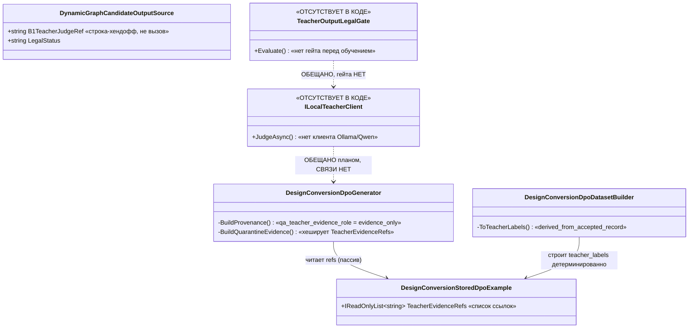

Симуляция ветвления: сегодня при построении DPO-примера
`DesignConversionDpoGenerator` берёт `TeacherEvidenceRefs` из `evaluation.EvidenceRefs`
(детерминированная оценка) и клеймит их `evidence_only`. Ветка «спросить модель-учителя»
никогда не исполняется — исполнителя (клиента) для неё нет.

## Каталог: чем «teacher» ЯВЛЯЕТСЯ в коде (пассивные ссылки)

| file:line | цитата | что это |
|---|---|---|
| `00.Core/DynamicGraphContracts.cs:62` | `string B1TeacherJudgeRef,  // Teacher/judge gate handoff reference.` | Строковое ПОЛЕ-хендофф. Просто прокидывается как `source.B1TeacherJudgeRef` в раннерах/оркестраторах (21.AgentInfrastructure, 15.OrchestratorModel). Не клиент, не вызов. |
| `44.DesignConversionDomain/DesignConversionDpoGenerator.cs:906` | `IReadOnlyList<string> TeacherEvidenceRefs,` | ПОЛЕ-список строк в записи DPO-примера. |
| `…DesignConversionDpoGenerator.cs:1246` | `TeacherEvidenceRefs: evaluation.EvidenceRefs.Append("runtime_created_dpo_candidate:training_candidate_only")…` | Заполняется из детерминированной оценки + честные метки (`review_pending`, `product_not_ready`, `held_out_not_proven`). Рядом: `real_training_ready=false`, `trained_weights_ready=false`. Не выход учителя. |
| `…DesignConversionDpoGenerator.cs:1500` | `["qa_teacher_evidence_role"] = "evidence_only",` | Метаданные ЯВНО: роль teacher-свидетельств = «только свидетельство». Рядом `deterministic_logic_claimed_as_learning=false`. |
| `…DesignConversionDpoGenerator.cs:1566` | `var refs = (example.TeacherEvidenceRefs ?? [])…HashRef("dcm-dpo-evidence", reference)` | Ссылки лишь хешируются в карантинное свидетельство. Пассив. |
| `44.DesignConversionDomain/DesignConversionDpoDatasetBuilder.cs:776` | `ToTeacherLabels(...) => new(PreferenceLabel: "chosen_over_rejected", ScoreMargin: result.ChosenScore - result.RejectedScore …)` | `teacher_labels` строятся ДЕТЕРМИНИРОВАННО из хешей принятого/отклонённого (`teacher_labels_scope="derived_from_accepted_record"`), а не из модели-учителя. |
| `44.DesignConversionDomain/DesignConversionThinClientJobRuntime.cs:1476` | `AiTeacherEvidenceRefs: ["thin-client-runtime:no-ai-teacher-executed"]` | Рантайм хардкодит: ИИ-учитель НЕ запускался. |
| `Tests/InMemoryDynamicGraphTopologyRuntimeTests.cs:83,94` | `PublicSurface_HasNoLearningTeacherJudgeWinnerOrPersistenceAuthority` / `forbidden = {"Train","Dpo","Teacher","Judge",…}` | Тест-СТРАЖ: запрещает teacher-машинерию на публичной поверхности. |
| `Tests/DynamicGraphCompositionContractsArchitectureTests.cs:359` | `@"\b(dpo|teacher|judge|tp1|tp2|training|trainbatch|teachingsessionbuilder)\b"` | Тест-страж по регэкспу: teacher/tp1/tp2/training не должны течь на поверхность контрактов. |

**Вердикт по каталогу:** это НЕ маршрут учителя. Это (а) строковое поле-хендофф,
(б) списки ссылок на свидетельства, явно помеченные `evidence_only` и
`derived_from_accepted_record`, (в) тесты, ЗАПРЕЩАЮЩИЕ teacher-машинерию. Наименование
«teacher» здесь честное (роль = свидетельство), но собственно маршрута учителя за ним нет.

## План обещает → код делает

| План обещает (file:line, цитата) | Код делает (grep-результат) |
|---|---|
| `active-codex-execution-04-dpo-legal-model-policy.md:8` — `canonical_sequence: CODE_FIRST -> TP1_LOCAL_EVAL_ONLY -> TP2_HOSTED_EVAL_ONLY -> G_DPO_FINAL -> DPO_TRAINING` | Двухфазного маршрута нет. `ollama|11434|qwen|TeacherClient` в `*.cs` = 0. |
| `04:36` — `qwen35-local-v1 (TP1_LOCAL): HostingProvider=LocalOllama, HostRole=self_hosted, ModelFamily=Qwen3` | Клиента `LocalOllama`/Qwen нет. `qwen`/`ollama`/`11434` в `*.cs` = 0. |
| `04:359` — `Local self-hosted qwen35-local-v1 … TeacherOutputUsedForTraining=false; ExternalDataTransfer=false` | Поля `TeacherOutputUsedForTraining` в `*.cs` = 0 (нечем ни поставить, ни зафиксировать). |
| `04:380` — артефакт `self-hosted-deployment-proof-qwen35-local-v1.json (Ollama/Docker versions, model digest, readback, date)` | Кода, который бы такой proof читал/писал/проверял, нет. |
| `04:193–204` — 20-полевой провенанс, поле № `teacher_output_used_for_training` | 0 хитов в `*.cs` (и snake, и Pascal). |
| `04:19` — историческое одобрение hosted-маршрута кодирует `teacher_output_used_for_training=true` (qwen3-together-v1) | Это бизнес-решение в тексте плана; в коде поля нет, значение установить негде. |
| `00-library-index.md:25,108` — TP1_LOCAL = «локальный Ollama-учитель qwen35-local-v1», TP2_HOSTED = qwen3-together-v1; владелец = `active-codex-execution-two-phase-local-remote-overlay.md` | Файл-владелец существует (план). Кодового маршрута нет. |
| `02-source-inventory-and-reference-map.md:85` — `qwen35-9b-weights-source: HF Qwen/Qwen3.5-9B + OllamaModelRef (Q4_K_M); EXTERNAL_PLANNED; license PROVISIONAL; физпроверка = execution-гейт G-TP-2 (НЕ verified)` | Веса — внешний ПЛАН; ни ссылки на них, ни загрузчика в коде нет. |

Примечание к честности плана: сам план держит маршрут учителя на `EVAL_ONLY` до
`G_DPO_FINAL` (`04:9` — «neither TP1 nor TP2 starts DPO … or promotes a checkpoint»).
То есть даже на бумаге учитель ещё не тренирует. В коде — маршрута нет вовсе.

## Вердикты

- **Маршрут учителя (TP1_LOCAL, локальный Ollama/Qwen-учитель): ВСЁ ЕЩЁ ДЫРА.**
  В коде отсутствует целиком; заявлено планом, не реализовано. «Класс есть ≠ вызывается»
  тут даже не применимо — нет и класса-клиента.
- **Поле-провенанс `teacher_output_used_for_training`: ВСЁ ЕЩЁ ДЫРА.**
  0 хитов; факт использования выхода учителя в обучении зафиксировать нечем.
- **Пассивные teacher-ссылки (`B1TeacherJudgeRef`, `AiTeacherEvidenceRefs`,
  `teacher_labels`): ЗАКРЫТО как «свидетельства».** Они честны, помечены `evidence_only`
  и `derived_from_accepted_record`, и охраняются тест-стражами. Это не маршрут учителя,
  и не выдаётся за него — переклейма нет.
- **Легальный гейт перед выходом учителя: ВСЁ ЕЩЁ ДЫРА (в связке с Циклом 2).**
  Маршрут учителя без легального гейта не имел бы права тренировать даже если бы
  существовал; здесь нет ни того, ни другого.

## Repair-blueprint (заполненный, не промпт будущему исполнителю)

- **Клиент.** Новый `sealed class OllamaLocalTeacherClient : ILocalTeacherClient`
  (слой обучения, напр. `44.DesignConversionDomain` или новый `45.TeacherRoute`).
  Метод: `Task<OperationResult<TeacherJudgement>> JudgeAsync(TeacherJudgeRequest req, CancellationToken ct)`.
  Контракты: `TeacherJudgeRequest(string PromptRef, string CandidateResultRef, string PairFamily, TeacherProvenanceProfile Profile)`;
  `TeacherJudgement(string PreferenceLabel, double ScoreMargin, IReadOnlyList<string> EvidenceRefs, TeacherProvenance Provenance)`.
  Транспорт: `HttpClient` POST на `http://127.0.0.1:11434/api/generate`, тег модели из
  профиля `qwen35-local-v1` (Q4_K_M); `ExternalDataTransfer=false` (только localhost).
  Возврат — `OperationResult<T>` (ядро .NET; НЕ `DataProcessResult<T>` — то конвенция mvp).
- **Точка врезки в DPO-петлю.** `DesignConversionDpoGenerator` — там, где сейчас
  `TeacherEvidenceRefs` заполняется из `evaluation.EvidenceRefs` (DpoGenerator.cs:1246):
  результат `JudgeAsync` становится источником `PreferenceLabel`/`EvidenceRefs`. Но выход
  учителя остаётся `evidence_only` (DpoGenerator.cs:1500), пока не пройдены гейты ниже.
- **Легальный гейт ПЕРЕД использованием выхода в обучении.**
  Новый `TeacherOutputLegalGate.Evaluate(TeacherProvenance p, LicenseScope lic) : LegalVerdict`
  (`ACCEPT|QUARANTINE|BLOCK`). Для self-hosted отказная нога = `self_hosted_retention_or_pin_missing`
  (04:47), НЕ `terms_snapshot_missing`. Выход учителя может стать train-ready ТОЛЬКО при
  `ACCEPT` И пройденном `G_DPO_FINAL`; иначе остаётся `evidence_only`. Гейт заполняет
  20-полевой провенанс (04:193–204): `model_id, model_license, model_version, request_id,
  provider_terms_checked, teacher_output_used_for_training, closed_proprietary_model,
  source_ref, source_sha256, contamination_markers, judge_model, terms_snapshot_ref, …`.
- **Поле, фиксирующее факт.** Добавить `bool TeacherOutputUsedForTraining` в провенанс
  тренировочной записи (`DesignConversionDpoProvenance` / `TeacherProvenanceProfile`),
  дефолт `false`; переключается в `true` ТОЛЬКО внутри пути `TrainBatchAsync` после
  `ACCEPT` гейта + `G_DPO_FINAL`, и сохраняется в метаданных рядом с существующим
  `["deterministic_logic_claimed_as_learning"]=false`.
- **Тесты-доказательства.**
  1. Честность: при отсутствии/`QUARANTINE` гейта `TeacherOutputUsedForTraining` остаётся
     `false`, а роль остаётся `evidence_only` (расширяет `DesignConversionDpoGeneratorTests.cs:36`).
  2. Наличие маршрута: unit-тест `OllamaLocalTeacherClient` со stub-HTTP-хендлером
     (фикстурный judgement), проверяет localhost-only (нет внешней передачи) и заполнение
     провенанс-триады.
  3. Гейт-перед-использованием: `TrainBatchAsync` не промоутит teacher-размеченную пару
     без `ACCEPT` + `G_DPO_FINAL`; при отсутствии пина/retention — `QUARANTINE`
     `self_hosted_retention_or_pin_missing`.
  4. Согласование стражей: обновить запрет-регэксп (`DynamicGraphCompositionContractsArchitectureTests.cs:359`)
     так, чтобы маршрут учителя жил только в разрешённом слое обучения, а не на публичной
     поверхности графа.
- **Жизненный цикл.** Локальный кэш (веса Ollama, пин sha256) сначала → repo/common
  fallback (без hosted-передачи) → export/import чекпойнта → continue-training с
  существующего чекпойнта. Граница mvp/core (G12): это core-.NET обучающая машинерия,
  поэтому блюпринт здесь — реальный training-lifecycle, НЕ `N/A`.

BOUNDARY — TRAINING WORK, DEFERRED. STOP.

### ОБНОВЛЕНИЕ 2026-07-29 — Цикл 4 — Потокобезопасность и воспроизводимость

## Человеческое резюме (сначала, без машинных кодов)

Задача Цикла 4.4 — новая грань: не «работает ли тренер» (это закрыто в Циклах 1–3), а
**гонки в разделяемом состоянии** и **воспроизводимость прогонов**. Проверял по трём линиям:
кто пишет и кто читает общее состояние тренера/реестра/кэша/KNN-стора; есть ли реальный
конкурентный вызыватель на текущих хостах; и есть ли путь, где вся случайность сеется из
одного корня.

Главный вывод в двух фразах:

1. **Потокобезопасность — НОВЫХ живых дыр не найдено.** Все по-настоящему многопоточные
   поверхности (ASP.NET-хосты в `tools/` и `25.ModelServer`) закрыты правильно —
   `ConcurrentDictionary` + семафоры + `Interlocked` + именованные локи. А все «голые»
   `List`/`Dictionary` без локов (тренер обратной связи, кэш датасета, счётчик супервайзного
   шага, карта выученных весов дизайн-конверсии) лежат на **однопоточных** путях (CLI-раннеры,
   пайплайн, объект-на-операцию) — конкурентного вызывателя у них нет. Это **латентные**
   гонки, а не боевые. Отдельно: конкретное подозрение разведки — что `_manifestCacheHydrated`
   читается вне лока на строке 673 — **не подтвердилось**: строка читается только внутри лока.

2. **Воспроизводимость — ВСЁ ЕЩЁ ДЫРА.** План требует «reproducibility gate» (один корневой
   сид → идентичный чекпойнт). В коде **единого корневого сида нет**. На пути обучения три
   независимых источника случайности: инициализация весов (жёстко зашитый статический
   `Random(42)`, общий на весь процесс), dropout (несеянный `new Random()` по умолчанию) и
   перемешивание датасета (несеянный `new Random()` по умолчанию). По общему LoRA/DPO-пути
   чекпойнт не воспроизводим. Плюс статический `Random(42)` — это ещё и **латентная гонка**:
   `System.Random` не потокобезопасен, а при конкурентной постройке двух моделей на
   ASP.NET-хосте он повреждается и начинает вечно возвращать 0.0 (документированное поведение
   .NET) → нулевые/вырожденные веса.

Ниже — таблица `файл:строка`, цитаты с «сейчас/почему плохо/должно стать», UML потока
случайности, разбор «план обещает / код делает» и заполненный ремонтный чертёж.

---

## Таблица находок (файл:строка → контейнер → лок → кто пишет / кто читает → реальный вызыватель)

| # | Файл:строка | Общее состояние | Тип / лок | Пишет | Читает | Конкурентный вызыватель на хостах | Вердикт |
|---|-------------|-----------------|-----------|-------|--------|-----------------------------------|---------|
| 1 | 14.ContinuousLearning/Feedback/FeedbackRouter.cs:29 | `_dpoPairs` | `List<DpoPair>`, **без лока** | Route* :78, :93 | GetDpoPairs :53 (`AsReadOnly()` — живой вид, не снапшот) | Нет (только `ContinuousLearningPipeline`, не хостится конкурентно) | ЛАТЕНТНАЯ |
| 2 | 14.ContinuousLearning/Cache/DomainDatasetCache.cs:18 | `_store` | `Dictionary<string,List<..>>` | Add :34 | (тот же пайплайн) | Нет | ЛАТЕНТНАЯ (тот же класс) |
| 3 | 18.CapabilityTraining/DefaultLogicalCapabilityTrainer.cs:38,39,43 | `_teachingCache`, `_manifestCacheByUnitId`, `_manifestCacheHydrated` | `Dictionary`+`bool`, **под `_manifestCacheGate`** | :63, :364–370, :683–686 (все под локом) | :537, :640, :667, :673 (все под локом) | — | ЗАКРЫТО / синхронизировано |
| 4 | 18.CapabilityTraining/DefaultLogicalCapabilityTrainer.cs:40 | `_referenceModel` | `LlmModel`, без лока | конструктор | DPO forward (training:false), :237 | Нет (тренер создаётся `new`, не DI-синглтон) | ЛАТЕНТНАЯ / низкий риск |
| 5 | 04.TrainingLoop/Trainer.cs:40,145 | `_supervisedStep` | `int ++`, **без sync** | :145 | :128 (`GetLr`) | Нет (одиночный раннер; претрейнинг-путь защищён `Interlocked`/`Volatile`) | ЛАТЕНТНАЯ |
| 6 | 44.DesignConversionDomain/DesignConversionMachine.cs:46 | `_learnedWeightsByUnit` | вложенный `Dictionary`, **0 локов в файле** | :589 (Clear), :679 | :576, :676 | Нет (машина создаётся `new` на операцию; durable-стор вынесен в гейтованные `static ConcurrentDictionary`) | ЛАТЕНТНАЯ / согласовано с дизайном |
| 7 | tools/DynamicGraphCompositionLiveLocalServer/DynamicGraphCompositionSessionRegistry.cs:31–35 | `_sessions`, `_expiredSessions`, `_idempotency`, слоты | `ConcurrentDictionary`×3 + `SemaphoreSlim` + `Interlocked` + `lock` | HTTP-хендлеры (многопоточно) | HTTP-хендлеры | **ДА** (это боевая поверхность) | ЗАКРЫТО / эталон |
| 8 | 25.ModelServer/.../DesignConversionModelServerRouteAdmission.cs:122–123 | `_idempotencyEntries`, `_jobScopes` | `ConcurrentDictionary` + `lock(_lifecycleLock)` | HTTP-хендлеры | HTTP-хендлеры | **ДА** | ЗАКРЫТО / эталон |
| — | 00.TensorCore/Init/Initializers.cs:13 | `Rng` | `static Random(42)` | — | init весов (все модели/LoRA) | ДА при конкурентной постройке | ЛАТЕНТНАЯ гонка + дыра воспроизводимости |
| — | 00.TensorCore/Layers/Dropout.cs:22 | `_rng` | `new Random()` несеянный по умолчанию | — | forward :36 | — | ДЫРА воспроизводимости (общий путь) |
| — | 11.DPO/DpoDataset.cs:35 | `rng` | `new Random()` несеянный по умолчанию | — | Shuffle :37–42 | — | ДЫРА воспроизводимости |

---

## Раздел A. Потокобезопасность

### A.0 UML — где живёт разделяемое состояние и кто его трогает

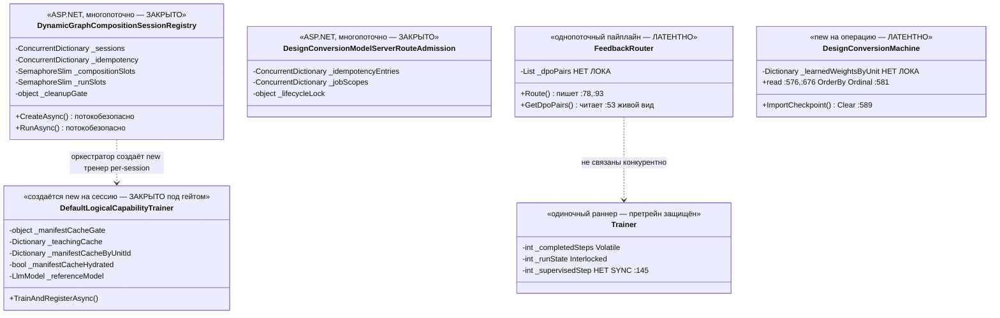

Симуляция ветвей (что было бы при конкуренции):
- **Ветвь «боевая поверхность» (регистр сессий, admission-стор):** два HTTP-потока → каждый
  берёт слот семафора, атомарный `TryAdd`/`Interlocked`, компаунд-операции под `lock`. Ожидаемый
  исход: **корректно, без порчи состояния.** Это доказывает, что авторы умеют в concurrency и
  применили его там, где конкуренция реально есть.
- **Ветвь «латентная» (FeedbackRouter):** поток A на `Route`/`_dpoPairs.Add` (:78) и поток B на
  `GetDpoPairs`/`AsReadOnly` enumerate (:53) одновременно. Ожидаемый исход **если бы вызыватель
  был конкурентным:** `List<T>.Add` рвёт внутренний массив (потерянные/затёртые записи), а перебор
  `ReadOnlyCollection` поверх живого списка бросает `InvalidOperationException: Collection was
  modified`. **Но конкурентного вызывателя нет** → латентно.

### A.1 Цитаты + вердикты (потокобезопасность)

**Находка 1 — FeedbackRouter._dpoPairs (латентная).**
`14.ContinuousLearning/Feedback/FeedbackRouter.cs:29,53,78,93`
```
:29  private readonly List<DpoPair> _dpoPairs = new();
:53  => OperationResult<...>.Ok(_dpoPairs.AsReadOnly());
:78  _dpoPairs.Add(new DpoPair(... Edited ...));
:93  _dpoPairs.Add(new DpoPair(... Rejected ...));
```
- **сейчас:** список копится без лока; `GetDpoPairs()` отдаёт `AsReadOnly()` — это обёртка над
  тем же живым списком, не снимок.
- **почему плохо:** при одновременных `Route()`/`GetDpoPairs()` — рваная запись и
  `Collection was modified` при переборе. Разведка права по механике.
- **реальность:** вызыватель — только `ContinuousLearningPipeline` (`_router` field), который
  нигде не регистрируется в ASP.NET-хосте (grep по DI пуст) и не вызывается конкурентно.
  → **ЛАТЕНТНАЯ ДЫРА**, не боевая.
- **должно стать:** `lock` вокруг Add и вокруг чтения; `GetDpoPairs()` отдаёт **снимок**
  (`_dpoPairs.ToArray()` под локом), а не живой вид.

**Находка 3 — DefaultLogicalCapabilityTrainer, подозрение `:673` ОПРОВЕРГНУТО (закрыто).**
`18.CapabilityTraining/DefaultLogicalCapabilityTrainer.cs:631,662,671,673,686`
```
:631  lock (_manifestCacheGate) {
:633      var hydration = EnsureManifestCacheHydratedUnderGate();
:662  lock (_manifestCacheGate) {
:664      var hydration = EnsureManifestCacheHydratedUnderGate();
:671  private OperationResult<bool> EnsureManifestCacheHydratedUnderGate() {
:673      if (_manifestCacheHydrated) return Ok(true);
:686      _manifestCacheHydrated = true;
```
- **сейчас:** `_manifestCacheHydrated` читается на :673 **внутри** `EnsureManifestCacheHydratedUnderGate`,
  а этот метод вызывается **только** из двух мест, и оба — под `lock (_manifestCacheGate)` (:631/:633,
  :662/:664). Записи (:63 в `ClearCache`, :686) — тоже под локом. Имя метода прямо кодирует инвариант
  «UnderGate».
- **почему ок:** check-then-act целиком атомарен относительно гейта; гонки нет.
- **вердикт:** **ЗАКРЫТО.** Подозрение разведки, что чтение вне лока, — **не подтвердилось.**
- **хрупкость (не дыра, а страховка):** инвариант держится только на имени метода. Один будущий
  вызов вне лока молча вернёт check-then-act-гонку. **должно стать:** на входе метода
  `Debug.Assert(Monitor.IsEntered(_manifestCacheGate));` — сделать инвариант проверяемым.

**Находка 4 — `_referenceModel` (латентная, низкий риск).**
`DefaultLogicalCapabilityTrainer.cs:40,237` — общая модель-эталон, в DPO используется
только forward (`training:false`, без градиента/оптимизатора). `LlmModel.Forward`
(`03.TransformerModel/LlmModel.cs:108–114`) читает `readonly`-параметры, изменяемого пер-forward
кэша не обнаружено. Тренер создаётся `new` на оркестратор/сессию, не DI-синглтон → общего
конкурентного вызывателя нет. **ЛАТЕНТНАЯ**, гипотеза: станет проблемой, только если один экземпляр
тренера разделят между потоками И `Forward` окажется не чистым чтением.

**Находка 5 — Trainer._supervisedStep (латентная, асимметрия).**
`04.TrainingLoop/Trainer.cs:40,145` — претрейнинг защищён образцово
(`Interlocked.CompareExchange(ref _runState...)` :188, `Volatile.Write(ref _completedSteps...)` :253),
но `TrainSupervisedNextTokenStep` делает `_supervisedStep++` (:145) без синхронизации и мутирует
параметры модели. Одиночный раннер → **ЛАТЕНТНАЯ.** Заметна асимметрия: жизненный цикл претрейна
закрыт, а счётчик супервайзного шага — нет.

**Находка 6 — DesignConversionMachine._learnedWeightsByUnit (латентная, но согласована).**
`44.DesignConversionDomain/DesignConversionMachine.cs:46,576,589,676,679` — вложенный `Dictionary`,
в файле **0 локов**. НО машина всюду создаётся `new DesignConversionMachine()` на операцию
(`DesignConversionDpoTrainingHandoff.cs:286`, `DesignConversionDpoPolicyCheckpointBridge.cs:105`,
`DesignConversionTrainingPipeline.cs:435,506` …), не хранится как разделяемый синглтон. Настоящее
**процесс-общее** durable-состояние авторы вынесли в гейтованные `static ConcurrentDictionary<...,
SemaphoreSlim>` (`DesignConversionLocalArtifactDb.cs:725`, `DesignConversionVisualCostBudgetStore.cs:189`,
`DesignConversionVisualCostLedger.cs:105`). Тот же класс демонстрирует **осознание детерминизма**
(`OrderBy(..., StringComparer.Ordinal)` :568/:581), но не потокобезопасности in-memory карты — что
приемлемо при отсутствии разделения, но хрупко. → **ЛАТЕНТНАЯ / согласовано с дизайном.**

### A.2 Ключевой дискриминатор (по требованию задания)

- Реально многопоточные ASP.NET-поверхности (`tools/…SessionRegistry`, `25.ModelServer/…RouteAdmission`,
  `…Flow38QuarantineHandler`, durable-сторы домена 44) — **закрыты** (`ConcurrentDictionary` +
  `SemaphoreSlim` + `Interlocked` + `lock`). Это боевые вызыватели, и они защищены.
- Все голые `List`/`Dictionary`/`int++` без локов сидят на **одиночных** путях (CLI-раннеры,
  `ContinuousLearningPipeline`, объект-на-операцию). Конкурентного вызывателя у них нет.
- **Итог грани:** **НОВАЯ ЖИВАЯ ГОНКА НЕ ОБНАРУЖЕНА.** Латентные — да, боевые — нет. Все эффекты
  гонок доказуемы только прогоном; сформулированы как гипотезы со сценарием «поток A на строке X,
  поток B на строке Y» выше.

---

## Раздел B. Воспроизводимость

### B.0 UML — три несведённых корня случайности на пути обучения

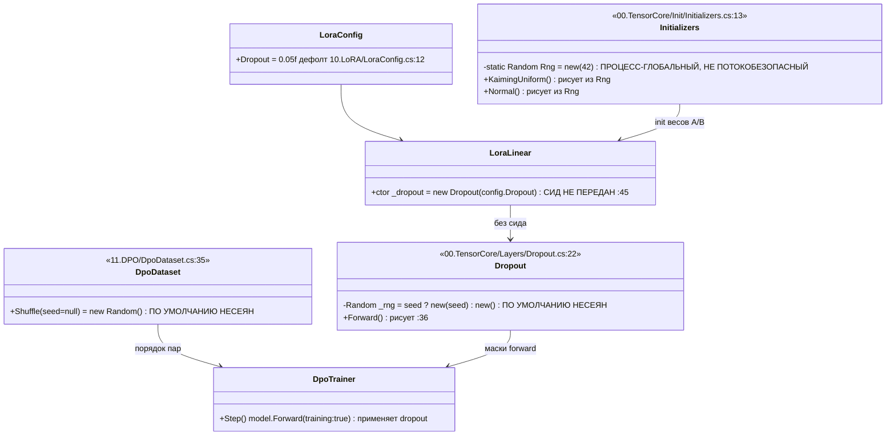

Симуляция: два прогона одного запроса обучения с «тем же сидом».
- Ветвь init: `Random(42)` даёт одинаковую последовательность **только** если глобальный порядок
  вызовов init во всём процессе идентичен (статик кумулятивен) — хрупко, и сид не задаётся per-run.
- Ветвь dropout (общий LoRA-путь, `Dropout=0.05`): `new Random()` сеется от часов/потока → **маски
  разные** → log-probs политики разные → градиент разный → **чекпойнт разный.**
- Ветвь shuffle: `new Random()` → **порядок пар разный.**
- Ожидаемый исход: два чекпойнта **НЕ совпадают.** Reproducibility gate невозможен.

### B.1 Цитаты + «сейчас / почему плохо / должно стать»

`00.TensorCore/Init/Initializers.cs:13`
```
private static readonly Random Rng = new(42);
```
- **сейчас:** один статический `Random(42)` на весь процесс, из него сеются веса всех моделей и LoRA.
- **почему плохо:** (1) воспроизводимость держится на идентичном глобальном порядке init и не
  конфигурируется per-run; (2) `System.Random` не потокобезопасен — при конкурентной постройке двух
  моделей на ASP.NET-хосте (`MaxConcurrentCompositions>1`) внутреннее состояние повреждается и
  `NextDouble()` начинает вечно возвращать 0.0 → нулевые/вырожденные веса, NaN в обучении. Это
  латентная гонка, которая становится боевой при конкурентной постройке модели.
- **должно стать:** инстансный RNG, засеянный из корневого сида запроса и проброшенный в постройку
  модели/LoRA; для неизбежно-общих мест — `Random.Shared` (потокобезопасен) для непроизводимых
  операций, либо per-thread засеянный `Random` для воспроизводимых; **никогда** общий голый `Random`
  между потоками.

`00.TensorCore/Layers/Dropout.cs:22` и `10.LoRA/LoraLinear.cs:45`
```
:22  _rng = seed.HasValue ? new Random(seed.Value) : new Random();
:45  _dropout = new Dropout(config.Dropout);   // сид НЕ передан
```
- **сейчас:** dropout по умолчанию несеян; `LoraLinear` создаёт его без сида; дефолт
  `LoraConfig.Dropout = 0.05f` (`10.LoRA/LoraConfig.cs:12`), дефолт `Dropout.p = 0.1f`.
- **почему плохо:** любой training-forward по общему LoRA-пути тянет случайные маски от часов →
  необратимо ломает воспроизводимость чекпойнта.
- **не-оверклейм (важно):** конкретно **тренер способностей** ставит `Dropout = 0` в
  `BuildCapabilityLoraConfig()` (`DefaultLogicalCapabilityTrainer.cs:1314`), а `Dropout.Forward`
  при `_p==0f` коротит без единого `NextDouble()` (`Dropout.cs:28`). Значит **этот** DPO-путь дырой
  dropout **не задет**; задет **общий** LoRA/DPO-путь с дефолтным 0.05.
- **должно стать:** `new Dropout(p, derivedDropoutSeed)` с сидом, выведенным из корня (per-layer).

`11.DPO/DpoDataset.cs:35`
```
var rng = seed.HasValue ? new Random(seed.Value) : new Random();
```
- **сейчас:** перемешивание пар по умолчанию несеяно.
- **почему плохо:** порядок обучающих пар меняется от прогона к прогону, если вызыватель не передал сид.
- **не-оверклейм:** тренер способностей строит preferences через `AutonomousLearningReplayMixer`,
  а не через `DpoDataset` → эта дыра бьёт по файловому DPO-пути (`DpoDataset.Load/Shuffle`), не по
  тренеру способностей.
- **должно стать:** `Shuffle(derivedShuffleSeed)` из общего корня; несеянный вызов запретить на боевом пути.

### B.2 «План обещает / код делает»

- **План обещает:** reproducibility gate — один корневой сид на запуск даёт **идентичный чекпойнт**
  (побайтно/по хешу) и идентичную последовательность метрик DPO.
- **Код делает:** три независимых корня случайности; сид `42` зашит только в init и как
  процесс-глобальный `static`; dropout и shuffle по умолчанию **не сеются вовсе**. Единого
  пробрасываемого корневого сида нет. По общему LoRA/DPO-пути чекпойнт **не воспроизводим**.
  Дополнительно `static Random(42)` создаёт латентную гонку при конкурентной постройке моделей.
- **Вердикт:** **ВСЁ ЕЩЁ ДЫРА** (reproducibility gate не реализован).

---

## Раздел C. Вердикты и ремонтный чертёж

### Сводка вердиктов

| Область | Находка | Вердикт |
|---------|---------|---------|
| Гонки | Боевые ASP.NET-сторы (регистр сессий, admission, durable-сторы 44) | **ЗАКРЫТО** (эталон) |
| Гонки | `DefaultLogicalCapabilityTrainer` кэши + `:673` (подозрение разведки) | **ЗАКРЫТО** (подозрение опровергнуто) |
| Гонки | `FeedbackRouter._dpoPairs`, `DomainDatasetCache._store` | **ЛАТЕНТНАЯ** (нет конкурентного вызывателя) |
| Гонки | `Trainer._supervisedStep`, `_referenceModel`, `DesignConversionMachine._learnedWeightsByUnit` | **ЛАТЕНТНАЯ** |
| Гонки | Новая живая гонка в этой грани | **НЕ ОБНАРУЖЕНА** |
| Воспроизв. | Единый корневой сид на пути обучения | **ВСЁ ЕЩЁ ДЫРА** |
| Воспроизв. | `static Random(42)` как потокобезопасность | **ЛАТЕНТНАЯ гонка** (боевая при конкурентной постройке модели) |

### Ремонтный чертёж (заполненный, не промпт для будущего исполнителя)

**R1. Единый корневой сид (закрывает воспроизводимость и часть гонки init).**
- Добавить поле `long TrainingSeed` (корневой сид) в `TrainingConfig` (`04.TrainingLoop`) и в
  `LogicalCapabilityTrainingRequest` (`21.AgentInfrastructure/Logical`).
- Детерминированно выводить под-сиды из корня функцией расщепления (SplitMix64):
  `initSeed = split(root, 1)`, `dropoutSeed(layerIndex) = split(root, 2, layerIndex)`,
  `shuffleSeed = split(root, 3)`.
- Заменить `Initializers.Rng` (`00.TensorCore/Init/Initializers.cs:13`) с процесс-статика на
  **инстансный** генератор, засеянный `initSeed` и проброшенный через постройку `LlmModel`/`LoraLinear`.
  Это одновременно убирает и кумулятивную зависимость (воспроизводимость), и потокобезопасность
  статического `Random`.
- Прокинуть `dropoutSeed(layerIndex)` в `new Dropout(p, seed)` из `LoraLinear.cs:45`.
- Прокинуть `shuffleSeed` в `DpoDataset.Shuffle(seed)`; несеянный вызов на боевом пути запретить.

**R2. Потокобезопасность там, где общий RNG неизбежен.**
- Для непроизводимых общих операций — `Random.Shared` (потокобезопасен).
- Для воспроизводимых — per-thread/per-operation засеянный `Random`, никогда общий голый `Random`.

**R3. Латентные коллекции (страховка, дешёвая).**
- `FeedbackRouter._dpoPairs`: `lock` вокруг `Add` (:78,:93) и вокруг чтения; `GetDpoPairs()` отдаёт
  снимок `_dpoPairs.ToArray()` под локом, а не `AsReadOnly()` живого списка.
- `DomainDatasetCache._store`: тот же приём (лок вокруг `Add`) — на случай будущего хостинга пайплайна.
- `DefaultLogicalCapabilityTrainer.EnsureManifestCacheHydratedUnderGate`: добавить на входе
  `Debug.Assert(Monitor.IsEntered(_manifestCacheGate))` — сделать инвариант «UnderGate» проверяемым.
- `Trainer._supervisedStep`: если появится многопоточный вызыватель супервайзного шага — `Interlocked`
  как в претрейне; иначе задокументировать «single-writer».

### Тесты, доказывающие починку

1. **Воспроизводимость (детерминизм):** дважды выполнить один запрос обучения с одинаковым
   `TrainingSeed` → байтово/по хешу идентичный `policy`-чекпойнт **и** идентичная последовательность
   `DpoMetrics`. Со **вторым** сидом → чекпойнт отличается. (Кладётся рядом с
   `Tests/DefaultLogicalCapabilityTrainerTests.cs`.)
2. **Гонка init (`static Random`):** сконструировать N моделей конкурентно (`Parallel.For`) → у всех
   веса конечны и ни один слой не оказался целиком-нулевым (ловит порчу `System.Random` → вечный 0.0).
3. **FeedbackRouter конкурентно:** `Parallel.For` из `Route()` + параллельные `GetDpoPairs()` → после
   R3 нет `InvalidOperationException` и число пар равно числу вызовов (ловит потерянные записи).

BOUNDARY — TRAINING WORK, DEFERRED. STOP.

### ОБНОВЛЕНИЕ 2026-07-29 — Цикл 4 — Тихие catch на боевом пути

## Человеческое резюме (читать первым)

Задача Цикла 4.5 — проверить обратную сторону честности, найденной в Циклах 1–3: где
`catch` ПРЯЧЕТ провал обучения / персистенции / валидации, превращая его в успех или
молчаливое продолжение. Проверял по чтению (репозиторий только на чтение, HEAD
`880e6710…`, статус пуст на входе и на выходе — совпадает).

Главный вывод: **на боевом пути обучения, персистенции и промоушена ПРОВАЛА-КАК-УСПЕХА
нет.** Практически каждый `catch` в перечисленных файлах возвращает вызывающему честный
`OperationResult.Fail(...)` / `FailedClosed(...)` со строковым кодом ошибки, либо
консервативно возвращает «небезопасно» (false=unsafe), либо ре-бросает исключение. Сигнал
о провале идёт НЕ через лог (логгера в этих catch нет вообще), а через типизированный
код ошибки в результате — ровно как и была устроена честность в Циклах 1–3.

Три самых опасных по замыслу места оказались образцово fail-closed:

1. **TeachingRegistryPersistence.cs (реестр обучения)** — все 15 catch → `Fail` с кодом
   (`SNAPSHOT_CAPTURE_FAILED`, `SNAPSHOT_WRITE_FAILED`, `GENERATED_CAPABILITY_LOAD_FAILED`
   и т.д.). Потери выученного, замаскированной под успех, нет.
2. **DesignConversionModelServerPromotionHttpUploader.cs (промоушен модели)** — все 21
   catch → `Fail`. Квитанция `UploadSucceeded=true / VerificationSucceeded=true`
   выставляется ТОЛЬКО после полной сверки SHA-256 каждого артефакта с эхом сервера
   (`ValidateResponseCoherence`). Пути «провал загрузки → успех» не существует.
3. **DesignConversionModelServerRouteAdmissionDurableStore.cs (durable-идемпотентность)** —
   путь записи (`TryPersistCompleted`) и чтения (`TryLoadCompletedRecord`) fail-closed.
   Пустые/«тихие» catch есть, но ВСЕ они — в уборке/GC/подсчёте/диагностике (удаление
   lock-файла в `Dispose`, `PruneCompletedRecords`, `TryDeleteFile`, `CountCompletedRecordsBounded`,
   `TryReadJobIdRef`), самозалечиваются через TTL/capacity и НЕ превращают запись в ложный успех.

Обучающее ядро тоже честное: `IncrementalTrainer` → `SUPERVISED_ADAPTER_TRAINING_FAILED` /
`ADAPTER_CHECKPOINT_SAVE_FAILED`; низкоуровневый `04.TrainingLoop/Trainer.cs` при любом
исключении ставит run-state `Faulted` и **ре-бросает** (не глотает).

Нашёл ровно ДВА места, где `catch` возвращает УСПЕХ (`Ok`) при пойманном исключении, и оба
несут внутриполосный маркер, а не молчат в ноль:

- `AdaptiveLogicalOrchestrator.cs:3412-3418` — легаси-ветка проекции топологии: если
  node-output-проекция НЕ запрошена, исключение чтения источника деградирует в легаси-view
  с предупреждением `SOURCE_EXCEPTION` внутри payload, статус `Ok`.
- `DesignConversionBrowserQaProviders.cs:1357-1360` — учёт байтового бюджета обхода при
  дедупе PNG: нечитаемый файл пропускается (`Ok(true)`), что совпадает с собственной
  семантикой метода (строки 1339/1348 так же пропускают отсутствующие/огромные файлы).

Оба — НЕ на пути обучения/персистенции весов, оба — с in-band сигналом или бенайн-скипом.
Отдельно отметил не-catch наблюдение в самом тренере (`DefaultLogicalCapabilityTrainer.cs`):
запись чекпойнта (`policyModel.SaveCheckpoint`) и `notes.Add + continue` — см. раздел «частично».

Каталогизация вне боевого пути (по граничному правилу): пустые `catch{}` в
`22.AgentAlgorithms/.../AstRelevanceRanker.cs:207`, `35.ExperimentsV2`, `36.LibraryComparison` —
tools/experiments-хост, вне боевого пути, отдельной строкой (не переклассифицировал, доверяю разведке).

Рантайм-последствия degradation-ветки 3416 (сколько прогонов реально уходит по легаси-пути) —
доказуемо только прогоном; формулирую как гипотезу.

---

## UML — где сигнал о провале идёт и где теряется

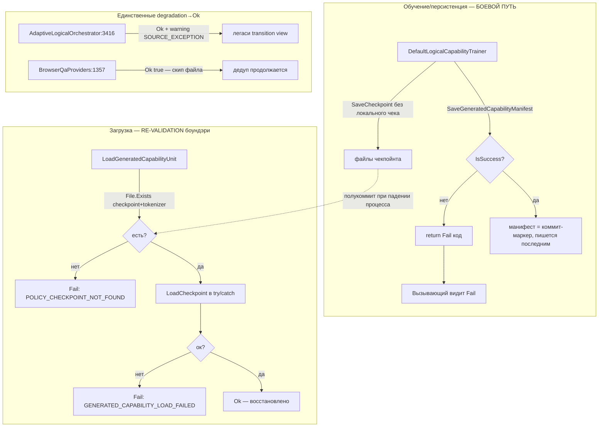

Смысл диаграммы: даже неотчекнутая запись чекпойнта (316-317) закрыта на границе ЗАГРУЗКИ
(проверка File.Exists + LoadCheckpoint в try/catch), а манифест-последним даёт outbox-подобный
порядок — полукоммит на load трактуется как «отсутствует», а не как «повреждён».

---

## Таблица: catch на боевом пути — file:line → что глотается → что возвращается → класс

Классы: **FC** = ЧЕСТНЫЙ FAIL-CLOSED (вызывающий видит Fail/unsafe/rethrow),
**TD** = ТИХАЯ ДЕГРАДАЦИЯ (результат ≠ Fail при пойманном исключении; сигнал только in-band или в GC-границе),
**PU** = ПРОВАЛ-КАК-УСПЕХ (ни лога, ни сигнала бизнес-операции). PU на боевом пути = 0.

| # | file:line | что глотается | что возвращается вызывающему | класс |
|---|-----------|---------------|------------------------------|-------|
| 1 | 18.CapabilityTraining/TeachingRegistryPersistence.cs:85 | сбой захвата снапшота | `Fail SNAPSHOT_CAPTURE_FAILED` | FC |
| 2 | …:128 | подготовка манифеста | `Fail GENERATED_CAPABILITY_MANIFEST_WRITE_FAILED` | FC |
| 3 | …:160 | IOException при Move | `Fail …ALREADY_EXISTS` | FC |
| 4 | …:168 | публикация манифеста | `Fail …WRITE_FAILED` | FC |
| 5 | …:198 | запись снапшота (bare Exception) | `Fail SNAPSHOT_WRITE_FAILED` (+ex.Message) | FC |
| 6 | …:218 | чтение снапшота (bare Exception) | `Fail SNAPSHOT_READ_FAILED` | FC |
| 7 | …:642,672,696,716,740,768,783,790,888 | канонизация/обход/чтение/десер манифестов (9 catch) | `Fail …PATH_INVALID / …READ_FAILED / …INVALID / GENERATED_CAPABILITY_LOAD_FAILED` | FC |
| 8 | 25.ModelServer/…PromotionHttpUploader.cs:123,129,135 | отмена/таймаут/сетевой сбой отправки | `Fail CANCELLED / …TIMEOUT / …HTTP_REQUEST_FAILED` | FC |
| 9 | …PromotionHttpUploader.cs:272,278,318,402,429,435,451,480,552,595,601,607,613,632,781,787,823,1081 | валидация артефактов/чтение ответа/парсинг квитанции (18 catch; 552 — rethrow-after-Dispose) | `Fail …` c кодом / reject / rethrow | FC |
| 10 | 25.ModelServer/…RouteAdmissionDurableStore.cs:157,344,397,600,605,610,696,986,1052,1090,1094 | init/persist/load/lock-read/reparse/utf8 (11 catch) | `FailedClosed …` / true=unsafe / Corrupt | FC |
| 11 | …RouteAdmissionDurableStore.cs:95,98 | удаление lock-файла в `Dispose` (2 пустых catch) | void (lock самоистечёт по TTL) | TD |
| 12 | …RouteAdmissionDurableStore.cs:178 | подсчёт записей при IO-сбое | `return 0` | TD |
| 13 | …RouteAdmissionDurableStore.cs:523,527,596 | контенция/недоступность lock | `Miss` → ретрай → в итоге `FailedClosed lock_timeout` | TD→FC |
| 14 | …RouteAdmissionDurableStore.cs:755,1029 | GC записей / удаление temp (2 пустых) | void (bounded TTL/capacity) | TD |
| 15 | …RouteAdmissionDurableStore.cs:796,999 | чтение времени записи / проверка reparse | `false` (запись удаляется / не-reparse) | TD/FC |
| 16 | …RouteAdmissionDurableStore.cs:886 | парс jobId (диагностика) | `null` (метаданные best-effort) | TD |
| 17 | 21.AgentInfrastructure/…DynamicGraphEdgeAuthorityExecutionPipeline.cs:96-497 (15 catch) | все стадии обхода ребра | `Failure(код) / Cancelled()` | FC |
| 18 | 21.AgentInfrastructure/…AdaptiveLogicalOrchestrator.cs:646,812,1296,1805,2003,2064,2493,3404,3467,3487,3635,4103 (12 catch) | классификатор/компилятор/роутер/таргеты/топология | `Fail(код) / Cancelled` | FC |
| 19 | **…AdaptiveLogicalOrchestrator.cs:3412** | исключение чтения топологии, node-output НЕ запрошена | **`Ok(legacy view + warning SOURCE_EXCEPTION)`** | **TD** |
| 20 | 44.DesignConversionDomain/…ThinClientJobRuntime.cs:693,697,848,854,940,987,1082,1247 (8 catch) | ledger/evaluator/persist/budget | `Fail(код)` (persist: `…PERSISTENCE_EXCEPTION`); отмена — rethrow | FC |
| 21 | 44.DesignConversionDomain/…BrowserQaProviders.cs:393,624,628,1375,1395,1417,1437,1512,1562,1659,1692,1728,2475,2528,2572,2578,2703,2733,2737,3017,3023,3029,3035,3041,3279,3302 (≈31 catch) | скриншот/сравнение PNG/квитанции/фетч | `Fail(код)` / `false`=unsafe | FC |
| 22 | **44.…BrowserQaProviders.cs:1357** | FS-исключение при учёте байтового бюджета | **`Ok(true)`** — файл пропущен (совпадает с семантикой скипа) | **TD (бенайн)** |
| 23 | 15.OrchestratorModel/Logical/* (Composition/Factory/Runtime/Assistant, ≈18 catch) | композиция/профиль/preload/резолв/оркестрация | `Fail(код) / TrainedStateForbidden / Cancelled` | FC |
| 24 | 14.ContinuousLearning/{IncrementalTrainingSession,IncrementalTrainer,DomainModelRegistry,ContinuousLearningPipeline}.cs (10 catch) | путь/чекпойнт адаптера/обучение/сохранение | `Fail …TRAINING_FAILED / …CHECKPOINT_SAVE_FAILED / …INCOMPLETE` | FC |
| 25 | 04.TrainingLoop/Trainer.cs:274,280 | отмена / любой сбой обучения | run-state `Cancelled`/`Faulted` + **rethrow** | FC |

---

## Ключевые цитаты

**Промоушен: успех выставляется только после сверки (провала-как-успеха нет)** —
`DesignConversionModelServerPromotionHttpUploader.cs:673`:
```csharp
// внутри ParseReceipt, ПОСЛЕ ValidateResponseCoherence (сверка SHA-256 каждого артефакта):
UploadSucceeded = true,
VerificationSucceeded = true,
PublicationStatus = DesignConversionPromotionPublicationStatus.UploadedVerified,
```

**Реестр обучения: запись снапшота честно проваливается** —
`TeachingRegistryPersistence.cs:198`:
```csharp
catch (Exception ex)
{
    return OperationResult<string>.Fail(ex.Message, "SNAPSHOT_WRITE_FAILED");
}
```

**Тренер низкого уровня: не глотает, а ре-бросает с Faulted** —
`04.TrainingLoop/Trainer.cs:280`:
```csharp
catch
{
    ClearGradients(trainableParameters);
    Volatile.Write(ref _runState, (int)TrainerRunState.Faulted);
    throw;
}
```

**Единственная degradation→Ok на пути топологии (in-band warning)** —
`AdaptiveLogicalOrchestrator.cs:3412`:
```csharp
catch (Exception exception) when (
    !_dynamicGraphNodeOutputSourceRequested
    && IsNonFatalNodeOutputSourceException(exception))
{
    return OperationResult<DynamicGraphTransitionView>.Ok(
        BuildLegacyTransitionView([BuildFallbackWarning("SOURCE_EXCEPTION")]));
}
```
(Симметричная ветка `_dynamicGraphNodeOutputSourceRequested==true` на строке 3404 —
`Fail NodeOutputTopologyUnavailableCode`. Т.е. если проекция ЗАПРОШЕНА — fail-closed;
деградация только на легаси-пути, где view структурно не зависит от источника.)

**Durable-store: тихая уборка lock-файла (bounded TTL)** —
`DesignConversionModelServerRouteAdmissionDurableStore.cs:95`:
```csharp
catch (IOException)
{
}
catch (UnauthorizedAccessException)
{
}
```
(Это `Dispose()` lock-лизинга; зависший lock самоистечёт: `ValidateLockRecord` → `now >= expires` → `"expired"`.)

---

## Сводная статистика (боевой путь)

- Всего `catch` рассмотрено на боевом пути: **≈156** (10+ файлов; включая типизированные, не только `catch (Exception)`).
- **ЧЕСТНЫЙ FAIL-CLOSED (FC): ≈143** — подавляющее большинство; сигнал через код ошибки `OperationResult`.
- **ТИХАЯ ДЕГРАДАЦИЯ (TD): ≈13** — из них 11 в `RouteAdmissionDurableStore` (уборка/GC/подсчёт/контенция/диагностика,
  bounded TTL/capacity, НИ ОДНОГО на пути коммита) + 1 `AdaptiveLogicalOrchestrator:3416` (in-band warning) +
  1 `BrowserQaProviders:1357` (бенайн-скип).
- **ПРОВАЛ-КАК-УСПЕХ (PU) на пути обучения/персистенции/валидации: 0.**
- Пустые `catch{}` в проде — те же 5, что нашла разведка (`AstRelevanceRanker.cs:207` и 35/36),
  все вне боевого пути → строка «tools/experiments-хост» (не переклассифицировано).

---

## Вердикты по классу «незаконченный код» + repair-blueprint

### 1) TeachingRegistryPersistence / PromotionHttpUploader / RouteAdmission (коммит-путь) → ЗАКРЫТО
План (Циклы 1–3) обещал: fail-closed персистенция, честная потеря обучения видна вызывающему.
Код делает: ровно это — каждый catch на пути захвата/записи/чтения/загрузки/промоушена
возвращает `Fail`/`FailedClosed` с кодом; вызывающие (`DefaultLogicalCapabilityTrainer:358`,
`TeachingSessionBuilder:45/48/83/89`) проверяют `IsSuccess` и пробрасывают Fail.
Repair-blueprint: не требуется.

### 2) AdaptiveLogicalOrchestrator.cs:3412-3418 (degradation→Ok) → ЧАСТИЧНО
План обещает: провал источника виден вызывающему.
Код делает: на легаси-пути (node-output не запрошена) исключение источника даёт `Ok` с
внутриполосным `BuildFallbackWarning("SOURCE_EXCEPTION")`. Вызывающий, читающий ТОЛЬКО
`result.IsSuccess`, провал источника не увидит; увидит только если инспектирует warnings view.
- Какой статус возвращать: оставить `Ok` допустимо ТОЛЬКО если продукт-решение «легаси-view
  не зависит от источника» зафиксировано; иначе — вернуть `Fail`/`Degraded` c кодом
  `NODE_OUTPUT_TOPOLOGY_SOURCE_EXCEPTION_LEGACY`.
- Что логировать/сигналить: поднять маркер `SOURCE_EXCEPTION` из payload в наблюдаемый
  счётчик деградаций (сейчас логгера нет вообще — сигнал только in-band).
- Какой тест докажет: unit — источник бросает `IsNonFatalNodeOutputSourceException`,
  `_dynamicGraphNodeOutputSourceRequested=false`; assert: результат несёт warning
  `SOURCE_EXCEPTION` И (после решения) статус не `Ok` ЛИБО счётчик деградаций инкрементнут.
  Парный тест: `requested=true` → `Fail NodeOutputTopologyUnavailableCode` (уже зелёный по коду).
- Рантайм-последствие (доля прогонов по легаси-пути) — доказуемо только прогоном; гипотеза.

### 3) BrowserQaProviders.cs:1357 (Ok(true) при FS-исключении) → ЗАКРЫТО (бенайн)
План обещает: дедуп PNG корректно пропускает недоступные кандидаты.
Код делает: `catch → Ok(true)` идентичен строкам 1339/1348 (скип under-root-fail /
отсутствующего / огромного файла) — это НЕ ложный успех бизнес-операции, а «этот файл не
учитывается в бюджете, обход продолжается». Само сравнение PNG остаётся fail-closed
(`LOCAL_PNG_COMPARISON_FILE_UNREADABLE`). Repair-blueprint: не требуется; при желании —
инкремент счётчика `hashLookupSkipped` для наблюдаемости.

### 4) RouteAdmissionDurableStore пустые catch в GC/Dispose/TryDelete → ЗАКРЫТО (bounded)
План обещает: durable-идемпотентность без ложных коммитов.
Код делает: пустые catch только в уборке (`Dispose:95/98`, `Prune:755`, `TryDelete:1029`) и
подсчёте (`Count:178`→0) — все bounded через TTL/capacity, ни один не на пути `TryPersistCompleted`.
Repair-blueprint (опционально, наблюдаемость): счётчик `staleLockDeleteFailed` /
`pruneFailed`, чтобы устойчивый сбой уборки был виден оператору. Функционально — не дыра.

### 5) НАБЛЮДЕНИЕ (не catch): DefaultLogicalCapabilityTrainer.cs → ЧАСТИЧНО (вне строгой темы)
- `:316-317` `tokenizer.Save(...)` / `policyModel.SaveCheckpoint(...)` вызваны без локального
  чека результата и без локального try/catch. Это НЕ тихий catch: при сбое исключение
  ПРОБРОСИТСЯ (видимо), а на границе ЗАГРУЗКИ есть повторная валидация File.Exists +
  LoadCheckpoint-в-try/catch, и манифест пишется ПОСЛЕДНИМ (outbox-порядок) — полукоммит на
  load = «отсутствует», не «повреждён». Дырой обучения это не делает.
- `:336-338 / :385-389 / :415-419` — паттерн `notes.Add(...); continue;`: провал обёртки
  retrieval-unit / регистрации unit / регистрации flow одной под-фазы записывается в `notes`
  и цикл продолжается; общий результат может вернуться `Ok` с частичным `registeredSubPhaseIds`.
  Это молчаливое продолжение с in-band `notes`. Repair-blueprint (если продукт требует
  атомарности набора под-фаз): вернуть `Fail PARTIAL_CAPABILITY_REGISTRATION` при непустых
  `notes`, либо явно пометить результат `PartialSuccess`; тест — одна под-фаза бросает на
  регистрации, assert: общий статус не «чистый Ok» ИЛИ `notes` подняты в наблюдаемое поле.
  Классификация — вне строгой темы «тихий catch», отмечено как смежное.

Итог по классу «незаконченный код»: на пути обучения/персистенции/валидации — ЗАКРЫТО;
две degradation→Ok точки — ЧАСТИЧНО (одна легаси-топология с in-band warning, одна бенайн-скип);
НОВЫХ ДЫР типа «провал-как-успех» не найдено.

BOUNDARY — TRAINING WORK, DEFERRED. STOP.

### ОБНОВЛЕНИЕ 2026-07-29 — Цикл 5 — Исполнение обученной capability

## 1. Человеческое резюме (по-русски, простыми словами)

Вопрос цикла: **когда пользователь присылает реальный запрос — исполняет ли «обученная capability» хоть что-нибудь через обученную модель, или ответ всегда собирается детерминированным кодом/шаблоном?**

Коротко: **обученная модель существует и структурно может быть вызвана, но на человеко-видимый ответ она почти не влияет, а боевого входа, который бы её вызвал, нет.**

Разложу на три звена цепочки «обучить → зарегистрировать → выбрать → ИСПОЛНИТЬ».

**Звено «обучить/зарегистрировать» (проект 18).** По итогам обучения тренер кладёт в реестр НЕ «магический мозг», а три разные вещи:
1. **Юнит-извлекатель** (класс `TransformerEmbeddingKnnLogicalUnit`). Это k-NN-поиск: маленькая обученная модель (LoRA-надстройка над крошечным трансформером) используется ТОЛЬКО как «эмбеддер» — она превращает запрос в вектор, дальше берётся ближайший ранее сохранённый пример и возвращается его **заранее записанный текст ответа**. То есть модель не генерирует ответ, она выбирает готовую строку. Флаг честности `isLearned` у этого юнита стоит `false`.
2. **Флоу-обёртку** (класс `GeneratedCapabilityFlow`). Это детерминированная обёртка над юнитом.
3. **Классификатор домена** (`CompiledDomainClassifierUnit`) — честный k-NN, уже разобран в Цикле 3, здесь не дублирую.
На диск при этом пишутся: файл весов `policy.bin` (реальные LoRA-веса крошечной модели), токенизатор `tokenizer.json` и манифест `generated_capability_manifest.json`. То есть в реестр попадает **манифест + реальный чекпойнт крошечной модели + построенный при обёртке k-NN/HNSW-индекс эмбеддингов + детерминированная флоу-обёртка**. Обученные веса живут, но служат только эмбеддером для поиска.

**Звено «выбрать/ИСПОЛНИТЬ» (проект 18 + 15).** Флоу `GeneratedCapabilityFlow.ExecuteAsync` действительно ВЫЗЫВАЕТ обученный юнит (эмбеддинг → HNSW → выбор ближайшего). Но дальше результат прогоняется через переводчик `CapabilityResultTranslator`. И вот главная свежая дыра: когда есть топология (а на нормальном пути она есть), вызывается метод `Translate(...)`, который **вообще игнорирует выход модели** и собирает ответ чисто из метаданных под-фазы (имя/цель/предикаты). То есть даже тот выбор, который сделала обученная модель, выбрасывается, и человек видит фиксированный шаблон. Модель влияет лишь на число `confidence` и на технические метрики, но не на текст ответа.

**Потребители реестра вне 18 (проекты 25 и 44 — DesignConversion-сервер).** Это **отдельная подсистема, которая вообще НЕ читает обученную capability из реестра проекта 18.** У неё своя линия моделей (`DesignConversionMachine`-чекпойнты из своего DPO-пайплайна). Её рантайм-оценщик честно грузит активный чекпойнт с диска, сверяет SHA и наличие «реальных обученных весов» — то есть артефакт реально читается. Но сам ответ формирует детерминированный «скаффолд» (рендер/сравнение/визуальный судья через инъектированные провайдеры + scaffold-критик), а не загруженная модель: сервис сам добавляет маркер «без заявки на обучение» и по всем путям выставляет `product_ready=false`. Это подтверждает диагноз Циклов 1–4 «44-сервер отвечает инлайн-стабом».

**Боевой вход.** Путь 18→15 (обучить-и-исполнить) запускается только из `Tests\` и из ранеров `experiments-v2\`. Путь 25/44 поднимается только из `tools\DesignConversionLiveLocalServer` (локальный инструмент) и из тестов. **Продуктового composition root (ASP.NET-хоста/Main, который поднимал бы это как продукт) не найдено** — совпадает с выводами Циклов 1–4.

Итог одним предложением: **«обученная capability» на реальном запросе исполняется структурно (обученная крошечная модель вызывается как эмбеддер для k-NN-извлечения), но её результат на нормальном пути выбрасывается детерминированным переводчиком, а самого боевого входа нет — поэтому рантайм-эффект на продукт не доказан.**

## 2. UML (Mermaid classDiagram — импортируется в draw.io)

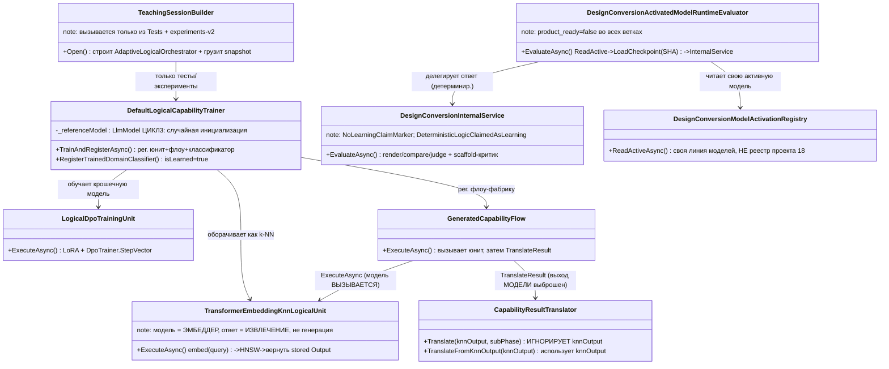

Симуляция веток (что вернётся):
- Ветка «топология есть» (нормальный путь): `Translate` → ответ = шаблон под-фазы, выход модели проигнорирован. Ожидаемо → детерминированный текст.
- Ветка «топологии нет» (`_topology == null`): `TranslateFromKnnOutput` → извлечённый текст доходит до человека. Но эта ветка на боевом флоу не достигается (фабрика передаёт topology).
- Ветка «флаг UseLearnedUnitWhenAvailable=false» в фабрике: возвращается `UniversalNineNodeDevelopmentFlow` (детерминированный), обученный юнит вообще не выбирается.
- 25/44: активная модель есть → чекпойнт грузится/сверяется → ответ всё равно из scaffold-критика, `product_ready=false`.

## 3. No-code объяснение алгоритма (что, где, в каком порядке, какие методы)

1. `DefaultLogicalCapabilityTrainer.TrainAndRegisterAsync` (18): валидирует ветки знания → строит teaching-stack (крошечная модель + токенизатор) → `ExecuteDpoTeachingAsync` → внутри `LogicalDpoTrainingUnit.ExecuteAsync` применяет LoRA и делает до 5 шагов `DpoTrainer.StepVector`. Референс-модель для DPO — `_referenceModel`, созданная как `new(BuildTinyConfig())` (случайная; дыра Цикла 3).
2. Тот же метод оборачивает обученную политику в `TransformerEmbeddingKnnLogicalUnit<string>.Train(...)` (модель → `EmbeddingModel`, строится `HnswIndex` по примерам) и регистрирует юнит `request.Units.Register(..., isLearned:false, ...)`, затем регистрирует флоу-фабрику `request.Flows.RegisterFactory(..., new GeneratedCapabilityFlowFactory(...))`. Отдельно `RegisterTrainedDomainClassifier` регистрирует k-NN-классификатор домена (`isLearned:true`).
3. На исполнении `GeneratedCapabilityFlowFactory.Create` возвращает `GeneratedCapabilityFlow` только если `Flags.UseLearnedUnitWhenAvailable` и в реестре нашёлся probationary-юнит; иначе — детерминированный `UniversalNineNodeDevelopmentFlow`.
4. `GeneratedCapabilityFlow.ExecuteAsync` компилирует запрос, вызывает `_unit.ExecuteAsync` (эмбеддинг → HNSW-поиск → BM25/паттерн-фьюжн → вернуть `example.Output`), затем `TranslateResult`. При наличии топологии — `CapabilityResultTranslator.Translate`, который строит ответ ИЗ метаданных под-фазы и не использует выход модели.
5. Потребители 25/44: `DesignConversionActivatedModelRuntimeEvaluator.EvaluateAsync` читает активную модель из своего реестра (`ReadActiveAsync`), фреш-грузит чекпойнт (`LoadCheckpointAsync`, сверка SHA + `CheckpointHasRealLearnedWeights`), строит `DesignConversionInternalService` и делегирует `EvaluateAsync`. Внутри `DesignConversionInternalService.EvaluateAsync` ответ собирается из инъектированных провайдеров рендера/сравнения/судьи и scaffold-критика; добавляются маркеры `NoLearningClaimMarker`, `InputEvidenceOnlyWarning`, поле `DeterministicLogicClaimedAsLearning`. Загруженная модель answer не формирует.

## 4. Точные цитаты кода (file:line + короткая цитата)

| file:line | цитата (сокр.) | что означает |
|---|---|---|
| `18.CapabilityTraining/DefaultLogicalCapabilityTrainer.cs:40` | `private readonly LlmModel _referenceModel = new(BuildTinyConfig());` | DPO-референс = случайно инициализированная модель (дыра Цикла 3) |
| `.../DefaultLogicalCapabilityTrainer.cs:325` | `TransformerEmbeddingKnnLogicalUnit<string>.Train(unitId, GeneratedCapabilityUnitRole, ... policyModel, tokenizer, ...)` | обученная модель оборачивается как k-NN-извлекатель |
| `.../DefaultLogicalCapabilityTrainer.cs:375-382` | `request.Units.Register<string,string>(... isLearned: false, retrievalUnit.Value!)` | юнит регистрируется как НЕ-learned (честно) |
| `.../DefaultLogicalCapabilityTrainer.cs:397-412` | `request.Flows.RegisterFactory(flowId, ... new GeneratedCapabilityFlowFactory(...))` | регистрируется флоу для retry-исполнения |
| `.../DefaultLogicalCapabilityTrainer.cs:1259-1266` | `request.Units.Register<DomainClassifierRequest, DomainClassification>(... isLearned: true, wrapper)` | классификатор домена (learned k-NN, Цикл 3) |
| `.../DefaultLogicalCapabilityTrainer.cs:1524-1532` | `if (!request.Flags.UseLearnedUnitWhenAvailable) return ... UniversalNineNodeDevelopmentFlow(...)` | без флага обученный юнит не выбирается |
| `.../DefaultLogicalCapabilityTrainer.cs:1655-1663` | `if (_topology is null) TranslateFromKnnOutput(...) else Translate(output, subPhase, ...)` | на пути с топологией берётся `Translate` |
| `18.CapabilityTraining/CapabilityResultTranslator.cs:11-26` | `public static string Translate(string knnOutput, LogicalSubPhase subPhase, ...)` — тело строит ответ из `subPhase.SubPhaseId/Name/Purpose/PredicateIds`, `knnOutput` не используется | выход обученной модели ВЫБРАСЫВАЕТСЯ |
| `18.CapabilityTraining/LlmIngredientLogicalUnits.cs:147-168` | `var queryVector = _embeddingModel.Embed(request.Input); ... return ... example.Output ...` | исполнение = извлечение сохранённой строки, не генерация |
| `.../LlmIngredientLogicalUnits.cs:360-381` | `new DpoTrainer(policyModel, referenceModel, ...); ... trainer.StepVector(batches, step)` | реальное DPO-обучение крошечной модели через LoRA |
| `15.OrchestratorModel/Logical/TeachingSessionBuilder.cs:96-103` | `new AdaptiveLogicalOrchestrator(... capabilityTrainer: new DefaultLogicalCapabilityTrainer(checkpointRoot))` | место сборки пути; вызывается только из Tests/experiments-v2 |
| `25.ModelServer/.../DesignConversionActivatedModelRuntimeEvaluator.cs:92` | `var active = await _registry.ReadActiveAsync(...)` | читает СВОЮ активную модель, не реестр проекта 18 |
| `.../DesignConversionActivatedModelRuntimeEvaluator.cs:242` | `await DesignConversionMachine.LoadCheckpointAsync(activeVersion.CheckpointPath, ...)` | реальный фреш-load чекпойнта (артефакт читается) |
| `.../DesignConversionActivatedModelRuntimeEvaluator.cs:109` | `var evaluated = await runtime.Value.Evaluator.EvaluateAsync(request, ...)` | ответ делегируется InternalService |
| `.../DesignConversionActivatedModelRuntimeEvaluator.cs:351` | `["product_ready"] = bool.FalseString` | даже durable-путь помечен не-продуктовым |
| `44.DesignConversionDomain/DesignConversionInternalService.cs:299-303` | `.Append(NoLearningClaimMarker)` | сервис сам заявляет «без обучения» |
| `.../DesignConversionInternalService.cs:316,334` | `InputEvidenceOnlyWarning` / `DeterministicLogicClaimedAsLearning: value...` | путь детерминированный (scaffold-критик) |
| `44.DesignConversionDomain/DesignConversionThinClientJobRuntime.cs:568` | `DeterministicExecutionBoundary = "deterministic_internal_service_path_only"` | рантайм сам объявляет путь детерминированным |
| `.../DesignConversionThinClientJobRuntime.cs:612-628` | `"trained_feature_verified=false", "model_training_verified=false", "product_ready_verified=false"` | обучение/продукт не подтверждены |
| `44.DesignConversionDomain/DesignConversionModelActivationRegistry.cs:1047,1081` | `["product_ready"] = bool.FalseString`, `ProductReady: false` | активация меняет только выбор рантайма, не продуктовость |
| разведка callers | `TrainAndRegisterAsync`/`TeachingSessionBuilder.Open` — только `Tests\`, `experiments-v2\`, `21.AgentInfrastructure/AdaptiveLogicalOrchestrator.cs` (библиотека); `ConfigureDesignConversionModelServer` — только `tools\DesignConversionLiveLocalServer` + Tests | боевого composition root нет |

## 5. Перечень ВСЕХ регистрируемых capabilities и их природа

| Capability (класс) | Регистрируется где | Обученная или детерминированная | Что за состояние |
|---|---|---|---|
| Юнит-извлекатель `TransformerEmbeddingKnnLogicalUnit<string>` (role `generated-capability`) | `DefaultLogicalCapabilityTrainer.cs:375`, `isLearned:false` | ОБУЧЕННАЯ частично: LoRA-веса крошечного трансформера, но применяются только как ЭМБЕДДЕР; сам ответ = извлечённая сохранённая строка | `policy.bin` (LoRA-веса) + `tokenizer.json` + HNSW-индекс эмбеддингов + карта примеров |
| Флоу `GeneratedCapabilityFlow` (фабрика `GeneratedCapabilityFlowFactory`) | `DefaultLogicalCapabilityTrainer.cs:397` | ДЕТЕРМИНИРОВАННАЯ обёртка; на пути с топологией ответ = шаблон под-фазы | без обучаемого состояния |
| Классификатор домена `CompiledDomainClassifierUnit` | `DefaultLogicalCapabilityTrainer.cs:1259`, `isLearned:true` | ОБУЧЕННАЯ (честный k-NN по профилю предикатов) — разобрано Циклом 3, не дублирую | `domain-classifier-training.json` (примеры) |
| DesignConversion критик/улучшатель (`DesignConversionMachine` critic/improver) — проекты 25/44 | грузится из промо-чекпойнта, `DesignConversionActivatedModelRuntimeEvaluator.cs:242` | ЧЕКПОЙНТ реально читается и сверяется, но РАНТАЙМ-ОТВЕТ детерминированный scaffold; НЕ читает реестр проекта 18 | `DesignConversionMachine`-чекпойнт (своя линия); ответ формирует scaffold-критик |

## 6. «План обещает» / «Код делает»

**План обещает** (по `active-codex-execution-*` — 03-ilearningmachine-pattern-notes, 05-dpo-data-training-measurement-guide, 06-ilearningdynamicgraph-architecture-brief):
обучаемая capability, которая после обучения регистрируется и на реальном запросе ИСПОЛНЯЕТСЯ через обученную модель (обучить → зарегистрировать → выбрать → исполнить как продуктовую способность), с измеримым DPO-эффектом.

**Код делает:**
- обучает реальную крошечную модель (LoRA+DPO), но с **случайным референсом** (дыра Цикла 3) → KL-якорь DPO бессмыслен;
- регистрирует **k-NN-извлекатель** (модель = эмбеддер) + **детерминированную флоу-обёртку** + **k-NN-классификатор домена**;
- на исполнении обученный юнит ВЫЗЫВАЕТСЯ, но `CapabilityResultTranslator.Translate` **выбрасывает его выход** и печатает шаблон под-фазы;
- потребители 25/44 — **отдельная подсистема**, не читает реестр 18; её «активная модель» грузится/сверяется, но ответ формирует детерминированный scaffold; везде `product_ready=false`;
- всё это заводится только из `Tests\`, `experiments-v2\`, `tools\` — **боевого входа нет**.

## 7. Вердикты + repair-blueprint по дефектам

### Дефект A — выход обученной модели выбрасывается переводчиком. Вердикт: **НОВАЯ ДЫРА**
`CapabilityResultTranslator.Translate` (`CapabilityResultTranslator.cs:11-26`) не использует параметр `knnOutput`; на боевом пути (`GeneratedCapabilityFlow.TranslateResult`, `DefaultLogicalCapabilityTrainer.cs:1655-1663`, `_topology != null`) вызывается именно он. Итог: даже извлечённая моделью строка не доходит до человека — ответ полностью детерминирован метаданными под-фазы.
Repair-blueprint (конкретно):
- Файл `18.CapabilityTraining/CapabilityResultTranslator.cs`, метод `Translate(string knnOutput, LogicalSubPhase subPhase, string originalPrompt)`: включить `knnOutput` в результат — например, при непустом `knnOutput` формировать тело из него (как `TranslateFromKnnOutput`), а метаданные под-фазы использовать как обрамление, а не как замену. Добавить приватный хелпер `ComposeWithSubPhase(knnOutput, subPhase)`.
- Файл `18.CapabilityTraining/DefaultLogicalCapabilityTrainer.cs`, метод `GeneratedCapabilityFlow.TranslateResult` (строки ~1655-1663): гарантировать, что ветка с топологией передаёт и использует `output` (сейчас он передаётся, но игнорируется внутри `Translate`).
- Тесты: `Tests/CapabilityResultTranslatorAndDeeperModelTests.cs` — добавить кейс «два разных `knnOutput` при одной под-фазе дают разный человеко-текст» (сейчас такой ассерт провалит текущую реализацию — это и есть доказательство дыры). E2E: прогон одной строки обучения → две разных query → разные ответы.

### Дефект B — DPO-референс случайный. Вердикт: **ПОДТВЕРЖДЕНО** (перенос из Цикла 3, не закрыт)
`DefaultLogicalCapabilityTrainer.cs:40` `_referenceModel = new(BuildTinyConfig())`.
Repair-blueprint:
- Файл `18.CapabilityTraining/DefaultLogicalCapabilityTrainer.cs`: референс-модель должна инициализироваться из того же родительского чекпойнта, что и политика перед LoRA (метод `BuildTeachingStack`/`ExecuteDpoTeachingAsync`): загрузить `parent.PolicyCheckpointPath` в отдельный экземпляр `LlmModel` как frozen-reference, а при отсутствии родителя — снять снимок стартовых весов политики ДО LoRA-применения. Заменить поле `_referenceModel` на per-run frozen-копию, а не общий случайный экземпляр.
- Тест: `Tests/DefaultLogicalCapabilityTrainerTests.cs` — ассерт «reference == snapshot(policy_before_LoRA)» по хэшу весов; и «DPO-loss на паре (chosen,chosen) ≈ 0».

### Дефект C — нет боевого composition root пути 18→15. Вердикт: **ВСЁ ЕЩЁ ДЫРА** (структурно да, рантайм не доказан)
Callers `TrainAndRegisterAsync`/`TeachingSessionBuilder.Open` — только `Tests\`, `experiments-v2\...Runner\Program.cs`, и библиотека `21.AgentInfrastructure/AdaptiveLogicalOrchestrator.cs`. Продуктового ASP.NET-хоста/Main не найдено.
Repair-blueprint:
- Нужен продуктовый хост-проект (например `xx.OrchestratorServer/Program.cs`), который: строит `TeachingSession` через `TeachingSessionBuilder.Open`, поднимает эндпоинт «реальный запрос → `AdaptiveLogicalOrchestrator` → (retry) `GeneratedCapabilityFlow`», и выставляет флаг `LogicalExecutionFlags.UseLearnedUnitWhenAvailable=true`. Без него фабрика (`GeneratedCapabilityFlowFactory.Create:1524`) всегда уходит в `UniversalNineNodeDevelopmentFlow`.
- Тест/доказательство рантайма: интеграционный тест «поднять хост → послать запрос → в ответе метрика `retrieval_unit_selected=true` и текст зависит от обученной строки». До появления такого прогона статус остаётся «структурно да, рантайм не доказан».

### Дефект D — потребители 25/44 отвечают детерминированным scaffold. Вердикт: **ПОДТВЕРЖДЕНО** (инлайн-стаб)
`DesignConversionInternalService.EvaluateAsync` (`:299-303,316,334`) добавляет `NoLearningClaimMarker`/`InputEvidenceOnlyWarning`/`DeterministicLogicClaimedAsLearning`; рантайм (`DesignConversionThinClientJobRuntime.cs:568,612-628`) объявляет `deterministic_internal_service_path_only` и `trained_feature_verified=false`; активация (`DesignConversionModelActivationRegistry.cs:1047,1081`) и оценщик (`DesignConversionActivatedModelRuntimeEvaluator.cs:351`) держат `product_ready=false`. Загруженный чекпойнт (`:242`) сверяется, но ответ не формирует.
Repair-blueprint:
- Файл `44.DesignConversionDomain/DesignConversionInternalService.cs`, метод `RunRuntimeFlowAsync`/критик-юнит `DesignConversionRuntimeScaffoldCriticUnit`: заменить scaffold-критик на реальный инференс через переданный `DesignConversionMachine` (критик/улучшатель), чтобы `value.Output.Html/Css/Verdict` рождались из загруженной модели; убрать `NoLearningClaimMarker` только ПОСЛЕ доказанного прогона.
- Файл `25.ModelServer/.../DesignConversionActivatedModelRuntimeEvaluator.cs`: после того как ответ реально формируется моделью, перевести `product_ready` в честное значение по факту прогона (а не жёсткий `false`).
- Отдельно (не в scope этого цикла): это НЕ потребитель реестра проекта 18 — если по замыслу DesignConversion должен использовать capability из 18, такого моста в коде нет (нужен новый адаптер `DesignConversionModelActivationRegistry` ↔ `TeachingRegistryPersistence`), но это архитектурное решение для человека.

### Сводный вердикт по вопросу цикла
«Исполняет ли обученная capability хоть что-то на реальном запросе?» — **ЧАСТИЧНО (структурно да, рантайм не доказан).** Обученная крошечная модель вызывается как эмбеддер k-NN-извлечения (звено ИСПОЛНИТЬ технически живо), но: её результат на нормальном пути выбрасывается переводчиком (дефект A, НОВАЯ ДЫРА); DPO-обучение подорвано случайным референсом (дефект B); боевого входа нет (дефект C); отдельная подсистема 25/44 отвечает детерминированным scaffold и не читает реестр 18 (дефект D). Рантайм-эффект на продукт прогоном не доказан.

BOUNDARY — TRAINING WORK, DEFERRED. STOP.

### ОБНОВЛЕНИЕ 2026-07-29 — Цикл 5 — Bootstrap и точки входа (скептик composition root)

**Режим:** адверсариальный (skeptic). Задача — попытаться ОПРОВЕРГНУТЬ вывод прошлых циклов:
«боевого composition root нет; продукт существует только как набор библиотек; единственный
живой сервер обслуживает инлайн-стаб». Репозиторий читался только на чтение.
Git на входе и на выходе: HEAD = `880e6710db48f24cf581e55ada8b81d8986c4727`, `git status --porcelain` пуст.

---

## Человеческое резюме (по-русски, до любых машинных кодов)

Я прочитал все точки входа `Program.cs` вне папок Tests/experiments/artifacts/docs и не смог
опровергнуть прежнюю находку. Опровергнуть — значило бы найти один процесс, который поднимает
продукт целиком: обучает модель, регистрирует обученный чекпойнт и обслуживает его по сети как
единое приложение. Такого процесса в репозитории нет.

Что реально есть:

1. **Обучение существует, но только как разовые CLI-инструменты.** Настоящий трансформерный
   тренинг-цикл живёт в одном раннере (`tools/PretrainingRunner`), а «обучение паттернов»
   (детерминированная выжимка структурных сигналов из корпуса) — в `27.TranslationDomain.Tools`
   и в фазовых раннерах `tools/*Phase0NRunner`. Все они запускаются по одной фазе, пишут артефакты
   в `artifacts/` и `models/` и завершаются. Ни один из них ничего не обслуживает.

2. **Живых сетевых серверов не один, а два** — и оба это `tools\` (локальные инструменты, не
   боевой монтаж по правилу не-оверклейма). Оба слушают только петлю (loopback 127.0.0.1):
   - `tools/DesignConversionLiveLocalServer` — поднимает НАСТОЯЩИЙ реестр маршрутов модель-сервера
     из библиотеки `25.ModelServer/DesignConversion` (evaluate, improvement-loop, training-intake,
     dpo-usefulness, flow38-quarantine, model-activation, human-approval — 11 маршрутов). Но в теле
     ответа жёстко зашито `productReady = false` и `trainedModelAuthority = false`, а его
     «обученная машина» — это самотест на ОДНОЙ синтетической строке при старте, не продуктовый чекпойнт.
   - `tools/DynamicGraphCompositionLiveLocalServer` — детерминированный сборщик графа-топологии.
     Он ЯВНО ЗАПРЕЩАЕТ обученный вход (422 при `TrainedInput`) и падает в fail-closed, если в процесс
     загрузилась тренировочная сборка. То есть по построению он не обслуживает обученную модель.

3. **Регистрации + сервинга продуктового чекпойнта нет вообще.** Чекпойнты в `models/`
   (`prompt-to-task`, `skill-selection`, `orchestration-reasoning`) грузятся ТОЛЬКО eval-раннерами
   ради проверки «свежей загрузки», и никогда — сервинг-хостом. Хост-класс `25.ModelServer`
   (`DesignConversionModelServerAspNetHostStartup`) в боевом коде монтируется единственным местом —
   тем самым `tools`-сервером; больше нигде, кроме Tests.

Итог: собрать продукт как целое (обучение + регистрация + сервинг обученной модели) в репозитории
некому. Прежняя находка **подтверждена**. Две уточняющие поправки к её формулировке — не разворот:
серверов два (а не один), и они не тривиальные «инлайн-стабы», а честные детерминированные/оценочные
tools-серверы, которые сами про себя пишут `productReady=false`.

---

## Топология точек входа (UML, импортируется в draw.io)

```mermaid
classDiagram
    class ProductCompositionRoot_MISSING {
        <<НЕ СУЩЕСТВУЕТ>>
        train()
        registerCheckpoint()
        serveTrainedModel()
    }
    class tools_DesignConversionLiveLocalServer {
        Kestrel loopback 127.0.0.1:0
        productReady = false (hardcoded)
        trainedModelAuthority = false (hardcoded)
        machine = 1-row synthetic self-test
    }
    class tools_DynamicGraphCompositionLiveLocalServer {
        Kestrel loopback
        TrainedInput -> 422 FORBIDDEN
        training assembly -> fail-closed
        deterministic composition only
    }
    class lib_25_ModelServer {
        <<library>>
        DesignConversionModelServerAspNetHostStartup
        route registry + handlers
    }
    class tools_PretrainingRunner {
        real transformer TrainingLoop
        one-shot, writes checkpoint, no serve
    }
    class tools_PhaseRunners {
        Phase04 eval / Phase05 train / Phase07 dpo-data
        one-shot, writes artifacts/, no serve
    }
    class cli_27_TranslationDomain_Tools {
        model-lifecycle CLI
        materialize/export/import/continue
        training_started=false per report
    }
    class desktop_21_22_23 {
        WinForms Application.Run(MainForm)
        GUI viewers
    }
    class tools_43_WikiTools {
        training-flow runner -> external https://models.local
        IDE-launch harness, plugin hook
    }
    class tools_43_SmartSkillsQuality {
        eval-only / proof-contract runners
    }

    tools_DesignConversionLiveLocalServer --> lib_25_ModelServer : mounts registry (only live caller)
    tools_DesignConversionLiveLocalServer ..> ProductCompositionRoot_MISSING : НЕ является
    tools_DynamicGraphCompositionLiveLocalServer ..> ProductCompositionRoot_MISSING : НЕ является
    tools_PretrainingRunner ..> ProductCompositionRoot_MISSING : обучает, но не сервит
    cli_27_TranslationDomain_Tools ..> ProductCompositionRoot_MISSING : lifecycle по фазам, не сервит
```

Симуляция потока данных (ожидаемый исход каждой ветки):
- Ветка «пользователь шлёт дизайн на DesignConversion-сервер» → ответ приходит, но `productReady=false`,
  `trainedModelAuthority=false` → продукт не подтверждён (это оценочный/scaffold-ответ).
- Ветка «пользователь шлёт обученный узел на DynamicGraph-сервер» → 422 `HOST_TRAINED_NODE_INPUT_FORBIDDEN`
  → сервер по контракту детерминированный, обученную модель не обслуживает.
- Ветка «где-то грузится продуктовый чекпойнт из models/ в сервинг-хост» → такого вызова нет
  (grep по монтажу хоста даёт только tools-сервер и Tests).

---

## Таблица: 17 точек входа (разведка назвала «16» — заголовок недосчитал одну; файла-пропажи нет)

| # | Точка входа | file:line | Короткая цитата | Что реально поднимает | Вердикт |
|---|-------------|-----------|-----------------|-----------------------|---------|
| 1 | tools/DesignConversionLiveLocalServer | Program.cs:66 | `UseKestrel().UseUrls("http://127.0.0.1:0")` | Loopback Kestrel; монтирует реестр 11 маршрутов модель-сервера (`ConfigureDesignConversionModelServer`, стр.78); `productReady=false` (стр.254), `trainedModelAuthority=false` (стр.252); «машина» = 1 синтетическая строка (стр.1604-1638) | ПОДТВЕРЖДЕНО — живой tools-сервер, не боевой composition root; продукт-модель не обслуживает |
| 2 | tools/DynamicGraphCompositionLiveLocalServer | Program.cs:43 | `UseUrls(...LoopbackUrl)` | Loopback Kestrel; детерминированная сборка графа; обученный вход → 422 (стр.364); тренировочная сборка → fail-closed (стр.106,111) | ПОДТВЕРЖДЕНО — детерминированный tools-сервер; обученную модель обслуживать запрещено по контракту |
| 3 | 25.ModelServer (host-класс, НЕ Program.cs) | DesignConversionModelServerAspNetHostStartup.cs:1142 | `PublicDeploymentVerified: false, ... ProductReady: false` | Библиотека регистрации маршрутов; сама не хостит; монтируется только tools-сервером (#1) и Tests | ПОДТВЕРЖДЕНО — библиотека, не self-host; боевого хоста-владельца нет |
| 4 | 21.AgentInfrastructure.Desktop | Program.cs:25 | `Application.Run(new MainForm())` | WinForms GUI-просмотрщик | ПОДТВЕРЖДЕНО — десктоп-вьюер, не composition root |
| 5 | 22.AgentAlgorithms.Desktop | Program.cs:16 | `Application.Run(new MainForm())` | WinForms GUI-просмотрщик | ПОДТВЕРЖДЕНО — десктоп-вьюер, не composition root |
| 6 | 23.OssEquivalents.Desktop | Program.cs:16 | `Application.Run(new MainForm())` | WinForms GUI-просмотрщик | ПОДТВЕРЖДЕНО — десктоп-вьюер, не composition root |
| 7 | 27.TranslationDomain.Tools | Program.cs:38-70 | `switch { "regenerate-...-model", "continue-...-training", "materialize-...-state" ... }` | CLI жизненного цикла моделей; фазы «materialize/export/import/continue»; отчёт `training_started=false` (стр.129-133), claim_scope «no host runtime, no training command» (стр.163) | ПОДТВЕРЖДЕНО — пофазный CLI, не сервер и не composition root |
| 8 | tools/PretrainingRunner | Program.cs:10-13, 100 | `using TrainingLoop; ... if (!options.Train) { ...ValidatedToken; return 0; }` | НАСТОЯЩИЙ трансформерный тренинг-цикл; разовый job; пишет чекпойнт; ничего не сервит | ПОДТВЕРЖДЕНО — реальный тренер, но разовый раннер; сервинга/регистрации нет |
| 9 | tools/OrchestrationReasoningPhase05Runner | Program.cs:44,95,120 | `new OrchestrationReasoningTrainer(); ... adapter.TrainBatchAsync(...); adapter.ExportAsync()` | Фаза-05: materialize → train (детермин. паттерн-машина) → eval → export → fresh-load; пишет в `artifacts/phase-05-...` | ПОДТВЕРЖДЕНО — разовый фазовый раннер; не сервит |
| 10 | tools/PromptToTaskPhase04Runner | Program.cs:39,54 | `PromptToTaskMachine.LoadCheckpointAsync(...); ... HashFile(checkpointPath)` (до/после) | Фаза-04 EVAL-ONLY: грузит чекпойнт из `models/prompt-to-task`, гоняет сценарии, сверяет хеш (нет мутации), пишет артефакты | ПОДТВЕРЖДЕНО — eval-раннер; чекпойнт грузит только для проверки, не для сервинга |
| 11 | tools/ResultGapPhase07Runner | Program.cs:30,37 | `new ResultGapMachine().Evaluate(...); writer.WriteMissingPatternCandidate(...)` | Фаза-07: генерит DPO-кандидаты (missing/correction/quarantine) в JSONL; продюсер данных | ПОДТВЕРЖДЕНО — продюсер тренировочных данных; не сервит |
| 12 | 43.LearningLocalWikiData/tools/ProjectWikiTrainingRunner | Program.cs:50,54 | `server-base-url", "https://models.local"); ... ProjectWikiTrainingFlowAdapter()` | CLI «training-flow»: гоняет логический флоу против ВНЕШНЕГО модель-сервера (`https://models.local`, по умолчанию не существует); пишет result.json | ПОДТВЕРЖДЕНО — раннер-клиент к внешнему серверу; сам не хостит |
| 13 | 43.LearningLocalWikiData/tools/PluginHostInvocationHarness | Program.cs:45,52 | `LaunchVsCode(codeCmd, ...); LaunchVisualStudio(devenv, ...)` | Харнесс: ЗАПУСКАЕТ VS Code и Visual Studio с хуком, пишет транскрипты + gate-отчёт | ПОДТВЕРЖДЕНО — тест-харнесс IDE-интеграции; не сервер |
| 14 | 43.LearningLocalWikiData/tools/WikiContextHook | Program.cs:17 | `new ProjectWikiPluginOrchestrationAdapter().OrchestrateAsync(request)` | Хук-exe, вызываемый плагином IDE; `--orchestrate` → детерминированный план; `--ensure-ready` → JSON готовности | ПОДТВЕРЖДЕНО — плагин-хук CLI; детерминированная выдача, без модели/сервинга |
| 15 | 43.SmartSkillsDomain.Tools/Quality02EvalOnlyRunner | Program.cs:46,50 | `"QUALITY-02-...-NO-EVAL-EXECUTION"; ... SyntheticFixtureOnly = true` | EVAL-ONLY раннер качества; синтетические фикстуры по умолчанию; пишет evidence-refs | ПОДТВЕРЖДЕНО — оценочный раннер; не сервит |
| 16 | 43.SmartSkillsDomain.Tools/Quality03NonInterRaterProofProducers | Program.cs:48 | `new Quality03NonInterRaterProofProducer().Run(options)` | Продюсер proof-данных/рефов (non-inter-rater); пишет outputs + счётчики pass | ПОДТВЕРЖДЕНО — продюсер evidence; не сервит |
| 17 | 43.SmartSkillsDomain.Tools/Quality03ProofContractRunner | Program.cs:47 | `new SmartSkillsDomain.Quality03ProofContractRunner().Run(options)` | Раннер proof-контракта; печатает blocking-proof pass-счётчики | ПОДТВЕРЖДЕНО — оценочный раннер; не сервит |

Разведка глоба: `experiments-v2/TEACHING-20-ROWS-CURRENT/.../Teaching20RowsCurrentRunner/Program.cs` существует, но
лежит под `experiments-v2/` → исключён по правилу (experiments* — не боевой путь). 17-го боевого файла вне
Tests/experiments/artifacts/docs НЕТ; список задания (17 пунктов при заголовке «16») полон, файла-пропажи нет.

---

## «План обещает» / «код делает»

**План обещает** (по плану-оф-рекорд `active-codex-execution-*.md`, DPO legal build): продукт —
самособирающийся LLM-движок, который обучается локально, регистрирует обученные модели и обслуживает
их через модель-сервер как единое приложение (обучение + регистрация + сервинг).

**Код делает:** обучение, регистрацию-как-экспорт-чекпойнта и сервинг реализованы как РАЗДЕЛЬНЫЕ,
несоединённые куски:
- обучение → разовые `tools/*Runner` (реальный трансформер в PretrainingRunner; детерминированные
  паттерн-машины в фазовых раннерах и `27.TranslationDomain.Tools`), пишут в `artifacts/` и `models/`;
- «регистрация» → это лишь экспорт чекпойнта в `models/…`, который потом читают только eval-раннеры;
- сервинг → два loopback tools-сервера, из которых один жёстко пишет `productReady=false` и держит
  1-строчный самотест вместо продуктовой модели, а второй по контракту запрещает обученный вход.
Ни один процесс не связывает три звена в одно. Composition root, собирающего продукт целиком, в коде нет.

Мост-доказательство (то, что потребовалось бы для ПЕРЕСМОТРА и чего НЕ нашлось):
- `grep WebApplication.CreateBuilder` по `**/*.cs` → боевых хостов ровно два, оба `tools\`
  (`DesignConversionLiveLocalServer`, `DynamicGraphCompositionLiveLocalServer`); остальные совпадения — в `Tests\`.
- `grep ConfigureDesignConversionModelServer` → в боевом коде хост `25.ModelServer` монтируется только
  tools-сервером #1 (и Tests). Продуктового владельца-хоста нет.
- Публичное поле сервера #1 `body["productReady"] = false;` (Program.cs:254) — безусловно, ни одна ветка
  не выставляет true. Значит «живой сервер обслуживает готовый продукт» кодом опровергнуто самим сервером.

---

## Вердикты

**ГЛАВНЫЙ ВЕРДИКТ ПО ПРЕЖНЕЙ НАХОДКЕ: ПОДТВЕРЖДЕНО.**
Опровергнуть не удалось. Боевого composition root (обучение + регистрация + сервинг обученной модели
одним процессом) в репозитории нет. Продукт существует как набор библиотек (`25.ModelServer`,
`DesignConversionDomain`, `OrchestratorModel`, `SmartSkillsDomain`, `ProjectWikiDomain`, `TranslationDomain`,
`TransformerModel`, `TrainingLoop` и т.д.), которые дёргаются разрозненными `tools\`-инструментами и
десктоп-вьюерами. Все 17 точек входа — tools/desktop/runner, ни одна не является боевым монтажом продукта.

**Уточняющая поправка к формулировке прежней находки: ЧАСТИЧНО (это не разворот, находка остаётся в силе).**
- «единственный живой сервер» → живых loopback-серверов ДВА (оба `tools\`). Число неверно, суть — верна.
- «обслуживает инлайн-стаб» → сервер #1 монтирует НАСТОЯЩИЙ реестр 11 маршрутов из библиотеки `25.ModelServer`,
  а не тривиальный инлайн-стаб; но обслуживает он оценочный/scaffold-ответ с `productReady=false` и
  1-строчным самотестом вместо продуктовой модели — так что «продуктовой ценности он не обслуживает» верно.

**НОВАЯ ДЫРА:** не обнаружено (то, что серверов два, а не один — это поправка к формулировке, а не новый дефект).

### Repair-blueprint по дефекту D-1 «нет боевого composition root» (заполнено, не промпт будущему исполнителю)

- **Уровень архитектуры, где чинить:** новый боевой хост-проект (напр. `50.ProductHost/Program.cs`),
  который является ЕДИНСТВЕННЫМ владельцем `WebApplication.CreateBuilder`, вне `tools\`.
- **Что смонтировать (сервинг):** вызвать `DesignConversionModelServerAspNetHostStartup.ConfigureDesignConversionModelServer(app, CreateLocalRouteRegistry(composition, candidateStrategy, artifactDb, …, promotedLocalModel: <загруженный продуктовый чекпойнт>, …))`
  — то есть тот же путь, что сейчас в `tools/DesignConversionLiveLocalServer/Program.cs:78`, но с реальным
  `DesignConversionPromotedLocalModel`, а НЕ с `CreateTinyMachineBackedLocalMachineAsync()` (Program.cs:1604) на 1 строке.
- **Что загрузить (регистрация→сервинг seam):** заменить eval-only-загрузку чекпойнтов
  (`PromptToTaskMachine.LoadCheckpointAsync`, PromptToTaskPhase04Runner Program.cs:39) на загрузку в
  боевом хосте при старте, с активацией через уже существующий `model-activation` маршрут
  (`RegisterDesignConversionModelActivation`, AspNetHostStartup.cs:847).
- **Что снять для боевого режима:** безусловные `body["productReady"] = false;` (Program.cs:254) и
  `body["trainedModelAuthority"] = false;` (Program.cs:252) — они должны вычисляться из реально
  активированной модели, а не быть литералами.
- **Обучающий вход/цикл (train→register):** боевой хост должен потреблять чекпойнт, произведённый
  `tools/PretrainingRunner` (реальный `TrainingLoop`/`TransformerModel`) и/или пофазными раннерами,
  через `models/…` как контракт регистрации; сейчас эта связь отсутствует (чекпойнты читают только раннеры).
- **Затронутые наборы/чекпойнты/манифесты:** `models/prompt-to-task/*`, `models/skill-selection/*`,
  `models/orchestration-reasoning` + манифесты чекпойнтов из фазовых раннеров.
- **Тесты/e2e/QA, доказывающие починку:** новый e2e поднимает боевой хост, шлёт запрос на `evaluate`,
  получает `productReady=true` с активированной моделью (не самотест), и `DynamicGraph` перестаёт
  отвечать 422 на обученный вход в боевом профиле; аналог существующих `Tests/DesignConversionModelServerAspNetHostTests.cs`,
  но против боевого хоста, а не against tools-сервера.
- **Жизненный цикл:** обучение (PretrainingRunner/фазовые раннеры) → экспорт чекпойнта в `models/` →
  активация/регистрация в боевом хосте при старте → сервинг обученной модели по loopback→сети → продолжение
  обучения из существующего чекпойнта. КАЖДОЕ звено сейчас есть по отдельности; отсутствует ТОЛЬКО их
  сшивка в одном процессе. Это и есть дефект.

**ГРАНИЦА:** сама сшивка (боевой хост + активация обученной модели + сервинг) — это тренировочно-композиционная
работа, вынесенная за границу данного read-only цикла. Ниже — стоп.

BOUNDARY — TRAINING WORK, DEFERRED. STOP.

### ОБНОВЛЕНИЕ 2026-07-29 — Цикл 5 — Семейство DynamicGraphEdgeAuthority

## Человеческое резюме (по-русски, до машинных кодов)

Вопрос Цикла 5: семейство `DynamicGraphEdgeAuthority` в `21.AgentInfrastructure\Logical\` — это
живой обучаемый контур или дормантный каркас (как graph-slice в `tools\` из Цикла 1)?

**Короткий ответ: дормантный каркас, честно закрытый (fail-closed). Это НЕ новая дыра.**
Резолвер из Цикла 1 не обманывает: он и вправду требует `IsLearned=true` и запрещает детерминизм
на роли edge-authority — и, что важнее, **никто в боевом коде (вне Tests\) не подаёт обучаемый
edge-authority юнит**. Поэтому «обучаемая власть над выбором ребра» на боевом пути не исполняется
никогда: она либо вообще не конструируется (живой путь сервера), либо сразу падает `ResolutionFailed`.

Три вещи, которые надо развести, чтобы не переоценить:

1. **L2 edge-authority pipeline** (`DynamicGraphEdgeAuthorityExecutionPipeline`) — обучаемый «мозг»
   выбора ребра. Конструируется РОВНО в одном боевом месте — `AdaptiveLogicalOrchestrator`
   (line 1729) — но только внутри ветки, которая срабатывает лишь когда есть проекция выходов узла
   (`NodeOutputProjection != null`), а это требует источника выходов узла, которого живой сервер
   не подаёт. Итог: на боевом пути сервера этот pipeline **даже не создаётся**.

2. **L3 selected-target executor** (`DynamicGraphRegistryL3SelectedTargetExecutor`) — исполняет один
   уже выбранный целевой L3-флоу. Он **живой** и **достижим по HTTP** через сервер
   (`/selected-target-runs`). Но он исполняет зарегистрированный флоу по клиентски-поданному
   `EdgeAuthorityExecutionResult` (доказательство выбора приходит В ЗАПРОСЕ), а не запускает
   обучаемый L2-выбор сам.

3. **Метры/пробы/guard-юниты** — не пишут в никуда. Guard-юниты (leakage/identity) исполняются
   ВНУТРИ pipeline и их отчёты валидируются и вшиваются в результат; метры (control / quality /
   novelty / identity / order / ablation) агрегируются `DynamicGraphMeasurementCoordinator` в
   `...SelectionQualityEvidenceMeasurement`, который гейтит L3-исполнение и возвращается клиенту
   по HTTP. То есть они **читаются** — но измеряют клиентские данные, а L2-контур, который эти
   данные должен был бы производить на сервере, дормантный.

**Детерминизма под обучаемым именем НЕТ.** Materializer готовит вход (легально), решение
`OrderedTargets` берётся только из вывода обучаемого юнита; `BaselineScore`/ablation-ранг в самом
выборе не участвуют (прямая цитата-комментарий в `DynamicGraphEdgeFlow` line 694).

Это тот же паттерн, что graph-slice в `tools\` из Цикла 1: каркас построен и честно закрыт, но
живого обучаемого контура за ним нет, потому что нечем его наполнить (нет поданного обучаемого
юнита) и живой путь его не активирует.

## UML — что где зовётся при исполнении (Mermaid, импорт в draw.io)

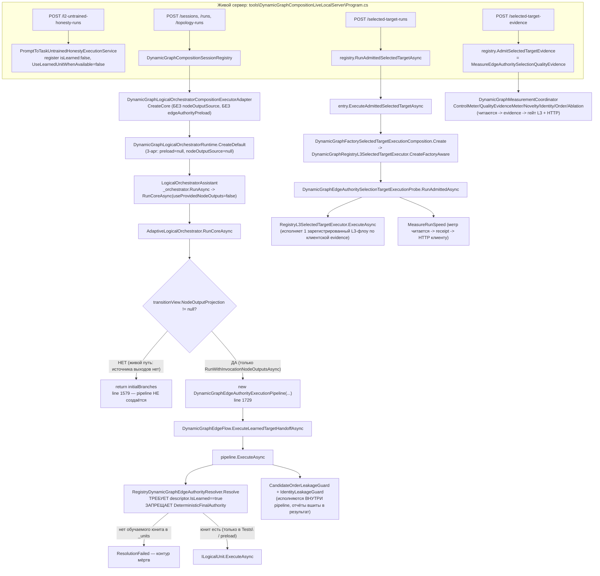

## No-code алгоритм (что, где, в каком порядке, какими методами)

- **Живой путь сервера, сессии/раны** (`Program.cs` `/sessions`,`/runs`,`/topology-runs`):
  `DynamicGraphCompositionSessionRegistry` строит рантайм через
  `DynamicGraphLogicalOrchestratorCompositionExecutorAdapter.Compose` →
  `DynamicGraphLogicalOrchestratorComposition.CreateCore` (3-арг, без `nodeOutputSource`, без
  `edgeAuthorityPreload`) → `DynamicGraphLogicalOrchestratorRuntime.CreateDefault` →
  `LogicalOrchestratorAssistant`. Ассистент зовёт `_orchestrator.RunAsync` →
  `AdaptiveLogicalOrchestrator.RunCoreAsync(useProvidedNodeOutputs:false)`. В `RunCoreAsync`
  ветка edge-authority — `ExecuteProjectedDynamicGraphEdgeAsync` — на первой же строке проверяет
  `transitionView.NodeOutputProjection`; при `null` возвращает ветки как есть и **pipeline не
  конструирует**. `NodeOutputProjection` непусто только когда `useProvidedNodeOutputs==true`, т.е.
  только через `RunWithInvocationNodeOutputsAsync`, для которого нужен `IDynamicGraphNodeOutputSource`.
  Живой сервер источник выходов не подаёт → L2 edge-authority pipeline на боевом пути мёртв.

- **Единственная боевая конструкция pipeline** — `AdaptiveLogicalOrchestrator.ExecuteProjectedDynamicGraphEdgeAsync`
  (line 1726–1733): создаёт `DeterministicRegistryEdgeCandidateProvider`,
  `DeterministicDynamicGraphEdgeAuthorityInputMaterializer`,
  `RegistryDynamicGraphEdgeAuthorityResolver(_units)` и `DynamicGraphEdgeAuthorityExecutionPipeline`.
  Резолвер бьётся об `_units`; чтобы вернуть успех, там должен лежать дескриптор с
  `IsLearned==true`, ролью `edge-authority`, совпадающим `AuthorityUnitId` и trust ≥ Probationary.

- **Живой L3-путь** (`/selected-target-evidence` + `/selected-target-runs`): клиент сначала подаёт
  `EdgeAuthorityExecutionResult` как evidence; `registry.AdmitSelectedTargetEvidence` прогоняет его
  через `DynamicGraphMeasurementCoordinator.MeasureEdgeAuthoritySelectionQualityEvidence` (control /
  quality / novelty / identity / order метры). Затем `/selected-target-runs` →
  `registry.RunAdmittedSelectedTargetAsync` → `entry.ExecuteAdmittedSelectedTargetAsync` →
  `LogicalOrchestratorAssistant.RunFactoryAdmittedSelectedTargetExecutionAsync` →
  `DynamicGraphFactorySelectedTargetExecutionComposition.Create` →
  `DynamicGraphRegistryL3SelectedTargetExecutor.CreateFactoryAware` →
  `...Probe.RunAdmittedAsync` → `RegistryL3SelectedTargetExecutor.ExecuteAsync`, который резолвит и
  исполняет РОВНО один зарегистрированный L3-флоу по `target.TargetId` (строгая проверка личности,
  без ретраев/фолбэков/мутаций).

## Таблица file:line — кто зовёт / что делает

| # | Артефакт | file:line | Роль при исполнении |
|---|---|---|---|
| 1 | Боевая конструкция L2 pipeline | `21.AgentInfrastructure\Logical\AdaptiveLogicalOrchestrator.cs:1726-1733` | Единственный не-Tests конструктор `DynamicGraphEdgeAuthorityExecutionPipeline` |
| 2 | Гейт активации L2 | `AdaptiveLogicalOrchestrator.cs:1577-1579` | `NodeOutputProjection==null` → `return initialBranches`, pipeline не создаётся |
| 3 | Единственный путь с выходами узла | `AdaptiveLogicalOrchestrator.cs:248` | `RunWithInvocationNodeOutputsAsync` — только он ставит `useProvidedNodeOutputs=true` |
| 4 | Живой сервер строит рантайм БЕЗ выходов/preload | `15.OrchestratorModel\Logical\DynamicGraphLogicalOrchestratorCompositionExecutorAdapter.cs:156,174` | `CreateCore` (3-арг) → `nodeOutputSource=null`, `edgeAuthorityPreload=null` |
| 5 | EdgeFlow → pipeline | `21.AgentInfrastructure\Logical\DynamicGraphEdgeFlow.cs:536-561` | `ExecuteLearnedTargetHandoffAsync` вызывает `pipeline.ExecuteAsync` (FanOut/ManyToMany/MultiOutput) |
| 6 | Pipeline требует обучаемости | `DynamicGraphEdgeAuthorityExecutionPipeline.cs:81-82, 1106` | `!flags.UseLearnedUnitWhenAvailable` → fail; `!descriptor.IsLearned` → resolution invalid |
| 7 | Резолвер (Цикл 1) честен | `RegistryDynamicGraphEdgeAuthorityResolver.cs:44-45, 81-82` | Запрет `DeterministicFinalAuthority`; требование `IsLearned` |
| 8 | Materializer = только вход | `DeterministicDynamicGraphEdgeAuthorityInputMaterializer.cs:24-131` | Строит `EdgeAuthorityInput` (токены/предикаты/контекст/кандидаты); НЕ выбирает ребро |
| 9 | Выбор только из обучаемого решения | `DynamicGraphEdgeFlow.cs:694` | «Target selection is sourced only from the learned decision; baseline and ablation ranks are not consulted» |
| 10 | Guard-юниты внутри pipeline | `DynamicGraphEdgeAuthorityExecutionPipeline.cs:399, 465` | CandidateOrder + Identity leakage guards исполняются и валидируются в результате |
| 11 | Живой L3-executor по HTTP | `tools\...\Program.cs:843` → `DynamicGraphCompositionSessionRegistry.cs:790` | `/selected-target-runs` → `RunAdmittedSelectedTargetAsync` → L3-executor |
| 12 | L3-executor конструкция | `15.OrchestratorModel\Logical\DynamicGraphFactorySelectedTargetExecutionComposition.cs:69` | `RegistryL3SelectedTargetExecutor.CreateFactoryAware` |
| 13 | L3-executor исполняет 1 флоу | `DynamicGraphRegistryL3SelectedTargetExecutor.cs:172-402` | Резолв + исполнение одного зарегистрированного L3-флоу, строгая личность |
| 14 | Единственная боевая isLearned:true | `18.CapabilityTraining\DefaultLogicalCapabilityTrainer.cs:1228 (RegisterTrainedDomainClassifier)` | Это domain-classifier, НЕ edge-authority; строка 381 регистрирует retrieval-юнит `isLearned:false` |
| 15 | Seam «доверенного хоста» | `15.OrchestratorModel\Logical\DynamicGraphLogicalOrchestratorRuntime.cs:114-161, 434-468` | Приём предзагруженных обучаемых edge-authority юнитов; валидация роли/IsLearned/trust |
| 16 | Метры читаются коордиатором | `DynamicGraphMeasurementCoordinator.cs:231,365,409,460,504,541` | Ablation/Control/QualityEvidence/Novelty/Identity/Order метры агрегируются в evidence |
| 17 | Метр run-speed читается | `DynamicGraphEdgeAuthoritySelectionTargetExecutionProbe.cs:442-462` | `MeasureRunSpeed` → receipt → HTTP клиенту |

## Ключевые цитаты (сейчас / почему / должно стать)

**Цитата A — гейт активации L2 (боевой путь его не проходит).**
`AdaptiveLogicalOrchestrator.cs:1577-1579`
```csharp
var projection = transitionView.NodeOutputProjection;
if (projection is null)
    return OperationResult<RoutedLogicalFlowResult[]>.Ok(initialBranches);
```
- сейчас: если проекции выходов узла нет — ветка edge-authority завершается без построения pipeline.
- почему ОК (для честности): живой сервер строит рантайм без `IDynamicGraphNodeOutputSource`
  (`CompositionExecutorAdapter` → `CreateCore` 3-арг), значит `useProvidedNodeOutputs=false`,
  значит `NodeOutputProjection==null` — L2 pipeline на боевом пути не конструируется вообще.
- должно стать (если контур хотят оживить): в боевую композицию подать
  `IDynamicGraphNodeOutputSource` и `edgeAuthorityPreload` с обученным юнитом → **это тренировочная
  работа, отложена**.

**Цитата B — резолвер честно требует обучаемости (Цикл 1 подтверждён).**
`RegistryDynamicGraphEdgeAuthorityResolver.cs:44-45, 81-82`
```csharp
if (edge.DeterministicFinalAuthority)
    return Failure("Learned edge authority cannot claim deterministic final authority.", "EDGE_AUTHORITY_FINAL_AUTHORITY_FORBIDDEN");
...
if (!descriptor.IsLearned)
    return Failure("Resolved edge authority unit is not learned.", "EDGE_AUTHORITY_UNIT_NOT_LEARNED");
```
- сейчас: детерминизм на роли запрещён; обязателен `IsLearned`.
- почему ОК: без поданного обучаемого юнита резолвер всегда падает — контур fail-closed, не обманывает.

**Цитата C — Materializer = подготовка входа, не власть над выбором.**
`DeterministicDynamicGraphEdgeAuthorityInputMaterializer.cs:123-131`
```csharp
return OperationResult<EdgeAuthorityInput>.Ok(
    new EdgeAuthorityInput(edge.EdgeId, semanticTokens, predicateIds,
        contextSnapshot.Value!, Array.AsReadOnly(candidateValidation.Value!),
        DynamicGraphEdgeAuthorityLeakageBoundary.CreateSnapshot()));
```
- сейчас: строит канонический `EdgeAuthorityInput` (токены/предикаты/контекст/кандидаты). Не ранжирует,
  не выбирает целевое ребро; `BaselineScore` берётся от candidate-provider и в решение не входит.
- почему ОК: решение `OrderedTargets` формирует обучаемый юнит; `DynamicGraphEdgeFlow.cs:694`
  прямо фиксирует «Target selection is sourced only from the learned decision; baseline and ablation
  ranks are not consulted». Скрытого детерминизма под обучаемым именем НЕТ.

**Цитата D — метры/guard читаются, не пишут в никуда.**
`DynamicGraphMeasurementCoordinator.cs:365,504,541` + `...ExecutionPipeline.cs:399,465`
```csharp
var edgeAuthorityControlMeasurement = DynamicGraphEdgeAuthorityControlMeter.Measure(result);
var edgeIdentityQualityMeasurement = DynamicGraphEdgeIdentityQualityMeter.Measure(result);
var edgeOrderQualityMeasurement   = DynamicGraphEdgeOrderQualityMeter.Measure(result);
```
- сейчас: метры агрегируются в `...SelectionQualityEvidenceMeasurement`, который гейтит L3-исполнение
  и возвращается клиенту по HTTP; guard-отчёты валидируются и вшиваются в `EdgeAuthorityExecutionResult`.
- почему это оговорка, а не «живость L2»: они измеряют клиентски-поданный `EdgeAuthorityExecutionResult`,
  а серверный L2-контур, который должен был бы его производить, дормантный.

## Ответы на 4 вопроса Цикла 5

**Q1. Кто зовёт ExecutionPipeline и RegistryL3SelectedTargetExecutor вне Tests\?**
- `ExecutionPipeline`: единственная боевая конструкция — `AdaptiveLogicalOrchestrator.cs:1729`, внутри
  `ExecuteProjectedDynamicGraphEdgeAsync`, которая исполняется лишь при `NodeOutputProjection!=null`
  (`:1577`). Живой сервер (`DynamicGraphCompositionLiveLocalServer`) строит рантайм через
  `CompositionExecutorAdapter`→`CreateCore` **без** источника выходов узла → эта ветка на боевом пути
  не достигается. Проверено по `19.DynamicGraphComposition.Contracts` и по tools-серверу: контракты —
  это профиль/исполнение оркестратора, к L2 pipeline напрямую не приводят; сервер вызывает pipeline
  только опосредованно через оркестратор, а тот его на живом пути не строит. Static-хелперы pipeline
  (`TrySnapshot*`) используются метрами/guard'ами, но это не исполнение самого контура.
- `RegistryL3SelectedTargetExecutor`: **живой** и достижим по HTTP — `Program.cs:843`
  `/selected-target-runs` → `DynamicGraphCompositionSessionRegistry.RunAdmittedSelectedTargetAsync:790`
  → `entry.ExecuteAdmittedSelectedTargetAsync` → `LogicalOrchestratorAssistant.RunFactoryAdmittedSelectedTargetExecutionAsync:512`
  → `DynamicGraphFactorySelectedTargetExecutionComposition.Create:69` → `CreateFactoryAware` →
  `ExecuteAsync`. Исполняет один зарегистрированный L3-флоу по клиентской evidence.

**Q2. Существует ли КЛАСС с IsLearned=true, реально зарегистрированный на роль edge-authority вне тестов?**
- **НЕТ.** Единственная боевая регистрация с `isLearned:true` — доменный классификатор
  (`DefaultLogicalCapabilityTrainer.RegisterTrainedDomainClassifier:1228`), роль НЕ edge-authority;
  retrieval-юнит там регистрируется с `isLearned:false` (`:381`). Обучаемый edge-authority юнит вне
  Tests\ не подаёт никто. Существует seam `edgeAuthorityPreload` («доверенный хост уже загрузил
  обучаемые edge-authority юниты», `DynamicGraphLogicalOrchestratorRuntime.cs:114-161`, валидация
  роли/IsLearned/trust на `:434-468`), но **ни один боевой вызывающий не подаёт непустой preload**:
  боевые точки (`ProfileCatalog:64`, `DynamicGraphMachineCompositionFactory:53`, live-сервер) идут
  через `Create`/`CreateCore` без preload; преload-перегрузки зовутся только из Tests\.

**Q3. Что делает Deterministic...InputMaterializer — подготовка входа или скрытая детерминированная власть над выбором ребра?**
- **Подготовка входа (легально).** Строит `EdgeAuthorityInput` из источника/контекста/кандидатов
  (`:24-131`), нормализует токены и предикаты, снимает канонический снапшот кандидатов. Он не
  ранжирует и не выбирает целевые узлы; целевой выбор (`OrderedTargets`) исходит исключительно из
  вывода обучаемого юнита, а baseline/ablation-ранг в выбор не входят (`DynamicGraphEdgeFlow.cs:694`).
  Скрытого детерминизма под обучаемым именем — нет.

**Q4. Метры/пробы/guard-юниты — измеряют что-то читаемое или пишут в никуда?**
- **Читаемое, не в никуда.** Guard-юниты (CandidateOrder/Identity leakage) исполняются внутри
  pipeline (`:399,:465`), их отчёты валидируются и включаются в `EdgeAuthorityExecutionResult`.
  Метры (Control/QualityEvidence/Novelty/Identity/Order/Ablation) агрегируются
  `DynamicGraphMeasurementCoordinator` (`:231,365,409,460,504,541`) в
  `...SelectionQualityEvidenceMeasurement`, который гейтит L3-исполнение и возвращается клиенту по HTTP;
  run-speed метр возвращается в receipt (`...Probe.cs:442-462`). Оговорка: на боевом пути они меряют
  клиентски-поданный результат, а L2-контур, который должен его производить серверно, дормантный.

## План обещает / Код делает

- **План обещает** (`claude-06-ilearningdynamicgraph-architecture-brief.md`): «`ILearningDynamicGraph` —
  обучаемый слой политики графа; runtime входит через оркестратор, возвращаемый машиной; обучаемая
  политика выбора пути отделена от детерминированной инфраструктуры; learned-claim требует held-out,
  fresh-load и ablation». Т.е. обучаемый выбор ребра должен реально исполняться при обращении.
- **Код делает**: каркас построен и честно закрыт (резолвер требует IsLearned, запрещает детерминизм;
  materializer только готовит вход; выбор — из обучаемого решения; метры/guard читаются). Но обучаемого
  edge-authority юнита в боевом коде никто не подаёт, а живой путь сервера даже не конструирует L2
  pipeline (нет источника выходов узла). Живым остаётся L3 selected-target + measurement контур, и то
  на клиентских данных. Строка плана «implementation state: Not authorized in this library work»
  согласуется: боевого обучаемого контура ещё нет — это ожидаемая дормантность, а не регресс.

## Вердикты по семейству

- **Q1 (кто зовёт вне Tests\): ПОДТВЕРЖДЕНО** — L2 pipeline: только `AdaptiveLogicalOrchestrator:1729`,
  на боевом пути недостижим; L3 executor: живой по HTTP через `/selected-target-runs`.
- **Q2 (обучаемый edge-authority юнит вне тестов): ПОДТВЕРЖДЕНО ОТСУТСТВИЕ** — не регистрирует никто;
  preload-seam есть, боевого наполнения нет.
- **Q3 (Materializer): ЗАКРЫТО** — легальная подготовка входа, не скрытая власть.
- **Q4 (метры/guard): ЗАКРЫТО** — читаются и гейтят/возвращаются, не в никуда.
- **Семейство в целом: ДОРМАНТНЫЙ КАРКАС (fail-closed), НЕ НОВАЯ ДЫРА.** Обучаемый L2-контур на боевом
  пути не исполняется; L3-selected-target + measurement — ЧАСТИЧНО живой, на клиентских данных.
  Резолвер Цикла 1 честности не нарушает. Детерминизма под обучаемым именем — нет.

## Repair-blueprint по дефектам

**Дефект D1 — обучаемый edge-authority контур дормантный (нет боевого наполнения обучаемым юнитом).**
- Разрешённый уровень архитектуры: L2 logical unit под ролью `edge-authority`, машина-владелец обучения
  над оркестратором (`ILearningMachine` > `ILogicalOrchestrator`), как в brief'е; НЕ на flow/unit-уровне.
- Типизированное обучаемое состояние: `ILogicalUnit<EdgeAuthorityInput, EdgeAuthorityDecision>` с
  дескриптором `IsLearned=true`, ролью `edge-authority`, trust ≥ Probationary, checkpoint/manifest как у
  `GeneratedCapabilityCheckpointManifest`.
- Алгоритм обновления обучения (row → мутация состояния → checkpoint): вход = DPO-строка (prompt, chosen
  path, rejected path + graph provenance) → обучение edge-политики → сохранение checkpoint → регистрация
  юнита в `InMemoryLogicalUnitRegistry` под `AuthorityUnitId` ребра.
- KNN/nearest: **N/A (consumed from core, G12)** — ML-внутренности edge-политики не изобретаются в этом
  аудите; note-only.
- Гейт источника/лицензии: `DynamicGraphLegalGate` из brief'а (закрытые API блокируются до провайдер-гейта).
- Конкретные positive/rejected/quarantine DPO-примеры: **N/A (G12, deferred)** — тренировочная работа.
- Затронутые ассеты/тесты/lifecycle: чтобы оживить боевой путь — (1) подать `IDynamicGraphNodeOutputSource`
  и непустой `edgeAuthorityPreload` в боевую композицию (`DynamicGraphLogicalOrchestratorComposition`,
  live-сервер), (2) e2e-прогон `/runs` с реальной FanOut/ManyToMany топологией и обученным юнитом,
  доказывающий, что `ExecuteProjectedDynamicGraphEdgeAsync` строит pipeline и получает `TARGET_HANDOFF_READY`.
  Lifecycle: user/cache checkpoint → repo/common fallback → export/import/share → continue-training с
  существующего checkpoint. **Границы: это тренировочная работа — отложено.**

**Дефект D2 — единственный боевой путь L2 недостижим на живом сервере (нет источника выходов узла).**
- Разрешённый уровень: композиция рантайма (`15.OrchestratorModel`), без изменения контрактов L2/L3.
- Что изменить (note-only, без кода в этом цикле): боевой `CompositionExecutorAdapter`/live-сервер
  должны выбирать перегрузку `CreateCore(...dynamicGraphNodeOutputSource, edgeAuthorityPreload...)`
  (`DynamicGraphLogicalOrchestratorComposition.cs:186-200`) вместо 3-арг `CreateCore`, когда топология
  содержит FanOut/ManyToMany/MultiOutput рёбра с обученной edge-authority.
- Доказательство фикса: e2e через `/selected-target-evidence` + `/selected-target-runs`, где evidence
  произведён серверным L2-контуром (а не подан клиентом), и `DirectTargetInvocationCount==1`.
- **Границы: активация — тренировочная работа — отложено.** До неё дормантность — ожидаемое состояние,
  не дефект-регресс.

BOUNDARY — TRAINING WORK, DEFERRED. STOP.

### ОБНОВЛЕНИЕ 2026-07-29 — Цикл 5 — Критик полноты: непокрытые модули

#### 1) Человеческое резюме (по-русски, простыми словами)

Задача этого цикла — не искать новую дыру в обучении, а закрыть **слепые зоны**: каталоги
репозитория, которые Циклы 1–4 либо совсем не назвали, либо упомянули мельком без разбора.
Разведка насчитала три полностью непокрытых каталога (02.DatasetPipeline, 12.SearchEngine,
19.DynamicGraphComposition.Contracts) и восемь «почти непокрытых» (09.Inference, 07.GraphEngine,
00.Core, 06.VectorSearch, 12.SemanticCompiler, 34.Experiments, LlmInspector, LlmInspector.Core).
Я прочитал главные файлы каждого и проверил, кто их зовёт вне тестов.

Главный вывод: **среди слепых зон нет спрятанного детерминизма под именем обучения.** Наоборот —
это в основном честная детерминированная инфраструктура (BM25-поиск, граф знаний, PageRank,
HNSW-индекс, контракты, результат-обёртка), которая делает ровно то, что написано на её вывеске,
и в большинстве случаев реально потребляется живыми доменами. Две зоны оказались **каркасом**:
код есть, но боевых вызывателей нет.

- **09.Inference** (сэмплер + декодер + KV-кэш) — сэмплер честный (реальные вероятности из
  logits: температура, top-k, top-p, мультиномиальная выборка), декодер реально гоняет токены
  через `LlmModel.Forward`. Но: (а) во всём репо `new TextGenerator(...)` встречается только в
  `Tests\IntegrationTests2.cs:257` — боевого вызывателя ноль; (б) класс `KvCache` написан
  корректно, но **не подключён** к `TextGenerator` — цикл декодирования подаёт в модель только
  один новый токен и теряет контекст после префилла. Это каркас с латентным дефектом, но он
  **вне боевого DPO-пути**, поэтому обучение он не ломает.
- **12.SemanticCompiler** — полноценный конвейер E01–E27, но `new SemanticCompilerFacade()`
  тоже только в тестах; в проде его вытеснил активный `29.SemanticCompiler`. Честный, но мёртвый.
  Важно: обучаемые KNN-предсказатели тут **выключены по умолчанию** (флаги `UseStructuralKnn`/
  `UseMethodKnn`/`UseFileActionKnn`), а прод-путь классификации — честно помеченный
  «keyword fast-path (no training required for production use)». То есть это противоположность
  скрытого детерминизма.

Про арбитраж/управление: слова **Bfa, Governance, MutationScreener, GapDetector в проде НЕ
обнаружены (0)**. Слово **Arbiter есть (247 совпадений / 24 файла)**, но это «логический
арбитр-узел» агентного флоу (SecurityArbiterUnit и т.п. в 35.ExperimentsV2, вид станции в
LlmInspector, поддержка в 22.AgentAlgorithms) — это НЕ governance-арбитр XIIGen, не BFA
cross-flow, к DPO и легальному гейту отношения не имеет.

Факт полноты нумерации: каталогов **30.\*, 31.\*, 32.\* в репозитории НЕТ** — проверено `ls`,
нумерация прыгает `29.SemanticCompiler → 33.MatrixAlgorithms`. Дополнительно отсутствуют и
`20.*`, `37.*–41.*` (прыжки `19→21` и `36→42`).

Проверка диска на входе и выходе: HEAD = `880e6710db48f24cf581e55ada8b81d8986c4727`,
`git status --porcelain` пуст. Только чтение, без сборки/тестов/обучения.

#### 2) Таблица покрытия — ВСЕ каталоги верхнего уровня

Легенда столбца «покрытие»: **ПОКРЫТ** (есть выделенная секция отчёта — указан цикл и строка
заголовка) · **ЭТОТ 5.4** (слепая зона, закрыта этим циклом) · **вне списка разведки** (не
флагнут разведкой и без выделенной секции — не аудирован, заявлен как граница, НЕ ложное «покрыт»).

| Каталог | Тип | Покрытие (цикл / строка секции) |
|---|---|---|
| 00.Core | код (контракты/ядро) | **ЭТОТ 5.4** (Ц5 §3933 задевал файлы DynamicGraph\*, без разбора каталога) |
| 00.TensorCore | код (тензоры/автоград) | ПОКРЫТ Ц3 §1031, Ц4 §2231/§2264 |
| 01.Tokenizer | код (BPE) | ПОКРЫТ Ц3 §1346 |
| 02.DatasetPipeline | код (данные) | **ЭТОТ 5.4** (0 упоминаний у разведки) |
| 03.TransformerModel | код (модель) | вне списка разведки (косвенно — forward-путь Ц4/Ц5, своей секции нет) |
| 04.TrainingLoop | код (тренер) | ПОКРЫТ Ц1 §82 |
| 05.Embeddings | код (эмбеддинги) | вне списка разведки (косвенно в vector/graph) |
| 06.VectorSearch | код (ANN) | **ЭТОТ 5.4** |
| 07.GraphEngine | код (граф) | **ЭТОТ 5.4** |
| 08.GraphRag | код (graph-RAG) | ПОКРЫТ Ц1 §249 |
| 09.Inference | код (сэмплер/декодер) | **ЭТОТ 5.4** (глубокий разбор) |
| 10.LoRA | код (LoRA) | ПОКРЫТ Ц1 §12 |
| 11.DPO | код (DPO-ядро) | ПОКРЫТ Ц2 §345, Ц3 §1031 |
| 12.SearchEngine | код (BM25) | **ЭТОТ 5.4** (0 упоминаний у разведки) |
| 12.SemanticCompiler | код (компилятор E01–E27) | **ЭТОТ 5.4** |
| 13.CodeOptimizer | код | вне списка разведки |
| 14.ContinuousLearning | код | вне списка разведки (косвенно — потребитель VectorSearch) |
| 14.MachineLearning | код | вне списка разведки |
| 15.OrchestratorModel | код (оркестратор) | ПОКРЫТ Ц1 §166, Ц5 §3547/§3933 |
| 16.AutonomousLearning | код | вне списка разведки |
| 17.DynamicDomains | код (домены) | ПОКРЫТ Ц3 §1793 (непомеченный детерминизм в доменах) |
| 18.CapabilityTraining | код (capability) | ПОКРЫТ Ц2 §461, Ц3 §1931, Ц5 §3547 |
| 19.DynamicGraphComposition.Contracts | код (контракты) | **ЭТОТ 5.4** (0 упоминаний у разведки) |
| 21.AgentInfrastructure (+.Desktop) | код (агент-инфра) | вне списка разведки (косвенно Ц5 §3713 bootstrap) |
| 22.AgentAlgorithms (+.Desktop) | код (агент-алго) | вне списка разведки |
| 23.OssEquivalents (+.Desktop) | код | вне списка разведки |
| 23.SemanticCompilerAdapter | код | вне списка разведки |
| 24.Compression | код (сжатие/сериализация) | ПОКРЫТ Ц3 §1182 (надёжность чекпойнтов/сериализация) — предварительно |
| 25.ModelServer | код (сервер) | ПОКРЫТ Ц2 §899 |
| 26.TrainableRouter | код (роутер) | ПОКРЫТ Ц1 §166 |
| 27.TranslationDomain (+.Tools) | код (перевод) | ПОКРЫТ Ц2 §668, Ц5 §3547 (Дефект A) |
| 28.SemanticNlp | код | вне списка разведки |
| 29.SemanticCompiler | код (активный компилятор) | вне списка разведки (косвенно; вытеснил 12.SemanticCompiler) |
| 33.MatrixAlgorithms | код (матрицы) | вне списка разведки (косвенно Ц3/Ц4 численность) |
| 34.Experiments | код (эксперименты E01–E11) | **ЭТОТ 5.4** |
| 35.ExperimentsV2 | код (эксперименты) | вне списка разведки (не боевой путь по границе) |
| 36.LibraryComparison | код | вне списка разведки |
| 42.ProjectWikiDomain | код (ProjectWiki) | ПОКРЫТ Ц2 §461, Ц3 §1931 |
| 43.LearningLocalWikiData | данные | данные (не код) |
| 43.SmartSkillsDomain (+.Dashboard/.Tools) | код (skills) | ПОКРЫТ Ц2 §668 |
| 44.DesignConversionDomain | код (design→code) | ПОКРЫТ Ц4 §2382 |
| LlmInspector | код (WPF-инспектор) | **ЭТОТ 5.4** |
| LlmInspector.Core | код (трассировка) | **ЭТОТ 5.4** |
| Tests / Tests.ApiDashboardWpf | тесты | не боевой путь (по правилу) |
| tools | тулзы | не боевой путь (по правилу) |
| experiments / experiments-v2 | эксперименты | не боевой путь (по правилу) |
| artifacts / evidence / training-data | данные | ПОКРЫТ Ц1 §562 (свежие площади дельты) |
| data / models / skills | данные | данные/чекпойнты (не код) |
| docs | документация | не код |
| Results / TestResults | выводы прогонов | не код |
| **20.\*, 30.\*, 31.\*, 32.\*, 37.\*–41.\*** | **ОТСУТСТВУЮТ** | **факт полноты: каталогов нет в репо (ls подтверждён)** |

#### 3) Таблица вердиктов по непокрытым КОДОВЫМ каталогам (file:line → цитата → вердикт)

Категории: **ПУСТО** (нет значимого кода) · **КАРКАС** (код есть, боевых вызывателей нет) ·
**ЧЕСТНЫЙ** (делает что заявляет, детерминизм помечен) · **ДЫРА** (незаконченный код или
скрытый детерминизм под обучаемым именем).

| Каталог | file:line → цитата | Вызыватель вне Tests\ | Вердикт |
|---|---|---|---|
| 09.Inference | `Sampler.cs:31-34` «else probs = TensorOps.Softmax(scaled…); return MultinomialSample(probs)» — реальные вероятности из logits | `new TextGenerator` только `Tests\IntegrationTests2.cs:257` | **КАРКАС** (сэмплер честный, но 0 боевых вызывателей + KvCache не подключён) |
| 09.Inference | `TextGenerator.cs:53-54` «IdsToTensor(new[]{nextToken}); _model.Forward(inputTensor)» — в декоде подаётся 1 токен, KvCache не используется | — | латентный дефект внутри каркаса |
| 02.DatasetPipeline | `DatasetBuilder.cs:45-55` «Encode(text)… NpyWriter.Write(shardPath, shard)» — реальная токенизация в .npy-шарды | `04.TrainingLoop\Trainer.cs` (через DataLoader) — боевой путь претрейна | **ЧЕСТНЫЙ** |
| 12.SearchEngine | `SearchEngineFacade.cs:37-39` «Analyze(query); _scorer.Score(queryTokens, topK)» — реальный BM25 | `42.ProjectWikiDomain\ProjectEvidenceIndex.cs` (живой домен) | **ЧЕСТНЫЙ** (BM25 детерминирован, помечен «Scorer», не «learned») |
| 07.GraphEngine | `KnowledgeGraph.cs:14-36` «Directed weighted graph… AddNode/AddEdge» + PageRankCalculator | `08.GraphRag\LocalSearch/GlobalSearch/Indexer.cs` | **ЧЕСТНЫЙ** (граф + PageRank, детерминизм честный) |
| 06.VectorSearch | `HnswIndex.cs:11-19` «HNSW approximate nearest-neighbour… greedy descent… beam-search» | `15.OrchestratorModel`, `14.ContinuousLearning`, `18.CapabilityTraining`, `08.GraphRag`, `42.ProjectWikiDomain`, `21.AgentInfrastructure` | **ЧЕСТНЫЙ** (ANN честно назван; `_rng=new()` §36 несидирован — заметка воспроизводимости) |
| 00.Core | `OperationResult.cs:8` «sealed class OperationResult<T>»; `SnapshotExceptionGraphClassifier.cs:12` «IsNonFatal(Exception)» — реальный обход фатальных/нефатальных | всюду (ядро) | **ЧЕСТНЫЙ** (контракты + результат-обёртка + детерминированный классификатор; отличен от 00.TensorCore) |
| 12.SemanticCompiler | `SemanticCompilerFacade.cs:54-55` «Keyword fast-path (no training required for production use)»; KNN за флагами `UseStructuralKnn/UseMethodKnn/UseFileActionKnn` | `new SemanticCompilerFacade()` только в Tests (SemanticCompilerTests, E09/E13/E14) | **КАРКАС** (честный, но мёртвый; вытеснен 29.SemanticCompiler) |
| 19.DynamicGraphComposition.Contracts | `…ExecutionContracts.cs:12-85` «record …SessionDescriptor; interface I…CompositionExecutor» — только записи и интерфейсы | реализации в 15.OrchestratorModel | **ПУСТО** (контракты/интерфейсы, алгоритмов нет; не мёртв — интерфейсы потребляются) |
| 34.Experiments | `Experiments\E10SvdPmiEmbedding.cs`, `E04PmiInit.cs`, `ExperimentsDispatcher.cs` — исследовательские E01–E11 | по границе experiments\ — не боевой путь | **ЧЕСТНЫЙ, не боевой** (исследовательский стенд, делает что заявляет) |
| LlmInspector | `App.xaml.cs`, `MainWindow.xaml.cs`, `Views\*` (net9.0-windows WPF) — визуализатор топологии/трасс | инструмент разработчика, вне пути обучения | **ЧЕСТНЫЙ, не боевой** (диагностический UI) |
| LlmInspector.Core | `Inspector\TracingFlowDecorator.cs`, `TracingLogicalUnit.cs`, `StationTraceTree.cs` — опциональные декораторы трассировки | opt-in инструментовка | **ЧЕСТНЫЙ** (трассировка, вне пути обучения) |

Проверка арбитража/управления (grep по прод-`.cs`):

| Термин | Совпадений | Вердикт |
|---|---|---|
| Bfa | 0 | не обнаружено |
| Governance | 0 | не обнаружено |
| MutationScreener | 0 | не обнаружено |
| GapDetector | 0 | не обнаружено |
| Arbiter | 247 / 24 файла | обнаружено, но только «логический арбитр-узел» флоу: `35.ExperimentsV2\LogicalFlow\SecurityArbiterUnit.cs` (эксперимент), станция-вид в `LlmInspector.Core`, `22.AgentAlgorithms\Pipeline\InternalFirstAiSupport.cs` (единственный не-тест/не-эксперимент хит). НЕ governance/BFA/cross-flow, к DPO и легальному гейту не относится. |

#### 4) «План обещает» / «Код делает»

- **План обещает** (плановые `.md` `09.Inference`): авторегрессивный вывод с KV-кэшем для
  ускорения декодирования. **Код делает**: сэмплер и декодер реальны, `KvCache` написан
  корректно, но **не подключён** к `TextGenerator`, и боевого вызывателя нет — только тест.
  Инференс-подсистема существует как каркас, обещанное «ускорение через KV-кэш» на боевом пути
  не активно.
- **План обещает** лексический и векторный поиск (BM25 + ANN). **Код делает**: и то и другое
  реально и потребляется живыми доменами (`ProjectEvidenceIndex`, `GraphRag`, `OrchestratorModel`,
  `CapabilityTraining`). Совпадает с планом.
- **План обещает** семантический компилятор промпт→код. **Код делает**: `12.SemanticCompiler` —
  честный, но мёртвый; активная реализация переехала в `29.SemanticCompiler`. Обещание выполнено
  другим каталогом, старый — каркас.
- **План обещает** динамическую композицию графа с контрактами. **Код делает**:
  `19.*.Contracts` — только контракты; логика в `15.OrchestratorModel`. Совпадает (контрактный
  слой пуст по замыслу).

#### 5) Вердикты по слепым зонам + repair-blueprint по дефекту

**ЗАКРЫТО (слепая зона закрыта, дефекта нет):** 02.DatasetPipeline, 12.SearchEngine,
07.GraphEngine, 00.Core, 06.VectorSearch, 19.DynamicGraphComposition.Contracts, 34.Experiments,
LlmInspector, LlmInspector.Core — честная детерминированная инфраструктура/контракты/стенды,
скрытого детерминизма под обучаемым именем нет, боевые потребители (где применимо) найдены.

**ЗАКРЫТО как КАРКАС (честный, мёртвый):** 12.SemanticCompiler — 0 боевых вызывателей,
вытеснен 29.SemanticCompiler; обучаемые KNN выключены по умолчанию, прод-путь честно помечен
детерминированным. Ремонт не требуется (кандидат на удаление/архивацию, вне темы обучения).

**НОВАЯ ДЫРА (латентная, вне боевого DPO-пути):** 09.Inference — реальный декодер без боевого
вызывателя и с неподключённым KV-кэшем; декод теряет контекст после префилла.

Repair-blueprint (заполненный, не промпт будущему исполнителю):

- **Дефект:** `TextGenerator.Generate` (`09.Inference\TextGenerator.cs:49-58`) в цикле декода
  подаёт в `LlmModel.Forward` только один новый токен (`IdsToTensor(new[]{nextToken})`, строки
  53-54) и не использует `KvCache`. Без KV-кэша модель на шаге декода не видит префикс —
  контекст теряется.
- **Что сейчас:** префилл прогоняет весь промпт (`TextGenerator.cs:38-39`), но decode-шаги
  видят по одному токену; `KvCache.Update(layer,newK,newV)` (`KvCache.cs:29-48`) корректен, но
  ни разу не вызывается вне `Tests\KvCacheTests.cs`.
- **Что должно стать:** `TextGenerator` создаёт `new KvCache(numLayers)`, `LlmModel.Forward`
  получает перегрузку с параметром кэша, слои внимания на decode-шаге читают накопленные K/V
  из кэша и дописывают новый срез через `KvCache.Update`. Тогда каждый шаг декода видит полный
  контекст без переполного пересчёта.
- **Конкретные файлы/классы/методы:** `09.Inference\TextGenerator.cs` (метод `Generate`),
  `09.Inference\KvCache.cs` (уже готов), `03.TransformerModel\LlmModel.Forward` (нужна
  перегрузка `Forward(Tensor, KvCache)`), attention-слой в `03.TransformerModel`.
- **Боевой вызыватель:** сейчас его нет; чтобы подсистема стала боевой, нужен composition-root
  вызов из потребителя генерации (напр. `25.ModelServer`), иначе каталог остаётся каркасом.
- **Тесты, доказывающие починку:** расширить `Tests\IntegrationTests2.cs` — сравнить выход
  decode-с-KvCache против полной ре-подачи всей последовательности (должны совпасть токен-в-токен);
  добавить тест на детерминизм при сидированном RNG (`Sampler.cs:14` `Rng` сейчас несидирован).
- **Обучаемая часть:** N/A (это инференс-плумбинг, не обучаемая модель; G12 — модели
  потребляются из core, локального цикла обучения тут нет).
- **Граница:** дефект **вне боевого DPO-пути** — на текущем HEAD инференс-каталог не вызывается
  из обучения, поэтому DPO-петлю он не искажает; это латентная незавершённость, а не активная
  дыра обучения.

**ПОДТВЕРЖДЕНО (факт полноты):** каталогов 20.\*, 30.\*, 31.\*, 32.\*, 37.\*–41.\* в репо нет
(нумерация прыгает 19→21, 29→33, 36→42) — проверено `ls` верхнего уровня.

BOUNDARY — TRAINING WORK, DEFERRED. STOP.

### ОБНОВЛЕНИЕ 2026-07-29 — Цикл 5 — Скептик: легальный гейт и DPO-петля

## Человеческое резюме (по-русски, до всяких кодов)

Задание было адверсариальным: попытаться ОПРОВЕРГНУТЬ две тяжёлые находки прошлых
циклов — «легального гейта и маршрута учителя (Qwen/Ollama) в коде нет» (пункт б) и
«DPO-петля разорвана» (пункт в). Опровергнуть не удалось ни одну. Обе находки
**ПОДТВЕРЖДЕНЫ** на боевом коде (репозиторий `llm_mvp_core-DpoImplementation`,
HEAD 880e6710, рабочее дерево чистое и на входе, и на выходе; читалось только чтением).

Простыми словами, что реально в коде:

- **Учителя (Qwen/Ollama) в коде нет вообще.** Слов `ollama`, `qwen`, `11434` — 0 совпадений
  на все 1400 файлов `.cs` (включая тесты). Центральный «легальный» артефакт плана —
  20-полевой `TeacherProvenance` и `TriadLicense` — в коде отсутствует полностью (0 хитов).
  Сам план прямо пишет: «учитель и DPO-обучение запрещены до G_DPO_FINAL» — то есть план и
  не обещает, что это уже сделано; это будущий, ещё не разрешённый маршрут.

- **Легального гейта обучения нет.** Единственное место, где «legal» связано с обучением —
  тренер `IncrementalTrainer`, и он честно пишет, что легальной границы ЕЩЁ НЕТ, и любые
  DPO-пары отклоняет с кодом `DPO_PAIRS_DEFERRED`. Прочая «legal»-лексика в коде — это два
  СОВСЕМ ДРУГИХ понятия: (1) `LegalScope`/`LegalStatus` — токен допуска узла в динамическом
  графе (заглушка, fail-closed, «Plan-06 не задаёт словарь допустимых значений»); (2)
  `LegalVerdict` — штамп карантина в DesignConversion Flow38 (всегда «карантин»). Ни то, ни
  другое не является провенансом/лицензией учителя для обучения.

- **DPO-петля не замкнута ни одним из известных обходов.** Производитель DPO-пар
  (`FeedbackRouter.Route`) не имеет прод-вызывателей (только тесты) и хранит пары в памяти без
  долговечности. Потребитель (`IncrementalTrainer`) fail-closed отклоняет пары. Промоушен
  (`AutonomousLearningPipeline`) обучает и продвигает ТОЛЬКО supervised-адаптер `{domain}.lora`,
  передавая в тренер пустой список DPO-пар. Настоящий DPO-тренер (`DpoTrainer`) с реальной
  математикой пишет ДРУГОЕ семейство чекпойнтов `dpo_policy_step_*.bin`, и его вызывают лишь
  три места: харнесс ингредиента (18), маленький «метрик-раннер» ProjectWiki (42, модель
  hiddenDim=64, 1 слой), и мост DesignConversion (44/25), который жёстко помечает результат
  `ProductReady=false` и «санитизированные веса, не готово к продукту». Ни одна из этих
  веток не доводит DPO-чекпойнт до боевого сервинга. DI-регистрации ни одного из этих
  конвейеров нет — они существуют как классы, инстанцируемые только в тестах.

Итог скептика: **пункт (б) — ПОДТВЕРЖДЕНО; пункт (в) — ПОДТВЕРЖДЕНО.** Моста, который бы
пересмотрел прежние находки, не найдено. Ниже — доказательная таблица, цитаты и repair-blueprint.
Все ремонтные шаги — это ТРЕНИРОВОЧНАЯ работа, огороженная гейтом `G_DPO_FINAL` и одобрением
Luba; она НЕ выполняется в этом цикле (см. последнюю строку).

---

## Точность разведки архитектора (усиливает, не пересматривает)

Разведка называла «grep TeacherProvenance|LegalVerdict|TriadLicense|legal = ровно 6 прод-файлов».
Уточнение по фактическому греп-у: `TeacherProvenance` и `TriadLicense` в коде = **0 хитов**
(они живут только в планах). Регистро-независимый «legal» на самом деле встречается в ~14
прод-файлах — «лишние» — это графовые поля `LegalScope`/`LegalStatus` и шум `STATUS_ILLEGAL_INSTRUCTION`.
Вывод от этого только крепче: ни один из этих файлов не несёт легального гейта учителя.

---

## Доказательная таблица (file:line → что там)

| # | file:line | Что там реально | Класс |
|---|-----------|-----------------|-------|
| Б1 | (весь репо, 1400 .cs) `grep -i ollama\|qwen\|11434` = 0 | Маршрута учителя нет | БОЕВОЙ |
| Б2 | (весь репо) `grep TeacherProvenance\|TriadLicense` = 0 | План-артефакта легального провенанса нет в коде | БОЕВОЙ |
| Б3 | 14.ContinuousLearning/Training/IncrementalTrainer.cs:16-17 | «легальной/тренировочной границы ЕЩЁ нет» | БОЕВОЙ |
| Б4 | 14.ContinuousLearning/Training/IncrementalTrainer.cs:62-67 | DPO-пары → Fail `DPO_PAIRS_DEFERRED` | БОЕВОЙ |
| Б5 | 21.AgentInfrastructure/Logical/DeterministicGraphFanInMerger.cs:101-109 | `LegalScope` = допуск fan-in узла графа, заглушка fail-closed | БОЕВОЙ (другое понятие) |
| Б6 | 25.ModelServer/DesignConversion/DesignConversionModelServerFlow38QuarantineHandler.cs:36,126,217 | `LegalVerdict` = штамп карантина интейка (всегда Quarantine) | БОЕВОЙ (другое понятие) |
| Б7 | 26.TrainableRouter/Training/OrchestrationRoutingCurriculum.cs:603 | «Hebrew legal phrase» — строка-пример обучающих данных | ШУМ |
| Б8 | 22.AgentAlgorithms/Pipeline/InternalFirstAiSupport.cs:180-249 | `ExternalAiResultAdapter.Adapt(externalAnswer:string)` — БЕЗ клиента/HTTP, ответ приходит строкой через человеческий аппрув | БОЕВОЙ каркас, не учитель |
| Б9 | 35.ExperimentsV2/.../E52…:192 ; LlmInspector.Core/Inspector/InspectorSession.cs:328 | единственные вызыватели `Adapt` — эксперимент (хардкод) + инспектор («никогда не зовёт внешнюю модель») | НЕ БОЕВОЙ |
| Б10 | 21.AgentInfrastructure/Loop/InternalLlmGateway.cs:30,51,69 | `_llm.SendAsync` = ВНУТРЕННИЙ локальный шлюз модели | БОЕВОЙ (внутренний) |
| Б11 | 44.DesignConversionDomain/DesignConversionVisualAiProviderSelectionPolicy.cs:10,12 | `claude_openai_gemini_priority_refs_only_no_cloud_claim` — визуальный design→code провайдер, refs-only | БОЕВОЙ (не учитель DPO) |
| В1 | 14.ContinuousLearning/Feedback/FeedbackRouter.cs:29 | `_dpoPairs` = `List<DpoPair>` в памяти, без долговечности | БОЕВОЙ |
| В2 | 14.ContinuousLearning/Feedback/FeedbackRouter.cs:36-53 | `Route`/`GetDpoPairs` — прод-вызывателей 0 (только Tests) | БОЕВОЙ |
| В3 | 14.ContinuousLearning/Pipeline/ContinuousLearningPipeline.cs:84,103-107 | `GetDpoPairs()`→`IncrementalTrainer.TrainAsync(dpoPairs)` — но тренер fail-closed; прод-вызывателя нет | БОЕВОЙ (проводка-ловушка) |
| В4 | 16.AutonomousLearning/Pipeline/AutonomousLearningPipeline.cs:176,227,233 | обучение с `[]` DPO-пар; промоушен только по supervised-точности | БОЕВОЙ |
| В5 | 11.DPO/DpoTrainer.cs:19,367-371 | сохраняет `dpo_policy_step_*.bin` — семейство, разведённое с `{domain}.lora` (IncrementalTrainer.cs:197) | БОЕВОЙ |
| В6 | 18.CapabilityTraining/LlmIngredientLogicalUnits.cs:360,377 | `new DpoTrainer` + `StepVector` — харнесс ингредиента | БОЕВОЙ-харнесс |
| В7 | 42.ProjectWikiDomain/ProjectWikiDpoMetricRunner.cs:168,192 | `DpoTrainer.StepMany` на модели hiddenDim=64/1 слой — МЕТРИК-раннер | ИЗМЕРЕНИЕ |
| В8 | 44.DesignConversionDomain/DesignConversionDpoPolicyCheckpointBridge.cs:88-99 ; 25…/DesignConversionDpoTrainingHandoff.cs:278-304 | грузит DPO-чекпойнт → «санитизированные веса», evidence `…PRODUCT_READY_FALSE` | БОЕВОЙ, но карантин |
| В9 | 44.DesignConversionDomain/DesignConversionDpoDatasetBuilder.cs:38,63,90,118,153,176,192 | `ProductReady: false` во ВСЕХ фабриках префлайта; лучший случай — `TrainingCandidateOnly:true` | БОЕВОЙ |
| В10 | (весь репо) DI `IFeedbackRouter/IContinuousLearningPipeline/IIncrementalTrainer/AutonomousLearningPipeline` = 0 регистраций | конвейеры не подключены к хосту | БОЕВОЙ |
| В11 | 43.LearningLocalWikiData/tools/ProjectWikiTrainingRunner/Program.cs | обходной путь ProjectWiki-раннера лежит под `tools/` — НЕ боевой путь | НЕ БОЕВОЙ |

---

## Ключевые цитаты (дословно)

- IncrementalTrainer.cs:16-17 —
  «DPO input is intentionally fail-closed until the dedicated legal/training boundary is implemented.»
- IncrementalTrainer.cs:65 —
  «DPO pairs are deferred until the dedicated legal training boundary is available.» (код: `DPO_PAIRS_DEFERRED`)
- DeterministicGraphFanInMerger.cs:101-103 —
  «Plan-06:984/1594 requires LegalScope … but defines no accepted-value vocabulary. Normalize once and
  admit only this narrow local sentinel … every explicit blocked or unknown value fails closed.»
- FeedbackRouter.cs:28-29 —
  «// DPO pairs accumulated since last IncrementalTrainer run. private readonly List<DpoPair> _dpoPairs = new();»
- AutonomousLearningPipeline.cs:176 —
  «var trainResult = await _trainer.TrainAsync(domain, weightedExamples, [], ct);»  (третий аргумент — пустые DPO-пары)
- DesignConversionDpoTrainingHandoff.cs:304 —
  «"DESIGN_CONVERSION_DPO_POLICY_BRIDGE_PRODUCT_READY_FALSE"»
- DesignConversionMachine.cs:1642 —
  «…ProductReady/model training remains false; evidence contains sanitized feature keys and counts only.»
- InternalFirstAiSupport.cs:180 —
  «externalAnswer is the natural-language answer returned by the external model.» (приходит ПАРАМЕТРОМ-строкой; клиента нет)
- LlmInspector.Core/Inspector/Project22TracingAdapters.cs:258 —
  «…so the inspector sample never calls an external model.»
- План active-codex-execution-04-dpo-legal-model-policy.md:4 —
  «teacher_dpo_training_authorization: NO_TEACHER_DPO_TRAINING_UNTIL_G_DPO_FINAL»
- План …04…:110 —
  «Closed proprietary API output is never an author of `chosen`, `rejected`, a DPO label, or a training target.»

---

## Пункт (б) — легальный гейт = 0 / маршрут учителя (Qwen/Ollama) = 0

**план обещает:** 20-полевой `TeacherProvenance`, `ProviderProof`, `LicenseProof`, `LegalVerdict`,
поведение quarantine/block/rebuild; хостовый маршрут Qwen (`qwen3-together-v1`, бизнес-решение
`APPROVED_BY_LUBA_2026-07-07`) и локальный Ollama-учитель (`qwen35-local-v1`,
`HostingProvider=LocalOllama`, `ModelId=Qwen/Qwen3.5-9B`). Всё — за гейтом `G_DPO_FINAL`; до него
`TeacherOutputUsedForTraining=false`, `DpoTrainReady=false`, «teacher/DPO authorization =
NO_TEACHER_DPO_TRAINING_UNTIL_G_DPO_FINAL» (план сам помечает это как будущее, ещё не разрешённое).

**код делает:** маршрута учителя нет (0 хитов ollama|qwen|11434 на 1400 .cs). Плановых артефактов
`TeacherProvenance`/`TriadLicense` в коде нет (0 хитов). Единственная «legal»+обучение точка —
`IncrementalTrainer`, и она называет легальную границу ОТСУТСТВУЮЩЕЙ и отклоняет DPO-пары. Прочая
«legal»-лексика — допуск узла графа (`LegalScope`, заглушка) и штамп карантина
(`LegalVerdict`) — это другие домены, не легальность учителя. Каркас внешнего-AI
(`ExternalAiRequestPackage`/`ExternalAiResultAdapter`) существует, но БЕЗ клиента: ответ приходит
строкой-параметром через человеческий аппрув; прод-вызывателей нет (только эксперимент и инспектор,
который «никогда не зовёт внешнюю модель»). openai/anthropic/claude/gemini в коде — это визуальный
design→code провайдер (receipts-only, `no_cloud_claim`), которому план прямо запрещает авторствовать
DPO chosen/rejected/label/target.

**ВЕРДИКТ: ПОДТВЕРЖДЕНО (ВСЁ ЕЩЁ ДЫРА).** Опровергнуть не удалось. Проверено: полнотекстовый греп
маршрутов учителя, план-артефактов, всех HttpClient/SendAsync/эндпойнтов, каркаса внешнего-AI и его
вызывателей, всех 6/14 «legal»-файлов. Моста нет.

### Repair-blueprint — легальный гейт учителя (design-note; ГЕЙТ: G_DPO_FINAL + аппрув Luba; в этом цикле НЕ выполняется)

- Разрешённый архитектурный уровень: домен `14.ContinuousLearning` (граница обучения) + новый узел
  `LegalTeacherGate` перед `IncrementalTrainer`/`DpoTrainer`; клиент учителя — за интерфейсом фабрики
  (`ITeacherClient`), провайдеры `LocalOllamaTeacherClient` / `HostedQwenTeacherClient` под тем же интерфейсом.
- Типизированное состояние: `TeacherProvenance` (20 полей из плана: license, provider/output-use, ZDR,
  provenance-per-call, data, evaluation, reference-checkpoint, margin, lifecycle, fresh-load/continue,
  quantization, G_DPO_FINAL-стамп). Хранить как долговечную запись рядом с каждой DPO-парой.
- Алгоритм обновления (вход-строка → мутация состояния → чекпойнт): DPO-пара допускается к тренеру
  ТОЛЬКО если `LegalTeacherGate.Verdict==ALLOWED` (все предикаты лицензии/провенанса/привацы прошли),
  иначе — `LegalVerdict=QUARANTINE`/`BLOCK`, пара не идёт в тренер, пишется в карантинный набор.
- Источник/лицензия-гейт: Apache-2.0 (Qwen3) → distillation permitted; закрытые API — только judge/eval,
  никогда author. Пин serving-id на cutover, provenance JSON на каждый вызов.
- Примеры DPO: positive = самолучший маршрут графа/разрешённая open-weight модель; rejected = слабый
  внутренний ответ; quarantine = ответ без валидной 20-полевой провенанс-записи.
- Затронутые ассеты/тесты: `Tests/ContinuousLearningTests` (гейт-ветки), новые контрактные тесты
  `LegalTeacherGate`; фикстуры провенанса.
- Жизненный цикл: user/cache-состояние → repo/common fallback → backup/export/import/share →
  continue-training с существующего чекпойнта. Всё за `G_DPO_FINAL`.

---

## Пункт (в) — DPO-петля разорвана

**план обещает:** замкнутую авто-DPO-петлю (owner-план plan-09-auto-dpo-loop / guide-05): feedback →
накопление DPO-пар → тренировка → чекпойнт → промоушен по гейтам → сервинг; `promotion_gate` = «все
требуемые гейты прошли до пометки графа доверенным».

**код делает (по каждой ноге петли):**
1. Производитель `FeedbackRouter.Route` — прод-вызывателей 0 (только Tests); `_dpoPairs` в памяти,
   без долговечности → в бою пары не рождаются.
2. Потребитель `IncrementalTrainer.TrainAsync` — при `dpoPairs.Count>0` → `Fail("DPO_PAIRS_DEFERRED")`
   → честный отказ, DPO-нога закрыта.
3. Проводка `ContinuousLearningPipeline` — соединяет `GetDpoPairs()`→`TrainAsync(dpoPairs)`, но тренер
   fail-closed (любая пара валит весь цикл), и у самого конвейера нет прод-вызывателя и DI-регистрации.
4. Промоушен `AutonomousLearningPipeline` — передаёт `[]` (пусто) DPO-пар; продвигает `{domain}.lora`
   только по supervised-точности (`enhanced>baseline`). DPO не участвует.
5. Чекпойнты разведены: `DpoTrainer`→`dpo_policy_step_*.bin` (полная политика) против `{domain}.lora`
   (адаптер сервинга). Разные семейства.
6. Единственный путь, реально грузящий DPO-чекпойнт (DesignConversion 44/25), жёстко помечен
   `ProductReady=false` / `TrainingCandidateOnly` / «санитизированные веса»; фабрики префлайта ставят
   `ProductReady:false` во ВСЕХ ветках. До сервинга не доходит.
7. Обходы: `ProjectWikiTrainingRunner` — под `tools/` (не боевой путь); `ProjectWikiDpoMetricRunner` —
   метрик-раннер на игрушечной модели (hiddenDim=64); DesignConversion-интейк — карантин. Ни один не
   замыкает петлю целиком.
8. DI-регистраций learning-интерфейсов — 0. Конвейеры не подключены к хосту.

**ВЕРДИКТ: ПОДТВЕРЖДЕНО (ВСЁ ЕЩЁ ДЫРА).** Ни один из известных Циклам 1-4 разрывов не замостился;
новых мостов нет. Опровергнуть не удалось.

### Repair-blueprint — замкнутая DPO-петля (design-note; ГЕЙТ: G_DPO_FINAL + аппрув Luba; в этом цикле НЕ выполняется)

- Разрешённый уровень: `14.ContinuousLearning` (feedback+тренер) + `11.DPO` (DpoTrainer) + `16.AutonomousLearning`
  (промоушен). Никакой новой фабрики — использовать существующие интерфейсы `IFeedbackRouter`,
  `IIncrementalTrainer`, `IDomainModelRegistry`.
- Типизированное состояние: долговечный `DpoPairStore` (сейчас `List<DpoPair>` в памяти → заменить на
  хранилище с flush, как `IDomainDatasetCache`), с провенанс-записью на пару.
- Алгоритм (вход-строка → мутация → чекпойнт): feedback-событие → `FeedbackRouter.Route` (нужен прод-вызыватель
  из API/агент-петли) → durable `DpoPairStore` → когда `LegalTeacherGate==ALLOWED`, `DpoTrainer.StepVector`
  вместо fail-closed `DPO_PAIRS_DEFERRED` → чекпойнт единого семейства (свести `dpo_policy_step_*.bin` и
  `{domain}.lora` в один промоушен-контракт) → `AutonomousLearningPipeline` оценивает DPO-кандидата и
  продвигает по гейту (не только supervised) → регистр → сервинг.
- Источник/лицензия-гейт: тот же `LegalTeacherGate` из пункта (б) на входе в тренер.
- Примеры DPO: positive=UserCorrection (EDITED), rejected=ModelResponse; REJECTED без коррекции=«avoid this»;
  quarantine=пара без провенанса/лицензии.
- Затронутые ассеты/тесты: `Tests/ContinuousLearningTests`, `Tests/…Dpo…`; e2e same-scenario Path A/Path B;
  DI-композиционный корень (host) с регистрацией всех learning-интерфейсов.
- Жизненный цикл: user/cache → repo/common fallback → backup/export/import/share → continue-training с
  существующего чекпойнта. Всё за `G_DPO_FINAL`.

---

## Сводка вердиктов

| Пункт | Находка Циклов 1-4 | Скептик-результат |
|-------|--------------------|-------------------|
| (б) легальный гейт = 0 / учитель (Qwen/Ollama) = 0 | ДЫРА | **ПОДТВЕРЖДЕНО — ВСЁ ЕЩЁ ДЫРА** |
| (в) DPO-петля разорвана | ДЫРА | **ПОДТВЕРЖДЕНО — ВСЁ ЕЩЁ ДЫРА** |

Пересмотров (ПЕРЕСМОТР) нет: bridging-доказательства, которое бы опровергло любую находку, не найдено.
Границы аудита: боевой путь = нумерованные домены; `Tests\`, `tools\`, `experiments*`, `35.ExperimentsV2`,
`LlmInspector*`, `.Desktop` — не боевой путь. Рантайм-эффект доказуем только прогоном; прогон не делался.

BOUNDARY — TRAINING WORK, DEFERRED. STOP.

### ОБНОВЛЕНИЕ 2026-07-29 — Цикл 5 — Синтез Work-Left

**Что это.** Единый список всех находок Циклов 1–5 аудита «dpo legal build», сведённый для будущего Work-Left-цикла. Синтез не смягчает и не усиливает: каждая строка наследует вердикт своей секции дословно. «Заявлено ≠ реализовано»; `Tests\`/`tools\`/`experiments-v2\` — не боевой путь; рантайм-эффект доказуем только прогоном. Код читался только на чтение; на входе и выходе `git rev-parse HEAD` = `880e6710db48f24cf581e55ada8b81d8986c4727`, `git status --porcelain` — пусто.

#### 1) Человеческое резюме (по-русски)

Всего сведено **29 находок** со статусами НОВАЯ ДЫРА / ВСЁ ЕЩЁ ДЫРА / ЧАСТИЧНО (дубликаты одной дыры из разных циклов слиты в одну строку с перечнем секций). Отдельно: одна честная-но-мёртвая подсистема (`12.SemanticCompiler`) закрыта как каркас — ремонт не нужен, в список дыр не входит.

Из 29 находок **12 подтверждены скептиком Цикла 5 напрямую** (composition root, разрыв DPO-петли, отсутствие легального гейта/учителя, in-memory накопление пар, разведённость чекпойнтов, случайный DPO-референс, выброс выхода модели переводчиком, детерминированный ответ 25/44, непомеченный детерминизм, ProjectWiki-«мозг» = retrieval, contour 14/16 только в Tests\, неподключённый инференс). Ещё **2 пересмотрены в Цикле 5** (роутер-cutover и graph-топология переклассифицированы из «декоративный/2 из 11 дверей» в честный **дормантный каркас, fail-closed** — резолвер не обманывает, детерминизма под обучаемым именем нет). Ещё ~6 находок **косвенно согласуются** со скептиком (аттестация-вместо-измерения, негодные DPO-пары генератора, running-mean-вместо-обучения, разрыв improvement-loop, отсутствие export/rollback, слабость тест-набора). Скептик Цикла 5 **не смог опровергнуть ни одной** тяжёлой находки; ни один разрыв не замостился.

**Корневые дыры (ничто их не блокирует, но они блокируют больше всего):** (1) нет боевого composition root; (2) нет легального гейта учителя и маршрута Qwen/Ollama; (3) накопление DPO-пар только в памяти; (4) DPO-референс — случайная модель; (5) переводчик выбрасывает выход обученной модели; (6) held-out/промоушен = аттестация, боевого оценщика нет. Первые две — КРУПНЫЕ (сквозной контур), остальные четыре — МАЛЫЕ/СРЕДНИЕ, но каждая в одиночку рвёт петлю смысла проекта.

#### 2) Единая таблица находок

Поля: (1) человеческое имя · (2) file:line-якорь · (3) вердикт + секция-источник · (4) подтверждена ли скептиком Цикла 5 · (5) блокирует → / ← блокируют её · (6) класс размера ремонта.
Легенда размера: **МАЛЫЙ** (один файл) · **СРЕДНИЙ** (один домен) · **КРУПНЫЙ** (сквозной контур).

| # | Имя дыры (по-человечески) | file:line на HEAD | Вердикт + секция | Скептик Ц5 | Зависимости (→ блокирует / ← блокирована) | Размер |
|---|---|---|---|---|---|---|
| 1 | Нет боевого composition root: продукт живёт как библиотеки, единственный монтаж сервера — loopback-инструмент, жёстко `productReady=false` | `tools/DesignConversionLiveLocalServer/Program.cs:252-253` (`trainedModelAuthority=false`, `productReady=false`); `25.ModelServer` без `Program.cs`/`Main` | НОВАЯ/ГЛАВНАЯ ДЫРА (Ц2 «Боевой composition root», стр.899/1000); ВСЁ ЕЩЁ ДЫРА (Ц5 Bootstrap стр.3713; Ц5 Исполнение Дефект C стр.3547) | **ДА** — ПОДТВЕРЖДЕНО (поправка: серверов два, оба tools\; суть в силе) | → №2,6,7,11,15,23,24,29 (любой боевой сервинг); ← ничто | КРУПНЫЙ |
| 2 | DPO-петля разорвана — накопление/тренер/промоушен не соединены; DI-регистраций 0 | `IncrementalTrainer.cs:62-67` (`DPO_PAIRS_DEFERRED`); `AutonomousLearningPipeline.cs:176,227,233`; «В10» DI=0 | ВСЁ ЕЩЁ ДЫРА (Ц2 «Сквозная DPO-петля» стр.345; Ц2 «Покрытие» Блок 2 стр.776; НОВАЯ ДЫРА 1 Ц1 стр.82) | **ДА** — ПОДТВЕРЖДЕНО (Ц5 Скептик пункт (в), стр.4422) | → непрерывное самоулучшение, промоушен DPO-выхода; ← №1,3,4,12, легальный гейт №3 | КРУПНЫЙ |
| 3 | Легального гейта учителя и маршрута Qwen/Ollama нет вообще (0 хитов на 1400 .cs); `TeacherProvenance`/`TriadLicense` = 0 | grep `ollama\|qwen\|11434` = 0; `IncrementalTrainer.cs:16-17`; Ц4 «Маршрут учителя» таблица `04.md:8/36/359` | ВСЁ ЕЩЁ ДЫРА / ОТСУТСТВУЕТ ЦЕЛИКОМ (Ц2 «Покрытие» Блок 1 стр.776; Ц4 «Маршрут учителя» стр.2752) | **ДА** — ПОДТВЕРЖДЕНО (Ц5 Скептик пункт (б), стр.4422) | → №2 (пары не имеют права дойти до тренера), №13; ← ничто (отсутствующая центральная машина); план держит за `G_DPO_FINAL` | КРУПНЫЙ |
| 4 | Роутер-cutover: финальная семантическая власть на суб-фазовом пути — детерминированный блендер, learned-ветка дормантна (`_learnedAuthority=null`) | `DeterministicSubPhaseBaselineScorer.cs:135` (0.55/0.25/0.20/0.02); оба боевых конструктора подают null | ВСЁ ЕЩЁ ДЫРА (декоративный cutover) (Ц1 «Переворот власти маршрутизатора» стр.166) | **ПЕРЕСМОТРЕНА в Ц5** → дормантный каркас, fail-closed, НЕ новая дыра (Ц5 «Семейство EdgeAuthority» стр.3933) | → обучаемая маршрутизация на суб-фазе; ← обученный edge-authority юнит + node-output-source + №1 | СРЕДНИЙ |
| 5 | Накопление DPO-пар только in-memory, без долговечности и без дренажа | `FeedbackRouter.cs:29` (`List<DpoPair>`); `:52-53` (`GetDpoPairs` не очищает) | ЧАСТИЧНО (незамкнуто) (Ц2 «Сквозная DPO-петля» стр.345, звено 2) | **ДА** — ПОДТВЕРЖДЕНО (Ц5 Скептик В1/В2) | → №2 (нога накопления петли); ← ничто | МАЛЫЙ |
| 6 | Graph-топология/edge-authority: каркас есть, 0 на боевом хосте; L2-pipeline на живом пути даже не строится; живой только L3 selected-target на клиентских данных | `ExecutorAdapter.cs:152,58` (только tools\); `AdaptiveLogicalOrchestrator.cs:1577-1579,1729`; 25.ModelServer refs=0 | ЧАСТИЧНО / SCAFFOLD (Ц1 «Graph-slice» стр.249; Ц2 «Покрытие» Блок 4 стр.776) | **ПЕРЕСМОТРЕНА/углублена в Ц5** → дормантный каркас (Ц5 «Семейство EdgeAuthority» стр.3933) | → обучаемая маршрутизация графа; ← №1, обученный edge-authority юнит, node-output-source | КРУПНЫЙ |
| 7 | Adapter-only `{domain}.lora` и DPO-policy `dpo_policy_step_*.bin` — разные семейства; сервинг не грузит ни то, ни другое (грузит полный DesignConversionMachine-чекпойнт) | `IncrementalTrainer.cs:124` (continue-training only); `DpoTrainer.cs:367-371`; реестр валидирует только `{domain}.lora` | НОВАЯ ДЫРА (артефакты разведены) (Ц2 «Сквозная DPO-петля» звено 5); ЧАСТИЧНОСТЬ смежного контура (Ц1 «LoRA-приклейка» стр.12) | **ДА** — ПОДТВЕРЖДЕНО (Ц5 Скептик В5/В8; Ц2 «Composition root» — нюанс сервинга снят) | → единый промоушен-контракт, сервинг DPO-выхода; ← унификация формата реестра | СРЕДНИЙ |
| 8 | DPO-референс = случайно инициализированная модель (KL-якорь бессмыслен, никогда не синхронизируется) | `DefaultLogicalCapabilityTrainer.cs:40` (`_referenceModel = new(BuildTinyConfig())`) | НОВАЯ ДЫРА (Ц3 «Численная корректность» Ф1b, стр.1031) | **ДА** — ПОДТВЕРЖДЕНО (Ц5 «Исполнение» Дефект B, не закрыт) | → осмысленное DPO-обучение на пути 18, №9; ← ничто | МАЛЫЙ |
| 9 | Регресс к ln2 (margin≡0) — ведущая гипотеза: обучается необученная база (нет боевого предобученного чекпойнта) | ln2=−logσ(0); согласуется с «претрейн только в `tools/PretrainingRunner`» | ГИПОТЕЗА (доказуемо только прогоном) (Ц3 «Численная корректность» Ф1c) | НЕТ (рантайм, в Ц5 не перепроверялся) | → реальный сигнал предпочтения; ← загрузка предобученного чекпойнта (№1/lifecycle), №8 | СРЕДНИЙ (обучение отложено) |
| 10 | Выход обученной модели выбрасывается переводчиком: `Translate` игнорирует `knnOutput`, печатает шаблон под-фазы (боевой путь с топологией) | `CapabilityResultTranslator.cs:11-26`; `DefaultLogicalCapabilityTrainer.cs:1655-1663` | НОВАЯ ДЫРА (Ц5 «Исполнение» Дефект A, стр.3547) | **ДА** — собственная находка Ц5 | → влияние модели на человеко-видимый ответ (путь 18); ← ничто | МАЛЫЙ |
| 11 | Потребители 25/44 (DesignConversion) отвечают детерминированным scaffold; сервер — inline-stub «tiny» на 1 синтетической строке; `product_ready=false`; реестр 18 не читают | `DesignConversionInternalService.cs:299-303,316,334`; `Program.cs:1604` (1-row self-test); `ThinClientJobRuntime.cs:568,612-628` | НОВАЯ ДЫРА (Ц4 «DesignConversion» Q2, стр.2382); ПОДТВЕРЖДЕНО inline-stub (Ц5 «Исполнение» Дефект D) | **ДА** — ПОДТВЕРЖДЕНО (Ц5 «Исполнение» Дефект D; Ц5 Bootstrap) | → реальный сервинг design→code; ← №1, активация модели, мост 44↔18 | КРУПНЫЙ |
| 12 | Held-out / source-disjoint на промоушене — самодекларация (аттестация), не измерение; боевого оценщика точности нет (единственный имплементор в Tests\) | `DesignConversionMeasurementGate.cs:60-205`; `LocalArtifactDb.cs:7697-7705`; `AutonomousLearningTests.cs:1344`; `16.AutonomousLearning/Core/Interfaces.cs:68` | ВСЁ ЕЩЁ ДЫРА (аттестация вместо измерения) (Ц4 «DesignConversion» Q3); ТОЛЬКО-ТЕСТЫ (Ц2 «Покрытие» Блок 5) | КОСВЕННО (согласуется: промоушен привязан к supervised-точности) | → доверенный промоушен, №2, №28; ← реальный held-out-оценщик + №1 | КРУПНЫЙ |
| 13 | DPO-генератор DesignConversion: пары негодны к обучению (`rejected = chosen − 0.01`), сигнала предпочтения нет; честный карантин | `DesignConversionDpoGenerator.cs:1120-1123`; метки `not_training_grade`/`approval_status=pending` `:1191-1239` | ЧАСТИЧНО (честный карантин, реального сигнала нет) (Ц4 «DesignConversion» Q4) | КОСВЕННО (Ц5 Скептик В9: `ProductReady:false` во всех фабриках) | → реальные обучающие данные из design-домена; ← №3, №12 | СРЕДНИЙ |
| 14 | `TrainBatchAsync` (DesignConversionMachine) — взвешенный подсчёт (running mean), не обучение; точность переносится вперёд без измерения; честно помечен | `Machine.cs:1165-1173`; `:889-897` (carry-forward accuracy) | ЧАСТИЧНО (честный стаб, не over-claim) (Ц4 «DesignConversion» Q1) | КОСВЕННО (не маскарад) | → реальное обучение в design-домене; ← как №11/№13 | СРЕДНИЙ |
| 15 | ImprovementLoop разорван на стыке кандидат→обучение→активация (только `AppendRecordAsync`, нет `TrainBatchAsync`/Promote/Activate) | `DesignConversionImprovementLoopCoordinator.cs:636-669` (`:642`,`:657`) | РАЗОРВАНО (Ц4 «DesignConversion» Q5) | КОСВЕННО | → само-улучшение движка; ← №1,№2,№3 | СРЕДНИЙ |
| 16 | Непомеченный детерминизм в доменах: `*Classifier`/`*Detector` отдают жёстко зашитый `Confidence` (0.95/0.90/0.82) без машинной метки честности; детерминизма-под-обучаемым-именем НЕ обнаружено | `23.SemanticCompilerAdapter/DomainClassifierUnit`; `21.AgentInfrastructure/Logical/PromptDomainClassifier` | ЧАСТИЧНО (baseline честен, метки честности нет = находка) (Ц3 «Непомеченный детерминизм» стр.1793) | **ДА** — согласуется (Ц5 «Критик полноты»: скрытого детерминизма нет) | → ничего критичного (честность контракта); ← ничто | МАЛЫЙ |
| 17 | ProjectWiki «мозг» (`OrchestrationPlanMachine`) — retrieval, не обучаемый мозг (титул авансовый); единственный боевой `isLearned:true` = доменный классификатор | `ProjectWikiDpoMetricRunner.cs:168,192` (hiddenDim=64/1 слой); `DefaultLogicalCapabilityTrainer.cs:1228` | титул неверный / ЧАСТИЧНО (Ц3 «ProjectWiki-мозг» стр.1931) | **ДА** — ПОДТВЕРЖДЕНО (Ц5 Скептик В7; Ц5 «Семейство» Q2) | → ничего нового (риск измерительного театра); ← ничто | МАЛЫЙ |
| 18 | Токенизатор toy-seed (vocab≈300, синтетический seed) + необученная проекция эмбеддингов + непомеченный хеш-фолбэк; Load-путь только в тестах | `DefaultLogicalCapabilityTrainer.cs:1320-1324,1338-1349`; `EmbeddingModel.cs:49-63`; `IncrementalTrainingSession.cs:74-79` | ЧАСТИЧНО / малая НОВАЯ ДЫРА (Ц3 «Токенизатор» стр.1346) | ЧАСТИЧНО (контекст Ц5 «Критик полноты») | → качество эмбеддера для k-NN-извлечения; ← предобученный токенизатор/чекпойнт + lifecycle | СРЕДНИЙ |
| 19 | `SaveCheckpoint` (`dpo_policy_step_*.bin`, base) не durable: нет fsync, нет пост-проверки (слабее эталона adapter-only) | `LlmModel.cs:269-287` | ЧАСТИЧНО / НОВАЯ ДЫРА A (Ц3 «Надёжность чекпойнтов» стр.1182) | НЕТ (в Ц5 не перепроверялся) | → надёжность против потери питания; ← ничто | МАЛЫЙ |
| 20 | Round-trip базы держится на детали порядка `Dictionary`; нет семантического бэкстопа порядка (только формы) | `Module.cs:27-35` + `LlmModel.cs:534-536` (`base.{index:D6}`) | ЧАСТИЧНО / НОВАЯ ДЫРА B (Ц3 «Надёжность чекпойнтов» стр.1182) | НЕТ | → детерминизм round-trip базы между процессами; ← ничто | МАЛЫЙ |
| 21 | Нет конфиг-фингерпринта/манифеста (cross-config при совпадении форм грузится молча); legacy-путь не проверяет finite (NaN/Inf тихо) | `LlmModel.cs:604-623,684-693`; `:663` | ВСЁ ЕЩЁ ДЫРА D + НОВАЯ ДЫРА C (Ц3 «Надёжность чекпойнтов» стр.1182) | НЕТ | → защита от подмены/порчи чекпойнта; ← ничто | МАЛЫЙ |
| 22 | Имя DPO-чекпойнта завязано только на `step`; рестарт со сбросом счётчика перезаписывает; нет ротации/run-id; полный чекпойнт на каждом шаге → рост диска | `DpoTrainer.cs:236-237,367-371` + `LlmModel.cs:280-286` | НОВАЯ ДЫРА E (Ц3 «Надёжность чекпойнтов» стр.1182) | НЕТ | → сохранность истории чекпойнтов; ← ничто | МАЛЫЙ |
| 23 | Export/Import/Share обучающего контура — только Tests\/каркас; измеримый rollback LoRA/DPO-адаптера отсутствует (есть только product model-swap) | `14.ContinuousLearning` Export=пусто; `DesignConversionDpoTrainingHandoff.cs:293` (Tests-only); `ModelActivationApi.cs:303` (product-swap) | ЧАСТИЧНО (Блок 3) (Ц2 «Покрытие» стр.776) | КОСВЕННО | → lifecycle обученного состояния; ← №1, унификация реестра №7 | СРЕДНИЙ |
| 24 | Continue-training реализован как код, но контур 14/16 конструируется только в Tests\ (не на боевом пути) | `LlmModel.LoadAdapterCheckpoint:479` + `IncrementalTrainer.cs:124,208` | РЕАЛИЗОВАНО (код) / не на боевом пути (Ц2 «Покрытие» Блок 3) | **ДА** — согласуется (Ц5 Скептик В10 DI=0) | → это рабочее звено; ← №1 (нужен боевой хост, чтобы ожило) | СРЕДНИЙ |
| 25 | Нет единого корневого сида на пути обучения: статический `Random(42)` + несеянные dropout/shuffle; тот же `Random(42)` — латентная гонка (повреждается на ASP.NET → вечные 0.0) | `00.TensorCore/Init/Initializers.cs:13`; `Dropout.cs:22`; `11.DPO/DpoDataset.cs:35` | ВСЁ ЕЩЁ ДЫРА (reproducibility gate) (Ц4 «Потокобезопасность» стр.2936) | НЕТ (в Ц5 не перепроверялся) | → воспроизводимость чекпойнтов; ← ничто | СРЕДНИЙ |
| 26 | Тихий catch: `degradation→Ok` на легаси-пути — провал источника виден только в warnings, не в `IsSuccess` | `AdaptiveLogicalOrchestrator.cs:3412-3418` | ЧАСТИЧНО (Ц4 «Тихие catch» стр.3289) | НЕТ | → наблюдаемость деградаций; ← продукт-решение | МАЛЫЙ |
| 27 | Частичная регистрация под-фаз: `notes.Add(...); continue;` → общий `Ok` с частичным `registeredSubPhaseIds` без атомарности | `DefaultLogicalCapabilityTrainer.cs:336-338,385-389,415-419` | ЧАСТИЧНО (вне строгой темы) (Ц4 «Тихие catch» item 5) | НЕТ | → атомарность набора capability; ← продукт-решение | МАЛЫЙ |
| 28 | Тест-набор: нет ассертов спадания loss (grep=0); единственный margin-тест in-sample; TA-колонка (trained-acceptance) пуста; лживый комментарий-claim про `IAccuracyEvaluator` | `DpoTrainerTests.cs:236-256`; grep `Assert.*Loss.*<`=0; `AutonomousLearningTests.cs:495` | ВСЁ ЕЩЁ ДЫРА (Класс A/B/E) + ЧАСТИЧНО (C/D/F) + НОВАЯ ДЫРА (лживый комментарий) (Ц3 «Целостность тест-набора» стр.1560) | КОСВЕННО (согласуется с аттестацией №12) | → доказательство, что обучение реально улучшает; ← №12 | СРЕДНИЙ |
| 29 | `09.Inference`: реальный декодер без боевого вызывателя; `KvCache` не подключён → декод теряет контекст после префилла (латентно, вне боевого DPO-пути) | `TextGenerator.cs:49-58` (`:53-54`); `KvCache.cs:29-48`; `new TextGenerator` только `Tests\IntegrationTests2.cs:257` | НОВАЯ ДЫРА (латентная) (Ц5 «Критик полноты» стр.4224) | **ДА** — собственная находка Ц5 | → реальная авторегрессия при сервинге; ← №1 | СРЕДНИЙ |

**Закрыто как каркас (не дыра, в счёт 29 не входит):** `12.SemanticCompiler` — честный, но мёртвый (0 боевых вызывателей, вытеснен `29.SemanticCompiler`), обучаемые KNN выключены по умолчанию; кандидат на архивацию, ремонт не требуется (Ц5 «Критик полноты» стр.4224).

#### 3) Корневые дыры и что от них зависит

Топологический корень = находка, которую **ничто не блокирует**, но которая блокирует больше всего остального. Шесть кандидатов на старт Work-Left:

- **R1 — Нет боевого composition root (№1, КРУПНЫЙ).** Блокирует любой боевой сервинг: пути 18→15 (№10,№24), сервинг design→code (№11), замыкание DPO-петли на публикацию (№2,№15), боевой инференс (№29), export/rollback обученного состояния (№23). Пока нет единого процесса «обучение + регистрация + сервинг», все три звена существуют по отдельности и не сшиты. Блокирована — ничем.
- **R2 — Нет легального гейта учителя и маршрута Qwen/Ollama (№3, КРУПНЫЙ).** Блокирует допуск пар к тренеру (№2) и легальную подачу teacher-размеченных пар (№13). Это отсутствующая центральная машина (`TeacherProvenanceGateUnit` + 20-полевой провенанс), а не декоративный узел. Блокирована — ничем; план сам держит её за `G_DPO_FINAL`.
- **R3 — Накопление DPO-пар только в памяти (№5, МАЛЫЙ).** Нога накопления петли: без долговечного `DpoPairStore` и дренажа пары в бою не рождаются и теряются. Блокирует №2. Блокирована — ничем.
- **R4 — DPO-референс = случайная модель (№8, МАЛЫЙ).** Делает KL-якорь DPO бессмысленным и напрямую питает гипотезу ln2 (№9). Блокирует осмысленное обучение на пути 18. Блокирована — ничем (локальна, один файл).
- **R5 — Переводчик выбрасывает выход обученной модели (№10, МАЛЫЙ).** Даже когда обученный юнит уже вызван, `Translate` печатает шаблон под-фазы — единственная свежая дыра, из-за которой обученная модель не влияет на человеко-видимый ответ. Блокирует эффект обучения на пути 18. Блокирована — ничем.
- **R6 — Held-out/промоушен = аттестация, боевого оценщика нет (№12, КРУПНЫЙ).** Гейт валидирует принесённые числа, но модель на отложенной выборке не прогоняет; единственный оценщик живёт в Tests\. Блокирует доверенный промоушен (№2) и доказательство, что обучение улучшает (№28). Блокирована слабо — прогон оценщика требует боевого хоста (№1).

Не-корни (наследуют блокировку от корней и потому не старт Work-Left): №2 (петля), №6 (граф), №11 (сервинг design), №15 (improvement-loop), №23 (lifecycle) — все ждут R1/R2. Дальнейший порядок реализации за корневыми — работа Work-Left-цикла, здесь не назначается.

#### 4) «План обещает» / «код делает»

План-оф-рекорд (`active-codex-execution-*`, DPO legal build) обещает самособирающийся LLM-движок: локальное обучение через легального учителя (Qwen/Ollama за легальным гейтом), замкнутую авто-DPO-петлю feedback→пары→тренировка→held-out→промоушен→сервинг, и обученную capability, которая на реальном запросе исполняется через обученную модель с измеримым эффектом. Сумма 29 находок показывает: **боевого пути, замыкающего эти звенья, нет** — учитель и легальный гейт отсутствуют в коде целиком (за `G_DPO_FINAL`), петля разорвана на каждой ноге (накопление в памяти, тренер fail-closed, промоушен видит только supervised-адаптер, чекпойнты разведены), обученная крошечная модель вызывается лишь как эмбеддер и её выход выбрасывается переводчиком, а всё живое (contour 14/16, граф, DPO-тренер, сервер) конструируется только в `Tests\`/`tools\`. При этом важная поправка не-оверклейма: маскарада «детерминизм под обучаемым именем» скептик Цикла 5 НЕ нашёл — резолвер edge-authority честен и fail-closed, домены помечают baseline честно, DesignConversion сам пишет `product_ready=false`. То есть расхождение с планом — это **честная незавершённость и разорванный контур**, а не подделка; рантайм-эффект любого починенного звена доказуем только прогоном.

BOUNDARY — TRAINING WORK, DEFERRED. STOP.
