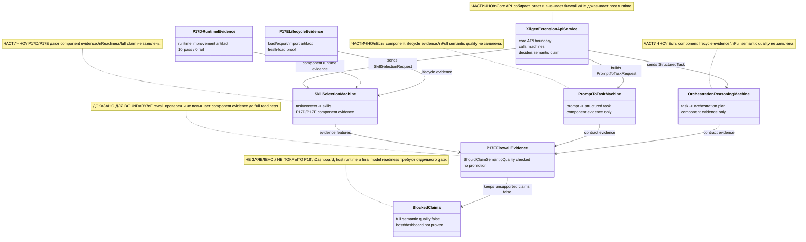
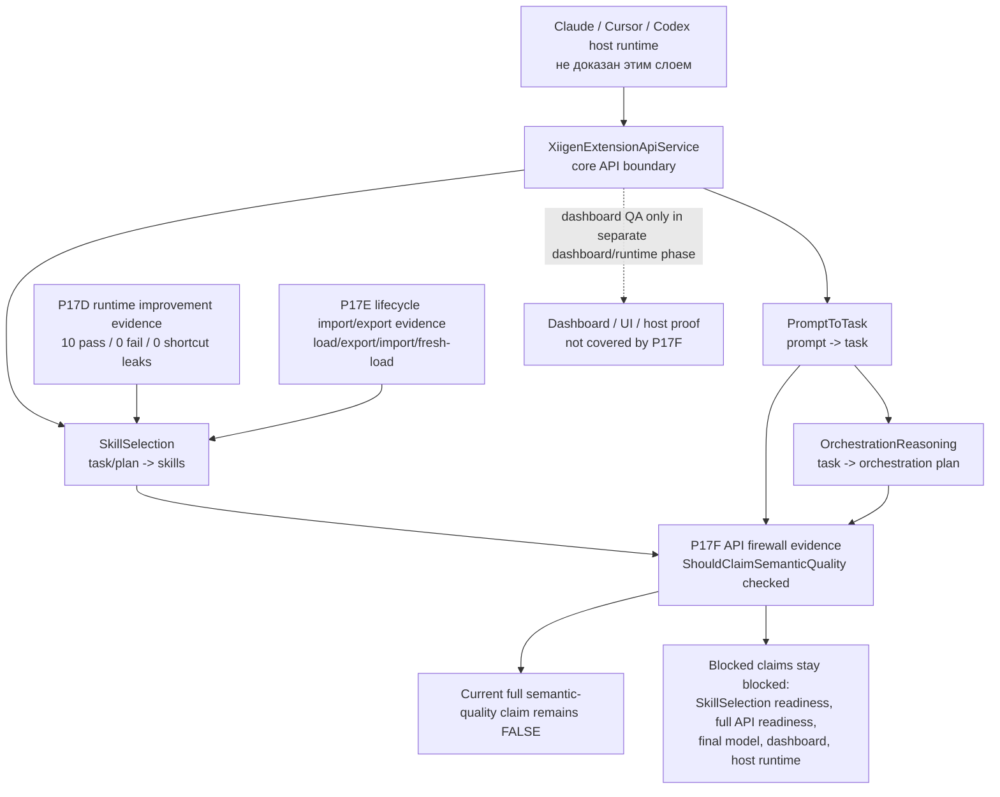
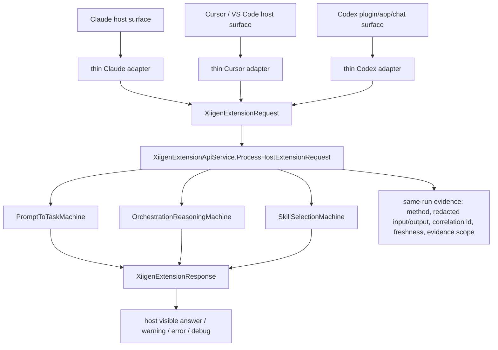

# 43.SmartSkillsDomain

Documentation status: P18 human documentation refresh after P17D, P17E, and P17F.

## 1. Коротко для Лубы

`43.SmartSkillsDomain` - это доменный слой "умных навыков". Он принимает запрос от API/host-слоя, переводит пользовательский prompt в структурированную задачу, строит план оркестрации, выбирает навыки и возвращает ответ с предупреждениями, evidence и optional debug trace.

Текущее состояние после P17D/P17E/P17F:

| Область | Что теперь реально поддержано | Что все еще нельзя заявлять |
|---|---|---|
| `SkillSelection` runtime evidence | P17D показал component runtime improvement: 10 non-diagnostics rows passed, 0 failed, 36 controls, 0 shortcut leaks. Candidate-position rows остались diagnostics-only. | Нельзя говорить, что `SkillSelection` полностью готов или что semantic quality доказана. |
| `SkillSelection` lifecycle evidence | P17E прошел project lifecycle path: `LoadCheckpointAsync`, `ExportAsync`, `ImportAsync`, fresh machine load, held-out non-regression decision. | Нельзя говорить, что checkpoint promoted в common/final runtime path. Locator все еще artifact-local. |
| API firewall | P17F проверил реальный `XiigenExtensionApiService.ShouldClaimSemanticQuality`: positive-control может вернуть `true`, но текущая компонентная evidence P17D/P17E правильно оставляет full claim `false`. | Нельзя говорить full API readiness, trained/final model readiness, dashboard readiness или Claude/Cursor/Codex host runtime readiness. |

Главная мысль: P17D/P17E/P17F сделали `SkillSelection` сильнее как компонент и проверили no-overclaim firewall. Они не превратили это в полную semantic-quality готовность всей системы.

P18 - это только обновление документации и state: runtime behavior, production code, model checkpoints и training data в этой фазе не менялись.

## 2. Простая UML-схема текущего evidence flow

Импорт в draw.io: Mermaid diagram можно вставить через Arrange -> Insert -> Advanced -> Mermaid.

### 2.1. Роли и границы



| Роль | Что делает человеческим языком | Текущий статус |
|---|---|---|
| `XiigenExtensionApiService` | Принимает core API request, вызывает три машины и решает, можно ли писать semantic-quality claim. | ⚠️ Частичная: firewall проверен, host runtime не доказан. |
| `PromptToTaskMachine` | Переводит prompt пользователя в структурированную задачу. | ⚠️ Частичная: есть component lifecycle evidence, но не full semantic claim. |
| `OrchestrationReasoningMachine` | Переводит задачу в orchestration plan. | ⚠️ Частичная: есть component lifecycle evidence, но не full semantic claim. |
| `SkillSelectionMachine` | Выбирает skills по задаче/context/evidence. | ⚠️ Частичная: P17D/P17E accepted as component evidence only. |
| `P17DRuntimeEvidence` | Показывает, что candidate лучше работает на component runtime rows без shortcut leaks. | Evidence artifact, не production promotion. |
| `P17ELifecycleEvidence` | Показывает load/export/import/fresh-load для candidate. | Evidence artifact, не final/common runtime path. |
| `P17FFirewallEvidence` | Проверяет `ShouldClaimSemanticQuality` и удерживает full claim false. | Boundary evidence, не readiness. |
| `BlockedClaims` | Список claims, которые нельзя заявлять сейчас. | Не заявлено / не покрыто P18. |

### 2.2. Поток evidence



### Симуляции по соединениям

| Соединение | Пример входа | Ожидаемый результат |
|---|---|---|
| Host -> Api | Claude/Cursor/Codex отправляет prompt через host entrypoint. | P18 не доказывает этот путь. Нужен отдельный host runtime gate. |
| Api -> PromptToTask | Core получает user prompt и строит `PromptToTaskRequest`. | Компонент может вернуть structured task или честный no-claim/not-ready evidence. |
| PromptToTask -> OrchestrationReasoning | Structured task передается в planner. | План строится только в рамках component evidence; это не full API proof. |
| Api -> SkillSelection | Core передает task/context/available skills. | `SkillSelectionMachine.DecideFromTrainedState` выбирает skills или возвращает diagnostics/no-claim evidence. |
| P17D -> SkillSelection | P17D candidate checkpoint + runtime rows. | Runtime improvement accepted as component evidence only. |
| P17E -> SkillSelection | P17D candidate проходит export/import/fresh-load. | Lifecycle path accepted as component evidence only; final/common path не обновлен. |
| PromptToTask -> P17F | `PromptToTaskMachine` передает contract evidence. | Firewall использует это только как один из трех обязательных signals; одного component evidence недостаточно. |
| OrchestrationReasoning -> P17F | `OrchestrationReasoningMachine` передает contract evidence. | Firewall требует positive signal и отсутствие no-claim evidence; P18 это не пересчитывает. |
| SkillSelection -> P17F | Evidence features от `SkillSelection`. | Firewall не пропускает full claim, если есть no-claim/candidate-position/second-pass gap. |
| P17F -> ClaimFalse | P17D/P17E факты без full positive signal от всех компонентов. | `ShouldClaimSemanticQuality` остается `false`. Это правильное поведение. |
| P17F -> BlockedClaims | Firewall report + blocked reasons ledger. | Claims остаются false: semantic quality, SkillSelection readiness, full API readiness, final model, dashboard, host runtime. |
| Api -> Dashboard | Возможное отображение API результата в dashboard. | P17F не менял dashboard surface и не доказывал UI/UX runtime. |

## 3. No-code алгоритм: как P17D/P17E/P17F попадают в firewall

Представь три папки с доказательствами и строгого проверяющего на входе в надпись "semantic quality готова".

1. P17D приносит доказательство, что текущий `SkillSelection` candidate на ограниченном runtime наборе стал лучше: полезные runtime rows проходят, shortcut leakage не найден, candidate-position диагностика не засчитывается как качество.
2. P17E приносит доказательство, что этот candidate можно прогнать через lifecycle проекта: загрузить checkpoint, экспортировать, импортировать в fresh machine, снова загрузить и получить ожидаемое решение на held-out non-regression row.
3. P17F приносит доказательство, что API firewall не путает эти component facts с полной готовностью. Он вызывает реальную boundary-функцию `ShouldClaimSemanticQuality`.
4. Firewall смотрит не на "у нас есть хорошие артефакты", а на более жесткое условие: все три компонента должны дать positive semantic-quality evidence, не должно быть no-claim evidence, candidate-position scaffold, missing trained state или second pass.
5. Сейчас это условие не выполнено, поэтому full claim остается `false`.

Что это значит для следующей работы: чтобы claim стал сильнее, нужен отдельный promotion/runtime gate. Он должен перевести artifact candidate в разрешенный runtime/common path, затем снова проверить SkillSelection, PromptToTask, OrchestrationReasoning, API, dashboard/host surface там, где этот surface заявляется.

## 4. Что поддержано сейчас

| Evidence | Где лежит | Честная формулировка |
|---|---|---|
| P17D parent review | `artifacts/smart-skills-semantic-quality-completion/p17d-skillselection-checkpoint-rebuild-rerun/p17d-parent-review.md` | `SkillSelection` имеет component runtime improvement evidence. |
| P17E parent review | `artifacts/smart-skills-semantic-quality-completion/p17e-skillselection-lifecycle-import-export/p17e-parent-review.md` | `SkillSelection` candidate проходит load/export/import/fresh-load lifecycle как component evidence. |
| P17F parent review | `artifacts/smart-skills-semantic-quality-completion/p17f-skillselection-api-firewall-promotion-gate/p17f-parent-review.md` | API firewall обновлен и не повышает component evidence до full readiness. |
| P17F commit | `b815b38876ffe7d0ea51346f41f22773c5872322` | P17F evidence закоммичен и запушен на `origin/codex/chat-gpt-5.5`. |

## 5. Что остается заблокировано

- Full semantic quality claim.
- `SkillSelection` readiness claim.
- Full API readiness claim.
- Trained/final model readiness claim.
- Dashboard readiness.
- Claude/Cursor/Codex host runtime readiness.

Dashboard/host runtime не доказан этим слоем, потому что P17D/P17E/P17F проверяют component/core API boundary. Они не запускают реальный Claude extension, Cursor Extension Host, Codex plugin/app runtime и не проверяют UI/UX dashboard surface.

## 6. Короткие code refs и почему они важны

### API boundary

Файл: `C:\Projects\llm_mvp_core\43.SmartSkillsDomain\XiigenExtensionApiService.cs:72-136`

```csharp
public OperationResult<XiigenExtensionResponse> ProcessHostExtensionRequest(
    XiigenExtensionRequest request)
...
var semanticQualityClaimed =
    ShouldClaimSemanticQuality(promptToTask, orchestration, skillDecision);
...
var chatDisplayText = semanticQualityClaimed
    ? "Core xiigen boundary executed with loaded common asset evidence; semantic quality remains gated."
    : "Core xiigen boundary executed. Semantic quality is not claimed.";
```

Почему важно: это основной core API вход. Он может собрать ответ для host, но сам по себе не доказывает host runtime. P17F проверяет firewall внутри этого core boundary.

### Firewall, который не дает overclaim

Файл: `C:\Projects\llm_mvp_core\43.SmartSkillsDomain\XiigenExtensionApiService.cs:560-575`

```csharp
private bool ShouldClaimSemanticQuality(
    PromptToTaskResponse promptToTask,
    OrchestrationReasoningResponse orchestration,
    SkillSelectionDecision skillDecision)
    // Learned status names are runtime state labels only. Semantic quality requires
    // explicit future positive evidence from every component and no no-claim evidence.
    => _commonAssetLoadState.AllLoaded
        && !skillDecision.RequiresSecondPass
        && !skillDecision.EvidenceFeatures.Contains("NO_TRAINED_STATE_AVAILABLE", StringComparer.Ordinal)
        && !skillDecision.EvidenceFeatures.Contains(SkillSelectionMachine.CandidatePositionScaffoldEvidence, StringComparer.Ordinal)
        && HasPositiveSemanticQualityEvidence(promptToTask.ContractEvidence)
        && HasPositiveSemanticQualityEvidence(orchestration.ContractEvidence)
        && HasPositiveSemanticQualityEvidence(skillDecision.EvidenceFeatures)
        && !HasSemanticNoClaimEvidence(promptToTask.ContractEvidence)
        && !HasSemanticNoClaimEvidence(orchestration.ContractEvidence)
        && !HasSemanticNoClaimEvidence(skillDecision.EvidenceFeatures);
```

Почему важно: этот код требует positive evidence от `PromptToTask`, `OrchestrationReasoning` и `SkillSelection` одновременно. P17D/P17E дают component evidence для `SkillSelection`, но не дают полный набор positive semantic-quality evidence для всей цепочки.

### SkillSelection runtime decision

Файл: `C:\Projects\llm_mvp_core\43.SmartSkillsDomain\SkillSelectionMachine.cs:103-109`

```csharp
public OperationResult<SkillSelectionDecision> DecideFromTrainedState(SkillSelectionRequest request)
{
    var semanticDecision = TryDecideWithSemanticUnitsOnly(request);
    if (semanticDecision is not null)
        return OperationResult<SkillSelectionDecision>.Ok(semanticDecision);

    if (_candidatePositionWeights.Count == 0 || request.AvailableSkillIds.Count == 0)
```

Почему важно: P17D проверяет именно runtime decision path. При этом candidate-position часть не может считаться semantic quality и остается только diagnostics/leakage guard evidence.

### SkillSelection lifecycle path

Файлы и строки:

- `C:\Projects\llm_mvp_core\43.SmartSkillsDomain\SkillSelectionMachine.cs:334-346`
- `C:\Projects\llm_mvp_core\43.SmartSkillsDomain\SkillSelectionMachine.cs:349-360`
- `C:\Projects\llm_mvp_core\43.SmartSkillsDomain\SkillSelectionMachine.cs:443-455`

```csharp
public Task<OperationResult<LearningMachineExport>> ExportAsync(CancellationToken ct = default)
...
public async Task<OperationResult<bool>> ImportAsync(LearningMachineExport export, CancellationToken ct = default)
...
public static async Task<OperationResult<SkillSelectionMachineLoadResult>> LoadCheckpointAsync(
    string checkpointPath,
    CancellationToken ct = default)
```

Почему важно: P17E проверяет, что candidate проходит существующий lifecycle path. Но P17E не менял common/final model paths и не доказывал, что runtime production configuration теперь использует этот candidate.

## 7. Текущий status table

| Компонент | Файл | Статус | Что реально работает сейчас |
|---|---|---|---|
| `PromptToTaskMachine` | `43.SmartSkillsDomain/PromptToTaskMachine.cs` | ⚠️ Частичная | Есть component lifecycle evidence из P11/P12. Полная semantic quality не заявлена. |
| `OrchestrationReasoningMachine` | `43.SmartSkillsDomain/OrchestrationReasoningMachine.cs` | ⚠️ Частичная | Есть component lifecycle evidence из P11/P12. Полная semantic quality не заявлена. |
| `SkillSelectionMachine` | `43.SmartSkillsDomain/SkillSelectionMachine.cs` | ⚠️ Частичная | P17D runtime improvement и P17E lifecycle import/export приняты как component evidence. Readiness/full semantic claim не заявлен. |
| `XiigenExtensionApiService` | `43.SmartSkillsDomain/XiigenExtensionApiService.cs` | ⚠️ Частичная | P17F проверил `ShouldClaimSemanticQuality`: firewall держит false для текущих component-only facts и может вернуть true только для all-positive control. |
| Dashboard/host runtime | dashboard/extension host projects | Не заявлено / не покрыто P18 | P17D/P17E/P17F не запускали dashboard, Claude, Cursor или Codex runtime. |

## 8. Как будущему разработчику проверять это состояние

1. Открыть state: `C:\Projects\llm_mvp_core\docs\plans\SMART-SKILLS-SEMANTIC-QUALITY-COMPLETION-PLAN-v1-STATE.json`.
2. Проверить блоки `p17d_skillselection_checkpoint_rebuild_rerun`, `p17e_skillselection_lifecycle_import_export`, `p17f_skillselection_api_firewall_promotion_gate`.
3. Проверить parent review файлы P17D/P17E/P17F.
4. Проверить, что P17F commit равен `b815b38876ffe7d0ea51346f41f22773c5872322` и `HEAD == origin/codex/chat-gpt-5.5` на момент P18.
5. Не переводить слова "component evidence accepted" в "full readiness". Это разные уровни доказательств.

## 9. Историческая справка P11-P13

P11/P12/P13 раньше закрывали только `PromptToTask` и `OrchestrationReasoning` lifecycle/no-claim boundary. P17D/P17E/P17F добавили более свежий слой по `SkillSelection`, но с тем же принципом: component evidence не равна full semantic-quality readiness.

P7A parent review ранее отклонил eval-informed repair для `PromptToTask`, потому что production mapping был подогнан под reserved/eval/holdout combinations. Этот риск остается важным: future repair/data phases не должны превращать eval evidence в training authority или runtime shortcut.

## 10. XIIGen extension runtime/API boundary

Этот раздел добавлен для линии `DOCS-QA-DOCUMENTATION-UPDATE-APPLY-01`. Он объясняет, как Claude, Cursor и Codex должны подключаться к `llm_mvp_core`, и сразу фиксирует границу: это документационное покрытие. Оно не доказывает live Claude/Cursor/Codex runtime, token savings, semantic quality, learnability, target promotion, locator update или final readiness.

### Всего / Сделано / Сейчас / Осталось

| Поле | Человекочитаемый статус |
|---|---|
| Всего | Остаются 6 больших треков: runtime Claude/Cursor/Codex, token before/after для 9 пар, quality scoring для 9 строк, learnability/DPO/lifecycle для 9 строк, docs/QA и 10 fresh final readiness reviews. |
| Сделано | Подготовительный docs update packet создан и теперь эта документация применяет его как docs-only слой. |
| Сейчас | Full UI/chat readiness не закрыта; token complete pairs 0/9; quality rows ready for actual scoring 0/9; trainable DPO rows 0/9; actual lifecycle rows 0/9; final readiness reviews 0/10; claim locks остаются false. |
| Осталось | После docs-edit нужен docs QA review, затем независимые evidence tracks. Только реальные runtime/token/quality/learnability packets могут закрывать свои треки. |

### UML: host surface -> thin adapter -> core API



Смысл диаграммы простой: host adapter не должен содержать скрытую модельную или semantic logic. Он строит `XiigenExtensionRequest`, вызывает core boundary и показывает `XiigenExtensionResponse`. Вся содержательная логика остается в `llm_mvp_core`.

### No-code algorithm: request, response, debug/error/correlation evidence

1. Host получает prompt или команду от пользователя через реальную host surface.
2. Thin adapter выбирает method id: `prompt-to-task`, `orchestration-plan`, `skill-selection` или `debug-trace`.
3. Adapter строит `XiigenExtensionRequest`: host name/type, method, user text, debug flag, correlation id, target locator, provenance, available/requested skills или check-set inputs.
4. Adapter вызывает `XiigenExtensionApiService.ProcessHostExtensionRequest`.
5. Core вызывает нужные машины и возвращает `XiigenExtensionResponse`.
6. Host показывает human-visible answer, warnings, errors, optional debug trace и raw/redacted evidence.
7. Evidence packet записывает method, redacted input/output, correlation id, timestamp/freshness, host surface и scope label.
8. Если есть controlled error, adapter показывает ошибку и debug boundary, а не заменяет ее успешным ответом.

Что этот алгоритм доказывает только после live packet: названный host path дошел до core boundary и вернул видимый результат. Что он не доказывает: token savings, quality improvement, DPO training, model learning, target promotion, locator update или final readiness.

### Short code anchors and no-overclaim boundary

`43.SmartSkillsDomain/XiigenExtensionApiContracts.cs`:

```csharp
public sealed record XiigenExtensionRequest(
public sealed record XiigenExtensionResponse(
public const string PromptToTaskMethod = "prompt-to-task";
```

Почему важно: contract names the request/response envelope and stable method ids. Это anchor для thin adapters. Сам contract не доказывает, что Claude/Cursor/Codex уже запущены в live UI/chat.

`43.SmartSkillsDomain/XiigenExtensionApiService.cs`:

```csharp
public OperationResult<XiigenExtensionResponse> ProcessHostExtensionRequest(
var semanticQualityClaimed = ShouldClaimSemanticQuality(promptToTask, orchestration, skillDecision);
var debugTrace = BuildDebugTrace(request, promptSha256, responseWithoutTrace);
```

Почему важно: core service собирает ответ, warnings/check-set results и debug trace. Это supporting API evidence. Оно не заменяет live host proof и не открывает semantic-quality claim без отдельных scoring/controls.

### Boundary wording for future reports

Безопасная формулировка: "Host adapter path documented. Live runtime proof still requires same-run host-visible answer/error/debug/correlation evidence for the named host."

Запрещенная формулировка: "Dashboard/API или docs доказали, что Claude/Cursor/Codex runtime готов." Такой вывод должен оставаться false, пока нет отдельного host runtime packet.
