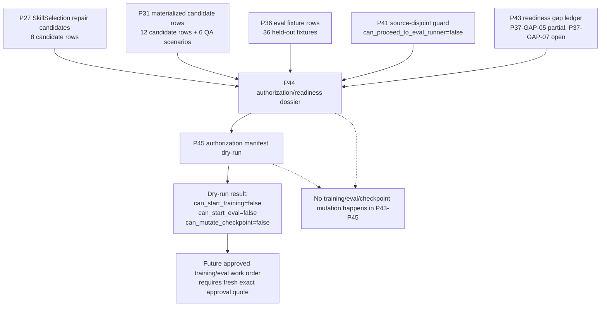

# 43.SmartSkillsDomain Semantic-Quality Authorization Boundary

Статус: P46 documentation slice после P43/P44/P45.

Этот документ объясняет, почему текущие артефакты P43-P45 не запускают training/eval и не доказывают semantic quality, но создают понятную границу для будущей авторизации.

## 1. Коротко для Лубы

Сейчас система находится в честном состоянии:

- fixture/dashboard/guard слои умеют показывать и проверять evidence;
- readiness ledger умеет объяснять, какие gaps закрыты, какие частично закрыты и какие открыты;
- authorization dossier умеет назвать exact dataset/checkpoint/approval поля, которые нужны перед training/eval;
- dry-run manifest умеет доказать обратное: без approval и preflight gates запускать training/eval нельзя.

Это не “готовая обученная модель”. Это защитный слой перед обучением, чтобы модель не могла выдать candidate rows, dashboard smoke или JSON report за semantic quality.

## 2. UML: поток авторизации



### Симуляции по соединениям

| Соединение | Пример входа | Ожидаемый результат | Что НЕ доказывает |
|---|---|---|---|
| P27 -> P44 | `p27-dataset-card.json`, 8 rows. | P44 записывает их как candidate dataset only. | Не разрешает training. |
| P31 -> P44 | `p31-materialized-dpo-candidates.jsonl`, 12 rows. | P44 записывает row count и роль candidate material only. | Не превращает rows в accepted training set. |
| P36 -> P44 | `p36-eval-fixtures.jsonl`, 36 rows. | P44 записывает held-out fixture material. | Не запускает eval. |
| P41 -> P44 | Guard говорит `can_proceed_to_eval_runner=false`. | P44 сохраняет запрет eval runner. | Не является eval metric. |
| P43 -> P44 | Gap ledger говорит P37-GAP-07 still open. | P44 требует authorization dossier. | Не закрывает training authorization. |
| P44 -> P45 | Dossier требует exact approval/dataset/checkpoint/rollback. | P45 создаёт manifest shape и dry-run validation. | Не запускает mutation. |
| P45 -> Deny | `exact_luba_approval_quote=NONE`. | Dry-run возвращает `can_start_training=false`, `can_start_eval=false`, `can_mutate_checkpoint=false`. | Не доказывает semantic quality. |

## 3. No-code алгоритм

### 3.1. P44: собрать dossier перед training/eval

1. Взять candidate/evidence артефакты P27, P31, P36, P41 и P43.
2. Для каждого указать роль: candidate dataset, QA scenario, eval fixture, guard evidence или readiness ledger.
3. Проверить, что ни один из них сам по себе не является authorization.
4. Записать обязательные поля будущего разрешения:
   - fresh exact approval quote;
   - exact candidate dataset path + checksum;
   - exact held-out dataset path + checksum;
   - source/license ledger;
   - target checkpoint locator;
   - rollback checkpoint locator;
   - metrics and ablation plan.
5. Оставить `training_authorized_now=false` и `eval_authorized_now=false`.

### 3.2. P45: проверить manifest shape без запуска

1. Посчитать SHA256 для candidate rows, dataset card, dashboard scenarios, eval fixtures, source-disjoint guard и P44 dossier.
2. Создать manifest с этими точными путями и hash.
3. Проверить, что approval отсутствует: `exact_luba_approval_quote=NONE`.
4. Проверить, что все execution flags false.
5. Вернуть dry-run denial:
   - `can_start_training=false`;
   - `can_start_eval=false`;
   - `can_mutate_checkpoint=false`.
6. Сохранить validation report, который объясняет, почему запуск запрещён.

## 4. Где это лежит

| Артефакт | Назначение |
|---|---|
| `artifacts/smart-skills-semantic-quality-completion/p43-readiness-gap-closure/p43-readiness-gap-closure-report.md` | Человекочитаемый ledger по P37 gaps. |
| `artifacts/smart-skills-semantic-quality-completion/p44-non-training-authorization-readiness/p44-authorization-readiness-dossier.md` | Человекочитаемый dossier: что нужно перед training/eval. |
| `artifacts/smart-skills-semantic-quality-completion/p44-non-training-authorization-readiness/p44-authorization-readiness-dossier.json` | Machine-readable версия P44 dossier. |
| `artifacts/smart-skills-semantic-quality-completion/p45-authorization-manifest-dry-run/p45-authorization-manifest.json` | Manifest shape с exact paths/checksums, но без approval. |
| `artifacts/smart-skills-semantic-quality-completion/p45-authorization-manifest-dry-run/p45-dry-run-validation-report.json` | Dry-run denial report. |

## 5. Важные code/evidence references

P45 не добавлял production code. Он опирается на существующие artifact contracts:

```json
"training_authorized_now": false,
"eval_authorized_now": false,
"checkpoint_mutation_authorized_now": false,
"exact_luba_approval_quote": "NONE"
```

Файл: `artifacts/smart-skills-semantic-quality-completion/p45-authorization-manifest-dry-run/p45-authorization-manifest.json`

Почему важно: это прямой machine-readable запрет. Даже если manifest shape существует, он не разрешает training/eval.

```json
"can_start_training": false,
"can_start_eval": false,
"can_mutate_checkpoint": false
```

Файл: `artifacts/smart-skills-semantic-quality-completion/p45-authorization-manifest-dry-run/p45-dry-run-validation-report.json`

Почему важно: dry-run validator не “зелёный свет”; он специально возвращает denial, пока approval и gates отсутствуют.

## 6. QA mapping

| Проверка | Что проверяет |
|---|---|
| JSON parse P44/P45 artifacts | Артефакты machine-readable и могут быть загружены будущим runner/validator. |
| Review-cycle rows >= 8 | Были проверены scope, approval, dataset checksum, held-out checksum, source/license, checkpoint, dry-run denial, no-claim. |
| UTF-8/mojibake scan | Человекочитаемые P43/P44/P45 artifacts не содержат marker corruption. |
| Forbidden positive claim scan | Артефакты не пишут, что semantic quality/model readiness/host runtime/training/eval/checkpoint уже доказаны. |
| `git diff --check` | Нет whitespace ошибок перед commit. |

## 7. Честная граница

P43-P45 закрывают только accounting/preflight слой.

Они не закрывают:

- semantic quality;
- trained-model readiness;
- Claude/Cursor/Codex host runtime;
- training run;
- eval run;
- checkpoint mutation;
- common model update.

Следующая фаза может быть только preflight/authorization work, пока нет свежей явной фразы Лубы, которая разрешает training/eval/checkpoint mutation для exact dataset/checkpoint.

## 8. Quality and DPO admission for extension line

Этот раздел добавлен для `DOCS-QA-DOCUMENTATION-UPDATE-APPLY-01`. Он связывает старую authorization boundary с текущей extension runtime/token/quality/learnability line. Это документационное объяснение, а не eval, training, DPO generation или checkpoint/model mutation.

### Всего / Сделано / Сейчас / Осталось

| Поле | Статус |
|---|---|
| Всего | Для quality нужны 9 row-specific scoring rows с complete baseline/adaptive pairs, adjudication refs, source-disjoint held-out refs и ablation/no-leakage/no-memorization controls. Для DPO/lifecycle нужны 9 actual lifecycle rows. |
| Сделано | Подготовлены docs/status/evidence-scope packets и этот docs-only admission appendix. |
| Сейчас | Full UI/chat readiness не закрыта. Token complete pairs 0/9. Quality rows ready for actual scoring: 0/9. Trainable DPO rows: 0/9. Actual lifecycle rows: 0/9. Final readiness reviews 0/10. Claim locks false. |
| Осталось | Отдельные bounded work orders должны собрать exact refs и пройти authorization до любого scoring/training/continue-training/fresh-load/rollback; docs QA не считается product readiness. |

### No-code algorithm: pair integrity before scoring

1. Для каждой host/method pair найти exact baseline output ref и exact adaptive output ref.
2. Проверить, что prompt hash, host, method, tokenizer/accounting version, debug setting и scenario id совпадают.
3. Добавить reviewer/adjudication refs: кто сравнил outputs, по какой rubric, где записаны notes.
4. Добавить source-disjoint held-out refs: источники eval не должны пересекаться с training/candidate material.
5. Добавить ablation/no-leakage/no-memorization controls.
6. Только после этого row может перейти в scoring work order.
7. Если хотя бы один пункт отсутствует, row остается prep/gap evidence и не открывает quality claim.

### DPO candidate vs actual training boundary

DPO candidate может содержать chosen/rejected/provenance refs, source/license/privacy/redaction classification и route decision. Но candidate row не равен training data until approved. Сейчас trainable DPO rows 0/9, поэтому learnability claim закрыт.

Raw external AI/vendor output остается evidence-only/private/adaptive/quarantine, пока отдельный source/license/privacy approval packet не разрешит конкретный route. Сохраненный checkpoint сам по себе недостаточен: lifecycle требует backup/export/import/restore/load-without-retrain/continue-training/fresh-load/held-out/ablation/rollback evidence.

### Acceptance wording for future docs QA

Безопасная формулировка: "Quality/DPO admission boundary documented. Actual scoring rows 0/9 and trainable DPO rows 0/9 keep claims closed."

Небезопасная формулировка: "DPO candidates or dashboard rows prove semantic quality/learnability." Такая фраза должна отклоняться как overclaim.
