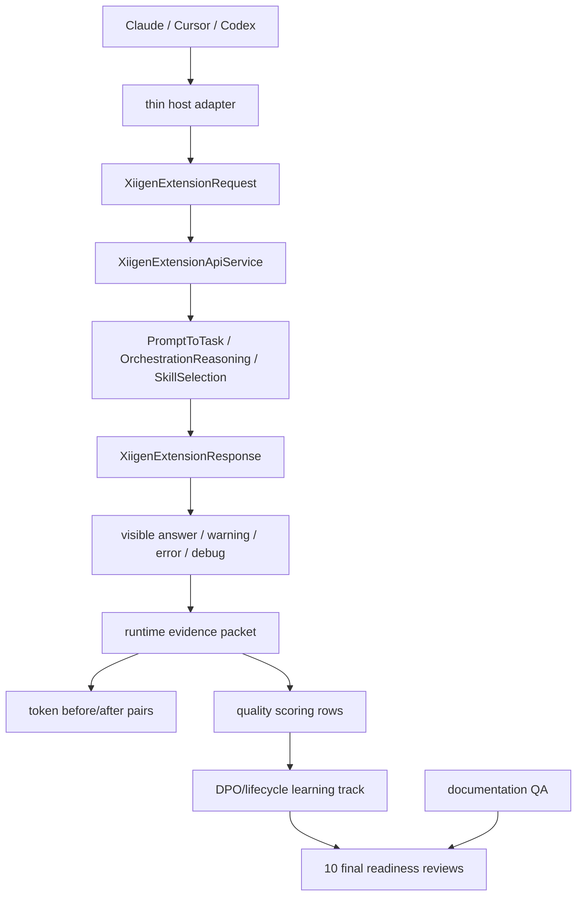

# XIIGen extension runtime/token/quality/learnability HOWTO

Этот документ дает одну человеческую карту текущей линии работ. Это documentation coverage only: он помогает понять путь, но не доказывает live runtime, token savings, quality improvement, semantic quality, learnability, target promotion, locator update или final readiness.

## Всего / Сделано / Сейчас / Осталось

| Поле | Статус |
|---|---|
| Всего | Остаются 6 больших треков: runtime Claude/Cursor/Codex, token before/after для 9 пар, quality scoring для 9 строк, learnability/DPO/lifecycle для 9 строк, docs/QA и final readiness через 10 независимых reviews. |
| Сделано | Docs update prep packet был committed/pushed; docs-edit применил prepared documentation coverage; текущий docs QA review проверяет это только как документацию. |
| Сейчас | Full UI/chat readiness не закрыта. Token complete pairs 0/9. Quality rows ready for actual scoring 0/9. Trainable DPO rows 0/9. Actual lifecycle rows 0/9. Final readiness reviews 0/10. Claim locks false. |
| Осталось | После docs QA review следующий безопасный трек - отдельный live runtime evidence plan/repair for Claude/Cursor/Codex или другой независимый missing-evidence packet. Только после реальных evidence packets возможны 10 final reviews. |

## Target Outcome Matrix summary

| Track | Что нужно доказать позже | Текущее состояние |
|---|---|---|
| Runtime | Claude, Cursor и Codex должны показать live host-visible answer/error/debug/correlation path через thin adapters и `llm_mvp_core`. | Не закрыто. Dashboard/API/helper/package smoke не заменяют live host proof. |
| Token | 9 baseline/adaptive pairs с одинаковыми prompts, hashes, host/method/accounting settings и quality guard. | Complete pairs 0/9. |
| Quality | 9 rows с rubric, adjudication refs, source-disjoint held-out, ablation/no-leakage/no-memorization controls. | Rows ready for actual scoring 0/9. |
| Learnability/DPO/lifecycle | User-approved chosen/rejected/provenance refs, trainable rows, lifecycle export/import/restore/load/continue/fresh-load/rollback. | Trainable DPO rows 0/9; lifecycle rows 0/9. |
| Docs/QA | Human docs explain API/dashboard, host boundaries, debug, lifecycle, evidence scopes and Russian status format. | Docs QA review проверяет documentation coverage only; это не runtime/product readiness. |
| Final reviews | 10 fresh reviews after actual evidence exists. | 0/10. |

## UML overview



Диаграмма показывает intended flow. Она сама не является runtime proof. Runtime proof появляется только в packet, где named host surface реально принял input, вызвал core boundary и показал output/error/debug с correlation id и freshness.

## No-code algorithm

1. Для named host выбрать реальную surface: Claude, Cursor или Codex.
2. Thin adapter строит `XiigenExtensionRequest` и не содержит hidden semantic/model logic.
3. Core вызывает `PromptToTaskMachine`, `OrchestrationReasoningMachine` и `SkillSelectionMachine`.
4. Host показывает `XiigenExtensionResponse`: visible answer, warnings, errors, debug trace, raw/redacted evidence.
5. Runtime packet записывает host, method, input/output refs, correlation id, timestamp, negative/error branch и evidence scope.
6. Token packet сравнивает baseline/adaptive only after pair integrity.
7. Quality packet scores only after adjudication/source-disjoint/ablation controls.
8. Learnability packet uses approved DPO candidates and proves lifecycle with backup/export/import/restore/load-without-retrain/continue-training/fresh-load/rollback.
9. Final reviews start only after the evidence exists. Documentation alone cannot move this line to final readiness.

## Claim locks and next bounded work order

All claim locks remain false now:

- token savings claimed: false;
- quality improvement claimed: false;
- full semantic quality claimed: false;
- full learnability claimed: false;
- full runtime readiness claimed: false;
- common model readiness claimed: false;
- target promotion claimed: false;
- locator update claimed: false;
- final readiness claimed: false.

## Short code anchors

`43.SmartSkillsDomain/XiigenExtensionApiContracts.cs`:

```csharp
public const string PromptToTaskMethod = "prompt-to-task";
public const string OrchestrationPlanMethod = "orchestration-plan";
public const string SkillSelectionMethod = "skill-selection";
```

`43.SmartSkillsDomain/XiigenExtensionApiService.cs`:

```csharp
public OperationResult<XiigenExtensionResponse> ProcessHostExtensionRequest(
```

Эти anchors показывают core API boundary. Они не доказывают host runtime, quality or learning.

## Where to read next

- `docs/CLAUDE-XIIGEN-HOWTO-ru.md`
- `docs/CURSOR-XIIGEN-HOWTO-ru.md`
- `docs/CODEX-XIIGEN-HOWTO-ru.md`
- `docs/API-DASHBOARD-QA-HOWTO-ru.md`
- `docs/XIIGEN-DEBUG-TRACE-HOWTO-ru.md`
- `docs/LOCAL-MODEL-LIFECYCLE-HOWTO-ru.md`
- `docs/EVIDENCE-SCOPES-HOWTO-ru.md`
- `docs/RUSSIAN-STATUS-AND-EXECUTION-LOG-TEMPLATE.md`

## Next bounded work order

After `DOCS-QA-DOCUMENTATION-UPDATE-REVIEW-01_NO_FINAL_READINESS` passes, the next bounded work order should move to a separate missing-evidence track, recommended as `RUNTIME-CLAUDE-CURSOR-CODEX-LIVE-EVIDENCE-PLAN-OR-REPAIR-01` unless the state names a more precise runtime/token/quality/learnability gap. That next work order still must not claim token savings, quality improvement, learnability, target promotion, locator update or final readiness without packet-backed evidence.
