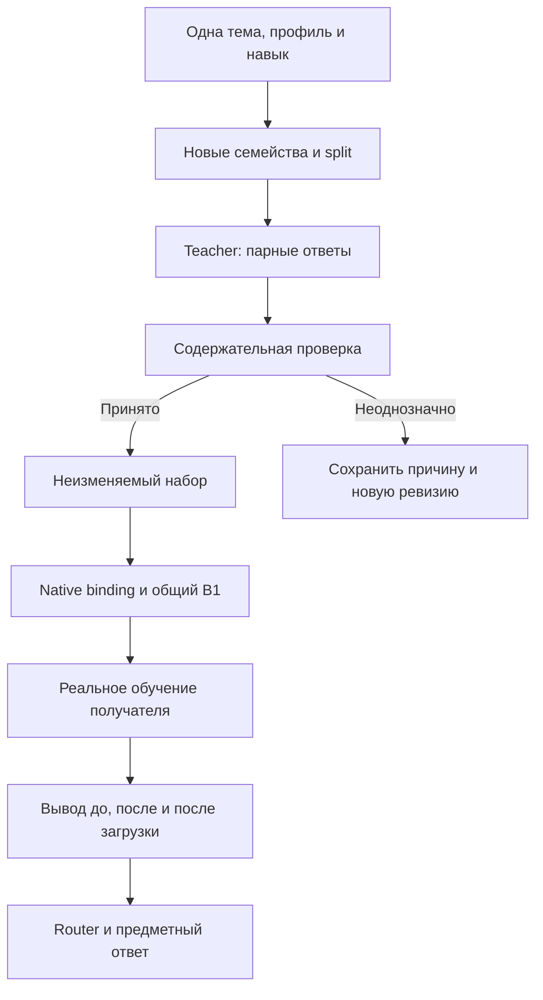

# Подготовка небольшими темами и сборка больших сетов

> **Сохранённый материал предыдущих итераций.** Предметные примеры и свидетельства сохраняются; приведённые здесь старые команды, пути, ревью и training gates не управляют текущей генерацией. Актуальные команды: [18](18-BATCH-RUNBOOK.md), режим CREATE_ONLY и единственный корень: [20](20-CREATE-ONLY-AND-PATHS.md). Не выполнять исторические команды и не переходить в другой checkout.

Актуальный состав curriculum: **49 микроцелей / 119 потоков / 351 публичный пример**. Полный порядок 162 потоков задаёт [EXECUTION-QUEUE.md](EXECUTION-QUEUE.md); микроиндекс не завершает общую работу. [Последнее дополнение](16-CONTEXT-AND-TRANSACTION-CASES.md), [стартовый промпт Kiro](14-GENERATION-CAMPAIGN.md) и [план масштаба](curriculum/scale-plan.json) конкретизируют этот протокол. Прежние команды первых 44 потоков сохранены.

Первый слой curriculum расширял исходные 37 карточек; текущие количества определяют действующие индексы. Слой `curriculum` выбирает один конкретный обучаемый навык внутри родительской темы. Например, `CODE-SQL-COUNT` учит считать ненулевые значения; он не добавляет к той же партии UPDATE остатков или выбор JOIN. Тема, профиль языка и обучаемый навык явно записаны в request и сохраняются до экспорта.

Начальная точка — [curriculum/INDEX.md](curriculum/INDEX.md). Там доступны все новые карточки, порядок, семейства примеров и точная команда первой партии. [pilot-queue.json](curriculum/pilot-queue.json) содержит отдельную строку для каждого направления/профиля и назначенные пути. Общий [index.json](index.json) содержит 70 родительских тем; он не является очередью новых микроцелей. Полный NEXT определяется execution-queue.json; прямой ID Любы имеет приоритет над всеми порядками.

## Что именно подготовлено

Каждый objective содержит самодостаточное задание генератору, проверенные проектные ссылки, ограниченный набор осей изменения, несколько полных preference-примеров, контрпример к каждому, требования содержательной проверки и запреты смешения. Примеры написаны для объяснения задачи; они не названы результатом запуска китайской модели и не являются закрытым экзаменом. Число примеров и число независимых исходных семей считаются отдельно.

Одна китайская модель текущей Kiro-сессии может подготовить обе стороны. Это synthetic single-model data с последующей проверкой; разные имена Teacher и Student не создают двух независимых генераторов. Наблюдаемое имя модели записывается фактически. Не подставлять название, провайдера или версию по догадке, не менять модель сессии для отдельной темы.

В первом дополнении источники `RAG-046`–`RAG-050` добавлены из `main`: различающее ограничение в учебной паре, реально переданный prompt, состояния UI, права и контекст роли, гарантии очереди. У каждого есть commit, blob SHA, прочитанные строки, локальная выдержка и ограничения интерпретации. Исторические числовые оценки, названия моделей и неполные примеры реализации не становятся фактами нового эксперимента. Все материалы доступны через [RAG INDEX](https://github.com/lubochka/xiigen-planning/blob/main/llm%20mvp/learning-sets/preparation/rag/INDEX.md).

## Один навык может иметь несколько классов

Запрет смешивать темы не означает одноклассовое обучение. В `TR10-CONDITIONAL` модель решает одну задачу: хватает ли контекста для перевода. Поэтому в каждой партии половина примеров требует уточнения, половина допускает прямой перевод. Два варианта одного случая имеют одно семейство. `--count 10` создаёт назначение пяти семейств по две пары, а не десяти независимых случаев. Нечётное число отклоняется до генерации.

Для `OR-ROUTE-INTENT` один навык — выбор адресата по намерению. Двадцать предметных целей и `clarify` являются классами этой темы; они не обучают SQL, перевод или написание кода внутри роутера. Партия из 21 строки назначает по одному случаю каждого класса, из 42 — по два. Неподдержанная, неоднозначная и составная задачи входят в `clarify` по явно видимому контракту атомарного роутера. Это конкретный договор данной карточки, а не универсальное утверждение о любой оркестрации.

`merge` и `compose` не объединяют разные objective. Если два материала нужны для одного условного навыка, они заранее описываются как классы одной карточки, как `TR10-CONDITIONAL`. Объединять независимые навыки постфактум ради удобства запрещено.

## Точный первый запуск подготовки

Рабочая копия `llm_plan3`: `C:/x/xp`. Копия RAG из `main`: `C:/x/xp-rag`. Если эти копии уже существуют, обновлять без сброса локальной работы. Подготовленные запросы и результаты пишутся в короткий путь `C:/x/lsets`. Команды выполняются из `C:/x/xp/llm mvp/learning-sets/preparation`:

```powershell
python tools/sets.py prepare --topic TR07 --profile ru-en --objective TR07-OMISSION --run M001 --count 10 --split train --start 0 --work-root C:/x/lsets --rag-root "C:/x/xp-rag/llm mvp/learning-sets/preparation"
```

До нового вызова генератора получить фактический CODEX selection для этого request по [контракту ролей](10-CODEX-AND-CHINESE-ROLES.md). Prepare создаёт selection.prompt.md и PENDING-шаблон; шаблон не является выполненным выбором. При отсутствии selection сохранить подготовленные файлы как NOT_SELECTED, без выдуманной квитанции и без ожидания несуществующего процесса. После selection открыть `C:/x/lsets/TR07/ru-en/M001/prompt.md` в уже выбранной Kiro-сессии. Генератор пишет `draft.jsonl` в ту же папку. Там уже лежат `request.json` и `state.json`. Собранный prompt содержит одну узкую карточку, формат записи, разрешение конфликтов и выбранные RAG-выдержки. Исполнитель не ищет другой каталог, набор правил или модель.

```powershell
python tools/sets.py validate --input C:/x/lsets/TR07/ru-en/M001/draft.jsonl --request C:/x/lsets/TR07/ru-en/M001/request.json
python tools/sets.py blind --input C:/x/lsets/TR07/ru-en/M001/draft.jsonl --out C:/x/lsets/TR07/ru-en/M001/blind.jsonl
```

Проверяющему дать только `blind.jsonl`, [REVIEW-PROMPT-RU.md](prompts/REVIEW-PROMPT-RU.md) и видимые условия. Ключ не показывать. Для перевода сохранить фактическое языковое заключение; для кода и документации — доказательства проверки поведения в назначенной среде. Формат и хеши заданы в review-промпте; отсутствие доказательства сохраняется как pending, а не как выдуманный PASS.

```powershell
python tools/sets.py validate --input C:/x/lsets/TR07/ru-en/M001/draft.jsonl --request C:/x/lsets/TR07/ru-en/M001/request.json --blind C:/x/lsets/TR07/ru-en/M001/blind.jsonl --review C:/x/lsets/TR07/ru-en/M001/review.jsonl --key C:/x/lsets/TR07/ru-en/M001/blind.key.json --selection C:/x/lsets/TR07/ru-en/M001/selection.json --review-receipt C:/x/lsets/TR07/ru-en/M001/review.receipt.json
```

Полные команды `audit → merge → compose → export` остаются в [03](03-GENERATION-AND-KIRO.md); для новых партий подставляются фактические пути из очереди. Путь не выбирается автоматически по случайному результату соседней задачи. Нельзя переименовать файл в accepted, чтобы обойти review. При ремонте исходник сохраняется, исправленные строки получают новый ID и `derived_from`.

## Назначение следующей партии

В `pilot-queue.json` стабильный `stream_id` связывает objective и профиль. Канонический `next_stream_id` брать из полной `execution-queue.json`, включая переход от последней микроцели к непокрытым родительским потокам. При продолжении той же партии использовать её существующий handle и state. При новой партии взять `next_start` из предыдущего request этого же objective/profile/split; это позиция семейного назначения, а не число строк. Для условного уточнения одна семья даёт две строки.

Изменение `--start`, split или семейства не является способом превратить копию в новый экзамен. Связанные варианты между TR07/TR08, документацией и написанием кода задаются общим `--family-plan` до генерации. Автоматические ID применимы только к действительно новым независимым сценариям. Утилита ловит известные публичные семейства и точные prompts в DEV/EXAM; скрытые перефразирования проверяются по происхождению и содержанию.

DEV/EXAM следует генерировать в отдельном контексте без TRAIN-ответов. Их автору назначаются новые семейные факты и rubric того же навыка. Если точный экзамен или его решения использовали при ремонте генератора, настройке обучения или отборе состояния, он остаётся свидетельством разработки; назначается новый экзамен, старый не переписывается.

## Объём и бюджет

Точные квоты первой партии и пилота берутся из строки `pilot-queue.json`. Для большинства целей это 10 пар и 100 TRAIN / 20 DEV / 20 EXAM; для новых переводческих и savepoint-целей — 12 пар и 120 / 24 / 24. Для роутера первая партия — 21, пилот — 126 TRAIN / 42 DEV / 42 EXAM, чтобы каждый класс встречался сбалансированно. Назначенный состав полных групп сохраняется. Эти числа — стартовый план подготовки, не гарантия достаточного обучения и не уже готовые строки.

План больших сетов сохраняет принцип малых принятых shards. Внутри одной родительской темы общий объём распределяется по её микроцелям; нельзя посчитать один пример дважды как родительский и дочерний. Старую цель 87 000 TRAIN из реестра v1 не складывать с объёмами нового пилота: это разные уровни разбиения одного корпуса. Расширение после содержательного пилота и валидного учебного измерения идёт до доли потока в `curriculum/scale-plan.json`. Общие 129 000 распределяются по родительским пулам без повторного счёта дочерних целей; для router 987 строк и резерв 13 сохраняют баланс21.

Бюджет генератора включает полный prompt, RAG и будущий JSONL ответ. Для большого кода уменьшать число пар до сборки request, сохраняя решающую информацию. Для обучения бюджет определяется на DEV до EXAM так, чтобы получить ненулевой результат. Не делать вывод по 0→0 и не заменять обучение статистикой подготовки.

## Где сохранять и повторно использовать обученное состояние

Сначала искать совместимое существующее состояние через его манифест, как описано в [05](05-LEARNING-AND-CHECKPOINTS.md). Если оно подходит, создать ссылку с SHA и проверкой свежей загрузки. Если подходящего нет, отдельное producer-задание один раз получает квалифицированный B1 на TRAIN; каждое последующее сравнение восстанавливает этот же B1. Автоматического переобучения при отсутствии файла нет.

Для новых микроцелей назначение B1: `C:/x/lsets/baselines/<domain>/<profile>/<objective>-v1/B1/`. Например, `C:/x/lsets/baselines/tr.en/ru-en/TR07-OMISSION-v1/B1/`. Dataset snapshots: `C:/x/lsets/datasets/<objective>-<profile>-v1/`. Эти пути сейчас являются назначением; веса и TRAIN-файлы не объявлены существующими. `bundle.json` должен связывать dataset, tokenizer, template, weights, optimizer, RNG и фактическое qualification evidence. Native имена файлов сохраняются.

Для продолжения обучения использовать совместимые optimizer/RNG/step; восстановление только весов маркировать новым этапом с новым optimizer. В обоих плечах сравнения один parent, одинаковая обработка budget и один изменяемый фактор. Полный текущий native контракт и ограничения старых runner — [10](10-NATIVE-CONTRACT-BOUNDARY.md).

## От данных к сквозной проверке



Стрелки A–E — подготовка данных. F требует реально существующего consumer и не выдумывается по названию карточки. Изменение веса, памяти или обучаемой связи происходит на G. Для сквозной проверки отдельно измеряются правильность router, ответ при правильном вручную заданном домене и общий route+answer. «Переведи описание SQL на иврит» и «Напиши SQL» должны расходиться по намерению, даже если оба prompts содержат SQL. Верный JSON маршрута без предметного ответа не закрывает e2e.

## Управление исполнением

В каждой новой карточке есть правила NEXT/STOP, ожидания и отчёта. При NEXT немедленно перейти к названному ID; если ID не назван — к next_stream_id полной execution-queue.json, не дописывая прошлую задачу. При STOP прекратить новые действия. Для долгой операции один handle и штатный wait/resume до terminal; отсутствие stdout и окончание yield не объявлять отказом. Не создавать дубль, фоновый цикл опроса или новый монитор вместо ожидания. Отчёт по-русски по [08](08-REPORT-TEMPLATE.md), с изменениями всех показателей, включая ухудшения.

Любое измеренное улучшение полезной метрики на валидном обучении — успех по ней и домену; рост accuracy не обязателен. Оно документируется кандидатом для решения Любы. Этот этап не запускает интеграцию production, исправление продуктовых тестов или новый план fixes без измеренного учебного улучшения.
