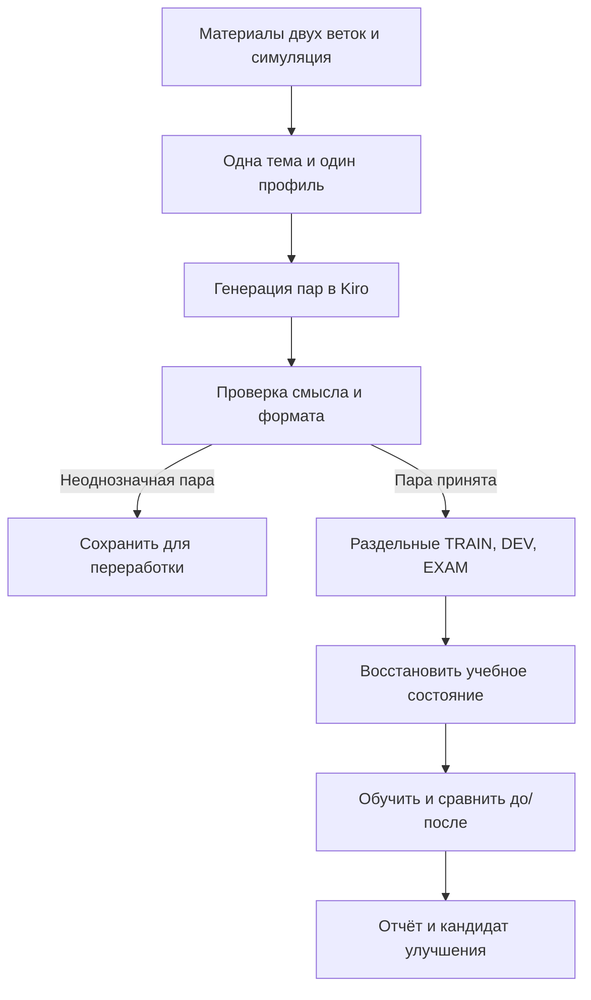

# Подготовка больших учебных наборов Xiigen

## Актуальное состояние на 25.10.2026

**119 карточек, 162 исполняемых потоков, 728 активных reference-строк, 57 RAG-источников.** [Новое дополнение](16-CONTEXT-AND-TRANSACTION-CASES.md) добавляет контекст перевода, декомпозицию, предметный QA и savepoint в SQL; предыдущие файлы/опыты сохраняются. Это подготовка, не результаты генерации или обучения.

Начало — **[14: общий промпт Kiro](14-GENERATION-CAMPAIGN.md)**. Полный порядок — [EXECUTION-QUEUE.md](EXECUTION-QUEUE.md) / [execution-queue.json](execution-queue.json). Первый поток остаётся `TR07-OMISSION/ru-en`. Прямой ID пользователя выше очереди, выполненные попытки не повторяются. Curriculum содержит 49 микроцелей и 119 потоков; его локальный конец не означает конец полной очереди.

План **129000 TRAIN-пар** распределён по родительским пулам без двойного счёта; 128987 назначены, 13 остаются в резерве router. DEV/EXAM отдельно. [Точные пути наборов/B1](curriculum/pilot-queue.json) — назначения, не существующие веса. Новая китайская генерация выполняется после фактического CODEX selection; до него разрешена подготовка задания. Модель генератора — выбранная китайская модель Kiro без override.

Генератор, native oracle и Student в текущем дополнении не запускались. [Проверки подготовки](verification/context-package-checks-2026-10-25.json) не являются измерениями обучения. Прежнее описание ниже сохранено как вводная часть; актуальные количества и порядок задаются этим разделом и единой очередью.

## Сохранённое описание исходного пакета

Исторический каталог ниже объясняет родительские темы. Для новой работы порядок, количества и явно изменённые правила берутся из актуального дополнения выше.

Дата: 23.10.2026. Этап: подготовка материала и промптов для генерации DPO в Kiro.

**Начать с [общего промпта](prompts/MASTER-PROMPT-RU.md), затем выбрать ID из [реестра](01-DOMAIN-REGISTRY.md).** Один запуск создаёт небольшой пакет одной темы и одного профиля. Большой набор собирается из проверенных пакетов. Число строк в плане — целевой объём, а не уже выполненная генерация и не доказательство обучения.

## Что будет происходить

Модель в Kiro получает конкретную тему, небольшой проверенный фрагмент проектной библиотеки и примеры хороших контрастов. Она создаёт условие задачи и два естественных ответа: правильный и правдоподобный с одной содержательной ошибкой. Другой проход проверяет ответы без знания, какой назначен правильным. Семейства и split назначаются до генерации. После проверки данные собираются в ранее назначенные раздельные наборы, сохраняются и затем используются для реального обучения небольшого Student или предметной Unit. До и после обучения измеряется тот же полезный результат на независимых примерах.

Детерминированные скрипты в этом каталоге только собирают контекст, проверяют записи и готовят файлы. Они не выбирают ответ вместо обучаемой модели и не считаются экспериментом по качеству обучения.

## Карта документов

| Файл | Для чего читать |
|---|---|
| [01 — реестр](01-DOMAIN-REGISTRY.md) | Порядок тем, домены, профили, конкретные карточки |
| [02 — формат](02-DATA-CONTRACT.md) | Условие/ответы, происхождение, семейства, связь с получателем обучения |
| [03 — запуск через Kiro](03-GENERATION-AND-KIRO.md) | Точные папки, команды подготовки, повторный запуск, ожидание |
| [04 — качество](04-QUALITY-AND-SPLITS.md) | Приёмка, слепая проверка, границы TRAIN/DEV/EXAM |
| [05 — обучение](05-LEARNING-AND-CHECKPOINTS.md) | Восстановление, минимально достаточный урок, метрики, сохранение |
| [06 — источники и навыки](06-SOURCES-AND-SKILLS.md) | Что прочитано, какой навык за что отвечает, как искать в RAG |
| [07 — конфликты](07-CONFLICTS-AND-REQUIREMENTS.md) | Явные решения по старым противоречивым правилам |
| [08 — отчёт](08-REPORT-TEMPLATE.md) | Русский отчёт с фактическими статусами и регрессиями |
| [09 — проверка поставки](09-VERIFICATION-AND-HANDOFF.md) | Что проверено, фактические объёмы, граница следующего этапа |
| [Промпт проверки](prompts/REVIEW-PROMPT-RU.md) | Проверка смысловой разницы без ярлыка chosen |
| [Промпт исправления](prompts/REPAIR-PROMPT-RU.md) | Исправить один дефект данных с сохранением старой версии |

## Границы этой поставки

Новые документы, примеры и утилиты размещены только в `xiigen-planning/llm mvp/learning-sets/preparation`. Ветка `llm_plan3` содержит планы, карточки и утилиты подготовки; ветка `main` — локальный RAG со снимками, индексом и поиском. Старые опыты сохраняются. Изменение production-кода и интеграция улучшений требуют отдельного решения Любы после измерений.

Китайская модель в Kiro здесь не запускалась; большие сеты ещё нужно сгенерировать. Примерные пары в карточках и `reference-examples.jsonl` — авторские симуляции, а не результаты такой генерации. Проверка утилит не выдаётся за обучение.

Не назначается вымышленное имя китайской модели. Используется фактически выбранная модель текущей Kiro-сессии. В манифесте отдельно фиксируются **исполнитель**, **генератор данных** и **обучаемый Student/Unit**: это разные роли.
