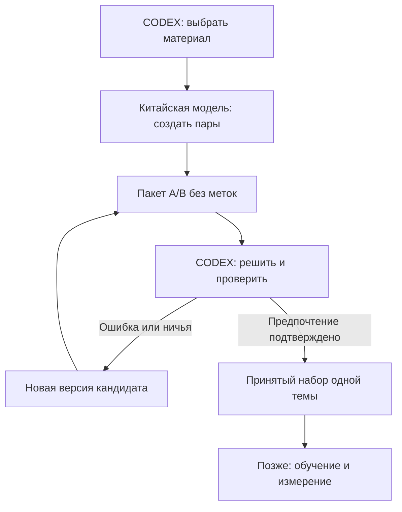

# Кто выбирает материал, генерирует и проверяет DPO

Правило от 25.10.2026 действует для **каждой** карточки, включая сохранённые карточки от 23 октября. Роль человека в выборе выполняет **CODEX с `astra 6 ultracode`**. Качество DPO оценивает **CODEX с `astra 6 ultracode`**. Внешняя открытая китайская модель, уже выбранная в Kiro, создаёт кандидатов. Её самопроверка полезна для черновика, но не заменяет решение CODEX.

## Четыре разные роли

| Роль | Исполнитель | Конкретный результат |
|---|---|---|
| Выбор материала | CODEX, `astra 6 ultracode` | Одна тема/профиль, проверенные источники, семейства, split; `selection.json` |
| Генерация кандидатов | Фактически выбранная внешняя открытая китайская модель в Kiro | `draft.jsonl`, фактическое имя генератора, исходный вывод, причины недостающих строк |
| Оценка и предпочтение | CODEX, `astra 6 ultracode` | Слепое решение A/B/tie, обоснование, `review.jsonl`, `review.receipt.json` |
| Обучение | Назначенный Student/Unit в отдельном эксперименте | Изменённые веса/память, checkpoint, ответы до/после; в этой поставке `NOT_RUN` |

Люба определяет задачу и решает, переносить ли измеренное улучшение в основной код. Это не поручение ей вручную размечать все пары. CODEX не объявляется внешним генератором. Kiro — среда, а не имя модели.

## Порядок одной партии

1. Выполнить `tools/sets.py prepare` по реестру. Скрипт создаёт контекст, request, `selection.prompt.md` и **незаполненный** `selection.template.json`. Это подготовка задания, не выполненный выбор.
2. CODEX в назначенном профиле читает `selection.prompt.md`, request, карточку и source slices. Проверяет тему и достаточность условия, сохраняет `selection.json`. Если request меняется, нужен новый выбор для нового содержимого; прежняя версия сохраняется.
3. Открыть `prompt.md` выбранного run в Kiro. Генератор использует уже выбранную китайскую модель и записывает её фактическое имя. Результат — draft и структурная проверка. Генератор не заполняет квитанции CODEX за проверяющего.
4. `blind` создаёт `blind.jsonl`, отдельный ключ и промпт CODEX. Проверяющий получает blind, видимые факты и промпт; ключ, исходные метки и rationale остаются закрытыми до решения.
5. CODEX решает условия заново, пишет review и квитанцию оценки. Для приёмки code.* требуется изолированная проверка поведения обоих кандидатов на одинаковых входах в указанной версии/диалекте; для docs.* oracle используется, если он необходим для разрешения факта. Отсутствующий необходимый запуск означает needs_oracle=true и valid=false, а не выполненный oracle. После уже подтверждённого selection подготовка кандидатов и reference-примеров со статусом NOT_RUN может продолжаться; необходимый oracle остаётся незавершённым.
6. `validate` проверяет связи request/draft/blind/key/review/квитанций. Затем `audit` → `merge` → `compose` → `export`. Ошибочные и неоднозначные пары сохраняются для переработки новой версией; исходный материал не удаляется.

## Квитанция выбора и оценки

Формат — `xiigen.codex-authority.v1`. У выбора `kind=selection`, после фактического действия `decision=SELECTED`; у оценки `kind=review`, `decision=REVIEW_COMPLETED`. Обязательные поля: `actor=CODEX`, `required_profile=astra 6 ultracode`, `observed_profile=astra 6 ultracode`, фактически показанное `observed_model`, `profile_verified`, `evidence_ref`, хеш request. Оценка дополнительно связывается с draft, blind и review. Незаполненный шаблон имеет PENDING/null/false и не принимается.

`evidence_ref` — ссылка на сохранённую запись реального сеанса/конфигурации. Если интерфейс показывает иное имя модели, соответствие профилю устанавливается по реальной конфигурации, а не по предположению. До подтверждённого CODEX selection допустимы сборка request/prompt, авторские reference-примеры и сохранение уже имеющегося draft со статусом NOT_SELECTED. Новый вызов китайского генератора начинается только после фактического выбора материала, связанного с этим request. Неизвестный observed_profile остаётся null/PENDING; имя профиля не выдумывается. NOT_SELECTED — отсутствие решения, а не живой процесс: wait/resume и автоматический цикл ожидания не запускаются.

Утилита проверяет **заявленное происхождение и хеши**. Она не аутентифицирует провайдера, не доказывает вызов модели и не определяет качество текста по имени модели. Поле `profile_verified=true`, записанное генератором без реального журнала CODEX, не создаёт доказательства. В evidence не помещать API-ключи и другие секреты.

## Исправление действующего пути

Старый `prompts/REVIEW-PROMPT-RU.md` поручал проверку текущей модели Kiro, а `tools/sets.py::validate` принимал положительный review без роли оценщика. Новая приёмка `xiigen.preparation.acceptance.v2` требуется также для merge/compose/export. Старые shards и отчёты сохраняются; для включения по новому контракту нужен новый подтверждённый review и новая версия выпуска.

Это исправление подготовки данных. Оно не является измеренным выигрышем обучения и не включается в `fixes-based-on-experiments` как успешный опыт.

## Управление работой

Отчёты — по-русски; ответы пар — по карточке. NEXT/новый ID прекращает прошлую задачу; STOP прекращает новые действия. Живой процесс ожидается штатным handle/wait, без перезапуска и фонового polling-цикла. Старые эксперименты сохраняются. Production и его тестовая цепочка при подготовке не изменяются.
