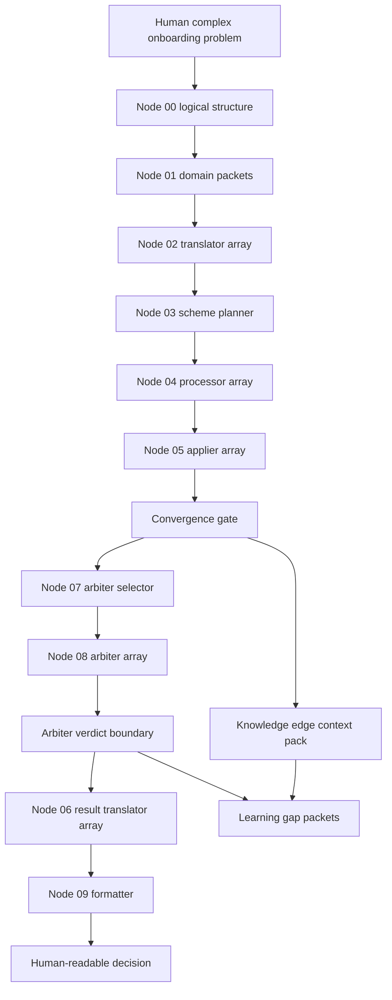

# E53 Scenario 001 Expected Orchestration Trace

Scenario id: `E53-SCENARIO-001-COMPLEX-ONBOARDING-MIGRATION`

Experiment: `E53-HIGH-LEVEL-ORCHESTRATION-PROOF`

Date: 2026-05-04

## Purpose

This file is the oracle for the E53 deterministic orchestration proof.

The later experiment should not decide what the correct trace is while it runs. It should run the scenario, produce an evidence trace, and compare that trace against this expected result.

This file is not a training set. It is the expected end-to-end orchestration behavior for one hard scenario.

## Source Input

Use the original human problem from:

`E53-SCENARIO-001-SOURCE-PACKET.md`

## Trace Summary

Expected top-level result:

The orchestration succeeds if the flow preserves all hard edges, rejects duplicate-account creation, blocks unproven biometric passport verification, keeps saved-state resume as a boundary, requires terms and privacy acceptance before activation, stops expired trust proof, and produces a human-readable decision without binding the plan to any implementation stack.

Expected final status:

`orchestration_completed_with_rejections_boundaries_and_learning_gaps`

Expected live external calls:

`0`

Expected stack binding:

`none`

## Node 00 - Logical Structure Compiler

A:

The full human problem from the source packet.

B:

```text
source_role: human_complex_orchestration_request
detected_subject: onboarding_flow_change
local_subject: complex_registration_and_onboarding_orchestration
predicate_counts_22: [0, 0, 1, 0, 0, 0, 4, 0, 0, 0, 0, 8, 5, 4, 0, 7, 3, 2, 0, 6, 0, 0]
domain_slots_5: [planning: 1, architecture: 1, bug_fix: 0, code_question: 0, orchestration: 1]
normalized_roots: [onboarding, email, password, provider, google, questionnaire, resume, callback, duplicate, account, terms, privacy, token, session, biometric, passport, activation, audit]
meaning_graph:
  units:
    - provider_sign_in
    - email_started_users
    - questionnaire_resume
    - duplicate_prevention
    - policy_acceptance
    - token_session_safety
    - biometric_passport_knowledge_edge
    - audit_clarity_request
    - human_decision_output
  dependencies:
    - provider_sign_in -> duplicate_prevention
    - provider_sign_in -> account_resolution
    - account_resolution -> questionnaire_resume
    - policy_acceptance -> full_activation
    - token_session_safety -> continuation
    - biometric_passport_knowledge_edge -> knowledge_edge_context_pack
  conflicts:
    - audit_clarity_request asks for duplicate account creation
    - duplicate_prevention forbids duplicate account creation
  boundaries:
    - resume_state_rules_missing
    - policy_acceptance_rules_need_source_evidence
  knowledge_edges:
    - missing_biometric_passport_verification
  no_stack_constraint: true
confidence: 0.86
missing_coverage_signals:
  - boundary_needs_resume_state_rules
  - boundary_needs_policy_acceptance_rules
  - knowledge_edge_missing_biometric_passport_verification
  - conflict_duplicate_account_creation_requested
```

Pass condition:

All source facts F01 through F12 remain represented. No source fact is dropped.

## Topology Route

A:

Node-00 logical structure.

B:

```text
topology_area: customer_onboarding_orchestration
sub_subjects:
  - registration_entry
  - account_state_resolution
  - onboarding_progress
  - activation_gates
  - identity_and_safety_review
route_confidence: 0.86
route_status: complex_multidomain_orchestration
```

Pass condition:

The route stays stack-independent and treats the request as orchestration, not implementation.

## Node 01 - Domain Splitter

A:

Node-00 logical structure.

B:

```text
domain_labels:
  - provider_identity_entry
  - email_registration_state
  - duplicate_prevention
  - token_session_safety
  - questionnaire_onboarding
  - resume_state_boundary
  - policy_acceptance_boundary
  - identity_proofing_knowledge_edge
  - audit_traceability
  - arbiter_review_required
  - human_readable_decision

domain_packets:
  - packet_id: d01_provider_identity_entry
    domain_label: provider_identity_entry
    prompt_fragment: Some users want to use Google sign-in as an onboarding entry path.
    coverage_status: covered
    reason_for_inclusion: Provider identity must be verified before account resolution.

  - packet_id: d02_email_registration_state
    domain_label: email_registration_state
    prompt_fragment: Some existing users started with email and password.
    coverage_status: covered
    reason_for_inclusion: Existing email-started users remain part of the migration state.

  - packet_id: d03_duplicate_prevention
    domain_label: duplicate_prevention
    prompt_fragment: Repeated provider callbacks must not create duplicate accounts.
    coverage_status: covered
    reason_for_inclusion: Duplicate prevention is a hard account-identity constraint.

  - packet_id: d04_token_session_safety
    domain_label: token_session_safety
    prompt_fragment: Expired token or session proof must stop onboarding and request fresh trusted action.
    coverage_status: covered
    reason_for_inclusion: Continuation depends on trusted proof.

  - packet_id: d05_questionnaire_onboarding
    domain_label: questionnaire_onboarding
    prompt_fragment: Some users stopped halfway through the onboarding questionnaire.
    coverage_status: covered
    reason_for_inclusion: Questionnaire progress is a distinct onboarding stage.

  - packet_id: d06_resume_state_boundary
    domain_label: resume_state_boundary
    prompt_fragment: Users want to continue later after stopping halfway through onboarding.
    coverage_status: boundary
    reason_for_inclusion: Saved-state restoration rules are not supplied.

  - packet_id: d07_policy_acceptance_boundary
    domain_label: policy_acceptance_boundary
    prompt_fragment: Terms and privacy acceptance are required before a user becomes fully active.
    coverage_status: boundary
    reason_for_inclusion: Policy acceptance evidence is required but exact source rules are not supplied.

  - packet_id: d08_identity_proofing_knowledge_edge
    domain_label: identity_proofing_knowledge_edge
    prompt_fragment: A stakeholder asks whether high-risk users should pass biometric passport verification before activation.
    coverage_status: knowledge_edge
    reason_for_inclusion: Biometric passport verification is outside local coverage.

  - packet_id: d09_audit_traceability
    domain_label: audit_traceability
    prompt_fragment: A stakeholder wants duplicate accounts so the audit trail is easier to inspect.
    coverage_status: conflict_supporting_context
    reason_for_inclusion: Audit clarity is a legitimate goal but cannot override duplicate prevention.

  - packet_id: d10_arbiter_review_required
    domain_label: arbiter_review_required
    prompt_fragment: The request contains conflict, knowledge edge, policy boundary, token safety, and stack-independence requirements.
    coverage_status: required
    reason_for_inclusion: Formal results must be reviewed before acceptance.

  - packet_id: d11_human_readable_decision
    domain_label: human_readable_decision
    prompt_fragment: The user asked for an orchestration plan and human-readable decision.
    coverage_status: covered
    reason_for_inclusion: The final answer must explain proceed, blocked, rejected, unknown, and next actions.

split_confidence: 0.86
```

Pass condition:

Input packet count is 11. Output packet count is 11. No packet is collapsed or dropped.

## Node 02 - Domain Translator Array

A:

One node-01 domain packet at a time.

B:

```text
translated_statements:
  - statement_id: t01_provider_identity_entry
    source_packet: d01_provider_identity_entry
    translated_domain_statement: Provider sign-in is an external identity-entry path. The provider response is an identity assertion that remains untrusted until validated. The flow must validate the provider response before using it for account resolution, account linking, onboarding continuation, or session start.
    coverage_status: covered
    handoff_marker: ready_for_scheme_planner

  - statement_id: t02_email_registration_state
    source_packet: d02_email_registration_state
    translated_domain_statement: Existing email-started users are already in a registration state. The flow must preserve their pending or completed account state and must not force them into provider sign-in or duplicate account creation.
    coverage_status: covered
    handoff_marker: ready_for_scheme_planner

  - statement_id: t03_duplicate_prevention
    source_packet: d03_duplicate_prevention
    translated_domain_statement: A repeated provider callback for the same provider identity must resolve to the existing account or pending registration. Creating another account from the repeated callback is forbidden.
    coverage_status: covered
    conflict_marker: duplicate_account_creation_requested
    handoff_marker: ready_for_scheme_planner

  - statement_id: t04_token_session_safety
    source_packet: d04_token_session_safety
    translated_domain_statement: Continuation, activation, and session start require valid trust proof. If token or session proof is expired or invalid, the flow must stop the current continuation and ask for a fresh trusted action.
    coverage_status: covered
    handoff_marker: ready_for_scheme_planner

  - statement_id: t05_questionnaire_onboarding
    source_packet: d05_questionnaire_onboarding
    translated_domain_statement: Questionnaire progress is an onboarding stage that occurs after account identity is resolved. The flow may inspect progress only for the resolved account or pending registration.
    coverage_status: covered
    handoff_marker: ready_for_scheme_planner

  - statement_id: t06_resume_state_boundary
    source_packet: d06_resume_state_boundary
    translated_domain_statement: Returning later after stopping halfway through onboarding requires saved-state restoration rules. The current source packet does not define how progress is stored or restored, so resume behavior must remain boundary-marked.
    coverage_status: boundary
    boundary_marker: needs_resume_state_rules
    handoff_marker: send_to_scheme_planner_with_boundary_flag

  - statement_id: t07_policy_acceptance_boundary
    source_packet: d07_policy_acceptance_boundary
    translated_domain_statement: Full activation requires evidence that the user accepted terms and privacy requirements. The source packet does not define the exact acceptance evidence shape or timing, so activation must be blocked until acceptance rules are supplied or confirmed.
    coverage_status: boundary
    boundary_marker: needs_policy_acceptance_rules
    handoff_marker: send_to_scheme_planner_with_boundary_flag

  - statement_id: t08_identity_proofing_knowledge_edge
    source_packet: d08_identity_proofing_knowledge_edge
    translated_domain_statement: Biometric passport verification is outside local coverage. The flow lacks rules for passport proof, face match, assurance level, privacy review, sensitive data handling, and retention. The correct next action is a knowledge-edge context pack, not a local proofing plan.
    coverage_status: knowledge_edge
    knowledge_edge_marker: missing_biometric_passport_verification
    handoff_marker: route_to_knowledge_edge_context_pack

  - statement_id: t09_audit_traceability
    source_packet: d09_audit_traceability
    translated_domain_statement: Audit clarity is a valid review concern, but duplicate account creation is not an allowed audit mechanism. The audit need must be preserved as traceability evidence on the existing account path.
    coverage_status: conflict_supporting_context
    conflict_marker: audit_clarity_cannot_override_duplicate_prevention
    handoff_marker: send_to_scheme_planner_with_rejection_flag

  - statement_id: t10_arbiter_review_required
    source_packet: d10_arbiter_review_required
    translated_domain_statement: The final formal results require identity consistency, token safety, policy evidence, resume-state coverage, knowledge-edge non-invention, audit-traceability, and stack-independence review.
    coverage_status: required
    handoff_marker: ready_for_scheme_planner

  - statement_id: t11_human_readable_decision
    source_packet: d11_human_readable_decision
    translated_domain_statement: The final answer must explain what can proceed, what is blocked, what is rejected, what is unknown, and what the next actions are. It must not hide conflict, boundary, or knowledge-edge status.
    coverage_status: covered
    handoff_marker: ready_for_scheme_planner
```

Pass condition:

Eleven packets enter the translator array. Eleven translated statements leave the translator array.

## Node 03 - Scheme Planner

A:

The complete translated statement set from node-02.

B:

```text
plan_status: mixed_orchestration_plan_with_rejections_boundaries_and_knowledge_edge
path_name: complex onboarding migration

ordered_plan_items:
  - task_id: b01_validate_provider_identity
    task_statement: Validate provider identity before account resolution.
    transformational_prompt: Treat provider sign-in as untrusted until validated. Use the result only after it belongs to the current onboarding attempt and identifies the provider subject.
    depends_on: []
    allowed_parallel_with: [b02_identify_email_started_users, b08_prepare_policy_acceptance_gap, b10_prepare_biometric_context_pack]
    stop_or_wait_condition: Stop provider-based continuation if validation fails or proof is stale.
    review_marker: token_safety

  - task_id: b02_identify_email_started_users
    task_statement: Identify users who already started with email and password.
    transformational_prompt: Preserve existing email-started account state. Do not force those users into provider sign-in and do not create a second account for them.
    depends_on: []
    allowed_parallel_with: [b01_validate_provider_identity, b08_prepare_policy_acceptance_gap, b10_prepare_biometric_context_pack]
    stop_or_wait_condition: Stop if account state cannot be identified.
    review_marker: identity_consistency

  - task_id: b03_resolve_existing_or_pending_account
    task_statement: Resolve the one account or pending registration that owns the provider identity or email-started state.
    transformational_prompt: Match validated provider identity and existing email-started state before any create branch. The output must be one account path: reuse, link, continue pending, or create only if no owner exists.
    depends_on: [b01_validate_provider_identity, b02_identify_email_started_users]
    allowed_parallel_with: []
    stop_or_wait_condition: Stop if ownership is ambiguous.
    review_marker: identity_consistency

  - task_id: b04_reject_duplicate_account_instruction
    task_statement: Reject the stakeholder request to create a second account for a repeated provider callback.
    transformational_prompt: Preserve audit clarity as a goal, but reject duplicate account creation as the mechanism. Route audit clarity to traceability on the existing account path.
    depends_on: [b03_resolve_existing_or_pending_account]
    allowed_parallel_with: []
    stop_or_wait_condition: Stop all duplicate creation branches.
    review_marker: identity_consistency

  - task_id: b05_check_current_trust_for_continuation
    task_statement: Check token or session proof before continuation.
    transformational_prompt: If proof is expired or invalid, stop continuation and request a fresh trusted action. Do not complete onboarding or activation from expired proof.
    depends_on: [b03_resolve_existing_or_pending_account]
    allowed_parallel_with: [b06_read_questionnaire_progress, b08_prepare_policy_acceptance_gap]
    stop_or_wait_condition: Wait for fresh trusted action if proof is expired or invalid.
    review_marker: token_safety

  - task_id: b06_read_questionnaire_progress
    task_statement: Read questionnaire progress only for the resolved account or pending registration.
    transformational_prompt: Use questionnaire progress from the account path selected in b03. Do not accept progress from another account or from an unresolved identity.
    depends_on: [b03_resolve_existing_or_pending_account]
    allowed_parallel_with: [b05_check_current_trust_for_continuation, b08_prepare_policy_acceptance_gap]
    stop_or_wait_condition: Stop if questionnaire progress cannot be tied to the resolved account path.
    review_marker: edge_preservation

  - task_id: b07_flag_resume_state_boundary
    task_statement: Keep resume after leaving onboarding as a boundary.
    transformational_prompt: Carry boundary_marker needs_resume_state_rules forward. Do not invent saved-progress storage or restoration behavior.
    depends_on: [b06_read_questionnaire_progress]
    allowed_parallel_with: []
    stop_or_wait_condition: Wait for saved-state source rules before promising exact resume.
    review_marker: resume_state_coverage

  - task_id: b08_prepare_policy_acceptance_gap
    task_statement: Preserve policy acceptance as an activation gate.
    transformational_prompt: Require terms and privacy acceptance before full activation. Because exact evidence rules are not supplied, carry boundary_marker needs_policy_acceptance_rules.
    depends_on: []
    allowed_parallel_with: [b01_validate_provider_identity, b02_identify_email_started_users]
    stop_or_wait_condition: Block full activation until acceptance evidence rules are supplied or confirmed.
    review_marker: policy_evidence

  - task_id: b09_gate_activation
    task_statement: Decide whether the user can become fully active.
    transformational_prompt: Full activation requires resolved account state, valid trust proof, no duplicate account branch, and policy acceptance evidence. If any dependency is blocked, activation is blocked.
    depends_on: [b03_resolve_existing_or_pending_account, b04_reject_duplicate_account_instruction, b05_check_current_trust_for_continuation, b08_prepare_policy_acceptance_gap]
    allowed_parallel_with: []
    stop_or_wait_condition: Wait for policy evidence and valid trust proof.
    review_marker: policy_evidence

  - task_id: b10_prepare_biometric_context_pack
    task_statement: Prepare a knowledge-edge context pack for biometric passport verification.
    transformational_prompt: Name missing biometric passport competence. Include the original request, known registration coverage, missing proofing rules, review constraints, and required answer shape. Do not create a local proofing plan.
    depends_on: []
    allowed_parallel_with: [b01_validate_provider_identity, b02_identify_email_started_users, b08_prepare_policy_acceptance_gap]
    stop_or_wait_condition: Wait for approved outside help or future local learning before using biometric proof as an activation rule.
    review_marker: knowledge_edge_non_invention

  - task_id: b11_prepare_human_decision
    task_statement: Prepare the final human decision from accepted, blocked, rejected, and unknown fragments.
    transformational_prompt: Explain what can proceed, what is blocked, what is rejected, what is unknown, and next actions. Do not hide the duplicate rejection, resume boundary, policy boundary, token stop condition, or biometric knowledge edge.
    depends_on: [b04_reject_duplicate_account_instruction, b07_flag_resume_state_boundary, b09_gate_activation, b10_prepare_biometric_context_pack]
    allowed_parallel_with: []
    stop_or_wait_condition: Wait until arbiter-reviewed formal results exist.
    review_marker: stack_independence_result_check

dependency_rules:
  - b01 and b02 can start independently.
  - b03 depends on b01 and b02.
  - b04 depends on b03 and blocks duplicate creation.
  - b05 and b06 depend on b03 and can run in parallel.
  - b07 depends on b06.
  - b08 can start early, but b09 cannot activate until b08 has acceptable evidence.
  - b09 depends on b03, b04, b05, and b08.
  - b10 can start early as a knowledge-edge context pack.
  - b11 depends on b04, b07, b09, and b10.

parallel_groups:
  - [b01_validate_provider_identity, b02_identify_email_started_users, b08_prepare_policy_acceptance_gap, b10_prepare_biometric_context_pack]
  - [b05_check_current_trust_for_continuation, b06_read_questionnaire_progress, b08_prepare_policy_acceptance_gap]

wait_states:
  - wait_for_fresh_trusted_action if b05 finds expired or invalid proof
  - wait_for_saved_state_source_rules after b07
  - wait_for_policy_acceptance_rules after b08
  - wait_for_biometric_proofing_source_authority after b10
  - wait_for_arbiter_verdicts before b11

recovery_or_rejection_rules:
  - reject_duplicate_account_creation after b04
  - request_fresh_trusted_action after expired or invalid proof in b05
  - return_boundary_result for resume behavior until b07 source rules exist
  - block_full_activation until b08 policy acceptance evidence exists
  - create_learning_gap_packet for b10 biometric passport verification

planner_confidence: 0.86
next_node_handoff: send_each_plan_item_to_domain_processor_array
```

Pass condition:

Provider trust comes before account resolution. Account resolution comes before questionnaire continuation. Policy acceptance comes before full activation. Duplicate creation is rejected. Biometric passport verification becomes a context pack, not a local plan.

## Node 04 - Domain Processor Array

A:

One node-03 plan item at a time.

B:

```text
processed_outcomes:
  - task_id: b01_validate_provider_identity
    success_outcome: provider identity is trusted for this onboarding attempt
    failure_outcome: provider proof is invalid, stale, or mismatched
    wait_state_outcome: wait_for_fresh_provider_entry
    review_signal: token_safety
    reprocessing_signal: none

  - task_id: b02_identify_email_started_users
    success_outcome: existing email-started state is found and preserved
    failure_outcome: account state cannot be identified
    wait_state_outcome: wait_for_account_state_evidence
    review_signal: identity_consistency
    reprocessing_signal: none

  - task_id: b03_resolve_existing_or_pending_account
    success_outcome: one account path is selected: reuse, link, continue pending, or create only if no owner exists
    failure_outcome: multiple account owners or no reliable owner evidence
    wait_state_outcome: wait_for_identity_resolution
    review_signal: identity_consistency
    reprocessing_signal: return_if_multiple_account_paths_are_open

  - task_id: b04_reject_duplicate_account_instruction
    success_outcome: duplicate-account creation branch is rejected and audit clarity is redirected to traceability on the existing account path
    failure_outcome: any output tries to create another account from the repeated callback
    wait_state_outcome: wait_for_identity_consistency_arbiter
    review_signal: identity_consistency
    reprocessing_signal: return_if_duplicate_creation_survives

  - task_id: b05_check_current_trust_for_continuation
    success_outcome: current trust proof is valid and continuation may proceed to the next gate
    failure_outcome: trust proof is expired or invalid
    wait_state_outcome: wait_for_fresh_trusted_action
    review_signal: token_safety
    reprocessing_signal: return_if_expired_proof_is_used

  - task_id: b06_read_questionnaire_progress
    success_outcome: questionnaire progress is tied to the resolved account path
    failure_outcome: progress belongs to another account path or cannot be tied to the resolved account
    wait_state_outcome: wait_for_progress_evidence
    review_signal: edge_preservation
    reprocessing_signal: return_if_progress_is_unbound

  - task_id: b07_flag_resume_state_boundary
    success_outcome: resume-state boundary is preserved with missing source rules named
    failure_outcome: output promises exact resume behavior without saved-state rules
    wait_state_outcome: wait_for_saved_state_source_rules
    review_signal: resume_state_coverage
    reprocessing_signal: return_if_resume_behavior_is_invented

  - task_id: b08_prepare_policy_acceptance_gap
    success_outcome: policy acceptance remains a required activation gate and missing evidence rules are named
    failure_outcome: full activation is allowed without acceptance evidence
    wait_state_outcome: wait_for_policy_acceptance_rules
    review_signal: policy_evidence
    reprocessing_signal: return_if_activation_bypasses_policy

  - task_id: b09_gate_activation
    success_outcome: activation remains blocked until account resolution, trust proof, duplicate rejection, and policy evidence are all accepted
    failure_outcome: activation is allowed while any dependency is blocked
    wait_state_outcome: wait_for_all_activation_gates
    review_signal: policy_evidence
    reprocessing_signal: return_if_activation_ignores_dependency

  - task_id: b10_prepare_biometric_context_pack
    success_outcome: biometric passport verification is named as a knowledge edge and context pack requirements are prepared
    failure_outcome: local biometric proofing plan is invented
    wait_state_outcome: wait_for_approved_outside_help_or_future_learning
    review_signal: knowledge_edge_non_invention
    reprocessing_signal: return_if_biometric_plan_is_invented

  - task_id: b11_prepare_human_decision
    success_outcome: human decision sections are ready from accepted, blocked, rejected, and unknown fragments
    failure_outcome: final decision hides rejected, blocked, or unknown work
    wait_state_outcome: wait_for_arbiter_verdicts
    review_signal: stack_independence_result_check
    reprocessing_signal: return_if_final_result_hides_status
```

Pass condition:

Eleven plan items enter node-04. Eleven processed outcomes leave node-04.

## Node 05 - Applier Array

A:

One processed node-04 outcome at a time.

B:

```text
applied_results:
  - result_id: r01_provider_trust
    task_id: b01_validate_provider_identity
    result_status: accepted_if_current_trust_exists_otherwise_wait
    formal_result: Provider sign-in may be used only after trusted provider proof is current and tied to this onboarding attempt.

  - result_id: r02_email_state
    task_id: b02_identify_email_started_users
    result_status: accepted_if_existing_state_is_found
    formal_result: Existing email-started users remain on their existing account-state branch and are not forced into provider sign-in.

  - result_id: r03_account_resolution
    task_id: b03_resolve_existing_or_pending_account
    result_status: accepted_if_one_account_path_is_selected
    formal_result: Account resolution must produce exactly one account path before continuation or activation.

  - result_id: r04_duplicate_rejection
    task_id: b04_reject_duplicate_account_instruction
    result_status: rejected_branch
    formal_result: The request to create a second account from a repeated provider callback is rejected. Audit clarity must use traceability on the existing account path.

  - result_id: r05_trust_continuation_gate
    task_id: b05_check_current_trust_for_continuation
    result_status: blocked_if_proof_expired
    formal_result: Expired or invalid proof stops continuation and requires a fresh trusted action.

  - result_id: r06_questionnaire_progress
    task_id: b06_read_questionnaire_progress
    result_status: accepted_if_progress_belongs_to_resolved_account
    formal_result: Questionnaire progress may be used only when tied to the resolved account or pending registration.

  - result_id: r07_resume_boundary
    task_id: b07_flag_resume_state_boundary
    result_status: boundary
    formal_result: Resume after leaving onboarding remains blocked on missing saved-state restoration rules.

  - result_id: r08_policy_boundary
    task_id: b08_prepare_policy_acceptance_gap
    result_status: boundary
    formal_result: Full activation is blocked until terms and privacy acceptance evidence rules are supplied or confirmed.

  - result_id: r09_activation_gate
    task_id: b09_gate_activation
    result_status: blocked_until_dependencies_pass
    formal_result: Full activation requires resolved account state, valid trust proof, rejected duplicate branch, and policy acceptance evidence.

  - result_id: r10_biometric_knowledge_edge
    task_id: b10_prepare_biometric_context_pack
    result_status: knowledge_edge
    formal_result: Biometric passport verification is outside current local coverage and must become a context pack and learning gap, not a local proofing plan.

  - result_id: r11_human_decision_ready
    task_id: b11_prepare_human_decision
    result_status: pending_arbiter_verdicts
    formal_result: Human result can be formatted after arbiters confirm accepted, blocked, rejected, and unknown fragments.
```

Pass condition:

No applied result converts a blocked, rejected, or knowledge-edge item into accepted ordinary work.

## Convergence Gate

A:

All node-05 applied results.

B:

```text
convergence_status: converged_with_rejections_boundaries_and_knowledge_edge
accepted_fragments:
  - r01_provider_trust
  - r02_email_state
  - r03_account_resolution
  - r06_questionnaire_progress
blocked_fragments:
  - r05_trust_continuation_gate if proof is expired or invalid
  - r07_resume_boundary
  - r08_policy_boundary
  - r09_activation_gate
knowledge_edge_fragments:
  - r10_biometric_knowledge_edge
rejected_fragments:
  - r04_duplicate_rejection
pending_fragments:
  - r11_human_decision_ready until arbiter verdicts pass
conflicts_detected:
  - audit clarity request conflicts with duplicate prevention if implemented as a second account
dependencies_preserved:
  - provider trust before account resolution
  - account resolution before questionnaire continuation
  - policy acceptance before activation
  - valid proof before continuation
  - saved-state rules before exact resume promise
```

Pass condition:

Convergence names accepted, blocked, rejected, and knowledge-edge fragments separately.

## Knowledge Edge Context Pack

A:

The biometric passport verification fragment `r10_biometric_knowledge_edge`.

B:

```text
context_pack_id: cp01_biometric_passport_verification
edge_type: hard_knowledge_edge
station_that_reached_edge: scheme_planner
missing_competence: biometric passport verification for onboarding activation
known_local_coverage:
  - provider sign-in
  - email-started account state
  - duplicate prevention
  - token/session safety
  - questionnaire progress boundary
  - policy acceptance boundary
missing_rules:
  - passport proof capture
  - face match or biometric comparison
  - assurance level decision
  - privacy review
  - sensitive data handling
  - retention and deletion
  - whether this proof is required for high-risk users
question_to_outside_help:
  - What source rules are required before biometric passport verification can safely become an onboarding activation requirement?
required_answer_shape:
  - allowed or not allowed
  - required evidence
  - risks and review points
  - what must not be assumed
  - how the answer returns to local planning
live_external_call: false
approval_required_before_live_call: true
```

Pass condition:

The context pack exists, but no live external call is made.

## Node 07 - Arbiter Selector

A:

Convergence report, original meaning graph, applied results, conflict markers, boundary markers, and knowledge-edge markers.

B:

```text
required_arbiters:
  - arbiter: identity_consistency
    reason: duplicate account creation is explicitly requested and must be rejected.
    mandatory: true

  - arbiter: token_safety
    reason: provider trust and continuation depend on valid proof; expired proof must stop continuation.
    mandatory: true

  - arbiter: policy_evidence
    reason: full activation requires terms and privacy acceptance evidence.
    mandatory: true

  - arbiter: resume_state_coverage
    reason: exact resume behavior requires saved-state source rules that are not supplied.
    mandatory: true

  - arbiter: knowledge_edge_non_invention
    reason: biometric passport verification is outside local coverage.
    mandatory: true

  - arbiter: audit_traceability
    reason: audit clarity is valid but cannot be solved by duplicate account creation.
    mandatory: true

  - arbiter: stack_independence_result_check
    reason: final result must not bind the orchestration to an implementation stack.
    mandatory: true
```

Pass condition:

Arbiters are selected from formal results and risk markers, not from final wording.

## Node 08 - Arbiter Units

A:

One formal result plus one arbiter role.

B:

```text
arbiter_verdicts:
  - arbiter: identity_consistency
    verdict: rejected_fragment_found
    target_fragment: r04_duplicate_rejection
    accepted_result: reject duplicate-account creation and preserve one account path
    rejection_reason_if_failed: any second account branch survives

  - arbiter: token_safety
    verdict: accepted_with_wait_condition
    target_fragments: [r01_provider_trust, r05_trust_continuation_gate]
    accepted_result: continuation requires current trusted proof; expired proof waits for fresh trusted action
    rejection_reason_if_failed: continuation or activation occurs from expired or invalid proof

  - arbiter: policy_evidence
    verdict: accepted_with_boundary
    target_fragments: [r08_policy_boundary, r09_activation_gate]
    accepted_result: full activation is blocked until acceptance evidence rules exist
    rejection_reason_if_failed: full activation occurs without policy acceptance evidence

  - arbiter: resume_state_coverage
    verdict: accepted_with_boundary
    target_fragment: r07_resume_boundary
    accepted_result: resume behavior remains boundary-marked until saved-state rules exist
    rejection_reason_if_failed: exact resume behavior is promised without source rules

  - arbiter: knowledge_edge_non_invention
    verdict: accepted_with_learning_gap
    target_fragment: r10_biometric_knowledge_edge
    accepted_result: biometric passport verification becomes a context pack and learning gap
    rejection_reason_if_failed: local biometric proofing plan is invented

  - arbiter: audit_traceability
    verdict: accepted_with_rejection_boundary
    target_fragment: r04_duplicate_rejection
    accepted_result: audit clarity may be solved by traceability on the existing account path, not duplicate account creation
    rejection_reason_if_failed: audit clarity revives duplicate account creation

  - arbiter: stack_independence_result_check
    verdict: accepted
    target_fragment: final_human_result
    accepted_result: final answer remains stack-independent
    rejection_reason_if_failed: final answer names an implementation stack or environment as required
```

Pass condition:

No arbiter permits duplicate account creation, invented biometric proofing, expired-proof continuation, policy-free activation, invented resume behavior, or stack-bound final output.

## Node 06 - Result Translator Array

A:

One accepted, blocked, rejected, or knowledge-edge formal result at a time.

B:

```text
human_fragments:
  - fragment_id: h01_can_proceed_provider_and_account_resolution
    source_results: [r01_provider_trust, r02_email_state, r03_account_resolution]
    status: can_proceed
    text: Provider sign-in and existing email-started accounts can be managed in one onboarding plan if provider identity is trusted first and one account path is resolved before continuation.

  - fragment_id: h02_duplicate_rejected
    source_results: [r04_duplicate_rejection]
    status: rejected
    text: The request to create a second account from a repeated provider callback is rejected. Audit clarity must be handled through traceability on the existing account path.

  - fragment_id: h03_token_stop_condition
    source_results: [r05_trust_continuation_gate]
    status: blocked_when_expired
    text: If token or session proof expires before onboarding finishes, the flow must stop and ask for a fresh trusted action.

  - fragment_id: h04_questionnaire_resume_boundary
    source_results: [r06_questionnaire_progress, r07_resume_boundary]
    status: boundary
    text: Questionnaire progress can be tied to the resolved account path, but exact resume after leaving onboarding stays blocked until saved-state rules are supplied.

  - fragment_id: h05_policy_activation_boundary
    source_results: [r08_policy_boundary, r09_activation_gate]
    status: boundary
    text: Full activation is blocked until terms and privacy acceptance evidence exists.

  - fragment_id: h06_biometric_knowledge_edge
    source_results: [r10_biometric_knowledge_edge]
    status: knowledge_edge
    text: Biometric passport verification is outside current local coverage. The system should prepare a context pack for approved outside help or future local learning before treating it as an activation rule.

  - fragment_id: h07_next_actions
    source_results: [r11_human_decision_ready]
    status: next_actions
    text: Next actions are to confirm policy evidence rules, confirm saved-state resume rules, reject duplicate account creation, require fresh trust when proof expires, and decide whether to request approved outside help for biometric passport verification.
```

Pass condition:

Fragments preserve status. Rejection remains rejection. Boundary remains boundary. Knowledge edge remains knowledge edge.

## Node 09 - Formatter

A:

All node-06 human fragments.

B:

```text
final_human_result:

Can proceed:

Provider sign-in, existing email-started accounts, account matching, duplicate prevention, token safety, and questionnaire progress can be managed in one onboarding plan where source rules already exist. Provider identity must be trusted before account resolution. One account path must be selected before questionnaire continuation.

Blocked:

Full activation is blocked until terms and privacy acceptance evidence exists. If token or session proof expires before onboarding finishes, continuation is blocked until the user performs a fresh trusted action. Exact resume after leaving onboarding is also blocked until saved-state restoration rules are supplied.

Rejected:

The request to create a second account when the same Google callback repeats is rejected. Audit clarity is a valid goal, but it must be handled through traceability on the existing account path, not by creating another account.

Unknown:

Biometric passport verification is outside current local coverage. The flow should prepare a context pack for approved outside help or future learning. It should not invent passport proof, face matching, assurance, privacy, or sensitive-data handling rules.

Next actions:

Confirm the policy acceptance evidence rule. Confirm saved-state restoration rules for onboarding resume. Keep duplicate account creation rejected. Require fresh trusted action when proof expires. Decide whether to request approved outside help for biometric passport verification.
```

Pass condition:

The final result contains can proceed, blocked, rejected, unknown, and next actions. It does not bind the result to an implementation stack.

## Learning Gap Packets

Expected packets:

```text
learning_gap_packets:
  - packet_id: lg01_biometric_passport_verification
    target_station: knowledge_edge_detector
    target_unit_role: identity_proofing_knowledge_edge
    status: knowledge_edge
    learning_value: Teach how biometric passport verification should be routed, context-packed, externally reviewed, adapted, and later turned into local training after source authority exists.

  - packet_id: lg02_resume_state_rules
    target_station: scheme_planner
    target_unit_role: resume_state_boundary
    status: boundary
    learning_value: Teach saved-state restoration dependencies and wait states after source rules are gathered.

  - packet_id: lg03_policy_acceptance_rules
    target_station: scheme_planner
    target_unit_role: policy_acceptance_boundary
    status: boundary
    learning_value: Teach exact policy evidence requirements and activation timing after source rules are gathered.

  - packet_id: lg04_duplicate_account_rejection
    target_station: arbiter_units
    target_unit_role: identity_consistency
    status: negative
    learning_value: Teach that audit clarity cannot override duplicate prevention.
```

Pass condition:

Each learning gap packet targets a specific station and unit role.

## Metrics Expected

```text
lost_edge_count: 0
node02_input_count: 11
node02_output_count: 11
node04_input_count: 11
node04_output_count: 11
node05_input_count: 11
node05_output_count: 11
dependency_violation_count: 0
invalid_parallel_run_count: 0
invented_biometric_plan_items: 0
duplicate_creation_accepted: false
forbidden_stack_term_count: 0
human_result_sections_present: 5/5
live_external_calls: 0
learning_gap_packet_count: 4
e2e_orchestration_success: true
```

## Mermaid Topology Expected



## Review Focus For This Trace

The most important review question is the node-03 plan.

The plan is correct only if:

- provider trust comes before account resolution;
- account resolution comes before questionnaire continuation;
- policy acceptance comes before full activation;
- token/session proof gates continuation;
- resume remains a boundary;
- biometric passport verification is a context pack and learning gap;
- duplicate account creation is rejected;
- audit clarity does not revive duplicate creation;
- the final human result stays stack-independent.
