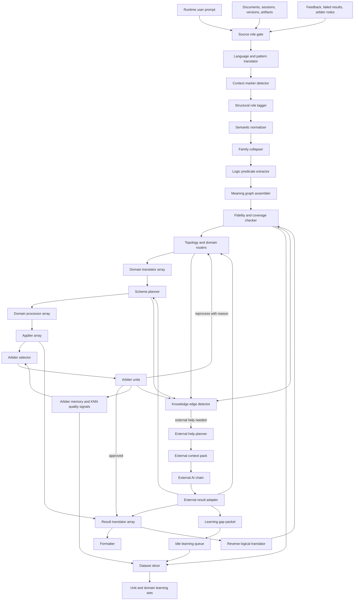

# Prompt And Dataset Logical Structure Examination v1

## Post-E51 Validation Note

E51B is the first closed-loop validation of this document's main claim: teaching
records and runtime records used the same compiler and feature-building path.
The validated concrete feature shape is 60 slots: 22 predicate count slots, 5
domain slots, up to 32 normalized-root slots, and 1 decomposition-count slot.

The structure-level checks proposed here belong inside the compiler's fidelity
and coverage checker. They should not be added as four separate global arbiter
families, because that would enlarge the arbiter selector's training problem.
Global arbiters judge domain-level output after the main flow has produced it;
the compiler checker judges whether the logical structure is faithful enough to
enter the flow.

## Purpose

This document examines the older experiments and session notes that explored how to turn raw text, prompts, source documents, and learning examples into a smaller logical structure before they reach the dynamic flow units.

The conclusion is direct: the dynamic flow should not send raw token text straight into the small node models. It should first translate both runtime prompts and dataset examples into the same logical structure. The small units can then work on a stable meaning shape instead of guessing meaning from surface words.

This is not only a runtime feature. It is also a learning-set feature. If the learning examples are prepared from documents in one representation, and runtime prompts arrive in another representation, the units will be fast but brittle. The prompt path and the dataset path must meet in the same logical language.

## Sources Examined

The examination used the local archives and extracted source material under:

- `C:\Users\lubao\Documents\xiigen\llm mvp\docs.zip`
- `C:\Users\lubao\Documents\xiigen\llm mvp\session files.zip`
- `C:\Users\lubao\Documents\xiigen\llm mvp\llm-session-package.zip`
- Extracted examination cache under `C:\Users\lubao\Documents\xiigen\llm mvp\llm dynamic flow\source-examination-cache`

The most relevant documents and sessions were:

- `EXPERIMENT-RESULTS-MAP.md`
- `SEMANTIC-COMPILER-SESSION-PLAN-v1_0.md`
- `SEMANTIC-NLP-SUBPROJECTS-PLAN-v1.md`
- `E15-E16-E17-SEMANTIC-COMPILER-PLANS-v1.0.md`
- `E18-E19-E20-ROUTER-DIMENSIONS-PLANS-v1.0.md`
- `E21-E22-E23-ROUTING-PLANS-v1.0.md`
- `E24-ATTRIBUTED-ROUTER-DETAILED-PLAN-v1.0.md`
- `E25-E26-E27-TRANSLATOR-PLANS-v1.0.md`
- `E08-NON-CODE-SYNTAX-DETAILED-PLAN-v2.0.md`
- Product sessions 1, 6, and 7
- Claude code sessions that describe SemanticCompiler and SemanticCompiler29 implementation history

## Main Finding

The missing high-level design element is a shared Logical Structure Compiler.

It should sit before the domain splitters, before the dataset slicers, and before most small unit models.

It has one job:

Raw human or document text -> stable logical structure.

The same compiler should be used for:

- A user prompt at runtime.
- A line, paragraph, section, or version change from a source document.
- A session instruction or correction.
- A generated architecture artifact.
- A previous failed or approved result.
- A feedback note from an arbiter.

The dynamic flow should then train and run the small units mostly on this logical structure, while preserving the original text beside it for human checking, fidelity checking, and reverse translation.

## Why This Is Needed

The existing dynamic flow direction says that the user prompt is split into domains, translated, planned, processed, applied, checked, translated back, and formatted.

That is correct, but it leaves one question unresolved:

What is the actual input language that the small units learn?

If the answer is raw human text, every unit has to relearn surface language, synonyms, word order, document style, missing context, and noise.

If the answer is logical structure, each unit can be much smaller:

- The splitter learns which meaning structures belong to which domains.
- The translator learns how one domain says a meaning.
- The planner learns how meaning units become steps.
- The processor learns how a step becomes a domain result.
- The applier learns how a formal action changes or creates a result.
- The arbiters learn how to detect missing meaning, broken order, unsafe assumptions, and wrong domain language.
- The formatter learns how approved meaning is turned back into human language.

The older experiments already point to this.

## Evidence From Experiments

### Strong Experiments

The strongest evidence comes from the compression and semantic compiler experiments:

- E01 AstTokenizer passed strongly. Structured representation improved learning compared with raw tokens.
- E08 SyntaxRoles passed. Assigning roles to parts of text improved recognition, including non-code text, SQL, and JSON.
- E15 SemanticNormalizer passed. Surface words can be normalized into smaller concept groups.
- E16 Synonym collapse passed. Related verbs can be collapsed into action families.
- E17 Logic predicates passed very strongly. Logical predicate representation gave a major gain.
- E18 PatternClassifier passed. Predicate profiles can support domain recognition.
- E19 Complexity router passed. Logical form can help decide whether the task is simple or decomposed.
- E21 BoundaryDetect passed strongly. Prompt sections can be split by meaning-profile change, not only by punctuation or words like "and".
- E23 TemplateBeautifier passed strongly. Logical/formal output can be turned into a readable form when the output role is clear.
- E25 PatternClassifier, E26 ContextualDictionary, and E27 PatternReorderer passed strongly. Short technical/user prompts can be translated by pattern, context, and reorder steps instead of requiring one large translator.

Together, these experiments say that the system should reduce text into a compact meaning form before routing it.

### Warning Experiments

Some experiments also show what not to do:

- E07 Structural context token failed. Adding broad context tokens directly into each vector increased noise.
- E22 DatasetRouter was only weakly validated in the result map. The idea is needed, but it requires richer real training data.
- E24 AttributedRouter failed in its tested form. Mapping subprompts to datasets is useful, but forcing attribution too early can add more noise than value.
- E20 StackDetector produced a critical ordering rule: marker and stack detection must run before semantic normalization, because normalization can destroy the markers needed to identify the correct context.

These warnings matter. The logical compiler should not become a noisy bag of tags. It should produce a clean structure with selected fields, explicit evidence, and confidence.

## Proposed High-Level Change

The current dynamic flow should be changed from:

User prompt -> domain split -> domain translation -> plan -> process -> apply -> translate result -> format

To:

User prompt -> source role gate -> logical structure compiler -> topology/domain routing -> domain translation -> plan -> process -> apply -> result arbitration -> reverse logical translation -> final human answer

For learning-set preparation, the path should be:

Document/session/artifact -> source role gate -> chunk by meaning -> logical structure compiler -> unit and domain dataset slicer -> learning examples for each small unit

Both paths must use the same logical structure compiler.

## New Component: Logical Structure Compiler

The Logical Structure Compiler is a group of small units. It is not one large model.

It should contain these steps:

### 1. Source Role Gate

Input:

- Raw text from a user, document, session, generated artifact, previous result, or feedback.

Output:

- The role of the text.
- Whether it is a runtime request, a source requirement, an explanation, a correction, a version change, a rule, a failed result, or an approved result.

Why:

A source document line and a user prompt may contain similar words, but they do not have the same job. The system must know whether it is reading a request to act, evidence to learn from, or a correction to apply.

### 2. Language And Pattern Translator

Input:

- Raw text with its source role.

Output:

- The same meaning in canonical word order and clearer local wording.

Experiment basis:

- E25 PatternClassifier
- E26 ContextualDictionary
- E27 PatternReorderer

Why:

Different languages, sentence orders, and phrasing styles should not force every downstream unit to relearn the same meaning.

### 3. Context Marker Detector

Input:

- Text before destructive normalization.

Output:

- Important markers that would be lost if normalized too early.

Experiment basis:

- E20 StackDetector

Critical rule:

This step must run before semantic normalization.

Why:

Some signs of meaning are fragile. Once they are cleaned away, later units cannot recover them.

### 4. Structural Role Tagger

Input:

- Text with preserved markers.

Output:

- Roles for the parts of the text.

Experiment basis:

- E01 AstTokenizer
- E08 SyntaxRoles
- E09 structural similarity

Why:

The system should know what part is an action, target, condition, value, relation, list, section, rule, or result.

### 5. Semantic Normalizer

Input:

- Text and structural roles.

Output:

- Cleaner concept terms.

Experiment basis:

- E15 SemanticNormalizer

Why:

Different words that carry the same basic meaning should not create unrelated training examples.

### 6. Family Collapser

Input:

- Normalized concept terms.

Output:

- Small action and meaning families.

Experiment basis:

- E16 FamilyCollapser

Why:

The system should learn that "get", "fetch", "find", and "load" may belong to one family when the surrounding meaning supports it.

### 7. Logic Predicate Extractor

Input:

- Collapsed meaning families and structural roles.

Output:

- A compact list of logical predicates.

Experiment basis:

- E17 LogicExtractor

Why:

The small node models should mostly see meaning operations, not loose surface tokens.

### 8. Meaning Graph Assembler

Input:

- Predicate list, structural roles, source role, and evidence.

Output:

- A connected meaning graph.

The graph should describe:

- Who or what is acting.
- What action is requested or described.
- What object is affected.
- What condition applies.
- What result is expected.
- What dependency exists between meaning units.
- Which source text supports each meaning unit.
- Which parts are missing or ambiguous.

Why:

A flat predicate list is not enough for the dynamic flow. The UML needs nodes, edges, dependencies, loops, reviewers, and return paths. The Meaning Graph Assembler is the step that turns compressed meaning into flow-shaped meaning.

### 9. Fidelity And Coverage Checker

Input:

- Original text.
- Logical structure.
- Optional reverse translation.

Output:

- Pass/fail judgment.
- Missing meaning list.
- Over-added meaning list.
- Ambiguous meaning list.

Why:

The compiler is allowed to simplify wording, but it is not allowed to drop meaning. This step enforces the "do not cut edges" rule at the structure level.

### 10. Reverse Logical Translator

Input:

- Approved logical structure or result structure.

Output:

- Domain language or user language.

Experiment basis:

- E23 TemplateBeautifier
- E25-E27 translation path

Why:

The flow needs the forward direction for understanding and dataset preparation, but it also needs a reverse direction to explain results, check meaning fidelity, and produce human-readable answers.

## Proposed Logical Structure Shape

The logical structure should be stored in human-readable fields, not as opaque hidden state.

Each compiled item should carry:

- Original text.
- Source role.
- Source location.
- Language and pattern information.
- Domain candidates.
- Structural roles.
- Normalized concepts.
- Collapsed meaning families.
- Logical predicates.
- Meaning units.
- Dependencies between meaning units.
- Missing or ambiguous information.
- Confidence.
- Evidence links back to the original source.

Each meaning unit should carry:

- Actor.
- Action.
- Target.
- Condition.
- Expected result.
- Time or order relation.
- Domain candidates.
- Source evidence.
- Confidence.

This lets a human examine the flow and see why each node received its input.

## Effect On Dynamic Flow Nodes

### Domain Splitter

Before:

- Receives raw user text.

After:

- Receives logical structure with original text attached.

Training set:

- Human request -> logical structure -> domain labels.
- Source document evidence -> logical structure -> domain labels.

The splitter should learn from meaning, not from document headers or accidental wording.

### Domain Translator

Before:

- Receives raw text plus a domain label.

After:

- Receives logical structure plus a domain label.

Training set:

- Logical meaning in general form -> same meaning in a specific domain language.

This makes the translator smaller because it does not need to parse every possible phrasing itself.

### Scheme Planner

Before:

- Receives a broad translated prompt.

After:

- Receives connected meaning units, conditions, and dependencies.

Training set:

- Meaning graph -> planned sub-tasks with explicit edges.

This is where the "do not cut edges" rule becomes testable.

### Domain Processor Array

Before:

- Receives planned pieces that may still be natural language.

After:

- Receives one planned logical piece per processor.

Training set:

- Planned logical piece -> domain-specific processed result.

Each processor is small because it sees one narrow kind of planned work.

### Applier Array

Before:

- Receives a processed piece and applies it.

After:

- Receives a domain action structure and expected result structure.

Training set:

- Domain action structure -> applied result structure.

### Result Translator Array

Before:

- Receives formal result text and translates it.

After:

- Receives formal result structure and translates it back into domain or user language.

Training set:

- Result structure -> readable domain/user explanation.

### Arbiter Selector

Before:

- Selects arbiters from result text.

After:

- Selects arbiters from formal result structures, missing-meaning markers, dependencies, and confidence.

Training set:

- Result structure plus original meaning graph -> reviewer list.

### Arbiter Units

Before:

- Review mostly text.

After:

- Review exact meaning preservation, dependency preservation, edge completeness, domain correctness, and reverse translation fidelity.

Training set:

- Proposed result structure plus source meaning -> pass, flag, or reprocess request with reason.

### Formatter

Before:

- Combines translated text.

After:

- Combines approved translated results, preserving the visible relation between parts.

Training set:

- Multiple approved domain explanations -> one coherent user-facing answer.

## Effect On Learning Sets

Every learning pair should store two layers:

1. The natural layer:
   - What a human wrote.
   - What the node should return in human-checkable language.

2. The logical layer:
   - The compiled meaning of the input.
   - The compiled meaning of the expected output.

This gives each node a clean training signal and gives the human reviewer a way to verify that the node did not learn a shortcut.

The dataset slicer should not group examples only by document, source section, or domain. It should group them by:

- Unit role.
- Domain.
- Source role.
- Predicate profile.
- Dependency shape.
- Required reviewer type.
- Reverse translation requirement.

This matches the session finding that the needed grid is unit times domain, not only domain.

## Arbiter-Aware KNN And Final Authority

Arbiter knowledge should appear in two places, with two different powers.

At the KNN and learning-memory level, arbiter information is a retrieval signal.

It helps the system find examples that are not only close in meaning, but also close in quality risk.

Each source fragment, learning example, generated result, rejected result, and corrected result should record:

- Which arbiters were required.
- Which arbiters approved it.
- Which arbiters rejected it.
- Why it was rejected, if rejected.
- Whether it is a positive example, negative example, or warning example.
- Which edge, dependency, meaning unit, or translation step the arbiter checked.

This lets nearest-neighbor search ask:

- Which close examples passed the same kind of checks?
- Which close examples failed the same kind of checks?
- Which close failures should warn the current flow before it generates?

But KNN closeness is only memory. It is not authority.

After generation, the selected arbiters validate the produced quality. Their judgment is a hard gate.

No other priority can override an arbiter rejection:

- not KNN confidence
- not route confidence
- not budget pressure
- not output style preference
- not evidence-pack priority
- not the fact that a similar example passed before

Priority can decide what to try first. It cannot decide that failed work is acceptable.

The system should therefore use arbiters in three connected ways:

1. Compiler check:
   - Does the logical structure preserve the source meaning before the main flow starts?

2. KNN signal:
   - Which examples should be retrieved as positive, negative, or warning neighbors?

3. Runtime verdict:
   - Is this generated result allowed to continue?

These are not the same job. They should share arbiter vocabulary and history, but they should not share authority.

## Knowledge Edge And External AI Help

The logical structure layer also needs a way to admit when the local system has reached its knowledge edge.

This should not be an informal fallback.

It should be a visible station with a visible reason.

The Knowledge Edge Detector should receive:

- the checked logical structure
- the selected route
- selected unit cells
- KNN neighbor quality
- missing source evidence
- convergence conflicts
- arbiter warnings and rejections
- failed repair attempts
- confidence reasons

It should emit:

- continue locally
- continue locally with stronger warnings
- ask the user for missing intent or preference
- search the local corpus again
- ask external AI for outside help
- record a learning gap for idle learning

Low confidence alone is not enough.

The system must name the edge.

Examples:

- No trusted local unit exists for this role and domain.
- Similar examples are mostly negative or warning examples.
- The meaning graph contains an unknown dependency shape.
- The result failed the same arbiter twice after repair.
- The needed knowledge is outside the local corpus.

A failed attempt means one complete pass through the affected station that ends with a blocking result.

The v1 threshold is:

- immediate hard edge when no trusted unit exists, no allowed evidence exists, or outside current knowledge is explicitly required
- two consecutive failures with the same blocking reason after one local repair attempt
- three total failures in the same request path at the same station, even if the reasons are related but not identical

After the threshold is reached, the detector must stop ordinary local retry and choose user help, local corpus search, external AI help, or learning-gap capture.

When external AI is needed, the flow should build a structured context pack.

The pack should include:

- the original user request or source text
- the logical structure
- the station that needs help
- the local result so far
- the arbiter warning or rejection reason
- the allowed evidence
- the exact question for external AI
- the required answer shape
- the boundaries: what must not be assumed or changed

The external answer must then pass through an External Result Adapter.

The adapter converts outside advice into the local dynamic-flow language:

- corrected logical structure
- repaired domain translation
- missing dependency
- result fragment
- warning
- unusable-result notice
- candidate learning example

After adaptation, the result goes back to the affected local station and must pass arbiters.

External AI can help.

External AI cannot approve itself.

Every external-help event should create a Learning Gap Packet for idle learning.

The packet should preserve:

- the local edge reason
- the context sent out
- the external answer
- the adapted local result
- the final arbiter verdict
- whether the packet is positive, negative, or warning material
- which small unit should learn from it later

The IdleDetector from autonomous learning should trigger this idle path when background work is safe.

When triggered, the dataset curator can turn accepted packets into small learning sets and keep rejected packets as negative or warning examples.

## Recommended Topology

## Rules To Add To The Architecture

### Rule 1: Same Compiler For Runtime And Training

The prompt path and the dataset path must use the same logical compiler.

Reason:

If training examples are compiled differently from runtime prompts, the small units will not receive the same kind of input in production that they learned during preparation.

### Rule 2: No Raw Token Training For Domain Units

No domain splitter, translator, planner, processor, applier, arbiter, or formatter should train only on raw token text.

Raw text must be preserved, but the main training signal should include logical structure.

### Rule 3: Detect Markers Before Normalization

Context and stack markers must be detected before semantic normalization.

Reason:

The experiments showed that normalization can remove the evidence needed to detect the correct context.

### Rule 4: Do Not Add Noisy Global Tags

Do not attach broad structural context tags everywhere.

Reason:

The failed structural context experiment showed that extra tags can reduce clarity when they are not precise.

### Rule 5: Dataset Routing Must Be Evidence-Based

Dataset routing should not rely on weak keyword labels or forced attribution.

Each routed training example should show:

- Why this unit needs it.
- Why this domain needs it.
- Which source evidence supports it.
- Which edge or dependency it trains.

### Rule 6: Reverse Translation Is A Required Check

Logical structure should be translated back into readable language and compared against the original meaning.

Reason:

This catches missing meaning, added meaning, and broken dependencies before examples enter the learning sets.

### Rule 7: Arbiter Signals May Influence KNN

Arbiter approvals, rejections, warnings, and correction reasons should be stored with learning examples and previous results.

Reason:

The nearest-neighbor layer should retrieve examples that are close in meaning and also relevant in quality risk.

### Rule 8: Arbiter Verdicts Cannot Be Overridden By Priority

After generation, the selected arbiters decide whether the result may continue.

Reason:

KNN confidence, route confidence, budget pressure, speed priority, user-style preference, or a similar previous example may influence what the system attempts. They cannot turn a rejected result into an accepted result.

### Rule 9: External AI Is A Help Chain, Not An Authority

External AI may be asked when the Knowledge Edge Detector can name the missing competence.

Reason:

The local system should ask for help when it knows what it does not know, but the outside answer must return through adaptation and arbitration.

### Rule 10: External Help Becomes Idle Learning Material

Every external-help event should become a learning gap packet.

Reason:

The purpose of outside help is not only to solve the current request. It is also to teach the small local units later, when the IdleDetector allows background learning and validation can run without slowing the user path.

## What To Change In The Dynamic Flow Design

Add one new high-level stage before the current flow:

Logical Structure Compiler.

Add one new storage concept:

Logical Structure Cache.

Add one new escalation concept:

Knowledge Edge Detector plus External AI Help Chain.

Add one new dataset preparation concept:

Unit and domain dataset slicer that consumes logical structures.

Add one new learning concept:

Learning Gap Packets and Idle Learning Queue.

Add arbiter-aware quality fields to KNN memory and learning-set preparation:

- Required arbiter types.
- Arbiter approval history.
- Arbiter rejection history.
- Rejection reasons.
- Positive, negative, or warning usage status.
- Edge or dependency that was checked.
- Reprocess target when rejected.

Keep the following arbiter concerns visible both as KNN quality signals and as runtime validation concerns:

- Semantic fidelity arbiter: checks whether the compiled structure preserves the source meaning.
- Coverage arbiter: checks whether all requested or documented meaning units are present.
- Edge preservation arbiter: checks whether dependencies and return paths were kept.
- Reverse fidelity arbiter: checks whether the reverse translation still says the same thing.

The KNN layer may use these concerns to choose safer neighbors and warning examples.

The selected runtime arbiters use them to accept, flag, or reject generated output.

If KNN confidence and arbiter judgment disagree, the arbiter judgment wins.

These additions make the existing small-unit design stronger instead of larger. The units become smaller because parsing, normalization, and meaning extraction are moved into their own small units before the rest of the flow begins.

## What Not To Change

Do not remove the existing arrays:

- Domain translator array.
- Domain processor array.
- Applier array.
- Result translator array.

The logical compiler does not replace them. It prepares cleaner input for them.

Do not make the domain splitter a giant understanding model.

The splitter should receive already-compiled meaning and decide which domains are active.

Do not let the formatter become the reverse compiler.

The formatter should shape approved human text. The reverse logical translator should turn formal meaning into human text before formatting.

## Next Work Batch

The next batch should create training examples for the Logical Structure Compiler itself.

The first batch should use one source family only, not the whole corpus.

Recommended first source family:

- User registration flow documents and sessions.

Reason:

This family already contains user-facing requests, formal architecture statements, service behavior, edge cases, event order, and human corrections. It is rich enough to train the compiler path without mixing too many unrelated domains.

The batch should produce:

- Source role gate examples.
- Language and pattern translator examples.
- Context marker detector examples.
- Structural role tagger examples.
- Semantic normalizer examples.
- Family collapser examples.
- Logic predicate extractor examples.
- Meaning graph assembler examples.
- Fidelity and coverage checker examples.
- Reverse logical translator examples.

Each pair should show both the raw natural text and the logical structure result.

## Final Assessment

Yes, the dynamic flow design should change.

The change is not to make the system larger in spirit. It is to separate the work more cleanly:

- One chain understands and compresses meaning.
- Many small units operate on the meaning.
- Arbiters check that meaning and edges were not lost.
- Reverse units explain the approved meaning back to humans.

This matches the goal: very small, very accurate LLM units working fast together.
