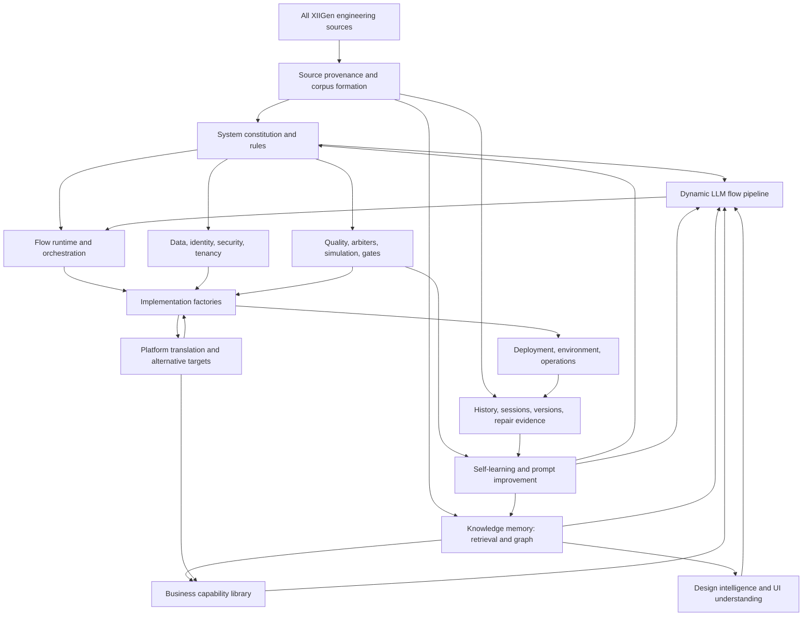
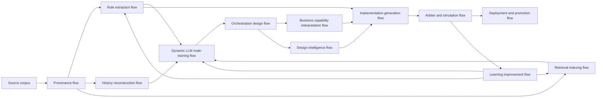

# XIIGen System Engineering Subject Topology v1

## What This Document Is

This is a different grouping method from the previous expertise buckets.

The previous split asked:

> What expertise does this file teach?

This split asks:

> What part of the big XIIGen system was this group of documents trying to resolve?

That means the groups are not just topics. They are engineering problem areas.
Each problem area has sub-subjects underneath it, and the sub-subjects connect
into a topology of flows.

## High-Level Subject

**XIIGen as a self-building, multi-domain, multi-model flow engineering system.**

The whole corpus appears to be trying to resolve one large engineering problem:

> How can a user describe a business, product, design, or system goal, and have
> XIIGen split it into domains, translate it into formal work, plan parallel
> subflows, execute or generate the needed pieces, review the results, format the
> answer, and learn from the whole process?

The attached UML pipeline is the local processing shape for one request. The
document topology below is the larger engineering shape that teaches the
pipeline what each kind of system problem means.

## Topology Summary

The full corpus can be grouped into these high-level system engineering areas:

1. **Source Provenance And Corpus Formation**
2. **System Constitution And Non-Negotiable Rules**
3. **Dynamic LLM Flow Pipeline**
4. **Flow Runtime And Orchestration**
5. **Knowledge Memory: Retrieval And Graph**
6. **Business Capability Library**
7. **Design Intelligence And UI Understanding**
8. **Implementation Factories**
9. **Data, Identity, Security, And Tenancy**
10. **Quality, Arbiters, Simulation, And Gates**
11. **Self-Learning And Prompt Improvement**
12. **Deployment, Environment, And Operations**
13. **Platform Translation And Alternative Targets**
14. **History, Sessions, Versions, And Repair Evidence**

These are not independent folders. They are connected responsibilities.

## Topology Diagram



## How This Relates To The Corrected LLM Pipeline

The corrected UML pipeline is still the local machine:

1. user prompt
2. split prompt into domains
3. translate each domain
4. configure scheme plan
5. process sub-tasks in arrays
6. apply sub-task outputs in arrays
7. translate results in arrays
8. select arbiters and run arbiters before formatting
9. format only approved translated results

The topology in this document tells us what large subject groups feed that
machine.

Example:

- Business capability documents teach the domain splitter what domains a human
  request may contain.
- Architecture-rule documents teach domain translators and arbiters what wording
  is legal.
- Flow-orchestration documents teach the scheme planner how to create parallel
  and ordered subflows.
- Session/history documents teach the learning loop what changed and why.

## Area 1 - Source Provenance And Corpus Formation

### Problem This Area Resolves

The system cannot learn from files until it knows what each source is.

This area resolves:

- which physical file or zip entry is being examined
- whether it is a final source, old version, session file, generated file,
  dependency, binary asset, archive container, or nested archive entry
- what can be read directly
- what is only known from path, extension, archive boundary, or metadata
- which source should not be treated as product truth

### Sub-Subjects

#### 1.1 Physical File Inventory

Resolves the complete list of files under the XIIGen folder.

Training use:

- teaches source identity
- teaches folder context
- teaches file type recognition

#### 1.2 Zip And Nested Zip Boundaries

Resolves what came from which archive.

Training use:

- prevents archive entries from losing provenance
- teaches that a zip file and the files inside it are different source records
- teaches nested archive chains

#### 1.3 Source Role Classification

Resolves whether a file is source truth, history evidence, generated output,
dependency, binary asset, or tooling.

Training use:

- protects the domain splitter from treating every file as equal truth
- gives arbiters a reason to reject unsupported source claims

#### 1.4 Readability And Extraction Limits

Resolves whether the content was actually read or only metadata was available.

Training use:

- teaches result translators not to claim facts from unreadable binary files
- teaches arbiters to flag missing evidence

### Documents That Belong Here

Primary signals:

- archive containers
- zip entries
- nested zip entries
- binary assets
- generated manifest files
- dependency and build output folders

This area is not mainly about business logic. It is about trustworthy source
handling.

## Area 2 - System Constitution And Non-Negotiable Rules

### Problem This Area Resolves

The system needs a constitution: what is allowed, what is forbidden, and what
shape every generated part must obey.

This area resolves:

- fabric-first boundaries
- factory responsibilities
- service contracts
- no fixed-schema assumptions where dynamic documents are required
- result wrapping and error handling rules
- configuration rules
- logging and observability rules
- skill boundaries
- engine DNA rules

### Sub-Subjects

#### 2.1 Fabric And Factory Boundaries

Resolves where external systems are allowed to enter the engine.

Training use:

- teaches translators to express work through allowed boundaries
- teaches arbiters to reject direct coupling

#### 2.2 Service And Interface Contracts

Resolves what each service promises to receive and produce.

Training use:

- feeds scheme planner and domain processor nodes
- keeps generated work consistent

#### 2.3 MACHINE vs FREEDOM

Resolves which parts are fixed and which are configurable.

Training use:

- teaches nodes not to make configurable choices look mandatory
- teaches arbiters to protect non-negotiable rules

#### 2.4 Skill Library And Capability Matrix

Resolves which skills exist, what each one is for, and how skills compose.

Training use:

- helps the splitter and planner route requests to the right domain units

### Documents That Belong Here

Primary signals:

- architecture plans
- AGENTS and CLAUDE-style rule files
- skill index files
- capability matrix documents
- factory and fabric documents
- engine architecture documents

## Area 3 - Dynamic LLM Flow Pipeline

### Problem This Area Resolves

The system needs a repeatable LLM processing shape.

This area resolves:

- user prompt splitting
- domain translation
- scheme planning
- parallel processing arrays
- applier arrays
- result translation arrays
- arbiter selection
- arbiter review before formatting
- feedback loops back to reprocessing

### Sub-Subjects

#### 3.1 Domain Splitter Teaching

Resolves how human requests become domain arrays.

Training use:

- Node 1 direct training

#### 3.2 Domain Translator Teaching

Resolves how domain fragments become formal domain language.

Training use:

- Node 2 direct training

#### 3.3 Scheme Planner Teaching

Resolves how translated domain statements become ordered and parallel work.

Training use:

- Node 3 direct training

#### 3.4 Array Node Teaching

Resolves the fact that domain processors, appliers, and result translators are
arrays, not single units.

Training use:

- Node 4, Node 5, and Node 6 direct training

#### 3.5 Arbiters Before Formatting

Resolves where review happens in the flow.

Training use:

- Node 7 and Node 8 direct training
- prevents the formatter from seeing unapproved results

#### 3.6 Formatter Teaching

Resolves how approved translated fragments become one readable answer.

Training use:

- Node 9 direct training

### Documents That Belong Here

Primary signals:

- dynamic-flow docs
- pipeline diagrams
- learning-set method docs
- node-specific training files
- simulation checks

## Area 4 - Flow Runtime And Orchestration

### Problem This Area Resolves

The pipeline is not enough. The system also needs runtime behavior for actual
flows.

This area resolves:

- visual DAG execution
- triggers
- node state
- parallel branch execution
- wait states
- retries
- compensation
- state persistence
- cross-flow dependencies
- flow versioning
- result storage

### Sub-Subjects

#### 4.1 Flow Definition And Topology

Resolves what a flow is.

Training use:

- teaches scheme planner to produce topology-shaped plans

#### 4.2 Runtime State And Versioning

Resolves how a running flow remembers where it is and which version it uses.

Training use:

- teaches processors and appliers to preserve state

#### 4.3 Parallel Branch Management

Resolves how several branches run at the same time without being collapsed.

Training use:

- teaches array node behavior

#### 4.4 Recovery And Compensation

Resolves what happens when one branch fails.

Training use:

- teaches arbiters and scheme planners to return only affected fragments

#### 4.5 Cross-Flow Impact

Resolves how one flow change affects another flow.

Training use:

- feeds business-flow arbiter training

### Documents That Belong Here

Primary signals:

- flow plans
- topology contracts
- orchestration docs
- flow runtime files
- state files
- cross-flow dependency plans

## Area 5 - Knowledge Memory: Retrieval And Graph

### Problem This Area Resolves

The system needs memory that is grounded in sources.

This area resolves:

- source indexing
- metadata
- retrieval routing
- vector search
- graph relationships
- context assembly
- evidence selection
- gap completion
- source confidence

### Sub-Subjects

#### 5.1 Source Index

Resolves which documents exist and what metadata they carry.

Training use:

- teaches retrieval routing

#### 5.2 Vector Retrieval

Resolves similarity-based lookup.

Training use:

- helps select related examples

#### 5.3 GraphRAG

Resolves dependency, prerequisite, and relationship lookup.

Training use:

- teaches the system to reason over relationships instead of just similar text

#### 5.4 Context Assembly

Resolves what evidence enters a node prompt.

Training use:

- prevents unsupported answer generation

#### 5.5 Retrieval Quality Feedback

Resolves how retrieval improves after failures.

Training use:

- feeds self-learning and prompt improvement

### Documents That Belong Here

Primary signals:

- RAG initialization
- GraphRAG plans
- source indexes
- context planner docs
- retrieval router files
- graph relationship schemas

## Area 6 - Business Capability Library

### Problem This Area Resolves

XIIGen needs domain knowledge about common product systems.

This area resolves:

- what modules typical products contain
- what flows those modules support
- how business entities move through the product
- what edge cases exist
- what the user-facing meaning is

### Sub-Subjects

#### 6.1 Identity And Onboarding

Resolves signup, login, profile, business onboarding, and first-use flows.

#### 6.2 Social, Feed, Graph, And Messaging

Resolves social networks, friend requests, feeds, reactions, messages, graph
access, and sponsored content.

#### 6.3 Commerce, Marketplace, Shops, And Payments

Resolves shops, listings, checkout, sellers, orders, disputes, payouts, and
platform monetization.

#### 6.4 Events, Calendar, Learning, And Gamification

Resolves event creation, participation, learning calendars, lessons, quizzes,
points, and recovery.

#### 6.5 Finance, ERP, Data Warehouse, And Operations

Resolves finance, ERP modules, ClickUp/Zoho warehouse thinking, accounting,
inventory, operations, and reporting.

#### 6.6 Forms, Blog, CMS, And Publishing

Resolves form builders, workflow automation, blog modules, comments, media,
publishing, and content systems.

#### 6.7 Freelance And Work Platforms

Resolves projects, bids, contests, contracts, work evidence, escrow, and
enterprise compliance.

### Documents That Belong Here

Primary signals:

- business flow documents
- module maps
- product comparison docs
- domain-specific plans

## Area 7 - Design Intelligence And UI Understanding

### Problem This Area Resolves

The system needs to understand design artifacts as functional systems, not only
as pixels.

This area resolves:

- Figma screen extraction
- component meaning
- visual hierarchy
- layout intent
- design-to-function mapping
- system type inference
- missing-function gap completion
- visual-editor behavior

### Sub-Subjects

#### 7.1 Figma Ingestion

Resolves how design files enter the system.

#### 7.2 DesignIR

Resolves structural representation of frames, layers, components, text, and
assets.

#### 7.3 ScreenSemanticsIR

Resolves what a screen means functionally.

#### 7.4 Module Mapping

Resolves which business/system modules the screen implies.

#### 7.5 System Type Inference

Resolves whether the product is a shop, social app, dashboard, CMS, workflow
tool, report, or other system.

#### 7.6 Gap Completion

Resolves missing screens, missing flows, and missing product capabilities.

### Documents That Belong Here

Primary signals:

- Design to Figma folders
- visual editor docs
- design intelligence docs
- Figma-to-code packages
- UI extraction and naming/debug documents

## Area 8 - Implementation Factories

### Problem This Area Resolves

The system must eventually turn plans into working implementation artifacts.

This area resolves:

- backend services
- client screens
- providers
- connectors
- generated files
- package boundaries
- service contracts
- target platform output

### Sub-Subjects

#### 8.1 Backend Services And Providers

Resolves server-side implementation responsibilities.

#### 8.2 Frontend And Mobile Rendering

Resolves client-side behavior and rendering.

#### 8.3 Provider Connectors

Resolves integration with external tools and services.

#### 8.4 WordPress And CMS Packaging

Resolves plugin, theme, shortcode, block, and CMS-specific output.

#### 8.5 Generated Artifact Registration

Resolves how generated outputs become known to the system.

### Documents That Belong Here

Primary signals:

- server/client code
- provider files
- WordPress packages
- implementation package zips
- generated project files

## Area 9 - Data, Identity, Security, And Tenancy

### Problem This Area Resolves

The system must protect data and preserve tenant boundaries while operating
across many flows.

This area resolves:

- tenant context
- authorization
- identity
- privacy
- data isolation
- dynamic documents
- database/search/cache behavior
- audit and compliance

### Sub-Subjects

#### 9.1 Identity And Authorization

Resolves who the user is and what they are allowed to do.

#### 9.2 Tenant Isolation

Resolves tenant boundaries across data, cache, events, logs, jobs, and recovery.

#### 9.3 Dynamic Data And Search

Resolves dynamic document storage, search index usage, filters, and schemas.

#### 9.4 Audit And Compliance

Resolves evidence that sensitive operations were safe and traceable.

### Documents That Belong Here

Primary signals:

- authorization folders
- multi-tenancy docs
- database fabric docs
- security plans
- cache/search/storage docs

## Area 10 - Quality, Arbiters, Simulation, And Gates

### Problem This Area Resolves

The system needs to know when not to trust an output.

This area resolves:

- business-flow arbiters
- architecture arbiters
- security arbiters
- evidence coverage gates
- simulation tests
- validation fixtures
- test plans
- review loops

### Sub-Subjects

#### 10.1 Arbiter Selection

Resolves which review units need to fire for a result collection.

#### 10.2 Arbiter Judgment

Resolves whether a result passes, raises concern, or must be reprocessed.

#### 10.3 Simulation

Resolves whether a trained node set can reproduce the expected output.

#### 10.4 Test Fixtures

Resolves concrete pass/fail examples.

#### 10.5 Release Gates

Resolves whether generated work can be promoted.

### Documents That Belong Here

Primary signals:

- test plans
- arbiter docs
- simulation docs
- validation reports
- fixtures
- stress tests

## Area 11 - Self-Learning And Prompt Improvement

### Problem This Area Resolves

The system must improve after failures without corrupting previous knowledge.

This area resolves:

- prompt assets
- prompt versions
- teaching examples
- DPO-like preference data
- judge feedback
- failure-to-example conversion
- learning loops
- curation decisions

### Sub-Subjects

#### 11.1 Prompt Assets And Policies

Resolves how prompts are selected and versioned.

#### 11.2 Evaluation Sets

Resolves how failures become tests.

#### 11.3 Judge Feedback

Resolves which output was better and why.

#### 11.4 Dataset Curation

Resolves what enters the learning set and what is rejected.

#### 11.5 Safe Learning Boundaries

Resolves tenant isolation and source trust during learning.

### Documents That Belong Here

Primary signals:

- learning sets
- prompt improvement docs
- teaching files
- DPO pipeline files
- judge and feedback documents

## Area 12 - Deployment, Environment, And Operations

### Problem This Area Resolves

The system must run, test, back up, restore, and promote itself.

This area resolves:

- local environment
- CI/CD
- deployment
- backup and restore
- operational monitoring
- environment factory
- provider abstraction
- release evidence

### Sub-Subjects

#### 12.1 Environment Factory

Resolves how environments are created.

#### 12.2 CI/CD Normalization

Resolves how different pipelines become a shared contract.

#### 12.3 Backup And Restore

Resolves recovery proof.

#### 12.4 Observability

Resolves operational visibility.

#### 12.5 Promotion

Resolves how work moves from generated to accepted.

### Documents That Belong Here

Primary signals:

- devops docs
- CI/CD plans
- environment files
- deployment docs
- backup/restore plans

## Area 13 - Platform Translation And Alternative Targets

### Problem This Area Resolves

XIIGen should not be locked to one implementation stack.

This area resolves:

- canonical skill specification
- target adapters
- React, Vue, Angular, React Native
- WordPress plugin/theme
- Node, .NET, Java, Go, Rust, PHP, Python
- target tests
- target packaging

### Sub-Subjects

#### 13.1 Canonical Skill

Resolves the stack-independent behavior.

#### 13.2 Client Alternatives

Resolves framework-specific UI output.

#### 13.3 Server Alternatives

Resolves language-specific service output.

#### 13.4 WordPress Alternatives

Resolves plugin and theme packaging.

#### 13.5 Target Validation

Resolves whether the translated target still behaves the same.

### Documents That Belong Here

Primary signals:

- translate-to folders
- migration plans
- multi-target docs
- WordPress integration docs

## Area 14 - History, Sessions, Versions, And Repair Evidence

### Problem This Area Resolves

The current plans were not produced in one step. The system needs to understand
how ideas changed, what was corrected, and which version should be trusted.

This area resolves:

- creation sessions
- old versions
- failed attempts
- corrected attempts
- state checkpoints
- user corrections
- repair instructions
- later use evidence

### Sub-Subjects

#### 14.1 Creation Evidence

Resolves which session created a document.

#### 14.2 Version Differences

Resolves what changed between copies.

#### 14.3 User Corrections

Resolves what the user rejected or clarified.

#### 14.4 Resume State

Resolves where a future session should continue.

#### 14.5 Repair Knowledge

Resolves what not to repeat.

### Documents That Belong Here

Primary signals:

- session files
- old and Older folders
- `.claude` worktrees
- history archives
- state files
- repair guidance

## Topology As A Flow Of Flows

The whole system can be viewed as nested flows:



## Sub-Subject Dependency Table

| From | To | Why this edge exists |
|---|---|---|
| Source Provenance | System Constitution | Rules must be traceable to source files. |
| Source Provenance | History Evidence | Sessions and versions need source identity. |
| Source Provenance | Retrieval Memory | Retrieval indexes need metadata and source boundaries. |
| System Constitution | Dynamic LLM Pipeline | The pipeline must obey non-negotiable rules. |
| System Constitution | Implementation Factories | Generated outputs must follow fabric/factory boundaries. |
| Retrieval Memory | Dynamic LLM Pipeline | Nodes need grounded context. |
| Business Capability Library | Dynamic LLM Pipeline | The splitter and translator need domain knowledge. |
| Design Intelligence | Dynamic LLM Pipeline | Design requests need their own domain language. |
| Dynamic LLM Pipeline | Flow Runtime | Node outputs become executable flow plans. |
| Flow Runtime | Implementation Factories | Runtime plans become generated artifacts. |
| Data/Security/Tenancy | Implementation Factories | Implementations must preserve data and tenant safety. |
| Quality/Arbiters | Implementation Factories | Work cannot promote without review. |
| Implementation Factories | Deployment/Ops | Generated artifacts must run somewhere. |
| Quality/Arbiters | Self-Learning | Failures become learning examples. |
| History Evidence | Self-Learning | Corrections and prior failures teach future behavior. |
| Self-Learning | Retrieval Memory | Better examples and metadata improve future context. |
| Self-Learning | System Constitution | Repeated failures may reveal missing rules. |
| Platform Translation | Implementation Factories | Target adapters are generated implementation paths. |

## How To Use This Topology To Split Learning Sets

The correct split is not:

> one giant file list by extension

The better split is:

> one topology area at a time, with sub-subjects inside it, and all nine UML node
> files generated for that area.

Recommended output structure:

```text
system-topology-learning-sets/
  01-source-provenance/
    group-index.md
    sub-subjects.csv
    node-01-domain-splitter-set.jsonl
    ...
    node-09-formatter-set.jsonl
  02-system-constitution/
  03-dynamic-llm-flow-pipeline/
  04-flow-runtime-orchestration/
  ...
  14-history-sessions-versions-repair/
```

Each area receives:

- documents that solve that system problem
- sub-subject labels for what each document was resolving
- all nine node training files
- simulation checks for the area

## Why This Is Better Than Only Expertise Groups

Expertise groups say:

> this looks like design, backend, testing, or history

System topology groups say:

> this group exists because the big system needed to solve source trust,
> architecture legality, flow execution, grounded memory, business meaning,
> design meaning, implementation, review, deployment, translation, or learning.

That is closer to the actual engineering intent of the corpus.

## First Practical Next Step

Create topology-area batches from the compact all-files manifest:

1. assign each source record to one topology area
2. assign one sub-subject inside that topology area
3. keep source role separately
4. generate one `sub-subjects.csv`
5. split the nine node JSONL files by topology area
6. run count validation per area

