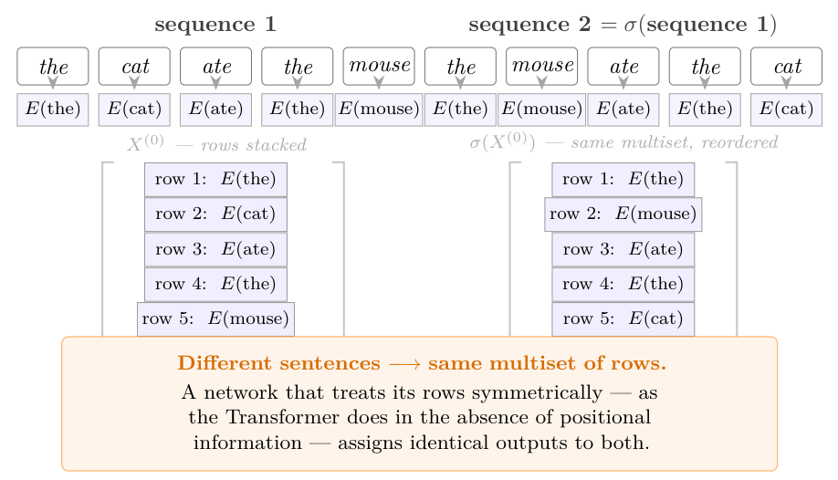

# Chapter 1 · Embeddings, hidden states, and sinusoidal positions

[Library index](../README.md) · [Source and transcription policy](../SOURCE.md)

This is an English transcription of PDF pages 37–43, corresponding to printed pages 1–7. Page boundaries, statement numbers, formulas, and the source's wording are retained. Running headers and standalone page-number footers are omitted. Editorial notices are explicitly marked. The proof of Proposition 1.10 continues beyond this file.

## PDF 37 · Book 1

### Chapter 1. Sequences, Embeddings, and Positional Encoding

There is a question that precedes everything else in this book, and it is not a question about neural networks. It is a question about representation.

A language is built on a vocabulary: a finite set of symbols from which sequences are drawn. The symbols might be words, or word fragments, or characters, or codons in a genome, or opcodes in a compiled program. The details do not matter. What matters is that symbols, as abstract objects, carry no geometric structure. The word *cat* is not close to the word *dog* in any intrinsic sense, not because their meanings are distant, but because the set $\{\textit{cat},\textit{dog},\textit{photosynthesis},\ldots\}$ is simply a set — it has no metric, no topology, no notion of direction or angle or distance. You cannot add two symbols, rotate one, project another onto a subspace. The operations of linear algebra are not available.

This is a serious obstacle. The mathematical machinery that makes the Transformer work — the score matrix, the attention weights, the motor formalism of Part III — is linear algebra from beginning to end. To apply it, we must first move from the discrete world of symbols to the continuous world of vectors. This move is called *embedding*, and it is the subject of this chapter.

The idea of embedding language in a vector space has a long history. Distributional semantics formalised the intuition that words appearing in similar contexts should have similar representations. Word2Vec (Mikolov et al., 2013) turned this intuition into a practical algorithm, producing fixed vectors for each word in a vocabulary. GloVe (Pennington et al., 2014) refined the approach using global co-occurrence statistics. These embeddings were static: once trained, the vector for *bank* was the same whether the surrounding context spoke of rivers or of finance.

The Transformer abandoned static embeddings. In a Transformer, the vector representing a token changes at every layer, as the token’s representation is updated by its interactions with every other token in the sequence. The embedding that concerns us in this chapter — the initial map from vocabulary to $\mathbb{R}^d$, where $d$ is the model dimension defined precisely in Section 1.1 — is therefore only the starting point. It provides raw material; the network’s job is to refine it. But the properties we demand of the embedding at the outset, and the properties that subsequent operations preserve or destroy, determine everything that follows. This is why the geometry of the initial representation deserves careful attention.

The chapter proceeds in four stages. Section 1.1 defines the vocabulary, the embedding

## PDF 38 · Book 2

map, and the matrix of initial representations. Section 1.3 adds the information that the pure embedding discards: the order of the tokens in the sequence. Section 1.4 introduces layer normalisation and proves the Rank-Neutrality Theorem, the first original result of this book. Section 1.6 introduces residual connections and the cumulative representation that will reappear, in a richer form, throughout Parts III and IV.

The reader who completes this chapter will hold in hand a single object: the matrix $X\in\mathbb{R}^{n\times d}$, where $n$ is the sequence length and $d$ the model dimension, equipped with its structure, its invariants, and its first theorem. Chapter 2 will put it to work.

A note on the structure of this chapter. Sections 1.1, 1.2, and 1.6 are short and require only basic linear algebra. Sections 1.3 and 1.5 are more demanding: they contain original theorems with complete proofs and draw on ideas from information geometry and functional analysis. A reader whose primary interest is the self-attention mechanism may read Sections 1.1–1.2 carefully, skim the statements of the main results in Sections 1.3–1.5 on a first pass, and return to the proofs when the results are invoked in later chapters. Nothing in Chapters 2 through 8 requires the proofs — only the statements.

### 1.1 From Symbols to Vectors: The Vocabulary and the Embedding Map

Fix a finite set $\mathcal{V}$, called the *vocabulary*. Its elements are *tokens*: atomic units of the sequences the model will process. Depending on the application, tokens may be words, subword fragments produced by byte-pair encoding, individual characters, codons in a nucleotide sequence, or any other discrete symbol from which sequences are assembled. In BERT (Devlin et al., 2019a), the vocabulary has cardinality $|\mathcal{V}|=30{,}522$; the biological experiments of Chapter 3 use a vocabulary of $k$-mer fragments of RNA ($k$-mers are contiguous substrings of length $k$, a standard tokenisation unit in computational genomics).

The vocabulary carries no intrinsic metric structure. There is no natural sense in which the token *bank* is closer to *river* than to *interest*, or in which *UUG* is adjacent to *UUA* in the space of codons. A vocabulary is a set, and sets do not have distances. This absence is not a deficiency to be regretted — it is the starting condition that makes the problem of representation nontrivial. If symbols already lived in a metric space, there would be nothing to learn.

The embedding map is the bridge between the discrete world of symbols and the continuous world of vectors. It assigns to each token a point in $\mathbb{R}^d$, where $d=d_{\mathrm{model}}$ is a fixed positive integer — a design choice that determines the dimensionality of every computation in the network. The geometry of $\mathbb{R}^d$, and in particular its inner product, will be the medium in which all subsequent operations take place. Choosing $d$ large enough to represent the relevant structure of the vocabulary, while keeping computation tractable, is a practical constraint: $d=768$ for $\mathrm{BERT}_{\mathrm{base}}$ and $d=1024$ for $\mathrm{BERT}_{\mathrm{large}}$.

What does it mean for an embedding to be *good*? The question sounds vague, but this book adopts a precise geometric answer: an embedding is good if the algebraic operations available in $\mathbb{R}^d$ — inner products, projections, rotations — correspond to operations that are meaningful in the original symbolic domain. The self-attention mechanism that we construct in Chapter 2 is designed precisely to exploit this correspondence: it computes, for every pair of tokens, a score that depends on the inner product of their embedded representations. The quality of the embedding determines the quality of that score. We formalise this now.

**Definition 1.1 (Vocabulary and one-hot encoding).** A *vocabulary* is a finite set $\mathcal{V}$ with a

## PDF 39 · Book 3

fixed bijection $\iota:\mathcal{V}\to\{1,\ldots,|\mathcal{V}|\}$ — that is, a one-to-one correspondence that assigns a unique integer index to each token — called the *token index*. The *one-hot encoding* of a token $v\in\mathcal{V}$ is the standard basis vector $e_{\iota(v)}\in\mathbb{R}^{|\mathcal{V}|}$, whose $\iota(v)$-th coordinate is $1$ and all others are $0$.

The one-hot encoding is injective and spans $\mathbb{R}^{|\mathcal{V}|}$, but it is an impractical representation: for a vocabulary of 30,522 tokens, each symbol is a vector of dimension 30,522, almost all of whose coordinates are zero. More importantly, one-hot vectors are orthogonal by construction: every two distinct tokens are at the same distance from each other, in a representation that knows nothing about their relationships. The embedding map replaces this high-dimensional, information-free representation with a dense, low-dimensional one in which proximity in $\mathbb{R}^d$ can encode semantic or syntactic relatedness.

**Definition 1.2 (Embedding map and embedding matrix).** An *embedding map* is a function $E:\mathcal{V}\to\mathbb{R}^d$. It is equivalently represented by the *embedding matrix* $W_E\in\mathbb{R}^{|\mathcal{V}|\times d}$, whose $k$-th row is $E(\iota^{-1}(k))$. The embedding of a token $v\in\mathcal{V}$ is the row vector

$$
E(v)=e_{\iota(v)}^{\top}W_E\in\mathbb{R}^{1\times d}.
$$

The matrix $W_E$ is a parameter of the model: its entries are initialised at random and optimised during training.

**Remark 1.3 (Injectivity and the role of training).** Nothing in Definition 1.2 forces $E$ to be injective. In practice, the rows of $W_E$ are initialised from a continuous distribution, so distinct tokens receive distinct initial representations with probability one. Whether injectivity is preserved after training is a question that depends on the task and the loss function. For the purposes of this book we do not assume injectivity, though we will see in Section 1.5 that the rank of the sequence representation — a measure of how many linearly independent directions the embedded tokens span — is a meaningful and theoretically significant quantity.

**Remark 1.4 (Static versus contextual embeddings).** The map $E$ defined above assigns a single vector to each token, regardless of its context in the sequence. This is the sense in which it is a *static* embedding, analogous in structure to Word2Vec (Mikolov et al., 2013) or GloVe (Pennington et al., 2014), though $W_E$ in a Transformer is trained jointly with the rest of the model rather than separately. The representations that emerge at the output of each attention layer are not static — they are functions of the entire input sequence. These *contextual* representations are the object of study from Chapter 2 onward. The static embedding of this chapter is their starting point: raw material, not the final product.

### 1.2 The Hidden State Matrix

Given a sequence of $n$ tokens $(t_1,t_2,\ldots,t_n)$ drawn from the vocabulary $\mathcal{V}$, the embedding map $E$ produces $n$ vectors in $\mathbb{R}^d$, one for each token. The natural way to organise these vectors is as the rows of a matrix: position $i$ in the sequence corresponds to row $i$, and the $d$ embedding dimensions correspond to the columns. This matrix is the starting point for all subsequent computation in the network.

The term *hidden states* is inherited from the recurrent network tradition, where the hidden state at step $t$ was a running summary of everything the model had processed up to token $t$ — a single vector that carried the entire history of the sequence. In a Transformer there is no such temporal accumulation. All $n$ tokens are processed simultaneously, and the hidden state of token $i$ at a given layer is not a summary of tokens $1$ through $i$ but a representation of token $i$ in the context of the entire sequence. The terminology survives, but its meaning has shifted: hidden states are no longer temporal summaries but contextual representations.

## PDF 40 · Book 4

In this chapter, $X$ denotes the hidden state matrix at the input to the first layer — the result of embedding alone, before any interaction between tokens has taken place. The geometry we establish for this initial $X$ will hold, with the same notation, at every subsequent layer of the network.

**Definition 1.5 (Hidden state matrix).** Let $(t_1,t_2,\ldots,t_n)$ be a sequence of tokens with $t_i\in\mathcal{V}$, and let $E:\mathcal{V}\to\mathbb{R}^d$ be the embedding map of Definition 1.2. The *initial hidden state matrix* is

$$
X^{(0)}=
\begin{pmatrix}
E(t_1)\\
E(t_2)\\
\vdots\\
E(t_n)
\end{pmatrix}
\in\mathbb{R}^{n\times d},
$$

where each $E(t_i)\in\mathbb{R}^{1\times d}$ is a row vector. The integer $n$ is the *sequence length* and $d=d_{\mathrm{model}}$ is the *model dimension*. When the layer index is not needed, we write $X$ for $X^{(0)}$.

The convention that tokens index rows and embedding dimensions index columns is fixed throughout this book. It is the convention that makes the score matrix of Chapter 2 most natural: when we write $L=XMX^{\top}$, the $(i,j)$ entry of the $n\times n$ matrix $L$ will measure the relationship between token $i$ and token $j$, exactly as expected.

Because this score matrix will appear in several of the results of the present chapter — most notably in the theorems of Section 1.3 — it is useful to record its definition now, even though its role only becomes fully clear in Chapter 2.

**Definition 1.6 (Score and attention matrices).** *(Anticipated from Chapter 2.)* Let $M\in\mathbb{R}^{d\times d}$ be a square matrix, called the *attention matrix*, formed from the query and key projection weights of a self-attention head — its precise construction is given in Chapter 2. Given a hidden state matrix $X\in\mathbb{R}^{n\times d}$, the associated *score matrix* is

$$
L=XMX^{\top}\in\mathbb{R}^{n\times n},\qquad L_{ij}=x_i\,M\,x_j^{\top},
$$

where $x_i$ is the $i$-th row of $X$. The entry $L_{ij}$ is a scalar that quantifies how strongly position $i$ attends to position $j$ in the self-attention computation.

Three points about this preview definition. First, $M$ is *not symmetric* in general: its symmetric and antisymmetric parts will play different structural roles, to be analysed in Chapters 2 and 9. Second, $L$ depends bilinearly on $X$: replacing $X$ by $AX$ gives $L\to ALA^{\top}$, which is why the rank of $X$ — to be studied in Section 1.5 — controls the rank of $L$. Third, the reader for whom this anticipated definition is uncomfortable may read the next sections formally, treating $L$ as a given bilinear map whose concrete construction is deferred.

**Remark 1.7 (On the row convention).** The literature is not uniform on this point. Many papers and implementations represent sequences with tokens as columns, giving a matrix of shape $d\times n$. The two conventions are transposes of each other and carry identical information. We adopt the row convention because it aligns with the standard notation for datasets in statistics and machine learning (one observation per row), and because it makes the index arithmetic in the attention mechanism more transparent. The reader who encounters the column convention elsewhere should apply a transpose wherever $X$ appears.

### 1.3 Positional Encoding: Geometry of Order

The matrix $X^{(0)}$ defined in the previous section is blind to order. The embedding $E(t_i)$ depends on the identity of the token at position $i$, not on its position. If one permutes the

## PDF 41 · Book 5

**Figure 1.1: The problem solved by positional encoding.**

*The sentences the cat ate the mouse and the mouse ate the cat produce the same multiset of row vectors, in different orders. A network that treats its rows symmetrically — as the Transformer does in the absence of positional information — cannot distinguish them. Theorem 1.8 formalises this observation.*

rows of $X^{(0)}$ — equivalently, if one reorders the tokens in the sequence — the matrix changes, but the value assigned to each token does not. The sentence *the cat ate the mouse* and the sentence *the mouse ate the cat* produce the same multiset of row vectors, arranged in a different order. For any mechanism that treats all rows symmetrically, these two sentences are indistinguishable. Figure 1.1 illustrates the phenomenon.

This is not a deficiency of the embedding — it is a structural limitation of any architecture that is equivariant to permutations of its input. The question is whether such equivariance can be broken, and if so, how. The answer to the first part is simple and is given by Theorem 1.8 below: it cannot be broken without adding an object that is indexed by position independently of the token. The answer to the second part occupies the rest of this section.

### 1.3.1 The necessity of positional information

Before introducing any specific positional encoding, it is worth establishing that positional information is genuinely necessary — that no architecture without it can solve tasks that are sensitive to order. The following result formalises this.

**Theorem 1.8 (Necessity of positional encoding).** Let $f$ be any function computed by a Transformer with no positional encoding — that is, a model whose input is $X^{(0)}$ alone, with no additive or multiplicative positional signal.[^p5-1] Then $f$ is equivariant to permutations of the input sequence: for any permutation $\sigma$ of $\{1,\ldots,n\}$,

$$
f(t_{\sigma(1)},\ldots,t_{\sigma(n)})_{\sigma(i)}
=f(t_1,\ldots,t_n)_i\qquad\forall i,
$$

where the subscript denotes the output at position $i$. In particular, $f$ commutes with permutations:

> **Editorial page-boundary notice.** The original splits the word “permutations” between printed pages 5 and 6. The word is joined above for searchability; the sentence continues below. The displayed permutation indices are retained as printed; see the [interpretation note](../notes/02-order-and-sinusoidal-encoding.md#source-issues) for a convention-independent formulation.

[^p5-1]: The proof uses the score matrix $L$, the softmax attention weights, and the weighted aggregation step that together constitute a single attention head. These objects are introduced informally here and formalised in Chapter 2. The theorem should therefore be read as an anticipation: its content is independent of any particular attention mechanism, and the proof adapts verbatim to every variant constructed in subsequent chapters.

## PDF 42 · Book 6

applying a permutation $\sigma$ to the input sequence permutes the outputs by $\sigma$ in exactly the same way. Consequently, any permutation-invariant readout applied after such a model — such as a pooled classification head, or any loss that depends only on the unordered multiset of token outputs — assigns identical values to two sequences related by a non-trivial permutation, and therefore cannot distinguish them.

*Proof.* The self-attention score between positions $i$ and $j$ is the $(i,j)$ entry $L_{ij}=E(t_i)ME(t_j)^{\top}$ of the score matrix $L$, where $M$ is a square matrix assembled from the learned projection weights (defined formally in Chapter 2). This score depends only on the token identities $t_i$ and $t_j$, not on the indices $i$ and $j$ themselves. Applying a permutation $\sigma$ to the input replaces $t_i$ with $t_{\sigma(i)}$ for each $i$, which permutes the rows and columns of $L$ by $\sigma$: the $(\sigma(i),\sigma(j))$ entry of the permuted score matrix equals the $(i,j)$ entry of the original. The softmax normalisation is applied independently to each row, so permuting the rows of $L$ before the softmax produces the same result as applying the softmax first and then permuting: the output attention weights are permuted by $\sigma$ in exactly the same way. The weighted aggregation step — which forms a linear combination of input rows using the attention weights as coefficients — inherits the same equivariance: the output at position $\sigma(i)$ of the permuted input equals the output at position $i$ of the original. All subsequent layers repeat the same argument by induction. $\square$

The proof is elementary, but the consequence is sharp: any task that distinguishes *the cat ate the mouse* from *the mouse ate the cat* through a permutation-invariant loss — which is to say, any task for which word order matters at the level of the readout — is beyond the reach of a permutation-equivariant model. Positional information is not a convenience; it is a necessity.

**Takeaway.** *Without positional information, self-attention sees the input as an unordered set. Positional encoding is therefore not an implementation detail, but the mechanism that breaks permutation symmetry.*

### 1.3.2 The sinusoidal encoding as a Fourier basis

The solution proposed by Vaswani et al. (2017) is to add to each row of $X^{(0)}$ a vector that depends on the position $i$ but not on the token. This vector is chosen to be a truncated Fourier basis evaluated at $i$, with frequencies decreasing geometrically across the embedding dimensions.

**Definition 1.9 (Sinusoidal positional encoding).** For $i\in\{1,\ldots,n\}$ and $k\in\{0,\ldots,d/2-1\}$, define the frequency

$$
\omega_k=\frac{1}{10000^{2k/d}}.
$$

The *sinusoidal positional encoding* is the matrix $\mathrm{PE}\in\mathbb{R}^{n\times d}$ with entries

$$
\mathrm{PE}_{i,2k}=\sin(\omega_k i),\qquad
\mathrm{PE}_{i,2k+1}=\cos(\omega_k i).
$$

The *positionally augmented hidden state matrix* is

$$
X_{\mathrm{pos}}=X^{(0)}+\mathrm{PE}\in\mathbb{R}^{n\times d}.
$$

Vaswani et al. introduce this encoding without theoretical justification, noting only that it performs comparably to a learned alternative. The connection to Fourier analysis is implicit but not developed. We make it explicit now.

## PDF 43 · Book 7

To see the structure, consider what happens to a single pair of columns — say columns $2k$ and $2k+1$. As the position $i$ increases from $1$ to $n$, the pair $(\sin(\omega_k i),\cos(\omega_k i))$ traces a circle of radius $1$ in $\mathbb{R}^2$, completing one full revolution every $2\pi/\omega_k$ steps. Slow frequencies (small $\omega_k$, large $k$) complete their revolution over thousands of positions; fast frequencies (large $\omega_k$, small $k$) complete it in a few steps. The full matrix $\mathrm{PE}$ stacks $d/2$ such circles side by side, one for each frequency. Every position $i$ is mapped to a point on each circle simultaneously — its positional encoding is the collection of all these points.

The $k$-th pair of columns of $\mathrm{PE}$ is precisely the evaluation of the complex exponential $e^{\mathrm{i}\omega_k\cdot}$ at the positions $1,\ldots,n$, split into real and imaginary parts. The full matrix $\mathrm{PE}$ is therefore a *truncated Fourier basis* on the discrete set $\{1,\ldots,n\}$, with $d/2$ frequencies $\omega_0>\omega_1>\cdots>\omega_{d/2-1}$ spanning from $\omega_0=1$ (period $2\pi$) to $\omega_{d/2-1}=10000^{-1}$ (period $2\pi\cdot10000$, much larger than any practical sequence length). This geometric spacing ensures that no two frequencies are identical and that the basis captures structure at all scales simultaneously — from fine-grained local patterns to long-range global dependencies.

> **Editorial source-fidelity notice.** The endpoint equality $\omega_{d/2-1}=10000^{-1}$ above is reproduced exactly from the source. Its inconsistency with Definition 1.9 is recorded in the [interpretation note](../notes/02-order-and-sinusoidal-encoding.md#source-issues), without changing the transcription.

The following proposition makes the algebraic structure of $\mathrm{PE}$ precise and identifies its key geometric property.

**Proposition 1.10 (Block-rotation structure and positional separability).** The matrix $\mathrm{PE}$ has the following properties.

**(i) (Block structure.)** For each $k\in\{0,\ldots,d/2-1\}$, the submatrix of $\mathrm{PE}$ formed by columns $2k$ and $2k+1$ traces a circle of radius $1$ in $\mathbb{R}^2$ as $i$ varies, parameterised by the rotation matrix $R$ at angular frequency $\omega_k$:

$$
\begin{pmatrix}
\mathrm{PE}_{i,2k}\\
\mathrm{PE}_{i,2k+1}
\end{pmatrix}
=R(-\omega_k i)\begin{pmatrix}0\\1\end{pmatrix},\qquad
R(\theta)=\begin{pmatrix}\cos\theta&-\sin\theta\\\sin\theta&\cos\theta\end{pmatrix}.
$$

**(ii) (Approximate shift-equivariance.)** The difference $\mathrm{PE}_{i+\delta}-\mathrm{PE}_i$ is not constant in $i$ in general, but the inner product $\mathrm{PE}_i\cdot\mathrm{PE}_j$ depends only on the difference $i-j$:

$$
\mathrm{PE}_i\cdot\mathrm{PE}_j
=\sum_{k=0}^{d/2-1}\cos(\omega_k(i-j)).
$$

**(iii) (Positional separability.)** For integer positions $i,j\in\{1,\ldots,n\}$, the rows of $\mathrm{PE}$ are all distinct: $\mathrm{PE}_i\ne\mathrm{PE}_j$ for $i\ne j$.

*Proof.* *(i)* Direct verification:

$$
R(-\omega_k i)\begin{pmatrix}0\\1\end{pmatrix}
=\begin{pmatrix}\cos(-\omega_k i)&-\sin(-\omega_k i)\\\sin(-\omega_k i)&\cos(-\omega_k i)\end{pmatrix}\begin{pmatrix}0\\1\end{pmatrix}
=\begin{pmatrix}\sin(\omega_k i)\\\cos(\omega_k i)\end{pmatrix},
$$

which matches $(\mathrm{PE}_{i,2k},\mathrm{PE}_{i,2k+1})^{\top}$ by Definition 1.9. Each pair of columns therefore traces the unit circle in $\mathbb{R}^2$ as $i$ varies, with angular velocity $\omega_k$ (and orientation reversed relative to the canonical rotation, due to the Vaswani convention placing $\sin$ before $\cos$).

*(ii)* By direct computation:

$$
\begin{aligned}
\mathrm{PE}_i\cdot\mathrm{PE}_j
&=\sum_{k=0}^{d/2-1}\bigl[\sin(\omega_k i)\sin(\omega_k j)+\cos(\omega_k i)\cos(\omega_k j)\bigr]\\
&=\sum_{k=0}^{d/2-1}\cos(\omega_k(i-j)).
\end{aligned}
$$

> **Editorial continuation notice.** Printed page 7 ends here. Part (iii) of this proof continues on [PDF page 44 / printed page 8](0044-0050-ch01-trainable-and-statistical-position.md#pdf-0044). The proof is not complete within this file.
