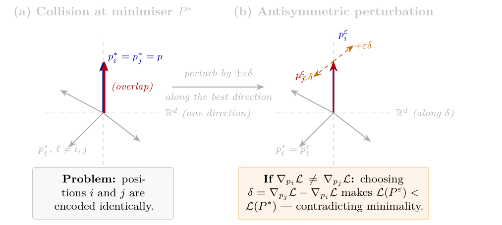

# Chapter 1: trainable and statistical positional encoding

[Library index](../README.md) · [Source and transcription policy](../SOURCE.md) · [Previous pages: PDF 37–43](0037-0043-ch01-embeddings-and-sinusoidal.md)

> Editorial note: This is a transcription of PDF pages 44–50, corresponding to printed pages 8–14. Page boundaries, mathematical numbering, source claims and source defects are preserved. Editorial observations are explicitly labelled and do not form part of the book. This range begins with the continuation of Proposition 1.10's proof and ends in an unfinished paragraph. Critical reading of the positional-separation claims is available in [the Russian note](../notes/03-trainable-positional-separation.md).

## PDF 44 · Book 8

> Editorial boundary: continuation of the proof of Proposition 1.10 from [PDF 43](0037-0043-ch01-embeddings-and-sinusoidal.md#pdf-0043).

*(iii)* Suppose $\mathrm{PE}_i=\mathrm{PE}_j$ for some $i,j\in\{1,\ldots,n\}$ with $i\ne j$. Looking at the first frequency $\omega_0=1/10000^0=1$, equality of the first two columns gives

$$
\sin(i)=\sin(j)\quad\text{and}\quad\cos(i)=\cos(j).
$$

The pair $(\sin(\theta),\cos(\theta))$ uniquely determines $\theta$ modulo $2\pi$, so $i-j\in2\pi\mathbb Z$. But $i-j$ is a non-zero integer, while $2\pi m$ is irrational for every non-zero integer $m$ (and zero only for $m=0$). Hence $i-j\in2\pi\mathbb Z$ forces $i=j$, contradicting $i\ne j$. $\square$

Part (ii) of the proposition reveals an important limitation of the sinusoidal encoding: shift-equivariance holds for inner products (the similarity between two position vectors depends only on their distance) but not for differences. This means that when PE enters the score matrix additively, the positional contribution to the attention score between tokens $i$ and $j$ depends on $i-j$ — a desirable property — but the positional contribution to the norm of each token representation does not. The discrepancy is the source of the approximate, rather than exact, shift-equivariance. We return to this point in Section 1.3.4.

The role of PE in the score matrix is developed fully in Chapter 2. For now it suffices to note that the augmented matrix $X_{\mathrm{pos}}=X^{(0)}+\mathrm{PE}$ produces a score matrix with four terms:

$$
L_{ij}=
\underbrace{E(t_i)ME(t_j)^\top}_{\text{token–token}}
+\underbrace{E(t_i)M\mathrm{PE}_j^\top}_{\text{token–position}}
+\underbrace{\mathrm{PE}_iME(t_j)^\top}_{\text{position–token}}
+\underbrace{\mathrm{PE}_iM\mathrm{PE}_j^\top}_{\text{position–position}}.
$$

The first term is the permutation-equivariant contribution of Theorem 1.8. The cross terms inject positional structure into the attention score: the score between tokens $i$ and $j$ now depends on *where* they are in the sequence, not only on *who* they are. This is the mechanism by which PE breaks the symmetry identified in Theorem 1.8.

### 1.3.3 The trainable encoding and the Positional Separation Theorem

An alternative to the fixed sinusoidal encoding is to treat the positional matrix $P\in\mathbb R^{n\times d}$ as a learnable parameter, optimised by backpropagation together with the rest of the model. The matrix $P$ has the same shape as the hidden state matrix $X^{(0)}$ of Definition 1.5: its $i$-th row, denoted $p_i\in\mathbb R^{1\times d}$, is the positional vector associated with position $i$ in the sequence. We write $P=(p_1;p_2;\ldots;p_n)^\top$ informally, meaning that $p_1,\ldots,p_n$ are stacked as rows. The augmented input to the first attention layer is then $X^{(0)}+P$, in analogy with the sinusoidal case $X^{(0)}+\mathrm{PE}$. This approach was tested alongside the sinusoidal encoding in the original Transformer paper and found to produce comparable results, without theoretical explanation.

> Editorial note: The next sentence is visibly incomplete in the supplied PDF. The standalone word “The” and the following text are retained; missing words have not been reconstructed.

The

task that is sensitive to order necessarily produce a matrix $P$ whose rows are positionally structured? The answer is yes, under conditions that are essentially always satisfied in practice. We state and prove this now.

Let $\mathcal D$ be a dataset of sequences of length $n$. For each position $i\in\{1,\ldots,n\}$, let $\mu_i$ denote the marginal distribution of the token at position $i$ induced by $\mathcal D$, and let

$$
\bar e_i=\mathbb E_{v\sim\mu_i}[E(v)]\in\mathbb R^d
$$

be the mean embedding at position $i$, with $E$ fixed. We work with a differentiable loss $\mathcal L(P)$ that is *coercive* in $P$: $\mathcal L(P)\to+\infty$ as $\lVert P\rVert_F\to\infty$. Coercivity holds whenever the loss includes a regularisation term on $\lVert P\rVert_F$, or whenever the task penalises degenerate attention distributions, which occurs in practice through the cross-entropy loss on sufficiently diverse datasets.

## PDF 45 · Book 9

We impose three hypotheses. Before stating them formally, it is worth pausing on why *these* three — and not others. The theorem we wish to prove says that trained positional encodings separate all positions. Three things can go wrong with such a statement. First, the *data itself* might be uninformative: every position might be statistically identical, in which case no encoding could distinguish them, and the theorem would be vacuous — this is ruled out by (H1) below. Second, the *task* might not care about position: if the loss is invariant to how tokens are arranged, nothing in the training signal pushes the encoding to develop positional structure — this is ruled out by (H2). Third, the *architecture* might discard positional information even when the data and task provide it: the attention matrix $M$ could happen to annihilate exactly the directions in which positions differ, leaving the downstream computation blind to the differences (H3) rules out. The three hypotheses thus correspond to the three layers of the problem — data, task, architecture — each of which must cooperate for positional learning to occur.

**(H1) (Positional non-stationarity.)** $\bar e_i\ne\bar e_j$ for all $i\ne j$: the mean token embedding differs across positions.

**(H2) (Positional sensitivity of the task.)** The expected loss strictly increases when the tokens at any two positions are swapped with the positional matrix held fixed: for all $i\ne j$,

$$
\mathbb E_{(t_1,\ldots,t_n)\sim\mathcal D}\bigl[\mathcal L(t_{\sigma_{ij}};P)\bigr]
>
\mathbb E\bigl[\mathcal L(t;P)\bigr],
$$

where $\sigma_{ij}$ denotes the transposition of positions $i$ and $j$.

**(H3) (Non-degeneracy of attention.)** The matrix $M$ does not annihilate the directions along which positions $i$ and $j$ differ statistically: $M(\bar e_i-\bar e_j)\ne0$ for all $i\ne j$.

We extract the rigorous content of the argument first, in the form of a lemma and a conditional theorem, and then state as a Conjecture the strong claim that hypotheses (H1)–(H3) alone suffice for separation in a full Transformer.

**Lemma 1.11 (Gradient matching at a collision).** *Let $\mathcal L\in C^1$ be a coercive loss on $\mathbb R^{n\times d}$. If $P^*\in\arg\min\mathcal L$ and $p_i^*=p_j^*$ for some $i\ne j$, then*

$$
\nabla_{p_i}\mathcal L(P^*)=\nabla_{p_j}\mathcal L(P^*).\tag{1.1}
$$

*Proof.* Coercivity guarantees that the sublevel sets $\{P:\mathcal L(P)\le c\}$ are compact in $\mathbb R^{n\times d}$, so $\mathcal L$ attains its minimum and $P^*$ exists. Suppose $p_i^*=p_j^*$ for some $i\ne j$, and consider the antisymmetric perturbation

$$
p_i^\varepsilon=p_i^*+\varepsilon\delta,\qquad
p_j^\varepsilon=p_j^*-\varepsilon\delta,\qquad
p_\ell^\varepsilon=p_\ell^*\ \text{for all }\ell\notin\{i,j\},
$$

parametrised by $\varepsilon\in\mathbb R$ and a direction $\delta\in\mathbb R^d$. Since $\mathcal L\in C^1$, the directional derivative at $\varepsilon=0$ is

$$
\left.\frac{d}{d\varepsilon}\right|_{\varepsilon=0}\mathcal L(P^\varepsilon)
=\left\langle\nabla_{p_i}\mathcal L(P^*)-\nabla_{p_j}\mathcal L(P^*),\delta\right\rangle.
$$

If $\nabla_{p_i}\mathcal L(P^*)\ne\nabla_{p_j}\mathcal L(P^*)$, the choice $\delta=\nabla_{p_j}\mathcal L(P^*)-\nabla_{p_i}\mathcal L(P^*)$ makes this derivative equal to $-\lVert\nabla_{p_i}\mathcal L(P^*)-\nabla_{p_j}\mathcal L(P^*)\rVert^2<0$, contradicting the minimality of $P^*$. Hence (1.1) holds. $\square$

The lemma reduces the question of positional separation to the question of whether the gradient-matching identity (1.1) can ever hold at a collision. The following theorem makes this reduction precise as a sufficient condition.

## PDF 46 · Book 10

**Figure 1.2:** The antisymmetric perturbation argument in Step 1 of the proof of Theorem **??**.

*(a) If the positional matrix $P^*$ has a collision $p_i^*=p_j^*=p$ at a minimiser, the encoding cannot distinguish positions $i$ and $j$. (b) Nudging row $i$ by $+\varepsilon\delta$ and row $j$ by $-\varepsilon\delta$ leaves all other rows fixed. A first-order Taylor expansion shows that the loss decreases along the direction $\delta=\nabla_{p_j}\mathcal L-\nabla_{p_i}\mathcal L$ whenever the two gradients differ. Since $P^*$ is a minimiser, this descent is impossible; therefore $\nabla_{p_i}\mathcal L(P^*)=\nabla_{p_j}\mathcal L(P^*)$, the gradient-match identity exploited in the rest of the proof.*

> Editorial note: The unresolved reference “Theorem ??” is present in the original caption.

**Theorem 1.12 (Conditional positional separation).** *Let $\mathcal L\in C^1$ be a coercive loss on $\mathbb R^{n\times d}$. Suppose that for every pair $i\ne j$ and every $P\in\mathbb R^{n\times d}$ with $p_i=p_j$, the gradient-matching identity fails:*

$$
\nabla_{p_i}\mathcal L(P)\ne\nabla_{p_j}\mathcal L(P).\tag{1.2}
$$

*Then every minimiser $P^*$ of $\mathcal L$ satisfies $p_i^*\ne p_j^*$ for all $i\ne j$.*

*Proof.* Direct contrapositive of Lemma 1.11: if $P^*$ is a minimiser with $p_i^*=p_j^*$, then (1.1) holds at $P^*$, but (1.2) excludes this. Hence no minimiser admits a collision. $\square$

Theorem 1.12 is rigorous but moves the difficulty: it exchanges the problem of proving separation under (H1)–(H3) for the problem of proving the no-collision condition (1.2) under (H1)–(H3). The latter is what we conjecture but cannot at present prove for an arbitrary Transformer architecture.

**Conjecture 1.13 (Positional separation under (H1)–(H3)).** *Let $\mathcal L(P)$ be the expected cross-entropy loss of a standard Transformer (with attention, value path, MLP, residual stream, and LayerNorm) applied to a corpus $\mathcal D$ with positional marginals $\mu_1,\ldots,\mu_n$, regarded as a function of the trainable positional encoding $P\in\mathbb R^{n\times d}$. Under hypotheses (H1)–(H3), every minimiser $P^*$ satisfies $p_i^*\ne p_j^*$ for all $i\ne j$.*

**Remark 1.14 (Heuristic in support of Conjecture 1.13).** The argument that follows is **not a proof**. It is a heuristic that motivates Conjecture 1.13 and indicates which ingredients enter. We mark it explicitly as non-rigorous to avoid any confusion about the status of the conclusion.

Suppose a single attention head, with $\nabla_{p_i}\mathcal L$ derived through the score $L_{ij}=(E(t_i)+p_i)M(E(t_j)+p_j)^\top$ alone (i.e. ignoring contributions through value, MLP, residual and LayerNorm paths). At a collision $p:=p_i^*=p_j^*$, an explicit calculation gives the gradient

## PDF 47 · Book 11

difference

$$
\nabla_{p_i}\mathcal L-\nabla_{p_j}\mathcal L
=\mathbb E\!\left[\sum_{k=1}^{n}c_k\left(E(t_k)+p_k^*\right)\right]M^\top,
$$

with $c_k:=\partial\mathcal L/\partial L_{ik}-\partial\mathcal L/\partial L_{jk}+\partial\mathcal L/\partial L_{ki}-\partial\mathcal L/\partial L_{kj}$ and $\gamma_k:=\mathbb E[c_k]$. Splitting the sum, the bracketed expectation becomes

$$
\gamma_i\bar e_i+\gamma_j\bar e_j+(\gamma_i+\gamma_j)\,p+R,
$$

where $R$ collects contributions from positions $k\notin\{i,j\}$. A symmetric/antisymmetric split with respect to the involution $i\leftrightarrow j$ rewrites this as

$$
\tfrac12(\gamma_i-\gamma_j)(\bar e_i-\bar e_j)+w,
$$

where $w$ is symmetric under the involution. Hypothesis (H1) gives $\bar e_i-\bar e_j\ne0$ and Hypothesis (H3) gives $M^\top(\bar e_i-\bar e_j)\ne0$, so the antisymmetric term has non-zero image under $M^\top$ *provided* $\gamma_i\ne\gamma_j$. The collision-failure condition (1.2) then holds whenever the symmetric image $wM^\top$ does not exactly cancel the antisymmetric image $\tfrac12(\gamma_i-\gamma_j)(\bar e_i-\bar e_j)M^\top$.

Two ingredients of this heuristic are not rigorous as stated.

(a) The implication “$(\mathrm{H2})\Rightarrow\gamma_i\ne\gamma_j$” is not derived: (H2) is a global statement about the loss under data-side transpositions, while $\gamma_i,\gamma_j$ are local quantities derived from gradients of the loss with respect to $P$. The connection is plausible but requires either a transversality assumption between the data-side action $\sigma_{ij}$ and the parameter-side gradient, or a perturbative expansion controlled to all orders.

(b) The non-cancellation between $wM^\top$ and the antisymmetric image is a genericity assertion: it holds outside an exceptional set in the space of triples $(\mathcal L,\mathcal D,M)$, but no measure on that space has been specified, and no proof that the exceptional set has codimension $\ge1$ has been given.

A complete proof — addressing both (a) and (b), and extending to a full Transformer rather than a single attention head — would require either a transversality theorem in the space of loss–dataset pairs, or the Neural Tangent Kernel linearisation of the gradient flow. A treatment in the NTK regime is announced in (Cirrincione, 2026d); outside that regime, Conjecture 1.13 remains open.

**Remark 1.15 (On the hypotheses).** The three hypotheses are nearly always satisfied in practice, and their violation corresponds to degenerate or ill-posed settings.

Hypothesis (H1) fails only if two positions have identical mean token embeddings — a condition that requires exact cancellation across $d=768$ or more dimensions. For any corpus with positionally non-uniform token distributions (which includes every natural language and biological sequence corpus in use), and for any embedding initialisation drawn from a continuous distribution, (H1) holds with probability one.

Hypothesis (H2) fails precisely when the task is insensitive to order — when the correct output does not depend on which token appears where. For such tasks, a permutation-equivariant architecture is the appropriate choice, and a Transformer with positional encoding is the wrong model. The hypothesis is therefore not a restriction on the theorem; it is a condition of model-task alignment.

Hypothesis (H3) requires that the attention weight matrix $M$ not annihilate the directions along which positions differ statistically. Since $M=W_QW_K^\top$ with $W_Q,W_K$ initialised from continuous distributions, this holds with probability one at initialisation and is preserved throughout training except in measure-zero degeneracies.

## PDF 48 · Book 12

In summary: the hypotheses exclude no practical application of the trainable positional encoding. They exclude precisely the cases in which the encoding is unnecessary or the model is mismatched to the task.

**Remark 1.16 (The monotonicity conjecture).** If Conjecture 1.13 holds, then $p_i^*\ne p_j^*$ for all $i\ne j$ at every minimiser, but this says nothing about the geometry of the separation. Empirically, trained positional matrices exhibit a stronger property: $\lVert p_i^*-p_j^*\rVert$ is approximately monotone increasing in $|i-j|$, so that positions that are closer in sequence are also closer in embedding space.

This monotonicity would follow from an additional hypothesis on the dataset: that the statistical distance between the token distributions $\mu_i$ and $\mu_j$ — measured, for instance, by the Wasserstein distance or the KL divergence — is itself monotone in $|i-j|$. This is a plausible assumption for natural language (nearby positions share more syntactic and semantic context than distant ones) but is not universally true. We state it as a conjecture: under the above dataset regularity condition, every minimiser $P^*$ satisfies $\lVert p_i^*-p_j^*\rVert\le\lVert p_i^*-p_k^*\rVert$ whenever $|i-j|\le|i-k|$. A proof would likely require either the Neural Tangent Kernel regime, which linearises the dependence of the loss on $P$, or the motor formalism of Part III, which characterises the geometry of the gradient flow directly. We leave this as an open problem.

**Takeaway.** *A trainable positional encoding cannot collapse to identical rows at a minimiser, as long as (i) the data has positional structure, (ii) the task is sensitive to that structure, and (iii) the attention mechanism does not annihilate it. Under these conditions — which hold for every practical sequence-modelling task — the encoding is forced by gradient descent to develop genuine positional geometry, not merely distinguish positions symbolically.*

> Editorial note: The Takeaway above is reproduced as written. Its unconditional wording is stronger than the explicit status of Conjecture 1.13 and Theorem 1.12 on [PDF 46](#pdf-0046). It must not be retrieved as an unconditional proved guarantee or a convergence-rate claim; see [the accompanying note](../notes/03-trainable-positional-separation.md#source-caveats).

### 1.3.4 Comparison and perspectives

The sinusoidal encoding and the trainable encoding are the two approaches present in the original Transformer paper. Two subsequent proposals address limitations that the theory above makes precise.

**Sinusoidal vs. trainable.** The sinusoidal encoding has the advantage of being fixed — it requires no training and generalises to sequence lengths beyond those seen during training (since the formula is defined for any $i$). The trainable encoding adapts to the specific corpus and task, and **Conjecture 1.13** (rigorous in its conditional form, **Theorem 1.12**) predicts that this adaptation produces genuine positional structure. Empirically, the two perform comparably on standard benchmarks, consistent with the theoretical picture: both inject positional information into the score matrix through the cross terms $E(t_i)M\mathrm{PE}_j^\top$ and $\mathrm{PE}_iME(t_j)^\top$, and both satisfy the separability property.

**The algebraic defect of additive encoding.** Both approaches share a structural limitation identified in Proposition 1.10 (ii): shift-equivariance is approximate, not exact. The inner product $\mathrm{PE}_i\cdot\mathrm{PE}_j$ depends only on $i-j$, but the score $L_{ij}=(E(t_i)+\mathrm{PE}_i)M(E(t_j)+\mathrm{PE}_j)^\top$ contains the cross terms $\mathrm{PE}_iME(t_j)^\top$ and $E(t_i)M\mathrm{PE}_j^\top$, which depend on $i$ and $j$ separately, not only on their difference. This means that the positional contribution to the attention score is not a pure function of the relative distance between tokens — it is contaminated by their absolute positions.

**Rotary Positional Embedding (RoPE).** Su et al. (2021) resolve this defect by incorporating positional information *multiplicatively* rather than additively: the query and key vectors are rotated by position-dependent rotation matrices before computing the score. Specifically, if $q_i=E(t_i)W_Q$ and $k_j=E(t_j)W_K$ are the query and key at positions $i$ and $j$,

## PDF 49 · Book 13

RoPE replaces them with $R(\omega i)q_i$ and $R(\omega j)k_j$, giving a score

$$
L_{ij}^{\mathrm{RoPE}}=q_iR\bigl(\omega(i-j)\bigr)k_j^\top,
$$

which depends only on $i-j$. This is exact shift-equivariance — the positional contribution to the score is a pure function of relative distance. RoPE also generalises to longer sequences than those seen during training, and has become the standard positional encoding in most recent large language models.

The algebraic analysis of RoPE in the context of the score matrix decomposition $M=M_s+M_a$ belongs to Chapter 2. We note here only that RoPE can be understood as a principled solution to a precisely stated algebraic problem — how to encode position in the score matrix such that the result depends only on relative distance — and that this problem admits an essentially canonical solution within the class of rotation-based encodings, with the choice of frequencies inherited from the sinusoidal tradition.

### 1.3.5 Toward an information-optimal positional encoding

The encodings surveyed so far — sinusoidal, trainable, RoPE — are designed according to different principles: algebraic convenience, empirical performance, or shift-equivariance. None of them is derived from a criterion that asks what a positional encoding *ought* to do from the perspective of information theory. We address this question now.[^2]

Think of it this way.

The sinusoidal encoding uses no trainable parameters but is geometrically unfaithful to this corpus. Low-rank MDS encodings achieve far lower stress with far fewer parameters than a free matrix. Parameter counts for PMDS at rank $r$ assume the factorisation $P=AB^\top$ with $A\in\mathbb R^{n\times r}$ and $B\in\mathbb R^{d\times r}$, requiring $r(n+d)=160\,r$ parameters. Each position in a sequence has a statistical personality: position 1 in English text is almost always occupied by a capitalised noun or a determiner, position 2 by a verb or an adjective, and so on. Two positions that tend to carry similar types of words are, in some meaningful sense, statistically similar; two positions that carry very different distributions of words are statistically far apart. A good positional encoding should reflect this structure: positions that are statistically similar should be represented by nearby vectors, and positions that are statistically distant should be represented by distant vectors.

This is not merely an aesthetic preference. Conjecture 1.13 predicts that the learned matrix $P^*$ has distinct rows — it separates all positions; the monotonicity conjecture (Remark 1.16) goes further, suggesting that the distances $\lVert p_i^*-p_j^*\rVert$ reflect the statistical distances between the token distributions at positions $i$ and $j$. What neither prediction tells us is *what* those distances should be, in an absolute sense. This raises a natural design question: can we construct a $P$ that realises this property by construction, independently of training?

**The natural metric on positions.** Each position $i\in\{1,\ldots,n\}$ is associated with a distribution $\mu_i$ over the vocabulary $\mathcal V$, defined by

$$
\mu_i(v)=\Pr_{(t_1,\ldots,t_n)\sim\mathcal D}[t_i=v].
$$

[^2]: The framework developed in this subsection — the Hellinger metric on positional distributions, the MDS construction, the stress criterion, and the numerical example of Table 1.1 — follows the author's earlier work (Cirrincione, 2026d), to which the reader is referred for proofs of the auxiliary statements, for the NTK-based treatment of the monotonicity property, and for experimental validation on the SARS-CoV-2 and SST-2 corpora.

## PDF 50 · Book 14

To measure how different two such distributions are, we need a notion of distance between probability distributions. Several are available — the KL divergence, the total variation distance, the Wasserstein distance — but for our purposes the most natural is the *Hellinger distance*, which has the distinctive property of being a true metric (symmetric, satisfying the triangle inequality) and of being bounded regardless of the size of the vocabulary. Geometrically, it measures the distance between the square roots of the two distributions, viewed as points on a sphere:

$$
d_H(\mu_i,\mu_j)=\left(\sum_{v\in\mathcal V}\left(\sqrt{\mu_i(v)}-\sqrt{\mu_j(v)}\right)^2\right)^{1/2}.
$$

Geometrically, the Hellinger distance is the Euclidean chord distance on the unit sphere $S^{|\mathcal V|-1}$ between the square-root images of the two distributions (Lemma 1.17 below). It is closely related to — but not equal to — the Fisher–Rao geodesic distance on the same sphere; the two are monotonically related (the geodesic is the arc subtended by the chord) and we work with the chord throughout. It satisfies $0\le d_H(\mu_i,\mu_j)\le\sqrt2$, with $d_H=0$ if and only if $\mu_i=\mu_j$ and $d_H=\sqrt2$ if and only if $\mu_i$ and $\mu_j$ have disjoint supports. In words: two positions are at Hellinger distance zero when they have identical token distributions, and at maximum distance $\sqrt2$ when they never share any token — a situation that essentially never occurs in natural language but may arise in highly structured biological sequences.

The classical observation underlying this picture, due to Rao (1945), is that distances between probability distributions become tractable after the square-root map. We state it as a lemma.

**Lemma 1.17 (Square-root map and the Hellinger chord identity).** *The square-root map*

$$
\Phi:\Delta^{|\mathcal V|-1}\longrightarrow S^{|\mathcal V|-1},\qquad
\Phi(\mu)=\bigl(\sqrt{\mu(v)}\bigr)_{v\in\mathcal V},
$$

*sends the simplex of probability distributions on $\mathcal V$ into the positive orthant of the unit sphere in $\mathbb R^{|\mathcal V|}$, and the Hellinger distance equals the Euclidean chord distance between the images:*

$$
d_H(\mu,\nu)=\lVert\Phi(\mu)-\Phi(\nu)\rVert_2.
$$

*Proof.* The image $\Phi(\mu)$ has squared Euclidean norm $\sum_v\mu(v)=1$, so $\Phi$ takes values on the unit sphere. By direct computation,

$$
\lVert\Phi(\mu)-\Phi(\nu)\rVert_2^2
=\sum_{v\in\mathcal V}\left(\sqrt{\mu(v)}-\sqrt{\nu(v)}\right)^2
=d_H(\mu,\nu)^2,
$$

which is the chord identity. $\square$

**Remark 1.18 (Hellinger chord vs. Fisher–Rao geodesic).** The Hellinger distance $d_H$ used throughout this chapter is the Euclidean chord distance on the sphere $S^{|\mathcal V|-1}$, by Lemma 1.17. It is not the Fisher–Rao geodesic distance on the same sphere. The two are monotonically related — the geodesic distance $d_{\mathrm{FR}}(\mu,\nu)=2\arccos\bigl(\sum_v\sqrt{\mu(v)\,\nu(v)}\bigr)$ subtends the same chord $d_H(\mu,\nu)$ — but they are not equal. Working with $d_H$ has the advantage that distances are already Euclidean after the square-root map: no curvature obstruction enters when embedding $\{\mu_1,\ldots,\mu_n\}$ into a Euclidean space, only a dimensionality constraint. This is what makes classical MDS the natural construction in the next subsection.

Two consequences of Lemma 1.17. First, the Hellinger distance is a true metric: the triangle inequality follows from the Euclidean triangle inequality on $\mathbb R^{|\mathcal V|}$ via $\Phi$. Second, and more useful for our purposes: *the set of positional distributions $\{\mu_1,\ldots,\mu_n\}$ embeds isometrically*

> Editorial boundary: PDF page 50 ends here, in the middle of the sentence above. Its continuation is on [PDF page 51 / printed page 15](0051-0063-ch01-geometry-normalisation-and-residuals.md#pdf-0051), now available in batch 002. Section 1.3.5 is complete across the two files. No content beyond PDF page 50 is attributed to batch 001.

[Library index](../README.md) · [Russian note: positional separation](../notes/03-trainable-positional-separation.md) · [Russian note: Hellinger geometry](../notes/04-statistical-position-and-hellinger.md)
